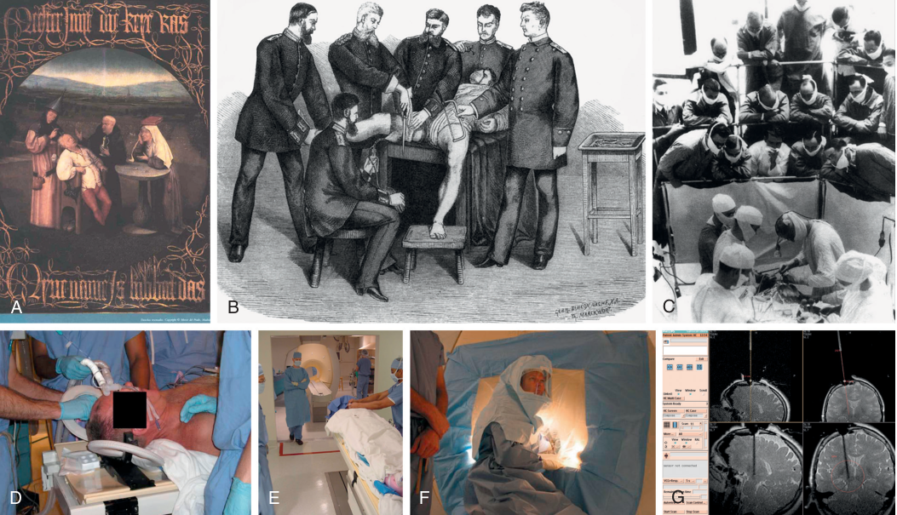

# The Scope of Modern Anesthetic Practice

<!-- PDF page 1 -->

KATE LESLIE, NEAL H. COHEN, LARS I. ERIKSSON, LEE A. FLEISHER, OLUWASEUN JOHNSON- AKEJU, and MICHAEL A. GROPPER

- **KEY POINTS** The scope of modern anesthesiology practice includes preoperative evaluation and management of comorbid conditions; intraprocedural care; postoperative care, including acute pain management; critical care, resuscitation, and retrieval; and chronic pain management. As a result, anesthesia plays a key role in perioperative medicine and the health care system with a significant impact on global health and the burden of disease.

   - Health care continues to evolve, both in scope and practice requirements, with focus set on better health care access and coverage across socioeconomic strata with a mission to provide precision medicine for many endemic disorders. Some of the changes that impact anesthesia care include changing patient populations with demand for more individualized care management, locations in which care is provided, escalating costs of care, quality and safety concerns after the Coronavirus Disease 2019 (COVID- 19) pandemic and labor shortages. In addition, expanded research opportunities may arise in part as a result of improved patient data availability combined with in- depth exploration of biobank material. Global conflict, climate change, and pandemics have also had significant impacts on health care. These forces have major implications for the education and training of anesthesia providers, the organization of practice, and the quality and safety of anesthesia care.

   - The volume of patients presenting for perioperative and obstetric care continues to expand. Increasingly these patients are older and have significant comorbidities, including obesity and opioid use disorder. These changes have important implications for allocation of health care resources, access, and equity in health care delivery.

   - Anesthesia care is expanding beyond the traditional operating room environment into interventional suites, ambulatory surgery centers, physician offices, and other settings. In many countries intensive care is also being led and provided by anesthesia departments and the education of intensivists is based on educational programs initiated by specialist medical colleges and societies with joined missions in anesthesia and intensive care. Anesthesiologists must concentrate on the impact of these changes on the safety and quality of care, including ensuring a process for escalating care to a more appropriate environment if clinically necessary.

   - With expansion in surgical and procedural volume, ensuring an adequate workforce has become a global and regional challenge. To expand capability to provide care to a diverse patient population across a number of settings, the supply of both physician and non- physician anesthesia providers has to expand, with some countries needing a larger expansion, while also identifying ways in which to better utilize technology. Increased attention to health promotion and public health measures to reduce the burden of disease is also essential.

   - Health care costs continue to escalate internationally, although the increased spending on health care in all environments has not consistently translated into improved quality or health outcomes. In most countries, particularly those that compensate providers based on fee for service models, payment is transitioning to value- based payment that requires providers to document quality, safety, and equity of care. Increasing pharmaceutical costs and costs of advanced technologies, which have a major impact on health care costs and costs of anesthesia care, must be collaboratively addressed.

   - Anesthesiology was among the first medical specialties to focus on improving patient safety. Despite the improvement observed, particularly in the perioperative environment, the focus of attention should continue to emphasize safety without neglecting quality improvement, a process designed to improve outcomes and patient experience through documentation of quality of care and systematic change to address shortfalls in care.

   - Basic, translational, clinical, and implementation research is vital to advancing anesthesia care and to ensure continuous improvement. Electronic health records have provided access to large databases and novel analytic techniques that can be used to improve care delivery models, costs of care, and clinical outcomes. These landmark achievements need to be combined with systematic build- up of large biobank and biostatistical resources within perioperative care, which can lead to a precision medicine approach to perioperative care. At the same time, identifying resources to support these research initiatives remains challenging.

<!-- PDF page 2 -->

- The scope of modern anesthetic practice continues to evolve and expand. Many of the disruptions occurring in health care in the 21st century have implications for the role played by clinicians in the practice of anesthesia and overall health care delivery. These disruptions provide exciting opportunities for the next generation of leaders to redefine the scope of practice and ways in which to take leadership roles in advancing care.

## Introduction

Anesthesia is an integral and essential part of the practice of medicine and health care worldwide. Hundreds of millions of patients receive anesthesia care each year for an ever expanding range of medical, surgical, and obstetric procedures. In addition, the scope of anesthesia practice extends to preoperative evaluation, preparation, and management (see Chapter 28); postoperative care including acute pain management (see Chapter 77); critical care, resuscitation, and retrieval (see Chapter 63); and chronic pain management (see Chapter 47). Anesthesia, therefore, continues to play a key role in the delivery of health care (see Chapter 3) and, as a result, has a significant impact on the burden of disease and global health (see Chapters 2, 64, and 85). This edition of _Miller’s Anesthesia_ provides a comprehensive overview of the expanding scope of contemporary anesthesia practice, from fundamental principles to advanced subspecialty procedures.

Each edition of this textbook includes introductory comments about the novel diagnostic and therapeutic advances that have been developed since the previous edition and each acknowledges the increasing complexity of patients presenting for anesthesia and perioperative care, including, but not limited to, those at the extremes of life. Each edition is also introduced with comments about the advances in anesthesiology that have facilitated this care, including improved understanding of the processes that underlie disease and injury, access to better drugs and more sophisticated technology, and advances in the safety and quality in health care. The 10th edition is no exception: since the last edition the advances in anesthesia and surgical care, especially for complex patients, to strive for better and individualized care and for delivery in new environments, have been truly remarkable. In addition, we have been challenged by the COVID- 19 pandemic and the escalating impact of climate change on all aspects of our lives. These disruptions have created opportunities and expectations for anesthesiologists to expand their scopes of practice, take a leading role in crisis management, and assume responsibility for addressing the impact of our clinical decisions on climate change. This must be accomplished within the need to address physician well- being to prevent burnout or loss of providers essential to delivering anesthesia care across the globe (see Chapter 6).

None of the advances made by anesthesia would have been possible without the commitment of anesthesiologists to leadership roles in their departments, health care systems, and political arenas, as well as their commitment to educating the next generation of providers and fostering research. Evidence of their contributions can be found in every chapter of the book, extending from improved

understanding of the mechanisms of anesthesia and the processes that regulate organ function and drive organ failure; through improved combination of more comprehensive patient data with new technologies, decision- support systems, drugs, and systems of care and education; to greater acknowledgment of the critical role that patients should play in decision- making about health care and endof- life issues (see Chapter 7). Additionally, anesthesiologists can have an impact on health policy.

The future of anesthesiology is filled with opportunities and challenges. Global and national forces will drive evidence- based, cost- effective perioperative and obstetric care by multi- professional and multidisciplinary teams. These changes will be supported by integrated electronic medical records and large databases and registries of health care outputs and outcomes including the use of predictive analytics (see Chapter 4). Anesthesia care will continue to migrate out of the operating suite, into preoperative clinics, intervention suites, extended postanesthesia care units, and even patients’ homes (see Chapters 68 and 69). Technological advances will facilitate less-invasive treatments and improved anesthesia delivery and monitoring systems, and increasing options for seriously ill and injured patients and those at the extremes of life. Perioperative management will also become more personalized, with focus set on precision medicine with the generation of lipidomic, metabolomic, proteomic, genomic, and other data for risk prediction, phenotyping of preexisting diseases, and anticipated responsiveness to drugs and other therapies. As a result of these advances, more patients at extremes of age may gain better access to care (see Chapter 61) and as a consequence, care processes will have to be more individualized based on access to in- depth patient information and better preoperative risk predictions. Perioperative outcomes may also be improved for these patients. The costs associated with caring for an aging population represent a challenge for all nations. These forces will likely have a major impact on the scope of anesthesia and perioperative care. Therefore anesthesiologists must participate in health policy decisions about the distribution of resources and the importance of developing clinical practice based on high-quality evidence. In this chapter we will address some of these forces and their impact on the scope of anesthesia care in more detail.

## Forces Impacting Anesthesia Practice (Fig. 1.1)

### CHANGING PATIENT POPULATIONS

The number of patients having surgical procedures annually is large and continues to grow. In 2012 more than

<!-- PDF page 3 -->

A B C D E F G 

**Fig. 1.1 Changing scope and settings of anesthesia and perioperative medicine.** (A) _The Cure of Folly,_ by Hieronymus Bosch (c. 1450–1516), depicting the removal of stones in the head, thought to be a cure for madness. (B) Friedrich Esmarch amputating with the use of anesthesia and antisepsis. (C) Harvey Cushing performing an operation. The Harvey Cushing Society is observing (1932). (D–G) Placement of a deep brain stimulator for the treatment of Parkinson disease using a real- time magnetic resonance (MR) imaging technology (MR fluoroscopy). The procedure occurs in the MR suite of the radiology department. The patient is anesthetized (D) and moved into the bore of the magnet (E). A sterile field is created for intracranial instrumentation (F), and electrodes are placed using real- time guidance (G). (A, Museo Nacional del Prado, Madrid. B, Woodcut from Esmarch’s _Handbuch Der Kriegschirurgischen Technik_ [1877]; Jeremy Norman & Co. C, Photograph by Richard Upjohn Light (Boston Medical Library). D–G, Courtesy Paul Larson, University of California–San Francisco, San Francisco Veterans Administration Medical Center.)

300 million patients underwent surgery worldwide.1 Since then, the volume of surgeries has increased significantly, with a small decrease in 2021 due to the COVID19 pandemic. Nonetheless, global initiatives aimed at universal access to health care and safe and affordable surgery and anesthesia care will result in further increases in surgical volumes in coming decades (see Chapter 2). In addition, the dramatic increase in ambulatory and inpatient interventional procedures (radiology, pulmonology, gastroenterology, cardiology, etc.) has contributed to a significant increase in requests for anesthesia services. In all settings, patient populations have changed, with an increasing number of patients at extremes of age and many with underlying comorbidities, including diabetes mellitus, immune compromise, obesity, and chronic opioid use. Additionally, the effects of food insecurity and malnutrition may have profound effects on perioperative outcomes.

The care of older patients continues to create opportunities and challenges for the specialty. The World Health Organization has estimated that by the year 2050, nearly one quarter of the world’s population will be over 60 years of age.2 In the United States (US) the number of people aged 65 years and over, and therefore eligible for treatment under the US Medicare system, is expected to exceed 78 million by 2030. While the aging population will impact practices globally, the implications for high- income countries will

be most significant because of improved preventive care as well as better management of chronic disease and injury. In low- and middle- income countries the increase in surgical volume will result primarily from improvements in maternal and child health and the eradication or control of infectious disease. At the same time, advances in anesthesia and surgical care are improving perioperative outcomes for newborns. As a result, more patients at extremes of age are receiving surgical services.

The decline in physiological reserve and organ function with age mandates careful management across the entire spectrum of the perioperative period. Many older patients suffer from mild cognitive impairment and dementia, which are associated with postoperative delirium, prolonged hospitalization and institutionalization, higher readmission rates, and mortality. Increasingly, multidisciplinary teams (including anesthesiologists) are engaged in the care of these patients (see Chapters 61 and 78). Thus, anesthesiologists may be the first to identify comorbid conditions, making our role in appropriate referral important.

Another significant challenge for anesthesiologists is the rise in the percentage of obese patients presenting for surgery or other procedures. Obesity has become a global health epidemic. In 2016 39% of adults and 18% of children and adolescents worldwide were overweight.3 From 2017 to 2020, obesity prevalence increased from 30.5%

<!-- PDF page 4 -->

to 41.9% in the United States.4 Obesity in all age groups is associated with an increased burden of disease and injury, more interactions with the health system, and significant challenges in the provision of safe and high-quality surgical and anesthetic care (see Chapter 54).

Another significant challenge that has had impact on care in general and perioperative care specifically is the dramatic increase in opioid use. The current “opioid epidemic” arose from increased prescription of opioid drugs to treat all types of acute and chronic pain, including postoperative pain, and has been exacerbated by diversion of prescribed medication and migration to non- prescribed opioids. The World Health Organization estimated that 27 million people worldwide suffered opioid use disorder in 2015 and the Centers of Disease Control estimated that more than 191 million prescriptions (58.7 prescriptions per 100 persons) were filled in the United States in 2017, with marked regional variation characterized by adverse physical, economic, and social circumstances.5 Opioid use disorder affects as many as 2.7 million Americans.6 Opioids were involved in 42,249 overdose deaths in 2016 (66.4% of all drug overdose deaths).7 While many programs are underway to reduce opioid use and abuse, particularly as a result of improved multimodal pain management techniques, the problem remains a major health crisis. The US Department of Health and Human Services has committed to improve access to prevention, treatment, and recovery support services; targeted availability and distribution of overdose- reversing drugs; strengthened public health data reporting; pledged support for research on addiction and pain; and advocated for advances in pain management practice.8 As experts in the pharmacology and clinical use of opioid drugs (see Chapters 22 and 77), anesthesiologists and pain medicine specialists must play a major role in resolving this crisis.

### CHANGING LOCATIONS OF CARE

The dramatic increase in procedures being performed outside of the operating room has created new opportunities for anesthesiologists, as well as many challenges. Various factors have contributed to this change in practice (see Chapter 69). The costs of traditional operating room care are high and the services available may be unnecessarily comprehensive and complex, particularly for patients undergoing simple procedures. In addition the dramatic increase in surgical and other procedures being performed in ambulatory settings has dramatically changed practice. In the United States, this growth has occurred despite curbs in reimbursements for ambulatory surgery by governmental and private funders. As this transition has accelerated, accrediting agencies and anesthesiology societies have emphasized the need to ensure the safety and quality of anesthesia care in outpatient settings, including providing for extended admission and escalation of care, if clinically required.9

One of the more recent changes in the setting in which perioperative/periprocedural care is required is in the home. First, particularly in high-income nations, patients are no longer admitted to a hospital prior to the day of surgery. Preoperative care is not only provided in preoperative

clinics, but also increasingly using telemedicine. More and more procedures are performed as same- day procedures with patients returning home to continue their early postoperative recovery. As part of enhanced recovery after surgery (ERAS) protocols, postoperative care after inpatient surgery is also increasingly undertaken in the home.10 In the United States, the Centers for Medicare & Medicaid Services Acute Hospital at Home waiver allowed hospital-level care with payment in the home during the public health emergency. Advances in monitoring technology and pain management techniques have facilitated this change in practice, allowing ongoing monitoring of patients in their home environment to ensure full and safe recovery. These opportunities will also change our capacity to passively collect vital and novel patient information prior to surgery in areas we routinely lack information, e.g., with respiratory and circulatory systems of high- risk patients. At the same time, for some families, particularly those caring for older family members, the transition to abbreviated hospital or ambulatory surgery center stays with early discharge has created significant clinical and social problems. To ensure that the patient receives the required care and to support the family, anesthesiologists must be involved in defining the most appropriate setting for a procedure, the management strategies for postprocedure oversight, and management of transitions of care.11

The advance of minimally invasive procedures has also changed the scope of anesthesia care – and will continue to do so. Anesthesia care is required for many invasive and noninvasive procedures being performed by cardiologists, radiologists, endoscopists, and interventional pain medicine specialists (see Chapters 47, 50, 51, 53, 47, and 69). These changes in practice location to procedural areas that have not traditionally required anesthesia services have created challenges for anesthesia providers. The locations are often remote from the operating suite and may lack the usual support available for managing complex patients and crises. To ensure that care provided in these new locations is safe and of the same quality as care provided in the operating room suite, anesthesiologists must assume responsibility for ensuring that the same standards required in an operating room practice are available in other areas of the hospital.12,13

Finally, the introduction of colon cancer screening programs has resulted in an exponential increase in referrals for colonoscopy.14 Although the sedation provider for colonoscopy varies widely internationally, and regionally within the United States, anesthesiologists are commonly coordinating or medically directing the care of patients undergoing these procedures, particularly for older patients with multiple comorbidities presenting for this procedure. In situations in which sedation is provided by a nonanesthesiologist, the anesthesia service should have input into the credentialling of nonanesthesia providers to ensure that they have the educational background and training to provide procedural sedation. American13,15 and international16,17 sedation guidelines acknowledge that nonanesthesiologist physicians and independent or semi- independent nonmedical practitioners are practising endoscopy sedation, including propofol- based techniques and deep sedation/general anesthesia. For any high- risk patient, an anesthesiologist

<!-- PDF page 5 -->

should participate in the care of the patient during these procedures.

### CHANGES IN THE ANESTHESIA WORKFORCE

As the number of procedures requiring anesthesia services has expanded, global and regional deficits in medical and anesthesia workforces have become common. The staffing shortages have been exacerbated by the COVID- 19 pandemic (see Chapter 2) and have continued as hospitalizations for COVID- 19 have fallen (due, among other things, to practitioner burn- out). The workforce deficit has occurred for a number of reasons. The inadequate number of providers is the result of many confounding and coexisting changes in practice and overall workforce. In some cases, the number of new graduates is not keeping pace with the number of retiring providers. Work hour restrictions and increased attention to life–work balance have put new pressures on recruitment and retention of anesthesia trainees and staff. These changes have taken place simultaneously with the increasing demand for anesthesia services across the continuum or care. Subspecialization is also having an impact on workforce needs. Subspecialty call pools increase the need to have multiple anesthesia subspecialists available to support surgical programs (cardiac surgery, transplant surgery, pediatric surgery, critical care, pain medicine, palliative care, etc.).

In response to workforce shortages, most Organisation for Economic Co- operation and Development countries (including the United States) have increased medical school admissions in recent years.18 This increase has come with costs to the departments and health systems, since, at least in the United States, no additional pre- and postgraduate medical education funds have been provided to meet the increasing enrolment. Along with reviewing the cap on federally funded positions, the Association of American Medical Colleges has proposed better use of technology and more team- based care as potential solutions. The advance of team- based care, while critically important, raises other issues that impact anesthesia practice, including scope of practice expansion for non- physician providers. Nonetheless, team- based care is already commonplace in many anesthesia practices worldwide. In the United States the numbers of physician and non- physician anesthesia providers are approaching parity, with numbers of nurse anesthetists and anesthesia assistants increasing more rapidly than numbers of anesthesiologists. In 2017 the American Society of Anesthesiologists released a statement on the anesthesia care team that enunciated its vision of physicianled teams where anesthesiologists have a particular role in governance, planning and oversight of anesthesia care, advanced airway management, and resuscitation.19 Similar team- based approaches are entrenched or emerging in other countries around the world.

Workforce diversity is vital for safe and high- quality patient care, improved health outcomes, and innovation. The number of women in medical schools has increased to over 50% of the student cohort in many countries. However, historically, anesthesiology residencies recruited a smaller proportion of women in the United States (37%) than other countries. For women recruited to academic departments, promotion and salary equity have been

challenging to achieve. Over the past decade, most anesthesia departments have addressed these critically important issues, but ongoing attention is required to ensure that all providers have the same career advancement opportunities and benefits, particularly during societal crises such as the COVID- 19 pandemic, that traditionally add to the primary carer responsibilities of women. While historically few women have reached the rank of professor, become department chairs or have been elected to leadership positions in representative anesthesia organizations,20 the number of women department chairs and those with leadership positions in other organizations has increased considerably. Programs to improve recruitment to and advancement of women in academic medicine and anesthesiology have gained traction in the last decade (e.g., Athena Scientific Women’s Academic Network21 ). Programs to increase inclusion of people of diverse racial, ethnic, gender, and sexual identity in anesthesia training and practice are also gaining traction and should be actively supported.

### INCREASING COSTS OF CARE

The costs of health care continue to grow particularly in the United States, but also across the globe. Unfortunately, the increasing costs of care have not resulted in improved outcomes. Health care consumes 8% of gross domestic product on average and nearly 18% in the United States.22 The Institute of Medicine concluded that health care funding in the United States needs to “reorient competition in the health care system around the value of services provided rather than the volume of services provided.” Anesthesiologists should understand the costs of care they provide, responsibly address costs and outcomes of the care, and partner with surgeons and health system leaders to advance valuebased care (see Chapter 3).

Historically, particularly in the United States and other countries that do not ensure universal health care coverage, payment is based on a fee-for-service model. In contrast to fee- for- service models (which reward inputs), pay- forperformance models and value- based care models reward medical care that is consistent with published evidence and that improves process (e.g., timely administration of perioperative antibiotics), output (e.g., meeting targets for urgent surgery), or outcome (e.g., fewer central line–associated blood stream infections) measures while holding costs constant or decreasing them. In the United States pay- forperformance programs have included the Premier Hospital Quality Incentive Demonstration program of the Centers for Medicare and Medicaid Services (2003–2009) and the national Hospital Value Based Purchasing program, adopted after the passage of the Affordable Care Act (2011). These programs have been piloted in a number of different models that demonstrate that clinicians are able to understand costs of care and adapt practice patterns based on evidence. Many of these models have implemented financial incentives and penalties to encourage better outcomes at reduced cost. To date, these changes have had limited effect on outcomes, most likely due to the complexity of the reporting systems, minimal financial incentives or penalties, delayed payments, and the high costs for the practice associated with implementing the programs.23 Some other

<!-- PDF page 6 -->

countries are also transitioning to pay-for-performance models with variable success.24

In addition to paying for high- quality performance, there has been increasing attention to reducing “never” events (e.g., wrong- side surgery, retained foreign object, mismatched blood transfusion) or not paying for avoidable complications. Because of anesthesia’s role in the entire continuum of perioperative care, we have an opportunity to influence many of these practices.25 As it is vital that practices that actually improve outcomes are promoted, more research is urgently required.

Bundled payment methods have also been implemented to optimize coordination of care by all providers and provide compensation for an entire episode of care. Bundled payments were included as an integral part of the reforms introduced under the United States Affordable Care Act, although their implementation has not been widespread. The Bundled Payments for Care Improvement program introduced by the Centers for Medicare and Medicaid Services tested the ability of bundling payments for both the hospital and physician services for a given time period of care as a method for improving quality and lowering costs, including for selected surgical services such as total joint arthroplasty.26 The American Society of Anesthesiologists has advanced the Perioperative Surgical Home as an anesthesiologist- led management approach designed to coordinate perioperative team- based care, reduce costs and length of stay, while improving the quality of the perioperative care.27

### INCREASING FOCUS ON SAFETY AND QUALITY

Anesthesiology was among the first medical specialties to focus on improving patient safety.28 A number of important strategies have been used to address quality of care issues. Incident reporting was initiated in the United States more than 50 years ago and for anesthesia services has demonstrated a decline in anesthesia- related mortality to &lt;1 per 1 million population.29 In recent years national incident reporting programs have been initiated by the Anesthesia Quality Institute (Anesthesia Incident Reporting System30 ) and the Society of Pediatric Anesthesia (Wake Up Safe31 ). Recognition of the importance of human factors on adverse outcomes has fostered an international movement directed at improving situational awareness and team functioning through simulation training (see Chapter 5). More recently programs to encourage improved communication and collaboration across the perioperative period have been successfully implemented, including the use of checklists, time outs, and improved communication during transitions of care. In addition there has been increasing attention paid to professionalism and the importance of working collaboratively and collegially in the operating room environment and beyond. Health care providers and consumers are encouraged to create a psychologically safe environment, and speak up about safety concerns (e.g., commencing a wrong- side procedure), and to address inappropriate professional behaviors (e.g., bullying and sexual harassment) in the workplace.32

Anesthesiologists have been at the forefront in the drafting of practice standards and the use of checklists to advance a culture of safety.32,33 Anesthesiologists were

pivotal to the development, implementation and evaluation of the World Health Organization’s Surgical Safety Checklist33 (see Chapter 2).

While continuing to advance the safety of anesthesia care, anesthesiologists have also emphasized the importance of ongoing efforts to improve the quality of care, a process designed to improve patient experience and outcomes through systematic change and evaluation. In the United States, the Anesthesia Quality Institute established the National Anesthesia Clinical Outcomes Registry to enable systematic collection of quality information for use in quality improvement processes both nationally and locally.34 Recently the importance of extending the oversight of quality and safety beyond the immediate perioperative period has been recognized as having importance to patients and their families. Patient- centered care and patient satisfaction have become important outcome measures of quality.35 Anesthesiologists will undoubtedly continue to lead the safety and quality agenda, by virtue of history, training, and their pivotal position in the perioperative care team.

### EXTERNAL DISRUPTIONS THAT IMPACT ANESTHESIA PRACTICES

Conflict (both domestic and international), climate change, and the COVID- 19 pandemic have had major impacts on all aspects of health care delivery and the welfare of health care providers and our patients. Anesthesiologists have responded to these challenges by advancing their clinical attention and skills to new environments, developing novel approaches to protecting patients and health care workers from harm, and improving crisis management skills through simulation and interdisciplinary training programs. While addressing the clinical challenges of the pandemic, our specialty has also acknowledged the impact of these crises on physician well- being and the consequential risk of burn- out and mental health problems, and the need to address these issues if we are to continue to advance quality, safety, and patient experience.

## Research and the Future of the Science of Anesthesia Practice

Basic, translational, clinical, and implementation research is vital to continuous improvement in patient and health service outcomes (see Chapter 86). Overall funding for biomedical and health services research in the United States more than doubled between 1994 and 2012. However, there remains significant cause for concern about the future of funding of research for this clinically active specialty. The rate of growth in government funding has not kept up with inflation: a shift to private funding to support research has the risk of focusing on financial benefits of research activities, rather than patient and societal benefit, a decline in early- stage research in favor of device development and clinical trials, poor mapping of research effort to the global burden of disease, and insufficient attention to funding health services research.36

Most benchmarks suggest that the specialty of anesthesiology fares poorly in National Institutes of Health funding in the United States when compared with other disciplines,

<!-- PDF page 7 -->

despite that fact that external forces are generally applicable to all specialties.37 This was exacerbated by the COVID- 19 pandemic. Specialty- specific sources of funding therefore are of increasing importance, particularly for early- career investigators.38 For example, the Foundation for Anesthesia Education and Research has awarded more than $35 million in grants since 1986 and has demonstrated the leverage that these grants provide in achieving federal funding ($17 in funding for every $1 investment). Similar programs are funded by the International Anesthesia Research Society and by anesthesiology organizations and foundations worldwide. At the same time, both basic and clinical and translational research is being funded by other governments and advanced in other parts of the world. If the United States is to remain competitive, the financial realities of research funding limitations on advancing the practice of medicine in general and anesthesia must be addressed.

Some other significant forces are having impact on both the amount and quality of peer- reviewed anesthesia research. For example, economic pressures for hospitals to increase throughput and reduce expenses compromises our ability to participate in clinical trials and other research efforts. Academic anesthesiologists are increasingly committed to hands- on clinical care, with reduced time for research. High costs of labor and infrastructure, along with the high costs of clinical care and research compliance, make pharmaceutical clinical trials in the United States expensive. A reduced pipeline of anesthesia drugs requiring pre- and post- marketing clinical trials is also a factor. Incentives to develop new drugs are limited while current pharmaceuticals contribute to the financial success of pharmaceutical companies.39

One of the most important changes in clinical and translational research for anesthesia as well as other specialties is the need to be more collaborative to address challenging issues in biomedical research. In recent years anesthesiology research has increasingly been conducted by multi- professional, multidisciplinary teams including biostatisticians, health informaticians, and health economists. Translation from discovery to practice has been facilitated by partnerships between basic scientists, clinical scientists, and implementation scientists.40 Recent establishment of much- wanted large- scale patient data registries needs to be continued and further expanded to allow even better coverage of patients in the perioperative period with highresolutional patient data that allow exploration of perioperative phenotypes. In other medical fields these important achievements have been combined with in- depth molecular and cellular analysis to provide individualized care, termed _precision medicine_ . Our ongoing achievements of more comprehensive bedside patient data collection throughout the perioperative period urgently need to adopt such an approach. Patient registries need to be combined with strategic build- up of corresponding routine biobanking of perioperative patients to allow novel and team- based research efforts lead by clinician- scientists in anesthesia to explore critical proteomic and genomic properties with advanced biostatistics and computational techniques that will impact future patient management, decision support, and costeffectiveness, and ultimately improve perioperative outcomes. Increasingly clinical trials are being conducted by large, multicenter networks because of the recognition

that single- center studies take too long and cannot recruit enough patients to answer the really important questions in anesthesiology.41–44 This collaborative approach was implemented with unprecedented success in trials seeking treatment for patients hospitalized with severe COVID- 19 pneumonia and studies of surgical safety during the pandemic. Research based on electronic medical records and databases also requires collaboration between institutions, clinicians, and database experts. Additionally, anesthesiologists have become increasingly involved in the emerging field of implementation science.

Although the volume of and ease of access to information about anesthesiology and its impact on clinical care has increased exponentially in the last decade, anesthesiologists are increasingly challenged to find reliable and evidence- based information to guide their practice. In addition, as is true for other specialties, anesthesiology has been plagued by high- profile cases of research misconduct, including fabrication, falsification, and misleading reporting of research findings.45 This has damaged the reputation of anesthesiology and in some cases put patients at risk. Ensuring that all published research undergoes scrupulous peer review evaluation is also critical to ensure reliability of the data and minimize any conflict of interest risks that might impact interpretation and presentation of the findings.46

In addition to defining best practice and advancing perioperative and obstetric care, anesthesiology as a medical specialty must remain at the forefront of basic, clinical, and health services research in our field. This is feasible given that research in our specialty is not bounded by age or organ system. Other professions providing anesthesia care are becoming more actively involved in health care and health policy research, which is a positive development. Nevertheless, it is critical that physicians take a leadership role in providing the evidence that underpins our specialty. The various governmental and institutional bodies that regulate health care delivery, and our patients, demand that we do so and require that we document our commitment to high- quality, safe, and efficient care – the mainstay of our specialty for more than 50 years.

### INCREASING AVAILABILITY OF DATA

The last decade has seen unprecedented growth in the volume and availability of health care data. Electronic health record systems facilitate complete data capture and integration from multiple sources, including surgical equipment, anesthesia delivery systems, and physiological monitors. They thereby allow for improved documentation of individual patient care and aggregate data for health care services and populations. Other sources of routinely collected data include health service billing systems, government and insurance databases, disease registries, and public health reporting. In addition, data specifically collected for research and quality improvement is increasingly shared, including research databases and biobanks (including genetic databanks). Meta- data related to the use of electronic resources and social media is also available for interrogation. These data require new management and analytic approaches often beyond the expertise of the practicing anesthesiologist or researcher (see Chapter 87).47

<!-- PDF page 8 -->

These large data sets are now allowing us to address some new and exciting research questions, to develop evidence- based clinical guidelines, and to assess the safety and quality of anesthesia and perioperative care, within and between different clinical environments and regions. Database research may even be seen as a cost- effective alternative to the randomized clinical trial. However, database research is limited by missing data, misclassification, biased attainment, inability to link data or inaccuracies in linkage, and lack of verification.48 New pragmatic and flexible approaches to randomized trial research will ensure that trials will retain their relevance and impact moving forward.

## Conclusions

The scope of modern anesthetic practice continues to expand and evolve. The forces at play include changes in our patient population, locations of care, workforce needs, costs of care, quality and safety initiatives, research, and the availability of data. Global conflict, climate change, and pandemics will continue to disrupt health care, but should not undermine our focus on delivery of high-quality, safe, and equitable care across the perioperative period and beyond. The changes occurring in health care in the 21st century obviously have implications for the role of anesthesiology in the practice and delivery of medicine, and provide exciting opportunities for the next generation of leaders in our specialty. This introductory chapter provides an overview of how some of the internal and external forces affecting anesthesia practice will help us define our future.

### Acknowledgments

The editors and the publisher recognize the contributions of Dr. William L. Young and Dr. Jeanine Wiener- Kronish, who were contributing authors in prior editions of this work. It has served as the foundation for the current chapter.

### References

7.  World Health Organization. http://www.who.int/substance_abuse/ information- sheet/en/; 2023.

8.  Department of Health and Human Services. https://www.hhs.gov/ opioids/.

9.  American Society of Anesthesiologists. https://www.asahq.org/ quality- and- practice- management/standards- guidelines- andrelated- resources- search.

10.  Kehlet H. _Br J Anaesth_ . 1997;78:606.

11.  Fleisher LA, et al. _Arch Surg_ . 2004;139:67.

12.  American Society of Anesthesiologists, et al. https://www.asahq. org/quality- and- practice- management/standards- guidelines- andrelated- resources- search.

13.  American Society of Anesthesiologists Task Force on Moderate Procedural Sedation and Analgesia. _Anesthesiology_ . 2018;128:437.

14.  National Cancer Institute. https://progressreport.cancer.gov/detection/ colorectal_cancer; 2023.

15.  Quality Management and Departmental Administration Committee. http://www.asahq.org/quality- and- practice- management/standardsguidelines- and- related- resources.

16.  The Academy of Medical Royal Colleges. https://www.aomrc.org. uk/wp- content/uploads/2016/05/Safe_Sedation_Practice_1213. pdf; 2013.

17.  Hinkelbein J, et al. _Eur J Anaesthesiol_ . 2017;35:6.

18.  Organisation for Economic Co- operation and Development, et al. https://data.oecd.org/healthres/medical- graduates.htm.

19.  American Society of Anesthesiologists. https://www.asahq.org/ standards- and- practice- parameters/statement- on- the- anesthesiacare- team; 2019.

20.  Leslie K, et al. _Anesth Analg_ . 2017;124:1394.

21.  Equality Challenge Unit. https://www.ecu.ac.uk/equality- charters/ athena- swan/.

22.  Organisation for Economic Co- operation and Development, et al. https://data.oecd.org/healthres/health- spending.htm.

23.  Bonfrer I, et al. _BMJ_ . 2018;360:j5622.

24.  European Observatory on Health Systems and Policies, et al. http://www.euro.who.int/__data/assets/pdf_file/0020/271073/Pay ing- for- Performance- in- Health- Care.pdf.

25.  Scott AV, et al. _Anesthesiology_ . 2015;123:116.

26.  Centers for Medicare & Medicaid Services, et al. https://innovation. cms.gov/initiatives/bundled- payments/.

27.  American Society of Anesthesiologists. https://www.asahq.org/psh.

28.  Kohn L, et al. _To Err Is Human: Building a Safer Health System_ . National Academy Press; 1999.

29.  Li G, et al. _Anesthesiology_ . 2009;110:759.

30.  Anesthesia Quality Institute, et al. https://qualityportal.aqihq.org/ AIRSMain/AIRSSelectType/0.

31.  Society for Pediatric Anesthesia. http://www.wakeupsafe.org/.

32.  de Jager E, et al. _World J Surg_ . 2016;40:1842.

33.  Haynes A, et al. _N Engl J Med_ . 2009;360:491.

34.  Liau A, et al. _Anesth Analg_ . 2015;121:1604.

### Complete references available online at expertconsult.com.

   35.  Peden CJ, et al. _Br J Anaesth_ . 2017;119:i5.

   36.  Moses H, et al. _JAMA_ . 2015;313:174.

   37.  Reves JG, et al. _Anesthesiology_ . 2007;106:826.

1.  Weiser TG, et al. _Lancet_ . 2015;385(suppl 2):S11.

2.  World Health Organization. https://www.who.int/publications/i/ item/9789241565042; 2015.

3.  World Health Organization. http://www.who.int/en/news- room/ fact- sheets/detail/obesity- and- overweight; 2021.

4.  Centers for Disease Control and Prevention. https://www.cdc.gov/ obesity/data/surveillance.html#NPAO.

5.  Centers for Disease Control and Prevention. U.S. opioid prescribing rate maps. https://www.cdc.gov/drugoverdose/maps/rxratemaps.html.

6.  Centers for Disease Control and Prevention, et al. https://www.cdc. gov/dotw/opioid- use- disorder/index.htm.

38.  Speck RM, et al. _Anesth Analg_ . 2018;126:2116.

39.  Vlassakov KV, et al. _Trends Pharmacol Sci_ . 2016;37:344.

40.  Kharasch ED, et al. _Anesthesiology_ . 2018;128:693.

41.  Myles P, et al. _BMJ Open_ . 2017;7:e015358.

42.  Pearse RM, et al. _JAMA_ . 2014;311:2181.

43.  Wijeysundera DN, et al. _Lancet_ . 2018;391:2631.

44.  Devereaux P, et al. _N Engl J Med_ . 2014;370:1494.

45.  Moylan EC, et al. _BMJ Open_ . 2016;6:e012047.

46.  Shen C, et al. _BMC Med_ . 2015;13:230.

47.  Levin MA, et al. _Anesth Analg_ . 2015;121:1661.

48.  Fleischut PM, et al. _Br J Anaesth_ . 2013;111:532.

<!-- PDF page 9 -->

### References

1.  Weiser TG, Haynes AB, Molina G, et al. Estimate of the global volume of surgery in 2012: an assessment supporting improved health outcomes. _Lancet_ . 2015;385(suppl 2):S11.

2.  World Health Organization. _World Report on Ageing and Health_ . Geneva: WHO; 2015. https://www.who.int/publications/i/ item/9789241565042.

3.  World Health Organization. _Fact Sheet on Overweight and Obesity_ . Geneva: WHO; 2021. http://www.who.int/en/news- room/factsheets/detail/obesity- and- overweight.

4.  Centers for Disease Control and Prevention. Nutrition, physical activity and obesity. https://www.cdc.gov/obesity/data/surveillance.html #NPAO.

5.  Centers for Disease Control and Prevention. U.S. opioid dispensing rate maps. Atlanta: CDC. https://www.cdc.gov/drugoverdose/rxratemaps/.

6.  Centers for Disease Control and Prevention. Opioid use disorder. https://www.cdc.gov/dotw/opioid- use- disorder/index.htm.

7.  World Health Organization. Information sheet on opioid overdose. Geneva: WHO. http://www.who.int/substance_abuse/informationsheet/en/.

8.  Department of Health and Human Services. Help, resources and information. National opioid crisis. Washington. https://www.hhs.gov/opioids/.

9.  American Society of Anesthesiologists. Guidelines for officebased anesthesia. https://www.asahq.org/quality- and- practicemanagement/standards- guidelines- and- related- resourcessearch.

10.  Kehlet H. Multimodal approach to control postoperative pathophysiology and rehabilitation. _Br J Anaesth_ . 1997;78:606–617.

11.  Fleisher LA, Pasternak LR, Herbert R, Anderson GF. Inpatient hospital admission and death after outpatient surgery in elderly patients: importance of patient and system characteristics and location of care. _Arch Surg_ . 2004;139:67–72.

12.  American Society of Anesthesiologists. Statement on non- operating room anesthetizing locations. https://www.asahq.org/quality- andpractice- management/standards- guidelines- and- related- resourcessearch.

13.  American Society of Anesthesiologists Task Force on Moderate Procedural Sedation and Analgesia, the American Association of Oral and Maxillofacial Surgeons, American College of Radiology, American Dental Association, American Society of Dentist Anesthesiologists, and Society of Interventional Radiology. Practice guidelines for moderate procedural sedation and analgesia 2018. _Anesthesiology_ . 2018;128:437–479.

14.  National Cancer Institute. Colorectal cancer screening. Bethesda. https://progressreport.cancer.gov/detection/colorectal_cancer.

15.  Quality Management and Departmental Administration Committee. Advisory on granting privileges for deep sedation to non- anesthesiologist physicians (amended October 25, 2017). http://www.asahq.org/quality- and- practice- management/standardsguidelines- and- related- resources.

16.  The Academy of Medical Royal Colleges. _Safe Sedation Practice for Healthcare Procedures_ ; 2013. https://www.aomrc.org.uk/wp- content /uploads/2016/05/Safe_Sedation_Practice_1213.pdf.

17.  Hinkelbein J, Lamperti M, Akeson J, et al. European Society of Anaesthesiology and European Board of Anaesthesiology guidelines for procedural sedation and analgesia in adults. _Eur J Anaesthesiol_ . 2017;35:6–24.

18.  Organisation for Economic Co- operation and Development. Medical graduates. Paris. https://data.oecd.org/healthres/medicalgraduates.htm.

19.  American Society of Anesthesiologists. _Statement on the Anesthesia Care Team_ ; 2019. https://www.asahq.org/standards- and- practiceparameters/statement- on- the- anesthesia- care- team.

20.  Leslie K, Hopf HW, Houston P, O’Sullivan E. Women, minorities, and leadership in anesthesiology: take the pledge. _Anesth Analg_ . 2017;124:1394–1396.

21.  Equality Challenge Unit. Athena SWAN Charter. London. https://www.ecu.ac.uk/equality- charters/athena- swan/.

22.  Organisation for Economic Co- operation and Development. Health spending. Paris. https://data.oecd.org/healthres/healthspending.htm.

23.  Bonfrer I, Figueroa JF, Zheng J, et al. Impact of financial incentives on early and late adopters among US hospitals: observational study. _BMJ_ . 2018;360:j5622.

24.  European Observatory on Health Systems and Policies. Paying for performance in healthcare. Implications for health system performance and accountability. Maidenhead. http://www.euro.who.int/__data /assets/pdf_file/0020/271073/Paying- for- Performance- in- HealthCare.pdf.

25.  Scott AV, Stonemetz JL, Wasey JO, et al. Compliance with surgical care improvement project for body temperature management (SCIP Inf- 10) is associated with improved clinical outcomes. _Anesthesiology_ . 2015;123:116–125.

26.  Centers for Medicare & Medicaid Services. Bundled Payments for Care Improvement (BPCI) Initiative: General Information. Washington, DC: CMS. https://innovation.cms.gov/initiatives/bundled- payments/.

27.  American Society of Anesthesiologists. Perioperative surgical home. https://www.asahq.org/psh.

28.  Kohn L, Corrigan J, Donaldson M. _To Err Is Human: Building a Safer Health System_ . Washington, DC: National Academy Press; 1999.

29.  Li G, Warner M, Lang BH, et al. Epidemiology of anesthesiarelated mortality in the United States, 1999–2005. _Anesthesiology_ . 2009;110:759–765.

30.  Anesthesia Quality Institute. Anesthesia Incident Reporting System (AIRS). https://qualityportal.aqihq.org/AIRSMain/AIRSSelectT ype/0.

31.  Society for Pediatric Anesthesia. _Wake up safe_ . https://wakeupsafe. org/.

32.  de Jager E, McKenna C, Bartlett L, et al. Postoperative adverse events inconsistently improved by the World Health Organization Surgical Safety Checklist: a systematic literature review of 25 studies. _World J Surg_ . 2016;40:1842–1858.

33.  Haynes A, Weiser T, Berry W, et al. A surgical safety checklist to reduce morbidity and mortality in a global population. _N Engl J Med_ . 2009;360:491–499.

34.  Liau A, Havidich JE, Onega T, Dutton RP. The National Anesthesia Clinical Outcomes Registry. _Anesth Analg_ . 2015;121:1604–1610.

35.  Peden CJ, Campbell M, Aggarwal G. Quality, safety, and outcomes in anaesthesia: what’s to be done? An international perspective. _Br J Anaesth_ . 2017;119:i5–i14.

36.  Moses 3rd H, Matheson DH, Cairns- Smith S, et al. The anatomy of medical research: US and international comparisons. _JAMA_ . 2015;313:174–189.

37.  Reves JG. We are what we make: transforming research in anesthesiology: the 45th Rovenstine Lecture. _Anesthesiology_ . 2007;106:826– 835.

38.  Speck RM, Ward DS, Fleisher LA. Academic anesthesiology career development: a mixed- methods evaluation of the role of Foundation for Anesthesiology Education and Research funding. _Anesth Analg_ . 2018;126:2116–2122.

39.  Vlassakov KV, Kissin I. Decline in the development of new anesthetics. _Trends Pharmacol Sci_ . 2016;37:344–352.

40.  Kharasch ED. The challenges of translation. _Anesthesiology_ . 2018;128:693–696.

41.  Myles P, Bellomo R, Corcoran T, et al. Restrictive versus liberal fluid therapy in major abdominal surgery (RELIEF): rationale and design for a multicentre randomised trial. _BMJ Open_ . 2017;7:e015358.

42.  Pearse RM, Harrison DA, MacDonald N, et al. Effect of a perioperative, cardiac output- guided hemodynamic therapy algorithm on outcomes following major gastrointestinal surgery: a randomized clinical trial and systematic review. _JAMA_ . 2014;311:2181–2190.

43.  Wijeysundera DN, Pearse RM, Shulman MA, et al. Assessment of functional capacity before major non- cardiac surgery: an international, prospective cohort study. _Lancet_ . 2018;391:2631–2640.

44.  Devereaux P, Sessler D, Mrkobrada M, et al. Aspirin in patients having non- cardiac surgery. _N Engl J Med_ . 2014;370:1494–1503.

45.  Moylan EC, Kowalczuk MK. Why articles are retracted: a retrospective cross- sectional study of retraction notices at BioMed Central. _BMJ Open_ . 2016;6:e012047.

46.  Shen C, Bjork BC. ‘Predatory’ open access: a longitudinal study of article volumes and market characteristics. _BMC Med_ . 2015;13:230.

47.  Levin MA, Wanderer JP, Ehrenfeld JM. Data, big data, and metadata in anesthesiology. _Anesth Analg_ . 2015;121:1661–1667.

48.  Fleischut PM, Mazumdar M, Memtsoudis SG. Perioperative database research: possibilities and pitfalls. _Br J Anaesth_ . 2013;111:532–534.
