# Anesthesia and Global Health Equity

<!-- PDF page 1 -->

BETELEHEM ASNAKE, TYLER LAW, MAYTINEE LILAONITKUL, GUNISHA KAUR, CAROLINA HAYLOCK- LOOR, CORNELIUS SENDAGIRE, FAUZIA KHAN, ODINAKACHUKWU EHIE, and MICHAEL S. LIPNICK

### KEY POINTS

- More than 5 billion of the world’s 7 billion people lack access to safe anesthesia and surgical services, and a similarly significant proportion lack access to fundamentals such as oxygen therapy. Surgical disease accounts for 30% of the global disease burden, yet less than 1% of development assistance for health supports the delivery of anesthesia and surgical care. Lack of access to safe, timely, and affordable anesthesia and surgery kills more than four times as many people as acquired immunodeficiency syndrome (AIDS), tuberculosis (TB), and malaria combined.

- Lack of access to safe anesthesia and surgical services is among the most neglected crises in global health. Anesthesia- related mortality in some low- income countries (LICs) is reported in the 1:100s and is mostly avoidable. The burden of surgical disease is growing and disproportionately affects low- and middle- income countries.

- Pain is one of the top causes of morbidity worldwide, and inadequate access to analgesia is among the most inequitable global public health crises the world faces today. Five and a half billion people have limited or no access to narcotic medications for analgesia. Six highincome countries (HICs) account for 80% of the world’s opioid consumption. Key drug control policies, organizations, and politics continue to influence issues of access and abuse, with disproportionately negative impacts on underserved populations.

- Critical shortages and the inequitable distribution of anesthesia providers are significant barriers to increasing access to safe anesthesia and surgical care. The density of surgery, anesthesia, and obstetric providers is 0.7 per 100,000 population for LICs compared to 57 per 100,000 population for HICs.

- Modern anesthesia workforce training and practice models vary widely from country to country. Innovative workforce solutions are needed to increase provider numbers while simultaneously ensuring quality and promoting access for underserved populations.

- Anesthesia, analgesia, and surgical services are feasible in resource- constrained settings and are as cost- effective as many other public health interventions (e.g., vaccinations).

- Issues of access, safety, and resource utilization are relevant to all anesthesia providers. Equipping anesthesia providers with the knowledge and skills needed to address global challenges in anesthesia will become increasingly important to expand access to safe and affordable anesthesia care worldwide.

- Health care providers from multiple disciplines (nursing, surgery, obstetrics, anesthesia, and many more) are needed to provide surgical and perioperative care effectively. Anesthesiologists routinely work across the perioperative disciplines and can play a significant role in improving cohesive advocacy efforts and leading progress in global health equity for surgical disease and analgesia.

- The global anesthesia community is lagging behind other health disciplines in addressing global health challenges. It must rapidly expand investment in initiatives to help characterize (research), address (implementation and policy), and support (financing) global anesthesia challenges.

- Developing infrastructure, expanding the workforce, improving data to drive policy, providing financial risk protection mechanisms for surgical patients, improving referral and prehospital systems, and providing essential medicines are actions the global anesthesia community must prioritize. The need to act promptly is immense and must be balanced but not overshadowed by research agendas.

<!-- PDF page 2 -->

## Introduction

In recent years, considerable efforts have been made to define a global “standard” or “optimal” anesthesia practice.1–4 These debates, investigations, and innovations have often been framed in maximizing patient safety. More recently, the focus of these efforts has expanded to incorporate the fundamental goals of maximizing not only safety, but also accessibility, affordability, and equity for anesthesia and perioperative services.5

With scientific advancement and economic development, anesthesia—like much of medicine—has changed dramatically since the first public display of ether anesthesia in October 1846. However, over the past 175 years, advances in anesthesia have been neither uniform nor universal. This has resulted in vastly heterogeneous anesthesia practice models and massive inequities in access to safe anesthesia care, sometimes even within the same cities and communities. Most of the world’s population does not have access to safe, affordable surgical, anesthesia, pain, or critical care services, and relatively few resources are being invested by governments, donors, or the global anesthesia community to address this crisis.

In this chapter, we build off the work of Dr. Miller and many colleagues from around the world to explore the diversity of anesthesia practice models and the challenges facing the global anesthesia provider and patient communities. A better understanding of the structure of modern anesthesia care models and the challenges they face is a crucial step to improving access and patient safety worldwide.

The first section of this chapter describes the scope and magnitude of the ongoing global surgical, anesthesia, and pain crises. This section also explores why the global public health community has relatively neglected these crises, and reviews potential areas for intervention, advocacy, and change. The section also highlights challenges and health care disparities related to oxygen and critical care that the SARS- CoV- 2 pandemic highlighted.

The second section of this chapter summarizes the diversity in different anesthesia provider care models, cadres, training, and scopes of practice from around the world, including snapshots of current challenges.

The final section of this chapter provides a primer on essential clinical and non- clinical knowledge relevant to anesthesia practice in resource- variable settings. The chapter concludes by discussing the role of anesthesia providers beyond the confines of the operating room or hospital setting, who will increasingly be called upon for solutions that increase access to safe anesthesia, surgery, analgesia, and critical care globally.

## Section 1: Anesthesia and “Global Health Equity”

### TERMINOLOGY AND DEFINITIONS

### Global Health Equity

The terms anesthesia and global health, when used together, often invoke thoughts of clinicians from highincome countries (HICs) providing clinical care in low- and

**Table 2.1** World Bank Income Classifications by Gross National Income per Capita

||**GNI per Capita (US$)**|
|---|---|
|Low income|&lt;1085|
|Lower- middle income|1086–4255|
|Upper- middle income|4256–13,205|
|High income|>13,205|

_GNI_ , gross national income. Source: https://blogs.worldbank.org/opendata/new- world- bank- countryclassifications- income- level- 2022- 2023

middle- income countries (LMICs) as part of humanitarian outreach or “mission trips” (Table 2.1). Although such initiatives comprise a substantial proportion of efforts that aim to increase access to surgical and anesthesia services in resource- constrained settings, they represent only a fraction of the ever- expanding role of the anesthesia community in addressing global health disparities.

In this chapter, we transition away from using the term “global health” and instead use the term “global health equity” to refer to a multidisciplinary field of study, research, practice, and advocacy that is rooted in social justice, and develops and implements solutions to improve health equity and its determinants, regardless of geography and with emphasis on populations at the most significant risk. Global health equity transcends national boundaries, requires international cooperation, and utilizes both population- level (e.g., injury prevention) and individual- level (e.g., clinical care) strategies (Table 2.2). Although debate exists over the optimal definition of “global health” (or global health equity) and its distinction, or lack thereof, from public health, it is worth highlighting that global health equity is not synonymous with international aid (i.e., going abroad from one’s own country) or the transfer of technologies or interventions from HICs to LMICs.6,7

The transition away from the term “global health” is not only because of the common and unfortunate misunderstanding that global health initiatives must focus on “outreach” (i.e., going to a poor setting outside one’s community or country) but also because the term’s origins have a significant negative legacy with ongoing negative repercussions. The term “tropical medicine” in the late 19th century was primarily focused on protecting colonizers from disease during conquests, while the term “international health” in the late 20th century inherently promoted initiatives done in other places, typically low- income countries by highincome country leadership. Eventually, “global health” was coined in the 21st century by high- income countries in an attempt to encompass a broad scope of activities. However, “global health” has not been able to correct its legacy. It has frequently become synonymous with programs that have significant power imbalances that favor wealthier nations or participants, that do not adequately account for or elevate local priorities, and that provide inconsistent and inadequate allyship.

Global health equity initiatives must strive to address these challenges by increasing emphasis on health equity and broader principles of solidarity, community, diversity,

::: details 原始表格與符號（PDF 第 2 頁）

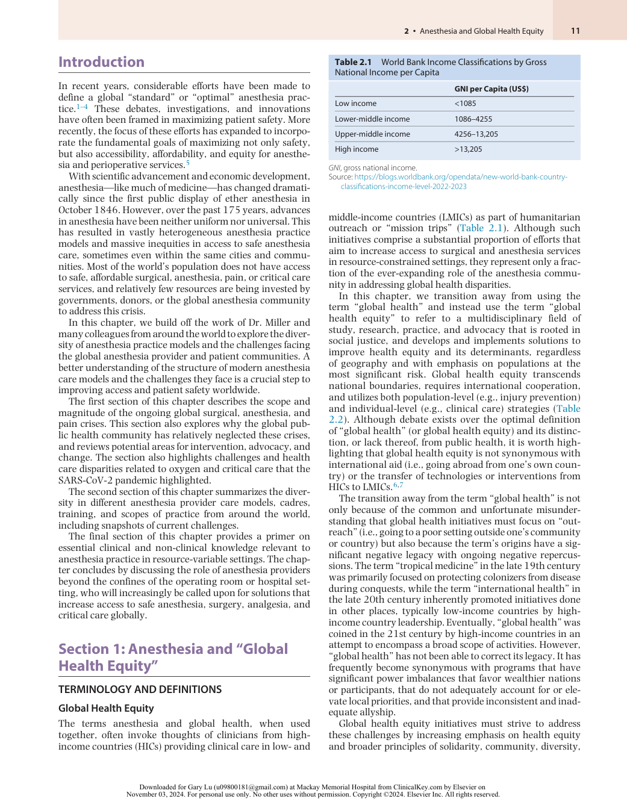

:::

<!-- PDF page 3 -->

**Table 2.2** Definitions of Global Health and Global Surgery

||**Global Health Equity***|**Global Surgery**†|
|---|---|---|
|Approach|Multidisciplinary field of study, research, practice, and advocacy. Emphasizes social justice and solutions to improve health equity and its determinants, with emphasis on populations at the greatest risk.|Area for study, research, practice, and advocacy that places priority on improving health outcomes and achieving health equity for all people worldwide who are affected by surgical conditions or have a need for surgical care.|
|Geography|Focuses on issues that directly or indirectly affect health but that can transcend national boundaries.|Global surgery emphasizes supraterritorial and transnational issues, determinants, and solutions.|
|Level of cooperation|Development and implementation of solutions often require global cooperation.|Recognizes that the determinants of inadequate or inequitable surgical care are often the result of common and interdependent global structures and processes and require global cooperation for global solutions.|
|Individuals or populations|Embraces both prevention in populations and clinical care of individuals.|Encompasses surgical care for underserved populations in all countries with special emphasis on those affected by conflict, displacement, and disaster.|
|Access to health|Health equity among nations and for all people is a major objective.|Equitable access to safe and affordable anesthesia, analgesia, and surgical care is a major objective.|
|Range of disciplines|Highly interdisciplinary and multidisciplinary within and beyond health sciences.|Incorporates all surgical specialties including obstetric and gynecological surgery, anesthesia, perioperative care, aspects of emergency medicine, rehabilitation, and palliative care, and nursing and the allied health professions involved in the care of the surgical patient. Engages non- clinical stakeholders including health economists, governments, and policymakers.|

*Modified from Koplan JP, Bond TC, Merson MH, et al. Towards a common definition of global health. _Lancet_ . 2009;(9679);1993–1995; Fried LP, Bentley ME, Buekens P, et al. Global health is public health. _Lancet_ . 2010;375(9714):535–537; Braveman P. What are health disparities and health equity? We need to be clear. Public Health Rep. 2014;129 Suppl 2(Suppl 2):5–8.

> †Modified from Dare AJ, Grimes CE, Gillies R, et al. Global surgery: defining an emerging global heath field. _Lancet_ . 2014;384(9961):2245–2247.

justice, human rights (including the right to health), and the determinants of health.8

### Determinants of Health

The majority of health (i.e., physical and mental well- being) is not determined by health care. For example, the US spends more on health care than any country in the world, yet life expectancy and health outcomes for many conditions are not even in the top 25.9 Health is shaped by numerous factors, including both structural and social determinants of health. The social determinants of health (SDOH) start in our homes, schools, communities, and places of work (e.g., income, education, access to food, safety, etc.). These SDOH are downstream and shaped by structural determinants such as governing, economic, and social conditions.

The emergence of social medicine and the notion that determinants of health, not simply disease, must be addressed to improve individual and population health can be traced to the mid- 19th century. Rudolf Virchow (perhaps best known for his contributions to pathology) described a significant increase in disease and poverty during the industrial revolution and a typhus epidemic: “If medicine is to fulfill her great task, then she must enter the political and social life.”10 Social determinants of health are frequently grouped into five general areas:

1.  Economic stability

2.  Education access and quality

3.  Health care access and quality

4.  Neighborhood and built environment

5.  Social and community context

Economic stability impacts health through factors such as poverty, employment, food security, and housing

stability.11 This is a universal issue. It affects health in low- , middle- , and high- income country communities with disparities associated with race, gender, and geography. For example, in the United States, despite a relatively high median annual income ($61,417 for men and $50,982 for women), 1 in 10 (∼37 million) people live in poverty (&lt;∼$13,000 annual income or &lt;$35/day).12,13 Worldwide 1.2 billion people live in extreme poverty (&lt;$1.90 per day) with little to no access to safe housing, clean water, food, or health care.14 Numerous studies have also shown that people living in poverty are more likely to experience illnesses such as obesity, developmental delay, asthma, diabetes, maternal mortality, and heart disease.15 Globally, the effect of economic instability on health outcomes is even more pronounced.14 Although the global poverty level has fallen over the last 15 years, the SARS- CoV- 2 pandemic may have set back this progress by up to 10 years.16

Education access and quality also have significant impacts on health through factors such as language and literacy, early childhood education and development, completion of higher education, and education attainment in general. Higher education correlates with better- paying jobs and fewer safety hazards. It not only provides people with the increased financial capacity to access quality resources, including higher- quality housing and higher social status, but it can also enable them to reflect critically on ways to optimize their well- being.17 Globally, 85% of the world population is literate; however, in some communities and countries, literacy rates are still below 30%.18 Poor literacy affects peoples’ health directly by limiting their personal, social, and cultural development and hindering health literacy development.19

::: details 原始表格與符號（PDF 第 3 頁）

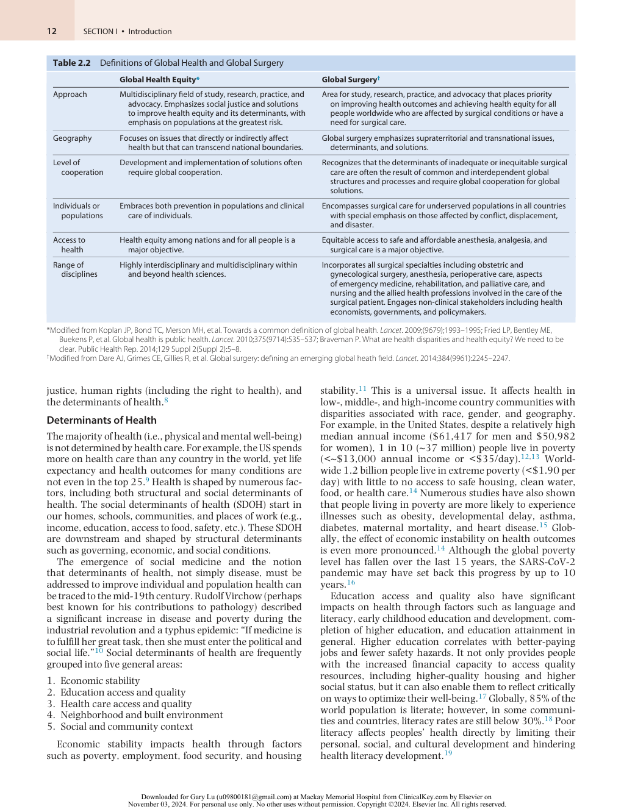

:::

<!-- PDF page 4 -->

Health care access and quality are the connection between timely access to health care and health. This topic includes key factors such as access to primary care, health literacy, health insurance coverage, or even physical distance to health care services. While many poor communities, especially in HICs, may have access to emergency services, this is not equivalent to access to care. It is well known that lack of access to primary care and dependence on emergency services are linked to worse health outcomes, including cancer, heart disease, and strokes. In low- and middle- income countries, a significant shortage of medical providers often drives access to quality health care, especially for anesthesia and perioperative services. This is also true for many rural communities in low- , middle- , and highincome countries. The shortage of anesthesia providers and its impact on global access to health care is discussed further in this chapter.

Neighborhood and built environment impact health and well- being through factors such as where a person lives, including their housing, neighborhood, and environment. This also includes access to transportation, healthy food, clean water and air, and neighborhood safety. A child born in Japan is expected to live ∼85 years, while a child born in the Central African Republic is expected to live only ∼54 years.9 Similar disparities exist even within high- income countries, where life expectancy varies by more than 20 years depending on the neighborhood within the same cities.20 People living in houses with mold, poor plumbing, or limited ventilation can experience increased asthma, respiratory problems, lead poisoning, and carbon monoxide poisoning. Living in neighborhoods that lack grocery stores that sell fresh, nutritious foods (i.e., food deserts) or lacking the money to purchase these foods puts people at a greater risk for poor health.

On the contrary, environments with multiple wellstocked grocery stores, extensive public transportation, safe places to walk, and green spaces for exercise and leisure promote healthy behaviors (e.g., diet and exercise) and health.21 Access to safe drinking water and sanitation is considered a fundamental human right and a key development goal for all communities, yet billions of people worldwide lack access.22 This is not only in lower- income countries but also in high- income countries. Two million Americans do not have running water or sanitation services, and this lack of access in the United States, like many settings, disproportionately affects indigenous, Black, and Latino households.23 Recently in Flint, Michigan (United States), poor governance and systemic racism resulted in several communities consuming public water that was contaminated with lead with significant health implications.24 Finally, crime and violence often lead to physical and/or psychological injury and poor health outcomes in the form of stress, mental health illness, or conditions that require hospitalization. For example, chronic stress related to crime, violence, or poverty has been correlated with cardiovascular disease. Not only does trauma and violence disproportionately affect poor communities around the world, but also outcomes from trauma are worse according to multiple socioeconomic factors,25 even in high- income countries. Moreover, people who live in high crime areas may not feel safe to leave their homes. This sedentary lifestyle can lead to negative health outcomes including obesity.26

Social and community context is the connection between peoples’ health or well- being to where people live, learn, work, and play. This includes factors like conditions in the workplace, incarceration, civic participation, and cohesion within the community. As a result, structural conflict and unconscious bias can play a major role within this context. The interaction of people with family, friends, co- workers, and community can have a major impact on health and wellbeing. Many people face health risks outside of their control due to unsafe neighborhoods, discrimination, and/or lack of income. Relationships that are positive at home, with coworkers, and other community members at large can help reduce negative impacts. Traditional practices and societal pressure can lead to adverse health outcomes in a global context. For example, female genital mutilation, still practiced in many parts of the world as part of cultural tradition, leads to significant pain and obstetric and birthing complications.27

### Global Surgery and Anesthesia

Global health has received unprecedented levels of interest in recent decades, expanding from its infectious disease origins to now incorporating a wider range of diseases, including the social and environmental factors affecting health.28,29 Despite this, surgery and anesthesia have remained relatively forgotten by the global health community, with little to no direct investment by international aid and development agencies (Fig. 2.1).

In June of 1980, then Director- General of the World Health Organization (WHO), Dr. Halfdan Mahler, gave a presentation to the International College of Surgeons in Mexico City entitled “Surgery and Health for All.” In this speech, Dr. Mahler stated that “Surgery clearly has an important role to play in primary health care and in the services supporting it. Yet, the vast majority of the world’s population has no access whatsoever to skilled surgical care, and little is being done to find a solution. I beg of you to give serious consideration to this most serious manifestation of social inequity in health care.”30

Despite the recognition of the global anesthesia and surgical crises several decades ago, it has been only recently that the global health community has begun to take notice and action.31–36 In 2004, the WHO created the Emergency and Essential Surgical Care Program (EESC), and in 2005, the WHO Global Initiative for Emergency and Essential Surgical Care (GIEESC) was formed to convene multidisciplinary stakeholders interested in the surgical disease. In 2007, the Bellagio Essential Surgery Group and Burden of Surgical Disease Working Group (later renamed the Alliance for Surgery and Anesthesia Presence [ASAP]) formed as two of the earliest concerted efforts to raise international awareness for surgical disease by advocating for the integration of surgery into health systems and the promotion of research and collaboration across disciplines.37 These efforts followed in the wake of a seminal chapter on surgery in the second edition of the _Disease Control Priorities in Developing Countries_ (DCP2) book in 2006.38 In 2008, the WHO launched the Safe Surgery Saves Lives initiative along with the WHO Safe Surgery Checklist.39,40 Also in 2008, multiple leaders in global health highlighted surgery as the “neglected stepchild” and as the “other neglected disease” in global health, drawing a comparison with the then emerging term “neglected tropical diseases.”41,42

<!-- PDF page 5 -->

|**HIV**($5487) **Malaria**($1031) **FP/RH**($608) **TB**($381) **Other**($289) **Vulnerable Children**($28) **Nutrition**($158) **NTDs**($108) **Total Funding = $12.2 billion** **US Global Health Funding (in millions), by Sector, FY 2022**|**Fig. 2.1** **US Global Health** **Funding** **by** **Sector.** _FP/RH_, family planning & reproductive health;_HIV_, human immunodefi- ciency virus;_MCH_, maternal and child health;_NTDs_, neglected tropical diseases;_TB_, tuber-|
|---|---|
|**MCH**($1277) **Global Health Security**($1241)|culosis.(From KFF. Available at https://www.kff.org/global- health- policy/fact- sheet/ breaking- down- the- u- s- global- health- budget- by- program- area/. Creative Commons Attribution- NonCommercial- NoDerivatives 4.0 International |
|**Global Fund**($1560)|(CC BY- NC- ND 4.0) license.)|

Despite these pleas and consistent, albeit limited, data demonstrating the massive scale of the surgical disease crisis, it was not until 2014–2015 that greater attention began to be realized. In 2014, the Amsterdam Declaration on Essential Surgical Care was created. In 2015, the 68th World Health Assembly (WHA) unanimously passed resolution 68.15 (WHA68.15) to strengthen emergency and essential surgical and anesthesia care as a component of universal health coverage.43,44 Also in 2015, the publication of DCP3 and the Lancet Commission on Global Surgery (LCOGS) “Global Surgery 2030” report significantly expanded the body of data characterizing the global surgical and anesthesia crises and also outlined strategies for addressing some of these challenges (Boxes 2.1 and 2.2).5,45,46 During the LCOGS development, Dr. Jim Kim, President of the World Bank, echoed the words of Dr. Mahler from 35 years earlier by stating, “…surgery is an indivisible, indispensable part of health care and progress towards universal health coverage.”47

These events provided a much- needed boost to efforts to improve the accessibility, affordability, and safety of surgical, obstetric, and anesthesia care worldwide. They also helped provide a framework for including surgery and anesthesia as global health priorities by linking surgery and anesthesia care to universal health coverage. Surgery and anesthesia were not included in previous priority- setting efforts, partly because it was not clear how to incorporate them. Limited data about the scale of the crises, as well as misperceptions around complexity and cost- effectiveness (as discussed in the next section), resulted in surgery and anesthesia care being peripheral to global health priority- setting efforts like the Millennium Development Goals (MDGs). Although surgery and anesthesia are not explicitly a focus of more recent global health priority initiatives like the Global Health 2035 report and the United Nations (UN) Sustainable Development Goals (SDGs), these reports emphasize non- communicable diseases, injuries, health care workforce expansion, and universal health coverage, which incontrovertibly depend on surgery and anesthesia.48,49

Milestones like LCOGS, the WHA resolution 68.15, and the Lancet Commission on Palliative Care and Pain Relief have helped call attention to the global anesthesia,

### Box 2.1 Key Messages from Disease Control Priorities 3rd Edition

1.  Provision of essential surgical procedures would avert an estimated 1.5 million deaths a year, or 6%–7% of all avertable deaths in low- and middle- income countries (LMICs).

2.  Essential surgical procedures rank among the most costeffective of all health interventions. The surgical platform of first- level hospitals delivers 28 of the 44 essential procedures, making investment in this platform also highly cost- effective.

3.  Measures to expand access to surgery, such as task- sharing, have been shown to be safe and effective while countries make long- term investments in building surgical and anesthesia workforces.

4.  Because emergency procedures constitute 23 of the 28 procedures provided at first- level hospitals, such facilities must be widely geographically available.

5.  Substantial disparities remain in the safety of surgical care, driven by high perioperative mortality rates and anesthesiarelated deaths in LMICs. Feasible measures, such as the WHO’s Surgical Safety Checklist,47 have led to improvements in safety and quality.

6.  The large burden of surgical conditions, the cost- effectiveness of essential surgery, and the strong public demand for surgical services suggest that universal coverage of essential surgery (UCES) should be financed early on the path to universal health coverage.

7.  We point to estimates that full coverage of the component of UCES applicable to first- level hospitals would require slightly more than $3 billion annually of additional spending and yield a benefit to cost ratio of better than 10:1. It would efficiently and equitably provide health benefits and financial protection, and it would contribute to stronger health systems.

- From Jemison DT, Alwan A, Mock CN, et al. Universal health coverage and intersectoral action for health: key messages from _Disease Control Priorities_ , 3rd edition. _Lancet_ . 2018;391(10125):1108–1120.

analgesia, and surgery crises at hand.50 Entities like the World Federation of Societies of Anesthesiologists (WFSA), Association of Anaesthetists of Great Britain and Ireland (AAGBI), Canadian Anesthesiologists’ Society International Education Foundation (CASIEF), and Lifebox are among the increasing number of anesthesia organizations

::: details 原始表格與符號（PDF 第 5 頁）

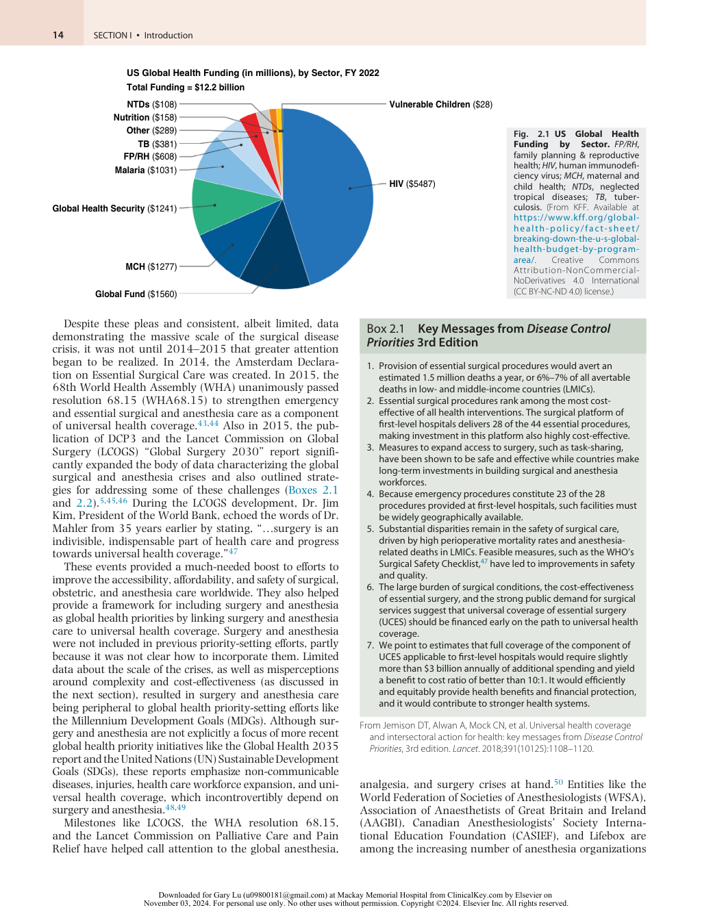

:::

<!-- PDF page 6 -->

working on system- level changes, research, and large- scale education initiatives in LMICs. Many national anesthesia societies, such as the United Kingdom’s Royal College of Anaesthetists (RCoA), the Royal College of Anesthesiologists of Thailand, and the Chilean Society of Anesthesiologists, are also actively engaged in such activities. The number of these global anesthesia efforts is unprecedented, but still too few and evolving.

If surgery is described as the neglected stepchild of global health, then anesthesia is the forgotten relative. Despite significant interdependence, surgery, anesthesia, and obstetrics have yet to harmonize global health efforts and maximize impact. Global health efforts involving surgery or anesthesia have collectively become “global surgery” (see

### Box 2.2 Key Messages from the Lancet Commission on Global Surgery

1.  5 billion people do not have access to safe, affordable surgical and anesthesia care when needed. Access is worst in lowincome and lower- middle- income countries (LMICs), where 9 of 10 people cannot access basic surgical care. 143 million additional surgical procedures are needed in LMICs each year to save lives and prevent disability. Of the 313 million procedures undertaken worldwide each year, only 6% occur in the poorest countries, where over a third of the world’s population lives. Low operative volumes are associated with high case- fatality rates from common, treatable surgical conditions. Unmet need is greatest in eastern, western, and central sub- Saharan Africa, and South Asia.

2.  33 million individuals face catastrophic health expenditure due to payment for surgery and anesthesia care each year. An additional 48 million cases of catastrophic expenditure are attributable to the nonmedical costs of accessing surgical care. A quarter of people who have a surgical procedure will incur financial catastrophe as a result of seeking care. The burden of catastrophic expenditure for surgery is highest in low- income and lower- middle- income countries and, within any country, lands most heavily on poor people.

3.  Investing in surgical services in LMICs is affordable, saves lives, and promotes economic growth. To meet present and projected population demands, urgent investment in human and physical resources for surgical and anesthesia care is needed. If LMICs were to scale- up surgical services at rates achieved by the present best- performing LMICs, two- thirds of countries would be able to reach a minimum operative volume of 5000 surgical procedures per 100,000 population by 2030. Without urgent and accelerated investment in surgical scale- up, LMICs will continue to have losses in economic productivity, estimated cumulatively at US$12.3 trillion (2010 US$, purchasing power parity) between 2015 and 2030.

4.  Surgery is an “indivisible, indispensable part of health care.”1 Surgical and anesthesia care should be an integral component of a national health system in countries at all levels of development. Surgical services are a prerequisite for the full attainment of local and global health goals in areas as diverse as cancer, injury, cardiovascular disease, infection, and reproductive, maternal, neonatal, and child health. Universal health coverage and the health aspirations set out in the post- 2015 Sustainable Development Goals will be impossible to achieve without ensuring that surgical and anesthesia care is available, accessible, safe, timely, and affordable.

From Mock CN, Donkor P, Gawande A, et al: Essential surgery: key messages from Disease Control Priorities, 3rd edition. _Lancet_ . 2015;385(9983):2209–2219.

Table 2.2). In 2014, “global surgery” was defined as “…an area for study, research, practice, and advocacy that prioritizes improving health outcomes and achieving health equity for all people worldwide who are affected by surgical conditions or have a need for surgical care. Global surgery incorporates all surgical specialties, including obstetric and gynecologic surgery; anesthesia; perioperative care; aspects of emergency medicine; rehabilitation; palliative care; and nursing and the allied health professions involved in surgical patient care. It encompasses surgical care for underserved populations in all countries and populations affected by conflict, displacement, and disaster and promotes access to safe, quality care. Global surgery emphasizes supraterritorial and transnational issues, determinants, and solutions, recognizing that the determinants of inadequate or inequitable surgical care are often the result of common and interdependent global structures and processes, even though they are predominantly experienced within individual countries and communities.”51 This definition was abbreviated to state, “global surgery is an area of study, research, practice, and advocacy that seeks to improve health outcomes and achieve health equity for all people who require surgical care, with a special emphasis on underserved populations and populations in crisis. It uses collaborative, cross- sectoral, and transnational approaches. It is a synthesis of population- based strategies with individual surgical care.” Although anesthesia is not directly mentioned in this definition, “global surgery” has become a rallying point for anesthesia global health equity efforts.

### GLOBAL ANESTHESIA, SURGERY, AND PAIN INEQUITIES: SCOPE AND SCALE OF THE PROBLEMS

### Global Burden of Surgical Disease

It has been estimated that nearly 30% of global morbidity and mortality is surgically treatable, with tens of millions of lives lost each year due to surgical conditions.5 This burden has likely increased significantly due to the SARS- CoV- 2 pandemic, due to global operating room closures and the diversion of perioperative resources to the pandemic response.52

The burden of surgical disease predominantly affects LMICs and kills four times more people than human immunodeficiency virus (HIV), TB, and malaria combined (Fig. 2.2).53 In addition to negative impacts on health and wellbeing, there is also a significant economic burden associated with surgical morbidity and mortality. By 2030, morbidity and mortality from surgical conditions could reduce annual gross domestic product (GDP) growth by an estimated 2% in LMICs. In the past, similar calculations were used to generate global investment in malaria successfully, but had estimated much lower (1.3%) decreases in GDP due to malaria.54 Without significant and immediate intervention, the surgical disease will produce economic productivity losses of more than US$12 trillion for LMICs between 2015 and 2030. While it is generally agreed that surgical conditions account for a large proportion of global morbidity and mortality, precise data to support this have been lacking. This challenge has been attributed partly to a lack of resources invested in such research and several inherent difficulties in quantifying surgical diseases.

<!-- PDF page 7 -->

The term “global burden of disease” (GBD) uses the disability- adjusted life year (DALY) as a unit to quantify premature death (years of life lost) and disability (years of life lived in a state of less than full health) (Fig. 2.3). The DALY was initially developed for the seminal GBD 1990 study to quantify the burden of different diseases around the world and has since become commonly used in public health and health economics.55,56 Because the DALY is routinely used to inform resource allocation, it has also been utilized to describe surgical and pain disease burdens. The global health community has moved away from using terms such as the third world, developed, or developing when describing countries’ levels of economic development. Leading causes of DALYs are often reported geographically by World Bank income level (see Table 2.1) or, more recently, by socio- demographic index (SDI) (Figs. 2.4 and 2.5). The SDI is a composite average of three indicators predictive of health outcomes: income per capita, average educational attainment (for a population >15 years old), and total fertility rate.

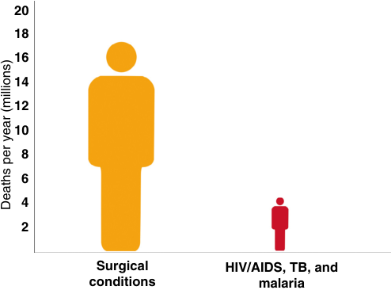

20 18 16 14 12 10 8 6 4 2 Surgical HIV/AIDS, TB, and conditions malaria Deaths per year (millions) 

**Fig. 2.2 Surgical conditions account for more annual deaths (16.9 million) than HIV/AIDS (1.03 million), TB (1.21 million), and malaria (0.72 million) combined.** _AIDS_ , acquired immunodeficiency syndrome; _HIV_ , human immunodeficiency virus; _TB_ , tuberculosis. (Data from Shrime MG, Bickler WS, Alkire BC, et al. Global burden of surgical disease: an estimation from the provider perspective. _Lancet Glob Health._ 2015;3:S8–S9; and GBD collaborators 2016. Global, regional, and national age- sex specific mortality for 264 causes of death, 1980–2016: a systematic analysis for the Global Burden of Disease Study 2016. _Lancet._ 2017;390[10100]:1151–1210.)

The 2006 DCP2 publication was one of the first attempts to quantify surgical disease burden by asking 18 surgeons for an educated guess using convenience sampling and an online survey. Although the reported number (11%) was eye- opening and widely quoted, it was likely a significant underestimation.

In 2015, the DCP3 provided another attempt to assess the public health impact of surgical care by estimating morbidity and mortality averted by scaling up essential surgical and anesthesia services in LMICs (i.e., surgical care for appendicitis, paralytic ileus, intestinal obstruction, hernias, gallbladder and bile duct disease, maternal hemorrhage, obstructed labor, abortion and neonatal encephalopathy, trauma resuscitation, surgical airway, peripheral venous access, suturing, laceration and wound management, chest tube or needle decompression, fracture reduction, escharotomy, fasciotomy, skin grafting, and trauma- related laparotomy and amputation). They concluded that an estimated 1.4 million deaths and 77.2 million DALYs could be prevented each year by scaling up essential surgical and anesthesia services in LMICs.45

The LCOGS produced another attempt to estimate global morbidity and mortality from surgical disease by asking 173 surgeons, anesthesiologists, internists, nurses, and public health practitioners from around the world, “What proportion of patients with the following conditions would, in an ideal world, require a surgeon for management?” The result of this survey was that 28% to 32% of overall GBD requires a surgeon for management. Based on these results, LCOGS estimated that 30% of GBD is surgically treatable, with an estimated 17 million lives lost per year due to surgical conditions.5

These reports are consistent with the 1990 GBD study data, demonstrating that the morbidity and mortality associated with surgical diseases are significantly larger than that of HIV, TB, and malaria combined.53 Unintentional injuries are the single most significant contributor of DALYs worldwide. Many deaths that can be prevented with surgical care are due to injuries (77%), maternal–neonatal conditions (14%), and digestive diseases (9%).45 Global industrialization and an “epidemiological transition” (i.e., people living longer) in many LMICs have resulted in rising non- communicable disease and injury burdens (most notably from road traffic crashes) that will likely contribute to increased global surgical disease burden in the coming years.

Each of the methods previously described to estimate surgical disease burden is imperfect. Challenges and limitations

### DALY

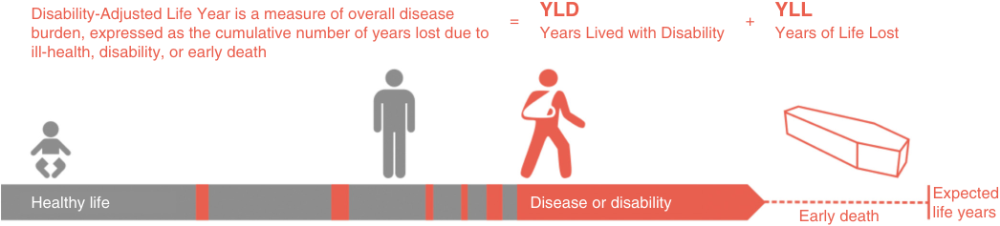

Disability-Adjusted Life Year is a measure of overall disease = YLD + YLL burden, expressed as the cumulative number of years lost due to Years Lived with Disability Years of Life Lost ill-health, disability, or early death Expected Healthy life Disease or disability Early death life years 

**Fig. 2.3 The disability- adjusted life year (DALY).** (From Wikipedia. https://en.wikipedia.org/wiki/Disabilityadjusted_life_year#/media/File:DALY_disa bility_affected_life_year_infographic.svg. Creative commons license: CC BY- SA 3.0.)

<!-- PDF page 8 -->

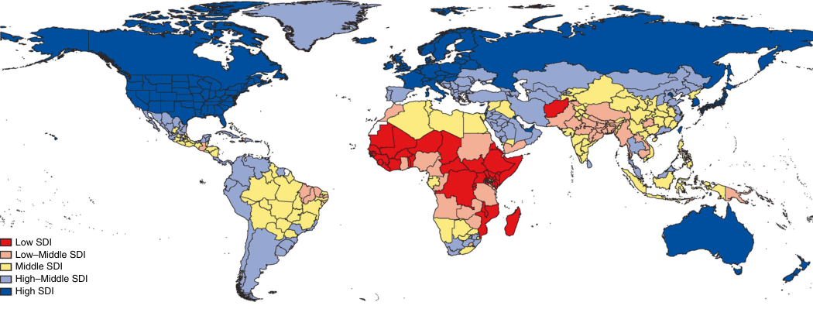

Low SDI Low–Middle SDI Middle SDI High–Middle SDI High SDI 

**Fig. 2.4 Socio- demographic index (SDI) is calculated for each geography as a function of lag- dependent income per capita, average educational attainment in the population older than age 15 years, and the total fertility rate.** SDI units are interpretable; a zero represents the lowest level of income per capita and educational attainment and highest total fertility rate observed during 1980–2015, whereas a one represents the highest income per capita and educational attainment and lowest total fertility rate observed in the same period. Cutoffs on the SDI scale for the quintiles have been selected based on examination of the entire distribution of geographies 1980–2015. _GBD,_ Global Burden of Disease. (From GBD 2015 Mortality and Causes of Death Collaborators. Global, regional, and national life expectancy, all- cause mortality, and cause- specific mortality for 249 causes of death, 1980–2015: a systematic analysis for the Global Burden of Disease Study 2015. _Lancet_ . 2016;388[10053]:1459–1544. Copyright © 2017 The Author[s]. Published by Elsevier Ltd. This is an Open Access article under the CC BY 4.0 license.)

|**Global** **Both sexes, all ages, DALYs per 100,000** **1990 rank** **2016 rank**|
|---|
|1 Diarrhea/LRI/other 1 Cardiovascular diseases|
|2 Cardiovascular diseases 2 Diarrhea/LRI/other|
|3 Neonatal disorders 3 Neoplasms|
|4 Other non-communicable 4 Other non-communicable|
|5 Neoplasms 5 Neonatal disorders|
|6 Unintentional injury 6 Mental disorders|
|7 Mental disorders 7 Musculoskeletal disorders|
|8 NTDs and  malaria 8 Diabetes/urog/blood/endo|
|10 Musculoskeletal disorders 9 Unintentional injury|
|12 Diabetes/urog/blood/endo 14 NTDs and malaria|

Communicable, maternal, neonatal, and nutritional diseases Non-communicable diseases Injuries

|**Low SDI** **Both sexes, all ages, DALY** **1990 rank**|**s per 100,000** **2016 rank**||
|---|---|---|
|1 Diarrhea/LRI/other|1 Diarrhea/LRI/other|Communicable, maternal, |
|2 Neonatal disorders|2 Neonatal disorders|neonatal, and nutritional diseases|
|3 NTDs and  malaria|3 NTDs and malaria|Non-communicable diseases|
|4 Nutritional deficiencies|4 HIV/AIDS & tuberculosis|Injuries|
|5 HIV/AlDS & tuberculosis|5 Cardiovascular diseases||
|6 Other non-communicable|6 Other non-communicable||
|7 Cardiovascular diseases|7 Nutritional deficiencies||
|8 Unintentional injury|8 Unintentional injury||
|9 Other group I|9 Mental disorders||
|12 Mental disorders|12 Other group I||

**Fig. 2.5 Leading causes of death and disability- adjusted life years (DALYs), 1990–2016, global versus low socio- demographic index (SDI).** _AIDS_ , acquired immunodeficiency syndrome; _HIV_ , human immunodeficiency virus; _LRI_ , lower respiratory tract infection; _NTDs_ , neglected tropical diseases. (From https://vizhub.healthdata.org/gbd- compare/. Reproduced under Creative Commons Non- Commercial- No Derivatives 4.0 International License.)

include complex methodologies (e.g., Institute for Health Metrics and Evaluation [IHME], GBD studies), difficulty with measuring and defining surgical diseases (e.g., the same neoplasm in one person may be treated with surgery but in another person may be treated with chemotherapy),

and challenges in assigning DALYs to diseases (i.e., disability weighting) and assigning DALYs averted to surgical procedures.45 To overcome these shortcomings, additional metrics for global surgery and anesthesia have been proposed and include measuring disease prevalence, treatment

::: details 原始表格與符號（PDF 第 8 頁）

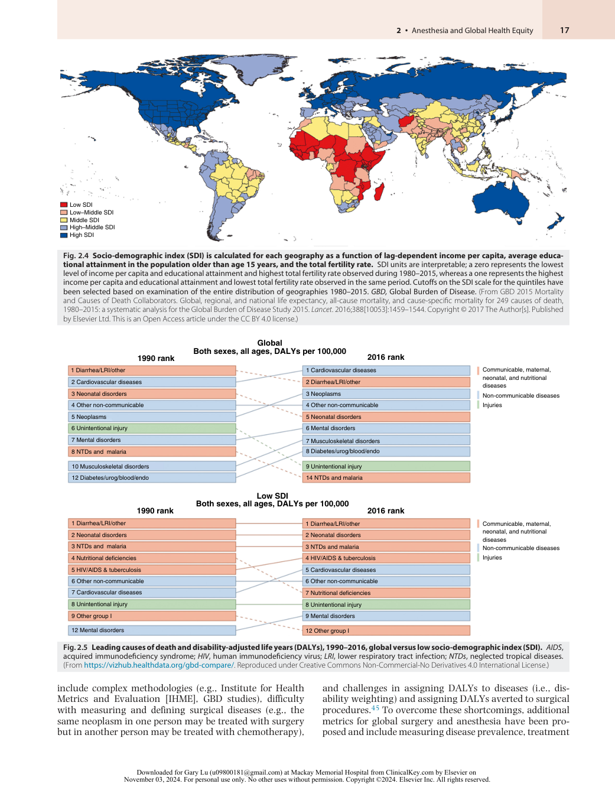

:::

<!-- PDF page 9 -->

backlogs for non- fatal conditions, morbidity and mortality as a result of delays in care, social benefit, economic benefit, and value of a statistical life (rather than costs per DALY averted).57

One significant role for the academic anesthesia community in the global context is working to better quantify the growing burden of surgical disease and pain and the burden of disease attributable to lack of access to oxygen and critical care. Such efforts can provide powerful advocacy and facilitate appropriate resource allocation.

### Global Burden of Pain

As with surgical disease burden, there is consensus on the staggering prevalence and incidence of pain worldwide, though data on pain burden in the global context are limited, and significant challenges to quantifying this burden remain. Pain is one of the most common reasons for seeking medical attention, is among the top five causes of DALYs worldwide, and directly accounts for four (low back pain, neck pain, musculoskeletal pain, migraine) of the leading 10 causes of years lived with disability (YLDs).53,58 These statistics do not even account for pain secondary to oncology, injury, or postoperative etiologies, which likely increase these numbers substantially. It is estimated that 10% to 25% of the world’s population suffer from recurring and chronic pain, with increasing numbers caused by intentional physical harm such as war, violence, and torture.59 For example, studies have found that over 80% of refugees globally experience chronic somatic pain after trauma.60 Uncontrolled pain has many potential negative impacts on health, well- being, and economic productivity, including increased risk of myocardial infarction and chronic pain.

The 2017 Lancet Commission on Palliative Care and Pain Relief defined serious health- related suffering (SHS) as suffering associated with illness or injury that compromises physical, social, or emotional functioning and cannot be relieved without medical intervention.50 Approximately half of all deaths worldwide involve SHS, and more than 80% of people who die with SHS are from LMICs. It is estimated that 2.5 million children die with SHS each year. Ninety- eight percent of these children live in LMICs, and more than 90% of these deaths are avoidable. Among the top 10 conditions associated with SHS are HIV, malignancy, and injury. Though not as apparent as injury or cancer, HIV/AIDS is a significant source of pain and analgesia need.61 Pain related to HIV is not routinely managed by anesthesiologists when compared to other more common pain etiologies; however, the relevance of HIV as a rallying point to advocate for greater access to analgesics in LMICs is discussed further in this chapter. In many countries, conditions such as diabetes, sickle cell, and leprosy are also responsible for significant pain burdens. With increasing longevity and industrialization, the disease burden for malignancy and injury is expected to increase significantly in LMICs. As providers with often the most experience administering analgesics, anesthesia providers play an expanded and critical role in pain management, especially in resource- constrained settings.

### Global Burden of Critical Illness

Over 80% of the world’s population resides in LMICs, where anesthesiologists not only provide perioperative

and pain services but also play a central role in critical care services.62,63

Tens of millions of people become critically ill each year; however, due to multiple challenges, there is limited epidemiological data on the global burden of critical illness.64 It is generally accepted that critical illnesses (e.g., sepsis, trauma, obstetric emergencies, and respiratory illness) contribute a large proportion of the global disease burden, and much of this can be averted with cost- effective, lowtech strategies (e.g., access to oxygen, fluids, monitors, and antibiotics).65,66 Low- and middle- income countries have a significantly higher burden of critical illness than HICs, experience proportionally greater mortality for potentially recoverable critical illness, and see a higher burden among younger patients.67,68 Historically, respiratory failure has been one of the most common indications for intensive care admissions globally. Hypoxemia, associated with both communicable and non- communicable diseases, leads to substantial mortality, yet in many countries, up to 90% of the population may lack access to oxygen.69 According to three studies of critical illness from sub- Saharan Africa (SSA), the prevalence of hypoxemia ranged between 4% and 12%, with mortality ranging between 50% and 80%.70,71 In one of those studies, only 6% of the hypoxemic patients who needed invasive mechanical ventilation received it.70 Care for critically ill patients can be resource- intensive, and fraught with challenges related to the cost of care, staffing, equipment, and consistent supply chains.72 Supplemental oxygen, for example, is one of the most ubiquitous medical therapies for acutely ill patients. Despite being listed by the World Health Organization (WHO) as an essential medicine for hypoxemia management, a survey of over 200 hospitals in 12 African countries revealed that less than 50% had consistent, uninterrupted oxygen sources, and less than 25% had an oxygen concentrator.73,74

The SARS- CoV- 2 pandemic, which affected over 600 million people globally and led to over six million deaths in two years, exposed these long- ignored global challenges in critical care, highlighting the vulnerability and inequity in global oxygen security that affects all countries.75 The burden of critical illness due to SARS- CoV- 2 significantly challenged highly resourced settings in HICs and exacerbated the inequities in intensive care unit (ICU) resources and capacity between HICs and LMICs.76 It was estimated that over half a million SARS- CoV- 2 patients in LMICs needed oxygen daily, without which potentially preventable deaths occurred.75 These estimates did not include hypoxemic non- SARS- CoV- 2 patients who require oxygen therapy, like children with pneumonia, malaria, or HIV/ AIDS patients, who contribute a substantial disease burden in LMICs every year. In the wake of the SARS- CoV- 2 pandemic, global investment in oxygen ecosystems, including research to define the magnitude of this challenge, has significant potential to improve global health equity.

### Disparities in Access, Outcomes, and Affordability

The exact disease burden attributable to surgical disease or pain is a focus of ongoing debate and research. Yet, it is generally accepted that the surgical, anesthesia, and pain crises are massive, largely avoidable, and disproportionately affect poor communities. Disease burden is staggering when including the burden of critical care (as well as lack of

<!-- PDF page 10 -->

access to oxygen). As previously discussed, injuries, maternal and child health conditions, and non- communicable diseases like malignancy comprise the largest share of the surgical disease burden. Significant disparities in access and outcomes exist for each of these conditions in LMICs and many HICs.

**Access.** Of the roughly 300,000 maternal deaths worldwide, 99% occur in low- resource settings (66% in subSaharan Africa), and the majority are preventable with relatively basic surgical, anesthesia, and perioperative care.77 The major complications that account for nearly 75% of all maternal deaths are severe bleeding (mostly bleeding after childbirth), infections (usually after childbirth), high blood pressure during pregnancy (preeclampsia and eclampsia), complications from delivery, and unsafe abortion.78 The African Surgical Outcomes Study (ASOS), a prospective international cohort study observing 7- day perioperative outcomes in sub- Saharan Africa, identified that maternal mortality rates following cesarean section were 50 times higher than in high- income countries.79 The factors that prevent women from receiving or seeking care during pregnancy and childbirth include poverty, distance to facilities, lack of information, inadequate and poor- quality services, and cultural beliefs and practices.80 Disparities in maternal health outcomes and maternal health care are not exclusive to LMICs. Significant maternal morbidity and mortality exist in HICs, often stemming from racial and ethnic care disparities. For example, in the United States, non- Hispanic Black women are three to four times more likely to die from pregnancy- related causes than non- Hispanic White women.81 Moreover, non- Hispanic Black women had the fastest increase in maternal deaths between 2007 and 2014 and have maternal death rates up to 12 times higher in some cities than non- Hispanic White women.82 A growing body of research acknowledges the role that structural racism plays in generating these disparities.83 A comprehensive approach to quality improvement from preconception to postpartum is required to reduce racial and ethnic disparities in maternal morbidity and mortality rates.

As previously discussed, injury comprises the largest share of the global surgical disease burden. Nearly 1 billion injured people require health care each year, and the vast majority of almost 5 million annual deaths from injury occur in LMICs. Within HICs like the United States, injury and violence disproportionately impact poor communities and communities of color, with significantly worse outcomes from trauma by race, income level, and insurance type.25 Scaling access to basic surgical and anesthesia services in LMICs could avert 77 million DALYs and 1.5 million deaths annually.45 Injury represents the majority (77%) of this avoidable morbidity and mortality, followed by maternal and neonatal conditions (14%).

Based solely on the inequitable distribution of operating theaters, more than two billion people have no access to surgical services.84 When also accounting for the timeliness, facility capacity, safety, and affordability, nearly 5 billion people—most of the world’s population—lack access to surgical and anesthesia care. These disparities in access disproportionately affect lower- income areas like subSaharan Africa or South Asia, where more than 95% of the

population does not have access to surgical and anesthesia services. In some higher- income regions like North America and Europe, access varies considerably, but more than 95% of the population generally has access (Fig. 2.6).85 Even in HICs, like the United States, access to anesthesia, surgical, and analgesia care can be limited for rural and underserved populations.86,87 It is estimated that universal access to “essential” surgical procedures (which include treatments for injury, obstetric complications, abdominal emergencies, cataracts, and congenital anomalies) would prevent approximately 1.5 million deaths per year or 6% to 7% of all preventable deaths in LMICs.45 The Global Initiative for Children’s Surgery (GICS) estimates that 1.7 billion children lack access to surgical care.88 It is estimated that approximately 143 million additional surgeries are required annually.5 Of the 234 million major surgical procedures performed annually, only 3% of them are estimated to occur in LMICs, where 30% of the world’s population lives.5,89

Inadequate access to analgesia is among the most neglected and inequitable global public health challenges. The global burden of pain disproportionately affects the poor due to the high- burden conditions associated with pain (e.g., HIV, malignancy, and injury) in LMICs, and the general lack of access to analgesics. Although pain is the most common reason for seeking medical attention, and analgesia is considered a fundamental human right, gaps in access to analgesia are significant and among the most striking global health disparities worldwide.90–92 Injury and malignancy, two conditions with significant analgesia needs, represent a substantial proportion of surgical disease burden in LMICs. Yet, the vast majority of LMIC populations have limited or nonexistent access to opiate analgesia. Six HICs account for 80% of the world’s opiate consumption, and countries that contain 17% of the world’s population (Canada, United States, Western Europe, Australia, and New Zealand) are responsible for 92% of the world’s opiate consumption (Figs. 2.7 and 2.8).50,93–95 Pain and palliative care remain relatively neglected by the global health community and disproportionately affect vulnerable populations in LMICs.50,96 In recent decades, access to opiates has improved in some LMICs, but not all (e.g., consumption in Africa and South Asia has declined).95 Inequitable access to analgesia is not unique to LMICs and has been repeatedly described in many HICs, including the United States.97–99 Reasons for the inequitable distribution of analgesia are discussed further in the next section of this chapter.

Inequitable access to critical care services has been highlighted by multiple recent events like the SARS coronavirus (2002–2003), influenza H5N1, Ebola, and most recently, the SARS- CoV- 2 pandemic. Nonetheless, global access to critical care remains limited, especially for poor communities. Critical care beds in HICs are more than 20 times higher (per 100,000 inhabitants) than those in LMICs.63,100 Despite recent increases in capacity in some LMICs, it is unclear the extent to which access is available to the public or the impact on health equity.101,102 For patients with access to critical care services, there are significant disparities in care and outcomes between and within many countries. For example, mortality for patients with acute respiratory distress syndrome (ARDS) is approximately 70% higher in many LMICs than in HICs.103,104

<!-- PDF page 11 -->

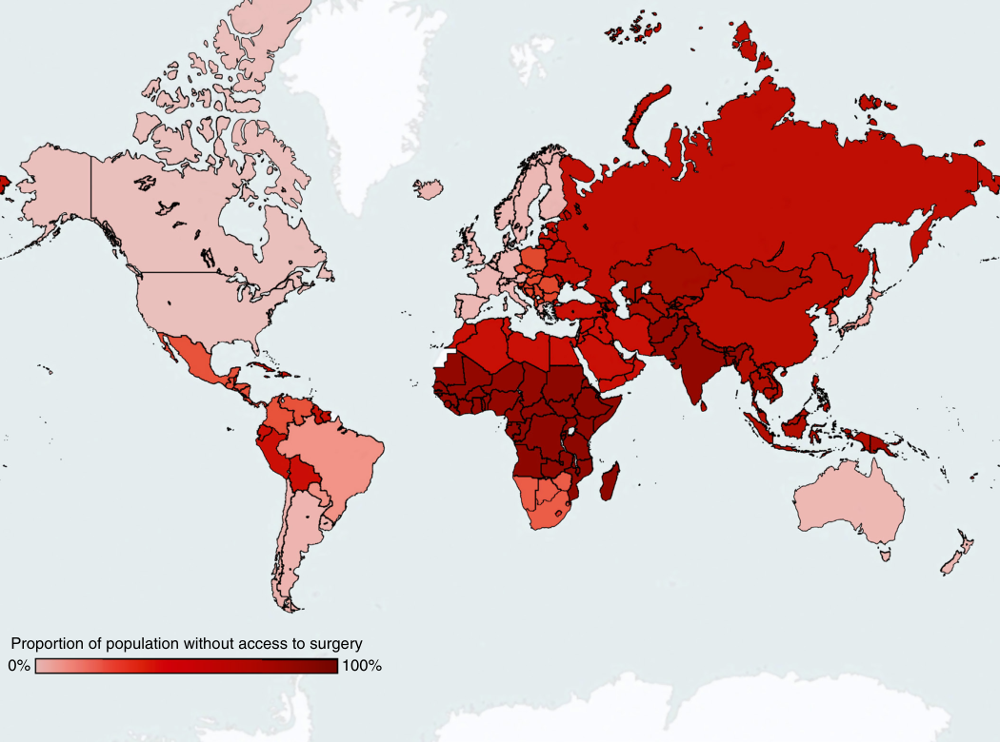

Proportion of population without access to surgery 0% 100% 

**Fig. 2.6 The proportion of population without access to surgery.** (From Alkire BC, Raykar NP, Shrime MG, et al. Global access to surgical care: a modelling study. _Lancet Glob Health._ 2015;3:e316–e323. Copyright © 2015 Alkire et al. Open Access article distributed under the terms of CC.)

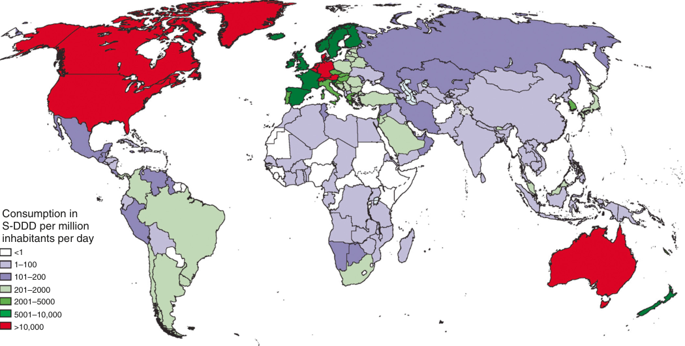

Consumption in S-DDD per million inhabitants per day &lt;1 1–100 101–200 201–2000 2001–5000 5001–10,000 >10,000 

**Fig. 2.7 Mean availability of opioids for pain management in 2011–2013.** _S- DDD_ , defined daily doses for statistical purposes. (From Berterame S, Erthal J, Thomas J, et al. Use of and barriers to access to opioid analgesics: a worldwide, regional, and national study. _Lancet_ . 2016;387:1644–1656. Copyright © 2015 Berterame et al. Open Access article distributed under the terms of CC.)

<!-- PDF page 12 -->

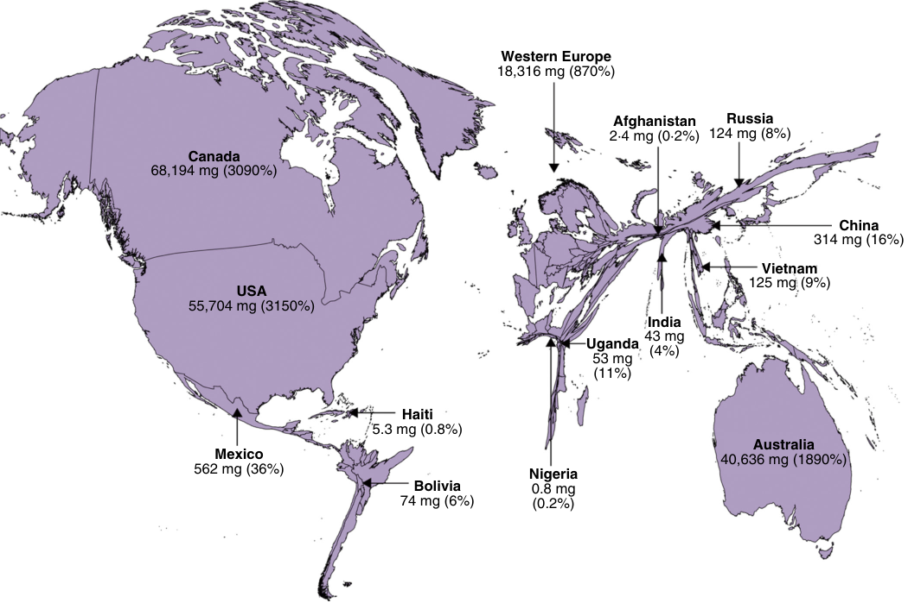

Western Europe 18,316 mg (870%) Afghanistan Russia 2·4 mg (0·2%) 124 mg (8%) Canada 68,194 mg (3090%) Ch ina 314 mg (16%) Vietnam 125 mg (9%) USA 55,704 mg (3150%) India 43 mg Uganda (4%) 53 mg (11%) Haiti 5.3 mg (0.8%) Australia Mexico 40,636 mg (1890%) 562 mg (36%) Nigeria Bolivia 0.8 mg 74 mg (6%) (0.2%) 

**Fig. 2.8 Distributed opioid morphine- equivalent (morphine in mg/patient in need of palliative care, average 2010–2013), and estimated percentage of need that is met for the health conditions most associated with serious health- related suffering.** (From Knaul FM, Bhadelia A, Rodriguez NM, et al. The _Lancet_ Commission on Palliative Care and Pain Relief—findings, recommendations, and future directions. _Lancet Glob Health_ . 2018;6:S5–S6. Copyright © 2018 The Author(s). Published by Elsevier Ltd. This is an open access article under the CC BY 4.0 license.)

Even within HICs, access to and outcomes for critically ill patients differ based on multiple social determinants. These health and health care disparities, which have always been present but largely ignored, were unmasked during the SARS- CoV- 2 pandemic.

**Outcomes.** For the proportion of the world’s population that has access to surgical and anesthesia care, they must confront significant disparities in safety. Sometimes this is apparent and attributable to differences across health systems. Still, often members of the same communities may not have access to the same health care despite having access to the same health care system.

In the last half- century, perioperative patient safety has improved by more than 10- fold, though most of the gains have been seen in HICs.105 In the United States during the 21st century, anesthesia- related mortality decreased from 1:1560 around 1950 to less than 1:13,000 and is significantly better than this in healthy patients.106,107 Worldwide, approximately 32 million people per year receive anesthesia without adequate monitoring, and more than 77,000 operating rooms (19%) worldwide lack pulse oximetry. In some regions, more than 70% of operating rooms lack pulse oximetry.84 Data on surgical outcomes in LMICs remain limited but have expanded significantly in the early part of the 21st century. Reports of perioperative mortality

rates (POMRs) from low- income countries (LICs) have varied widely in both methodology and results, ranging from 0.2% to 6% overall, with significantly higher mortality for emergent procedures (10% overall, 20% for typhoid intestinal perforations).108–112 One international, prospective, observational cohort study of adults undergoing inpatient surgery in 247 hospitals from 25 African countries reported a 30- day in- hospital mortality rate (2.1%) that was twice the reported global average, despite a significantly younger and lower American Society of Anesthesiologists (ASA) physical classification patient population.113 In several African countries, anesthesia- related mortality has been reported to be in the 1:100s (Malawi 1:504; Zimbabwe 1:482; Nigeria 1:387 for C- sections; Togo 1:133 to 1:250).114–117 In one report of 24- hour surgical outcomes in Togo, 30 deaths occurred (total cases 1464), 22 were deemed avoidable, and 11 were due to avoidable anesthesia complications.34 Another report from Togo reported a mortality rate of 1:250 and found that less than half of the 26 facilities surveyed had pulse oximetry, and none had capnography.118 In a national report on maternal mortality in South Africa, nearly 2.35% of recorded maternal mortalities were anesthesia- related, and the majority (93%) were deemed avoidable. In this report, one of the most common causes of anesthesia death was the provision of spinal anesthesia without the skills necessary to

<!-- PDF page 13 -->

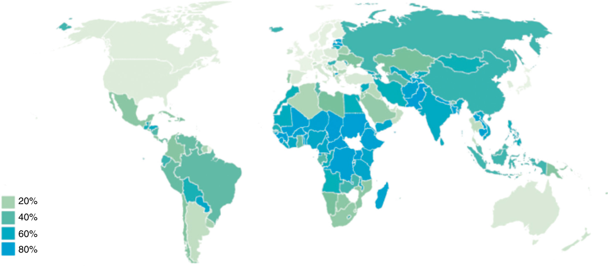

20% 40% 60% 80% 

**Fig. 2.9 Risk of catastrophic expenditure for surgical care in 2014 (% of people at risk).** (Data from http://databank.worldbank.org/data/home.a spx. Originally printed: http://blogs.worldbank.org/opendata/africacan/pt/comment/reply/2341. Copyright © 2018 The World Bank. Reproduced under CC BY 4.0 license.)

manage an airway or convert to general anesthesia.119 Other commonly cited causes of avoidable anesthesia mortality in resource- constrained settings include inadequate staffing, monitoring, and drug overdose. A meta- analysis of anesthesia- related maternal mortality in LMICs found the risk of death from anesthesia for women undergoing obstetric procedures to be 1.2 per 1000 (vs. 3.8 per million in the United States), with higher risk reported if general anesthesia was used or if anesthesia was provided by a nonphysician.120 In this analysis, anesthesia was the cause of 2.8% of maternal deaths in LMICs and 13.8% of all deaths during or after C- sections in LMICs. To state this differently, anesthesia- related maternal mortality is 300- fold higher for neuraxial and 900- fold higher for general anesthesia than is reported in the United States.

It is important to note that the relationship between hospital- based perioperative morbidity and mortality and surgical disease morbidity and mortality must be interpreted cautiously in settings where patients lack access to hospitals. In other words, in a HIC, a patient’s chances of dying from a ruptured viscus are roughly the same as the chances of dying from surgery for a ruptured viscus because more than 95% of the population have access to care. However, in a LIC, while the perioperative mortality for a ruptured viscus may be 10%, most patients with this condition never make it to surgery and have dramatically higher mortality rates.

Numerous disparities in surgical and anesthesia outcomes exist within the same health care systems, including those in high- income countries. Sometimes these disparities are linked to factors like urban or rural care and public or private care. However, even within the same hospitals, racial disparities have been described, including for obstetric, oncologic, and trauma surgical outcomes, perioperative analgesia, and anxiolysis.25,121,122 Associations have also been found between English language proficiency, length of stay, and readmission following surgery.123,124 These are

some health inequities that should raise alarms and prompt further investment in social and structural determinants of health, including commitments to eliminate racism and implicit bias.

**Affordability.** Affordability is another significant barrier to accessing surgical and anesthesia services. Each year, approximately 33 million people face catastrophic out- ofpocket expenditure due to payment for surgery and anesthesia (Fig. 2.9), with an additional 48 million people facing catastrophic expenditure related to nonmedical costs of accessing surgical care (e.g., transportation, lodging, and food).5,125 Nearly half (3.7 billion) of the world’s population is at risk of catastrophic expenditure if they were to have surgical and anesthesia care. Most at- risk people live in sub- Saharan Africa and South and Southeast Asia. The affordability issue applies not only to the surgery but also to perioperative care components, including analgesia and transfusions.126 For example, in South America, a monthly prescription of opiates for chronic pain may cost 200% of annual income.105 In India (where nominal gross national income per capita is $1670), a unit of blood often costs up to $247 despite a legal limit of $25.127,128 Global health and development leaders, including the WHO and World Bank, prioritize financial risk protection as a critical component of achieving universal health coverage goals for all countries. Despite relatively high out- of- pocket costs at the individual level for some procedures, surgery is a highly cost- effective public health intervention, as discussed further in the following sections.

### GLOBAL ANESTHESIA, SURGERY, AND PAIN INEQUITIES: ORIGINS AND AREAS FOR INTERVENTION

Workforce shortages, inadequate infrastructure, lack of policy and prioritization, and increasing burden of surgical

<!-- PDF page 14 -->

disease are among many factors contributing to current limitations in access, affordability, and safety of anesthesia and surgical services worldwide.129 As previously discussed, global industrialization and an “epidemiological transition” in many LMICs have resulted in rising noncommunicable disease and injury burdens with lagging investment to address these issues. While these fundamental imbalances between health care needs and health care resources underlie much of the current global surgery, anesthesia, and pain crises, several additional factors have also contributed.

### Misperceptions and Limited Data

Two common misperceptions about surgery and anesthesia have contributed to the delayed recognition of these fields as global public health priorities: (1) the scope and scale of surgical disease and pain burdens were vastly underestimated, and (2) surgical and anesthesia care were erroneously assumed to be too expensive and technology- dependent to be done safely or cost- effectively in resource- constrained environments. In this section, we discuss why surgical disease and pain burdens are historically poorly characterized. Misperceptions about the cost- effectiveness and feasibility of safe surgery and anesthesia care also have roots in a historical data void, especially from LMICs.

Several innovative service delivery models in public and private sectors of LMICs (e.g., Indus Hospital, Aravind Eye Hospitals, and Narayana Hrudayalaya Heart Hospital) have demonstrated that it is feasible to provide costeffective, safe, and affordable surgical and anesthesia care in resource- constrained countries.130–133

Recent data have consistently demonstrated that surgical services are among the most cost- effective public health interventions (Fig. 2.10). Several methods define cost- effectiveness thresholds, each with pros and cons.134 One of the most commonly cited methods uses GDP- based thresholds. This approach was suggested by the WHO Commission on Macroeconomics and Health and has been defined by authors from the WHO’s Choosing Interventions that are Cost- Effective project (WHOCHOICE) as “interventions that avert one DALY for less

than average per capita income for a given country or region are considered very cost- effective; interventions that cost less than three times average per capita income per DALY averted are still considered cost- effective; and those that exceed this level are considered not cost- effective.”135

In 2003 in Bangladesh, one of the earliest costeffectiveness studies on surgical care reported the cost of emergency obstetric care at less than $11 per DALY averted.35 This was three times more cost- effective than the measles vaccine (in 2003 dollars). The DCP2 and DCP3 demonstrated the cost- effectiveness of the first- level surgical hospital, with essential surgical services all being highly cost- effective and many costing $10 to $100 per DALY averted. This is comparable to the cost- effectiveness of other public health interventions such as immunizations ($13–$26 per DALY) or bed nets for malaria prevention ($6–$22 per DALY) and much more cost- effective than other high- priority public health interventions such as HIV treatment ($500 per DALY).136 A recent analysis of the cost- effectiveness of a pediatric operating room in Uganda found a cost of $6.39 per DALY averted and $397.95 per life saved, with a net economic benefit of over US$5 million per year (cost of $41,000 per year).137

In a 2012 forum hosted by the Copenhagen Consensus, five leading health economists, including four Nobel laureates, were asked how best to spend US$75 billion over four years to “advance global welfare,” especially in LMICs. The leading priority identified by the group was the expansion of surgical care capacity (US$3 billion per year).138

In the past five years the global surgery and anesthesia communities have expanded the volume of data that dispel prior misconceptions and support the prioritization of surgical and anesthesia care in the global health agenda. During this timeframe, there has also been an explosion of articles that expand available data on a wide range of global anesthesia and surgical topics. Most of these articles have been published in the surgical journals, though recently anesthesia publications have begun actively supporting global anesthesia research. The global anesthesia community

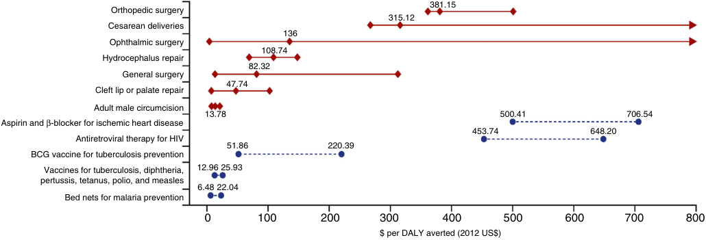

381.15 Orthopedic surgery 315.12 Cesarean deliveries 136 Ophthalmic surgery 108.74 Hydrocephalus repair 82.32 General surgery 47.74 Cleft lip or palate repair Adult male circumcision 13.78 500.41 706.54 Aspirin and β-blocker for ischemic heart disease 453.74 648.20 Antiretroviral therapy for HIV 51.86 220.39 BCG vaccine for tuberculosis prevention Vaccines for tuberculosis, diphtheria, 12.96 25.93 pertussis, tetanus, polio, and measles 6.48 22.04 Bed nets for malaria prevention 0 100 200 300 400 500 600 700 800 $ per DALY averted (2012 US$) 

**Fig. 2.10 Cost- effectiveness of surgery in low- income and middle- income countries compared with other public health interventions.** Data points are medians, error bars show range. Surgical interventions are denoted by the _diamonds_ and _solid lines_ , public health interventions by the _circles_ and _dashed lines_ . _BCG,_ Bacillus Calmette–Guérin; _DALY_ , disability- adjusted life year; _HIV_ , human immunodeficiency virus. (Source: Chao TE, Sharma K, Mandigo M, et al. Cost- effectiveness of surgery and its policy implications for global health: a systematic review and analysis. _Lancet Glob Health_ . 2014;2:e334–e345. Copyright © 2015 Elsevier Ltd. Creative Commons Attribution License [CC BY].)

<!-- PDF page 15 -->

must increase research productivity in global health and invest in advocacy, policy, and implementation sciences to ensure impact.

### Advocacy and Policy

There are many reasons why surgery, anesthesia, and pain have historically not been prioritized by national health systems, donors, or the broader global health community. Although surgical disease accounts for 30% of the global disease burden, less than 1% of development assistance for health supports the delivery of anesthesia and surgical care.139 Imbalance between resource allocation and disease burden is found in many health conditions, though the degree of this disparity for surgical disease and pain is particularly striking. As discussed previously, the lack of disease burden data and misperceptions about safety and cost- effectiveness have significantly hindered advocacy efforts for global anesthesia and surgery. In a qualitative analysis of factors that have hindered political prioritization for global surgery, several additional factors were identified, including: fragmentation of the global surgery community, lack of leadership and consensus, and inadequate political strategy (e.g., not capitalizing on opportunities such as the MDGs).140 In another analysis to determine why certain disease- specific global health networks are relatively more or less effective than others, four common challenges were highlighted, each with relevance to global anesthesia and surgery: (1) defining the problem and how it should be addressed; (2) positioning the issue in a way to inspire action by external audiences; (3) building coalitions that include stakeholders outside the health care sector (HIC providers too often dominate coalitions); and (4) creating governance institutions that facilitate collective action (Fig. 2.11).141 Another study that examined factors influencing the prioritization of surgery in national health systems concluded that sustained advocacy, effective framing of problems and solutions, robust country- level data, and support from regional and international partners were critical for success but often lacking.142 Advocacy efforts for surgery, anesthesia, and pain face a few additional and relatively unique challenges. Unlike

infectious diseases such as HIV or Ebola, surgical disease and pain are not pandemic and do not incite similar action by the HIC donor community. Furthermore, most surgical conditions and pain are difficult to advertise and are not disease specific. While select pediatric conditions (e.g., cleft lips) are readily marketable, other conditions like trauma, hernias, and cesarean section are more difficult to compassionately portray in the media in attempts to improve public awareness.

The WHA resolution 68.15 emphasized advocacy and resource development in five key focus areas for global surgery (workforce, essential medicines, information management, service delivery, and advocacy). The LCOGS provided precise framing of problems (see Box 2.2), outlined priorities for country- level data collection, and helped to provide frameworks for national surgical, obstetric, and anesthesia plans (NSOAPs) in LMICs. As more NSOAPs are produced, they have the potential to serve as crucial rallying points for national advocacy efforts.

Anesthesia, surgery, and pain need global champions. Only recently has advocacy by leading global organizations (e.g., the World Bank, WHO) and select local governments in LMICs focused attention on anesthesia and surgery in the global context. This is partly due to advocacy efforts by several relatively recent initiatives (e.g., LCOGS, The Global Alliance for Surgical, Obstetric, Trauma, and Anaesthesia Care [G4 Alliance], WFSA, GICS, and several more). These multidisciplinary efforts must be expanded and sustained to reach the critical mass needed to overcome prior misperceptions and affect change. Advocacy efforts for surgery, anesthesia, and pain must be consistent with the critical messages of LCOGS, the Global Health 2035 Report, WHA resolution 68.15, and the SDGs, and emphasize that anesthesia, surgery, and analgesia are indispensable components of “universal health coverage.” No longer can surgery be seen as a vertical (i.e., disease- specific) program.

One key objective for advocacy efforts will be to identify new funding streams from global donors, national budgets, private sectors, and innovative models. Like the large- scale funding initiatives to combat HIV/AIDS and other infectious diseases (e.g., the US President’s Emergency Plan for AIDS relief, Gavi Vaccine Alliance, and The Global Fund), surgery

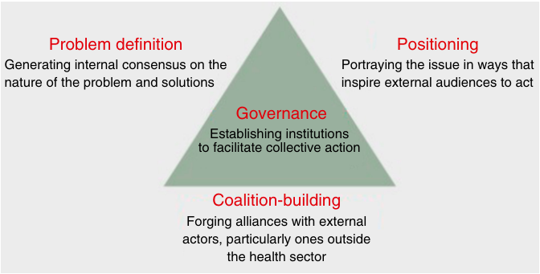

Problem definition Positioning Generating internal consensus on the Portraying the issue in ways that nature of the problem and solutions inspire external audiences to act Governance Establishing institutions to facilitate collective action Coalition-building Forging alliances with external actors, particularly ones outside the health sector 

**Fig. 2.11 Four challenges that global health networks face.** (From Shiffman J. Four challenges that global health networks face. _Int J Health Policy Manag._ 2017;6[4]:183–189. Copyright © 2018 The Author[s]. Published by Kerman University of Medical Sciences. This is an open access article under the CC BY 4.0 license.)

<!-- PDF page 16 -->

and pain require close attention and support. In addition to domestic and international financing mechanisms to support health system scale- up, public–private partnerships and innovative patient- level financial risk protection strategies must be integral to advocacy efforts.5 The SARS- CoV- 2 pandemic provided a unique opportunity to advocate for health system strengthening at the intersection of perioperative and respiratory care, including oxygen ecosystems, critical care infrastructure, bedside monitors, and workforce. Strategic investment in these areas has great potential to expand access to safe anesthesia and surgical care.

As leaders in safety, pain, and perioperative care, the global anesthesia community must actively engage in policy, research, and innovative global initiatives to expand access to quality care. Academic institutions from all countries can play a significant role in supporting a coordinated research agenda, creating a global voice for advocacy, sharing information, and harmonizing educational standards and opportunities. Anesthesia must follow the lead of other medical disciplines to cultivate and support faculty and trainees interested in global public health careers. Such advocacy will likely require coordination and partnership with multiple disciplines, including non- physician provider cadres who perform a significant proportion of anesthesia services, especially in LICs.143

### Workforce Shortages and Strategies for Expansion

The critical shortage of trained anesthesia providers in many settings is one of the most significant barriers to expanding access to safe surgical, anesthesia, and pain services for billions of people worldwide. Although many key members of the surgical workforce exist (including surgeons, obstetricians, pathologists, radiologists, laboratory technicians, nurses, biomedical engineers, and more), anesthesia provider shortages in LMICs are particularly striking and relatively neglected. Countries like the Central African Republic have only two physician anesthesiologists and

only three non- physician anesthesia providers (NPAPs) for a population of nearly 5 million. Ethiopia, with a population of over 100 million people, has just over 100 physician specialist anesthesiologists. A survey of emergency obstetric care capacity at facilities in Uganda found that lack of staff had the most significant correlation with observed mortality rates.144 In a survey of 64 public and private hospitals in Uganda, 84% did not have a physician specialist anesthesiologist, and 8% had no trained anesthesia providers at all.145 In another survey of anesthesia providers from five main referral hospitals in East Africa (Uganda, Kenya, Tanzania, Rwanda, and Burundi), only 7% reported adequate anesthesia staffing.146 In settings where providers exist, but in small numbers, the workforce shortage is compounded by heavy administrative burdens and non- clinical duties. While the anesthesia workforce shortage is most severe in LICs and particularly pronounced in sub- Saharan Africa, regional workforce shortages also exist in HICs and can significantly limit access to care for rural populations.147,148 In one survey of rural hospitals in the United States, 36% reported delay or cancellation of surgery due to a lack of anesthesia providers.149 Data from HICs demonstrating differences in trauma mortality are significantly worse starting at five miles from a trauma center in a major urban city.150 One can only imagine outcome differences in settings where there may be no surgical or anesthesia provider for tens or even hundreds of miles.

The optimal number of specialist surgical, anesthetic, and obstetric workforce (SAO) providers needed to give access to safe surgery is unknown and likely to vary significantly based on local resources and needs. The SAO density correlates with life- expectancy and in one study, as SAO providers increased from 0 to 20 per 100,000 population, maternal mortality decreased by 13.1% for each 10 unit increase in provider density (Fig. 2.12). These benefits were also observed with workforce expansion beyond 20, though with less magnitude beyond 30 and 40 providers

High income Lower middle income Upper middle income Low income

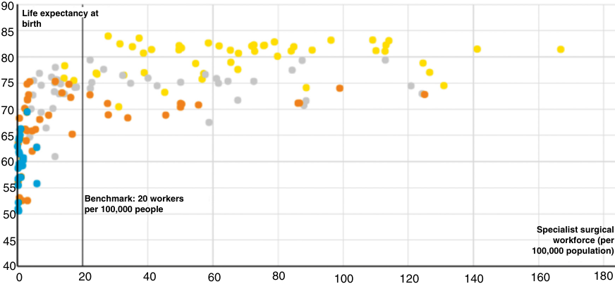

90 Life expectancy at birth 85 80 75 70 65 60 55 Benchmark: 20 workers 50 per 100,000 people Specialist surgical 45 workforce (per 100,000 population) 40 0 20 40 60 80 100 120 140 160 180 

**Fig. 2.12 Life expectancy tends to be higher in countries with a surgical workforce larger than 20 workers per 100,000 people.** (Data source: htt p://databank.worldbank.org/data/home.aspx. Originally printed: http://blogs.worldbank.org/opendata/africacan/pt/comment/reply/2341. Copyright © 2018 The World Bank. Reproduced under CC BY 4.0 license.)

<!-- PDF page 17 -->

per 100,000 (Fig. 2.13).151 Based on these findings, the LCOGS recommended prioritizing expansion of the SAO workforce to 20 per 100,000 population by 2030, with anesthesia- specific targets of 5 to 10 anesthesia providers per 100,000.152

The density of SAO providers has been estimated at 0.7 per 100,000 population for LICs as compared with 56.9 per 100,000 population for HICs.153 Worldwide, 64 countries report an anesthesia provider density less than 5 per 100,000, with a 14- fold difference between the average physician workforce density in HICs as compared to LICs. The anesthesia workforce crisis is most severe in Africa, where most countries have approximately 0.6 physician anesthesiologist per 100,000 population as compared to approximately 21 in Europe or 16 per 100,000 in the United States (Fig. 2.14).152 Twenty-three countries in Africa reported less than 0.5 physician anesthesia providers (PAPs) per 100,000. In many LICs, NPAPs provide most of the anesthesia care. When NPAPs are included in calculations of total anesthesia provider density, 12 countries in Africa still report less than one anesthesia provider per 100,000, and worldwide 70 countries still report less than five anesthesia providers per 100,000 population. Estimates from the WHO Global Surgical Workforce database demonstrate that 12% of the SAO workforce provides care for approximately a third of the world’s population.153 Worldwide, LICs and LMICs have 48% of the world’s population but only 20% of the SAO workforce.

Multiple factors have contributed to the ongoing surgical and anesthesia workforce crises in LMICs, including limited training infrastructure, relatively low professional status, lack of career advancement (especially for NPAPs), perceived limited job opportunities relative to other professions (e.g., infectious disease in LMICs), cost of training, inefficient hiring mechanisms, provider burnout, as well as internal (e.g., private practice in urban settings) and external brain drain (e.g., leaving the country).154,155 Lack of consensus on anesthesia practice models and polarized views on who should provide anesthesia care (i.e., physician vs. non- physician, supervised vs. independent) are additional factors limiting a clear path for rapidly scaling the global anesthesia workforce (Table 2.3).143 Task- sharing is a prominent and controversial component of many surgical workforce expansion efforts.

Each of these challenges must be addressed as part of any national or international effort to expand the anesthesia workforce. The long- term goal of building robust training infrastructures in low- resource settings requires locally led plans for national advocacy, implementation, and evaluation. Such efforts can benefit from international investment and collaboration.156–160

Significant heterogeneity in anesthesia care models exists worldwide. Although the varied anesthesia practice and training models have evolved to address different local needs and challenges, excess heterogeneity, and lack of consensus on anesthesia workforce strategy may provide an additional challenge to global workforce expansion. For

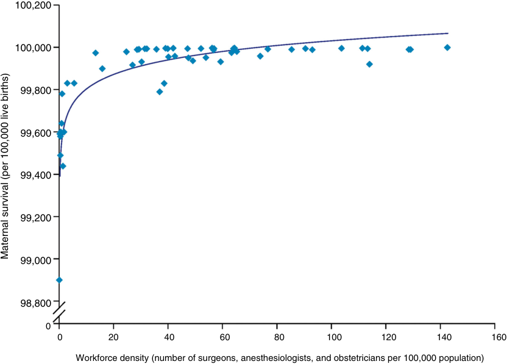

100,200 100,000 99,800 99,600 99,400 99,200 99,000 98,800 0 0 20 40 60 80 100 120 140 160 Workforce density (number of surgeons, anesthesiologists, and obstetricians per 100,000 population) Maternal survival (per 100,000 live births) 

**Fig. 2.13 Specialist surgical workforce density and maternal survival.** A surgical workforce density of less than 20 per 100,000 specialist surgeons, anesthesiologists, and obstetricians correlates with lower rates of maternal survival. Maternal survival per 100,000 live births = 98,292ᑏ×ᑏln (workforce density)ᑏ+ᑏ99,579. (From Meara JG, Leather AJ, Hagander L, et al. Global Surgery 2030: evidence and solutions for achieving health, welfare, and economic development. _Lancet._ 2015;386:569–624. Data from Holmer H, Shrime MG, Riesel JN, et al. Towards closing the gap of the global surgeon, anaesthesiologist and obstetrician workforce: thresholds and projections towards 2030. _Lancet_ . 2015;385(suppl 2):S40. Copyright © 2018 The Author(s). Published by Elsevier Ltd. This is an open access article under the CC BY 4.0 license.)

<!-- PDF page 18 -->

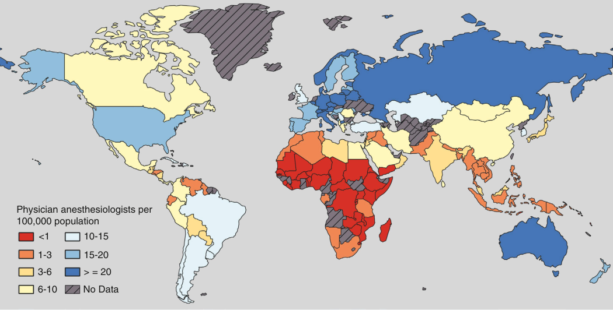

Physician anesthesiologists per 100,000 population &lt;1 10-15 1-3 15-20 3-6 > = 20 6-10 No Data 

**Fig. 2.14 World Federation of Societies of Anaesthesiologists (WFSA) Workforce Map.** (Image reproduced with permission from The Global Anesthesia Workforce Survey: Updates and trends in the anesthesia workforce. Law TJ, Lipnick MS, Morriss W et al. Anesthesia & Analgesia. 2023. In Press.)

example, within sub- Saharan Africa, formal non- physician training programs range from 3 to 72 months in duration with widely different entry requirements, no standardized curricula or assessment tools, and different scopes of practice. For countries seeking to increase anesthesia provider numbers, no clear roadmap exists. In most of these countries, task- sharing with NPAPs will likely play a key role in workforce expansion efforts. Collaborative efforts involving stakeholders from different countries and different anesthesia provider cadres can support anesthesia workforce expansion efforts by offering frameworks for anesthesia training, competency assessments, and potential practice models that are feasible with local resources and that meet local needs. Initiatives that ensure quality (e.g., education programs, credentialing bodies, and licensing exams) are as important as those that focus on increasing absolute numbers. The global anesthesia community can play a significant role via advocacy, research, education, and partnership to address many of the challenges that have created the current global anesthesia workforce crisis.

### Infrastructure Challenges

The provision of surgical and anesthesia care requires infrastructure that is often lacking in many LMICs. As discussed elsewhere in this chapter, such infrastructure does not necessarily need to be high- cost or based on advanced technologies to provide safe care. Based on data from the 2019 African Surgical Outcomes Study (ASOS), a clusterrandomized trial was conducted (ASOS- 2) to implement a package of 5 low- tech interventions to reduce perioperative mortality: (1) admitting patients to higher-care wards; (2) increasing frequency of nursing checks; (3) placing patients in view or nursing stations; (4) allowing family to

stay on wards; and (5) placing postoperative surveillance guides visible at the bedside.161,162 Although the trial did not meet enrollment goals or show a mortality difference, most enlightening was the observation that of the 160 intervention hospitals, only 59% were able to implement two or more of these interventions. In addition to the provider shortages already discussed, additional infrastructure challenges that frequently limit surgical and anesthesia service delivery include underdeveloped patient referral and prehospital systems, medication and equipment shortages, and inadequate supply chains and facility resources.

In maternal health, and more recently for surgery and anesthesia, a “three delays framework” has been used to describe factors delaying timely access to safe health care services.5 The “first delay” in this model (delay in seeking care) may occur due to financial, cultural, educational, or other patient factors. Anecdotally, fear of bad surgical outcomes (whether true or not) and, more specifically, a fear of anesthesia may also contribute to the “first delay.” The second and third delays are more directly linked to infrastructure limitations. The “second delay” (delay in reaching care) occurs when health facilities cannot be achieved in a timely manner and may be due to geographic distance or challenges with transportation (e.g., bad road conditions, no access to a car, no money for public transport). Although efforts to improve health care infrastructure often focus on facility- based interventions, emphasis on infrastructure that minimizes this “second delay” is underappreciated despite evidence of cost- effectiveness.163 For example, the lack of prehospital care systems in many LMICs is a significant source of avoidable morbidity and mortality. The DCP3 estimates that 4.7 million deaths in LMICs each year are due to surgical conditions that are

<!-- PDF page 19 -->

**Table 2.3** Heterogeneity in Global Anesthesia Workforce

||**Australia**|**Canada**|**China**|**Colombia**|**Fiji**|**India**|**Lebanon**|
|---|---|---|---|---|---|---|---|
|Population (millions)|26.3|38.7|1419|51.5|0.9|1407|6.7|
|GNI per capita (USD)|$56,760|$48,310|$11,890|$6,160|$4,860|$2,170|$3,450|
|Year formed as a specialty|1952|1910|1989|1963|1970|1964|1954|
|*Specialist physician anesthesia providers|5400|3678|92,726|3340|23|60,000|420|
|*Non- physician anesthesia providers|0|0|28,200|0|0|0|0|
|Anesthesia providers per 100,000 people†|20.6|9.5|8.5|6.5|2.5|4.3|6.3|
|Years of post- secondary education to qualify as specialist physician anesthesiologist|12|13|11|10|13|8|11|
|Duration of physician specialist training|5|5|3|3|4|4†|4|
|**MEMBERS OF ANES** Physician specialist|**THESIA CARE TEAM** Yes|Yes|Yes|Yes|Yes|Yes|Yes|
|Physician non- specialist|Yes|Yes|No|No|No|Yes|No|
|Nurse anesthetist|No|No|No|No|Yes|No|Yes|
|Non- nurse, non- physician anesthetist|No|No**|No|No|No|No|Yes|
|Key national challenges|Rural staffing and training, salaries at risk from governmental defunding|Rural staffing, large rural population|Inconsistent medical training, workforce shortage limiting obstetric and NORA coverage|Rural staffing and inequity, low salaries, high workload|Workforce shortage, few specialist job posts, limited postgraduate funding, limited access to resources|Workforce shortage, rural staffing, polarized views on task- sharing, poverty|Regional instability, limited resources and workforce, large refugee population (∼⅓population)|
|**SUBSPECIALTY TRA**|**INING PROGRAMS**|||||||
|Critical care|Yes|Yes|No|Yes|Yes|Yes|No|
|Cardiac anesthesia|No|Yes|Yes|Yes|No|Yes|Yes|
|Pediatric anesthesia|No|Yes|Yes|No|No|Yes|No|
|Regional anesthesia|No|Yes|Yes|No|No|Yes|No|
|Obstetric anesthesia|No|Yes|Yes|No|No|Yes|No|

_GNI,_ gross national income.

*In many countries (e.g., South Africa), large numbers of physician non- specialists provide anesthesia, but accurate counts of these cadres are unavailable.

†Physician specialist anesthesia training in India includes 3 years anesthesia training after 1 year as a “house surgeon.”

**In Canada, Anesthesia Assistants are trained to perform many of the anesthesia tasks including intubation, extubation, maintenance of anesthesia (including administering drugs) as directed by the anesthesiologist but are not designated as the primary anesthesia provider for a given case. From Law TJ. The WFSA Workforce Survey: Final Results. Oct 2022. Presented at the American Society of Anesthesiologists and The Global Anesthesia Workforce Survey: Updates and trends in the anesthesia workforce. Law TJ, Lipnick MS, Morriss W et al. Anesthesia & Analgesia. 2023. In Press.

::: details 原始表格與符號（PDF 第 19 頁）

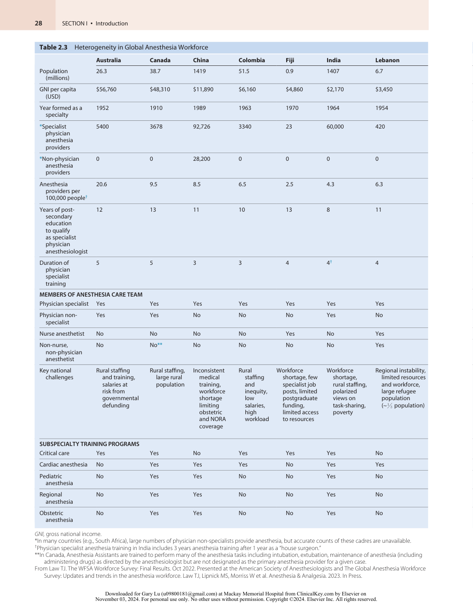

:::

<!-- PDF page 20 -->

|**Mexico**|**Norway**|**Pakistan**|**Paraguay**|**Romania**|**South Africa**|**Uganda**|**USA**|**Vietnam**|
|---|---|---|---|---|---|---|---|---|
|131.6|5.5|229.5|7.3|19.1|60.8|48.4|335.2|99|
|$9,380|$84,090|$1,500|$5,340|$14,170|$6,440|$840|$70,430|$3,560|
|1934|1949|1960|1973|1957|1935|1985|1940|1960|
|9665|1099|3393|310|1159|1468|76|53,250|1000|
|0|2000|0|160|0|0|500|56,172|0|
|7.4|56.6|1.5|6.4|6.0|3.2|1.18|32.6|1.5|
|10|11|10|10|11|13|9|12|11|
|3|5|4|3|5|4|3|4|5|
|Yes|Yes|Yes|Yes|Yes|Yes|Yes|Yes|Yes|
|Yes|Yes|Yes|No|No|Yes|No|No|No|
|No|Yes|No|No|No|No|Yes|Yes|Yes|
|No|No|No|Yes|No|No|Yes|Yes|No|
|Rural staffing,|Inadequate|Medication|Inconsistent|Workforce|Workforce|Workforce|Rural access to|Inconsistent|
|i large rural population, political and civil stability| time for non- clinical activities during training|and workforce shortages, geographic distribution and inconsistent quality of care|training standards for non- physicians|shortages, regional staffing shortages, no standardized nurse curriculum|shortage, large poor and rural population, inequitable access to care|shortage, rural staffing, high workload, low remuneration, medication and equipment access, polarized views on task- sharing|specialists, high cost of care, polarized views on task- sharing, maternal mortality|medication and equipment access, geographic distribution of workforce|
|Yes|Yes|Yes|No|Yes|Yes|No|Yes|Yes|
|Yes|Yes|Yes|No|No|No|No|Yes|No|
|Yes|Yes|No|No|No|No|No|Yes|Yes|
|Yes|No|No|No|No|No|No|Yes|Yes|
|Yes|Yes|No|No|No|No|No|Yes|Yes|

::: details 原始表格與符號（PDF 第 20 頁）

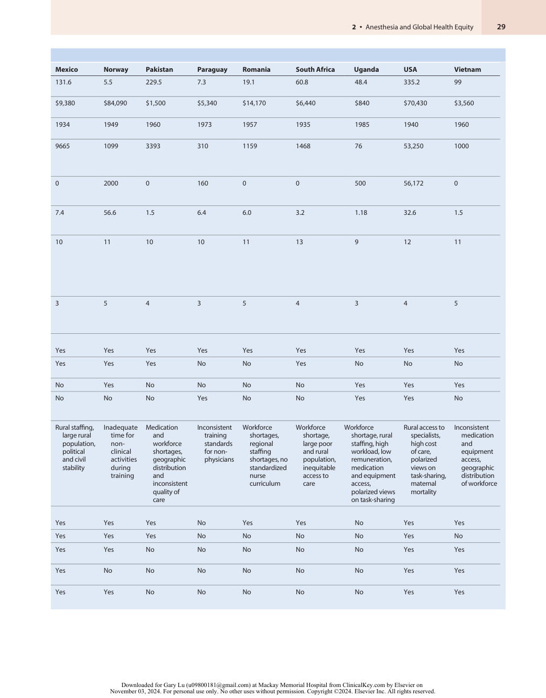

:::

<!-- PDF page 21 -->

potentially addressable through prehospital and emergency care systems. In Uganda, less than 25% of the population lives within 2 hours of a surgical facility, and worldwide approximately 2 billion people lack access due to this second delay. When discussing infrastructure limitations, most people think of the “third delay” (delay in receiving care), which occurs when patients reach a facility but may not receive adequate care because of limited facility resources. Data from 800 first- level health facilities in LICs demonstrate that relatively few first- level hospitals could provide C- sections (64%), laparotomies (58%), or open fracture repairs (40%), and most did not have reliable electricity (31%), running water (22%), oxygen (24%), or Internet access. Without reliable utilities, standard equipment like monitors, ventilators, anesthesia machines, and autoclaves are often not functional, assuming they are even present at all. In recent years, the number of surgical and anesthesia capacity assessment tools increased significantly, although most tools have focused on surgical care with limited ability to assess anesthesia or analgesia capacity.164–171 The WHO Surgical Safety Checklist includes requirements for pulse oximetry, anesthesia machine check, and confirmation of instrument sterility, yet these may not currently be feasible in many LMIC health facilities. As the consensus on what constitutes “essential” or “standard” anesthesia and surgical safety equipment is evolving, it is universally agreed that far too many health facilities face routine shortages of even the most basic anesthesia equipment.

Inadequate access to indicator strips, maintenance support, power, and distilled water result in low compliance with 2016 WHO/Pan American Health Organization (PAHO) standards for cleaning, disinfection, and sterilization in most LMICs.172,173 In a survey of 28 district hospitals in Zambia, 35% did not have a laryngoscope.174 A study from Nigeria found that most facilities could not provide general anesthesia (53%); another survey in the Democratic Republic of Congo demonstrated that 40% of hospitals lack suction, and in Guatemala, only 17% of facilities surveyed had capnography.175,176 In Uganda, a 2014 survey of health facilities that offer emergency services and surgical care revealed that only 22% had pediatric airway equipment, 41% adult airway equipment, and 28% a pulse oximeter.177 In one survey about obstetric operating room capacity in the five main referral hospitals in East Africa (Uganda, Kenya, Tanzania, Rwanda, and Burundi), only 4% of the providers surveyed reported the presence of electrocardiograph (ECG), pulse oximetry, continuous blood pressure monitoring, capnography, thermometer, stethoscope, difficult airway cart, suction machine, recovery room, and ICU facilities.146

Access to reliable oxygen has always been a problem in resource- constrained health systems, but this was highlighted and received overdue attention during the SARS- CoV- 2 pandemic. In many settings, oxygen is rarely available through central pressurized gas lines and more often provided via tanks or oxygen concentrators, the latter of which have been shown to offer long- term cost savings and increased reliability for some settings.178 (Further discussion of oxygen supply systems is provided later in this

chapter, in Section 3: Essentials for Practice in ResourceVariable Settings.)

Equipment donations are common in LMICs; however, they often have limited long- term impact and multiple unintended consequences. Donations are frequently made with little understanding of local needs, lack of communication between donor and recipient, and absence of ongoing technical support or access to consumables. Wellintentioned donors are often unaware of WHO Guidelines for Medical Device Donation, or of the fact that purchase costs account for only 20% of total lifetime costs for a piece of equipment.179 As a result, up to 30% of donated equipment may only transiently or never become operational and commonly accumulates in equipment graveyards because of a sense of obligation by recipients to not throw anything away. For example, donations of modern anesthesia machines from HICs are commonly encountered in many LMICs. Without reliable power, pressurized gas supplies, biomedical support, or access to disposables (e.g., carbon dioxide absorbent, humidity filters, circuit tubing), it is sometimes hard to argue in favor of these machines.

Reliable access to medications and blood are two additional common infrastructure challenges limiting access to safe surgery and anesthesia services worldwide. The WHO Essential Medicines List includes medications to perform general anesthesia safely, monitored anesthesia care (MAC), neuraxial, regional, and local anesthesia, and acute and chronic pain management (Box 2.3).180 Despite the list’s existence for more than 40 years, critical shortages of many medications persist. A WHO survey of all health facilities in Uganda examined the availability of twelve anesthetic drugs (atracurium, bupivacaine, halothane, isoflurane, desflurane, sevoflurane, ketamine, lidocaine 2%, lidocaine 5% heavy spinal injection, midazolam, nitrous oxide, and suxamethonium) and found that only 2% of the surgical health facilities had all of these medications and only 19% had half.177 The same WHO survey in the Democratic Republic of Congo found that only 33% of hospitals had bupivacaine, 21% thiopental, and 16% halothane. Factors affecting access to analgesics are discussed further in the next section, though supply chain, cold storage, and cost are common challenges limiting many drugs’ availability. Drug quality is also a factor in some LMICs where variable manufacturing quality and fraud (i.e., counterfeiting) are commonly encountered.181 It is estimated that 1 in 10 medical products (e.g., medications) found in LMICs are substandard or falsified, resulting in hundreds of thousands of deaths each year.182,183

The WHO Essential Medicines List also includes blood products. Despite more than four decades of global advocacy (1975 WHA28.72) for universal access to safe blood, limited transfusion capacity significantly impacts the ability to provide safe surgery and anesthesia care, especially for rural and LMIC populations. Most rural surgical facilities are unable to provide consistent access to safe blood. Patients lack timely access to safe blood as a result of several common challenges, including inadequate blood supply, distribution networks, rural blood banking capacity, safety protocols, workforce (e.g., pathologists, laboratory technicians), testing supplies, and policy implementation, as well as high costs of blood and high prevalence of infectious diseases.127,184,185 The whole blood donation rate

<!-- PDF page 22 -->

### Box 2.3 World Health Organization Essential Medicines List – Anesthesia Medications

|**Anesthetics and Medical Gases**|14.  Ondansetron (or dolasetron, granisetron, palonosetron,|
|---|---|
|1.  Halothane, isoflurane, nitrous oxide, sevoflurane (added 2023)|tropisetron) |
|l   l 2.  Oxygen|15.  Metoclopramide|
|3.  Ketamine|**Additional Medications**†|
|4.  Propofol (or thiopental)||
| 5.  Bupivacaine|1.  Epinephrine |
|6.  Lidocaine|2.  Hydrocortisone |
|7.  Lidocaine + epinephrine|3.  Naloxone |
|8.  Ephedrine*(for use in spinal anesthesia during delivery to|4.  Calcium gluconate|
|, prevent hypotension)|5.  Potassium chloride 6.  Sodium chloride|
|**Muscle Relaxants**|7.  Magnesium sulfate|
|1.  Atracurium|8.  Phenobarbital|
| |9.  Phenytoin|
|2.  Neostigmine | 10  Lorazeam|
|3.  Suxamethonium|.  p |
|4.  Vecuronium|11.  Enoxaparin|
| 5  Pidtii*|12.  Heparin|
|.  yrosgmne|13.  Protamine sulfate|
|**Preoperative Medications and Sedation for Short- Term**|14.  Tranexamic acid|
|**Procedures**|15.  Digoxin|
|1.  Atropine|16.  Verapamil |
| 2  Midazolam|17.  Amiodarone*|
|. 3.  Morphine|18.  Hydralazine 19.  Furosemide|
|**Medications for Pain and Palliative Care**|20.  Sodium nitroprusside*|
|1.  Acetylsalicylic acid|21.  Dopamine* |
| 2.  Ibuprofen|22.  Mannitol |
|3.  Paracetamol|23.  Ranitidine |
||24  Insulin|
|4.  Codeine|. |
|5.  Fentanyl transdermal (for cancer pain)|25.  Glucose |
| 6  Morphine (or hydromorphone oxycodone)|26.  Carbetocin|
|.    , 7.  Methadone*|27.  Ergometrine |
|8  Dexamethasone|28.  Misoprostol (tablets)|
|. 9.  Cyclizine|29.  Oxytocin |
| 10.  Amitriptyline|30.  Salbutamol (terbutaline)|
| 11.  Diazepam|**Notable Deletions**|
|12.  Midazolam||
|13  Haloeridol|1.  Ether (2005)|
|.  p|2.  Pethidine (2003)|

*The complementary list of medications in the 2023 23rd list edition EML presents essential medicines for priority diseases, for which specialized diagnostic or monitoring facilities, and/or specialist medical care, and/or specialist training are needed.

†Blood products, antiseptics, antibiotics, and medications that are routinely administered by other specialties (e.g. endocrinology, oncology) are included in the EML and not listed here.

Data from https://www.who.int/publications/i/item/WHO-MHP-HPS-EML-2023.02.

is used to indicate blood availability. The LCOGS recommends a minimum of 15 blood donations per 1000 people per year, yet this rate is 4.6 per 1000 people per year in LICs (compared with 32.1 per 1000 people per year in HICs).5,186 Most LMICs cannot maintain adequate supply from voluntary non- remunerated donors (VNRDs) alone (as advocated by WHO), and using paid donors or family donors poses numerous logistic and safety concerns.127 According to WHO data, 71 countries collect the majority of their blood supply from family or paid donors, 50% lack the capacity to separate blood components, and 23.5% of countries have less than 100% screening for at least one of these transfusion- transmissible infections: HIV, hepatitis B, hepatitis C, or syphilis.186 For many LMICs, investment in transfusion infrastructure, expansion of transfusion research, and advocacy (including a rethinking of wellintentioned but context- limited policies such as VNRD- only

mandates, requirements for onsite pathologists, and mandatory replacement units) are critical areas for engagement by anesthesia providers in the greater global health community.127,187

There is an evolving consensus on global standards for anesthesia equipment, medications, and other infrastructure.3,171 As a result, most facility or national capacity assessments capture different data that may over- or underestimate current infrastructure limitations. For example, lack of access to rocuronium, sevoflurane, or propofol does not necessarily indicate an inability to safely perform anesthesia if suxamethonium, halothane, isoflurane, or thiopental are available. Currently, efforts are underway by the WFSA, GICS, and other organizations to develop anesthesia- specific research tools to assist LMICs in monitoring and evaluating anesthesia capacity.170,171 The global anesthesia and surgical communities will likely

::: details 原始表格與符號（PDF 第 22 頁）

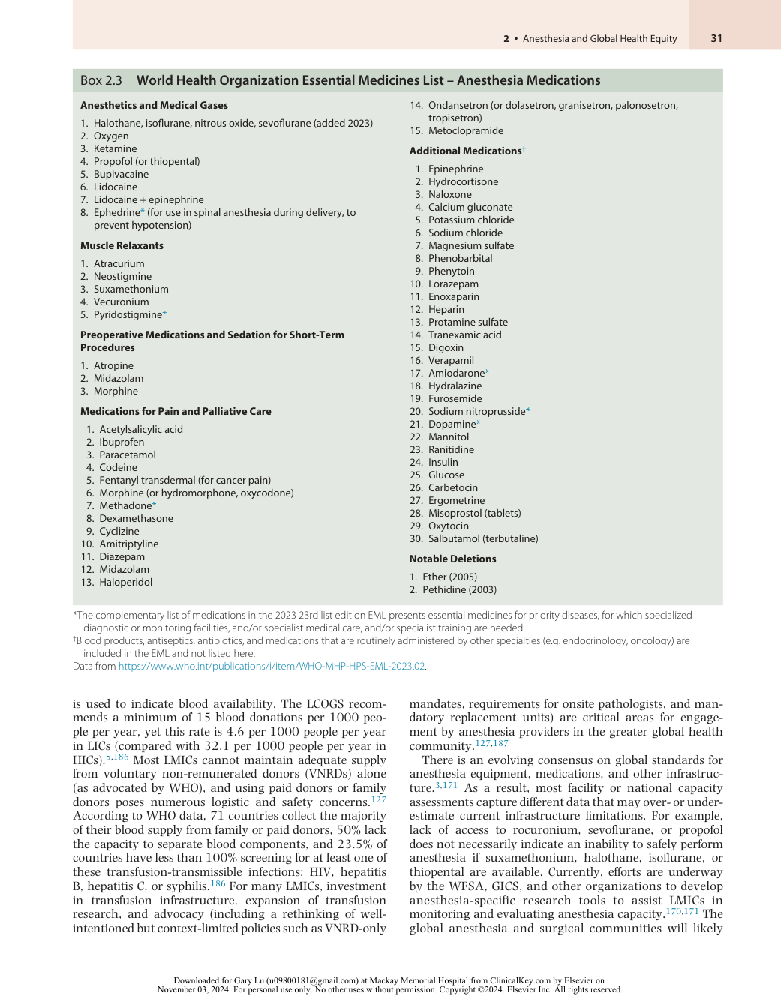

:::

<!-- PDF page 23 -->

benefit from continued collaboration and harmonization of efforts that assess global anesthesia infrastructure.

### Analgesia Regulation and Policy

Five billion people worldwide have little or no access to analgesia. As with the surgical disease crisis, inequities in analgesia access are partly due to the limited availability of data that quantify the problem. Unlike most traditional global health metrics that focus on extending healthy life and productivity, alleviating pain may not always target these same goals (e.g., acute surgical pain relief and palliative care), thus adding to the complexity of quantifying pain burden. Massive inequities in access to analgesia are also attributed to several additional factors, including advocacy challenges (pain is not disease- specific or easy to associate with a “face”), limited training opportunities for health care professions, fear of addiction and diversion, financing, supply chain limitations, cultural attitudes, and regulatory and legal barriers (Box 2.4).95,96 In the discussion, we consider some of these barriers and potential areas for intervention by the global anesthesia community.

Limited financial resources and infrastructure hinder the ability of health care systems to deliver analgesia (i.e., effective supply chains) and limit the ability of patients to afford such care. Countries with a lower GDP or human development index have less access to and use of opiates.96 Opiate prices in LMICs are often significantly higher relative to GDP. In the recent past, in Argentina and Mexico, the monthly cost of an opioid prescription for oncologic pain was reported to be more than 200% of the average monthly income.126,188 In Rwanda, the reported price of injectable morphine is six times the lowest cost reported in the International Drug Price Indicator Guide.50,189 Drivers of these inflated prices include import costs, taxes, licensing fees, storage, and sales restrictions, and limited public finance programs. International regulations and misconceptions about pain treatment and addiction form the basis for many of these interventions.

Misinformation about analgesia has biased knowledge and attitudes among providers, patients, and policymakers and has resulted in significant undertreatment of pain. Several studies have demonstrated that the risk of addiction associated with appropriate analgesic administration is significantly exaggerated and especially low for acute, oncologic, or end- of- life pain.190 Nonetheless, widespread and excessive fears over diversion and addiction have resulted in unnecessarily onerous regulatory barriers that often confuse tolerance and dependence, users and addicts, and disproportionately affect poor and marginalized populations.191 In China, for example, a domestic ketamine abuse problem has led to repeat lobbying of the International Narcotics Control Board (INCB) by the Chinese government to reschedule ketamine as a Schedule I drug for all countries. Such regulation would effectively remove the nearly ubiquitous access to ketamine in LMICs, and further exacerbate the ongoing global pain crisis.192 Ketamine is inexpensive, accessible, and safe, and as a result, has become a critical resource for the provision of safe and accessible anesthesia and analgesia services worldwide. Fortunately, attempts to restrict ketamine have been promptly recognized as violating international regulatory policies.

### Box 2.4 Factors Affecting Access to and Availability of Analgesia

### Knowledge and Attitudes

1.  Providers – limited training

2.  Patients – limited health literacy

3.  Opiophobia – fear of addiction, diversion, or side effects

4.  Cultural attitudes and beliefs about pain

5.  Limited data to estimate pain burden or accurate national analgesia needs

6.  Challenging advocacy (pain is not disease specific or easy to associate with a “face”)

### Regulations and Policy

1.  Prohibitionist bias

2.  Implementation requires significant resources

3.  Onerous regulations (e.g., limits on who can prescribe, duration, dose, and indication)

4.  Complex regulations create fear of prosecution among providers

5.  Limited global advocacy efforts to expand analgesia access

### Economics and Financing

1.  Poverty

2.  Relatively high analgesic costs in LMICs

3.  Costs of implementing/enforcing international regulations

4.  Few mechanisms for financial protection from analgesic costs (e.g., subsidies or UHC)

### Health Systems

1.  Supply chains (timely import, procurement, storage, and distribution)

2.  Limited analgesic options

3.  Few providers trained/skilled to provide adequate analgesia

4.  Inadequate number/distribution of facilities providing analgesia care

5.  Limited national government capacity

- _LMICs_ , low- and middle- income countries; _UHC,_ universal health coverage.

INCB 2017 report: https://www.incb.org/documents/Publications/Annua lReports/AR2017/Annual_Report/E_2017_AR_ebook.pdf.

- Modified from Berterame S, Erthal J, Thomas J, et al. Use of and barriers to access to opioid analgesics: a worldwide, regional, and national study. _Lancet._ 2016;387(10028):1644–1656 and Goucke CR, Chaudakshetrin P. Pain: a neglected problem in the low- resource setting. _Anesth Analg._ 2018;126(4):1283–1286.

Tramadol is another analgesic with frequently misunderstood pharmacology that is commonly found in LMICs. Tramadol is not controlled by international regulations, which has led to its widespread availability for analgesia and abuse.193 Abuse is widely reported in many HICs (e.g., Canada) and LMICs (e.g., many countries in Africa and the Middle East) and is so severe that in countries like Cameroon, it can be found in the groundwater as a result of human excretion.194 Tramadol is not considered an adequate substitute for opiates and is not included in the WHO Essential Medicines List.

Contemporary legal and regulatory/policy frameworks have significantly exacerbated disparities in access to analgesia care. In the wake of several key events in the 1800s that fueled skyrocketing opioid abuse, including the Opium Wars and the invention of the hypodermic syringe, the beginning of the 20th century produced several of the first national

<!-- PDF page 24 -->

and international efforts to restrict and regulate narcotics. This included the first international conference on narcotics in 1909 (International Opium Convention in Shanghai) and the first multilateral drug treaty in 1912 (The Hague Opium Convention). One of the most notable regulations of the 20th century is the 1961 UN Single Convention on Narcotic Drugs. The opening sentence of the “Single Convention” recognizes “…that the medical use of narcotic drugs continues to be indispensable for relieving pain and suffering and that adequate provision must be made to ensure the availability of narcotic drugs for such purposes….” The Single Convention set out to control the use and trade of plant- based drugs (opium, cannabis, and cocaine) while assuring medical availability.195 This regulation mandated government participation (reporting national estimates of narcotic needs, meticulous record keeping), regulated drug cultivation, restricted trade to authorized international parties, and created the INCB. The INCB was tasked with monitoring UN drug convention implementation and required each country to designate an enforcement office (e.g., the Drug Enforcement Administration [DEA] in the United States). While most countries adopted this onerous regulation, most poor countries did not have the extensive resources to enact these changes. The Single Convention’s “global estimates” system has been difficult for many countries to implement. This system requires all countries to provide an estimate of opiate need (for medical purposes) to inform global production goals and limit excess opiate supplies at risk for illicit use. Accurate estimates require significant resources, and for many LMICs, the inability to provide accurate estimates translates directly to inadequate supply. For example, 2017 opiate estimates for Chad (population 14.5 million) predicted 341 g fentanyl, 249 g morphine, and 105 g codeine. Compared to estimates from Canada (population 36.3 million: 150,000 g fentanyl, 4,750,000 g morphine, 40,020,000 g codeine, and 70 other controlled substances), the disparity and gross underestimation are apparent.196 By approving such gross underestimates, the INCB effectively is legally prohibiting patients from having access to opiates. In times of humanitarian crisis, the Single Convention impedes the ability to emergently augment local analgesia capacity, as became evident in the wake of the 2010 Haiti earthquake.197

Global regulations to curb illicit use have dominated efforts to ensure access to analgesics for medical purposes (or to ensure access to substance abuse treatment). In 1985, the Parliament of India passed the Narcotic Drugs and Psychotropic Substances Act to enforce international drug policy (e.g., the Single Convention). The Act’s onerous regulations and extreme penalties (including the death penalty for certain drug- related crimes) resulted in more than a 90% decrease in the medicinal use of morphine.198,199 This imbalance, referred to by some as “collateral damage from the war on drugs,” disproportionately affects LMICs and continues to cripple access to analgesics for most of the world’s population.197 Such bias has also impaired the scaleup of addiction treatment initiatives. For example, addiction treatment (methadone and buprenorphine) was not added to the WHO Essential Medicines List until 2006, approximately 100 years after the passage of the earliest narcotic regulations and 40 years after the list’s creation.

The prohibitory biases of prior international drug policy have resulted in numerous national regulatory barriers that include limitations on who can prescribe, dispense, or administer opiates, as well as constraints on indications (e.g., postoperative but not cancer pain), dosages, or duration of therapy.191 For example, in Armenia, only oncologists with the approval of multiple providers can prescribe outpatient opiates. In contrast, in the Ukraine, health care providers must travel to the patients’ homes to administer outpatient opiates. In Jordan, the maximum duration of an opiate prescription for oncologic pain is ten days, and only three days for all other conditions.200 These myriad regulations create an additional barrier by inducing fear of prosecution for noncompliance among health professionals, thereby reducing provider willingness to prescribe. Lack of adequate training opportunities for health care providers, especially in LMICs, coupled with the occasional use of analgesics in clinical practice, create a cycle whereby fewer and fewer providers feel comfortable prescribing opiates.

Several amendments to the Single Convention have been enacted, including the 1971 Convention of Psychotropic Substances, the 1988 UN Convention Against Illicit Traffic in Narcotic Drugs and Psychotropic Substances, the inclusion of morphine in the first WHO Essential Medicines List in 1977, and the introduction of the WHO Pain Ladder in 1986. Despite these efforts, most of the world’s population remains without reliable access to analgesia. Nearly 60 years after the Single Convention, the number of drug abusers in many countries is near all- time highs, while 150 countries still lack reliable access to analgesia. Even the UN’s SDGs, which aim to set development priorities for the world, reflect the prohibitory bias of prior international policies. SDG 3.5 calls for improved prevention and treatment for substance abuse, including narcotics, but fails to mention pain or palliative care anywhere else in the SDGs.49

Advocacy and education efforts by the global stakeholders, including the anesthesia community, as well as rethinking of international analgesic policy (including the Single Convention) are essential for progress in addressing the global pain crisis.179,201 Education for health care providers, policymakers, and the public can play a significant role in expanding access to analgesia. Such efforts should focus on pharmacologic treatment strategies and emphasize better understanding and management of causes and contributors to pain, including social and economic determinants. Efforts by numerous Ministry of Health agencies have had small successes. In Vietnam and India, grassroots- and civil- society- led policy initiatives to allay opiophobia and reduce institutional licensing regulations have significantly increased access to analgesia without an increased diversion.202–205 In Uganda, advocacy efforts by the nongovernmental organization Hospice Africa Uganda helped convince the Uganda Ministry of Health in 1993 to import morphine powder and to provide domestically made morphine liquid free to all cancer or HIV/AIDS patients. In 2004, the Uganda Ministry of Health legalized opioid prescribing by nurses and clinical officers with palliative care training, significantly expanding analgesia access, especially in rural communities. The import and domestic packaging of oral morphine for palliative care has translated

<!-- PDF page 25 -->

into greater access to oral morphine for the anesthesia and surgical communities. A similar model is currently being adopted in Rwanda, Nigeria, Kenya, Swaziland, and Malawi.206

## Section 2: Evolution of Anesthesia Care Models and Challenges Around the World

### THE DEVELOPMENT OF GLOBAL ANESTHESIA PRACTICE

Though Morton is known for demonstrating the first use of contemporary inhaled anesthesia, forms of anesthesia had been practiced worldwide for many years prior. For instance, the Aztecs and Mayans were among the earliest anesthetists in Mexico and known for using herbal beverages to produce analgesia, with adjuncts such as rattlesnake fangs, leeches, porcupine needles, and the maguey needles to produce local numbness.207 The Mayan witch doctors were divided into specialty groups according to the diseases they either cured or produced. The first mention is a witch doctor who produced “sleepiness” called Ah Pul Uenel, who used plants that produce hallucinations and nervous system stimulants. Also mentioned is Pul- Yahob, who treated wounds and pain with different rituals, plants, and animals. The oldest medical writings in the Middle East were found in cuneiform tablets and Eber’s papyrus in Mesopotamia and the Nile valley, describing herbal treatments like belladonna, cannabis, and _Mandragora_ . Phoenicians also obtained artificial sleep using calming herbs, opium poppy, and juniper leaves.

Following Morton’s 1846 demonstration, the use of ether anesthesia spread quickly around the world. In 1847 uses of ether anesthesia occurred in several countries, including Canada, Mexico, South Africa, Norway, Romania, India, and Australia.208–211 In many other countries, the modern history of anesthesia began with war, as for the initial use

of ether in Paraguay (during the war against the Triple Alliance of Brazil, Uruguay, and Argentina, between 1864 and 1870), or modern anesthesia in Vietnam during the Vietnam War.212

Since the 19th century, the field has gradually become formalized and professionalized, away from the “chloroformists” practicing in the late 1800s in Australia or the medical students and ad hoc personnel delivering anesthesia in Colombia.213 Professional anesthesia societies began to appear worldwide in the early and mid- 1900s, with physician anesthesiologists appearing on staff rolls. The World Federation of Societies of Anaesthesiologists was founded in 1956 with 26 founding members.

Since then, anesthesia practice has become continually safer. Landmark advancements have changed the face of the provision of anesthesia. These included the introduction of the Epstein–Macintosh–Oxford inhaler (EMO) for ether administration, the introduction of halogenated vapors, locoregional anesthesia with cocaine, and spinal anesthesia. Modern advances in the systematic practice of anesthesia care, including the use of the WHO Surgical Safety Checklist, a push for the universal availability of pulse oximetry and capnography, and the adoption of the International Standards for the Safe Practice of Anesthesia, have continued the endeavor to make anesthesia even safer.

Nonetheless, today, more than 170 years later, ether is still used in some LICs, and modern anesthesia is out of reach for many communities (Fig. 2.15). Though the practice of anesthesia has changed significantly, these changes disproportionately occurred in high- income countries. The practice of anesthesia varies widely between and even within countries. Of the numerous challenges and factors that have shaped this heterogeneity, many are shared by multiple countries regardless of income level. These include common challenges such as inadequate workforce (number, composition, or distribution), high cost of care, limited access for rural and poor populations, and lack of standards for practice and training.

This section explores the practice of anesthesia as it relates to the training and scope of practice of the different anesthesia care team members, the variation in anesthesia

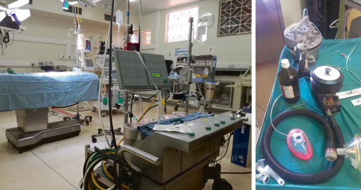

**Fig. 2.15 Two operating theater setups in Uganda, 2018.** _Left,_ The Ugandan Heart Institute. _Right,_ Epstein–Macintosh–Oxford (EMO) ether vaporizer at a first- level hospital providing surgical services. (Copyright © 2018 Cornelius Sendagire, reproduced with permission.)

<!-- PDF page 26 -->

care models, and the critical challenges faced in providing safe, affordable anesthesia care. This section is not intended to be comprehensive but to give examples representing the diversity in anesthesiology worldwide despite shared objectives and many similar challenges.

### DEMOGRAPHICS OF COUNTRIES WHERE INCREASED ACCESS TO ANESTHESIA IS NEEDED

Almost all countries could benefit from increased access to anesthesia care. This is true in the United States, where the amount spent on health care is very high ($11,000 per person per year), or Madagascar, where the amount is very low ($20).214 Anesthesia providers work at every step in between. Anesthesia is provided in well- resourced countries with high per- capita GDP; these anesthesia providers face high costs for their patients, an aging population, and long wait times for surgery. Anesthesia is provided in mixed public and private systems; providers in these dual- practice systems face low public- sector remuneration and emigration of professionals to higher- paying areas. Anesthesia is provided in some very low- income and low- resource settings; these providers face challenges with lacking basic infrastructure and equipment, a high burden of disease and mortality, and burnout.215

Public health care systems in low- and middle- income countries are most affected. Small provider numbers and scarce resources are matched with a large, financially insecure population often forced to purchase surgical supplies, analgesics, antibiotics, or intravenous fluids to obtain surgery. In regions like East Africa, a patient’s family might be asked to go to the nearby pharmacy to buy 250 mL of volatile anesthetic, propofol, suxamethonium, and paracetamol. Anesthesia providers face complex clinical situations with extremely limited resources, increasing the potential risks to safe practice and good patient outcomes.

In contrast, anesthesia providers in urban areas or wealthy countries with public systems, like Norway, face less inequity, with more resources and better access to major health services. Here the anesthesia provider has almost everything necessary for safe and high- quality practice, leading to reliably good patient outcomes.

Lastly, the private health system, while an outstanding strength in some countries, can capture the majority of health care expenditure. While this can provide timely and quality care, it may come at the expense of financial bankruptcy for some families. As in the United States, the anesthesia provider may have everything necessary for safe and quality practice but cannot offer it to everyone. This private system also includes a non- negligible amount of care by charitable or religious organizations, which typically focus on providing care for the neediest.

### PROVIDER TYPES, TRAINING, AND PRACTICE MODELS

The fundamentals of anesthesia care (the safe delivery of operative anesthesia for surgery) can be accomplished in myriad ways. Likewise, the clinicians who provide anesthesia can differ significantly from each other. As a result, in most countries, there is more than one way to become a certified anesthesia provider. In this context, “certified” refers to a provider that has undergone a nationally recognized

or accredited training program specific to anesthesia. Providers including physicians, nurses and those with other educational backgrounds may undergo certified anesthesia training. The result is a team of mixed providers who each contribute to anesthesia care in a country.

### Physicians

In nearly all countries, there is a certified pathway to becoming a specialist physician anesthesiologist, whose primary clinical task is providing anesthesia, for which they have undergone specialty training. A typical pathway is for a medical student to enter a postgraduate training program after medical school and sometimes a year of internship. These anesthesia residency programs last 3–5 years and sometimes involve the completion of a year of research, a dissertation, or a thesis. In some cases, the resulting qualification is a master’s level degree (e.g., Uganda); in others, qualification results from the passing of a certification exam (typically national, as in Canada, Mexico, or optionally in a regional exam for many European countries), or a license to practice from the Ministry of Health without examination (Colombia). Specialty training is often in the apprenticeship model, wherein a student spends time with graduated supervision in the operating room, taking on increasingly complex cases. Other countries, such as Canada and Romania, follow a competency- based model, where training is not necessarily time- based but tracked by the successful achievement of clinical competencies.216–218 Competencybased training is becoming more popular worldwide,219,220 with programs in the United States and India. Sometimes more than one type of training results in an anesthesia qualification. In these countries, the longest pathway typically correlates with physician specialist anesthesiologists, as they are often named.

Physician specialists typically have a broad scope of practice. This often includes preoperative optimization, intraoperative management, and recovery from anesthesia. In many places, anesthesiologists also practice critical care and acute and chronic pain management. These may practice independently once qualified, without additional supervision.

Some countries have alternate pathways for a physician to train to provide anesthesia. These pathways may involve a shorter amount of training, practice restrictions, or lack a research component (examples are “second specialist” training in Vietnam, where residents choose an academic or practical training pathway after initial “first specialist” qualification or Diploma in Anesthesia as in India and Pakistan). For example, holders of a Diploma of Anesthesia in India often practice under the supervision of senior anesthesiologists. One program in India provides six months of training to physicians post- medical school to carry out cesarean sections and lifesaving anesthetic skills for emergency obstetric care in rural facilities where no anesthesiologist exists.221,222

Some programs are intended for medical students who are not admitted to residency. For instance, in Vietnam, these students can then enter a one- year training program and, after four years of additional training, can become “first specialists” as above. In Mexico, students who do not pass exams to be admitted to residency can be enrolled in rural training programs up to 2 years in length and are eligible to

<!-- PDF page 27 -->

write a national certification exam, entitling them to practice in rural areas only. These programs have been controversial. Rural access is sometimes extended by general practitioners who complete formal training in anesthesia. As in Canada and Australia, these general practitioner (GP) anesthetists might not practice anesthesia full- time but practice independently, mainly in rural areas. They may frequently limit their cases to healthier patients or more routine operations.223,224 In South Africa, GPs can obtain a Diploma in Anesthesia after completing a fully supervised training program at an accredited institution.

### Non- physicians and Nurses

**Nurse anesthetists.** The training and scope of practice for nurses are variable but are most commonly called nurse anesthetists. Training is usually at least one year but may be up to four years, and nurses are frequently required to have some work experience before entering. Curricula may be well defined, as in the United States, Certified Registered Nurse Anesthetists (known as CRNAs) undergo a training program up to 42 months after having worked as an intensive care nurse, requiring at least 465 hours of classroom education, exposure to a minimum of 600 clinical cases, and 2000 clinical hours, with a move toward conferring a Doctor of Nursing Practice on graduation.225

The scope of practice of nurse anesthetists is broad and encompasses the breadth of anesthesia. This includes preoperative evaluation, intraoperative induction, maintenance, emergence, and immediate postoperative care. Non- physician providers like CRNAs more frequently practice in rural areas.226,227 Nineteen US states have opted out of the requirement for physician supervision for CRNAs, while in other states, CRNAs must practice under indirect supervision with a physician available.228 Similar variability in supervision is seen in health systems around the world: nurse anesthetists may be fully autonomous, work alongside physicians (with physicians available to consult on patients), or work with physicians under indirect supervision.

**Non- nurse, Non- physicians.** Non- physician anesthesia cadres also come from backgrounds other than nursing. The nomenclature for these providers is less standardized, but the term “anesthesia assistants” is frequently used. In many African countries, “clinical officers” or “anesthetic officers” practice. They may occasionally enter training from a nursing background, and training typically may be two years before independent practice, but this is highly variable. In Africa alone, there are more than 30 different distinct training pathways to becoming an anesthesia provider.229 In other countries, a higher- skilled group of anesthesia providers may hold a Bachelor of Science in Anesthesia. In Uganda, these providers complete two years of medical school, after which they undergo clinical anesthetic training.

Unlike nurse anesthetists, where typically the scope of practice reliably includes induction, maintenance, and emergence from anesthesia, the scope of practice of nonnurse providers varies considerably. Anesthetic officers, or the equivalent, are the primary anesthesia providers in many African countries (as there are many fewer physician anesthesia providers), as are Anesthetic Scientific Officers in Papua New Guinea.230a As such, they provide anesthetics independently, and there is no physician on staff in many

facilities. Certified Anesthesiologist Assistants in the United States offer full operative care under a physician’s direct or indirect supervision. In contrast, Anesthesia Assistants in Canada provide monitored anesthesia care and a variety of procedures (including intubation in some cases).

**Anesthesia Technicians.** Various technical providers contribute to the care of patients undergoing anesthesia. Although these assistants and technicians do not provide operative anesthesia, they contribute to the smooth functioning of the anesthesia care team and high- quality care in many jurisdictions. In the United States, anesthesia technicians are a common part of anesthesia teams, helping to check and prepare equipment for the anesthesia provider without clinical care provision. Other examples would be Operating Department Practitioners in the United Kingdom or Operation Theatre Technologists (OTTs) in India. They assist the anesthesiologist with equipment and medications, with limited involvement in clinical care, such as placing intravenous cannulas.

### Practice Models

The provider types described above work in every combination to provide anesthesia services for a health system, sometimes fluidly exchanging roles, emphasizing that the provision of anesthesia is necessarily provided by a team. Some countries have a “physician- only” model but make use of other types of physicians to extend anesthesia services, as described above in Canada, Australia, India, Pakistan, and South Africa. In countries with predominantly specialist anesthesiologists, like the UK and Norway, trainee physicians fill an important role in service provision; anesthesia technicians and assistants contribute in essential ways to safe care and are sometimes mandatory presences at critical parts of the case.

In countries that have incorporated non- physician anesthesia providers into operative care through nurse anesthetists or other non- physicians, non- nurse anesthesia providers also work in many models. Nurse anesthetists may practice with indirect physician supervision (as in Norway, Vietnam, or some parts of the US) or independently (as in other parts of the US). Non- physician anesthesia providers administer most of the anesthesia in places where the workforce shortage is the worst, such as Fiji, Paraguay (under surgeon supervision), or many African countries. Despite practicing independently, variations in training and supervision lead to vast differences in quality of care. In Latin America, despite variable practice models, the Confederación Latinaoamericana de Sociedades de Anestesiología (CLASA) promulgates anesthesia must be provided by Anesthesiologists only, citing “anesthesia is a strictly medical act.230b

Complicating accurate descriptions of anesthesia teams are discrepancies between what providers are regulated to do and what they do in practice. For example, anesthesia technicians in multiple countries are know to perform intubation or spinals despite being prohibited by license or laws. In South Korea, CRNAs have been in practice for >50 years and are nationally recognized providers, yet their legal ability to practice anesthesia has been cast into doubt. These ambiguities make it difficult to describe the global anesthesia workforce and thus engage in health systems planning for anesthesia care.

<!-- PDF page 28 -->

### GLOBAL AND REGIONAL CHALLENGES

The challenges countries face in delivering anesthesia globally have some recurring themes. As discussed earlier in this chapter, there is a significant overall global deficit of anesthesia providers. Additionally, access to anesthesia care is compounded by geographic maldistribution within countries. Physicians, including anesthesiologists, tend to cluster in urban areas, and ensuring access for patients in rural areas is challenging in both high- and low- resource countries.147 For example, 70% of the anesthesiologists within a 300- mile radius of Mexico City work in the urban area. One study of 1169 rural counties in the United States found greater than half had no anesthesia provider,231 and another showed that nearly one- third of the United States pediatric population lives more than 50 miles from the nearest pediatric anesthesiologist.232 This can exacerbate existing disparities within countries, such as how Black and Hispanic women are less likely to receive epidural analgesia or increases in postoperative mortality rates among Indigenous Canadians.233 The use of short- term contracts to staff rural areas is a common but unstable staffing model, and relying on additional financial incentives is common worldwide.

Salary considerations compound workforce deficits. Despite being a highly remunerated specialty in the United States, anesthesiologists consistently seek opportunities for dual practice (public and private) where they exist to augment income.234,235 This often leads to a loss of providers to better- resourced and better- paying areas: providers from Africa and South Asia leave to the Middle East and Europe, and providers from eastern Europe like Romania leave for western Europe.160,236

Heterogeneity in access to subspecialty anesthesia, drugs, and modern equipment is a pervasive concern, even in countries where access is reliable in urban areas.237,238 Access to common drugs like fentanyl or amiodarone is inconsistent in countries like Romania, India, Pakistan, and Vietnam. At the same time, some hospitals in China lack gas analyzers or defibrillators. In hospitals in Africa, anesthesia is commonly provided in facilities without reliable oxygen or electricity.

The lack of consistent standards in training and certification contributes to variations in quality. Different cadres of anesthesia providers within the same country may be held to further training and certification standards but provide the same care. Cadres with the same name and job description may have additional education requirements between the two countries. International standards like the WHO Safe Surgery Checklist and the WHO-WFSA International Standards for a Safe Practice of Anesthesia have helped to establish a minimum threshold for practice. Still, adoption is not universal, and standards to address variation between cadres and countries have yet to emerge.146

## Section 3: Essentials for Practice in Resource- Variable Settings

### CLINICAL AND TECHNICAL SKILLS

The practice of anesthesia anywhere in the world heavily depends on four factors: personnel, equipment, medications, and patients. Disruption, change, or lack of any

of these factors may limit the safe practice of anesthesia. Whether practicing in a rural HIC setting, an LMIC, a military or humanitarian field hospital, or a well- resourced environment during a time of exceptional surgery (e.g., SARS- CoV- 2 pandemic), all these factors will vary. Data to guide clinical practice during resource constraints are limited and may be interpreted differently.

Clinical practice in these settings may be highly different from what one may be accustomed to and often diverges from “standard care” due to local challenges related to personnel, equipment, medication, and patients. Numerous instances of well- intentioned, evidence- based practices from HICs produce unintended negative consequences in LMICs.239 A “copy- and- paste” framework from HICs to LMICs may not necessarily improve outcomes.239,240 Therefore, it is essential to understand the local context before caring for patients in these settings or attempting to change local practice. The SARS- CoV- 2 pandemic highlighted that no setting is immune to resource constraints and that all providers should develop skills for practice with limited resources. This section will briefly discuss selected aspects of anesthesia practice in resource- variable settings through the lens of these four factors.

### Personnel

Limitations in the anesthesia workforce are among the most significant barriers to the safe provision of anesthesia care worldwide. Beyond low absolute numbers of providers,241 the competencies of existing anesthetic providers may be highly variable. Many practitioners who provide anesthesia in resource- constrained settings may have completed inadequate training and often work in isolation with negligible supervision or colleague support.242 Many are highly skilled and competent within a narrow spectrum of clinical cases. They often learn to deliver a “recipe” type anesthetic that may not be adaptable or appropriate for more complex cases.

When working in resource- constrained environments, it is essential to understand the level of knowledge and experience of the local anesthetic provider. Regardless of training level, there are always opportunities for mutually beneficial bidirectional learning. The role of the anesthetic provider in many resource- constrained settings is often limited to the operating theater, as the concept of perioperative care is underdeveloped and not part of training. Personnel shortages routinely limit the capacity for adequate preoperative evaluation and optimization of patients. Perioperative nursing may be entirely lacking, and routine elements of postoperative care, such as monitoring or providing regular pain assessments with analgesic administration, may not be available. The postanesthesia care unit (PACU) may consist of an unstaffed corridor or a small designated space near the operating room complex exit. In this setting, it is paramount to ensure patients are more fully recovered from their anesthetic when they arrive in the recovery area than may be routine in well- resourced PACUs. Thoughtful planning is required, especially if higher- level care is needed postoperatively (e.g., ventilation), as this usually will become the responsibility of the anesthesia provider or even family members, who are frequently recruited to help with monitoring or even manual ventilation.

<!-- PDF page 29 -->

### Equipment

**Anesthesia Machines.** Most modern anesthetic workstations cannot function without pressurized gases and electricity, both of which may be in short supply in many resource- constrained environments. In these settings, familiarity with drawover anesthesia may be essential. An in- depth discussion of drawover anesthesia is beyond the scope of this chapter. However, knowledge of drawover anesthesia is highly relevant in many practice settings, and several comprehensive resources for learning drawover are included at the end of this chapter. Here we provide a brief overview of the basics of drawover anesthesia. An inhalational anesthesia system must be able to deliver accurate concentrations of volatile agents, avoid rebreathing of carbon dioxide, have a provision for intermittent positive- pressure ventilation (IPPV), and provide oxygen- enriched gases. Unlike more complex anesthesia

machines, drawover systems do not require compressed gas or power, can function on room air, and will not deliver hypoxic gas mixtures. This is especially relevant in this setting where inspired oxygen monitors may be lacking. A drawover system consists of a temperature- compensated or buffered, low- resistance vaporizer that is calibrated to the anesthetic agent, a self- inflating bag or bellows with a oneway valve upstream to ensure unidirectional gas flow to the patient, and a non- rebreather valve at the patient end to avoid rebreathing of carbon dioxide (Fig. 2.16). Drawover setups that can function with multiple volatile agents are the most versatile (i.e., if one volatile agent is unavailable). Providers should be familiar with the technical aspects of using the same vaporizer for different volatile agents. The self- inflating bellows can be used for IPPV (by hand). They may show movement or a small palpable pressure change with respiration that enables the anesthesia provider to

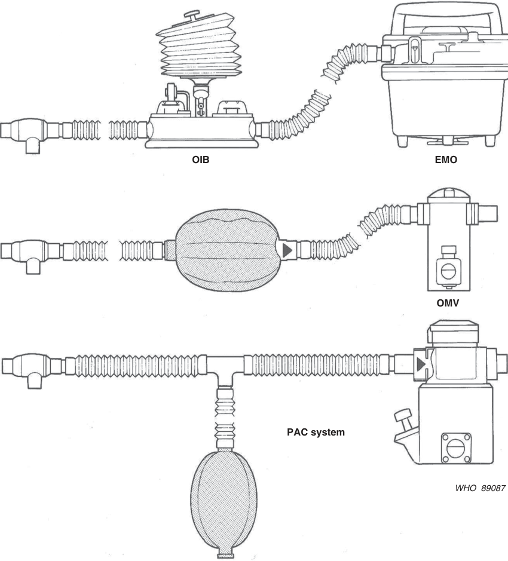

OIB EMO OMV PAC system WHO  89087 

**Fig. 2.16 Inhalational drawover anesthesia setups.** (Reproduced with permission from the WHO. Dobson MB, World Health Organization. _Anaesthesia at the District Hospital_ . 2nd ed. Geneva: World Health Organization. http://www.who.int/iris/handle/10665/42193.)

<!-- PDF page 30 -->

monitor respiratory rate in the spontaneous mode. Air is the “driving” gas (although “drawing” gas might be a more accurate description) in a drawover system, but oxygen supplementation is possible with the addition of oxygen at the vaporizer inlet or with the addition of a piece of reservoir tubing or bag. The ability to function on ambient air is a critical safety feature of all drawover setups. Without some form of the reservoir, it is impossible to achieve a fraction of inspired oxygen concentration (FiO2) above 0.3, regardless of oxygen flow. Using one meter of standard adult corrugated tubing (22 mm diameter, internal volume 415 mL) as a reservoir, an FiO2 of 0.3 and 0.6 can be achieved with 1 L/ min and 4 L/min of oxygen flow, respectively,243 at normal adult minute ventilation. The gas flow, dependent on the patient’s tidal volume and respiratory rate, is highly variable. Still, most vaporizers (OMV, DDV, EMO) (see Fig. 2.16) remain highly accurate as long as the gas flow is intermittent. However, they often lose accuracy when the system is converted to a continuous flow mode.

Although the drawover system is low resistance, it may be advisable to convert it to a continuous flow system when anesthetizing pediatric patients to overcome the dead space at the level of the non- rebreather valve. This can be done manually by squeezing a self- inflating bellow or bag to create a continuous flow through the vaporizer. This flow of oxygen- enriched air supplies an Ayre’s T- piece attached to the bellows outlet or self- inflating bag. Both valves need to be used to ensure a unidirectional flow, as this is still a low- pressure system (Fig. 2.17). If using a self- inflating bag, then it must be squeezed and released 12 times per minute. This manual system mimics adult drawover with a more intermittent flow. The vaporizers tend to still provide an accurate reading as opposed to full continuous flow using either a Farman’s entrainer or direct attachment of an oxygen source to the inlet of a vaporizer. Whatever equipment you have at your disposal, it is probably simpler to follow these approximate guidelines:

- If &lt;5 kg, assisted ventilation for whatever length of the operation.

- If 5–10 kg, spontaneous ventilation for short cases and assisted ventilation for longer procedures.

- If >10 kg, spontaneous ventilation for most operations unless paralysis is required or the procedure is prolonged.

There are a small number of all- in- one drawover anesthetic machines based on the same principles as the portable drawover systems (Fig. 2.18). They are not plenum machines,

and supplemental oxygen can be supplied from a cylinder or an integrated oxygen concentrator. These machines are significantly less expensive and relatively easier to maintain than other modern anesthesia machines. They can also function without power and without supplemental or pressurized oxygen, making them ideal for some resourceconstrained settings. Integrated, uninterruptible power supplies (UPS) provide power for certain functions (e.g., monitors, ventilators, etc.) in the event of power failure. The companies that manufacture the Universal Anesthesia Machine (Gradian Health) and the Glostavent (Diamedica [UK] Ltd) both invest considerable resources to ensure local expertise for operation, training, and service support. These elements are critical for the successful utilization of equipment in resource- constrained settings. Regardless of the anesthesia setup employed, a power or oxygen failure plan is essential and likely to differ based on the setting.

**Oxygen Systems.** In many settings, pressurized oxygen is available primarily via cylinders, but the supply may be unreliable or cost- prohibitive, and therefore multiple sources are essential. Providers working in resourceconstrained settings should be familiar with the basics of function and maintenance for various oxygen delivery

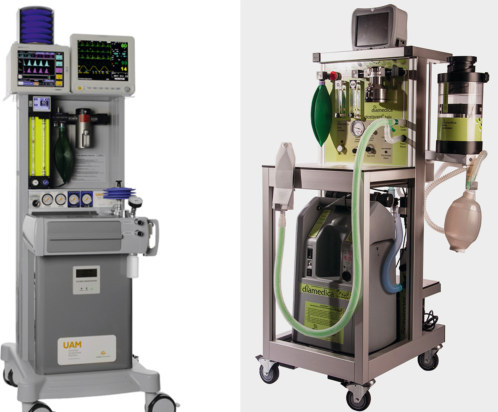

**Fig. 2.18 All- in- one drawover anesthesia machines.** _Left,_ The Universal Anesthesia Machine by Gradian Health (including ventilator module). _Right,_ The Glostavent Helix by Diamedica (UK) Ltd. (Copyright © 2018 Gradian Health and Diamedica [UK] Ltd.)

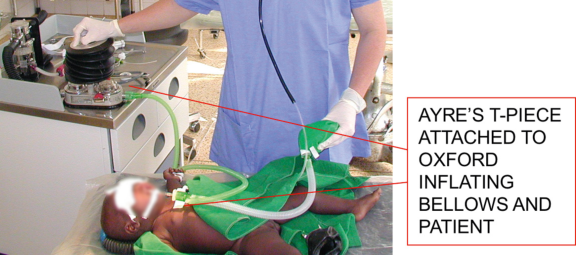

**Fig. 2.17 Drawover anesthesia using an Oxford- inflating bellows and Ayre’s T- piece with a pediatric patient in Uganda.** (Copyright © 2018 Sarah Hodges.)

<!-- PDF page 31 -->

solutions, including concentrators. Oxygen concentrators use a technique called pressure swing adsorption and zeolite crystals to extract nitrogen from the air to produce oxygen with 90% to 96% purity, although purity drops to around 85% with higher flow rates.244a In principle, most portable oxygen concentrators are relatively similar, and nonengineers can often diagnose and fix common problems (e.g., dirty filters, low voltage, compressor or valve system failure, excess flow, or hot ambient temperatures)244b (see Appendix 2.1 for links and valuable resources). Not all oxygen concentrators are designed to function in all climates, and many do not conform to WHO guidelines.244b,245 In a performance study of eight oxygen concentrators, only two models delivered greater than 82% inspired oxygen concentration at 35°C and 50% relative humidity.246 Portable oxygen concentrators can provide supplemental oxygen in the operating theater (via a drawover system), the PACU, or the ward though most models can deliver no more than 10 liters per minute. Most portable oxygen concentrators also deliver oxygen at pressures far less than 3.4 bar (50 psi). They thus are not suitable to drive many delivery devices (e.g., ventilators without a built- in turbine or compressor). It is possible to achieve higher flow rates by combining oxygen concentrators. Makeshift splitting of a single oxygen source to supply multiple patients on the ward is a common practice, although it can easily result in inadequate flow rates. Submerging the terminal end of parallel oxygen delivery circuits into cups of water can allow for a comparison of gas flow rates. A small, portable oxygen analyzer can be helpful to test the output of concentrators and cylinders, as variability in oxygen purity is a common challenge in many settings and may be commonly due to low- quality devices or inadequate maintenance. Ultrasonic oxygen analyzers may be preferable for resource- constrained settings as they do not require consumables or field calibration (in contrast to electrochemical analyzers). While the operation and maintenance of oxygen plants, liquid oxygen systems, and cylinder manifold systems are beyond the scope of this chapter, it may be helpful for providers working across different practice settings to have a general familiarity with these oxygen sources. Additional high- yield knowledge for providers working in resource- variable environments includes a working understanding of oxygen connector types, methods for calculating oxygen supply and device consumption rates, and techniques for oxygen conservation.247–249

**Monitors.** Many operating theaters worldwide have minimal monitoring options despite the international standards set out by the WHO and WFSA.3 In this environment, there is increased reliance on clinical skills (e.g., change in palpable pulse volume, degree of chest expansion, pupil size, and change in compliance of bellows, self- inflating bag, or bag on Ayre’s T- piece). Because electricity may be unreliable, ideally, monitors should have a functional internal battery. Pulse oximetry is invaluable but not universally available. Some inexpensive pulse oximeters meet international quality standards; however, few are designed for harsh environments, many are highly inaccurate, and some may not work as well, especially in patients with dark skin pigment.250,251 Capnography and ECG monitoring are often unavailable in low- resource settings.252 Precordial stethoscopes are particularly useful and can be made from

an ordinary stethoscope with an extension (e.g., a suction tube or oxygen tubing). Precordial stethoscopes provide an excellent beat- to- beat heart rate monitor and continuous, audible verification of respiratory rate, airway patency, and endotracheal tube placement. Hypovolemia may be detectable by a decrease in heartbeat tone that is apparent before alarms on other monitors.

### Airway Equipment and Airway Management Tech-

**niques.** In resource- constrained settings, the range of available airway equipment may be extremely limited. Face masks, oro- and nasopharyngeal airways, and endotracheal tubes may be available but not in all sizes. Many hospitals providing surgical care will have only a Macintosh size three laryngoscope blade, and rarely additional equipment such as a bougie or supraglottic airways. When managing a difficult airway in these settings, safety is critical and it is often essential to maintain spontaneous respiration and oxygenation until the airway has been secured. Face mask ventilation, regional anesthesia, or ketamine- based anesthetics may be safer than attempting complex airway management. An awake look with direct laryngoscopy can often assist in airway management planning. In some cases, it may be preferable to opt for a tracheostomy under local anesthesia as the surgical skills may be superior to what is feasible with the limited anesthetic equipment and ability.

As advanced airway equipment and experienced assistance are likely to be lacking, excellent technique and positioning for laryngoscopy are crucial for success. Retrograde intubation and blind nasal intubation can be valuable skills to master. Airway topicalization can be accomplished in many ways, including transtracheal lidocaine injection or by gargling or spraying water- based lubricant jelly, lidocaine, and epinephrine. For blind nasal intubation, the tube is pushed forward during inspiration following the floor of the nasal cavity, listening to the noise of breathing (a similar technique to a Patil guide). If the tube enters the esophagus, the neck should be extended, and if it impinges on the anterior part of the larynx, the neck should be flexed. Lifting the jaw will stop the endotracheal tube from hitting the epiglottis. Rotating the tube or inflating the cuff slightly may also assist with entering the trachea. If capnography is not available, then condensation in the tube, movement of the bag with respiration, auscultation of the chest, and in rare circumstances, an esophageal bulb can help verify correct placement. In LMICs, airway equipment is often washed and reused. There are several products that can be used to decontaminate endotracheal tubes, supraglottic airways easily, and other airway adjuncts; however, access is highly variable. When processing and reusing such equipment, damage to the cuff and increasing stiffness of the plastic are significant challenges.

Endotracheal tube stylets are infrequently available. Improvised endotracheal tube introducers have been crafted by carefully inserting a piece of wire into an appropriately sized suction catheter, ensuring the metal tip is not protruding. Learning safe, sensible techniques that are reproducible without the use of expensive, specialized equipment is fundamental. Bulb suction (for neonates) and foot pedal suction devices are invaluable when traditional electric suction is unavailable.

<!-- PDF page 32 -->

**Equipment for Regional Anesthesia.** Spinal anesthesia is universally taught and used in many settings for a wider variety of cases than is commonly done in HICs (e.g., appendectomy). The needles vary in quality, and blunt tips can be overcome by using a 21- gauge hypodermic needle as an introducer. The most commonly used local anesthetic is hyperbaric 0.5% bupivacaine. All anesthetic providers are taught to do spinals, but not all are taught how to manage spinal- induced hypotension and complications of neuraxial anesthesia. Teaching how to fabricate a simple wedge for a uterine tilt with pregnant patients or learning to reposition patients in varying degrees of reverse Trendelenburg position may prevent untoward incidents, especially where an adjustable operating table may not exist. Although a spinal might seem an easier and safer option, appropriate patient selection is critical, especially where preferred vasopressors and fluids may be in short supply. In that situation, 0.5 mg epinephrine has been diluted in a 500 mL bottle of 5% dextrose and administered cautiously to treat the hypotension. Epidurals are rarely available in low- resource settings for several reasons: providers may not be proficient with the technique; epidural needles, preservative- free local anesthetic drugs, and infusion pumps are not readily available; and more importantly, the staffing may be inadequate, and the knowledge may be insufficient to safely manage a patient with an epidural in the postoperative setting. In some settings where electronic drug infusion pumps are unavailable, low- cost elastomeric bulb pumps can be used to deliver a fixed rate of medication. Caudal blocks using a 22- G cannula are commonly used in children for postoperative pain management, although the only safe preparation of local anesthetic may be bupivacaine for intrathecal use. Landmark techniques are often used for regional anesthesia, as ultrasound machines and nerve stimulators are rarely available. Commonly performed blocks include ankle, digital, axillary, penile, wrist, fascia iliaca, femoral, and rectus sheath blocks. Local field blocks may be used for various procedures, including hernia repairs, often done under local anesthesia in the outpatient setting. Where ultrasounds are available, other regional supplies such as ultrasound gel, probe covers, echogenic needles, and appropriate local anesthetics may be lacking. Several workarounds to these common challenges have been well- described. Although many blocks can be easily and safely done without ultrasound or nerve stimulation, serious complications can still occur. Anecdotal reports of local anesthetic toxicity fatalities during penile blocks for circumcision are still encountered in some LICs and attributed to preventable causes such as incorrect dosing or technique.253 In general, peripherally distal blocks with lower volume and shorteracting local anesthetics may be safer options, especially where safety equipment such as intralipid may be limited.

**Equipment for Venous Access.** Intravenous cannulas are almost universally available, but variable quality may limit use. Needles may be blunt or extend quite a few millimeters beyond the tip of the cannula. Scalp veins are a common site for insertion in critically ill infants. With appropriate training, rapid placement of a cannula in the right internal jugular vein or the peritoneal cavity can be lifesaving in a child dying from hypovolemic shock (e.g., cholera) as you look for a more permanent solution. Intraosseous needles

are not easily found, but 18- G or 16- G needles can be used in the tibia of an infant. Butterfly needles, if available, are handy because of their limited length. Twisting is essential to pierce the cortex until a sudden give when entering the medullary cavity. It is feasible to perform anesthesia for an entire operation with such access (Fig. 2.19).

Infusion pumps are often unavailable in LMICs and, when present, are frequently limited by the availability of compatible disposables (i.e., appropriately sized syringes or proprietary tubing). It is essential not only to be proficient with calculating infusion rates based on drop factor (drops per mL) but also to be aware that infusion sets vary in size and quality, often making accurate calibration challenging.

### Drugs

**Volatile Agents.** Ether has now been removed from the WHO Essential Medicines List, and its use has reduced dramatically since 2013. Isoflurane, halothane and most recently sevoflurane (added in 2023) are included in the WHO Essential Medicines List, and due to the price differential (e.g., in Uganda, 250 mL of halothane ∼$21; 250 mL of isoflurane ∼$39; 250 mL of sevoflurane ∼$250), halothane is the most commonly used agent in many rural or nonteaching hospitals in LICs. Halothane is potent (MAC 0.8%) and sweet smelling, but the blood gas partition coefficient is 2.4, making the onset and offset of anesthesia slower than other agents. This can be useful if managing a difficult airway and intubation under halothane alone. Halothane is a cardiac- depressant and arrhythmogenic, especially in the presence of elevated end- tidal carbon dioxide. It is helpful for inhalational induction, but it is essential to rapidly reduce the inspired concentration once intravenous access is secured. Nitrous oxide may be obtainable in some locations (primarily urban areas) but can be extremely expensive. Because medical- grade air (FiO2 0.21) is often 4 to 5 times more

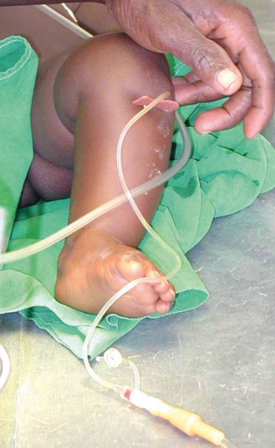

**Fig. 2.19 Improvised intraosseous access catheter in a pediatric patient in Uganda.** (Copyright © 2018 Sarah Hodges.)

<!-- PDF page 33 -->

costly than oxygen, it is often unavailable, and cases may be done on 100% inspired oxygen concentration.

**Induction Agents.** The use of propofol is widespread, but ketamine (in addition to volatile agents) remains the most ubiquitous induction agent in many LMICs. Thiopentone (thiopental) is also frequently encountered outside of HICs. Ketamine resembles an intravenous preparation of ether (sympathomimetic, does not depress airway reflexes, causes excessive salivation, and has excellent analgesic properties). S- ketamine is a valuable adjunct for regional anesthesia. Ketamine can be used as an infusion (intravenous or subcutaneous injection) postoperatively for pain management, especially if opioids are in short supply.254 Ketamine can also be used for total intravenous anesthesia for a variety of procedures (e.g., laparotomies). Still, the wakeup can be very prolonged, and the patient may experience disturbing hallucinations as benzodiazepines are often not used (providers more likely to encounter diazepam than midazolam in resource- constrained settings). Ketamine is the “go- to” induction agent for any patient in hypovolemic or septic shock, but it can cause cardiac arrest in maximally sympathetically stimulated patients. Ketamine may be advised against as the sole anesthetic for pregnant patients undergoing non- obstetric procedures due to its potential oxytocic effects. Ketamine can also cause apnea in neonates, despite the appearance of the neonate moving in response to surgery. Special attention and caution must be emphasized in these patient populations. Because of ketamine’s overall safety profile, it has been utilized as the agent of choice for anesthesia in some of the most austere environments.255 The drug has been used as the basis for a 5- day course to teach mid- level nonanesthesia providers to administer emergency anesthesia in rural sub- Saharan Africa when no anesthesia provider is available. This program has generated significant controversy and highlights many challenges facing the provision of anesthesia in LMICs.256,257

**Analgesics.** Morphine is often the most readily available opioid, although for many LMICs, it is frequently challenging to obtain. In some countries where palliative care is more developed (e.g., Uganda), oral formulation is often available for postoperative analgesia. Pethidine (meperidine) is commonly encountered in LMICs and is used routinely for perioperative analgesia. Of note, pethidine is not included in the WHO Essential Medicines List and is not recommended for routine acute postoperative pain because of its variable efficacy and side effects. Nonetheless, pethidine may be the only option for analgesia in some LMICs, and general familiarity with its pharmacology could be highly useful in select settings (see Chapter 22). As discussed earlier in this chapter, opiophobia and access limitations significantly restrict the use of opiates. As a result, if available, opiates are rarely prescribed beyond 48 hours postoperatively in many resource- constrained settings. Many analgesics (e.g., ketamine, morphine, and pethidine) are frequently given by intramuscular injection, which may have benefits in terms of feasibility and safety, although supporting data are limited.254 Patient- controlled analgesia is generally unavailable, but in some settings has been substituted by using a small subcutaneous cannula, often placed over the deltoid muscle, used solely for parenteral opiate analgesics.

This avoids repeated intramuscular injections, especially in children, and can remain in place for 48 to 72 hours. Tramadol is pervasive, inexpensive, and often used for perioperative pain management in resource- limited settings. The use of tramadol requires an understanding of its limitations, including side effects, abuse potential, and inferiority in many instances to opioid analgesia.

Paracetamol (acetaminophen) is widely available as tablets, suppositories, syrups, and an intravenous preparation, as are nonsteroidal anti- inflammatory drugs. Parenteral preparations vary from country to country, as does the potency depending on the country of manufacture. Diclofenac is commonly found and intramuscularly injected. One of the significant challenges with prescribing analgesics is conveying the concept of multimodal analgesia. Although the full spectrum of analgesic modalities may not be available, multiple analgesic options, including regional anesthesia, are often feasible in low- resource settings.

**Muscle Relaxants.** Suxamethonium (succinylcholine) is a universally available muscle relaxant and may be the safest paralytic to use if there are no means for mechanical ventilation or availability for reversal. It rarely causes malignant hyperpyrexia, although it can induce masseter spasm, especially in children with neurologic or muscular disorders. Both atracurium and suxamethonium lose potency with exposure to heat, and maintaining cold storage is a significant challenge in many settings. For cases where surgeons prefer paralysis for closure (e.g., laparotomy), a small dose of suxamethonium can be administered at the end of the case to facilitate closure of the peritoneum and rectus while hand ventilating the patient and allowing faster offset of the volatile agent. The availability of nondepolarizing neuromuscular blocking agents is highly variable, and providers should be prepared to use drugs they may not readily use in HICs.

Lack of access to transfusion services (as discussed in Section 1: Anesthesia and “Global Health Equity”) is another commonly encountered problem that may require improvisation. Providers in resource- constrained settings may be tasked with ABO typing (e.g., EldonCard) and crossmatching and should be familiar with these techniques. Whole blood transfusion may be more common than component therapy, although there are several notable limitations (including the potential loss of platelet and clotting factor activity with refrigeration). Absolute transfusion thresholds are lacking but can create significant dilemmas. For example, is it safe to perform a hernia with a hemoglobin of 9, 8, 7, or lower if no blood products are available? Direct donation from patients or relatives and mandatory exchange (i.e., someone must donate for units to be released from the blood bank) is widely practiced in LMICs. Other practices such as preoperative normovolemic hemodilution and makeshift intraoperative blood salvaging (e.g., by using a cup, gauze filter, anticoagulant, and a 60 mL syringe) have been reported. Still, there is no safe, adequate substitute for transfusion services in many settings.258,259

### Patients

Anesthesia providers in resource- constrained settings must be comfortable with a wide range of potential surgical patients, especially trauma, obstetric (e.g., postpartum

<!-- PDF page 34 -->

hemorrhage), and pediatric patients. In many LMICs, more than 50% of the population is under 18, and most have fewer comorbidities and less polypharmacy than in HICs. On the other hand, patients often present late with advanced pathology. This may be due to a wide range of factors affecting access to care, including physical access to the health unit (impassable roads in the rainy season or insecurity on the roads), or they have been consulting the local healer or bone setter and have not seen any improvement, or they are financially destitute. All health care is economically and socially draining.

As relatives often provide most of the in- hospital care (e.g., cooking the food and washing the bedding and clothes), an inpatient stay is highly time- consuming. No family will want their patient to be in the hospital longer than necessary. Patients will mobilize more rapidly but may also be less compliant with postoperative instructions. Although patients may have a lower incidence of chronic cardiac and respiratory comorbidities, many may be anemic, malnourished, or harboring low- grade malaria or helminth infections. If major surgery is being considered, existing maladies may need to be treated first and can prolong the inpatient stay. Multiple preoperative investigations may not be affordable or feasible, and many decisions are made solely on clinical judgment.

Anesthesia providers practicing in LMICs must be familiar with perioperative optimization of commonly encountered conditions. Treatment for universally common conditions such as hypertension or diabetes may require contextspecific approaches and insights (e.g., where and how to provide temperature- stable, non- counterfeit medications).

The practice of anesthesia in the resource- limited setting is shackled by many issues, and it can be challenging to administer a high level of care as advocated by many professional entities. Anesthesia safety is an essential component of care. Are there standards of care that are immutable across the globe? Suppose a full- term pregnant woman is admitted to hospital with a severe antepartum hemorrhage that requires an emergency cesarean section to save the mother and baby. What is the anesthetic of choice? Is it local anesthetic infiltration alone, intermittent aliquots of intravenous ketamine and oxygen via nasal cannula, or rapid sequence induction with ketamine, suxamethonium, and halothane? Then add to that decision the reality that the anesthetic provider may be a nurse with one year of training in anesthesia, only 250 mL of compatible blood is available in the hospital, and there is no pediatrician to resuscitate the baby. What is the safest anesthetic technique? It is difficult to answer that question, but for anyone planning to work in an LMIC as an anesthetic provider, it is indispensable to learn about the local resources, to listen to the local providers, to have the humility not to have all the answers, but above all to focus on the care and safety of the patient.

### GLOBAL HEALTH COMPETENCIES

Although the number of global health opportunities for medical trainees has skyrocketed in recent years, most are short- term, elective- based rotations, and relatively few programs offer structured training in global health competencies.260

Many anesthesia providers may not be directly involved with formal global health initiatives or careers that focus on underserved populations; however, fundamental global health competencies are relevant to all anesthesia providers (whether in high- , middle- , or low- income countries). A broad understanding of key concepts is universally pertinent and should be incorporated into anesthesia training for all providers. These include access and affordability, local and global disease burden, structural and social determinants of health, medical ethics, health equity, and social justice. The Consortium of Universities for Global Health (CUGH) has identified 11 competency domains, with four levels of competency per domain (ranging from level I for all providers with any relation to global health to level IV for providers planning to have significant lifelong engagement in global health)261 (Box 2.5). Multiple efforts are underway to develop new competency frameworks with increased input from diverse stakeholders and relevance across settings to reflect the true nature of global health equity.262

For anesthesia providers who intend to spend a portion of their career focused on global health, additional training should be considered in topics such as epidemiology, statistics, qualitative research, health policy, health systems, health economics, medical anthropology, demography, ethics, and implementation and management sciences, among others.

Providers from relatively well- resourced settings benefit from preparation before working in resource- constrained settings, even if only for short- term visits.263 Several nonclinical challenges and pitfalls are routinely encountered in resource- constrained settings, including failure to provide context- appropriate interventions (see discussion on equipment donations in the section on infrastructure challenges), failure to have a follow- up plan, failure to adequately engage local stakeholders, overemphasizing shortterm solutions, and draining local resources.264,265 Ethical challenges are also commonly encountered and often relate to the appropriate scope of practice, the equitable distribution of local and external resources, and an inadequate understanding of local social and cultural norms.

### Box 2.5 CUGH Global Health Competency Domains

Domain 1 – Global Burden of Disease Domain 2 – Globalization of Health and Health Care Domain 3 – Social and Environmental Determinants of Health Domain 4 – Capacity Strengthening Domain 5 – Collaboration, Partnering, and Communication Domain 6 – Ethics Domain 7 – Professional Practice Domain 8 – Health Equity and Social Justice Domain 9 – Program Management Domain 10 – Sociocultural and Political Awareness Domain 11– Strategic Analysis

_CUGH,_ Consortium of Universities for Global Health.

CUGH Competencies reproduced under Creative Commons 4 Licensing from Jogerst K, Callender B, Adams V, et al. Identifying interprofessional global health competencies for 21st- century health professionals. _Ann Glob Health_ . 2015;81:239–247 and CUGH Global Health Competencies Toolkit – https://www.cugh.org/onlinetools/competencies- toolkit/.

<!-- PDF page 35 -->

In a survey of surgery and anesthesia trainees at a large Ugandan university with numerous visiting international collaborators, most trainees (75%) agreed that visiting groups improve their training. However, 40% of trainees reported that international groups had a neutral or negative impact on patient care. Only 15% felt that research projects conducted by international groups were in local priority areas, and approximately one- third of trainees (31%) reported discomfort with the ethics of clinical decisions made by visiting faculty.266

It is incumbent upon institutions that offer global health opportunities to provide formal training. Numerous resources exist to help equip trainees, providers, and institutions with the knowledge necessary to manage these challenges and maximize the positive impact of global health efforts (see Appendix 2.1 for links and valuable resources).267–270

In some countries (e.g., the United Kingdom), anesthesia trainees can pursue 6- month to 1- year- long global health experiences with formal curriculum and relatively long- term clinical, research, and educational components. Trainees are required to complete standardized assessments, including clinical evaluations and case- based discussions, as outlined by the RCoA.271 A relatively small yet increasing number of anesthesia programs provide formal global health tracks for interested residents, formal anesthesia global health fellowships, and integrating global equity training into core anesthesia training.272,273 Academic institutions and the global anesthesia community at large must continue to expand training and career development opportunities that increase the number of anesthesiologists interested in and capable of improving equitable access to safe anesthesia worldwide.

## Conclusions

Despite dramatic changes in anesthesia worldwide over the past century, safety, access, and affordability improvements have not been universal. Currently, most of the world does not have access to safe anesthesia, surgical, or analgesia services, this includes poor or marginalized communities in all countries. The massive and growing surgical and pain crises disproportionately affect LMICs, where severe shortages of workforce and infrastructure and impractical international regulations limit access to care. Despite many common misperceptions, anesthesia, analgesia, and surgical services are feasible in resource- constrained settings and are as cost- effective as many other public health interventions (e.g., vaccinations).

The neglect of pain and surgical disease by the global health community has resulted in one of the most inequitable global public health crises the world faces today. It has been only in recent years that the surgery, anesthesia, and global health communities have accelerated investment in research, education, and advocacy initiatives that aim to improve access to safe anesthesia and surgical services for the world’s poor. These efforts are in their infancy and must be expanded and supported by the global anesthesia community. Factors affecting access to care, safety, and cost are relevant in all countries regardless of income level. All anesthesia providers should maintain awareness

of the fundamental challenges facing the global anesthesia community, hoping that increasing numbers will devote their careers to addressing issues of global health equity. There are many ways anesthesia providers can engage in global health at the patient level or system level, including research, advocacy, education, and clinical service.

The role of anesthesia in global health is easy for many to overlook. Still, the global anesthesia community must quickly increase efforts to actively lead global health initiatives that aim to improve infrastructure, expand the workforce, increase translation of data into policy and practice, improve financial risk protection mechanisms for surgical patients, expand referral and prehospital systems, provide essential medicines, and ultimately improve access to safe and affordable anesthesia, surgical, and pain services worldwide.

### Appendix 2.1 Links and Useful Resources

- WHO Essential Surgery: https://www.who.int/teams/integratedhealth-services/patient-safety/research/safe-surgery

- Surgical Care at the District Hospital: https://www.who.int/ publications/i/item/9241545755

- World Federation of Societies of Anaesthesiologists (WFSA): www.wfsahq.org

- WFSA Workforce Map: www.wfsahq.org/workforce- map

- WFSA Anesthesia Facility Assessment Tool: www.wfsahq.org/afat ᑏ WFSA Anaesthesia Tutorial of the Week: https://resources.wfsahq .org/anaesthesia- tutorial- of- the- week/

- Open Anesthesia Global Health: http://www.openanesthesia.org/s ubspecialty/global- health/

- American Society of Anesthesiologists Global Humanitarian Outreach: https://www.asahq.org/gho

- Consortium of Universities for Global Health: www.cugh.org

- Royal College of Anaesthetists e- Learning Anaesthesia: www. rcoa.ac.uk/e- la

- Royal College of Anaesthetists Anaesthesia for Austere Environments modules: https://www.rcoa.ac.uk/about-us/global-partnerships/ourglobal-projects/e-learning

- Institute for Health Metrics and Evaluation: http://ghdx. healthdata.org/

- Global Health Ethics Course (Johns Hopkins): http://ethicsandglo balhealth.org/

- Essential Pain Management Course: www.essentialpainmanagem ent.org/

- “Anaesthesia at the district hospital” by Mike Dobson: http://apps. who.int/iris/handle/10665/42193

- Developing Anaesthesia Handbook: http://www.developinganaes thesia.org/

- _Primary Anesthesia_ , book by Maurice King

- International Association for the Study of Pain (IASP) Guide to pain management in low- resource settings: http://ebooks.iasp- pain.org /guide_to_pain_management_in_low_resource_settings

- _Developing Global Health Programming: A Guidebook for Medical and Professional Schools_ , by Jessica Evert et al: https://www.cfhi.org/sites/ default/files/files/pages/developingglobalhealthprogramming_0.pdf

- _The Right Stuff_ , by Michael Dobson, MD Publications, 2017

- _Oxford Specialist Handbooks in Anaesthesia: Global Anaesthesia_ (2020), edited by Craven, Edgcombe, Gupta.

- “Oxygen supply and demand calculator”. The Open Critical Care Project, 2020. Available at: oxygencalculator.com

- “Top ways to conserve oxygen”. The Open Critical Care Project, 2020. Available at: https://opencriticalcare.org/faq/what- are- thetop- ways- to- conserve- oxygen/

- “Overview of oxygen connector types.” The Open Critical Care Project, 2020. Available at: https://opencriticalcare.org/encyclopedia/ overview- of- oxygen- connector- types/

<!-- PDF page 36 -->

32.  Wasunna AE. _Bull Am Coll Surg_ . 1987;72(6):18.

33.  Vaz F, et al. _Bull World Health Organ_ . 1999;77(8):688.

### Acknowledgments

The editors and publisher would like to thank the following collaborators for their contributions to this ever- evolving chapter: Adrian Gelb, Ron Miller, Mary Nabukenya, Sarah Hodges, Hyla Kluyts, Jannicke Mellin- Olsen, Daniela Filipescu, Yugaung Huang, Thi Thanh Nguyen, Thang Cong Quyet, Rodrigo Sosa Argana, Pedro Ibarra, Rob McDougall, Sereima Bale, Bala Krishnan Kanni, Patricia Yazbeck, Maria Carmona, Deepak Tempe, Naoyuki Hirata, Michiaki Yamakage, Anis Baraka (deceased), Fouad Salim Haddad (deceased), Yury Polushin, Olga Afonin, Guillermo Lema, Florian Nuevo, Lars Eriksson, D.G. Bogod, Michael Cooper, Fred Bulamba, Cephas Mijumbi, and Doruk Ozgediz.

### Complete references available online at expertconsult.com.

### References

1.  Gelb AW, et al. _World J Surg_ . 2016;40:2821.

2.  McQueen K, et al. _World J Surg_ . 2015;39(9):2153.

3.  Gelb A, et al. _Can J Anaesth_ . 2018;126(6):2047.

4.  Merry AF, et al. _Can J Anaesth_ . 2010;57(11):1027.

5.  Meara JG, et al. _Lancet_ . 2015;386(9993):569.

6.  Koplan JP, et al. _Lancet_ . 2009;373(9679):1993.

7.  Fried LP, et al. _Lancet_ . 2010;375(9714):535.

8.  Adams LV, et al. _BMC Med Educ_ . 2016;16:296.

9. _Life Expectancy at Birth_ . World Bank; 2022. https://data.worldbank. org/indicator/SP.DYN.LE00.IN.

10.  Lange KW. _Scand J Publ Health_ . 2022;50(7):873.

11.  Semega J, et al. _Income and Poverty in the United States_ ; 2019. https:/ /www.census.gov/content/dam/Census/library/publications/2019 /demo/p60- 266.pdf.

12.  Income and Poverty in the US 2020. US Census Bureau. https://ww w.census.gov/library/publications/2021/demo/p60- 273.html.

13.  Semega J, et al. _Income and Poverty in the United States_ ; 2019. https:/ /www.census.gov/content/dam/Census/library/publications/2019 /demo/p60- 266.pdf.

14.  Torpy JM, et al. _JAMA_ . 2007;298(16):1968.

15.  Gupta RP, et al. _Paediatr Child Health_ . 2007;12(8):667.

16.  Alkire S, et al. _Soc Sci Med_ . 2021;291:114457.

17.  Kawachi I, et al. _Ann NY Acad Sci_ . 2010;1186(1):56.

18.  Roser M, et al. https://ourworldindata.org/literacy.

19.  Starfield B, et al. _Milbank Q_ . 2005;83(3):457.

20.  City Health Dashboard. https://www.cityhealthdashboard.com/.

21.  Hill D. _A Neighborhood’s Built Environment May Have Numerous Effects on its Residents’ Health_ . Robert Wood Johnson Foundation; 2014.

22.  Clean water and sanitation. The World Bank. https://datatopics.wo rldbank.org/sdgatlas/goal- 6- clean- water- and- sanitation/#:∼:text= Access%20to%20drinking%20water%20and,is%20reflected%20in %20SDG%206.

23.  Closing the water access gap in the United States. US Water Alliance. http://uswateralliance.org/sites/uswateralliance.org/files/Cl osing%20the%20Water%20Access%20Gap%20in%20the%20Uni ted%20States_DIGITAL.pdf.

24.  The Flint Water Crisis. _Systemic Racism through the Lens of Flint. Michigan Civil Rights Commission_ ; 2017. https://www.michigan. gov/- /media/Project/Websites/mdcr/mcrc/reports/2017/flint- crisisreport- edited.pdf?rev=db527d0e6c404254892c84c907988934.

25.  Haider AH, et al. _J Trauma Acute Care Surg_ . 2013;74(5):1195.

26.  Chaparro MP, et al. _Child Obes_ . 2019;15(2):87.

27.  Lurie JM, et al. _PLoS Med_ . 2020;17(3):e1003088.

28.  Merson MH. _N Engl J Med_ . 2014;370(18):1676.

29.  Merson M, et al. _The Dramatic Expansion of University Engagement in Global Health_ . Washington, DC: Center for Strategic and International Studies; 2009. https://www.csis.org/analysis/dramaticexpansion- university- engagement- global- health.

30.  Address by Dr. H. Mahler, Director General of the WHO to the World Congress of the International College of Surgeons. http://www.who. int/surgery/strategies/Mahler1980speech.pdf?ua=1.

31.  MacGowan WA. _Bull Am Coll Surg_ . 1987;72(6):5.

34.  Ouro- Bang’na Maman AF, et al. _Trop Doct_ . 2005;35(4):220.

35.  McCord C, et al. _Int J Gynaecol Obstet Off Organ Int Fed Gynaecol Obstet_ . 2003;81(1):83.

36.  Javitt JC. _Arch Ophthalmol Chic Ill 1960_ . 1993;111(12):1615.

37.  Luboga S, et al. _PLoS Med_ . 2009;6(12):e1000200.

38.  Jamison DT, et al., ed. _Disease Control Priorities in Developing Coun tries_ . 2nd ed. Washington (DC): World Bank; 2006. http://www.ncb i.nlm.nih.gov/books/NBK11728/.

39.  World Health Organization. _Patient Safety. WHO Guidelines for Safe Surgery 2009: Safe Surgery Saves Lives_ ; 2009. http://www.ncbi.nlm. nih.gov/books/NBK143243/.

40.  Haynes AB, et al. _N Engl J Med_ . 2009;360(5):491.

41.  Farmer PE, et al. _World J Surg_ . 2008;32(4):533.

42.  Ozgediz D, et al. _PLoS Med_ . 2008;5(6).

43.  68th World Health Assembly. http://www.who.int/surgery/whaeb/en/; 2015.

44.  Botman M, et al. _World J Surg_ . 2015;39(6):1335.

45.  Disease control priorities. In: 3rd ed. Debas H, et al., ed. _Essential Sur gery_ . Vol. 1. World Bank Group; 2015.

46. _Surgical Safety Checklist and Implementation Manual_ . Geneva: WHO; 2008. http://www.who.int/patientsafety/safesurgery/tools_resour ces/SSSL _Checklist_finalJun08.pdf?ua=1.

47.  Kim JY. _Inaugural. Lancet Commission on Global Surgery 2014_ . YouTube; 2014. https://www.youtube.com/watch?v=61iM4Qjk- q4.

48.  Jamison DT, et al. _Lancet_ . 2013;382(9908):1898.

49.  United Nations Sustainable Development Goals. http://www.un.org /sustainabledevelopment/health/.

50.  Knaul FM, et al. _Lancet_ . 2018;391(10128):1391.

51.  Dare AJ, et al. _Lancet_ . 2014;384(9961):2245.

52.  Klazura G, et al. _Pediatr Surg Int_ . 2022;38(10):1391.

53.  GBD 2016 DALYs and HALE Collaborators. _Lancet Lond Engl_ . 2017;390(10100):1260.

54.  Gallup JL, et al. _The Economic Burden of Malaria_ . American Society of Tropical Medicine and Hygiene; 2001. https://www.ncbi.nlm.nih.g ov/books/NBK2624/.

55.  Murray CJ. _Bull World Health Organ_ . 1994;72(3):429.

56.  Murray CJ, et al. _Bull World Health Organ_ . 1994;72(3):495.

57.  Gosselin R, et al. _World J Surg_ . 2013;37(11):2507.

58.  Vos T, et al. _Lancet_ . 2017;390(10100):1211.

59.  Goldberg DS, et al. _BMC Publ Health_ . 2011;11:770.

60.  Kaur G, et al. 2020. https://doi.org/10.1371/journal.pmed.1003108.

61.  Parker R, et al. _J Int AIDS Soc_ . 2014;17(1):18719.

62.  Atumanya P, et al. _J Crit Care_ . 2020;55:95.

63.  Ayebale ET, et al. _South Afr J Anaesth Analg_ . 2020;26(3):162.

64.  Adhikari NK, et al. _Curr Opin Crit Care_ . 2011;17(6):620.

65.  Murthy S, et al. _Ann Am Thorac Soc_ . 2013;10(5):509.

66.  Rudd KE, et al. _Lancet_ . 2020;395(10219):200.

67.  Vincent JL, et al. _Lancet Respir Med_ . 2014;2(5):380.

68.  Pisani L, et al. _Lancet Glob Health_ . 2022;10(2):e227.

69.  Lazzerini M, et al. _PLoS One_ . 2015;10:e0136166.

70.  Kwizera A, et al. _BMJ Open Respir Res_ . 2020;7(1):e000719.

71.  Riviello ED, et al. _Am J Respir Crit Care Med_ . 2016;193(1):52.

72.  Diaz JV, et al. _Ann Glob Health_ . 2019;85(1):3. 22.

73.  World Health Organization. _The Selection and Use of Essential Medi cines: Report of the WHO Expert Committee, 2017 (Including the 20th WHO Model List of Essential Medicines and the 6th WHO Model List of Essential Medicines for Children)._ World Health Organization; 2017.

74.  Belle J, et al. _J Infect Dev Ctries_ . 2010;4(7):419.

75.  Usher AD. _Lancet_ . 2021;397(10277):868.

76.  Mart MF, et al. _Crit Care Clin_ . 2022;38(4):795.

77.  Alkema L, et al. _Lancet_ . 2016;387(10017):462.

78.  WHO, UNICEF, UNFPA and The World Bank. _Trends in Maternal Mortality: 2000 to 2017_ . Geneva: WHO; 2019.

79.  Bishop D, et al. _Lancet Glob Health_ . 2019;7:e513.

80.  World Health Organization and United Nations Children’s Fund. WHO/UNICEF joint database on SDG 3.1.2 Skilled Attendance at Birth. https://unstats.un.org/sdgs/indicators/database/.

81.  Howell EA. _Clin Obstet Gynecol_ . 2018;61(2):387.

82.  Moaddab A, et al. _Obstet Gynecol_ . 2016;128(4):869.

83.  Gee GC, et al. _Du Bois Rev_ . 2011;8(1):115.

84.  Funk LM, et al. _Lancet Lond Engl_ . 2010;376(9746):1055.

85.  Alkire BC, et al. _Lancet Glob Health_ . 2015;3(6):e316.

86.  Khubchandani JA, et al. _Surgery_ . 2018;163(2):243.

<!-- PDF page 37 -->

87.  Cintron A, et al. _J Palliat Med_ . 2006;9(6):1454.

88.  Mullapudi B, et al. _Bull World Health Organ_ . 2019;97(4):254.

89.  Weiser TG, et al. _Lancet_ . 2008;372(9633):139.

90. _Please, Do Not Make Us Suffer Any More…. Access to Pain Treatment as a Human Right_ . Human Rights Watch; 2009. https://www.hrw.org/ report/2009/03/03/please- do- not- make- us- suffer- any- more/accesspain- treatment- human- right.

91.  Brennan F, et al. _Anesth Analg_ . 2007;105(1):205.

92.  Lohman D, et al. _BMC Med_ . 2010;8:8.

93.  Seya M- J, et al. _J Pain Palliat Care Pharmacother_ . 2011;25(1):6.

94.  PPSG Opioid Consumption Map. https://ppsg.medicine.wisc.edu/.

95.  International Narcotics Control Board, United Nations. _Availability of Internationally Controlled Drugs: Ensuring Adequate Access for Medi cal and Scientific Purposes: Indispensable, Adequately Available and Not Unduly Restricted_ ; 2016.

96.  Berterame S, et al. _Lancet_ . 2016;387(10028):1644.

97.  Rasu RS, et al. _Pain Med Malden Mass_ . 2018;19(3):524.

98.  Pletcher MJ, et al. _JAMA_ . 2008;299(1):70.

99.  Singhal A, et al. _PLoS One_ . 2016;11(8):e0159224. 100.  Adhikari NK, et al. _Lancet_ . 2010;376(9749):1339.

101.  Kwizera A, et al. _BMC Res Notes_ . 2012;5:475.

102.  Atumanya P, et al. _J Crit Care_ . 2020;55:95.

103.  Laffey JG, et al. _Lancet Respir Med_ . 2017;5(8):627. 104.  Biccard BM, et al. _Lancet_ . 2021;397(10288):1885.

105.  Bainbridge D, et al. _Lancet Lond Engl_ . 2012;380(9847):1075. 106.  Beecher HK, et al. _Ann Surg_ . 1954;140(1):2.

107.  Lagasse RS. _Anesthesiology_ . 2002;97(6):1609. 108.  Rickard JL, et al. _World J Surg_ . 2016;40(4):784.

109.  Heywood AJ, et al. _Ann R Coll Surg Engl_ . 1989;71(6):354. 110.  Watters DA, et al. _World J Surg_ . 2015;39(4):856.

111.  Ng- Kamstra JS, et al. _Lancet_ . 2015;385:S29. 112.  Ng- Kamstra J, et al. _J Am Coll Surg_ . 2017;225(4):S107. 113.  Biccard BM, et al. _Lancet Lond Engl_ . 2018;391(10130):1589. 114.  Walker IA, et al. _Lancet_ . 2008;371(9617):968.

115.  Maman AO- B, et al. _Trop Doct_ . 2005;35(4):220.

116.  Hansen D, et al. _Trop Doct_ . 2000;30(3):146.

117.  Glenshaw M, et al. _Cent Afr J Med_ . 2005;51(3–4):39.

118.  Sama HD, et al. _Ann Fr Anesth Réanim_ . 2013;32(11):818.

119. _Saving Mothers 2014 2016: Seventh Triennial Report on Confidential Enquiries into Maternal Deaths in South Africa: Short Report_ . 2018. http://www.midwivessociety.co.za/downloads/Short_report_Saving_ Mothers_2014- 2016_7th_triennial_report.pdf.

120.  Sobhy S, et al. _Lancet Glob Health_ . 2016;4(5):e320. 121.  Liu FW, et al. _Gynecol Oncol_ . 2014;132(1):221.

122.  Manuel SP, et al. _JAMA Netw Open_ . 2022;5(3):e221842.

123.  Baetzel A, et al. _Anesth Analg_ . 2019;129(4):1118.

124.  Hoffman K, et al. _Proc Natl Acad Sci USA_ . 2016;113(16):4296. 125.  Shrime MG, et al. _Lancet Glob Health_ . 2015;3(suppl 2):S38.

126.  De Lima L, et al. _J Pain Palliat Care Pharmacother_ . 2004;18(1):59. 127.  Jenny HE, et al. _BMJ Glob Health_ . 2017;2(2). 128. _World Bank Country Data_ . 2018. https://data.worldbank.org/country/ india.

129.  Albutt K, et al. _PLoS One_ . 2018;13(4):e0195986. 130.  Chu KM, et al. _Arch Surg Chic Ill 1960_ . 2010;145(8):721. 131.  Bhandari A, et al. _Health Aff_ . 2008;27(4):964.

132.  Narayana Hrudayalaya: a model for accessible, affordable health care? http://knowledge.wharton.upenn.edu/article/narayana- hrudayalayaa- model- for- accessible- affordable- health- care/.

133.  Samad L, et al. _World J Surg_ . 2015;39(1):21.

134.  Bertram MY, et al. _Bull World Health Organ_ . 2016;94(12):925. 135.  Hutubessy R, et al. _Cost Eff Resour Alloc_ . 2003;1:8.

136.  Chao TE, et al. _Lancet Glob Health_ . 2014;2(6):e334.

137.  Yap A, et al. _Surgery_ . 2018;164(5):953.

138. _Copenhagen Consensus Expert Panel Findings_ . 2012. http://www.cope nhagenconsensus.com/sites/default/files/outcome_document_upd ated_1105.pdf.

139.  Dieleman JL, et al. _Lancet Glob Health_ . 2015;3(suppl 2):S2. 140.  Shawar YR, et al. _Lancet Glob Health_ . 2015;3(8):e487. 141.  Shiffman J. _Int J Health Pol Manag_ . 2017;6(4):183. 142.  Dare AJ, et al. _PLoS Med_ . 2016;13(5):e1002023.

143.  Lipnick MS, et al. _Anesth Analg_ . 2017;125(3):1049.

144.  Mbonye AK, et al. _Int J Gynecol Obstet_ . 2007;98(3):285. 145.  Epiu I, et al. _BMC Pregnancy Childbirth_ . 2017;17(1):387. 146.  Epiu I, et al. _BMC Anesthesiol_ . 2016;16(1):60.

147.  Baird M, et al. _The Anesthesiologist Workforce in 2013: A Final Briefing to the American Society of Anesthesiologists_ ; 2014. https://www.rand

.org/content/dam/rand/pubs/research_reports/RR600/RR650/RA ND_RR650.pdf.

148.  Baird M, et al. _Anesthesiology_ . 2015;123(5):997.

149.  Abenstein J, et al. _Anesthesiology_ . 2002;96(suppl 2):A1131.

150.  Crandall M, et al. _Am J Publ Health_ . 2013;103(6):1103.

151.  Holmer H, et al. _Lancet Lond Engl_ . 2015;385(suppl 2):S40.

152.  Kempthorne P, et al. _Anesth Analg_ . 2017;125(3):981.

153.  Holmer H, et al. _Lancet Glob Health_ . 2015;3(suppl 2):S9.

154.  Cherian M, et al. _Bull World Health Organ_ . 2010;88(8):637.

155.  Galukande M, et al. _East Cent Afr J Surg_ . 2006;11:11.

156.  Lipnick M, et al. _World J Surg_ . 2012;37(3):488.

157.  Hewitt- Smith A, et al. _Anaesthesia_ . 2018;73(3):284.

158.  Nurse Anesthetist Training Programs – AIC Kijabe Hospital. htt p://kijabehospital.org/postgraduate- training/nurse- anesthetisttraining- programs.

159.  Binagwaho A, et al. _N Engl J Med_ . 2013;369(21):2054.

160.  Zoumenou E, et al. _Anesth Analg_ . 2018;126(4):1321.

161.  Biccard BM, et al. _Lancet_ . 2018;391:1589.

162.  The ASOS- 2 Investigators. _Lancet Glob Health_ . 2021;9(10):e1391.

163.  Thind A, et al. In: 3rd ed. Debas HT, Donkor P, Gawande A, et al., eds. _Essential Surgery: Disease Control Priorities_ . Vol. 1. Washington (DC): The International Bank for Reconstruction and Development/The World Bank; 2015. http://www.ncbi.nlm.nih.gov/books/ NBK333513/.

164.  Chao TE, et al. _World J Surg_ . 2012;36(11):2545.

165.  World Health Organization. Tool for situational analysis to assess emergency and essential surgical care. http://www.who.int/surger y/publications/QuickSitAnalysisEESCsurvey.pdf.

166.  WHO, Harvard PGSSC. http://docs.wixstatic.com/ugd/346076_b9 d8e8796eb945fe9bac7e7e35c512b1.pdf.

167.  SOS PIPES Surgical Capacity Assessment tool. Surgeons Overseas. https://www.surgeonsoverseas.org/resources/.

168.  Hodges SC, et al. _Anaesthesia_ . 2007;62(1):4.

169.  Evans FM, et al. Scientific Abstract. American Society of Anesthesiologists.

170. _World Federation of Societies of Anaesthesiologists – Anesthesia Facility Assessment Tool (AFAT)_ . ; 2018. https://www.wfsahq.org/afat.

171.  Global Initiative for Children’s Surgery (GICS). _Optimal Resources for Children’s Surgical Care: Guidelines for Different Levels of Care_ ; 2018. Version 2.0.

172.  Fast O, et al. _BMJ Glob Health_ . 2017;2(suppl 4). bmjgh2017- 000428.

173. _Decontamination and Reprocessing of Medical Devices for Health Care Facilities_ . 2016. http://apps.who.int/iris/bitstream/han dle/10665/250232/9789241549851- eng.pdf;jsessionid=BD6887F0 6B8291CDBB52A6E5B49357E1?sequence=1.

174.  WHO. Zambia – service availability and readiness assessment 2010, Summary report. http://apps.who.int/healthinfo/systems/datacatal og/index.php/catalog/36/reports.

175.  Henry JA, et al. _World J Surg_ . 2012;36(12):2811.

176. _Indice de Disponibilite et de Capacite Operationnelle des Services (SARA): Republique democratique du Congo_ . 2014. http://apps.who.int/healthinfo/ systems/datacatalog/index.php/ddibrowser/54/download/165.

177. _Uganda Hospital and Health Centre IV Census Survey_ . 2014. http://w ww.who.int/healthinfo/systems/SARA_H_UGA_Results_2014.pdf ?ua=1.

178.  Bradley BD, et al. _Int J Tuberc Lung Dis Off J Int Union Tuberc Lung Dis_ . 2016;20(8):1130.

179.  WHO medical device technical series: medical device donations – considerations for solicitation and provision. http://apps.who.int/iri s/bitstream/10665/44568/1/9789241501408_eng.pdf.

180.  WHO Model List of Essential Medicines – 20th list. http://www.wh o.int/medicines/publications/essentialmedicines/20th_EML2017.p df?ua=1.

181.  Buckley GJ, Gostin LO, eds. _Committee on Understanding the Global Public Health Implications of Substandard, Falsified, and Counterfeit Medical Products, Board on Global Health_ . _Countering the Problem of Falsified and Substandard Drugs._ Washington (DC): Institute of Medicine; National Academies Press (US); 2013. http://www.ncbi.nlm.n ih.gov/books/NBK202530/.

182.  WHO global surveillance and monitoring system for substandard and falsified medical products. http://www.who.int/medicines/regu lation/ssffc/publications/gsms- report- sf/en/.

183.  A study on the public health and socioeconomic impact of substandard and falsified medical products. http://www.who.int/medicines/ regulation/ssffc/publications/se- study- sf/en/.

<!-- PDF page 38 -->

184.  Roberts DJ, et al. _Hematol Oncol Clin N Am_ . 2016;30(2):477.

185.  Kralievits KE, et al. _Lancet_ . 2015;385:S28.

186.  WHO. Blood safety and availability. WHO. http://www.who.int/ mediacentre/factsheets/fs279/en/. https://www.who.int/en/newsroom/fact- sheets/detail/blood- safety- and- availability.

187.  Custer B, et al. _Transfusion_ . 2018;58(5):1307.

188.  De Lima L. _J Palliat Med_ . 2004;7(1):97.

189.  Frye JE. _International Drug Price Indicator Guide_ . 393.

190.  Forbes K. _J Pain Palliat Care Pharmacother_ . 2006;20(3):33.

191.  Liliana De Lima MHA, et al. _Health Pol_ . 2001;56(2):99.

192.  Nickerson JW, et al. _Can J Anaesth J Can Anesth_ . 2017;64(3):296.

193.  Scheck J. _Wall Street Journal_ . http://www.wsj.com/articles/trama dol- the- opioid- crisis- for- the- rest- of- the- world- 1476887401.

194.  Kusari S, et al. _Angew Chem Int Ed_ . 55(1):240.

195.  United Nations. _Single Convention on Narcotics Drugs_ ; 1961. https://w ww.unodc.org/pdf/convention_1961_en.pdf.

196. _Estimated World Requirements of Narcotic Drugs in Grams for 2017_ . www.incb.org/documents/Narcotic- Drugs/Status- of- Estimates/ 2017/EstAdv17_Dec._21.pdf.

197.  Nickerson JW, et al. _PLoS Med_ . 2012;9(1):e1001153.

198.  WHO Regional Office for South- East Asia (SEARO). Pain & Policy Studies Group. http://www.painpolicy.wisc.edu/who- regionaloffice- south- east- asia- searo.

199.  Shariff U- K. An epidemic of pain in India. 2013, _New Yorker_ . https:// www.newyorker.com/tech/elements/an- epidemic- of- pain- in- india.

200.  Stjernswärd J, et al. _J Pain Symptom Manag_ . 2007;33(5):628.

201.  Taylor AL. _J Law Med Ethics J Am Soc Law Med Ethics_ . 2007;35(4):556.

202.  Krakauer EL, et al. _J Pain Symptom Manag_ . 2015;49(5):916.

203.  Vallath N, et al. _J Pain Symptom Manag_ . 2017;53(3):518.

204.  Joranson DE, et al. _J Pain Symptom Manag_ . 2002;24(2):152.

205.  Rajagopal M, et al. _Lancet_ . 2001;358(9276):139.

206.  McNeil DG Jr. _The New York Times_ . https://www.nytimes.com/2017 /12/04/health/opioids- africa- pain.html.

207.  Gaspar XC. _Rev Biomed_ . 1998;9(1):38.

208.  Eger II EI, Saidman L, Westhorpe R, eds. _The Wondrous Story of Anes thesia_ . New York: Springer- Verlag; 2014.

209.  Carillo- Esper R, et al. _Rev Mex Anestesiol_ . 2017;40:S347.

210.  Strømskag KE. _Tidsskr Den Nor Laegeforening Tidsskr Prakt Med Ny Raekke_ . 2002;122(8):804.

211.  Cooper M. _Anaesth Intensive Care J_ . 1997;25(3):221.

212.  Venturini A. _Historia de la anestesia en sudamerica_ ; 2010. http://files. sld.cu/anestesiologia/files/2012/03/anestesia- sudamerica.pdf.

213.  Wilson G. _Anaesth Intensive Care_ . 1988;16(4):448.

214.  World Health Organization Global Health Expenditure database (apps.who.int/nha/database).

215.  Li H, et al. _Anesth Analg_ . 2018;126(3):1004.

216.  Fraser AB, et al. _Can J Anaesth J Can Anesth_ . 2016;63(12):1364.

217.  The Royal College of Physicians and Surgeons of Canada. Specialty education design. http://www.royalcollege.ca/rcsite/cbd/cbdspecialty- education- design- sed- e.

218.  Van Gessel E, et al. _Eur J Anaesthesiol_ . 2012;29(4):165.

219.  Kapoor MC. _J Anaesthesiol Clin Pharmacol_ . 2021;37(2):203.

220.  Ambardekar AP, et al. _Anesth Analg_ . 2021;133(2):353.

221.  Mavalankar D, et al. _Int J Gynaecol Obstet Off Organ Int Fed Gynaecol Obstet_ . 2009;107(3):283.

222.  Ashtekar SV, et al. _Indian J Community Med Off Publ Indian Assoc Prev Soc Med_ . 2012;37(3):180.

223.  Department of Health. _Australia’s Future Health Workforce – Anaesthe sia_ ; 2016. http://www.health.gov.au/internet/main/publishing.nsf/ Content/australias- future- health- workforce- anaesthesia- report.

224.  Orser BA, et al. _CMAJ (Can Med Assoc J)_ . 2020;192(30):E861.

225.  Standards for Accreditation of Nurse Anesthesia Programs. _Practice Doctorate_ . Council on Accreditation of Nurse Anesthesia Educational Programs; 2022.

226.  Lewis SR, et al. _Cochrane Database Syst Rev_ . 2014;7:CD010357.

227.  Daugherty L, et al. _An Analysis of the Labor Markets for Anesthesiology_ ; 2010. https://www.rand.org/pubs/technical_reports/TR688.html.

228.  Certified AANA. _Registered Nurse Anesthetists Fact Sheet_ ; 2017. http://www.aana.com/docs/default- source/pr- aana- com- webdocuments- (all)/crna- fact- sheet.pdf?sfvrsn=c5f641b1_4.

229.  Law TJ, et al. _Anesth Analg_ . 2019;129(3):839.

- 230a.  Cooper MG, et al. _Anaesth Intensive Care_ . 2016;44(3):420.

- 230b.  La Anestesia es un Acto Estríctamente Médico. Confederación Latinoamericana de Sociedades de Anestesiología (CLASA). https:// www.anestesiaclasa.org/publico.

231.  Cohen C, Baird M, et al. _J Rural Health_ . 2021;37(1):45.

232.  Muffly MK, et al. _Anesth Analg_ . 2016;123(1):179.

233.  Glance LG, et al. _Anesthesiology_ . 2007;106:19.

234.  Cheng TC, et al. _Health Pol_ . 2013;111(1):43.

235.  Law TJ, et al. _Hum Resour Health_ . 2021;19(1):93.

236.  Mitre C, et al. _Eur J Anaesthesiol_ . 2016;33(3):157.

237.  Agarwal A. _Indian J Anaesth_ . 2012;56(6):524.

238.  Juan X, et al. _Anesth Analg_ . 2012;114(6):1249.

239.  Maitland K, et al. _N Engl J Med_ . 2011;364(26):2483.

240.  Andrews B, et al. _JAMA_ . 2017;318(13):1233.

241.  Kempthorne P, et al. _Anesth Analg_ . 2017;125(3):981.

242.  Law TJ, et al. Global Anesthesia Workforce Study Group. _Anesth Analg_ . 2019;129(3):839.

243.  Mackie AM. _Anaesthesia_ . 1987;42(3):299.

- 244a.  Overview ox oxygen sources: pressure swing adsorption. Open Critical Care Project, 2023. https://opencriticalcare.org/encyclopedia/ overview-of-oxygen-sources/.

- 244b.  Duke T, et al. _Ann Trop Paediatr_ . 2010;30(2):87.

245.  Technical specifications for oxygen concentrators. (WHO medical device technical series). http://apps.who.int/medicinedocs/en/d/Js2 2194en/.

246.  Peel D, et al. _Anaesthesia_ . 2013;68(7):706.

247. _Oxygen Supply and Demand Calculator_ . The Open Critical Care Project; 2020. oxygencalculator.com.

248. _Top Ways to Conserve Oxygen_ . The Open Critical Care Project; 2020. https://opencriticalcare.org/faq/what- are- the- top- ways- toconserve- oxygen/.

249. _Overview of Oxygen Connector Types_ . The Open Critical Care Project; 2020. https://opencriticalcare.org/encyclopedia/overview- ofoxygen- connector- types/.

250.  Lipnick MS, et al. _Anesth Analg_ . 2016;123(2):338.

251.  Okunlola OE, et al. _Respir Care_ . 2022;67(2):252.

252.  Wollner E, et al. _Br J Anaesth_ . 2020;125(1):e88.

253.  Gray A. _Atlas of Ultrasound Guided Regional Anesthesia_ . 3rd ed. Elsevier; 2018.

254.  Sacevich C, et al. _Can J Anaesth J Can Anesth_ . 2018;65(2):170.

255.  van Waart H, et al. _Diving Hyperb Med_ . 2020;50(2):121.

256.  Burke TF, et al. _World J Surg_ . 2017;41(12):2990.

257.  Cheng D, et al. _World J Surg_ . 2018.

258.  Shukla P, et al. _J Obstet Gynaecol India_ . 2014;64(5):358.

259.  Nkwabong E, et al. _Med Sante Trop_ . 2016;26(1):75.

260.  Kerry VB, et al. _J Glob Health_ . 2013;3(2):020406.

261.  Jogerst K, et al. _Ann Glob Health_ . 2015;81(2):239.

262.  Jayaram A, et al. _J Surg Res_ . 2021;267:732.

263.  Butler M, et al. _J Pediatr Surg_ . 2018;53(4):828.

264.  Welling DR, et al. _World J Surg_ . 2010;34(3):466.

265.  Holm JD, et al. Nine problems that hinder partnerships in Africa. _The Chronicle of Higher Education_ . http://chronicle.com/article/NineProblems- That- Hinder/65892/.

266.  Elobu AE, et al. _Surgery_ . 2014;155(4):585.

267.  DeCamp M, et al. _Ann Intern Med_ . 2018;168(9):651.

268.  Crump JA, et al. _JAMA_ . 2008;300(12):1456.

269.  Crump JA, et al. _Am J Trop Med Hyg_ . 2010;83(6):1178.

270.  Phuoc L. Teaching global health ethics using simulation. Poster Presentation. https://interprofessional.ucsf.edu/sites/interprof essional.ucsf.edu/files/wysiwyg/GH_ethics_poster_1- 23- 14_final_draft.pdf.

271.  The Royal College of Anaesthetists. Unit of Training for working in a developing country. http://www.rcoa.ac.uk/careers- training/oopeand- oopt/working- training- developing- countries/unit- of- trainingworking- developing- country.

272.  Tabaie S, et al. _Curr Anesthesiol Rep_ . 2017;7(1):30.

273.  UCSF CHESA Global Health Equity Curriculum. https://globalsurgery. org/health- equity- curriculum/.

<!-- PDF page 39 -->

### References

1.  Gelb AW, Enright A, Merry AF, Morriss W. The bare minimum requires caution. _World J Surg_ . 2016;40:2821–2822.

2.  McQueen K, Coonan T, Ottaway A, et al. The bare minimum: the reality of global anaesthesia and patient safety. _World J Surg_ . 2015;39(9):2153–2160.

3.  Gelb A, Johnson W, Morriss W, Merry A. WHO- WFSA international standards for a safe practice of anaesthesia. _Can J Anaesth_ . 2018;126(6):2047–2055.

4.  Merry AF, Cooper JB, Soyannwo O, et al. International standards for a safe practice of anesthesia 2010. _Can J Anaesth_ . 2010; 57(11):1027–1034.

5.  Meara JG, Leather AJM, Hagander L, et al. Global Surgery 2030: evidence and solutions for achieving health, welfare, and economic development. _Lancet_ . 2015;386(9993):569–624.

6.  Koplan JP, Bond TC, Merson MH, et al. Towards a common definition of global health. _Lancet_ . 2009;373(9679):1993–1995.

7.  Fried LP, Bentley ME, Buekens P, et al. Global health is public health. _Lancet_ . 2010;375(9714):535–537.

8.  Adams LV, Wagner CM, Nutt CT, Binagwaho A. The future of global health education: training for equity in global health. _BMC Med Educ_ . 2016;16:296.

9. _Life Expectancy at Birth_ . World Bank; 2022. https://data.worldbank. org/indicator/SP.DYN.LE00.

10.  Lange KW. Rudolf Virchow as a pioneer of both biomedicine and social medicine. _Scand J Publ Health_ . 2022;50(7):873–874.

11.  Semega J, Kollar M, Creamer J, Mohanty A. _Income and Poverty in the United States_ ; 2019. https://www.census.gov/content/dam/Census/ library/publications/2019/demo/p60- 266.pdf.

12.  US Census Bureau. Income and Poverty in the US 2020. https://ww w.census.gov/library/publications/2021/demo/p60- 273.html.

13.  Semega J, Kollar M, Creamer J, Mohanty A. _Income and Poverty in the United States_ ; 2019. https://www.census.gov/content/dam/Census/ library/publications/2019/demo/p60- 266.pdf.

14.  Torpy JM, Lynm C, Glass RM. Poverty and health. _JAMA_ . 2007;298(16):1968.

15.  Gupta RP, de Wit ML, McKeown D. The impact of poverty on the current and future health status of children. _Paediatr Child Health_ . 2007;12(8):667–672.

16.  Alkire S, Nogales R, Quinn N, Suppa N. Global multidimensional poverty and COVID- 19: a decade of progress at risk? _Soc Sci Med_ . 2021;291:114457.

17.  Kawachi I, Adler NE, Dow WH. Money, schooling, and health: mechanisms and causal evidence. _Ann NY Acad Sci_ . 2010;1186(1): 56–68.

18.  Roser M, Ortiz- Ospina E. _Literacy. Our World in Data_ ; 2018. https://o urworldindata.org/literacy.

19.  Starfield B, Shi L, Macinko J. Contribution of primary care to health systems and health. _Milbank Q_ . 2005;83(3):457–502.

20.  City Health Dashboard. NYU Langone Health. https://www.cityheal thdashboard.com/.

21.  Hill D. _A Neighborhood’s Built Environment May Have Numerous Effects on its Residents’ Health_ . Robert Wood Johnson Foundation; 2014.

22.  Clean water and sanitation. The World Bank. https://datatopics.wo rldbank.org/sdgatlas/goal- 6- clean- water- and- sanitation/#:∼:text= Access%20to%20drinking%20water%20and,is%20reflected%20in %20SDG%206.

23.  Closing the water access gap in the United States. US Water Alliance. http://uswateralliance.org/sites/uswateralliance.org/files/Cl osing%20the%20Water%20Access%20Gap%20in%20the%20Uni ted%20States_DIGITAL.pdf.

24.  The Flint Water Crisis. _Systemic Racism through the Lens of Flint. Michigan Civil Rights Commission_ ; 2017. https://www.michig an.gov/- /media/Project/Websites/mdcr/mcrc/reports/2017 /flint- crisis- report- edited.pdf?rev=db527d0e6c404254892c 84c907988934.

25.  Haider AH, Weygandt PL, Bentley JM, et al. Disparities in trauma care and outcomes in the United States: a systematic review and meta- analysis. _J Trauma Acute Care Surg_ . 2013;74(5): 1195–1205.

26.  Chaparro MP, Bilfield A, Theall KP. Exposure to neighborhood crime is associated with lower levels of physical activity and higher obesity risk among adolescent girls, but not boys. _Child Obes_ . 2019;15(2):87–92.

27.  Lurie JM, Weidman A, Huynh S, et al. Painful gynecologic and obstetric complications of female genital mutilation/cutting: a systematic review and meta- analysis. _PLoS Med_ . 2020;17(3):e1003088.

28.  Merson MH. University engagement in global health. _N Engl J Med_ . 2014;370(18):1676–1678.

29.  Merson M, Chapman K. _The Dramatic Expansion of University Engage ment in Global Health_ . Washington, DC: Center for Strategic and International Studies; 2009. https://www.csis.org/analysis/drama tic- expansion- university- engagement- global- health.

30.  Address by Dr. H. Mahler, Director General of the WHO to the World Congress of the International College of Surgeons. http://www.who. int/surgery/strategies/Mahler1980speech.pdf?ua=1.

31.  MacGowan WA. Surgical manpower worldwide. _Bull Am Coll Surg_ . 1987;72(6):5–7: 9.

32.  Wasunna AE. Surgical manpower in Africa. _Bull Am Coll Surg_ . 1987;72(6):18–19.

33.  Vaz F, Bergström S, Vaz M da l, Langa J, Bugalho A. Training medical assistants for surgery. _Bull World Health Organ_ . 1999;77(8):688– 691.

34.  Ouro- Bang’na Maman AF, Tomta K, Ahouangbévi S, Chobli M. Deaths associated with anaesthesia in Togo, West Africa. _Trop Doct_ . 2005;35(4):220–222.

35.  McCord C, Chowdhury Q. A cost effective small hospital in Bangladesh: what it can mean for emergency obstetric care. _Int J Gynaecol Obstet Off Organ Int Fed Gynaecol Obstet_ . 2003;81(1):83–92.

36.  Javitt JC. The cost- effectiveness of restoring sight. _Arch Ophthalmol Chic Ill 1960_ . 1993;111(12):1615.

37.  Luboga S, Macfarlane SB, von Schreeb J, et al. Increasing access to surgical services in sub- Saharan Africa: priorities for national and international agencies recommended by the Bellagio Essential Surgery Group. _PLoS Med_ . 2009;6(12):e1000200.

38.  Jamison DT, Breman JG, Measham AR, et al., eds. _Disease Control Priorities in Developing Countries_ . 2nd ed. Washington (DC): World Bank; 2006.

39.  World Health Organization. _Patient Safety. WHO Guidelines for Safe Surgery 2009: Safe Surgery Saves Lives_ ; 2009. http://www.ncbi.nlm. nih.gov/books/NBK143243/.

40.  Haynes AB, Weiser TG, Berry WR, et al. A surgical safety checklist to reduce morbidity and mortality in a global population. _N Engl J Med_ . 2009;360(5):491–499. https://doi.org/10.1056/ NEJMsa0810119.

41.  Farmer PE, Kim JY. Surgery and global health: a view from beyond the OR. _World J Surg_ . 2008;32(4):533–536.

42.  Ozgediz D, Riviello R. The “other” neglected diseases in global public health: surgical conditions in sub-Saharan Africa. _PLoS Med_ . 2008;5(6):e121.

43.  World Health Organization. _68th World Health Assembly_ ; 2015. http://www.who.int/surgery/wha- eb/en/.

44.  Botman M, Meester RJ, Voorhoeve R, et al. The Amsterdam declaration on essential surgical care. _World J Surg_ . 2015;39(6):1335– 1340.

45.  Disease control priorities. In: 3rd ed. Debas H, Donkor P, Gawande A, et al., eds. _Essential Surgery_ . Vol. 1. World Bank Group; 2015.

46. _Surgical Safety Checklist and Implementation Manual_ . Geneva: WHO; 2008. http://www.who.int/patientsafety/safesurgery/tools_resour ces/SSSL _Checklist_finalJun08.pdf?ua=1.

47.  Kim JY. _Inaugural. Lancet Commission on Global Surgery 2014_ . YouTube; 2014. https://www.youtube.com/watch?v=61iM4Qjk- q4.

48.  Jamison DT, Summers LH, Alleyne G, et al. Global health 2035: a world converging within a generation. _Lancet_ . 2013;382(9908):1898– 1955.

49.  United Nations Sustainable Development Goals. http://www.un.org /sustainabledevelopment/health/.

50.  Knaul FM, Farmer PE, Krakauer EL, et al. Alleviating the access abyss in palliative care and pain relief—an imperative of universal health coverage: the Lancet Commission report. _Lancet_ . 2018;391(10128):1391–1454.

51.  Dare AJ, Grimes CE, Gillies R, et al. Global surgery: defining an emerging global health field. _Lancet_ . 2014;384(9961):2245–2247.

52.  Klazura G, Kisa P, Wesonga A, et al. Pediatric surgery backlog at a Ugandan tertiary care facility: COVID- 19 makes a chronic problem acutely worse. _Pediatr Surg Int_ . 2022;38(10):1391–1397.

53.  GBD 2016 DALYs and HALE Collaborators. Global, regional, and national disability- adjusted life- years (DALYs) for 333 diseases and injuries and healthy life expectancy (HALE) for 195 countries and

<!-- PDF page 40 -->

- territories, 1990- 2016: a systematic analysis for the Global Burden of Disease Study 2016. _Lancet_ . 2017;390(10100):1260–1344.

54.  Gallup JL, Sachs JD. _The Economic Burden of Malaria_ . American Society of Tropical Medicine and Hygiene; 2001. https://www.ncbi.nlm. nih.gov/books/NBK2624/.

55.  Murray CJ. Quantifying the burden of disease: the technical basis for disability- adjusted life years. _Bull World Health Organ_ . 1994;72(3):429–445.

56.  Murray CJ, Lopez AD, Jamison DT. The global burden of disease in 1990: summary results, sensitivity analysis and future directions. _Bull World Health Organ_ . 1994;72(3):495–509.

57.  Gosselin R, Ozgediz D, Poenaru D. A square peg in a round hole? Challenges with DALY- based “burden of disease” calculations in surgery and a call for alternative metrics. _World J Surg_ . 2013;37(11):2507– 2511.

58.  Vos T, Abajobir AA, Abate KH, et al. Global, regional, and national incidence, prevalence, and years lived with disability for 328 diseases and injuries for 195 countries, 1990–2016: a systematic analysis for the Global Burden of Disease Study 2016. _Lancet_ . 2017;390(10100):1211–1259.

59.  Goldberg DS, McGee SJ. Pain as a global public health priority. _BMC Publ Health_ . 2011;11:770.

60.  Kaur G, Weinberg R, Milewski AR, et al. Chronic pain diagnosis in refugee torture survivors: a prospective, blinded diagnostic accuracy study. _PLoS Med_ . 2020;17(6):e1003108.

61.  Parker R, Stein DJ, Jelsma J. Pain in people living with HIV/AIDS: a systematic review. _J Int AIDS Soc_ . 2014;17(1):18719.

62.  Atumanya P, Sendagire C, Wabule A, et al. Assessment of the current capacity of intensive care units in Uganda; A descriptive study. _J Crit Care_ . 2020;55:95–99.

63.  Ayebale ET, Kassebaum NJ, Roche AM, Biccard BM. Africa’s critical care capacity before COVID- 19. _South Afr J Anaesth Analg_ . 2020;26(3):162–164.

64.  Adhikari NK, Rubenfeld GD. Worldwide demand for critical care. _Curr Opin Crit Care_ . 2011;17(6):620–625.

65.  Murthy S, Adhikari NK. Global health care of the critically ill in lowresource settings. _Ann Am Thorac Soc_ . 2013;10(5):509–513.

66.  Rudd KE, Johnson SC, Agesa KM, et al. Global, regional, and national sepsis incidence and mortality, 1990–2017: analysis for the Global Burden of Disease Study. _Lancet_ . 2020;395(10219):200–211.

67.  Vincent JL, Marshall JC, Namendys- Silva SA, et al. Assessment of the worldwide burden of critical illness: the intensive care over nations (ICON) audit. _Lancet Respir Med_ . 2014;2(5):380–386.

68.  Pisani L, Algera AG, Neto AS, et al. Geoeconomic variations in epidemiology, ventilation management, and outcomes in invasively ventilated intensive care unit patients without acute respiratory distress syndrome: a pooled analysis of four observational studies. _Lancet Glob Health_ . 2022;10(2):e227–e235.

69.  Lazzerini M, Sonego M, Pellegrin MC. Hypoxaemia as a mortality risk factor in acute lower respiratory infections in children in low and middle- income countries: systematic review and meta- analysis. _PLoS One_ . 2015;10:e0136166.

70.  Kwizera A, Nakibuuka J, Nakiyingi L, et al. Acute hypoxaemic respiratory failure in a low- income country: a prospective observational study of hospital prevalence and mortality. _BMJ Open Respir Res_ . 2020;7(1):e000719.

71.  Riviello ED, Kiviri W, Twagirumugabe T, et al. Hospital incidence and outcomes of the acute respiratory distress syndrome using the Kigali modification of the Berlin definition. _Am J Respir Crit Care Med_ . 2016;193(1):52–59.

72.  Diaz JV, Riviello ED, Papali A, et al. Global critical care: moving forward in resource- limited settings. _Ann Glob Health_ . 2019;85(1):3.

73.  World Health Organization. _The Selection and Use of Essential Medi cines: Report of the WHO Expert Committee, 2017 (Including the 20th WHO Model List of Essential Medicines and the 6th WHO Model List of Essential Medicines for Children)_ . World Health Organization; 2017.

74.  Belle J, Cohen H, Shindo N, et al. Influenza preparedness in lowresource settings: a look at oxygen delivery in 12 African countries. _J Infect Dev Ctries_ . 2010;4(7):419–424.

75.  Usher AD. Medical oxygen crisis: a belated COVID- 19 response. _Lan cet_ . 2021;397(10277):868–869.

76.  Mart MF, Sendagire C, Ely EW, et al. Oxygen as an essential medicine. _Crit Care Clin_ . 2022;38(4):795–808.

77.  Alkema L, Chou D, Hogan D, et al. Global, regional, and national levels and trends in maternal mortality between 1990 and 2015, with scenario- based projections to 2030: a systematic analysis by

- the UN maternal mortality estimation inter- agency group. _Lancet_ . 2016;387(10017):462–474.

- 78.  WHO, UNICEF, UNFPA, The World Bank. _Trends in Maternal Mortal ity: 2000 to 2017_ . Geneva: WHO; 2019.

79.  Bishop D, Dyer RA, Maswime S, et al. Maternal and neonatal outcomes after caesarean delivery in the African Surgical Outcomes Study: a 7- day prospective observational cohort study. _Lancet Glob Health_ . 2019;7:e513–e522.

80.  World Health Organization and United Nations Children’s Fund. WHO/UNICEF joint database on SDG 3.1.2 Skilled Attendance at Birth. https://unstats.un.org/sdgs/indicators/database/.

81.  Howell EA. Reducing disparities in severe maternal morbidity and mortality. _Clin Obstet Gynecol_ . 2018;61(2):387–399.

82.  Moaddab A, Dildy GA, Brown HL, et al. Health care disparity and state- specific pregnancy- related mortality in the United States, 2005–2014. _Obstet Gynecol_ . 2016;128(4):869–875.

83.  Gee GC, Ford CL. Structural racism and health inequities: old issues, new directions. _Du Bois Rev_ . 2011;8(1):115–132.

84.  Funk LM, Weiser TG, Berry WR, et al. Global operating theatre distribution and pulse oximetry supply: an estimation from reported data. _Lancet Lond Engl_ . 2010;376(9746):1055–1061.

85.  Alkire BC, Raykar NP, Shrime MG, et al. Global access to surgical care: a modelling study. _Lancet Glob Health_ . 2015;3(6):e316– e323.

86.  Khubchandani JA, Shen C, Ayturk D, et al. Disparities in access to emergency general surgery care in the United States. _Surgery_ . 2018;163(2):243–250.

87.  Cintron A, Morrison RS. Pain and ethnicity in the United States: a systematic review. _J Palliat Med_ . 2006;9(6):1454–1473.

88.  Mullapudi B, Grabski D, Ameh D, et al. Estimates of number of children and adolescents without access to surgical care. _Bull World Health Organ_ . 2019;97(4):254–258.

89.  Weiser TG, Regenbogen SE, Thompson KD, et al. An estimation of the global volume of surgery: a modelling strategy based on available data. _Lancet_ . 2008;372(9633):139–144.

90. _Please, Do Not Make Us Suffer Any More._ … _. Access to Pain Treat ment as a Human Right_ . Human Rights Watch; 2009. https://www .hrw.org/report/2009/03/03/please- do- not- make- us- suffer- anymore/access- pain- treatment- human- right.

91.  Brennan F, Carr DB, Cousins M. Pain management: a fundamental human right. _Anesth Analg_ . 2007;105(1):205–221.

92.  Lohman D, Schleifer R, Amon JJ. Access to pain treatment as a human right. _BMC Med_ . 2010;8:8.

93.  Seya M- J, Gelders SFAM, Achara OU, et al. A first comparison between the consumption of and the need for opioid analgesics at country, regional, and global levels. _J Pain Palliat Care Pharmacother_ . 2011;25(1):6–18.

94.  PPSG Opioid Consumption Map. https://ppsg.medicine.wisc.edu/.

95.  International Narcotics Control Board, United Nations. _Availability of Internationally Controlled Drugs: Ensuring Adequate Access for Medi cal and Scientific Purposes: Indispensable, Adequately Available and Not Unduly Restricted_ ; 2016.

96.  Berterame S, Erthal J, Thomas J, et al. Use of and barriers to access to opioid analgesics: a worldwide, regional, and national study. _Lancet_ . 2016;387(10028):1644–1656.

97.  Rasu RS, Knell ME. Determinants of opioid prescribing for nonmalignant chronic pain in US outpatient settings. _Pain Med Malden Mass_ . 2018;19(3):524–532.

98.  Pletcher MJ, Kertesz SG, Kohn MA, Gonzales R. Trends in opioid prescribing by race/ethnicity for patients seeking care in US emergency departments. _JAMA_ . 2008;299(1):70–78.

99.  Singhal A, Tien Y- Y, Hsia RY. Racial- ethnic disparities in opioid prescriptions at emergency department visits for conditions commonly associated with prescription drug abuse. _PLoS One_ . 2016;11(8):e0159224.

100.  Adhikari NK, Fowler RA, Bhagwanjee S, Rubenfeld GD. Critical care and the global burden of critical illness in adults. _Lancet_ . 2010;376(9749):1339–1346.

101.  Kwizera A, Dünser M, Nakibuuka J. National intensive care unit bed capacity and ICU patient characteristics in a low income country. _BMC Res Notes_ . 2012;5:475.

102.  Atumanya P, Sendagire C, Wabule A, et al. Assessment of the current capacity of intensive care units in Uganda; A descriptive study. _J Crit Care_ . 2020;55:95–99.

103.  Laffey JG, Madotto F, Bellani G, et al. Geo- economic variations in epidemiology, patterns of care, and outcomes in patients with acute

<!-- PDF page 41 -->

respiratory distress syndrome: insights from the LUNG SAFE prospective cohort study. _Lancet Respir Med_ . 2017;5(8):627–638.

104.  Biccard BM, Gopalan PD, Miller M, et al. Patient care and clinical outcomes for patients with COVID- 19 infection admitted to African high- care or intensive care units (ACCCOS): a multicentre, prospective, observational cohort study. _Lancet_ . 2021;397(10288):1885– 1894.

105.  Bainbridge D, Martin J, Arango M, Cheng D. Evidence- based Perioperative Clinical Outcomes Research (EPiCOR) Group. Perioperative and anaesthetic- related mortality in developed and developing countries: a systematic review and meta- analysis. _Lancet_ . 2012;380(9847):1075–1081.

106.  Beecher HK, Todd DP. A study of the deaths associated with anesthesia and surgery: based on a study of 599, 548 anesthesias in ten institutions 1948- 1952, inclusive. _Ann Surg_ . 1954;140(1):2–35.

107.  Lagasse RS. Anesthesia safety: model or myth? A review of the published literature and analysis of current original data. _Anesthesiology_ . 2002;97(6):1609–1617.

108.  Rickard JL, Ntakiyiruta G, Chu KM. Associations with perioperative mortality rate at a major referral hospital in Rwanda. _World J Surg_ . 2016;40(4):784–790.

109.  Heywood AJ, Wilson IH, Sinclair JR. Perioperative mortality in Zambia. _Ann R Coll Surg Engl_ . 1989;71(6):354–358.

110.  Watters DA, Hollands MJ, Gruen RL, et al. Perioperative mortality rate (POMR): a global indicator of access to safe surgery and anaesthesia. _World J Surg_ . 2015;39(4):856–864.

111.  Ng- Kamstra JS, Greenberg SL, Kotagal M, et al. Use and definitions of perioperative mortality rates in low- income and middle- income countries: a systematic review. _Lancet_ . 2015;385:S29.

112.  Ng- Kamstra J, Arya S, Greenberg SL, et al. Perioperative mortality rates: a systematic review and meta- analysis of the literature from low- and middle- income countries. _J Am Coll Surg_ . 2017;225(4):S107.

113.  Biccard BM, Madiba TE, Kluyts H- L, et al. Perioperative patient outcomes in the African Surgical Outcomes Study: a 7- day prospective observational cohort study. _Lancet_ . 2018;391(10130):1589–1598.

114.  Walker IA, Wilson IH. Anaesthesia in developing countries—a risk for patients. _Lancet_ . 2008;371(9617):968–969.

115.  Maman AO- B, Tomta K, Ahouangbevi S, Chobli M. Deaths associated with anaesthesia in Togo, West Africa. _Trop Doct_ . 2005;35(4):220– 222.

116.  Hansen D, Gausi SC, Merikebu M. Anaesthesia in Malawi: complications and deaths. _Trop Doct_ . 2000;30(3):146–149.

117.  Glenshaw M, Madzimbamuto FD. Anaesthesia associated mortality in a district hospital in Zimbabwe: 1994 to 2001. _Cent Afr J Med_ . 2005;51(3–4):39–44.

118.  Sama HD, Ouro Bang’na Maman AF, Hemou P, et al. Sécurité anesthésique en Afrique sub- Saharienne: expérience du Togo. _Ann Fr Anesth Réanimation_ . 2013;32(11):818–819.

119. _Saving Mothers 2014–2016: Seventh Triennial Report on Confidential Enquiries into Maternal Deaths in South Africa: Short Report_ . 2018. htt p://www.midwivessociety.co.za/downloads/Short_report_Saving_ Mothers_2014- 2016_7th_triennial_report.pdf.

120.  Sobhy S, Zamora J, Dharmarajah K, et al. Anaesthesia- related maternal mortality in low- income and middle- income countries: a systematic review and meta- analysis. _Lancet Glob Health_ . 2016;4(5):e320–e327.

121.  Liu FW, Randall LM, Tewari KS, Bristow RE. Racial disparities and patterns of ovarian cancer surgical care in California. _Gynecol Oncol_ . 2014;132(1):221–226.

122.  Manuel SP, Nguyen K, Karliner LS, et al. Association of English language proficiency with hospitalization cost, length of stay, disposition location, and readmission following total joint arthroplasty. _JAMA Netw Open_ . 2022;5(3):e221842.

123.  Baetzel A, Brown DJ, Koppera P, et al. Adultification of Black children in pediatric anesthesia. _Anesth Analg_ . 2019;129(4):1118–1123.

124.  Hoffman K, Trawalter S, Axt J, Oliver N. Racial bias in pain assessment and treatment recommendations, and false beliefs about biological differences between blacks and whites. _Proc Natl Acad Sci USA_ . 2016;113(16):4296–4301.

125.  Shrime MG, Dare AJ, Alkire BC, et al. Catastrophic expenditure to pay for surgery worldwide: a modelling study. _Lancet Glob Health_ . 2015;3(suppl 2):S38–S44.

126.  De Lima L, Sweeney C, Palmer JL, Bruera E. Potent analgesics are more expensive for patients in developing countries: a comparative study. _J Pain Palliat Care Pharmacother_ . 2004;18(1):59–70.

127.  Jenny HE, Saluja S, Sood R, et al. Access to safe blood in low- income and middle- income countries: lessons from India. _BMJ Glob Health_ . 2017;2(2): bmjgh- 2016- 000167.

128. _World Bank Country Data_ . 2018. https://data.worldbank.org/country/ india.

129.  Albutt K, Yorlets RR, Punchak M, et al. You pray to your God: a qualitative analysis of challenges in the provision of safe, timely, and affordable surgical care in Uganda. _PLoS One_ . 2018;13(4):e0195986.

130.  Chu KM, Ford N, Trelles M. Operative mortality in resource- limited settings: the experience of Medecins Sans Frontieres in 13 countries. _Arch Surg Chic Ill 1960_ . 2010;145(8):721–725.

131.  Bhandari A, Dratler S, Raube K, Thulasiraj RD. Specialty Care Systems: a pioneering vision for global health. _Health Aff (Millwood)_ . 2008;27(4):964–976.

132.  Narayana Hrudayalaya. a model for accessible, affordable health care? http://knowledge.wharton.upenn.edu/article/narayanahrudayalaya- a- model- for- accessible- affordable- health- care/.

133.  Samad L, Iqbal M, Tariq A, et al. Equitable access to comprehensive surgical care: the potential of indigenous private philanthropy in low- income settings. _World J Surg_ . 2015;39(1):21–28.

134.  Bertram MY, Lauer JA, De Joncheere K, et al. Cost- effectiveness thresholds: pros and cons. _Bull World Health Organ_ . 2016;94(12):925– 930.

135.  Hutubessy R, Chisholm D, Edejer TTT. Generalized cost- effectiveness analysis for national- level priority- setting in the health sector. _Cost Eff Resour Alloc_ . 2003;1:8.

136.  Chao TE, Sharma K, Mandigo M, et al. Cost- effectiveness of surgery and its policy implications for global health: a systematic review and analysis. _Lancet Glob Health_ . 2014;2(6):e334–e345.

137.  Yap A, Muzira A, Kakembo N, et al. A cost- effectiveness analysis of a pediatric operating room in Uganda. _Surgery_ . 2018;164(5):953– 959.

138. _Copenhagen Consensus Expert Panel Findings_ . 2012. http://www.cope nhagenconsensus.com/sites/default/files/outcome_document_upd ated_1105.pdf.

139.  Dieleman JL, Yamey G, Johnson EK, et al. Tracking global expenditures on surgery: gaps in knowledge hinder progress. _Lancet Glob Health_ . 2015;3(suppl 2):S2–S4.

140.  Shawar YR, Shiffman J, Spiegel DA. Generation of political priority for global surgery: a qualitative policy analysis. _Lancet Glob Health_ . 2015;3(8):e487–e495. https://doi.org/10.1016/S2214109X(15)00098- 4.

141.  Shiffman J. Four challenges that global health networks face. _Int J Health Policy Manag_ . 2017;6(4):183–189.

142.  Dare AJ, Lee KC, Bleicher J, et al. Prioritizing surgical care on national health agendas: a qualitative case study of Papua New Guinea, Uganda, and Sierra Leone. _PLoS Med_ . 2016;13(5):e1002023.

143.  Lipnick MS, Bulamba F, Ttendo S, Gelb AW. The need for a global perspective on task- sharing in anesthesia. _Anesth Analg_ . 2017;125(3):1049–1052.

144.  Mbonye AK, Mutabazi MG, Asimwe JB, et al. Declining maternal mortality ratio in Uganda: priority interventions to achieve the Millennium Development Goal. _Int J Gynecol Obstet_ . 2007;98(3):285–290.

145.  Epiu I, Wabule A, Kambugu A, et al. Key bottlenecks to the provision of safe obstetric anaesthesia in low- income countries; a cross- sectional survey of 64 hospitals in Uganda. _BMC Pregnancy Childbirth_ . 2017;17(1):387.

146.  Epiu I, Tindimwebwa JVB, Mijumbi C, et al. Working towards safer surgery in Africa; a survey of utilization of the WHO safe surgical checklist at the main referral hospitals in East Africa. _BMC Anesthe siol_ . 2016;16(1):60.

147.  Baird M, Daugherty L, Kumar KB, Arifkhanova A. _The Anesthesi ologist Workforce in 2013: A Final Briefing to the American Society of Anesthesiologists_ ; 2014. https://www.rand.org/content/dam/rand/ pubs/research_reports/RR600/RR650/RAND_RR650.pdf.

148.  Baird M, Daugherty L, Kumar KB, Arifkhanova A. Regional and gender differences and trends in the anesthesiologist workforce. _Anesthe siology_ . 2015;123(5):997–1012.

149.  Abenstein J, McGlinch B, Dietz N. Is there a shortage of anesthesia personnel that limits access to rural surgical services? _Anesthesiology_ . 2002;96(suppl 2):A1131.

150.  Crandall M, Sharp D, Unger E, et al. Trauma deserts: distance from a trauma center, transport times, and mortality from gunshot wounds in Chicago. _Am J Publ Health_ . 2013;103(6):1103–1109.

151.  Holmer H, Shrime MG, Riesel JN, et al. Towards closing the gap of the global surgeon, anaesthesiologist, and obstetrician workforce:

<!-- PDF page 42 -->

thresholds and projections towards 2030. _Lancet_ . 2015;385(suppl 2):S40.

152.  Law TJ, Lipnick MS, Morriss W, et al. The Global Anesthesia Workforce Survey: Updates and trends in the anesthesia workforce. Anesthesia & Analgesia. 2023. In Press.

153.  Holmer H, Lantz A, Kunjumen T, et al. Global distribution of surgeons, anaesthesiologists, and obstetricians. _Lancet Glob Health_ . 2015;3(suppl 2):S9–S11.

154.  Cherian M, Choo S, Wilson I, et al. Building and retaining the neglected anaesthesia health workforce: is it crucial for health systems strengthening through primary health care? _Bull World Health Organ_ . 2010;88(8):637–639.

155.  Galukande M, Kijjambu S, Luboga S. Improving the recruitment of surgical trainees and training of surgeons in Uganda. _East Cent Afr J Surg_ . 2006;11:11–24.

156.  Lipnick M, Mijumbi C, Dubowitz G, et al. Surgery and anesthesia capacity- building in resource- poor settings: description of an ongoing academic partnership in Uganda. _World J Surg_ . 2012;37(3):488– 497.

157.  Hewitt- Smith A, Bulamba F, Ttendo S, et al. A mixed- methods evaluation of the Association of Anaesthetists of Great Britain and Ireland Uganda fellowship scheme. _Anaesthesia_ . 2018;73(3):284–294.

158.  Nurse Anesthetist Training Programs – AIC Kijabe Hospital. htt p://kijabehospital.org/postgraduate- training/nurse- anesthetisttraining- programs.

159.  Binagwaho A, Kyamanywa P, Farmer PE, et al. The human resources for health program in Rwanda — a new partnership. _N Engl J Med_ . 2013;369(21):2054–2059.

160.  Zoumenou E, Chobli M, le Polain de Waroux B, Baele PL. Twenty years of collaboration between Belgium and Benin in training anesthesiologists for Africa. _Anesth Analg_ . 2018;126(4):1321–1328.

161.  Biccard BM, Madiba TE, Kluyts HL, et al. Perioperative patient outcomes in the African Surgical Outcomes Study: a 7- day prospective observational cohort study. _Lancet_ . 2018;391:1589–1598.

162.  The ASOS- 2 Investigators. Enhanced postoperative surveillance versus standard of care to reduce mortality among adult surgical patients in Africa(ASOS- 2): a cluster- randomised controlled trial. _Lancet Glob Health_ . 2021;9(10):e1391–e1401.

163.  Thind A, Hsia R, Mabweijano J, et al. Prehospital and emergency care. In: 3rd ed. Debas HT, Donkor P, Gawande A, et al., eds. _Essen tial Surgery: Disease Control Priorities_ . Vol. 1. Washington (DC): The International Bank for Reconstruction and Development/The World Bank; 2015.

164.  Chao TE, Burdic M, Ganjawalla K, et al. Survey of surgery and anesthesia infrastructure in Ethiopia. _World J Surg_ . 2012;36(11):2545– 2553.

165.  World Health Organization. Tool for situational analysis to assess emergency and essential surgical care. http://www.who.int/surger y/publications/QuickSitAnalysisEESCsurvey.pdf.

166.  WHO, Harvard PGSSC. WHO- PGSSC surgical assessment tool (SAT) hospital walkthrough tool. http://docs.wixstatic.com/ugd/346076 _b9d8e8796eb945fe9bac7e7e35c512b1.pdf.

167.  SOS PIPES Surgical Capacity Assessment tool. Surgeons Overseas. https://www.surgeonsoverseas.org/resources/.

168.  Hodges SC, Mijumbi C, Okello M, et al. Anaesthesia services in developing countries: defining the problems. _Anaesthesia_ . 2007;62(1):4– 11.

169.  Evans FM, Nelson C, Lagoo J, et al. Availability of Essential Anesthetic Medicines in Resource- Poor Countries in Africa and Central America. Scientific Abstract. American Society of Anesthesiologists.

170.  World Federation of Societies of Anaesthesiologists – anesthesia facility assessment tool (AFAT). https://www.wfsahq.org/afat.

171.  Global Initiative for Children’s Surgery (GICS). _Optimal Resources for Children’s Surgical Care: Guidelines for Different Levels of Care_ ; 2018. Version 2.0.

172.  Fast O, Fast C, Fast D, et al. Limited sterile processing capabilities for safe surgery in low- income and middle- income countries: experience in the Republic of Congo, Madagascar and Benin. _BMJ Glob Health_ . 2017;2(suppl 4): bmjgh- 2017- 000428.

173. _Decontamination and Reprocessing of Medical Devices for Health Care Facilities_ . 2016. http://apps.who.int/iris/bitstream/han dle/10665/250232/9789241549851- eng.pdf;jsessionid=BD6887 F06B8291CDBB52A6E5B49357E1?sequence=1.

174.  WHO. Zambia – service availability and readiness assessment 2010, Summary report. http://apps.who.int/healthinfo/systems/datacatal og/index.php/catalog/36/reports.

175.  Henry JA, Windapo O, Kushner AL, et al. A survey of surgical capacity in rural Southern Nigeria: opportunities for change. _World J Surg_ . 2012;36(12):2811–2818.

176. _Indice de Disponibilite et de Capacite Operationnelle des Services (SARA): Republique democratique du Congo_ . 2014. http://apps.who.int/he althinfo/systems/datacatalog/index.php/ddibrowser/54/downl oad/165.

177. _Uganda Hospital and Health Centre IV Census Survey_ . 2014. http://w ww.who.int/healthinfo/systems/SARA_H_UGA_Results_2014.pdf ?ua=1.

178.  Bradley BD, Light JD, Ebonyi AO, et al. Implementation and 8- year follow- up of an uninterrupted oxygen supply system in a hospital in the Gambia. _Int J Tuberc Lung Dis Off J Int Union Tuberc Lung Dis_ . 2016;20(8):1130–1134.

179.  WHO medical device technical series: medical device donations – considerations for solicitation and provision. http://apps.who.int/iri s/bitstream/10665/44568/1/9789241501408_eng.pdf.

180.  WHO Model List of Essential Medicines - 23rd list. 2023. https:// www.who.int/publications/i/item/WHO-MHP-HPS-EML-2023.02.

181.  Buckley GJ, Gostin LO, eds. _Committee on Understanding the Global Public Health Implications of Substandard, Falsified, and Counterfeit Medical Products, Board on Global Health, Institute of Medicine. Coun tering the Problem of Falsified and Substandard Drugs_ . Washington (DC): National Academies Press (US); 2013. http://www.ncbi.nlm. nih.gov/books/NBK202530/.

182.  WHO global surveillance and monitoring system for substandard and falsified medical products. http://www.who.int/medicines/regu lation/ssffc/publications/gsms- report- sf/en/.

183.  A study on the public health and socioeconomic impact of substandard and falsified medical products. http://www.who.int/medicines/ regulation/ssffc/publications/se- study- sf/en/.

184.  Roberts DJ, Field S, Delaney M, Bates I. Problems and approaches for blood transfusion in the developing countries. _Hematol Oncol Clin North Am_ . 2016;30(2):477–495.

185.  Kralievits KE, Raykar NP, Greenberg SLM, Meara JG. The global blood supply: a literature review. _Lancet_ . 2015;385:S28.

186.  WHO. Blood safety and availability. WHO. https://www.who.int/ en/news- room/fact- sheets/detail/blood- safety- and- availability.

187.  Custer B, Zou S, Glynn SA, et al. Addressing gaps in international blood availability and transfusion safety in low- and middle- income countries: a NHLBI workshop. _Transfusion_ . 2018;58(5):1307–1317.

188.  De Lima L. Opioid availability in Latin America as a global problem: a new strategy with regional and national effects. _J Palliat Med_ . 2004;7(1):97–103.

189.  Frye JE. _International Drug Price Indicator Guide_ . 393.

190.  Forbes K. Opioids: beliefs and myths. _J Pain Palliat Care Pharmacother_ . 2006;20(3):33–35.

191.  Liliana De Lima MHA, Sakowski JA, Stratton Hill C, Bruera E. Legislation analysis according to WHO and INCB criteria on opioid availability: a comparative study of 5 countries and the state of Texas. _Health Pol_ . 2001;56(2):99–110.

192.  Nickerson JW, Pettus K, Wheeler KE, et al. Access to controlled medicines for anesthesia and surgical care in low- income countries: a narrative review of international drug control systems and policies. _Can J Anaesth J Can Anesth_ . 2017;64(3):296–307.

193.  Scheck J. Tramadol: the opioid crisis for the rest of the world. _Wall Street Journal_ . 2016. http://www.wsj.com/articles/tramadol- theopioid- crisis- for- the- rest- of- the- world- 1476887401.

194.  Kusari S, Tatsimo SJN, Zühlke S, Spiteller M. Synthetic origin of tramadol in the environment. _Angew Chem Int Ed_ . 2016;55(1):240–243.

195.  United Nations. _Single Convention on Narcotics Drugs_ ; 1961. https:// www.unodc.org/pdf/convention_1961_en.pdf.

196. _Estimated World Requirements of Narcotic Drugs in Grams for 2017_ . https://www.incb.org/documents/Narcotic- Drugs/Status- ofEstimates/2017/EstAdv17_Dec._21.pdf.

197.  Nickerson JW, Attaran A. The inadequate treatment of pain: collateral damage from the war on drugs. _PLoS Med_ . 2012;9(1): e1001153.

198.  WHO Regional Office for South- East Asia (SEARO). Pain & Policy Studies Group. http://www.painpolicy.wisc.edu/who- regionaloffice- south- east- asia- searo.

199.  Shariff U- K. An epidemic of pain in India. 2013, _New Yorker_ . https://w ww.newyorker.com/tech/elements/an- epidemic- of- pain- in- india.

200.  Stjernswärd J, Ferris FD, Khleif SN, et al. Jordan palliative care initiative: a WHO demonstration project. _J Pain Symptom Manag_ . 2007;33(5):628–633.

<!-- PDF page 43 -->

201.  Taylor AL. Addressing the global tragedy of needless pain: rethinking the United Nations single convention on narcotic drugs. _J Law Med Ethics J Am Soc Law Med Ethics_ . 2007;35(4):556–570.

202.  Krakauer EL, Nguyen TPC, Husain SA, et al. Toward safe accessibility of opioid pain medicines in Vietnam and other developing countries: a balanced policy method. _J Pain Symptom Manag_ . 2015;49(5): 916–922.

203.  Vallath N, Tandon T, Pastrana T, et al. Civil society- driven drug policy reform for health and human welfare- India. _J Pain Symptom Manag_ . 2017;53(3):518–532.

204.  Joranson DE, Rajagopal MR, Gilson AM. Improving access to opioid analgesics for palliative care in India. _J Pain Symptom Manag_ . 2002;24(2):152–159.

205.  Rajagopal M, Joranson DE, Gilson AM. Medical use, misuse, and diversion of opioids in India. _Lancet_ . 2001;358(9276):139–143.

206.  McNeil Jr DG. ‘Opiophobia’ has left africa in agony. _The New York Times_ . 2017. https://www.nytimes.com/2017/12/04/health/opio ids- africa- pain.html.

207.  Gaspar XC. El arte curativo de los Mayas y los primeros médicos de la Península de Yucatán, México. _Rev Biomed_ . 1998;9(1):38–43.

208.  Eger II EI, Saidman L, Westhorpe R, eds. _The Wondrous Story of Anes thesia_ . New York: Springer- Verlag; 2014.

209.  Carillo- Esper R, Carillo- Cordova D, Carillo- Cordova J. Breve historia de la Anestesiología. _Rev Mex Anestesiol_ . 2017;40:S347–S349.

210.  Strømskag KE. [When anesthesia came to Norway]. _Tidsskr Den Nor Laegeforening Tidsskr Prakt Med Ny Raekke_ . 2002;122(8):804–805.

211.  Cooper M. The history of anaesthesia in Australia – 150 years. _Anaesth Intensive Care J_ . 1997;25(3):221.

212.  Venturini A. _Historia de la anestesia en sudamerica_ ; 2010. http://files.s ld.cu/anestesiologia/files/2012/03/anestesia- sudamerica.pdf.

213.  Wilson G. Education in anaesthesia in Australia: a centenary. _Anaesth Intensive Care_ . 1988;16(4):448–456.

214.  World Health Organization Global Health Expenditure database (apps.who.int/nha/database).

215.  Li H, Zuo M, Gelb AW, et al. Chinese anesthesiologists have high burnout and low job satisfaction: a cross- sectional survey. _Anesth Analg_ . 2018;126(3):1004–1012.

216.  Fraser AB, Stodel EJ, Jee R, et al. Preparing anesthesiology faculty for competency- based medical education. _Can J Anaesth J Can Anesth_ . 2016;63(12):1364–1373.

217.  The Royal College of Physicians and Surgeons of Canada. Specialty education design. http://www.royalcollege.ca/rcsite/cbd/cbdspecialty- education- design- sed- e.

218.  Van Gessel E, Mellin- Olsen J, Østergaard HT, Niemi- Murola L, Education and Training Standing Committee, European Board of Anaesthesiology, Reanimation and Intensive Care. Postgraduate training in anaesthesiology, pain and intensive care: the new European competence- based guidelines. _Eur J Anaesthesiol_ . 2012;29(4):165–168.

219.  Kapoor MC. Competency based anesthesia education: a welcome step. _J Anaesthesiol Clin Pharmacol_ . 2021;37(2):203–204.

220.  Ambardekar AP, Walker KK, McKenzie- Brown AM, et al. The anesthesiology Milestones 2.0: an improved competency- based assessment for residency training. _Anesth Analg_ . 2021;133(2): 353–361.

221.  Mavalankar D, Callahan K, Sriram V, et al. Where there is no anesthetist — increasing capacity for emergency obstetric care in rural India: an evaluation of a pilot program to train general doctors. _Int J Gynaecol Obstet Off Organ Int Fed Gynaecol Obstet_ . 2009;107(3):283– 288.

222.  Ashtekar SV, Kulkarni MB, Ashtekar RS, Sadavarte VS. Emergency obstetric care in a rural hospital: on- call specialists can manage C- sections. _Indian J Community Med Off Publ Indian Assoc Prev Soc Med_ . 2012;37(3):180–184.

223.  Department of Health. _Australia’s Future Health Workforce – Anaes thesia_ ; 2016. http://www.health.gov.au/internet/main/publishi ng.nsf/Content/australias- future- health- workforce- anaesthesia- report.

224.  Orser BA, Wilson CR. Canada needs a national strategy for anesthesia services in rural and remote regions. _CMAJ (Can Med Assoc J)_ . 2020;192(30):E861–E863.

225.  Standards for Accreditation of Nurse Anesthesia Programs. _Practice Doctorate_ . Council on Accreditation of Nurse Anesthesia Educational Programs; 2022.

226.  Lewis SR, Nicholson A, Smith AF, Alderson P. Physician anaesthetists versus non- physician providers of anaesthesia for surgical patients. _Cochrane Database Syst Rev_ . 2014;7:CD010357.

227.  Daugherty L, Fonseca Benito R, Kumar KB, Michaud P- C. _An Analy sis of the Labor Markets for Anesthesiology_ ; 2010. https://www.rand.o rg/pubs/technical_reports/TR688.html.

228.  Certified AANA. _Registered Nurse Anesthetists Fact Sheet_ . 2017. http://www.aana.com/docs/default- source/pr- aana- com- webdocuments- (all)/crna- fact- sheet.pdf?sfvrsn=c5f641b1_4.

229.  Law TJ, Bulamba F, Ochieng JP, et al. Anesthesia provider training and practice models: a survey of Africa. _Anesth Analg_ . 2019;129(3):839.

- 230a.  Cooper MG, Wake PB, Morriss WW, et al. Global safe anaesthesia and surgery initiatives: implications for anaesthesia in the Pacific region. _Anaesth Intensive Care_ . 2016;44(3):420–424.

- 230b.  La Anestesia es un Acto Estríctamente Médico. Confederación Latinoamericana de Sociedades de Anestesiología (CLASA). https:// www.anestesiaclasa.org/publico.

231.  Cohen C, Baird M, Koirola N, et al. The surgical and anesthesia workforce and provision of surgical services in rural communities: a mixed- methods examination. _J Rural Health_ . 2021;37(1):45–54.

232.  Muffly MK, Muffly TM, Weterings R, et al. The current landscape of US pediatric anesthesiologists: demographic characteristics and geographic distribution. _Anesth Analg_ . 2016;123(1):179–185.

233.  Glance LG, Wissler R, Glantz C, et al. Racial differences in the use of epidural analgesia for labor. _Anesthesiology_ . 2007;106:19–25.

234.  Cheng TC, Joyce CM, Scott A. An empirical analysis of public and private medical practice in Australia. _Health Pol_ . 2013;111(1):43–51.

235.  Law TJ, Subhedar S, Bulamba F, et al. Factors affecting job choice among physician anesthesia providers in Uganda: a survey of income composition, discrete choice experiment, and implications for the decision to work rurally. _Hum Resour Health_ . 2021;19(1):93.

236.  Mitre C, Breazu C, Mitre I, Filipescu D. Migration of skilled anaesthesiologists from low to high- income economies: urgent action needed. _Eur J Anaesthesiol_ . 2016;33(3):157–159.

237.  Agarwal A. The future of anaesthesiology. _Indian J Anaesth_ . 2012;56(6):524.

238.  Juan X, Xinqiao F, Shanglong Y, et al. Availability of anesthesia equipment in Chinese hospitals: is the safety of anesthesia patient care assured? _Anesth Analg_ . 2012;114(6):1249–1253.

239.  Maitland K, Kiguli S, Opoka RO, et al. Mortality after fluid bolus in African children with severe infection. _N Engl J Med_ . 2011;364(26):2483–2495.

240.  Andrews B, Semler MW, Muchemwa L, et al. Effect of an early resuscitation protocol on in- hospital mortality among adults with sepsis and hypotension. _JAMA_ . 2017;318(13):1233–1240.

241.  Kempthorne P, Morriss WW, Mellin- Olsen J, Gore- Booth J. The WFSA global anesthesia workforce survey. _Anesth Analg_ . 2017;125(3):981–990.

242.  Law TJ, Bulamba F, Ochieng JP, et al; Global Anesthesia Workforce Study Group. Anesthesia provider training and practice models: a survey of Africa. _Anesth Analg_ . 2019;129(3):839–846.

243.  Mackie AM. Drawover anaesthetic systems. Factors determining the inspired oxygen concentration. _Anaesthesia_ . 1987;42(3):299–304.

244a.  Overview ox oxygen sources: pressure swing adsorption. Open Critical Care Project, 2023. https://opencriticalcare.org/encyclopedia/ overview-of-oxygen-sources/.

- 244b.  Duke T, Peel D, Graham S, et al. Oxygen concentrators: a practical guide for clinicians and technicians in developing countries. _Ann Trop Paediatr_ . 2010;30(2):87–101.

245.  Technical specifications for oxygen concentrators. (WHO medical device technical series). http://apps.who.int/medicinedocs/en/d/Js2 2194en/.

246.  Peel D, Neighbour R, Eltringham RJ. Evaluation of oxygen concentrators for use in countries with limited resources. _Anaesthesia_ . 2013;68(7):706–712.

247. _Oxygen Supply and Demand Calculator_ . The Open Critical Care Project. 2020. oxygencalculator.com.

248. _Top Ways to Conserve Oxygen_ . The Open Critical Care Project; 2020. https://opencriticalcare.org/faq/what- are- the- top- ways- toconserve- oxygen/.

249. _Overview of Oxygen Connector Types_ . The Open Critical Care Project; 2020. https://opencriticalcare.org/encyclopedia/overview- ofoxygen- connector- types/.

250.  Lipnick MS, Feiner JR, Au P, et al. Accuracy of six inexpensive, nonFDA cleared pulse oximeters: possible global public health implications. _Anesth Analg_ . 2016;123(2):338–345.

251.  Okunlola OE, Lipnick MS, Batchelder PB, et al. Pulse oximeter performance, racial inequity, and the work ahead. _Respir Care_ . 2022;67(2):252–257.

<!-- PDF page 44 -->

252.  Wollner E, Nourian MM, Booth W, et al. Impact of capnography on patient safety in high- and low- income settings: a scoping review. _Br J Anaesth_ . 2020;125(1):e88–e103.

253.  Gray A. _Atlas of Ultrasound Guided Regional Anesthesia_ . 3rd ed. Elsevier; 2018.

254.  Sacevich C, Semakuba B, McKay WP, et al. Subcutaneous ketamine for postoperative pain relief in Rwanda: a randomized clinical trial. _Can J Anaesth J Can Anesth_ . 2018;65(2):170–177.

255.  van Waart H, Harris RJ, Gant N, et al. Deep anaesthesia: the Thailand cave rescue and its implications for management of the unconscious diver underwater. _Diving Hyperb Med_ . 2020;50(2):121–129.

256.  Burke TF, Suarez S, Sessler DI, et al. Safety and feasibility of a ketamine package to support emergency and essential surgery in Kenya when no anesthetist is available: an analysis of 1216 consecutive operative procedures. _World J Surg_ . 2017;41(12):2990–2997.

257.  Cheng D, Barreiro G, Khan F, Mellin- Olsen J. Commentary on Burke TF, et al. Safety and feasibility of a ketamine package to support emergency and essential surgery in Kenya when no anesthetist is available: an analysis of 1216 consecutive operative procedures. _World J Surg_ . 2018;42(9):3042–3043.

258.  Shukla P, Dwivedi S, Bhargava M, et al. Intraoperative autologous blood transfusion of peritoneal blood during laparotomy for ectopic pregnancy: prospective study. _J Obstet Gynaecol India_ . 2014;64(5):358–361.

259.  Nkwabong E, Takang WA, Kouam L. [Simple technique for autologous transfusion in ruptured ectopic pregnancy: report of six cases managed at the Yaoundé University Hospital in Cameroon]. _Med Sante Trop_ . 2016;26(1):75–77.

260.  Kerry VB, Walensky RP, Tsai AC, et al. US medical specialty global health training and the global burden of disease. _J Glob Health_ . 2013;3(2):020406.

261.  Jogerst K, Callender B, Adams V, et al. Identifying interprofessional global health competencies for 21st- century health professionals. _Ann Glob Health_ . 2015;81(2):239–247.

262.  Jayaram A, Pawlak N, Kahanu A, et al. Academic global surgery curricula: current status and a call for a more equitable approach. _J Surg Res_ . 2021;267:732–744.

263.  Butler M, Drum E, Evans FM, et al. Guidelines and checklists for short- term missions in global pediatric surgery: recommendations

from the American Academy of Pediatrics Delivery of Surgical Care Global Health Subcommittee, American Pediatric Surgical Association Global Pediatric Surgery Committee, Society for Pediatric Anesthesia Committee on International Education and Service, and American Pediatric Surgical Nurses Association, Inc. Global Health Special Interest Group. _J Pediatr Surg_ . 2018;53(4):828–836.

264.  Welling DR, Ryan JM, Burris DG, Rich NM. Seven sins of humanitarian medicine. _World J Surg_ . 2010;34(3):466–470.

265.  Holm JD, Malete L. Nine problems that hinder partnerships in Africa. _The Chronicle of Higher Education_ . 2010. http://chronicle.com/article /Nine- Problems- That- Hinder/65892/.

266.  Elobu AE, Kintu A, Galukande M, et al. Evaluating international global health collaborations: perspectives from surgery and anesthesia trainees in Uganda. _Surgery_ . 2014;155(4):585–592.

267.  DeCamp M, Lehmann LS, Jaeel P, Horwitch C. For the ACP Ethics, Professionalism and Human Rights Committee. Ethical obligations regarding short- term global health clinical experiences: an American College of Physicians position paper. _Ann Intern Med_ . 2018;168(9):651–657.

268.  Crump JA, Sugarman J. Ethical considerations for short- term experiences by trainees in global health. _JAMA_ . 2008;300(12):1456– 1458.

269.  Crump JA, Sugarman J. Ethics and best practice guidelines for training experiences in global health. _Am J Trop Med Hyg_ . 2010;83(6):1178–1182.

270.  Phuoc L. Teaching global health ethics using simulation. Poster Presentation. https://interprofessional.ucsf.edu/sites/interprof essional.ucsf.edu/files/wysiwyg/GH_ethics_poster_1- 23- 14_final_draft.pdf.

271.  The Royal College of Anaesthetists. Unit of Training for working in a developing country. http://www.rcoa.ac.uk/careers- training/oopeand- oopt/working- training- developing- countries/unit- of- trainingworking- developing- country.

272.  Tabaie S, Kaur G, Lilaonitkul M, et al. Evolving state of global health education for anesthesiology trainees. _Curr Anesthesiol Rep_ . 2017;7(1):30–36.

273.  UCSF CHESA Global Health Equity Curriculum. https://globalsurgery. org/health- equity- curriculum/.
