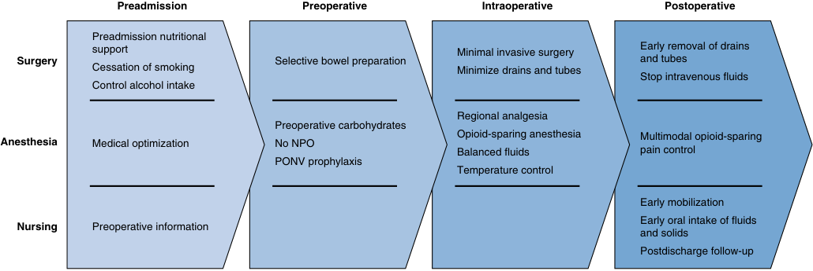

# Perioperative Medicine

<!-- PDF page 1 -->

NEAL H. COHEN and MICHAEL A. GROPPER

### KEY POINTS

- Advances in the scientific underpinnings of anesthesia practice, expansion of anesthesia subspecialties, and changes in perioperative care have been instrumental in facilitating advances in surgical care and practice. Many new approaches to surgical and procedural care have been supported by changes in anesthesia practice and scope, allowing surgeons to perform minimally invasive or other interventional procedures not only in the traditional operating room (OR) environment but also in many alternative non- OR settings. As a result of these changes, OR anesthesia and intraoperative care no longer dominate most anesthesia practices. Each practice must understand and respond to the changing needs of the patient population it serves and the expectations of the surgeons and others regarding the need to expand the scope of anesthesia services to support advances in perioperative and periprocedural care.

- The goal for perioperative medicine is to improve patient care, aligning patient goals and expectations with clinical objectives and fostering improved clinical management and decision-making. Perioperative medicine requires coordination and shared decision- making among a diverse group of providers within and beyond the hospital setting.

- Perioperative medicine is not a specialty- specific model of care. Providing optimal perioperative care in the current health care environment requires collaboration with other providers across the health care system. Anesthesiologists are well- positioned to take a more prominent role in perioperative management, integrating their understanding of patients’ surgical and medical needs during and after surgical procedures. At the same time, collaboration with hospitalists, medical specialists, and others is critical to improving perioperative care. Anesthesiologists participating in perioperative medical models of care must understand their roles and, in many cases, develop new collaborations with other providers and specialties to coordinate perioperative care and optimize transitions through the continuum of care. The specific models for delivery of a coordinated approach to perioperative care will vary depending on the interest and commitment of the anesthesiologists for assuming an expanded role, established relationships within each health system, as well as the needs of each patient and existing relationship with other providers.

- The subspecialization of anesthesiology creates opportunities for anesthesia practices to participate in perioperative medicine models of care, collaborating with surgeons, other proceduralists, and other medical subspecialists in developing clinical protocols to address patient needs across the continuum of care. When implemented, these models have been demonstrated to improve outcomes, reduce complications, length of inpatient stays, and, in many cases, costs of care. Accomplishing these goals for subspecialties requires support of the anesthesia practice to ensure that the anesthesiologists knowledgeable about the specific needs of the patients are available to fulfill these clinical goals without compromising the commitment to meet clinical demands and support other initiatives vital to the success of the department and health system.

- Various models for perioperative medicine are being successfully adopted in the United States and other countries. The perioperative surgical home (PSH) and Enhanced Recovery After Surgery (ERAS) protocols are examples of new approaches to collaborative multidisciplinary care. While these models vary from one health system or practice to another, each has documented significant benefits for a variety of procedures and clinical situations; these models have also demonstrated the importance and value of aligning perioperative goals for patients, providers, hospitals, and payors.

- While exciting, new approaches to perioperative care are also challenging to implement. Expanding the scope of practice and assuming greater responsibility for managing patient care throughout the perioperative period requires new knowledge and skills beyond those traditionally required of an anesthesiologist, including not only understanding of the implications of and managing underlying medical conditions and comorbidities but also addressing clinical needs beyond the immediate perioperative period.

- To successfully integrate perioperative medicine into their practice, anesthesiologists must acquire a more comprehensive understanding of the economics of health care and the role perioperative care has in determining costs of care, outcomes, quality, and safety. Advances in perioperative medicine have been demonstrated to reduce costs and improve outcomes. Based on these successes, private and government payors are evaluating alternative payment

<!-- PDF page 2 -->

models to compensate clinicians and health systems based on the documented “value” of care to better align quality, costs, and care goals. Many alternative payment models transfer the financial risk from patients and payors to providers. Anesthesia practices must understand these new payment models, their impact on clinical management, opportunities and threats associated with these expanded roles in perioperative care, and what metrics will be used to determine how the practice will be compensated (or penalized) based on predetermined performance measures.

- The electronic health record and access to “big data” can serve as valuable resources in identifying approaches to optimizing care and outcomes for individual patients based on their unique situations. Effectively taking advantage of the extensive data incorporated in the electronic record will require that anesthesiologists acquire skills in biomedical informatics and data sciences to advance perioperative care. Artificial intelligence (AI) has begun to impact perioperative management with significant potential to improve diagnostic and therapeutic decision- making. At the same time, AI will not and should not replace the critical importance of the relationship between the anesthesiologist, patient, and other providers in determining the best approach to optimizing clinical management. With appropriate integration into clinical practice, however, AI will provide another source of information that should ideally improve clinical performance and decision- making, optimize the care of each patient, and reduce complications. Similarly, advances in precision medicine will improve the perioperative anesthesiologist’s ability to identify ways to optimize the care of each patient based on integration of pharmacogenetics and risk profiling, integrated with AI and machine learning.

## Introduction

The primary focus of anesthesia practice has traditionally been the intraoperative management of patients undergoing surgical procedures in hospitals or ambulatory settings. Based on this model of care, anesthesiologists have been acknowledged for the significant improvement in perioperative safety and quality.1 As a result of advances in anesthesia care and major improvements in surgical and diagnostic capabilities, anesthesia services have expanded to include a wide variety of hospital- based and ambulatory settings outside of the operating room. While the diversity of anesthesia services has expanded, the basic elements of anesthesia care have remained relatively consistent – preoperative assessment, intraoperative management, and postoperative care provided to ensure a safe transition through the perioperative period. With increasing subspecialty training opportunities and changes in health care delivery and payment, new opportunities have developed for anesthesiologists to assume a broader role in perioperative care and managing patients in the operating room and beyond. At the same time, with the increasing clinical capabilities of both surgeons and anesthesiologists, as well as the escalating costs of health care, particularly in the United States, the health system is under significant pressure to improve quality and safety while delivering value- based care consistent with patient wishes.2–4 These changes in capabilities and expectations create opportunities for anesthesia practices to evolve and for the role of anesthesiologists to extend beyond current clinical practices.

“Perioperative medicine” defines evolving models of care designed to coordinate perioperative management across the continuum from contemplation about proceeding with surgery to the recovery period. This approach has been demonstrated to improve outcomes and quality of care and, in many cases, reduce lengths of hospital stay and costs.5–7 While the role of each provider in the perioperative continuum of care varies depending on the clinical situation

and setting, one of the hallmarks of a successful model for perioperative medicine is the collaboration among all providers. As the model for perioperative medicine has evolved, the role of the anesthesiologist in many health care systems has expanded to include more significant involvement in preoperative management, new models for intraoperative care that individualize care for each patient based on underlying clinical conditions and patient goals, as well as more extensive participation in postoperative care, including but not limited to pain management.

This chapter reviews some of the changes in health care delivery and financing that create opportunities for anesthesiologists to expand their practices to incorporate concepts of perioperative medicine. It provides some examples of approaches to the delivery of a more coordinated approach to perioperative care that can impact clinical practice, optimize quality and safety, reduce costs, and facilitate the implementation to a value- based, patient- centric approach to care.

## The Anesthesiologist and Perioperative Medicine

Perioperative medicine is an evolving field that focuses on optimizing the health and health care delivery of patients undergoing surgery and providing medical care for those patients following surgery. Anesthesiologists are well suited to advance their role as specialists in perioperative medicine and provide better care for surgical patients. New anesthetic techniques, monitoring capabilities, and evidencebased approaches to perioperative management have made anesthesia safer and improved the quality and efficiency of perioperative care.1 Advances in surgery, including the development of minimally invasive techniques, have had significant impact on how anesthesia care is provided and expanded the locations in which anesthesia services are needed. At the same time, in part due to these changes, the

<!-- PDF page 3 -->

patient population presenting for anesthesia has changed. Patients with significant underlying medical conditions who in the past were not considered candidates for surgery are now able to undergo complex surgical procedures successfully. These changes have had significant impact on health systems, significantly increasing complexity and costs of care while also putting pressure on health care resources, including hospital bed capacity.8,9

For anesthesiologists, the advances in care, the diversity of patients requiring anesthesia services, and the high care costs create new opportunities and challenges. Most significant to the practice of anesthesia has been the expansion in scope of clinical responsibilities in perioperative care of patients beyond the traditional operating room roles and the need to improve operational efficiency in perioperative/periprocedural care and reduce costs. The challenges also allow anesthesiologists knowledgeable about operating room management to assume health system leadership roles and improve health care delivery for surgical patients. The expansion in the scope of anesthesia practice is related to several different factors. The extension of anesthesia care to other inpatient and outpatient settings is based on management strategies and lessons learned in optimizing care in the operating room. Expanding anesthesia services to interventional radiology, endoscopy, and cardiology suites has resulted in improved clinical management and, in some cases, better throughput.

Anesthesiologists have also modified clinical practices to optimize clinical care and improve efficiency. For example, preoperative assessment has been refined to improve clinical outcomes and reduce costs associated with laboratory testing and other preoperative testing that add no value.10,11 At the same time, anesthesiologists have had a more significant role in optimizing patients before surgery. Preoperative management of patients with underlying medical conditions, including diabetes, cardiopulmonary disease, and renal insufficiency, has been even more effective at improving the perioperative course and minimizing the likelihood of postoperative complications. In some cases, consultation with other medical specialists is required. Still, for most patients, the anesthesiologist’s role is critical to optimizing the patient’s conditions preoperatively as anesthesiologists best understand the interplay of the various perioperative variables, including patient factors, anesthesia, and surgical techniques to the perioperative course of care. As a critical aspect of optimal perioperative medicine, anesthesiologists can provide postoperative management, including critical care and pain management for many of these patients based on their preoperative risk assessment and intraoperative course. In many respects, these changes have redefined anesthesia to encompass perioperative medicine.12–14

The expansion of anesthesia training in multiple subspecialties, critical care medicine, and acute and chronic pain management also provides advanced and diverse skills that allow anesthesiologists, in collaboration with surgical specialists, to ensure a coordinated approach to perioperative management. As a result, many anesthesia subspecialists have successfully expanded their roles in perioperative care. As one example, transplant anesthesiologists (also see Chapter 56) are often involved in discussions about patient selection, preoperative optimization, and care transitions

from the operating room to the postoperative period. Based on the collaboration of anesthesiologists, transplant surgeons, and medical specialists, anesthesiologists participate in selection discussions to provide their perspective on the perioperative implications of transplantation. Collaboration with the anesthesiologists has resulted in reengineering of care for many transplant services. Many patients who previously required postoperative care in the intensive care unit (ICU) can now bypass the ICU and have reduced hospital lengths of stay.15 Similar outcomes have been documented for patients who have anesthesiologists participate in their perioperative management for cardiac surgery (also see Chapter 50), pediatric surgery (also see Chapters 73–75), neurosurgery (also see Chapter 53), or other subspecialties. In each of these examples, collaboration among the surgeons, anesthesiologists, and the overall team of providers within and beyond the operating room environment is critical to realizing improved outcomes and reduced care costs.

Anesthesiologists with advanced training in pain medicine and critical care can facilitate and optimize perioperative management. Pain management strategies have a significant positive impact on the care of patients with both acute and chronic pain (also see Chapters 47, 76, and 77). Employing multimodal approaches to perioperative pain management, particularly for patients with long-standing chronic pain, perioperative pain medicine teams have positively impacted perioperative outcomes, including reduced need for opioid analgesics and in some cases shortened the length of stay in hospital and improved patient satisfaction.16–18 Similarly, critical care anesthesiologists play a significant role in improving perioperative management of patients requiring ICU care. The value of the critical care physician on ICU utilization in reducing complications of mechanical ventilation, providing early diagnosis and treatment of sepsis, and improving management strategies for patients with renal dysfunction are well documented (also see Chapters 79 and 80).19–21

An equally important factor contributing to anesthesiologists assuming greater responsibility in perioperative management is their knowledge of the overall perioperative environment, its complexities, and associated high costs. Advances in anesthetic management have facilitated the implementation of new surgical techniques and allowed patients previously considered poor risks to undergo complex surgical procedures with good outcomes. These advances in care have contributed to the escalating cost of health care, particularly in the United States.2 Not only are the high costs specifically related to the procedure, but also there are often substantial additional costs associated with complications of care, postdischarge care, and readmissions.22,23 Anesthetic management also impacts perioperative care costs, hospital length of stay, need for prolonged postoperative ICU stay, and other clinical outcomes. For example, intraoperative management can contribute to postoperative complications, such as pressure ulcers, central line infections, renal failure, aspiration and ventilator- associated pneumonia, cognitive dysfunction, and other complications. When these complications occur, hospitalizations are lengthy, and rehabilitation (skilled nursing, physical, and rehabilitation services) needs are significant.

<!-- PDF page 4 -->

The need to address costs associated with managing complications of care is taking on greater importance. Over the past few years in the United States, government and private payors have raised concerns about the costs associated with managing complications of care, some of which are relevant to anesthetic management. These payors are reducing payment for costs associated with complications and denying payment for costs related to readmissions.24,25 As part of perioperative medicine, anesthesiologists have to identify these perioperative risks and, when clinically appropriate, identify ways to modify management to improve outcomes and reduce costs.

Another factor that has precipitated a need to address perioperative care in a more coordinated manner is the impact of changes in payment methods being implemented by both government and private payors to control the costs of care. In the United States, the primary payment method to physicians remains fee based. While the implications of fee- for- service (FFS) payment methodology on quality of care and resource utilization are widely debated, FFS payment models are associated with the overuse of some services, higher costs, and poor coordination of care.26 In response to these issues, several alternative payment models (APMs) have been implemented, including bundled payment methods and incentive- based payments associated with reduced costs of care and penalties when costs remain high. Under the Medicare Access and CHIP Reauthorization Act of 2015, Medicare has implemented several APMs and a Quality Payment Program that includes a MeritBased Incentive Payment System (MIPS), each designed to compensate physicians for improving patient outcomes at reduced cost.27 Medicare is also encouraging the development of accountable care organizations (ACOs) in which health systems assume clinical and financial responsibility for managing a population of patients, improving quality, and reducing overall costs.

These changes in care management and payment methodologies significantly impact all physicians and health systems. They shift responsibility and risk to the providers, forcing physicians and health systems to implement valuebased care. Anesthesiologists are knowledgeable about the complexities associated with perioperative care and can manage many aspects of the care and systems needed to optimize it. Consequently, they can help define new models of care, extend their role, and assume greater responsibility for managing the perioperative course of some patient populations. For example, suppose anesthesiologists can help reduce costs during care for a surgical patient. In that case, they can benefit financially under bundled payment methodologies, shared savings plans, and participating in ACOs. Although issues related to payment methodologies are very different from one country to another and are beyond the scope of this chapter, the goals and implications of these newer payment methodologies should be understood by all anesthesiologists since they have significant implications on the practice of anesthesia and the role for the anesthesiologist in perioperative medicine broadly.

While anesthesiologists are well suited to impact perioperative care positively, anesthesiology departments must adjust their focus and priorities to be better engaged in perioperative medicine. When provided in a coordinated way, perioperative care is cost- effective and improves

outcomes.7 At the same time, the expansion of anesthesia practices, the diversity of roles and responsibilities, and the subspecialization of anesthesia care have, in some ways, compromised the ability of anesthesiologists to fulfill their potential as perioperative providers. Compartmentalization of perioperative care and subspecialization has the risk of fragmenting care and undermining the development of a coordinated approach to perioperative management. At many hospitals, preoperative care is now provided in a dedicated preoperative evaluation clinic, physically separate from the operating room or other clinical sites. The evaluation is performed at some time before the surgical procedure; communication about the patient’s status and clinical plans is often done electronically with no face- to- face dialog or communication with the anesthesiologist who will deliver care during the procedure. Operating room care is provided by an anesthesiologist either personally or as part of the anesthesia care team model. Postoperative management – including care in the postanesthesia care unit, pain management, and ICU care – is often provided by another set of care providers. Perioperative medicine requires collaboration among all anesthesia providers, incorporating the knowledge and skills of each participant, including those providing preoperative management, intraoperative care, critical care, pain management, and so on. As much as each of the providers is essential to patient care, the coordination of care among the anesthesiologists as a group is also a critical element in optimizing care, understanding, and fulfilling the patient’s goals for care, and improving efficiencies. In addition to the factors that impact the clinical practice of anesthesiology, anesthesiologists have assumed broader roles in health system leadership, including serving as perioperative medical directors, chief quality officers, and other administrative and leadership positions related to perioperative care and broader health system management.28 Based on these leadership roles, anesthesiologists both understand and can foster the implementation of perioperative medicine models that will have a significant impact on patient care and patient satisfaction, as indicators of quality, safety, and value.

## Perioperative Management

This text discusses the role of the anesthesiologist in various aspects of perioperative management. Each component is critically important to care quality, safety, and value (also see Chapters 28 and 76). The overall approach to care from when a case is scheduled until the patient has recovered from anesthesia and surgery and resumed normal activities should be of concern to the anesthesiologist. Just as anesthesia as a specialty is acknowledged for advances in safety and quality in the intraoperative case, it should extend its focus and responsibility to the entire perioperative period – coordinating assessment, management, and responsibilities with the surgeons, hospitalists, other physicians, and nurses. By optimizing each of them independently and then coordinating the care across the continuum, the benefits of providing perioperative medicine will be achieved – with improved clinical outcomes, safer care, and reduced costs.

<!-- PDF page 5 -->

### PREOPERATIVE ASSESSMENT AND MANAGEMENT

Chapter 28 emphasizes the changing patient needs and the role of the anesthesiologist concerning preoperative assessment and management. The chapter provides a more comprehensive discussion. To summarize current practices, a formal preoperative assessment is usually not required for most healthy patients.10,11 In fact, anesthesia providers have reduced preoperative testing and other costs by implementing evidence- based protocols to standardize preoperative management for many patients.11 Rather than requiring a preoperative visit, laboratory testing, and radiologic studies, most patients now have a phone consultation, often performed by a nurse practitioner, to assess preoperative status and perioperative needs and to address a patient’s questions or concerns. A more comprehensive evaluation and preoperative management and optimization of underlying conditions may be required for other patients, particularly those with underlying medical conditions or complex comorbidities.23 For this subset of complex patients, preoperative assessment and management are an integral part of the perioperative care continuum for which the anesthesiologist has a significant role. In some cases, additional diagnostic studies, such as an echocardiogram or focused pulmonary function studies, may help determine how best to manage a patient during the perioperative period. In this situation, interpretation of the studies may be done in coordination with a consultant or physician who has provided care to the patient preoperatively and who will resume care after the procedure is beneficial. The preoperative anesthesiologist may require a formal consultation with another specialist, such as a cardiologist, nephrologist, or pulmonary medicine physician, although these are needed for only a select few patients. For those patients with significant underlying conditions that will influence the perioperative course, particularly the postoperative recovery, referral for additional preoperative management (prehabilitation) can help optimize their clinical status before proceeding with a major surgical procedure.29–33 For most patients, the specific management strategies required to optimize the patient for anesthesia and surgery are often best defined when input is provided by the anesthesiologist who is most knowledgeable about the impact of chronic conditions on perioperative care needs as well as the implications of anesthesia on underlying physiology.

### INTRAOPERATIVE (INTRAPROCEDURAL) CARE

Several initiatives have been implemented in hospitals worldwide to improve intraoperative management, minimize complications, and reduce costs. The implementation of checklists has been demonstrated to improve patient safety in the operating room (also see Chapter 5).34–36 Similarly, the routine briefing (i.e., time out) before a surgical procedure reduces the incidence of wrong- site surgery, facilitates communication among providers, and ensures optimal patient care.37 Some hospitals and surgical services also conduct debriefings at the end of each surgical procedure to define what procedure has been completed, clarify the postoperative expectations for the patient, and ensure that all supplies and materials have been appropriately

retrieved from the surgical field.38 These initiatives have reduced complications during surgery and, in some cases, reduced care costs. For example, the British National Health Service instituted “The Productive Operating Theatre” to improve productivity and patient outcomes during surgical procedures.39,40 The program includes briefings and debriefings to identify critical issues during and after a surgical procedure. This process has reduced errors and facilitated the transition from the operating room after a surgical procedure. Operating room utilization has increased, turnaround times have shortened, and waste has been reduced. Significant financial savings have also resulted from this effort. The National Health Service is implementing similar initiatives in other hospital settings, such as “The Productive Ward,” to build on the success achieved in the operating room environment.41 Anesthesiologists need to be part of such initiatives that ensure there is an integrated approach to management during the intraoperative periods to demonstrate a significant and sustained impact on outcomes.

### POSTOPERATIVE ASSESSMENT AND MANAGEMENT

The transition out of the operating room represents another important opportunity for anesthesiologists to enhance the quality and safety advances achieved in the operating room and improve perioperative patient outcomes. Advances in anesthesia safety have been acknowledged by the Academy of Medicine (formerly the Institute of Medicine) of the National Academy of Sciences1 and other groups due to better anesthetic drugs, new anesthetic techniques, and improved monitoring. Although the incidence of intraoperative complications has been dramatically reduced, complication rates in the postoperative period remain high. The impact of variability in anesthetic practices on postoperative outcomes **–** beyond the immediate postoperative period **–** has received increasing attention for patients who remain hospitalized and those who experience unintended and often unrecognized sequelae of anesthesia and surgery after discharge. For example, after a surgical procedure requiring tracheal intubation, many patients experience post- extubation stridor or dysphagia that may last for days. These findings compromise the ability to protect the airway, particularly during sleep.42 Does the dysphagia contribute to postoperative pneumonia that may not become clinically apparent until after discharge? Similarly, the most common health care **–** associated infections are pneumonia and surgical site infection, supporting the concept that intraoperative management is an essential determinant of postoperative outcome.43 Other intraoperative strategies also impact long- term outcomes beyond the immediate postoperative period. Three examples support this conclusion. First is the influence of intraoperative fluid and vasopressor management on postoperative metabolic status and renal function.44,45 Second, intraoperative glucose control can have a significant impact on wound healing.46 Finally, and more recently, anesthetic management has been demonstrated to influence postoperative cognitive dysfunction for both adults and children.47,48 As a result of these findings, anesthesiologists have a responsibility and an opportunity to understand the causes of these and other complications.

<!-- PDF page 6 -->

We need to understand how anesthetic management contributes to adverse outcomes and how to modify intraoperative and postoperative care to reduce them.

In addition to monitoring and managing clinical issues in the initial postoperative period, anesthesiologists can also have a role in providing ongoing assessment and management of patients after recovery from anesthesia. The use of remote monitoring can help identify and manage issues including, but not limited to, optimal opioid- sparing pain management, identification and management of postoperative delirium, or other sequelae of the surgery and anesthesia arising later in the postoperative period. By utilizing these monitors, whether in the facility or home environment, the anesthesiologists can monitor vital signs and respiratory and cardiovascular parameters to assess the patient’s status and both manage and prevent unrecognized complications or risks during the recovery period.

### COORDINATED PERIOPERATIVE MANAGEMENT STRATEGIES

While perioperative care components have specific requirements and approaches to optimize management, improve outcome, and potentially reduce cost, perioperative management strategies must be assessed collectively, often using evidence- based clinical pathways to ensure that the goals of perioperative medicine are met.49,50 Anesthesiologists have the capability and opportunity to address these needs. To achieve these goals, however, each department must be willing to reassess current models of care and modify some practices to achieve the desired goals. One critical challenge to effectively coordinating care is the perioperative course’s complexity and management. In most clinical situations, it is no longer possible, nor appropriate, for a single anesthesia provider to participate in all aspects of the perioperative course. Different anesthesiologists, including pain medicine and critical care anesthesiologists in selected cases, often provide perioperative, intraoperative, and postoperative care. Optimizing perioperative management under this model requires improved communication and collaboration among the anesthesia providers as well as with others who participate in a patient’s care. For some patient populations, such as geriatric patients or those with complex comorbidities, co- management agreements with other specialists can be executed to optimize care across the perioperative continuum while clarifying roles and responsibilities.51 The electronic health record is a valuable source of clinical information. Still, it cannot substitute for more direct communication among providers, particularly in managing complex clinical problems (also see Chapters 5 and 6).

The collaborative approach to care may seem optional for healthy patients undergoing straightforward procedures. However, the value and opportunities for anesthesiologists to take a larger role in perioperative care are clearly evident for almost all patients – and the coordinated approach is appreciated by patients who are often confused about who is managing their care.52

For example, patients undergoing “simple” procedures often have underrecognized postoperative clinical issues that require assessment and management. Anesthesiologists, surgeons, and nurses provide patients with

instructions and information to help them manage their postoperative course, often at a time when they are not able to understand or process the information. As a result, even in these cases, the anesthesiologist can be instrumental in addressing postoperative anesthesia–related problems and coordinating the transition of the patient’s care back to the primary care provider. The surgeon can provide information about the surgical procedure by forwarding the operative note to the primary care provider. Still, it rarely addresses any issues related to anesthetic management, concerns about the airway or potential for airway obstruction, or sequelae related to anesthetic agents, narcotics, muscle relaxants, or regional anesthetic blocks. Often, a phone consultation or teleconference is sufficient to address clinical needs. In other cases, a formal postoperative office visit may be required, as some anesthesia practices offer. Expansion of the postoperative assessment and management can be beneficial to patients, surgeons, and other providers at the facilities to purvey a level of support to the patients that is often unavailable. The adoption of information technology resources and the continued evolution of medical informatics (also see Chapter 4) can enhance communication between patients and physicians during the entire perioperative period.

Besides the desire for a more coordinated approach to the entire perioperative course for every patient, a more formal and robust perioperative management strategy must be available for those patients with underlying medical conditions, those undergoing complex surgical procedures, and those needing prolonged hospitalization. In addition, for patients who require skilled nursing or rehabilitation services after discharge and those needing home health services, the care transitions create challenges for ensuring that postoperative management strategies are maintained, responses are assessed, and therapy is modified as needed. By its very nature, perioperative care for these patients is collaborative, requiring input and expertise from several different disciplines, including, but not limited to, anesthesia subspecialty expertise, surgeons, and medical subspecialists. Diverse perspectives and clinical expertise are essential, particularly for the more complex procedures in patients with multiple comorbidities and at extremes of age (see Chapters 61 and 72). At the same time, the coordination of care must be assumed by a provider who can integrate the diverse perspectives into a comprehensive plan of care consistent with each patient’s needs and goals. In the distant past, this coordination was provided by the patient’s primary care provider, who maintained a role throughout the perioperative period. With the increasing complexity of perioperative care, changing demographics, and the need to provide more efficient and coordinated care to reduce overall costs, the anesthesiologist has the opportunity to assume a more involved role in managing some of these patients. To do so will require the commitment of the anesthesia practice to this new model of care and, in many cases, the acquisition of new clinical and management skills to deliver optimized, efficient, consistent care with patient expectations. One of the most prominent barriers for an anesthesia department to assume a more significant role in perioperative management is its members. There must be consensus from all members of the department that a coordinated strategy is important and consistent with their expectations.

<!-- PDF page 7 -->

To achieve department support, it is vital to clarify that perioperative management is a comprehensive care approach involving a diverse group of providers. Every group member must participate in the overall commitment to perioperative care. The care will be provided by several different anesthesiologists, each with different clinical expertise. One example of this coordinated approach to perioperative care is the management of a patient with a history of chronic severe pain who undergoes a complex surgical procedure. The patient will undergo extensive evaluation and optimization of care in the preoperative evaluation programs. Intraoperative care will be provided by another anesthesiologist who has communicated with the patient and understands all of the clinical issues identified and addressed preoperatively. When the patient is transferred to the ICU for postoperative care, which includes ventilator support, intensive respiratory care, hemodynamic monitoring, and fluid management, the transition from the anesthesiologist who provided intraoperative care to the critical care anesthesiologist is seamless. Pain management is provided by the pain service in collaboration with the critical care anesthesiologist (also see Chapters 47 and 77). The remainder of the patient’s course of care will be managed by a member of the anesthesia department to facilitate the transition to another care facility or home and to ensure effective communication with the primary care provider or other caregivers. Although this model is foreign to many practices, it represents one of many approaches to optimizing perioperative management. It takes advantage of the expertise of anesthesiologists in the overall care of the patients they anesthetize.

Finally, new approaches to perioperative management also require that each practice acquires the necessary operational, clinical, and financial data and the analytical capability to interpret it. Larger regional and national organizations have the broad expertise available to analyze the practice and determine where improvements in processes can benefit patients and enhance the efficiency of the practice. For smaller practices, having this broad level of expertise and access to information can be challenging, although some have very successfully incorporated these strategies. Consequently, in the United States, there has been considerable consolidation of anesthesia practices by large regional and national organizations.53 This consolidation has enabled the larger, often multi- institutional group to provide the resources needed to help anesthesia practices optimize perioperative management and document the value of anesthesia services from a clinical and financial perspective. Some groups have transitioned to multispecialty groups or recruited hospitalists or other providers to the anesthesia practice to supplement the clinical skills of the anesthesiologists so that the department has the diverse clinical and management expertise needed to optimize perioperative care. This multidisciplinary approach to perioperative care enables the group to expand its scope of practice and develop clinical and administrative databases that allow them to document the value of their services to patients and the institution. From an administrative perspective, this strategy better positions the practice to negotiate with hospital or health system representatives, particularly when advocating for the share of bundled payments. Because the administrative and analytical capabilities are essential to

optimize the delivery of perioperative care, each practice of whatever size will need to identify the most effective ways to develop this expertise and acquire the data needed to address the many challenges facing anesthesia practices successfully.

## Models of Perioperative Care

Most health systems and providers are challenged to identify ways to become more efficient and reduce costs while maintaining or improving the quality of care, particularly perioperative care. Accomplishing these diverse goals is difficult, and no single model of care works for every patient population or health care setting. As a result, many approaches to the delivery of perioperative care have been implemented, some successful and some for which the outcome remains unknown. Although models of perioperative management include the anesthesiologist, other providers have participated in the preoperative and postoperative management of complex patient populations, each with variable success. Based on these experiences, the key aspects of any model for perioperative management include (1) an understanding of the specific patient population included in the model (e.g., specific surgical procedure); (2) sufficient clinical and financial information to allow evaluation of the management strategies and their implications; and (3) coordination and collaboration among all providers participating in the model.54–56 As models for perioperative management have evolved, they have taken advantage of the experiences from the hospitalist model for inpatient care and the medical home model for chronic disease management.

### PATIENT- CENTERED MEDICAL HOME

The medical home model, also called the “patient- centered medical home” (PCMH), refers to the model of care in which a primary care physician provides comprehensive care to improve health outcomes for a population of patients.57 The critical element of the PCMH is coordinating care to reduce emergency room visits and hospitalizations. In managing the patient population, several strategies are implemented to reduce costs and improve outcomes. These models often utilize additional providers, including advance practice nurses, respiratory therapists, physical therapists, and patient advocates, to manage chronic diseases such as asthma, chronic obstructive pulmonary disease, heart failure, and diabetes mellitus. Payment for the PCMH includes FFS payments for episodes of care and payment to coordinate care. This model has been successful in improving care, particularly for patients with selected chronic diseases, although financial success has not been consistently achieved.58–60 In some cases, the PCMH resulted in increased hospital admissions.61 Despite the variable success of the PCMH, some lessons can be applied to perioperative care. First, preoperative assessment must be comprehensive enough to identify underlying clinical problems and effectively manage them preoperatively and postoperatively (also see Chapter 28). For the anesthesiologist managing the perioperative period, chronic conditions must be addressed; the management of these cannot be deferred to other providers. The implications of the perioperative needs

<!-- PDF page 8 -->

must be considered when managing patients with chronic diseases during the course of surgical care. Second, the underlying medical conditions must be considered as part of the proposed procedure and its implications for postoperative management. This broader perspective requires coordination with the surgeon and, for some patients, the hospitalist, other specialists, and the primary care provider. For example, a patient with peripheral neuropathy associated with diabetes mellitus may be unable to participate in traditional approaches to rehabilitation; care must be tailored to each patient’s specific needs in consultation with others who can modify care as needed to optimize the likelihood of achieving the desired outcome. Third, while participation by anesthesiologists is essential, many aspects of perioperative care can be managed by other providers, including other physicians and advance practice nurses. The keys to successful perioperative management, however, require that there be a single physician responsible for coordinating care among the team of providers, ensuring consistent and ongoing communication about patient care needs, and the availability of data that can be used to analyze clinical and business practices, costs of care, and outcome measures. The responsible provider during the perioperative period may be the anesthesiologist, surgeon, or hospitalist. As the patient recovers, the responsible provider may transition to the primary care provider as long as there is good communication and appropriate “hand- off.”

### SURGICAL HOSPITALIST

Another model implemented in many hospitals in the United States and other parts of the world is the surgical hospitalist model, which builds on the hospitalist model of care for inpatient medical patients. Many studies have documented the clinical values and other advantages associated with implementing a robust hospitalist program.62,63 Most of the programs have focused on caring for patients with acute (and perhaps underlying chronic) medical problems rather than patients undergoing surgical procedures. For the surgical patient, the role of the surgeon is evolving for several reasons: the percentage of surgical inpatients is increasing, and inpatient clinical needs are becoming more complex and challenging for the surgeon to manage without additional support. As a result, many hospitals are recruiting hospitalists to provide perioperative care for surgical patients.62,63 In some cases, hospitalists work with specific surgical services (or an individual surgeon) to manage overall care and transitions of care into and out of the hospital environment. The models for surgical hospitalist programs vary, in some cases incorporating hospitalists with primary training in internal medicine or pediatrics, and in some cases, having a surgeon with an interest in perioperative care take on the hospitalist role. The clinical management issues in each model are similar, though the knowledge and skill to manage patients with complex comorbidities may differ considerably.

Many of these surgical hospitalist models have successfully optimized care of both underlying medical conditions and perioperative needs related to the surgical procedure. Although there is limited experience to document the effect on hospital lengths of stay and readmission rates, the models have improved timeliness of interventions and patient

and staff satisfaction.63 For this model to be most effective, it requires the surgical hospitalist to know about the idiosyncrasies of perioperative management related to the specific surgical procedures. Their effectiveness is most evident when the care of underlying medical conditions is carefully coordinated with the other perioperative needs of the patient. For example, the neurosurgical hospitalist must understand concepts such as cerebral autoregulation and the impact of clinical interventions on cerebral hemodynamics for a patient who has undergone a neurovascular procedure. Similar considerations must be addressed for hospitalists working collaboratively with other surgical services.

The surgical hospitalist model has been very effective in freeing surgeons to concentrate their efforts on the surgical procedure rather than managing other unrelated medical conditions. However, the optimal relationship between the surgical hospitalist (whether a surgeon who has assumed this nonoperative responsibility or a medical hospitalist) and anesthesiologist during the immediate perioperative period has yet to be standardized. In some cases, perioperative care is transferred from the anesthesiologist to the hospitalist in the immediate postoperative period; in other cases, care may be transferred from the anesthesiologist to an intensivist (either a critical care anesthesiologist or another intensive care physician) while the hospitalist maintains responsibility for managing some of the underlying clinical conditions. In the latter case, the roles and responsibilities of the anesthesiologist, critical care provider, and hospitalist must be clearly defined to ensure appropriate coordination and transitions. Either model can be effective when the coordination of responsibilities is delineated. Another important component in the patient’s perioperative care is the transition from the inpatient to the outpatient setting. There should be good communication and coordination of the transfer of care to the outpatient physician who is provided sufficient information about the intraoperative course and its implications, including any issues that arise as part of the anesthetic management that might impact postoperative management.

### ENHANCED RECOVERY AFTER SURGERY

Enhanced Recovery After Surgery (ERAS) is another example of a creative approach to the perioperative management of patients who undergo major surgical procedures.64,65 ERAS protocols are evidence- based pathways designed to improve care and outcomes and efficiency in the perioperative period. ERAS protocols require a multidisciplinary approach to perioperative care, particularly emphasizing the entire perioperative course. Fig. 3.1 shows implementation of ERAS across the perioperative time spectrum. The most successful ERAS programs are the ones that include participation by all of the health care and service providers who have a role in the perioperative course for the patient population.66,67 Most ERAS protocols include preoperative education, perioperative antimicrobial management, pain management strategies, and early rehabilitation. In some cases, separate protocols have been initiated to address each period in the perioperative course, one to address the immediate perioperative management strategies and another to concentrate on the patient- care needs outside

<!-- PDF page 9 -->

Preadmission Preoperative Intraoperative Postoperative Preadmission nutritional Surgery support Selective bowel preparation Minimal invasive surgery Early removal of drainsand tubes Cessation of smoking Minimize drains and tubes Stop intravenous fluids Control alcohol intake Regional analgesia Preoperative carbohydrates Anesthesia Medical optimization No NPO Opioid-sparing anesthesia Multimodal opioid-sparing Balanced fluids pain control PONV prophylaxis Temperature control Early mobilization Early oral intake of fluids Nursing Preoperative information and solids Postdischarge follow-up 

**Fig. 3.1 Enhanced Recovery After Surgery (ERAS) flowchart.** A typical flowchart overview indicating different ERAS protocol items to be performed by different professions and disciplines in different parts of the hospital during the patient journey. The _wedge- shaped arrows_ depicting each time period move into the period to follow to indicate that all treatments given affect later treatments. _No NPO_ , fasting guidelines recommending intake of clear fluids and specific carbohydrate drinks until 2 hours before anesthesia; _PONV_ , postoperative nausea and vomiting. (Reprinted by permission of Olle Ljungqvist MD, PhD.)

of the immediate postoperative period.68 Many successful ERAS protocols have been implemented to optimize the care of patients undergoing various surgical procedures, including laparoscopic and other colorectal procedures, breast surgery, and urologic surgery.69,70 Other examples include an ERAS protocol implemented to improve perioperative management of living liver donors71 and another designed to optimize perioperative management of patients undergoing elective craniotomy.72 Each of these protocols has resulted in better patient outcomes. For some patients, hospital lengths of stay and postoperative complications were reduced by as much as 30% and 50%, respectively73,74 ; for others, postoperative pain management was improved despite the administration of less opioids.66–71,75

As noted earlier, one of the most important features of the ERAS program, as with other pathways designed to improve perioperative care, is that the protocols are developed by a multidisciplinary group of providers that includes physicians, nurses, respiratory therapists, and others to ensure seamless coordination across the continuum from preoperative, intraoperative, and postoperative (postdischarge) periods.76 The anesthesiologists offer essential information about key components of anesthetic management that can be modified to improve outcomes.

The outcomes associated with implementing ERAS protocols have generally been positive for patients, providers, and health systems. In addition, implementing the protocols with the participation of all providers involved in patient care enables a comprehensive review of the clinical course and outcomes, costs, and resource needs. The participants should be encouraged to review the clinical, financial, and other data regularly and, if appropriate, to modify the protocol to optimize care. For example, a protocol designed to improve care in colorectal surgery identified an increased incidence of acute renal injury.77 The patients at risk for acute renal injury had longer operative times and an associated diagnosis of diverticulitis. The findings emphasized a need to reassess the management strategies and to implement a goal- directed approach to fluid management intraoperatively and postoperatively. Follow- up will be required to determine if these changes in the protocol will

be successful. These findings, however, emphasize the need to not only work collaboratively during the protocol development, but also review the experiences after implementation and modify the protocol when adverse outcomes occur.

Based on experiences with many of the ERAS protocols initiated to date, this approach to refining and improving care has successfully improved outcomes and lowered costs. From a health care economic perspective, the ERAS protocols represent a value- based approach to optimizing care.64 The development of the protocols gives anesthesiologists an opportunity to engage in discussions with surgeons and other providers involved in the patients’ care about optimizing perioperative care and modifying anesthesia practice and pain management strategies to facilitate recovery and potentially reduce complications. At the same time, while the reported improvements in outcome are impressive, anesthesiologists and other providers should ensure that outcome measures of most importance to patients are incorporated into future ERAS protocols in order to enhance their value.67,78

### PERIOPERATIVE SURGICAL HOME

The expanding roles identified for anesthesiologists provide the foundation and framework upon which they can take on even broader roles as perioperative physicians, expanding on current models of care and ERAS protocol- based approaches to more effectively manage patients throughout the perioperative continuum.13,79,80 The American Society of Anesthesiologists (ASA) in collaboration with other medical specialties has developed the perioperative surgical home (PSH) as a model for accomplishing this goal.14,81–85 Many concepts incorporated into the PSH are built on the same foundation as those incorporated into the PCMH model. The PCMH is designed to better manage patients with complex medical problems and comorbidities in the outpatient setting.57,58 In contrast, the PSH emphasizes clinical management of the patient from the time of scheduling a surgical procedure through the entire perioperative period. The PSH is designed to optimize outcomes during and after surgery, and facilitate the patient’s transition

<!-- PDF page 10 -->

back to the primary care provider. As with PCMH, the concept of the PSH model is to provide patient- focused care consistent with patient goals and expectations. The goal of the PSH is to develop evidence- based clinical pathways designed to improve outcomes and reduce overall costs of care across the continuum, including costs associated with home care and skilled nursing facilities.84 Although the goals for implementing the perioperative surgical home are clear, there is no single model or list of specific guidelines one can follow when implementing a PSH. For some PSH models, the anesthesiologist assumes primary responsibility, whereas the surgeon is the lead provider in other cases. For some PSH models, co- management agreements with other providers have facilitated care coordination and resulted in fewer surgical cancellations, fewer complications, lower lengths of stay, and fewer readmissions. For many PSH experiences, when the anesthesiologist assumes a major role in the overall care of planning and execution, input from other providers (including a hospitalist or medical subspecialist) is essential to address the specific clinical needs of each patient. The collaborative relationships developed under the PSH extend to the care of other patients and provide the opportunity for other providers to understand better the anesthesiologists’ skills, roles, and responsibilities. These relationships are also critically important in representing the value anesthesiologists have to the health system and facilitating discussions about the distribution of funds under bundled payment models.

Although the goals for the PSH and ERAS protocols have some similarities, the components and overall goals for the PSH are somewhat broader than the expected outcomes for ERAS protocols. As proposed by the ASA, the PSH has the following major goals:

- Identify the patient and proposed plans

- Facilitate communication among the surgeons, anesthesiologists, and others as needed to coordinate care

- Provide thorough preoperative assessment and develop a care plan, including management strategies for associated diseases

- Develop and implement evidence- based protocols for clinical care throughout the perioperative period

- Manage clinical care across the continuum

- Measure and publicly report outcomes and performance

The fundamental components of the PSH are desirable goals and build on many of the basic concepts of perioperative medicine. The PSH is generally more comprehensive and requires thoughtful leadership and institutional commitment beyond what is often necessary for an ERAS protocol designed to reengineer care for a focused surgical procedure.85,86

Several different models for implementation of the PSH have been successfully implemented for selected patient populations with impressive results.87,88 Some are relatively straightforward evidence- based strategies to optimize perioperative care, whereas others are more comprehensive. The process for developing a PSH is not straightforward. It can be cumbersome, requiring a great deal of coordination across inpatient and outpatient settings and, in some cases, participation of different health care systems. One of the important elements of any PSH model is the designation of a physician leader who is responsible for overseeing the

perioperative care continuum. Implementing a successful PSH requires that the physician champion have some training and experience in process improvement strategies.89,90 The model also requires support from other providers, particularly surgeons and hospital administrators.91

Although the PSHs have been implemented in various health care settings, the most comprehensive models can be successfully implemented in “closed” health care systems, such as the Veterans Administration, Kaiser, and other fully integrated delivery models.88,91–93 The implementation is more challenging when the PSH requires the participation of providers and facilities from multiple different environments, as may be required for patients needing rehabilitation, skilled nursing, or home care.

Despite these constraints, the implementation of the PSH has been successful, with improved clinical care, reduced costs, shorter lengths of stay, fewer hospital readmissions, and both provider and patient satisfaction. The fundamental components of the PSH are desirable goals and build on many of the basic concepts described for perioperative medicine. The model has promise in addressing the challenges associated with care to patients with complicated medical problems who are scheduled to undergo a complex surgical procedure. How effectively this model can be expanded to address this broader patient population and engage more providers and health systems is still to be determined.86,94

## Artificial Intelligence and Perioperative Medicine

Integrating artificial intelligence (AI) into perioperative care is another exciting opportunity to identify ways to optimize management strategies that will improve outcomes while avoiding interventions for which the risk outweighs any benefit for the individual patient. AI can analyze complex data across the continuum of care and provide information upon which to make appropriate clinical decisions.95–97 Using AI allows the examination of data on outcomes and risks related to all aspects of perioperative care, including preoperative assessment and management strategies, intraoperative anesthesia care, surgical interventions, and associations with postoperative morbidity and mortality. Through this integrated approach to managing large databases of clinical information, innovative approaches to management can be defined that will improve quality of care and safety and reduce cost, supporting the implementation of value- based approaches to clinical care. The integration of AI into perioperative practice provides an important new tool to help implement perioperative strategies to potentially optimize the care for each patient. Because of the power of AI to analyze large quantities of data and integrate the findings into clinical practice, it can provide an exciting, somewhat intimidating, but also transformative approach to perioperative care.

## Perioperative Precision Medicine

In addition to the opportunities created by integrating AI into perioperative decision- making, advances in precision medicine can allow the perioperative provider to define

<!-- PDF page 11 -->

individualized approaches to care for each patient based on genetic variants and/or phenotypic differences, molecular derangements, and other variables.98 Some studies have demonstrated methods by which care can be tailored to specific patient needs, such as genetic- based prediction of responses to analgesics and methods to predict and potentially minimize the risk of perioperative complications. To date, the implementation of precision medicine into routine perioperative practice has been limited.99 Major advances in perioperative precision medicine will require further pharmacogenetic studies of medications commonly used in the perioperative period. As is true of other potential approaches to improving clinical decision- making, advances in precision medicine will necessitate analysis of large databases, the foundation of which is the electronic medical record, machine learning capabilities, and artificial intelligence to support, not replace, clinical judgment. As a result, successfully utilizing precision medicine to individualize care will require ongoing collaboration between the perioperative providers and investigators developing the diagnostic tools to define how each patient will respond to medications used as part of their perioperative care. This collaborative approach to perioperative care has the potential to transform management, reduce risks, and improve outcomes.

## Conclusion

multiple strategies will be required to address the idiosyncrasies of each patient population, surgical procedure, and institutional capabilities. The PSH is an example of a new creative model that might have significant benefits for selected patient populations, aligning the goals of the patient, provider, hospital, and payor, and significantly improving perioperative care by building on the experience and successes of other approaches including ERAS, the surgical hospitalist model, and the PSH. To successfully assume an expanded role, anesthesiologists will have to build on their clinical expertise and will have to acquire and analyze data on outcomes and costs to document that the new models of perioperative care are fulfilling the needs of all providers, health systems, payors, and, most importantly, patients.100,101

### Acknowledgments

The authors would like to thank Dr. Aman Mahajan for his contributions on this topic in the 9th edition of this work. It has served as the foundation for the current chapter.

### Complete references available online at expertconsult.com.

### References

1.  Committee on Quality of Care in America Institute of Medicine. _To Err is Human: Building a Safer Health System_ . National Academy Press; 2000.

2.  Papanicolas I, et al. _JAMA_ . 2018;319(10):1024.

3.  Shrank WH, et al. _JAMA_ . 2019;322(15):1501.

Perioperative care continues to evolve largely because of the advances made in surgical and anesthesia management of patients undergoing complex procedures in the operating room and nonoperating room settings. Surgical procedures are now commonly performed on patients with underlying medical conditions that impact anesthetic and surgical management. At the same time and, in part, due to the changing patient population, the cost of care continues to escalate. Payors are concerned about the increasing costs of care and, in some cases, point to the lack of evidence to support some costly clinical practices. Medicare and some private payors are transitioning to MIPS with associated incentives for providing value- based care and penalties for poor performance.85 At the same time, providers are asked to assume greater risk by providing bundled payment for selected diagnoses. To address these dramatic shifts in payment and concerns about the overall costs of surgical care, new models of perioperative care and implementation of clinical pathways based on evidence have evolved. These new models of care require better cooperation and coordination among all providers. The concepts behind perioperative medicine provide the framework to re- engineer care to address these challenges. Although no single strategy is appropriate for all clinical settings and patient needs, the one critical component of perioperative medicine is implementing a care model that ensures coordination, collaboration, and improved transitions across the continuum from preoperative assessment and management to postoperative rehabilitation. These elements allow anesthesiologists and anesthesia departments to expand their scope of practice, building on the successes in improving intraoperative quality and safety. Several alternative approaches to optimizing perioperative care may be appropriate. In all likelihood,

4.  Patel AS, et al. _Appl Health Econ Health Policy_ . 2013;11:577.

5.  Khambaty M, et al. _Am J Med_ . 2022;135(11):1306.

6.  Mariano ER, et al. _Anesth Analg_ . 2017;125(5):1443.

7.  Vetter TR, et al. _Anesth Analg_ . 2017;124:1450.

8.  McCrum ML, et al. _Med Care_ . 2014;52(3):235.

9.  Song PH, et al. _J Healthc Manag_ . 2017;62(3):186.

10.  Bader AM, et al. _Cleve Clin J Med_ . 2009;76(suppl 4):S104.

11.  Correll DJ, et al. _Anesthesiology_ . 2006;105:1254.

12.  Rock P. _Anesthesiol Clin_ . 2000;18:495.

13.  Kain ZN, et al. _Anesth Analg_ . 2015;120(5):1155.

14.  Perioperative Surgical Home. https://www.asahq.org/in- thespotlight/perioperative- surgical- home#:∼:text=ASA%20champion s%20a%20model%20of,%2C%20consultation%2C%20engagemen t%20and%20economics.

15.  Taner CB, et al. _Liver Transpl_ . 2012;18:361.

16.  Garimella V, Cellini C. _Clin Colon Rectal Surg_ . 2013;26:191.

17.  Ilfeld BM, et al. _Pain_ . 2010;150:477.

18.  Rivard C, et al. _Gynecol Oncol_ . 2014;133(2):278.

19.  Hashemian SM, et al. _N Engl J Med_ . 2014;370:979.

20.  Shiramizo SC, et al. _PLoS One_ . 2011;6:e26790.

21.  Ferrer R, Artigas A. _Minerva Anestesiol_ . 2011;77:360.

22.  Deepa C, Muralidhar K. _J Anaesthesiol Clin Pharmacol_ . 2012;28:386.

23.  Bozic KJ, et al. _Clin Orthop Relat Res_ . 2014;472:188.

24.  Mattie AS, Webster BL. _Health Care Manag_ . 2008;27:338.

25.  Teufack SG, et al. _J Neurosurg_ . 2010;112:249.

26.  Vats S, et al. _Med Care_ . 2013;51:964.

27.  Medicare QPP Resource Library. https://qpp.cms.gov/about/resou rce- library.

28.  Mathis MR, et al. _Anesth Analg_ . 2022;134(2):242.

29.  Carli F, Scheede- Bergdahl C. _Anesthesiol Clin_ . 2015;33(1):17.

30.  Carli F, et al. _Anesth Analg_ . 2021;132(5):1494.

31.  Gillis C, et al. _Br J Anaesth_ . 2022;128(3):434.

32.  Vlisides PE, et al. _J Neurosurg Anesthesiol_ . 2019;31(2):212.

33.  West MA, et al. _Curr Anesthesiol Rep_ . 2017;7(4):340.

34.  Cullati S, et al. _BMJ Qual Saf_ . 2013;22:639.

35.  Millat B. _J Visc Surg_ . 2012;149:369.

36.  Rateau F, et al. _Ann Fr Anesth Reanim_ . 2011;30:479.

37.  Khoshbin A, et al. _Can J Surg_ . 2009;52:309.

38.  Ahmed M, et al. _Ann Surg_ . 2013;258:958.

39.  Ahmed K, et al. _Urol Int_ . 2013;90:417.

<!-- PDF page 12 -->

40.  Gilmour D. _J Perioper Pract_ . 2009;19(7):196.

41.  Bloodworth K. _J Perioper Pract_ . 2011;21:97.

42.  Skoretz SA, et al. _Chest_ . 2010;137:665.

43.  Magill SS, et al. _N Engl J Med_ . 2014;370:1196.

44.  Adanir T, et al. _Int J Surg_ . 2010;8:221.

45.  Canet E, Bellomo R. _Curr Opin Crit Care_ . 2018;24(6):568.

46.  Endara M, et al. _Plast Reconstr Surg_ . 2013;132:996.

47.  Monk TG, Price CC. _Curr Opin Crit Care_ . 2011;17:376.

48.  Millar K, et al. _Paediatr Anaesth_ . 2014;24:201.

49.  Rieth EF, et al. _Curr Anesthesiol Rep_ . 2018;8(4):368.

50.  Soffin EM, et al. _Anesth Analg_ . 2019;128(3):441.

51.  Adogwa O, et al. _J Neurosurg Spine_ . 2017;27(6):670.

52.  Wang MC, et al. _J Ambul Care Manage_ . 2015;38(1):69.

53.  https://www.abeo.com/anesthesia- mergers- understand- andthrive/.

54.  Martin J, Cheng D. _Can J Anaesth_ . 2013;60:918.

55.  Prielipp RC, Cohen NH. _Curr Opin Anaesthesiol_ . 2016;29(2):198.

56.  Hepner D, et al. _Anesth Analg_ . 2022;134:466.

57.  Robeznieks A. _Mod Healthc_ . 2013;43:18.

58.  Graham J, et al. _Patient Saf Surg_ . 2014;8:7.

59.  Schwenk TL. _JAMA_ . 2014;311:802.

60.  Kociol RD, et al. _JACC Heart Fail_ . 2013;1:445.

61.  Kuo YF, Goodwin JS. _J Am Geriatr Soc_ . 2010;58:1649.

62.  Auerbach AD, et al. _Arch Intern Med_ . 2010;170:2004.

63.  Rohatgi N, et al. _Ann Surg_ . 2016;264(2):275.

64.  Ljungqvist O. _J Parenter Enteral Nutr_ . 2014;38(5):559.

65.  Oda Y, Kakinohana M. _J Anesth_ . 2014;28:141.

66.  Ljungqvist O, et al. _JAMA Surg_ . 2017;152:292.

67.  Abola RE, et al. _Anesth Analg_ . 2018;126(6):1874.

68.  Merchea A, Larson DW. _Surg Clin North Am_ . 2018;98(6):1287.

69.  Lemini R, et al. _Int J Colorectal Dis_ . 2018;33(11):1543.

70.  Rojas KE, et al. _Breast Cancer Res Treat_ . 2018;171(3):621.

71.  Khalil A, et al. _Clin Transplant_ . 2018;32(8):e13342.

72.  Wang Y, et al. _J Neurosurg_ . 2018.

73.  Fierens J, et al. _Acta Chir Belg_ . 2012;112:355.

74.  Lee L, et al. _Ann Surg_ . 2014;259(4):670.

75.  Brandal D, et al. _Anesth Analg_ . 2017;125(5):1784.

76.  Persico M, et al. _J Perianesthe Nurs_ . 2019;34(1):188.

77.  Marcotte JH, et al. _Int J Colorectal Dis_ . 2018;33(9):1259.

78.  Fleisher LA, Ko CY. _Anesth Analg_ . 2018;126(6):1801.

79.  Longnecker DE. _Anesthesiology_ . 1997;86:736.

80.  Miller RD. _Anesthesiology_ . 2009;110:714.

81.  Kain ZN, et al. _Anesth Analg_ . 2015;120(5):1155.

82.  Perioperative Surgical Home. https://www.asahq.org/in- thespotlight/perioperative- surgical- home#:∼:text=ASA%20champion s%20a%20model%20of,%2C%20consultation%2C%20engagemen t%20and%20economics.

83.  Paloski D. _Forum Focus – Perioperative Surgical Home Model_ ; 2013. https://ahaphysicianforum.wordpress.com/2013/07/03/forumfocus- perioperative- surgical- home- model/.

84.  Vetter TR. _Anesthesiol Clin_ . 2018;36(4):677.

85.  Vetter TR, et al. _Anesth Analg_ . 2014;118(5):1131.

86.  Harrison TG, et al. _Can J Surg_ . 2021;64(4):E382.

87.  Vetter TR, Pittet JF. _Anesth Analg_ . 2015;120(5):968.

88.  Qiu C, et al. _Anesth Analg_ . 2016;123:597.

89.  Walters TL, et al. _Semin Cardiothoracic Vasc Anesth_ . 2016;20:133.

90.  Mariano ER, et al. _Anesth Analg_ . 2017;125(5):1443.

91.  Butterworth JF, Green JA. _Anesth Analg_ . 2014;118:896.

92.  Alvis BD, et al. _Anesth Analg_ . 2017;125(5):1526.

93.  Mariano ER, et al. _Anesth Analg_ . 2015;120:1163.

94.  Mahajan A, et al. _Anesth Analg_ . 2017;125(1):333.

95.  Maheshwari K, et al. _Anesth Analg_ . 2023;136(4):637.

96.  Nirvik P, Kertai MD. _Anesth Analg_ . 2022;134:900.

97.  Maheshwari K, et al. _J Clin Monit Comput_ . 2020;34(4):625.

98.  Khanna AK, Gan TJ. _Anesth Analg_ . 2022;134(5):896.

99.  Nathan N. _Anesth Analg_ . 2022;134(5):895.

100.  Vetter TR. _Anesth Analg_ . 2023;136(4):665.

101.  Zmijewski P, et al. _Anesth Analg_ . 2022;134(3):564.

<!-- PDF page 13 -->

### References

1.  Committee on Quality of Care in America Institute of Medicine. _To Err is Human: Building a Safer Health System_ . Washington: National Academy Press; 2000.

2.  Papanicolas I, Woskie LR, Jha AK. Health care spending in the United States and other high- income countries. _JAMA_ . 2018;319(10):1024–1039.

3.  Shrank WH, Rogstad TL, Parekh N. Waste in the US health care system: estimated costs and potential for savings. _JAMA_ . 2019;322(15):1501–1509.

4.  Patel AS, Bergman A, Moore BW, Haglund U. The economic burden of complications occurring in major surgical procedures: a systematic review. _Appl Health Econ Health Policy_ . 2013;11:577–592.

5.  Khambaty M, Silbert RE, Devalapalli AP, et al. Practice- changing updates in perioperative medicine literature 2020- 2021: a systematic review. _Am J Med_ . 2022;135(11):1306–1314.

6.  Mariano ER, Vetter TR, Kain ZN. The perioperative surgical home is not just a name. _Anesth Analg_ . 2017;125(5):1443–1445.

7.  Vetter TR, Barman J, Hunter Jr JM, et al. The effect of implementation of preoperative and postoperative care elements of a perioperative surgical home model on outcomes in patients undergoing hip arthroplasty or knee arthroplasty. _Anesth Analg_ . 2017;124:1450–1458.

8.  McCrum ML, Lipsitz SR, Berry WR, et al. Beyond volume: does hospital complexity matter?: an analysis of inpatient surgical mortality in the United States. _Med Care_ . 2014;52(3):235–242.

9.  Song PH, Reiter KL, Yi Xu W. High- tech versus high- touch: components of hospital costs vary widely. _J Healthc Manag_ . 2017;62(3):186–194.

10.  Bader AM, Sweitzer B, Kumar A. Nuts and bolts of preoperative clinics: the view from three institutions. _Cleve Clin J Med_ . 2009;76(suppl 4):S104–S111.

11.  Correll DJ, Bader AM, Hull MW, et al. Value of preoperative clinic visits in identifying issues with potential impact on operating room efficiency. _Anesthesiology_ . 2006;105:1254–1259.

12.  Rock P. The future of anesthesiology is perioperative medicine. _Anesthesiol Clin_ . 2000;18:495–513.

13.  Kain ZN, Hwang J, Warner MA. Disruptive innovation and the specialty of anesthesiology: the case for the perioperative surgical home. _Anesth Analg_ . 2015;120(5):1155–1157.

14.  Perioperative Surgical Home. https://www.asahq.org/in- thespotlight/perioperative- surgical- home#:∼:text=ASA%20champion s%20a%20model%20of,%2C%20consultation%2C%20engagemen t%20and%20economics.

15.  Taner CB, Willingham DL, Bulatao IG, et al. Is a mandatory intensive care unit stay needed after liver transplantation? Feasibility of fast- tracking to the surgical ward after liver transplantation. _Liver Transpl_ . 2012;18:361–369.

16.  Garimella V, Cellini C. Postoperative pain control. _Clin Colon Rectal Surg_ . 2013;26:191–196.

17.  Ilfeld BM, Mariano ER, Girard PJ, et al. A multicenter, randomized, triple- masked, placebo- controlled trial of the effect of ambulatory continuous femoral nerve blocks on discharge- readiness following total knee arthroplasty in patients on general orthopaedic wards. _Pain_ . 2010;150:477–485.

18.  Rivard C, Dickson EL, Vogel RI, et al. The effect of anesthesia choice on post- operative outcomes in women undergoing exploratory laparotomy for a suspected gynecologic malignancy. _Gynecol Oncol_ . 2014;133(2):278–282.

19.  Hashemian SM, Mohajerani SA, Jamaati HR. Ventilator- induced lung injury. _N Engl J Med_ . 2014;370:979–980.

20.  Shiramizo SC, Marra AR, Durão MS, et al. Decreasing mortality in severe sepsis and septic shock patients by implementing a sepsis bundle in a hospital setting. _PLoS One_ . 2011;6:e26790.

21.  Ferrer R, Artigas A. Effectiveness of treatments for severe sepsis: data from the bundle implementation programs. _Minerva Anestesiol_ . 2011;77:360–365.

22.  Deepa C, Muralidhar K. Renal replacement therapy in ICU. _J Anaesthesiol Clin Pharmacol_ . 2012;28:386–396.

23.  Bozic KJ, Ward L, Vail TP, Maze M. Bundled payments in total joint arthroplasty: targeting opportunities for quality improvement and cost reduction. _Clin Orthop Relat Res_ . 2014;472:188–193.

24.  Mattie AS, Webster BL. Centers for Medicare and Medicaid Services’ “never events”: an analysis and recommendations to hospitals. _Health Care Manag_ . 2008;27:338–349.

25.  Teufack SG, Campbell P, Jabbour P, et al. Potential financial impact of restriction in “never event” and periprocedural hospital- acquired condition reimbursement at a tertiary neurosurgical center: a singleinstitution prospective study. _J Neurosurg_ . 2010;112:249–256.

26.  Vats S, Ash AS, Ellis RP. Bending the cost curve? Results from a comprehensive primary care payment pilot. _Med Care_ . 2013;51:964–969.

27.  Medicare QPP Resource Library. https://qpp.cms.gov/about/resou rce- library.

28.  Mathis MR, Schonberger RB, Whitlock EL, et al. Opportunities beyond the anesthesiology department: broader impact through broader thinking. _Anesth Analg_ . 2022;134(2):242–252.

29.  Carli F, Scheede- Bergdahl C. Prehabilitation to enhance perioperative care. _Anesthesiol Clin_ . 2015;33(1):17–33.

30.  Carli F, Awashi R, Gillis C, et al. Integrating prehabilitation in the preoperative clinic: a paradigm shift in perioperative care. _Anesth Analg_ . 2021;132(5):1494–1500.

31.  Gillis C, Ljungqvist O, Carli R. Prehabilitation, enhanced recovery after surgery, or both? A narrative review. _Br J Anaesth_ . 2022;128 (3):434–448.

32.  Vlisides PE, Das AR, Thompson AM, et al. Home- based cognitive prehabilitation in older surgical patients: a feasibility study. _J Neurosurg Anesthesiol_ . 2019;31(2):212–217.

33.  West MA, Wischmeyer PE, Grocutt MPW. Prehabilitation and nutritional support to improve perioperative outcomes. _Curr Anesthesiol Rep_ . 2017;7(4):340–349.

34.  Cullati S, Le Du S, Raë AC, et al. Is the Surgical Safety Checklist successfully conducted? An observational study of social interactions in the operating rooms of a tertiary hospital. _BMJ Qual Saf_ . 2013;22:639–646.

35.  Millat B. The check list: a useful tool for the entire operation room team. _J Visc Surg_ . 2012;149:369–370.

36.  Rateau F, Levraut L, Colombel AL, et al. Check- list “Patient Safety” in the operating room: one year experience of 40,000 surgical procedures at the University Hospital of Nice. _Ann Fr Anesth Reanim_ . 2011;30:479–483.

37.  Khoshbin A, Lingard L, Wright JG. Evaluation of preoperative and perioperative operating room briefings at the Hospital for Sick Children. _Can J Surg_ . 2009;52:309–315.

38.  Ahmed M, Arora S, Russ S, et al. Operation debrief: a SHARP improvement in performance feedback in the operating room. _Ann Surg_ . 2013;258:958–963.

39.  Ahmed K, Khan N, Anderson D, et al. Introducing the productive operating theatre programme in urology theatre suites. _Urol Int_ . 2013;90:417–421.

40.  Gilmour D. The productive operating theatre programme. _J Perioper Pract_ . 2009;19(7):196.

41.  Bloodworth K. The productive ward and the productive operating theatre. _J Perioper Pract_ . 2011;21:97–103.

42.  Skoretz SA, Flowers HL, Martino R. The incidence of dysphagia following endotracheal intubation: a systematic review. _Chest_ . 2010;137:665–673.

43.  Magill SS, Edwards JR, Bamberg W, et al. Multistate pointprevalence survey of health care- associated infections. _N Engl J Med_ . 2014;370:1196–1208.

44.  Adanir T, et al. The relationship between vasopressor dose and anastomotic leak in colon surgery. _Int J Surg_ . 2010;8:221–224.

45.  Canet E, Bellomo R. Perioperative renal protection. _Curr Opin Crit Care_ . 2018;24(6):568–574.

46.  Endara M, Masden D, Goldstein J, et al. The role of chronic and perioperative glucose management in high- risk surgical closures: a case for tighter glycemic control. _Plast Reconstr Surg_ . 2013;132:996–1004.

47.  Monk TG, Price CC. Postoperative cognitive disorders. _Curr Opin Crit Care_ . 2011;17:376–381.

48.  Millar K, Bowman AW, Burns D, et al. Children’s cognitive recovery after day- case general anesthesia: a randomized trial of propofol or isoflurane for dental procedures. _Paediatr Anaesth_ . 2014;24:201–207.

49.  Rieth EF, Fischer GW, Afonso AM. Organization of multidisciplinary cancer care for the surgical patient: role of anesthesiologists. _Curr Anesthesiol Rep_ . 2018;8(4):368–374.

50.  Soffin EM, Gibbons MM, Ko CY, et al. Evidence review conducted for the Agency for Healthcare Research and Quality Safety Program for improving surgical care and recovery: focus on anesthesiology for total knee replacement. _Anesth Analg_ . 2019;128(3):441–453.

51.  Adogwa O, Elsamadicy AA, Vuong VD, et al. Geriatric comanagement reduces perioperative complications and shortens duration

<!-- PDF page 14 -->

of hospital stay after lumber spine surgery: a prospective singleinstitution experience. _J Neurosurg Spine_ . 2017;27(6):670–675.

52.  Wang MC, Mosen D, Shuster E, Bellows J. Association of patientreported care coordination with patient satisfaction. _J Ambul Care Manage_ . 2015;38(1):69–76.

53.  https://www.abeo.com/anesthesia- mergers- understand- andthrive/.

54.  Martin J, Cheng D. Role of the anesthesiologist in the wider governance of healthcare and health economics. _Can J Anaesth_ . 2013;60:918–928.

55.  Prielipp RC, Cohen NH. The future of anesthesiology: implications of the changing healthcare environment. _Curr Opin Anaesthesiol_ . 2016;29(2):198–205.

56.  Hepner D, Harrop CM, Whinney C, Gulur P. Pro- Con debate: anesthesiologist- versus hospitalist- run preoperative clinics and perioperative care. _Anesth Analg_ . 2022;134:466–474.

57.  Robeznieks A. Finding their way home. Despite mixed evidence, providers and payers are adopting patient- centered medical homes to improve health and cut costs. _Mod Healthc_ . 2013;43(6–7):18–19.

58.  Graham J, Bowen TR, Strohecker KA, et al. Reducing mortality in hip fracture patients using a perioperative approach and “PatientCentered Medical Home” model: a prospective cohort study. _Patient Saf Surg_ . 2014;8:7.

59.  Schwenk TL. The patient- centered medical home: one size does not fit all. _JAMA_ . 2014;311:802–803.

60.  Kociol RD, Hammill BG, Fonarow GC, et al. Associations between use of the hospitalist model and quality of care and outcomes of older patients hospitalized for heart failure. _JACC Heart Fail_ . 2013;1:445– 453.

61.  Kuo YF, Goodwin JS. Effect of hospitalists on length of stay in the Medicare population: variation according to hospital and patient characteristics. _J Am Geriatr Soc_ . 2010;58:1649–1657.

62.  Auerbach AD, Wachter RM, Cheng HQ, et al. Comanagement of surgical patients between neurosurgeons and hospitalists. _Arch Intern Med_ . 2010;170:2004–2010.

63.  Rohatgi N, Loftus P, Grujic O, et al. Surgical comanagement by hospitalists improves patient outcomes: a propensity score analysis. _Ann Surg_ . 2016;264(2):275–282.

64.  Ljungqvist O. ERAS- enhanced recovery after surgery: moving evidence- based perioperative care to practice. _J Parenter Enteral Nutr_ . 2014;38(5):559–566.

65.  Oda Y, Kakinohana M. Introduction of ERAS® program into clinical practice: from preoperative management to postoperative evaluation : opening remarks. _J Anesth_ . 2014;28:141–142.

66.  Ljungqvist O, Scott M, Fearon KC. Enhanced recovery after surgery: a review. _JAMA Surg_ . 2017;152:292–298.

67.  Abola RE, Bennett- Guerrero E, Kent ML, et al. American Society for Enhanced Recovery and Perioperative Quality Initiative Joint Consensus statement on patient- reported outcomes in enhanced recovery pathway. _Anesth Analg_ . 2018;126(6):1874–1882.

68.  Merchea A, Larson DW. Enhanced recovery after surgery and future directions. _Surg Clin North Am_ . 2018;98(6):1287–1292.

69.  Lemini R, Spaulding AC, Naessens JM, et al. ERAS protocol validation in a propensity- matched cohort of patients undergoing colorectal surgery. _Int J Colorectal Dis_ . 2018;33(11):1543–1550.

70.  Rojas KE, Manasseh DM, Flom PL, et al. A pilot study of a breast surgery enhanced recovery after surgery (ERAS) protocol to eliminate narcotic prescription at discharge. _Breast Cancer Res Treat_ . 2018;171(3):621–626.

71.  Khalil A, Ganesh S, Hughes C, et al. Evaluation of the enhanced recovery after surgery protocol in living liver donors. _Clin Transplant_ . 2018;32(8):e13342.

72.  Wang Y, Liu B, Zhao T, et al. Safety and efficacy of a novel neurosurgical enhanced recovery after surgery protocol for elective craniotomy: a prospective randomized controlled trial. _J Neurosurg_ . 2018:1–12. [Epub ahead of print].

73.  Fierens J, Wolthuis AM, Penninckx F, D’Hoore A. Enhanced recovery after surgery (ERAS) protocol: prospective study of outcome in colorectal surgery. _Acta Chir Belg_ . 2012;112:355–358.

74.  Lee L, Li C, Landry T, et al. A systematic review of economic evaluations of enhanced recovery pathways for colorectal surgery. _Ann Surg_ . 2014;259(4):670–676.

75.  Brandal D, Keller MS, Lee C, et al. Impact of enhanced recovery after surgery and opioid- free anesthesia on opioid prescriptions at discharge from the hospital: a historical- prospective study. _Anesth Analg_ . 2017;125(5):1784–1792.

76.  Persico M, Miller D, Way C, et al. Implementation of enhanced recovery after surgery in a community hospital: an evidence- based approach. _J Perianesthe Nurs_ . 2019;34(1):188–197.

77.  Marcotte JH, Patel K, Desia R, et al. Acute renal injury following implementation of an enhanced recovery after surgery (ERAS) protocol in colorectal surgery. _Int J Colorectal Dis_ . 2018;33(9):1259–1267.

78.  Fleisher LA, Ko CY. Enhanced recovery after surgery: is it time to drive patient- reported outcomes through robust measurement? _Anesth Analg_ . 2018;126(6):1801–1802.

79.  Longnecker DE. Navigation in uncharted waters. Is anesthesiology on course for the 21st century? _Anesthesiology_ . 1997;86:736–742.

80.  Miller RD. The pursuit of excellence: the 47th Annual Rovenstine Lecture. _Anesthesiology_ . 2009;110:714–720.

81.  Kain ZN, Hwang J, Warner MA. Disruptive innovation and the specialty of anesthesiology: the case for the perioperative surgical home. _Anesth Analg_ . 2015;120(5):1155–1157.

82.  Perioperative Surgical Home. https://www.asahq.org/in- thespotlight/perioperative- surgical- home#:∼:text=ASA%20champion s%20a%20model%20of,%2C%20consultation%2C%20engagemen t%20and%20economics.

83.  Paloski D. _Forum Focus – Perioperative Surgical Home Model_ ; 2013. https://ahaphysicianforum.wordpress.com/2013/07/03/forumfocus- perioperative- surgical- home- model/.

84.  Vetter TR. Perioperative surgical home models. _Anesthesiol Clin_ . 2018;36(4):677–687.

85.  Vetter TR, Boudreaux AM, Jones KA, et al. The perioperative surgical home: how anesthesiology can collaboratively achieve and leverage the triple aim in health care. _Anesth Analg_ . 2014;118(5):1131–1136.

86.  Harrison TG, Ronksley PE, James MT, et al. The perioperative surgical home, enhanced recovery after surgery and how integration of these models may improve care for medically complex patients. _Can J Surg_ . 2021;64(4):E382–E390.

87.  Vetter TR, Pittet JF. The perioperative surgical home: a panacea or Pandora’s box for the specialty of anesthesiology? _Anesth Analg_ . 2015;120(5):968–973.

88.  Qiu C, Cannesson M, Morkos A, et al. Practice and outcomes of the perioperative surgical home in a California integrated delivery system. _Anesth Analg_ . 2016;123:597–606.

89.  Walters TL, Howard SK, Kou A, et al. Design and implementation of a perioperative surgical home at a Veterans Affairs Hospital. _Semin Cardiothoracic Vasc Anesth_ . 2016;20:133–140.

90.  Mariano ER, Vetter TR, Kain ZN. The perioperative surgical home is not just a name. _Anesth Analg_ . 2017;125(5):1443–1445.

91.  Butterworth JF, Green JA. The anesthesiologist- directed perioperative surgical home: a great idea that will succeed only if it is embraced by hospital administrators and surgeons. _Anesth Analg_ . 2014;118:896–897.

92.  Alvis BD, King AB, Pandharipande PP, et al. Creation and execution of a novel anesthesia perioperative care service at a Veterans Affairs hospital. _Anesth Analg_ . 2017;125(5):1526–1531.

93.  Mariano ER, Walters TL, Kim TE, Kain ZN. Why the perioperative surgical home makes sense for Veterans Affairs health care. _Anesth Analg_ . 2015;120:1163–1166.

94.  Mahajan A, Islam SD, Schwartz MJ, Cannesson M. A hospital is not just a factory, but a complex adaptive system –  implications for perioperative care. _Anesth Analg_ . 2017;125(1):333–341.

95.  Maheshwari K, Cywinski JB, Papay F, et al. Artificial intelligence for perioperative medicine: perioperative intelligence. _Anesth Analg_ . 2023;136(4):637–645.

96.  Nirvik P, Kertai MD. Future of perioperative precision medicine: integration of molecular science, dynamic healthcare informatics, and implementation of predictive pathways in real- time. _Anesth Analg_ . 2022;134:900–908.

97.  Maheshwari K, Ruetzler K, Saugel B. Perioperative intelligence: applications of artificial intelligence in perioperative medicine. _J Clin Monit Comput_ . 2020;34(4):625–628.

98.  Khanna AK, Gan TJ. Perioperative precision medicine and bedside decision making: still a case of great expectations? _Anesth Analg_ . 2022;134(5):896–899.

99.  Nathan N. Perioperative precision medicine: at the forefront of a new era. _Anesth Analg_ . 2022;134(5):895.

100.  Vetter TR. Recognizing and maximizing the nexus of perioperative medicine and narrative medicine. _Anesth Analg_ . 2023;136(4):665–674.

101.  Zmijewski P, Lynch KA, Lindeman B, Vetter TR. Narrative medicine: perioperative opportunities and applicable health services research methods. _Anesth Analg_ . 2022;134(3):564–572.
