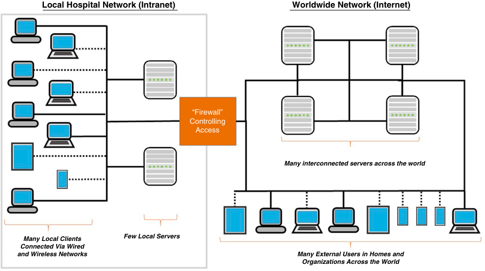
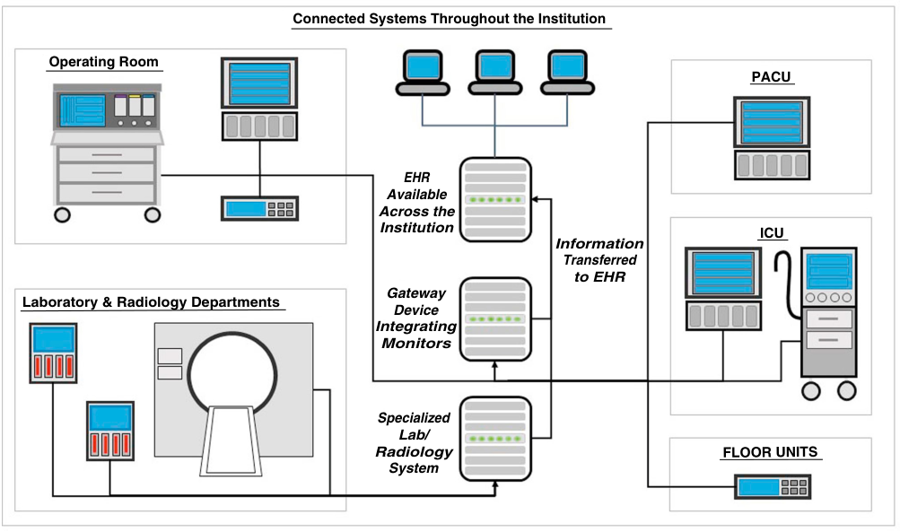
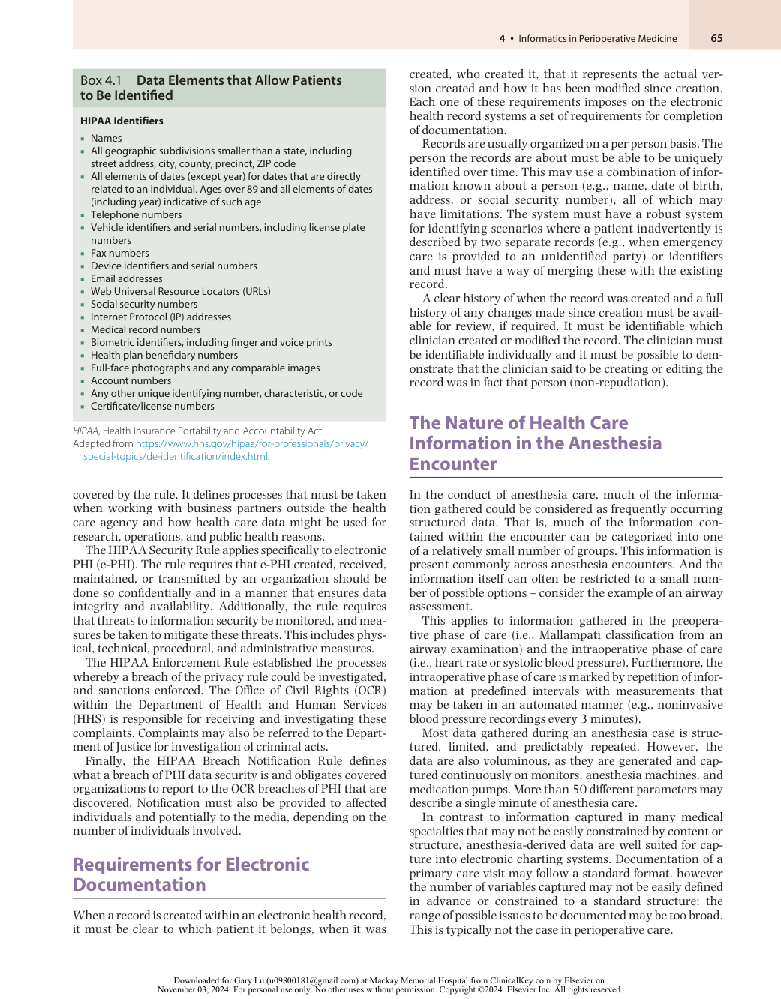
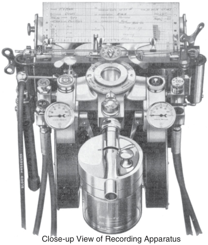
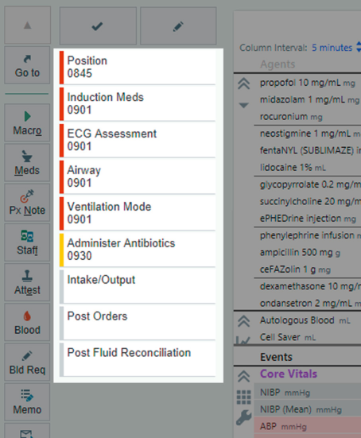
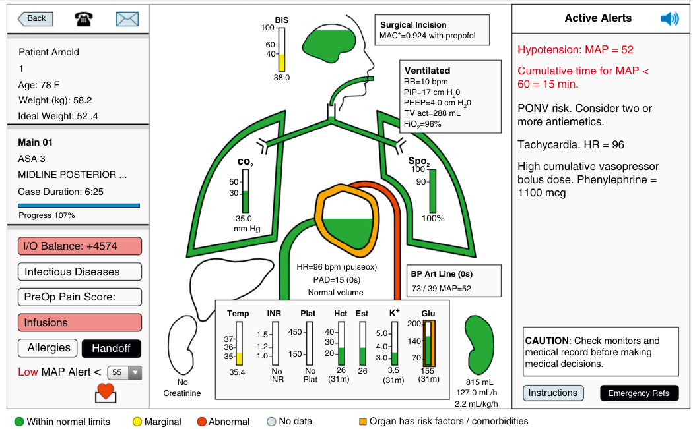
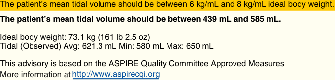
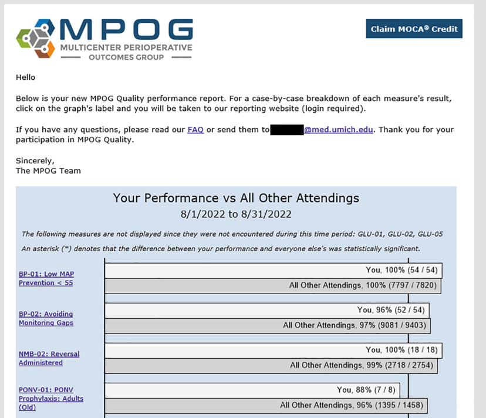

# Informatics in Perioperative Medicine

<!-- PDF page 1 -->

DOUGLAS A. COLQUHOUN, NIRAV J. SHAH, and SACHIN KHETERPAL

### KEY POINTS

- Individual computers are connected via networks to share information across many users. ᑏ Information security is about ensuring that the correct information is available only to the correct users at the correct time.

- Health care information storage and exchange is regulated to protect patient privacy. ᑏ Information regarding the provision of anesthesia care is highly structured and organized compared to most health care specialties.

- Anesthesia care documentation systems have evolved in complexity and are widely adopted in the perioperative care of patients in the United States.

- Benefits of electronic documentation of anesthesia care typically emerge from integration with monitoring, scheduling, billing, and enterprise electronic health record (EHR) systems.

- Active and passive decision support tools may suggest typical courses of action or call to attention patterns that are not apparent to the clinician.

- Secondary use of EHR data is valuable for research, operations, and the measurement of quality of care. This may involve the development of statistical models to identify patterns or associations.

## Introduction

Computers are a ubiquitous part of modern life. Their use has penetrated every medical field and the practice of perioperative care is no different. The use of computers has given rise to the academic discipline of informatics, the study of information creation, storage, handling, manipulation, and presentation. Within health care this is referred to as medical, biomedical, or clinical informatics.

## Computer Systems

At their most basic, computer systems are complex electronic circuits that perform mathematical operations (add, subtract, multiply, divide, and compare) on information available to them. Even the most complicated computer systems consist of these operations repeated millions of times per second, which collectively generate the activity specified by the user. Every operation performed within the computer begins with the retrieval of information in the memory, a mathematical operation within the processor, and the storage of the output of that operation back to the memory. This cycle of retrieval, processing, and storage repeats millions of times per second.

Software applications execute the instructions that a computer uses to process information. The operating system

is the fundamental software that controls communication among the components of the computer. The operating system controls the order in which a processor completes tasks, allocates memory among different applications, provides a structure for organizing files in the long- term storage, controls access to files, determines which applications may run, and manages the interaction between the user and the computer.

A software application is a set of instructions for a computer designed to perform a specific set of tasks. Software may (via the operating system) interact with external hardware devices, data held in long- term storage, and the user by way of input devices (i.e., a keyboard) and display devices.

Because of the proliferation of mobile devices, traditional laptop or desktop computers have been supplanted in many environments by tablets or smartphone computers. These devices are structurally similar to traditional computing devices; however, the operating systems and software applications feature user interfaces that have been optimized for touch screen or voice control operation. These devices trade off computational power, portability (size- and weight- related), and duration of operation (battery power), however continued advances in hardware design make modern smartphones markedly more powerful than desktop machines from prior years.

<!-- PDF page 2 -->

Local Hospital Network (Intranet) Worldwide Network (Internet) “Firewall” Controlling Access Many interconnected servers across the world Many Local Clients Few Local Servers Connected Via Wired and Wireless Networks Many External Users in Homes and Organizations Across the World 

**Fig. 4.1 Relationship between a local intranet (within an institution) and the wider Internet.** Institutions may choose to use an external vendor to provide certain services hosted on external servers; this is referred to as “cloud” computing or services. Prevention of unauthorized access to the intranet from external parties while allowing users to access the Internet and other remote resources is of paramount concern. “Firewall” devices aid in the separation of the institutional network from the wider Internet and control access.

## Computer Networks

Networks are the means for the exchange of information among computers, enabling the sharing of resources. These networks may be established using wireless (e.g., microwave radio spectrum) or wired connections (Fig. 4.1). Dedicated hardware (equipment) controls the sending and receiving of information across these links, with specialized devices required to ensure that information is sent correctly to the intended computers on the network. Software is used to ensure communication is performed according to predefined standards. For a computer to be accessible in the network, each computer must be given a unique address on the network so that information can be identified as destined for that computer. The process of obtaining and maintaining network addresses is performed within the local operating system and network hardware. This allows software applications to specify the information to be sent and the operating system and network hardware to manage how it is exchanged between computers.

Wired networks require the computer system and the receiving hardware to be physically connected by electrical or optical cable. This limits the flexibility in the connection points, which must be placed in preplanned areas, with any subsequent adjustments requiring re- routing of cables. However, information traveling on the network cannot be intercepted or accessed without physical access to the network cables or connection points.

Wireless network systems offer advantages of convenience and the ability to move around a work environment without maintaining a physical connection among the computer systems. Information exchange via wireless links

may be an order of magnitude slower than the fastest wired connections. Because wireless systems require the availability of strong radio links between the computer and the network equipment, they are subject to issues of poor reception (possibly because of physical barriers) and interference, which manifest as inaccessible or degraded network performance. It is difficult to control the precise limits of where a wireless network is available (i.e., only within a building and not immediately outside of it), therefore processes to limit wireless network access to authorized users and to encrypt data transmitted across wireless links are required.

In practice, health care facilities use a blend of both wired and wireless networks to ensure that the advantages of each system are available to support the users and to optimize deployment and maintenance costs.

In most settings, the network is organized as a “client– server” model. The computer that hosts the shared resources is referred to as the “server” and the computer accessing the resources is the “client.” The server is responsible for ensuring the client is an authorized user of the shared resource (access control) and ensuring the resource remains available to multiple users, potentially by preventing one client from monopolizing the use of the resource. Use of a client– server infrastructure may allow for a significant amount of the computational tasks to be outsourced to the central server. Some applications are hosted using “application virtualization,” whereby a single software application is hosted and uses the computational resources centrally and the client systems access this application regardless of their configurations. This allows tight control of the application’s availability, ease of maintenance, and ensuring compatibility (by not requiring any level of computational resources

<!-- PDF page 3 -->

aside from running the connection to the server). Additionally, this approach enforces a separation between the information stored on the server and any applications running on the client and thus information can be secured within the server that is housed within the institutional network. Many EHRs are deployed using this configuration.

## The Internet

The Internet is a global network of networks. Best known by two of the ways in which it can be used—websites and email—the Internet is at its simplest a method for transferring electronic information across the world. Internet service providers (ISPs) provide access to optical and electrical cables and attached hardware components to transfer information across the world. As these cables are all interconnected, multiple paths are available to transfer data at any one time. Routers control the flow of Internet traffic and ensure that it takes the most direct and fastest routes across the multiple paths available to it. The flow of information around the world can be measured in the order of hundreds of milliseconds or less.

Use of the Internet has led to the development of a series of technologies where computing resources are offered to multiple clients using an Internet connection as a means of distribution and interaction with the clients (see Fig. 4.1). These “cloud” platforms allow on- demand and scalable use of computing resources. Computing resources can be bought and sold based on the variable amount of time they are used, or the amount of information stored; additional capacity can be flexibly added. These resources are accessible from anywhere with an Internet connection. Furthermore, cloud platforms give organizations the ability to transfer the management of the specialized computer hardware needed to provide these services to another party.

The integration of mobile phone data networks and the proliferation of increasingly powerful handheld devices (such as smartphones or tablets) has increased further the number of potential clients. For health care organizations, there is significant user pressure to be able to access health care information systems remotely or from these mobile devices.

Exchange of information across the Internet is highly dependent on well- defined and accepted standards of information exchange between client and server, and use of preagreed standards for using the information provided to the client (e.g., layout of the website, format of a music file, or standard for a video call).

Web pages, the best- known use of the Internet, have become increasingly sophisticated, evolving into an interactive process that can dispense information specific to only one user (e.g., a record of the user’s bank transactions) and that can be supplied in a manner that is generalizable to many different users (e.g., all customers can access their bank transactions this way). Interaction with web pages may lead to complex business processes being undertaken in the physical world. For example, the ability to buy a book from an online store starts with a web page displaying the information and ends in someone delivering it to the door, with many physical steps in between.

Health care organizations have embraced these technologies to support their delivery and administration of patient care, including scheduling systems, laboratory result reporting, patient communications, and equipment management systems, all of which are delivered in this manner. The COVID- 19 pandemic acted as a catalyst for the delivery of remote access to health care services, including rapid proliferation of “virtual visits” facilitated by video communication technologies. While such technologies may be common, there are important considerations of access and equity in their use.1

Information traveling through the Internet, without additional measures, is not necessarily private or secure. A salient metaphor would be to consider the difference between information being conveyed in an envelope (where the contents are not visible) and information being conveyed on a postcard (where the message is clear to anyone who holds it). Adequate safeguards need to be employed to allow the private and secure delivery of health care.

## Information Security

Key to the delivery of medical care via computing technology is information security. This can be summarized as ensuring the correct information is available to the correct users at the correct time.

These threats to information security may come from within or outside an organization. Within organizations, employees may access information that they are not authorized to so do or by transferring and storing it in an insecure manner. They may introduce security threats by using applications that may transfer information outside of the organization or by modifying an existing network by using an unauthorized personal device. External threats may seek to improperly access information (“hacking”) by obtaining passwords or identities from legitimate users (via “phishing” attacks) or by introducing applications that degrade computer function or prevent access to critical systems to extort payment (“ransomware” attacks). Occurrences which prevent legitimate users access to information may be extremely damaging to the delivery of clinical care. There have been a series of highly publicized attacks on large health care organizations leading to prolonged outages of critical information systems and impairment of the delivery of clinical care. Given the ubiquity of internet connected devices and software used within a health care organization, the possible list of disruptive targets is broad and might include support hardware and software systems remote from direct clinical care including electrical grids, heating and cooling systems, email, or asset management systems.

The paradigm used for controlling access to computing resources is typically users and accounts. Each person who uses the computer is a user. Users can be identified and mapped to real- world persons. Users may belong to groups that share common attributes. It should be known in advance which resources should be available to which users or groups of users. A group of users (e.g., anesthesia providers) may have access to specific resources (e.g., a directory of anesthesia policies) but each user may also have access based on their individual parameters (e.g., an

<!-- PDF page 4 -->

individual anesthesiologist may have sole access to his or her own private files). A group of users with similar functional roles who have a defined set of resource privileges is known as “role- based security.” Changes in privileges for the group affect all users in that group.

Users should be able to positively identify themselves; commonly this involves the combination of a username and password, with the password being known only to the user and the computer system. However, other methods of authentication, such as biometric information (including fingerprint, iris scan, or face scan) or physical access tokens (e.g., built into identification badges) are now commonplace. Password policies that enforce a mandatory level of complexity (minimum length, mixing letters and numbers, or special characters), specific expiry dates, and prevent password reuse are designed to make it harder for passwords to be guessed by an unknown party or to mitigate or minimize the risk of passwords being accessed or used externally. However, requirements for increasing complexity or frequency of changes may pose additional burdens on users that they consider unacceptable and may not decrease risk.

Organizations may adopt “two- factor authentication” methods, which can be summarized as requiring “something you know and something you have” to gain access to the computer system. The password fulfills the first part of this concept as it is meant to be known only to the user. Devices such as physical token code generators (which provide a predictable response to be entered alongside the password) or an interactive system (authentication via a smartphone application or phone call) may satisfy the second concept. For someone to impersonate the user they must have both the password (that may have been taken without the user’s knowledge) and access to a physical device (that the user is more likely to detect the absence of). This makes remote access less likely because an unauthorized user may be able to obtain or guess a password but is very unlikely to also be able to obtain the token or smartphone required for access.

Physical security is an integral part of information security. Ensuring that an unauthorized person does not have physical access to computer hardware or access to the means of connecting to a network are important considerations. This can be accomplished by physical measures (such as locked rooms, doors, and devices that prevent movement of computer hardware, disconnection of unused network ports) and considerations of where computers containing controlled information are placed (to prevent an unauthorized person from having access to a computer that is available in a public area). These restrictions are balanced against desires for increased usability and portability of computing devices from computer users and the need to make information available to the provider at the point of clinical interaction.

Therefore, it is necessary to ensure secure access to information across wireless links and across the Internet. One method for doing this is to ensure that the information transferred is not readily visible along its means of transmission. This is performed by a group of processes known as encryption. Encryption is the process of transforming a piece of information from its original and accessible state to one that is not accessible and lacks meaning (and back

again). Typically, this involves an additional piece of information: an encryption key.

The transformation to and from encrypted text takes place in a manner that is relatively easy to perform with the known encryption key but is infeasible to do so without knowing this key. Encryption processes are currently based on mathematics involving multiplication of very large numbers, which creates many possible combinations of different factors that could have led to the same outcome. Therefore, it would be computationally infeasible or impractical, with current technology, to attempt to try all possible solutions.

External threats to an organization involve outside entities attempting to access services or applications that are meant for internal use only. Because health care organizations must be connected to the Internet to enable many information exchange functions, their data may potentially be available to every Internet- connected device in the world. “Firewalls” are used to ensure that only legitimate transactions and interactions with the external world are exposed to the internal hospital network. These hardware or software tools, collectively known as a firewall, prevent the creation of unauthorized connections from outside the organization to the internal computing systems. Firewalls can also limit the types of network traffic that are allowed to exit from the internal networked system.

To allow legitimate external access, organizations may allow the creation of virtual private networks (VPNs). After appropriate authentication and verification, VPNs set up an encrypted path for information from an external Internetconnected computer to the organization’s internal network and protect data in transit across the open Internet. This allows the external computer to act as if it was physically connected to the organization’s internal network and to access resources such as specialized software, files, or services that an organization may not wish to open to the entire Internet. A health care organization may require use of a VPN to access an EHR from outside the organization’s network.

Health care organizations must have robust plans for mitigating against failures of equipment or other adverse events which prevent access or degrade performance. Catastrophic failures of clinical systems due to malicious acts, fire, flood, or other phenomena have occurred. These plans involve redundancy in critical physical plant (e.g., power supplies, HVAC); network and server infrastructure (allowing alternative devices to take over when the primary devices are unavailable); robust backup procedures allowing data to be rapidly restored to a prior version from onsite and offsite copies; and alternative software systems and business processes to allow continuation of clinical care during periods of primary system unavailability.

## Standards for Health Care Data Exchange

Although not always obvious, the EHR is typically an amalgamation of multiple computer systems and devices of various complexity. These systems exchange data according to common standards, languages, and processes.

Common connections include monitoring devices that allow automatic transfer for measured parameters into the

<!-- PDF page 5 -->

Connected Systems Throughout the Institution Operating Room PACU EHR Available Across the Institution ICU Information Transferred to EHR Gateway Laboratory & Radiology Departments Device Integrating Monitors Specialized Lab/ Radiology System FLOOR UNITS 

**Fig. 4.2 Information flows from connected devices across the institution into the electronic health record (EHR).** Some departments maintain specialized software to manage the needs specific to their workflow—for example radiology departments using picture archiving and communication systems—that are interfaced into the EHR (e.g., to allow a report to be connected to the original CT scan). Similarly, networked monitor data are made available by using a gateway interface device. _PACU_ , postanesthesia care unit.

electronic chart, infusion pumps (recording programmed settings), laboratory instruments (blood gas machines, cell counters, biochemistry analyzers, point- of- care testing devices), or systems that manage patient admission, identification, and bed occupancy (admission, discharge, and transfer [ADT] system). All these devices and systems need methods of communicating with the EHR (Fig. 4.2). Although in some situations it may be possible to use a proprietary standard for communication between systems, it can quickly become difficult to manage across an entire institution. Consequently, a series of commonly used standards have been established that allow the communication of health care information.

The Health Level- 7 (HL7) standard, originally developed in the late 1980s, is still used widely in the exchange of health information. HL7 allows the transmission of data in a standardized manner among devices and clinical systems. The information can be identified to a specific patient and organized into different data types, indicating laboratory results, monitor data, and billing information. It can also cause the receiving system to perform an action, such as update previously obtained data. The HL7 standard and subsequent derivatives that address the exchange of clinical documents in a structured and identified manner support communication among different clinical systems. However, this standard was based on data exchange within different software application systems within an institution and did not envisage the proliferation of Internet- connected devices remotely accessing shared resources across many health care organizations.

This new paradigm led to the development of Fast Health Interoperability Resources (FHIR). This communication standard is analogous to how modern Internet applications exchange data via simple standardized requests to a central resource. FHIR enables easier integration across different types of software and integrates security features necessary due to the proliferation of mobile devices. This standard is designed to facilitate the exchange of data regardless of whether it is a single vital sign or a scanned document from a physical chart.

## Regulation of Electronic Data Exchange

In the United States, the 1996 passage of the Health Insurance Portability and Accountability Act (HIPAA) established a common regulatory framework that defined health information and the processes by which it should be stored and transferred, and established powers to investigate concerns regarding noncompliance with these rules.

There are four major regulatory rules: the HIPAA Privacy Rule, Security Rule, Enforcement Rule, and the Breach Notification Rule. Each update is a complex regulatory document and professional advice should be sought on the applicability and relevance of each of these to a particular situation.

The HIPAA Privacy Rule details the allowable uses and disclosures of individually identifiable health information, which is referred to as “protected health information” (PHI). Identifiers that are considered PHI are listed in Box 4.1. The privacy rule additionally defines the health care agencies

<!-- PDF page 6 -->

### Box 4.1 Data Elements that Allow Patients to Be Identified

### HIPAA Identifiers

> ᑏ Names

|ᑏAll geographic subdivisions smaller than a state, including street address, city, county, precinct, ZIP code|
|---|
|ᑏAll elements of dates (except year) for dates that are directly related to an individual. Ages over 89 and all elements of dates (including year) indicative of such age|
|ᑏTelephone numbers i|
|ᑏVehicle identifiers and serial numbers, including license plate numbers|
|ᑏFax numbers i|
|ᑏDevice identifiers and serial numbers|
|ᑏEmail addresses|
|ᑏWeb Universal Resource Locators (URLs)|
|ᑏSocial security numbers|
|ᑏInternet Protocol (IP) addresses|
|ᑏMedical record numbers|
|ᑏBiometric identifiers, including finger and voice prints|
|ᑏHealth plan beneficiary numbers|
|ᑏFull- face photographs and any comparable images|
|ᑏAccount numbers|
|ᑏAny other unique identifying number, characteristic, or code ᑏCertificate/license numbers|

_HIPAA_ , Health Insurance Portability and Accountability Act. Adapted from https://www.hhs.gov/hipaa/for- professionals/privacy/ special- topics/de- identification/index.html.

covered by the rule. It defines processes that must be taken when working with business partners outside the health care agency and how health care data might be used for research, operations, and public health reasons.

The HIPAA Security Rule applies specifically to electronic PHI (e- PHI). The rule requires that e- PHI created, received, maintained, or transmitted by an organization should be done so confidentially and in a manner that ensures data integrity and availability. Additionally, the rule requires that threats to information security be monitored, and measures be taken to mitigate these threats. This includes physical, technical, procedural, and administrative measures.

The HIPAA Enforcement Rule established the processes whereby a breach of the privacy rule could be investigated, and sanctions enforced. The Office of Civil Rights (OCR) within the Department of Health and Human Services (HHS) is responsible for receiving and investigating these complaints. Complaints may also be referred to the Department of Justice for investigation of criminal acts.

Finally, the HIPAA Breach Notification Rule defines what a breach of PHI data security is and obligates covered organizations to report to the OCR breaches of PHI that are discovered. Notification must also be provided to affected individuals and potentially to the media, depending on the number of individuals involved.

## Requirements for Electronic Documentation

When a record is created within an electronic health record, it must be clear to which patient it belongs, when it was

created, who created it, that it represents the actual version created and how it has been modified since creation. Each one of these requirements imposes on the electronic health record systems a set of requirements for completion of documentation.

Records are usually organized on a per person basis. The person the records are about must be able to be uniquely identified over time. This may use a combination of information known about a person (e.g., name, date of birth, address, or social security number), all of which may have limitations. The system must have a robust system for identifying scenarios where a patient inadvertently is described by two separate records (e.g., when emergency care is provided to an unidentified party) or identifiers and must have a way of merging these with the existing record.

A clear history of when the record was created and a full history of any changes made since creation must be available for review, if required. It must be identifiable which clinician created or modified the record. The clinician must be identifiable individually and it must be possible to demonstrate that the clinician said to be creating or editing the record was in fact that person (non- repudiation).

## The Nature of Health Care Information in the Anesthesia Encounter

In the conduct of anesthesia care, much of the information gathered could be considered as frequently occurring structured data. That is, much of the information contained within the encounter can be categorized into one of a relatively small number of groups. This information is present commonly across anesthesia encounters. And the information itself can often be restricted to a small number of possible options – consider the example of an airway assessment.

This applies to information gathered in the preoperative phase of care (i.e., Mallampati classification from an airway examination) and the intraoperative phase of care (i.e., heart rate or systolic blood pressure). Furthermore, the intraoperative phase of care is marked by repetition of information at predefined intervals with measurements that may be taken in an automated manner (e.g., noninvasive blood pressure recordings every 3 minutes).

Most data gathered during an anesthesia case is structured, limited, and predictably repeated. However, the data are also voluminous, as they are generated and captured continuously on monitors, anesthesia machines, and medication pumps. More than 50 different parameters may describe a single minute of anesthesia care.

In contrast to information captured in many medical specialties that may not be easily constrained by content or structure, anesthesia- derived data are well suited for capture into electronic charting systems. Documentation of a primary care visit may follow a standard format, however the number of variables captured may not be easily defined in advance or constrained to a standard structure; the range of possible issues to be documented may be too broad. This is typically not the case in perioperative care.

::: details 原始表格與符號（PDF 第 6 頁）

:::

<!-- PDF page 7 -->

## Development and Deployment of Anesthesia Information Management Systems

Given the suitability for automated capture of recurring high- volume data, the concept of using computerized capture and storage for parts of the anesthesia record is not new. McKesson in 1934 described an early form of monitor that integrated with a vital signs data recorder (Fig. 4.3).2 Early pioneering systems included the Duke Automatic Monitoring Equipment (DAME) system and its more compact successor, microDAME, which combined an internal monitoring platform with an integrated network architecture for central data recording.3 Anesthesia Record Keeper Integrating Voice Recognition (ARKIVE), developed commercially in 1982 by Diatek, included both a voice and touch screen interface.4,5 Over time, other systems became available and these progressively morphed from being described as “anesthesia record keeping” (ARK) systems to “anesthesia information management systems” (AIMS) as the range of features and integration with other systems progressed. These systems have since moved from standalone software packages to integral and indistinguishable parts of enterprise- wide electronic health records.

Despite extensive development of several commercial systems, the use of AIMS was relatively limited in the early 2000s. However, by 2020, it was estimated that market penetration would reach 84% of all medical centers.6–8

The adoption of health information technology has resulted in the increasing integration of the anesthesia record with other clinical systems. The American Society of Anesthesiologists (ASA) has produced a statement on the

Close-up View of Recording Apparatus 

**Fig. 4.3 McKesson’s apparatus for the automated recording of physiologic recordings and gas mixtures.** (From 1934. From McKesson EI. The technique of recording the effects of gas- oxygen mixtures, pressures, rebreathing, and carbon- dioxide, with a summary of the effects. _Anesth Analg._ 1934;13[1]:1–7 [“Apparatus” Page 2].)

documentation of anesthesia care.9 Such systems can be used to fulfill clinical documentation needs; however, much of the promise of these systems is in the potential for integration with the broader hospital environment and secondary uses of the data that they potentially facilitate.

## Requirements for Electronic Documentation of Anesthesia Care

A mature electronic anesthesia documentation platform must be capable of (1) recording all aspects of the anesthesia encounter (preoperative, intraoperative, and postanesthesia care unit [PACU]); (2) automatically gathering the high- fidelity physiologic data generated by monitoring platforms and anesthesia machines; and (3) allowing the anesthesia provider to record observations regarding the conduct of the anesthetic. These three simple requirements allow us to closely specify the outline of how these systems work.

The first requirement for access of the same patient record during multiple phases of a case suggests the use of a system organized on a computer network, where the computer record is maintained on a central server and accessed by multiple clients. This capability requires accessibility of computer workstations at each patient- care location to facilitate documentation. The computer must be accessible during the clinical interaction but in a way that does not interfere with this interaction, which is both an issue of ergonomics and of provider behavior. In the operating room (OR), the system should be directly accessible at the time of clinical care to allow contemporaneous documentation without the anesthesia provider physically moving away from the patient or care area. In many deployments, this is achieved with a computer mounted to the anesthesia workstation alongside the monitoring equipment. Because the computer hardware is in clinical environments, it is important that the hardware can be cleaned in a manner that is compatible with infection control policies.10,11

The second requirement for automated capture of data from OR monitors and anesthesia machines is some form of interface device between the computer hardware and the hemodynamic monitors, anesthesia machines, and other patient- connected equipment (infusion pumps or ventilators) (Box 4.2). This interface can occur at a central level, where a network of the physiologic monitors and the central server hosting the EHR communicate via a gateway device. Typically, interfaces use standardized data formats, such as those described earlier that transmit communication among devices and software solutions from different manufacturers and developers. Interfacing these devices with a computer network may require specialized hardware and additional cost. However, the interface enables the automated capture of monitor and anesthesia machine data, freeing up clinical providers from the recording of these data elements. Some AIMS situated in low- resource settings (e.g., an office- based anesthesia location) may choose to eliminate the data interface feature. This may allow off- site or “cloud”- based documentation platforms to be developed.

<!-- PDF page 8 -->

### Box 4.2 Examples of Parameters Commonly Included in the Anesthesia Record Gathered Automatically from Different Sources

### From Core Physiologic Monitor

- Arterial blood pressure (systolic, diastolic, mean)

- Cardiac index

- Cardiac output

- Central venous pressure

- End- tidal CO2

- Heart rate (ECG monitoring and SpO2)

- Intracranial pressure (ICP)

- Noninvasive blood pressure (systolic, diastolic, mean)

- Pulmonary artery pressure (systolic, diastolic, mean)

- Pulse pressure variation (PPV) and systolic pressure variation (SPV)

- Saturation of peripheral oxygen (SpO2)

- ST segment analysis

- Systemic vascular resistance

- Temperature (all sources)

### From Stand- Alone Devices (May be Available Within Some Core Physiologic Monitors)

- Acceleromyography value

- Cerebral oximeter (NIRS)

- Continuous cardiac output measurement devices

- Level of consciousness monitors

- Mixed venous oxygen saturation (SvO2)

### From Anesthesia Workstation

- Fraction of inspired oxygen (FiO2)

- Fresh gas flows: oxygen, air, nitrous oxide

**Fig. 4.4 A predefined set of charting elements for a given case.** These may function as an example of passive decision support built into the EPIC Electronic Health Record Anesthesia Documentation (EPIC Systems, Verona, WI). The macro _(highlighted)_ prompts the user to complete next documentation element. The “Administer Antibiotics” acts as an _aide- mémoire_ reminding anesthesia providers that this is likely the next step in the process of care. (Image: © 2018 Epic System Corporation. Used with permission.)

- Volatile anesthetic agents (inspired and expired concentrations)

- Minute volume

- Nitrous oxide (inspired and expired concentrations)

- Oxygen (inspired and expired concentrations)

- Peak inspiratory pressure (PIP)

- Positive end- expiratory pressure (PEEP)

- Respiratory rate (ventilator and ETCO2)

- Tidal volume

- Ventilator mode

Theoretically all electronically generated data can be recorded in the electronic anesthesia documentation system. Consequently, the anesthesia provider must determine how much data should be incorporated into the system. Although some monitoring data are obtained with a defined frequency, such as a noninvasive blood pressure measurement taken every 3 minutes, most parameters are sampled from continuous data sources. In the OR, a pulse oximeter is not a single parameter checked at a discrete interval, but a continuous source of data. Continuous data sources (e.g., electrocardiogram [ECG], pulse oximeter, invasive blood pressure, or end- tidal carbon dioxide [EtCO2] tracings) are transformed into measures that can be recorded with lower data frequency via sampling. An ECG tracing may be sampled and interpreted to report heart rate and ST segment analysis results. Although it is technically possible to record continuous sources of data electronically for future review, this usually does not occur because the resulting data stream is difficult to present, archive, and review.

### Therefore, continuous data sources are usually reported as sampled values at a prespecified frequency.

The third requirement of an electronic anesthesia documentation system is to allow the user to annotate information (e.g., medications administered, descriptions of procedures performed, annotations to describe significant clinical events, or attestations for regulatory compliance) to the automatically collected data. Because of the similarity of one anesthesia encounter to another, some charting elements may be predefined to facilitate these documentation tasks and minimize the use of nonstructured or “free text” entries. Because of the possibility of similarity among cases, many systems use organized templates (sometimes referred to as “scripts,” “templates,” or “macros”) that give the anesthesia provider easier access to charting elements required for a specific case type (Fig. 4.4). For example, a cardiac anesthesia template may make charting elements regarding cardiopulmonary bypass prominent and easily selectable. These charting elements and templates are typically customizable at each installed site, providing flexibility in documenting site- specific practices or procedures.

Although the three requirements described give some specifics about how a system may be constructed, they are minimum requisites. The anesthesia electronic documentation system that only provides these requirements is not one that would be considered high value. The major advantages of electronic documentation come from their integration into other clinical systems and health care processes.

<!-- PDF page 9 -->

## Advantages of Implementation of Electronic Documentation in Anesthesia Care

The shift to electronic documentation is a key improvement in the quality of clinical documentation. Removing the task of manual documentation of physiologic parameters has not been shown to decrease vigilance to the clinical situation and may free up anesthesia providers to perform other tasks.12–15 It establishes an independent, unbiased record of monitoring and machine data. Finally, legibility issues noted in handwritten charting are resolved by using an electronically assembled record.

Early studies compared blood pressure values recorded in handwritten charts and those recorded by automated collection. The blood pressure recordings on handwritten charts had lower maximum systolic pressures and higher minimum diastolic pressures when compared with automated collected values in OR studies.16–18 This variation has been termed the “smoothing effect” of handwritten charting and may result in loss of clinically meaningful data.16,19 A subsequent study demonstrated that errors in handwritten charting were clustered during high- intensity periods; that is, induction, emergence, and significant clinical events.20,21

Although documentation of physiologic parameters may be more complete in electronically documented records compared with handwritten charts, other data elements may remain incomplete.22,23 As electronic documentation deployments have proliferated, it has become apparent that documentation quality varies among providers and important clinical fields can often be left incomplete, particularly when completion requires the entry of free text.24 Medication administration has also been incompletely documented or omitted in the record compared with observed practice with a similar effect of inaccuracies occurring during high intensity periods of care.25 Electronic documentation systems typically support degrees of customization, including designating certain data elements as mandatory prior to completion of the case, but the decision to add more mandatory elements must be traded off against risks of arbitrary data entry (“clicking through”) or provider frustration, both of which detract from the aim of improved data quality.26 It is clear that the system design and decisions made for default values or required data elements have significant influence on the quality of record created.

One solution to the challenge of excessively burdensome documentation requirements is to use an adaptive method that changes the required elements for documentation based on the clinical context – for example, requiring documentation of bilateral breath sounds in cases involving an endotracheal tube, but not with a laryngeal mask airway.26

In addition, to improve compliance with the capture of individual, high- priority data elements, alternative strategies may be employed. Real- time provider notification by text page for allergy or procedural notes has demonstrated increases in completeness of this documentation.27,28 Non- real- time feedback via dashboards, email feedback, or informational campaigns may improve data element completion.29 These effects may be sustained past the interventional period.27,29

Integration with billing processes allows the automated capture of case elements necessary to facilitate anesthesia billing, such as care start and stop times, details of the surgical procedure for which anesthesia care is being provided, the nature of anesthesia care, any separately billable procedures, and the involved providers. This information can be extracted by reporting functions and integrated with the patient identifiers. Compared to solutions that require the manual review of copies of paper records, electronic workflows offer significant overall process efficiency gains, although some designs unfortunately redistribute administrative tasks to point- of- care clinicians. The potential impact of electronic documentation use on anesthesia procedure includes improving capture of data elements needed for billing, improved documentation to support billing of anesthesia procedures, and billing capture at time of clinical care leading to more rapid processing.27,28,30,31

An advantage of electronic documentation is the ability to check concurrency of anesthesia providers across one entire organization in real time. In the United States, an “in- room” anesthesia provider must be physically present when anesthesia care is provided. This is typically documented by “sign in” and “sign out” documentation times. An in- room provider may be supervised by a supervising provider who may supervise several ORs up to maximum specified by institutional or payor policy. The electronic documentation system can, at time of sign- in, check that no in- room provider is documented in more than one OR simultaneously and no supervising provider exceeds the prespecified supervision ratios. Checking at time of sign- in assures that these standards are not violated by documentation errors and prevents delays in the billing process. In certain billing environments, violation of the concurrency rules may cause rejection of claims at the time of billing.

Providing an anesthesia record that can be accessed concurrently by multiple users may facilitate remote monitoring of care being provided by the in- room anesthesia provider by a supervising anesthesia provider. This increased visibility of patient care being provided at each care location allows the supervising provider to maintain a better level of awareness on the course of the case and gives the supervising provider additional guidance on management decisions. OR managers benefit from similar insight and may be able to make decisions about resource utilization based on the documented care.

## Integration of Anesthesia Care Information with Operating Room Information Systems

Given the necessity of maintaining information regarding locations of care, case, patient, staffing, and case progress, it is natural to integrate anesthesia information systems with OR management systems. These systems are used in the scheduling of OR cases and assignment of staffing and supplies.

ORs are finite resources. There are a set number of available rooms, set number of available staff for these rooms, set times of availability of these staff, defined experience and specialization of these staff, and finite amount of specialist

<!-- PDF page 10 -->

equipment for use in the rooms. As a result of these factors, ORs create enormous costs prior to any procedure being performed; efficient allocation and utilization of these resources are tied to financial outcomes of a hospital.

Each procedure performed requires allocation of procedural space, staff, and equipment that may be specific to the particular case. Therefore, it makes sense for this to be coordinated in a centralized manner. OR management systems are designed to accomplish this task, controlling the allocation of these resources. These systems allow these resources to be allocated both generally (e.g., each Monday OR 6 is dedicated for thoracic surgery cases [block scheduling]) and specifically (e.g., John Smith is undergoing a right upper lobectomy by Dr. Jones from 11 am to 2 pm on August 20), and further allocate staff and equipment to this procedure (case scheduling). Case scheduling may use historical procedural lengths to estimate future time needs stratified by proceduralist and specific procedure to be performed. Scheduling of a case by a specific proceduralist allows the generation of a specific list of required equipment to be recalled based on anticipated requirements and proceduralist preferences.

The integration of OR management systems with anesthesia documentation provides a unified schedule or case list between systems. Furthermore, communication between these systems can create common charting, such as phase of procedure (induction, procedure begun, procedure complete, etc.) which can be useful in tracking utilization of the OR environment for daily management and ascertaining longer- term trends. Given the enormous fixed expense incurred in the OR suite, an extensive literature has developed from the analysis of information derived from these systems regarding variability in procedure time, “turnover time” between sequentially scheduled procedures, and effect of variability of anesthesia- related case timings.32–37

## Integration of Anesthesia Care Information with the Wider Health Record

While anesthesia information systems and other electronic health records were formerly discreet systems, frequently these are now integrated into a unified hospital- wide or enterprise EHR. This allows common patient information such as patient identification, demographics, registration, location, medical documentation, and laboratory and other diagnostic results to be made available to the perioperative providers on a single computer system.

One of the larger contrasts emerging from the OR workflow versus the rest of the inpatient environment is the process of medication documentation. When using an inpatient EHR, a provider enters a computer- based order for the routine administration of a medication. After pharmacy verification of the order, the medication is delivered to the appropriate unit for administration to the patient by a bedside nurse. In the OR environment, the medication administration decision- making, selection of the medication from a pre- stocked cart, and administration is handled by an individual providing anesthesia care. This shortens the time from provider intent to patient administration.

Therefore, the documentation needs to reflect the concept of care provided rather than care to be provided in the future (i.e., scheduling a medication to be administered). Given the high intensity of medication administrations, short time interval between administrations and supply from the bedside cart of the medications to be administered, the ideal documentation system should not be burdensome and allow rapid entry.

Several features of the inpatient EHR are unavailable due to this mode of medication administration and documentation; positive identification of the patient and association of a medication administration with a specified order—typically performed by “barcode” scanning of medications and patients prior to medication administration—is typically not performed as medications are typically documented retrospectively and administered at a frequency far different from floor or intensive care unit (ICU) practice. Patients are positively identified, including in some systems by barcode scanning, at the beginning of each anesthesia care encounter. Additionally, automated medication interaction, dose, and allergy checking may not function in the context of perioperative administration due to the practice of retrospective documentation. As the documentation of anesthesia care is quite different from that of most medical interactions, the differences in workflows must be accounted for in the development of modes of interaction and creation of documentation.

While most medications administered in the OR have a relatively short duration of action, there are important cases where medications that are administered in the OR have important consequences beyond the OR. Examples such as neuromuscular blocking agents, long- acting opioids, long- acting local anesthetic agents, and antibiotic administrations all may lead to important medication interactions well beyond the operation room. A shared EHR between the inpatient environment and the operation room facilitates this. Similarly, documentation of difficult airway management in the OR has impact beyond the OR as the patient may require emergent airway management in the ICU or during future visits; information gleaned during the perioperative encounter may have enduring value to many other providers and should be communicated effectively.38

The meaningful and seamless integration of information from different EHR platforms across institutions remains an emerging, but extremely promising, feature of EHR. Typically, each institution maintains an EHR that is unique to that institution. As smaller medical practices have aggregated into larger health systems, providers come under the same umbrella EHR system. This has allowed records from more health interactions to be available in a single location; a satellite clinic in a physically separate location may use a health system–wide common EHR for documentation, making it available to the anesthesiologist who sees the patient presenting for surgery at the main campus. However, when a patient presents to a nonaffiliated practice or hospital, documentation from the other institutions is unavailable and must be obtained via fax or as printed paper or communicated by the patient verbally.

To address this issue, health care information exchanges (HIEs) have been developed. These exchanges facilitate the transfer of health information between multiple distinct health care systems’ EHRs. This can occur in a directed

<!-- PDF page 11 -->

way: a user at one facility chooses to send imaging data to another and uses the EHR’s HIE user interface to discover records available via the HIE. These come in multiple forms but are typically based on a geographic (i.e., at the state or regional level) or a shared EHR platform (i.e., EPIC Systems Care Everywhere functionality).

To function, HIEs must be able to correctly match the same patient across different hospitals or clinics. Failures of this process (both incorrectly matching two patients across institutions or failing to match the correct patient across institutions) could have potential for catastrophic consequences in clinical care. Matching must consider different identifiers used at each hospital; a medical record or registration number is usually unique to the institution so is not suitable for this task. Additionally, identifiers used for other reasons—such as social security numbers—may not be suitable for this task as their use may shift over time, accuracy may not match the level of confidence required for medical care, or pose other privacy risks.

In some situations, even acknowledging the existence of a record may be revealing and pose risk to patient privacy; for example, a record existing in a clinic specializing in the treatment of a particular illness may cause an inference to be drawn about a particular diagnosis. Sharing of data implicitly involves trade- offs with maximizing information availability and privacy.

## Development of Decision Support Tools

One of the most exciting promises of electronic documentation is the ability to improve patient care by improving the decisions made by providers.39 Influences on medical decisions represent a hierarchy of interventions, with varying degrees of restrictions or burdens traded off against the likelihood of influencing practice.40 While medical decisionmaking must be provided by responsible care providers, it is possible to aid decision- making by providing default choices that support particular practice patterns, suggesting options which may be appropriate based on the type of care (see Fig. 4.4), displaying dose charts or policies at time of order entry, providing additional notification of important updated trends or results, and providing alerts based on the integration of multiple pieces of information. The former three are examples of passive decision support, the latter two are examples of active decision support. Collectively these tools are referred to as decision support and are an integral part of the information system.41

### PASSIVE DECISION SUPPORT SYSTEMS

In considering these tools it is helpful to move from the simplest to the most complex. At the simplest level in the configuration of the perioperative information system, decisions regarding the choices presented to users (default doses, units, and range checks) may act as prompts for users in their selections – the so- called anchoring effect. This is an example of passive decision support. Over time it is important to continue to assess how usage aligns with users’ practice to ensure that the default options presented do indeed capture the typical usage at a particular

institution.42 Providing references to policies or best practices at time of ordering (e.g., antibiotic prophylaxis guideline or starting insulin doses for hyperglycemia correction) are further examples of how information can be provided at time of ordering or use.

Systems for the documentation of anesthetic care typically feature methods for documentation of aspects of clinical care which cluster together based on aspects of the procedure, anesthetic technique employed, or location of service. For example, a template for cases performed via a spinal anesthetic would not be configured to require documentation of the endotracheal intubation technique as these do not frequently overlap. These can form a rudimentary basis of decision prompts for providers; for example, in a cardiac case, the charting element available immediately after documentation of full cardiopulmonary bypass may be regarding discontinuation of mechanical ventilation. This may act as a reminder to the provider to perform this task. The level of sophistication of these prompts depends on the time devoted to their construction at the time of system installation and configuration.

One feature to improve documentation is the utilization of mandatory documentation elements that are required prior to the completion of case documentation. Extreme care needs should dictate what elements of documentation should be made mandatory. There are likely exceptions to even the most universal documentation element and forcing completion or entry of such items may undermine trust in the entirety of the clinical documentation.

### ACTIVE DECISION SUPPORT SYSTEMS

In the intraoperative space, several more sophisticated approaches to decision support have been developed (Fig. 4.5). These decision support tools continuously evaluate the medical record for incoming information and provide feedback to the user. These tools may be separate from the EHR but access the information being recorded by that software. These tools apply rules to alert providers to aspects of care which may have been overlooked or need to be addressed. This may guide users to re- evaluate patient status (e.g., if a blood pressure monitoring gap is detected), or consider additional interventions (e.g., a prompt to treat extremely elevated blood glucose), or alternative management strategies (e.g., to limit excessive tidal volumes, if detected).43–48

To function, these more sophisticated forms of decision support are designed around a common architecture. They run in parallel with the clinical documentation functions of the EHR. They may be built into the EHR (Fig. 4.6) or may run as separate software alongside the EHR (see Fig. 4.5). Regardless of the specifics of the software implementation, it is best to consider the construction of these systems as being in modules.41 In addition to the modules which capture incoming device data and allow clinicians to enter notes and other documentation elements, three additional modules are added.

The first module is a component which allows a user to define a series of rules against which the incoming information will be assessed. These rules should define the population to which the rule applies (e.g., patients aged over 18 undergoing surgeries in the main hospital operating rooms), the details of the rule (e.g., determine if blood glucose value

<!-- PDF page 12 -->

Back BIS Active Alerts 100 Surgical Incision MAC*=0.924 with propofol 60 Patient Arnold 40 Hypotension: MAP = 52 1 Ventilated Cumulative time for MAP &lt; Age: 78 F 38.0 RR=10 bpm 60 = 15 min. PIP=17 cm H20 Weight (kg): 58.2 PEEP=4.0 cm H20 PONV risk. Consider two or Ideal Weight: 52 .4 FiOTV act=288 mL2=96% more antiemetics. Main 01 Tachycardia. HR = 96 ASA 3 co2 Spo2 100 High cumulative vasopressor MIDLINE POSTERIOR ... 50 90 bolus dose. Phenylephrine = Case Duration: 6:25 30 1100 mcg Progress 107% 35.0 100% mm Hg I/O Balance: +4574  Infectious Diseases HR=96 bpm (pulseox) BP Art Line (0s) PAD=15 (0s) 73 / 39 MAP=52 PreOp Pain Score: Normal volume Temp INR Plat Hct Est K + Glu Infusions 200 1.5 450 40 5.0 Allergies Handoff 373635 1.21.0 150 3020 4.03.0 14070 CAUTION medical record before making: Check monitors and medical decisions. Low MAP Alert &lt; 55 35.4 No No   26 26    3.5     155 No INR Plat (31m) (31m) (31m) 815 mL Creatinine 127.0 mL/h Instructions Emergency Refs 2.2 mL/kg/h Within normal limits Marginal Abnormal No data Organ has risk factors / comorbidities 

**Fig. 4.5 The Alertwatch OR (Alertwatch, Ann Arbor, MI) multiparameter decision support system, illustrating the physiologic status of a patient under anesthetic care.** This integrates data from physiologic monitors and electronic health record elements. Based on prespecified rules it prompts providers to consider a specific course of action or indicates additional markers of patient state. The image has been edited to remove identifying and test information. * Indicates a calculated additive minimum alveolar concentration (MAC) value of inhaled agents and propofol and dexmedetomidine infusions.

The patient’s mean tidal volume should be between 6 kg/mL and 8 kg/mL ideal body weight. The patient’s mean tidal volume should be between 439 mL and 585 mL. Ideal body weight: 73.1 kg (161 lb 2.5 oz) Tidal (Observed) Avg: 621.3 mL Min: 580 mL Max: 650 mL This advisory is based on the ASPIRE Quality Committee Approved Measures More information at http://www.aspirecqi.org 

OK 

**Fig. 4.6 An example of active decision support.** Providers prompted to consider the tidal volume, with information which may allow them to consider change in clinical practice. This alert is triggered in the context of an averaged measured value which is above a predefined threshold. (Image: © 2018 Epic System Corporation. Used with Permission.)

is >300 mg/dL), and then the proposed action (e.g., notify provider of this finding by text page or display a pop- up window in the EHR software). The second component is the surveillance process which repeatedly assesses the patient status against the rules using newly updated laboratory results, charting elements, monitor or device data; the process determines when a rule has been triggered. The final component is the notification module; this is the method of interacting with the user. This may be within the EHR (e.g., as a pop- up message at the front of the patient’s attention), separate to the EHR (e.g., in dedicated software running on the anesthesia workstation to display notifications

regarding patient status), or alternatively may use a separate means of communication such as text messaging, push notification to mobile device, or even phone call.

Calibrating the priority and intrusiveness of the alert to the clinical scenario is important. It should consider the lead time involved in data acquisition and notification. If an EHR obtains updated monitor information every minute, the rules require repeated values (to ensure nonartifact) and the output system has a one- minute lag time, which then restricts the kinds of clinical events that are best addressed via this system. Second- to- second changes (such as in oxygen saturations) translate poorly through

<!-- PDF page 13 -->

systems which have delays in the order of minutes.49 It is important in the design of decision support systems to target the appropriate events and recognize that extreme or rapidly occurring events may best be addressed via embedded alarms or notifications built into clinical monitors at the point of care.

It is important to consider who is the intended recipient of the clinical decision support alert. In the US practice setting, there may be providers responsible for anesthesia care who are both within and outside the anesthetizing location. Alerts for providers in the OR may focus on supporting clinical decisions and selections, whereas those which are targeted at the supervising provider may be best focused on ensuring that the provider retains awareness of the current state of the OR cases being supervised. A provider in the role of OR anesthesia supervisor or manager may have additional concerns regarding allocation of anesthesia resources to support the anesthesia care being provided; notifications of significant deviations from schedules or occurrence of emergency events may be relevant to this group.

Various tools are available which incorporate these features. As discussed earlier, many decision support features are built into the EHR software natively. While more active decision support systems may be integrated into the EHR software, it is also possible that this may come as part of stand- alone software which provides a mechanism for delivering these alerts to providers. More sophisticated implementations may additionally attempt to communicate overall patient state, drawing widely from EHR- derived data elements distinct from clinical documentation. This may be of use to providers in supervisory or OR manager roles seeking snapshots of the course of care.

### IMPACT OF DECISION SUPPORT IN ANESTHESIA CARE

Evaluation of implementation of clinical decision support in anesthesia care has typically been focused around addressing specific processes of care.41 Examples include changes in ventilation parameters, perioperative beta blockade, antibiotic administration, blood pressure management, administration of postoperative nausea and vomiting (PONV) prophylaxis and decreases in anesthesia agent usage (by reductions in fresh gas flow).46,50–60 What is less well established is the relationship between clinical decision support and relevant patient outcomes, although single-center work has demonstrated some impacts.61 Perioperative decision support tools in the domain of perioperative glucose management in diabetic patients has been able to demonstrate differences in surgical site infection alongside improvements in perioperative glucose control in a single- center study.62 It is likely that measurable changes in patient outcome do not come from use of a single decision rule in most circumstances. Therefore, patient outcome impact is more likely in systems which include multiple elements in their decision support; this type of implementation is not widely implemented or studied. This is supported by a single- institution study which has demonstrated that deployment of a multiparameter perioperative decision support system may reduce hospital charges and therefore resources.47

## Billing System Interactions

Billing for hospital services involves capturing accurately the resources used in the delivery of care; for example, in the perioperative setting, OR and PACU times, or specific surgical supplies and equipment used. This is recorded via the OR management system and may be linked to a broader process which manages surgical supplies, resource utilization, and scheduling. In this manner, information captured as part of OR clinical care documentation may be reused for billing, supply, and utilization management. The management of information in a centralized EHR accessible by multiple users enables simultaneous use for clinical, operational, and administrative reasons. Automated export of documented parameters may form the basis of these other uses.

In the United States, professional charges for anesthesia care are based on the duration of the care provided and the procedure for which the care is provided. Additional charges may be possible for specialized monitoring, specialized vascular access, or pain management procedures provided for postoperative analgesia. Data necessary to aid the billing process can be extracted from the EHR: for example, basic case information such as duration of anesthesia care, ASA physical status classification, staff providing for anesthesia care, and procedure performed. Reports can be run at or near to the conclusion of the anesthesia care and allow a case to be rapidly turned over to the billing staff for further processing. This may speed up the billing process and make it less dependent on paper billing sheets or other means. The implementation of automated billing alerts via text paging and email have been shown to increase prevention of documentation practices that may have been erroneous and alter reimbursement, reduce time to documentation being complete and ready to be billed, reduce time to correct errors, and increase capture of arterial line placement leading to increased reimbursement.28,30,62

## Challenges in Anesthesia Information Management System Implementation

Just as the OR must be always available for emergencies, the underlying perioperative information systems which capture this activity must also be highly reliable. Despite architecting extensive EHR redundancy, backup processes must be available in cases where the system is unavailable due to hardware and software failures, or in times of planned maintenance. Typically, these result in reverting to a paper- based system for the limited periods of planned or unplanned downtime. Processes must be in place to determine how documentation captured during these downtimes is subsequently handled.

Due to the complexity of these systems, it is possible that certain elements fail without the entire system becoming unavailable. For example, if the link between the monitoring platform and the electronic health record becomes unavailable, anesthesia providers may have to respond by manually entering monitoring data. Importantly, this data link failure must be recognized. Unfortunately, it is

<!-- PDF page 14 -->

unlikely that manual data entry will replicate the degree of completeness of the automatically gathered information. Concerns have been raised of the possibility of legal liability arising from such scenarios.63

In all situations where electronic records are created, a plan needs to be created to ensure that access in the future is preserved. Medical records retention requirements vary significantly by state. These typically extend for a period of time past the last contact with the health service, even up to 10 years beyond that period for adult patients. For minor patients, this period typically extends beyond the time in which the patient reaches the age of majority, even up until the patient turns 30 years old. These time periods may extend past the life expectancy of the software which created the records. Operators of EHRs, including those in the perioperative period, need to have a plan in place to ensure that data can be archived, retained, and remain accessible in line with these legal requirements.

Even with the most comprehensive of EHRs there may be a need for a physical medical record to be created as part of care; consent forms may be provided on paper, patients may write letters to their providers, and outside hospitals may send printed or paper records with a transferring patient. Decisions need to be made as to how these physical documents are retained and archived. This may involve making electronic copies which become available within the electronic record.

If multiple systems are used in the perioperative period, there may be failure of communication of important information to the entire health care team. The siloing of information in a separate system (potentially with different access requirements) contributes to the appearance of the perioperative period as being one which is completely distinct from the rest of the clinical encounter. This lack of visibility may lead to failures of communication and potentially patient harm.

Ensuring coverage of all locations where an anesthetic may be performed can be challenging. There may be many sites where anesthesia care is provided infrequently. These are likely “non- operating room sites.” In such cases the economic justification for the capital investment required to allow these sites to participate in electronic charting may not be justified. In such situations, cases performed in non- connected locations may require traditional paper charting. This creates a significant overhead as business processes need to be maintained to support the documentation of activity in these locations and ensure that the paper documentation is archived as the record of care, available for billing processes and quality assurance review.

## Secondary Use of EHR Data

Secondary use of EHR data has become commonplace and is part of the value proposition of the transition to these systems. In addition to the primary purposes of clinical documentation, operational and support tasks, information contained within the EHR may find secondary uses including in the ascertainment of practice quality measures and research endeavors.

Conceptually this may be considered using the Data, Information, Knowledge, Wisdom (DIKW) model.64 Often

presented in a pyramid, the goal of secondary use of EHR data is to ascend this and turn data into wisdom and thus practice change. Data is considered to be raw products of observation (such as values automatically captured from a physiologic monitor); information is inferred from the data (or in the case of anesthesia documentation may be the overlaid description of events – e.g., surgery start, extubation, etc.); knowledge is synthesis of information into associations (e.g., use of EHR records to describe and understand practice variations); and wisdom is the ability to turn this actionable change to systems and practice.

### SECONDARY USE OF EHR DATA FOR RESEARCH

The rapid emergence of perioperative EHR led to a proliferation of research into anesthesia care practices and outcomes. This proliferation has occurred because of the improved ease with which study data may be acquired. Queries of the underlying EHR databases are far quicker to perform and may be more extensive in scope than review of paper documentation in the same population. Collectively, this has led to a rapid development of retrospective database research within anesthesiology. This work has allowed quantification and identification of risk factors for both rare events, such as the difficult airway or epidural hematoma after neuraxial anesthesia, and more common perioperative events, such as acute kidney injury or intraoperative hypotension.65–72

The use of an EHR as a data source for research initiatives has offered advantages of scale in study size but also allows a wide range of risk factors to be considered. It is now routine for observational research studies using EHR data to include tens of thousands of patient records. Given the relatively infrequent occurrence of catastrophic complications or major adverse outcomes in modern anesthetic practice, large sample sizes are necessary for quantification of risk factors and rates of occurrence of significant patient outcomes.

Despite the rarity of major intraoperative complications, long- term negative sequelae of surgical procedures are not. The ability to utilize information drawn from the entire hospital record to characterize patient outcome is extremely important to the perioperative outcome researcher, as postoperative complications may have substantial impact on patient outcome.

It has become apparent that even the largest of singlecenter studies may not be able to generalize well across sites. Substantial heterogeneity in clinical practice exists between institutions reflecting differences in patient populations or institutional and provider practice patterns. This has driven the development of multicenter studies, facilitated by the interchange of electronic data. The Multicenter Perioperative Outcomes Group (MPOG; http://www.mpog.org) is one example of such an undertaking, bringing together investigators from dozens of institutions across the United States who have assembled, standardized, and identified over 20 million perioperative records for research and quality improvement (personal communication, October 2022).73 By including data from many sites and seeking to include diverse practice locations, such efforts aim to develop generalizable knowledge.

One of the challenges in performing this work is the level of abstraction required to summarize the patient’s clinical

<!-- PDF page 15 -->

encounter into a small number of variables for inclusion in any analysis. For example, studies on the relationship of intraoperative hypotension and postoperative outcome need to consider how to develop a measure of hypotension which summarizes multiple hours of highly granular blood pressure information into a small number of variables for inclusion in the research study. A single 3- hour case may have 60 or more noninvasive blood pressure values recorded. To include in any analysis, these need to be summarized in a manner which remains biologically plausible. Many options are available, such as averages of all collected blood pressures or time or fraction of the case above (or below) absolute (i.e., mean arterial pressure [MAP] &lt;65 mm Hg) or relative (&lt;20% drop from baseline MAP) thresholds. Each approach would have very different output values and may alter the results and interpretation of a research finding. With any automatically collected information, methods for handling artifacts should be considered. Artifactual values may have been propagated from the monitoring platform to the automated record without clinician intervention. Given the abundance of possible data to be included in any study, it is key that a clear hypothesis and approach be developed _a priori_ rather than _post hoc_ decisions that may evaluate statistically or clinically significant outcomes.

While most of the research thus far has been in the context of retrospective observational studies, an emerging theme in EHR- derived research is their use as platforms for prospective interventional trials.74 These studies attempt to gather much of the information required for the trial as a byproduct of the clinical documentation created in the EHR. Additional information regarding patient progress in the study can be appended via traditional study management software. More novel methodologies such as embedded pragmatic clinical trials where hospitals or clinics choose to standardize their management in a coordinated manner for all patients (e.g., one class of antihypertensive or another as the usual first agent for adult patients without chronic kidney disease) are dependent on EHR data collection for patient follow- up and perhaps even delivering the “usual choice” via decision support tools (see Chapter 86).75

### MEASUREMENT OF QUALITY OF CARE

Information regarding the quality of care delivered and patient outcomes may be obtained from review of the EHR. Traditional models of quality management frequently depended on the use of trained abstractors reviewing medical records and applying standardized definitions. While these systems work well, they do not scale well into highvolume clinical settings due to the time- consuming nature of detailed review and the resultant staffing costs. Interest has developed in the use of EHR data for the automated derivation of quality- of- care information. With careful design, both process of care (e.g., appropriate antibiotic prophylaxis administration) and outcome measures (e.g., surgical site infection) may be tracked using data derived from the EHR.

Using automatically derived measures, it is possible to provide feedback to medical providers near the time of clinical care. Automated data extraction and processing is well developed, with feedback being described across provider groups using email, provider, and institutional specific “dashboard” reporting tools, and real- time paging

alerts (Fig. 4.7).39,51,53 Various groups have worked to make available tools to enable the widespread deployment of quality measures via submission of data from individual sites to a centralized registry.76 This approach is designed to limit the need for each site to develop the required technical architecture to build and deploy such tools – a significant hurdle for many organizations. However, this limits the flexibility of measurement offered at each site and some degree of delay in processing.

## Operational Analytics

As noted above, perioperative care is labor and resource intensive. Given this, the efficiency of delivery of care can have huge financial consequences to the hospitals and facilities.77 Extensive literature has emerged describing the appropriate metrics to use for tracking and optimizing the efficiency of resource utilization and care delivery.78 Often this emerges as a byproduct of data used for clinical care, but also, importantly, may include patient factors in the estimations provided.

Using the example of surgical case duration prediction, various authors have incorporated not only facility and surgeon averages to estimates of surgical duration, but also patient factors.79 Recent work has extended this to include data from intraoperative documentation to further refine estimates on the course of the case.80

These increasingly sophisticated models move well beyond the traditional documentation roles of EHRs and instead represent expansions of scheduling or business optimization tools. The use of data which was once contained solely within a single patient’s documentation to improve the efficiency of a business process is a byproduct of a move to integrated EHRs with broad capabilities and interoperability with other systems.

These integrations may include separate health care– focused analytics platforms designed to improve operating room utilization reporting and management. This may include data visualization tools for summarizing or organizing complex trends and extensive data in a digestible and visually appealing format or proprietary metrics reflecting operational insights. Such integrations have become accepted ways of summating information to support business decision- making.

## Analyzing Large Datasets

Large datasets derived from EHR are often analyzed using statistical or data science models to derive inferences from patterns of associations. Details of the proliferation of techniques within the fields of statistics and computing science which may be considered for these tasks is beyond the scope of this chapter. Broadly speaking, these may be divided into supervised models where there are a set of known inputs and known output (including categorizations [e.g., complication vs. not] or a continuous value [e.g., length of surgery]) or unsupervised models where the goal is to identify individuals with similar features (e.g., discover pain trajectories after surgery).

These models may require large amounts of training data to be developed. It is imperative that the data used

<!-- PDF page 16 -->

**Fig. 4.7 Example of feedback email summarizing performance based on an automated assessment of compliance against predefined measurement instruments using data derived from the electronic health record.** The figure has been edited to remove identifying information.

to develop the model must accurately represent the population at risk and be representative of the populations to which the models are applied. Failure to do this results in a loss of generalizability of the model to other institutions or clinical settings.81 Furthermore, the models may unwittingly propagate inappropriate historical biases reflected in the training datasets.82

Models may suffer from problems relating to overfitting—where the model overemphasizes features unique to the dataset used to train them—or underfitting where it fails to capture relevant relationships. These properties are tested during development by dividing datasets into multiple smaller datasets to allow for training, validation, and testing.

Model performance may decline over time after deployment as the properties of the population change, the relationship between risk factors and outcomes changes, or incidence of the outcome to be modeled changes. Collectively this may lead to deterioration in performance of the model compared to previously derived results.

## Interactions of Electronic Devices with the Delivery of Anesthesia Care

Safe anesthesia care requires the maintenance of a high degree of vigilance to multiple sources of information concurrently. When combined with required clinical tasks,

estimates suggest that anesthesia care has high workload requirements.83 Workload includes the factors related to the nature of the task, the situation in which it is performed, and the operator performing it.84 In relation to phases of OR care, workload is clearly not uniformly distributed, clustering particularly in the induction and emergence phases of care.83 The ability of providers to engage in tasks additional to patient care is debated.

Distractions from current patient care may include communication with other team members in the OR unrelated to patient care, preparation for subsequent patients, clinical reference lookup, pursuit of educational activities, and attention to personal issues. Attempts to quantify providers’ attentiveness to the clinical situation or impact of a distracting event have been performed and note that distractions are a common feature of anesthesia care.83,85–88 Given the common occurrence and diverse sources of possible distracting events during anesthesia care, mitigating the effects of distraction to maintain focus on patient care may be a required skill of an anesthesia provider.87

In particular, the proliferation of electronic devices in the OR including personally owned devices by providers (such as smartphone and tablet devices) and those that are part of the anesthesia workstation (frequently Internet- connected computers for accessing EHR and documentation purposes) has raised concern for the sources of distraction in the OR.89,90 Distractions related to personal matters were

<!-- PDF page 17 -->

found in 49% of cases and related to educational activities in 24% of cases.85

Professional societies have issued guidelines on the role of distractions, including electronic devices, in the OR, some of which recommend the development of local policies to cover usage of electronic devices.91–93 These policies may differentiate between clinical, educational, and personal usage of electronic devices and resources, and the appropriateness of each during patient care. It should be noted that many aspects of use of perioperative information technology, including use of personal devices, are subject to logging or recording. This may allow medicolegal review of activity performed on electronic devices contemporaneous to anesthesia care being provided in the future.

26.  Avidan A, Weissman C. _Int J Med Inform_ . 2012;81:173.

27.  Sandberg WS, et al. _Anesth Analg_ . 2008;106:192.

28.  Kheterpal S, et al. _Anesth Analg_ . 2007;104:592.

29.  McCarty LK, et al. _Anesthesiology_ . 2014;121:1166.

30.  Spring SF, et al. _Anesthesiology_ . 2007;106:157.

31.  Reich DL, et al. _Anesthesiology_ . 2006;105:179.

32.  Luedi MM, et al. _Anesth Analg_ . 2016;122:1169.

33.  Wang J, et al. _Anesth Analg_ . 2013;116:1333.

34.  Dexter F, et al. _Anesth Analg_ . 2009;108:929.

35.  Dexter F, et al. _Anesth Analg_ . 2003;97:1119.

36.  Dexter F, et al. _Anesth Analg_ . 2013;116:1103.

37.  Deal LG, et al. _J Clin Anesth_ . 2014;26:264.

38.  Schechtman SA, et al. _In Pract_ . 2021;15:e01455.

39.  Epstein RH, et al. _Anesth Analg_ . 2015;121:678.

40.  Ubel PA, Rosenthal MB. _N Engl J Med_ . 2019;380:309.

41.  Nair BG, et al. _Anesth Analg_ . 2017;124:603.

42.  Rodriquez LI, et al. _Anesth Analg_ . 2017;125:255.

43.  Ehrenfeld JM, et al. _Anesth Analg_ . 2011;113:356.

44.  Nair BG, et al. _J Clin Monit Comput_ . 2013;27:265.

## Conclusion

45.  Sathishkumar S, et al. _Anesthesiology_ . 2015;123:29.

46.  Blum JM, et al. _Anesthesiology_ . 2013;119:295.

47.  Kheterpal S, et al. _Anesthesiology_ . 2018;128:272.

Information technology is very much part of the perioperative care process. It has significantly impacted clinical care, organizational performance, provider satisfaction, research, and assessment of quality of care. It is important that anesthesiologists understand the principles behind its use and are keenly aware of the benefits and potential shortcomings that applications of these tools may have. It seems likely that the future will hold a more connected perioperative environment with even more information available. The challenge, and the promise, of perioperative informatics still lies in ensuring the right people have access to the right information at the right time to enable them to make the right decision for the patient care they are providing.

48.  Simpao AF, et al. _J Clin Monit Comput_ . 2017;31:885.

49.  Epstein RH, Dexter F. _Anesth Analg_ . 2012;115:929.

50.  Nair BG, et al. _Jt Comm J Qual Patient Saf_ . 2012;38:283.

51.  O’Reilly M, et al. _Anesth Analg_ . 2006;103:908.

52.  Nair BG, et al. _Surg Infect (Larchmt)_ . 2011;12:57.

53.  Nair BG, et al. _Anesth Analg_ . 2010;111:1293.

54.  St Jacques P, et al. _Surg Infect (Larchmt)_ . 2005;6:215.

55.  Wax DB, et al. _Anesth Analg_ . 2007;104:1462.

56.  Nair BG, et al. _Anesth Analg_ . 2014;118:206.

57.  Kooij FO, et al. _Anesth Analg_ . 2008;106:893.

58.  Kooij FO, et al. _Br J Anaesth_ . 2012;108:961.

59.  Kooij FO, et al. _Appl Clin Inform_ . 2017;8:313.

60.  Nair BG, et al. _Anesthesiology_ . 2013;118:874.

61.  Ehrenfeld JM, et al. _Anesthesiology_ . 2017;126:431.

62.  Freundlich RE, et al. _J Clin Anesth_ . 2013;25:110.

63.  Vigoda MM, Lubarsky DA. _Anesth Analg_ . 2006;102:1798.

64.  Ackoff RL. _J Appl Syst Anal_ . 1989;16:3.

65.  Kheterpal S, et al. _Anesthesiology_ . 2006;105:885.

### Complete references available online at expertconsult.com.

66.  Kheterpal S, et al. _Anesthesiology_ . 2013;119:1360.

67.  Lee LO, et al. _Anesthesiology_ . 2017;126:1053.

68.  Ehrenfeld JM, et al. _Reg Anesth Pain Med_ . 2013;38:409.

### References

1.  Thomas- Jacques T, et al. _NPJ Digit Med_ . 2021;4(1):159. 2.  McKesson E. _Curr Res Anesth Analg_ . 1934;13:1.

3.  Block Jr FE, et al. _J Clin Monit_ . 1985;1:30.

4.  Block Jr FE. _Baillière’s Clin Anaesthesiol_ . 1990;4:159.

5.  Stonemetz J. _Anesthesiol Clin_ . 2011;29:367.

6.  Egger Halbeis CB. _Anesth Analg_ . 2008;107:1323.

7.  Trentman TL, et al. _J Clin Monit Comput_ . 2011;25:129.

8.  Stol IS. _Anesth Analg_ . 2014;118:644.

9.  Committee on Quality Management and Departmental Administration. _Statement on Documentation of Anesthesia Care_ . Schaumburg, IL: American Society of Anesthesiologists; 2018.

10.  Rutala WA, et al. _Infect Control Hosp Epidemiol_ . 2006;27:372. 11.  Bures S, et al. _Am J Infect Control_ . 2000;28:465. 12.  Loeb RG. _J Clin Monit_ . 1995;11:9.

13.  Allard J, et al. _Br J Anaesth_ . 1995;74:619.

14.  Weinger MB, et al. _Anesthesiology_ . 1997;87:144; discussion 29A. 15.  Davis TC, et al. _J Clin Monit Comput_ . 2012;26:163.

16.  Reich DL, et al. _Anesth Analg_ . 2000;91:612.

17.  Thrush DN. _J Clin Anesth_ . 1992;4:386. 18.  Cook RI, et al. _Anesthesiology_ . 1989;71:385. 19.  van Schalkwyk JM, et al. _Br J Anaesth_ . 2011;107:546. 20.  Lerou JG, et al. _J Clin Monit_ . 1988;4:37. 21.  Devitt JH, et al. _Can J Anaesth_ . 1999;46:122. 22.  Edwards KE, et al. _Can J Anaesth_ . 2013;60:990.

23.  Jang J, et al. _Int J Med Inform_ . 2013;82:702. 24.  Driscoll WD, et al. _Anesth Analg_ . 2007;104:1454. 25.  Avidan A, et al. _Can J Anaesth_ . 2014;61:979.

69.  Kheterpal S, et al. _Anesthesiology_ . 2007;107:892.

70.  Sun LY, et al. _Anesthesiology_ . 2015;123:515.

71.  Shah NJ, et al. _J Clin Anesth_ . 2020;66:109961.

72.  Reale SC, et al. _Anesthesiology_ . 2022;136:697.

73.  Colquhoun DA, et al. _Anesth Analg_ . 2020;130:1133.

74.  Richesson RL, et al. _J Am Med Inform Assoc_ . 2021;28:2626.

75.  Weinfurt KP, et al. _BMC Med Res Methodol_ . 2017;17:144.

76.  Valentine EA, Falk SA. _Anesthesiol Clin_ . 2018;36:31.

77.  Bello C, et al. _Best Pract Res Clin Anaesthesiol_ . 2022;36:265.

78.  Charlesworth M, Pandit JJ. _Br J Surg_ . 2020;107:e63.

79.  Eijkemans MJC, et al. _Anesthesiology_ . 2010;112:41.

80.  Jiao Y, et al. _Br J Anaesth_ . 2022;128:829.

81.  Connor CW. _Anesthesiology_ . 2019;131:1346.

82.  O’Reilly- Shah VN, et al. _Br J Anaesth_ . 2020;125:843.

83.  Weinger MB, et al. _Anesth Analg_ . 2004;98:1419.

84.  Leedal JM, Smith AF. _Br J Anaesth_ . 2005;94:702.

85.  Slagle JM, Weinger MB. _Anesthesiology_ . 2009;110:275.

86.  Jothiraj H, et al. _Br J Anaesth_ . 2013;111:477.

87.  Campbell G, et al. _Br J Anaesth_ . 2012;109:707.

88.  Savoldelli GL, et al. _Eur J Anaesthesiol_ . 2010;27:683.

89.  Jorm CM, O’Sullivan G, et al. _Anaesth Intensive Care_ . 2012;40:71.

90.  Slagle JM, et al. _Anesthesiology_ . 2018;128:44.

91.  Committee on Quality Management and Departmental Administration. _Statement on Distractions_ . Schaumburg, IL: American Society of A nesthesiologists; 2015.

92.  Committee on Perioperative Care. _Statement on Distractions in the Operating Room_ . Chicago, IL: American College of Surgeons (ACS); 2016.

93.  Position Statement. _Mobile Information Technology_ . Park Ridge, IL: American Association of Nurse Anesthetists; 2015.

<!-- PDF page 18 -->

### References

1.  Thomas- Jacques T, Jamieson T, Shaw J. Telephone, video, equity and access in virtual care. _NPJ Digit Med_ . 2021;4(1):159.

2.  McKesson E. The technique of recording the effects of gas- oxygen mixtures, pressures, rebreathing and carbon- dioxide, with a summary of the effects. _Curr Res Anesth Analg_ . 1934;13:1–14.

3.  Block Jr FE, Burton LW, Rafal MD. The computer- based anesthetic monitors: the Duke Automatic Monitoring Equipment (DAME) system and the microDAME. _J Clin Monit_ . 1985;1:30–51.

4.  Block Jr FE. The Diatek Arkive® patient information management system. _Baillière’s Clin Anaesthesiol_ . 1990;4:159–170.

5.  Stonemetz J. Anesthesia information management systems marketplace and current vendors. _Anesthesiol Clin_ . 2011;29:367–375.

6.  Egger Halbeis CB, Epstein RH, Macario A, et al. Adoption of anesthesia information management systems by academic departments in the United States. _Anesth Analg_ . 2008;107:1323–1329.

7.  Trentman TL, Mueller JT, Ruskin KJ, et al. Adoption of anesthesia information management systems by US anesthesiologists. _J Clin Monit Comput_ . 2011;25:129–135.

8.  Stol IS, Ehrenfeld JM, Epstein RH. Technology diffusion of anesthesia information management systems into academic anesthesia departments in the United States. _Anesth Analg_ . 2014;118:644–650.

9.  Committee on Quality Management and Departmental Administration. _Statement on Documentation of Anesthesia Care_ . Schaumburg, IL: American Society of Anesthesiologists; 2018.

10.  Rutala WA, White MS, Gergen MF, Weber DJ. Bacterial contamination of keyboards: efficacy and functional impact of disinfectants. _Infect Control Hosp Epidemiol_ . 2006;27:372–377.

11.  Bures S, Fishbain JT, Uyehara CF, et al. Computer keyboards and faucet handles as reservoirs of nosocomial pathogens in the intensive care unit. _Am J Infect Control_ . 2000;28:465–471.

12.  Loeb RG. Manual record keeping is not necessary for anesthesia vigilance. _J Clin Monit_ . 1995;11:9–13.

13.  Allard J, Dzwonczyk R, Yablok D, et al. Effect of automatic record keeping on vigilance and record keeping time. _Br J Anaesth_ . 1995;74:619–626.

14.  Weinger MB, Herndon OW, Gaba DM. The effect of electronic record keeping and transesophageal echocardiography on task distribution, workload, and vigilance during cardiac anesthesia. _Anesthesiology_ . 1997;87:144–155; discussion 29A–30A.

15.  Davis TC, Green JA, Colquhoun A, et al. Anesthesia recordkeeping: accuracy of recall with computerized and manual entry recordkeeping. _J Clin Monit Comput_ . 2012;26:163–169.

16.  Reich DL, Wood Jr RK, Mattar R, et al. Arterial blood pressure and heart rate discrepancies between handwritten and computerized anesthesia records. _Anesth Analg_ . 2000;91:612–616.

17.  Thrush DN. Are automated anesthesia records better? _J Clin Anesth_ . 1992;4:386–389.

18.  Cook RI, McDonald JS, Nunziata E. Differences between handwritten and automatic blood pressure records. _Anesthesiology_ . 1989;71:385–390.

19.  van Schalkwyk JM, Lowes D, Frampton C, Merry AF. Does manual anaesthetic record capture remove clinically important data? _Br J Anaesth_ . 2011;107:546–552.

20.  Lerou JG, Dirksen R, van Daele M, et al. Automated charting of physiological variables in anesthesia: a quantitative comparison of automated versus handwritten anesthesia records. _J Clin Monit_ . 1988;4:37–47.

21.  Devitt JH, Rapanos T, Kurrek M, et al. The anesthetic record: accuracy and completeness. _Can J Anaesth_ . 1999;46:122–128.

22.  Edwards KE, Hagen SM, Hannam J, et al. A randomized comparison between records made with an anesthesia information management system and by hand, and evaluation of the Hawthorne effect. _Can J Anaesth_ . 2013;60:990–997.

23.  Jang J, Yu SH, Kim CB, et al. The effects of an electronic medical record on the completeness of documentation in the anesthesia record. _Int J Med Inform_ . 2013;82:702–707.

24.  Driscoll WD, Columbia MA, Peterfreund RA. An observational study of anesthesia record completeness using an anesthesia information management system. _Anesth Analg_ . 2007;104:1454–1461.

25.  Avidan A, Dotan K, Weissman C, et al. Accuracy of manual entry of drug administration data into an anesthesia information management system. _Can J Anaesth_ . 2014;61:979–985.

26.  Avidan A, Weissman C. Record completeness and data concordance in an anesthesia information management system using context- sensitive mandatory data- entry fields. _Int J Med Inform_ . 2012;81:173–181.

27.  Sandberg WS, Sandberg EH, Seim AR, et al. Real- time checking of electronic anesthesia records for documentation errors and automatically text messaging clinicians improves quality of documentation. _Anesth Analg_ . 2008;106:192–201.

28.  Kheterpal S, Gupta R, Blum JM, et al. Electronic reminders improve procedure documentation compliance and professional fee reimbursement. _Anesth Analg_ . 2007;104:592–597.

29.  McCarty LK, Saddawi- Konefka D, Gargan LM, et al. Application of process improvement principles to increase the frequency of complete airway management documentation. _Anesthesiology_ . 2014;121:1166–1174.

30.  Spring SF, Sandberg WS, Anupama S, et al. Automated documentation error detection and notification improves anesthesia billing performance. _Anesthesiology_ . 2007;106:157–163.

31.  Reich DL, Kahn RA, Wax D, et al. Development of a module for pointof- care charge capture and submission using an anesthesia information management system. _Anesthesiology_ . 2006;105:179–186; quiz 231–232.

32.  Luedi MM, Kauf P, Mulks L, et al. Implications of patient age and ASA physical status for operating room management decisions. _Anesth Analg_ . 2016;122:1169–1177.

33.  Wang J, Dexter F, Yang K. A behavioral study of daily mean turnover times and first case of the day start tardiness. _Anesth Analg_ . 2013;116:1333–1341.

34.  Dexter F, Epstein RH, Lee JD, Ledolter J. Automatic updating of times remaining in surgical cases using bayesian analysis of historical case duration data and “instant messaging” updates from anesthesia providers. _Anesth Analg_ . 2009;108:929–940.

35.  Dexter F, Abouleish AE, Epstein RH, et al. Use of operating room information system data to predict the impact of reducing turnover times on staffing costs. _Anesth Analg_ . 2003;97:1119–1126.

36.  Dexter F, Epstein RH, Bayman EO, Ledolter J. Estimating surgical case durations and making comparisons among facilities: identifying facilities with lower anesthesia professional fees. _Anesth Analg_ . 2013;116:1103–1115.

37.  Deal LG, Nyland ME, Gravenstein N, Tighe P. Are anesthesia start and end times randomly distributed? The influence of electronic records. _J Clin Anesth_ . 2014;26:264–270.

38.  Schechtman SA, Flori HR, Thatcher A, et al. The difficult airway navigator: development and implementation of a health care system’s approach to difficult airway documentation utilizing the electronic health record. _In Pract_ . 2021;15(5):e01455.

39.  Epstein RH, Dexter F, Patel N. Influencing anesthesia provider behavior using anesthesia information management system data for near real- time alerts and post hoc reports. _Anesth Analg_ . 2015;121:678– 692.

40.  Ubel PA, Rosenthal MB. Beyond nudges – when improving health calls for greater assertiveness. _N Engl J Med_ . 2019;380(4):309–311.

41.  Nair BG, Gabel E, Hofer I, et al. Intraoperative clinical decision support for anesthesia: a narrative review of available systems. _Anesth Analg_ . 2017;124:603–617.

42.  Rodriquez LI, Smaka TJ, Mahla M, Epstein RH. Default drug doses in anesthesia information management systems. _Anesth Analg_ . 2017;125:255–260.

43.  Ehrenfeld JM, Epstein RH, Bader S, et al. Automatic notifications mediated by anesthesia information management systems reduce the frequency of prolonged gaps in blood pressure documentation. _Anesth Analg_ . 2011;113:356–363.

44.  Nair BG, Horibe M, Newman SF, et al. Near real- time notification of gaps in cuff blood pressure recordings for improved patient monitoring. _J Clin Monit Comput_ . 2013;27:265–271.

45.  Sathishkumar S, Lai M, Picton P, et al. Behavioral modification of intraoperative hyperglycemia management with a novel real- time audiovisual monitor. _Anesthesiology_ . 2015;123:29–37.

46.  Blum JM, Stentz MJ, Maile MD, et al. Automated alerting and recommendations for the management of patients with preexisting hypoxia and potential acute lung injury: a pilot study. _Anesthesiology_ . 2013;119:295–302.

47.  Kheterpal S, Shanks A, Tremper KK. Impact of a novel multiparameter decision support system on intraoperative processes of care and postoperative outcomes. _Anesthesiology_ . 2018;128:272–282.

48.  Simpao AF, Tan JM, Lingappan AM, et al. A systematic review of near real- time and point- of- care clinical decision support in anesthesia information management systems. _J Clin Monit Comput_ . 2017;31:885–894.

<!-- PDF page 19 -->

49.  Epstein RH, Dexter F. Implications of resolved hypoxemia on the utility of desaturation alerts sent from an anesthesia decision support system to supervising anesthesiologists. _Anesth Analg_ . 2012;115:929–933.

50.  Nair BG, Peterson GN, Newman SF, et al. Improving documentation of a beta- blocker quality measure through an anesthesia information management system and real- time notification of documentation errors. _Jt Comm J Qual Patient Saf_ . 2012;38:283–288.

51.  O’Reilly M, Talsma A, VanRiper S, et al. An anesthesia information system designed to provide physician- specific feedback improves timely administration of prophylactic antibiotics. _Anesth Analg_ . 2006;103:908–912.

52.  Nair BG, Newman SF, Peterson GN, Schwid HA. Automated electronic reminders to improve redosing of antibiotics during surgical cases: comparison of two approaches. _Surg Infect (Larchmt)_ . 2011;12:57–63.

53.  Nair BG, Newman SF, Peterson GN, et al. Feedback mechanisms including real- time electronic alerts to achieve near 100% timely prophylactic antibiotic administration in surgical cases. _Anesth Analg_ . 2010;111:1293–1300.

54.  St Jacques P, Sanders N, Patel N, et al. Improving timely surgical antibiotic prophylaxis redosing administration using computerized record prompts. _Surg Infect (Larchmt)_ . 2005;6:215–221.

55.  Wax DB, Beilin Y, Levin M, et al. The effect of an interactive visual reminder in an anesthesia information management system on timeliness of prophylactic antibiotic administration. _Anesth Analg_ . 2007;104:1462–1466.

56.  Nair BG, Horibe M, Newman SF, et al. Anesthesia information management system- based near real- time decision support to manage intraoperative hypotension and hypertension. _Anesth Analg_ . 2014;118:206–214.

57.  Kooij FO, Klok T, Hollmann MW, Kal JE. Decision support increases guideline adherence for prescribing postoperative nausea and vomiting prophylaxis. _Anesth Analg_ . 2008;106:893–898.

58.  Kooij FO, Vos N, Siebenga P, et al. Automated reminders decrease postoperative nausea and vomiting incidence in a general surgical population. _Br J Anaesth_ . 2012;108:961–965.

59.  Kooij FO, Klok T, Preckel B, et al. The effect of requesting a reason for non- adherence to a guideline in a long running automated reminder system for PONV prophylaxis. _Appl Clin Inform_ . 2017;8:313–321.

60.  Nair BG, Peterson GN, Neradilek MB, et al. Reducing wastage of inhalation anesthetics using real- time decision support to notify of excessive fresh gas flow. _Anesthesiology_ . 2013;118:874–884.

61.  Ehrenfeld JM, Wanderer JP, Terekhov M, et al. A perioperative systems design to improve intraoperative glucose monitoring is associated with a reduction in surgical site infections in a diabetic patient population. _Anesthesiology_ . 2017;126:431–440.

62.  Freundlich RE, Barnet CS, Mathis MR, et al. A randomized trial of automated electronic alerts demonstrating improved reimbursable anesthesia time documentation. _J Clin Anesth_ . 2013;25:110–114.

63.  Vigoda MM, Lubarsky DA. Failure to recognize loss of incoming data in an anesthesia record- keeping system may have increased medical liability. _Anesth Analg_ . 2006;102:1798–1802.

64.  Ackoff RL. From data to wisdom. _J Appl Syst Anal_ . 1989;16:3–9.

65.  Kheterpal S, Han R, Tremper KK. Incidence and predictors of difficult and impossible mask ventilation. _Anesthesiology_ . 2006;105:885–891.

66.  Kheterpal S, Healy D, Aziz MF, et al.; Multicenter Perioperative Outcomes Group (MPOG) Perioperative Clinical Research Committee. Incidence, predictors, and outcome of difficult mask ventilation combined with difficult laryngoscopy: a report from the Multicenter Perioperative Out comes Group. _Anesthesiology_ . 2013;119:1360–1369.

67.  Lee LO, Bateman BT, Kheterpal S, et al.;  Multicenter Perioperative Out comes Group Investigators. Risk of epidural hematoma after neuraxial techniques in thrombocytopenic parturients: a report from Multicenter Perioperative Out comes Group. _Anesthesiology_ . 2017;126:1053–1063.

68.  Ehrenfeld JM, Agarwal AK, Henneman JP, Sandberg WS. Estimating the incidence of suspected epidural hematoma and the hidden imaging cost of epidural catheterization: a retrospective review of 43,200 cases. _Reg Anesth Pain Med_ . 2013;38:409–414.

69.  Kheterpal S, Tremper KK, Englesbe MJ, et al. Predictors of postoperative acute renal failure after noncardiac surgery in patients with previously normal renal function. _Anesthesiology_ . 2007;107:892–902.

70.  Sun LY, Wijeysundera DN, Tait GA, Beattie WS. Association of intraoperative hypotension with acute kidney injury after elective noncardiac surgery. _Anesthesiology_ . 2015;123:515–523.

71.  Shah NJ, Mentz G, Kheterpal S. The incidence of intraoperative hypotension in moderate to high risk patients undergoing non- cardiac surgery: a retrospective multicenter observational analysis. _J Clin Anesth_ . 2020;66:109961.

72.  Reale SC, Bauer ME, Klumpner TT, et al. Frequency and risk factors for difficult intubation in women undergoing general anesthesia for cesarean delivery: a multicenter retrospective cohort analysis. _Anesthesiology_ . 2022;136(5):697–708.

73.  Colquhoun DA, Shanks AM, Kapeles SR, et al. Considerations for integration of perioperative electronic health records across institutions for research and quality improvement: the approach taken by the Multicenter Perioperative Outcomes Group. _Anesth Analg_ . 2020;130(5):1133–1146.

74.  Richesson RL, Marsolo KS, Douthit BJ, et al. Enhancing the use of EHR systems for pragmatic embedded research: lessons from the NIH Health Care Systems Research Collaboratory. _J Am Med Inform Assoc_ . 2021;28(12):2626–2640.

75.  Weinfurt KP, Hernandez AF, Coronado GD, et al. Pragmatic clinical trials embedded in healthcare systems: generalizable lessons from the NIH Collaboratory. _BMC Med Res Methodol_ . 2017;17:144.

76.  Valentine EA, Falk SA. Quality improvement in anesthesiology – leveraging data and analytics to optimize outcomes. _Anesthesiol Clin_ . 2018;36:31–44.

77.  Bello C, Urman RD, Andereggen L, et al. Operational and strategic decision making in the perioperative setting: meeting budgetary challenges and quality of care goals. _Best Pract Res Clin Anaesthesiol_ . 2022;36(2):265–273.

78.  Charlesworth M, Pandit JJ. Rational performance metrics for operating theatres, principles of efficiency, and how to achieve it. _Br J Surg_ . 2020;107(2):e63–e69.

79.  Eijkemans MJC, van Houdenhoven M, Nguyen T, et al. Predicting the unpredictable: a new prediction model for operating room times using individual characteristics and the surgeon’s estimate. _Anesthesiology_ . 2010;112(1):41–49.

80.  Jiao Y, Xue B, Lu C, et al. Continuous real- time prediction of surgical case duration using a modular artificial neural network. _Br J Anaesth_ . 2022;128:829–837.

81.  Connor CW. Artificial intelligence and machine learning in anesthesiology. _Anesthesiology_ . 2019;131(6):1346–1359.

82.  O’Reilly- Shah VN, Gentry KR, Walters AM, et al. Bias and ethical considerations in machine learning and the automation of perioperative risk assessment. _Br J Anaesth_ . 2020;125(6):843–846.

83.  Weinger MB, Reddy SB, Slagle JM. Multiple measures of anesthesia workload during teaching and nonteaching cases. _Anesth Analg_ . 2004;98:1419–1425.

84.  Leedal JM, Smith AF. Methodological approaches to anaesthetists’ workload in the operating theatre. _Br J Anaesth_ . 2005;94:702–709.

85.  Slagle JM, Weinger MB. Effects of intraoperative reading on vigilance and workload during anesthesia care in an academic medical center. _Anesthesiology_ . 2009;110:275–283.

86.  Jothiraj H, Howland- Harris J, Evley R, Moppett IK. Distractions and the anaesthetist: a qualitative study of context and direction of distraction. _Br J Anaesth_ . 2013;111:477–482.

87.  Campbell G, Arfanis K, Smith AF. Distraction and interruption in anaesthetic practice. _Br J Anaesth_ . 2012;109:707–715.

88.  Savoldelli GL, Thieblemont J, Clergue F, et al. Incidence and impact of distracting events during induction of general anaesthesia for urgent surgical cases. _Eur J Anaesthesiol_ . 2010;27:683–689.

89.  Jorm CM, O’Sullivan G. Laptops and smartphones in the operating theatre–how does our knowledge of vigilance, multi- tasking and anaesthetist performance help us in our approach to this new distraction? _Anaesth Intensive Care_ . 2012;40:71–78.

90.  Slagle JM, Porterfield ES, Lorinc AN, et al. Prevalence of potentially distracting noncare activities and their effects on vigilance, workload, and nonroutine events during anesthesia care. _Anesthesiology_ . 2018;128:44–54.

91.  Committee on Quality Management and Departmental Administration. _Statement on Distractions_ . Schaumburg, IL: American Society of Anesthesiologists; 2015.

92.  Committee on Perioperative Care. _Statement on Distractions in the Operating Room_ . Chicago, IL: American College of Surgeons (ACS); 2016.

93.  Position Statement. _Mobile Information Technology_ . Park Ridge, IL: American Association of Nurse Anesthetists; 2015.
