# Quality Improvement in Anesthesia Practice and Patient Safety

<!-- PDF page 1 -->

DAVID WINTHROP BUCK, MEGHAN BROOKS LANE- FALL, and ANNA MARY VARUGHESE

### KEY POINTS

- Quality needs to be an integral characteristic of health care delivery systems. Improving the quality of care often requires a reorganization of the way we work. Combining efficiency in perioperative care (especially in the operating room) with safety and the best quality possible remains challenging.

- The growing demand from patients, clinicians, insurers, regulators, accreditors, and purchasers for improved health care quality and safety requires that anesthesiologists and anesthesia team members continually evaluate the quality of the care they provide.

- Improving the quality of care requires measuring performance. Clinicians have an enhanced ability to obtain feedback regarding performance in their daily work, in part because of the increasing use of information systems. Unfortunately, a consensus has not been reached on how to measure quality of care.

- The goal of quality measurement is to learn and improve. The measurement system must fit into an improvement system; clinicians must have the will to work cooperatively to improve, and they must have ideas or hypotheses about changes to the current system of care. Also, the clinical team must have a model for testing and implementing changes that result in improvements.

- A balanced set of structures (how care is organized), processes (what we do), and outcome measures (results of care in terms of patient’s health over time) are needed to evaluate the overall quality of care. Outcome measures, including in- hospital mortality rates, have been the basis for evaluating performance and quality. However, using hospital mortality as the sole performance and outcome measure alone provides an incomplete picture of quality, does not include all domains of quality, and does not measure the overall success of the entire cycle of care for a specific medical condition.

- Efforts to improve the quality of care require developing valid, reliable, and practical quality measures. Identifying clinical care that truly achieves excellence would be helpful not only to administering anesthesia but also to health care overall.

- Developing a quality measure requires several steps: prioritizing the clinical area to evaluate; selecting the type of measure; writing definitions and designing specifications; developing data collection tools; pilot- testing data collection tools and evaluating the validity, reliability, and feasibility of measures; developing scoring and analytic specifications; and collecting baseline data.

- The best opportunities to improve quality of care and patient outcomes will come not only from discovering new therapies but also from discovering how to better deliver therapies already known to be effective, i.e., quality improvement.

- Safety is an integral part of quality that is focused on the prevention of error and patient harm. The airline industry is often lauded as an exemplar of safety because it has embraced important safety principles, including the standardization of routine tasks, the reduction of unnecessary complexity, and the creation of redundancies. Anesthesia care teams have adopted these principles, although many opportunities remain to further bolster patient safety.

- Health care providers can organize their quality improvement and patient safety efforts around three key areas: (1) translating evidence into practice, (2) identifying and mitigating hazards, and (3) improving culture and communication. Although each area requires different tools, they all help health care organizations evaluate progress in patient safety and quality.

## Introduction

The need for improving the quality and reducing the costs of health care has been highlighted repeatedly in the scientific literature and lay press. Improving care, minimizing

variation, and reducing costs have increasingly become national priorities in many countries. Quality Improvement (QI) programs that address these issues improve the delivery of care and positively affect practitioner job satisfaction and organizational commitment.1

<!-- PDF page 2 -->

This chapter presents a practical framework for developing and implementing scientifically sound and feasible QI programs in anesthesiology and critical care medicine. We review the science and approaches to QI, present measures that help evaluate whether QI programs have resulted in improvements, and describe successful QI efforts.

## What Is Quality?

### DEFINITION OF QUALITY

W. Edwards Deming, scholar, professor, author, lecturer, and consultant to business leaders, corporations, and governments, defined quality as “a predictable degree of uniformity and dependability with a quality standard suited to the customer.”1 This early definition of quality, in the context of QI, stems from its application to industrial production and processes involved in producing consumer goods. However, when the term _quality_ is applied to health care, the subtleties and implications of treating a human being are of prime importance. The use of the term _quality_ in the context of health care can sometimes lead to defensive attitudes, economic concerns, and even ethical debates.

Despite the numerous definitions of quality in business and medicine, a unified definition of quality in the context of QI should exist in health care. In the health care sector, quality can have different meanings to different people. For example, a daughter may evaluate quality by the level of dignity and respect with which a nurse treats her elderly mother. A cardiac surgeon may see quality as a percentage of improvement in heart function after performing cardiac surgery. A business may judge quality by the timeliness and cost- effectiveness of the health care delivered to its employees and its effect on the bottom line. Finally, society may evaluate quality by the ability to provide health care to those who need it, regardless of their cultural or socioeconomic backgrounds.

To help standardize the definition of quality in health care, the Institute of Medicine (IOM) published its definition in a 1990 report titled _Medicare: A Strategy for Quality Assurance_ .2 The IOM, which has since been renamed the National Academy of Medicine (NAM), defined quality as “the degree to which health services for individuals and populations increase the likelihood of desired health outcomes and are consistent with current professional knowledge.”3 Inherent in this definition are the elements of measurement, goal orientation, process and outcomes, individual and societal preferences, and a dynamic state of professional knowledge. This definition of quality in health care has gained widespread acceptance. The US Government Department of Health and Human Services offers a similar definition, which defines quality in public health as “the degree to which policies, programs, services, and research for the population increase desired health outcomes and conditions in which the population can be healthy.”4

### AIMS OF QUALITY IN HEALTH CARE

### Crossing The Quality Chasm, Six Aims for Quality in Health Care

The 2001 report _Crossing the Quality Chasm_5 outlined six aims for quality in health care: safety, effectiveness, patientcenteredness, timeliness, efficiency, and equity. These aims

included and extended the issues of patient safety described in their earlier report, _To Err Is Human_ .6 Many organizations have adopted these aims, including the Institute for Healthcare Improvement (IHI), a United States nongovernmental agency devoted to advancing QI and patient safety in health care. These aims serve as a basis for evaluating and improving quality. They are described as follows:

**Safety.** No patient or health care worker should be harmed by the health care system at any time, including during transitions of care and “off hours,” such as nights or weekends. Errors may be categorized as either the failure of an action to occur as planned, such as administering the wrong medication to a patient, or having the wrong plan altogether, such as misdiagnosing and subsequently mistreating a patient.6 Most people think of safety as the absence of harm. This perspective, termed Safety- I,7 is defined as the state where as few things as possible go wrong. The Safety- I approach presumes that incidents or errors occur because of failures of specific components such as technology, procedures, the human worker, and the organization. This view of safety also assumes that these components function in a bimodal manner – either correctly or incorrectly. Safety- I principles were widely practiced in safety- critical industries such as nuclear and aviation from the 1960s to the 1980s. During this period, performance demands were lower and systems were simpler and less interdependent. These assumptions do not fit today’s world in these industries or in health care. Safety management should move from “as few things as possible go wrong” to “as many things as possible go right.” This perspective is called Safety- II7 and relates to the system’s ability to succeed under varying conditions.

**Effectiveness.** Effective health care requires evidencebased decisions about treatment for individual patients when such evidence exists. The best available evidence should be combined with clinical expertise and patient values to form a treatment plan. With effective care, medical practitioners avoid underuse by providing treatment to all who will benefit and avoid overuse by refraining from treating those unlikely to benefit.

**Patient- centeredness.** Patient- centered care respects individual patient preferences, needs, and values and uses these factors to guide clinical decisions.6 More specifically, according to Gerteis and colleagues,8 patient- centered care encompasses respect for patients’ values; coordination and integration of care; information, communication, and education; physical comfort; emotional support that relieves fear and anxiety; and involvement of family and friends. The dramatic increase in access to health information from the Internet has resulted in more patients who are wellinformed and proactive in their care. Patient- centered care embraces this trend and gives more power and control to patients and their families. Examples of patient- centered care include shared decision- making, patient and family participation in rounds, patient ownership of medical records, schedules that minimize patient inconvenience, and unrestricted visitation hours.9

**Timeliness.** Reduced wait times are important to both patients and health care practitioners. Long waits signal a

<!-- PDF page 3 -->

lack of respect for a patient’s time. Furthermore, delays may impair timely diagnosis and treatment and affect patient satisfaction. For health care workers, delays in the availability of equipment or information may decrease their ability to perform their jobs adequately and their job satisfaction.

**Efficiency.** Rising costs have increased scrutiny of health care waste, including labor, capital, equipment, supplies, ideas, and energy.10 Improved efficiency reduces waste and increases output for a given cost. Examples of efficiency measures include mean length of hospital stay, readmission rate, and mean cost of treatment for a specific diagnosis. The elimination of waste can result in better quality of care for patients at the same or lower cost.

**Equity.** Equitable care does not vary in quality based on patients or health care personnel. The NAM defines equitable care at two levels. Equitable care means reducing or eliminating disparities between subgroups at the population level. At the individual level, equitable care means the absence of discrimination based on age, gender, race, ethnicity, nationality, religion, educational attainment, sexual orientation, disability, or geographic location.5

### The “Quadruple Aim”

Another framing of quality is the “quadruple aim” proposed by Bodenheimer and Sinsky11 and adopted by the IHI. These four aims include better care, better outcomes, lower cost, and better work life for the health care workforce. This last aim was added to the IHI’s previous “Triple Aim” in recognition that increasing clinician burnout threatens highquality care.11

### Centers for Medicare & Medicaid Services (CMS) National Quality Strategy

In 2022, the CMS National Quality Strategy was published. It focuses on a person- centric approach from birth to end of life as individuals journey across the continuum of care, from home or community- based settings to hospital to postacute care, and across payer types, including Traditional Medicare, Medicare Advantage, Medicaid, and Children’s Health Insurance Program (CHIP) and Marketplace coverage (https://www.cms.gov/medicare/quality/meaning ful- measures- initiative/cms- quality- strategy). The Strategy has four priority areas, each with two goals:

- Promote aligned and improved health outcomes ᑏ Outcomes: Improve quality and health outcomes across the care journey

- Alignment: Align and coordinate across programs and care settings

- Advance equity and engagement for all individuals

- Equity: Advance health equity and whole- person care

- Engagement: Engage individuals and communities to become partners in their care

- Ensure safe and resilient health care systems

- Safety: Achieve zero preventable harm

- Resiliency: Enable a responsive and resilient health care system to improve quality

- Accelerate interoperability and scientific innovation

- Interoperability: Accelerate and support the transition to a digital and data- driven health care system

- Scientific advancement: Transform health care using science, analytics, and technology

### APPROACHES TO QUALITY ASSESSMENT

### Quality Assurance (QA)

The Health Resources and Services Administration defines QA as a process that measures compliance against standards that define quality.12 Standards can be defined as an “acceptable” level of performance. For example, a standard for overall mortality after cardiac surgery is less than 3%; however, is 3% (vs. 4% or 2%) mortality after cardiac surgery acceptable? Similarly, a standard for head injury evaluation is a computed tomography (CT) brain scan within four hours of admission. Still, in certain circumstances, patients with head injuries may warrant a CT scan sooner than that. Most standards are inherently arbitrary and often lack consensus among medical professionals.13 QA systems typically react only when a standard is not met. Examples of traditional standard- based QA systems are peer review systems and morbidity and mortality reviews.

### Continuous Quality Improvement (CQI)

CQI is an evolutionary process based on the belief that systems cannot be built perfectly. The CQI process is typically constructed from a traditional QA system that uses standards to define quality, but CQI goes further. CQI continually identifies problems; proposes, implements, and monitors corrective action; and determines if those corrective actions adequately address the issues identified.

### QA Versus CQI

Although the terms CQI and QA were used interchangeably in the past, substantial differences existed between the two. Most medical CQI systems were built on the foundation of a traditional QA system that used standards to define quality.13 Most standards are inherently arbitrary and often lack consensus among medical professionals.13 Additionally, QA systems typically react only when a standard is not met. These systems usually exist to flag certain cases or practitioners for intense review. Practitioners may regard this intense review as a punishment because only “failures” or “bad apples” are identified, and process failures are not connected with the outcome of every case. Thus, QA systems are inherently judgmental and, if not carefully administered, can hold practitioners responsible for random causes over which they have no control.

CQI systems, on the other hand, recognize that errors occur and require different responses. Often excellence in health care is not identified by analysis of QA systems. Excellence is sometimes defined as the lack of failure. Is there a difference between good (acceptable) and excellent health care?

Systems within health care are a series of interlinked processes, each of which results in one or more outputs. CQI systems, as opposed to QA systems, include an explicit approach to process and the use of specifications to improve a process or outcome. A specification is an explicit, measurable statement regarding a vital attribute of a process or the outcome it produces.13 Specifications identify variables that need to be measured but typically do not set acceptable limits or standards. Once specifications have been defined in a

<!-- PDF page 4 -->

CQI system, all outputs or cases, not just failures, are evaluated against these specifications. The system then attempts to correct errors by fixing the process rather than the people. Thus, CQI aims to change the process and prevent quality failures before they happen by building improvements into the process.

## Quality Improvement (QI)

### WHAT IS QI?

According to Philip Crosby, “The system for causing quality is prevention, not appraisal.”14 The Centers for Medicare and Medicaid Services (CMS),15 defines QI as a framework to systematically improve care. This improvement is accomplished by employing standardized structures and processes designed to reduce variation and produce predictable results in order to improve health care systems and patient outcomes.

### THEORY BEHIND QI WORK

Before learning about frameworks and tools for improvement, it helps to understand some of the theories upon which QI was built.

### Shewhart’s Science of Modern QI

In 1939, Walter A. Shewhart, a physicist, engineer, and statistician, introduced the science of modern QI.16 He introduced a three- step scientific process of specification of what is wanted, production of things that satisfy the specifications, and inspection to ensure that they meet specifications. He stated, “These three steps must go in a circle instead of a straight line.”17 In the 1940s, his protégé, W. Edwards Deming, applied these concepts to government and industry and developed the Plan, Do, Study, Act (PDSA) cycle5 (Table 5.1).

### Deming’s System of Profound Knowledge

Edwards Deming wrote about two types of knowledge,18 subject matter knowledge (professional expertise, e.g., expertise in anesthesiology) and profound knowledge. Profound knowledge is the knowledge of improvement, but the most significant improvement occurs where these two types of knowledge overlap.

Deming divides profound knowledge into four categories: appreciation of a system, the theory of knowledge, understanding variation, and psychology.

**Appreciation of a System.** A system is a network of interdependent components working together for a common aim.8 It is often said that “Every system is perfectly designed to get the results it gets.” If a system is underperforming, it has unintentionally been designed to underperform. If this is the case, our responsibility is to manage the system to get the desired results.

**Knowledge Requires a Theory.** Information by itself is not knowledge. For example, a dictionary contains information, but it is not knowledge. We must have a theory, not just data, behind our improvement work if we are going to learn.8

**Table 5.1** Steps of a Plan, Do, Study, Act (PDSA) Cycle17

|**Step**|**Description**|
|---|---|
|Plan|Make a plan for the test of change. Include predictions of results and how data will be collected.|
|Do|Test change on a small scale. Document data, observations, and problems that occur.|
|Study|Use data gathered from previous stages to build new knowledge and predictions. Knowledge is gained from both successful and unsuccessful changes.|
|Act|Adopt the change, or use knowledge gained to plan/modify the next test of action.|

**Understanding Variation.** In order to learn, we must understand variation and how to react to it. Deming says that “life is variation.”8 _Common cause variation_ is defined as the variation that is inherent to the process. _Special cause variation_ is the variation from causes not inherent to the process but from specific circumstances. A process that only has common cause variation is in statistical “control.” On the other hand, a process with both common cause and special cause variation is an unstable process.9 Common errors in improvement work are acting upon common cause variation as if it were special cause and acting upon special cause variation as if it were common cause.

**Psychology.** This is often the most challenging part of improvement work. Deming believed in intrinsic motivation to learn and the need to nurture people’s joy in work.8

### John P. Kotter’s Eight Steps to Change

John P. Kotter described his eight steps to change in his book _The Heart of Change_ .10 These are (1) increasing urgency, (2) building the guiding team, (3) getting the vision right, (4) communicating for buy- in, (5) empowering action, (6) creating short- term wins, (7) don’t let up, and (8) making change stick.10

### APPROACHES TO QUALITY ASSESSMENT

A systematic approach can make the improvement journey more efficient and effective. Knowledge can be gained from both successful and unsuccessful tests. Improvement may require multiple cycles of preferably small tests of change over time. By testing changes on a small scale before implementation, risk is mitigated. Small tests of change may also help overcome individuals’ resistance to change. Through repeated cycles, increased knowledge is acquired, and actions are continuously modified or changed. Regardless of the framework, benefits are gained by retaining a structured and consistent approach to CQI. Many organizations have found the greatest benefit by combining elements of different methodologies in their CQI work. One popular example is Lean Six Sigma,19 which combines improvements in flow and value with reduced error and variation. Furthermore, individual tools from these strategies can be applied where appropriate.

### PDSA Cycle

The PDSA cycle was developed by Demings in the 1940s,17 based on Shewart’s work16,20 and the scientific method.

::: details 原始表格與符號（PDF 第 4 頁）

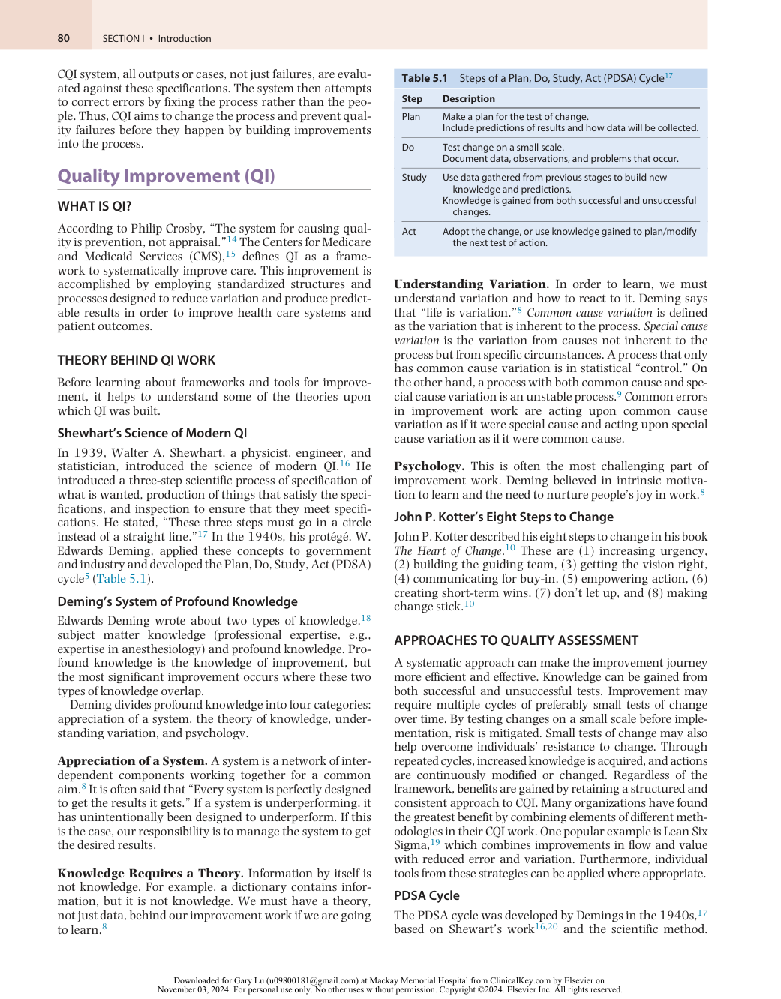

:::

<!-- PDF page 5 -->

It was reintroduced in the 1980s and modified in 1993. The PDSA cycle is an iterative four- stage framework for developing, testing, and implementing changes to previously generated ideas that will lead to improvement.21 The four stages are planning it, trying it, observing the results, and acting on what is learned. This approach provides a basic framework for developing, testing, and implementing changes to previously generated ideas that will lead to improvement. PDSA supports both very informal to highly complex improvement efforts.21 Table 5.1 outlines the PDSA cycle.17

### Model for Improvement

The Model for Improvement, developed by the training and management consulting company Associates in Process Improvement,22 has been adopted by organizations across varied disciplines and is used by the IHI. Like PDSA, it is a structured, dynamic model that applies the scientific method to testing and implementing a change.9,17 A modification of the PDSA by the addition of three fundamental questions (as explained in the next paragraph) resulted in the Model for Improvement (Fig. 5.1).21

Beginning an improvement project with these three fundamental questions helps set a clear direction for the project, define what success will look like, and hypothesize successful interventions.

- _Aim_ : _“What are we trying to accomplish?”_ The aim should be specific, measurable, actionable, relevant, and timespecific (also called a SMART aim).23 Ideas for improvements may come from interviewing those involved or affected by the process, such as staff or patients. Ideas may also come from examining previous operational, clinical, or financial data.

- _Measure: “How will we know if a change is an improvement?”_ Ideally, measures should be linked directly to the aim or goal of the project and ensure that the stakeholders’ interests in the process are represented.9 Quantitative measures should be used whenever possible to measure change over time. These measures provide feedback that enables one to know whether or not the change is an improvement. However, not all projects have an easily quantifiable outcome, and the outcome may be more qualitative. If possible, identifying opportunities to translate goals into quantifiable outcomes is worth the time and effort. These can be easier to use to communicate success.

- _Changes_ : “ _What changes can we make that will result in improvement?”_ Ideas for changes that result in improvement often start with observations, modeling the success of others, and brainstorming. The more intimate the understanding of a process and its key drivers, the higher the likelihood of generating successful changes.

These three fundamental questions are followed by a PDSA cycle. Measures defined in the first part of the model help determine whether or not a change is a success. These measures are plotted over time on run or control charts (see Figs. 5.2 and 5.3). Finally, PDSA cycles test and implement a successful change on a larger scale or in diverse clinical areas.

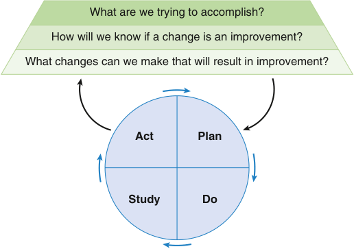

What are we trying to accomplish? How will we know if a change is an improvement? What changes can we make that will result in improvement? Act Plan Study Do 

**Fig. 5.1 Diagram of Model for Improvement.** (From Langley GJ, et al., 2009.9 With permission from John Wiley & Sons.)

### The Value Framework in Health Care

Since quality in health care is focused on patient outcomes, another approach to quality is the value framework. Quality relative to cost determines value. Hence, value is defined in health care as the patient health outcomes achieved per dollar spent.24 Value includes goals already embraced by health care, such as quality, safety, patient- centeredness, and cost- containment. Outcomes, the numerator of the value equation, refer to the actual results of care in terms of patient health and should consist of a set of multidimensional outcomes that, when considered together, constitute patient benefit. Cost, the denominator of the value equation, should include the total costs involved in the entire cycle of care for the patient’s medical condition. Outcomes and costs should be measured separately. Outcomes measurement is critical to driving rapid improvements in health care.

Without a feedback loop that includes the outcomes achieved, providers lack the information they require to learn and improve. Several problems hamper effective outcome measurement. First, there is a lack of consensus on what constitutes an outcome. Second, electronic medical record (EMR) systems often do not facilitate the capture of longitudinal outcomes measures with appropriate scope. Third, outcomes, such as infection rates, may vary substantially by medical condition. Finally, true outcome measurement has been limited because the cost of gathering longitudinal patient results is high due in part to fragmented organizational structures and poor EMR interoperability.

Cost is a pressing issue in health care. Current cost measurement approaches have hampered our understanding of costs due to a focus on cost- containment rather than value improvement. Two major problems associated with cost measurement are cost aggregation and cost allocation. Cost aggregation is measuring cost based on how care is organized and billed, that is, by department, discrete service areas, and line items such as supplies or drugs. Cost allocation is when costs involve shared resources and as such are calculated as the average cost over all patients for a department. An excellent example of this is the hourly charge for the operating room (OR). However, to truly understand costs, they must be aggregated around the patient rather

<!-- PDF page 6 -->

than discrete services, and shared costs must be allocated to individual patients based on each patient’s actual use of the resources involved. Finally, patient costs, including lost work, may not be included in the analysis.

### Lean Methodology

Lean methodology, used in the Toyota Production System,25 has been successfully used in health care. Lean methodology is focused on creating more value for the customer (i.e., the patient) with fewer resources. Every step in a process is evaluated to differentiate those steps that add value from those that do not. The ultimate goal is to eliminate all waste so that every step adds value to a process. Other key components of Lean include reducing unevenness of workflow — for instance, what we might find in intensive care unit (ICU) admissions, ORs, emergency cases — and eliminating the overburdening of people and equipment. An overview of the steps can be found in Table 5.2. Five principles govern Lean improvement9 :

1. _Define the value_ that the customer is seeking. Virginia Mason Medical Center has a “patient- first” focus for all its processes.25

2. _Identify and map_ the value stream. If evaluating preoperative assessment, map the physical flow of a patient from the scheduling of a procedure through the day of surgery (history and physical, preoperative counseling, laboratory tests, imaging, consultations). In this process, all of the steps are accounted for, including the back- and- forth flow of the patient to the front desk, to the laboratory, and so on. Time spent during each step of the process should be documented.

3. _Smooth the flow_ between value- added steps. Eliminate steps that do not add value to the overall process and are likely a poor use of time or effort. An example might be eliminating unnecessary tests or consultations in preoperative evaluation and reducing excess wait times resulting from correctable inefficiencies.

4. _Create pull_ between steps. Customer demand should trigger the start of a downstream process. Examples include opening ORs or increasing staffing based on surgical demand, as opposed to having a fixed amount of time for each surgeon or surgical division.

5. _Pursue perfection_ by continuing the process until you have achieved ultimate value with no waste.

### Six Sigma

The transformation of Motorola in the 1980s from a struggling company to a high- quality, high- profit organization helped give rise to the Six Sigma methodology.26 Two key fundamental objectives of Six Sigma are a virtually errorfree process and a large focus on reducing variation.26 In fact, a Six Sigma process, or a process whose frequency falls six deviations from the mean, corresponds to 3.4 errors per million.

Health care often falls far short of this standard. In a 1998 report, Chassin27 reported that hospitalized patients harmed by negligence were at a Four Sigma level (10,000/ million), patients inadequately treated for depression were at a Two Sigma level (580,000/million), and eligible heart attack survivors who failed to receive β- adrenergic blockers were at a One Sigma level (790,000/million). In contrast,

Chassin found that anesthesiology was the one health care specialty that approached the Six Sigma level, with deaths caused by anesthesia as low as 5.4/million.27 Compared to health care, airline fatalities were a Two Sigma process (230/million), and a traditional company operated around Four Sigma, the equivalent of 6200 errors/million.27 This error rate has significant financial implications since errors are often tied directly to cost.

Six Sigma is similar to the Model for Improvement in that it uses a simple framework to guide improvement, in this case using Define, Measure, Analyze, Improve, Control (DMAIC).19,26 The DMAIC steps are described in Table 5.2. As mentioned earlier, many organizations have found the greatest benefit by combining elements of different methodologies in their CQI work. One popular example is Lean Six Sigma, which combines improvements in flow and value with reduced error and variation. Furthermore, individual tools from these strategies, such as PDSA cycles or DMAIC processes, can be applied where appropriate.

### QUALITY IMPROVEMENT MEASURES AND TOOLS

The concept of using measurement to drive improvement has its origins in both medicine and industry. The use of data to improve patient health originated in the mid- 1800s with two pioneers, Florence Nightingale and John Snow. Nightingale used data on mortality among British soldiers to drive improvements in sanitation in field hospitals. Similarly, Snow used data on the incidence and geographic location of cholera to make the connection between the incidence of the disease and water obtained from the Broad Street water pump. In the early 20th century, Ernest Codman, a surgeon at Massachusetts General Hospital, was the first to advocate tracking of patient outcomes so that adverse events could be identified and improvements in care made for future patients.28 In the 1960s, Avedis Donabedian emphasized the importance of measurement and described a model for evaluating quality of health care based on structure, process, and outcomes – _structure_ being the environment in which health care is provided, _process_ being the method by which it is provided, and _outcomes_ being the result of the care provided.29 More recently, in 1991, Paul Baltaden and Don Berwick developed the IHI, which has become one of the leading organizations in the application of improvement science to health care.30

In QI, measurement can serve many purposes. It can be used to identify problems and establish baseline performance, inform and guide QI projects, select and test changes for improvement, and assess and align progress with organizational goals. Selecting and developing measures that are useful can be challenging. Optimal measures must be comprehensive, carefully defined, tailored to the target audience, and involve minimal measurement burden. Target audiences usually include clinical staff, so measures should address and align with clinical targets for specific patient populations with whom the staff work. Measures should pass the face validity test with clinical practitioners delivering care. National or organizational measures, if applicable, can also be used, but they may not always be relevant or credible to the local target audience. Within

<!-- PDF page 7 -->

an organization, target audiences should include system leaders, so measures should also align with organizational priorities and strategic goals. A comprehensive set of measures should include at least one process, outcome, and balancing measure. In addition, structural measures, such as ICU nurse- to- physician staffing ratios, can be important to include when appropriate.31,32 Each of these measures has advantages and limitations.33

### Process Measures

Valid process measures should have causal links to important outcomes, and a change in the process should produce a desired change in outcome. One of the best opportunities to improve patient outcomes may come from discovering how to deliver effective therapies (processes) that produce the desired outcome.34 For example, hand hygiene and the application of chlorhexidine to sterilize the skin site before insertion of a central venous catheter (CVC) are two of five processes known to reduce catheter- related bloodstream infections (CRBSIs).35 Process measures such as these indicate whether patients reliably receive evidence- based interventions known to prevent complications.

Process measures are easier to implement than outcome measures and can provide important insight into care.36 Process measures can give immediate feedback regarding performance, allowing for rapid improvements in care. If an outcome occurs infrequently, providers will be unable to obtain meaningful feedback on outcomes on a timely basis. For example, evidence of improved rates of CRBSI (an outcome measure) may require 12 to 24 months of data (because few patients develop infections), whereas improved adherence to evidence- based practices to reduce infections (process measures) may be observed within a week (because all patients can be evaluated to determine whether they received the intervention).

Process measures have two other significant advantages. First, they generally have face validity for providers, meaning that providers believe they can use the data to improve care; and second, because risk adjustment is less important, broad implementation is feasible. Moreover, joint efforts among providers, professional societies, and external government or payer agencies have made process measures more feasible.36

Health care providers readily accept process measures because they demonstrate the degree to which caregivers can influence a process with the intention to improve patient outcomes. Practitioners generally feel more accountable for the process of care than its outcomes, because outcomes may be affected by many other variables.33 An obstacle to using process as a measure of quality is sustainability; frequent updating is required as the science of medicine advances.

### Outcome Measures

Although process measurement is valuable and should continue, there is no substitute for measuring outcomes, whose principal purpose is not comparing providers but enabling innovations in care. As mentioned above, measuring value requires measuring actual outcomes over time. Outcome measures address patient outcomes from the delivery of these services, such as clinical and functional outcomes or satisfaction with health (e.g., morbidity, mortality, length of stay, quality of life). Outcome measurement refers to the

actual results of care in terms of patient health over time; for each medical condition, a set of multidimensional outcomes constitute patient benefit. These include survival, functional status, and sustainability of recovery. Outcome measures relate directly to the health status of the patient. Patient satisfaction with care is a process measure, not an outcome. Patient satisfaction with health is an outcome measure. However, current measures for outcome often focus on the immediate results of particular procedures or interventions rather than on the overall success of the entire cycle of care for a medical condition.

_Balancing measures_ address the possible consequences of changes in the process. For example, when process improvements are made to improve efficiency, other outcomes, such as patient satisfaction, should not be adversely affected. The most important use of balancing measures occurs when a change could produce unintended negative consequences. For example, efforts to decrease length of stay may negatively impact patient satisfaction.

The relative focus on outcome and process measures will depend on balancing the collection of data between that which is scientifically sound and that which is feasible. A balanced set of process and outcome measures helps inform improvement efforts and provides evidence that efforts have made a difference in patients’ lives.

For measurement to be effective, the following principles are important. First, measures should focus on something that the improvement team has the power to change and should initially be simple, small- scale measures that focus on the process itself and not on people. Second, measures should be practical, seek usefulness – not perfection – and fit the work environment and cost constraints. Third, data for measurement should be easy to obtain; finding ways to capture data while the work is getting done allows measures to be built into daily work. Fourth, qualitative data (e.g., reasons for patient dissatisfaction in the patients’ own words, observations to contextualize quantitative data) are highly informative and should complement quantitative data (e.g., percentage of patients satisfied with care). Finally, when using measures, balance is key; a balanced set of measures can help answer the question, “Are we improving parts of our system at the expense of others?” Measurement should not overwhelm the change process. Improvement teams should minimize the burden of measurement whenever possible. Measurement can have both direct and indirect consequences on resource use, provider behaviors, and patients.37 Measurement of performance and outcomes of care can be costly, especially if the data collection process is manual and involves chart reviews. The burden of measurement is reduced with an EMR system and computerized order entry, although these information technology systems are costly to implement and maintain. Additionally, these resources may not be equally available throughout a system or organization, leading to disparities in the care provided.

Measurement fixation is an unintended consequence on health care staff behavior that may occur with the use of process measures. For example, when a process measure such as “the percentage of diabetic patients who received an action plan” is used rather than an outcome measure such as “improved patient understanding about diabetic management,” the measure is perceived by the clinician

<!-- PDF page 8 -->

as defining what is important. Thus, measurement of the process becomes the priority, rather than the intended outcome.37 Alternatively, the clinician may become so focused on what is being measured that different aspects of care are not equally prioritized. In addition, a predominance of process rather than outcome measures can stifle innovation by scripting a process, thus inhibiting process- level innovation. Practice variation does have some utility because medical practice is dynamic, and it is through the trial of new methods of care that innovation occurs. Finally, QI performance measures may not match patient preferences for clinical care. Performance measures that do not take patient preference into account can lead to decreased patient satisfaction, trust, and confidence in their health care practitioners and system.37 Thus, selection of a set of appropriate measures with the attributes described previously can be a balancing act that includes weighing the tradeoffs involved.

Consumers, payers, and employers are increasingly requesting outcome measures to both improve care and decrease cost. Even national governmental bodies are influencing the measurement and reporting of quality in health care. In the United States, the Centers for Medicare and Medicaid Services (CMS), the single largest health care purchaser, requires hospitals and physicians to participate in the Quality Payment Program (QPP). This program requires providers to demonstrate quality by either participating in an Advanced Alternative Payment Model (akin to a quality collaborative or participants in a bundled payment model) or by accumulating points through the Merit- based Incentive Payment System.38 The United Kingdom Quality and Outcomes framework39 is an analogous system. These quality mandates have fundamentally changed the ways that clinicians, hospitals, and health systems engage in and report QI activities.

### Analysis and Display of Quality Improvement Data

Interpretation of data and understanding of process variation are fundamental to QI work. Data elements central to improvement are, first and foremost, data collection as a basis for action; second, the interpretation of data is made within the context of the process; and last, the analysis technique should filter out noise in the process. Aggregate data or summary statistics typically do not filter out noise in the system and do not present a broad enough context to point practitioners toward proper action or process improvement.

Shewhart postulated that data contain both signal and noise. To be able to learn, one must separate the signal from the noise.20 CQI science defines two types of variation within a process: random and specific. Random variation, also known as common cause variation, results from differences in the inputs that a process receives or inherent factors in the process itself. Random variation is the random background noise within a system and occurs in the process all the time. Specific variation, also known as special cause or attributable variation, is not always present as background noise but rather arises from one or more specific causes that are not part of the system. A process is considered unstable when a specific variation exists, and efforts should be made to learn about the special causes of this variation. A stable process exists when specific variation no longer occurs, leaving only random or common variation.13 CQI aims to eliminate specific variations for every process so that only random variation remains. A standards- based QA system

fails to distinguish random causes from special causes and attempts to correct all variation. Attempts to correct random variation will necessarily fail – a process CQI defines as “tampering.” When a process exhibits only random variation, it should be evaluated to determine whether it functions at an acceptable level. If not, the process must be changed to move the average in the desired direction. Standardization of a process is often the key to reducing random variation and improving a process.

### RUN CHARTS AND CONTROL CHARTS

Run and control charts are graphic displays of data that enable observation of trends and patterns over time. They are the best tools for determining whether improvement strategies have had an effect.

### Run Charts

A run chart9 (Fig. 5.2), also called a time series chart, plots the variable or measure being studied on the vertical axis and plots the time on the horizontal axis. The average, or centerline, is the median. At least 12 data points are required to establish a baseline, and at least 20 to 25 data points are needed to detect trends and patterns. Run charts should be annotated with tests of change to provide the context within which data can be interpreted. Four rules can be used with run charts to determine whether non- random patterns exist or to detect whether the change has led to an improvement9 :

1.  Six or more consecutive points above or below the median indicate a shift.

2.  Five or more points indicate a trend, all increasing or all decreasing.

3.  A run is a series of consecutive points on the same side of the median line.

4.  An astronomical data point is an unusual point that is different in value (an outlier).

Because change is by nature temporal, run charts in which data are presented over time are powerful tools for interpreting data within the context of the process.

### Control Charts

A control chart40 (Fig. 5.3), also known as a Shewhart chart,9,16 is an extension of a run chart and is used to

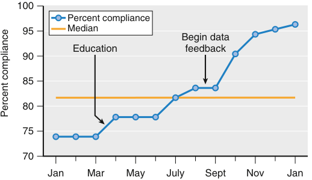

100 Percent compliance 95 Median Begin data Education feedback 90 85 80 75 70 Jan Mar May July Sept Nov Jan Percent compliance 

**Fig. 5.2 Example of a run chart.** This chart shows the plot of a performance measure over time. The horizontal ( _x_ ) axis represents time in months, and the vertical ( _y_ ) axis represents the performance measure – the percentage of compliance with the timing of preoperative antibiotics.

<!-- PDF page 9 -->

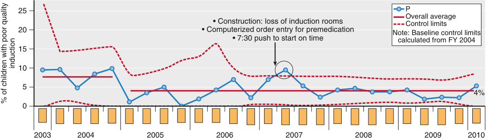

25 P Overall average • Construction: loss of induction rooms Control limits 20 • Computerized order entry for premedication Note: Baseline control limits • 7:30 push to start on time calculated from FY 2004 15 10 5 4 % 0 2003 2004 2005 2006 2007 2008 2009 2010 induction % of children with poor quality 

**Fig. 5.3 Example of a control chart.** This chart monitors the quality of the anesthesia induction process, as measured by an induction compliance checklist. The _solid red line_ marks the mean, and the _dashed lines_ indicate the upper control limit and lower control limit, which are ±3 standard deviations from the mean. The _circled point_ represents a single special cause variation in quality of induction. (From Varughese AM, Hagerman N, Kurth CD. Quality in pediatric anesthesia. _Paediatr Anaesth_ . 2010;20(8):684–696.)

distinguish between specific and random variation. As on a run chart, the variable is plotted on the vertical axis and time on the horizontal axis. However, with a control chart, the centerline or average is the mean rather than the median, and the upper control limit (UCL) and lower control limit (LCL) are calculated. The UCL and LCL correspond to ±3 sigma from the mean. A process is considered “in control” or stable when data points are within these control limits.16 Random variation, or variation that results from the regular rhythm of the process, produces a stable process. However, in an unstable process that contains variation from special causes, data points exceed the UCL or LCL.41

### Failure Modes and Effects Analysis

A failure modes and effects analysis (FMEA) is a tool to help identify problems in a process before they occur and cause harm.9 An FMEA can help you decide where to target your improvement efforts. In addition, the proactive approach makes it especially useful before implementing a new process.

An FMEA reviews the steps in a process, the potential failure modes (what could go wrong), failure causes (why would the failure happen?), and failure effects (what would be the consequences?).42 After listing the steps in a process, a risk profile number is calculated based on the likelihood of occurrence, the likelihood of detection, and severity. Improvement efforts are then targeted at the steps with the highest risk profile number.

A simplified FMEA is a quicker version of the FMEA that can help guide improvement work. A simplified FMEA consists of listing the steps in a process, listing potential failures that could go wrong for each step, and brainstorming interventions for each possible failure. Below is an example of simplified FMEA for programming infusion pumps used in an improvement project to reduce medication errors.

### Dashboards and Scorecards

A dashboard of measures functions like an instrument panel for an aircraft or automobile and provides real- time feedback on what is happening. Balanced scorecards _,_ or “whole system measures,” are similar to dashboards and are used to provide a complete picture of quality. Kaplan and Norton developed the balanced scorecard as a “multidimensional

**Table 5.2** Steps in the Lean or Six Sigma Define, Measure, Analyze, Improve, Control (DMAIC) Process19,26

|**Step**|**Description**|
|---|---|
|Define|Define the goals of the improvement project. Obtain necessary support and resources and put together a project team.|
|Measure|Establish appropriate metrics. Measure baseline performance of the current system.|
|Analyze|Examine the system for possible areas of improvement.|
|Improve|Improve the system through implementation of ideas. Statistically validate improvements.|
|Control|Institutionalize the new system and monitor its stability over time.|

framework for describing, implementing, and managing strategy at all levels of an enterprise by linking objectives, initiatives, and measures to an organization’s strategy.”43 A set of measures should reflect the culture and mission of an organization. Viewed collectively, this set of measures provides a gauge of current performance and can also guide the direction for future organizational improvement efforts. A balanced set of measures is critical to ensure that improvement efforts in one area do not adversely affect outcomes in other areas.

### Additional QI Evaluation and Communication Tools

In most situations, QI frameworks such as the Model for Improvement or Lean Sigma are sufficient to help guide the development, testing, implementation, and spread of improvement. However, to better understand problems within a system or process, QI professionals have developed or adapted a number of methods and tools. Some of these methods and tools help view systems and processes and organize and communicate information. These are described in the following section.

Understanding how a process or system works is fundamental to improving it. Process mapping is a method to gain this understanding. A flow diagram, or flow chart, is an improvement tool used during process mapping; it provides a visual picture of the process being studied,

::: details 原始表格與符號（PDF 第 9 頁）

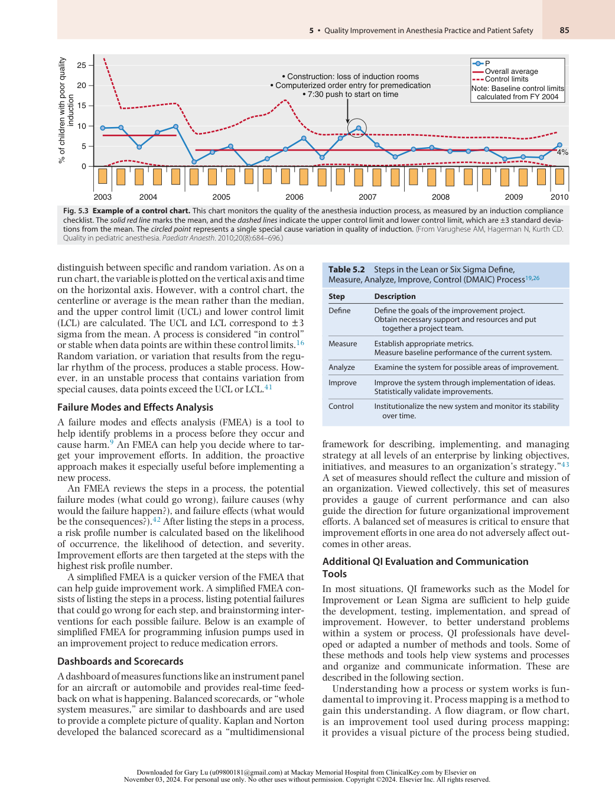

:::

<!-- PDF page 10 -->

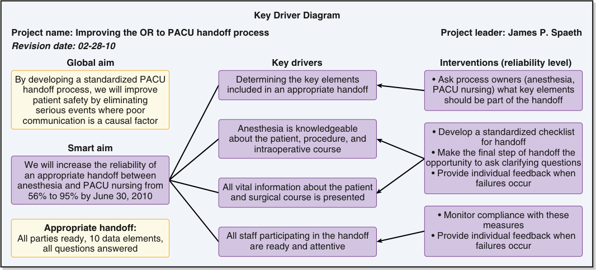

Key Driver Diagram Project name: Improving the OR to PACU handoff process Project leader: James P. Spaeth Revision date: 02-28-10 Global aim Key drivers Interventions (reliability level) By developing a standardized PACU Determining the key elements • Ask process owners (anesthesia, handoff process, we will improve included in an appropriate handoff PACU nursing) what key elements patient safety by eliminating should be part of the handoff serious events where poor communication is a causal factor Anesthesia is knowledgeable • Develop a standardized checklist about the patient, procedure, and for handoff Smart aim intraoperative course • Make the final step of handoff the We will increase the reliability of opportunity to ask clarifying questions an appropriate handoff between • Provide individual feedback when anesthesia and PACU nursing from All vital information about the patient failures occur 56% to 95% by June 30, 2010 and surgical course is presented • Monitor compliance with these Appropriate handoff: measures All parties ready, 10 data elements, All staff participating in the handoff • Provide individual feedback when all questions answered are ready and attentive failures occur 

**Fig. 5.4 Example of a key driver diagram.** This diagram was developed to improve the operating room (OR) to postanesthesia care unit (PACU) handoff process. It incorporates the global and smart aim of the project, the key drivers inherent to the process, and specific interventions targeting each of the key drivers. (From Boat AC, Spaeth JP. Handoff checklists improve the reliability of patient handoffs in the operating room and postanesthesia care unit. _Paediatr Anaesth_ . 2013;23(7):647–654.109 )

wherein the series of activities that define a process is graphically represented. Flow charts identify and clarify all steps in the process. They also help the team understand the process’s complexity and identify improvement opportunities.

A key driver diagram (KDD)44 (Fig. 5.4) is another approach to organizing the theories and ideas for improvement that a team has developed. The KDD presents the aim or outcome of the project with both the theories (key drivers) behind the improvement and ideas for a test of change.9 Initially, the driver diagram helps lay out the descriptive theory behind the improved outcomes. As these theories are tested, the driver diagram is updated and enhanced to develop a predictive theory. KDDs are extremely useful because they provide a shared mental model for the team during its improvement efforts.

### IMPROVEMENT INTERVENTION TOOLS

Efforts in QI and patient safety have produced tools to reorganize how care is delivered. QI intervention tools are used to improve communication and teamwork. Examples of these tools include daily goals sheets, briefings/debriefings, and checklists.

### Daily Goals Sheet

For nearly 20 years, documentation of daily goals as either a handwritten or a whiteboard has been used to improve communication during multidisciplinary rounds in adult and pediatric ICUs.45,46 As a one- page paper checklist, this tool would be completed every morning to establish the care plan, set goals, and review potential safety risks for each patient (Fig. 5.5).

Before implementation of the daily goals sheet in an adult ICU, an initial survey showed that ICU team

members were unable to answer two simple questions after rounding at each patient’s bedside: “Do you understand the patient’s goals for the day?” and “Do you understand what work needs to be accomplished on this patient today?” Fewer than 10% of the residents and nurses knew the care plan for the day. This finding was not surprising because traditional bedside rounds tended to focus on teaching the staff about disease processes rather than on the work necessary to treat the patient. Approximately four weeks after the daily goals sheet was implemented, 95% of residents and nurses understood the goals for each patient. Moreover, after the daily goals sheet was implemented, the length of stay in the surgical ICU decreased from a mean of 2.2 days to only 1.1 days.47 These results have been reproduced in ICUs with nurses, physicians, and pharmacists. Interviews supported that communication, patient care, and education were enhanced by providing a structured, thorough, and individualized approach to the patient’s care. The daily goals checklist helped to identify new patient care issues and sparked management discussions, especially for sedation, weaning, and medications.45 Additionally, a QI intervention using daily goals checklists in 118 ICUs in Brazil improved the use of low tidal volumes, avoidance of heavy sedation, use of CVCs, use of urinary catheters, perception of teamwork, and perception of patient safety climate, but did not reduce inhospital mortality.46

A further improvement was implemented in a pediatric cardiac ICU using a whiteboard to display daily goals visually.48 Use of the whiteboard increased the percent agreement among the patient care team for patient goals from 62% to over 87%.46 The goals were updated as needed and used as an information source for all staff involved in the patient’s care as well as for the patient’s family. A daily goals display such as this can be modified for use on other

<!-- PDF page 11 -->

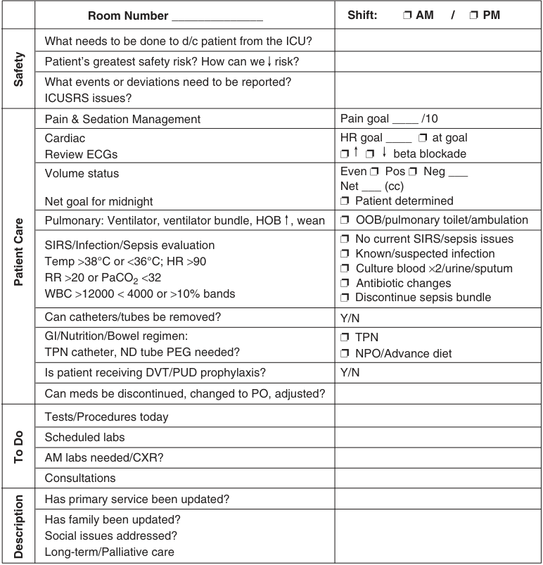

Room Number ______________ Shift:            AM     /         PM What needs to be done to d/c patient from the ICU? Patient’s greatest safety risk? How can we   risk? What events or deviations need to be reported? ICUSRS issues? Pain & Sedation Management Pain goal ____ /10 Cardiac HR goal ____       at goal Review ECGs                 beta blockade Volume status Even      Pos      Neg ___ Net ___ (cc) Net goal for midnight      Patient determined Pulmonary: Ventilator, ventilator bundle, HOB   , wean      OOB/pulmonary toilet/ambulation      No current SIRS/sepsis issues SIRS/Infection/Sepsis evaluation      Known/suspected infection Temp >38°C or &lt;36°C; HR >90      Culture blood ×2/urine/sputum RR >20 or PaCO2 &lt;32      Antibiotic changes WBC >12000 &lt; 4000 or >10% bands      Discontinue sepsis bundle Can catheters/tubes be removed? Y/N GI/Nutrition/Bowel regimen:     TPN TPN catheter, ND tube PEG needed?      NPO/Advance diet Is patient receiving DVT/PUD prophylaxis? Y/N Can meds be discontinued, changed to PO, adjusted? Tests/Procedures today Scheduled labs AM labs needed/CXR? Consultations Has primary service been updated? Has family been updated? Social issues addressed? Long-term/Palliative care Safety Patient Care To Do Description 

**Fig. 5.5 Example of an intensive care unit daily goals sheet.** _CXR_ , chest radiograph; _d/c_ , discharge; _DVT_ , deep vein thrombosis; _ECG_ , electrocardiogram; _GI_ , gastrointestinal; _HOB_ , head of bed; _HR_ , heart rate; _ICU_ , intensive care unit; intensive care unit; _ICUSRS_ , ICU self- reporting system; _ND_ , naso- duodenal; _NPO_ , nothing by mouth; _OOB_ , out of bed; _PaCO2_ , arterial partial pressure of carbon dioxide; _PEG_ , percutaneous endoscopic gastrostomy; _PO_ , oral; _PUD_ , peptic ulcer disease; _RR_ , respiratory rate; _SIRS_ , severe infectious respiratory syndrome; _temp_ , temperature; _TPN_ , total parenteral nutrition; _vent_ , ventilator; _WBC_ , white blood cell count.

nursing units or during OR sign- out or emergency department rounds.

### Checklists

Checklists have been used in health care and other industries to ensure that essential steps in a process are not forgotten. The Food and Drug Administration (FDA) recommends a checklist be used when checking out and inspecting an anesthesia machine before use to ensure that the equipment and monitors function correctly.49,50 Checklists have been shown to effectively reduce central line–associated bloodstream infections (CLABSIs) by standardizing practice, reducing complexity, and providing a redundant safety check. Having a person, such as a nurse or another physician, be responsible for reading the checklist also empowers that person or anyone involved to stop the procedure if the checklist is not followed or if sterile technique is compromised. An early study showed that the use of a central line insertion checklist and bundle resulted in a 66% reduction in the overall CLABSI rate; the median rate was reduced from 2.7 per 1000 catheter days before the

intervention to zero by month three and through month 18 of the postintervention.51 Institutions, safety groups, and regulatory agencies have adopted a central line insertion checklist to ensure compliance with the best practices for CVC placement and prevent CLABSI. Checklists and central line insertion bundles are widely available online; one such resource is the IHI.52

In addition to standardizing technical tasks, checklists are used to normalize communication. Haynes and colleagues53 described using a checklist to guide the perioperative time- out, briefing, and debriefing process. They showed that implementing the World Health Organization Surgical Safety Checklist54 (Fig. 5.6) reduced mortality and inpatient complications.53 The use of surgical checklists is now widespread and is the standard of care in most OR settings worldwide. Numerous studies on surgical checklists, either as a tool or a process, have shown their effectiveness, while some studies have reported limited impact. A review of 25 highly cited research papers on surgical safety checklists from 2009 to 2016 showed the complexity of standardizing, implementing, and sustaining the use of surgical safety

<!-- PDF page 12 -->

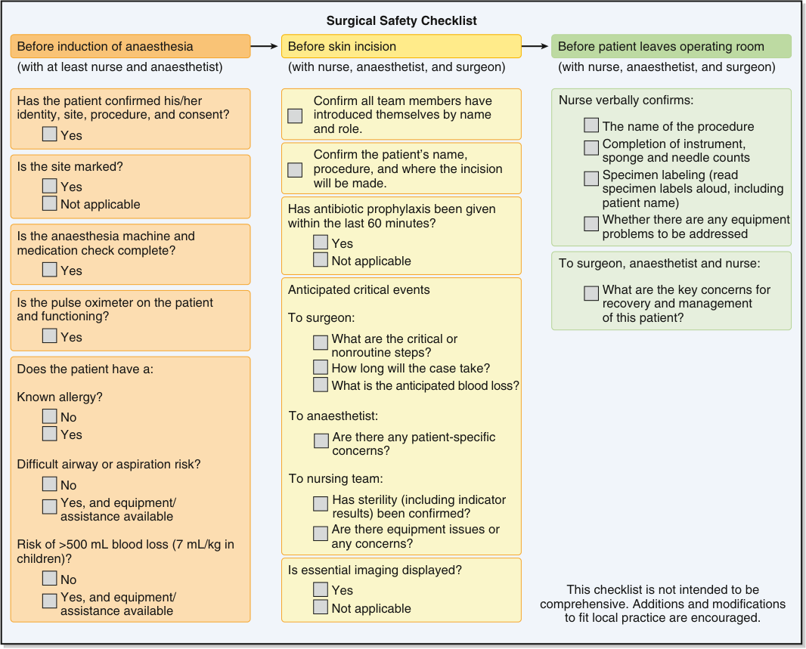

Surgical Safety Checklist Before induction of anaesthesia Before skin incision Before patient leaves operating room (with at least nurse and anaesthetist) (with nurse, anaesthetist, and surgeon) (with nurse, anaesthetist, and surgeon) Has the patient confirmed his/her Confirm all team members have Nurse verbally confirms: identity, site, procedure, and consent? introduced themselves by name and role. The name of the procedure Yes Completion of instrument, Confirm the patient’s name, sponge and needle counts Is the site marked? procedure, and where the incision Specimen labeling (read Yes will be made. specimen labels aloud, including Not applicable Has antibiotic prophylaxis been given patient name) within the last 60 minutes? Whether there are any equipment Is the anaesthesia machine and problems to be addressed Yes medication check complete? Not applicable To surgeon, anaesthetist and nurse: Yes Anticipated critical events What are the key concerns for Is the pulse oximeter on the patient recovery and management and functioning? To surgeon: of this patient? Yes What are the critical or nonroutine steps? Does the patient have a: How long will the case take? What is the anticipated blood loss? Known allergy? No To anaesthetist: Yes Are there any patient-specific concerns? Difficult airway or aspiration risk? No To nursing team: Yes, and equipment/ Has sterility (including indicator assistance available results) been confirmed? Are there equipment issues or Risk of >500 mL blood loss (7 mL/kg in any concerns? children)? Is essential imaging displayed? No Yes This checklist is not intended to be Yes, and equipment/ assistance available Not applicable comprehensive. Additions and modifications to fit local practice are encouraged. 

**Fig. 5.6 World Health Organization Surgical Safety Checklist.** (Reproduced with permission from World Health Organization. WHO Surgical Safety Checklist.)

checklists.55 Complexities include variations in the environment, distribution of staff, the timing of when the checklist is used, the relationship between those using the checklist, and the institution’s culture.55 These complexities may undermine the effectiveness of checklists and should be considered prior to checklist implementation.

### Briefings and Debriefings

The surgical checklist is part of the Universal Protocol, created to prevent wrong person, wrong procedure, and wrong site surgery. To address many of the other important safety issues, such as antibiotic needs, deep vein thrombosis prevention, fire prevention, special equipment needs, and blood product availability, many institutions have implemented OR briefings or huddles, as well as debriefings at the end of surgery. Preoperative briefings have been shown to improve team communication, improve compliance with best practices, and enhance the overall perception of the safety climate in the OR.56

Briefing and debriefing tools are designed to promote effective interdisciplinary communication and teamwork.

Both have been used in the OR, during sign- out from the ICU nursing staff to the intensivist, and between OR nursing and anesthesia coordinators.49,57 A briefing is a structured review of the case at hand that occurs among all team members before the start of an operative procedure. A debriefing occurs after the procedure; the team reviews what worked well, what failed, and what could be accomplished better in the future (Fig. 5.7).

An example of an OR briefing includes an introduction by name (first and last) and role of each team member, confirmation of the correct patient, confirmation of the site/side and procedure (time- out), and a verbal assurance that all team members agree that they understand the procedure and what is required to ensure its success. All necessary equipment, medications (e.g., appropriate antibiotics), and blood availability are checked. The question, “If something were to go wrong, what would it be?” is asked, and plans to mitigate or respond to the potential hazard are discussed.

A collaborative effort by the Agency for Healthcare Research and Quality (AHRQ) and the Department of Defense adopted crew resource management strategies

<!-- PDF page 13 -->

|**e** **r** **u** **d** **e** **c** **o** **r** **P** **y** **r** **e** **v** **E** **e** **r** **o** **f** **e** **B** **:** **g** **n** **if** **e** **ir** **B**|
|---|
|Team introductions: First and last names, includingroles; write names on board|
|Verify: Patient ID band, informed consent (read out loud), site marking, OR posting, patient’s verbalization ofprocedure(ifpatient awake),H&P or clinic note|
|Are there anysafety, equipment, instrument, implant, or other concerns?|
|Have antibiotics beengiven, if indicated?|
|What are the anticipated times of antibiotic redosing?|
|Isglucose control or beta blockade indicated?|
|Is thepatientpositioned to minimize injury?|
|Has theprepsolution been appliedproperly,withoutpooling,and allowed to dry?|
|Have thegoals and critical steps of theprocedure been discussed?|
|Is the appropriate amount of blood available?|
|Is DVTprophylaxis indicated? Ifyes,describe.|
|Are warmers on thepatient?|
|Is the time allotted for thisprocedure an accurate estimate?|
|Have the attendings reviewed the latest laboratoryand radiologyresults?|
|**e** **r** **u** **d** **e** **c** **o** **r** **P** **y** **r** **e** **v** **E** **r** **e** **tf** **A** **:** **g** **n** **if** **e** **ir** **b** **e** **D**|
|Could anythinghave been done to make this case safer or more efficient?|
|Has the Surgical Site Infection data collection form been completed?|
|Are the patient’s name, history number, surgical specimen name, and laterality on the paper work?(Must be independentlyverified bythe surgeon)|
|Did we haveproblems with instruments? Were theyreported?|
|Plan for transition of care to postop unit discussed? Fluid management?|
|Blood transfusion paperwork in chart?|
|Antibiotic dose and interval to be continued postop? Pain management/PCA plan?|
|New medications needed immediately postop? Beta blockers needed?|
|Glucose control?|
|DVT prophylaxis?|

**Fig. 5.7 Example of an operating room briefing and debriefing tool.** _DVT,_ deep vein thrombosis; _H&P,_ history and physical; _ID,_ identification; _OR_ , operating room; PCA, patient-controlled analgesia.

for OR briefings and produced an evidence- based resource called Team Strategies and Tools to Enhance Performance and Patient Safety (TeamSTEPPS).58 This team approach in the OR encourages situational awareness and communication among all members of the health care team.59–62

### Putting It All Together: An Example QI Project

The following is an example of how the QI methodology previously discussed could be used to address a practical problem. A hypothetical example of reducing medication errors in an anesthesiology department is described.

An anesthesia group was concerned over the large number of medication errors in their department. They formed a multidisciplinary group including an anesthesiologist, nurse anesthetist, anesthesia resident, and pharmacist. They addressed the first question in the Model for Improvement — “What are we trying to achieve?” — by writing a SMART aim. Their SMART aim was to reduce medication errors in the Department of Anesthesiology from three errors per month to one error per month within 12 months.

The next question in the Model for Improvement is, “How will we know that a change will result in an improvement?” To monitor their progress, they constructed a run chart of medication errors per month in their department. They captured data through a previously existing self- reporting system.

The last question of the Model for Improvement is, “What changes can we make that will result in an improvement?” To better understand the errors that were occurring, the group categorized the medication errors into categories and constructed a Pareto Chart. A Pareto Chart is a bar chart listing categories in descending order. The group learned that three categories of errors accounted for about 80% of the total errors. These categories were infusion pump errors, acetaminophen errors, and antibiotic errors. They focused their initial efforts on these three categories. They created process maps for these three categories to understand the current process better and develop possible interventions. Finally, to help organize their theory of improvement, they created a KDD, listing the drivers they thought would affect their aim and possible interventions targeting the drivers.

Now that they had a theory of improvement, they started testing their interventions. They tested their ideas using PDSA cycles. They adopted the successful tests, adapted tests with mixed results, and abandoned the failed tests. Some of their tests included requiring a sticker from the pharmacy and requiring a two- person double check of infusion pumps. As their testing and implementation continued, they saw the run chart’s centerline, or median, decrease from three to two. The run chart rules indicated this was a significant change. The group was excited that

::: details 原始表格與符號（PDF 第 13 頁）

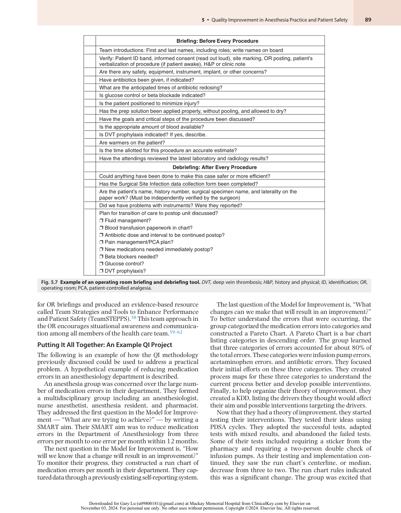

:::

<!-- PDF page 14 -->

they had decreased the number of medication errors in their department, but they had not yet reached their aim of no more than one medication error per month. They decided to continue testing new ideas until the median decreased to less than one error per month.

### Sources of Quality Improvement Information

The development of a QI project first requires that an issue be identified. Baseline data are then collected, and an improvement intervention is instituted, often using one of the approaches described earlier. Data are re- collected after the intervention. If the intervention is found to be effective, ongoing monitoring or audits are instituted to ensure that the change is sustained. As part of the audits, feedback must be given to the providers. Health care providers traditionally have had limited ability to obtain feedback regarding performance in their daily work, in part because of a lack of information systems and a lack of agreement on how to measure the quality of care.63

Ideas for QI projects can be identified from a multitude of sources, but they typically start with surveys and input from local medical staff and reviews of reported incidents. Additional information is gathered from the literature, a review of national guidelines and quality metrics, and information obtained from external or internal reviews.

Sources of QI data that span both the clinical and administrative arenas include evidence- based medicine and evidence- based clinical practice guidelines, alerts from accrediting agencies and nonprofit safety organizations, standards and guidelines by medical specialty associations, closed claims databases, and government agency administrative databases. United States governmental agencies, including the AHRQ, CMS, and the National Quality Forum (NQF), promote the development and reporting of health care quality measures.64

### INCIDENT REPORTING

Voluntary incident reporting capturing hazardous conditions has been successfully used to improve patient care and foster QI programs.65 As the potential of voluntary incident reporting is realized in health care, this reporting has become less punitive and more focused on systems rather than individuals. When appropriately applied, voluntary incident reporting helps identify hazards to patients that can become the focus of QI efforts that seek to mitigate those hazards.66 Unlike other methods that evaluate harmed patients, voluntary incident reporting provides the potential to also learn from near misses (incidents that did not lead to harm but were potentially hazardous). These near misses and potential hazards are a rich source for QI projects highlighting the importance of preventing harm.

All anesthesiology departments should have a process for capturing adverse events and near misses. Although most departments have a process for reporting, many incidents go unreported for a variety of reasons. Departments should encourage voluntary reporting without the threat of punishment. Electronic capture of adverse events, near misses, and complaints can provide data that can subsequently be analyzed to identify trends and assess the degree of harm a hazard poses to patients.

Events with low harm that occur frequently can be just as important as those with high harm that occur rarely. At the local level, it is more effective to focus on a more frequently occurring adverse event (e.g., perioperative skin abrasions, mislabeling of laboratory specimens) or on a process that can be measured with high frequency (e.g., hand hygiene, administration of antibiotic prophylaxis). For rarely occurring harmful events, a QI initiative may encompass a more expansive analysis of a national adverse event database with multicenter participation.

With multi- institutional event reporting systems, events rarely seen in a single institution can be collected in larger numbers. Such systems allow analysis for common causes, increasing our knowledge base for prevention initiatives. Larger multi- institutional data gathering systems include the Vizient Collaborative (the former University Health System Consortium), which supports event reporting and databases that can be used to develop QI programs, benchmarking9 and evidence- based practice.67 Reporting systems explicitly designed to investigate rarely occurring anesthesia- related events include the Anesthesia Incident Reporting System (AIRS) created by the Anesthesia Quality Institute (AQI)68 and Wake Up Safe, a QI initiative of the Society for Pediatric Anesthesia.69 The AIRS program publishes a monthly learning case in the _American Society of Anesthesiologists (ASA) Newsletter,_ including a summary of a reported case with learning points.

More expansive international incident reporting systems that are anonymous and voluntary have also been analyzed in the literature and have provided important information. Examples are the United Kingdom’s Serious Incident Reporting and Learning Framework70 and the Australian Incident Monitoring Study.71 These incident registries do not require that the events be considered human error or preventable to merit reporting and are a source of ideas for QI projects.

Although voluntary systems often prove fruitful, many events and near misses remain unreported. One way to capture these incidents is to survey local medical staff members to obtain their thoughts on how the last patient was harmed or how the next patient might be harmed. This process of performing a staff safety assessment survey is described in later sections in this chapter (see Collaborative Programs and Translating Evidence into Practice [TRIP] and Comprehensive Unit-Based Safety Program [CUSP], below). Staff safety assessment surveys can be beneficial for identifying issues for QI projects. Additionally, if staff members identify the issue, the likelihood is greater that they will have a vested interest in participating in the QI efforts.

### PUBLISHED LITERATURE

Literature reviews offer ideas for QI topics in specific areas and information to guide interventions. For example, if the QI project plan is to reduce hazards in cardiac anesthesia, a literature review will provide reports of various cardiac anesthesia risks. Once a topic within a clinical area is selected, a literature search should be performed again to determine whether similar QI projects have been performed and succeeded. Such information will help with the design of a future initiative. The literature also provides published

<!-- PDF page 15 -->

reports identifying guidelines and evidence- based practices that can be the basis for future programs.72,73

### NATIONAL INITIATIVES AND QUALITY METRICS

The AHRQ is the source for the US National Quality Measures Clearinghouse and the National Guideline Clearinghouse. Professional organizations such as the ASA and the World Federation of Societies of Anesthesiologists offer fieldspecific guidelines. The ASA has supported the review and development of guidelines that can serve as a rich source of QI initiatives. These guidelines cover a range of practices and include guidelines for the placement of central venous access,74 management of patients with obstructive sleep apnea,75 and management of preoperative fasting.76 For those also involved in critical care medicine, guidelines and protocols improve performance with specific care processes such as sedation and ventilator weaning protocols in ICUs. Such protocols decrease the duration of mechanical ventilation and ICU length of stay.77,78

Reviewing national quality metrics is another source of ideas for QI topics. National initiatives from CMS, such as the QPP (described earlier in Quality Improvement Measures and Tools) and Surgical Care Improvement Project (SCIP), provide quality metrics and are associated with pay for performance. Most of the SCIP measures, which predominantly measure processes of care, are topped out (nearly 100% in all hospitals) and have therefore been retired from active surveillance. The Joint Commission (TJC) website79 lists the United States National Patient Safety Goals and national quality core measures surveyed during site visits for accreditation. In 2004, TJC partnered with CMS to align measures common to both organizations in the Hospital Quality Measures initiative. These measures are also endorsed by the NQF, a private, nonprofit membership organization created to develop and implement a national strategy for health care quality measurement and reporting.80 One of NQF’s functions is to endorse quality and safety measures (consensus standards), which are incorporated into other national quality initiatives. NQF- endorsed standards aim to become the primary standard to measure health care quality in the United States. Increasingly, anesthesia programs are focusing on the standards that are relevant to the specialty because facilities are being evaluated on compliance with regulations and are required to report their performance regarding these standards to the governing bodies.

An increasing number of regional and national organizations are developing initiatives that are stimulating the reporting of specific evidence- based practices and outcomes. These initiatives also determine the local selection of areas for QI (Table 5.3). As described earlier, reporting these measures to CMS is being incentivized by performance- based payment. National professional organizations such as the ASA are developing metrics specific to the field.

Wake Up Safe, the pediatric anesthesia quality improvement initiative, is a patient safety organization and part of the Society of Pediatric Anesthesia. The organization has 40 institutional members. Adverse events among members are collected in a central database, and an apparent cause analysis is done on each event. To better understand adverse events, the database is analyzed, and research on

outcomes is frequently published.81 The organization works to develop quality improvement and safety analytics capability among its members so they can implement QI projects at their institution. Education and support occur through workshops, conference calls, site visits, improvement project presentations, and collaborative projects.82

### OUTCOMES RESEARCH

The comparison of outcomes associated with different process decisions or variations in care delivery is the basis for outcomes research. Outcomes research offers the potential to identify these variations in care and to determine whether they improve outcomes for patients undergoing anesthesia. One of the key issues in outcomes research is risk adjustment, a challenging goal that requires a robust data set. Using administrative data to identify patient risk factors has many limitations.83 Registries explicitly designed for research, benchmarking, and QI are good sources for this purpose.

The Society of Thoracic Surgeons (STS) and the National Surgical Quality Improvement Program (NSQIP) are examples of outcomes research registries. The STS database, established in the early 1990s, includes participation by nearly all US cardiac surgery centers and has developed robust risk- stratification models. Findings from this database have led to initiatives associated with significant reductions in mortality; examples include the use of β- adrenergic blockers and aspirin perioperatively and the use of internal mammary arteries for coronary artery bypass grafting. NSQIP is a newer registry developed by the US Department of Veterans Affairs (VA). Findings from this risk- adjusted outcomes database were used to identify variations in care. The changes instituted based on these findings resulted in improved surgical outcomes throughout the VA network. The American College of Surgeons has adopted NSQIP to provide comparisons among hospitals. Currently, more than 350 general surgery centers participate.84 Hospitals that participate submit detailed data on a sample of general surgical patients for several common surgical procedures. They then receive a graphic display that compares their outcomes with those of the entire cohort. Surgery centers then use these data to identify areas where they can improve and initiate QI projects with that focus. For example, the Kaiser Permanente group used this information to develop a QI program focused on reducing the percentage of patients with prolonged perioperative intubation.84

The ASA created the AQI and the National Anesthesia Clinical Outcomes Registry to improve anesthesia outcomes by capturing case- specific data directly from electronic anesthesia data systems.85,86 These resources are still evolving and moving forward to improve outcomes in anesthesia. Another important effort in anesthesia is the Multicenter Perioperative Outcomes Group (MPOG),87 led by researchers at the University of Michigan.88 MPOG has established a national anesthesia practice group network that contributes data to a unified database. The goals of MPOG are to develop a structure for multi- institutional collaboration and data sharing, to develop the information technology infrastructure to pool a wide variety of perioperative data for patient- centered research, to develop the statistical infrastructure to analyze the data, and to provide

<!-- PDF page 16 -->

**Table 5.3** Nonprofit and Governmental Quality Improvement Organizations Pertinent to Anesthesia

|**Organization**|**Description**|
|---|---|
|Agency for Healthcare Research and Quality (AHRQ) www.ahrq.gov|Lead federal agency charged with improving the quality, safety, efficiency, and effectiveness accessibility, equitability, and cost of health care.|
|American Health Quality Association (AHQA) www.ahqa.org|Represents Quality Improvement Organizations (QIOs) and professionals. An educational, not- for- profit national membership association working to improve the quality of health care.|
|Anesthesia Patient Safety Foundation (APSF) www.apsf.org|Promotes investigations and programs that will provide a better understanding of anesthetic injuries by identifying safety initiatives, creating recommendations and advancing anesthesia patient safety culture, knowledge, and learning.|
|Centers for Disease Control (CDC) www.cdc.gov|A national science- based, data- driven organization that protects the public’s health and fights disease.|
|Emergency Care Research Institute (ECRI) www.ecri.org|A global, independent organization that uses applied scientific research to improve health care medical procedures, devices, drugs, and processes to improve technology quality, costs, and outcomes in all care settings.|
|Institute for Healthcare Improvement (IHI) www.ihi.org|Uses improvement science for better outcomes, learning, systematic improvement of care, development of solutions to reduce harm and deaths.|
|Institute for Safe Medication Practices (ISMP) www.ismp.org|The nation’s only 501(c)(3) organization devoted entirely to medication error prevention and safe medication use.|
|Medicare Quality Improvement Organization Program (QIO) https://www.cms.gov/medicare/quality- initiatives- patient- assessment- instruments/qualityimprovementorgs|The QIO Program aims to improve the effectiveness, efficiency, economy, and quality of services delivered to Medicare beneficiaries.|
|National Quality Forum www.qualityforum.org|Created to develop and implement a national strategy for health care quality and reporting.|
|Wake Up Safe https://wakeupsafe.org|This Pediatric Anesthesia Quality Improvement Initiative seeks to improve outcome and educate anesthesiologist in improvement science. Their database is a collection of data on thousands of anesthetic patients.|

an academic venue in which faculty from multiple institutions will be able to collaborate in outcomes research.88

### INTERNAL OR EXTERNAL INSTITUTIONAL REVIEWS

Internal or external institutional reviews of health care processes can provide important insights and ideas for QI initiatives. In addition to external regulatory reviews, institutions are expected to perform internal quality reviews and identify improvement areas. These reviews are often used for QI projects at the institutional level.

### Real- Time Electronic Medical Record Data

The recent adoption of EMRs, data warehouses, and increasingly powerful analytics software provides new capabilities for analyzing quality improvement data in real time. For example, a dashboard of run and control charts can automatically update the outcome, process, and balancing measures of key initiatives. These tools are especially useful for anesthesia departments that do not have QI analytical support providing such data. In a quality improvement project, real- time data allow for rapid tests of change, quicker implementation, and earlier detection of disruptions to the system. Understanding variations in practice and outcomes among clinicians can aid in developing protocols and standardization. Real- time data may also motivate the improvement team and clinicians as they see the immediate results of their efforts. Real- time analytics capabilities are increasingly available in EMRs and through integrated third- party software.

An additional advantage of real- time data is responding quickly to unexpected events. In 2018, there was a national shortage of opioids in hospitals and a worsening opioid crisis. In response, Seattle Children’s Hospital used real- time data from its data warehouse to minimize opioid use at its ambulatory center. As clinical protocols were implemented, the effect on opioid usage and patient outcomes was monitored in near real- time. The primary measure was the percentage of patients receiving intraoperative opioids. However, the team could also monitor measures such as rescue opioids in postanesthesia care units (PACUs), total PACU minutes, nausea and vomiting rescue rate, and analgesic costs. The result was reduced opioid use with no compromise in patient outcomes.89

### Examples of Quality Improvement Programs

Examples of QI frameworks and tools have been discussed. This section addresses broad initiatives for quality and safety improvement using some of the methodologies and tools detailed earlier in this chapter.

### COLLABORATIVE PROGRAMS

Using a collaborative is one approach to improving broad areas of care. A QI collaborative involves the participation of two or more health care teams working toward a shared goal. In health care, multidisciplinary representatives (from all clinical and administrative areas linked to the area of focus) should participate in the collaborative. A collaborative can be developed within a single organization and across multiple health care organizations. Collaborative

::: details 原始表格與符號（PDF 第 16 頁）

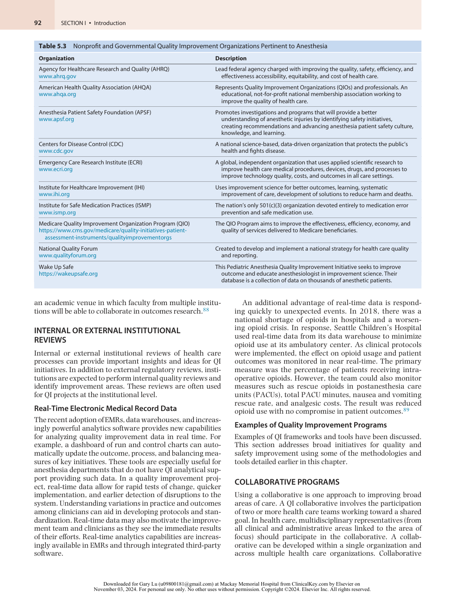

:::

<!-- PDF page 17 -->

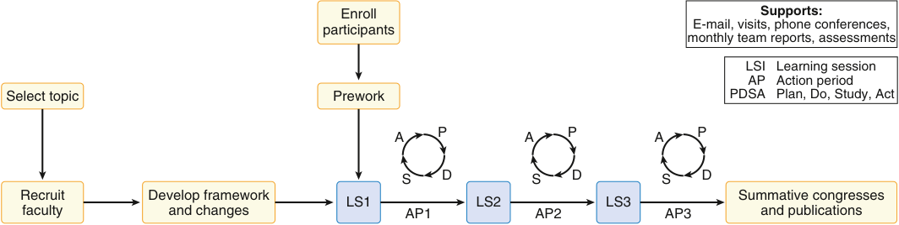

Enroll Supports: E-mail, visits, phone conferences, participants monthly team reports, assessments LSI Learning session AP Action period Select topic Prework PDSA Plan, Do, Study, Act A P A P A P S D S D S D Recruit Develop framework LS1 LS2 LS3 Summative congresses faculty and changes AP1 AP2 AP3 and publications 

**Fig. 5.8 Breakthrough Series Collaborative Model.** (Reproduced with permission from Institute for Healthcare Improvement: The Breakthrough Series: IHI’s Collaborative Model for Achieving Breakthrough Improvement, 2003.)

programs are typically led by a team that is responsible for the following:

1.  Determining the evidence- based interventions to be used and presenting these to the participants (if evidence- based interventions are not available, the team will generate interventions based on local and broad expert consensus).

2.  Establishing the data collection approach (defining measures, collection methods, and feedback mechanism).

A key element to the success of collaboratives is an established process for educating members and sharing interventions and obstacles. Through group discussions (meetings and/or conference calls), teams can learn about best practices and innovative methods other teams use to approach a problem. In addition, collaboratives bring a shared momentum and enthusiasm that can increase sustainability.90–92

### Institute for Healthcare Improvement Breakthrough Series Collaboratives

QI collaboratives provide an opportunity to learn from other teams, work collaboratively, and spread change on a larger scale. For over a decade, the IHI has used a collaborative model for improvement called the Breakthrough Series Model.93 Collaboratives run from 12 to 160 teams across multiple organizations. Successful IHI collaboratives have included reducing waiting times by 50%, reducing ICU costs by 25%, and reducing hospitalizations of heart failure patients by 50%.93

In the Breakthrough Series Model, a topic is selected, and participating teams are enrolled (Fig. 5.8). Expert faculty from across the country, or even internationally, are recruited for an expert meeting to develop a framework for change called a “change package.” The change package describes interventions for improvement based on available evidence. Next, team members from all groups attend collaborative learning sessions where they learn the model for improvement and share their progress in implementing the change package. At the end of the collaborative, a summative meeting and publications are used to share the findings with others.

### Translating Evidence into Practice (TRIP) and Comprehensive Unit- Based Program (CUSP)

Sawyer and associates reported the success of a collaborative that incorporates a “mechanism to move evidence to the bedside and foster a culture where the focus is the

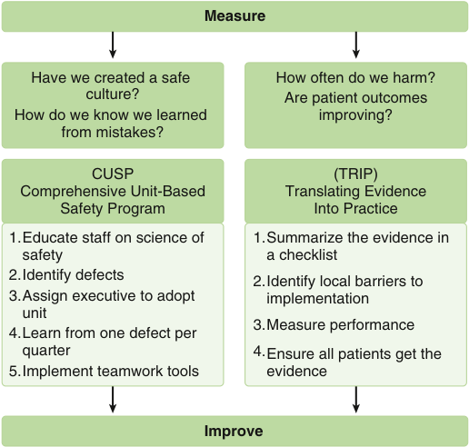

Measure Have we created a safe  How often do we harm? culture? Are patient outcomes How do we know we learned  improving? from mistakes? CUSP (TRIP) Comprehensive Unit-Based Translating Evidence Safety Program Into Practice 1.Educate staff on science of 1.Summarize the evidence in safety a checklist 2.Identify defects 2.Identify local barriers to 3.Assign executive to adopt implementation unit 3.Measure performance 4.Learn from one defect per quarter 4.Ensure all patients get the 5.Implement teamwork tools evidence Improve 

**Fig. 5.9 Comprehensive Unit- Based Safety Program (CUSP) and Translating Evidence into Practice (TRIP): basic steps to ensure patients receive evidence- based care.** (Reproduced with permission from Sawyer M, Weeks K, Goeschel CA, et al. Using evidence, rigorous measurement, and collaboration to eliminate central catheter- associated bloodstream infections. _Crit Care Med_ . 2010;38(8 Suppl):S292–298.)

patient.”94 The collaborative emphasizes TRIP and the CUSP. Several large collaborative efforts have reproduced and validated this methodology (Fig. 5.9).94–96

The TRIP model includes key steps and emphasizes the importance of measurement and feedback of data to teams.

1.  Identify evidence- based interventions associated with an improved outcome by reviewing peer- reviewed publications.

2.  Select goal- oriented interventions that have the most impact on outcomes and transform them into behaviors. In selecting behaviors, focus on interventions with the strongest treatment effect (smallest number needed to treat) and the lowest barrier to use.

3.  Develop and implement measures that evaluate the interventions (processes) or the outcomes.

4.  Measure baseline performance and establish databases to facilitate accurate data management and timely feedback to teams.

<!-- PDF page 18 -->

**Table 5.4** Four Steps That Ensure Patients Receive Evidence- Based Interventions Through a Collaborative (Using the Example of Catheter- Related Bloodstream Infections)94,95

|**Step**|**Action**|**Example**|
|---|---|---|
|Engage|Make the problem real|Share information of local CRBSI rate vs. national rate.|
|Educate|Develop an educational plan to reach ALL members of the caregiver team|Present evidence- based practices at grand rounds and multidisciplinary team meetings. Present plans to improve care and measure outcome.|
|Execute|Develop a safety culture Reduce complexity of the processes Introduce redundancy in processes Hold regular team meetings|Develop a culture of intolerance for CRBSI. Ensure that all equipment and supplies for sterile CVC insertion are in one place and easily available. Use checklists that identify key steps to reduce CRBSI. Focus on one to two tasks per week and identify team member responsible for task.|
|Evaluate|Measure and provide feedback|Develop data collection plan and database to track progress. Give staff real- time feedback; post progress in highly visible location. Identify causes of defects.|

_CRBSI,_ catheter- related bloodstream infection; _CVC,_ central venous catheter.

5.  Ensure patients receive evidence- based interventions through four basic steps: engagement, education, execution, and evaluation (Table 5.4).

The format for the collaborative also includes annual faceto- face meetings with the participating teams and periodic conference calls, which focus on education about the actual processes being implemented, the evidence base to support these processes, and the sharing of experiences, and allow teams to share how well or poorly they implement the interventions and share ideas for overcoming barriers.

Including the CUSP program in the collaborative provides a structured approach to improving safety culture and identifying and mitigating hazards (i.e., learning from mistakes).47,57 CUSP is a five- step program that has been tested and used successfully to improve quality and safety in ICUs (Table 5.5).97,98 CUSP programs have been used in many different environments, including inpatient units, primary care practices,99 and in the perioperative period100 to enhance the safety culture and improve the patient experience.101

Safety culture is assessed before the implementation of CUSP and reassessed after one year to evaluate the program’s impact. The initial measure provides a baseline assessment of staff perceptions of safety culture in their clinical areas and their perceptions of the organization’s commitment to patient safety. Education provides staff with new lenses to identify hazards and recommend system changes to improve care. After an educational lecture on the science of safety, staff members are requested to identify patient

**Table 5.5** Five- Step Comprehensive Unit- Based Safety Program98,99,101,110

||**Step**|**Description**|
|---|---|---|
|1|Present educational material|Educate staff on science of safety though lectures and other educational materials.|
|2|Complete forms that identify patient safety issues|Ask the following questions: ᑏHow will the next patient be harmed? ᑏHow can this harm be prevented? Establish voluntary incident reporting.|
|3|Assign senior executive responsible for specific area|Senior executive meets with all staff of the clinical area to: ᑏHelp prioritize safety efforts. ᑏRemove barriers for system changes. ᑏProvide resources. ᑏDemonstrate hospital commitment to patient safety. ᑏFoster relationship between senior leadership and staff.|
|4|Learn from defects|Implement projects focused on two to three safety issues. Keep goals simple: ᑏReduce complexity in the process. ᑏCreate independent redundancies to ensure critical steps are accomplished.|
|5|Implement teamwork tools|Implement programs such as checklists, training, and daily goals targeted at improving teamwork and communication.|

safety hazards in their clinical areas and suggest improvement interventions. For this process, staff members review their unit’s incident reports, liability claims, and sentinel events. Two questions are asked: “How do you think the next patient will be harmed?” and “How can we prevent it from happening?” A senior leader of the institution is partnered with a unit or clinical area to help staff members prioritize safety efforts, to ensure that they have the resources to implement improvements, and to hold them accountable for evaluating whether safety has improved. Staff members are asked to learn from one defect per month and to implement one tool per quarter designed to improve care delivery.47,57

CUSP provides several benefits for improving safety culture and is a primer for staff compliance in implementing any safety or QI intervention or project. It provides enough structure to convert the often- vague goals of improving safety into a focused strategy, yet it is flexible enough to allow units to work on issues most important to them. CUSP provides a venue to introduce rigorous research methods, acts as a learning laboratory to identify and mitigate hazards, and has the potential to improve patient outcomes.

## Challenges and Barriers to Quality Improvement Projects

Multicentered and single- hospital projects can fail because of inadequate resources, lack of leadership support, vague expectations and objectives for team members, poor communication, complex study plans, inadequate management of data collection, and wasted efforts to “reinvent the wheel”

::: details 原始表格與符號（PDF 第 18 頁）

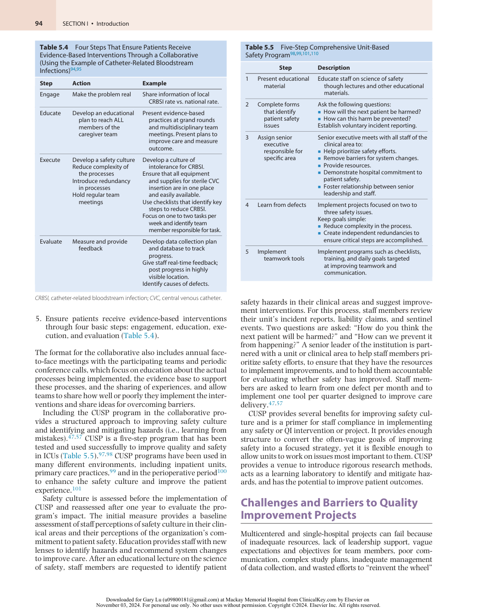

:::

<!-- PDF page 19 -->

rather than adopting practices proven to be effective. Successful collaboratives require a local culture (the set of values, attitudes, and beliefs of the group) that is ready for change and participants who have a shared view of safety and who understand the science of patient quality and safety (i.e., the technical components of how care is organized and delivered).

## Related Concepts: Improvement Science and Implementation Science

The focus of this chapter has been QI operations or the efforts concerned with the measurement and timely improvement of quality in a given setting. QI operations are related to improvement science and implementation science, both of which aim to create generalizable knowledge that has the potential to improve care quality and patient outcomes across settings. These three fields are often confused because they share tools and are all interested in improving patient outcomes but may use different terms to refer to similar concepts. To clarify the similarities and differences between these fields, Koczwara and colleagues conceptualized a spectrum with QI operations at one end, implementation science at the other, and improvement science in the middle.102 Understanding the roles of these fields may prove helpful to those interested in anesthesia QI.

As described in this chapter, QI is the systematic approach to improving problems in health care delivery that compromise care quality and outcomes. It is a timely, contextdependent team endeavor that can potentially improve local care in the short, medium, and long term.

### IMPROVEMENT SCIENCE

A common criticism of QI is that it is “unscientific” and more concerned with action than with understanding the mechanisms through which improvement occurs (or the reasons underlying the failure of improvement efforts). Improvement science draws from QI principles, aiming to “create practical learning that can make a timely difference to patient care.”103 But improvement science is also concerned with the creation of generalizable knowledge. Hence, close attention is paid to internal and external validity in the design of improvement studies. Rigorously designed improvement science projects may sacrifice some of the timeliness of QI projects but balance this downside with greater potential utility of the findings outside of a local setting.

### IMPLEMENTATION SCIENCE

Implementation science (known as knowledge translation in Canada) aims to narrow the evidence- to- practice gap evident when proven- effective interventions do not translate into improved care and outcomes.104 Although the field is new, it draws from psychology, education, management, and related sciences. Two features clearly distinguish implementation science from QI and improvement science: the reliance on evidence- based practices and the use of explicit frameworks, theories, and models. Implementation

science is a major focus for research funding agencies in the United States and Canada, as it is seen as one approach to maximize the return on grant dollars allocated to scientific discovery in health care. As with QI and improvement science, adequately characterizing real- world context is paramount. In contrast, there tends to be greater emphasis on generalizability in implementation science than in improvement science.

A critical distinction between these three fields is their relationship to evidence. Implementation science relies on evidence- based interventions. However, there is not always evidence to guide our practice in situations with clearly suboptimal quality. In these situations, QI approaches can be useful, as rapid- cycle small- scale tests of change can minimize harm and mitigate risk while quality is addressed.

## The Future: Research, Education, and Ethics

Much remains to be accomplished in QI. The opportunity to improve patient care is substantial, and the pressure to improve the quality of perioperative care continues to increase. Improving the quality of care requires the ability to measure and improve performance. Research is needed to develop measures of quality that clinicians believe are valid and to learn how to ensure that all patients reliably receive recommended interventions. Innovation is needed to create information systems that multiple disciplines can use. Anesthesiologists and professional societies may need to partner with experts in quality measurement to develop and implement quality measures. Future efforts should balance the feasibility and validity of quality measures and develop integrated approaches to improving quality, including strategies to build care bundles, decrease complexity, and create independent redundancies.

Clinicians now need the skills necessary to improve quality. Health care will cross the quality chasm only when all view quality and safety as their primary job rather than an added activity, and health care organizations provide the infrastructure to monitor and improve performance. Frontline health care providers must understand quality and safety science and evaluate safety risks as hazardous systems, not incompetent people. Integral to this is the education of our trainees. CQI in anesthesia residency training programs has been touted for over 25 years.105 In the United States, residents in training are expected to master six core competencies, as mandated by the Accreditation Council of Graduate Medical Education,106 competencies linked to the NAM’s Six Aims for Improvement5 (Table 5.6). To connect these two sets of goals and apply them to the clinical setting for training purposes, Bingham and colleagues107 developed a framework called the Healthcare Matrix that can be used as both an educational tool and a research tool for improvement.

With the increasing intellectual focus and health care resources being directed toward QI programs, the ethics of QI have come to light. QI projects have generally been exempted from the rigorous review of human subjects research. However, a Hastings Center Report on the ethics of using QI methods to improve health quality and safety suggests that some QI projects may involve patient risk and should undergo a formal review.108 This report

<!-- PDF page 20 -->

**Table 5.6** Accreditation Council of Graduate Medical Education (ACGME) Six Core Competencies and Institute of Medicine (IOM) Six Aims for Improvement106

||**ACGME Core Competencies**|**IOM Aims for Improvement**|
|---|---|---|
|1|Patient care|Safe|
|2|Medical knowledge|Timely|
|3|Interpersonal and communication skills|Effective|
|4|Professionalism|Efficient|
|5|System- based practice|Equitable|
|6|Practice- based learning and improvement|Patient- centered|

lists QI initiatives that may trigger the need for a review as those that have a randomized design, use novel treatments, involve researchers, have delayed feedback of monitoring, or are funded by external sources. The reporting of QI activities should be encouraged, as should requiring approval by an internal review board and following a standardized reporting format. All of these practices support the premise that the delivery of quality care is a science as well as an art.

## Summary

Health care organizations need a systematic approach to three areas of patient safety: (1) TRIP, (2) identifying and mitigating hazards, and (3) improving culture and communication. The underlying principle for all of the approaches discussed in this chapter is that improving the quality of care dictates that practitioners must be able to measure their performance. Health care practitioners have had limited ability to obtain feedback regarding performance in their daily work, partly because of the absence of information systems and a lack of agreement on how to measure quality of care.55 As a result, many in health care do not have access to performance data and therefore do not know what results they achieve (or fail to achieve). As consumers, payers, regulators, and accreditors increasingly require evidence regarding quality of care, the demand for quality measures will grow. To meet these demands, anesthesiologists must be prepared to use validated measures to evaluate the quality of care they provide and to implement evidencebased best practices in the perioperative care of patients.

### Acknowledgments

The editors and the publisher would like to acknowledge Dr. Elizabeth Martinez (1966–2013) for her contributions to previous editions of this chapter. Her work served as the foundation for the current chapter. This chapter greatly benefited from the thoughtful editing of Claire Levine and Maria Ashton.

4.  Institute of Medicine of the National Academies. _Toward Quality Measures for Population Health and the Leading Health Indicators_ . National Academies Press; 2013.

5.  Institute of Medicine (US) Committee on Quality of Health Care in America. _Crossing the Quality Chasm: A New Health System for the 21st Century_ . National Academies Press; 2001.

6.  Institute of Medicine Committee on Quality of Health Care in America. In: Kohn LT, Corrigan JM, Donaldson MS, eds. _To Err Is Human: Building a Safer Health System_ . Washingon, DC: National Academies Press; 2000.

7.  Smith KM, Valenta AL. _Int J Health Policy Manag_ . 2018;7(7):671.

8.  Gerteis M, et al. _Picker/Commonwealth Program for Patient- Centered Care: Through the Patient’s Eyes: Understanding and Promoting PatientCentered Care_ . 4th ed. Jossey- Bass; 1993:368.

9.  Langley GL, et al. _The Improvement Guide: A Practical Approach to Enhancing Organizational Performance_ . 2nd ed. Jossey- Bass; 2009:512.

10.  Kotter JP, Cohen DS. _The Heart of Change: Real- Life Stories of How People Change Their Organizations_ . Harvard Business Review Press; 2002.

11.  Bodenheimer T, Sinsky C. _Ann Fam Med_ . 2014;12(6):573.

12.  Health Resources and Services Administration. _Health Center Program Compliance Manual_ ; 2018.

13.  James BC. _Quality Management for Healthcare Delivery_ . American Hospital Association; 1989.

14.  Crosby P. _Quality Is Free: The Art of Making Quality Certain_ . McGraw Hill; 1979.

15.  Centers for Medicare & Medicaid Services. Quality Measurement and Quality Improvement.

16.  Shewhart W. _Statistical Method from the Viewpoint of Quality Control_ . Dover; 1986.

17.  Deming W. _Out of the Crisis_ . MIT Press; 2000.

18.  Deming W. _The New Economics for Industry, Government, Education,_ . 2nd ed. MIT Press; 2000.

19.  Zimmermann GDS, et al. _Rev Bras Enferm_ . 2020;73(suppl 5):e20190861.

20.  Shewhart WA. _Economic Control of Quality of Manufactured Product_ . American Society for Quality Control; 1931.

21.  Moen RD, Norman C. _Qual Prog_ . 2010;43:22.

22.  Associates in Process Improvement. _Developing Methods_ . 2023.

23.  Bjerke MB, Renger R. _Eval Progr Plann_ . 2017;61:125.

24.  Porter ME. _Redefining Health Care: Creating Value- Based Competition on Results_ . Harvard Business School Press; 2006.

25.  Institute for Healthcare Improvement. _Going Lean in Health Care_ ; 2005.

26.  Pyzdek T, Keller P. _The Six Sigma Handbook: A Complete Guide for Green Belts, Black Belts, and Managers at All Levels_ . McGraw Hill; 2010.

27.  Chassin MR. _Milbank Q_ . 1998;76(4):565.

28.  Howell J, Ayanian J. _J Health Serv Res Policy_ . 2016;21(4):279.

29.  Donabedian A. 1966. _Milbank Q_ . 2005;83(4):691.

30.  Randolph G, et al. _Pediatr Clin North Am_ . 2009;56(4):779.

31.  Nelson EC, et al. _Jt Comm J Qual Improv_ . 2002;28(9):472.

32.  Nelson EC, et al. _Jt Comm J Qual Saf_ . 2003;29(1):5.

33.  Rubin HR, et al. _Int J Qual Health Care_ . 2001;13(6):469.

34.  Lenfant C. _N Engl J Med_ . 2003;349(9):868.

35.  Mermel LA, et al. _Clin Infect Dis_ . 2009;49(1):1.

36.  Pronovost PJ, et al. _Curr Opin Crit Care_ . 2001;7(4):297.

37.  Bardach NS, Cabana MD. _Curr Opin Pediatr_ . 2009;21(6):777.

38.  Medicare Program. Merit- Based Incentive Payment System (MIPS) and Alternative Payment Model (APM) incentive under the physician Fee schedule and Criteria for Physician- focused payment models; final rule 77008; 2016.

39.  Roland M, Olesen F. _BMJ_ . 2016;354:i4058.

40.  Varughese AM, et al. Quality in pediatric anesthesia. _Paediatr Anaesth_ . 2010;20(8):684.

41.  Carey RG, Lloyd RC. _Measuring Quality Improvement in Healthcare: A Guide to Statistical Process Control Applications_ . Quality Resources; 1995.

42.  Institute for Healthcare Improvement.

### Complete references available online at expertconsult.com.

### References

1.  Connor P. _Aeronautical J_ . 2010;114:58.

2.  Lohr KN, Schroeder SA. _N Engl J Med_ . 1990;322(10):707.

3.  O’Kane M, et al. _NAM Perspect_ . 2021:2021.

43.  Kaplan RS, Norton DP. _The Balanced Scorecard: Translating Strategy into Action_ . Harvard Business Review Press; 1996.

44.  Christie CA, et al. _Improvement Science in Evaluation: Methods and Uses: New Directions for Evaluation, Number 153_ . Wiley; 2017.

45.  Centofanti JE, et al. _Crit Care Med_ . 2014;42(8):1797.

46.  Cavalcanti AB, et al. _JAMA_ . 2016;315(14):1480.

47.  Pronovost P, et al. _J Crit Care_ . 2003;18(2):71.

::: details 原始表格與符號（PDF 第 20 頁）

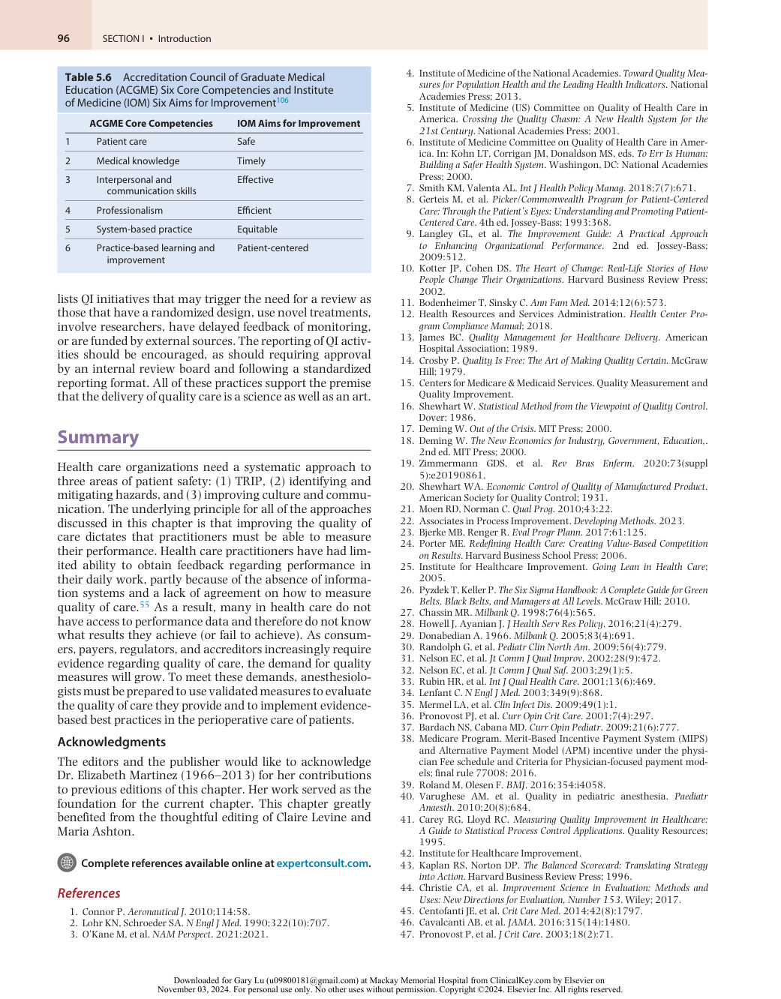

:::

<!-- PDF page 21 -->

48.  Justice LB, et al. _Pediatr Crit Care Med_ . 2016;17(7):677.

49.  Makary MA, et al. _Jt Comm J Qual Patient Saf_ . 2006;32(7):407.

50.  March MG, Crowley JJ. _Anesthesiology_ . 1991;75(5):724.

51.  Berenholtz SM, et al. _Crit Care Med_ . 2004;32(10):2014.

52.  Center VMM. Central Line Insertion Checklist. https://www.ihi.org/ resources/Pages/Tools/CentralLineInsertionChecklist.aspx.

53.  Haynes AB, et al. _N Engl J Med_ . 2009;360(5):491.

54.  World Health Organization. WHO Surgical Safety Checklist. htt ps://www.who.int/teams/integrated- health- services/patientsafety/research/safe- surgery/tool- and- resources.

55.  Mitchell B, et al. _BMJ Qual Saf_ . 2017;26(10):837.

56.  Hicks CW, et al. _JAMA Surg_ . 2014;149(8):863.

57.  Thompson D, et al. _Jt Comm J Qual Patient Saf_ . 2005;31(8):476.

58.  Agency for Healthcare Research and Quality. TeamSTEPPS. https://www.ahrq.gov/teamstepps- program/index.html.

59.  Baker D, et al. _Medical Teamwork and Patient Safety: The EvidenceBased Relation_ . Agency for Healthcare Research and Quality; 2006.

60.  Alonso A, et al. _Human Res Management Rev_ . 2006;16(3):396.

61.  Clancy CM. _AORN J_ . 2007;86(1):18.

62.  Weld LR, et al. _Am J Med Qual_ . 2016;31(5):408.

63.  McGlynn EA, Asch SM. _Am J Prev Med_ . 1998;14(3 Suppl):14.

64.  Miller T, Leatherman S. _Health Aff_ . 1999;18(6):233.

65.  Leape LL. _N Engl J Med_ . 2002;347(20):1633.

66.  Vincent C. _N Engl J Med_ . 2003;348(11):1051.

67.  White C. _Am J Med Qual_ . 2017;32(1_suppl):3s.

68. _ASA Newsl_ . 2011;75(10):31.

69.  Tjia I, et al. _Anesth Analg_ . 2014;119(1):122.

70.  Cassidy CJ, et al. _Anaesthesia_ . 2011;66(10):879.

71.  Webb RK, et al. _Anaesth Intensive Care_ . 1993;21(5):520.

72.  Sackett DL, et al. _BMJ_ . 1996;312(7023):71.

73.  Shojania KG, et al. _Evid Rep Technol Assess (Summ)_ . 2001;43:i.

74.  Rupp SM, et al. _Anesthesiology_ . 2012;116(3):539.

75.  Gross JB, et al. _Anesthesiology_ . 2014;120(2):268.

76.  American Society of Anesthesiologists Committee. _Anesthesiology_ . 2011;114(3):495.

77.  Brook AD, et al. _Crit Care Med_ . 1999;27(12):2609.

78.  Marelich GP, et al. _Chest_ . 2000;118(2):459.

   80.  National Quality Forum (NQF). Driving measurable health improvements together. https://www.qualityforum.org/Home.aspx.

   81.  Haché M, et al. _Paediatr Anaesth_ . 2020;30(12):1348.

   82.  Buck DW, et al. _Paediatr Anaesth_ . 2022;32(11):1246.

   83.  Freundlich RE, Kheterpal S. _Best Pract Res Clin Anaesthesiol_ . 2011;25(4):489.

   84.  Fuchshuber PR, et al. _Perm J_ . 2012;16(1):39.

   85.  Dutton RP. _Anesth Analg_ . 2015;120(3):507.

   86.  Dutton RP, Dukatz A. _Anesthesiol Clin_ . 2011;29(3):439.

   87.  Department of Anesthesiology UoMHS. Multicenter perioperative outcomes group (MPOG). https://mpog.org/.

   88.  Kheterpal S. _Anesthesiol Clin_ . 2011;29(3):377.

   89.  Franz AM, et al. _Anesth Analg_ . 2021;132(3):788.

   90.  ØVretveit J, et al. _Qual Saf Health Care_ . 2002;11(4):345.

   91.  Mittman BS. _Ann Intern Med_ . 2004;140(11):897.

   92.  Nelson EC, et al. _Front Health Serv Manage_ . 1998;15(1):3.

   93.  Institute for Healthcare Improvement. _The Breakthrough Series: IHI’s Collaborative Model for Achieving Breakthrough Improvement_ ; 2003.

   94.  Sawyer M, et al. _Crit Care Med_ . 2010;38(8 Suppl):S292.

   95.  Pronovost P, et al. _N Engl J Med_ . 2006;355(26):2725.

   96.  Pronovost PJ, et al. _Health Serv Res_ . 2006;41(4 Pt 2):1599.

   97.  Pronovost P, Goeschel C. _Healthc Exec_ . 2005;20(2):14.

   98.  Pronovost PJ, et al. _Jt Comm J Qual Patient Saf_ . 2006;32(3):119.

   99.  Pitts SI, et al. _Jt Comm J Qual Patient Saf_ . 2017;43(11):591. 100.  Moloo H, et al. _Can J Surg_ . 2016;59(6):422.

   101.  Pottenger BC, et al. _Qual Manag Health Care_ . 2016;25(4):197. 102.  Koczwara B, et al. _J Oncol Pract_ . 2018;14(6):335.

   103.  Marshall M, et al. _Lancet_ . 2013;381(9864):419.

   104.  Lane- Fall MB, et al. _Anesthesiol Clin_ . 2018;36(1):1.

   105.  Dubin SA, et al. _Int Anesthesiol Clin_ . 1992;30(2):29.

   106.  Accreditation Council for Graduate Medical Education (ACfGM). Common Program Requirements. https://www.acgme.org/programsand- institutions/programs/common- program- requirements/.

   107.  Bingham JW, et al. _Jt Comm J Qual Patient Saf_ . 2005;31(2):98.

   108.  Baily MA, et al. _Hastings Cent Rep_ . 2006;36(4):S1.

   109.  Boat AC, Spaeth JP. _Paediatr Anaesth_ . 2013;23(7):647. 110.  Pronovost P, et al. _J Patient Saf_ . 2005;1(1):33.

79. The Joint Commission. We all deserve excellent health. https://www .jointcommission.org/.

<!-- PDF page 22 -->

### References

1.  Connor P. Quality and reliability in engineering T. R. Chandrupatla Cambridge University press, the Edinburgh building, Shaftesbury Road, Cambridge, CB2 2RU. 2009. 309pp. Illustrated. £60.00. ISBN 978- 0- 521- 51522- 1. _Aeronautical J_ . 2010;114:58.

2.  Lohr KN, Schroeder SA. A strategy for quality assurance in Medicare. _N Engl J Med_ . 1990;322(10):707–712.

3.  O’Kane M, Agrawal S, Binder L, et al. An equity agenda for the field of health care quality improvement. _NAM Perspect_ . 2021:2021.

4.  Institute of Medicine of the National Academies. _Toward Quality Measures for Population Health and the Leading Health Indicators_ . Washington, DC: National Academies Press; 2013.

5.  Institute of Medicine (US) Committee on Quality of Health Care in America. _Crossing the Quality Chasm: A New Health System for the 21st Century_ . Washingon, DC: National Academies Press; 2001.

6.  Institute of Medicine Committee on Quality of Health Care in America. In: Kohn LT, Corrigan JM, Donaldson MS, eds. _To Err Is Human: Building a Safer Health System_ . Washingon, DC: National Academies Press; 2000.

7.  Smith KM, Valenta AL. Safety I to safety II: a Paradigm shift or more work as imagined? Comment on “False Dawns and new Horizons in patient safety research and practice. _Int J Health Policy Manag_ . 2018;7(7):671–673.

8.  Gerteis M, Edgman- Levitan S, Daley J, Delbanco TL. _Picker/Commonwealth Program for Patient- Centered Care: Through the Patient’s Eyes: Understanding and Promoting Patient- Centered Care_ . 4th ed. JosseyBass; 1993:368.

9.  Langley GL, Moen RD, Nolan KM, et al. _The Improvement Guide: A Practical Approach to Enhancing Organizational Performance_ . 2nd ed. Jossey- Bass; 2009:512.

10.  Kotter JP, Cohen DS. _The Heart of Change: Real- Life Stories of How People Change Their Organizations_ . Harvard Business Review Press; 2002.

11.  Bodenheimer T, Sinsky C. From triple to quadruple aim: care of the patient requires care of the provider. _Ann Fam Med_ . 2014;12(6):573– 576.

12.  Health Resources and Services Administration. _Health Center Program Compliance Manual_ ; 2018.

13.  James BC. _Quality Management for Healthcare Delivery_ . American Hospital Association; 1989.

14.  Crosby P. _Quality Is Free: The Art of Making Quality Certain_ . McGraw Hill; 1979.

15.  Centers for Medicare & Medicaid Services. Quality Measurement and Quality Improvement. https://www.cms.gov/medicare/qualityinitiatives- patient- assessment- instruments/mms/quality- measureand- quality- improvement- .

16.  Shewhart W. _Statistical Method from the Viewpoint of Quality Control_ . Dover; 1986.

17.  Deming W. _Out of the Crisis_ . MIT Press; 2000.

18.  Deming W. _The New Economics for Industry, Government, Education_ . 2nd ed. MIT Press; 2000.

19.  Zimmermann GDS, Siqueira LD, Bohomol E. Lean Six Sigma methodology application in health care settings: an integrative review. _Rev Bras Enferm_ . 2020;73(suppl 5):e20190861.

20.  Shewhart WA. _Economic Control of Quality of Manufactured Product_ . American Society for Quality Control; 1931.

21.  Moen RD, Norman C. Clearing up myths about the Deming cycle and seeing how it keeps evolving. _Qual Prog_ . 2010;43:22–28.

22.  Associates in Process Improvement. _Developing Methods_ ; 2023. htt p://www.apiweb.org/index.php/services/developing- methods?high light=WyJtb2RlbCIsImZvciIsImltcHJvdmVtZW50IiwibW9kZWwgZ m9yIiwibW9kZWwgZm9yIGltcHJvdmVtZW50IiwiZm9yIGltcHJvdmVtZW50Il0=.

23.  Bjerke MB, Renger R. Being smart about writing SMART objectives. _Eval Progr Plann_ . 2017;61:125–127.

24.  Porter ME. _Redefining Health Care: Creating Value- Based Competition on Results_ . Harvard Business School Press; 2006.

25.  Institute for Healthcare Improvement. _Going Lean in Health Care_ ; 2005.

26.  Pyzdek T, Keller P. _The Six Sigma Handbook: A Complete Guide for Green Belts, Black Belts, and Managers at All Levels_ . McGraw Hill; 2010.

27.  Chassin MR. Is health care ready for Six Sigma quality? _Milbank Q_ . 1998;76(4):565–591.

28.  Howell J, Ayanian J. Ernest Codman and the end result system: a pioneer of health outcomes revisited. _J Health Serv Res Policy_ . 2016;21(4):279–281.

29.  Donabedian A. Evaluating the quality of medical care. 1966. _Milbank Q_ . 2005;83(4):691–729.

30.  Randolph G, Esporas M, Provost L, et al. Model for improvement – Part Two: measurement and feedback for quality improvement efforts. _Pediatr Clin North Am_ . 2009;56(4):779–798.

31.  Nelson EC, Batalden PB, Huber TP, et al. Microsystems in health care: Part 1. Learning from high- performing front- line clinical units. _Jt Comm J Qual Improv_ . 2002;28(9):472–493.

32.  Nelson EC, Batalden PB, Homa K, et al. Microsystems in health care: Part 2. Creating a rich information environment. _Jt Comm J Qual Saf_ . 2003;29(1):5–15.

33.  Rubin HR, Pronovost P, Diette GB. The advantages and disadvantages of process- based measures of health care quality. _Int J Qual Health Care_ . 2001;13(6):469–474.

34.  Lenfant C. Shattuck lecture – clinical research to clinical practice- - lost in translation? _N Engl J Med_ . 2003;349(9):868–874.

35.  Mermel LA, Allon M, Bouza E, et al. Clinical practice guidelines for the diagnosis and management of intravascular catheter- related infection: 2009 Update by the Infectious Diseases Society of America. _Clin Infect Dis_ . 2009;49(1):1–45.

36.  Pronovost PJ, Miller MR, Dorman T, et al. Developing and implementing measures of quality of care in the intensive care unit. _Curr Opin Crit Care_ . 2001;7(4):297–303.

37.  Bardach NS, Cabana MD. The unintended consequences of quality improvement. _Curr Opin Pediatr_ . 2009;21(6):777–782.

38.  Medicare Program. Merit- Based Incentive Payment System (MIPS) and Alternative Payment Model (APM) incentive under the physician Fee schedule and Criteria for Physician- focused payment models; final rule 77008; 2016.

39.  Roland M, Olesen F. Can pay for performance improve the quality of primary care? _BMJ_ . 2016;354:i4058.

40.  Varughese AM, Hagerman N, Kurth CD. Quality in pediatric anesthesia. _Paediatr Anaesth_ . 2010;20(8):684–696.

41.  Carey RG, Lloyd RC. _Measuring Quality Improvement in Healthcare: A Guide to Statistical Process Control Applications_ . Quality Resources; 1995.

42.  Institute for Healthcare Improvement. https://www.ihi.org/ resources/tools/failure-modes-and-effects-analysis-fmea-too.

43.  Kaplan RS, Norton DP. _The Balanced Scorecard: Translating Strategy into Action_ . Harvard Business Review Press; 1996.

44.  Christie CA, Inkelas M, Lemire S. _Improvement Science in Evaluation: Methods and Uses: New Directions for Evaluation, Number 153_ . Wiley; 2017.

45.  Centofanti JE, Duan EH, Hoad NC, et al. Use of a daily goals checklist for morning ICU rounds: a mixed- methods study. _Crit Care Med_ . 2014;42(8):1797–1803.

46.  Cavalcanti AB, Bozza FA, Machado FR, et al. Effect of a quality improvement intervention with daily round checklists, goal setting, and clinician prompting on mortality of critically ill patients: a randomized clinical trial. _JAMA_ . 2016;315(14):1480–1490.

47.  Pronovost P, Berenholtz S, Dorman T, et al. Improving communication in the ICU using daily goals. _J Crit Care_ . 2003;18(2):71–75.

48.  Justice LB, Cooper DS, Henderson C, et al. Improving communication during cardiac ICU multidisciplinary rounds through visual display of patient daily goals. _Pediatr Crit Care Med_ . 2016;17(7):677–683.

49.  Makary MA, Holzmueller CG, Sexton JB, et al. Operating room debriefings. _Jt Comm J Qual Patient Saf_ . 2006;32(7):407–410.

50.  March MG, Crowley JJ. An evaluation of anesthesiologists’ present checkout methods and the validity of the FDA checklist. _Anesthesiology_ . 1991;75(5):724–729.

51.  Berenholtz SM, Pronovost PJ, Lipsett PA, et al. Eliminating catheterrelated bloodstream infections in the intensive care unit. _Crit Care Med_ . 2004;32(10):2014–2020.

52.  Center VMM. Central Line Insertion Checklist. https://www.ihi.org/ resources/Pages/Tools/CentralLineInsertionChecklist.aspx.

53.  Haynes AB, Weiser TG, Berry WR, et al. A surgical safety checklist to reduce morbidity and mortality in a global population. _N Engl J Med_ . 2009;360(5):491–499.

54.  World Health Organization. WHO Surgical Safety Checklist. htt ps://www.who.int/teams/integrated- health- services/patientsafety/research/safe- surgery/tool- and- resources.

<!-- PDF page 23 -->

55.  Mitchell B, Cristancho S, Nyhof BB, Lingard LA. Mobilising or standing still?A narrative review of Surgical Safety Checklist knowledge as developed in 25 highly cited papers from 2009 to 2016. _BMJ Qual Saf_ . 2017;26(10):837–844.

56.  Hicks CW, Rosen M, Hobson DB, et al. Improving safety and quality of care with enhanced teamwork through operating room briefings. _JAMA Surg_ . 2014;149(8):863–868.

57.  Thompson D, Holzmueller C, Hunt D, et al. A morning briefing: setting the stage for a clinically and operationally good day. _Jt Comm J Qual Patient Saf_ . 2005;31(8):476–479.

58.  Agency for Healthcare Research and Quality. TeamSTEPPS. https://www.ahrq.gov/teamstepps- program/index.html.

59.  Baker D, Gustafson D, Beaubien S, et al. _Medical Teamwork and Patient Safety: The Evidence- Based Relation_ . Agency for Healthcare Research and Quality; 2006.

60.  Alonso A, Baker DP, Holtzman A, et al. Reducing medical error in the Military Health System: how can team training help? _Human Res Management Rev_ . 2006;16(3):396–415.

61.  Clancy CM. TeamSTEPPS: optimizing teamwork in the perioperative setting. _AORN J_ . 2007;86(1):18–22.

62.  Weld LR, Stringer MT, Ebertowski JS, et al. TeamSTEPPS improves operating room efficiency and patient safety. _Am J Med Qual_ . 2016;31(5):408–414.

63.  McGlynn EA, Asch SM. Developing a clinical performance measure. _Am J Prev Med_ . 1998;14(3 Suppl):14–21.

64.  Miller T, Leatherman S. The National Quality Forum: a ‘me-too’ or a breakthrough in quality measurement and reporting? _Health Aff_ . 1999;18(6):233–237.

65.  Leape LL. Reporting of adverse events. _N Engl J Med_ . 2002;347(20):1633–1638.

66.  Vincent C. Understanding and responding to adverse events. _N Engl J Med_ . 2003;348(11):1051–1056.

67.  White C. The Future Awakens: a report on the 2016 Vizient Clinical Connections Summit. _Am J Med Qual_ . 2017;32(1_suppl):3s–30s.

68.  Learning from others: a case report from the anesthesia incident reporting system. _ASA Newsl_ . 2011;75(10):31–50.

69.  Tjia I, Rampersad S, Varughese A, et al. Wake up Safe and root cause analysis: quality improvement in pediatric anesthesia. _Anesth Analg_ . 2014;119(1):122–136.

70.  Cassidy CJ, Smith A, Arnot- Smith J. Critical incident reports concerning anaesthetic equipment: analysis of the UK National Reporting and Learning System (NRLS) data from 2006- 2008. _Anaesthesia_ . 2011;66(10):879–888.

71.  Webb RK, Currie M, Morgan CA, et al. The Australian Incident Monitoring Study: an analysis of 2000 incident reports. _Anaesth Intensive Care_ . 1993;21(5):520–528.

72.  Sackett DL, Rosenberg WM, Gray JA, et al. Evidence based medicine: what it is and what it isn’t. _BMJ_ . 1996;312(7023):71–72.

73.  Shojania KG, Duncan BW, McDonald KM, et al. Making health care safer: a critical analysis of patient safety practices. _Evid Rep Technol Assess (Summ)._ 2001;i–x(43):1–668.

74.  Rupp SM, Apfelbaum JL, Blitt C, et al. Practice guidelines for central venous access: a report by the American Society Of Anesthesiologists Task Force on Central Venous Access. _Anesthesiology_ . 2012;116(3):539–573.

75.  Gross JB, Bachenberg KL, Benumof JL, et al. Practice guidelines for the perioperative management of patients with obstructive sleep apnea: an updated report by the American Society of Anesthesiologists Task Force on Perioperative Management of Patients With Obstructive Sleep Apnea. _Anesthesiology_ . 2014;120(2):268–286.

76.  American Society of Anesthesiologists Committee. Practice guidelines for preoperative fasting and the use of pharmacologic agents to reduce the risk of pulmonary aspiration: application to healthy patients undergoing elective procedures: an updated report by the American Society of Anesthesiologists Committee on Standards and Practice Parameters. _Anesthesiology_ . 2011;114(3):495–511.

77.  Brook AD, Ahrens TS, Schaiff R, et al. Effect of a nursing- implemented sedation protocol on the duration of mechanical ventilation. _Crit Care Med_ . 1999;27(12):2609–2615.

78.  Marelich GP, Murin S, Battistella F, et al. Protocol weaning of mechanical ventilation in medical and surgical patients by respiratory care practitioners and nurses: effect on weaning time and incidence of ventilator- associated pneumonia. _Chest_ . 2000;118(2):459–467.

79.  The Joint Commission. We all deserve excellent health. https://www. jointcommission.org/.

80.  National Quality Forum (NQF). Driving measurable health improvements together. https://www.qualityforum.org/Home.aspx.

81.  Haché M, Sun LS, Gadi G, et al. Outcomes from wake up safe, the pediatric anesthesia quality improvement initiative. _Paediatr Anaesth_ . 2020;30(12):1348–1354.

82.  Buck DW, Claure R, Tjia IM, et al. How the Wake up Safe pediatric anesthesia collaborative increased quality improvement capability and collaboration. _Paediatr Anaesth_ . 2022;32(11):1246–1251.

83.  Freundlich RE, Kheterpal S. Perioperative effectiveness research using large databases. _Best Pract Res Clin Anaesthesiol_ . 2011;25(4):489–498.

84.  Fuchshuber PR, Greif W, Tidwell CR, et al. The power of the National Surgical Quality Improvement Program – achieving a zero pneumonia rate in general surgery patients. _Perm J_ . 2012;16(1):39–45.

85.  Dutton RP. Making a difference: the Anesthesia Quality Institute. _Anesth Analg_ . 2015;120(3):507–509.

86.  Dutton RP, Dukatz A. Quality improvement using automated data sources: the Anesthesia Quality Institute. _Anesthesiol Clin_ . 2011;29(3):439–454.

87.  Department of Anesthesiology UoMHS. Multicenter perioperative outcomes group (MPOG). https://mpog.org/.

88.  Kheterpal S. Clinical research using an information system: the multicenter perioperative outcomes group. _Anesthesiol Clin_ . 2011;29(3):377–388.

89.  Franz AM, Martin LD, Liston DE, et al. In pursuit of an opioid- free pediatric ambulatory surgery center: a quality improvement initiative. _Anesth Analg_ . 2021;132(3):788–797.

90.  ØVretveit J, Bate P, Cleary P, et al. Quality collaboratives: lessons from research. _Qual Saf Health Care_ . 2002;11(4):345–351.

91.  Mittman BS. Creating the evidence base for quality improvement collaboratives. _Ann Intern Med_ . 2004;140(11):897–901.

92.  Nelson EC, Batalden PB, Mohr JJ, Plume SK. Building a quality future. _Front Health Serv Manage_ . 1998;15(1):3–32.

93.  Institute for Healthcare Improvement. _The Breakthrough Series: IHI’s Collaborative Model for Achieving Breakthrough Improvement_ ; 2003.

94.  Sawyer M, Weeks K, Goeschel CA, et al. Using evidence, rigorous measurement, and collaboration to eliminate central catheterassociated bloodstream infections. _Crit Care Med_ . 2010;38(8 Suppl):S292–S298.

95.  Pronovost P, Needham D, Berenholtz S, et al. An intervention to decrease catheter- related bloodstream infections in the ICU. _N Engl J Med_ . 2006;355(26):2725–2732.

96.  Pronovost PJ, Berenholtz SM, Goeschel CA, et al. Creating high reliability in health care organizations. _Health Serv Res_ . 2006;41(4 Pt 2):1599–1617.

97.  Pronovost P, Goeschel C. Improving ICU care: it takes a team. _Healthc Exec_ . 2005;20(2):14–16, 18, 20.

98.  Pronovost PJ, King J, Holzmueller CG, et al. A web- based tool for the Comprehensive Unit- Based Safety Program (CUSP). _Jt Comm J Qual Patient Saf_ . 2006;32(3):119–129.

99.  Pitts SI, Maruthur NM, Luu NP, et al. Implementing the Comprehensive Unit- Based Safety Program (CUSP) to improve patient safety in an academic primary care practice. _Jt Comm J Qual Patient Saf_ . 2017;43(11):591–597.

100.  Moloo H, Brooke R, Sundaresan S, et al. Enabling front line- driven perioperative quality improvement through organizational infrastructure built around the Comprehensive Unit - Based Safety Program. _Can J Surg_ . 2016;59(6):422–424.

101.  Pottenger BC, Davis RO, Miller J, et al. Comprehensive Unit- Based Safety Program (CUSP) to improve patient experience: how a hospital enhanced care transitions and discharge processes. _Qual Manag Health Care_ . 2016;25(4):197–202.

102.  Koczwara B, Stover AM, Davies L, et al. Harnessing the synergy between improvement science and implementation science in cancer: a call to action. _J Oncol Pract_ . 2018;14(6):335–340.

103.  Marshall M, Pronovost P, Dixon- Woods M. Promotion of improvement as a science. _Lancet_ . 2013;381(9864):419–421.

104.  Lane- Fall MB, Cobb BT, Cené CW, Beidas RS. Implementation science in perioperative care. _Anesthesiol Clin_ . 2018;36(1):1–15.

105.  Dubin SA, Jense HG, Yodlowski E, McCranie JM. Continuous quality improvement in an anesthesia residency training program. _Int Anesthesiol Clin_ . 1992;30(2):29–43.

106.  Accreditation Council for Graduate Medical Education (ACfGM). Common Program Requirements. https://www.acgme.org/programsand- institutions/programs/common- program- requirements/.

<!-- PDF page 24 -->

107.  Bingham JW, Quinn DC, Richardson MG, et al. Using a healthcare 110.  Pronovost P, Weast B, Rosenstein B, et al. Implementing and valimatrix to assess patient care in terms of aims for improvement and dating a Comprehensive Unit-Based Safety Program. _J Patient Saf_ . core competencies. _Jt Comm J Qual Patient Saf_ . 2005;31(2):98–105. 2005;1(1):33–40.

108.  Baily MA, Bottrell M, Lynn J, et al. The ethics of using QI methods to improve health care quality and safety. _Hastings Cent Rep_ . 2006;36(4):S1–S40.

109.  Boat AC, Spaeth JP. Handoff checklists improve the reliability of patient handoffs in the operating room and postanesthesia care unit. _Paediatr Anaesth_ . 2013;23(7):647–654.
