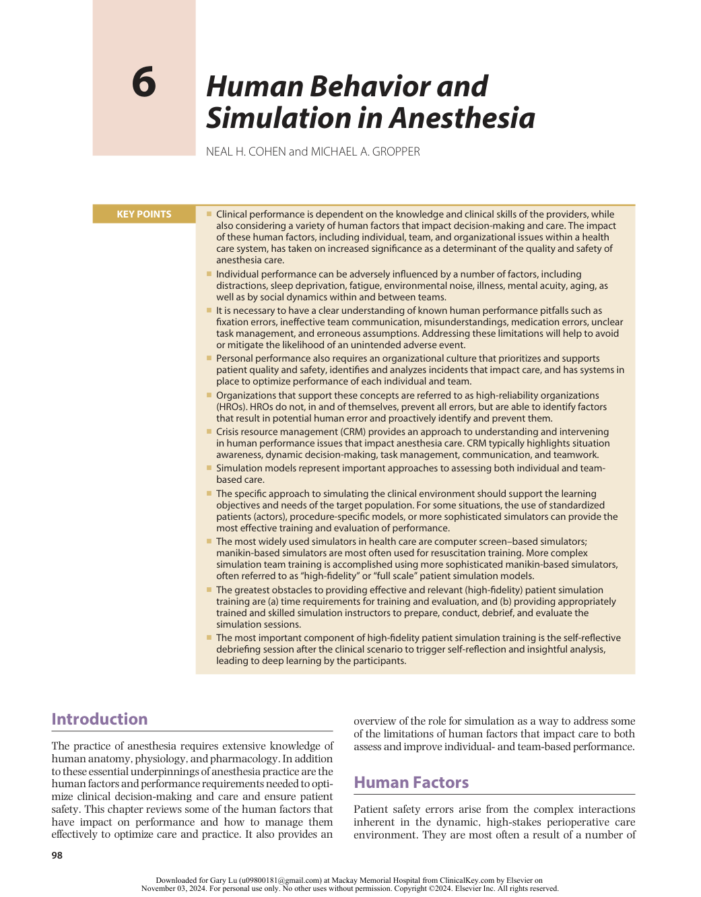
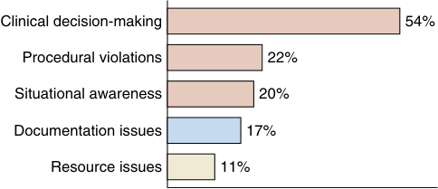
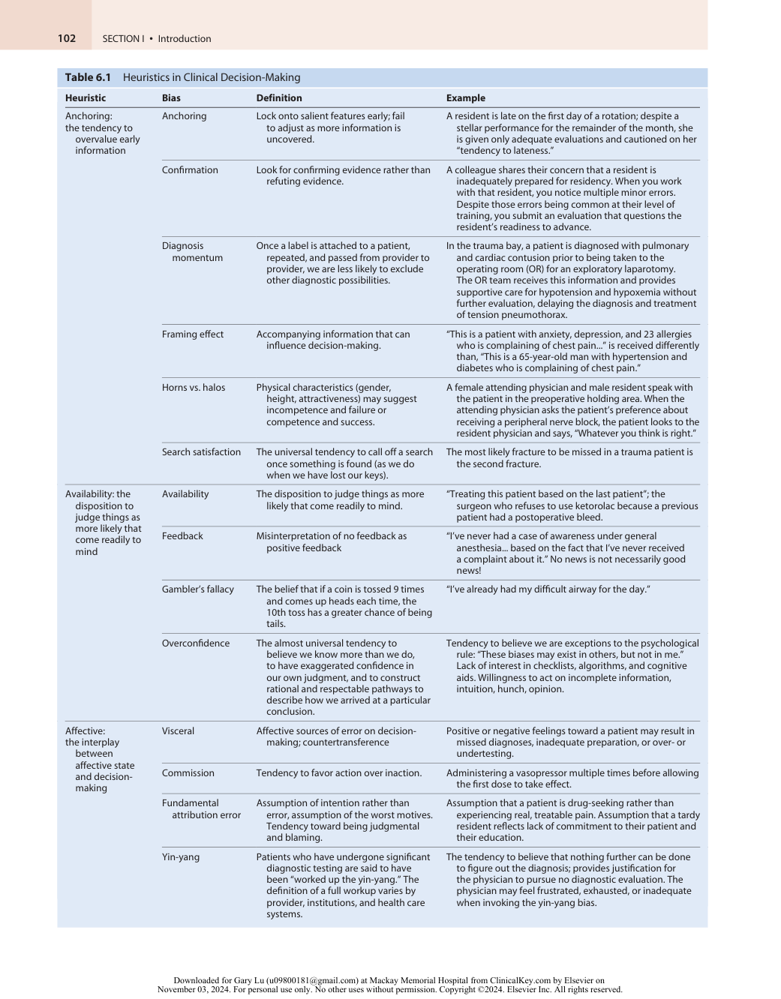
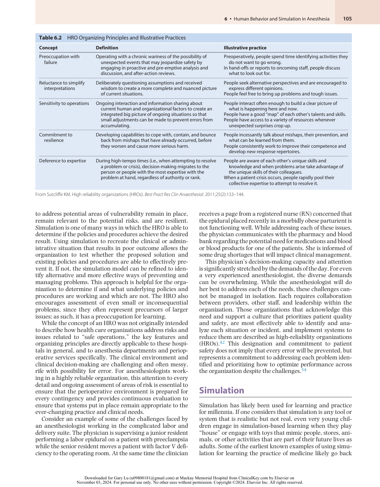
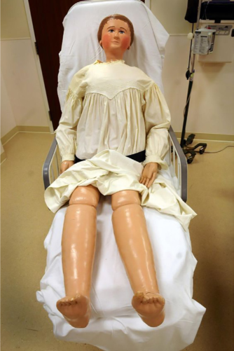
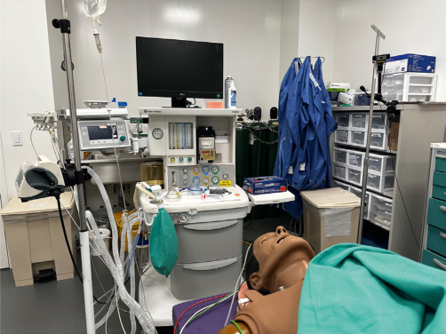
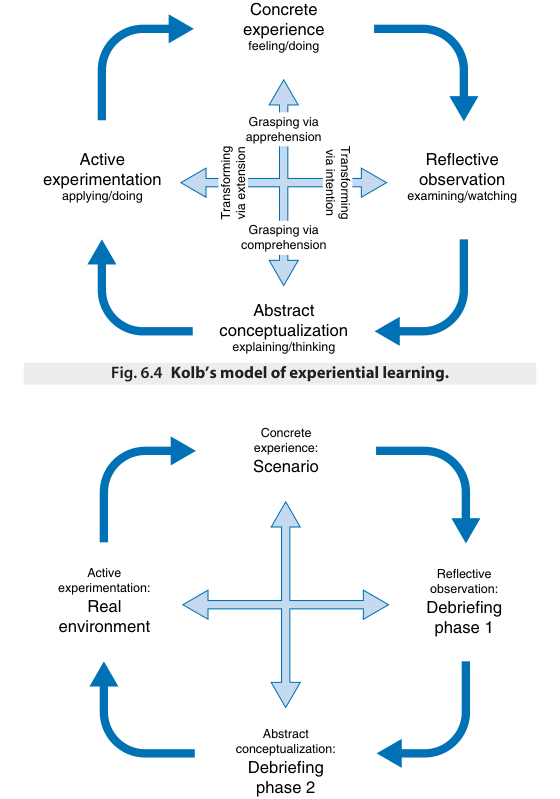

# Human Behavior and Simulation in Anesthesia

<!-- PDF page 1 -->

NEAL H. COHEN and MICHAEL A. GROPPER

|**KEY POINTS**|ᑏClinical performance is dependent on the knowledge and clinical skills of the providers, while also considering a variety of human factors that impact decision- making and care. The impact of these human factors, including individual, team, and organizational issues within a health care system, has taken on increased significance as a determinant of the quality and safety of anesthesia care. ᑏIndividual performance can be adversely influenced by a number of factors, including distractions, sleep deprivation, fatigue, environmental noise, illness, mental acuity, aging, as well as by social dynamics within and between teams. ᑏIt is necessary to have a clear understanding of known human performance pitfalls such as fixation errors, ineffective team communication, misunderstandings, medication errors, unclear task management, and erroneous assumptions. Addressing these limitations will help to avoid or mitigate the likelihood of an unintended adverse event. ᑏPersonal performance also requires an organizational culture that prioritizes and supports patient quality and safety, identifies and analyzes incidents that impact care, and has systems in place to optimize performance of each individual and team. ᑏOrganizations that support these concepts are referred to as high- reliability organizations (HROs). HROs do not, in and of themselves, prevent all errors, but are able to identify factors that result in potential human error and proactively identify and prevent them. ᑏCrisis resource management (CRM) provides an approach to understanding and intervening in human performance issues that impact anesthesia care. CRM typically highlights situation awareness, dynamic decision- making, task management, communication, and teamwork. ᑏSimulation models represent important approaches to assessing both individual and team- based care. ᑏThe specific approach to simulating the clinical environment should support the learning objectives and needs of the target population. For some situations, the use of standardized patients (actors), procedure- specific models, or more sophisticated simulators can provide the most effective training and evaluation of performance. ᑏThe most widely used simulators in health care are computer screen–based simulators; manikin- based simulators are most often used for resuscitation training. More complex simulation team training is accomplished using more sophisticated manikin- based simulators, often referred to as “high- fidelity” or “full scale” patient simulation models. ᑏThe greatest obstacles to providing effective and relevant (high- fidelity) patient simulation training are (a) time requirements for training and evaluation, and (b) providing appropriately trained and skilled simulation instructors to prepare, conduct, debrief, and evaluate the simulation sessions. ᑏThe most important component of high- fidelity patient simulation training is the self- reflective debriefing session after the clinical scenario to trigger self- reflection and insightful analysis, leading to deep learning by the participants.|
|---|---|

## Introduction

The practice of anesthesia requires extensive knowledge of human anatomy, physiology, and pharmacology. In addition to these essential underpinnings of anesthesia practice are the human factors and performance requirements needed to optimize clinical decision-making and care and ensure patient safety. This chapter reviews some of the human factors that have impact on performance and how to manage them effectively to optimize care and practice. It also provides an

overview of the role for simulation as a way to address some of the limitations of human factors that impact care to both assess and improve individual- and team- based performance.

## Human Factors

Patient safety errors arise from the complex interactions inherent in the dynamic, high-stakes perioperative care environment. They are most often a result of a number of

::: details 原始表格與符號（PDF 第 1 頁）

:::

<!-- PDF page 2 -->

Clinical decision-making 54% Procedural violations 22% Situational awareness 20% Documentation issues 17% Resource issues 11% 

**Fig. 6.1** Factors contributing to airway- related closed claims: provider factors, shown in _red_ ; team factors, the _largest_ of which is shown in _blue_ ; and system factors, the _largest_ of which is shown in _yellow_ .1

different, though often combined, factors, including reliance on large amounts of data provided by the monitors and other equipment used in the operating room (OR), the complexity (and occasionally chaos) of the OR environment, and skills and interpersonal interactions among the staff involved in each case. Perhaps most important to the anesthesiologist and other providers are the personal factors that impact care and decision- making including, but not limited to, level of expertise or familiarity with the procedure and its implications for anesthesia care, other distractions, fatigue, and production pressure, all of which can predispose to errors. Other human factors include cognitive errors, miscommunication, and suboptimal utilization of available resources or unwillingness to acknowledge limitations and seek guidance, advice, or assistance from colleagues.

### SCOPE OF THE PROBLEM

Human factors contribute to patient harm. As an example, a 2021 Canadian review of anesthesiology airway- related medicolegal cases identified provider factors, team factors, and system factors that contributed to patient harm.1 The peer reviewers identified faulty clinical decision- making in 54% of the cases, procedural violations in 22% of cases, and poor situational awareness in 20% of cases. While the methodology of this study is not ideal for identifying team factors and system factors, they were far outweighed by the provider factors contributing to the errors (Fig. 6.1).

The Anesthesia Closed Claims Project has been instrumental in assessing some of the underlying causes for patient harm. A recent analysis of airway- related claims identified errors in judgment in 73% of claims.2 These judgment errors included failure to plan appropriately and prospectively for management of a patient with a known difficult airway, failure to utilize a supraglottic airway as a bridge to potentially difficult tracheal intubation, and perseverance with one approach to the airway without identifying alternative and potentially more appropriate options. Another closed claims analysis examined the frequency and type of situational awareness errors in malpractice claims in which patients suffered brain damage or death, and found that situational awareness may have contributed in 74% of these tragic outcomes.3

### FACTORS IMPACTING HUMAN PERFORMANCE

### Fatigue

Sleep deprivation is an acknowledged problem for clinicians, including anesthesiologists. While work hour limits are now in place for trainees and, in most practices,

limitations in shift hours have been implemented, fatigue remains a significant issue for anesthesiology because of the high demands of the clinical environment, the call coverage obligations, and the challenges associated with the increasing patient acuity. In addition, clinicians providing care during nighttime hours are challenging their biorhythms by demanding alertness at nonphysiologic times. Resident physicians are also subject to prolonged and chronic sleep deprivation as they balance work and life and fulfill their educational and clinical obligations. To address fatigue in trainees, the Accreditation Council for Graduate Medical Education (ACGME) now places restrictions on duty hours, including time spent moonlighting over and above educational program hours. Despite these limitations on work hours, perceived quality of care has not improved.4 Fatigue among all anesthesia providers is thus a challenging patient safety factor, particularly at a time when there are workforce shortages affecting the specialty. Simulation and experiential learning have been helpful methods to assess and improve practice habits to address the challenges of fatigue on clinical care.

### Distraction

The OR environment is filled with distractions, including but not limited to noise and alarms associated with each monitor, the number of individuals moving into and out of the immediate environment, requests by surgeons to listen to monitoring notifications or to have background music playing during the procedure, and the expectation that the anesthesiologist is providing ongoing oversight of the entire surgical environment while remaining attentive to the needs of the patient, surgeon, and other OR staff.5–9 Adding to sources of distraction are phone calls regarding other patient needs, including those from the postanesthe sia care unit (PACU), calls related to the next scheduled case, or patients scheduled for surgery at a future date. Other activities that can take attention away from the patient include the need to urgently prepare and administer a medication that is not readily available; calls to the pharmacy or blood bank for drugs or blood products needed during an emergency; evaluating the reason a monitor or other equipment is not functioning properly despite proper preoperative check; and the complexity of documentation on the electronic medical record. While in the past, some anesthesiologists would read the _Wall Street Journal_ during a case, more recent distractions relate to the use of social media and searches on the internet to obtain both clinically and non- clinically related information.10 Simulation and experiential learning can be helpful in providing clinicians with the tools needed to effectively maintain continual vigilant monitoring of the patient despite the potential deleterious distractions.

### Production Pressure

The time pressures in the operating room, PACU and intensive care units, and other environments also represent a factor inherent to anesthesia practice that can contribute to complications and harm. The emphasis on turnover time in the operating room and other pressures create the potential for error.11–13 Similarly, trying to work efficiently to meet the needs of the surgeon puts pressure on the anesthesiologist to complete pre- induction procedural tasks quickly to prevent delays and optimize OR utilization.13 Maximizing

<!-- PDF page 3 -->

efficiency in the operating room is most realistically accomplished when the team of surgeon, anesthesiologist, circulating nurse, and scrub technician work together regularly on similar, commonly performed procedures (for example consistent subspecialty services such as cardiac, neurosurgery, and transplant) and when patients have low disease burden. Collaboration is not as straightforward for different groups of anesthesia providers who do not regularly work with specific surgical teams or individual surgeons, is more challenging, and can increase production pressure among other concerns. At the same time, while collaborating and cooperating with the multidisciplinary team is a laudable goal, the individual pressures imposed on each member of any team can be difficult to manage even under optimal collaborative environments. Patient safety clearly can and should take precedence over these other obligations, but often the production pressure can contribute to variations in the standard of care and result in unintended complications.

### IMPACT OF ADVERSE EVENTS ON PROVIDERS

Adverse events or errors in clinical decision- making that result in patient harm or death not only have impact on patients and their families, but also on the medical personnel who participate in the care. The impact on the providers is referred to as the “second victim” phenomenon,14–16 to acknowledge that the providers are also impacted by the adverse events. At the same time, over the past few years, concerns about the use of the term “second victim” have been raised because of its implications for patients and their families who have been directly impacted by the adverse events and might undermine efforts to systematically review the events and identify ways to improve clinical care.17,18

While identifying a better terminology for the impact of adverse outcomes on providers is an important next step, identifying the correct way to acknowledge it has been challenging. Providers involved in the care of the patient at the time of an adverse event often “second guess” their decision- making capability, judgment, or even their competence. It is also essential to acknowledge that each event often has impact both on those directly involved in decisionmaking and management, as well as others involved in the overall clinical care of the patient, but less directly involved in the care at the time of the event. While acknowledging the impact of these events on providers is critically important, those efforts cannot substitute for identifying why and how adverse events occurred, and the systems solutions required to reduce the likelihood of recurrence. As a result, each “second victim” often experiences remorse about the outcome and their involvement in it but should also be encouraged to question what went wrong, and why and how the error or outcome could have been avoided.

The likelihood of becoming a second victim during the course of one’s career is high.19 Although there is limited data to define the likelihood of becoming a second victim and the specific specialties for whom it is more likely, the frequency probably varies depending on the roles and responsibilities as well as the level of participation in the care resulting in the poor outcome. In addition, while the second victim phenomenon can occur in any clinical relationship, it is often most notable when the providers, whether

a physician, nurse or others, have developed a relationship with the patient and/or family members.

The impact of the second victim phenomenon can play a role in the providers’ well- being. It can also affect their self- confidence and, in some cases, their ability to assume responsibilities for similar clinical encounters in the future. The duration of the impact is also not well defined. As a result, identifying the phenomenon is critically important to provide peer and institutional support measures. At the same time, it is important to understand what and when such support is provided or required, since the response of each second victim can be different and require different measures to address it. Some second victims do not think they need support or training to address the phenomenon and might not accept it, at least initially after the event.20 However, making support available through both peer support, case review to identify whether or how the outcome might have been avoided, or the likelihood of similar outcomes in the future avoided can be very helpful for all involved providers. Some second victims will benefit from support from others, including social workers, psychologists, psychiatrists, or clergy, while others will not. Providing such resources to meet individual need can be valuable and demonstrates to the organization the acknowledgement of the second victim phenomenon and its implications to the entire staff.

### PERSONAL FACTORS IMPACTING PERFORMANCE (COGNITIVE BIAS)

As Pat Croskerry wrote, “Virtually every cognitive error is deemed preventable in hindsight.”21 A number of other factors specific to each individual impact performance. Perhaps the most significant of these factors is the process by which each person makes clinical decisions and the timing involved in doing so. These internal factors represent cognitive bias and create risk for cognitive errors in decisionmaking. “Cognitive bias” refers to a tendency to think or behave in a certain way, and “cognitive error” is when bias is misleading.22–24 Some call cognitive bias “cognitive disposition to respond” or “recognition- primed decisionmaking.”25,26 Systemic cognitive errors are predictable deviations from reality. Cognitive bias can be applied to individuals as well as to situations, and so is relevant to both interpersonal encounters as well as purely clinical decisionmaking. These concepts are critically important since they impact the decision- making process for anesthesiologists, though they have relevance beyond anesthesia and medicine. For a more in- depth discussion, the interested reader is referred to the reference list as well as Daniel Kahneman’s fascinating book, _Thinking Fast and Slow_ .27

Another important concept that relates to human decision- making is dual process theory, a framework that has been proposed to explain the different ways in which we process information and draw conclusions.28–31 Dual process theory describes two types of decision- making. Type 1 processes are thought processes that are rapid, intuitive, automatic, and require little effort. These processes are responsive, capable of parallel processing, and highly context- bound; in other words, strongly influenced by ambient conditions such as the workload of the practitioner, priorities, interruptions, and the practitioner’s affective state.

<!-- PDF page 4 -->

It is a passive, reflexive way of thinking, and tends to rely on heuristics (rules of thumb, or mental shortcuts). The majority of type 1 processes are unconscious (cognitive psychologists estimate that we spend 95% of our time in the intuitive system 1), and so may be more prone to error. However, it’s often both an effective and efficient way of addressing any issue, allowing us to make rapid decisions and reserving effort for the more challenging decisions. Type 1 processes are referred to as the “story” system, represented by the part of the brain that fills in gaps in data, jumps to conclusions, and arranges the information to make sense and create a logical story. In many clinical situations this process of “jumping to conclusions” without understanding the consequences can be deleterious for both patient and provider.

Type 2 processes are more analytical and involve critical thinking. They rely on logic, so are less prone to error. However, the decision- making process is based in large part on experience, so can be a less effective way of making important clinical decisions for novice learners. Type 2 decisionmaking processes can be difficult and require focus and effort. As a result, they can be diminished by inattentiveness, fatigue, and distraction. What is perhaps most interesting and relevant to the clinical setting for anesthesiologists is that as their experience improves, type 2 processes can be transformed into type 1, more intuitive decision- making with repeated exposure to similar situations. As an example, consider the effort required for a medical student faced with a respiratory acidosis to interpret the data, consider a differential diagnosis, recall the components of minute ventilation, decide between increasing respiratory rate or tidal volume, calculate an appropriate weight- or height- based tidal volume, determine which settings on the ventilator to adjust based on the ventilator mode, and finally make a change. In contrast, an experienced anesthesiologist will make the correct adjustments in far less time and with less effort.

Most experienced clinicians spend the majority of time utilizing type 1 decision- making processes; however, depending on the clinical situation being addressed, both forms of thinking are essential. We switch back and forth between the two. For experienced providers, type 1 decision- making might be appropriate based on their background, skills, and expertise. At the same time, in most situations, often for the less experienced provider, there is a tendency to identify the best response quickly, generally using type 1 process (cognitive indolence) rather than expending the energy and time required to analytically assess data and identify the optimal solutions.31

## Heuristics, or Rules of Thumb

Heuristics represent shortcuts to decision- making, designed to minimize the cognitive load; they represent a feature of type 1 processing.32,33 Heuristics are a practical approach to problem- solving that are sufficient for reaching a shortterm goal or approximation, but are not guaranteed to be optimal, rational, or nuanced. Examples of heuristics in anesthesia practice include the following:

- “If a patient comes to the OR intubated, the patient leaves the OR intubated.”

- “Any after- hours case gets an endotracheal tube.”

- “Only cases less than two hours should be eligible for a supraglottic airway.”

- “Always check a preoperative potassium level in patients on hemodialysis.”

While these “rules” are not incorrect, they do not take the specific clinical situation or other relevant information that might support a different decision into account. Using heuristics precludes the need to consider the risk–benefit profile for a particular patient and allows us to preserve our cognitive resources for more difficult decisions but is not always in the patient’s best interest. Some common heuristics provide examples of how this approach impacts clinical decision- making:

**Anchoring** refers to the tendency to overvalue early information, or the credence we give to our “first impression.” As an example, if you are asked to estimate the product of the following line of numbers: 8 × 7 × 6 × 5 × 4 × 3 × 2 × 1. You are more likely to respond that this series of numbers has higher estimate than if you were asked to estimate the product of this line of numbers: 1 × 2 × 3 × 4 × 5 × 6 × 7 × 8. Obviously, the products are identical; yet overvaluing the information received first can result in a higher estimate.

**Availability** heuristic is the tendency to answer a question about frequency of events based on the ease with which the conclusion is reached, rather than completing a more thorough assessment. For example, media coverage of childhood deaths due to a school shooting may create the impression that school is more dangerous to children than driving in the car with their parents, yet in 2020 vehicular trauma caused 607 deaths of children under the age of 12 and injured 63,000 more; in contrast 2 children were killed in a school shooting and 9 people were injured.34,35

**Affective** heuristic refers to the interplay between our affective state and our decision- making. Strong emotion can quickly and powerfully influence our decision- making; for example, clinical decision- making may be compromised for the patient who is a VIP, whose presentation reminds the clinician of a family member, or from whom the clinician may unconsciously or consciously wish to distance, as when caring for a patient experiencing homelessness or incarceration.

A variety of heuristics relevant to the practice of anesthesiology have been described. Table 6.1 provides a more detailed overview of the impact of the three categories defined above on assessment by individual providers. The table includes examples related to decision- making and evaluation of trainees as well as patients to acknowledge that cognitive bias may affect our diagnostic and therapeutic decisions. For trainees, this overview provides some guidance on how to assess clinical competence and readiness to assume greater responsibilities.

## Strategies to Overcome Inherent Biases

Keith Horton noted that “...the same kinds of biases that distort our thinking in general also distort our thinking about the biases themselves.”36 Both individual and systematic approaches to understanding inherent biases may limit the

<!-- PDF page 5 -->

**Table 6.1** Heuristics in Clinical Decision- Making

|**Heuristic**|**Bias**|**Definition**|**Example**|
|---|---|---|---|
|Anchoring: the tendency to overvalue early information|Anchoring|Lock onto salient features early; fail to adjust as more information is uncovered.|A resident is late on the first day of a rotation; despite a stellar performance for the remainder of the month, she is given only adequate evaluations and cautioned on her “tendency to lateness.”|
||Confirmation|Look for confirming evidence rather than refuting evidence.|A colleague shares their concern that a resident is inadequately prepared for residency. When you work with that resident, you notice multiple minor errors. Despite those errors being common at their level of training, you submit an evaluation that questions the resident’s readiness to advance.|
||Diagnosis momentum|Once a label is attached to a patient, repeated, and passed from provider to provider, we are less likely to exclude other diagnostic possibilities.|In the trauma bay, a patient is diagnosed with pulmonary and cardiac contusion prior to being taken to the operating room (OR) for an exploratory laparotomy. The OR team receives this information and provides supportive care for hypotension and hypoxemia without further evaluation, delaying the diagnosis and treatment of tension pneumothorax.|
||Framing effect|Accompanying information that can influence decision- making.|“This is a patient with anxiety, depression, and 23 allergies who is complaining of chest pain...” is received differently than, “This is a 65- year- old man with hypertension and diabetes who is complaining of chest pain.”|
||Horns vs. halos|Physical characteristics (gender, height, attractiveness) may suggest incompetence and failure or competence and success.|A female attending physician and male resident speak with the patient in the preoperative holding area. When the attending physician asks the patient’s preference about receiving a peripheral nerve block, the patient looks to the resident physician and says, “Whatever you think is right.”|
||Search satisfaction|The universal tendency to call off a search once something is found (as we do when we have lost our keys).|The most likely fracture to be missed in a trauma patient is the second fracture.|
|Availability: the disposition to judge things as |Availability|The disposition to judge things as more likely that come readily to mind.|“Treating this patient based on the last patient”; the surgeon who refuses to use ketorolac because a previous patient had a postoperative bleed.|
|more likely that come readily to mind|Feedback|Misinterpretation of no feedback as positive feedback|“I’ve never had a case of awareness under general anesthesia... based on the fact that I’ve never received a complaint about it.” No news is not necessarily good news!|
||Gambler’s fallacy|The belief that if a coin is tossed 9 times and comes up heads each time, the 10th toss has a greater chance of being tails.|“I’ve already had my difficult airway for the day.”|
||Overconfidence|The almost universal tendency to believe we know more than we do, to have exaggerated confidence in our own judgment, and to construct rational and respectable pathways to describe how we arrived at a particular conclusion.|Tendency to believe we are exceptions to the psychological rule: “These biases may exist in others, but not in me.” Lack of interest in checklists, algorithms, and cognitive aids. Willingness to act on incomplete information, intuition, hunch, opinion.|
|Affective: the interplay between |Visceral|Affective sources of error on decision- making; countertransference|Positive or negative feelings toward a patient may result in missed diagnoses, inadequate preparation, or over- or undertesting.|
|affective state and decision- making|Commission|Tendency to favor action over inaction.|Administering a vasopressor multiple times before allowing the first dose to take effect.|
||Fundamental attribution error|Assumption of intention rather than error, assumption of the worst motives. Tendency toward being judgmental and blaming.|Assumption that a patient is drug- seeking rather than experiencing real, treatable pain. Assumption that a tardy resident reflects lack of commitment to their patient and their education.|
||Yin- yang|Patients who have undergone significant diagnostic testing are said to have been “worked up the yin- yang.” The definition of a full workup varies by provider, institutions, and health care systems.|The tendency to believe that nothing further can be done to figure out the diagnosis; provides justification for the physician to pursue no diagnostic evaluation. The physician may feel frustrated, exhausted, or inadequate when invoking the yin- yang bias.|

::: details 原始表格與符號（PDF 第 5 頁）

:::

<!-- PDF page 6 -->

effect they have on clinical decision- making and encourage effective “debiasing.” Data on how to recognize and limit the impact of biases are limited. Given the complexity of medical decision- making, particularly when it must be done under time pressure in a chaotic and often unpredictable system, it is likely that a multi- pronged approach is required to limit the effect of bias. In addition, the effort required to implement debiasing strategies hinges on intentionally engaging type 2 (the logical, methodical, analytical) thought processes.

### SYSTEM STRATEGIES

Education and clinical experience are essential methods to optimize clinical decision- making and overcome the inherent biases most clinicians may not even recognize. Training designed to better understand the sources of bias can be very helpful, including teaching about the cognitive theories underlying decision- making and the impact of cognitive biases. However, other methods are also essential, including, but not limited to, team- based learning, implementation of cognitive aids, and teaching inferential rules to combine an analytical approach with a non- analytical approach.

A variety of approaches are used routinely to improve decision- making and minimize the negative impact of cognitive bias. As one example, clinicians teach and practice structured data acquisition (for example, reviewing a chest X- ray or obtaining and interpreting an echocardiographic or other ultrasound examination), approaching each study in the same systematic way and reporting on all structures and findings whether positive or negative, regardless of the study indication or clinical situation. This approach minimizes the likelihood that a significant finding, often unrelated to the reason the study was performed, is missed (e.g., identifying a new lung mass on a study performed to look for a retained foreign body).

Over the past few years, a variety of “slow down” strategies have been used to improve decision- making in these complex situations, including time- outs before a procedure, and debriefing at its completion. The SBAR (Situation– Background–Assessment–Recommendation) provides an opportunity to assess and establish a shared mental model of what was done and its impact for members of the team.37 Perhaps the most important effective way to optimize the decision- making process, particularly in the perioperative setting, is effective group interactions that ensure group decision strategy, accountability, feedback, and psychological safety. Debriefing, after- action reflection, and metacognition can all create awareness around compromised decision- making. In addition, as was noted previously, implementation of decision support systems can be effective ways of optimizing care based on the collaborative SBAR process. For example, development of cognitive aids or alerts or reminders embedded in the electronic medical record (implemented in a way that does not distract the provider) may provide just- in- time clinical information.38

### INDIVIDUAL STRATEGIES

Individual strategies to consciously engage type 2 decisionmaking require that the clinician recognize the potential

bias and overcome it. A variety of strategies can be learned and employed individually and incorporated into teambased approaches to decision- making. Perhaps the most common approach is experiential learning, as takes place regularly in the clinical environment and is embedded in our educational programs. Similarly, the use of simulation models designed to address specific clinical scenarios have been very effective at improving clinical performance and decision- making (see discussion of simulation models, below). Several creative strategies have been adopted by clinicians to improve cognitive approaches to clinical decision- making related to anesthesia practice.39

One of the challenges in developing individual strategies to optimize decision- making is that in order to do so, the underlying cause for an unanticipated event occurring during anesthesia and surgery can be difficult to identify and therefore it can be difficult to determine the most appropriate therapeutic option. For example, the patient who becomes hypotensive during a complicated thoracic surgical procedure associated with significant bleeding might initially be presumed to be hypovolemic, requiring blood transfusion; alternative diagnoses also have to be considered, such as pneumothorax, air embolus, cardiac tamponade, or myocardial infarction. Identifying the correct diagnosis can be difficult, but rapid treatment is required. In this situation, the clinician is likely to treat the “most likely” cause for the problem, but must be prepared to rapidly change course, if the expected response is not achieved.40

While considering treatment options, the risk of imposing bias cannot be dismissed, since doing so will delay making the correct clinical approach to address the problem. Identifying the bias can be challenging. Graber _et al._ propose questions that may suggest an increased propensity to bias41 :

1.  Was the diagnosis suggested to me by the patient, nurse, or colleague?

2.  Did I accept this patient as a “hand- off?”

3.  Did I consider organ systems besides the obvious one?

4.  Is this a patient I do not like, or like too much, for any reason?

5.  Have I been interrupted or distracted while caring for this patient?

6.  Am I cognitively overloaded right now?

7.  Am I stereotyping the patient or the presentation?

After acknowledging some of the sources of bias, determining how best to respond to a clinical dilemma can be challenging when many alternative responses might be appropriate. Some other approaches to consider when confronted with this diagnostic and therapeutic dilemma include the following:

### “Prospective Hindsight”

Imagine a future in which the decision was wrong, and ask, “What did I miss?”27

### “Rule Out Worst Case”

Based on the signs and symptoms, what is the worst possible outcome that could occur when considering a cause for a clinical problem and initiating a treatment to address it? Rule out that outcome first, before moving on to the next most likely cause.

<!-- PDF page 7 -->

### “Don’t Just Do Something, Stand There”

Sometimes the best initial response is to do nothing. Anesthesiologists and many other physicians are accustomed to taking rapid and decisive action. However, in some cases, the patient may be better served by stepping back and reassessing the clinical information before acting. More experienced providers are often more comfortable delaying reaction when clinically feasible to allow time to reassess before initiating a treatment, particularly when the therapy has its own inherent risks. Simulated clinical scenarios provide opportunities to practice this challenging skill.

### “My Working Diagnosis Is...”

Including the word “working” emphasizes uncertainty and encourages us to maintain a high index of suspicion. This could be a powerful addition to our medical communication and decision- making by continuously acknowledging that we may have missed or misinterpreted pertinent information.

## High-Reliability Organizations

The concept of a high-reliability organization (HRO) was developed in 1987 based on an assessment of how the airline industry and others manage risk and potential for errors.42–45 The description of the high-reliability organization acknowledged that these organizations operate under challenging and hazardous conditions but have put systems in place to address and potentially minimize them. HROs function in challenging and the organizations represent potentially hazardous environments. They do not prevent all, but rather have the ability and foresight to identify and prioritize how to optimize performance throughout the organization despite the challenges they face.

The key features of a high-reliability organization based on Agency for Healthcare Research and Quality (AHQR) criteria include the following46 :

- n  Acknowledgment of the high- risk nature of an organization’s activities and the determination to achieve consistently safe operations

- n  A blame- free environment where individuals are able to report errors or near misses without fear of reprimand or punishment

- n  Encouragement of collaboration across the ranks and disciplines to seek solutions to patient safety problems

- n  Organizational commitment of resources to address safety concerns

In addition to these key organizing principles, HROs are also characterized by four key structural pillars: (1) creation and sustainment of a culture of safety; (2) global and profound organizational learning, including incident reporting systems (IRS); (3) continuous training of individuals, teams, and work units including the regular use of simulation; and (4) continuous optimization of safetyrelevant structures and processes. The four pillars are intended to provide anchor points for systematic organizational improvement.

Successful HROs in any industry, including health care, pursue two important, but competing approaches to optimize their performance: prevention and resilience.42

### PREVENTION

Prevention (anticipation) requires that an organization anticipate events that should not occur, define possible causes, and create policies and procedures for avoiding them.47–49 To be most effective, the organization should implement highly standardized procedures to define how to identify and minimize potential or actual errors or unintended consequences.50 In health care organizations the implementation of clinical protocols, evidence- based clinical practice guidelines, and checklists represent good examples of how HROs anticipate and prevent adverse events from occurring.51 In addition, the formal review of adverse events through both quality improvement programs within departments and service lines as well as root cause analyses are essential components of the commitment to a culture of safety, the learning health system, and the goal to prevent future similar outcomes.52

While this process is effective at reducing “never events,” it does not and cannot prevent all incidents from occurring. First, an organization cannot prevent events that it is not able to anticipate. Second, if policies and procedures become too complex, the likelihood that everyone in the organization will comply is low. In addition, blind adherence to strict and complex policies prevents capable providers from reacting appropriately to events that do not “fit the mold” or reacting to rapid changes in the clinical situation that do not match the definitions in the policy. To build and maintain a high-reliability organization requires not only prevention, but also resilience.

### RESILIENCE

HROs are unique in their abilities both to prevent and to manage mishaps before they can spread throughout the system, thus causing widespread damage or failure. At the same time, the hallmark of an HRO is not that it is errorfree, but that errors do not disable it. Resilience is therefore an essential characteristic of an HRO. It requires that an organization continuously assesses variations in care, has systems in place to monitor untoward events as they occur and responds to inevitable complications rapidly and consistently. Resilience involves three abilities: (1) the ability to absorb strain and preserve functioning in spite of the presence of adversity (e.g., rapid change, ineffective leadership, performance and production pressures, increasing demands from stakeholders); (2) an ability to recover or bounce back from untoward events as the team, unit, or system becomes better able to absorb a surprise and stretch rather than collapse; and (3) an ability to learn and grow from previous episodes of resilient action.53

HROs have a number of other critically important and unique attributes, including openness to dialog and respectful interaction among all providers, environment of trust, and a set of organizing principles, the most important of which is a preoccupation with failure as described in Table 6.2.

Based on these fundamental principles, HROs continuously evaluate all aspects of the organization and identify potential areas of vulnerability. They strive for continuous improvement across the organization, utilizing a variety of methods to ensure that the systems and policies developed

<!-- PDF page 8 -->

**Table 6.2** HRO Organizing Principles and Illustrative Practices

|**Concept**|**Definition**|**Illustrative practice**|
|---|---|---|
|Preoccupation with failure|Operating with a chronic wariness of the possibility of unexpected events that may jeopardize safety by engaging in proactive and pre- emptive analysis and discussion, and after- action reviews.|Preoperatively, people spend time identifying activities they do not want to go wrong. In hand-offs or reports to oncoming staff, people discuss what to look out for.|
|Reluctance to simplify interpretations|Deliberately questioning assumptions and received wisdom to create a more complete and nuanced picture of current situations.|People seek alternative perspectives and are encouraged to express different opinions. People feel free to bring up problems and tough issues.|
|Sensitivity to operations|Ongoing interaction and information sharing about current human and organizational factors to create an integrated big picture of ongoing situations so that small adjustments can be made to prevent errors from accumulating.|People interact often enough to build a clear picture of what is happening here and now. People have a good “map” of each other’s talents and skills. People have access to a variety of resources whenever unexpected surprises crop up.|
|Commitment to resilience|Developing capabilities to cope with, contain, and bounce back from mishaps that have already occurred, before they worsen and cause more serious harm.|People incessantly talk about mishaps, their prevention, and what can be learned from them. People consistently work to improve their competence and develop new response repertoires.|
|Deference to expertise|During high- tempo times (i.e., when attempting to resolve a problem or crisis), decision- making migrates to the person or people with the most expertise with the problem at hand, regardless of authority or rank.|People are aware of each other’s unique skills and knowledge and when problems arise take advantage of the unique skills of their colleagues. When a patient crisis occurs, people rapidly pool their collective expertise to attempt to resolve it.|

From Sutcliffe KM. High reliability organizations (HROs). _Best Pract Res Clin Anaesthesiol_ . 2011;25(2):133–144.

to address potential areas of vulnerability remain in place, remain relevant to the potential risks, and are resilient. Simulation is one of many ways in which the HRO is able to determine if the policies and procedures achieve the desired result. Using simulation to recreate the clinical or administrative situation that results in poor outcome allows the organization to test whether the proposed solution and existing policies and procedures are able to effectively prevent it. If not, the simulation model can be refined to identify alternative and more effective ways of preventing and managing problems. This approach is helpful for the organization to determine if and what underlying policies and procedures are working and which are not. The HRO also encourages assessment of even small or inconsequential problems, since they often represent precursors of larger issues; as such, it has a preoccupation for learning.

While the concept of an HRO was not originally intended to describe how health care organizations address risks and issues related to “safe operations,” the key features and organizing principles are directly applicable to these hospitals in general, and to anesthesia departments and perioperative services specifically. The clinical environment and clinical decision- making are challenging and often messy, rife with possibility for error. For anesthesiologists working in a highly reliable organization, this attention to every detail and ongoing assessment of areas of risk is essential to ensure that the perioperative environment is prepared for every contingency and provides continuous evaluation to ensure that systems put in place remain appropriate to the ever- changing practice and clinical needs.

Consider an example of some of the challenges faced by an anesthesiologist working in the complicated labor and delivery suite. The physician is supervising a junior resident performing a labor epidural on a patient with preeclampsia while the senior resident moves a patient with factor V deficiency to the operating room. At the same time the clinician

receives a page from a registered nurse (RN) concerned that the epidural placed recently in a morbidly obese parturient is not functioning well. While addressing each of these issues, the physician communicates with the pharmacy and blood bank regarding the potential need for medications and blood or blood products for one of the patients. She is informed of some drug shortages that will impact clinical management.

This physician’s decision- making capacity and attention is significantly stretched by the demands of the day. For even a very experienced anesthesiologist, the diverse demands can be overwhelming. While the anesthesiologist will do her best to address each of the needs, these challenges cannot be managed in isolation. Each requires collaboration between providers, other staff, and leadership within the organization. Those organizations that acknowledge this need and support a culture that prioritizes patient quality and safety, are most effectively able to identify and analyze each situation or incident, and implement systems to reduce them are described as high-reliability organizations (HROs).42 This designation and commitment to patient safety does not imply that every error will be prevented, but represents a commitment to addressing each problem identified and prioritizing how to optimize performance across the organization despite the challenges.54

## Simulation

Simulation has likely been used for learning and practice for millennia. If one considers that simulation is any tool or system that is realistic but not real, even very young children engage in simulation- based learning when they play “house” or engage with toys that mimic people, stores, animals, or other activities that are part of their future lives as adults. Some of the earliest known examples of using simulation for learning the practice of medicine likely go back

::: details 原始表格與符號（PDF 第 8 頁）

:::

<!-- PDF page 9 -->

to the study of medicine using cadavers or animals. “Mrs. Chase” was created in 1911 and is the first known doll designed specifically for training people to care for patients. The manikin was crafted by Martha Jenks Chase, of Pawtucket, Rhode Island, who went into business making dolls as children’s toys in 1901. At the request of A. Lauder Sutherland, principal of the Hartford Hospital Training School, Chase made an adult- sized manikin for nurse training in 1911 with mobile joints (Fig. 6.2).

Later, the Resusci Anne was created by the Laerdal Toy Company as a life- sized “doll” to practice mouth- to- mouth resuscitation for saving drowning victims. Resusci Anne is a model of medical simulator used for teaching both emergency workers and members of the general public. Resusci Anne was developed by the Norwegian toy maker Åsmund S. Lærdal, the Austrian–Czech physician Peter Safar, and American physician James Elam, and produced by the company Laerdal Medical. Fig. 6.3 shows a modern simulator.

Current simulators and simulation models used in health care come in many varieties from some simple desktop computer- based simulators or simple manikins that mimic normal anatomy to very complex and sophisticated devices that essentially recreate the clinical environment. Sim One was the first electromechanical manikin- based simulator in modern health care, introduced in 1969. It was developed by an aerospace company working with an educator and an anesthesiologist from the University of Southern California.55 It consisted of a manikin with a model airway that allowed intubation as well as the upper torso and arms. It was originally used as an aid for students or residents learning to intubate, as well as to mimic induction of anesthesia. Since the introduction of that initial simulator, several other manikin- based patient simulators have been developed and were in use in the mid to late 1980s. Noteworthy among others is Harvey, a cardiology manikin simulator released in 1976, which is able to simulate the arterial pulse, blood

**Fig. 6.2 Mrs. Chase.** (Courtesy of the Center for Education, Simulation and Innovation, Hartford, CT.)

pressure, jugular venous wave, precordial movements, and heart sounds in normal and diseased states. In 1986, a team at Stanford, Gaba and DeAnda and collaborators,56 developed a full- scale simulator called the Comprehensive Anesthesia Simulation Environment (CASE); it was initially used to study the decision- making processes of anesthesia professionals during critical events, as well as a training simulator for residents and students. Over a few years, with their recognition of the parallels with Crew/Crisis/Cockpit Resource Management (CRM) in aviation this same team of investigators developed their flagship simulation training course, Anesthesia Crisis Resource Management.57,58

Newer and more sophisticated commercially available manikin- based patient simulators have been in use as part of anesthesiology evaluation and education since about 1995. Currently, full- size manikin- based simulation devices developed and marketed by a number of companies (e.g., Laerdal, Gaumard, CAE Healthcare, and others) are used in most simulation centers. Such devices allow the simulation of rapidly changing physiology and can support a variety of hands- on interventions (e.g., airway management, vascular cannulation, drug administration, electric countershock, or pacing). Some devices allow the system to recognize injection of specific medications or therapeutic maneuvers, such as cardiac massage, and then – with or without instructor input – to “physiologically “ respond to interventions. Despite significant advances in the technology, current simulators lack some important features of value in anesthesia- related simulation scenarios. Further advances in both the technology and potential application of artificial intelligence will allow simulation models and algorithms to adapt to the needs of each participant.59 Box 6.1 outlines major opportunities for future MBS evolution.

### THE ROLE FOR SIMULATION AND ITS IMPLICATIONS FOR HUMAN FACTORS

Addressing some of the clinical decisions required of anesthesiologists, often under stressful, sometimes chaotic, and often unclear situations, is inherent to the practice of

**Fig. 6.3 Picture of a modern simulator.** Modern simulators allow the observations and training of clinicians during computer- based clinical scenarios. Participants can be viewed and evaluated from behind a one- way mirror. (Courtesy of the UCSF Department of Anesthesia.)

<!-- PDF page 10 -->

### Box 6.1 Major Roles of Simulation in Anesthesiology

### Preparation and Introduction

- Procedural skills

- Common events and basic management

- Teamwork and communication

### Growth and Improvement

- New skills and procedures

- Rare events exposure and management

- Crisis resource management

### Leadership and Consultant Practice

- System integration

- Leading a team

- Practice and process improvement

- Liability and morbidity/mortality reduction

anesthesiology. While understanding some of the decisionmaking processes required to make clinical decisions is helpful, none of the discussions about human factors, inherent bias, or debiasing decision- making clarify how to optimize clinical care. The best clinical decision- making and interventions are provided by those most experienced in addressing the issues, often because they have confronted them (or similar situations) before. Experience is hard to replace as a tool for optimizing clinical care. The “see one, do one, teach one” approach to education does not address the problem. Other approaches to understanding the clinical environment, to ensure that each provider has the knowledge and skills required to fulfill their responsibilities and that systems and policies are in place to ensure a culture of safety, are needed to evaluate, educate, and assess policies and procedures to ensure that they are addressing the anticipated problems they were developed to prevent. In his book _What to Do When It’s Your Turn (And It’s Always Your Turn)_ , Seth Godin wrote, “Knowing what to do is very, very different than actually doing it.”60 Sir Liam Donaldson discussed simulation in his CMO Annual Report, noting that “Simulation training in all its forms will be a vital part of building a safer health care system.”61

In concert with other modalities, simulation provides a valuable approach to evaluating how a health system and physicians are addressing these needs. It can improve patient safety by informing personnel about best practices, evaluating and optimizing established clinical practice, and strengthening human performance. The use of simulation continues to expand, although opportunities to utilize it more broadly across an organization remain. Simulation, in combination with human factors training in crisis resource management (CRM), has the potential to substantially improve the quality and safety of health care.

### TYPES OF SIMULATORS AND SIMULATIONS

With the expansion of simulation as a tool for educating, evaluating, and credentialing providers as well as its value for many other diverse applications, the number and types of simulators continue to expand. “Simulators” include a diverse set of approaches to simulation, from simple models

of human anatomy to support development of procedural skills in learners to very sophisticated models as noted above. Advances in computers and technology, material science to create products that mimic normal human characteristics, and artificial intelligence are creating opportunities to advance the science, technology, and educational value of simulators and simulations. Selection of a device or technology depends on the specific educational or other goals for the simulator. In addition, while a popular addition to the education and assessment, not every teaching, assessment, or research activity requires simulation. The best simulation is the one that achieves the desired goals for highest impact, and in health care, the overarching goal is improved patient outcomes, whether these be current or future patients.

While not an exhaustive list of simulators or simulation technology, the diversity of options is large and continuing to grow:

- n  Computer- based case studies and computer screen–based simulators

- n  Simple tabletop simulators designed to assess a single skill

- n  Synthetic devices, animal models, fruits, and vegetables for honing procedural skills

- n  Simple and complex manikins

- n  Cadavers

- n  Standardized patients

- n  Human plasticized models

- n  Hybrid models, combining computer- based training with other models, including standardized patients, to mimic the clinical experience

- n  High- fidelity simulators

- n  Virtual simulators and robotics for training and evaluation of procedural skills, including fiberoptic intubation, echocardiography, and endoscopic procedures

- n  Virtual and augmented reality, often with head- mounted displays to mimic the actual clinical environment or physically interactive clinical environments

### EDUCATION THEORY AND ITS RELEVANCE TO SIMULATION

Although health care educators have not always embraced, or even been aware of the value of education theory,58,59 this is rapidly changing. Education theory encompasses a range of theories that are useful for explaining the application, interpretation, and purpose of learning and education. Education theory can help the instructor to better understand the learning process and select appropriate techniques, assessments, and curricular plans.62 There are many theoretical constructs that can inform simulation education practice, but no one theory covers all aspects of simulation education. Nevertheless, there are several key education theories that are essential for developing and delivering simulation- based education programs.

One of the most famous behaviorists was Pavlov, the scientist who found that dogs would begin to salivate spontaneously when they heard a bell after they had become conditioned to associate their food with the sound of a bell. Behaviorism in simulation is most closely tied to automaticity as individuals repeatedly practice skills until they can “automatically” perform a series of maneuvers without

<!-- PDF page 11 -->

having to think about every step. This is particularly applicable to skills training where learners can perform a task on models until they have “mastered” the basic steps and psychomotor maneuvers required. It can also be applied to other consistent behavior such as closed- loop communication, routine use of a time- out, or checking an identification before initiating a discussion or procedure.

Learning psychomotor skills for procedures may also be understood through the theory of embodied learning or embodied cognition.63 Briefly, this is the concept acknowledging that humans think and make meaning through all of the senses, not just through concepts, reasoning, and judgment in the mind. Embodied cognition theory includes the role that the body plays in shaping cognition and understanding though interactions between the sensory input to the brain from the actions of the body.64 Cognition is not simply the result of thinking but is the result of how brain interacts within the context of the body and its surroundings and experiences. The concept of embodied learning also has implications across other theoretical models.

### Constructivism

This learning theory acknowledges that people actively “construct” or make their own knowledge and reality is determined by the experience and perception of the individual. New knowledge is built on a foundation of previous knowledge, so each student’s particular experience influences their interpretation of new events and how new knowledge is incorporated into their existing framework. Since learners are constructing or building their own understanding, they are actively involved in their own learning, so discussion and experience are key elements for learning. This requires connection with other people and is therefore a social activity and requires the learner to make connections with prior knowledge and beliefs. Knowledge is personal and contextual, so while hands- on activities are important, they are inadequate to build new connections. The learner must be motivated and actively engage their mind to learn.

### Experiential Learning Cycle

David Kolb’s theory of experiential learning has been highly influential for simulation educators and is frequently combined with Jack Mezirow’s transformation learning theory. In health care education, the integration of simulation and clinical experience allows for a safe and effective way to develop understanding, belief, and behaviors consistent with professional competence. Two key approaches are repeated simulated events interspersed with facilitated reflection- on- action [Schon] and simulated events interspersed and actual clinical experienced with reflection and study (facilitated or not)65 (Figs. 6.4 and 6.5).

### SPIRAL APPROACH

The spiral approach to learning takes the deconstructed task and builds a circle that typically begins with the basic knowledge and experience of the learner.66,67 The learner identifies patterns and adds new information to what they already know, then practices skills, applying what they have learned. Reflection on this activity leads to enhanced understanding and recalibration of ideas. The process leads

Concrete experience feeling/doing Grasping via apprehension Active Reflective experimentation observation applying/doing examining/watching Grasping via comprehension Abstract conceptualization explaining/thinking Fig. 6.4 Kolb’s model of experiential learning. Concrete experience: Scenario Active Reflective experimentation: observation: Real Debriefing environment phase 1 Abstract conceptualization: Debriefing phase 2 Transforming via extension via intention Transforming 

**Fig. 6.5 Simulated team training in the conceptual framework of Kolb’s experiential learning theory.**

the learner to identify new patterns and the spiral repeats with increasingly challenging topics as the student builds new knowledge and skills, layer by layer over time.

Simulation can be strategically integrated into this model by providing appropriate and significant experiences into the learning cycle. After initial foundational learning, appropriate simulated experiences can provide a safe environment for practice, with feedback with review of key principles. This can be followed by actual clinical experiences that build on this with the inevitable variations inherent in the care of humans. Reflection provides opportunities to adjust pattern recognition and identify gaps in understanding. Simulated experience can be provided that builds on this basic foundation and provides new or novel experiences that further expand understanding and build on prior knowledge. This pattern can be repeated, and simulations can provide additional practice or new experiences repeatedly and even throughout one’s practice across a whole career.

Simulation- based learning leverages a wide range of learning theories in similar and different ways. Most planned simulation cases and many publications indicate the underlying education theory for specific uses of simulation tools as a way of clarifying the intent or purpose of a

<!-- PDF page 12 -->

simulation activity. Although excellent clinical educators are not always experts in education theory, knowing some theory is a valuable asset when planning or communicating the goals and objectives of planned health care simulation activities. A number of papers, books, courses, and professional meetings are available, and the list of resources continues to grow (Box 6.2).

### USES FOR SIMULATORS AND SIMULATIONS

A key turning point in the use of simulation was apparent in the early 2000s when patient safety became recognized as a key component of good health care and simulation was specifically named as a method to reduce patient harm.68 Health care simulation went from being somewhat a novelty, with limited utilization in a few specialties, to an “ethical imperative.”69 Currently, various types of simulators are found in practically every health care setting and used to train the diverse set of health care providers.70 Anesthesiology, as a leader in the patient safety movement, has successfully integrated simulation education, assessment, evaluation, and research into every level of training and practice.

### PATIENT SIMULATION FOR EDUCATION AND TRAINING

Nearly every anesthesia program in the United States offers simulation training experiences, although the scope, frequency, and target content vary. Although there is some variation from one program to the next, it is common for programs to provide simulation- based skills practice for initial training of medical students and nurse anesthesia students, residents and fellows, certified nurse anesthetists, and attending anesthesiologists.

Some examples of technical skills included in simulation exercises include practice on training manikins and other devices that provide a mechanism for learners to go through the motions of learning the steps required to safely perform procedures in an environment that does not put the patient at risk but ensures that the trainee achieves the skills necessary to transfer them to the clinical setting (Video 6.1). Skills can be practiced until a baseline level of skill is achieved and errors in performance can be corrected ahead of patient encounters. The “simulators” used for this practice range from low- tech, home- made items that provide a way to mimic the feel of a procedure to more advanced devices for procedure- specific haptic, augmented, or virtual reality specialty machines that provide feedback about performance as a procedure is learned. More sophisticated simulators include a computer- controlled curriculum that progressively builds from simple to challenging cases with feedback and a scoring rubric. Gamification is often used to motivate the learner. These devices allow learners to proceed at their own pace until competence is achieved without the need for a live coach to be continually present.

Simulation- based education may also be used to provide a more realistic demonstration of a clinical situation or to develop familiarity with health care processes or settings, especially for novices. More commonly, simulation is a way to allow learners to apply their theoretical knowledge to a realistically presented clinical case. Using the principle

### Box 6.2 Additional Simulation Resources

- Healthy Simulation – health care simulation resources: https://w ww.healthysimulation.com/healthcare- simulation/

- American Society of Anesthesiologists (ASA) Simulation Education Network: https://www.asahq.org/educationand- career/educational- and- cme- offerings/simulationeducation/sen- live- training

- Society for Simulation in Healthcare (SSH) homepage: www.ssih.org

### Simulation- Based Assessment

- Harden RM, Lilley P, Patricio M. _The Definitive Guide to the OSCE._ Elsevier; 2016.

- Downing SM, Yudkowsky R. _Assessment in Health Professions Education._ Routledge; 2009.

- _Simulation in Healthcare_ journal: https://journals.lww.com/simul ationinhealthcare/

- Individual Certification for Simulation Educators and Simulation Operation Specialists: https://www.ssih.org/Credentialing/Certif ication

- SSIH Accreditation of Simulation Centers: https://www.ssih.org/ Accreditation

- Healthcare Simulation Dictionary: https://www.ssih.org/Dictionary

- Healthcare Simulationist Code of Ethics: https://www.ssih.org/SSH- Resources/Code- of- Ethics

- Society in Europe for Simulation in Medicine (SESAM): www.sesam- web.org

- American College of Surgeons Accredited Education Institutes: https://www.facs.org/for- medical- professionals/education/prog rams/accredited- education- institutes

- Association of Standardized Patient Educators: aspeducators.org

- Stanford Simulation Site – Center for Immersive and SimulationBased Learning: cisl.stanford.edu

- Center for Advanced Pediatric and Perinatal Education (CAPE): cape.stanford.edu

- Center for Medical Simulation (CMS in Boston): harvardmedsim.org

- WISER Simulation Center – University of Pittsburgh Medical Center: www.wiser.pitt.edu

of embodied cognition, relevant physical activity or skills may be embedded in an immersive environment.63 This approach is intended to link motor activity and cognitive processes.71 Straightforward case scenarios are often provided for novices who are learning to apply what they have learned to the clinical “environment”; complex case scenarios with multiple possible iterations are often used to probe the more advanced learner’s thought process and decisionmaking capabilities.

Simulation has also proven to be a very successful tool for training multidisciplinary practices in which physicians, nurses, pharmacists, and others collaborate in the management of a complex clinical situation, learn how to delegate responsibilities across disciplines, and manage the diverse group of providers to achieve the desired goals. In fact, teamwork is one of the major training goals for some of the most sophisticated simulators. Teams are often, but not always, interprofessional and/or multidisciplinary. In these simulations, multiple learners from various disciplines work collaboratively to identify a problem and determine how best to resolve it. In most cases, the simulation is designed

<!-- PDF page 13 -->

to mimic the clinical environment; the more sophisticated simulators can modify the program in response to the actions and decision- making by the team. Simulated cases are developed that provide a challenge that requires the group to work together to be successful. The successful experience is one in which there is clear communication and coordination among the learners, each member of the team is aware of their roles and responsibilities, there are shared goals, and all have achieved appropriate levels of situational awareness so they can respond to problems arising during the exercise (e.g., one participant is struggling to complete a critical task, delaying appropriate interventions or progress with completing the exercise). Automaticity may also be reinforced for some of the fundamental tenets of teamwork such as closed- loop communication, hand-off strategies, and designating roles, so that team members perform these actions consistently in every situation.72 These applications of simulation training include education and assessment of both technical and non- technical skills.

### PATIENT SIMULATION FOR ASSESSMENT

In addition to providing an opportunity to train providers in skills and interactions critical to the clinical environment while minimizing risk to patients, simulation is frequently employed to provide a consistent, safe method of evaluating and assuring that a person can actually perform a task or figure out a realistically presented clinical problem. Often referred to as “competency assessment,” many fields use simple simulations or simulators to provide assurance that health care providers have the basic skills needed to perform a task such as measuring blood pressure, placing an IV, or performing a lumbar puncture. The simulation model selected must be appropriate for the level and type of task or skill being assessed. For example, an assessment of a medical student performing a cardiac exam could utilize a comprehensive cardiac simulator such as Harvey or a real human model; an assessment of laparoscopic surgery might employ a basic task trainer model, a haptic simulator, or a laboratory animal.

Simulators have also become valuable tools in assessing other skills unrelated to specific procedures or technical capabilities. They can be successfully employed to assess communication skills and professionalism, often with the assistance of standardized patients (SPs), usually actors who are specifically trained to portray a particular state of health or disease. This model can be used to evaluate history and physical examination skills, communication between patients and providers as well as other traits that determine the level of professionalism in the patient encounter. In these scenarios, the SP is often trained to evaluate the student’s performance on a number of key measures. To do so effectively, SPs must be trained to provide a consistent narrative.73

### Simulation and OSCE

The OSCE (Objective Structured Clinical Examination) is a simulation- based assessment tool that has become integrated into training and certification processes. It was originally developed in the 1970s to “sample” the learner’s performance across a range of skills. In the 1990s this format was adapted for surgical or technical skills as

the OSATS (Objective Structured Assessment of Technical Skills) by Reznick _et al._74

Administering an OSCE is resource intensive and requires a high level of skill and expertise, not only of what to test, but also how to test and measure what is deemed important. Scoring can be challenging, particularly to ensure that all learners are assessed based on the same criteria75 and in many cases there is a tension between measuring authentic skills and assuring a fair and accurate test. One must be aware that key skills are not really measured by the OSCE, even a well- designed one. Factors that are inherently human, such as persistence, humor, flexibility, and honesty, may not be measured at all or may actually reduce a student’s score. Additionally, some things are more easily tested with available “simulators” but are less important to include and _vice versa_ . A robust, reliable, and meaningful OSCE is labor- and time- intensive, making it a challenge to deliver.76 Nevertheless, the OSCE remains a commonly used and potentially meaningful assessment of actual clinical performance.

### Debriefing and Feedback

The use of high- fidelity simulation continues to expand as a method to both train and assess clinical competence, decision- making, and team- based care. The debriefing is an integral and critical component of the simulation experience. Not only does it ensure an appropriate level of oversight and supervision, but also it provides the opportunity to review the experience and each of the components of a clinical scenario with the learners. For most of these simulation experiences, the simulation is not only directly observed by the supervisors, often viewed from a location remote to the actual simulation, but also video recorded for follow- up review. Both the direct observation during the simulation and review of the recorded session allows the supervisor/ teacher to monitor what each trainee is doing and for interdisciplinary models how each participant interacts with their colleagues and the simulated patient, depending on the model.77,78

After completion of these simulated experiences, the participants are given the opportunity to observe their performance and provide discussion of the strengths, weaknesses, and opportunities for improvement. The debriefing allows for discussion about clinical skills, decision- making process, and other aspects of the simulation to receive feedback and foster self- reflection for the learner in a way that fosters professional growth and development in what is hopefully a non- judgmental, but constructive manner. A variety of debriefing models have been described to make the experience most beneficial to the learners. The most important aspect of the debriefing session and feedback is that it provides the learner with insights based on the review of the performance that are insightful and demonstrate areas in which there is opportunity for improvement.78–80

### Simulation for Continuing Medical Education and Remediation

Many simulation centers offer continuing medical education (CME) and training for experienced practitioners. Many of the simulation models used to train and evaluate students and residents have been expanded to assess skills, knowledge, and decision- making for practicing providers. Several studies have demonstrated

<!-- PDF page 14 -->

that experienced anesthesiologists have deficiencies in the management of critical patient situations and make severe errors comparable to those of anesthesia residents. A variety of simulation models have been modified to address specific areas of concern and provide both education and assessment to ensure ongoing competence. In addition, simulation can be useful in assessing the provider who has not been practicing for some period of time for a variety of reasons (leaves of absence, illness, etc.). Additionally, since many clinical events are rare, particularly crisis situations, simulation can be an effective way of reinforcing skills and management issues unique to some of these situations.

### PATIENT SIMULATION FOR SYSTEM EVALUATION AND PROCESS TESTING

Simulated cases are an excellent way to find out how a system or planned process works (and much better than finding practice gaps during real patient encounters). The most common approach is to initiate a “call for help” in an actual patient area (also known as _in situ_ ), and then watch what happens. Planning is essential, both for the roll- out of an improvement program, and for the activation of each event, as there may be a high degree of psychological risk to participants. To mitigate this risk, potential participants should know ahead of the evaluation that an unannounced emergency may occur as part of the assessment. The purpose and goals should be clear to everyone, including administration; the goals would not include targeting individuals involved in the mock response. Since responders typically have other demands, it is imperative that events of this type be kept short and focused. Finally, in a clinical setting, the mock event cannot interfere with actual patient care or other emergencies.

The information gleaned from these “mock” events is focused on how the whole system functions. If participants do not have the knowledge or skills to perform the necessary care, the educational program may be questioned; if needed equipment is not available or functional, one might look at how it is stocked or if equipment was changed or on shortage; if the team is slow to arrive, the delay might be accounted for by work overload, slow elevators, faulty alarm system, or other system failures. Since the goal is to assess system- related issues, the focus of these assessments must not focus on any one individual’s performance.

Process or protocol testing can be done in the simulation center or _in situ_ . In this case, the goal is to determine how a policy or process is actually implemented. Many plans that look great on paper are found to have important gaps or outright failures when put into action. Using simulation to perform a “final check” on the feasibility and workability of a protocol can allow for adjustments and clarification before it is released.

One popular use of both system assessment and process review can be seen in simulated mass casualty or disaster events.81 These are often held on a large scale in military settings, but there is an increasing reliance on these largescale, multisystem, multidepartment, and multilocation simulations in health care settings. Health care is relatively inexperienced in how to best leverage these events for highest value,82 but given the growing frequency of actual

disaster events and the growing acceptance of simulation to assist with planning, disaster simulation is increasingly needed.83

Finally, simulation has been used to investigate poor outcomes and their causes. One application recreates a case or situation to help identify the actual root causes after a concerning clinical event. The case is run multiple times with a different team each time. If the different teams end up with the same problem, it must be due to a system fault rather that the individuals.84 Simulation has also been used extensively as a method for teaching how to understand the concept of root cause analysis,85 and how to apply this approach to actual case reviews.86–88 Finally, simulation has been used to re- create a case to educate a jury for a malpractice case.89 The details of the simulation were taken directly from the records, and the recording of the re- enactment was able to better convey the timing and complexity of the situation much better than verbal description.

### PATIENT SIMULATION FOR PRODUCT EVALUATION

Health care equipment and technology options have grown at a rapid pace with devices that were only the stuff of science fiction a short time ago. The interface between this technology and the humans who use it can contribute to a variety of safety concerns and actual mishaps. Unfortunately, this is often identified after new equipment is put into use for patient care, possibly because engineers and health care experts have different mental models and expectations. Human factors engineering is a discipline that studies how tools are designed to interface with humans, and it plays an important role in improving patient safety. Companies have a strong incentive to identify product flaws that will lead to poor acceptance before marketing, and have adopted methods to anticipate and address potential problems as early as possible such as Prospective Health Technology Assessment.90 Despite this important work, it behooves purchasers to trial new equipment, especially for large purchases or emergency equipment because the final product is not always as user- friendly as hoped. This can usually be readily accomplished with actual clinical staff using simulation. One example was a simple comparison of three automatic external defibrillators (AEDs). The study asked lay responders to use each device and then measured how quickly the device could be deployed. Subjects were also asked which device they found easier to use.91 Usability data is an essential factor for determining which AED to purchase; once that is determined, other factors can then be considered, but an emergency device that cannot be easily deployed is of no use.

In many cases, equipment is assumed to be usable merely because it is available, however, the user interface may be quite challenging or non- intuitive for people with a health care mindset rather than an engineer’s perspective. Trialing monitors, pumps, hospital beds, and other large purchases is fairly simple. Another area where simulation is highly effective is in the design and construction of clinical space where multimodal simulation can be employed throughout the design, planning, and construction phases to enhance usability and mitigate threats and deficiencies.92

<!-- PDF page 15 -->

## Crisis Resource Management

6.  Nasri BN, et al. _Surg Endosc_ . 2023;37(3):2316.

7.  van Harten A, et al. _Anaesthesia_ . 2021;76(3):346.

8.  van Pelt M, Weinger MB. _Anesth Analg_ . 2017;125(1):347.

Crisis resource management (CRM) in health care is based on the concepts developed for the airline industry related to crew resource management (cockpit resource management). The term arose as a result of the realization that planes crashed in spite of good planes and good pilots in situations that should have been manageable. Former pilot and author, David Beaty, wrote a book in 1969 describing the principles related to a hierarchal culture, poor communication strategies, and particular cognitive errors. These principles largely apply today for the airline industry, with marked similarities for health care and anesthesia.93

Crisis resource management refers to a set of principles dealing with cognitive and interpersonal behaviors that contribute to optimal team performance. Investigations of airline accidents identified that the majority of errors were related to teamwork failures rather than deficiencies in either knowledge or technical skills. In response, the industry developed simulation- based “crew resource management” training programs that focused on core teamwork behaviors such as leadership, communication, situational awareness, and resource utilization. These same concepts were adopted by anesthesiology as the first specialty to incorporate CRM principles into the training of its clinicians. In the late 1980s, David Gaba and his colleagues recognized the many similarities between the experience in the airline industry and anesthesiology with respect to errors and unintended consequences of care despite the extensive knowledge and skills of anesthesiologists. Anesthesia training had traditionally emphasized the technical skills necessary to manage the anesthetized patient but did not address some of the behavioral aspects of either the individual provider or the team performance. In response, an Anesthesia Crisis Resource Management (ACRM) simulation- based course was implemented to address the importance of teamwork and collaborative decision- making, interpersonal communication, and leadership. ACRM has been wellreceived and widely adopted by anesthesiologists around the world.94

Based on this background, simulation programs have been developed, often utilizing sophisticated models to advance training in crisis management that emphasized collaborative, team- based approaches to address many of the complex situations that have potential risk and to incorporate both the technical and behavioral considerations into the training.

### Acknowledgment

The editors, publisher, and authors wish to acknowledge and thank Dr. Elizabeth Sinz and the authors of previous versions of this chapter. Their work has been foundational in completing the current chapter.

### Complete references available online at expertconsult.com.

### References

1.  Crosby ET, et al. _Can J Anesth_ . 2021;68(2):183.

2.  Joffe AM, et al. _Anesthesiology_ . 2019;131(4):818.

3.  Schulz CM, et al. _Anesthesiology_ . 2017;127(2):326.

4.  Desai SV, et al. _JAMA Intern Med_ . 2013;173(8):649.

5.  Gui JL, et al. _J Clin Anesth_ . 2021;68:110110.

9.  Yu CV, et al. _Can J Anaesth_ . 2022;69(4):494.

10.  Shelton CL, Smith AF. _Anaesthesia_ . 2021;76(3):305.

11.  Hoffman CR, et al. _BMC Med Educ_ . 2018;18(1):295.

12.  Seeman K, Ogg MJ. _AORN J_ . 2020;112(1):73.

13.  McIntosh CA, Macario A. _Curr Opin Anaesthesiol_ . 2009;22(2):223.

14.  Nydoo P, et al. _Scand J Public Health_ . 2020;48(6):629.

15.  Magaldi M, et al. _Rev Esp Anestesiol Reanim_ . 2021;68(9):504.

16.  Gómez Durán EL, Arimany Manso J. _Med Clin (Barc)_ . 2021;156 (12):636.

17.  Tumelty ME. _J Patient Saf_ . 2021;17(8):e1488.

18.  Clarkson MD, et al. _BMJ_ . 2019;364:l1233.

19.  Klemm V, et al. _Anaesthesiol_ . 2023;72(11):803.

20.  Bushuven S, et al. _Int J Environ Res Public Health_ . 2022;19(23):16016.

21.  Croskerry P. _Acad Emerg Med_ . 2002;9(11):1184.

22.  Richburg CE. _Surg Clin North Am_ . 2023;103(2):271.

23.  Croskerry P. _N Engl J Med_ . 2013;368(26):2445.

24.  Royce CS, et al. _Acad Med_ . 2019;94(2):187.

25.  Reale C, et al. _J Cogn Eng Decis Mak_ . 2023;17(2):188.

26.  Hudson D. _Stud Health Technol Inform_ . 2013;183:107.

27.  Kahneman D. _Thinking, Fast and Slow_ . Farras, Straus: Giroux; 2013.

28.  BelliniLeite SC. _Front Psychol_ . 2022;13:805386.

29.  Houlihan S. _Publ Health_ . 2018;156:52.

30.  Norman GR, et al. _Acad Med_ . 2017;92(1):23.

31.  Nadurak V. _Integr Psychol Behav Sci_ . 2023;57(4):1273.

32.  Marewski JN, Gigerenzer G. _Dialogues Clin Neurosci_ . 2012;14(1):77.

33.  Whelehan DF, et al. _Ir J Med Sci_ . 2020;189(4):1477.

34.  Centers for Disease Control and Prevention (CDC). _Child Passenger Safety: Get the Facts._ 2023. https://www.cdc.gov/transportationsafe ty/child_passenger_safety/cps- factsheet.html.

35.  School Shootings in 2020: How Many and Where. _Education Week_ ; 2020. https://www.edweek.org/leadership/school- shootings- this- yearhow- many- and- where/2020/01.

36.  Horton K. _Inq Interdiscip J Philos_ . 2004;47(6):545.

37.  Institute for Healthcare Improvement. Tools. https://www.ihi.org/res ources/tools.

38.  Croskerry P, et al. _BMJ Qual Saf_ . 2013;22(suppl 2):ii65.

39.  Stiegler MP, Tung A. _Anesthesiology_ . 2014;120(1):204.

40.  Stiegler MP, Ruskin KJ. _Curr Opin Anaesthesiol_ . 2012;25(6):724.

41.  Graber ML, et al. _Arch Intern Med_ . 2005;165(13):1493.

42.  Sutcliffe KM. _Best Pract Res Clin Anaesthesiol_ . 2011;25(2):133.

43.  Rochlin G, et al. _Nav War Coll Rev_ . 2018;40(4).

44.  Roberts KH. _Organ Sci_ . 1990;1(2):160.

45.  Weick KE. _Calif Manage Rev_ . 1987;29(2):112.

46.  Patient Safety Network. _Culture of Safety_ ; 2019. https://psnet.ahrq.go v/primer/culture- safety.

47.  Schulman PR. _Qual Saf Health Care_ . 2004;13(suppl 2):ii39.

48.  Wildavsky A. _Bull Sci Technol Soc_ . 1990;10(4):244.

49.  Reason J. _Managing the Risks of Organizational Accidents_ . 1st ed. Routledge; 2016.

50.  Weick K, et al. _Res Organ Behav_ . 1999;21:81.

51.  Gawande A. _The Checklist Manifesto_ . Picador; 2011.

52.  Singh G, Patel RH, Boster J. In: _StatPearls_ . StatPearls Publishing; 2023.

53.  Weick KE, Sutcliffe KM. _Managing the Unexpected: Resilient Performance in an Age of Uncertainty_ . John Wiley & Sons; 2007.

54.  Cady RF. _JONA’s Healthc Law, Ethics, Regul_ . 2008;10(2):33.

55.  Abrahamson S. _Caduceus_ . 1997;13(2):29.

56.  Gaba DM, DeAnda A. _Anesth Analg_ . 1989;68(4):444.

57.  Gaba DM. _Br J Anaesth_ . 2010;105(1):3.

58.  Howard SK, et al. _Aviat Space Environ Med_ . 1992;63(9):763.

59.  Rodgers DL, et al. _Simul Healthc_ . 2023;18(6):395.

60.  Godin S. _What to Do when It’s Your Turn (and It’s Always Your Turn)_ . The Domino Project; 2014.

61.  Donaldson LJ. _On the State of Public Health: Annual Report of the Chief Medical Officer_ ; 2008.

62.  Khalil MK, Elkhider IA. _Adv Physiol Educ_ . 2016;40(2):147.

63.  Cooper AB, Tisdell EJ. _Med Teach_ . 2020;42(5):515.

64.  Shapiro L, Spaulding S. In: Zalta EN, ed. _The Stanford Encyclopedia of Philosophy_ . Stanford University; 2021.

65.  Stocker M, et al. _BMC Med Educ_ . 2014;14(1):69.

66.  Drew C. _Bruner’s Spiral Curriculum – The 3 Key Principles_ , 2023. https: //helpfulprofessor.com/spiral- curriculum/.

<!-- PDF page 16 -->

67.  Kabara JJ. _J Med Educ_ . 1972;47(4):314.

68.  Institute of Medicine. _To Err Is Human: Building a Safer Health System_ . National Academies Press; 2000.

69.  Ziv A, et al. _Acad Med_ . 2003;78(8):783.

70.  Kshetrapal A, et al. _Crit Care Clin_ . 2023;39(2):373.

71.  Rusoja E, et al. _J Eval Clin Pract_ . 2018;24(3):600.

72.  Salas E, et al. _Theor Issues Ergon Sci_ . 2007;8(5):381.

73.  Huang CC, et al. _J Chin Med Assoc_ . 2010;73(11):589.

74.  Reznick R, et al. _Am J Surg_ . 1997;173(3):226.

75.  Sturpe DA, et al. _Am J Pharm Educ_ . 2010;74(3):44.

76.  Gupta P, et al. _Indian Pediatr_ . 2010;47(11):911.

77.  Eppich W, Cheng A. _Simul Healthc_ . 2015;10(2):106.

78.  Sawyer T, et al. _Simul Healthc_ . 2016;11(3):209.

79.  Abulebda K, et al. In: _StatPearls_ . StatPearls Publishing; 2023.

80.  Salik I, Paige JT. In: _StatPearls_ . StatPearls Publishing; 2023.

81.  Tallach R, et al. _Br J Anaesth_ . 2022;128(2):e180.

   83.  Brohi K, Tallach R. _Br J Anaesth_ . 2022;128(2):e65.

   84.  Simms ER, et al. _Surgery_ . 2012;152(3):489.

   85.  Sinz E, Kratz R. _J Clin Anesth_ . 2005;17(8):665.

   86.  Quraishi SA, et al. _J Grad Med Educ_ . 2011;3(4):529.

   87.  Aboumrad M, et al. _J Med Educ Curric Dev_ . 2019;6: 2382120519894270.

   88.  Schall SE, et al. _J Grad Med Educ_ . 2022;14(3):304.

   89.  Kofke WA, et al. _Med Law_ . 2001;20(1):79.

   90.  Djanatliev A, German R. In: _Proceedings of the 2013 Winter Simulation Conference: Simulation: Making Decisions in a Complex World_ . IEEE Press; 2013:270.

   91.  Eames P, et al. _Resuscitation_ . 2003;58(1):25.

   92.  Petrosoniak A, et al. _Simul Healthc_ . 2020;15(3):205.

   93.  Beaty D. _Naked Pilot: The Human Factor in Aircraft Accidents_ . Secker & Warburg; 1969.

   94.  Lei C, Palm K. In: _StatPearls_ . StatPearls Publishing; 2023.

82.  Mitchell B. _Prehospital Disaster Med_ . 2019;34(s1):s18.

<!-- PDF page 17 -->

### References

1.  Crosby ET, Duggan LV, Finestone PJ, et al. Anesthesiology airwayrelated medicolegal cases from the Canadian Medical Protection Association. _Can J Anesth_ . 2021;68(2):183–195.

2.  Joffe AM, Aziz MF, Posner KL, et al. Management of difficult tracheal intubation: a closed claims analysis. _Anesthesiology_ . 2019;131(4):818–829.

3.  Schulz CM, Burden A, Posner KL, et al. Frequency and type of situational awareness errors contributing to death and brain damage: a closed claims analysis. _Anesthesiology_ . 2017;127(2):326–337.

4.  Desai SV, Feldman L, Brown L, et al. Effect of the 2011 vs 2003 duty hour regulation- compliant models on sleep duration, trainee education, and continuity of patient care among internal medicine house staff: a randomized trial. _JAMA Intern Med_ . 2013;173(8):649–655.

5.  Gui JL, Nemergut EC, Forkin KT. Distraction in the operating room: a narrative review of environmental and self- initiated distractions and their effect on anesthesia providers. _J Clin Anesth_ . 2021;68:110110.

6.  Nasri BN, Mitchell JD, Jackson C, et al. Distractions in the operating room: a survey of the healthcare team. _Surg Endosc_ . 2023;37(3):2316– 2325.

7.  van Harten A, Gooszen HG, Koksma JJ, et al. An observational study of distractions in the operating theatre. _Anaesthesia_ . 2021;76(3):346– 356.

8.  van Pelt M, Weinger MB. Distractions in the anesthesia work environment: impact on patient safety? Report of a meeting sponsored by the Anesthesia Patient Safety Foundation. _Anesth Analg_ . 2017;125(1):347–350.

9.  Yu CV, Foglia J, Yen P, et al. Noise in the operating room during induction of anesthesia: impact of a quality improvement initiative. _Can J Anaesth_ . 2022;69(4):494–503.

10.  Shelton CL, Smith AF. Workplace distractions in the digital era – are smartphones a threat to safety or an essential tool? _Anaesthesia_ . 2021;76(3):305–308.

11.  Hoffman CR, Green MS, Liu J, et al. Using operating room turnover time by anesthesia trainee level to assess improving systems- based practice milestones. _BMC Med Educ_ . 2018;18(1):295.

12.  Seeman K, Ogg MJ. Clinical issues – July 2020. _AORN J_ . 2020;112(1):73–80.

13.  McIntosh CA, Macario A. Managing quality in an anesthesia department. _Curr Opin Anaesthesiol_ . 2009;22(2):223–231.

14.  Nydoo P, Pillay BJ, Naicker T, Moodley J. The second victim phenomenon in health care: a literature review. _Scand J Public Health_ . 2020;48(6):629–637.

15.  Magaldi M, Perdomo JM, López- Baamonde M, et al. Second victim phenomenon in a surgical area: online survey. _Rev Esp Anestesiol Reanim_ . 2021;68(9):504–512.

16.  Gómez- Durán EL, Arimany- Manso J. Gender perspective in the phenomenon of second victim. _Med Clin_ . 2021;156(12):636.

17.  Tumelty ME. The Second victim: a contested term? _J Patient Saf_ . 2021;17(8):e1488.

18.  Clarkson MD, Haskell H, Hemmelgarn C, Skolnik PJ. Abandon the term “second victim.”. _BMJ_ . 2019;364:l1233.

19.  Klemm V, Rösner H, Bushuven S, Strametz R. [The second victim phenomenon –  What personnel in anesthesiology should know about it]. _Anaesthesiol_ . 2023;72(11):803–808.

20.  Bushuven S, Trifunovic- Koenig M, Bentele M, et al. Self- assessment and learning motivation in the second victim phenomenon. _Int J Environ Res Public Health_ . 2022;19(23):16016.

21.  Croskerry P. Achieving quality in clinical decision making: cognitive strategies and detection of bias. _Acad Emerg Med_ . 2002;9(11):1184– 1204.

22.  Richburg CE, Dossett LA, Hughes TM. Cognitive bias and dissonance in surgical practice: a narrative review. _Surg Clin North Am_ . 2023;103(2):271–285.

23.  Croskerry P. From mindless to mindful practice – cognitive bias and clinical decision making. _N Engl J Med_ . 2013;368(26):2445–2448.

24.  Royce CS, Hayes MM, Schwartzstein RM. Teaching critical thinking: a case for instruction in cognitive biases to reduce diagnostic errors and improve patient safety. _Acad Med_ . 2019;94(2):187–194.

25.  Reale C, Salwei ME, Militello LG, et al. Decision- making during highrisk events: a systematic literature review. _J Cogn Eng Decis Mak_ . 2023;17(2):188–212.

26.  Hudson D. Neuroanatomical basis for recognition primed decision making. _Stud Health Technol Inform_ . 2013;183:107–110.

27.  Kahneman D. _Thinking, Fast and Slow_ . Farras, Straus: Giroux; 2013.

28.  Bellini- Leite SC. Dual process theory: embodied and predictive; symbolic and classical. _Front Psychol_ . 2022;13:805386.

29.  Houlihan S. Dual- process models of health- related behaviour and cognition: a review of theory. _Publ Health_ . 2018;156:52–59.

30.  Norman GR, Monteiro SD, Sherbino J, et al. The causes of errors in clinical reasoning: cognitive biases, knowledge deficits, and dual process thinking. _Acad Med J Assoc Am Med Coll_ . 2017;92(1):23–30.

31.  Nadurak V. Dual- process theory and two types of metacognitive monitoring and control processes. _Integr Psychol Behav Sci_ . 2023;57(4):1273–1283.

32.  Marewski JN, Gigerenzer G. Heuristic decision making in medicine. _Dialogues Clin Neurosci_ . 2012;14(1):77–89.

33.  Whelehan DF, Conlon KC, Ridgway PF. Medicine and heuristics: cognitive biases and medical decision- making. _Ir J Med Sci_ . 2020;189(4):1477–1484.

34.  Centers for Disease Control and Prevention (CDC). _Child Passenger Safety: Get the Facts_ . CDC; 2023. https://www.cdc.gov/transportatio nsafety/child_passenger_safety/cps- factsheet.html.

35.  School Shootings in 2020: How Many and Where. _Education Week_ ; 2020. https://www.edweek.org/leadership/school- shootings- this- yearhow- many- and- where/2020/01.

36.  Horton K. Aid and bias. _Inq Interdiscip J Philos_ . 2004;47(6):545–561.

37.  Institute for Healthcare Improvement. Tools. https://www.ihi.org/res ources/tools

38.  Croskerry P, Singhal G, Mamede S. Cognitive debiasing 2: impediments to and strategies for change. _BMJ Qual Saf_ . 2013;22(suppl 2):ii65–ii72.

39.  Stiegler MP, Tung A. Cognitive processes in anesthesiology decision making. _Anesthesiology_ . 2014;120(1):204–217.

40.  Stiegler MP, Ruskin KJ. Decision- making and safety in anesthesiology. _Curr Opin Anaesthesiol_ . 2012;25(6):724–729.

41.  Graber ML, Franklin N, Gordon R. Diagnostic error in internal medicine. _Arch Intern Med_ . 2005;165(13):1493–1499.

42.  Sutcliffe KM. High Reliability Organizations (HROs). _Best Pract Res Clin Anaesthesiol_ . 2011;25(2):133–144.

43.  Rochlin G, Porte TL, Roberts K. The self- designing high- reliability organization: aircraft carrier flight operations at sea. _Nav War Coll Rev_ . 2018;40(4).

44.  Roberts KH. Some characteristics of one type of high reliability organization. _Organ Sci_ . 1990;1(2):160–176.

45.  Weick KE. Organizational culture as a source of high reliability. _Calif Manage Rev_ . 1987;29(2):112–127.

46.  Patient Safety Network. _Culture of Safety_ ; 2019. https://psnet.ahrq.go v/primer/culture-safety.

47.  Schulman PR. General attributes of safe organisations. _Qual Saf Health Care_ . 2004;13(suppl 2):ii39–44.

48.  Wildavsky A. _Searching for Safety_ . Transition Books, 1983. _Bull Sci Technol Soc_ . 1990;10(4):244.

49.  Reason J. _Managing the Risks of Organizational Accidents_ . 1st ed. Routledge; 2016.

50.  Weick K, Sutcliffe K, Obstfeld D. Organizing for high reliability: processes of collective mindfulness. _Res Organ Behav_ . 1999;21:81–123.

51.  Gawande A. _The Checklist Manifesto_ . Picador; 2011.

52.  Singh G, Patel RH, Boster J. Root cause analysis and medical error prevention. In: _StatPearls_ . StatPearls Publishing; 2023.

53.  Weick KE, Sutcliffe KM. _Managing the Unexpected: Resilient Performance in an Age of Uncertainty_ . John Wiley & Sons; 2007.

54.  Cady RF. “Becoming a high reliability organization –  operational advice for hospital leaders” report. _JONA’s Healthc Law, Ethics, Regul_ . 2008;10(2):33.

55.  Abrahamson S. Sim One –  a patient simulator ahead of its time. _Caduceus_ . 1997;13(2):29–41.

56.  Gaba DM, DeAnda A. The response of anesthesia trainees to simulated critical incidents. _Anesth Analg_ . 1989;68(4):444–451.

57.  Gaba DM. Crisis resource management and teamwork training in anaesthesia. _Br J Anaesth_ . 2010;105(1):3–6.

58.  Howard SK, Gaba DM, Fish KJ, et al. Anesthesia crisis resource management training: teaching anesthesiologists to handle critical incidents. _Aviat Space Environ Med_ . 1992;63(9):763–770.

59.  Rodgers DL, Needler M, Robinson A, et al. Artificial intelligence and the simulationists. _Simul Healthc J Soc Simul Healthc_ . 2023;18(6):395–399.

<!-- PDF page 18 -->

60.  Godin S. _What to Do when It’s Your Turn (and It’s Always Your Turn)_ . The Domino Project; 2014.

61.  Donaldson LJ. _On the State of Public Health: Annual Report of the Chief Medical Officer_ ; 2008.

62.  Khalil MK, Elkhider IA. Applying learning theories and instructional design models for effective instruction. _Adv Physiol Educ_ . 2016;40(2):147–156.

63.  Cooper AB, Tisdell EJ. Embodied aspects of learning to be a surgeon. _Med Teach_ . 2020;42(5):515–522.

64.  Shapiro L, Spaulding S. Embodied cognition. In: Zalta EN, ed. _The Stanford Encyclopedia of Philosophy_ . Metaphysics Research Lab, Stanford University; 2021.

65.  Stocker M, Burmester M, Allen M. Optimisation of simulated team training through the application of learning theories: a debate for a conceptual framework. _BMC Med Educ_ . 2014;14(1):69.

66.  Drew C. _Bruner’s Spiral Curriculum – The 3 Key Principles_ . 2023. https://helpfulprofessor.com/spiral- curriculum/.

67.  Kabara JJ. Spiral curriculum. _J Med Educ_ . 1972;47(4):314–316.

68.  Institute of Medicine. _To Err Is Human: Building a Safer Health System_ . National Academies Press; 2000.

69.  Ziv A, Wolpe PR, Small SD, Glick S. Simulation- based medical education: an ethical imperative. _Acad Med J Assoc Am Med Coll_ . 2003;78(8):783–788.

70.  Kshetrapal A, McBride ME, Mannarino C. Taking the pulse of the current state of simulation. _Crit Care Clin_ . 2023;39(2):373–384.

71.  Rusoja E, Haynie D, Sievers J, et al. Thinking about complexity in health: a systematic review of the key systems thinking and complexity ideas in health. _J Eval Clin Pract_ . 2018;24(3):600–606.

72.  Salas E, Rosen MA, King H. Managing teams managing crises: principles of teamwork to improve patient safety in the Emergency Room and beyond. _Theor Issues Ergon Sci_ . 2007;8(5):381–394.

73.  Huang CC, Chan CY, Wu CL, et al. Assessment of clinical competence of medical students using the objective structured clinical examination: first 2 years’ experience in Taipei Veterans General Hospital. _J Chin Med Assoc_ . 2010;73(11):589–595.

74.  Reznick R, Regehr G, MacRae H, et al. Testing technical skill via an innovative “bench station” examination. _Am J Surg_ . 1997;173(3):226–230.

75.  Sturpe DA, Huynh D, Haines ST. Scoring objective structured clinical examinations using video monitors or video recordings. _Am J Pharm Educ_ . 2010;74(3):44.

76.  Gupta P, Dewan P, Singh T. Objective structured clinical examination (OSCE) revisited. _Indian Pediatr_ . 2010;47(11):911–920.

77.  Eppich W, Cheng A. Promoting Excellence and Reflective Learning in Simulation (PEARLS): development and rationale for a blended approach to health care simulation debriefing. _Simul Healthc J Soc Simul Healthc_ . 2015;10(2):106–115.

78.  Sawyer T, Eppich W, Brett- Fleegler M, et al. More than one way to debrief: a critical review of healthcare simulation debriefing methods. _Simul Healthc J Soc Simul Healthc_ . 2016;11(3):209–217.

79.  Abulebda K, Auerbach M, Limaiem F. Debriefing techniques utilized in medical simulation. In: _StatPearls_ . StatPearls Publishing; 2023.

80.  Salik I, Paige JT. Debriefing the interprofessional team in medical simulation. In: _StatPearls_ . StatPearls Publishing; 2023.

81.  Tallach R, Schyma B, Robinson M, et al. Refining mass casualty plans with simulation- based iterative learning. _Br J Anaesth_ . 2022;128(2):e180–e189.

82.  Mitchell B, Hammad K, Aldwin D. A surprise mass casualty incident simulation: does it improve knowledge or is it just a bit of fun? _Prehospital Disaster Med_ . 2019;34(s1):s18–s19.

83.  Brohi K, Tallach R. Mass casualty medicine: time for a 21st century refresh. _Br J Anaesth_ . 2022;128(2):e65–e67.

84.  Simms ER, Slakey DP, Garstka ME, et al. Can simulation improve the traditional method of root cause analysis: a preliminary investigation. _Surgery_ . 2012;152(3):489–497.

85.  Sinz E, Kratz R. Unique method of teaching root- cause analysis using a simulated case scenario. _J Clin Anesth_ . 2005;17(8):665–666.

86.  Quraishi SA, Kimatian SJ, Murray WB, Sinz EH. High- fidelity simulation as an experiential model for teaching root cause analysis. _J Grad Med Educ_ . 2011;3(4):529–534.

87.  Aboumrad M, Neily J, Watts BV. Teaching root cause analysis using simulation: curriculum and outcomes. _J Med Educ Curric Dev_ . 2019;6: 2382120519894270.

88.  Schall SE, Switaj TL, Parham AT, et al. Creating patient safety team members through a simulation- based interprofessional root cause analysis course. _J Grad Med Educ_ . 2022;14(3):304–310.

89.  Kofke WA, Rie MA, Rosen K. Acute care crisis simulation for jury education. _Med Law_ . 2001;20(1):79–83.

90.  Djanatliev A, German R. Prospective healthcare decision- making by combined system dynamics, discrete- event and agent- based simulation. In: _Proceedings of the 2013 Winter Simulation Conference: Simulation: Making Decisions in a Complex World_ . WSC ‘13: IEEE Press; 2013:270–281.

91.  Eames P, Larsen PD, Galletly DC. Comparison of ease of use of three automated external defibrillators by untrained lay people. _Resuscitation_ . 2003;58(1):25–30.

92.  Petrosoniak A, Hicks C, Barratt L, et al. Design Thinking- informed simulation: an innovative framework to test, evaluate, and modify new clinical infrastructure. _Simul Healthc J Soc Simul Healthc_ . 2020;15(3):205–213.

93.  Beaty D. _Naked Pilot: The Human Factor in Aircraft Accidents_ . Secker & Warburg; 1969.

94.  Lei C, Palm K. Crisis resource management training in medical simulation. In: _StatPearls_ . StatPearls Publishing; 2023.
