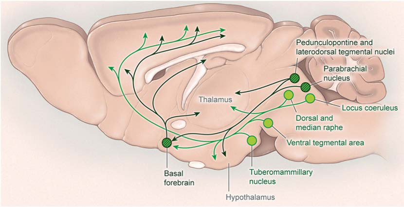
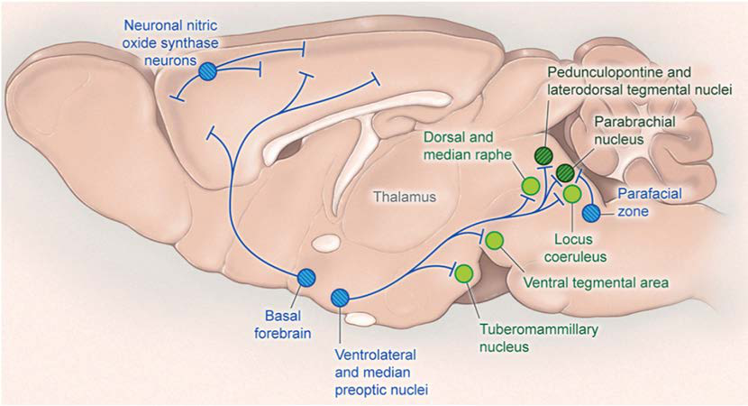
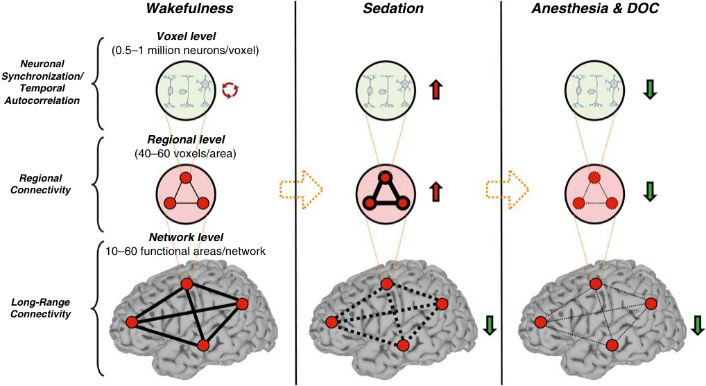
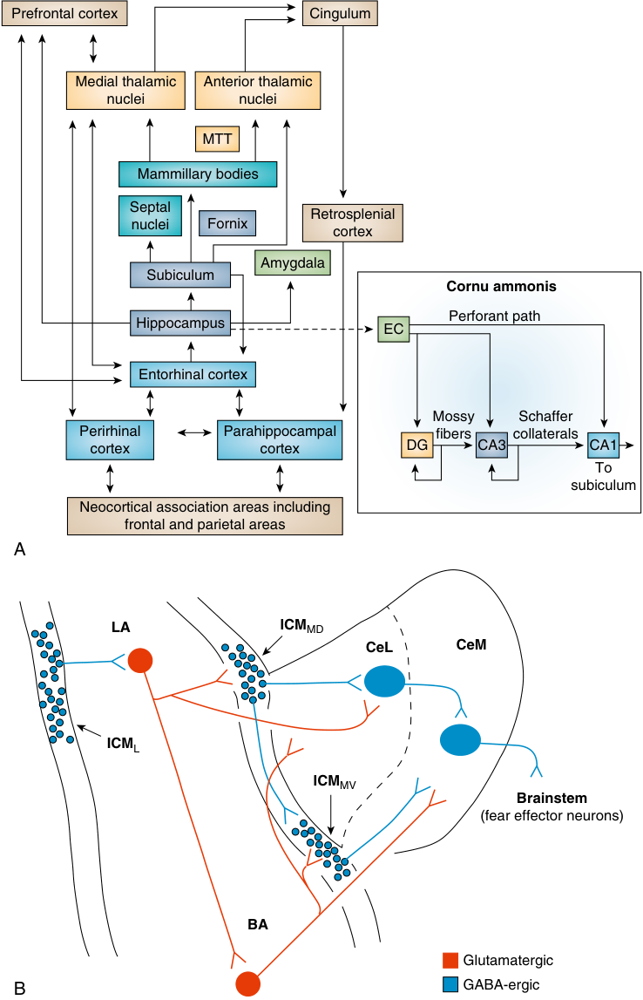
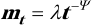
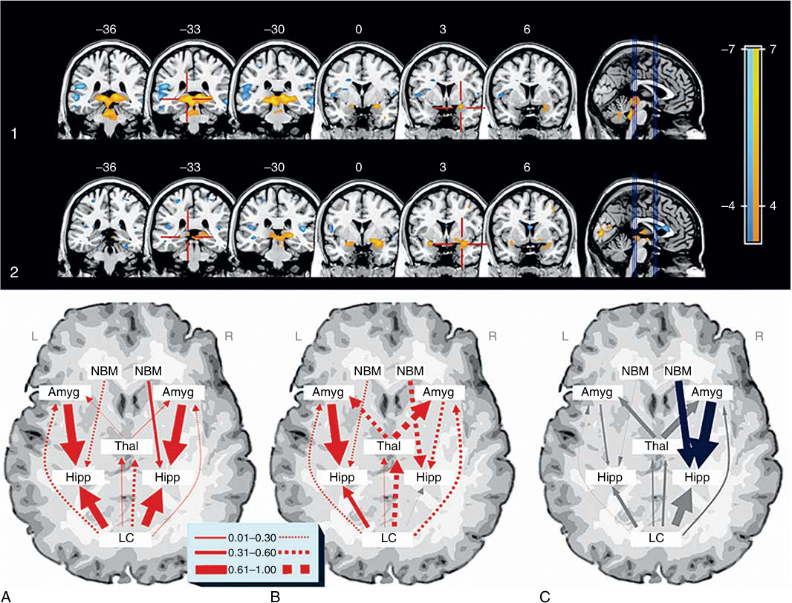

# CONSCIOUSNESS, MEMORY, AND ANESTHESIA

<!-- PDF page 1 -->

GEORGE A. MASHOUR and KANE O. PRYOR

### KEY POINTS

- Mechanisms of consciousness and memory, and their interruption by general anesthetics, are important scientific problems that have clinical relevance for the practice of anesthesiology.

- Consciousness, and its assessment, is a multidimensional phenomenon characterized by wakefulness, awareness, and behavioral expression.

- Anesthetics act at structures in the brainstem, hypothalamus, and basal forebrain that regulate sleep–wake states, which may account for loss of wakefulness.

- Anesthetics disrupt connectivity, communication, and flexible dynamics across cortical and thalamocortical networks, which may account for loss of awareness.

- Memory can be subdivided into explicit (conscious) and implicit (unconscious) recall; an example of explicit episodic recall is remembering a surgical event.

- Suppression of explicit episodic recall is one of the most potent effects of most general anesthetics.

- Effects on the hippocampus, amygdala, and prefrontal cortex—as well as the connectivity of these structures—may account for anesthetic- induced amnesia, even before loss of consciousness.

## Introduction

### SCIENTIFIC AND CLINICAL IMPORTANCE

Consciousness and memory are among the most fascinating and complex subjects in all of science. The richness of human consciousness and memory—and the ability to express this richness in language—is a defining characteristic of _Homo sapiens_ . Consciousness and memory also have clinical relevance for the anesthesiologist: together, the experience and explicit episodic recall of surgical events is known as the problem of “intraoperative awareness.” When formally assessed, this complication occurs in approximately one to two cases per 10001–3 and is associated with a high incidence of posttraumatic stress disorder.4,5 The incidence of intraoperative consciousness without recall is substantially higher.6 To advance the field of perioperative brain monitoring, a detailed understanding of the neurobiology of consciousness, memory, and anesthesia is required.

## Consciousness

### DEFINITIONS

The field of consciousness studies has been plagued by the indiscriminate use of the term “consciousness.” When we refer to consciousness, we mean subjective experience. In simple terms, it is what we lose when we have dreamless sleep and what we regain again in the morning upon awakening. However, there are several important definitions and distinctions to consider.

1. **Awareness:** Cognitive neuroscientists and philosophers use the term “awareness” to mean only subjective experience. In clinical anesthesiology, we (inaccurately) use the term “awareness” to include both consciousness and explicit episodic memory.7 The taxonomy of memory will be discussed in the next major section of the chapter.

2. **Connected vs. Disconnected Consciousness:** Connected consciousness is the experience of environmental stimuli (such as surgery), whereas disconnected consciousness is an endogenous experience (such as a dream state).8

3. **Consciousness vs. Responsiveness:** An individual may fully experience a stimulus (such as the command “Open your eyes!”) but not be able to respond (as when a patient is paralyzed but conscious during surgery).9

4. **Conscious Level vs. Content:** Level of consciousness is the global state of arousal (e.g., awake or anesthetized) and content of consciousness is the qualitative aspect of experience (e.g., the redness of the rose).

Advances in neuroscience have enabled us to move beyond speculative frameworks and focus on a systemsbased approach to anesthetic- induced unconsciousness.10 The remainder of this section on consciousness adopts a systems approach by discussing: (1) brainstem and hypothalamic nuclei regulating the sleep–wake cycle (and therefore arousal states) (Figs. 8.1 and 8.2); (2) the role of the thalamus in consciousness and anesthesia;

<!-- PDF page 2 -->

**Fig. 8.1 Neurobiology of wakefulness.** Multiple neurochemical systems in subcortical regions (shown here in rodent brain) promote arousal and activation of the cortex. Monoaminergic neurons ( _light green_ ) in the rostral brainstem and caudal hypothalamus innervate the cortex as well as many subcortical regions including the hypothalamus and thalamus. These monoaminergic regions include noradrenergic neurons (locus coeruleus), serotonergic neurons (dorsal and median raphe nuclei), dopaminergic neurons (ventral tegmental area), and histaminergic neurons (tuberomammillary nucleus). Wake- promoting signals also arise from cholinergic regions ( _dark green with hatching_ ), including the pedunculopontine and laterodorsal tegmental nuclei and basal forebrain. General anesthetics have been demonstrated to suppress many of these regions. (Redrawn from Scammell TE, Arrigoni E, Lipton JO. Neural circuitry of wakefulness and sleep. _Neuron_ . 2017;93[4]:747–765.)

**Fig. 8.2 Neurobiology of slow- wave sleep.** GABA- ergic neurons in the ventrolateral preoptic area and median preoptic nucleus in the hypothalamus (shown here in rodent brain) promote sleep by inhibiting wake- promoting neurons in the caudal hypothalamus and brainstem. These hypothalamic nuclei are activated by general anesthetics. (Redrawn from Scammell TE, Arrigoni E, Lipton JO. Neural circuitry of wakefulness and sleep. _Neuron_ . 2017;93[4]:747–765.)

(3) cortical–subcortical connectivity, with a focus on the thalamocortical system, which is thought to mediate the experiential component of consciousness; and (4) cortical communication and dynamics.

### SUBCORTICAL NUCLEI REGULATING AROUSAL

It was hypothesized in the mid- 1990s that anesthetics suppress consciousness by actions at the subcortical nuclei that evolved to control sleep–wake cycles.11 The past decades have supported this hypothesis with correlative

evidence,12,13 although recent data suggest that there is no trivial relationship between, for example, a single sleeppromoting nucleus and the anesthetized state.14 The following is a description of select subcortical nuclei and regions that mediate arousal states15 and, potentially, some traits of anesthesia.

### Brainstem

**Locus Coeruleus (LC).** Norepinephrine is synthesized in the LC, which is located in the pons and projects widely throughout the cortex.16 Like other monoaminergic

<!-- PDF page 3 -->

neuronal populations, LC activity is highest during waking consciousness, decreased during non- rapid eye movement (NREM) sleep, and at its nadir during rapid eye movement (REM) sleep.17,18 Thus the LC is associated with cortical arousal only during wakefulness and not with the cortical activation during REM sleep. Norepinephrine transmission in the basal forebrain may be of particular relevance to anesthetic depth.19 It has been found that LC noradrenergic neurons modulate the state of isoflurane anesthesia as well as emergence therefrom.20 Of note, administration of ketamine is associated with an increase of activity in the LC,21 which appears to contribute to its anesthetic effects.22 The LC and the role of norepinephrine in hypnosis are of particular interest due to the use of the alpha- 2 agonist dexmedetomidine in clinical care. Microinjection of dexmedetomidine in the LC results in reduced levels of consciousness that can be prevented by coadministration of the alpha- 2 antagonist atipamezole.23 After exposure to dexmedetomidine, brain changes somewhat mimic NREM sleep, in that the LC and tuberomammillary nucleus (TMN) are deactivated, while the ventrolateral preoptic nucleus (VLPO) is activated.24 Data in dopamine- beta- hydroxylase knockout mice (which lack the ability to synthesize norepinephrine) demonstrate a hypersensitivity to dexmedetomidine, suggesting alternative mechanisms of action.25 However, selective knockdown of alpha- 2A adrenergic receptors from the LC prevent dexmedetomidine- induced loss of righting reflex,26 a marker of general anesthesia in rodents.

**Laterodorsal/pedunculopontine tegmentum (LDT/ PPT).** Along with the basal forebrain, the LDT and PPT in the pons are the brain’s source of acetylcholine.27 As with the noradrenergic LC, activity of the LDT/PPT is high during waking consciousness and decreases during NREM sleep.16 However, in contrast to the LC and other monoaminergic neurons, the cholinergic LDT/PPT are also active during REM sleep, during which the cortex is aroused. Furthermore, activation of cholinergic neurons in LDT or PPT induces REM sleep.28 Thus both states of cortical activation across the sleep–wake cycle are associated with high cholinergic tone. General anesthetics modulate cholinergic projections from the LDT/PPT. Sleep spindles occur during halothane anesthesia and are associated with decreased cholinergic transmission to the medial pontine reticular formation (PRF).29,30 There is evidence that synaptic and extrasynaptic gamma- aminobutyric acid (GABA) receptors play a role in modulating LDT neurons,31 which could provide a direct link to molecular mechanisms of numerous general anesthetics.

**Pontine Reticular Formation (PRF).** The PRF is part of the reticular activating system, which plays an important role in cortical arousal. Although GABA is the primary inhibitory neurotransmitter in the brain, the actions of GABA in the PRF are associated with cortical arousal.32 For example, there is increased time spent in the waking state when the GABAA receptor agonist muscimol is microinjected in the PRF.33 When the GABAA antagonist bicuculline is microinjected, wakefulness is suppressed, but REM sleep (another state of cortical arousal) is triggered. Vanini and colleagues found that decreased levels of GABA in the PRF correlated with isoflurane- induced unconsciousness,

muscular hypotonia, and decreased respiratory rate.34 Since the effects of anesthetics are normally associated with a potentiation of GABA activity, these findings highlight that a specific neuroanatomic and neurochemical milieu can play a unique and unexpected role in the mechanisms of consciousness and anesthesia. In addition, Vanini and colleagues found that GABA- ergic transmission in the rat PRF modulates the loss of consciousness induced by isoflurane but does not appear to affect emergence,35 providing evidence for asymmetry between the two processes.

The mesopontine tegmental anesthesia area is in the PRF. When pentobarbital is microinjected in this area, a reversible state with anesthetic traits is induced.36 This role of this area has been defined with greater spatial resolution, with the identification of around 1900 neurons that can induce general anesthesia.37 Recent evidence has further supported and characterized the mesopontine tegmental anesthesia area as a mediator of general anesthesia.38,39

**Ventral tegmental area (VTA).** Dopaminergic neurons of the ventral tegmental area (VTA) in the midbrain were not classically considered key mediators of the sleep–wake cycle because of relatively less evidence of state- dependent changes compared with neurons in other brainstem nuclei. This view has been challenged in sleep neurobiology.40 A dopaminergic pathway regulating sleep–wake states has been identified in _Drosophila_41 and dopaminergic neurons of the VTA have more recently been found to play a role in mammalian sleep.42 There has been renewed interest in the ability of dopaminergic activity to reverse or accelerate recovery from general anesthesia. Studies of the dopamine agonist methylphenidate have revealed an ability to reverse the sedative effects of both isoflurane and propofol in animal models.43,44 VTA appears to be the source of the dopaminergic transmission mediating arousal during exposure to anesthesia, as evidenced by the fact that electrical stimulation of the VTA or selective stimulation of VTA dopaminergic neurons can reverse anesthetic- induced unconsciousness.45,46

### Hypothalamus

**Ventrolateral and Median Preoptic Nuclei (VLPO, MNPO).** The anterior hypothalamus has long been hypothesized to play a role in sleep–wake regulation.47 VLPO is a structure in this region that transmits GABA and galanin.48 Neurons in VLPO are maximally active during NREM and REM sleep49,50 ; the median preoptic nucleus (MnPO) is also active during sleep. Of note, the activity profile of GABA- ergic neurons in VLPO correlates with sleep amount, whereas the activity of GABA- ergic neurons in MnPO correlates with homeostatic sleep pressure or propensity.51 Importantly, activity of the VLPO during sleep is correlated with inhibition of other arousal centers in the brainstem and hypothalamus.49,52 Given its potentially central role as a mediator of sleep, VLPO became an attractive candidate as a mediator of anesthetic- induced unconsciousness. Nelson and colleagues demonstrated activation of VLPO after systemic administration of propofol or pentothal53 ; additional studies have examined the mechanistic significance of these findings. Eikermann and colleagues conducted studies of rats with chronic lesions of VLPO, finding that ablation of VLPO resulted in sleep

<!-- PDF page 4 -->

deprivation (as expected) but conferred increased sensitivity to the effects of isoflurane.54 Moore and colleagues demonstrated that acute lesions of VLPO conferred resistance to the effects of isoflurane, an effect that appeared to be mediated specifically through the sleep- active neurons in VLPO.55 These neurons are actually depolarized (i.e., activated) by isoflurane. However, more recent data have demonstrated that chemogenetic stimulation of GABAergic neurons in this region affects sleep architecture but not anesthetic state transitions.14 In fact, there are newly identified populations of neurons in this region that can promote wakefulness.56,57 Furthermore, there has been a shift of attention to the supraoptic nucleus of the hypothalamus (located posterior to the VLPO), with a subpopulation of neuroendocrine cells that appear to influence both slow- wave sleep and general anesthesia induced by diverse drugs.58

**Orexinergic Neurons.** Orexinergic neurons are found in the lateral hypothalamus and provide an important arousal stimulus for the cortex. Orexinergic neurons, which innervate other arousal centers in the brainstem and basal forebrain and fire maximally in the waking state, are suppressed during NREM sleep, and show occasional bursts during phasic REM sleep.59,60 Dysfunction of the orexinergic system is associated with narcolepsy in both humans and animal models.61,62 The often- dramatic delay of anesthetic emergence in narcoleptic patients63 has motivated the study of orexin in anesthetic mechanism. Orexins attenuate the effects of isoflurane,64 propofol,65 ketamine,66 and barbiturates,67 using various measures. Local infusion of orexin in the basal forebrain is associated with electroencephalographic (EEG) arousal and decreased emergence time in animals anesthetized with sevoflurane68 and isoflurane.69 Microinjection of propofol in the perifornical region of the hypothalamus (the locus of orexinergic neurons) is associated with a decrease in cortical acetylcholine, an important mediator of arousal.70 Importantly, both genetic and pharmacologic studies have demonstrated that orexins play an important role in emergence from sevoflurane and isoflurane anesthesia, but not induction.71 This seminal study suggested that there is a distinct neurobiology of induction and emergence, and formed the basis for a theory of “neural inertia” across state transitions.72 Of note, halothane did not show an effect on orexinergic neurons and emergence time was not altered in orexin knockout mice73 but differential effects on induction and emergence have been confirmed for propofol anesthesia.74 Orexins might facilitate emergence from anesthesia through actions in the basal forebrain.75

**Basal Forebrain.** The basal forebrain is a collection of nuclei with diverse neurotransmitter systems that regulate wakefulness and sleep.76–78 There has been a particular focus on cholinergic neurons in the reversal of the anesthetized state or acceleration of emergence from general anesthesia. Basal forebrain cholinergic activity appears to be important for isoflurane, propofol, and ketamine anesthesia; activation of these neurons can accelerate emergence from GABA- ergic anesthetics.79–81 Electrical stimulation of the basal forebrain in rats can reverse the traits of isoflurane

anesthesia and promote wakefulness; importantly, this effect appears to be mediated through the prefrontal cortex.82

### ROLE OF THE THALAMUS

The thalamus is composed of more than 50 nuclei and subnuclei that can be grossly classified as relays for sensory input from the periphery or multimodal, integrative regions that receive input from the cortex. Additionally, the thalamus is critical for transmitting arousal signals from the brainstem and for regulating cortical communication. The involvement of the thalamus in arousal, sensory processing, and cortical computation is likely critical for normal consciousness. As such, the thalamus has been of continued interest to those investigating mechanisms of anesthetic- induced unconsciousness.

The thalamus has long been proposed as an ON/OFF switch for anesthetic state transitions.83 This theory was generated based on the consistent metabolic depression of the thalamus by a number of inhaled and intravenous anesthetics84–86 (with the exception of ketamine),87 suggesting that it could serve as an effective OFF switch. The hyperpolarization of the thalamus would shift tonic firing to burst firing that—as with sleep—would prevent afferent sensory stimuli from arousing the cortex. Importantly, however, sensory nuclei in the thalamus (and their connectivity to the cortex) appear to be less involved in anesthetic- induced unconsciousness compared to the higher- order or “nonspecific” nuclei.88,89

Evidence for the thalamus as an ON switch has been derived primarily from animal experiments, in which stimulation of the centromedial thalamus by either nicotine or antibodies blocking voltage- gated potassium channels could reverse the effects of inhaled anesthetics.90,91 Although microinjection of large doses of nicotine into the thalamus could precipitate anesthetic emergence, antagonism of nicotinic acetylcholine receptors in the same location did not appear to contribute to anesthetic- induced unconsciousness. Central thalamic activation results in behavioral improvement in humans with traumatic brain injury.92 A study in humans demonstrated that (spontaneous) activation of the thalamus along with other subcortical structures is correlated with recovery from anesthesia, suggesting the involvement of the thalamus in the primitive or “core” consciousness observed at emergence.93 Recent studies in nonhuman primates have demonstrated that electrical stimulation of the thalamus can reverse the traits of anesthesia and induce neurophysiologic signatures of consciousness and arousal.94,95

Entrainment of the thalamus might also play an active role in anesthetic- induced unconsciousness. A computational study using human EEG data and modeling suggested that the action of propofol on GABA receptors in the nucleus reticularis generates a hypersynchronous alpha rhythm (8–13 Hz) with the frontal cortex.96 Hypersynchrony of alpha may block the flexible corticocortical communication required for normal consciousness.97 An animal study identified alpha synchronization between thalamus and medial prefrontal cortex during propofol induction.98 The potential role of thalamocortical

<!-- PDF page 5 -->

interactions in anesthetic- induced unconsciousness prompts further discussion of the thalamus and its connectivity to the cortex.

### CORTICAL–SUBCORTICAL CONNECTIVITY

Studies using functional magnetic resonance imaging (fMRI) have refined the role of thalamocortical connectivity in anesthesia. One study identified a propofol- induced disruption of connectivity between the thalamus and lateral frontal–parietal networks.99 Similarly, a study of the specific nuclei (linked to particular sensory modalities) and nonspecific nuclei (linked to integrative functions) found that disrupted connectivity between the nonspecific nuclei and the cortex best accounted for a reduction in the level of consciousness by propofol.88 The inhaled anesthetic sevoflurane has been shown to functionally disconnect the thalamus and cortex, especially frontal cortex.100,101 A consistent finding of neuroimaging studies is that the thalamocortical connectivity of primary sensory networks is relatively well preserved despite anesthetic- induced unconsciousness.

The finding of impaired thalamocortical connectivity in association with anesthetic- induced unconsciousness has not been universal. A fMRI study of propofol revealed more profound functional disconnections between the cortex and putamen, a subcortical structure in the basal ganglia.102 In contrast, thalamic connectivity was relatively well preserved. The potential role of the striatum (composed of the putamen and caudate) in anesthetic- induced unconsciousness has been demonstrated in a study of rats undergoing isoflurane anesthesia.103 This study was conducted with fMRI and found that the functional connection between the frontal cortex and the basal ganglia was disrupted during general anesthesia. Functional disconnection of association cortex and subcortical structures has also been shown by fMRI in a study of propofol- induced unconsciousness in humans.104 Recent work has identified a lateralization of subcortical connectivity (thalamus, ascending reticular activating system) during sevoflurane anesthesia.105

### CORTICAL CONNECTIVITY AND DYNAMICS

The last three sections were organized according to a bottom- up approach to consciousness and anesthesia, starting with the brainstem, and then moving to the diencephalon and thalamocortical system. Sleep is clearly generated through such bottom- up mechanisms15 ; however, anesthetics may suppress the level of consciousness through bottom- up mechanisms and content of consciousness through top- down (i.e., cortical) mechanisms.12

Early studies using positron emission tomography (PET) demonstrated regional depression in cortical areas, including lateral and medial frontal–parietal networks.106 Disruption of fMRI- based functional connectivity in frontal–parietal networks has been demonstrated during anesthetic- induced unconsciousness induced by drugs with distinct molecular mechanisms, including propofol,99,107 sevoflurane,100 and ketamine.108 However, the cortex is amenable not only to fMRI but also neurophysiological techniques of assessing connectivity, enabling data on anesthetic- induced unconsciousness with improved

temporal resolution. EEG can be used to measure functional connectivity (the statistical covariation of the activities of brain regions), and directional or effective connectivity (the presumed causal influence of one brain region on another).109 Using such techniques applied to EEG (in some cases with concomitant fMRI), disruption of frontal–parietal connectivity and surrogates of information exchange in humans has been consistently observed after administration of a variety of anesthetics with diverse molecular targets.101,110–113 It has been suggested that such disruption of frontal–parietal connectivity, with implications for impaired information transfer of relevance to consciousness, might be a common mediator and proximate cause of anesthetic- induced unconsciousness.114 However, it is also becoming clear that corticocortical connectivity during the anesthetized state fluctuates dynamically, even during pharmacokinetically stable periods.115,116

On a more global brain level, high- density EEG and transcranial magnetic stimulation revealed an inhibition of cortical effective connectivity after midazolam- induced unconsciousness.117 After administration of the benzodiazepine, local cortical activation could be observed at the site of magnetic stimulation, but robust evoked potentials were terminated at less than 100 milliseconds, and cortical communication was limited. Of note, this finding is consistent with findings in NREM sleep.118 This perturbational approach determined that the complexity of cortical response to a stimulus decreased during sleep, general anesthesia, and disorders of consciousness.119 The concordant findings across physiologic (sleep) and pharmacologic (anesthesia) states of unconsciousness120 may reflect a common neurophysiologic mechanism of disrupted cortical connectivity through slow oscillations, which share a number of characteristics in NREM sleep and general anesthesia.121 A study of three epilepsy patients with intracranial neurophysiologic monitoring122 revealed that, within 5 seconds of propofol- induced unconsciousness, there was a dramatic increase in the power of slow oscillations. Although single- unit neuronal activity was initially suppressed, it returned to baseline (or above baseline) but was fragmented into highly active and quiescent periods. Neural firing became coupled with the slow oscillation. However, the slow oscillations themselves demonstrated decay in phase coupling with increased distance across the cortex. Thus, neuronal spike activity became fragmented into “on” and “off” periods, which became temporally uncoordinated across the cortex. These neurophysiologic conditions dramatically reduce the probability of meaningful corticocortical communication.

More recent trends of analyzing cortical changes during states of unconsciousness take a dynamic approach that reflects not only static connectivity configurations but also the repertoire of states that can be accessed during general anesthesia. For example, there is a contraction of dynamic repertoire and neural signal diversity during propofol- induced unconsciousness123,124 that would preclude the kind of flexibility required for normal conscious experience. Dynamic patterns are impaired and cortical dynamics are stabilized during general anesthesia125 ; the repertoire of functional connectivity patterns in the primate brain becomes more tethered to structural/anatomical connectivity patterns during the anesthetized state.126 This is

<!-- PDF page 6 -->

Wakefulness Sedation Anesthesia & DOC Voxel level (0.5–1 million neurons/voxel) Neuronal Synchronization/ Temporal Autocorrelation Regional level (40–60 voxels/area) Regional Connectivity Network level 10–60 functional areas/network Long-Range Connectivity 

**Fig. 8.3 Schematic summary of the consecutive stages of unconsciousness.** Relative to the control state of wakefulness ( _left column_ ), sedation ( _middle panel_ ) is marked by an increase of local/regional signal synchrony and consequent breakdown of global connectivity. Deep surgical anesthesia or disorders of consciousness (DOC, _right column_ ) is associated with collapse of both local/regional synchrony and global connectivity. (From Huang Z, Liu X, Mashour GA, Hudetz AG. Timescales of intrinsic BOLD signal dynamics and functional connectivity in pharmacologic and neuropathologic states of unconsciousness. _J Neurosci_ . 2018;38[9]:2304–2317.)

likely a multistage process with distinct dynamic signatures during sedation and general anesthesia (Fig. 8.3).127,128 Furthermore, although dynamics are constrained, functional connectivity patterns do not remain static but shift in a structured way despite pharmacokinetically stable general anesthesia,116 even without surgical stimulus.115 This suggests that there are intrinsic dynamics that likely reflect complex transitions of functional networks but in a sequence that is no longer compatible with consciousness.129

Complexity and criticality have emerged as analytical tools to capture dynamic changes during anesthetic state transitions. In the neurophysiologic context, complexity is a surrogate for the diversity of neural signals and the differentiation of conscious processing. Complexity could be regarded as a complement to connectivity, which is a surrogate for integration of conscious processing. Differentiation and integration represent two key components of both conscious experience and the neurobiology that underlies it. Complexity decreases during propofol- and sevofluraneinduced general anesthesia.130–132 The effects of ketamine on complexity are dose- dependent, with increases at subanesthetic dosing consistent with psychedelic effects; with anesthetic dosing, there is a dynamic toggling between normal levels and depressed levels consistent with a GABA- ergic anesthetic.133 Complexity is also reduced during general anesthesia in children and appears to increase with development throughout adolescence.134 Criticality describes a state of the system poised on the border of phase transitions, such as order and disorder. Criticality creates a platform for brain networks to shift dynamically in response to external or internal demands.135 It has been demonstrated that the

dynamics of the anesthetized brain deviate from criticality,136,137 which likely constrains the flexibility and repertoire of brain states required for conscious experience.

In the next section, we discuss memory, the thread that links conscious experiences together to form the narrative of “self.”

## Memory

### SIGNIFICANCE OF AMNESIA IN MEMORY RESEARCH

Modern understanding of the organization and neuroscientific basis of human memory owes much to the study of amnesia. The most famed example of this occurred in 1957, when Brenda Milner of the Montreal Neurological Institute reported the remarkable case of Henry Gustav Molaison (1926–2008),138 an amnesiac known only as H.M. until after his death and the single most influential case study in the history of cognitive neuroscience. In a procedure intended to treat a refractory seizure disorder, significant portions of H.M.’s medial temporal lobe (MTL) were removed bilaterally, including the hippocampus, amygdala, and parahippocampal gyrus. He developed profound and enduring anterograde amnesia and was unable to establish any new conscious (explicit) memory, irrespective of the sensory modality. He also developed a temporally graded window of retrograde amnesia, with impaired recall of events occurring during the three years preceding his surgery. However, he could remember more distant events,

<!-- PDF page 7 -->

learn procedural tasks (even though he could not remember the learning session), and retained largely or entirely intact cognitive functions, including perceptual processing, language, attention, access to semantic knowledge, and the capacity to retain small packages of information in constant rehearsal (a form of working memory). Prior to the description of H.M., the prevailing theory—articulated by Karl Lashley and Donald Hebb—was that there was no brain region specifically dedicated to memory function. Instead, memory processes were thought to be distributed and integrated into region- specific perceptual and cognitive functions. For example, the visual attribute of a memory would be wholly served within the striate and extrastriate cortical regions responsible for visual perception. The description of H.M. immediately disproved this model. It became clear that the MTL was a specialized and obligatory structure for the establishment and early maintenance of all conscious memory.

The trajectory of memory research was profoundly transformed. Early branches focused on the structural–functional organization of the MTL (Fig. 8.4A) and the nature of cellular- level neuroplastic processes – the latter notably marked by the description of long- term potentiation (LTP) by Timothy Bliss and Terje Lømo in 1973.139 Subsequently, emerging technologies enabled the investigation of systemslevel constructs. Examples include the use of EEG and magnetoencephalography to assess the role of oscillatory phase synchronization in neuronal assemblies,140 fMRI to identify large- scale networks associated with specific memory functions,141 and machine learning to classify complex neural network patterns predictive of memory.142

### TERMINOLOGY

Amnesia is the term used to describe one of the cardinal properties of general anesthesia. As understood by most anesthesiologists and laypeople, this description is phenomenological: it states that patients do not recall events that occur while receiving anesthesia. However, this usage confuses a critical mechanistic and semantic distinction. Patients in the deepest states of anesthesia are unable to process and bind perceptual elements into an integrated conscious experience. From the perspective of cognitive neuroscience, the “amnesia” of general anesthesia is not a primary failure of memory, but rather a failure of consciousness. It simply reflects that a conscious experience cannot be reconstructed by memory processes when it never existed in the first place. Further confusion is added by the frequent use of the term “awareness”—a synonym for conscious perception in the present—to describe the case in which a patient consciously recalls events occurring during the administration of an anesthetic. This ignores the fundamental principle that memory is functionally dissociable from consciousness. Awareness is necessary for the establishment of memory under anesthesia, but it is not sufficient. Conscious recall can occur only if awareness is accompanied by memory processes in the MTL and elsewhere that establish and preserve a representation that can be reconstructed later. The term “amnesia” accurately refers to a failure of these memory- specific processes such that a conscious event is not transformed into an enduring memory.

It is axiomatic that patients who form memories while under anesthesia cannot have been in a state of true unconscious oblivion; they must have possessed some conscious substrate from which the memory derives. However, the converse inference is not always true: the existence of consciousness will only rarely lead to the existence of memory if an anesthetic drug is present. Evidence of this is unambiguously encountered in everyday anesthetic practice: in patients receiving a low dose of propofol or midazolam who engage in a cogent conversation that they are later unable to recall, or in those emerging from general anesthesia who follow commands to demonstrate that extubation can proceed safely, yet later cannot recall anything related to this clearly conscious event. Anesthetic drugs must therefore have direct effects on memory processes that are dissociable from those on consciousness—in other words, act as true amnestic agents—and it is this observation that provides a framework for the systematic study of how anesthetic drugs affect memory.

## Organization and Function of Normal Memory

### THE DECLARATIVE MEMORY SYSTEM

When the term “memory” is used in everyday language, it almost always refers to declarative (or explicit) memory. Declarative memory is a representation of prior events and knowledge that is accessible to consciousness and can be manipulated by attention and executive function. It is the form of memory of greatest interest in the context of anesthetic amnesia.

Further important organizational structure exists within declarative memory. The first is the distinction between episodic and semantic memory. Episodic memory is the recollection of events with a clear spatiotemporal context (as when recalling autobiographical events with a distinct sense of personal experience, time, and place), whereas semantic memory is the capacity to recall and apply meaning, facts, and knowledge without spatiotemporal context (as when recalling that Mount Everest is the highest mountain in the world without any sense of time and place for the acquisition of that knowledge). The episodic memory system is fast- mapping and highly dependent on the MTL as well as frontal, parietal, and anterior thalamic structures,143–145 whereas the semantic memory system is slower and involves distributed cortical regions that closely map to the default mode network, a large- scale system that is active during the resting state and flow of spontaneous cognition.146,147

The second organizational structure within episodic memory is the distinction between recollection and familiarity. Recollection involves remembering specific qualitative contextual details about a prior event, whereas in a familiarity judgment, there is a sense that an item has been encountered previously, but beyond that there are no added contextual details. Over the last two decades the prevailing understanding has been Aggleton and Brown’s “dualprocess” model,148 in which recollection and familiarity arise from distinct processes and neural architecture within the MTL. The parahippocampal cortex and entorhinal areas receive input from areas processing spatial information (the

<!-- PDF page 8 -->

Prefrontal cortex Cingulum Medial thalamic Anterior thalamic nuclei nuclei MTT Mammillary bodies Septal Retrosplenial nuclei Fornix cortex Amygdala Subiculum Cornu ammonis Perforant path Hippocampus EC Entorhinal cortex Mossy Schaffer Perirhinal Parahippocampal fibers collaterals cortex cortex DG CA3 CA1 To subiculum Neocortical association areas including frontal and parietal areas A LA ICM MD CeL CeM ICM L ICM MV Brainstem (fear effector neurons) BA Glutamatergic B GABA-ergic 

**Fig. 8.4 Memory systems in the medial temporal lobe.** (A) Representation of unidirectional and bidirectional network connectivity of structures in the medial temporal lobe, diencephalic nuclei, and neocortical association areas. _CA_ , cornu ammonis; _DG_ , dentate gyrus; _EC_ , entorhinal cortex; _MTT_ , mammillothalamic tract. (B) Intrinsic connectivity of the amygdala. _BA_ , basal nucleus; _CeL_ , central nucleus lateral segment; _CeM_ , central nucleus medial segment; _ICML_ , lateral intercalated cell mass; _ICMMD_ , dorsomedial intercalated cell mass; _ICMMV_ , ventromedial intercalated cell mass; _LA_ , lateral nucleus. (A, Modified from Bartsch T, Butler C. Transient amnesic syndromes. _Nat Rev Neurol_ . 2013;9[2]:86–97, Figure 2. B, Modified from Duvarci S, Pare D. Amygdala microcircuits controlling learned fear. _Neuron_ . 2014;82[5]:966–980, Figure 2.)

“where” information), and support recollection through encoding and retrieval of context. The perirhinal cortex receives input from sensory association areas (the “what” information) and supports familiarity judgments through encoding and retrieval of the identifying qualities of an item.

The hippocampus links these two, binding item and context information, and appears necessary for recollection, but has traditionally been thought to play little or no role in familiarity. However, more recent studies suggest that the hippocampus may in fact support familiarity processes.149

<!-- PDF page 9 -->

### NON- DECLARATIVE MEMORY SYSTEMS

Findings that H.M. and other amnesiacs could learn a hand–eye coordination skill even while possessing no memory of the task led to the distinction between declarative and procedural memory,150 which is dependent on the caudate nucleus. Memory- impaired patients were also found to have intact priming,151 which is a nonconscious process in which exposure to a stimulus influences the response to a later stimulus – for example, amnesiacs can name pictures 100 milliseconds faster if they have seen them previously, despite having no declarative memory of the exposure.152 The neural bases for priming effects involve regions serving perceptual and contextual processing and so vary with the nature of the task,153 but recent evidence also implicates the involvement of common processing regions.154 Lastly, a large body of work has extensively elucidated the emotional memory system. The classic experimental model is Pavlovian fear conditioning and its variants, wherein an emotionally neutral conditioned stimulus is paired with an aversive unconditioned stimulus, leading to an involuntary associative physiologic and/or behavioral response to the conditioned stimulus. The circuitry involves convergence of afferent information from all sensory modalities onto the lateral nucleus of the amygdala, with efferents from the basolateral and central nuclei projecting widely to modulate processes in cortical and subcortical regions, including those involved in memory (Fig 8.4B).155,156 With the progressive description of these and other functional distinctions, the framework for understanding memory eventually shifted to models that contained multiple memory systems, distributed functionally and anatomically.

### WORKING MEMORY

Working memory refers to the capacity to maintain limited amounts of information in the stream of consciousness, which can be manipulated to perform complex cognitive tasks such as reasoning, comprehension, and learning.157,158 The concept evolved from, and has largely replaced, earlier ideas about short- term memory, but the terms should not be used interchangeably, as working memory implies both a short- term memory store and the capacity for volitional manipulation. The most influential current model, first proposed by Baddeley and Hitch in 1974,159 divides working memory into capacity- limited component subsystems: a phonological loop that maintains information through vocal or subvocal rehearsal, such as when one holds a telephone number in mind; a visuospatial sketchpad, which holds and manipulates spatial, visual, and kinesthetic information; and a central executive, which is responsible for regulating selective attention and inhibition. A fourth subsystem, the episodic buffer, was later added to the model and is responsible for binding and integrating multimodal representations.160 The MTL was long thought to have no role in working memory, but it is now recognized that the hippocampus is involved in visuospatial processing.161 Current understanding of working memory suggests that it is dominantly served by persistent activity and flexible resource allocation in a distributed cortical network: a critical hub in the dorsolateral prefrontal cortex (DLPFC) is interconnected with

parietal cortex, thalamus, caudate, and globus pallidus.162 The functional and structural distinction between working memory networks and the MTL does not mean that working memory and declarative memory systems do not interact. Working memory depends on declarative memory representations to provide semantic meaning and context. During working memory tasks, both hippocampus and cortical perceptual areas associated with representations of declarative memory become activated and show increased synchrony with prefrontal regions.163,164 Reciprocally, encoding of declarative memory is strongly influenced by the nature of processing occurring in working memory, with deeper levels of executive processing resulting in better learning.163,165 The transition of memory from short- term stores through to stable long- term stores is experienced as continuous and was assumed to reflect sequential transfer across systems. However, this model is challenged by rare case examples of patients who have a selective short- term memory deficit but intact declarative memory function, and recent studies have reinforced the view that memories are formed in multiple systems in parallel.166

### LONG- TERM POTENTIATION (LTP), SYNAPTIC TAGGING, AND THE CONSOLIDATION MODEL OF MEMORY

The consolidation hypothesis of memory167 was first proposed by Müller and Pilzecker in 1900. They noted that memory for new information could be disrupted by learning other information shortly after the initial training. This effect, called retroactive interference, is temporally graded such that the susceptibility of the memory is greatest immediately after learning and decreases with time. Müller and Pilzecker proposed that the memory trace must initially exist in a fragile state, but subsequently becomes stable through the process of consolidation. Although continually refined, the consolidation hypothesis remains the framework for understanding the temporal course of memory processes and behavior.

For a memory trace to be consolidated, it must of course be created. The term used to describe this process is encoding. Encoding implies that the networks mediating the neural representation of an event as it is experienced do not immediately return to their previous state and are modified in such a way that potentiates reactivation of that representation. The synaptic plasticity and memory hypothesis states that activity- induced synaptic plasticity is both necessary and sufficient for the information storage underlying memory,168 and within this framework encoding implies that some form of synaptic plasticity has been initiated. However, encoding cannot assure the propagation of a memory trace. Encoding creates the potential for the formation of a long- term memory.

The minimal events that constitute the neural correlates of encoding are incompletely understood. Cellular models demonstrate that functional changes in synaptic strength can occur in the absence of any structural change in dendritic spines.169 The perpetuation of these initial changes through structural and functional remodeling represents the neural correlate of memory consolidation. The prevailing cellular model for this is LTP,170 which describes a durable increase in synaptic transmission efficiency

<!-- PDF page 10 -->

following a stimulation protocol. It is now recognized that LTP occurs richly throughout the hippocampus, as well as in other afferent pathways. LTP can be induced by nonphysiologic high- frequency stimulation, but also by stimulation protocols that resemble physiologic activity, the most important being bursts in the theta range (4–8 Hz).171 This is highly relevant to memory, as synchronized hippocampal theta oscillations appear critical to successful memory behaviors.140

The breadth and depth of literature on the mechanisms of LTP are far too voluminous to summarize here. Nonetheless, certain principles are essential and relevant to anesthesia studies and can be stated succinctly. The induction of most forms of LTP requires activation of postsynaptic voltagedependent _N_ - methyl- d- aspartate (NMDA) receptors,172 followed by influx of Na+ and Ca2+ . This rise in intracellular Ca2+ is the critical trigger for LTP. Calcium- calmodulindependent kinase II (CaMKII) is then activated173 and autophosphorylated,174 leading to cytoskeletal reconfiguration. Activation of several other cell- signaling cascades also contributes to LTP. The terminal expression of LTP is protein synthesis, occurring in both the soma and local dendrites, and resulting in enduring structural changes at the synapse.175 Protein synthesis inhibitors have been demonstrated to consistently prevent sustained LTP _in vitro_ and learning _in vivo_ .176

LTP thus proceeds in two phases: early LTP (E- LTP) is independent of protein synthesis and can be sustained across an interval of minutes to a short number of hours, while late LTP (L- LTP) is dependent on intracellular signaling and protein synthesis and can be sustained across many days. The synaptic tagging and capture hypothesis provides a mechanistic explanation for the observation that the persistence of synaptic potentiation (and memory) is influenced by events surrounding encoding.177 In this model, synapses activated during E- LTP become tagged via a protein synthesis- independent mechanism. This tag establishes the potential for sustained L- LTP, but for the cascade to continue the tags must capture plasticity- related proteins (PRPs) synthesized in the soma or dendrites in response to neural activity. The synaptic tagging model explains how the thousands of dendrites of a single neuron can be engaged in memory stabilization processes in various states of evolution, because the tagging and PRP capture need not occur as a singular event.

### RECONSOLIDATION

In 2000 Nader et al. reported that an old memory for auditory fear conditioning, which would normally not be sensitive to protein inhibitors, can be made newly sensitive if it is retrieved.178 The implication is that retrieval of a memory renders it transiently plastic, after which it restabilizes. This process is termed reconsolidation, and the period of plasticity is termed the reconsolidation window. The mechanism shares many of the LTP processes that are associated with initial consolidation, but also has features that are quite distinct at both the cellular and systems level.179 Reconsolidation serves as a modulatory process that enables the strengthening of an existing memory, but it is also clear that it provides a window within which an existing memory is malleable and can be updated with the addition of novel

information, or diminished through interruption of restabilization processes.180 These latter properties have generated significant translational interest because of repeated demonstrations of the ability to modify or even eliminate fear memory in animals through pharmacologic and behavioral interventions that interrupt reconsolidation.181 Indeed, the erasure of fear memory in humans can be demonstrated through performance of a behavioral extinction procedure during the reconsolidation window.182

### PHASE SYNCHRONIZATION AND COUPLING

The neurons in assemblies and networks undergo oscillatory activation and inhibition. Phase synchronization of these oscillations supports neural communication by creating transient and dynamic associations between different functional brain regions. Phase synchronization appears to be fundamental to neural plasticity and memory,140 and numerous studies have demonstrated that dynamics of synchrony during memory tasks can be related to both long- term143 and working memory183 performance. Gamma- band (30–100 Hz) synchrony is believed to support an important form of Hebbian plasticity, termed spiketiming- dependent plasticity, in the hippocampus. Both computational models and experimental data provide evidence that rapid changes in the frequency and phase of gamma rhythms modulate this form of plasticity through coordination of presynaptic spikes in assemblies of neurons, effectively classifying which assemblies are interpreted as a single event.184

Another property of relevance to memory coding is the coupling of gamma oscillations to the phase of slower, synchronized oscillations within the theta band (4–8 Hz).185 Theta oscillations, which are prominent in the hippocampus and entorhinal cortex, undergo phase resetting in response to a stimulus. The phase reset involves widely distributed regions, and is thought to serve as an efficient mechanism for the optimization of interregional communication.186 Theta phase resetting and synchrony in the hippocampal–entorhinal system are implicated in declarative memory,187 and in the amygdala–hippocampal system in fear- based memory.188 Coupling between theta phase and gamma amplitude is connected to declarative memory formation,187 and gamma subcycles nested within theta cycles are proposed to form a code for representing multiple items and spatial representations in an ordered way.189 Coupling between theta phase and gamma phase is a control mechanism that enables a more precise temporal coordination of neuronal spikes, and may code for separated representations of multiple items in working memory.190

## Effects of Anesthetic Drugs on Declarative Memory Function in Humans

There are multiple potential pathways by which anesthetic drugs could interfere with memory and cause amnesia. Many of these cannot be directly assessed in humans, but the plausibility of candidate mechanisms can be indirectly examined by designing experiments that are informed by

<!-- PDF page 11 -->

the characteristics of known memory processes. Studies of anesthetic effects on memory are most informative when conceptualized and designed with reference to robust methods and findings taken from the larger body of memory research.

### BEHAVIORAL STUDIES OF RETROGRADE MEMORY EFFECTS

Notwithstanding some isolated case reports, systematic investigations have found little evidence that anesthetic drugs predictably cause retrograde amnesia in humans. Studies have found no retrograde amnesia associated with induction doses of thiopental,191 methohexital,191 or propofol.192 A randomized, double- blind trial found that adult patients have normal memory for visual stimuli presented 4 minutes before administration of midazolam at doses of 2, 5, and 10 mg.193 Similarly, memory is normal for word lists learned in the preoperative holding area or operating room 2–4 minutes before induction.194 One recent study in parturients reported a retrograde effect for pictures shown 1 minute prior to midazolam 0.1 mg/kg, but this was a cohort study in which the subjects self- selected whether or not to receive midazolam.195 Another recent study suggested a narrow window of retrograde inhibition of free recall but not recognition,196 which is difficult to interpret. Studies in pediatric patients have shown normal memory for pictures presented immediately before sedation with midazolam,197 propofol,198 and dexmedetomidine.199 In controlled laboratory settings using human volunteers and target- controlled infusions, studies have found no impairment of memory for pictures200 or words201,202 presented before sedative infusions of propofol, midazolam, thiopental, or dexmedetomidine.

There is some evidence from studies in highly controlled settings that anesthetic drugs may cause the opposite effect, in which memory for material presented prior to drug administration is enhanced – a phenomenon termed retrograde facilitation. In one study using a mildly sedative dose of propofol,203 memory for words learned immediately prior to drug administration was enhanced throughout the testing period of 24 hours. Similar effects are described for midazolam and other benzodiazepines in the psychopharmacology literature.204 The mechanistic explanation for retrograde facilitation is that it results from the pharmacologic suppression of retrograde interference, an active process in which the encoding of new memories inhibits the consolidation of recently formed ones, with the newest memories being most vulnerable.205 The cellular correlate is that induction of new LTP interferes with recently formed LTP and memory performance, even when the tasks are unrelated.206 However, when the induction of new LTP is blocked by administration of a selective NMDA antagonist after learning, interference with recently formed LTP does not occur, and memory performance improves.207 A parsimonious explanation for the retrograde facilitation seen with propofol and benzodiazepines is that they similarly modulate the induction of new LTP via a GABA- ergic pathway, freeing consolidation resources that enhance survival of recently formed memory.

Findings of retrograde facilitation and absence of retrograde amnesia suggest that the key mechanisms of

GABA- ergic anesthetic amnesia, at least in humans, involve very early processes in the consolidation cascade. If processes further downstream were the principal targets, the expected effect would be that administration of an anesthetic drug would interfere with ongoing consolidation of memory for events occurring in the past, creating a reliable window of retrograde amnesia. However, rodent studies have demonstrated that GABA- ergic anesthetics can exert a direct effect on downstream protein transcription processes,208 so there remains a gap in resolving the findings from animal studies with behavioral observations in humans.

The absence of pharmacologically induced retrograde amnesia does not dismiss the repeated finding that, in the clinical setting, some patients will not recall the immediate preanesthetic period – an effect that increases with age.209 Although not systematically studied, the complex noradrenergic- mediated effects of acute stress and anxiety on memory may be contributory,210 as could effects on attention.

### MATHEMATICAL MODELING OF ANESTHETIC AMNESIA

In the late 19th century the German psychologist Hermann Ebbinghaus described the exponential form of the memory forgetting curve, and a century later Wickelgren extended this work to derive a mathematical model for memory decay.211 Approximations of Wickelgren’s power law have been used to characterize the amnestic effects of multiple intravenous anesthetic drugs,201 accurately described by a two- parameter power decay function:

 mt   t  

Here, λ expresses the initial memory strength (an index of encoding), and ψ expresses the rate of decay (an index of consolidation). There are marked differences in how different anesthetic drugs modulate the two coefficients. At low doses, propofol is an archetypal amnestic drug: it permits robust encoding of material, but the information undergoes accelerated decay because of consolidation failure. In contrast, dexmedetomidine causes memory impairment because of a failure of information to be strongly encoded but has little or no effect on subsequent consolidation. The benzodiazepine midazolam behaves like propofol at lower doses, but with increasing dose a significant encoding impairment emerges. Thiopental in contrast causes marked encoding failure but demonstrates minimal effect on consolidation. The discrepant patterns observed across GABA- ergic drugs imply that GABAA agonism is not _per se_ sufficient to explain the effect of a drug on consolidation.

### ANESTHETIC EFFECTS ON ATTENTION AND AROUSAL AS MODULATORS OF ENCODING

Anesthetic effects on encoding are mediated by changes in attentional processes. Selective attention is necessary for the successful establishment of declarative memory,212 is governed by distinct networks mediating alertness, target orientation, and executive control,213 and involves modulation of neuronal phase synchrony across short- and long- range connections.214 Most anesthetic drugs impair

<!-- PDF page 12 -->

attention via decreased arousal, with the notable exception being the NMDA antagonist ketamine, which has dominant effects on orienting and selection.215 Mathematical modeling demonstrates that the decrease in arousal predicts the effect of the drug on encoding.201 The level of arousal almost fully predicts the memory effects of thiopental and dexmedetomidine, while propofol causes a significantly greater loss of memory than would be predicted by modulation of arousal alone, consistent with an additional effect on consolidation.202 In neuroimaging correlates, low doses of thiopental mimic the effect of an attentional challenge task in decreasing activation in the left inferior prefrontal cortex (LIPFC), an effect not seen with propofol.216

Two recent studies have evaluated the effect of propofol on attention networks defined by an individual’s functional connectome – their unique pattern of static functional brain connectivity. At deep levels of sedation, propofol modulates the strength of individual sustained attention networks more than that of resting state networks217,218 ; sustained attention networks also are sensitive to modulation by subanesthetic levels of sevoflurane.217 No memory paradigms were performed in these experiments.

### NEUROIMAGING STUDIES OF CORTICAL MEMORY PROCESSES

A limited number of functional neuroimaging studies have evaluated the effect of anesthetics on cortical activation patterns during memory encoding. An early PET study investigating sedative doses of propofol using a word memory task identified that activation in LIPFC—a region associated with encoding and subsequent memory for language tasks—was conserved, suggesting that propofol did not block the processes required to support successful encoding.219 These findings were replicated in a subsequent investigation using an auditory depth of processing task.216 In contrast, propofol decreases activation in DLPFC – a region most associated with executive control functions and cognitive control of motor planning.219 However, other studies have identified decreased activation in encoding areas. An fMRI study of sentence comprehension during light sedation with propofol found that decreased memory was related to decreased activation in the left inferior frontal gyrus (LIFG, within the LIPFC) and the middle temporal gyrus.220 Another study of propofol using a word encoding task found decreased activation in LIFG associated with memory loss, but also found intact connectivity between LIFG and a number of frontoparietal and temporal regions associated with verbal processing and memory tasks, including the middle temporal gyrus and precuneus.221

Some functional neuroimaging studies have used experimental tasks similar to memory encoding tasks while evaluating sedative doses of anesthetic drugs but have not assessed memory encoding as a primary aim; these are informative but must be interpreted with caution. An early PET study of sedative doses of midazolam using a tone detection paradigm reported a dose- dependent activation decrease in Brodmann areas 9, 10, and 46, which overlap regions of both DLPFC and LIPFC.222 An fMRI study of semantic word processing during propofol sedation found a dose- dependent decrease in activation of the LIFG, despite intact behavioral responses.223 An fMRI study

of dexmedetomidine reported a generalized suppression of bilateral prefrontal activation in Brodmann areas 9 and 10 during an emotional picture memory task, but encoding performance was not specifically analyzed.224 A study using music stimuli found decreased activation in primary and secondary auditory processing areas at sedative doses of dexmedetomidine and midazolam, but not with propofol.225 Low doses of ketamine disrupt some theta- linked working memory strategies, but leave the frontal–midline theta/default mode network intact.226

### NEUROIMAGING STUDIES OF MEDIAL TEMPORAL LOBE FUNCTION

The degree of amnesia caused by the effects of propofol on consolidation processes can be linearly related to decreased activation in the hippocampus bilaterally at the time of initial encoding.227 In contrast, despite a clear memory effect, dexmedetomidine does not reduce the overall level of hippocampal activity, and dynamics of hippocampal activation are less predictive of subsequent memory224 ; this likely reflects a downstream effect from weakened cortical encoding processes rather than a primary consolidation effect. An earlier study of the benzodiazepine lorazepam and the cholinergic antagonist scopolamine found decreased memory to be correlated with decreased activation in the anterior hippocampus, accompanied by decreased activation in the fusiform gyrus and inferior frontal cortex.228 In an exploratory investigation, 0.25% sevoflurane was found to reduce hippocampal activation in response to auditory and visual stimuli, but no memory performance was assessed.187

A few studies have evaluated anesthetic effects on the hippocampus using electrocorticography and depth electrodes implanted in epileptic patients, but none have been dedicated to memory function. One notable study evaluating the effects of mildly sedative concentrations of propofol reported a significant increase in hippocampal–rhinal spontaneous coherence in the delta band, but minimal changes in other bands; corticohippocampal coherence was not assessed.229

### STUDIES OF CORTICAL EVENT- RELATED POTENTIALS

Several anesthesia memory studies have used the eventrelated potential (ERP) – a small but stereotypic positive and negative signal fluctuation in the EEG time- locked to a stimulus that can be isolated through summation over multiple identical trials. Competing models explain the generation of ERPs through either the induction of new oscillations230 or through stimulus- induced phase resetting of ongoing oscillations.231

An early ERP study of scopolamine, lorazepam, and diphenhydramine suggested that drug- induced effects on arousal and memory may be electrophysiologically dissociable, although memory was not assessed directly.232 Changes in the P1N1 and N1P2 early complexes, associated with arousal, were seen for all three drugs. However, changes in later complexes associated with memory, notably the P3 and N2P3, were seen only with scopolamine and lorazepam, and not with diphenhydramine, an antihistamine that causes sedation but not amnesia.

<!-- PDF page 13 -->

This work was extended by a series of studies evaluating intravenous anesthetics and using memory- specific experimental paradigms. In verbal memory tasks performed at equivalent levels of sedation, the true amnestic drugs with memory effects independent of sedation—propofol and midazolam—caused decreased amplitude in the P3 and N2P3 components,233,234 with the latter being the best predictor of subsequent memory performance. Across all drugs studied, the N2 latency was related to reaction time, a surrogate measure of sedation.

Another study examined early- and mid- latency ERPs originating from the midline parietal precuneal region and related them to the extent of encoding and consolidation failure.201 Across multiple drug classes and doses, consolidation failure and reaction time were closely correlated with the P2 amplitude and N2 latency observed at the time of encoding. As the visual P2N2 complex is known to originate from synchronous theta oscillations,235 and reaction time can be related to interregional synchrony,236 it is plausible that changes in theta oscillations across a distributed corticohippocampal network are significant in mediating anesthetic effects on consolidation. No direct measures of cortico hippocampal theta synchrony have yet been performed in studies of pharmacologic amnesia in humans. Another analysis237 examined the old–new effect, a robust phenomenon in the parietal ERP that distinguishes the response to initial item exposure from subsequent exposures as a marker of memory strength. Propofol and midazolam caused a significant decrease in the old–new effect at 27 seconds, even though memory performance was maintained, demonstrating that neurophysiologic markers of impaired memory processes can precede behavioral detection. Although not a direct evaluation of memory, other studies using auditory ERPs to music signatures found that sedative doses of propofol cause a decrease in mismatch negativity and early right anterior negativity, which are known to relate to associative memory operations but in contrast do not affect the P1 complex, which derives from primary auditory processing.

## Nonhuman Studies of Anesthetic Effects on Memory Processes and Behavior in the Medial Temporal Lobe

### ANESTHETIC EFFECTS ON MEDIAL TEMPORAL LOBE PLASTICITY

GABA- ergic interneurons project within and across subregions of the hippocampus,238 providing an abundant density of plausible targets for anesthetic drugs. In an early study using tetanic stimulation of the Schaffer collateralcommissural pathway, isoflurane blocked the induction of LTP and long- term depression (LTD) by low- frequency stimulation.239 These effects were reversed by the addition of the GABAA receptor antagonist picrotoxin, providing strong evidence that the effect of isoflurane on LTP is GABA- ergically mediated. In a similar protocol, amnestic concentrations of sevoflurane caused a failure of LTP, which was prevented by the addition of the GABAA

antagonist bicuculline.240 Other studies have replicated a dose- dependent suppression of LTP by both isoflurane and sevoflurane.241 The effects of volatile anesthetics may not be exclusively GABA- ergically mediated: one study using the agonist epibatidine and antagonist dihydro- β- erythroidine implicated the α4β2 nicotinic acetylcholine receptor in isoflurane suppression of LTP.242

A series of investigations have demonstrated that propofol inhibits the induction, but not the maintenance, of LTP, and has no effect on LTD. The effect is blocked by the addition of picrotoxin, implicating a GABAA receptormediated mechanism.243,244 Notably, one study found that propofol inhibited LTP only at anesthetic, and not at amnestic concentrations.244 Propofol has also been demonstrated to inhibit a number of component subprocesses of LTP.245–247 Propofol reduces expression of activity- related cytoskeleton- associated protein (Arc) in the hippocampus in response to inhibitory avoidance training but does not appear to reduce Arc mRNA,208 which is notable because it suggests a posttranscriptional mechanism.

The hippocampal GABAA- ergic interneuron population is notable for a high density of the α5- subunit subtype, which is virtually absent elsewhere in the cortex. The α5GABAA receptor mediates tonic inhibition in hippocampal CA1 pyramidal neurons,248 and regulates the induction of LTP in response to a narrow range of frequencies in the theta range.249 These observations have informed a series of anesthesia studies using α5- GABAA- knockout mice and inverse agonists. Etomidate blocks LTP measured in CA1 neurons in wild- type mice, but not in α5 −/− mutants, and behaviorally the α5 −/− mutants are resistant to the amnestic effects of etomidate, but not to its general anesthetic effects.250 Furthermore, the effects of etomidate on LTP and memory behaviors are reversed by the addition of the α5- GABAA selective inverse agonist L- 655,708.251 Similarly, tonic inhibitory conductance in hippocampal pyramidal neurons is enhanced by low (amnestic) concentrations of isoflurane and sevoflurane, but is not observed in α5 −/− mutants,252 and is reversed by the addition of L- 655,708 and MRK- 016, another inverse agonist.253 In rodents, impaired memory performance that extends for 24–48 hours after exposure to isoflurane also appears to be mediated by the α5- GABAA receptor.254,255

GABAA- ergic receptor subtypes other than α5 may be associated with anesthetic amnesia. α4- GABAA receptors are concentrated in the dentate gyrus and dorsal thalamus, and α4 knockouts are resistant to the amnestic effects of isoflurane but only minimally to its general anesthetic effects.256 Forebrain- selective β3- GABAA receptor knockout mice are resistant to the amnestic effects of isoflurane,257 but in contrast the amnestic effects of etomidate appear to not involve β3- subunit receptor subtypes.258 The α1- and α2GABAA subunit subtypes also do not appear to be involved in the amnestic effects of volatile anesthetics.259,260 The hyperpolarization- activated, cyclic nucleotide- gated subtype 1 (HCN1) channel may also be involved in mediating anesthetic amnesia: HCN1−/− knockout mice are resistant to the amnestic effects of sevoflurane.261

Synchronous hippocampal theta oscillations are critical in memory and a plausible target for anesthetic interference. Propofol causes a marked loss of cortico hippocampal phase locking in the theta range, which is mediated by the

<!-- PDF page 14 -->

β3- GABAA receptor subunit subtype.262 Amnestic concentrations of isoflurane, nitrous oxide, and halothane suppress hippocampal- dependent contextual fear conditioning, and the magnitude of the effect is proportionate to slowing of theta peak frequency.263 Amnesia caused by isoflurane is associated with slowing of theta oscillations in the CA1 neuronal bundle without changes in absolute power, while amnesia caused by the nonimmobilizer F6 is associated with a loss of theta oscillatory power without slowing.264 The amnesia caused by scopolamine is also associated with a loss of theta power in the absence of slowing.265 The effects of sevoflurane on hippocampal theta power may involve TASK- 3 channels.266

## Human and Nonhuman Studies of Anesthetic Effects on Fear Memory Systems

### THE AMYGDALA- DEPENDENT FEAR SYSTEM

The amygdala is a cluster of interconnected nuclei sitting immediately anterior to the hippocampus, with afferent and efferent projections to a wide distribution of cortical and subcortical structures. It is critical to fear learning and memory, and the systematic study of amygdala- dependent classical (Pavlovian) fear conditioning has revealed much information regarding the underlying circuitry and mechanisms.155,156 The basolateral nucleus of the amygdala (BLA) modulates the encoding and consolidation of memory in the hippocampus and elsewhere in response to emotion, arousal, and stress.267 The mechanism is dependent on noradrenergic projections terminating on both α and β receptors within the BLA,268 and can be triggered by systemic stress mediators, notably glucocorticoids269 and epinephrine.270 Amygdalo hippocampal connectivity occurs via direct and indirect projections, and is dependent on synchronous oscillations in the theta and gamma bands.188,271 The amygdala contains a number of rational targets for GABA- ergic anesthetic drugs.

### STUDIES OF ANESTHETIC EFFECTS ON FEAR SYSTEMS IN RODENT MODELS

As various forms of fear conditioning represent the dominant experimental method for studying memory in animal models, almost all studies of anesthetic effects on memory offer some insight into their effects on fear systems. There is substantial evidence that anesthetic effects on fear memory are mediated by GABA- ergic mechanisms in the amygdala. Selective injection of the BLA with midazolam blocks acquisition and stress enhancement of fear memory,272,273 while lesions of the BLA block anterograde amnesia for an inhibitory avoidance task in rats receiving diazepam,274 propofol,275 and sevoflurane.276 Further, injection of the BLA with the selective GABAA antagonist bicuculline blocks the effect of propofol208 and midazolam.277 Midazolam administered at the time of reactivation of a fear memory can attenuate reconsolidation and lead to a weakening of the fear memory278 ; this is of considerable translational interest as a potential foundation for treating fear- based psychopathologies.

There are certain conditions under which anesthetic drugs can enhance fear memory. When propofol or ketamine is given immediately following conditioning, retention is enhanced,279,280 which may represent a form of retrograde facilitation as described earlier, but retention is reduced when dexmedetomidine is similarly administered. In a rat model of posttraumatic stress disorder (PTSD), propofol and ketamine administered immediately after fear learning enhances long- term fear behavior, while dexmedetomidine has a neutral effect.280 Midazolam given during extinction training, which normally inhibits learned fear expression, blocks the effect of extinction,272 and also blocks fear- reducing effects when given during preconditioning contextual learning.281 When sevoflurane is administered at a very low, nonsedating dose (0.11%), fear conditioning is enhanced, likely via the extracellular signal- regulated protein kinase signaling pathway.282,283

### STUDIES OF ANESTHETIC EFFECTS ON FEAR SYSTEMS IN HUMANS AND NONHUMAN PRIMATES

A limited number of studies in humans have directly addressed anesthetic effects on emotional memory. An early behavioral study that established dose–response curves for amnesia demonstrated that emotionally negative material was more resistant to the memory effects of thiopental than was neutral material.284 As the superior memorability of emotional material is known to be mediated by the amygdalo hippocampal axis, neuroimaging studies have focused on anesthetic effects in these regions. A PET study of sevoflurane (Fig. 8.5, lower panel) demonstrated that the superior memorability of emotionally negative material was preserved at concentrations of 0.1% and 0.2%, but was lost at 0.25%285 ; this loss was associated with decreased effective connectivity projecting from the right amygdala to hippocampus, and from the right nucleus basalis to hippocampus. An fMRI study of propofol demonstrated that a sedative dose does not suppress activation of the amygdala in response to negatively arousing items, but does markedly attenuate activation of the hippocampus (Fig. 8.5, upper panel), which correlates strongly with amnesia and loss of the superior memorability of emotional material.227 This implies that cortical and subcortical processes serving emotional interpretative functions and afferent amygdala activation are relatively spared by amnestic levels of propofol, while efferent processes underlying amygdala- dependent modulation of hippocampal plasticity are interrupted. An fMRI study of dexmedetomidine also reported no effect on activation of the amygdala in response to negatively arousing items, but in contrast to propofol, emotional items retained superior memorability, and activation in the left amygdala and hippocampus were correlated with subsequent memory.224 In contrast, ketamine suppresses activation of the amygdala in response to negative emotional pictures,286 potentially via alterations in emotional perception. Ketamine also appears to inhibit the amygdala response to moderately painful stimuli.287 This might suggest that ketamine exerts a greater suppression effect on the amygdala than other drugs, but a recent study in nonhuman primates that assessed

<!-- PDF page 15 -->

–36 –33 –30 0 3 6 –7 7 1 –36 –33 –30 0 3 6 –4 4 2 L R L R L R NBM NBM NBM NBM NBM NBM Amyg Amyg Amyg Amyg Amyg Amyg Thal Thal Thal Hipp Hipp Hipp Hipp Hipp Hipp LC 0.01–0.30 LC LC 0.31–0.60 0.61–1.00 A B C 

**Fig. 8.5 Anesthetic effects on emotional memory systems.** _Upper panel_ : Functional magnetic resonance imaging scans showing the contrast in response to negatively arousing items relative to neutral items, with coronal slices through the amygdala (0, 3, 6) and hippocampus (−30, −33, −36). The control condition ( _top row_ ) shows enhanced activation of both the amygdala and hippocampus in response to the added emotional information, while in subjects receiving propofol ( _bottom row_ ) there is enhanced activation of the amygdala, but not of the hippocampus. _Lower panel_ : Path diagrams of connectivity at rest, with positive influences of one region onto another shown as _solid lines_ , negative influences shown as _dotted lines_ , and width representing magnitude. In the control condition (A) there is a significant positive influence of the amygdala on the hippocampus bilaterally. Administration of sevoflurane 0.25% (B) blocks emotional modulation behaviorally, and removes the positive influence of the right amygdala and nucleus basalis of Meynert on the hippocampus. Numerical differences in path weight (C) show these two paths to significantly contribute to the network model more in the control than sevoflurane state. _Amyg_ , amygdala; _Hipp_ , hippocampus; _LC_ , locus coeruleus; _NBM_ , nucleus basalis of Meynert; _Thal_ , thalamus. (A, Modified from Pryor KO, Root JC, Mehta M, et al. Effect of propofol on the medial temporal lobe emotional memory system: a functional magnetic resonance imaging study in human subjects. _Br J Anaesth_ . 2015;115[suppl 1]:i104–i113, Figure 3; B, Modified from Alkire MT, Gruver R, Miller J, et al. Neuroimaging analysis of an anesthetic gas that blocks human emotional memory. _Proc Natl Acad Sci U S A_ . 2008;105[5]:1722–1727, Figure 5.)

tone–odor conditioning under sedative doses of midazolam and ketamine found that aversive memory formation was preserved under both drug conditions, and was associated with intact single- neuron activation in the amygdala–dorsal anterior cingulate cortex circuit.288 Taken together, these studies imply that amygdala- dependent processes may exhibit resistance to suppression by anesthetic drugs, but the effect may be constrained to specific modalities and functions.

One intriguing study found that propofol administered after reactivation of a memory impaired subsequent retrieval of negative emotional components in a timedependent manner, consistent with an effect on reconsolidation of amygdala- dependent emotional memory.289

### RELEVANCE TO PERIOPERATIVE PSYCHOLOGICAL MORBIDITY

Amygdala reactivity is of mechanistic importance to a number of archetypal fear- based psychopathologies, including PTSD, anxiety, phobia, and panic disorder.290 The neurohumoral stress response to surgery and critical illness— emotionally stressful events at baseline—causes complex changes in levels of catecholamines and glucocorticoids, which are known promoters of plasticity in amygdaladependent fear processes. It is unclear under what conditions systemically elevated levels of these mediators might contribute to long- term neuropsychological changes, although multiple studies in the critical care setting relate

<!-- PDF page 16 -->

stress exposure and exogenous administration of catecholamines to negative long- term outcomes.291 In a broad surgical population, the incidence of PTSD- complex symptoms related to surgery was reported to be 16%5 – similar to that observed in victims of violence. There is a theoretical potential for anesthetic drugs to impact long- term psychological sequelae, both positively and negatively. Recent pilot data pose questions for further investigation: a randomized study found that trauma patients anesthetized with propofol were significantly more likely to develop PTSD than those anesthetized with sevoflurane.292 However, there is presently insufficient human data to inform specific recommendations.

### References

1.  Sandin RH, et al. _Lancet_ . 2000;355:707.

2.  Sebel PS, et al. _Anesth Analg_ . 2004;99:833.

3.  Mashour GA, et al. _Anesthesiology_ . 2012;117:717.

4.  Leslie K, et al. _Anesth Analg_ . 2010;110:823.

5.  Whitlock EL, et al. _Anesth Analg_ . 2015;120(1):87.

6.  Sanders RD, et al. _Anesthesiology_ . 2017;126(2):214.

7.  Mashour GA, Avidan MS. _Br J Anaesth_ . 2015;115(suppl 1):i20.

8.  Sanders RD, et al. _Anesthesiology_ . 2012;116:946.

9.  Noreika V, et al. _Brain Cogn_ . 2011;77:327.

10.  Brown EN, et al. _Annu Rev Neurosci_ . 2011;34:601.

11.  Lydic R, Biebuyck JF. _Br J Anaesth_ . 1994;72:506.

12.  Mashour GA, Hudetz AG. _Front Neural Circ_ . 2017;11:44.

13.  Franks NP. _Nat Rev Neurosci_ . 2008;9:370.

14.  Vanini G, et al. _Curr Biol_ . 2020;30:779.

15.  Scammell TE, et al. _Neuron_ . 2017;93(4):747.

## Anesthetic Effects on Implicit Memory Function

16.  Jones BE. _Handb Clin Neurol_ . 2011;98:131.

17.  Aston- Jones G, Bloom FE. _J Neurosci_ . 1981;1:876.

18.  Takahashi K, et al. _Neurosci_ . 2010;169:1115.

19.  Pillay S, et al. _Anesthesiology_ . 2011;115:733.

20.  Vazey EM, Aston- Jones G. _Proc Natl Acad Sci U S A_ . 2014;111(10):3859.

Implicit (nondeclarative) memory processes do not axiomatically require a conscious substrate and are not dependent on hippocampal plasticity. The effect of anesthetic drugs on implicit memory functions may therefore be distinct from those on declarative memory, and accordingly several investigations have sought evidence for implicit processing in unconscious subjects. This literature is notable for heterogeneity and challenges in experimental methodology, which must be highly rigorous in order to detect implicit memory traces and dissociate them from explicit memory. Many studies have applied the word stem completion task, but the gold standard is the process dissociation procedure, in which subjects are asked to exclude items that have been presented.

Reflecting this heterogeneity and the difficulty in interpreting this literature, two recent meta- analyses reported evidence of implicit memory in ∼36% of all patient cohorts studied293 and in 41% of a subset of studies using auditory stimuli and complete blinding.294 With the caveat of caution in interpretation, implicit memory is more likely to be reported in patients with American Society of Anesthesiologists’ physical status 3–4 and in general anesthesia cases as compared with deep sedation cases. A notable early study correlated implicit recall in cardiac surgery patients with preservation of the Pa and Na complexes of the midlatency auditory evoked potential.295 Later studies demonstrated correlation between the bispectral index and evidence for implicit memory in both trauma patients296 and patients undergoing emergency cesarean section.297 However, other recent studies using similar rigorous procedures have failed to show significant implicit priming effects or have been equivocal.298–300 Investigations evaluating implicit memory processes in pediatric patients under anesthesia have also offered conflicting results: one study reported an increased ability to distinguish a primed animal sound from white noise,301 but other investigations found no evidence of priming.302,303

Another interesting conclusion from the meta- analyses is that intraoperative music may exert beneficial effects on pain and opioid requirement, but positive suggestion does not. This is not clearly a memory- related phenomenon but implies some element of perceptual processing.

21.  Lu J, et al. _J Comp Neurol_ . 2008;508:648.

22.  Kushikata T, et al. _Br J Anaesth_ . 2011;107(6):924.

23.  Correa- Sales C, et al. _Anesthesiology_ . 1992;76:948.

24.  Nelson LE, et al. _Anesthesiology_ . 2003;98:428.

25.  Hu FY, et al. _Anesthesiology_ . 2012;117:1006.

26.  Zhang Z, et al. _Nat Neurosci_ . 2015;18(4):553.

27.  Woolf NJ, Butcher LL. _Behav Brain Res_ . 2011;221:488.

28.  Van Dort CJ, et al. _Proc Natl Acad Sci U S A_ . 2015;112(2):584.

29.  Keifer JC, et al. _Neuroreport_ . 1994;5:577.

30.  Keifer JC, et al. _Anesthesiology_ . 1996;84:945.

31.  Kohlmeier KA, et al. _Neurosci_ . 2010;171:812.

32.  Vanini G, et al. _J Neurosci_ . 2011;31:2649.

33.  Flint RR, et al. _J Neurosci_ . 2010;30:12301.

34.  Vanini G, et al. _Anesthesiology_ . 2008;109:978.

35.  Vanini G, et al. _Eur J Neurosci_ . 2014;40(1):2264.

36.  Abulafia R, et al. _J Neurosci_ . 2009;29:7053.

37.  Minert A, et al. _J Neurosci_ . 2017;37(38):9320.

38.  Minert A, et al. _Anesthesiology_ . 2020;132:535.

39.  Yatziv SL, et al. _Exp Brain Res_ . 2021;239:3255.

40.  Dahan L, et al. _Neuropsychopharmacol_ . 2007;32:1232.

41.  Ueno T, et al. _Nat Neurosci_ . 2012;15:1516.

42.  Eban- Rothschild A, et al. _Nat Neurosci_ . 2016;19(10):1356.

43.  Solt K, et al. _Anesthesiology_ . 2011;115:791.

44.  Chemali JJ, et al. _Anesthesiology_ . 2012;116:998.

45.  Solt K, et al. _Anesthesiology_ . 2014;121(2):311.

46.  Taylor NE, et al. _Proc Natl Acad Sci U S A_ . 2016;113:12826.

47.  von Economo C. _J Nerv Ment Dis_ . 1930;71:248.

48.  Gaus SE, et al. _Neurosci_ . 2002;115:285.

49.  Sherin JE, et al. _Science_ . 1996;271:216.

50.  Szymusiak R, et al. _Brain Res_ . 1998;803:178.

51.  Gong H, et al. _J Physiol_ . 2004;556:935.

52.  Saper CB, et al. _Nature_ . 2005;437:1257.

53.  Nelson LE, et al. _Nat Neurosci_ . 2002;5:979.

54.  Eikermann M, et al. _Brain Res_ . 2011;1426:30.

55.  Moore JT, et al. _Curr Biol_ . 2012;22:2008.

56.  Reitz SL, et al. _Curr Biol_ . 2021;31:394.

57.  Mondino A, et al. _J Neurosci_ . 2021;41:3462.

58.  Jiang- Xie LF, et al. _Neuron_ . 2019;102:1053.

59.  Mileykovskiy BY, et al. _Neuron_ . 2005;46:787.

60.  Lee MG, et al. _J Neurosci_ . 2005;25:6716.

61.  Nishino S, et al. _Lancet_ . 2000;355:39.

62.  Lin L, et al. _Cell_ . 1999;98:365.

63.  Mesa A, et al. _Anesthesiology_ . 2000;92:1194.

64.  Yasuda Y, et al. _Anesth Analg_ . 2003;97:1663.

65.  Zecharia AY, et al. _J Neurosci_ . 2009;29:2177.

66.  Tose R, et al. _Anesth Analg_ . 2009;108:491.

67.  Kushikata T, et al. _Neurosci_ . 2003;121:855.

68.  Dong H, et al. _Neuropeptides_ . 2009;43:179.

69.  Dong HL, et al. _Anesthesiology_ . 2006;104:1023.

70.  Gamou S, et al. _Anesth Analg_ . 2010;111:395.

71.  Kelz MB, et al. _Proc Natl Acad Sci U S A_ . 2008;105:1309.

72.  Friedman EB, et al. _PLoS One_ . 2010;5:e11903.

**Complete references available online at expertconsult.com.**

73.  Gompf H, et al. _Anesthesiology_ . 2009;111:1001.

<!-- PDF page 17 -->

74.  Zhang LN, et al. _Anesth Analg_ . 2012;115:789. 75.  Zhang LN, et al. _Neuropeptides_ . 2016;58:7. 76.  Xu M, et al. _Nat Neurosci_ . 2015;18:1641. 77.  Zant JC, et al. _J Neurosci_ . 2016;36:2057. 78.  Peng W, et al. _Science_ . 2020:369. 79.  Luo TY, et al. _Front Neurosci_ . 2020;14:559077. 80.  Leung LS, et al. _Anesthesiology_ . 2021;134:588. 81.  Wang L, et al. _Front Neurosci_ . 2021;15:664410. 82.  Dean JG, et al. _Anesth Analg_ . 2022;134:1140. 83.  Alkire MT, et al. _Conscious Cogn_ . 2000;9(3):370. 84.  Alkire MT, et al. _Anesthesiology_ . 1997;86:549. 85.  Alkire MT, et al. _Anesthesiology_ . 1999;90:701. 86.  Fiset P, et al. _J Neurosci_ . 1999;19:5506. 87.  Langsjo JW, et al. _Anesthesiology_ . 2005;103:258. 88.  Liu X, et al. _Anesthesiology_ . 2013;118(1):59. 89.  Mashour GA, Alkire MT. _Anesthesiology_ . 2013;118(1):13. 90.  Alkire MT, et al. _Anesthesiology_ . 2007;107:264. 91.  Alkire MT, et al. _Anesthesiology_ . 2009;110:766. 92.  Schiff ND, et al. _Nature_ . 2007;448:600. 93.  Langsjo JW, et al. _J Neurosci_ . 2012;32:4935. 94.  Schiff ND. _Neuron_ . 2020;106:1. 95.  Bastos AM, et al. _Elife_ . 2021:10. 96.  Ching S, et al. _Proc Natl Acad Sci U S A_ . 2010;107:22665. 97.  Supp GG, et al. _Curr Biol_ . 2011;21:1988.

98.  Flores FJ, et al. _Proc Natl Acad Sci U S A_ . 2017;114(32):E6660. 99.  Boveroux P, et al. _Anesthesiology_ . 2010;113:1038. 100.  Palanca BJ, et al. _Anesthesiology_ . 2015;123(2):346. 101.  Ranft A, et al. _Anesthesiology_ . 2016;125(5):861. 102.  Mhuircheartaigh RN, et al. _J Neurosci_ . 2010;30:9095. 103.  Liang Z, et al. _J Neurosci_ . 2012;32:10183. 104.  Schroter MS, et al. _J Neurosci_ . 2012;32:12832. 105.  Nir T, et al. _Br J Anaesth_ . 2022;128:65. 106.  Kaisti KK, et al. _Anesthesiology_ . 2002;96:1358. 107.  Liu X, et al. _Brain Connect_ . 2017;7(6):373. 108.  Bonhomme V, et al. _Anesthesiology_ . 2016;125(5):873. 109.  Friston KJ. _Brain Connect_ . 2011;1:13. 110.  Lee U, et al. _Anesthesiology_ . 2013;118(6):1264. 111.  Jordan D, et al. _Anesthesiology_ . 2013;119(5):1031. 112.  Moon JY, et al. _PLoS Comput Biol_ . 2015;11(4):e1004225. 113.  Vlisides PE, et al. _Anesthesiology_ . 2017;127(1):58. 114.  Hudetz AG, Mashour GA. _Anesth Analg_ . 2016;123(5):1228. 115.  Li D, et al. _Anesthesiology_ . 2019;130:870. 116.  Vlisides PE, et al. _Anesthesiology_ . 2019;130:885. 117.  Ferrarelli F, et al. _Proc Natl Acad Sci U S A_ . 2010;107:2681. 118.  Massimini M, et al. _Science_ . 2005;309:2228. 119.  Casali AG, et al. _Sci Transl Med_ . 2013;5(198):198ra105. 120.  Banks MI, et al. _Neuroimage_ . 2020;211:116627. 121.  Murphy M, et al. _Sleep_ . 2011;34:283. 122.  Lewis LD, et al. _Proc Natl Acad Sci U S A_ . 2012;109:E3377. 123.  Hudetz AG, et al. _Brain Connect_ . 2015;5(1):10. 124.  Lee H, et al. _Hum Brain Mapp_ . 2017:10. 125.  Solovey G, et al. _J Neurosci_ . 2015;35(30):10866. 126.  Barttfeld P, et al. _Proc Natl Acad Sci U S A_ . 2015;112:887. 127.  Ishizawa Y, et al. _J Neurosci_ . 2016;36(29):7718. 128.  Huang Z, et al. _J Neurosci_ . 2018;38:2304. 129.  Huang Z, et al. _Sci Adv_ . 2020;6:eaaz0087. 130.  Bai Y, et al. _Physiol Meas_ . 2015;36:2483. 131.  Schartner M, et al. _PLoS One_ . 2015;10:e0133532. 132.  Eagleman SL, et al. _Front Neurosci_ . 2018;12:645. 133.  Li D, Mashour GA. _Neuroimage_ . 2019;196:32. 134.  Puglia MP, et al. _Anesthesiology_ . 2021;135:813. 135.  Kim M, et al. _Front Syst Neurosci_ . 2021;15:657809. 136.  Lee H, et al. _Neuroimage_ . 2019;188:228. 137.  Toker D, et al. _Proc Natl Acad Sci U S A_ . 2022:119. 138.  Scoville WB, Milner B. _J Neurol Neurosurg Psychiatry_ . 1957;20(1):11. 139.  Bliss TV, Lomo T. _J Physiol_ . 1973;232(2):331. 140.  Fell J, Axmacher N. _Nat Rev Neurosci_ . 2011;12(2):105. 141.  Binder JR, et al. _Cereb Cortex_ . 2009;19(12):2767. 142.  Wimmer GE, et al. _Nat Neurosci_ . 2020;23:1025. 143.  Eichenbaum H. _Nat Rev Neurosci_ . 2017;18:547. 144.  Sestieri C, et al. _Nat Rev Neurosci_ . 2017;18:183. 145.  Aggleton JP, O’Mara SM. _Nat Rev Neurosci_ . 2022;23:505. 146.  Patterson K, et al. _Nat Rev Neurosci_ . 2007;8:976. 147.  Buckner RL, DiNicola LM. _Nat Rev Neurosci_ . 2019;20:593. 148.  Brown MW, Aggleton JP. _Nat Rev Neurosci_ . 2001;2:51.

149.  Merkow MB, et al. _Proc Natl Acad Sci U S A_ . 2015;112:14378.

150.  Cavaco S, et al. _Brain_ . 2004;127:1853.

151.  Tulving E, Schacter DL. _Science_ . 1990;247:301.

152.  Cave CB, Squire LR. _J Exp Psychol Learn Mem Cogn_ . 1992;18:509.

153.  Henson RN. _Prog Neurobiol_ . 2003;70(1):53.

154.  Lee SM, et al. _Front Hum Neurosci_ . 2020;14:565114.

155.  Janak PH, Tye KM. _Nature_ . 2015;517(7534):284.

156.  Duvarci S, Pare D. _Neuron_ . 2014;82(5):966.

157.  D’Esposito M, Postle BR. _Annu Rev Psychol_ . 2015;66:115.

158.  Miller EK, et al. _Neuron_ . 2018;100:463.

159.  Baddeley A, Hitch GJ. In: Bower GA, ed. _Recent Advances in Learning and Motivation_ . Academic Press; 1974:47.

160.  Baddeley AD, et al. _Mem Cognit_ . 2019;47:575.

161.  Baddeley A, et al. _J Cogn Neurosci_ . 2011;23:3855.

162.  Ma WJ, et al. _Nat Neurosci_ . 2014;17(3):347.

163.  Eriksson J, et al. _Neuron_ . 2015;88:33.

164.  Rezayat E, et al. _Front Syst Neurosci_ . 2021;15:787316.

165.  Craik FI. _Memory_ . 2002;10:305.

166.  Kitamura T, et al. _Science_ . 2017;356(6333):73.

167.  Dudai Y, et al. _Neuron_ . 2015;88(1):20.

168.  Neves G, et al. _Nat Rev Neurosci_ . 2008;9(1):65.

169.  Chater TE, Goda Y. _Front Cell Neurosci_ . 2014;8:401.

170.  Nicoll RA. _Neuron_ . 2017;93:281.

171.  Larson J, et al. _Brain Res_ . 1986;368:347.

172.  Morris RG, et al. _Nature_ . 1986;319:774.

173.  Malenka RC, et al. _Nature_ . 1989;340:554.

174.  Giese KP, et al. _Science_ . 1998;279:870.

175.  Costa- Mattioli M, et al. _Neuron_ . 2009;61(1):10.

176.  Hu NW, et al. _J Neurophysiol_ . 2003;89:2354.

177.  Rogerson T, et al. _Nat Rev Neurosci_ . 2014;15(3):157.

178.  Nader K, et al. _Nature_ . 2000;406:722.

179.  Tronson NC, Taylor JR. _Nat Rev Neurosci_ . 2007;8(4):262.

180.  Forcato C, et al. _PLoS One_ . 2013;8:e61688.

181.  Monfils MH, et al. _Science_ . 2009;324(5929):951.

182.  Agren T, et al. _Science_ . 2012;337(6101):1550.

183.  Spellman T, et al. _Nature_ . 2015;522(7556):309.

184.  Jutras MJ, et al. _J Neurosci_ . 2009;29(40):12521.

185.  Canolty RT, et al. _Science_ . 2006;313(5793):1626.

186.  Mercier MR, et al. _J Neurosci_ . 2015;35(22):8546.

187.  Burke JF, et al. _J Neurosci_ . 2013;33(1):292.

188.  Bocchio M, et al. _Neuron_ . 2017;94:731.

189.  Lisman JE, Jensen O. _Neuron_ . 2013;77(6):1002.

190.  Klimesch W, et al. _Neurosci Biobehav Rev_ . 2010;34:1002.

191.  Dundee JW, Pandit SK. _Br J Clin Pract_ . 1972;26:164.

192.  Hashimoto K, et al. _Masui_ . 2007;56:920.

193.  Bulach R, et al. _Br J Anaesth_ . 2005;94:300.

194.  Ghoneim MM, Block RI. _Acta Anaesthesiol Scand_ . 2007;51:1054.

195.  Sohn HM, et al. _Int J Clin Pract_ . 2021:e14745.

196.  Moon DU, et al. _eNeuro_ . 2020:7.

197.  Twersky RS, et al. _Anesthesiology_ . 1993;78:51.

198.  Rich JB, et al. _J Clin Exp Neuropsychol_ . 1999;21:535.

199.  Mason KP, et al. _Br J Anaesth_ . 2017;118(2):254.

200.  Pryor KO, et al. _Br J Anaesth_ . 2004;93:348.

201.  Pryor KO, et al. _Anesthesiology_ . 2010;113:313.

202.  Veselis RA, et al. _Anesthesiology_ . 2004;101:831.

203.  Pryor KO, et al. _Anesthesiology_ . 2012;117:BOC09.

204.  Reder LM, et al. _Psychon Bull Rev_ . 2007;14:261.

205.  Wixted JT. _Annu Rev Psychol_ . 2004;55:235.

206.  Moser EI, et al. _Science_ . 1998;281:2038.

207.  Villarreal DM, et al. _Nat Neurosci_ . 2002;5:48.

208.  Ren Y, et al. _Anesthesiology_ . 2008;109(5):775.

209.  Chen Y, et al. _Anesth Analg_ . 2016;122(4):1158.

210.  Hurlemann R, et al. _J Neurosci_ . 2005;25(27):6343.

211.  Wickelgren WA. _Mem Cognit_ . 1974;2:775.

212.  Muzzio IA, et al. _J Physiol_ . 2009;587(12):2837.

213.  Posner MI, Rothbart MK. _Annu Rev Psychol_ . 2007;58:1.

214.  Womelsdorf T, Fries P. _Curr Opin Neurobiol_ . 2007;17:154.

215.  Musso F, et al. _Neuroimage_ . 2011;58(2):508.

216.  Veselis RA, et al. _Anesthesiology_ . 2008;109:213.

217.  Rosenberg MD, et al. _Proc Natl Acad Sci U S A_ . 2020;117:3797.

218.  Chamberlain TA, Rosenberg MD. _Cereb Cortex_ . 2022;32(23):5362.

219.  Veselis RA, et al. _Anesthesiology_ . 2002;97:329.

220.  Davis MH, et al. _Proc Natl Acad Sci U S A_ . 2007;104(41):16032.

221.  Liu X, et al. _Hum Brain Mapp_ . 2012;33(10):2487.

222.  Reinsel RA, et al. _Int J Neuropsychopharmacol_ . 2000;3(2):117.

<!-- PDF page 18 -->

223.  Adapa RM, et al. _Hum Brain Mapp_ . 2014;35(7):2935.

224.  Hayama HR, et al. _Anesthesiology_ . 2012;117(5):981.

225.  Frolich MA, et al. _Anesth Analg_ . 2017;124(5):1603.

226.  Forsyth AEM, et al. _Brain Topogr_ . 2021;34:863.

227.  Pryor KO, et al. _Br J Anaesth_ . 2015;115(suppl 1):i104.

228.  Sperling R, et al. _Proc Natl Acad Sci U S A_ . 2002;99:455.

229.  Fell J, et al. _Biol Cybern_ . 2005;92:92.

230.  Ahmadi M, et al. _J Neurosci Methods_ . 2021;360:109230.

231.  Sauseng P, et al. _Neurosci_ . 2007;146:1435.

232.  Curran HV, et al. _Psychopharmacol (Berl)_ . 1998;135:27.

233.  Reinsel RA, et al. _Br J Anaesth_ . 1995;74:674.

234.  Veselis RA, et al. _Anesthesiology_ . 2009;110:295.

235.  Freunberger R, et al. _Neurosci Lett_ . 2007;426:181.

236.  Ghuman AS, et al. _Proc Natl Acad Sci U S A_ . 2008;105:8405.

237.  Veselis RA, et al. _Anesthesiology_ . 2009;110(2):295.

238.  Topolnik L, Tamboli S. _Nat Rev Neurosci_ . 2022;23:476.

239.  Simon W, et al. _Anesthesiology_ . 2001;94:1058.

240.  Ishizeki J, et al. _Anesthesiology_ . 2008;108:447.

241.  Haseneder R, et al. _Eur J Pharmacol_ . 2009;623:47.

242.  Piao MH, et al. _Ann Fr Anesth Reanim_ . 2013;32:e135.

243.  Nagashima K, et al. _Anesthesiology_ . 2005;103:318.

244.  Takamatsu I, et al. _Neurosci Lett_ . 2005;389:129.

245.  Fibuch EE, Wang JQ. _Neurosci Bull_ . 2007;23:119.

246.  Kozinn J, et al. _Anesthesiology_ . 2006;105(6):1182.

247.  Gao J, et al. _Neurosci Lett_ . 2014;560:62.

248.  Caraiscos VB, et al. _Proc Natl Acad Sci U S A_ . 2004;101:3662.

249.  Martin LJ, et al. _J Neurosci_ . 2010;30(15):5269.

250.  Cheng VY, et al. _J Neurosci_ . 2006;26(14):3713.

251.  Martin LJ, et al. _Anesthesiology_ . 2009;111:1025.

252.  Caraiscos VB, et al. _J Neurosci_ . 2004;24:8454.

253.  Lecker I, et al. _Br J Anaesth_ . 2013;110(suppl 1):i73.

254.  Saab BJ, et al. _Anesthesiology_ . 2010;113:1061.

255.  Zurek AA, et al. _J Clin Invest_ . 2014;124(12):5437.

256.  Rau V, et al. _Anesth Analg_ . 2009;109:1816.

257.  Rau V, et al. _Anesth Analg_ . 2011;113:500.

258.  Zarnowska ED, et al. _Neuropharmacology_ . 2015;93:171.

259.  Werner DF, et al. _J Pharmacol Exp Ther_ . 2011;336:134.

260.  Sonner JM, et al. _Anesthesiology_ . 2007;106:107.

261.  Zhou C, et al. _Anesth Analg_ . 2015;121:661.

262.  Kreuzer M, et al. _Int J Mol Sci_ . 2020;21:5844.

   265.  Markowska AL, et al. _J Neurosci_ . 1995;15:2063.

   266.  Han L, et al. _Front Pharmacol_ . 2021;12:728300.

   267.  Roozendaal B, et al. _Nat Rev Neurosci_ . 2009;10:423.

   268.  Buffalari DM, Grace AA. _J Neurosci_ . 2007;27(45):12358.

   269.  Roozendaal B, et al. _Proc Natl Acad Sci U S A_ . 2006;103(17):6741.

   270.  Chen CC, Williams CL. _Front Behav Neurosci_ . 2012;6:35.

   271.  Seidenbecher T, et al. _Science_ . 2003;301:846.

   272.  Hart G, et al. _Learn Mem_ . 2010;17(4):210.

   273.  Bender CL, et al. _Prog Neuropsychopharmacol Biol Psychiatry_ . 2018;83:18.

   274.  Tomaz C, et al. _Proc Natl Acad Sci U S A_ . 1992;89:3615.

   275.  Alkire MT, et al. _Anesthesiology_ . 2001;95:708.

   276.  Alkire MT, Nathan SV. _Anesthesiology_ . 2005;102:754.

   277.  Dickinson- Anson H, McGaugh JL. _Brain Res_ . 1997;752(1–2):197.

   278.  Ferrer Monti RI, et al. _Learn Mem_ . 2017;24:369.

   279.  Hauer D, et al. _Anesthesiology_ . 2011;114(6):1380.

   280.  Morena M, et al. _Behav Brain Res_ . 2017;329:215.

   281.  Pain L, et al. _Br J Anaesth_ . 2002;89(4):614.

   282.  Alkire MT, et al. _Anesthesiology_ . 2005;103(6):1167.

   283.  Zhu QL, et al. _Brain Res_ . 2018;1678:174.

   284.  Pryor KO, et al. _Br J Anaesth_ . 2004;93:348.

   285.  Alkire MT, et al. _Proc Natl Acad Sci U S A_ . 2008;105:1722. 286.  Scheidegger M, et al. _Hum Brain Mapp_ . 2016;37:1941. 287.  Vogt KM, et al. _Anesthesiology_ . 2021;135:69.

   288.  Samuel N, et al. _Anesthesiology_ . 2021;134:734.

   289.  Galarza Vallejo A, et al. _Sci Adv_ . 2019;5:eaav3801. 290.  Ressler KJ, et al. _Nat Rev Neurol_ . 2022;18:273.

   291.  Hauer D, et al. _Neurobiol Learn Mem_ . 2014;112:68. 292.  Mujica- Parodi LR, et al. _Hum Brain Mapp_ . 2009;30:47. 293.  Linassi F, et al. _Life (Basel)_ . 2021;11:850. 294.  Fu VX, et al. _Can J Anaesth_ . 2021;68:1231. 295.  Schwender D, et al. _Anesthesiology_ . 1994;80:493. 296.  Lubke GH, et al. _Anesthesiology_ . 1999;90:670. 297.  Lubke GH, et al. _Anesthesiology_ . 2000;92:1029.

   298.  Munte S, et al. _Anesthesiology_ . 2002;96:588.

   299.  Hadzidiakos D, et al. _Anesthesiology_ . 2009;111:293.

   300.  Lennertz R, et al. _Br J Anaesth_ . 2023;130(2):e217.

   301.  Phelan L, et al. _Anaesth Intensive Care_ . 2009;37:60. 302.  Pham X, et al. _Anesthesiology_ . 2010;112:1097. 303.  Bonett E, et al. _Paediatr Anaesth_ . 2014;24(3):290.

263.  Perouansky M, et al. _Anesthesiology_ . 2010;113:1299. 264.  Perouansky M, et al. _Anesthesiology_ . 2007;106:1168.

<!-- PDF page 19 -->

### References

1.  Sandin RH, Enlund G, Samuelsson P, et al. Awareness during anaesthesia: a prospective case study. _Lancet_ . 2000;355:707–711.

2.  Sebel PS, Bowdle TA, Ghoneim MM, et al. The incidence of awareness during anesthesia: a multicenter United States study. _Anesth Analg_ . 2004;99:833–839.

3.  Mashour GA, Shanks A, Tremper KK, et al. Prevention of intraoperative awareness with explicit recall in an unselected surgical population: a randomized comparative effectiveness trial. _Anesthesiology_ . 2012;117:717–725.

4.  Leslie K, Chan MT, Myles PS, et al. Posttraumatic stress disorder in aware patients from the B- aware trial. _Anesth Analg_ . 2010;110:823– 828.

5.  Whitlock EL, Rodebaugh TL, Hassett AL, et al. Psychological sequelae of surgery in a prospective cohort of patients from three intraoperative awareness prevention trials. _Anesth Analg_ . 2015;120:87–95.

6.  Sanders RD, Gaskell A, Raz A, et al. Incidence of connected consciousness after tracheal intubation: a prospective, international, multicenter cohort study of the isolated forearm technique. _Anesthesiology_ . 2017;126:214–222.

7.  Mashour GA, Avidan MS. Intraoperative awareness: controversies and non- controversies. _Br J Anaesth_ . 2015;115(suppl 1):i20–i26.

8.  Sanders RD, Tononi G, Laureys S, et al. Unresponsiveness ≠ unconsciousness. _Anesthesiology_ . 2012;116:946–959.

9.  Noreika V, Jylhänkangas L, Móró L, et al. Consciousness lost and found: subjective experiences in an unresponsive state. _Brain Cogn_ . 2011;77:327–334.

10.  Brown EN, Purdon PL, Van Dort CJ. General anesthesia and altered states of arousal: a systems neuroscience analysis. _Annu Rev Neurosci_ . 2011;34:601–628.

11.  Lydic R, Biebuyck JF. Sleep neurobiology: relevance for mechanistic studies of anaesthesia. _Br J Anaesth_ . 1994;72:506–508.

12.  Mashour GA, Hudetz AG. Bottom- up and top- down mechanisms of general anesthetics modulate different dimensions of consciousness. _Front Neural Circ_ . 2017;11:44.

13.  Franks NP. General anaesthesia: from molecular targets to neuronal pathways of sleep and arousal. _Nat Rev Neurosci_ . 2008;9:370–386.

14.  Vanini G, Bassana M, Mast M, et al. Activation of preoptic GABAergic or glutamatergic neurons modulates sleep- wake architecture, but not anesthetic state transitions. _Curr Biol_ . 2020;30:779–787. e4.

15.  Scammell TE, Arrigoni E, Lipton JO. Neural circuitry of wakefulness and sleep. _Neuron_ . 2017;93:747–765.

16.  Jones BE. Neurobiology of waking and sleeping. _Handb Clin Neurol_ . 2011;98:131–149.

17.  Aston- Jones G, Bloom FE. Activity of norepinephrine- containing locus coeruleus neurons in behaving rats anticipates fluctuations in the sleep- waking cycle. _J Neurosci_ . 1981;1:876–886.

18.  Takahashi K, Kayama Y, Lin JS, et al. Locus coeruleus neuronal activity during the sleep- waking cycle in mice. _Neuroscience_ . 2010;169:1115–1126.

19.  Pillay S, Vizuete JA, McCallum JB, et al. Norepinephrine infusion into nucleus basalis elicits microarousal in desflurane- anesthetized rats. _Anesthesiology_ . 2011;115:733–742.

20.  Vazey EM, Aston- Jones G. Designer receptor manipulations reveal a role of the locus coeruleus noradrenergic system in isoflurane general anesthesia. _Proc Natl Acad Sci U S A_ . 2014;111:3859–3864.

21.  Lu J, Nelson LE, Franks N, et al. Role of endogenous sleep- wake and analgesic systems in anesthesia. _J Comp Neurol_ . 2008;508:648–662.

22.  Kushikata T, Yoshida H, Kudo M, et al. Role of coerulean noradrenergic neurones in general anaesthesia in rats. _Br J Anaesth_ . 2011;107:924–929.

23.  Correa- Sales C, Rabin BC, Maze M. A hypnotic response to dexmedetomidine, an alpha 2 agonist, is mediated in the locus coeruleus in rats. _Anesthesiology_ . 1992;76:948–952.

24.  Nelson LE, Lu J, Guo T, et al. The alpha2- adrenoceptor agonist dexmedetomidine converges on an endogenous sleep- promoting pathway to exert its sedative effects. _Anesthesiology_ . 2003;98:428–436.

25.  Hu FY, Hanna GM, Han W, et al. Hypnotic hypersensitivity to volatile anesthetics and dexmedetomidine in dopamine β- hydroxylase knockout mice. _Anesthesiology_ . 2012;117:1006–1017.

26.  Zhang Z, Ferretti V, Güntan İ, et al. Neuronal ensembles sufficient for recovery sleep and the sedative actions of α2 adrenergic agonists. _Nat Neurosci_ . 2015;18:553–561.

27.  Woolf NJ, Butcher LL. Cholinergic systems mediate action from movement to higher consciousness. _Behav Brain Res_ . 2011;221:488–498.

28.  Van Dort CJ, Zachs DP, Kenny JD, et al. Optogenetic activation of cholinergic neurons in the PPT or LDT induces REM sleep. _Proc Natl Acad Sci U S A_ . 2015;112:584–589.

29.  Keifer JC, Baghdoyan HA, Becker L, et al. Halothane decreases pontine acetylcholine release and increases EEG spindles. _Neuroreport_ . 1994;5:577–580.

30.  Keifer JC, Baghdoyan HA, Lydic R. Pontine cholinergic mechanisms modulate the cortical electroencephalographic spindles of halothane anesthesia. _Anesthesiology_ . 1996;84:945–954.

31.  Kohlmeier KA, Kristiansen U. GABAergic actions on cholinergic laterodorsal tegmental neurons: implications for control of behavioral state. _Neuroscience_ . 2010;171:812–829.

32.  Vanini G, Wathen BL, Lydic R, et al. Endogenous GABA levels in the pontine reticular formation are greater during wakefulness than during rapid eye movement sleep. _J Neurosci_ . 2011;31:2649– 2656.

33.  Flint RR, Chang T, Lydic R, et al. GABA(A) receptors in the pontine reticular formation of C57BL/6J mouse modulate neurochemical, electrographic, and behavioral phenotypes of wakefulness. _J Neurosci_ . 2010;30:12301–12309.

34.  Vanini G, Watson CJ, Lydic R, et al. Gamma- aminobutyric acidmediated neurotransmission in the pontine reticular formation modulates hypnosis, immobility, and breathing during isoflurane anesthesia. _Anesthesiology_ . 2008;109:978–988.

35.  Vanini G, Nemanis K, Baghdoyan HA, et al. GABAergic transmission in rat pontine reticular formation regulates the induction phase of anesthesia and modulates hyperalgesia caused by sleep deprivation. _Eur J Neurosci_ . 2014;40:2264–2273.

36.  Abulafia R, Zalkind V, Devor M. Cerebral activity during the anesthesia- like state induced by mesopontine microinjection of pentobarbital. _J Neurosci_ . 2009;29:7053–7064.

37.  Minert A, Yatziv SL, Devor M. Location of the mesopontine neurons responsible for maintenance of anesthetic loss of consciousness. _J Neurosci_ . 2017;37:9320–9331.

38.  Minert A, Baron M, Devor M. Reduced sensitivity to anesthetic agents upon lesioning the mesopontine tegmental anesthesia area in rats depends on anesthetic type. _Anesthesiology_ . 2020;132:535– 550.

39.  Yatziv SL, Strumza N, Minert A, et al. A nodal point for brain- state transitions: the mesopontine tegmental anesthesia area (MPTA) in mice. _Exp Brain Res_ . 2021;239:3255–3266.

40.  Dahan L, Astier B, Vautrelle N, et al. Prominent burst firing of dopaminergic neurons in the ventral tegmental area during paradoxical sleep. _Neuropsychopharmacology_ . 2007;32:1232–1241.

41.  Ueno T, Tomita J, Tanimoto H, et al. Identification of a dopamine pathway that regulates sleep and arousal in _Drosophila_ . _Nat Neurosci_ . 2012;15:1516–1523.

42.  Eban- Rothschild A, Rothschild G, Giardino WJ, et al. VTA dopaminergic neurons regulate ethologically relevant sleep- wake behaviors. _Nat Neurosci_ . 2016;19:1356–1366.

43.  Solt K, Cotten JF, Cimenser A, et al. Methylphenidate actively induces emergence from general anesthesia. _Anesthesiology_ . 2011;115:791– 803.

44.  Chemali JJ, Van Dort CJ, Brown EN, et al. Active emergence from propofol general anesthesia is induced by methylphenidate. _Anesthesiology_ . 2012;116:998–1005.

45.  Solt K, Van Dort CJ, Chemali JJ, et al. Electrical stimulation of the ventral tegmental area induces reanimation from general anesthesia. _Anesthesiology_ . 2014;121:311–319.

46.  Taylor NE, Van Dort CJ, Kenny JD, et al. Optogenetic activation of dopamine neurons in the ventral tegmental area induces reanimation from general anesthesia. _Proc Natl Acad Sci U S A_ . 2016;113:12826–12831.

47.  von Economo C. Sleep as a problem of localization. _J Nerv Ment Dis_ . 1930;71:249–259.

48.  Gaus SE, Strecker RE, Tate BA, et al. Ventrolateral preoptic nucleus contains sleep- active, galaninergic neurons in multiple mammalian species. _Neuroscience_ . 2002;115:285–294.

49.  Sherin JE, Shiromani PJ, McCarley RW, et al. Activation of ventrolateral preoptic neurons during sleep. _Science_ . 1996;271:216–219.

50.  Szymusiak R, Alam N, Steininger TL, et al. Sleep- waking discharge patterns of ventrolateral preoptic/anterior hypothalamic neurons in rats. _Brain Res_ . 1998;803:178–188.

<!-- PDF page 20 -->

51.  Gong H, McGinty D, Guzman- Marin R, et al. Activation of c- fos in GABAergic neurones in the preoptic area during sleep and in response to sleep deprivation. _J Physiol_ . 2004;556:935–946.

52.  Saper CB, Scammell TE, Lu J. Hypothalamic regulation of sleep and circadian rhythms. _Nature_ . 2005;437:1257–1263.

53.  Nelson LE, Guo TZ, Lu J, et al. The sedative component of anesthesia is mediated by GABA(A) receptors in an endogenous sleep pathway. _Nat Neurosci_ . 2002;5:979–984.

54.  Eikermann M, Vetrivelan R, Grosse- Sundrup M, et al. The ventrolateral preoptic nucleus is not required for isoflurane general anesthesia. _Brain Res_ . 2011;1426:30–37.

55.  Moore JT, Chen J, Han B, et al. Direct activation of sleep- promoting VLPO neurons by volatile anesthetics contributes to anesthetic hypnosis. _Curr Biol_ . 2012;22:2008–2016.

56.  Reitz SL, Wasilczuk AZ, Beh GH, et al. Activation of preoptic tachykinin 1 neurons promotes wakefulness over sleep and volatile anesthetic- induced unconsciousness. _Curr Biol_ . 2021;31:394–405. e4.

57.  Mondino A, Hambrecht- Wiedbusch VS, Li D, et al. Glutamatergic neurons in the preoptic hypothalamus promote wakefulness, destabilize NREM sleep, suppress REM sleep, and regulate cortical dynamics. _J Neurosci_ . 2021;41:3462–3478.

58.  Jiang- Xie LF, Yin L, Zhao S, et al. A common neuroendocrine substrate for diverse general anesthetics and sleep. _Neuron_ . 2019;102:1053–1065.e4.

59.  BY M, Kiyashchenko LI, Siegel JM. Behavioral correlates of activity in identified hypocretin/orexin neurons. _Neuron_ . 2005;46:787– 798.

60.  Lee MG, Hassani OK, Jones BE. Discharge of identified orexin/ hypocretin neurons across the sleep- waking cycle. _J Neurosci_ . 2005;25:6716–6720.

61.  Nishino S, Ripley B, Overeem S, et al. Hypocretin (orexin) deficiency in human narcolepsy. _Lancet_ . 2000;355:39–40.

62.  Lin L, Faraco J, Li R, et al. The sleep disorder canine narcolepsy is caused by a mutation in the hypocretin (orexin) receptor 2 gene. _Cell_ . 1999;98:365–376.

63.  Mesa A, Diaz AP, Frosth M. Narcolepsy and anesthesia. _Anesthesiology_ . 2000;92:1194–1196.

64.  Yasuda Y, Takeda A, Fukuda S, et al. Orexin a elicits arousal electroencephalography without sympathetic cardiovascular activation in isoflurane- anesthetized rats. _Anesth Analg_ . 2003;97:1663–1666.

65.  Zecharia AY, Nelson LE, Gent TC, et al. The involvement of hypothalamic sleep pathways in general anesthesia: testing the hypothesis using the GABAA receptor beta3N265M knock- in mouse. _J Neurosci_ . 2009;29:2177–2187.

66.  Tose R, Kushikata T, Yoshida H, et al. Orexin A decreases ketamineinduced anesthesia time in the rat: the relevance to brain noradrenergic neuronal activity. _Anesth Analg_ . 2009;108:491–495.

67.  Kushikata T, Hirota K, Yoshida H, et al. Orexinergic neurons and barbiturate anesthesia. _Neuroscience_ . 2003;121:855–863.

68.  Dong H, Niu J, Su B, et al. Activation of orexin signal in basal forebrain facilitates the emergence from sevoflurane anesthesia in rat. _Neuropeptides_ . 2009;43:179–185.

69.  Dong HL, Fukuda S, Murata E, et al. Orexins increase cortical acetylcholine release and electroencephalographic activation through orexin- 1 receptor in the rat basal forebrain during isoflurane anesthesia. _Anesthesiology_ . 2006;104:1023–1032.

70.  Gamou S, Fukuda S, Ogura M, et al. Microinjection of propofol into the perifornical area induces sedation with decreasing cortical acetylcholine release in rats. _Anesth Analg_ . 2010;111:395–402.

71.  Kelz MB, Sun Y, Chen J, et al. An essential role for orexins in emergence from general anesthesia. _Proc Natl Acad Sci U S A_ . 2008;105:1309–1314.

72.  Friedman EB, Sun Y, Moore JT, et al. A conserved behavioral state barrier impedes transitions between anesthetic- induced unconsciousness and wakefulness: evidence for neural inertia. _PLoS One_ . 2010;5:e11903.

73.  Gompf H, Chen J, Sun Y, et al. Halothane- induced hypnosis is not accompanied by inactivation of orexinergic output in rodents. _Anesthesiology_ . 2009;111:1001–1009.

74.  Zhang LN, Li ZJ, Tong L, et al. Orexin- A facilitates emergence from propofol anesthesia in the rat. _Anesth Analg_ . 2012;115:789–796.

75.  Zhang LN, Yang C, Ouyang PR, et al. Orexin- A facilitates emergence of the rat from isoflurane anesthesia via mediation of the basal forebrain. _Neuropeptides_ . 2016;58:7–14.

76.  Xu M, Chung S, Zhang S, et al. Basal forebrain circuit for sleep- wake control. _Nat Neurosci_ . 2015;18:1641–1647.

77.  Zant JC, Kim T, Prokai L, et al. Cholinergic neurons in the basal forebrain promote wakefulness by actions on neighboring non- cholinergic neurons: an opto- dialysis study. _J Neurosci_ . 2016;36:2057–2067.

78.  Peng W, Wu Z, Song K, et al. Regulation of sleep homeostasis mediator adenosine by basal forebrain glutamatergic neurons. _Science_ . 2020;369.

79.  Luo TY, Cai S, Qin ZX, et al. Basal forebrain cholinergic activity modulates isoflurane and propofol anesthesia. _Front Neurosci_ . 2020;14:559077.

80.  Leung LS, Chu L, Prado MAM, et al. Forebrain acetylcholine modulates isoflurane and ketamine anesthesia in adult mice. _Anesthesiology_ . 2021;134:588–606.

81.  Wang L, Zhang W, Wu Y, et al. Cholinergic- induced specific oscillations in the medial prefrontal cortex to reverse propofol anesthesia. _Front Neurosci_ . 2021;15:664410.

82.  Dean JG, Fields CW, Brito MA, et al. Inactivation of prefrontal cortex attenuates behavioral arousal induced by stimulation of basal forebrain during sevoflurane anesthesia. _Anesth Analg_ . 2022;134:1140– 1152.

83.  Alkire MT, Haier RJ, Fallon JH. Toward a unified theory of narcosis: brain imaging evidence for a thalamocortical switch as the neurophysiologic basis of anesthetic- induced unconsciousness. _Conscious Cogn_ . 2000;9:370–386.

84.  Alkire MT, Haier RJ, Shah NK, et al. Positron emission tomography study of regional cerebral metabolism in humans during isoflurane anesthesia. _Anesthesiology_ . 1997;86:549–557.

85.  Alkire MT, Pomfrett CJ, Haier RJ, et al. Functional brain imaging during anesthesia in humans: effects of halothane on global and regional cerebral glucose metabolism. _Anesthesiology_ . 1999;90:701–709.

86.  Fiset P, Paus T, Daloze T, et al. Brain mechanisms of propofol- induced loss of consciousness in humans: a positron emission tomographic study. _J Neurosci_ . 1999;19:5506–5513.

87.  Långsjö JW, Maksimow A, Salmi E, et al. S- ketamine anesthesia increases cerebral blood flow in excess of the metabolic needs in humans. _Anesthesiology_ . 2005;103:258–268.

88.  Liu X, Lauer KK, Ward BD, et al. Differential effects of deep sedation with propofol on the specific and nonspecific thalamocortical systems: a functional magnetic resonance imaging study. _Anesthesiology_ . 2013;118:59–69.

89.  Mashour GA, Alkire MT. Consciousness, anesthesia, and the thalamocortical system. _Anesthesiology_ . 2013;118:13–15.

90.  Alkire MT, McReynolds JR, Hahn EL, et al. Thalamic microinjection of nicotine reverses sevoflurane- induced loss of righting reflex in the rat. _Anesthesiology_ . 2007;107:264–272.

91.  Alkire MT, Asher CD, Franciscus AM, et al. Thalamic microinfusion of antibody to a voltage- gated potassium channel restores consciousness during anesthesia. _Anesthesiology_ . 2009;110:766–773.

92.  Schiff ND, Giacino JT, Kalmar K, et al. Behavioural improvements with thalamic stimulation after severe traumatic brain injury. _Nature_ . 2007;448:600–603.

93.  Långsjö JW, Alkire MT, Kaskinoro K, et al. Returning from oblivion: imaging the neural core of consciousness. _J Neurosci_ . 2012;32:4935– 4943.

94.  Schiff ND. Central lateral thalamic nucleus stimulation awakens cortex via modulation of cross- regional, laminar- specific activity during general anesthesia. _Neuron_ . 2020;106:1–3.

95.  Bastos AM, Donoghue JA, Brincat SL, et al. Neural effects of propofolinduced unconsciousness and its reversal using thalamic stimulation. _Elife_ . 2021:10.

96.  Ching S, Cimenser A, Purdon PL, et al. Thalamocortical model for a propofol- induced alpha- rhythm associated with loss of consciousness. _Proc Natl Acad Sci U S A_ . 2010;107:22665–22670.

97.  Supp GG, Siegel M, Hipp JF, et al. Cortical hypersynchrony predicts breakdown of sensory processing during loss of consciousness. _Curr Biol_ . 2011;21:1988–1993.

98.  Flores FJ, Hartnack KE, Fath AB, et al. Thalamocortical synchronization during induction and emergence from propofol- induced unconsciousness. _Proc Natl Acad Sci U S A_ . 2017;114:e6660–e6668.

99.  Boveroux P, Vanhaudenhuyse A, Bruno MA, et al. Breakdown of within- and between- network resting state functional magnetic resonance imaging connectivity during propofol- induced loss of consciousness. _Anesthesiology_ . 2010;113:1038–1053.

<!-- PDF page 21 -->

100.  Palanca BJ, Mitra A, Larson- Prior L, et al. Resting- state functional magnetic resonance imaging correlates of sevoflurane- induced unconsciousness. _Anesthesiology_ . 2015;123:346–356.

101.  Ranft A, Golkowski D, Kiel T, et al. Neural correlates of sevofluraneinduced unconsciousness identified by simultaneous functional magnetic resonance imaging and electroencephalography. _Anesthesiology_ . 2016;125:861–872.

102.  Mhuircheartaigh RN, Rosenorn- Lanng D, Wise R, et al. Cortical and subcortical connectivity changes during decreasing levels of consciousness in humans: a functional magnetic resonance imaging study using propofol. _J Neurosci_ . 2010;30:9095–9102.

103.  Liang Z, King J, Zhang N. Intrinsic organization of the anesthetized brain. _J Neurosci_ . 2012;32:10183–10191.

104.  Schröter MS, Spoormaker VI, Schorer A, et al. Spatiotemporal reconfiguration of large- scale brain functional networks during propofol- induced loss of consciousness. _J Neurosci_ . 2012;32: 12832–12840.

105.  Nir T, Raizman R, Meningher I, et al. Lateralisation of subcortical functional connectivity during and after general anaesthesia. _Br J Anaesth_ . 2022;128:65–76.

106.  Kaisti KK, Metsähonkala L, Teräs M, et al. Effects of surgical levels of propofol and sevoflurane anesthesia on cerebral blood flow in healthy subjects studied with positron emission tomography. _Anesthesiology_ . 2002;96:1358–1370.

107.  Liu X, Lauer KK, Ward BD, et al. Fine- grained parcellation of brain connectivity improves differentiation of states of consciousness during graded propofol sedation. _Brain Connect_ . 2017;7:373–381.

108.  Bonhomme V, Vanhaudenhuyse A, Demertzi A, et al. Resting- state network- specific breakdown of functional connectivity during ketamine alteration of consciousness in volunteers. _Anesthesiology_ . 2016;125:873–888.

109.  Friston KJ. Functional and effective connectivity: a review. _Brain Connect_ . 2011;1:13–36.

110.  Lee U, Ku S, Noh G, et al. Disruption of frontal- parietal communication by ketamine, propofol, and sevoflurane. _Anesthesiology_ . 2013;118:1264–1275.

111.  Jordan D, Ilg R, Riedl V, et al. Simultaneous electroencephalographic and functional magnetic resonance imaging indicate impaired cortical top- down processing in association with anesthetic- induced unconsciousness. _Anesthesiology_ . 2013;119:1031–1042.

112.  Moon JY, Lee U, Blain- Moraes S, et al. General relationship of global topology, local dynamics, and directionality in large- scale brain networks. _PLoS Comput Biol_ . 2015;11:e1004225.

113.  Vlisides PE, Bel- Bahar T, Lee U, et al. Neurophysiologic correlates of ketamine sedation and anesthesia: a high- density electroencephalography study in healthy volunteers. _Anesthesiology_ . 2017;127:58– 69.

114.  Hudetz AG, Mashour GA. Disconnecting consciousness: is there a common anesthetic end point? _Anesth Analg_ . 2016;123:1228– 1240.

115.  Li D, Vlisides PE, Kelz MB, et al. Dynamic cortical connectivity during general anesthesia in healthy volunteers. _Anesthesiology_ . 2019;130:870–884.

116.  Vlisides PE, Li D, Zierau M, et al. Dynamic cortical connectivity during general anesthesia in surgical patients. _Anesthesiology_ . 2019;130:885–897.

117.  Ferrarelli F, Massimini M, Sarasso S, et al. Breakdown in cortical effective connectivity during midazolam- induced loss of consciousness. _Proc Natl Acad Sci U S A_ . 2010;107:2681–2686.

118.  Massimini M, Ferrarelli F, Huber R, et al. Breakdown of cortical effective connectivity during sleep. _Science_ . 2005;309:2228–2232.

119.  Casali AG, Gosseries O, Rosanova M, et al. A theoretically based index of consciousness independent of sensory processing and behavior. _Sci Transl Med_ . 2013;5:198ra05.

120.  Banks MI, Krause BM, Endemann CM, et al. Cortical functional connectivity indexes arousal state during sleep and anesthesia. _Neuroimage_ . 2020;211:116627.

121.  Murphy M, Bruno MA, Riedner BA, et al. Propofol anesthesia and sleep: a high- density EEG study. _Sleep_ . 2011;34:283–291a.

122.  Lewis LD, Weiner VS, Mukamel EA, et al. Rapid fragmentation of neuronal networks at the onset of propofol- induced unconsciousness. _Proc Natl Acad Sci U S A_ . 2012;109:E3377–E3386.

123.  Hudetz AG, Liu X, Pillay S. Dynamic repertoire of intrinsic brain states is reduced in propofol- induced unconsciousness. _Brain Connect_ . 2015;5:10–22.

124.  Lee H, Noh GJ, Joo P, et al. Diversity of functional connectivity patterns is reduced in propofol- induced unconsciousness. _Hum Brain Mapp_ . 2017;38:4980–4995.

125.  Solovey G, Alonso LM, Yanagawa T, et al. Loss of consciousness is associated with stabilization of cortical activity. _J Neurosci_ . 2015;35:10866–10877.

126.  Barttfeld P, Uhrig L, Sitt JD, et al. Signature of consciousness in the dynamics of resting- state brain activity. _Proc Natl Acad Sci U S A_ . 2015;112:887–892.

127.  Ishizawa Y, Ahmed OJ, Patel SR, et al. Dynamics of propofolinduced loss of consciousness across primate neocortex. _J Neurosci_ . 2016;36:7718–7726.

128.  Huang Z, Liu X, Mashour GA, et al. Timescales of intrinsic BOLD signal dynamics and functional connectivity in pharmacologic and neuropathologic states of unconsciousness. _J Neurosci_ . 2018;38:2304–2317.

129.  Huang Z, Zhang J, Wu J, et al. Temporal circuit of macroscale dynamic brain activity supports human consciousness. _Sci Adv_ . 2020;6:eaaz0087.

130.  Bai Y, Liang Z, Li X, et al. Permutation Lempel- Ziv complexity measure of electroencephalogram in GABAergic anaesthetics. _Physiol Meas_ . 2015;36:2483–2501.

131.  Schartner M, Seth A, Noirhomme Q, et al. Complexity of multidimensional spontaneous EEG decreases during propofol induced general anaesthesia. _PLoS One_ . 2015;10:e0133532.

132.  Eagleman SL, Vaughn DA, Drover DR, et al. Do complexity measures of frontal EEG distinguish loss of consciousness in geriatric patients under anesthesia? _Front Neurosci_ . 2018;12:645.

133.  Li D, Mashour GA. Cortical dynamics during psychedelic and anesthetized states induced by ketamine. _Neuroimage_ . 2019;196:32–40.

134.  Puglia MP, Li D, Leis AM, et al. Neurophysiologic complexity in children increases with developmental age and is reduced by general anesthesia. _Anesthesiology_ . 2021;135:813–828.

135.  Kim M, Kim H, Huang Z, et al. Criticality creates a functional platform for network transitions between internal and external processing modes in the human brain. _Front Syst Neurosci_ . 2021;15:657809.

136.  Lee H, Golkowski D, Jordan D, et al. Relationship of critical dynamics, functional connectivity, and states of consciousness in large- scale human brain networks. _Neuroimage_ . 2019;188:228–238.

137.  Toker D, Pappas I, Lendner JD, et al. Consciousness is supported by near- critical slow cortical electrodynamics. _Proc Natl Acad Sci U S A_ . 2022:119.

138.  Scoville WB, Milner B. Loss of recent memory after bilateral hippocampal lesions. _J Neurol Neurosurg Psychiatry_ . 1957;20:11–21.

139.  Bliss TV, Lomo T. Long- lasting potentiation of synaptic transmission in the dentate area of the anaesthetized rabbit following stimulation of the perforant path. _J Physiol_ . 1973;232:331–356.

140.  Fell J, Axmacher N. The role of phase synchronization in memory processes. _Nat Rev Neurosci_ . 2011;12:105–118.

141.  Binder JR, Desai RH, Graves WW, et al. Where is the semantic system? A critical review and meta- analysis of 120 functional neuroimaging studies. _Cereb Cortex_ . 2009;19:2767–2796.

142.  Wimmer GE, Liu Y, Vehar N, et al. Episodic memory retrieval success is associated with rapid replay of episode content. _Nat Neurosci_ . 2020;23:1025–1033.

143.  Eichenbaum H. Prefrontal- hippocampal interactions in episodic memory. _Nat Rev Neurosci_ . 2017;18:547–558.

144.  Sestieri C, Shulman GL, Corbetta M. The contribution of the human posterior parietal cortex to episodic memory. _Nat Rev Neurosci_ . 2017;18:183–192.

145.  Aggleton JP, O’Mara SM. The anterior thalamic nuclei: core components of a tripartite episodic memory system. _Nat Rev Neurosci_ . 2022;23:505–516.

146.  Patterson K, Nestor PJ, Rogers TT. Where do you know what you know? The representation of semantic knowledge in the human brain. _Nat Rev Neurosci_ . 2007;8:976–987.

147.  Buckner RL, DiNicola LM. The brain’s default network: updated anatomy, physiology and evolving insights. _Nat Rev Neurosci_ . 2019;20:593–608.

148.  Brown MW, Aggleton JP. Recognition memory: what are the roles of the perirhinal cortex and hippocampus? _Nat Rev Neurosci_ . 2001;2:51–61.

149.  Merkow MB, Burke JF, Kahana MJ. The human hippocampus contributes to both the recollection and familiarity components of recognition memory. _Proc Natl Acad Sci U S A_ . 2015;112:14378–14383.

<!-- PDF page 22 -->

150.  Cavaco S, Anderson SW, Allen JS, et al. The scope of preserved procedural memory in amnesia. _Brain_ . 2004;127:1853–1867.

151.  Tulving E, Schacter DL. Priming and human memory systems. _Science_ . 1990;247:301–306.

152.  Cave CB, Squire LR. Intact and long- lasting repetition priming in amnesia. _J Exp Psychol Learn Mem Cogn_ . 1992;18:509–520.

153.  Henson RN. Neuroimaging studies of priming. _Prog Neurobiol_ . 2003;70:53–81.

154.  Lee SM, Henson RN, Lin CY. Neural correlates of repetition priming: a coordinate- based meta- analysis of fMRI studies. _Front Hum Neurosci_ . 2020;14:565114.

155.  Janak PH, Tye KM. From circuits to behaviour in the amygdala. _Nature_ . 2015;517:284–292.

156.  Duvarci S, Pare D. Amygdala microcircuits controlling learned fear. _Neuron_ . 2014;82:966–980.

157.  D’Esposito M, Postle BR. The cognitive neuroscience of working memory. _Annu Rev Psychol_ . 2015;66:115–142.

158.  Miller EK, Lundqvist M, Bastos AM. Working memory 2.0. _Neuron_ . 2018;100:463–475.

159.  Baddeley A, Hitch GJ. Working memory. In: Bower GA, ed. _Recent Advances in Learning and Motivation_ . Academic Press; 1974:47–89.

160.  Baddeley AD, Hitch GJ, Allen RJ. From short- term store to multicomponent working memory: the role of the modal model. _Mem Cognit_ . 2019;47:575–588.

161.  Baddeley A, Jarrold C, Vargha- Khadem F. Working memory and the hippocampus. _J Cogn Neurosci_ . 2011;23:3855–3861.

162.  Ma WJ, Husain M, Bays PM. Changing concepts of working memory. _Nat Neurosci_ . 2014;17:347–356.

163.  Eriksson J, Vogel EK, Lansner A, et al. Neurocognitive architecture of working memory. _Neuron_ . 2015;88:33–46.

164.  Rezayat E, Clark K, Dehaqani MA, et al. Dependence of working memory on coordinated activity across brain areas. _Front Syst Neurosci_ . 2021;15:787316.

165.  Craik FI. Levels of processing: past, present, and future? _Memory_ . 2002;10:305–318.

166.  Kitamura T, Ogawa SK, Roy DS, et al. Engrams and circuits crucial for systems consolidation of a memory. _Science_ . 2017;356:73–78.

167.  Dudai Y, Karni A, Born J. The consolidation and transformation of memory. _Neuron_ . 2015;88:20–32.

168.  Neves G, Cooke SF, Bliss TV. Synaptic plasticity, memory and the hippocampus: a neural network approach to causality. _Nat Rev Neurosci_ . 2008;9:65–75.

169.  Chater TE, Goda Y. The role of AMPA receptors in postsynaptic mechanisms of synaptic plasticity. _Front Cell Neurosci_ . 2014;8:401.

170.  Nicoll RA. A brief history of long- term potentiation. _Neuron_ . 2017;93:281–290.

171.  Larson J, Wong D, Lynch G. Patterned stimulation at the theta frequency is optimal for the induction of hippocampal long- term potentiation. _Brain Res_ . 1986;368:347–350.

172.  Morris RG, Anderson E, Lynch GS, et al. Selective impairment of learning and blockade of long- term potentiation by an N- methyl- D- aspartate receptor antagonist, AP5. _Nature_ . 1986;319:774–776.

173.  Malenka RC, Kauer JA, Perkel DJ, et al. An essential role for postsynaptic calmodulin and protein kinase activity in long- term potentiation. _Nature_ . 1989;340:554–557.

174.  Giese KP, Fedorov NB, Filipkowski RK, et al. Autophosphorylation at Thr286 of the alpha calcium- calmodulin kinase II in LTP and learning. _Science_ . 1998;279:870–873.

175.  Costa- Mattioli M, Sossin WS, Klann E, et al. Translational control of long- lasting synaptic plasticity and memory. _Neuron_ . 2009;61:10– 26.

176.  Hu NW, Zhang HM, Hu XD, et al. Protein synthesis inhibition blocks the late- phase LTP of C- fiber evoked field potentials in rat spinal dorsal horn. _J Neurophysiol_ . 2003;89:2354–2359.

177.  Rogerson T, Cai DJ, Frank A, et al. Synaptic tagging during memory allocation. _Nat Rev Neurosci_ . 2014;15:157–169.

178.  Nader K, Schafe GE, Le Doux JE. Fear memories require protein synthesis in the amygdala for reconsolidation after retrieval. _Nature_ . 2000;406:722–726.

179.  Tronson NC, Taylor JR. Molecular mechanisms of memory reconsolidation. _Nat Rev Neurosci_ . 2007;8:262–275.

180.  Forcato C, Fernandez RS, Pedreira ME. The role and dynamic of strengthening in the reconsolidation process in a human declarative memory: what decides the fate of recent and older memories? _PLoS One_ . 2013;8:e61688.

181.  Monfils MH, Cowansage KK, Klann E, et al. Extinctionreconsolidation boundaries: key to persistent attenuation of fear memories. _Science_ . 2009;324:951–955.

182.  Agren T, Engman J, Frick A, et al. Disruption of reconsolidation erases a fear memory trace in the human amygdala. _Science_ . 2012;337:1550–1552.

183.  Spellman T, Rigotti M, Ahmari SE, et al. Hippocampal- prefrontal input supports spatial encoding in working memory. _Nature_ . 2015;522:309–314.

184.  Jutras MJ, Fries P, Buffalo EA. Gamma- band synchronization in the macaque hippocampus and memory formation. _J Neurosci_ . 2009;29:12521–12531.

185.  Canolty RT, Edwards E, Dalal SS, et al. High gamma power is phase- locked to theta oscillations in human neocortex. _Science_ . 2006;313:1626–1628.

186.  Mercier MR, Molholm S, Fiebelkorn IC, et al. Neuro- oscillatory phase alignment drives speeded multisensory response times: an electrocorticographic investigation. _J Neurosci_ . 2015;35:8546–8557.

187.  Burke JF, Zaghloul KA, Jacobs J, et al. Synchronous and asynchronous theta and gamma activity during episodic memory formation. _J Neurosci_ . 2013;33:292–304.

188.  Bocchio M, Nabavi S, Capogna M. Synaptic plasticity, engrams, and network oscillations in amygdala circuits for storage and retrieval of emotional memories. _Neuron_ . 2017;94:731–743.

189.  Lisman JE, Jensen O. The theta- gamma neural code. _Neuron_ . 2013;77:1002–1016.

190.  Klimesch W, Freunberger R, Sauseng P. Oscillatory mechanisms of process binding in memory. _Neurosci Biobehav Rev_ . 2010;34:1002– 1014.

191.  Dundee JW, Pandit SK. Studies on drug- induced amnesia with intravenous anaesthetic agents in man. _Br J Clin Pract_ . 1972;26:164– 166.

192.  Hashimoto K, Okada T, Seo N. [Propofol does not induce retrograde amnesia at the hypnotic dose]. _Masui_ . 2007;56:920–924.

193.  Bulach R, Myles PS, Russnak M. Double- blind randomized controlled trial to determine extent of amnesia with midazolam given immediately before general anaesthesia. _Br J Anaesth_ . 2005;94:300–305.

194.  Ghoneim MM, Block RI. Immediate peri- operative memory. _Acta Anaesthesiol Scand_ . 2007;51:1054–1061.

195.  Sohn HM, Na HS, Lim D, et al. Immediate retrograde amnesia induced by midazolam: a prospective, nonrandomized cohort study. _Int J Clin Pract_ . 2021:e14745.

196.  Moon DU, Esfahani- Bayerl N, Finke C, et al. Propofol modulates early memory consolidation in humans. _eNeuro_ . 2020:7.

197.  Twersky RS, Hartung J, Berger BJ, et al. Midazolam enhances anterograde but not retrograde amnesia in pediatric patients. _Anesthesiology_ . 1993;78:51–55.

198.  Rich JB, Yaster M, Brandt J. Anterograde and retrograde memory in children anesthetized with propofol. _J Clin Exp Neuropsychol_ . 1999;21:535–546.

199.  Mason KP, Kelhoffer ER, Prescilla R, et al. Feasibility of measuring memory response to increasing dexmedetomidine sedation in children. _Br J Anaesth_ . 2017;118:254–263.

200.  Pryor K, Veselis R, Reinsel R, et al. Enhanced visual memory effect for negative versus positive emotional content is potentiated at sub- anaesthetic concentrations of thiopental. _Br J Anaesth_ . 2004;93:348–355.

201.  Pryor KO, Reinsel RA, Mehta M, et al. Visual P2- N2 complex and arousal at the time of encoding predict the time domain characteristics of amnesia for multiple intravenous anesthetic drugs in humans. _Anesthesiology_ . 2010;113:313–326.

202.  Veselis RA, Reinsel RA, Feshchenko VA, et al. Information loss over time defines the memory defect of propofol: a comparative response with thiopental and dexmedetomidine. _Anesthesiology_ . 2004;101:831–841.

203.  Pryor KO, Proekt A, Blackstock- Bernstein AS, et al. Administration of propofol after learning improves memory performance in human subjects via loss of competitive consolidation: evidence that propofol amnesia occurs at the induction of consolidation and reconsolidation. _Anesthesiology_ . 2012;117:BOC09.

204.  Reder LM, Oates JM, Dickison D, et al. Retrograde facilitation under midazolam: the role of general and specific interference. _Psychon Bull Rev_ . 2007;14:261–269.

205.  Wixted JT. The psychology and neuroscience of forgetting. _Annu Rev Psychol_ . 2004;55:235–269.

<!-- PDF page 23 -->

206.  Moser EI, Krobert KA, Moser MB, et al. Impaired spatial learning after saturation of long- term potentiation. _Science_ . 1998;281:2038– 2042.

207.  Villarreal DM, Do V, Haddad E, et al. NMDA receptor antagonists sustain LTP and spatial memory: active processes mediate LTP decay. _Nat Neurosci_ . 2002;5:48–52.

208.  Ren Y, Zhang FJ, Xue QS, et al. Bilateral inhibition of gammaaminobutyric acid type A receptor function within the basolateral amygdala blocked propofol- induced amnesia and activity- regulated cytoskeletal protein expression inhibition in the hippocampus. _Anesthesiology_ . 2008;109:775–781.

209.  Chen Y, Cai A, Fritz BA, et al. Amnesia of the operating room in the B- Unaware and BAG- RECALL clinical trials. _Anesth Analg_ . 2016;122:1158–1168.

210.  Hurlemann R, Hawellek B, Matusch A, et al. Noradrenergic modulation of emotion- induced forgetting and remembering. _J Neurosci_ . 2005;25:6343–6349.

211.  Wickelgren WA. Single- trace fragility theory of memory dynamics. _Mem Cognit_ . 1974;2:775–780.

212.  Muzzio IA, Kentros C, Kandel E. What is remembered? Role of attention on the encoding and retrieval of hippocampal representations. _J Physiol_ . 2009;587:2837–2854.

213.  Posner MI, Rothbart MK. Research on attention networks as a model for the integration of psychological science. _Annu Rev Psychol_ . 2007;58:1–23.

214.  Womelsdorf T, Fries P. The role of neuronal synchronization in selective attention. _Curr Opin Neurobiol_ . 2007;17:154–160.

215.  Musso F, Brinkmeyer J, Ecker D, et al. Ketamine effects on brain function – simultaneous fMRI/EEG during a visual oddball task. _Neuroimage_ . 2011;58:508–525.

216.  Veselis RA, Pryor KO, Reinsel RA, et al. Low- dose propofol- induced amnesia is not due to a failure of encoding – left inferior prefrontal cortex is still active. _Anesthesiology_ . 2008;109:213–224.

217.  Rosenberg MD, Scheinost D, Greene AS, et al. Functional connectivity predicts changes in attention observed across minutes, days, and months. _Proc Natl Acad Sci U S A_ . 2020;117:3797–3807.

218.  Chamberlain TA, Rosenberg MD. Propofol selectively modulates functional connectivity signatures of sustained attention during rest and narrative listening. _Cereb Cortex_ . 2022;32(23):5362–5375.

219.  Veselis RA, Reinsel RA, Feshchenko VA, et al. A neuroanatomical construct for the amnesic effects of propofol. _Anesthesiology_ . 2002;97:329–337.

220.  Davis MH, Coleman MR, Absalom AR, et al. Dissociating speech perception and comprehension at reduced levels of awareness. _Proc Natl Acad Sci U S A_ . 2007;104:16032–16037.

221.  Liu X, Lauer KK, Ward BD, et al. Propofol disrupts functional interactions between sensory and high- order processing of auditory verbal memory. _Hum Brain Mapp_ . 2012;33:2487–2498.

222.  Reinsel RA, Veselis RA, Dnistrian AM, et al. Midazolam decreases cerebral blood flow in the left prefrontal cortex in a dose- dependent fashion. _Int J Neuropsychopharmacol_ . 2000;3:117–127.

223.  Adapa RM, Davis MH, Stamatakis EA, et al. Neural correlates of successful semantic processing during propofol sedation. _Hum Brain Mapp_ . 2014;35:2935–2949.

224.  Hayama HR, Drumheller KM, Mastromonaco M, et al. Eventrelated functional magnetic resonance imaging of a low dose of dexmedetomidine that impairs long- term memory. _Anesthesiology_ . 2012;117:981–995.

225.  Frolich MA, Banks C, Ness TJ. The effect of sedation on cortical activation: a randomized study comparing the effects of sedation with midazolam, propofol, and dexmedetomidine on auditory processing. _Anesth Analg_ . 2017;124:1603–1610.

226.  Forsyth AEM, McMillan R, Dukart J, et al. Effects of ketamine and midazolam on simultaneous EEG/fMRI data during working memory processes. _Brain Topogr_ . 2021;34:863–880.

227.  Pryor KO, Root JC, Mehta M, et al. Effect of propofol on the medial temporal lobe emotional memory system: a functional magnetic resonance imaging study in human subjects. _Br J Anaesth_ . 2015;115(suppl 1):i104–i113.

228.  Sperling R, Greve D, Dale A, et al. Functional MRI detection of pharmacologically induced memory impairment. _Proc Natl Acad Sci U S A_ . 2002;99:455–460.

229.  Fell J, Widman G, Rehberg B, et al. Human mediotemporal EEG characteristics during propofol anesthesia. _Biol Cybern_ . 2005;92:92– 100.

230.  Ahmadi M, Schoenfeld MA, Hillyard SA, et al. A simple metric to study the mechanisms generating event- related potentials. _J Neurosci Methods_ . 2021;360:109230.

231.  Sauseng P, Klimesch W, Gruber WR, et al. Are event- related potential components generated by phase resetting of brain oscillations? A critical discussion. _Neuroscience_ . 2007;146:1435–1444.

232.  Curran HV, Pooviboonsuk P, Dalton JA, et al. Differentiating the effects of centrally acting drugs on arousal and memory: an eventrelated potential study of scopolamine, lorazepam and diphenhydramine. _Psychopharmacology (Berl)_ . 1998;135:27–36.

233.  Reinsel RA, Veselis RA, Wronski M, et al. The P300 event- related potential during propofol sedation: a possible marker for amnesia? _Br J Anaesth_ . 1995;74:674–680.

234.  Veselis RA, Reinsel RA, Feshchenko VA. Drug- induced amnesia is a separate phenomenon from sedation: electrophysiologic evidence. _Anesthesiology_ . 2001;95:896–907.

235.  Freunberger R, Klimesch W, Doppelmayr M, et al. Visual P2 component is related to theta phase- locking. _Neurosci Lett_ . 2007;426:181– 186.

236.  Ghuman AS, Bar M, Dobbins IG, et al. The effects of priming on frontal- temporal communication. _Proc Natl Acad Sci U S A_ . 2008;105:8405–8409.

237.  Veselis RA, Pryor KO, Reinsel RA, et al. Propofol and midazolam inhibit conscious memory processes very soon after encoding: an event- related potential study of familiarity and recollection in volunteers. _Anesthesiology_ . 2009;110:295–312.

238.  Topolnik L, Tamboli S. The role of inhibitory circuits in hippocampal memory processing. _Nat Rev Neurosci_ . 2022;23:476–492.

239.  Simon W, Hapfelmeier G, Kochs E, et al. Isoflurane blocks synaptic plasticity in the mouse hippocampus. _Anesthesiology_ . 2001;94:1058–1065.

240.  Ishizeki J, Nishikawa K, Kubo K, et al. Amnestic concentrations of sevoflurane inhibit synaptic plasticity of hippocampal CA1 neurons through gamma- aminobutyric acid- mediated mechanisms. _Anesthesiology_ . 2008;108:447–456.

241.  Haseneder R, Kratzer S, von Meyer L, et al. Isoflurane and sevoflurane dose- dependently impair hippocampal long- term potentiation. _Eur J Pharmacol_ . 2009;623:47–51.

242.  Piao MH, Liu Y, Wang YS, et al. Volatile anesthetic isoflurane inhibits LTP induction of hippocampal CA1 neurons through α4β2 nAChR subtype- mediated mechanisms. _Ann Fr Anesth Reanim_ . 2013;32:e135–e141.

243.  Nagashima K, Zorumski CF, Izumi Y. Propofol inhibits long- term potentiation but not long- term depression in rat hippocampal slices. _Anesthesiology_ . 2005;103:318–326.

244.  Takamatsu I, Sekiguchi M, Wada K, et al. Propofol- mediated impairment of CA1 long- term potentiation in mouse hippocampal slices. _Neurosci Lett_ . 2005;389:129–132.

245.  Fibuch EE, Wang JQ. Inhibition of the MAPK/ERK cascade: a potential transcription- dependent mechanism for the amnesic effect of anesthetic propofol. _Neurosci Bull_ . 2007;23:119–124.

246.  Kozinn J, Mao L, Arora A, et al. Inhibition of glutamatergic activation of extracellular signal- regulated protein kinases in hippocampal neurons by the intravenous anesthetic propofol. _Anesthesiology_ . 2006;105:1182–1191.

247.  Gao J, Peng S, Xiang S, et al. Repeated exposure to propofol impairs spatial learning, inhibits LTP and reduces CaMKIIalpha in young rats. _Neurosci Lett_ . 2014;560:62–66.

248.  Caraiscos VB, Elliott EM, You- Ten KE, et al. Tonic inhibition in mouse hippocampal CA1 pyramidal neurons is mediated by alpha5 subunit- containing gamma- aminobutyric acid type A receptors. _Proc Natl Acad Sci U S A_ . 2004;101:3662–3667.

249.  Martin LJ, Zurek AA, MacDonald JF, et al. Alpha5GABAA receptor activity sets the threshold for long- term potentiation and constrains hippocampus- dependent memory. _J Neurosci_ . 2010;30:5269–5282.

250.  Cheng VY, Martin LJ, Elliott EM, et al. Alpha5GABAA receptors mediate the amnestic but not sedative- hypnotic effects of the general anesthetic etomidate. _J Neurosci_ . 2006;26:3713–3720.

251.  Martin LJ, Oh GH, Orser BA. Etomidate targets alpha5 gammaaminobutyric acid subtype A receptors to regulate synaptic plasticity and memory blockade. _Anesthesiology_ . 2009;111:1025–1035.

252.  Caraiscos VB, Newell JG, You- Ten KE, et al. Selective enhancement of tonic GABAergic inhibition in murine hippocampal neurons by low concentrations of the volatile anesthetic isoflurane. _J Neurosci_ . 2004;24:8454–8458.

<!-- PDF page 24 -->

253.  Lecker I, Yin Y, Wang DS, et al. Potentiation of GABAA receptor activity by volatile anaesthetics is reduced by α5GABAA receptorpreferring inverse agonists. _Br J Anaesth_ . 2013;110(suppl 1):i73– i81.

254.  Saab BJ, Maclean AJ, Kanisek M, et al. Short- term memory impairment after isoflurane in mice is prevented by the alpha5 gammaaminobutyric acid type A receptor inverse agonist L- 655,708. _Anesthesiology_ . 2010;113:1061–1071.

255.  Zurek AA, Yu J, Wang DS, et al. Sustained increase in alpha5GABAA receptor function impairs memory after anesthesia. _J Clin Invest_ . 2014;124:5437–5441.

256.  Rau V, Iyer SV, Oh I, et al. Gamma- aminobutyric acid type A receptor alpha 4 subunit knockout mice are resistant to the amnestic effect of isoflurane. _Anesth Analg_ . 2009;109:1816–1822.

257.  Rau V, Oh I, Liao M, et al. Gamma- aminobutyric acid type A receptor beta3 subunit forebrain- specific knockout mice are resistant to the amnestic effect of isoflurane. _Anesth Analg_ . 2011;113:500–504.

258.  Zarnowska ED, Rodgers FC, Oh I, et al. Etomidate blocks LTP and impairs learning but does not enhance tonic inhibition in mice carrying the N265M point mutation in the beta3 subunit of the GABA(A) receptor. _Neuropharmacology_ . 2015;93:171–178.

259.  Werner DF, Swihart A, Rau V, et al. Inhaled anesthetic responses of recombinant receptors and knockin mice harboring alpha2(S270H/ L277A) GABA(A) receptor subunits that are resistant to isoflurane. _J Pharmacol Exp Ther_ . 2011;336:134–144.

260.  Sonner JM, Werner DF, Elsen FP, et al. Effect of isoflurane and other potent inhaled anesthetics on minimum alveolar concentration, learning, and the righting reflex in mice engineered to express alpha1 gamma- aminobutyric acid type A receptors unresponsive to isoflurane. _Anesthesiology_ . 2007;106:107–113.

261.  Zhou C, Liang P, Liu J, et al. HCN1 channels contribute to the effects of amnesia and hypnosis but not immobility of volatile anesthetics. _Anesth Analg_ . 2015;121:661–666.

262.  Kreuzer M, Butovas S, García PS, et al. Propofol affects corticohippocampal interactions via β3 subunit- containing GABA. _Int J Mol Sci_ . 2020;21:5844.

263.  Perouansky M, Rau V, Ford T, et al. Slowing of the hippocampal theta rhythm correlates with anesthetic- induced amnesia. _Anesthesiology_ . 2010;113:1299–1309.

264.  Perouansky M, Hentschke H, Perkins M, et al. Amnesic concentrations of the nonimmobilizer 1,2- dichlorohexafluorocyclobutane (F6, 2N) and isoflurane alter hippocampal theta oscillations in vivo. _Anesthesiology_ . 2007;106:1168–1176.

265.  Markowska AL, Olton DS, Givens B. Cholinergic manipulations in the medial septal area: age- related effects on working memory and hippocampal electrophysiology. _J Neurosci_ . 1995;15:2063–2073.

266.  Han L, Zhao S, Xu F, et al. Sevoflurane increases hippocampal theta oscillations and impairs memory via TASK- 3 channels. _Front Pharmacol_ . 2021;12:728300.

267.  Roozendaal B, McEwen BS, Chattarji S. Stress, memory and the amygdala. _Nat Rev Neurosci_ . 2009;10:423–433.

268.  Buffalari DM, Grace AA. Noradrenergic modulation of basolateral amygdala neuronal activity: opposing influences of alpha- 2 and beta receptor activation. _J Neurosci_ . 2007;27:12358–12366.

269.  Roozendaal B, Okuda S, Van der Zee EA, et al. Glucocorticoid enhancement of memory requires arousal- induced noradrenergic activation in the basolateral amygdala. _Proc Natl Acad Sci U S A_ . 2006;103:6741–6746.

270.  Chen CC, Williams CL. Interactions between epinephrine, ascending vagal fibers, and central noradrenergic systems in modulating memory for emotionally arousing events. _Front Behav Neurosci_ . 2012;6:35.

271.  Seidenbecher T, Laxmi TR, Stork O, et al. Amygdalar and hippocampal theta rhythm synchronization during fear memory retrieval. _Science_ . 2003;301:846–850.

272.  Hart G, Harris JA, Westbrook RF. Systemic or intra- amygdala infusion of the benzodiazepine, midazolam, impairs learning, but facilitates re- learning to inhibit fear responses in extinction. _Learn Mem_ . 2010;17:210–220.

273.  Bender CL, Otamendi A, Calfa GD, et al. Prior stress promotes the generalization of contextual fear memories: involvement of the gabaergic signaling within the basolateral amygdala complex. _Prog Neuropsychopharmacol Biol Psychiatry_ . 2018;83:18–26.

274.  Tomaz C, Dickinson- Anson H, McGaugh JL. Basolateral amygdala lesions block diazepam- induced anterograde amnesia in an

   - inhibitory avoidance task. _Proc Natl Acad Sci U S A_ . 1992;89:3615– 3619.

275.  Alkire MT, Vazdarjanova A, Dickinson- Anson H, et al. Lesions of the basolateral amygdala complex block propofol- induced amnesia for inhibitory avoidance learning in rats. _Anesthesiology_ . 2001;95:708– 715.

276.  Alkire MT, Nathan SV. Does the amygdala mediate anestheticinduced amnesia? Basolateral amygdala lesions block sevofluraneinduced amnesia. _Anesthesiology_ . 2005;102:754–760.

277.  Dickinson- Anson H, McGaugh JL. Bicuculline administered into the amygdala after training blocks benzodiazepine- induced amnesia. _Brain Res_ . 1997;752:197–202.

278.  Ferrer Monti RI, Alfei JM, Mugnaini M, et al. A comparison of behavioral and pharmacological interventions to attenuate reactivated fear memories. _Learn Mem_ . 2017;24:369–374.

279.  Hauer D, Ratano P, Morena M, et al. Propofol enhances memory formation via an interaction with the endocannabinoid system. _Anesthesiology_ . 2011;114:1380–1388.

280.  Morena M, Berardi A, Peloso A, et al. Effects of ketamine, dexmedetomidine and propofol anesthesia on emotional memory consolidation in rats: consequences for the development of post- traumatic stress disorder. _Behav Brain Res_ . 2017;329:215–220.

281.  Pain L, Launoy A, Fouquet N, et al. Mechanisms of action of midazolam on expression of contextual fear in rats. _Br J Anaesth_ . 2002;89:614–621.

282.  Alkire MT, Nathan SV, McReynolds JR. Memory enhancing effect of low- dose sevoflurane does not occur in basolateral amygdalalesioned rats. _Anesthesiology_ . 2005;103:1167–1173.

283.  Zhu QL, Luo Y, Xue QS, et al. Different doses of sevoflurane facilitate and impair learning and memory function through activation of the ERK pathway and synthesis of ARC protein in the rat hippocampus. _Brain Res_ . 2018;1678:174–179.

284.  Pryor KO, Veselis RA, Reinsel RA, et al. Enhanced visual memory effect for negative versus positive emotional content is potentiated at sub- anaesthetic concentrations of thiopental. _Br J Anaesth_ . 2004;93:348–355.

285.  Alkire MT, Gruver R, Miller J, et al. Neuroimaging analysis of an anesthetic gas that blocks human emotional memory. _Proc Natl Acad Sci U S A_ . 2008;105:1722–1727.

286.  Scheidegger M, Henning A, Walter M, et al. Ketamine administration reduces amygdalo- hippocampal reactivity to emotional stimulation. _Hum Brain Mapp_ . 2016;37:1941–1952.

287.  Vogt KM, Ibinson JW, Smith CT, et al. Midazolam and ketamine produce distinct neural changes in memory, pain, and fear networks during pain. _Anesthesiology_ . 2021;135:69–82.

288.  Samuel N, Kahana E, Taub A, et al. Neurons in the nonhuman primate amygdala and dorsal anterior cingulate cortex signal aversive memory formation under sedation. _Anesthesiology_ . 2021;134:734– 747.

289.  Galarza Vallejo A, Kroes MCW, Rey E, et al. Propofol- induced deep sedation reduces emotional episodic memory reconsolidation in humans. _Sci Adv_ . 2019;5:eaav3801.

290.  Ressler KJ, Berretta S, Bolshakov VY, et al. Post- traumatic stress disorder: clinical and translational neuroscience from cells to circuits. _Nat Rev Neurol_ . 2022;18:273–288.

291.  Hauer D, Kaufmann I, Strewe C, et al. The role of glucocorticoids, catecholamines and endocannabinoids in the development of traumatic memories and posttraumatic stress symptoms in survivors of critical illness. _Neurobiol Learn Mem_ . 2014;112:68–74.

292.  Mujica- Parodi LR, Korgaonkar M, Ravindranath B, et al. Limbic dysregulation is associated with lowered heart rate variability and increased trait anxiety in healthy adults. _Hum Brain Mapp_ . 2009;30:47–58.

293.  Linassi F, Obert DP, Maran E, et al. Implicit memory and anesthesia: a systematic review and meta- analysis. _Life (Basel)_ . 2021;11:850.

294.  Fu VX, Sleurink KJ, Janssen JC, et al. Perception of auditory stimuli during general anesthesia and its effects on patient outcomes: a systematic review and meta- analysis. _Can J Anaesth_ . 2021;68:1231– 1253.

295.  Schwender D, Kaiser A, Klasing S, et al. Midlatency auditory evoked potentials and explicit and implicit memory in patients undergoing cardiac surgery. _Anesthesiology_ . 1994;80:493–501.

296.  Lubke GH, Kerssens C, Phaf H, et al. Dependence of explicit and implicit memory on hypnotic state in trauma patients. _Anesthesiology_ . 1999;90:670–680.

<!-- PDF page 25 -->

297.  Lubke GH, Kerssens C, Gershon RY, et al. Memory formation during general anesthesia for emergency cesarean sections. _Anesthesiology_ . 2000;92:1029–1034.

298.  Munte S, Schmidt M, Meyer M, et al. Implicit memory for words played during isoflurane- or propofol- based anesthesia: the lexical decision task. _Anesthesiology_ . 2002;96:588–594.

299.  Hadzidiakos D, Horn N, Degener R, et al. Analysis of memory formation during general anesthesia (propofol/remifentanil) for elective surgery using the process- dissociation procedure. _Anesthesiology_ . 2009;111:293–301.

   301.  Phelan L, Sheppard SJ, Davidson AJ. A new degraded auditory stimulus test to measure implicit memory during anaesthesia in children. _Anaesth Intensive Care_ . 2009;37:60–65.

   302.  Pham X, Smith KR, Sheppard SJ, et al. Implicit memory formation during routine anesthesia in children: a double- masked randomized controlled trial. _Anesthesiology_ . 2010;112:1097–1104.

   303.  Bonett E, Pham X, Smith KR, et al. Implicit memory formation using the word stem completion task during anesthesia in children. _Paediatr Anaesth_ . 2014;24:290–296.

300.  Lennertz R, Pryor KO, Raz A, et al. Connected consciousness after tracheal intubation in young adults: an international multicentre cohort study. _Br J Anaesth_ . 2023;130(2):e217–e224.
