# Sleep Medicine

<!-- PDF page 1 -->

MATTHIAS EIKERMANN, PHILIPP FASSBENDER, and OMID AZIMARAGHI

|**KEY POINTS**|ᑏSleep is a dynamic neuronal and behavioral state that can be characterized using specific electroencephalographic, electrophysiologic, and behavioral findings. ᑏCharacteristics of sleep can be quantified using questionnaires, actigraphy, or respiratory polygraphy. However, polysomnography, including electroencephalogram, electrooculogram, submental electromyogram, and analysis of breathing, is required to describe the cortical characteristics and immediate physiologic consequences. ᑏActivation of hypothalamic sleep- promoting pathways including the ventrolateral preoptic nucleus and the median preoptic nucleus induce sleep or sedation. ᑏAnesthetics activate sleep- promoting neurons and can induce arousable unconsciousness (sedation) at low doses. General anesthesia (unarousable unconsciousness) cannot be achieved via activation of arousal- inhibiting neural circuits alone. ᑏControl of breathing is altered during sleep and anesthesia, typically leading to a decreased drive to upper airway dilator and respiratory pump muscles. ᑏPersistent respiratory depressant effects of anesthetics and neuromuscular blocking drugs increase the risk of postoperative respiratory complications, particularly in patients with obstructive sleep apnea.|
|---|---|
||ᑏAnesthesia and surgery, as well as sedatives and depth of sedation in the intensive care unit, affect sleep architecture, which may lead to adverse outcomes.|

In the 21st century, an increasing body of knowledge has revealed the common ground between sleep and anesthesia, as well as their fundamental differences in clinical picture and underlying mechanisms. Perhaps the earliest mention of “overpowering sleep” as a metaphor describing what possibly characterizes anesthesia can be found in Genesis 2:21: “And the Eternal God caused an overpowering sleep to fall upon the man and he slept. He took one of his ribs and shut- in flesh instead thereof.” Although this “overpowering sleep” allegedly occurred by divine intervention and did not represent the drug- induced unconsciousness and immobility that characterizes anesthesia, the basic narrative is an example of antiquarian history that implicates the concept that deep sleep may be the only viable condition that allows a surgical procedure to be completed successfully.1

Sleep is required for survival. Rats deprived of sleep will die within 2 to 3 weeks, a time frame similar to death due to starvation.2 In humans, sleepiness can be deadly. Approximately 100,000 motor vehicle accidents each year result from drivers who are “asleep at the wheel.” In a survey of drivers in New York State, approximately 25% reported they had fallen asleep at the wheel at some time.3 Sleep restriction or its disruption is an established independent risk factor for many adverse health outcomes, including cardiovascular disease, respiratory disorders, metabolic disease (e.g., obesity and type 2 diabetes mellitus), and total mortality.4–6 To promote optimal health and well- being, adults aged 18–60 years are recommended to sleep at least 7 hours each night.7 Sleep deprivation impairs the psychomotor performance of night shift workers, specifically surgeons

and residents. In patients, perioperative sleep deprivation occurs frequently, particularly in critically ill patients, and there may be consequences on patient outcomes.

Therefore, high- quality physiologic sleep is a key domain of public health that needs to be considered in perioperative medicine from both a provider and a patient perspective.

## Physiology of Normal Sleep

Sleep is an active reversible state of unconsciousness during which the brain is relatively more responsive to internal than external stimuli.8 A behavioral definition of sleep includes a species- specific posture and behavioral quiescence, as well as elevated arousal thresholds. The brain is highly active during sleep, especially during rapid eye movement (REM) sleep, during which atonia, phasic muscle movements (driven by different activation levels in distinct areas of the brain), and vivid dreaming occur. Sleep is not a simple electrophysiologic phenomenon. At different stages of sleep, brain activities can be as distinct from each other as they are from wakefulness.9

### CIRCADIAN RHYTHMS AND SLEEP–WAKE HOMEOSTASIS

It is unknown why we sleep; however, one can imagine that evolutionary pressure would favor systems that are optimized for nature’s rhythms.10 In a rhythmic world, organisms must adapt to alternating changes in the environment,

::: details 原始表格與符號（PDF 第 1 頁）

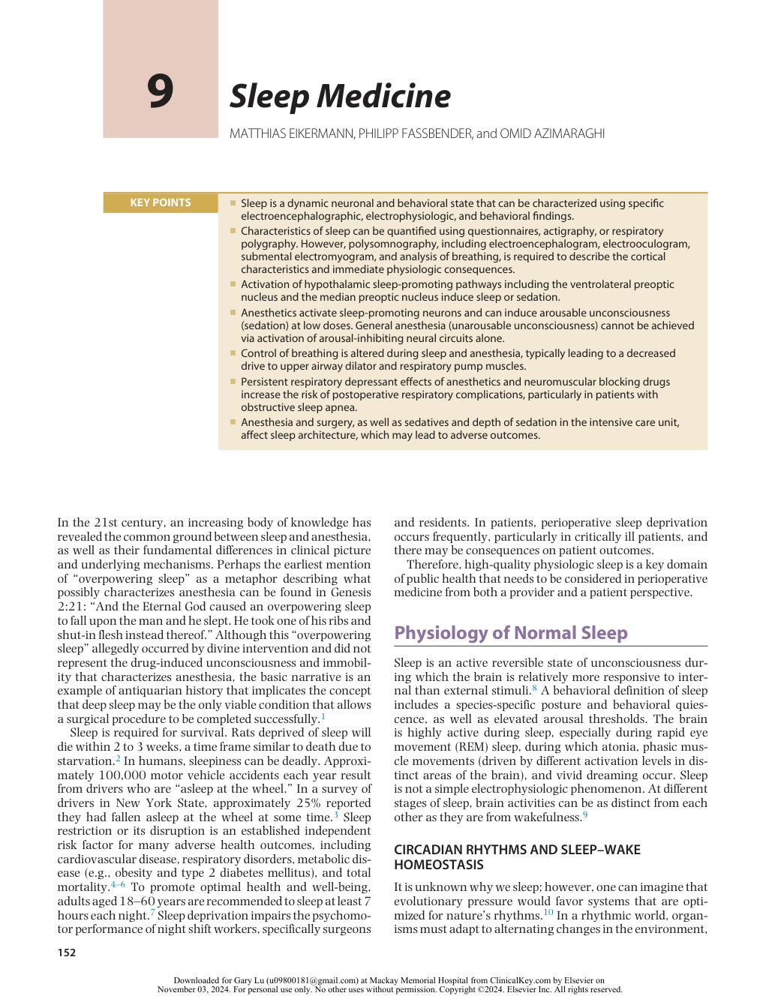

:::

<!-- PDF page 2 -->

such as daily and seasonal rhythms in light intensity, ambient temperature, and humidity.

Species- dependent temporal behavior can be adapted depending on the environmental conditions: behaviorally, anatomically, and physiologically. Circadian rhythms affect almost every aspect of body functions, including activity and rest patterns, cognitive function (e.g., learning and memory), cardiovascular and endocrine physiology (e.g., heart rate, metabolism, and hormone secretion), and gene expression (15% of the genes in the human body show daily rhythms).

Virtually all species show circadian rhythms that regulate periodic changes in behavioral and physiologic parameters within a period of approximately 24 hours.11 These rhythms can be characterized as a synchronization of activity to the external light–dark cycle in the majority of living creatures. Bacteria, plants, animals, and humans exhibit such a behavior that helps them stay in tune with the environmental light–dark cycles.12 Our sleep timing preference, or chronotype, is a manifestation of our internal biological clock. Variation in chronotype has been linked to sleep disorders, cognitive and physical performance, and chronic disease.13

Clock genes generate endogenous clock pulses in most (if not all) cells of the body, synchronized by regulatory pathways across the body to a superior rhythm generator (a socalled master clock). Desynchronization of these rhythms seems to be involved in the pathogenesis of metabolic, psychiatric, and other disorders.12 The superior rhythm generator in humans is located in the suprachiasmatic nucleus that receives external inputs about light and darkness from the retinal cells and synchronizes inputs of melatonin levels. While this master clock synchronizes the behavioral and biological rhythms of the human body to the changing demands of the environment during the solar day, sleep itself entrains circadian rhythms.12,14 The temporal organization of circadian rhythms and nocturnal sleep must be preserved to accomplish a restful and refreshing experience that fulfills the needs produced by the second major regulatory factor, sleep homeostasis. During waking, “sleep pressure” continuously increases, leading to an increased

likelihood for the transition from wakefulness to sleep.15 Increasing homeostatic sleep pressure can be partly offset by a sufficient circadian wakening stimulus during the circadian wake phase, but the circadian wake stimulus disappears in the presence of an overwhelming sleep pressure.16 In this situation, sleep sufficient in quantity and quality is needed to reestablish proper functioning.

Although circadian and homeostatic regulation of sleep can be observed in almost all living organisms,17 differentiation of sleep into non- REM (NREM) and REM sleep (“integrated sleep”) probably has developed during the last 300 to 350 million years because it appears only in birds and the majority of terrestrial mammals.18,19

### SLEEP STAGES AND SLEEP CYCLES

Sleep architecture—a structured temporal order of different sleep stages—is an important determinant of sleep quality. Sleep has two major stages: REM sleep and non- REM (NREM) sleep, with each of these further divided into substates. Most of sleep time is spent in NREM sleep, which is characterized by relatively low electroencephalographic (EEG) frequencies with higher amplitudes compared with awake EEG frequencies (Fig. 9.1). If tired individuals rest in their individual sleeping postures, the increasing level of drowsiness is paralleled by continuous EEG slowing from that seen during attention and cortical activation (16– 30 Hz, “β activity”) to slower frequencies, predominantly between 7.5 and 11 Hz, (“α activity,” typically observed in subjects with reduced attention and closed eyes). During this state of vigilance, the individuals do not sleep, and a full level of cognitive function can be established easily even without a strong sensory stimulus. The transition from α state to sleep is paralleled by a further decrease in α and β activity and an increase of EEG activity in the θ band (4.5– 7.5 Hz: Fig. 9.2).

This transition from α to θ activity is widely accepted as the EEG correlate of sleep onset.20 At this transition from wakefulness to NREM sleep stage 1, heart rate and heat production decrease, resulting in a slight decrease in body temperature. Furthermore, respiration is regular and deep.

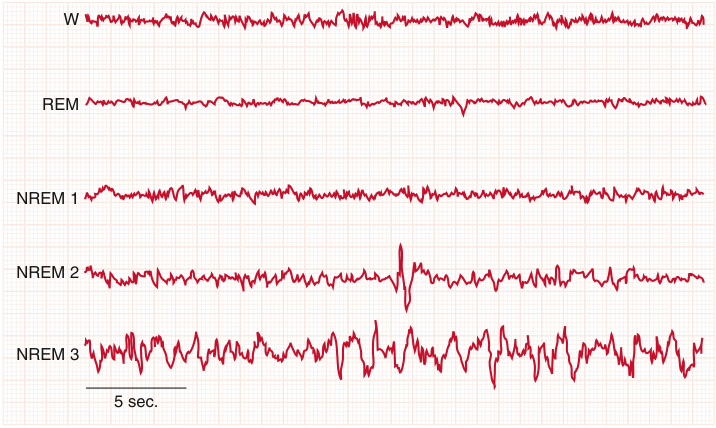

W REM NREM 1 NREM 2 NREM 3 5 sec. 

**Fig. 9.1 Representative electroencephalogram activity seen during different behavioral states.** Electroencephalogram recordings of one patient during wakefulness (eyes closed; W), rapid eye movement sleep (REM), and non- REM (NREM) sleep stages 1 to 3.

<!-- PDF page 3 -->

As sleep deepens, EEG activity shows low amplitudes and θ activity with intermittent sleep spindles and K- complexes ( _NREM sleep stage 2_ ). The latter represents an activation of brainstem and subcortical brain areas during sleep21,22 for selective processing of unexpected sensory inputs (e.g., sounds) that might require complete arousal and restoration of consciousness to address a potential threat.23 In accordance with that hypothesis, in comatose patients with brain injury, the presence of K- complexes in response to an acoustic stimulus during coma seems to be a marker of a better outcome compared with comatose patients with no evoked K- complexes.24 With increasing depth of sleep, during NREM sleep, electrical activity of the cortex measured by EEG is dominated by slower frequencies and high amplitudes, also referred to as _slow- wave sleep (_ NREM sleep stage 3).

REM sleep, or paradoxical sleep, is associated with an alteration of homeostatic regulation, such as increased heart rate variability, irregular respiration, and impaired body temperature control. Brain metabolism increases while EEG recordings show similarities to wakefulness with low- voltage and mixed- frequency power spectra. Prominent θ waves generated by the hippocampus occur. These waves are not apparent in the scalp EEG recording from humans, but in rodents, in which the hippocampus is larger and closer to the brain surface. This sleep state is associated with a decreased tone in skeletal muscles (except for extraocular muscles that control eye movement). Dreaming is a typical experience during REM sleep, but can also happen during NREM sleep.25 A distinct property of REM sleep is the operation of a system that suppresses motor activity, which is responsible for baseline

atonia and suppression of motor commands that would otherwise result in acting out of dreams, a phenomenon known as _REM sleep behavior disorder_ . This REM atonia system is not constant, as it periodically allows breakthrough muscle activity that comprises REM sleep and twitching of the extremities. REM sleep has therefore been subdivided into _tonic REM sleep_ (i.e., a period with muscle atonia and without eye movements) and _phasic REM sleep_ , which is interrupted by short phasic events of the eye and other movements.26 The pattern and amounts of NREM sleep, REM sleep, and wakefulness throughout the night are referred to as _sleep architecture_ , and there are many physiologic and pathophysiologic processes that can affect sleep architecture. For example, many antidepressant medications, benzodiazepines, and opioids selectively suppress REM sleep. A disease example is narcolepsy, in which individuals often transition rapidly from wake to REM, whereas normal REM is nearly always entered from a prolonged episode of NREM state. During physiologic sleep, an individual typically switches back and forth across sleep stages, interrupted by occasional arousals from sleep (Fig. 9.3). A typical multitaper EEG spectrogram and its characteristics during a full night sleep are shown in Fig. 9.4.

Along with many physiologic alterations in normal aging, there is no doubt that sleep changes as a function of age. In the elderly, slow- wave sleep decreases.27 Latency to fall asleep and the number and duration of overnight arousals increase. Sleep fragmentation defined as repetitive overnight arousals may be exacerbated by the increasing number of geriatric medical conditions, including sleep apnea, musculoskeletal disorders, and cardiopulmonary disease.28

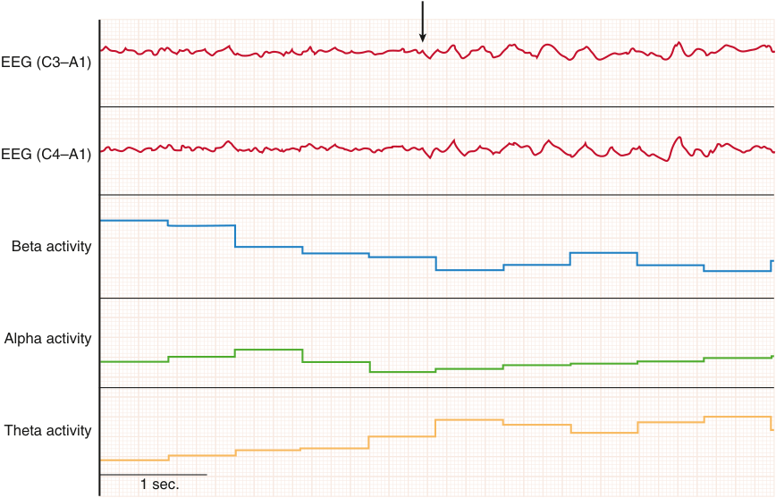

EEG (C3–A1) EEG (C4–A1) Beta activity Alpha activity Theta activity 1 sec. 

**Fig. 9.2 Electroencephalogram recording during sleep onset (** **_arrow_ ).** The two top rows show bipolar electroencephalogram (EEG) signals from left (C3–A1) and right (C4–A1) frontal leads. Rows 3 to 5 show the relative amount (EEG power) of β, α, and θ activity calculated using fast Fourier transformation.

<!-- PDF page 4 -->

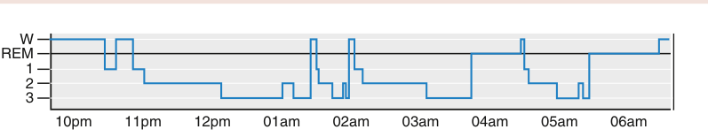

W REM 1 2 3 10pm 11pm 12pm 01am 02am 03am 04am 05am 06am 

**Fig. 9.3 Hypnogram of a night of physiologic sleep.** During one night (time on x axis) of sleep, humans transition repetitively from one sleep stage to another with short episodes of occasional wakefulness (indicated on y axis). _REM,_ rapid eye movement sleep; _W,_ awake; _1_ , non- REM sleep stage 1; _2_ , non- REM sleep stage 2; _3_ , non- REM sleep stage 3 (slow- wave sleep).

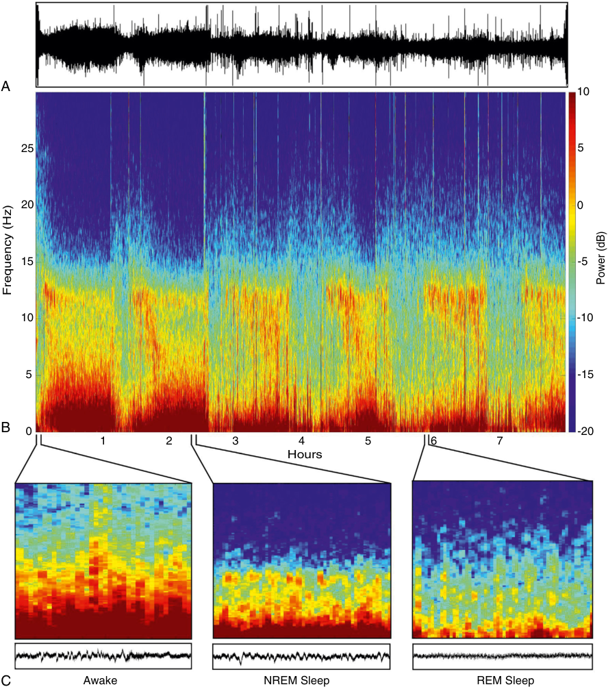

A 10 25 5 20 0 15 -5 10 -10 5 -15 B 0 -20 1 2 3 4 5 6 7 Hours C Awake NREM Sleep REM Sleep Power (dB) Frequency (Hz) 

**Fig. 9.4 Data derived from a portable EEG monitor.** (A) Raw unfiltered EEG waveform, (B) corresponding multitaper spectrogram and its characteristics at (C) different vigilance states during a full night sleep (7.5 hours). While the raw whole night EEG (A) does not allow immediate interpretation, sleep architecture is distinguishable in the corresponding multitaper spectrogram (B). Spectrograms will be used to assist and accelerate sleep staging by trained sleep physicians. C- 1- Awake: active wakefulness presents with strong alpha activity. C- 2- NREM Sleep: predominance of slow delta waves in sleep stage 3 are observed. The multitaper spectrogram is dominated by strong delta power. C- 3- REM: alpha and theta waves present during rapid eye movement (REM) sleep in the absence of K- complexes or spindles are observed in the EEG, which corresponds with REM sleep; accordingly the spectrogram is dominated by theta and alpha power.

<!-- PDF page 5 -->

## Neuroanatomy of Sleep

### SLEEP- PROMOTING AND AROUSAL PATHWAYS

Several neuronal pathways have evolved to maintain cortical activation and behavioral arousal during normal wakening, and others have evolved to promote and maintain sleep (Fig. 9.5). It is the balance between these systems that determines whether one is awake or asleep.

### Ascending Arousal System

The ascending arousal system is the main wakefulnessmediating network in the brain. Main pathways within the network receive cholinergic, monoaminergic, dopaminergic, and glutamatergic inputs. Cholinergic inputs originate from pedunculopontine and laterodorsal tegmental nuclei, and innervate the lateral hypothalamus, prefrontal cortex, basal forebrain, and thalamic relay nuclei.29,30 Glutamatergic neurons that provide inputs to the ascending arousal system are mainly located within a small area just ventral of the locus coeruleus, as well as in the parabrachial nuclei that mainly project to the basal forebrain and the lateral hypothalamus.31,32 Monoaminergic inputs mainly come from noradrenergic neurons within the locus coeruleus, histaminergic neurons of the tuberomammillary nuclei (TMN), serotoninergic neurons of the median and dorsal raphe nuclei,33,34 as well as dopaminergic neurons adjacent to dorsal raphe nuclei.35,36 Furthermore, noradrenergic neurons of the locus coeruleus project mainly to the posterior part of the lateral hypothalamus.

Some neurons of the posterior hypothalamus produce orexin A and B, also known as hypocretin (HCRT) 1 and 2. These neurons project to the basal forebrain and the amygdala and cerebral cortex and other important arousal areas,

and they are essential for stabilizing the waking state.36 Orexin deficiency causes narcolepsy (severe daytime sleepiness) with cataplexy (abrupt loss of muscle tone),37 a disorder showing some characteristics of REM sleep (i.e., REM sleep atonia during wakefulness [discussed later]).

### Orexin System

Orexin and its cognate receptors (OX1R and OX2R) play a key role in sleep–wake regulation. This neurotransmitter system has a crucial involvement in the pathogenesis of narcolepsy.38 Studies in mice recapitulating the narcolepsy phenotype by targeted mutagenesis of the HCRT gene encoding the prepropeptide precursor of orexin neuropeptides,39 or the less pervasive phenotype of OX2R knockout mice,40 demonstrated not only the role of orexin signaling in sleep–wake regulation but also the biological proof of concept for the development of orexin receptor antagonists for the treatment of insomnia.

In contrast, the activation of orexin pathways increases arousal.41,42 Orexinergic neurons are counteracted by inhibitory γ- aminobutyric acid (GABA)- ergic neurons originating from the ventrolateral preoptic nucleus (VLPO). OX2R is expressed exclusively in the histaminergic TMN, whereas OX1R is expressed preferentially in the noradrenergic locus coeruleus, and both receptors are present in cholinergic pedunculopontine and laterodorsal tegmental nuclei.42,43 Orexinergic tone at these hypothalamic and brainstem nuclei contributes to cortical arousal.44 TMN, the predominant source of histamine in the brain responsible for cortical arousal, receives a prominent projection from orexinergic neurons44,45 mediated predominantly by OX2R. Orexin receptor antagonists such as suvorexant promote sleep mainly via inhibition of the OX2R receptor.46–50

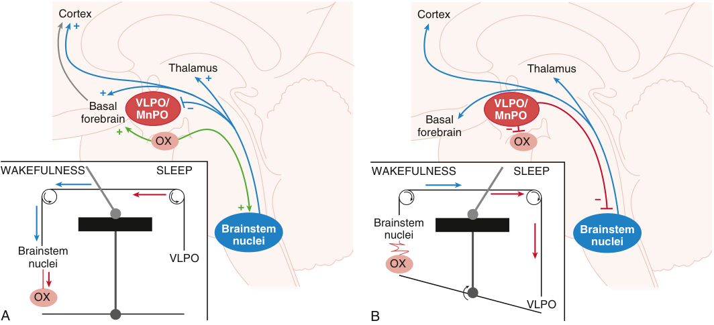

Cortex Cortex + Thalamus Thalamus + + Basal VLPO/ − VLPO/ forebrain MnPO Basal MnPO + forebrain − OX OX WAKEFULNESS SLEEP WAKEFULNESS SLEEP − + Brainstem Brainstem Brainstem nuclei nuclei nuclei Brainstem VLPO nuclei OX OX VLPO A B 

**Fig. 9.5 Flip- flop switch ensuring rapid transitions between wakefulness and sleep.** During wakefulness (A), brainstem nuclei of the ascending arousal system (AAS)301 directly and indirectly provide excitatory input to the thalamus, basal forebrain (BF), and the cerebral cortex, while they inhibit the ventrolateral (VLPO) and median (MnPO) preoptic nuclei (switch flips to wakefulness). The excitatory, wake- promoting stimulus is enforced by additional excitatory input of orexinergic neurons (OX)199 to the BF and the AAS. During sleep (B), neurons of VLPO and MnPO inhibit the brainstem and orexinergic neurons of the AAS (switch flops to sleep). (Modified from Saper CB, Scammell TE, Lu J. Hypothalamic regulation of sleep and circadian rhythms. _Nature._ 2005;437:1257–1263; and Saper CB, Fuller PM, Pedersen NP, Lu J, Scammell TE. Sleep state switching. _Neuron._ 2010;68:1023–1042.)

<!-- PDF page 6 -->

### Non- Rapid Eye Movement Sleep- Promoting Pathways

About 100 years ago during the epidemic of encephalitis lethargica, it was observed that lesions in the preoptic region around the rostral end of the third ventricle were associated with profound insomnia. Neurons in the preoptic area are active during sleep.51–53 Two key nuclei within this area are the VLPO and the median preoptic nucleus. VLPO neurons fire at a higher frequency during sleep compared with wakefulness.54 Physiologically, the VLPO neurons constitute a sleep- promoting pathway that inhibits many components of the arousal system during sleep. Likewise, parts of the arousal system can inhibit the VLPO. The mutually inhibitory relationship of the arousal and sleep- promoting pathways produces the conditions of a flip- flop switch, which can generate rapid and complete transitions between waking and sleeping states (see Fig. 9.5).55,56 Because animal experiments showed that even large lesions of the VLPO substantially reduce but do not completely erase sleep, other brain areas beside this nucleus are likely involved in promoting sleep.57

### Rapid Eye Movement Sleep- Promoting Pathways and Non- Rapid Eye Movement–Rapid Eye Movement Transition

During normal sleep that presents at onset as a sharp α–θ EEG activity transition, a similar sharp transition from NREM to REM sleep can be observed. Two groups of mutually inhibitory neurons located in the pons are involved in mediating the switch between NREM and REM sleep.31 The first group consists of REM active inhibitory neurons of the sublaterodorsal nucleus region.32,56,58 These neurons inhibit but are also inhibited by a second group of neurons that are

located in ventrolateral periaqueductal gray and adjacent lateral pontine tegmentum. This mutually inhibitory relationship produces an REM–NREM flip- flop switch, promoting rapid and complete transitions between sleep states.56

Within the sublaterodorsal nucleus, glutamatergic neurons are mixed within the population of REM- on GABAergic neurons. The glutamatergic sublaterodorsal nucleus neurons project to the spinal cord and are important for REM sleep atonia.

## How to Assess Sleep

Adequate sleep duration is necessary for optimal daily performance and long- term health. Sleep assessment is a fundamental part of health evaluation since diseases such as obesity, diabetes mellitus, or hypertension, as well as psychiatric, neurologic, and cardiovascular diseases produce sleep disorders.59 The complexity of signs and symptoms of sleep suggests that different instruments need to be applied to capture all the important elements of sleep.

### SUBJECTIVE SLEEP ASSESSMENT

Several questionnaires are used for the subjective assessment of sleep duration, sleep quality, and the related physiologic and pathophysiologic consequences. Quality of sleep referring to a collection of sleep measures (i.e., total sleep time, sleep onset latency, sleep maintenance, total wake time, sleep efficiency) is a frequent target of generic health surveys for measuring patient- reported outcomes. Other questionnaires quantify the consequences of sleep deprivation, specific sleep disorders, or both (Table 9.1).

**Table 9.1** Sleep Questionnaires: Questionnaires Commonly Used for Clinical and Research Purposes and Their Focus

|**Questionnaire***|**Focus**|**References**|
|---|---|---|
|_Pittsburgh Sleep Quality Index (PSQI)_|Sleep and sleep disorders|61,62|
|Sleep Quality Scale (SQS)|Sleep quality|66|
|Functional Outcome of Sleep Questionnaire (FOSQ)|Impact of daytime sleepiness on daily living|67|
|Pediatric Sleep Questionnaire|Sleep and SDB in children|68|
|Child Sleep Habits Questionnaire (CSHQ)|Sleep|373|
|_Epworth Sleepiness Scale (ESS)_|Daytime sleepiness|60,63,64|
|_Sleep Diaries/Sleep Logs_|Sleeping times, sleep duration|69,70|
|_Morningness- Eveningness Questionnaire_|Sleeping times, sleep duration, circadian rhythm|71|
|Loughborough Occupational Impact of Sleep Scale (LOISS)|Sleep quality|72|
|Insomnia Sleep Questionnaire (ISQ)|Insomnia|73|
|Berlin Questionnaire|SDB in surgical patients|66|
|_STOP/STOP- Bang Questionnaire_|Obstructive sleep apnea|74,382|
|Brief Insomnia Questionnaire (BIQ)|Insomnia|76|
|_International Restless Legs Syndrome Study Group Rating Scale (IRLS)_|Restless leg syndrome|77|
|_Clinical Global Impression_383Scale|Restless leg syndrome|67|
|_Richards–Campbell Sleep Questionnaire_|Sleep assessment in the ICU|78|

*Recommended questionnaires are italicized.

_ICU_ , intensive care unit; _SDB,_ sleep- disordered breathing; _STOP,_ snoring, tiredness, observed apneas, and high blood pressure.

::: details 原始表格與符號（PDF 第 6 頁）

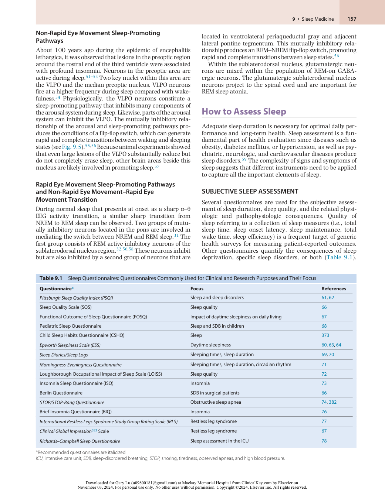

:::

<!-- PDF page 7 -->

A commonly used instrument in sleep medicine is the Epworth Sleepiness Scale. It is a short questionnaire to assess symptoms of daytime sleepiness, expressed as intolerance to monotony. The questionnaire asks the subject to rate the probability of falling sleep on a scale of increasing probability from 0 to 3 for eight different situations, such as watching TV, reading, lying down in the afternoon, and so on.60 Despite the fact that the Epworth Sleepiness Scale is reliable for detection of daytime sleepiness,61,62 the instrument does not determine the mechanism of daytime sleepiness.63,64

The Pittsburgh Sleep Quality Index (PSQI) is another commonly used questionnaire, composed of 19 items assessing sleep quality and disturbances over a one- month interval. The PSQI includes subscales on sleep duration and daytime dysfunction that can be useful to detect and follow insufficient sleep. This questionnaire is mostly used to identify more general “poor sleepers.”65

Other clinically useful questionnaires that focus on the detection of signs and symptoms of sleep disorders are available,60–64,66–78 which is important because the prevalence of sleep pathologies typically varies in a wide range across populations (see Table 9.1).

An effective process for clinical assessment of sleep- related diseases is a stepwise assessment using a screening tool first (e.g., Epworth Sleepiness Scale), followed by a more specific questionnaire that helps identify individual mechanisms or consequences of sleepiness.

A special form of sleep questionnaires comes in the form of sleep diaries and “morningness- eveningness” questionnaires that evaluate daily sleep habits, including sleep time, sleep duration, number of nocturnal awakenings, and subjective sleep quality.79

Although questionnaires allow a quick and easy screening for daytime symptoms of sleep disturbances, they do not quantify sleep architecture. Subjective methods of assessing sleep are influenced by the spectrum of disease within a tested group, actual clinical change over time, the testing conditions, and recall bias.79 Clearly, a self- reported questionnaire cannot replace a medical history or objective assessment for sleep disorders. However, sleep questionnaires are important tools for measuring health improvement or decline, predicting medical expenses, assessing treatment effects, or comparing disease burden across populations.

### ACTIGRAPHY

Actigraphy is the method used to objectively study sleep– wake patterns by detecting motion with linear accelerometers in single or multiple axes over a period of days or weeks. Based on movement- derived data, predictions of the time spent during sleep and wakefulness can be made, and even assumptions on sleep staging are made. Actigraphy can be used conveniently at the patient’s home for several nights, weeks, or longer,80 but its validity for detecting transitions from wakefulness to sleep has been debated, especially in patients with high levels of sleep fragmentation.80,81 In the clinical setting, actigraphy has been used to evaluate sleep patterns in patients with insomnia, for diagnosis of circadian rhythm disorders (including shift work), and in evaluating sleep in individuals who are less likely to tolerate

polysomnography (PSG), such as infants and demented elderly. However, its accuracy is limited for patients with limited mobility or movement disorders, such as nursing home or intensive care unit (ICU) patients. Actigraphy allows for convenient follow- up measurements to evaluate the effects of treatments designed to improve sleep architecture and circadian rhythm disorders.82 There are few contraindications for actigraphy in either children or adults.83

It is important to recognize that actigraphy is not a substitute for in- laboratory PSG when there is an indication for in- laboratory testing. However, it can provide useful objective metrics across a variety of sleep–wake disorders to assist in the assessment and monitoring of treatment response.84

In more recent years, commercial wearable sleep- trackers (e.g., smart watches, wristbands, armbands, headbands, rings, sensor clips) are increasingly used without prescription or clinical recommendations.85 However, adequate data are lacking for their validity, accuracy, and reliability in measuring various sleep parameters.86

### RESPIRATORY POLYGRAPHY

Home respiratory polygraphy (RP) can be a cost- effective alternative to PSG for the diagnosis of sleep apnea–hypopnea syndrome. Home respiratory polygraphy is performed using portable devices typically continuously measuring respiratory variables (e.g., respiratory effort and airflow through pressure changes taken via nasal cannulae), cardiac variables (e.g., heart rate or an electrocardiogram), and arterial oxyhemoglobin saturation via pulse oximetry. Thoracic and abdominal movements are measured by piezoelectric bands, which also measure body position. Using these parameters, RP can identify apnea and hypopnea, and categorize the pathophysiology of apnea into obstructive versus central. Furthermore, like actigraphy, RP provides some analysis of sleep duration and time spent awake, using its body position and light sensors. However, the quality of the latter can be more precisely evaluated by a combination of sleep diary and actigraphy. Nevertheless, EEG is required to decide whether a subject was awake or sleeping (Table 9.2).

### POLYSOMNOGRAPHY

PSG is the only method that can precisely determine the actual sleep stage and is a reference diagnostic tool (i.e., gold standard) that is required for the diagnosis of several sleep disorders.87 PSG measurements include EEG to capture brain activity, electrooculography for the measurement of eye movements, and at least electromyographic measurement of muscle activity of the chin.88 These three measurements are typically supplemented by other channels for the detection of sleep- disordered breathing (SDB), such as a nasal sensor to detect apneas and hypopneas, oximetry, inductance plethysmography for respiratory effort of the chest and abdomen, and a body position sensor and leg electromyogram89 to identify periodic limb movement syndrome or REM sleep behavior disorder, respectively.90 A typical PSG recording is shown in Fig. 9.6.

### Sleep Laboratory Testing

For several decades, PSG was performed only within a sleep laboratory. Sleep laboratory PSG is attended by a

<!-- PDF page 8 -->

**Table 9.2** Pros and Cons of Different Methods of Sleep Evaluation

|**Method**|**Pros**|**Cons**|**Recommendation**|
|---|---|---|---|
|Sleep questionnaire|Low cost Good compliance Easy to use|Recall bias Limited reliability in some populations Limited validity|Should be combined with interview|
|Sleep diary|Less recall bias Easy to administer Low cost Documentation of daily variability|Lower compliance compared with other questionnaires Biased by daily mood and expectations on sleep|Should be combined with other measurement of sleep duration (e.g., actigraphy)|
|Actigraphy|Provides objective information about daily variability and sleep duration Provides information on sleep habits at home Not influenced by patient expectations, recall bias, or memory impairments Lower cost than laboratory polysomnography|Limited assessment of sleep stages and sleep onset latency Higher cost than questionnaires|Should be combined with other measurement of sleep duration (e.g., sleep diary)|
|Polygraphy|Lower cost than laboratory polysomnography Objective assessment of respiratory events Provide information on sleep habits at home|Limited assessment of sleep Higher cost than questionnaires Limited assessment of sleep disorders other than sleep- disordered breathing|Should be accompanied by questionnaires and clinical interview|
|Laboratory polysomnography|Objective assessment of sleep, sleep stages, and sleep disorders|High cost First- night effect Limited capacity No information about sleep habits at home|Should be last step in sleep evaluation with previous questionnaires and ambulatory screening (e.g., polygraphy)|
|Out- of- center polysomnography|Objective assessment of sleep, sleep stages, and sleep disorders Less first- night effect Lower cost than laboratory polysomnography Can provide information about sleep habits at home|Limited observation may lead to decreased recording quality|Good patient education mandatory If possible, surveillance recording preferred|

Adapted in part from Martin JL, Hakim AD. Wrist actigraphy. _Chest_ . 2011;139(6):1514–1527.

trained technician and is analyzed by a clinician trained in sleep medicine according to the published guidelines.89,91–93 However, the high cost and requirement of an overnight stay can present socioeconomic challenges that affect the accessibility of this method. In- center PSG provides only a momentary view of the patient’s sleep, does not provide information about sleep at home, and the measurements themselves can impair patients’ sleep (the so- called first- night effect). Multiple repeated measurements to tailor treatment over time are challenging or even impossible from a logistic and health care economics perspective. Therefore, an increasing number of out- ofcenter devices are now available, offering the possibility of recording PSG in almost every environment, such as at the patient’s home, within the hospital or nursing home room, and even within the recovery room or ICU.

### Home Sleep Apnea Test (Out- of- Center Testing)

Home sleep apnea testing (HSAT; also referred to as out- ofcenter sleep testing or portable monitoring) is an alternative

to overnight, attended, in- laboratory polysomnography. Portable out- of- center PSG sleep monitors are an effective method for diagnosing OSA94 compared with PSG recording performed within a sleep laboratory, when applied in preselected population at risk of moderate- to- severe OSA and response to therapy.94–97 The Portable Monitoring Task Force of the American Academy of Sleep Medicine (AASM) supports the use of these devices in subjects for clinical and research purposes and indicates a comparable quality of PSG data.94

### Scoring of Sleep and Sleep- Disordered Breathing

More than 40 years ago, Rechtschaffen and Kales88 standardized the method of scoring PSG recordings – the R&K criteria. Since then, major innovations in technology have transformed the science and clinical practice of sleep medicine. The AASM criteria89,98 for scoring sleep and associated events captures the full potential of innovations resulting from computerization of data, including automation of sleep scoring, recognition of disorders that

::: details 原始表格與符號（PDF 第 8 頁）

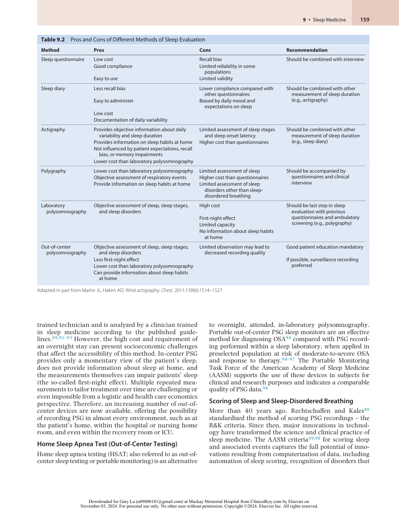

:::

<!-- PDF page 9 -->

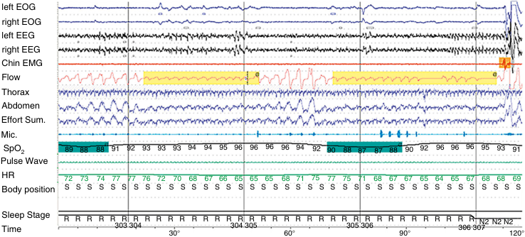

left EOG right EOG left EEG right EEG Chin EMG Flow Thorax Abdomen Effort Sum. Mic. SpO2 89 88 88 91 92 93 93 93 94 94 95 96 96 96 96 94 92 90 88 87 87 88 90 92 96 96 96 95 93 91 Pulse Wave HR 72 73 74 77 77 76 72 70 68 67 66 65 65 65 68 71 75 77 75 71 68 67 67 65 64 65 67 68 68 69 Body position S S S S S S S S S S S S S S S S S S S S S S S S S S S S S S S S S S S S S S S S Sleep StageTime R R R R R303 304R R R R R30°R R R R R304 305R R R R 60°R R R R R R305 306R R R R 90°R R R R R R306 307R N2 N2 N2120° 

**Fig. 9.6 Polysomnographic recording.** Left and right electrooculogram (EOG), two electroencephalogram (EEG) channels, and mental electromyogram (Chin EMG) allow scoring of sleep stage (REM sleep [R] with typical eye movements in the electrooculogram channels). Additional channels (e.g., respiratory flow [Flow], respiratory effort of thorax [Thorax] and abdomen [Abdomen], microphone [Mic.], oxygen saturation [SpO2]) allow diagnosis of sleep- disordered breathing. In this patient, apneas ( _yellow boxes_ ) led to oxygen desaturation ( _blue boxes_ ) and finally to arousal ( _far right, brown box_ ).

**Table 9.3** Polysomnographic Characteristic of the Different Behavioral States

||**EEG and EOG Characteristics**|**AASM**|
|---|---|---|
|Wakefulness|αrhythm (8–13 Hz) present in more than 50% of an epoch|W|
|Non- REM sleep stage 1|Lower amplitudes and activity in range of 4–7 Hz (vertex sharp waves,*slow eye movements*)|N1|
|Non- REM sleep stage 2|EEG of sleep stage 1 with additional sleep spindles and K- complexes; slow waves not fulfilling the criteria for sleep stage 3|N2|
|Non- REM slow- wave sleep|20%–50% of slow- wave activity (0.5–2 Hz)|N3|
|REM sleep|EEG of low amplitude and mixed frequencies, low chin electromyogram activity, rapid eye movements|R|

*Not necessary but may be present.

_AASM,_ American Academy of Sleep Medicine criteria (see reference 89); _EEG,_ electroencephalography; _EOG,_ electrooculogram; _N1,_ non- REM sleep stage 1; _N2,_ sleep stage 2; _N3,_ sleep stage 3; _R,_ REM sleep; _W,_ wakefulness.

occur during sleep, and integration with other procedures, such as positive airway pressure titration. Although the R&K criteria are still sufficient for clinical and research purposes, they are less commonly used in sleep centers around the world.

According to these criteria, the arousal states are categorized based on the EEG activity recorded from three different scalp locations and divided into wakefulness (W), REM sleep (R), and three NREM sleep stages (Table 9.3 and see Fig. 9.1).

Respiratory events during sleep are defined as follows:

1. _Apnea_ with a decrease in respiratory flow of 90% or more from baseline for at least 10 seconds, whereas a minimum of 90% of the event duration must meet the criteria of respiratory flow reduction.

2. _Hypopnea_ , in which the signal of respiratory flow measurement decreases at least 30%, whereas oxygen saturation (SpO2) decreases by 4% or more compared with pre- event baseline for at least 90% of the duration (minimum of 10 seconds). Hypopneas can also be defined as a decrease in respiratory flow measurement of at least 40% with a decrease in SpO2 of only 3%.

3. _Respiratory event- related arousal_ is defined as a series of breaths not meeting the criteria for apnea or hypopnea lasting at least 10 seconds characterized by increasing respiratory effort or flattening of the nasal pressure waveform leading to an arousal from sleep.

4. _Hypoventilation_ is defined as an increase of 10% or more in arterial carbon dioxide tension (PaCO2).

Although the AASM criteria are commonly used in many sleep centers for clinical and research purposes all over the world, questions about whether the criteria should be used in children,99 and the scoring of some respiratory events are still unanswered.

## Sleep and Breathing

### PHYSIOLOGY OF BREATHING DURING SLEEP

Sleep puts breathing at risk. The upper airway dilator muscle activity is decreased during sleep compared with wakefulness, particularly at sleep onset and during REM sleep, leading to increased upper airway resistance. Furthermore,

::: details 原始表格與符號（PDF 第 9 頁）

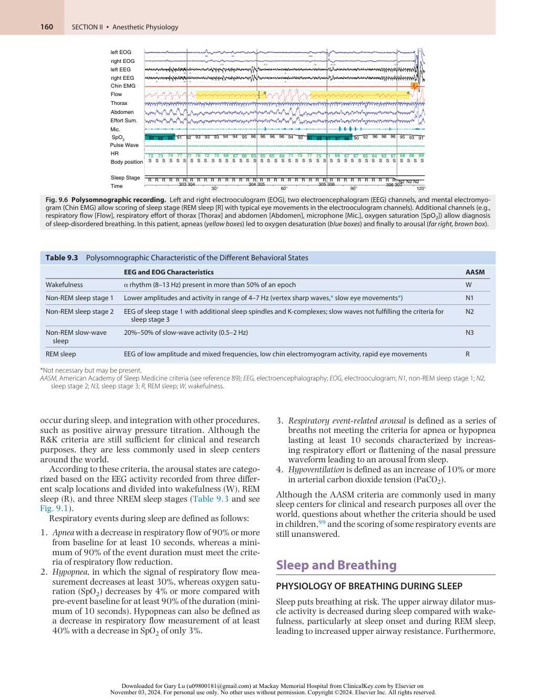

:::

<!-- PDF page 10 -->

Apneas (10 sec without flow) + Hypopneas (reduced flow with desaturation)

AHI = Total sleep time (h) Apneas + Hypopneas + Arousals (in EEG) associated respiratory event RDI = 

Total sleep time (h)

**<mark>Fig. 9.7 Definition of apnea hypopnea index (AHI) and respiratory disturbance index (RDI).</mark>**

the ventilatory response to hypoxia can be impaired, such that critical hypoxia levels can occur during sleep that can be offset only by arousal from sleep.

The major determinant of minute ventilation during wakefulness and sleep is PaCO2. In contrast to wakefulness, where PaCO2 is maintained close to 40 mm Hg, the chemosensitivity to CO2 decreases during sleep, as does the chemosensitivity for oxygen. This leads to PaCO2 values of 45 mm Hg commonly occurring during stable sleep, while ventilatory demand is decreased and the arousal threshold varies with sleep stages.

Accordingly, the changes in respiratory muscle activity, ventilatory demand, and arousal threshold observed from wakefulness to sleep and across sleep stages challenge ventilatory control and can lead to instability in breathing. A structured approach to evaluate breathing instabilities is the loop gain. This engineering term is used to describe the stability of a feedback- controlled system (in this case, the chemical feedback loop controlling an individual’s ventilation). The higher the loop gain, the more unstable the respiratory control system potentially becomes. High loop gain may contribute to severity of OSA. Moreover, subjects with a high loop gain have been shown to be more likely to develop breathing instabilities such as Cheyne–Stokes respiration (CSR; see “Central Sleep Apnea”).

### SLEEP- DISORDERED BREATHING

Sleep- disordered breathing consists of several distinct disorders, including obstructive sleep apnea (OSA), central sleep apnea (CSA), and sleep- related hypoventilation, in which abnormal breathing events during sleep (apneas and hypopneas) are associated with adverse clinical outcomes. While each of these disorders has a characteristic presentation, history and physical examination alone are insufficient to make a definitive diagnosis. Formal analysis of breathing during sleep is required for diagnosis. The severity of SDB is usually quantified by the number of respiratory events per hour of sleep. This is necessary because a low number of short apneas and hypopneas can occur up to about five times per hour in healthy subjects. Two measures can be used for this purpose: the apnea hypopnea index (AHI) and the respiratory disturbance index (RDI). Typically, the AHI (number of hypopneas and apneas per hour of sleep; Fig. 9.7, _top_ ) and RDI (number of hypopneas, apneas, and arousals related to respiratory events per hour of sleep; see Fig. 9.7, _bottom_ ) are used to quantify the severity of SDB.

### Obstructive Sleep Apnea

**Definition.** Obstructive sleep apnea (OSA) is a sleep disorder that involves cessation or significant decrease in

**Table 9.4** Severity of Sleep Apnea Based on Respiratory Disturbance Index or Apnea Hypopnea Index

||**RDI (Events Per Hour)**|**AHI (Events Per Hour)**|
|---|---|---|
|No sleep apnea|&lt;5|&lt;5|
|Mild sleep apnea*|≥5 to &lt;15|≥5 to &lt;15|
|Moderate sleep|≥15 to &lt;30|≥15 to &lt;30|
|apnea|||
|Severe sleep apnea|≥30|≥30|

- *Only diagnosed if comorbidities like hypertension, atrial fibrillation, or daytime sleepiness are present.

- A respiratory disturbance index (RDI) less than 5 per hour is physiologic and found in healthy humans. Sleep apnea is mild with RDI between 5 and 15 per hour, moderate with RDI between 15 and 30 events per hour, and considered severe with an RDI of 30 and greater per hour of sleep. Equal cutoff values are similar for severity based on the apnea hypopnea index (AHI).

airflow in the presence of breathing effort, which is accompanied by hypoxemia, hypercapnia, and recurrent overactivation of the sympathetic nervous system. OSA is the most common type of SDB and is diagnosed in patients with more than 15 predominantly obstructive events per hour of sleep, or with fewer respiratory events (i.e., 5–15 per hour) if daytime symptoms (i.e., sleepiness) or comorbidities such as hypertension or atrial fibrillation are present. These cutoff values have been used as an indication for treatment by clinicians based on the clinical guidelines and the international classification of sleep disorders.89,90 The severity of sleep apnea in adults is further characterized as mild in patients with fewer than 15 events per hour of sleep, as moderate with 15 to fewer than 30 events per hour of sleep, and as severe sleep apnea with 30 or more events per hour of sleep (Table 9.4).90,92

**Epidemiology.** OSA with daytime symptoms affects 0.3% to 5% of the general population.100,101 As obesity is one of the major risk factors for OSA, the prevalence might continue to increase with higher rates of obesity in the general population.102–104 The prevalence of SDB without daytime symptoms is even higher, with rates of up to 9% in women and 24% in men between the ages of 30 and 60 years, and is often unrecognized.105,106

Furthermore, the prevalence of OSA varies widely between different populations. Individuals with a high susceptibility to OSA include the obese, the elderly, and those with specific comorbidities (e.g., stroke, myocardial infarction). Depending on methodology, the rates of OSA in patients following surgery are between 45%107 and 75%.108 A study in patients undergoing bariatric surgery revealed

::: details 原始表格與符號（PDF 第 10 頁）

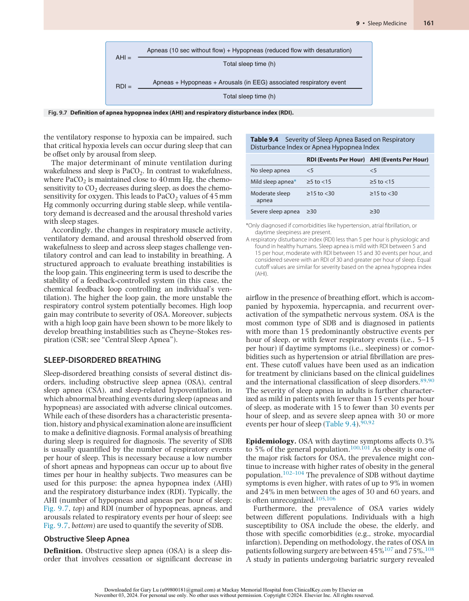

:::

<!-- PDF page 11 -->

### Box 9.1 Symptoms of Obstructive Sleep Apnea

### Nighttime Symptoms

- Frequent awakening during the night (e.g., pseudo- nocturia)

- Awaking from own snoring with choking sensation ᑏ Tachycardia

- Sleep that is not restorative

### Daytime Symptoms

- Awaking with dry mouth

- Dull headache in the morning

- Daytime sleepiness

- Falling asleep during monotonic situations (e.g., watching television)

- Subjective impairment of cognitive function

### Symptoms Reported by Bed Partner

- Snoring, especially when loud and arrhythmic

- Observed pauses in breathing during sleep

an incidence of OSA as high as 77.5% in this population,109 while another study showed OSA to be prevalent in 50% of women undergoing gynecologic oncology surgery.110

**Clinical Symptoms.** Approximately one- third of patients with OSA complain of typical signs and symptoms occurring during wakefulness. Waking with dry mouth or headache in the morning, daytime sleepiness, falling asleep during monotonous situations (e.g., watching television), as well as subjective impairment of cognitive function are frequently reported. This combination of OSA with daytime symptoms is usually referred to as OSA syndrome.111,112

Sleep- associated signs and symptoms of OSA include witnessed pauses in breathing or snoring, and a high number of nocturnal awakenings, mostly reported as pseudo- nocturia. Patients with OSA occasionally complain of tachycardia or respiratory distress upon nocturnal awakening (choking sensation) and other symptoms (Box 9.1).

**Consequences and Comorbidities.** OSA is associated with serious medical consequences, such as hypertension, myocardial infarction, stroke,111,113,114 diabetes mellitus, diabetic neuropathy, as well as cognitive dysfunction resulting in occupational difficulties and motor vehicle accidents.115,116 The development of cognitive impairment in patients with OSA117 is associated with atrophy of brain structures relevant for cognition and memory (hippocampal areas)118 that can be partially reversed by adequate treatment.119 Whether the negative effects of OSA are due to impaired sleep architecture or effects of intermittent hypoxia remain unclear,120 because data investigating the effect of intermittent hypoxia without other symptoms in OSA patients are limited. Nevertheless, previous findings suggest that even asymptomatic OSA might be associated with cardiovascular effects, such as altered daytime autonomic regulation (i.e., heart rate variability).121 Clinician awareness of an increased risk of OSA plays an important role in preventing postoperative cardiovascular complications.122

Given the frequent rate of complications associated with OSA, it is not surprising that OSA leads to increased socioeconomic costs because of significantly more frequent rates of health- related contacts and medication use, and even higher rates of unemployment.123

**Risk Factors.** Predisposing factors for OSA are obesity,124 age,124,125 male sex,125 factors leading to swelling of the superficial tissue of the upper airway (smoking),126 allergic rhinitis,127 and decreased muscle tone of upper airway dilator muscles (e.g., central nervous system) caused by respiratory depressants.128

Several clinical prediction tools have been evaluated for screening common signs and symptoms of OSA that are easily obtained and interpreted in the primary care setting. While these tools may have some value in detecting OSA in highly symptomatic patients in a high- risk setting (e.g., preoperative evaluation), they cannot be used as true screening tools in asymptomatic patients.

**Pathophysiology.** Respiratory events during OSA are characterized by decreased respiratory flow with persisting respiratory effort due to reduced intraluminal diameter of the upper airway up to complete pharyngeal airway collapse (see Fig. 9.6). The muscles involved in respiration are morphologically and functionally skeletal muscles and can be classified into two groups: upper airway dilator muscles and respiratory pump muscles.

Upper airway dilator muscles counterbalance the negative inspiratory pressure generated by the pump muscle to permit airflow during inspiration. Respiratory pump muscles are the collection of muscles responsible for generating inspiratory and expiratory forces in the thorax across the breathing cycle (Fig. 9.8). The patency of the upper airway is maintained by balancing dilating (generated by the upper airway dilator muscles) and collapsing forces (negative intraluminal pressure generated by the respiratory pump during inspiration and compressive extraluminal forces from the surrounding tissues).129

**UPPER AIRWAY DILATOR MUSCLES.** The most extensively studied of the upper airway dilating muscles are the genioglossus and the tensor palatini (Table 9.5). The genioglossus receives a variety of inputs, including phasic (inspiratory) and tonic (noninspiratory) drives, which are distributed differentially across the hypoglossal motoneurons.130 In response to negative pharyngeal pressure created by the respiratory pump during inspiration, the genioglossus reflexively stabilizes the upper airway in animals and humans.131,132 This reflex is likely a product of signaling from inspiratory modulated motor units. Whereas the genioglossus responds to phasic input on top of its tonic activation, the tensor palatini is considered a tonic muscle with consistent tone throughout the respiratory cycle.133

**ANATOMIC VULNERABILITY TO COLLAPSING FORCES.** The soft tissues of the pharynx are enclosed and stabilized by bony structures, such as the mandible and the spine, and complete collapse of the pharyngeal airway ordinarily requires extraluminal forces, such as hematoma, edema, peripharyngeal masses, or an airway trauma, for instance, as a consequence of prolonged endotracheal intubation.134 Pharyngeal manifestation of

<!-- PDF page 12 -->

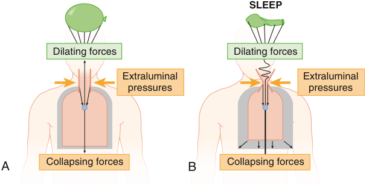

SLEEP Dilating forces Dilating forces Extraluminal Extraluminal pressures pressures A Collapsing forces B Collapsing forces 

**Fig. 9.8 Relationship of upper airway patency and respiratory pump activation.** (A) During wakefulness, the force of the upper airway dilator muscles ( _green balloon_ , dilating forces) counterbalance the collapsing forces imposed on the upper airway by extraluminal pressures and negative inspiratory pressure generated by the respiratory pump muscles (represented by the _orange counterweight_ [collapsing forces]). (B) In obstructive sleep apnea, sleep onset ( _blue needle_ ) leads to decreased upper airway patency by reducing the dilating forces. (Modified from Sasaki N, Meyer MJ, Eikermann M. Postoperative respiratory muscle dysfunction: pathophysiology and preventive strategies. _Anesthesiology_ . 2013;118:961–978.)

**Table 9.5** Some Muscles of the Upper Airway Relevant for Upper Airway Stability

|||**PH**|**ASIC ACTIVITY**|
|---|---|---|---|
|**Muscle**|**Tonic Activity**|**Insp.**|**Exp.**|
|Tensor palatini158|+|+|−|
|Levator palatine158|+|+|−|
|Genioglossus159|+|+|−|
|Geniohyoid160|+|−|+|
|Thyrohyoid|X|X|X|

+, Present; _−_ , absent; _X,_ insufficient data. Major muscles of the upper airway and their activity during breathing. Tonic activity, as well as inspiratory (Insp.) and expiratory (Exp.) muscle activity.

obesity compresses the airway.135 Craniofacial abnormalities can further increase the collapsing effects of excessive pharyngeal extraluminal soft tissue in obese patients.136 The extraluminal soft tissue, as well as size and shape of the bony enclosure, are determinants of the extraluminal pressure that needs to be antagonized by the upper airway dilator muscle contraction during inspiration, to avoid an upper airway obstruction–related apnea.136 In addition, the upper airway is more vulnerable to collapse in the supine position than in the lateral or sitting positions, due to gravitational effects.137,138

Excessive intravenous fluid administration can affect upper airway patency. In awake, healthy volunteers, the inflation of antishock trousers displaced fluid from the lower extremities to increase neck circumference,139 so that the upper airway had a lower threshold to collapse.140 This concept is reinforced in studies of subjects with lower extremity venous insufficiency141 and congestive heart failure (CHF).142 These studies have shown nocturnal redistribution of fluid from the lower extremities into the neck increases upper airway collapsibility141 and the severity of central apnea and OSA.142 Similar effects may increase the risk for OSA during pregnancy and early after delivery.142

Another important component of airway patency is the interplay between lung volume and upper airway collapsibility. Higher end- expiratory lung volumes are associated

with a decrease in upper airway resistance to airflow in awake, healthy humans,143 and an increase in upper airway lumen dimensions in subjects with and without OSA.144 The mechanism for the interaction between upper airway patency and lung volume is thought to lie in the generation of longitudinal traction forces in the trachea.145,146 Upon inspiration, the lung inflates and effectively forces the carina into a more caudal position, creating stretching forces on the fixed trachea.145 These forces are transferred to the side walls of the upper airway.147 Effectively, tracheal traction allows the respiratory pump muscles to contribute to upper airway opening.

**COLLAPSING INTRALUMINAL PRESSURE.** The respiratory pump is the motorized action driving inspiration and expiration. It is the force that broadens the thoracic cavity and creates negative intrathoracic pressure to draw a breath in, and when needed, positive intrathoracic pressure to exhale rapidly. Inspiratory pump muscles are an anatomically diverse group, with the most studied being the intercostal muscles and the diaphragm. The diaphragm accounts for 60% to 70% of lung volume change during quiet respiration.148 During inspiration, the volume of the thoracic cavity increases as a result of contraction of the diaphragm and the external intercostal muscles. The lungs expand secondarily to the increased negative intrathoracic pressure generated by these phasic actions of the inspiratory pump muscles. The negative intrathoracic pressure translates into a negative intraluminal pressure in the upper airway, forcing the airway to collapse as soon as this pressure drops below a critical value.149

Although this critical airway pressure (Pcrit) is typically negative (approximately −5 cmH2O) in healthy controls, the upper airway in patients with OSA during sleep may even collapse at a positive Pcrit. Positive intraluminal pressure is required for reopening the paralyzed airway in patients with OSA.150 Under normal conditions, the two compressing factors, (1) negative intraluminal pressure and (2) positive extraluminal pressure, need to be actively compensated by muscular activity of the upper airway dilator muscles to maintain airway patency.151

**WAKEFULNESS STIMULUS AND SLEEP.** Excitatory inputs to the upper airway motoneurons (e.g., hypoglossal

::: details 原始表格與符號（PDF 第 12 頁）

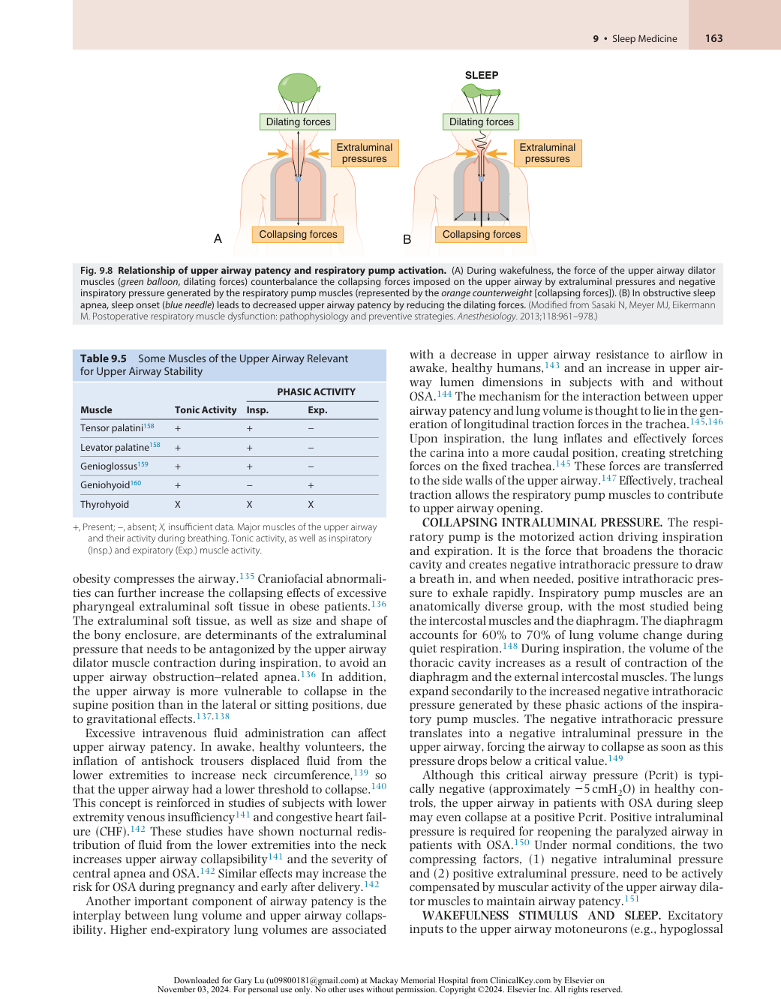

:::

<!-- PDF page 13 -->

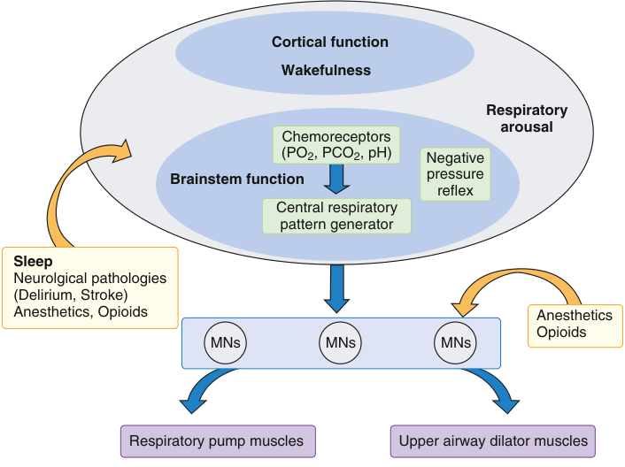

Cortical function Wakefulness Respiratory arousal Chemoreceptors (PO2, PCO2, pH) Negative Brainstem function pressure reflex Central respiratory pattern generator Sleep Neurolgical pathologies (Delirium, Stroke) Anesthetics, Opioids Anesthetics Opioids MNs MNs MNs Respiratory pump muscles Upper airway dilator muscles 

**Fig. 9.9 Effects of respiratory arousal on upper airway dilator and respiratory pump muscles.** Respiratory arousal is composed of three primary inputs: central respiratory pattern generator processing peripheral and central chemoreceptor afferents, reflex responsiveness to the magnitude of negative pressure in the airway generated by the respiratory pump muscles, and strength of the wakefulness stimulus. Different factors can impair respiratory arousal, such as sleep and neurologic pathologies, anesthetics, and opioids. _Blue arrows_ indicate excitatory effect; _yellow arrows_ indicate inhibitory effect. _MNs,_ motor neurons. (Modified from Sasaki N, Meyer MJ, Eikermann M. Postoperative respiratory muscle dysfunction: pathophysiology and preventive strategies. _Anesthesiology_ . 2013;118:961–978.)

motoneurons) include those from serotoninergic and noradrenergic neurons that fire predominantly during wakefulness,152–155 resulting in a “wakefulness stimulus” that increases the activity of upper airway dilator muscles during this arousal state. With onset of sleep, this arousaldependent neuronal input (active while awake versus less active, or inactive when asleep) disappears, leading to a decrease in upper airway muscle activity and causing increased upper airway resistance in healthy controls and airway collapse in patients with OSA.156–158 The resulting retropalatal obstruction of the upper airway is reported to be the most common pathophysiologic mechanism in OSA.150

**ONE- WAY VALVES IN THE UPPER AIRWAY.** Observing the respiratory flow tracings in patients with OSA, one can find some respiratory events that do not show the characteristic progressive flow limitation ultimately resulting in complete upper airway occlusion, typically seen as a result of “collapsible tube pathophysiology” with variable compliance. In these cases, the flow tracings show normal expiratory flow and sudden reduction/cessation before reaching maximum inspiratory flow. This “rapid obstruction” only during the inspiratory phase occurred in approximately 20% to 30% of OSA patients.159 Recent findings suggest that there are two one- way valves in the pharynx. While the epiglottic valve closes during inspiration, the soft palate may function as a second one- way valve limiting flow during expiration.160

Similar to the epiglottis, the soft palate hangs from the hard palate like a peninsula in the oropharynx and might occlude the upper airway during expiration.161 A recent study found that sudden reduction of expiratory airflow

immediately after peak expiratory flow occurs more often in OSA patients under positive pressure ventilation.162 A similar expiratory flow limitation pattern was also reported in spontaneously breathing OSA patients, suggesting that this phenomenon is not unique to positive pressure ventilation.163

These findings may point to a second, slightly different mechanism underlying OSA than the pure collapsible tube pathophysiology in some OSA patients, which should be particularly important during anesthesia. Correct identification of the closure site in each OSA patient will enable the clinician to provide an individualized OSA treatment.160

**RESPIRATORY AROUSAL.** Respiratory arousal is arousal from sleep owing to cumulative and progressive increases in stimuli related to breathing (hypoxia, hypercapnia, and respiratory effort).164

Three primary inputs contribute to arousal- related restoration of breathing following an apnea (Fig. 9.9):

1.  Peripheral and central chemoreceptors sensitive to partial pressures of oxygen and carbon dioxide165

2.  Sensors in the upper airway responsive to negative pressure generated by the respiratory pump131,132

3.  Cortical inputs directly related to state of consciousness or wakefulness166

Any of these inputs can restore respiratory muscle tone if the magnitude of stimulation is sufficient. Cortical awakening from sleep, identified by EEG signs of wakefulness, is an adequate stimulus for ventilation. However, obstructive apneas, such as upper airway collapse in OSA, can be terminated by an increased drive to the respiratory muscles not involving cortical arousal.167 For example, hypercarbia resulting from sustained hypopnea165 and elevated upper

<!-- PDF page 14 -->

airway negative pressure131,132 can independently restore tone to the respiratory muscles. The level of drive provided to the respiratory muscles depends on the summation of stimuli in the central respiratory pattern generator output, including peripheral and central chemoresponsiveness, reflex responsiveness to the negative airway pressure, and strength of the wakefulness drive.

**Treatment.** Adequate treatment of OSA improves nocturnal oxygen saturation as well as duration and quality of sleep, which translates to reduced daytime sleepiness, improvement of daytime functions, and improved quality of life. Successful treatment of OSA reduces cardiovascular risk, improves insulin sensitivity, and increases neurobehavioral performance.168–170 Therefore, all patients with a diagnosis of OSA should be offered treatment as soon as the diagnosis of OSA has been established and its severity has been determined by objective testing (i.e., PSG). Although different treatment options for OSA have been developed during the last decades (Table 9.6), continuous positive airway pressure (CPAP) increases upper airway diameter in a dose- dependent manner and is still the most effective treatment for OSA of all severities.171–173 However, studies have questioned if CPAP treatment is able to prevent the longterm adverse cardiovascular events in OSA.174,175

**POSITIVE AIRWAY PRESSURE TREATMENT.** CPAP as a treatment for SDB is typically applied continuously with a nasal or oronasal mask. Of note, very severe airway obstruction, which for instance can be observed during induction of anesthesia, may not be relieved with CPAP alone without additional interventions such as jaw thrust or an oropharyngeal airway device.

The CPAP level needed for treatment of OSA varies mostly between 5 and 20 cmH2O. However, home RP and titration of CPAP might be similarly effective in some but not all patients with suspected OSA.176,177 After titration, the prescribed treatment pressure is applied continuously throughout the night. Although this treatment is efficient in reversing the underlying pathology, the impact of CPAP on outcome is limited by patient adherence,114,178 mostly because of local side effects at the nose or face, or discomfort caused by the mask.179 When applied with high pressure,

the amount of airflow can prevent the patient from falling asleep while using the treatment device. Some treatment devices offer a ramp or delay function that gradually increases treatment pressure from a low starting pressure to the prescribed pressure over a period of 5 to 45 minutes, allowing the patient to fall asleep more easily. Some patients report difficulties exhaling against high CPAP. To avoid this problem, bilevel treatment with reduced expiratory positive airway pressure and a sufficiently high inspiratory positive airway pressure can be used.

In some cases, one CPAP pressure level is not sufficient to treat sleep apnea. CPAP devices with dynamic pressure levels can improve treatment success, particularly in patients with a variable severity of sleep- disordered breathing during different sleep stages. These automatic positive- airway pressure or auto- titrating devices measure different variables associated with hypopnea, such as oropharyngeal wall vibration, snoring, and inspiratory flow limitation, and increase the airway pressure until these signs and symptoms of hypopnea disappear. In addition, it is not entirely clear whether CPAP treatment is able to prevent the increased cardiovascular risk inherited by OSA. Once positive airway pressure therapy has been optimized and symptoms resolved, a regimen of long- term follow- up should be established. A change in weight and nutritional habits as well as increasing age have significant effects on sleep apnea severity. The purpose of long- term follow- up is to assess usage and monitor for recurrent OSA, new side effects, air leakage, and fluctuations in body weight.

CPAP is sufficient in the treatment of most patients with OSA. However, some patients may need different treatment methods. For example, patients with mixed apneas (obstructive and central) or predominantly central apneas need a more controlled (frequency or time controlled), noninvasive ventilation (NIV) with predefined minimal respiratory frequency or respiratory timing that automatically induces the next inspiration (ventilation) if the patient does not induce the next breath within preset parameters.

**ALTERNATIVE TREATMENT OPTIONS.** Oral appliances (OAs) are possible treatment options in patients with mild

**Table 9.6** Treatment Possibilities for Obstructive Sleep Apnea

|**Treatment**|**Procedure/Device**|**Recommendation**|**References**|
|---|---|---|---|
|Weight reduction|Reduction of body weight Weight- loss surgery (improves success of weight loss)|Medium to high, SU|185,384|
|Medication|Drug- based treatment (e.g., tricyclic antidepressants, serotonin reuptake inhibitors, cholinergic agonists, carbonic anhydrase inhibitors)|NR, ID|92|
|Surgical|Nasal surgery Palatal surgery and implants Tongue base surgery|Low, SU Low, MC Low, MC|385,386|
|Increase of muscle activity|Muscle training Hypoglossal nerve stimulation|ID ID|387|
|Nonsurgical|Oral appliance Positive airway pressure|High, AT High, GS|388|

_AT,_ alternative treatment if positive airway pressure is not tolerated; _GS,_ gold standard; _ID,_ data not sufficient for recommendation; _MC,_ may be considered in carefully selected patients if conservative treatment fails; _NR,_ not recommended; _SU,_ supportive treatment.

::: details 原始表格與符號（PDF 第 14 頁）

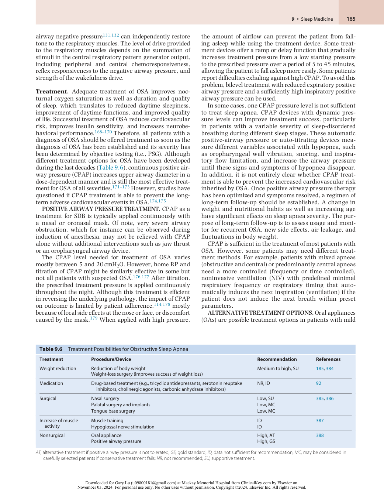

:::

<!-- PDF page 15 -->

to moderate OSA who do not tolerate CPAP therapy. Two major designs are currently used clinically: (1) mandibular repositioning appliance, which holds the mandible in an advanced position (a protrusion of at least 50% of the maximal possible extension is recommended for effective treatment),179 and (2) tongue- retaining devices, leading to repositioning of the tongue into a forward position without any protrusion of the mandible. A multidisciplinary approach including a sleep physician and a dental technician experienced in OAs has been recommended for this purpose, because both factors are crucial for patient adherence and outcome from OA treatment.111 OAs are recommended in patients with mild to moderate OSA who do not tolerate,179 do not respond to, fail, or are not appropriate candidates for CPAP treatment.90

Historically, surgical treatment methods were the only approach to treatment of OSA, but the effectiveness of most of the nasopharyngeal surgical approaches for severe OSA remains unclear. However, tonsillectomy is beneficial in adult patients with OSA from tonsillar hypertrophy, and adenotonsillectomy is recommended in children with OSA and adenotonsillar hypertrophy.180 Repeated sleep testing before and following surgery is recommended to ensure sufficient long- lasting therapeutic effects.90,179,181

Electrical stimulation of the upper airway muscles has been explored in the treatment of OSA. Hypoglossal nerve stimulation induces genioglossus muscle contractions, which dose dependently increase inspiratory airflow during OSA,182 but the invasiveness of the procedure, the cost of the device, and the requirement for preimplantation endoscopy during anesthesia limit its use as a first- line treatment of OSA.154

While pharyngeal fat deposits led to a decrease in pharyngeal patency, underlining the risk factor of obesity,183,184 weight loss leads to a reduction in Pcrit and the severity of OSA149,185 and is recommended as adjunctive treatment in all overweight patients with OSA.186 Because long- term weight reduction is more effective when accompanied by weight loss surgery, bariatric surgery may be considered as an adjunctive therapy in very obese patients (body mass index [BMI] ≥40 kg/m2 ), as well as in those with important comorbidities and BMI of 35 kg/m2 or greater and in whom dietary attempts at weight control have been ineffective.90

Oxygen is currently not recommended as primary treatment of OSA but may be used as an adjunctive

treatment in some patients, particularly in the postoperative period.90,187

Although OSA is more common in the older population, it occurs in children with a peak in the incidence between 2 and 5 years of age. Obesity predicts snoring and other signs of obstructive respiratory events in children.111 Tonsillar and adenoidal hypertrophy is another important cause of OSA in children and can be treated surgically.18

### Central Sleep Apnea

CSA impairs quality of life188 and is associated with adverse outcome in CHF patients.93,189,190 CSA is defined as cessation of airflow without respiratory effort,188 which separates it from OSA, where respiratory effort is maintained or even increased during an apnea. In clinical sleep apnea, considerable overlap between OSA and CSA occurs that needs to be identified and subsequently treated.190

CSA can be found in older patients and in patients with severe comorbidities such as CHF, stroke, or other neurologic disorders (e.g., amyotrophic lateral sclerosis). In a southern Pennsylvania cohort, CSA (AHI ≥20/hour) was found in 5% of men aged 65 years and older, but it was not found in younger men or in women of any age. For an AHI of 2.5 per hour and greater, the prevalence estimates in men younger than 45 years remains negligible, while CSA was found in 1.7% of men between 45 and 64 years, and 12% in men older than 65 years,191 or 9% in individuals between 40 and 97 years, respectively.192

The mechanisms of CSA can be categorized into those with high and low loop gain. The most common subtype of CSA with an increased loop gain is CSR and is commonly seen in patients with CHF and left- ventricular systolic dysfunction. CSR is defined as a crescendo–decrescendo pattern of hyperventilation between 20 and 30 seconds in duration, followed by 10 to 40 seconds of hypopneas or apneas (Fig. 9.10), usually occurring during NREM sleep stage 1 and 2.193 Nevertheless, CSR can also occur during exercise or wakefulness. Nearly one out of two patients with CHF shows CSR.194 CSR is more common in men and worse in the supine body position.166

Potential respiratory therapies of CSR include oxygen, respiratory stimulants (e.g., CO2, theophylline, and acetazolamide), and NIV such as bilevel positive airway pressure. The effectiveness of CPAP as therapy is controversial. Optimization of medical therapy is the best treatment, because CSR will often resolve with adequate treatment of

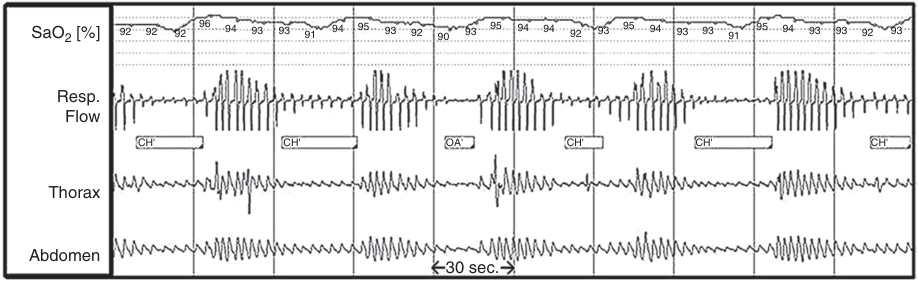

SaO2 [%] 92 92 92 96 94 93 93 91 94 95 93 92 90 93 95 94 94 92 93 95 94 93 93 91 95 94 93 93 92 93 Resp. Flow CH' CH' OA' CH' CH' CH' Thorax Abdomen 30 sec. 

**<mark>Fig. 9.10 Polysomnographic recording of an episode of Cheyne–Stokes respiration.</mark>** _<mark>CH</mark>_ <mark>, central hypopnea;</mark> _<mark>OA</mark>_ <mark>, obstructive apnea.</mark>

<!-- PDF page 16 -->

CHF (cardiac resynchronization therapy and surgical treatment, such as heart transplant).193

### Obesity Hypoventilation Syndrome

Obesity hypoventilation syndrome (OHS) is defined as the combination of nocturnal and daytime hypoventilation, usually leading to hypercapnia in obese subjects (BMI ≥30 kg/ m2 ), in the absence of other causes of hypoventilation. _Alveolar hypoventilation_ is defined as insufficient ventilation leading to hypercapnia. Mechanisms of alveolar hypoventilation include central hypoventilation, chest wall deformities, neuromuscular disorders, chronic obstructive pulmonary disease, as well as severe obesity (obesity hypoventilation syndrome [OHS]).

The prevalence of OHS is estimated to be up to 50% in obese patients with OSA. It can occur in up to 50% of patients with a BMI of 50 kg/m2 or more,195 compared with 0.15% to 0.3% in the general adult population. Ninety percent of patients with OHS also suffer from OSA.196,197 OHS often remains undiagnosed, and the true prevalence remains unclear.

Severe obesity is associated with an increase in respiratory drive that helps maintain eucapnia in the presence of the abnormal chest wall mechanics and high work of breathing.198,199 In OHS, this compensatory mechanism is abolished,198,200 which in part might be explained by leptin resistance.201–203 Typically, OHS manifests as a reduced lung capacity, vital and functional residual capacity, expiratory reserve volume, respiratory system compliance, and inspiratory muscle strength, whereas response to CO2 might be reduced or normal. In addition, there is an increase in serum bicarbonate and alveolar PCO2, as well as in the work of breathing and leptin levels.203,204

Impairment of the effectiveness of respiratory pump muscle function in patients with OHS can be explained by the effects of low lung volume because of central fat distribution, leading to a cranial displacement of the diaphragm when lying supine.204,205 In addition, diaphragmatic myopathy might be a contributing factor of OHS.203 Treatment options include weight loss and NIV.205,206

## Sleep and Anesthesia: Two Unequal Twins Influencing Perioperative Medicine

### CLINICAL PICTURE OF SLEEP AND ANESTHESIA

In 1855, in a publication _Note on_ the _Induction of Sleep and Anæsthesia by Compression of the Carotids_ , Professor Fleming from Queens Colleague in Cork described his thoughts about the overlapping mechanisms of surgical anesthesia and deep sleep: “during the operation, the patient would be in ‘profound sleep, and the mind dreams with much activity.’”207,208 Fleming speculated that deep physiologic sleep and anesthesia share a common mechanism, a decreased blood supply to the brain.

Although physiologic sleep and anesthesia share some clinical features (loss of consciousness and a modulation of brainstem autonomic function), major differences can be found when closer observations of both behavioral states are undertaken. In contrast to anesthesia, sleep shows spontaneous generation and termination, ready reversibility by

noxious stimuli, and homeostatic regulation. Anesthesia does not share the stage- wise structure seen during physiologic sleep. In addition, functional imaging studies underline the fundamental differences during onset of anesthesia and wakefulness–sleep transition.

Although there are similarities in the EEG patterns between slow- wave sleep and anesthesia- induced unconsciousness, the EEG patterns during sleep and anesthesia are different,209 with different frequencies and types of activation in EEG recorded during physiologic sleep and the uniform EEG picture observed during anesthesia- induced unconsciousness (Fig. 9.11).210

During anesthesia induction, the level of consciousness continuously decreases from fully awake through states of reduced response to external stimuli up to a completely unresponsive state.211 This is in contrast to the sharp α–θ EEG transitions seen while the individual proceeds from wakefulness to sleep without any transient stages. Individuals in a steady state of physiologic sleep can be aroused with sufficient stimulation, whereas drug- induced unconsciousness needs at least some drug elimination to occur before individuals can be aroused.212

### DISTINCT MECHANISMS OF AROUSABLE (SLEEP, SEDATION) AND UNAROUSABLE UNCONSCIOUSNESS (ANESTHESIA)

The American Society of Anesthesiologists describes general anesthesia as the deepest level of a drug- induced continuum beginning with anxiolysis, followed by sedation, and ending with unresponsiveness and impairment of vital functions requiring cardiorespiratory support.207 This model may at least in part underlie the appeal of a single process of anesthesia which is fundamentally driven by the same neural mechanisms that govern sleep–wake states. There are solid studies supporting the conclusion that drugs causing sedation can do so by engaging endogenous sleep.213,214 Some have proposed a “shared circuit hypothesis” indicating that activation of a particular set or sets of sleep- generating neurons is necessary or sufficient for producing the unarousable state that is general anesthesia.215 Multiple lines of evidence support a common mechanism of sleep and sedation (Fig. 9.12). Sedating drugs induce

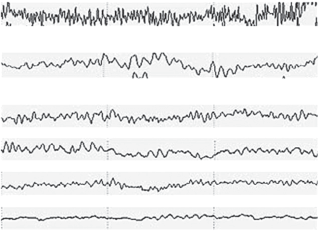

### AWAKE

ANESTHESIA-INDUCED SLEEP

LIGHT ANESTHESIA

DEEP ANESTHESIA

3 sec.

**Fig. 9.11 Electroencephalographic recording during sedation and loss of consciousness induced by propofol.** Compared with physiologic sleep, sedation shows electroencephalographic (EEG) traces comparable to slow- wave sleep, indicating the sleep- inducing effect of anesthetics. Anesthesia- induced loss of consciousness (lower four traces) shows different EEG activity with reduced amplitudes and burst suppression. (Burst suppression is not shown in these traces.)

<!-- PDF page 17 -->

behavioral states similar, if not identical, to non- rapid- eyemovement (NREM) sleep.216 These states are characterized by loss of consciousness, slow waves in the neocortical electrocorticogram (EEG), and varying degrees of muscle relaxation. Sedative- and sleep- associated loss of awareness of one’s surroundings is accompanied by a raised arousal threshold, but sufficient stimuli may produce wakefulness. In common with natural sleep, many sedating drugs including but not limited to dexmedetomidine, ethanol, and isoflurane activate endogenous sleep- promoting neurons in VLPO.217,218 In addition to VLPO neuronal activation being correlated with sedation, loss of VLPO neurons attenuates the sedative response to dexmedetomidine, supporting a causal role. But whether drug potentiation of sedation via VLPO contributes to non- arousable unconsciousness, hereafter referred to as anesthesia, has not been shown.

It has been shown that rats and mice with complete lesions of the VLPO can still be anesthetized.217,219 Although lesions of VLPO lead to a transient resistance to volatile anesthetics,216,217 if some time elapses following a VLPO lesion, the animals show increased sensitivity to isoflurane anesthesia attributable to increased homeostatic sleep drive.217,219–221 Another problem with the VLPO–TMN circuit hypothesis of anesthesia is that direct inhibition of the TMN produces sedation but not anesthesia.213 Animals without VLPO neurons have profound insomnia. Therefore, interaction of anesthetics with these sleep- promoting nuclei alone is not sufficient to produce unconsciousness during anesthesia. Several studies provided evidence to extend the scientific framework of general anesthetics modulating sleep- promoting regions by the anesthetic depression of arousal- promoting nuclei, including the locus coeruleus, GABA- ergic neurons of the pontine reticular formation, the pedunculopontine and laterodorsal

tegmentum, the ventral tegmental area, as well as the perifornical area, the tuberomammillary nucleus, and the basal forebrain.222,223 This “bottom- up” hypothesis of anesthesia- induced unconsciousness may be the result of the simultaneous interaction with the brainstem and diencephalic regions, including the ascending arousal system, locus coeruleus, and endogenous sleep circuitry. Although, these mechanisms show similarities with sleep- promoting neuronal interactions, they are unlikely to be the only correlate of anesthesia- induced unconsciousness. Sleep, but not anesthesia, is easily reversed or prevented by real or perceived environmental threats. While interaction with sleep- promoting neurons work by inhibiting these arousal pathways, other neuronal networks crucial for consciousness (e.g., thalamocortical networks) remain active during sleep.224 However, the finding that many anesthetics engage sleep pathways is still important and meaningful, as this is undoubtedly an important mechanism by which these classes of anesthetics promote sleep. Nevertheless, this effect does not and cannot prevent arousal to sufficient external stimuli. The unique property of anesthesia to do so has to be mediated by an additional mechanism.

### PERIOPERATIVE INTERACTIONS BETWEEN ANESTHESIA AND SLEEP

Anesthesia and painful surgical procedures affect sleep and circadian rhythms225–227 for as long as 6 months, depending on the complexity of the procedure performed.228 A substantial decrease in REM sleep occurs on the first night after surgery and anesthesia, followed by a profound REM rebound phenomenon on the second to fourth postoperative nights, when REM sleep increases in both intensity and amount.225,227 Although most anesthetics can lead to an

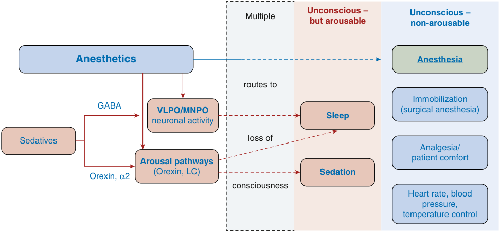

Unconscious – Unconscious – Multiple but arousable non-arousable Anesthetics Anesthesia routes to Immobilization GABA VLPO/MNPO (surgical anesthesia) Sleep neuronal activity Sedatives loss of Analgesia/ patient comfort Arousal pathways (Orexin, LC) Sedation Orexin, α2 consciousness Heart rate, blood pressure, temperature control 

**Fig. 9.12 There are multiple routes to physiologic and drug- induced unconsciousness, which can be separated by presence or absence of arousability.** Natural sleep and drug- induced sedation share the phenotype of arousability. Activation of neurons in the ventrolateral preoptic nucleus (VLPO) and the median preoptic nucleus (MNPO) induce sleep or sedation, where the person is arousable. Sleep and sedation can also be initiated via arousal pathways, for example, by an inhibition of orexin receptors or the locus coeruleus.381 Anesthetics activate sleep- promoting VLPO and MNPO neurons and can induce arousable unconsciousness (sedation) at low doses. General anesthesia (unarousable unconsciousness) cannot be achieved via activation of arousal- inhibiting neural circuits. Anesthetics, at general anesthetic doses, simultaneously modulate neural circuits that are downstream of these brainstem and hypothalamic nuclei (e.g., in the neocortex) to disrupt the brain’s capacity for information processing across spatial and temporal scales. _GABA_ , gamma-aminobutyric acid; _LC_ , locus coeruleus.

<!-- PDF page 18 -->

impairment of sleep architecture, such as REM depression and reduced sleep quality during the early postoperative period, the extent of this impairment probably depends on the pharmacokinetics and pharmacodynamics of the anesthetics and opioids used,229,230 which affect the duration of REM sleep,231,232 as well as surgery- induced stress.

The effect of propofol on sleep architecture and REM sleep is complex and dose dependent. In long- term ventilated, critically ill patients, propofol sedation abolishes REM sleep and diminishes sleep quality,233 whereas with low dose propofol, REM sleep is possible. The effects of ketamine sedation on sleep architecture have not been studied in detail, although it may have rather mild effects on REM duration.234

Anesthetics have strong effects on GABA and NMDA receptors, both of which are linked with circadian control. As a result, anesthetics may interfere with entrainment of the circadian rhythm; however, preclinical and human data show inconsistent results. A trial in honeybees suggested an anesthetic- induced circadian shift. Inside the laboratory with no outdoor cues, daytime anesthesia disturbed the usual activity patterns in the hive for the next several days. In addition, cycles of clock gene activity showed a delay,235,236 and inhibition of the period circadian protein (per)- 2 gene expression (one of the core clock genes) was observed during anesthesia.237 Of note, psychotropic nonanesthetics, such as opioids, have been shown to affect melatonin secretion indirectly, independent of the behavioral state anesthesia in a pig model.238 Previous work in humans has shown that 3 hours of anesthetic exposure does not affect the circadian phase of the body temperature rhythm.239

In summary, the specific mechanisms of anesthetic effects on circadian rhythm are unclear. The ability to distinguish between effects occurring directly on the circadian pacemaker and those occurring downstream from the pacemaker on other physiologic control systems requires additional research under rigorous experimental conditions.

Surgical treatment itself impairs sleep, expressed as reduced REM sleep duration even in the absence of general anesthesia.229,230 Pain, inflammation, stress immobility, and anxiety seem to be contributing factors.240 After surgery, patients show a significant impairment of sleep quality and duration. Eventually, it will be known whether specific anesthetics are preferable to avoid the adverse effects of sleep deprivation.

### SLEEP- DISORDERED BREATHING AND AIRWAY PATENCY DURING ANESTHESIA

Perioperative complications occur more often in patients with OSA than in healthy controls,241–244 but the reasons for this observation are unclear. It is challenging to isolate the effect of OSA from the known adverse effects on perioperative outcome of typical OSA comorbidities, such as hypertension, diabetes mellitus, coronary artery disease, neurovascular vulnerability, and obesity. Fortunately, severe postoperative complications are uncommon. Consequently, large trials are needed to isolate the causal relationship between SDB and perioperative complications, such as severe respiratory failure, thromboembolic complications, increased hospital length of stay, and mortality.

It is unclear if sleep apnea independent of obesity is a predictor of difficult intubation.243,245,246 Previously published meta- analysis reported a significantly higher risk of postoperative major cardiac and cerebrovascular events, newly detected postoperative atrial fibrillation, and acute postoperative respiratory failure, compared with control subjects in patients with OSA.247–250 These findings need to be confirmed in future prospective studies with a larger sample size and a more homogeneous population such that confounding factors can be controlled. OSA is associated with postoperative delirium,241,251 which is an important perioperative complication associated with increased costs, morbidity, and mortality. However, it is currently unclear if this is due to repetitive hypoxia or sleep fragmentation. In contrast, a study using the Nationwide Inpatient Sample database analyzed data from 1,058,710 patients undergoing elective surgery. These authors showed that patients previously diagnosed with SDB had significantly higher rates of emergent mechanical ventilation, use of NIV, and CPAP, as well as increased rates of respiratory failure. Nevertheless, the study also showed that patients with SDB had better outcomes after emergent intubation and had lower care- associated costs compared with their non- SDB counterparts.252 Similar findings were reported by the same group for data from 91,028 patients undergoing bariatric surgery.253 In this study, patients with a previous diagnosis of SDB had a shorter hospital length of stay and lower total costs compared with non- SDB patients. The reasons for the differences are unclear. Patients with a known history of sleep apnea may receive more sophisticated perioperative monitoring and more aggressive treatment of their respiratory disease, which might also explain the higher rate of postoperative reintubation in SDB patients reported in the same group.252 Another possible explanation relates to the consequences of chronic nocturnal desaturation, which can have preventive effects in terms of the consequences of perioperative acute hypoxia. Most importantly, these findings indicate that the association of SDB, and perioperative outcome is likely to be more than a unidirectional relationship. More likely is that SDB could have a dual effect, leading to increased rates of perioperative respiratory complications in patients with SDB, but additionally protecting the same population from the fatal consequences of these complications. The mechanism of the potential link between OSA and postoperative respiratory failure, as well as postoperative delirium, is probably multifactorial. Frequent episodes of airway collapse in OSA lead to hypoxia, disrupted sleep, daytime sleepiness, and increased arousal threshold from sleep, all of which can be considered as potential precipitating or augmenting factors of postoperative complications. It is intriguing to note that patients with OSA appear to be most vulnerable to hypoxia on postoperative night two or three, the time interval during which postoperative delirium most typically manifests.

One population that might deserve additional attention in perioperative care is patients with OHS who, compared with obese patients, are more likely to be admitted to a hospital and require more health care resources.252,254 In addition, higher rates of ICU admission, extended long- term care requirements at discharge, and higher mechanical ventilation rates have been reported in patients with OHS compared with severely obese patients without OHS.253–256

<!-- PDF page 19 -->

In summary, patients with SDB are more vulnerable to developing severe perioperative complications. Nevertheless, it is currently unclear whether these complications translate to a poorer overall postoperative outcome for these patients.

### PERIOPERATIVE MANAGEMENT IN PATIENTS WITH SLEEP- DISORDERED BREATHING

The standard of care for perioperative management of patients with SDB depends on the severity of the disease, comorbidities, and the threat associated with the planned surgical procedure. It is probably neither feasible nor necessary to conduct a sleep study in all obese patients at risk for sleep apnea who are scheduled for surgery257 ; however, high- risk patients need to be identified and treated perioperatively. Fig. 9.13 shows an algorithm driven by the idea that patients who have been prescribed CPAP preoperatively should continue to use CPAP perioperatively.

### Preoperative Screening

Several strategies need to be considered to identify patients with SDB adequately.97,255,256 Although clinical examination is the easiest and most cost- effective method of assessment using predisposing physical characteristics, it has a poor sensitivity and specificity of only 50% to 60% to diagnose OSA accurately.258,259 However, the clinical value of using questionnaires relates to the fact that they help to identify a high- risk perioperative population, independently of the question of whether an individual patient has OSA. For example, the STOP- Bang questionnaire basically screens for comorbidities of OSA that we know increase the risk of perioperative complications120 rather than direct breathing disorder- associated characteristics. The Score for Prediction of Obstructive Sleep Apnea might also be a helpful tool to predict patients with OSA and its perioperative outcome based on comorbidities and easily available clinical data.260

PSG is required to identify SDB specifically, but it cannot be used for preoperative screening of surgical patients. PSG is expensive, may delay surgery, and is inconvenient for the

patient. A multistep approach of preoperative screening is required. Preoperative assessment should include a screening for SDB and for the current use of NIV. OSA might not represent real risk in patients scheduled for low- risk procedures from a surgery and anesthesia point of view. The authors believe that patients with not previously diagnosed SDB undergoing a low- risk surgical procedure should receive standard perioperative monitoring and treatment.

Patients undergoing high- risk surgical procedures should receive further workup using a clinical examination combined with standardized and validated questionnaires (e.g., Berlin).256,261,262 A blood gas analysis should be considered as a method to detect hypercapnia as a major symptom of OHS (criterion: awake daytime hypercapnia PaCO2 ≥45 mm Hg). Alternatively, a venous bicarbonate concentration ≥27 mmol/L is highly sensitive (92%) for an increased PaCO2, which combined with hypoxemia (SpO2 ≤94%) indicates a high risk of OHS in these patients.253,263 Of note, OHS is a diagnosis by exclusion. Severe obstructive airway diseases, severe interstitial lung disease, severe chest wall disorders (e.g., kyphoscoliosis), severe hypothyroidism, neuromuscular disease, and congenital central hypoventilation syndrome need to be excluded, and further evaluation of sleep by a sleep medicine specialist before anesthesia should be considered. In these cases, the sleep medicine specialist should determine the optimal diagnostic instruments in cooperation with the perioperative team, prescribe the perioperative auto- titrating CPAP device, and offer in collaboration with respiratory therapy specialists to improve tolerability of perioperative CPAP therapy.

### Perioperative Management of Patients with Possible Sleep- Disordered Breathing

Although the data on optimal intraoperative and perioperative management are still limited, and mainly based on studies with low sample size, the techniques and procedures summarized in Box 9.2 might be considered during the perioperative management of patients with SDB.262,258 Patients with a history of SDB who are undergoing surgery and

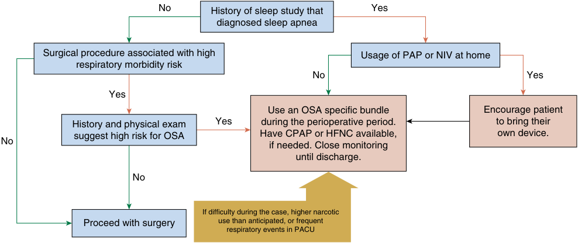

No History of sleep study that Yes diagnosed sleep apnea Surgical procedure associated with high Usage of PAP or NIV at home respiratory morbidity risk No Yes Yes Use an OSA specific bundle Encourage patient History and physical exam Yes during the perioperative period. to bring their No suggest high risk for OSA Have CPAP or HFNC available, own device. if needed. Close monitoring until discharge. No If difficulty during the case, higher narcotic Proceed with surgery use than anticipated, or frequent respiratory events in PACU 

**Fig. 9.13 Clinical pathway for perioperative management of patients with obstructive sleep apnea.** This figure outlines the step-by-step approach to managing patients with OSA during the perioperative period. _CPAP_ , continuous positive airway pressure; _HFNC_ , high flow nasal cannula; _NIV_ , non-invasive ventilation; _OSA_ , obstructive sleep apnea; _PACU_ , post anesthesia care unit; _PAP,_ positive airway pressure.

<!-- PDF page 20 -->

### Box 9.2 Special Sleep- Disordered Breathing Anesthesia Bundle: Special Procedures Performed During Anesthesia in Patients with Diagnosed Sleep- Disordered Breathing and Positive Airway Pressure or Noninvasive Ventilation Treatment

|**Preanesthesia Period**|ᑏNeuromuscular blockade should be monitored.|
|---|---|
|ᑏConsider regional anesthetic techniques that minimize the|ᑏResidual neuromuscular blockade should be reversed.|
|chance of postoperative deep sedation.|**Extubation and Postanesthetic Care Unit**|
|**Induction Strategy**|ᑏPatient should be able to cooperate before extubation. Consider|
|ᑏMonitoring: capnogram, tidal volume measurement ᑏSniffing position|positioning of patients in PACU bed: upper body should be elevated by 45 degrees; lateral position preferred to minimize |
|i ᑏReverse Trendelenburg position|gravitational effects on the upper airway. |
| ᑏConsider intubation without nondepolarizing NMBA; consider succinylcholine.|ᑏIn case of impaired respiratory function, a plan needs to be defined and documented for monitoring and treatment, |
|ᑏTriple airway maneuver with two hands|including the consideration of noninvasive ventilation. |
| ᑏUtilize lung recruitment maneuvers immediately after intubation and apply PEEP for maintaining lung volume during surgery. ᑏPCV with PEEP|ᑏPatients will be discharged to an unmonitored environment or home when they meet discharge criteria: ᑏVital signs within 20% from baseline |
|ᑏShort- acting anesthetics and narcotics preferred|ᑏAdequate treatment of nausea |
|ᑏAvoid high- dose steroidal NMBA.|ᑏPain score≤40% |

- Aldrete score ≥8

|ᑏUse neuromuscular transmission monitoring.|
|---|

- Passed room air challenge test

|**Intraoperative Management**|
|---|
|ᑏWhenever possible, use of sedatives and narcotics should be reduced.|
|ᑏAgents with reduced impairing effect on upper airway patency|
|might be considered (e.g., ketamine, pentobarbital).|

- **Pain Therapy** ᑏ Consider nonsteroidal anti- inflammatory drugs to reduce opioid use whenever possible, if not contraindicated.

- Use caution when combining opioids with sedatives or hypnotics.

_NMBA,_ neuromuscular blocking agents; _PACU,_ postanesthesia care unit; _PCV,_ patient- controlled ventilation; _PEEP,_ positive end- expiratory pressure.

anesthesia with high risk of morbidity should receive an “OSA anesthesia bundle” (see Box 9.2) that includes special procedures and preparations during tracheal intubation, extubation, pain therapy, and perioperative CPAP therapy.

**Tracheal Intubation.** Patients with OSA are frequently obese, and obesity is a risk factor for difficult intubation.246,263,264 Patients should be preoxygenated efficiently before injection of the anesthetic drug. Sniffing and reverse Trendelenburg position are preferred before intubation, which improves maintenance of the passive (i.e., paralyzed) pharyngeal airway in patients with OSA265,266 and increases functional residual capacity. An experienced anesthesiologist using modern technology (video laryngoscope or fiberoptic awake intubation) can successfully manage the airway during induction of anesthesia in patients with OSA.245 Immediately after successful intubation, a lung recruitment maneuver and the application of positive end- expiratory pressure for maintaining lung volume during surgery may be considered.267,268

**Intraoperative Treatment.** Impaired upper airway patency is of special concern whenever anesthetics are administered without a device that bypasses the collapsible upper airway – for example, during sedation for endoscopy.269,270 While the overall rate of overt sedation- related complications for such procedures (e.g., endoscopy) appears low,271 patients who are vulnerable to respiratory complications may suffer from sequelae of increased upper airway collapsibility beyond the immediately observable after intervention.

Opioids and GABA- ergic sedatives/hypnotics impair upper airway patency without any meaningful difference between compounds given at an equipotent dose of analgesics.272–275 Of note, the impairing effects of GABA- ergic drugs on airway patency can be reversed by the respiratory

stimulants (Fig. 9.14).271 Thus, it is recommended not to extubate patients at risk of postoperative airway collapse during hypocarbia but rather at mildly hypercarbic conditions.

Ketamine abolishes the impairment of upper airway patency during loss of consciousness and sleep,276 and may be a useful adjunct to achieve postoperative pain therapy in patients at high risk of airway collapse.

Nondepolarizing neuromuscular blocking drugs should be titrated optimally by quantitative neuromuscular transmission monitoring to avoid residual neuromuscular blockade, which increases the risk of postoperative respiratory complications.277–280 The effects of neuromuscular blockade should be reversed only when present, because inappropriate reversal can impair upper airway function in animals and humans.279–281

**Postoperative Care.** OSA occurs during sleep and sedation282,283 ; therefore, tracheal extubation should be delayed until complete recovery of consciousness. Patients should be positioned with the upper body elevated by 45 degrees, which improves airway patency266,267 and functional residual capacity. The lateral body position is an alternative for patients who do not tolerate an elevated upper body position. NIV is a viable treatment of postoperative respiratory failure and helps prevent deoxygenation and the development of postoperative negative pressure pulmonary edema; it can also prevent the respiratory depressant effects of opioids.281,284

Before discharge from the postanesthesia care unit, a room air- challenge test should be conducted. Several noninvasive monitoring devices have been developed for patients with and without risk for OSA. However, it is currently unclear if these devices can help prevent postoperative complications, and this requires further investigation.285,286 Patients with OSA can be safely treated in an ambulatory surgery center which is run by well- trained anesthesiologists.245,287a

::: details 原始表格與符號（PDF 第 20 頁）

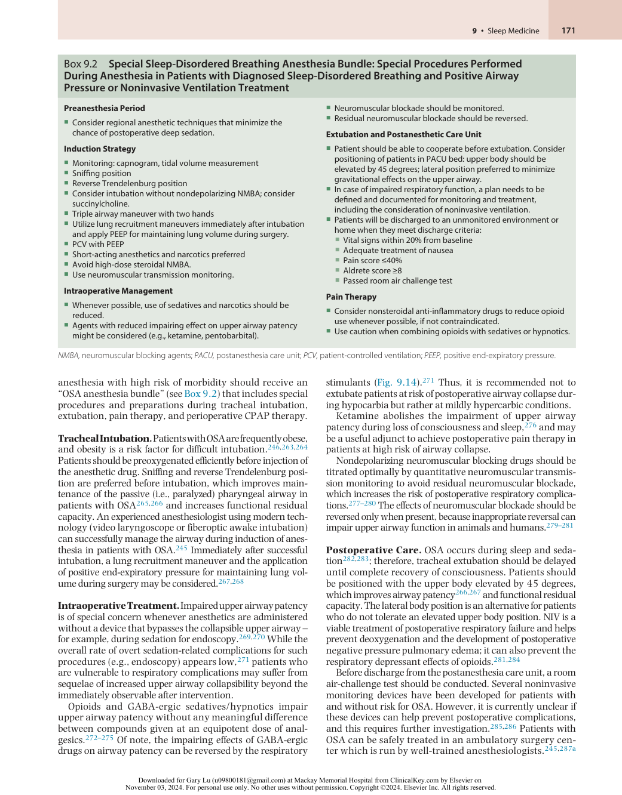

:::

<!-- PDF page 21 -->

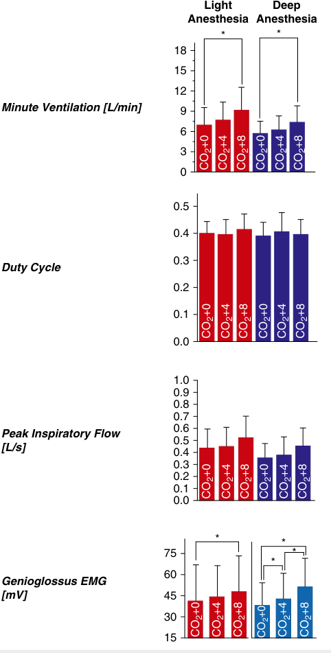

Light Deep Anesthesia Anesthesia * * 18 15 12 Minute Ventilation [L/min] 9 6 3 0 0.5 0.4 0.3 Duty Cycle 0.2 0.1 0.0 1.0 0.9 0.8 0.7 0.6 Peak Inspiratory Flow 0.5 [L/s] 0.4 0.3 0.2 0.1 0.0 * * 75 * * 60 Genioglossus EMG [mV] 45 30 15 CO+0 2 CO+4 2 CO+8 2 CO+0 2 CO+4 2 CO+8 2 CO+0 2 CO+4 2 CO+8 2 CO+0 2 CO+4 2 CO+8 2 CO+0 2 CO+4 2 CO+8 2 CO+0 2 CO+4 2 CO+8 2 CO+0 2 CO+4 2 CO+8 2 CO 0 + 2 CO+4 2 CO+8 2 

**Fig. 9.14 Effect of carbon dioxide (CO2) level on genioglossus activity and respiratory function during anesthesia.** Insufflation of CO2 to an increased pCO2 (+4 or +8 mm Hg) increases minute ventilation, peak inspiratory flow and upper airway dilating muscle activity (e.g. genioglossus muscle) in a dose- dependent fashion during deep ( _blue bars_ ) and light ( _red bars_ ) anesthesia. (Modified from Ruscic KJ, Bøgh Stokholm J, Patlak J, et al. Supplemental carbon dioxide stabilizes the upper airway in volunteers anesthetized with propofol. _Anesthesiology_ . 2018;129(1):37–46.)

For outpatients whose preoperative screening arouses suspicion of previously undiagnosed OSA, opioid dose should optimally not be used and meticulously titrated if needed.

It is widely acknowledged that obesity or OSA alone are not contraindications for ambulatory surgical care.287b- 287d

Szeto et al. found no significant link between OSA status and short- term outcomes in patients undergoing various outpatient surgical procedures in a standalone ambulatory surgery facility.287e Similarly, Stierer et al. demonstrated that in ambulatory surgery patients, those with diagnosed or high- risk OSA did not face an elevated risk of unplanned hospital admission or life- threatening events such as reintubation, cardiac arrhythmia, or death.287f

Therefore, current guidelines recommend screening high- risk OSA patients, optimizing their co- morbidities, and employing OSA- specific perioperative bundle interventions to enhance their perioperative care and recovery.287d,287g Raub et al reported lower odds for postoperative invasive mechanical ventilation after screening for OSA and employing a high OSA risk bundle intervention.287h

A critical component of such interventions is using Continuous Positive Airway Pressure (CPAP) in the Post- Anesthesia Care Unit (PACU) for patients either already on CPAP or displaying signs of upper airway obstruction. Studies show that CPAP lowers the Apnea- Hypopnea Index (AHI) and respiratory events in the PACU.287i,287j Ideally, patients should bring their own device to the ambulatory care center, and healthcare providers should be equipped to assist the patient in using it during recovery. However, a state- of- the- art ambulatory care facility should also provide CPAP for patients without their own device and train its staff to use it appropriately. Unfortunately, only 59.7% of Ambulatory Surgery Centers (ASCs) across the US reported having access to CPAP.287k

By implementing these measures, access to ambulatory surgical care can be expanded for OSA patients. However, there is still a subset of OSA patients who should undergo surgery in an inpatient setting, including those with poorly controlled comorbid conditions, severe OSA undergoing high- risk procedures requiring postoperative opioids, particularly if they are unable or unwilling to use CPAP. Currently, there is no data indicating that airway procedures cannot be performed in an ambulatory setting for OSA patients.

**Pain Therapy.** Pain treatment is of special concern during the postoperative period. Opioids reduce respiratory drive in a dose- dependent manner, and special caution is recommended when opioids are combined with sedatives or hypnotics. If not contraindicated, regional anesthesia and nonopioid analgesics should be considered to reduce opioid use whenever possible. If opioids are used, CPAP treatment throughout the early postoperative period may be beneficial in patients with high risk for OSA.284 Pain intensity typically decreases over time following surgery. Decreasing opioid doses are typically required to maintain the balance of decreasing and increasing effects on respiratory drive.

Patients with SDB being treated with CPAP at home should proceed with these treatments throughout the perioperative period. Sufficient functioning of the treatment device needs to be checked preoperatively (see Box 9.2).

### KNOWLEDGE GAPS AND FUTURE RESEARCH

Future research should aim to answer questions on how to further improve the perioperative management of patients with sleep- disordered breathing.288 Open questions remain: What is the role of supplemental oxygen postoperatively? What are the barriers to CPAP adherence in the perioperative setting? Can patient adherence and positive airway pressure effectiveness be increased with educational resources? Should other respiratory support interventions be examined either in isolation or bundled with positive airway pressure? Is there a role for targeted positive airway pressure therapy, even with CPAP naive patients in very high- risk groups? What are the medicolegal liability and patient safety factors to consider when starting CPAP in the hospital?289 Testing a bundled approach to care (e.g., an algorithm of care

<!-- PDF page 22 -->

including monitoring, positive airway pressure, education, and other respiratory supports) rather than each component individually might be more useful in initial clinical trials, as this may be more likely to be effective in improving outcomes.

The incidence of perioperative complications is low, and collaborative research networks are needed to identify a sufficient number of patients with OSA and answer the important research questions on perioperative outcomes. Patients with OHS might be at high risk. A minimal set of data elements required in prospective cohort studies should be identified to facilitate multisite collaboration and meta- analysis of independent studies. Case–control studies might also be nested within larger cohort studies. This would facilitate the choice of an appropriate control group. These studies may improve risk stratification and lead to novel targeted therapies. In addition, the identification of interventions that can optimize safety in this population is also important. Initial intervention trials should focus on patients at highest risk for sleep- disordered breathing.288

## Sleep and Sedation in the Intensive Care Unit

Impaired sleep is common in patients in the ICU,290 with multiple contributing factors including noise, light, interruptions for medical procedures, and administration of fluids and nutrition, as well as endogenous factors such as pain, anxiety, and inflammation. Sleep duration in the ICU is variable, depending on environmental conditions and the severity of the patient’s disease.291 Sleep fragmentation occurs consistently during sedation and mechanical ventilation.292,293 The duration of deep NREM and REM sleep as well as circadian rhythms are severely reduced or abolished in ICU patients.294–296 About 50% of sleep in these patients occurs during daytime hours.290,291 Altered EEG activity, not fitting into the standard criteria for sleep and wakefulness, was reported to occur in up to 70% of ICU patients who were receiving sedatives or being mechanically ventilated.297 Portable EEG monitors, which require minimal setup time and expertise, may be used in the ICU. These monitors use frontal electrode placements that approximate those recommended by the AASM. As a result, alternative classifications for sleep in the ICU have been developed298 ; however, these scoring classifications have not yet been validated.

### NOISE AND LIGHT EXPOSURE

ICUs are among the most noisy areas in hospitals, with sound levels often exceeding those recommended by the World Health Organization (&lt;45 dB).293,299 Elbaz and associates300 reported an increased incidence of arousals at sound levels above >77 dB in stable, mechanically ventilated ICU patients during the weaning phase. In the ICU setting, alarms from medical and monitoring devices were the most significant source of noise.

In addition to noise, changes in light exposure can alter sleep patterns and circadian rhythms. ICU patients are often exposed to dim light throughout the 24- hour cycle, resulting in increased light levels during the night and insufficient light exposure during the daytime.301,302 This hinders the alignment (photoentrainment) of the internal

circadian clock to the external 24- hour rhythm, potentially resulting in the disrupted sleep–wake pattern seen in many ICU patients.302,303

Impaired rhythmicity in melatonin secretion pattern in critically ill patients was reported in several studies (Table 9.7 for overview), and multiple factors influence melatonin rhythm in the ICU. Melatonin levels decrease with increasing age,304 making older ICU patients more sensitive to circadian rhythm disruptions. Opioids increase melatonin levels throughout the 24- hour period.305

Similarly, β- agonists, including vasopressors, positive inotropes, and aerosolized albuterol, increase melatonin levels, whereas β- blockers decrease melatonin secretion. Also, endogenous production of catecholamines may induce periodic melatonin increases in patients with critical illness.306 Benzodiazepines have inconsistent effects on melatonin.307,308

These interactive effects of critical illness and ICU treatment should be acknowledged while caring for ICU patients. Reduction of light and noise exposure during the night and increased light levels during the day are recommended to improve sleep. In addition, earplugs and eye masks have been shown consistently to improve sleep quality in ICU patients and possibly reduce the risk of complications.309–312

### NURSING–PATIENT INTERACTIONS AND MEDICAL PROCEDURES

Interruptions of sleep due to medical or nursing procedures are environmental factors in the ICU. Studies in different ICU settings found high numbers of interventions to be performed during the nighttime, ranging up to 60 interventions per night.313,314

Both NIV and ventilation via breathing tube impair sleep architecture and quality.292,315 It is unclear how the issue of ICU- associated circadian disruption can be prevented or treated. Data suggest that weaning procedures during the daytime combined with assist control ventilation during the nighttime improve sleep, expressed as reduced numbers of arousal in patients requiring long- term ventilation.295

### SLEEP DISTURBANCES, DEPTH OF SEDATION, AND DELIRIUM IN THE INTENSIVE CARE UNIT

Sedation is frequently required in the ICU to treat excessive agitation or to fulfill specific therapeutic needs; however, prolonged deep sedation (Richmond agitation sedation scale ≤−3) is associated with increased ICU and hospital stays and delirium.316,317 GABA receptor agonists, such as propofol and benzodiazepines, may increase depth of sedation and reduce REM sleep, and consequently increase neurocognitive disorders.233,317,318

The etiology of sleep disturbances in ICU patients is multifactorial (Fig. 9.15). Sleep is the result of a dynamic balance of various complex neurochemical interactions. Alterations in any of the neuromodulators involved in this equilibrium may affect sleep regulation in the ICU patient. For example, an increase in norepinephrine and serotonin levels is associated with inhibition of REM sleep, while loss of a normal melatonin secretion pattern is associated with severe lack of sleep in ICU patients.

Pain is a common experience for most patients in the ICU,319 and failure to recognize pain can result in excessive

<!-- PDF page 23 -->

**Table 9.7** List of Studies Investigating Alteration of Circadian Rhythm and Sleep in Intensive Care Unit Patients

|**Measurement Method**|**Interactions**|**Reference**|
|---|---|---|
|PSG studies|ᑏIncreased arousal during nighttime and disrupted sleep, due to: ᑏnoise ᑏdim light ᑏmedical intervention ᑏDecrease N3 and REM sleep ᑏIncrease arousals and awakenings ᑏMultiple discrete sleep episodes per 24 h ᑏAtypical EEG signal: ᑏdisrupted sleep ᑏnonphysiologic sleep ᑏarchitecture, or evidence of coma|296,299 389–391 291,294,296,298|
|Melatonin blood levels and urinary 6- sulfatoxymelatonin urine levels|ᑏIncreasing chronodisruption with disease severity (rehabilitation patients, ICU patients, ICU patients with severe sepsis) ᑏDelayed melatonin peak at night ᑏReduced physiologic melatonin secretion at night, due to: ᑏsedation ᑏmechanical ventilation ᑏincreased arousal ᑏIncreased melatonin levels during the day, due to: ᑏdim light ᑏsevere sepsis|296 391 306,392,393 394,395 396–398 306,394,395 392,397|
|Blood pressure variation|ᑏReduced nocturnal blood pressure dip|306|
|Body temperature variation|ᑏReduced temperature variation ᑏAltered circadian rhythm with nadir dispersed widely across 24 h|24,306,399|
|Plasma cortisol level|ᑏAbolished circadian rhythm ᑏDelayed peak of cortisol levels|306,396|

_EEG,_ electroencephalography; _ICU_ , intensive care unit; _N3,_ sleep stage 3; _PSG,_ polysomnography; _REM,_ rapid eye movement.

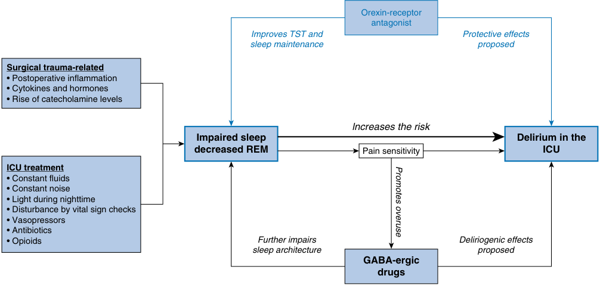

Orexin-receptor antagonist Improves TST and Protective effects sleep maintenance proposed Surgical trauma-related • Postoperative inflammation • Cytokines and hormones • Rise of catecholamine levels lncreases the risk Impaired sleep Delirium in the decreased REM Pain sensitivity ICU ICU treatment • Constant fluids • Constant noise • Light during nighttime • Disturbance by vital sign checks • Vasopressors • Antibiotics • Opioids Further impairs Deliriogenic effects sleep architecture proposed GABA-ergic drugs Promotes overuse 

**Fig. 9.15 Pathophysiology of insomnia and delirium after cardiac surgery.** _GABA_ , gamma- aminobutyric acid; _ICU_ , intensive care unit; _REM_ , rapid eye movement; _TST_ , total sleep time.

::: details 原始表格與符號（PDF 第 23 頁）

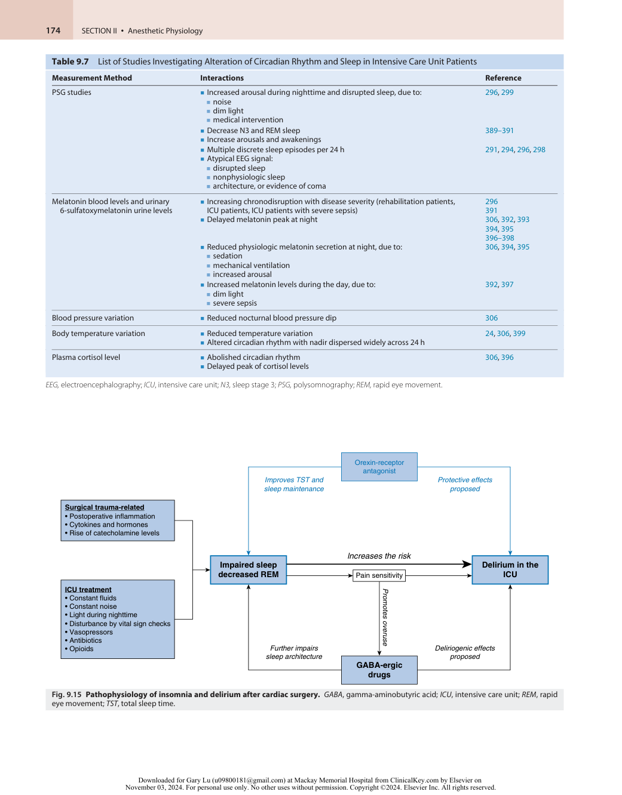

:::

<!-- PDF page 24 -->

administration of sedatives.316 However, opioids have been shown to decrease REM sleep and worsen sleep disorders, such as OSA in ICU patients.134,320 Accordingly, an aggressive approach to managing pain while minimizing opioid utilization has been recommended.321

### PHARMACOLOGICAL TREATMENT OF SLEEP DISTURBANCES IN INTENSIVE CARE UNIT PATIENTS

Medications currently used for the treatment of insomnia in the ICU interact with the GABA system. GABA- ergic neurotransmission has multiple functions throughout the brain, leading to daytime sedation, confusion, anterograde amnesia, and delirium.322–324

Melatonin has been selected as alternative sleeppromoting medication for critically ill patients in some countries. However, studies on the use of melatonin for the treatment of sleep disturbances and potential complications (e.g., delirium) in ICU patients have produced conflicting results. Administration of melatonin improved subjective and objective sleep quality in a small number of studies.325–327 Melatonin may have side effects, such as dizziness, nausea, drowsiness, hypotension, and headache, potentially critical in the ICU setting. Recently melatonin receptor agonists have been developed and marketed for patients with circadian rhythm disorders.328,329 These drugs may have fewer off- target effects than melatonin, but studies on their application in the ICU are very limited. It is therefore difficult to recommend treatment with melatonin agonists of any kind for ICU patients.330

The orexin receptor antagonist suvorexant has been approved by the Food and Drug Administration (FDA) for the treatment of primary insomnia and might be another promising new approach for the treatment of insomnia in ICU patients. In a 4- week study in 254 patients with primary insomnia, suvorexant significantly improved sleep efficiency from the first night until the end of the study compared with placebo in a dose- dependent manner. In addition, suvorexant significantly improved wake after sleep onset and reduced sleep latency,331 without an apparent delirium- promoting effect.332 Additional research in the efficacy and safety of orexin receptor antagonists with critically ill patients is needed.50

### CONSEQUENCES OF SLEEP DISTURBANCE IN ICU PATIENTS

Compelling evidence links good sleep to proper metabolic, endocrine, immune, and neurobehavioral function.333–337

Regardless of controversies, the importance of a sufficient amount of good-quality sleep for proper immunologic function, as well as the increased susceptibility for infection due to sleep loss, has gained increased acceptance.338 Sleep deprivation during influenza vaccination delays the increase of antibody titers.339,340 Sleep deprivation and insomnia is associated with decreased phagocytic activity of lymphocytes and natural killer T- cells, as well as lower levels of interleukin-2341 and interleukin-7.342 Interleukin-7 facilitates the transition of CD8þ effector to memory T- cells and lengthens survival of the T- cell memory cells.343 Prolonged sleep deprivation, as may occur in long- term ICU patients, may induce a persistent production of proinflammatory

cytokines, producing a chronic low- grade inflammation, as well as immunodeficiency.340

Even short sleep deprivation in otherwise healthy young subjects has been shown to be associated with impaired glucose tolerance and insulin resistance, similar to levels usually seen in patients in the early course of diabetes mellitus.344 In addition, sleep deprivation can induce the onset of a catabolic state: increased oxygen consumption, carbon dioxide production, and catecholamine levels, likely as signs of a stress response.345 Changes in the activity of the hypothalamicpituitary- adrenal axis with altered plasma levels of cortisol and thyrotropin,346 as well as increased levels of inflammatory cytokines, are seen during sleep deprivation.347 Sleep- related hypoxia has been postulated as a risk factor for detrimental COVID- 19 outcomes, presumably through increased sympathetic activation, endothelial dysfunction, systemic inflammation, and oxidative stress.348

It is likely that postoperative sleep deprivation also affects respiratory function, characterized as increased vulnerability to respiratory muscle fatigue,349 decrease in ventilatory response to hypercapnia,350 and greater upper airway collapsibility.351

Cognitive impairment after even short- term sleepdeprived conditions is intuitive. Sleep deprivation causes bidirectional changes in brain activity and connectivity, thereby mainly affecting attention and working memory, and an increased vulnerability to delirium in critically ill patients.352–354

In addition, recent studies found beneficial effects of realignment of the sleep–wake cycles by pharmacologic and chronotherapeutic methods on the risk for delirium in these patients.355–357 However, sleep- promoting agents _per se_ can increase the vulnerability to delirium, and the optimal sleep- promoting agent that also minimizes the risk of delirium needs to be identified.

### PERIOPERATIVE MANAGEMENT OF OTHER SLEEP DISORDERS

### Narcolepsy

Narcolepsy is a neurologic sleep disorder with a prevalence of 0.05% to 0.8% in most ethnic groups.37,358 It is characterized by excessive daytime sleepiness, involuntary daytime sleep episodes, disturbed nocturnal sleep, and sleep- associated muscular hypotension. Narcolepsy is divided into narcolepsy with or without cataplexy (sudden loss of muscle tone without loss of consciousness).359

An autoimmune pathology against hypothalamic orexin neurons may be involved in the pathogenesis of narcolepsy.37 A mutation of the HCRT receptor 2 or loss of HCRT neurons have been shown to cause a narcolepsy- like state in animals,360 and the deficiency of HCRT has been shown to be associated with narcolepsy in humans.38 HCRT is involved in control of several biological functions such as feeding, cardiovascular regulation, upper airway stability, pain, locomotion, stress, and addiction.361,362 Environmental factors play a key role in the pathogenesis of the disorder, as the disease concordance rate between monozygotic twins is only 20% to 35%.

Treatment of narcolepsy consists of behavioral treatment, as well as pharmacologic treatment for (1) daytime sleepiness and (2) cataplexies. Periodic and regular sleep times

<!-- PDF page 25 -->

and scheduled daytime naps are recommended. Pharmaceutical treatments of daytime sleepiness include amphetamines, methylphenidate, modafinil, or selegiline (also effective for treatment of cataplexy), and cataplexies can be treated using tricyclic antidepressants, selective serotonin reuptake inhibitors, or γ- hydroxybutyrate/sodium oxybate. Medical treatment should always be accompanied by behavioral therapy.

Delayed emergence from anesthesia, postsurgical hypersomnia, and apneic episodes are in part related to an increased sensitivity to anesthetic drugs in narcolepsy patients.363–365 Monitoring of anesthetic depth is recommended in this patient population. Medical treatment of narcolepsy should be maintained during the preoperative period.366,367 The most commonly used treatment of daytime sleepiness is modafinil, which acts via dopaminergic pathways and accelerates emergence from anesthesia.368,369 Avoidance of sedative premedication and consideration of regional anesthesia may be indicated.370 Of note, cataplectic events can also occur during regional anesthesia.371

### Restless Legs Syndrome and Periodic Limb Movement Disorder

Restless legs syndrome, or Ekbom syndrome, is a neurologic disorder with a prevalence of 2% to 5% as defined by four cardinal features: (1) the urge to move the limbs, usually associated with paresthesias or dysesthesias; (2) aggravating effects of rest; (3) ameliorating effects of physical activity; and (4) symptoms that worsen during the day, with a peak during the evening or at night. Patients with restless legs syndrome usually also complain about sensory symptoms in the legs.

Isolated periodic limb movement during sleep is a rare symptom, commonly referred to as _periodic limb movement disorder_ . The characteristic periodic episodes of repetitive limb movements during sleep occur most often in the lower extremities, but occasionally in the upper extremities. These movements can be associated with frequent arousals leading to sleep disruption, causing excessive daytime sleepiness, which often is the only symptom reported by the patients themselves in most cases.372

Symptomatic restless legs syndrome can occur in patients with iron deficiency and uremia, during pregnancy,373 or during the use of neurotropic medications (dopamine antagonists, neuroleptics, selective serotonin reuptake inhibitors, tricyclic antidepressants, antihistamines, caffeine, alcohol, nicotine). Although daytime symptoms of restless legs syndrome can be sufficiently diagnosed clinically (clinical examination in combination with standardized questionnaires), a PSG is recommended to rule out SDB, especially in patients complaining of daytime sleepiness or sleep fragmentation.

According to the most recent AASM guidelines, the firstline treatment of restless legs syndrome should consist of dopamine agonists (i.e., ropinirole and pramipexole) in the evening. Furthermore, gabapentin enacarbil, levodopa with dopa decarboxylase inhibitor, or opioids can be used. Medication impairing the dopaminergic system (dopamine antagonists, neuroleptics, selective serotonin reuptake inhibitors, and tricyclic antidepressants, antihistamines, caffeine, alcohol, and nicotine) should be avoided, if possible.

Exacerbation of restless legs syndrome may occur after general anesthesia,374 and the urge to move the limbs may be misinterpreted as agitation or delirium.375 The first manifestation of restless legs syndrome may occur after spinal anesthesia or general anesthesia,376 and the prevalence of restless legs syndrome after surgery seems to be higher than expected in this population.374 To prevent perioperative exacerbation of symptoms, patients with restless legs syndrome should be scheduled for surgery early in the day. Restless legs syndrome medication should be continued until the day of surgery, whenever appropriate. Drugs that block the central dopamine transmission, such as neuroleptics, should be avoided. In contrast, ketamine might be the superior anesthetic drug for patients with restless legs syndrome.377 In addition, intravenous or subcutaneous opioids and benzodiazepines during and after the surgery procedure might be beneficial in patients with restless legs syndrome. The best way to provide symptom relief in patients with restless legs syndrome might be early mobilization after surgery. In patients who are not eligible for mobilization, compression treatment378 or intravenous administration of magnesium379 and physiostigmine380 have been shown to lead to relief of restless legs syndrome symptoms. Iron and ferritin blood levels should be monitored closely before, during, and after surgery, especially in surgical cases with iron loss (i.e., bleeding), to prevent symptomatic restless legs syndrome symptoms.

### Complete references available online at expertconsult.com.

### References

1.  Rosner F, et al. _Anesth Analg_ . 1971;50:298.

2.  Rechtschaffen A, et al. _Perspect Biol Med_ . 1998;41:359.

3.  Mukherjee S, et al. _Am J Respir Crit Care Med_ . 2015;191(12):1450.

4.  Fuller PM, Eikermann M. _Anaesthesia_ . 2019;74:417.

5.  Grandner MA, et al. _Sleep Med_ . 2014;15:42.

6.  Liu Y, et al. _Sleep_ . 2013;36:1421.

7.  Watson NF, et al. _Sleep_ . 2015;38:1161.

8.  Rasch B, Born J. _Physiol Rev_ . 2013;93:681.

9.  Hobson JA. _Nature_ . 2005;437(7063):1254.

10.  Kronfeld- Schor N, Einat H. _Neuropharmacology_ . 2012;62(1):101.

11.  Hastings MH, et al. _J Neuroendocrinol_ . 2008;20(6):812.

12.  Albrecht U. _Neuron_ . 2012;74(2):246.

13.  Lane JM, et al. _Nat Commun_ . 2016;7:10889.

14.  Danilenko KV, et al. _J Biol Rhythm_ . 2003;18(2):170.

15.  Borbely AA. _Hum Neurobiol_ . 1982;1(3):195.

16.  Dijk DJ, von Schantz M. _J Biol Rhythm_ . 2005;20(4):279.

17.  Hartse KM. _Handb Clin Neurol_ . 2011;98:97.

18.  Rial RV, et al. _Neurosci Biobehav Rev_ . 2010;34(8):1144.

19.  Siegel JM. _Nature_ . 2005;437:1264.

20.  De Gennaro L, et al. _Neuroscience_ . 2001;107(1):1.

21.  Jahnke K, et al. _Neuroimage_ . 2012;59(2):1631.

22.  Kohsaka S, et al. _Neuroscience_ . 2012;202:243.

23.  Buckner RL, et al. _Ann N Y Acad Sci_ . 2008;1124:1.

24.  Alster J, et al. _Brain Inj_ . 1993;7(3):191.

25.  Pagel JF. _Curr Opin Pulm Med_ . 2012;18(6):574.

26.  Montgomery SM, et al. _J Neurosci_ . 2008;28:6731.

27.  Li J, et al. _Sleep Med Clin_ . 2018;13:1.

28.  Yaremchuk K. _Clin Geriatr Med_ . 2018;34:205.

29.  Hallanger AE, et al. _J Comp Neurol_ . 1987;262(1):105.

30.  Satoh K, Fibiger HC. _J Comp Neurol_ . 1986;253(3):277.

31.  Lu J, et al. _Nature_ . 2006;441(7093):589.

32.  Fuller PM, et al. _J Comp Neurol_ . 2011;519(5):933.

33.  Aston- Jones G, Bloom FE. _J Neurosci_ . 1981;1(8):876.

34.  Kocsis B, et al. _Proc Nat Acad Sci U S A_ . 2006;103(4):1059.

35.  Lu J, et al. _J Neurosci_ . 2006;26:193.

36.  Peyron C, et al. _J Neurosci_ . 1998;18(23):9996.

<!-- PDF page 26 -->

37.  Kornum BR, et al. _Curr Opin Neurobiol_ . 2011;21(6):897.

38.  Nishino S, et al. _Lancet_ . 2000;355(9197):39.

39.  Chemelli RM, et al. _Cell_ . 1999;98(4):437.

40.  Willie JT, et al. _Neuron_ . 2003;38(5):715.

41.  Fujiki N, et al. _Sleep_ . 2003;26(8):953.

42.  Adamantidis AR, et al. _Nature_ . 2007;450(7168):420.

43.  Trivedi P, et al. _FEBS Lett_ . 1998;438(1–2):71.

44.  Saper CB, et al. _Nature_ . 2005;437(7063):1257.

45.  Torrealba F, et al. _Neuroscience_ . 2003;119(4):1033.

46.  Mang GM, et al. _Sleep_ . 2012;35(12):1625.

47.  Dugovic C, et al. _J Pharmacol Exp Ther_ . 2009;330(1):142.

48.  Moriarty SR, et al. _PLoS One_ . 2012;7(7):e39131.

49.  Shibukawa Y, et al. _Pain_ . 2007;128:180.

50.  Azimaraghi O, et al. _BMJ Open_ . 2020;10:e038474.

51.  Modirrousta M, et al. _Neuroscience_ . 2004;129(3):803.

52.  Hassani OK, et al. _Proc Natl Acad Sci U S A_ . 2009;106(7):2418.

53.  Takahashi K, et al. _Neuroscience_ . 2009;161(1):269.

54.  Sherin JE, et al. _Science_ . 1996;271(5246):216.

55.  Lu J, et al. _J Neurosci_ . 2000;20(10):3830.

56.  Saper CB, et al. _Neuron_ . 2010;68(6):1023.

57.  Anaclet C, et al. _J Neurosci_ . 2012;32(50):17970.

58.  Boissard R, et al. _Eur J Neurosci_ . 2003;18(6):1627.

59.  Ibáñez V, et al. _Sleep Med_ . 2018;42:90–96.

60.  Johns MW. _Chest_ . 1993;103(1):30.

61.  Beaudreau SA, et al. _Sleep Med_ . 2012;13(1):36.

62.  Spira AP, et al. _J Gerontol A Biol Sci Med Sci_ . 2012;67(4):433.

63.  Sil A, Barr G. _J Laryngol Otol_ . 2012;126(4):372.

64.  Hesselbacher S, et al. _Open Respir Med J_ . 2012;6:20.

65.  Mollayeva T, et al. _Sleep Med Rev_ . 2016;25:52.

66.  Chung F, et al. _J Clin Anesth_ . 2007;19(2):130.

67.  Aurora RN, et al. _Sleep_ . 2012;35(8):1039.

68.  Spruyt K, Gozal D. _Sleep Med Rev_ . 2011;15(1):19.

69.  Urfer- Maurer N, et al. _Sleep Med_ . 2018;48:180.

70.  Smarr BL. _J Biol Rhythm_ . 2015;30(1):61.

71.  Auger RR, et al. _Nat Sci Sleep_ . 2013;5:125.

72.  Kucharczyk E, et al. _Behav Sleep Med_ . 2011;9(4):243.

73.  Okun ML, et al. _J Clin Sleep Med_ . 2009;5(1):41.

74.  Chung F, et al. _Anesthesiology_ . 2008;108(5):812.

75.  Chung F, et al. _Br J Anaesth_ . 2012;108(5):768.

76.  Kessler RC, et al. _Sleep_ . 2010;33(11):1539.

77.  Walters AS, et al. _Sleep Med_ . 2003;4(2):121.

78.  Richards KC, et al. _J Nurs Meas_ . 2000;8(2):131.

79.  Wright JG, Feinstein AR. _J Clin Epidemiol_ . 1992;45(11):1201.

80.  Martin JL, Hakim AD. _Chest_ . 2011;139(6):1514.

81.  Paquet J, et al. _Sleep_ . 2007;30(10):1362.

82.  Ancoli- Israel S, et al. _Sleep_ . 2003;26(3):342.

83.  Ancoli- Israel S, et al. _Behav Sleep Med_ . 2015;13(suppl 1):S4.

84.  Smith MT, et al. _J Clin Sleep Med_ . 2018;14:1231.

85.  Tobin SY, et al. _Sleep Med Clin_ . 2021;16:607.

86.  Depner CM, et al. _Sleep_ . 2020;43(2):zsz254.

87.  Kushida CA, et al. _Sleep_ . 2005;28(4):499.

88.  Rechtschaffen A, et al. _A Manual of Standardized Terminology, Techniques and Scoring Systems for Sleep Stages of Human Subjects_ . National Health Institutes; 1977.

89.  Berry RB, et al. AASM scoring manual updates for 2017 (version 2.4). _J Clin Sleep Med_ . 2017;13:665–666.

90.  Epstein LJ, et al. _J Clin Sleep Med_ . 2009;5(3):263.

91.  Kuna ST, et al. _Proc Am Thorac Soc_ . 2011;8(1):1.

92.  Fleetham J, et al. _Can Respir J_ . 2006;13(7):387.

93.  Somers VK, et al. _J Am Coll Cardiol_ . 2008;52(8):686.

94.  Collop NA, et al. _J Clin Sleep Med_ . 2007;3(7):737.

95.  Caples SM, et al. _J Clin Sleep Med_ . 2021;17:1287.

96.  Kuna ST, et al. _Am J Respir Crit Care Med_ . 2011;183(9):1238.

97.  Finkel KJ, et al. _Sleep Med_ . 2009;10(7):753.

98.  Duce B, et al. _J Clin Sleep Med_ . 2014;10(7):803.

99.  Novelli L, et al. _J Sleep Res_ . 2010;19(1 Pt 2):238.

100.  Lindberg E. _Sleep Med Rev_ . 2000;4(5):411.

101.  Vozoris NT. _Sleep Med_ . 2012;13(6):637.

102.  Young T, et al. _Wis Med J_ . 2009;108(5):246.

103.  Schonbeck Y, et al. _PLoS One_ . 2011;6(11):e27608.

104.  Raja M. _Biochem Biophys Res Commun_ . 2011;413:1.

105.  Kapur V, et al. _Sleep Breath_ . 2002;6:49.

106.  Young T, et al. _N Engl J Med_ . 1993;328(17):1230.

107.  Bryson GL, et al. _Can J Anaesth_ . 2012;59:842. 108.  Stierer TL, et al. _J Clin Sleep Med_ . 2010;6(5):467.

109.  Weingarten TN, et al. _Br J Anaesth_ . 2011;106(1):131. 110.  Bamgbade OA, et al. _Int J Gynaecol Obstet_ . 2017;138(1):69.

111.  Young T, et al. _Am J Respir Crit Care Med_ . 2002;165(9):1217.

112.  Gottlieb DJ, et al. _Am J Respir Crit Care Med_ . 1999;159(2):502.

113.  Redline S, et al. _Am J Respir Crit Care Med_ . 2010;182(2):269.

114.  Carr GE, et al. _Chest_ . 2012;141(3):798.

115.  Selim B, et al. _Clin Chest Med_ . 2010;31(2):203.

116.  Tahrani AA, et al. _Am J Respir Crit Care Med_ . 2012;186:434.

117.  Yaffe K, et al. _JAMA_ . 2011;306(6):613.

118.  Torelli F, et al. _Neuroimage_ . 2011;54(2):787.

119.  Canessa N, et al. _Am J Respir Crit Care Med_ . 2011;183(10):1419.

120.  Lal C, et al. _Chest_ . 2012;141(6):1601.

121.  Balachandran JS, et al. _Am J Cardiol_ . 2012;109(1):140.

122.  Santer P, Eikermann M. _JAMA_ . 2019;322:1211.

123.  Jennum P, Kjellberg J. _Thorax_ . 2011;66(7):560.

124.  Block AJ, et al. _N Engl J Med_ . 1979;300(10):513.

125.  Eikermann M, et al. _Chest_ . 2007;131(6):1702.

126.  Mak KK, et al. _Sleep Med_ . 2010;11(3):268.

127.  McNicholas WT, et al. _Am Rev Respir Dis_ . 1982;126(4):625.

128.  Subramani Y, et al. _Anesth Analg_ . 2017;124(1):179.

129.  Sasaki N, et al. _Anesthiology_ . 2013;118:961.

130.  Butler JE. _Respir Physiol Neurobiol_ . 2007;159(2):115.

131.  Pierce R, et al. _Eur Respir J_ . 2007;30(2):345.

132.  Chamberlin NL, et al. _J Physiol_ . 2007;579(Pt 2):515.

133.  Nicholas CL, et al. _Sleep_ . 2012;35(5):699.

134.  Timm FP, et al. _Sleep_ . 2018;41(1).

135.  Isono S, et al. _Anesthesiology_ . 1997;87(5):1055.

136.  Watanabe T, et al. _Am J Respir Crit Care Med_ . 2002;165(2):260.

137.  Isono S, et al. _Anesthesiology_ . 2002;97(4):780.

138.  Tagaito Y, et al. _Anesthesiology_ . 2010;113(4):812.

139.  Shiota S, et al. _Thorax_ . 2007;62(10):868.

140.  Su MC, et al. _Respir Physiol Neurobiol_ . 2008;161(3):306.

141.  Redolfi S, et al. _Am J Respir Crit Care Med_ . 2011;184(9):1062.

142.  Yumino D, et al. _Circulation_ . 2010;121(14):1598.

143.  Series F, Marc I. _J Appl Physiol_ . 1994;77(2):840.

144.  Hoffstein V. _Am Rev Respir Dis_ . 1984;130(2):175.

145.  Graaff Van de WB. _J Appl Physiol_ . 1991;70(3):1328.

146.  Mekdash H, et al. _Tech Innov Patient Support Radiat Oncol_ . 2017;3– 4:13.

147.  Graaff Van de WB. _J Appl Physiol_ . 1988;65(5):2124.

148.  Mead J, Loring SH. _J Appl Physiol_ . 1982;53(3):750.

149.  Schwartz AR, et al. _Am Rev Respir Dis_ . 1991;144(3 Pt 1):494.

150.  Isono S, et al. _J Appl Physiol_ . 1997;82(4):1319.

151.  White DP. _Am J Respir Crit Care Med_ . 2005;172:1363.

152.  Fogel RB, et al. _J Physiol_ . 2003;550(Pt 3):899.

153.  Jelev A, et al. _J Physiol_ . 2001;532(Pt 2):467.

154.  Jordan AS, White DP. _Respir Physiol Neurobiol_ . 2008;160(1):1.

155.  Gestreau C, et al. _Curr Opin Pulm Med_ . 2008;14(6):512.

156.  Fogel RB, et al. _J Physiol_ . 2005;564(Pt 2):549.

157.  Wilkinson V, et al. _Sleep_ . 2008;31(4):525.

158.  Lo YL, et al. _Thorax_ . 2007;62(9):799.

159.  Lan MC, et al. _Laryngoscope_ . 2015;125(10):2408.

160.  Isono S. _Eur Respir J_ . 2017;50(3).

161.  Safar P. _J Am Med Assoc_ . 1958;167(3):335.

162.  Sato S, et al. _Anesthesiology_ . 2017;126(1):28.

163.  Stanescu D, et al. _Eur Respir J_ . 1996;9(10):2116.

164.  Berry RB, Gleeson K. _Sleep_ . 1997;20(8):654.

165.  Pattinson KT. _Br J Anaesth_ . 2008;100(6):747.

166.  Szollosi I, et al. _Sleep_ . 2006;29(8):1045.

167.  Jordan AS, et al. _Am J Respir Crit Care Med_ . 2011;184(10):1183. 168.  Kushida CA, et al. _Sleep_ . 2006;29(3):375.

169.  Gay P, et al. _Sleep_ . 2006;29(3):381.

170.  Giles TL, et al. _Cochrane Database Syst Rev_ . 2006;3:CD001106.

171.  Schwab RJ, et al. _Am J Respir Crit Care Med_ . 1996;154:1106.

172.  McDaid C, et al. _Health Technol Assess_ . 2009;13(4):143. iii, xi, 1. 173.  Weaver TE, et al. _Am J Respir Crit Care Med_ . 2012;186:677.

174.  McEvoy RD, et al. _N Engl J Med_ . 2016;375(10):919.

175.  Sánchez- de- la- Torre M, et al. _Lancet Respir Med_ . 2020;8:359.

176.  Corral J, et al. _Am J Respir Crit Care Med_ . 2017;196(9):1181.

177.  Malhotra A, et al. _Lancet Respir Med_ . 2015;3(5):397.

178.  Collop NA, et al. _J Clin Sleep Med_ . 2011;7:531.

179.  Randerath WJ, et al. _Eur Respir J_ . 2011;37(5):1000.

180.  Reckley LK. _Nat Sci Sleep_ . 2018;10:105.

181.  Kang KT, et al. _JAMA Otolayngol Head Neck Surg_ . 2017;143(6):561. 182.  Schwartz AR, et al. _Am J Respir Crit Care Med_ . 2012;185(4):420.

<!-- PDF page 27 -->

183.  Shelton KE, et al. _Am Rev Respir Dis_ . 1993;148(2):462. 184.  Oliven A, et al. _Eur Respir J_ . 2008;32(5):1309. 185.  Anandam A, et al. _Sleep Breath_ . 2013;17:227. 186.  Veasey SC, et al. _Sleep_ . 2006;29(8):1036.

187.  Morgenthaler TI, et al. _Sleep_ . 2006;29(8):1031. 188.  Malhotra A, Owens RL. _Respir Care_ . 2010;55(9):1168. 189.  Lanfranchi PA, et al. _Circulation_ . 1999;99(11):1435. 190.  Malhotra A, White DP. _Lancet_ . 2002;360(9328):237.

191.  Bixler EO, et al. _Am J Respir Crit Care Med_ . 2001;163(3 Pt 1):608. 192.  Young T, et al. _Arch Intern Med_ . 2002;162(8):893. 193.  Naughton MT, Lorenzi- Filho G. _Prog Cardiovasc Dis_ . 2009;51(4):339. 194.  MacDonald M, et al. _J Clin Sleep Med_ . 2008;4(1):38. 195.  Piper AJ. _Sleep Med Rev_ . 2011;15(2):79. 196.  Kessler R, et al. _Chest_ . 2001;120(2):369. 197.  Olson AL, Zwillich C. _Am J Med_ . 2005;118(9):948.

198.  Sampson MG, Grassino K. _Am J Med_ . 1983;75(1):81. 199.  Steier J, et al. _Thorax_ . 2009;64:719.

200.  Lopata M, Onal E. _Am Rev Respir Dis_ . 1982;126(4):640. 201.  Phipps PR, et al. _Thorax_ . 2002;57(1):75.

202.  Shimura R, et al. _Chest_ . 2005;127(2):543.

203.  Piper AJ, Grunstein RR. _Am J Respir Crit Care Med_ . 2011;183(3):292. 204.  Resta O, et al. _Respir Med_ . 2000;94(3):240. 205.  Zavorsky GS, Wilson B. _Respir Physiol Neurobiol_ . 2010;170(1):120. 206.  Ozsancak A, et al. _Chest_ . 2008;133(5):1275.

207.  Eikermann M, et al. _Curr Biol_ . 2020;30:R219.

208.  Fleming A. _Br Foreign Med Chir Rev_ . 1855;15:529. 209.  Brown EN, et al. _N Engl J Med_ . 2010;363(27):2638.

210.  Kochs E, et al. _Anesthesiology_ . 1994;80(5):1026. 211.  Alkire MT, et al. _Science_ . 2008;322(5903):876. 212.  Hillman DR, et al. _Anesthesiol Clin_ . 2010;28(3):443. 213.  Nelson LE, et al. _Nat Neurosci_ . 2002;5(10):979. 214.  Lu J, et al. _J Comp Neurol_ . 2008;508:648. 215.  Lydic R. _Curr Opin Pulm Med_ . 1996;2:474. 216.  Akeju O, Brown EN. _Curr Opin Neurobiol_ . 2017;44:178. 217.  Moore JT, et al. _Curr Biol_ . 2008;22(21):2012. 218.  Zhang Z, et al. _Nat Neurosci_ . 2015;18:553. 219.  Eikermann M, et al. _Brain Res_ . 2011;1426:30. 220.  Tung A, et al. _Anesthesiology_ . 2002;97(4):906. 221.  Pal D, et al. _Anesthesiology_ . 2011;114(2):302. 222.  Brown EN, et al. _Annu Rev Neurosci_ . 2011;34:601. 223.  Leung LS, et al. _Prog Neurobiol_ . 2014;122:24. 224.  Guldenmund P, et al. _Br J Anaesth_ . 2017;119(4):674. 225.  Gogenur I, et al. _Br J Anaesth_ . 2008;100(1):45. 226.  Gogenur I, et al. _Surg Endosc_ . 2009;23(5):1026. 227.  Rosenberg J. _Sleep Med Rev_ . 2001;5(2):129. 228.  Rehberg S, et al. _Anesthesiology_ . 2008;109(4):629. 229.  Kjolhede P, et al. _J Clin Sleep Med_ . 2012;8(4):395. 230.  Krenk L, et al. _Br J Anaesth_ . 2012;109:769. 231.  Axelin A, et al. _Eur J Pain_ . 2010;14(7):752. 232.  Wang D, Teichtahl H. _Sleep Med Rev_ . 2007;11(1):35. 233.  Kondili E, et al. _Intensive Care Med_ . 2012;38:1640.

234.  Gottschlich MM, et al. _J Burn Care Res_ . 2011;32(5):535.

235.  Mihara T, et al. _Anesth Analg_ . 2012;115:805.

236.  Cheeseman JF, et al. _Proc Natl Acad Sci U S A_ . 2012;109(18):7061. 237.  Poulsen RC, et al. _Sleep Med Rev_ . 2018;37:35.

238.  Lewczuk B, et al. _Neuroendocrinol Lett_ . 1999;20(3–4):171. 239.  Sessler DI, et al. _Anesthesiology_ . 1991;75(6):985.

240.  Vandekerckhove M, Cluydts R. _Sleep Med Rev_ . 2010;14(4):219. 241.  Gupta RM, et al. _Mayo Clin Proc_ . 2001;76(9):897. 242.  Zaremba S, et al. _F1000Res_ . 2016:5. 243.  Chan MTV, et al. _JAMA_ . 2019;321:1788. 244.  Pivetta B, et al. _Anaesthesia_ . 2022;77:818.

245.  Fassbender P, et al. _Dtsch Arztebl Int_ . 2016;113:463. 246.  Seet E, et al. _Anesth Analg_ . 2021;133:196. 247.  Kaw R, et al. _Br J Anaesth_ . 2012;109:897.

248.  Siva N. _BMJ_ . 2011;343:d5453.

249.  Nagappa M, et al. _Anesth Analg_ . 2017;125:2030.

250.  Sun X, et al. _Sleep Med_ . 2022;91:1.

251.  Bateman BT, Eikermann M. _Anesthesiology_ . 2012;116(4):753. 252.  Mokhlesi B, et al. _Chest_ . 2013;144(3):903.

253.  Mokhlesi B, et al. _Obes Surg_ . 2013;23(11):1842. 254.  Berg G, et al. _Chest_ . 2001;120(2):377.

255.  Cullen A, Ferguson A. _Can J Anaesth_ . 2012;59:974. 256.  Lakdawala L. _J Perianesth Nurs_ . 2011;26(1):15. 257.  Gottlieb DJ, Punjabi NM. _JAMA_ . 2020;323:1389.

258.  Nowbar S, et al. _Am J Med_ . 2004;116(1):1.

259.  Redline S, Strohl KP. _Clin Chest Med_ . 1998;19(1):1.

260.  Shin CH, et al. _BMC Anesthesiol_ . 2017;17(1):71. 261.  Chiu HY, et al. _Sleep Med Rev_ . 2017;36:57.

262.  Memtsoudis SG, et al. _Anesth Analg_ . 2018;127:967.

263.  Mokhlesi B, et al. _Sleep Breath_ . 2007;11(2):117.

264.  Neligan PJ, et al. _Anesth Analg_ . 2009;109:1182.

265.  Juvin P, et al. _Anesth Analg_ . 2003;97(2):595.

266.  Isono S, et al. _Anesthesiology_ . 2005;103:489.

267.  Corso RM, et al. _Minerva Anestesiol_ . 2011;77(1):99.

268.  Myers TR. _Respir Care_ . 2007;52(10):1308.

269.  Atkins JH, Mandel JE. _Curr Opin Anaesthesiol_ . 2018;31(1):120.

270.  Lo YL, et al. _J Clin Sleep Med_ . 2015;11(9):1011.

271.  Ruscic KJ, et al. _Anesthesiology_ . 2018;129(1):37.

272.  Simons JC, et al. _Anesthesiology_ . 2016;125(3):525.

273.  Overdyk FJ. _Anesthesiology_ . 2010;113(1):259.

274.  Hajiha M, et al. _J Physiol_ . 2009;587(Pt 11):2677.

275.  Eikermann M, et al. _Anesthesiology_ . 2009;110(6):1327.

276.  Eikermann M, et al. _Anesthesiology_ . 2012;116(1):35.

277.  Sundman E, et al. _Anesthesiology_ . 2000;92(4):977.

278.  Eikermann M, et al. _Am J Respir Crit Care Med_ . 2007;175(1):9.

279.  Sauer M, et al. _Eur J Anaesthesiol_ . 2011;28(12):842.

280.  Grosse- Sundrup M, et al. _BMJ_ . 2012;345:e6329.

281.  Eikermann M, et al. _Anesthesiology_ . 2007;107(4):621.

282.  Payne JP, et al. _Br J Anaesth_ . 1980;52(1):69.

283.  Fogel RB, et al. _Thorax_ . 2004;59(2):159.

284.  Zaremba S, et al. _Anesthesiology_ . 2016;125(1):92.

285.  Zhang X, et al. _Front Med (Lausanne)_ . 2017;4:26.

286.  Rao Kadam V, Danesh M. _Sleep Sci_ . 2016;9(3):142. 287a.  Szeto B, et al. _Anesth Analg_ . 2019;129:360.

- 287b.  Fassbender P, et al. _Dtsch Arztebl Int_ . 2016;113:463–469.

- 287c.  Grewal G, Joshi GP. _Anesthesiol Clin_ . 2019;37:215–224.

- 287d.  Joshi GP, et al. _Anesth Analg_ . 2012;115:1060–1068.

- 287e.  Szeto B, et al. _Anesth Analg_ . 2019;129:360–368.

- 287f.  Stierer TL, et al. _J Clin Sleep Med_ . 2010;6:467–472.

287g.  American Society of Anesthesiologists Task Force on Perioperative Management of patients with obstructive sleep apnea. _Anesthesiology_ . 2014;120:268–286.

- 287h.  Raub D, et al. _Anesth Analg_ . 2020;130:1415–1424.

- 287i.  Zaremba S, et al. _Anesthesiology_ . 2016;125:92–104.

- 287j.  Jonsson Fagerlund M, Franklin KA. _Anesth Analg_ . 2021;132:1306– 1313.

- 287k.  Marull J, et al. _Nat Sci Sleep_ . 2021;13:2137–2140.

288.  Ayas NT, et al. _Ann Am Thorac Soc_ . 2018;15(2):117.

289.  Gali B, et al. _Anesthesiology_ . 2009;110(4):869.

290.  Aurell J, Elmqvist D. _Br Med J (Clin Res Ed)_ . 1985;290(6474):1029.

291.  Freedman NS, et al. _Am J Respir Crit Care Med_ . 2001;163(2):451.

292.  Parthasarathy S, et al. _Am J Respir Crit Care Med_ . 2002;166(11):1423.

293.  Gabor JY, et al. _Am J Respir Crit Care Med_ . 2003;167(5):708.

294.  Cooper AB, et al. _Chest_ . 2000;117(3):809.

295.  Bosma K, et al. _Crit Care Med_ . 2007;35(4):1048.

296.  Gehlbach BK, et al. _Sleep_ . 2012;35(8):1105.

297.  Boyko Y, et al. _J Crit Care_ . 2017;37:99.

298.  Watson PL, et al. _Crit Care Med_ . 2013;41(8):1958.

299.  Tainter CR, et al. _Crit Care Med_ . 2016;44(1):147.

300.  Elbaz M, et al. _Ann Intensive Care_ . 2017;7(1):25.

301.  Fan EP, et al. _J Crit Care_ . 2017;40:11.

302.  Patel J, et al. _Anaesthesia_ . 2014;69(6):540.

303.  Oldham MA, et al. _Crit Care Med_ . 2016;44(1):207.

304.  Touitou Y. _Exp Gerontol_ . 2001;36(7):1083.

305.  Govitrapong P, et al. _J Pineal Res_ . 1992;13(3):124.

306.  Paul T, Lemmer B. _Chronobiol Int_ . 2007;24:45.

307.  Djeridane Y, Touitou Y. _Chronobiol Int_ . 2003;20:285.

308.  Morera AL, et al. _Prog Neuropsychopharmacol Biol Psychiatry_ . 2009;33:1013.

309.  Demoule A, et al. _Crit Care_ . 2017;21:284.

310.  Jones C, Dawson D. _Nurs Crit Care_ . 2012;17:247.

311.  Mills GH, Bourne RS. _Crit Care_ . 2012;16(4):139.

312.  Van Rompaey B, et al. _Crit Care_ . 2012;16(3):R73.

313.  Ugras GA, et al. _J Neurosci Nurs_ . 2015;47(2):104.

314.  Tamburri LM, et al. _Am J Crit Care_ . 2004;13(2):102.

315.  Ozsancak A, et al. _Crit Care Clin_ . 2008;24(3):517. (vi).

316.  Kress JP, et al. _Am J Respir Crit Care Med_ . 2002;166(8):1024.

317.  Azimaraghi O, et al. _Crit Care Med_ . 2022;50:e434.

318.  Trompeo AC, et al. _Minerva Anestesiol_ . 2011;77(6):604.

<!-- PDF page 28 -->

319.  Turner JS, et al. _Crit Care Med_ . 1990;18(9):966.

320.  Bonafide CP, et al. _Anesthesiology_ . 2008;108(4):627.

321.  Shapiro BA, et al. _Crit Care Med_ . 1995;23(9):1596.

322.  Otmani S, et al. _Hum Psychopharmacol_ . 2008;23(8):693.

323.  Roth T. _J Clin Psychiatry_ . 2007;68(suppl 5):13.

324.  Hoque R, Chesson AL. _J Clin Sleep Med_ . 2009;5(5):471.

325.  Shilo L, et al. _Chronobiol Int_ . 2000;17(1):71.

326.  Ibrahim MG, et al. _Crit Care Resusc_ . 2006;8(3):187.

327.  Bourne RS, et al. _Crit Care_ . 2008;12(2):R52.

328.  Lockley SW, et al. _Lancet_ . 2015;386(10005):1754.

329.  Hatta K, et al. _Br J Anaesth_ . 2012;108(4):572.

330.  Bellapart J, Boots R. _Br J Anaesth_ . 2012;108(4):572.

331.  Herring WJ, et al. _Neurology_ . 2012;79(23):2265.

332.  Hatta K, et al. _J Clin Psychiatry_ . 2017;78(8):e970.

333.  Trinder J, et al. _Eur J Physiol_ . 2012;463(1):161.

334.  Imeri L. _Nat Rev Neurosci_ . 2009;10(3):199.

335.  Faraut B, et al. _Sleep Med Rev_ . 2012;16(2):137.

336.  Mullington JM, et al. _Prog Cardiovasc Dis_ . 2009;51(4):294.

337.  Lange T, et al. _Ann N Y Acad Sci_ . 2010;1193:48.

338.  Sareli AE, Schwab RJ. _Crit Care Clin_ . 2008;24(3):613.

339.  Spiegel K, et al. _JAMA_ . 2002;288(12):1471.

340.  Besedovsky L, et al. _Pflugers Arch_ . 2012;463(1):121.

341.  Irwin M, et al. _FASEB J_ . 1996;10(5):643.

342.  Benedict C, et al. _Brain Behav Immun_ . 2007;21(8):1058.

343.  Kaech SM, et al. _Nat Immunol_ . 2003;4(12):1191.

344.  Schmid SM, et al. _J Clin Endocrinol Metab_ . 2007;92(8):3044.

345.  Scrimshaw NS, et al. _Am J Clin Nutr_ . 1966;19(5):313.

346.  Spiegel K, et al. _Lancet_ . 1999;354(9188):1435.

347.  Sauvet F, et al. _J Appl Physiol 1985_ ; 2010;108(1):68.

348.  Pena Orbea C, et al. _JAMA Netw Open_ . 2021;4:e2134241.

349.  Chen HI, Tang YR. _Am Rev Respir Dis_ . 1989;140(4):907.

350.  White DP, et al. _Am Rev Respir Dis_ . 1983;128(6):984.

351.  Phillips B, et al. _South Med J_ . 1987;80(1):16.

352.  Krause AJ, et al. _Nat Rev Neurosci_ . 2017;18(7):404.

353.  Weinhouse GL, et al. _Crit Care_ . 2009;13(6):234.

354.  Ely EW, et al. _JAMA_ . 2004;291(14):1753.

355.  Potharajaroen S, et al. _Psychiatry Res_ . 2018;261:21.

356.  Burry L, et al. _BMJ Open_ . 2017;7(3):e015420.

357.  Luther R, McLeod A. _Nurs Crit Care_ . 2018;23:283. 358.  Longstreth WT, et al. _Sleep_ . 2007;30(1):13. 359.  Billiard M. _Sleep Med Rev_ . 2007;11(5):377.

360.  Lin L, et al. _Cell_ . 1999;98(3):365.

361.  Bonnavion P, de Lecea L. _Curr Neurol Neurosci Rep_ . 2010;10(3):174.

362.  Dauvilliers Y, et al. _Lancet_ . 2007;369(9560):499.

363.  Kelz MB, et al. _Proc Natl Acad Sci U S A_ . 2008;105(4):1309.

364.  Burrow B, et al. _J Clin Anesth_ . 2005;17(1):21.

365.  Mesa A, et al. _Anesthesiology_ . 2000;92(4):1194.

366.  Dahaba AA, et al. _Anesth Analg_ . 2009;108(2):613.

367.  Pelaez R, et al. _J Cardiothorac Vasc Anesth_ . 2004;18(2):201.

368.  Galvin E, et al. _Acta Anaesthesiol Scand_ . 2010;54(2):154.

369.  Larijani GE, et al. _Anesth Analg_ . 2004;98(4):976.

370.  Hu S, et al. _Anesth Analg_ . 2018;126(1):233.

371.  Soltanifar S, Russell R. _Int J Obstet Anesth_ . 2010;19(4):440.

372.  Aurora RN, et al. _Sleep_ . 2012;35(8):1039.

373.  Ohayon MM, O′Hara R. _Sleep Med Rev_ . 2012;16(4):283. 374.  Karroum EG, et al. _Ann Fr Anesth Reanim_ . 2010;29(12):920.

375.  Shin YK. _South Med J_ . 1987;80(2):278.

376.  Hogl B, et al. _Neurology_ . 2002;59(11):1705.

377.  Kapur N, Friedman R. _Anesth Analg_ . 2002;94(6):1558.

378.  Krishna M. _Anaesthesia_ . 2007;62(9):973.

379.  Bartell S, Zallek S. _J Clin Sleep Med_ . 2006;2(2):187. 380.  Alpert CC, et al. _Anesth Analg_ . 2005;101(3):726. 381.  Celik S, et al. _J Clin Nurs_ . 2005;14:102. 382.  Waseem R, et al. _J Clin Sleep Med_ . 2021;17:521. 383.  McGinty DJ, Sterman MB. _Science_ . 1968;160:1253. 384.  Morong S, et al. _Sleep Breath_ . 2014;18:851. 385.  Günbey E, et al. _J Craniofac Surg_ . 2015;26:1287. 386.  Halle TR, et al. _Chest_ . 2017;152:1214. 387.  Lorenzi- Filho G, et al. _Respirology_ . 2017;22:1500. 388.  Kushida CA, et al. _Sleep_ . 2006;29:240. 389.  Friese RS, et al. _J Trauma_ . 2007;63:1210.

390.  Hardin KA, et al. _Chest_ . 2006;129:1468.

391.  Elliott R, Nathaney A. _Aust Crit Care_ . 2014;27:151.

392.  Mundigler G, et al. _Crit Care Med_ . 2002;30:536.

393.  Olofsson K, et al. _Acta Anaesthesiol Scand_ . 2004;48:679. 394.  Frisk U, et al. _Clin Sci (Lond)._ 2004;107:47. 395.  Perras B, et al. _Intensive Care Med_ . 2007;33:1954.

396.  Riutta A, et al. _Intensive Care Med_ . 2009;35:1720. 397.  Verceles AC, et al. _Intensive Care Med_ . 2012;38:804. 398.  Li CX, et al. _Mol Med Rep_ . 2013;7:1117. 399.  Gazendam JAC, et al. _Chest_ . 2013;144:483.

<!-- PDF page 29 -->

### References

1.  Rosner F, McCall DD, Berman SJ. Anesthesia in the Bible and Talmud. _Anesth Analg_ . 1971;50:298–301.

2.  Rechtschaffen A. Current perspectives on the function of sleep. _Perspect Biol Med_ . 1998;41:359–390.

3.  Mukherjee S, et al. An Official American Thoracic Society Statement: the importance of healthy sleep. recommendations and future priorities. _Am J Respir Crit Care Med_ . 2015;191:1450–1458.

4.  Fuller PM, Eikermann M. Genomic consequences of sleep restriction: the devil is in the details. _Anaesthesia_ . 2019;74:417–419.

5.  Grandner MA, Chakravorty S, Perlis ML, et al. Habitual sleep duration associated with self- reported and objectively determined cardiometabolic risk factors. _Sleep Med_ . 2014;15:42–50.

6.  Liu Y, Wheaton AG, Chapman DP, Croft JB. Sleep duration and chronic diseases among U.S. adults age 45 years and older: evidence from the 2010 Behavioral Risk Factor Surveillance System. _Sleep_ . 2013;36:1421–1427.

7.  Watson NF, et al. Joint consensus statement of the American Academy of Sleep Medicine and Sleep Research Society on the recommended amount of sleep for a healthy adult: methodology and discussion. _Sleep_ . 2015;38:1161–1183.

8.  Rasch B, Born J. About sleep’s role in memory. _Physiol Rev_ . 2013;93:681–766.

9.  Hobson JA. Sleep is of the brain, by the brain and for the brain. _Nature_ . 2005;437:1254–1256.

10.  Kronfeld- Schor N, Einat H. Circadian rhythms and depression: human psychopathology and animal models. _Neuropharmacology_ . 2012;62:101–114.

11.  Hastings MH, Maywood ES, Reddy AB. Two decades of circadian time. _J Neuroendocrinol_ . 2008;20:812–819.

12.  Albrecht U. Timing to perfection: the biology of central and peripheral circadian clocks. _Neuron_ . 2012;74:246–260.

13.  Lane JM, et al. Genome- wide association analysis identifies novel loci for chronotype in 100,420 individuals from the UK Biobank. _Nat Commun_ . 2016;7:10889.

14.  Danilenko KV, Cajochen C, Wirz- Justice A. Is sleep per se a zeitgeber in humans? _J Biol Rhythm_ . 2003;18:170–178.

15.  Borbély AA. A two process model of sleep regulation. _Hum Neurobiol_ . 1982;1:195–204.

16.  Dijk DJ, von Schantz M. Timing and consolidation of human sleep, wakefulness, and performance by a symphony of oscillators. _J Biol Rhythm_ . 2005;20:279–290.

17.  Hartse KM. The phylogeny of sleep. _Handb Clin Neurol_ . 2011;98:97– 109.

18.  Rial RV, et al. Evolution of wakefulness, sleep and hibernation: from reptiles to mammals. _Neurosci Biobehav Rev_ . 2010;34:1144–1160.

19.  Siegel JM. Clues to the functions of mammalian sleep. _Nature_ . 2005;437:1264–1271.

20.  De Gennaro L, Ferrara M, Bertini M. The boundary between wakefulness and sleep: quantitative electroencephalographic changes during the sleep onset period. _Neuroscience_ . 2001;107:1–11.

21.  Jahnke K, et al. To wake or not to wake? The two- sided nature of the human K- complex. _Neuroimage_ . 2012;59:1631–1638.

22.  Kohsaka S, Sakai T, Kohsaka M, et al. Activation of the brainstem precedes and outlasts the K- complex in humans. _Neuroscience_ . 2012;202:243–251.

23.  Buckner RL, Andrews- Hanna JR, Schacter DL. The brain’s default network: anatomy, function, and relevance to disease. _Ann N Y Acad Sci_ . 2008;1124:1–38.

24.  Alster J, Pratt H, Feinsod M. Density spectral array, evoked potentials, and temperature rhythms in the evaluation and prognosis of the comatose patient. _Brain Inj_ . 1993;7:191–208.

25.  Pagel JF. What physicians need to know about dreams and dreaming. _Curr Opin Pulm Med_ . 2012;18:574–579.

26.  Montgomery SM, Sirota A, Buzsáki G. Theta and gamma coordination of hippocampal networks during waking and rapid eye movement sleep. _J Neurosci_ . 2008;28:6731–6741.

27.  Li J, Vitiello MV, Gooneratne NS. Sleep in normal aging. _Sleep Med Clin_ . 2018;13:1–11.

28.  Yaremchuk K. Sleep disorders in the elderly. _Clin Geriatr Med_ . 2018;34:205–216.

29.  Hallanger AE, Levey AI, Lee HJ, et al. The origins of cholinergic and other subcortical afferents to the thalamus in the rat. _J Comp Neurol_ . 1987;262:105–124.

30.  Satoh K, Fibiger HC. Cholinergic neurons of the laterodorsal tegmental nucleus: efferent and afferent connections. _J Comp Neurol_ . 1986;253:277–302.

31.  Lu J, Sherman D, Devor M, Saper CB. A putative flip- flop switch for control of REM sleep. _Nature_ . 2006;441:589–594.

32.  Fuller PM, Sherman D, Pedersen NP, et al. Reassessment of the structural basis of the ascending arousal system. _J Comp Neurol_ . 2011;519:933–956.

33.  Aston- Jones G, Bloom FE. Activity of norepinephrine- containing locus coeruleus neurons in behaving rats anticipates fluctuations in the sleep- waking cycle. _J Neurosci_ . 1981;1:876–886.

34.  Kocsis B, Varga V, Dahan L, Sik A. Serotonergic neuron diversity: identification of raphe neurons with discharges time- locked to the hippocampal theta rhythm. _Proc Natl Acad Sci U S A_ . 2006;103:1059–1064.

35.  Lu J, Jhou TC, Saper CB. Identification of wake- active dopaminergic neurons in the ventral periaqueductal gray matter. _J Neurosci_ . 2006;26:193–202.

36.  Peyron C, et al. Neurons containing hypocretin (orexin) project to multiple neuronal systems. _J Neurosci_ . 1998;18:9996–10015.

37.  Kornum BR, Faraco J, Mignot E. Narcolepsy with hypocretin/orexin deficiency, infections and autoimmunity of the brain. _Curr Opin Neurobiol_ . 2011;21:897–903.

38.  Nishino S, Ripley B, Overeem S, et al. Hypocretin (orexin) deficiency in human narcolepsy. _Lancet_ . 2000;355:39–40.

39.  Chemelli RM, et al. Narcolepsy in orexin knockout mice: molecular genetics of sleep regulation. _Cell_ . 1999;98:437–451.

40.  Willie JT, et al. Distinct narcolepsy syndromes in Orexin receptor- 2 and Orexin null mice: molecular genetic dissection of Non- REM and REM sleep regulatory processes. _Neuron_ . 2003;38:715–730.

41.  Fujiki N, Yoshida Y, Ripley B, et al. Effects of IV and ICV hypocretin- 1 (orexin A) in hypocretin receptor- 2 gene mutated narcoleptic dogs and IV hypocretin- 1 replacement therapy in a hypocretin- liganddeficient narcoleptic dog. _Sleep_ . 2003;26:953–959.

42.  Adamantidis AR, Zhang F, Aravanis AM, et al. Neural substrates of awakening probed with optogenetic control of hypocretin neurons. _Nature_ . 2007;450:420–424.

43.  Trivedi P, Yu H, MacNeil DJ, et al. Distribution of orexin receptor mRNA in the rat brain. _FEBS Lett_ . 1998;438:71–75.

44.  Saper CB, Scammell TE, Lu J. Hypothalamic regulation of sleep and circadian rhythms. _Nature_ . 2005;437:1257–1263.

45.  Torrealba F, Yanagisawa M, Saper CB. Colocalization of orexin a and glutamate immunoreactivity in axon terminals in the tuberomammillary nucleus in rats. _Neuroscience_ . 2003;119:1033–1044.

46.  Mang GM, et al. The dual orexin receptor antagonist almorexant induces sleep and decreases orexin- induced locomotion by blocking orexin 2 receptors. _Sleep_ . 2012;35:1625–1635.

47.  Dugovic C, et al. Blockade of orexin- 1 receptors attenuates orexin- 2 receptor antagonism- induced sleep promotion in the rat. _J Pharmacol Exp Ther_ . 2009;330:142–151.

48.  Moriarty SR, et al. Dual hypocretin receptor antagonism is more effective for sleep promotion than antagonism of either receptor alone. _PLoS One_ . 2012;7:e39131.

49.  Shibukawa Y, et al. Cerebral cortical dysfunction in patients with temporomandibular disorders in association with jaw movement observation. _Pain_ . 2007;128:180–188.

50.  Azimaraghi O, et al. Study protocol for a randomised controlled trial evaluating the effects of the orexin receptor antagonist suvorexant on sleep architecture and delirium in the intensive care unit. _BMJ Open_ . 2020;10:e038474.

51.  Modirrousta M, Mainville L, Jones BE. Gabaergic neurons with alpha2- adrenergic receptors in basal forebrain and preoptic area express c- Fos during sleep. _Neuroscience_ . 2004;129:803–810.

52.  Hassani OK, Lee MG, Jones BE. Melanin- concentrating hormone neurons discharge in a reciprocal manner to orexin neurons across the sleep- wake cycle. _Proc Natl Acad Sci U S A_ . 2009;106:2418–2422.

53.  Takahashi K, Lin JS, Sakai K. Characterization and mapping of sleepwaking specific neurons in the basal forebrain and preoptic hypothalamus in mice. _Neuroscience_ . 2009;161:269–292.

54.  Sherin JE, Shiromani PJ, McCarley RW, Saper CB. Activation of ventrolateral preoptic neurons during sleep. _Science_ . 1996;271:216–219.

55.  Lu J, Greco MA, Shiromani P, Saper CB. Effect of lesions of the ventrolateral preoptic nucleus on NREM and REM sleep. _J Neurosci_ . 2000;20:3830–3842.

<!-- PDF page 30 -->

56.  Saper CB, Fuller PM, Pedersen NP, et al. Sleep state switching. _Neuron_ . 2010;68:1023–1042.

57.  Anaclet C, et al. Identification and characterization of a sleepactive cell group in the rostral medullary brainstem. _J Neurosci_ . 2012;32:17970–17976.

58.  Boissard R, Fort P, Gervasoni D, et al. Localization of the GABAergic and non- GABAergic neurons projecting to the sublaterodorsal nucleus and potentially gating paradoxical sleep onset. _Eur J Neurosci_ . 2003;18:1627–1639.

59.  Ibáñez V, Silva J, Cauli O. A survey on sleep questionnaires and diaries. _Sleep Med_ . 2018;42:90–96.

60.  Johns MW. Daytime sleepiness, snoring, and obstructive sleep apnea. The Epworth Sleepiness Scale. _Chest_ . 1993;103:30–36.

61.  Beaudreau SA, et al. Validation of the Pittsburgh Sleep Quality Index and the Epworth Sleepiness Scale in older black and white women. _Sleep Med_ . 2012;13:36–42.

62.  Spira AP, et al. Reliability and validity of the Pittsburgh Sleep Quality Index and the Epworth Sleepiness Scale in older men. _J Gerontol A Biol Sci Med Sci_ . 2012;67:433–439.

63.  Sil A, Barr G. Assessment of predictive ability of Epworth scoring in screening of patients with sleep apnoea. _J Laryngol Otol_ . 2012;126:372–379.

64.  Hesselbacher S, Subramanian S, Allen J, et al. Body mass index, gender, and ethnic variations alter the clinical implications of the Epworth Sleepiness Scale in patients with suspected obstructive sleep apnea. _Open Respir Med J_ . 2012;6:20–27.

65.  Mollayeva T, et al. The Pittsburgh sleep quality index as a screening tool for sleep dysfunction in clinical and non- clinical samples: a systematic review and meta- analysis. _Sleep Med Rev_ . 2016;25:52– 73.

66.  Chung F, et al. Preoperative identification of sleep apnea risk in elective surgical patients, using the Berlin questionnaire. _J Clin Anesth_ . 2007;19:130–134.

67.  Aurora RN, An American Academy of Sleep Medicine Clinical Practice Guideline, et al.; American Academy of Sleep Medicine. The treatment of restless legs syndrome and periodic limb movement disorder in adults—an update for 2012: practice parameters with an evidence- based systematic review and meta- analyses. _Sleep_ . 2012;35:1037.

68.  Spruyt K, Gozal D. Pediatric sleep questionnaires as diagnostic or epidemiological tools: a review of currently available instruments. _Sleep Med Rev_ . 2011;15:19–32.

69.  Urfer- Maurer N, et al. Correspondence of maternal and paternal perception of school- aged children’s sleep with in- home sleepelectroencephalography and diary- reports of children’s sleep. _Sleep Med_ . 2018;48:180–186.

70.  Smarr BL. Digital sleep logs reveal potential impacts of modern temporal structure on class performance in different chronotypes. _J Biol Rhythm_ . 2015;30:61–67.

71.  Auger RR, Varghese R, Silber MH, Slocumb NL. Total sleep time obtained from actigraphy versus sleep logs in an academic sleep center and impact on further sleep testing. _Nat Sci Sleep_ . 2013;5:125– 131.

72.  Kucharczyk E, Morgan K, David B, Hall A. The Loughborough Occupational Impact of Sleep Scale (LOISS): a new instrument for research and clinical practice. _Behav Sleep Med_ . 2011;9:243–256.

73.  Okun ML, et al. Psychometric evaluation of the Insomnia Symptom Questionnaire: a self- report measure to identify chronic insomnia. _J Clin Sleep Med_ . 2009;5:41–51.

74.  Chung F, et al. STOP questionnaire: a tool to screen patients for obstructive sleep apnea. _Anesthesiology_ . 2008;108:812–821.

75.  Chung F, et al. High STOP- Bang score indicates a high probability of obstructive sleep apnoea. _Br J Anaesth_ . 2012;108:768–775.

76.  Kessler RC, et al. Reliability and validity of the brief insomnia questionnaire in the America insomnia survey. _Sleep_ . 2010;33:1539– 1549.

77.  Walters AS, et al. Validation of the International Restless Legs Syndrome Study Group rating scale for restless legs syndrome. _Sleep Med_ . 2003;4:121–132.

78.  Richards KC, O’Sullivan PS, Phillips RL. Measurement of sleep in critically ill patients. _J Nurs Meas_ . 2000;8:131–144.

79.  Wright JG, Feinstein AR. A comparative contrast of clinimetric and psychometric methods for constructing indexes and rating scales. _J Clin Epidemiol_ . 1992;45:1201–1218.

80.  Martin JL, Hakim AD. Wrist actigraphy. _Chest_ . 2011;139:1514– 1527.

81.  Paquet J, Kawinska A, Carrier J. Wake detection capacity of actigraphy during sleep. _Sleep_ . 2007;30:1362–1369.

82.  Ancoli- Israel S, et al. The role of actigraphy in the study of sleep and circadian rhythms. _Sleep_ . 2003;26:342–392.

83.  Ancoli- Israel S, et al. The SBSM Guide to Actigraphy Monitoring: clinical and research applications. _Behav Sleep Med_ . 2015;13(suppl 1):S4–s38.

84.  Smith MT, et al. Use of actigraphy for the evaluation of sleep disorders and circadian rhythm sleep- wake disorders: an American Academy of Sleep Medicine Clinical Practice Guideline. _J Clin Sleep Med_ . 2018;14:1231–1237.

85.  Tobin SY, Williams PG, Baron KG, et al. Challenges and opportunities for applying wearable technology to sleep. _Sleep Med Clin_ . 2021;16:607–618.

86.  Depner CM, et al. Wearable technologies for developing sleep and circadian biomarkers: a summary of workshop discussions. _Sleep_ . 2020;43(2):zsz254.

87.  Kushida CA, et al. Practice parameters for the indications for polysomnography and related procedures: an update for 2005. _Sleep_ . 2005;28:499–521.

88.  Rechtschaffen A, Kales A. _A Manual of Standardized Terminology, Techniques and Scoring Systems for Sleep Stages of Human Subjects_ . Washington, DC: National Health Institutes; 1977.

89.  Berry RB, et al. AASM scoring manual updates for 2017 (version 2.4). _J Clin Sleep Med_ . 2017;13:665–666.

90.  Epstein LJ, et al. Clinical guideline for the evaluation, management and long- term care of obstructive sleep apnea in adults. _J Clin Sleep Med_ . 2009;5:263–276.

91.  Kuna ST, et al. An official ATS/AASM/ACCP/ERS workshop report: research priorities in ambulatory management of adults with obstructive sleep apnea. _Proc Am Thorac Soc_ . 2011;8:1–16.

92.  Fleetham J, et al. Canadian Thoracic Society guidelines: diagnosis and treatment of sleep disordered breathing in adults. _Can Respir J_ . 2006;13:387–392.

93.  Somers VK, et al. Sleep apnea and cardiovascular disease: an American heart association/american college of cardiology foundation scientific statement from the American heart association council for high blood pressure research professional education committee, council on clinical cardiology, stroke council, and council on cardiovascular nursing. In collaboration with the national heart, lung, and blood institute national center on sleep disorders research (national institutes of health). _Circulation_ . 2008;118:1080–1111.

94.  Collop NA, et al. Clinical guidelines for the use of unattended portable monitors in the diagnosis of obstructive sleep apnea in adult patients. Portable Monitoring Task Force of the American Academy of Sleep Medicine. _J Clin Sleep Med_ . 2007;3:737–747 (2007).

95.  Caples SM, Anderson WM, Calero K, et al. Use of polysomnography and home sleep apnea tests for the longitudinal management of obstructive sleep apnea in adults: an American Academy of Sleep Medicine clinical guidance statement. _J Clin Sleep Med_ . 2021;17:1287–1293.

96.  Kuna ST, et al. Noninferiority of functional outcome in ambulatory management of obstructive sleep apnea. _Am J Respir Crit Care Med_ . 2011;183:1238–1244.

97.  Finkel KJ, et al. Prevalence of undiagnosed obstructive sleep apnea among adult surgical patients in an academic medical center. _Sleep Med_ . 2009;10:753–758.

98.  Duce B, Rego C, Milosavljevic J, Hukins C. The AASM recommended and acceptable EEG montages are comparable for the staging of sleep and scoring of EEG arousals. _J Clin Sleep Med_ . 2014;10:803–809.

99.  Novelli L, Ferri R, Bruni O. Sleep classification according to AASM and Rechtschaffen and Kales: effects on sleep scoring parameters of children and adolescents. _J Sleep Res_ . 2010;19:238–247.

100.  Lindberg E, Gislason T. Epidemiology of sleep- related obstructive breathing. _Sleep Med Rev_ . 2000;4:411–433.

101.  Vozoris NT. Sleep apnea- plus: prevalence, risk factors, and association with cardiovascular diseases using United States populationlevel data. _Sleep Med_ . 2012;13:637–644.

102.  Young T, et al. Burden of sleep apnea: rationale, design, and major findings of the Wisconsin Sleep Cohort study. _Wis Med J_ . 2009;108:246–249.

103.  Schönbeck Y, et al. Increase in prevalence of overweight in Dutch children and adolescents: a comparison of nationwide growth studies in 1980, 1997 and 2009. _PLoS One_ . 2011;6:e27608.

104.  Raja M. Diverse gating in K+ channels: differential role of the porehelix glutamate in stabilizing the channel pore. _Biochem Biophys Res Commun_ . 2011;413:1–4.

<!-- PDF page 31 -->

105.  Kapur V, et al. Underdiagnosis of sleep apnea syndrome in U.S. communities. _Sleep Breath_ . 2002;6:49–54.

106.  Young T, et al. The occurrence of sleep- disordered breathing among middle- aged adults. _N Engl J Med_ . 1993;328:1230–1235.

107.  Bryson GL, et al. Unplanned admission after day surgery: a historical cohort study in patients with obstructive sleep apnea. _Can J Anaesth_ . 2012;59:842–851.

108.  Stierer TL, et al. Risk assessment of obstructive sleep apnea in a population of patients undergoing ambulatory surgery. _J Clin Sleep Med_ . 2010;6:467–472.

109.  Weingarten TN, et al. Obstructive sleep apnoea and perioperative complications in bariatric patients. _Br J Anaesth_ . 2011;106:131– 139.

110.  Bamgbade OA, Khaw RR, Sawati RS, Holland CM. Obstructive sleep apnea and postoperative complications among patients undergoing gynecologic oncology surgery. _Int J Gynaecol Obstet_ . 2017;138:69– 73.

111.  Young T, Peppard PE, Gottlieb DJ. Epidemiology of obstructive sleep apnea: a population health perspective. _Am J Respir Crit Care Med_ . 2002;165:1217–1239.

112.  Gottlieb DJ, et al. Relation of sleepiness to respiratory disturbance index: the sleep heart health study. _Am J Respir Crit Care Med_ . 1999;159:502–507.

113.  Redline S, et al. Obstructive sleep apnea- hypopnea and incident stroke: the sleep heart health study. _Am J Respir Crit Care Med_ . 2010;182:269–277.

114.  Carr GE, Mokhlesi B, Gehlbach BK. Acute cardiopulmonary failure from sleep- disordered breathing. _Chest_ . 2012;141:798–808.

115.  Selim B, Won C, Yaggi HK. Cardiovascular consequences of sleep apnea. _Clin Chest Med_ . 2010;31:203–220.

116.  Tahrani AA, et al. Obstructive sleep apnea and diabetic neuropathy: a novel association in patients with type 2 diabetes. _Am J Respir Crit Care Med_ . 2012;186:434–441.

117.  Yaffe K, et al. Sleep- disordered breathing, hypoxia, and risk of mild cognitive impairment and dementia in older women. _JAMA_ . 2011;306:613–619.

118.  Torelli F, et al. Cognitive profile and brain morphological changes in obstructive sleep apnea. _Neuroimage_ . 2011;54:787–793.

119.  Canessa N, et al. Obstructive sleep apnea: brain structural changes and neurocognitive function before and after treatment. _Am J Respir Crit Care Med_ . 2011;183:1419–1426.

120.  Lal C, Strange C, Bachman D. Neurocognitive impairment in obstructive sleep apnea. _Chest_ . 2012;141:1601–1610.

121.  Balachandran JS, et al. Effect of mild, asymptomatic obstructive sleep apnea on daytime heart rate variability and impedance cardiography measurements. _Am J Cardiol_ . 2012;109:140–145.

122.  Santer P, Eikermann M. Unrecognized obstructive sleep apnea in patients undergoing surgery. _JAMA_ . 2019;322:1211.

123.  Jennum P, Kjellberg J. Health, social and economical consequences of sleep- disordered breathing: a controlled national study. _Thorax_ . 2011;66:560–566.

124.  Block AJ, Boysen PG, Wynne JW, Hunt LA. Sleep apnea, hypopnea and oxygen desaturation in normal subjects. A strong male predominance. _N Engl J Med_ . 1979;300:513–517.

125.  Eikermann M, et al. The influence of aging on pharyngeal collapsibility during sleep. _Chest_ . 2007;131:1702–1709.

126.  Mak KK, et al. Smoking and sleep disorders in Chinese adolescents. _Sleep Med_ . 2010;11:268–273.

127.  McNicholas WT, et al. Obstructive apneas during sleep in patients with seasonal allergic rhinitis. _Am Rev Respir Dis_ . 1982;126:625–628.

128.  Subramani Y, et al. Understanding phenotypes of obstructive sleep apnea: applications in anesthesia, surgery, and perioperative medicine. _Anesth Analg_ . 2017;124:179–191.

129.  Sasaki N, Meyer MJ, Eikermann M. Postoperative respiratory muscle dysfunction: pathophysiology and preventive strategies. _Anesthesiology_ . 2013;118:961–978.

130.  Butler JE. Drive to the human respiratory muscles. _Respir Physiol Neurobiol_ . 2007;159:115–126.

131.  Pierce R, et al. Upper airway collapsibility, dilator muscle activation and resistance in sleep apnoea. _Eur Respir J_ . 2007;30:345–353.

132.  Chamberlin NL, Eikermann M, Fassbender P, et al. Genioglossus premotoneurons and the negative pressure reflex in rats. _J Physiol_ . 2007;579:515–526.

133.  Nicholas CL, et al. Discharge patterns of human tensor palatini motor units during sleep onset. _Sleep_ . 2012;35:699–707.

134.  Timm FP, et al. Effects of opioids given to facilitate mechanical ventilation on sleep apnea after extubation in the intensive care unit. _Sleep_ . 2018;41:1.

135.  Isono S, Tanaka A, Tagaito Y, et al. Pharyngeal patency in response to advancement of the mandible in obese anesthetized persons. _Anesthesiology_ . 1997;87:1055–1062.

136.  Watanabe T, Isono S, Tanaka A, et al. Contribution of body habitus and craniofacial characteristics to segmental closing pressures of the passive pharynx in patients with sleep- disordered breathing. _Am J Respir Crit Care Med_ . 2002;165:260–265.

137.  Isono S, Tanaka A, Nishino T. Lateral position decreases collapsibility of the passive pharynx in patients with obstructive sleep apnea. _Anesthesiology_ . 2002;97:780–785.

138.  Tagaito Y, Isono S, Tanaka A, et al. Sitting posture decreases collapsibility of the passive pharynx in anesthetized paralyzed patients with obstructive sleep apnea. _Anesthesiology_ . 2010;113:812–818.

139.  Shiota S, et al. Alterations in upper airway cross- sectional area in response to lower body positive pressure in healthy subjects. _Thorax_ . 2007;62:868–872.

140.  Su MC, et al. Lower body positive pressure increases upper airway collapsibility in healthy subjects. _Respir Physiol Neurobiol_ . 2008;161:306–312.

141.  Redolfi S, et al. Attenuation of obstructive sleep apnea by compression stockings in subjects with venous insufficiency. _Am J Respir Crit Care Med_ . 2011;184:1062–1066.

142.  Yumino D, et al. Nocturnal rostral fluid shift: a unifying concept for the pathogenesis of obstructive and central sleep apnea in men with heart failure. _Circulation_ . 2010;121:1598–1605.

143.  Sériès F, Marc I. Influence of lung volume dependence of upper airway resistance during continuous negative airway pressure. _J Appl Physiol(1985)_ . 1994;77:840–844.

144.  Hoffstein V, Zamel N, Phillipson EA. Lung volume dependence of pharyngeal cross- sectional area in patients with obstructive sleep apnea. _Am Rev Respir Dis_ . 1984;130:175–178.

145.  Van de Graaff WB. Thoracic traction on the trachea: mechanisms and magnitude. _J Appl Physiol_ . 1991;70:1328–1336.

146.  Mekdash H, et al. A simple technique for an accurate shielding of the lungs during total body irradiation. _Tech Innov Patient Support Radiat Oncol_ . 2017;3(4):13–18.

147.  Van de Graaff WB. Thoracic influence on upper airway patency. _J Appl Physiol (1985)_ . 1988;65:2124–2131.

148.  Mead J, Loring SH. Analysis of volume displacement and length changes of the diaphragm during breathing. _J Appl Physiol Respir Environ Exerc Physiol_ . 1982;53:750–755.

149.  Schwartz AR, et al. Effect of weight loss on upper airway collapsibility in obstructive sleep apnea. _Am Rev Respir Dis_ . 1991;144:494– 498.

150.  Isono S, et al. Anatomy of pharynx in patients with obstructive sleep apnea and in normal subjects. _J Appl Physiol (1985)_ . 1997;82:1319– 1326.

151.  White DP. Pathogenesis of obstructive and central sleep apnea. _Am J Respir Crit Care Med_ . 2005;172:1363–1370.

152.  Fogel RB, et al. Within- breath control of genioglossal muscle activation in humans: effect of sleep- wake state. _J Physiol_ . 2003;550:899– 910.

153.  Jelev A, Sood S, Liu H, et al. Microdialysis perfusion of 5- HT into hypoglossal motor nucleus differentially modulates genioglossus activity across natural sleep- wake states in rats. _J Physiol_ . 2001;532:467– 481.

154.  Jordan AS, White DP. Pharyngeal motor control and the pathogenesis of obstructive sleep apnea. _Respir Physiol Neurobiol_ . 2008;160:1–7.

155.  Gestreau C, Bévengut M, Dutschmann M. The dual role of the orexin/ hypocretin system in modulating wakefulness and respiratory drive. _Curr Opin Pulm Med_ . 2008;14:512–518.

156.  Fogel RB, et al. The effect of sleep onset on upper airway muscle activity in patients with sleep apnoea versus controls. _J Physiol_ . 2005;564:549–562.

157.  Wilkinson V, et al. Discharge patterns of human genioglossus motor units during sleep onset. _Sleep_ . 2008;31:525–533.

158.  Lo YL, et al. Influence of wakefulness on pharyngeal airway muscle activity. _Thorax_ . 2007;62:799–805.

159.  Lan MC, Liu SY, Lan MY, et al. Lateral pharyngeal wall collapse associated with hypoxemia in obstructive sleep apnea. _Laryngoscope_ . 2015;125:2408–2412.

160.  Isono S. Two valves in the pharynx. _Eur Respir J_ . 2017;50.

<!-- PDF page 32 -->

161.  Safar P. Ventilatory efficacy of mouth- to- mouth artificial respiration; airway obstruction during manual and mouth- to- mouth artificial respiration. _J Am Med Assoc_ . 1958;167:335–341.

162.  Sato S, et al. Mask ventilation during induction of general anesthesia: influences of obstructive sleep apnea. _Anesthesiology_ . 2017;126:28–38.

163.  Stănescu D, Kostianev S, Sanna A, et al. Expiratory flow limitation during sleep in heavy snorers and obstructive sleep apnoea patients. _Eur Respir J_ . 1996;9:2116–2121.

164.  Berry RB, Gleeson K. Respiratory arousal from sleep: mechanisms and significance. _Sleep_ . 1997;20:654–675.

165.  Pattinson KT. Opioids and the control of respiration. _Br J Anaesth_ . 2008;100:747–758.

166.  Szollosi I, Roebuck T, Thompson B, Naughton MT. Lateral sleeping position reduces severity of central sleep apnea/Cheyne- Stokes respiration. _Sleep_ . 2006;29:1045–1051.

167.  Jordan AS, et al. Termination of respiratory events with and without cortical arousal in obstructive sleep apnea. _Am J Respir Crit Care Med_ . 2011;184:1183–1191.

168.  Kushida CA, et al. Practice parameters for the use of continuous and bilevel positive airway pressure devices to treat adult patients with sleep- related breathing disorders. _Sleep_ . 2006;29:375–380.

169.  Gay P, Weaver T, Loube D, Iber C. Evaluation of positive airway pressure treatment for sleep related breathing disorders in adults. _Sleep_ . 2006;29:381–401.

170.  Giles TL, et al. Continuous positive airways pressure for obstructive sleep apnoea in adults. _Cochrane Database Syst Rev_ ; 2006:CD001106.

171.  Schwab RJ, et al. Upper airway and soft tissue structural changes induced by CPAP in normal subjects. _Am J Respir Crit Care Med_ . 1996;154:1106–1116.

172.  McDaid C, et al. Continuous positive airway pressure devices for the treatment of obstructive sleep apnoea- hypopnoea syndrome: a systematic review and economic analysis. _Health Technol Assess_ . 2009;13:iii–iv. , xi–xiv, 1–119, 143–274.

173.  Weaver TE, et al. Continuous positive airway pressure treatment of sleepy patients with milder obstructive sleep apnea: results of the CPAP Apnea Trial North American Program (CATNAP) randomized clinical trial. _Am J Respir Crit Care Med_ . 2012;186:677–683.

174.  McEvoy RD, et al. CPAP for prevention of cardiovascular events in obstructive sleep apnea. _N Engl J Med_ . 2016;375:919–931.

175.  Sánchez- de- la- Torre M, Sánchez- de- la- Torre A, Bertran S, et al. Effect of obstructive sleep apnoea and its treatment with continuous positive airway pressure on the prevalence of cardiovascular events in patients with acute coronary syndrome (ISAACC study): a randomised controlled trial. _Lancet Respir Med_ . 2020;8(4):359–367.

176.  Corral J, et al. Conventional polysomnography is not necessary for the management of most patients with suspected obstructive sleep apnea. Noninferiority, randomized controlled trial. _Am J Respir Crit Care Med_ . 2017;196:1181–1190.

177.  Malhotra A, Orr JE, Owens RL. On the cutting edge of obstructive sleep apnoea: where next? _Lancet Respir Med_ . 2015;3:397–403.

178.  Collop NA, et al. Obstructive sleep apnea devices for out- of- center (OOC) testing: technology evaluation. _J Clin Sleep Med_ . 2011;7:531–548.

179.  Randerath WJ, et al. Non- CPAP therapies in obstructive sleep apnoea. _Eur Respir J_ . 2011;37:1000–1028.

180.  Reckley LK, Fernandez- Salvador C, Camacho M. The effect of tonsillectomy on obstructive sleep apnea: an overview of systematic reviews. _Nat Sci Sleep_ . 2018;10:105–110.

181.  Kang KT, Koltai PJ, Lee CH, et al. Lingual tonsillectomy for treatment of pediatric obstructive sleep apnea: a meta- analysis. _JAMA Otolaryngol Head Neck Surg_ . 2017;143:561–568.

182.  Schwartz AR, et al. Acute upper airway responses to hypoglossal nerve stimulation during sleep in obstructive sleep apnea. _Am J Respir Crit Care Med_ . 2012;185:420–426.

183.  Shelton KE, Woodson H, Gay S, Suratt PM. Pharyngeal fat in obstructive sleep apnea. _Am Rev Respir Dis_ . 1993;148:462–466.

184.  Oliven A, Aspandiarov E, Gankin I, et al. Collapsibility of the relaxed pharynx and risk of sleep apnoea. _Eur Respir J_ . 2008;32:1309– 1315.

185.  Anandam A, Akinnusi M, Kufel T, et al. Effects of dietary weight loss on obstructive sleep apnea: a meta- analysis. _Sleep Breath_ . 2013;17:227– 234.

186.  Veasey SC, et al. Medical therapy for obstructive sleep apnea: a review by the Medical Therapy for Obstructive Sleep Apnea Task Force of the Standards of Practice Committee of the American Academy of Sleep Medicine. _Sleep_ . 2006;29:1036–1044.

187.  Morgenthaler TI, et al. Practice parameters for the medical therapy of obstructive sleep apnea. _Sleep_ . 2006;29:1031–1035.

188.  Malhotra A, Owens RL. What is central sleep apnea? _Respir Care_ . 2010;55:1168–1178.

189.  Lanfranchi PA, et al. Prognostic value of nocturnal Cheyne- Stokes respiration in chronic heart failure. _Circulation_ . 1999;99:1435– 1440.

190.  Malhotra A, White DP. Obstructive sleep apnoea. _Lancet_ . 2002;360:237–245.

191.  Bixler EO, et al. Prevalence of sleep- disordered breathing in women: effects of gender. _Am J Respir Crit Care Med_ . 2001;163:608–613.

192.  Young T, et al. Predictors of sleep- disordered breathing in community- dwelling adults: the sleep heart health study. _Arch Intern Med_ . 2002;162:893–900.

193.  Naughton MT, Lorenzi- Filho G. Sleep in heart failure. _Prog Cardiovasc Dis_ . 2009;51:339–349.

194.  MacDonald M, Fang J, Pittman SD, et al. The current prevalence of sleep disordered breathing in congestive heart failure patients treated with beta- blockers. _J Clin Sleep Med_ . 2008;4:38–42.

195.  Piper AJ. Obesity hypoventilation syndrome—the big and the breathless. _Sleep Med Rev_ . 2011;15:79–89.

196.  Kessler R, et al. The obesity- hypoventilation syndrome revisited: a prospective study of 34 consecutive cases. _Chest_ . 2001;120:369– 376.

197.  Olson AL, Zwillich C. The obesity hypoventilation syndrome. _Am J Med_ . 2005;118:948–956.

198.  Sampson MG, Grassino K. Neuromechanical properties in obese patients during carbon dioxide rebreathing. _Am J Med_ . 1983;75:81– 90.

199.  Steier J, et al. Neural respiratory drive in obesity. _Thorax_ . 2009;64:719–725.

200.  Lopata M, Onal E. Mass loading, sleep apnea, and the pathogenesis of obesity hypoventilation. _Am Rev Respir Dis_ . 1982;126:640–645.

201.  Phipps PR, Starritt E, Caterson I, Grunstein RR. Association of serum leptin with hypoventilation in human obesity. _Thorax_ . 2002;57:75– 76.

202.  Shimura R, et al. Fat accumulation, leptin, and hypercapnia in obstructive sleep apnea- hypopnea syndrome. _Chest_ . 2005;127:543– 549.

203.  Piper AJ, Grunstein RR. Obesity hypoventilation syndrome: mechanisms and management. _Am J Respir Crit Care Med_ . 2011;183:292– 298.

204.  Resta O, et al. Prevalence and mechanisms of diurnal hypercapnia in a sample of morbidly obese subjects with obstructive sleep apnoea. _Respir Med_ . 2000;94:240–246.

205.  Zavorsky GS, Wilson B. Sex, girth, waists and hips (what matters for gas exchange in extreme obesity?). _Respir Physiol Neurobiol_ . 2010;170:120–122.

206.  Ozsancak A, D’Ambrosio C, Hill NS. Nocturnal noninvasive ventilation. _Chest_ . 2008;133:1275–1286.

207.  Eikermann M, Akeju O, Chamberlin NL. Sleep and anesthesia: the shared circuit hypothesis has been put to bed. _Curr Biol_ . 2020;30:r219–r221.

208.  Fleming A. Note on the induction of sleep and anæsthesia by compression of the carotids. _Br Foreign Med Chir Rev_ . 1855;15:529–530.

209.  Brown EN, Lydic R, Schiff ND. General anesthesia, sleep, and coma. _N Engl J Med_ . 2010;363:2638–2650.

210.  Kochs E, Bischoff P, Pichlmeier U, Schulte am Esch J. Surgical stimulation induces changes in brain electrical activity during isoflurane/ nitrous oxide anesthesia. A topographic electroencephalographic analysis. _Anesthesiology_ . 1994;80:1026–1034.

211.  Alkire MT, Hudetz AG, Tononi G. Consciousness and anesthesia. _Science_ . 2008;322:876–880.

212.  Hillman DR, Platt PR, Eastwood PR. Anesthesia, sleep, and upper airway collapsibility. _Anesthesiol Clin_ . 2010;28:443–455.

213.  Nelson LE, et al. The sedative component of anesthesia is mediated by GABA(A) receptors in an endogenous sleep pathway. _Nat Neurosci_ . 2002;5:979–984.

214.  Lu J, et al. Role of endogenous sleep- wake and analgesic systems in anesthesia. _J Comp Neurol_ . 2008;508:648–662.

215.  Lydic R. Reticular modulation of breathing during sleep and anesthesia. _Curr Opin Pulm Med_ . 1996;2:474–481.

216.  Akeju O, Brown EN. Neural oscillations demonstrate that general anesthesia and sedative states are neurophysiologically distinct from sleep. _Curr Opin Neurobiol_ . 2017;44:178–185.

<!-- PDF page 33 -->

217.  Moore JT, et al. Direct activation of sleep- promoting VLPO neurons by volatile anesthetics contributes to anesthetic hypnosis. _Curr Biol_ . 2012;22:2008–2016.

218.  Zhang Z, et al. Neuronal ensembles sufficient for recovery sleep and the sedative actions of α2 adrenergic agonists. _Nat Neurosci_ . 2015;18:553–561.

219.  Eikermann M, et al. The ventrolateral preoptic nucleus is not required for isoflurane general anesthesia. _Brain Res_ . 2011;1426:30–37.

220.  Tung A, Szafran MJ, Bluhm B, Mendelson WB. Sleep deprivation potentiates the onset and duration of loss of righting reflex induced by propofol and isoflurane. _Anesthesiology_ . 2002;97:906–911.

221.  Pal D, Lipinski WJ, Walker AJ, et al. State- specific effects of sevoflurane anesthesia on sleep homeostasis: selective recovery of slow wave but not rapid eye movement sleep. _Anesthesiology_ . 2011;114:302– 310.

222.  Brown EN, Purdon PL, Van Dort CJ. General anesthesia and altered states of arousal: a systems neuroscience analysis. _Annu Rev Neurosci_ . 2011;34:601–628.

223.  Leung LS, Luo T, Ma J, Herrick I. Brain areas that influence general anesthesia. _Prog Neurobiol_ . 2014;122:24–44.

224.  Guldenmund P, et al. Brain functional connectivity differentiates dexmedetomidine from propofol and natural sleep. _Br J Anaesth_ . 2017;119:674–684.

225.  Gögenur I, Wildschiøtz G, Rosenberg J. Circadian distribution of sleep phases after major abdominal surgery. _Br J Anaesth_ . 2008;100:45– 49.

226.  Gögenur I, Bisgaard T, Burgdorf S, et al. Disturbances in the circadian pattern of activity and sleep after laparoscopic versus open abdominal surgery. _Surg Endosc_ . 2009;23:1026–1031.

227.  Rosenberg J. Sleep disturbances after non- cardiac surgery. _Sleep Med Rev_ . 2001;5:129–137.

228.  Rehberg S, et al. Sleep disturbances after posterior scoliosis surgery with an intraoperative wake- up test using remifentanil. _Anesthesiology_ . 2008;109:629–641.

229.  Kjølhede P, Langström P, Nilsson P, et al. The impact of quality of sleep on recovery from fast- track abdominal hysterectomy. _J Clin Sleep Med_ . 2012;8:395–402.

230.  Krenk L, Jennum P, Kehlet H. Sleep disturbances after fast- track hip and knee arthroplasty. _Br J Anaesth_ . 2012;109:769–775.

231.  Axelin A, Kirjavainen J, Salanterä S, Lehtonen L. Effects of pain management on sleep in preterm infants. _Eur J Pain_ . 2010;14:752–758.

232.  Wang D, Teichtahl H. Opioids, sleep architecture and sleepdisordered breathing. _Sleep Med Rev_ . 2007;11:35–46.

233.  Kondili E, Alexopoulou C, Xirouchaki N, Georgopoulos D. Effects of propofol on sleep quality in mechanically ventilated critically ill patients: a physiological study. _Intensive Care Med_ . 2012;38:1640–1646.

234.  Gottschlich MM, et al. The effect of ketamine administration on nocturnal sleep architecture. _J Burn Care Res_ . 2011;32:535–540.

235.  Mihara T, et al. Day or night administration of ketamine and pentobarbital differentially affect circadian rhythms of pineal melatonin secretion and locomotor activity in rats. _Anesth Analg_ . 2012;115:805–813.

236.  Cheeseman JF, et al. General anesthesia alters time perception by phase shifting the circadian clock. _Proc Natl Acad Sci U S A_ . 2012;109:7061–7066.

237.  Poulsen RC, Warman GR, Sleigh J, et al. How does general anaesthesia affect the circadian clock? _Sleep Med Rev_ . 2018;37:35–44.

238.  Lewczuk B, Przybylska- Gornowicz B, Wyrzykowski Z. The effect of morphine on melatonin secretion in the domestic pig. In vivo and in vitro study. _Neuroendocrinol Lett_ . 1999;20:171–178.

239.  Sessler DI, Lee KA, McGuire J. Isoflurane anesthesia and circadian temperature cycles in humans. _Anesthesiology_ . 1991;75:985– 989.

240.  Vandekerckhove M, Cluydts R. The emotional brain and sleep: an intimate relationship. _Sleep Med Rev_ . 2010;14:219–226.

241.  Gupta RM, Parvizi J, Hanssen AD, Gay PC. Postoperative complications in patients with obstructive sleep apnea syndrome undergoing hip or knee replacement: a case- control study. _Mayo Clin Proc_ . 2001;76:897–905.

242.  Zaremba S, Mojica JE, Eikermann M. Perioperative sleep apnea: a real problem or did we invent a new disease? _F1000Res_ . 2016;5.

243.  Chan MTV, et al. Association of unrecognized obstructive sleep apnea with postoperative cardiovascular events in patients undergoing major noncardiac surgery. _JAMA_ . 2019;321:1788– 1798.

244.  Pivetta B, et al. Postoperative outcomes in surgical patients with obstructive sleep apnoea diagnosed by sleep studies: a meta- analysis and trial sequential analysis. _Anaesthesia_ . 2022;77:818–828.

245.  Fassbender P, Herbstreit F, Eikermann M, et al. Obstructive sleep apnea—a perioperative risk factor. _Dtsch Arztebl Int_ . 2016;113:463– 469.

246.  Seet E, et al. Association of obstructive sleep apnea with difficult intubation: prospective multicenter observational cohort study. _Anesth Analg_ . 2021;133:196–204.

247.  Kaw R, et al. Meta- analysis of the association between obstructive sleep apnoea and postoperative outcome. _Br J Anaesth_ . 2012;109:897–906.

248.  Siva N. Rise in assisted reproduction tourism in Asia threatens local medical services. _BMJ_ . 2011;343:d5453.

249.  Nagappa M, et al. Postoperative outcomes in obstructive sleep apnea patients undergoing cardiac surgery: a systematic review and metaanalysis of comparative studies. _Anesth Analg_ . 2017;125:2030– 2037.

250.  Sun X, et al. Meta- analysis of the association between obstructive sleep apnea and postoperative complications. _Sleep Med_ . 2022;91:1– 11.

251.  Bateman BT, Eikermann M. Obstructive sleep apnea predicts adverse perioperative outcome: evidence for an association between obstructive sleep apnea and delirium. _Anesthesiology_ . 2012;116:753–755.

252.  Mokhlesi B, et al. Sleep- disordered breathing and postoperative outcomes after elective surgery: analysis of the nationwide inpatient sample. _Chest_ . 2013;144:903–914.

253.  Mokhlesi B, et al. Sleep- disordered breathing and postoperative outcomes after bariatric surgery: analysis of the nationwide inpatient sample. _Obes Surg_ . 2013;23:1842–1851.

254.  Berg G, Delaive K, Manfreda J, et al. The use of health- care resources in obesity- hypoventilation syndrome. _Chest_ . 2001;120:377–383.

255.  Cullen A, Ferguson A. Perioperative management of the severely obese patient: a selective pathophysiological review. _Can J Anaesth_ . 2012;59:974–996.

256.  Lakdawala L. Creating a safer perioperative environment with an obstructive sleep apnea screening tool. _J Perianesth Nurs_ . 2011;26:15–24.

257.  Gottlieb DJ, Punjabi NM. Diagnosis and management of obstructive sleep apnea: a review. _JAMA_ . 2020;323:1389–1400.

258.  Nowbar S, et al. Obesity- associated hypoventilation in hospitalized patients: prevalence, effects, and outcome. _Am J Med_ . 2004;116:1– 7.

259.  Redline S, Strohl KP. Recognition and consequences of obstructive sleep apnea hypopnea syndrome. _Clin Chest Med_ . 1998;19:1–19.

260.  Shin CH, et al. Development and validation of a score for preoperative prediction of obstructive sleep apnea (SPOSA) and its perioperative outcomes. _BMC Anesthesiol_ . 2017;17:71.

261.  Chiu HY, et al. Diagnostic accuracy of the Berlin questionnaire, STOP- BANG, STOP, and Epworth Sleepiness Scale in detecting obstructive sleep apnea: a bivariate meta- analysis. _Sleep Med Rev_ . 2017;36:57–70.

262.  Memtsoudis SG, et al. Society of Anesthesia and Sleep Medicine guideline on intraoperative management of adult patients with obstructive sleep apnea. _Anesth Analg_ . 2018;127:967–987.

263.  Mokhlesi B, Tulaimat A, Faibussowitsch I, et al. Obesity hypoventilation syndrome: prevalence and predictors in patients with obstructive sleep apnea. _Sleep Breath_ . 2007;11:117–124.

264.  Neligan PJ, et al. Obstructive sleep apnea is not a risk factor for difficult intubation in morbidly obese patients. _Anesth Analg_ . 2009;109:1182–1186.

265.  Juvin P, et al. Difficult tracheal intubation is more common in obese than in lean patients. _Anesth Analg_ . 2003;97:595–600.

266.  Isono S, Tanaka A, Ishikawa T, et al. Sniffing position improves pharyngeal airway patency in anesthetized patients with obstructive sleep apnea. _Anesthesiology_ . 2005;103:489–494.

267.  Corso RM, et al. Obstructive sleep apnea is a risk factor for difficult endotracheal intubation. _Minerva Anestesiol_ . 2011;77:99–100.

268.  Myers TR. Positive expiratory pressure and oscillatory positive expiratory pressure therapies. _Respir Care_ . 2007;52:1308–1326. discussion 1327.

269.  Atkins JH, Mandel JE. Drug- induced sleep endoscopy: from obscure technique to diagnostic tool for assessment of obstructive sleep apnea for surgical interventions. _Curr Opin Anaesthesiol_ . 2018;31:120– 126.

<!-- PDF page 34 -->

270.  Lo YL, et al. Bispectral index in evaluating effects of sedation depth on drug- induced sleep endoscopy. _J Clin Sleep Med_ . 2015;11:1011– 1020.

271.  Ruscic KJ, et al. Supplemental carbon dioxide stabilizes the upper airway in volunteers anesthetized with propofol. _Anesthesiology_ . 2018;129:37–46.

272.  Simons JC, et al. Effects of depth of propofol and sevoflurane anesthesia on upper airway collapsibility, respiratory genioglossus activation, and breathing in healthy volunteers. _Anesthesiology_ . 2016;125:525–534.

273.  Overdyk FJ. Postoperative opioids remain a serious patient safety threat. _Anesthesiology_ . 2010;113:259–260. Author reply 260– 261.

274.  Hajiha M, DuBord MA, Liu H, Horner RL. Opioid receptor mechanisms at the hypoglossal motor pool and effects on tongue muscle activity in vivo. _J Physiol_ . 2009;587:2677–2692.

275.  Eikermann M, et al. Pentobarbital dose- dependently increases respiratory genioglossus muscle activity while impairing diaphragmatic function in anesthetized rats. _Anesthesiology_ . 2009;110:1327– 1334.

276.  Eikermann M, et al. Ketamine activates breathing and abolishes the coupling between loss of consciousness and upper airway dilator muscle dysfunction. _Anesthesiology_ . 2012;116:35–46.

277.  Sundman E, et al. The incidence and mechanisms of pharyngeal and upper esophageal dysfunction in partially paralyzed humans: pharyngeal videoradiography and simultaneous manometry after atracurium. _Anesthesiology_ . 2000;92:977–984.

278.  Eikermann M, et al. The predisposition to inspiratory upper airway collapse during partial neuromuscular blockade. _Am J Respir Crit Care Med_ . 2007;175:9–15.

279.  Sauer M, Stahn A, Soltesz S, et al. The influence of residual neuromuscular block on the incidence of critical respiratory events. A randomised, prospective, placebo- controlled trial. _Eur J Anaesthesiol_ . 2011;28:842–848.

280.  Grosse- Sundrup M, et al. Intermediate acting non- depolarizing neuromuscular blocking agents and risk of postoperative respiratory complications: prospective propensity score matched cohort study. _BMJ_ . 2012;345:e6329.

281.  Eikermann M, et al. Unwarranted administration of acetylcholinesterase inhibitors can impair genioglossus and diaphragm muscle function. _Anesthesiology_ . 2007;107:621–629.

282.  Payne JP, Hughes R, Al Azawi S. Neuromuscular blockade by neostigmine in anaesthetized man. _Br J Anaesth_ . 1980;52:69–76.

283.  Fogel RB, Malhotra A, White DP. Sleep. 2: pathophysiology of obstructive sleep apnoea/hypopnoea syndrome. _Thorax_ . 2004;59:159–163.

284.  Zaremba S, et al. Continuous positive airway pressure mitigates opioid- induced worsening of sleep- disordered breathing early after bariatric surgery. _Anesthesiology_ . 2016;125:92–104.

285.  Zhang X, et al. A brief review of non- invasive monitoring of respiratory condition for extubated patients with or at risk for obstructive sleep apnea after surgery. _Front Med (Lausanne)_ . 2017;4:26.

286.  Rao Kadam V, Danesh M. Post operative capnostream monitoring in patients with obstructive sleep apnoea symptoms – case series. _Sleep Sci_ . 2016;9:142–146.

- 287a.  Szeto B, et al. Outcomes and safety among patients with obstructive sleep apnea undergoing cancer surgery procedures in a freestanding ambulatory surgical facility. _Anesth Analg_ . 2019;129:360– 368.

- 287b.  Fassbender P, Herbstreit F, Eikermann M, et al. Obstructive sleep apnea- a perioperative risk factor. _Dtsch Arztebl Int_ . 2016;113:463– 469. Erratum in: Dtsch Arztebl Int. 2016;113:524.

- 287c.  Grewal G, Joshi GP. Obesity and obstructive sleep apnea in the ambulatory patient. _Anesthesiol Clin_ . 2019;37:215–224.

- 287d.  Joshi GP, Ankichetty SP, Gan TJ, et al. Society for Ambulatory Anesthesia consensus statement on preoperative selection of adult patients with obstructive sleep apnea scheduled for ambulatory surgery. _Anesth Analg_ . 2012;115:1060–1068.

- 287e.  Szeto B, Vertosick EA, Ruiz K, et al. Outcomes and safety among patients with obstructive sleep apnea undergoing cancer surgery procedures in a freestanding ambulatory surgical facility. _Anesth Analg_ . 2019;129:360–368.

- 287f.  Stierer TL, Wright C, George A, et al. Risk assessment of obstructive sleep apnea in a population of patients undergoing ambulatory surgery. _J Clin Sleep Med_ . 2010;6:467–472.

- 287g.  American Society of Anesthesiologists Task Force on Perioperative Management of patients with obstructive sleep apnea. Practice guidelines for the perioperative management of patients with obstructive sleep apnea: an updated report by the American Society of Anesthesiologists Task Force on Perioperative Management of patients with obstructive sleep apnea. _Anesthesiology_ . 2014;120:268–286.

- 287h.  Raub D, Santer P, Nabel S, et al. BOSTN bundle intervention for perioperative screening and management of patients with suspected obstructive sleep apnea: a hospital registry study. _Anesth Analg_ . 2020;130:1415–1424.

- 287i.  Zaremba S, Shin CH, Hutter MM, et al. Continuous positive airway pressure mitigates opioid- induced worsening of sleepdisordered breathing early after bariatric surgery. _Anesthesiology_ . 2016;125:92–104.

- 287j.  Jonsson Fagerlund M, Franklin KA. Perioperative continuous positive airway pressure therapy: a review with the emphasis on randomized controlled trials and obstructive sleep apnea. _Anesth Analg_ . 2021;132:1306–1313.

- 287k.  Marull J, Vachon MJ, Buitran D, et al. Use of CPAP machines in the perioperative setting in ambulatory surgical centers. _Nat Sci Sleep_ . 2021;13:2137–2140.

- 288.  Ayas NT, et al. Knowledge gaps in the perioperative management of adults with obstructive sleep apnea and obesity hypoventilation syndrome. An official American Thoracic Society Workshop report. _Ann Am Thorac Soc_ . 2018;15:117–126.

289.  Gali B, Whalen FX, Schroeder DR, et al. Identification of patients at risk for postoperative respiratory complications using a preoperative obstructive sleep apnea screening tool and postanesthesia care assessment. _Anesthesiology_ . 2009;110:869–877.

290.  Aurell J, Elmqvist D. Sleep in the surgical intensive care unit: continuous polygraphic recording of sleep in nine patients receiving postoperative care. _Br Med J (Clin Res Ed)_ . 1985;290: 1029–1032.

291.  Freedman NS, Gazendam J, Levan L, et al. Abnormal sleep/wake cycles and the effect of environmental noise on sleep disruption in the intensive care unit. _Am J Respir Crit Care Med_ . 2001;163:451–457.

292.  Parthasarathy S, Tobin MJ. Effect of ventilator mode on sleep quality in critically ill patients. _Am J Respir Crit Care Med_ . 2002;166:1423– 1429.

293.  Gabor JY, et al. Contribution of the intensive care unit environment to sleep disruption in mechanically ventilated patients and healthy subjects. _Am J Respir Crit Care Med_ . 2003;167:708–715.

294.  Cooper AB, et al. Sleep in critically ill patients requiring mechanical ventilation. _Chest_ . 2000;117:809–818.

295.  Bosma K, et al. Patient- ventilator interaction and sleep in mechanically ventilated patients: pressure support versus proportional assist ventilation. _Crit Care Med_ . 2007;35:1048–1054.

296.  Gehlbach BK, et al. Temporal disorganization of circadian rhythmicity and sleep- wake regulation in mechanically ventilated patients receiving continuous intravenous sedation. _Sleep_ . 2012;35:1105–1114.

297.  Boyko Y, et al. Sleep in intensive care unit: the role of environment. _J Crit Care_ . 2017;37:99–105.

298.  Watson PL, et al. Atypical sleep in ventilated patients: empirical electroencephalography findings and the path toward revised ICU sleep scoring criteria. _Crit Care Med_ . 2013;41:1958–1967.

299.  Tainter CR, et al. Noise levels in surgical ICUs are consistently above recommended standards. _Crit Care Med_ . 2016;44:147–152.

300.  Elbaz M, et al. Sound level intensity severely disrupts sleep in ventilated ICU patients throughout a 24- h period: a preliminary 24- h study of sleep stages and associated sound levels. _Ann Intensive Care_ . 2017;7:25.

301.  Fan EP, Abbott SM, Reid KJ, et al. Abnormal environmental light exposure in the intensive care environment. _J Crit Care_ . 2017;40:11–14.

302.  Patel J, Baldwin J, Bunting P, Laha S. The effect of a multicomponent multidisciplinary bundle of interventions on sleep and delirium in medical and surgical intensive care patients. _Anaesthesia_ . 2014;69:540–549.

303.  Oldham MA, Lee HB, Desan PH. Circadian rhythm disruption in the critically ill: an opportunity for improving outcomes. _Crit Care Med_ . 2016;44:207–217.

304.  Touitou Y. Human aging and melatonin. Clinical relevance. _Exp Gerontol_ . 2001;36:1083–1100.

<!-- PDF page 35 -->

305.  Govitrapong P, Pariyanonth M, Ebadi M. The presence and actions of opioid receptors in bovine pineal gland. _J Pineal Res_ . 1992;13:124– 132.

306.  Paul T, Lemmer B. Disturbance of circadian rhythms in analgosedated intensive care unit patients with and without craniocerebral injury. _Chronobiol Int_ . 2007;24:45–61.

307.  Djeridane Y, Touitou Y. Effects of diazepam and its metabolites on nocturnal melatonin secretion in the rat pineal and Harderian glands. A comparative in vivo and in vitro study. _Chronobiol Int_ . 2003;20:285–297.

308.  Morera AL, Abreu- Gonzalez P, Henry M. Zaleplon increases nocturnal melatonin secretion in humans. _Prog Neuro- Psychopharmacol Biol Psychiatry_ . 2009;33:1013–1016.

309.  Demoule A, et al. Impact of earplugs and eye mask on sleep in critically ill patients: a prospective randomized study. _Crit Care_ . 2017;21:284.

310.  Jones C, Dawson D. Eye masks and earplugs improve patient’s perception of sleep. _Nurs Crit Care_ . 2012;17:247–254.

311.  Mills GH, Bourne RS. Do earplugs stop noise from driving critical care patients into delirium? _Crit Care_ . 2012;16:139.

312.  Van Rompaey B, Elseviers MM, Van Drom W, et al. The effect of earplugs during the night on the onset of delirium and sleep perception: a randomized controlled trial in intensive care patients. _Crit Care_ . 2012;16:R73.

313.  Uğraş GA, Babayigit S, Tosun K, et al. The effect of nocturnal patient care interventions on patient sleep and satisfaction with nursing care in neurosurgery intensive care unit. _J Neurosci Nurs_ . 2015;47:104–112.

314.  Tamburri LM, DiBrienza R, Zozula R, Redeker NS. Nocturnal care interactions with patients in critical care units. _Am J Crit Care_ . 2004;13:102–112. Quiz 114–115.

315.  Ozsancak A, D’Ambrosio C, Garpestad E, et al. Sleep and mechanical ventilation. _Crit Care Clin_ . 2008;24:517–531.

316.  Kress JP, Pohlman AS, Hall JB. Sedation and analgesia in the intensive care unit. _Am J Respir Crit Care Med_ . 2002;166:1024–1028.

317.  Azimaraghi O, et al. Differential effects of gamma- aminobutyric acidergic sedatives on risk of post- extubation delirium in the ICU: a retrospective cohort study from a New England health care network. _Crit Care Med_ . 2022;50:e434–e444.

318.  Trompeo AC, et al. Sleep disturbances in the critically ill patients: role of delirium and sedative agents. _Minerva Anestesiol_ . 2011;77:604– 612.

319.  Turner JS, Briggs SJ, Springhorn HE, Potgieter PD. Patients’ recollection of intensive care unit experience. _Crit Care Med_ . 1990;18:966– 968.

320.  Bonafide CP, et al. Remifentanil inhibits rapid eye movement sleep but not the nocturnal melatonin surge in humans. _Anesthesiology_ . 2008;108:627–633.

321.  Shapiro BA, et al. Practice parameters for intravenous analgesia and sedation for adult patients in the intensive care unit: an executive summary. Society of Critical Care Medicine. _Crit Care Med_ . 1995;23:1596–1600.

322.  Otmani S, et al. Effects of prolonged- release melatonin, zolpidem, and their combination on psychomotor functions, memory recall, and driving skills in healthy middle aged and elderly volunteers. _Hum Psychopharmacol_ . 2008;23:693–705.

323.  Roth T. A physiologic basis for the evolution of pharmacotherapy for insomnia. _J Clin Psychiatry_ . 2007;68(suppl 5):13–18.

324.  Hoque R, Chesson Jr AL. Zolpidem- induced sleepwalking, sleep related eating disorder, and sleep- driving: fluorine- 18flourodeoxyglucose positron emission tomography analysis, and a literature review of other unexpected clinical effects of zolpidem. _J Clin Sleep Med_ . 2009;5:471–476.

325.  Shilo L, et al. Effect of melatonin on sleep quality of COPD intensive care patients: a pilot study. _Chronobiol Int_ . 2000;17:71–76.

326.  Ibrahim MG, et al. A double- blind placebo- controlled randomised pilot study of nocturnal melatonin in tracheostomised patients. _Crit Care Resusc_ . 2006;8:187–191.

327.  Bourne RS, Mills GH, Minelli C. Melatonin therapy to improve nocturnal sleep in critically ill patients: encouraging results from a small randomised controlled trial. _Crit Care_ . 2008;12:R52.

328.  Lockley SW, et al. Tasimelteon for non- 24- hour sleep- wake disorder in totally blind people (SET and RESET): two multicentre, randomised, double- masked, placebo- controlled phase 3 trials. _Lancet_ . 2015;386:1754–1764.

329.  Hatta K, et al. Preventive effects of ramelteon on delirium: a randomized placebo- controlled trial. _JAMA Psychiatr_ . 2014;71:397–403.

330.  Bellapart J, Boots R. Potential use of melatonin in sleep and delirium in the critically ill. _Br J Anaesth_ . 2012;108:572–580.

331.  Herring WJ, et al. Orexin receptor antagonism for treatment of insomnia: a randomized clinical trial of suvorexant. _Neurology_ . 2012;79:2265–2274.

332.  Hatta K, et al. Preventive effects of suvorexant on delirium: a randomized placebo- controlled trial. _J Clin Psychiatry_ . 2017;78:e970– e979.

333.  Trinder J, Waloszek J, Woods MJ, Jordan AS. Sleep and cardiovascular regulation. _Pflugers Arch_ . 2012;463:161–168.

334.  Imeri L, Opp MR. How (and why) the immune system makes us sleep. _Nat Rev Neurosci_ . 2009;10:199–210 (2009).

335.  Faraut B, Boudjeltia KZ, Vanhamme L, Kerkhofs M. Immune, inflammatory and cardiovascular consequences of sleep restriction and recovery. _Sleep Med Rev_ . 2012;16:137–149.

336.  Mullington JM, Haack M, Toth M, et al. Cardiovascular, inflammatory, and metabolic consequences of sleep deprivation. _Prog Cardiovasc Dis_ . 2009;51:294–302.

337.  Lange T, Dimitrov S, Born J. Effects of sleep and circadian rhythm on the human immune system. _Ann N Y Acad Sci_ . 2010;1193:48–59.

338.  Sareli AE, Schwab RJ. The sleep- friendly ICU. _Crit Care Clin_ . 2008;24:613–626 (viii).

339.  Spiegel K, Sheridan JF, Van Cauter E. Effect of sleep deprivation on response to immunization. _JAMA_ . 2002;288:1471–1472.

340.  Besedovsky L, Lange T, Born J. Sleep and immune function. _Pflugers Arch_ . 2012;463:121–137.

341.  Irwin M, et al. Partial night sleep deprivation reduces natural killer and cellular immune responses in humans. _FASEB J_ . 1996;10:643–653.

342.  Benedict C, Dimitrov S, Marshall L, Born J. Sleep enhances serum interleukin- 7 concentrations in humans. _Brain Behav Immun_ . 2007;21:1058–1062.

343.  Kaech SM, et al. Selective expression of the interleukin 7 receptor identifies effector CD8 T cells that give rise to long- lived memory cells. _Nat Immunol_ . 2003;4:1191–1198.

344.  Schmid SM, et al. Sleep loss alters basal metabolic hormone secretion and modulates the dynamic counterregulatory response to hypoglycemia. _J Clin Endocrinol Metab_ . 2007;92:3044–3051.

345.  Scrimshaw NS, Habicht JP, Pellet P, et al. Effects of sleep deprivation and reversal of diurnal activity on protein metabolism of young men. _Am J Clin Nutr_ . 1966;19:313–319.

346.  Spiegel K, Leproult R, Van Cauter E. Impact of sleep debt on metabolic and endocrine function. _Lancet_ . 1999;354:1435–1439.

347.  Sauvet F, et al. Effect of acute sleep deprivation on vascular function in healthy subjects. _J Appl Physiol (1985)_ . 2010;108:68–75.

348.  Pena Orbea C, et al. Association of sleep- related hypoxia with risk of COVID- 19 hospitalizations and mortality in a large integrated health system. _JAMA Netw Open_ . 2021;4:e2134241.

349.  Chen HI, Tang YR. Sleep loss impairs inspiratory muscle endurance. _Am Rev Respir Dis_ . 1989;140:907–909.

350.  White DP, Douglas NJ, Pickett CK, et al. Sleep deprivation and the control of ventilation. _Am Rev Respir Dis_ . 1983;128:984–986.

351.  Phillips B, Cooper KR, Newsome HH, Dewey WL. Effect of sleep loss on beta- endorphin activity, epinephrine levels, and ventilatory responsiveness. _South Med J_ . 1987;80:16–20.

352.  Krause AJ, et al. The sleep- deprived human brain. _Nat Rev Neurosci_ . 2017;18:404–418.

353.  Weinhouse GL, et al. Bench- to- bedside review: delirium in ICU patients—importance of sleep deprivation. _Crit Care_ . 2009;13:234.

354.  Ely EW, et al. Delirium as a predictor of mortality in mechanically ventilated patients in the intensive care unit. _JAMA_ . 2004;291:1753– 1762.

355.  Potharajaroen S, et al. Bright light and oxygen therapies decrease delirium risk in critically ill surgical patients by targeting sleep and acid- base disturbances. _Psychiatry Res_ . 2018;261:21–27.

356.  Burry L, et al. Feasibility of melatonin for prevention of delirium in critically ill patients: a protocol for a multicentre, randomised, placebo- controlled study. _BMJ Open_ . 2017;7:e015420.

357.  Luther R, McLeod A. The effect of chronotherapy on delirium in critical care—a systematic review. _Nurs Crit Care_ . 2018;23:283–290.

358.  Longstreth Jr WT, Koepsell TD, Ton TG, et al. The epidemiology of narcolepsy. _Sleep_ . 2007;30:13–26.

359.  Billiard M. Diagnosis of narcolepsy and idiopathic hypersomnia. An update based on the International classification of sleep disorders, 2nd edition. _Sleep Med Rev_ . 2007;11:377–388.

<!-- PDF page 36 -->

360.  Lin L, et al. The sleep disorder canine narcolepsy is caused by a mutation in the hypocretin (orexin) receptor 2 gene. _Cell_ . 1999;98:365– 376.

361.  Bonnavion P, de Lecea L. Hypocretins in the control of sleep and wakefulness. _Curr Neurol Neurosci Rep_ . 2010;10:174–179.

362.  Dauvilliers Y, Arnulf I, Mignot E. Narcolepsy with cataplexy. _Lancet_ . 2007;369:499–511.

363.  Kelz MB, et al. An essential role for orexins in emergence from general anesthesia. _Proc Natl Acad Sci U S A_ . 2008;105:1309–1314.

364.  Burrow B, Burkle C, Warner DO, Chini EN. Postoperative outcome of patients with narcolepsy. A retrospective analysis. _J Clin Anesth_ . 2005;17:21–25.

365.  Mesa A, Diaz AP, Frosth M. Narcolepsy and anesthesia. _Anesthesiology_ . 2000;92:1194–1196.

366.  Dahaba AA, Xu GX, Liu QH, et al. Bispectral index monitoring of a narcolepsy- cataplexy episode during regional anesthesia. _Anesth Analg_ . 2009;108:613–615.

367.  Peláez R, Hortal FJ, Bastida E, et al. Narcolepsy and cardiac surgery: can anesthesia with propofol and remifentanil be safe? _J Cardiothorac Vasc Anesth_ . 2004;18:201–203.

368.  Galvin E, et al. Modafinil reduces patient- reported tiredness after sedation/analgesia but does not improve patient psychomotor skills. _Acta Anaesthesiol Scand_ . 2010;54:154–161.

369.  Larijani GE, et al. Modafinil improves recovery after general anesthesia. _Anesth Analg_ . 2004;98:976–981.

370.  Hu S, et al. Anesthetic management of narcolepsy patients during surgery: a systematic review. _Anesth Analg_ . 2018;126:233–246.

371.  Soltanifar S, Russell R. Neuraxial anaesthesia for caesarean section in a patient with narcolepsy and cataplexy. _Int J Obstet Anesth_ . 2010;19:440–443.

372.  Aurora RN, et al. The treatment of restless legs syndrome and periodic limb movement disorder in adults—an update for 2012: practice parameters with an evidence- based systematic review and meta- analyses: an American Academy of Sleep Medicine Clinical Practice Guideline. _Sleep_ . 2012;35:1039–1062.

373.  Ohayon MM, O’Hara R, Vitiello MV. Epidemiology of restless legs syndrome: a synthesis of the literature. _Sleep Med Rev_ . 2012;16:283– 295.

374.  Karroum EG, Raux M, Riou B, Arnulf I. [Acute exacerbation of restless legs syndrome during perioperative procedures: case reports and suggested management]. _Ann Fr Anesth Reanim_ . 2010;29:920–924.

375.  Shin YK. Restless leg syndrome: unusual cause of agitation under anesthesia. _South Med J_ . 1987;80:278–279.

376.  Högl B, Frauscher B, Seppi K, et al. Transient restless legs syndrome after spinal anesthesia: a prospective study. _Neurology_ . 2002;59:1705–1707.

377.  Kapur N, Friedman R. Oral ketamine: a promising treatment for restless legs syndrome. _Anesth Analg_ . 2002;94:1558–1559.

378.  Krishna M. Novel use of graded elastic compression stockings. _Anaesthesia_ . 2007;62:973.

379.  Bartell S, Zallek S. Intravenous magnesium sulfate may relieve restless legs syndrome in pregnancy. _J Clin Sleep Med_ . 2006;2:187– 188.

380.  Alpert CC, Tobin DP, Dierdorf SF. Physostigmine for the acute treatment of restless legs syndrome. _Anesth Analg_ . 2005;101:726–727.

381.  Celik S, Oztekin D, Akyolcu N, Işsever H. Sleep disturbance: the patient care activities applied at the night shift in the intensive care unit. _J Clin Nurs_ . 2005;14:102–106.

382.  Waseem R, et al. Diagnostic performance of the STOP- Bang questionnaire as a screening tool for obstructive sleep apnea in different ethnic groups. _J Clin Sleep Med_ . 2021;17:521–532.

383.  McGinty DJ, Sterman MB. Sleep suppression after basal forebrain lesions in the cat. _Science_ . 1968;160:1253–1255.

384.  Morong S, Benoist LB, Ravesloot MJ, et al. The effect of weight loss on OSA severity and position dependence in the bariatric population. _Sleep Breath_ . 2014;18:851–856.

385.  Günbey E, Karabulut I, Karabulut H, Zaim M. Impact of multilevel surgical treatment on mean platelet volume in patients with obstructive sleep apnea syndrome. _J Craniofac Surg_ . 2015;26:1287–1289.

386.  Halle TR, et al. Surgical treatment of OSA on cardiovascular outcomes: a systematic review. _Chest_ . 2017;152:1214–1229.

387.  Lorenzi- Filho G, Almeida FR, Strollo PJ. Treating OSA: current and emerging therapies beyond CPAP. _Respirology_ . 2017;22:1500–1507.

388.  Kushida CA, et al. Practice parameters for the treatment of snoring and Obstructive Sleep Apnea with oral appliances: an update for 2005. _Sleep_ . 2006;29:240–243.

389.  Friese RS, Diaz- Arrastia R, McBride D, et al. Quantity and quality of sleep in the surgical intensive care unit: are our patients sleeping? _J Trauma_ . 2007;63:1210–1214.

390.  Hardin KA, Seyal M, Stewart T, Bonekat HW. Sleep in critically ill chemically paralyzed patients requiring mechanical ventilation. _Chest_ . 2006;129:1468–1477.

391.  Elliott R, Nathaney A. Typical sleep patterns are absent in mechanically ventilated patients and their circadian melatonin rhythm is evident but the timing is altered by the ICU environment. _Aust Crit Care_ . 2014;27:151–153.

392.  Mundigler G, et al. Impaired circadian rhythm of melatonin secretion in sedated critically ill patients with severe sepsis. _Crit Care Med_ . 2002;30:536–540.

393.  Olofsson K, Alling C, Lundberg D, Malmros C. Abolished circadian rhythm of melatonin secretion in sedated and artificially ventilated intensive care patients. _Acta Anaesthesiol Scand_ . 2004;48:679– 684.

394.  Frisk U, Olsson J, Nylén P, Hahn RG. Low melatonin excretion during mechanical ventilation in the intensive care unit. _Clin Sci (Lond)._ 2004;107:47–53.

395.  Perras B, Meier M, Dodt C. Light and darkness fail to regulate melatonin release in critically ill humans. _Intensive Care Med_ . 2007;33:1954–1958.

396.  Riutta A, Ylitalo P, Kaukinen S. Diurnal variation of melatonin and cortisol is maintained in non- septic intensive care patients. _Intensive Care Med_ . 2009;35:1720–1727.

397.  Verceles AC, et al. Circadian rhythm disruption in severe sepsis: the effect of ambient light on urinary 6- sulfatoxymelatonin secretion. _Intensive Care Med_ . 2012;38:804–810.

398.  Li CX, et al. Altered melatonin secretion and circadian gene expression with increased proinflammatory cytokine expression in earlystage sepsis patients. _Mol Med Rep_ . 2013;7:1117–1122.

399.  Gazendam JAC, et al. Altered circadian rhythmicity in patients in the ICU. _Chest_ . 2013;144:483–489.
