# Neuromuscular Physiology and Pharmacology

<!-- PDF page 1 -->

J.A. JEEVENDRA MARTYN and MALIN JONSSON FAGERLUND

- **KEY POINTS** The neuromuscular junction (NMJ) contains the distal motor neuron nerve terminal, Schwann cell, and muscle acetylcholine receptors (AChRs), which together provide an array of receptors and substrates for drug action. Neuromuscular transmission is predominantly dependent on acetylcholine (ACh) as the natural transmitter. When ACh is released from the prejunctional nerve terminal, it binds to the AChRs that are present either prejunctionally or postjunctionally. The AChRs, depending on their structural composition, are classified as muscle subtype AChRs or neuronal subtype AChRs.

   - There are two types of muscle relaxants, the depolarizing and nondepolarizing muscle relaxants (NDMRs), and they act as agonists and antagonists (blockers) of the AChRs, respectively. Neuromuscular transmission is impeded when NDMRs prevent access of ACh to its binding site on the postjunctional nicotinic AChRs.

   - If the concentration of NDMR is increased, another, noncompetitive action—block of the ion channel—is superimposed. The postjunctional paralytic effects of muscle relaxants can be enhanced by the actions of the relaxant on prejunctional AChRs, which can be detected as muscle weakness or _fade_ that occurs with repetitive nerve stimulation. Fade can also be seen when the postjunctional AChRs alone are functionally blocked (e.g., by bungarotoxin) or when the number of AChRs is decreased (e.g., myasthenia gravis). Hence, the NMJ is a complex and dynamic system in which the phenomena produced by drugs are composites of actions that vary with the drug, dose, activity at the nerve terminal and muscle, the AChR subtype, time after administration, presence of anesthetics or other drugs, and age and condition of the patient.

   - Inhibition of acetylcholinesterase enzyme by anticholinesterases (e.g., neostigmine) increases the concentration of ACh in the synaptic cleft, which can compete with and displace the NDMRS and thus reverse the paralysis. These anticholinesterase drugs also have other effects, including the nerve terminal and the receptor, by an allosteric mechanism. Acute bolus or prolonged administration of anticholinesterases can have deleterious effects on neuromuscular function in otherwise healthy patients. The modified cyclodextrin, sugammadex, is a novel compound that reverses paralysis of only steroidal muscle relaxants by encapsulation of the drug.

   - Depolarizing compounds (e.g., succinylcholine) initially react with the AChRs and, like ACh, open AChR ion channels during depolarization of the end- plate membrane. However, in contrast to ACh, succinylcholine is not subject to hydrolysis by acetylcholinesterase and therefore remains in the junction. Soon after the administration of succinylcholine, some receptors are desensitized, and, although occupied by the agonist, they do not open to allow current to flow to depolarize the muscle membrane area.

   - If depolarizing relaxant is administered at higher- than- usual concentrations, or is allowed to remain at the junction, then other effects occur. Higher concentrations of relaxant have effects on prejunctional structures, and the combination of prejunctional and postjunctional effects plus secondary ones on muscle and nerve homeostasis results in the complicated phenomenon known as _phase II block._ Other drugs used clinically (e.g., Botox), effect paralysis by acting on the motor nerve and therefore indirectly on muscle. Infection with clostridial toxins ( _Clostridium botulinum_ , gas gangrene) can lead to systemic paralysis because of decreased release of ACh from the nerve terminal. NDMRs administered for 24 hours or longer can have effects on the postsynaptic AChRs and simulate a denervation state (chemical denervation) manifested by upregulated postsynaptic AChRs. Magnesium given to preeclamptic pregnant patients decreases the release of ACh with a potential for muscle weakness in the mother or newborn. In recognizing these sites and mechanisms, we begin to bring our theoretical knowledge closer to explaining the phenomena observed when these drugs are exposed to living humans.

   - Altered AChR expression on the postjunctional membrane occurs in normal and diseased states and complicates responses to muscle relaxants. In certain pathologic states (e.g., denervation, stroke, sepsis, burns, immobilization, chronic use of NDMRs), AChRs are upregulated, with

<!-- PDF page 2 -->

increased expression of the immature isoform and _de novo_ expression of the nicotinic α7 acetylcholine receptors (α7 AChRs). Altered functional and pharmacologic characteristics of the immature (fetal or γ- subunit- containing receptors) and α7 AChRs expressed in pathologic conditions result in increased sensitivity to succinylcholine with hyperkalemia and resistance (insensitivity) to NDMRs.

- Genetic mutations in the AChRs, that result in prolonged or fast open- channel time, can lead to a myasthenia- like state, even in the presence of normal receptor numbers. The weakness is usually related to ineffective depolarization or to the altered open- channel time, or to both.

Although cholinergic neurotransmission at the NMJ and its receptors are the most widely studied synapse within the nervous system, complete knowledge of its workings has not yet been achieved. The physiology of neuromuscular transmission could be analyzed and understood at the simplest level by using the classic model of nerve signaling to muscle through the AChR. Within the classic scheme, neurotransmission and response to drugs can be modified by disease states. One example is the role of qualitative or quantitative changes in AChRs that modify neurotransmission and the response to drugs.1–3 In myasthenia gravis, for example, the decrease in AChRs results in decreased efficiency of neurotransmission (and therefore muscle weakness)4 and altered sensitivity to neuromuscular relaxants.3 Another example is the importance of nerve- related (prejunctional) changes that alter neurotransmission and the response to muscle relaxants.5–7 Yet, muscle relaxants act in ways that are not encompassed by the classic scheme of a unitary site of action. The observation that muscle relaxants can have prejunctional effects5 or that some muscle relaxants can also have agonist- like stimulatory actions on the receptor,8 whereas others have effects not explainable by purely postsynaptic actions on muscle,9–11 has provided new insight into some previously unexplained observations. Although muscle relaxants are known to have effects on the presynaptic and postsynaptic receptors of the NMJ, recent evidence indicates that they can react with nicotinic and muscarinic AChRs other than those in muscle, including receptors on the carotid body, on the vagus to the heart, and on bronchial smooth muscle.9–13 Although this multifaceted action–response scheme makes the physiologic and pharmacologic neurotransmission more complex, these added insights also bring experimentally derived knowledge much closer to clinical observations. This chapter dwells on the basic physiology and anesthesia- related pharmacology of the NMJ.

## Neuromuscular Transmission

Neuromuscular transmission occurs by a fairly simple and straightforward mechanism. The nerve synthesizes ACh and stores it in small, uniformly sized packages called _vesicles_ . Stimulation of the nerve causes these vesicles to migrate to the surface of the nerve, rupture, and discharge a quanta of ACh into the cleft separating the nerve from muscle. AChRs in the end plate of the muscle respond by opening their channels for influx of sodium ions and a subsequent depolarization of the muscle. The end- plate potential created is

propagated along the muscle membrane by the opening of sodium channels present throughout the muscle membrane to initiate a muscle contraction.14,15 The ACh immediately detaches from the receptor and is destroyed by the enzyme, acetylcholinesterase, which is also present in the cleft. Exogenous drugs that activate the nicotinic AChRs, that is, agonists such as depolarizing muscle relaxants (e.g., succinylcholine or nicotine), can also act on these receptors and mimic the effect of ACh and cause depolarization of the end plate. Nondepolarizing muscle relaxants (NDMRs) also act on the receptors, but they prevent ACh from binding to the receptor and thus prevent depolarization by agonists. Because these NDMRs prevent the action of agonists (e.g., ACh, carbachol, succinylcholine) by competing with the agonist (ACh) to binding to the receptor, they belong to the class of compounds known as _antagonists_ at the muscle AChRs. Other compounds, frequently called _reversal drugs_ or antagonists of neuromuscular paralysis (e.g., neostigmine, prostigmine), inhibit acetylcholinesterase and therefore impair the hydrolysis of ACh. The increased accumulation of undegraded ACh can effectively compete with NDMRs and thereby displace the latter from the receptor (i.e., law of mass action and competition) and thereby antagonize the effects of NDMRs.

### MORPHOLOGY

The NMJ is specialized on both the nerve side and on the muscle side to transmit and receive chemical messages.14–18 Each motor neuron runs without interruption from the ventral horn of the spinal cord or medulla to the NMJ as a large, myelinated axon (Fig. 11.1A). As the motor neuron approaches the muscle, the neuron repeatedly branches to contact many muscle cells and gather them into a functional group known as a _motor unit_ (Fig. 11.1B). The architecture of the nerve terminal is quite different from that of the rest of the axon. As the terminal reaches the muscle fiber, it loses its myelin, forms a spray of terminal branches against the muscle surface, and is covered by Schwann cells. This arrangement conforms to the architecture on the synaptic area of the muscle membrane (Fig. 11.1C). The nerve is separated from the surface of the muscle by a gap of approximately 50 nm, called the _junctional cleft_ or _synaptic cleft_ . The nerve and muscle are held in tight alignment by protein filaments called _basal lamina_ that span the cleft between the nerve and end plate. The muscle surface is heavily corrugated, with deep invaginations of the junctional cleft—the primary and secondary clefts—between the folds in the muscle membrane; thus, the end plate’s

<!-- PDF page 3 -->

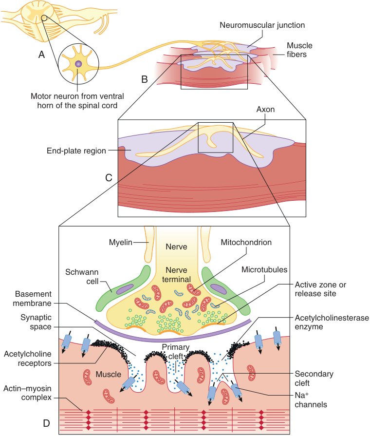

Neuromuscular junction Muscle A fibers B Motor neuron from ventral horn of the spinal cord Axon End-plate region C Myelin Nerve Mitochondrion Schwann Nerve Microtubules cell terminal Active zone or Basement release site membrane Synaptic Acetylcholinesterase space enzyme Primary Acetylcholine cleft receptors Muscle Secondary cleft Actin–myosin complex Na + channels D 

**Fig. 11.1 Structure of the adult neuromuscular junction shows the three cells that constitute the synapse: the motor neuron (i.e., nerve terminal), muscle fiber, and Schwann cell.** (A) The motor nerve originates in the ventral horn of the spinal cord or brainstem. (B) As the nerve approaches its muscle fibers and before attaching itself to the surface of the muscle fiber, the nerve divides into branches that innervate many individual muscle fibers. (C) Each muscle receives only one synapse. The motor nerve loses its myelin and further subdivides into many presynaptic boutons to terminate on the surface of the muscle fiber. (D) The nerve terminal, covered by Schwann cells, has vesicles clustered about the membrane thickenings, which are the active zones, toward its synaptic side and mitochondria and microtubules toward its other side. A synaptic gutter or cleft made up of a primary and many secondary clefts separate the nerve from the muscle. The muscle surface is corrugated, and dense areas on the shoulders of each fold contain acetylcholine receptors. Sodium (Na+ ) channels are present at the bottom of the clefts and throughout the muscle membrane. The acetylcholinesterase and proteins and proteoglycans that stabilize the neuromuscular junction are present in the synaptic clefts.

total surface area is very large. The depths of the folds also vary between muscle types and species. Human NMJs, relative to muscle size, are smaller than those of the mouse, although the junctions are located on muscle fibers that are much larger. Human junctions have longer junctional foldings and deeper gutters.15,19 The sodium channels, which propagate the wave of depolarization, are located in the depths of the folds (Fig. 11.1D). The shoulders of the folds are densely populated with AChRs, approximately 5 million of them in each junction. AChRs are sparse in the depths between the folds.

The trophic function of the nerve to muscle and retrograde from muscle to nerve is vital for the development and maintenance of adequate neuromuscular function. Before

birth, each muscle cell commonly has contacts with several nerves and has several NMJs.18,19 At birth, all but one of the nerves retract, and a single end plate remains (see Neuromuscular Junction at Extremes of Age, below). Once formed, the nerve–muscle contact, especially the end plate, is durable. Even if the original nerve dies, the one replacing it innervates exactly the same region of the muscle. The reason why the nerve endings on fast muscles are larger and more complicated than those on slow muscles is unclear. These differences in the nerve endings on muscle surfaces may play a role in the difference in response of fast- and slow- twitch muscle fibers to muscle relaxants.

Because all the muscle cells in a unit are excited by a single neuron, stimulation of the nerve electrically or by

<!-- PDF page 4 -->

an action potential originating from the ventral horn or by any agonist, including depolarizing relaxants (e.g., succinylcholine), causes all muscle cells in the motor unit to contract synchronously. Synchronous contraction of the cells in a motor unit is called _fasciculation_ and is often vigorous enough to be observed through the skin. Although most adult human muscles have only one NMJ per cell, an important exception is some of the cells in extraocular muscles.

The extraocular muscles are _tonic_ muscles, and, unlike other mammalian striated muscles, they are multiply innervated with several NMJs strung along the surface of each muscle fiber.20–23 Quite in contrast to other muscles in the rest of the body, even the adult ocular muscle contains mature and immature fetal receptors (see Biology of Prejunctional and Postjunctional Nicotinic ACh Receptors, below). The ocular muscles contract and relax slowly rather than quickly as do other striated muscles; they can maintain a steady contraction, or contracture, the strength of which is proportional to the stimulus received. Physiologically, this specialization apparently holds the eye steadily in position. Ocular muscles are important to an anesthesiologist because depolarizing muscle relaxants (e.g., succinylcholine) affect them differently than they do on most skeletal muscles. Instead of causing a brief contraction, followed by paralysis, the depolarizing drug causes a long- lasting contracture response that pulls the eye against the orbit and could contribute to an increase in intraocular fluid pressure.22,23 The clinical significance of the succinylcholine- induced increase in intraocular pressure has been questioned. Although many textbooks invoke the reported extrusion of intraocular contents with succinylcholine, the basis for this effect seems to be anecdotal.24 Clinical studies, however, have indicated that succinylcholine- induced contractions of the extraocular muscles can last as long as 1 to 2 minutes and isometric tensions larger than 12 g can develop for each extraocular muscle.23 Thus, succinylcholine probably should not be given to patients with open eye injuries.

The perijunctional zone, the muscle area immediately beyond the junctional area, is critical to the function of the NMJ. The perijunctional zone contains a mixture of receptors, including a smaller density of AChRs and a high density of sodium channels (see Fig. 11.1D). The admixture enhances the capacity of the perijunctional zone to respond to the depolarization (i.e., end- plate potential) produced by the AChRs and to transduce it into the wave of depolarization that travels along the muscle to initiate muscle contraction. The density of sodium channels in the perijunctional area is richer than in more distal parts of the muscle membrane.25,26 The perijunctional zone is close enough to the nerve ending to be influenced by transmitter released from it. Moreover, special variants (i.e., isoforms) of receptors and sodium channels can appear in this area at different stages of life and in response to abnormal decreases in nerve activity (see Biology of Prejunctional and Postjunctional Nicotinic ACh Receptors, below). Congenital abnormalities in the AChRs or in the sodium and calcium channels (i.e., mutations) are also known.25–27 These variabilities seem to contribute to the differences in response to relaxants that are observed in patients with different pathologic conditions and ages.15,27

### QUANTAL THEORY

The contents of a nerve ending are not homogeneous. As illustrated in Figs. 11.1C and 11.2, vesicles are congregated in the portion toward the junctional surface, whereas microtubules, mitochondria, and other support structures are located toward the opposite side. The vesicles containing transmitter are clustered alongside small, thickened, electron- dense patches of membrane referred to as _active zones_ or _release sites_ . This thickened area is a cross section of a band running across the width of the synaptic surface of the nerve ending that is believed to be the structure to which vesicles attach (active zones) before they rupture into the junctional cleft (see Process of Exocytosis, below). Highresolution scanning electron micrographs reveal small protein particles arranged alongside the active zone between vesicles. These particles are believed to be special channels—voltage- gated calcium channels—that allow calcium to enter the nerve and cause the release of vesicles.28,29 The rapidity with which the neurotransmitter is released (200 μs) suggests that voltage- gated calcium channels are close to the release sites. Defects in presynaptic structure can lead to decreased ACh release and muscle weakness and can be related to defects in exocytosis, endocytosis, formation of active and periactive zones, vesicle transport, and neuropeptide modulation.30

When observing the electrophysiologic activity of a skeletal muscle, small, spontaneous depolarizing potentials at NMJs can be seen. These potentials have only one hundredth the amplitude of the evoked end- plate potential produced when the motor nerve is stimulated. Except for amplitude, these potentials resemble the end- plate potential in the time course and manner they are affected by drugs. These small- amplitude potentials are called _miniature endplate potentials_ (MEPPs). Because MEPPs are too large to be produced by a single molecule of ACh, it was deduced that they are produced by uniformly sized packages, or quanta, of transmitter released from the nerve (in the absence of stimulation). The stimulus- evoked end- plate potential is the additive depolarization produced by the synchronous discharge of quanta from several hundred vesicles. The action potential that is propagated to the nerve ending allows the entry of calcium into the nerve through voltagegated calcium channels, which causes vesicles to migrate to the active zone, fuse with the neural membrane at release sites, and discharge their ACh into the junctional cleft.28,29 Because the release sites are located immediately opposite the receptors on the postjunctional surface, little transmitter is wasted, and the response of the muscle is coupled directly with the signal from the nerve.15,28

Alignment of the presynaptic receptor site is achieved by adhesion molecules or specific cell- surface proteins located on both sides of the synapse that grip each other across the synaptic cleft and hold together the prejunctional and postjunctional synaptic apparatuses.18,19,31 One such protein implicated in synapse adhesion is neurexin, which binds to neuroligins on the postsynaptic membrane. The amount of ACh released by each nerve impulse is large, at least 200 quanta of approximately 5000 molecules each, and the number of AChRs activated by transmitter released by a nerve impulse is also large, approximately 500,000 molecules. The ions (mostly sodium and some calcium) that

<!-- PDF page 5 -->

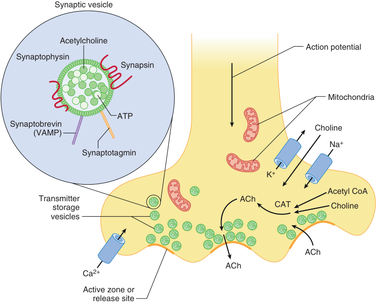

Synaptic vesicle Acetylcholine Action potential Synaptophysin Synapsin Mitochondria ATP Synaptobrevin Choline (VAMP) Na + Synaptotagmin K + Acetyl CoA Transmitter ACh storage CAT Choline vesicles ACh ACh Ca 2+ Active zone or release site 

**Fig. 11.2 The working of a chemical synapse, the motor nerve ending, including some of the apparatus for synthesis of transmitter, is illustrated.** The large intracellular structures are mitochondria. Acetylcholine (ACh), synthesized from choline and acetate by acetyl coenzyme A (CoA), is transported into coated vesicles, which are moved to release sites. A presynaptic action potential that triggers the influx of calcium (Ca2+ ) through specialized proteins (i.e., Ca2+ channels) causes the vesicles to fuse with the membrane and discharge transmitter. Membrane from the vesicle is retracted from the nerve membrane and recycled. Each vesicle can undergo various degrees of release of contents–from incomplete to complete. The transmitter is inactivated by diffusion, catabolism, or reuptake. The inset provides a magnified view of a synaptic vesicle. Quanta of ACh, together with adenosine triphosphate (ATP), are stored in the vesicle and covered by vesicle membrane proteins. Synaptophysin is a glycoprotein component of the vesicle membrane. Synaptotagmin is the vesicle’s calcium sensor. Phosphorylation of another membrane protein, synapsin, facilitates vesicular trafficking to the release site. Synaptobrevin (vesicle- associated membrane protein [VAMP]) is a SNARE protein involved in attaching the vesicle to the release- site proteins at the nerve terminal (see also Fig. 11.3). _CAT,_ choline acetyltransferase; _K_+ , potassium; _Na_+ , sodium.

flow through the channels of activated (open) AChRs cause maximum depolarization of the end plate, which results in an end- plate potential that is greater than the threshold for stimulation of the muscle. This system is extremely vigorous. The signal is carried by more molecules of transmitter than are needed, and they evoke a response that is larger than needed. At the same time, only a small fraction of the available vesicles and receptors or channels are used to send each signal. Consequently, transmission has a substantial margin of safety, and, at the same time, the system has substantial capacity in reserve.14,15,17,32

motor neuron and transmitted to the nerve ending by axonal transport (see Fig. 11.2).16,28,29 The simple molecules, choline and acetate, are obtained from the environment of the nerve ending, where choline is transported by a special system from extracellular fluid to the cytoplasm and acetate in the form of acetyl coenzyme A from mitochondria. The enzyme choline acetyltransferase brings about the reaction of choline and acetate to form ACh. After synthesis, ACh is stored in cytoplasm until it is transported and incorporated into vesicles, which are better positioned for release when an action potential reaches the nerve terminal.

## Neuromuscular Junction

### FORMATION OF NEUROTRANSMITTER AT MOTOR NERVE ENDINGS

The axon of the motor nerve carries electrical signals from the spinal cord to muscles and has all the biochemical apparatus needed to transform the electrical signal into a chemical one. All the ion channels, enzymes, other proteins, macromolecules, and membrane components needed by the nerve ending to synthesize, store, and release ACh and other trophic factors are made in the cell body of the

### NERVE ACTION POTENTIAL

During a nerve action potential, sodium from outside flows across the membrane, and the resulting depolarizing voltage opens the calcium channels, which allows entry of calcium ions into the nerve and causes ACh to be released. A nerve action potential is the normal activator that releases the transmitter ACh. The number of quanta released by a stimulated nerve is greatly influenced by the concentration of ionized calcium in extracellular fluid. If calcium is not present, then depolarization of the nerve, even by electrical stimulation, will not produce the release of transmitter. Doubling the extracellular calcium results in a 16- fold

<!-- PDF page 6 -->

increase in the quantal content of an end- plate potential.33 The calcium current persists until the membrane potential is returned to normal by outward fluxes of potassium from inside the nerve cell. Along with calcium channels on the nerve terminal are potassium channels, including the voltage- gated and calcium- activated potassium channels, whose function is to limit entry of calcium into the nerve and therefore depolarization.26,32 The calcium current can be prolonged by potassium channel blockers (e.g., 4- aminopyridine, tetraethylammonium), which slow or prevent the efflux of potassium out of the nerve. The increase in quantal content produced in this way can reach astounding proportions.15,34 An effect of increasing calcium in the nerve ending is also clinically observed as the so- called _posttetanic potentiation_ (PTP), which occurs after a nerve of a patient paralyzed with an NDMR is stimulated at high, tetanic frequencies. Calcium enters the nerve with every stimulus, but it accumulates during the tetanic period because it cannot be excreted as quickly as the nerve is stimulated. Because the nerve ending contains more than the normal amount of calcium for some time after the tetanus, a stimulus applied to the nerve during this time causes the release of more than the normal amount of ACh. The abnormally large amount of ACh antagonizes the relaxant (temporarily) and causes the characteristic increase in the size of the twitch (i.e., posttetanic facilitation).

Calcium enters the nerve through specialized proteins called _calcium channels_ .16,35 Of the several types of calcium channels, two seem to be important for the release of transmitter: P channels and the slower L channels. P channels, probably the type responsible for the normal release of transmitter, are found only in nerve terminals.13,35 In motor nerve endings, the calcium channels are located immediately adjacent to the active zones (see Fig. 11.2). They are voltage- dependent and are opened and closed by changes in membrane voltage caused by the nerve action potential. In addition to calcium channels, several forms of potassium channels are present in the nerve terminal, including voltage- gated and calcium- activated potassium channels. Potassium channels limit the duration of nerve terminal depolarization and hence the entry of calcium and the release of transmitter.26 Alterations in entry of calcium into the nerve ending can also alter the release of transmitter. The Eaton–Lambert myasthenic syndrome, not to be confused with myasthenia gravis, is an acquired autoimmune disease in which antibodies are directed against voltagegated calcium channels at nerve endings.36 In this syndrome, decreased function of the calcium channel causes decreased release of transmitter, which results in inadequate depolarization and muscle weakness. Patients with Eaton–Lambert myasthenic syndrome exhibit increased sensitivity to depolarizing and nondepolarizing relaxants.37

Higher- than- normal concentrations of bivalent inorganic cations (e.g., magnesium, cadmium, manganese) can also block the entry of calcium through P channels and profoundly impair neuromuscular transmission. This mechanism is behind the typical muscle weakness and potentiation of the effect of muscle relaxants in a pregnant patient and fetus when magnesium sulfate is administered to treat preeclampsia. P channels, however, are not affected by calcium entry- blocking drugs such as verapamil, diltiazem, and nifedipine. These drugs have profound effects on

the slower L channels present in the cardiovascular system. As a result, the L- type calcium channel blockers have no significant effect at therapeutic doses on the normal release of ACh or on the strength of normal neuromuscular transmission. However, calcium entry- blocking drugs may increase the block in neuromuscular transmission induced by NDMRs. The effect is small, and not all investigators have been able to observe it. The explanation may lie in the fact that nerve endings also contain L- type calcium channels. The effects of calcium channels on depolarizing relaxants, if any, are unknown.

### SYNAPTIC VESICLES AND RECYCLING

Two pools of vesicles seem to release ACh, a readily releasable pool and a reserve pool, sometimes called VP1 and VP2, respectively.38,39 Electron microscopic studies have demonstrated that the majority of synaptic vesicles (VP1) are sequestered in the reserve pool and tethered to the cytoskeleton in a filamentous network made up of primarily actin, synapsin (an actin- binding protein), synaptotagmin, and spectrin.38,39 Vesicles in VP2 are a bit smaller and limited to an area very close to the nerve membrane, where they are bound to the active zones. These vesicles are the ones that ordinarily release transmitter. Release occurs when calcium ions enter the nerve through the P channels lined up on the sides of the active zones by soluble _N_ - ethylmaleimide- sensitive attachment protein receptor (SNARE) proteins.38,39 The SNARE proteins are involved in fusion, docking, and release of ACh at the active zone. Calcium needs to move only a very short distance (i.e., a few atomic radii) to encounter a vesicle and activate the proteins in the vesicle wall involved in a process known as _docking_ (see Process of Exocytosis, below).39 The activated proteins seem to react with the nerve membrane to form a pore through which the vesicle discharges its ACh into the junctional cleft. Studies using fluorescent proteins have visualized how synaptic vesicles fuse with release sites and release their contents, which are then retrieved. Some vesicles stay open briefly before retrieval and do not completely collapse into the surface membrane (“kiss and run”). Others stay open longer and probably do not completely collapse (“compensatory”). Still others completely collapse and are not retrieved until another stimulus is delivered (“stranded”).38,39

The larger reserve (VP1) vesicles, from their position deep from the nerve ending and firmly tethered to the cytoskeleton proteins, (e.g., actin, synapsin, synaptotagmin, and spectrin),37,38 may be moved to the readily releasable store to replace worn- out vesicles and participate in transmission especially during hard repetitive work (e.g., stimulation at very high frequencies or for a very long time). Under such strenuous circumstances, calcium may penetrate more deeply than normal into the nerve or may enter through L channels to activate calcium- dependent enzymes that break the synapsin links holding the vesicles to the cytoskeleton, thereby allowing the vesicles to be moved to the release sites. Repeated stimulation requires the nerve ending to replenish its store of vesicles filled with transmitter, a process known as _mobilization_ . Mobilization includes all steps involved in maintaining the nerve ending’s capacity to release transmitter – from the acquisition of choline and

<!-- PDF page 7 -->

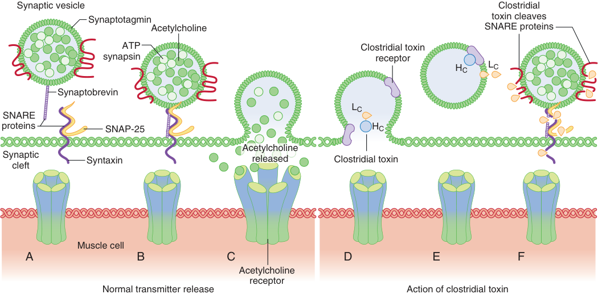

Synaptic vesicle Clostridial toxin cleaves Synaptotagmin Acetylcholine SNARE proteins ATP Clostridial toxin synapsin receptor HC LC Synaptobrevin LC SNARE proteins SNAP-25 HC Acetylcholine Synapticcleft Syntaxin released Clostridial toxin Muscle cell A B C D E F Acetylcholine receptor Normal transmitter release Action of clostridial toxin 

**Fig. 11.3 Model of protein- mediated membrane fusion and exocytosis.** (A) Release of acetylcholine from vesicles is mediated by a series of proteins collectively called _SNARE_ proteins. Synaptotagmin is the neuronal calcium receptor that detects entry of calcium. Synaptobrevin (i.e., vesicleassociated membrane protein [VAMP]) is a filament- like protein on the vesicle. (B) During depolarization and entry of calcium, synapsin is also present on the vesicle membrane. Synaptobrevin on the vesicle unfolds and forms a ternary complex with syntaxin/SNAP- 25 on the nerve terminal membrane. (C) Assembly of the ternary complex forces the vesicle in close apposition to the nerve membrane at the active zone with release of its contents, acetylcholine. The fusion is disassembled, and the vesicle is recycled. (D) Clostridial toxin, botulinum, inhibits the release of acetylcholine and causes paralysis of muscles. The toxin consists of a light chain (Lc) and a heavy chain (Hc). The first stage in intoxication is the interaction of the toxin with a thus far unidentified receptor. (E) This interaction is followed by internalization of the toxin within the vesicle and the release of the Lc of toxin from the vesicle. (F) The liberated Lc cleaves a variety of SNARE proteins, depending on the type of toxin released, thereby preventing assembly of the fusion complex and thus blocking the release of acetylcholine. _ATP_ , adenosine triphosphate; _SNAP- 25_ , synaptosome- associated protein of 25 kDa.

the synthesis of acetate to the movement of filled vesicles to release sites. Uptake of choline and the activity of choline acetyltransferase, the enzyme that synthesizes ACh, are probably the rate- limiting steps.16,29

### PROCESS OF EXOCYTOSIS

The readily releasable pool of synaptic vesicles constitutes the vesicles directly available for release. During an action potential and calcium influx, neurotransmitter is released. The whole process is called _exocytosis_ . The SNARE proteins include (Fig. 11.3A) the synaptic- vesicle protein, synaptobrevin; the plasmalemma- associated protein, syntaxin; and the synaptosome- associated protein of 25-kDa (SNAP25).38,39 The current model of protein- mediated membrane fusion in exocytosis is as follows: when there is an action potential and calcium ions enter, synapsin becomes phosphorylated, which frees the vesicle from its attachment to the cytoskeleton. Syntaxin and SNAP- 25 are complexes attached to the plasma membrane. After the initial contact, the synaptobrevin on the vesicle forms a ternary complex with syntaxin and SNAP- 25. Synaptotagmin is the protein on the vesicular membrane that acts as a calcium sensor, localizes the synaptic vesicles to synaptic zones rich in calcium channels, and stabilizes the vesicles in the docked state.38 Assembly of the ternary complex forces the vesicle to move close to the underlying nerve terminal membrane (i.e., the active zone), and the vesicle is then ready for release (Fig. 11.3B). The close proximity of release sites,

calcium channels, and synaptic vesicles and the use of the calcium sensor lead to a burst of release of new transmitter synchronous with the stimulus (Fig. 11.3C).37–40 The vesicle can release part or all of its contents, some of which can be recycled to form new vesicles as previously described (“kiss and run,” “compensatory,” “stranded”).37–40

Botulinum neurotoxin (gas gangrene poisoning) selectively digests one or all these SNARE proteins and blocks exocytosis of the vesicles,41,42 which ultimately results in muscle weakness or more profound muscle paralysis. This toxin may produce a partial or complete chemical denervation. Botulinum toxin is therapeutically used to treat spasticity or spasm in several neurologic and surgical diseases, to prevent hyperhidrosis in patients with excessive sweating, and cosmetically to correct wrinkles.43,44 Botulinum toxin consists of two protein segments known as heavy and light chains (Fig. 11.3D,E). The heavy chain interacts with lipid molecules called _polysialogangliosides_ in the cell membrane and synaptotagmin on the vesicle to enter the vesicle. Once in the vesicle, the light chain inactivates neuromuscular transmission by breakdown and thereby inhibits the function of SNARE proteins (Fig. 11.3F). Infections with _Clostridium botulinum_ have been particularly common after traumatic injuries, in drug abusers, and after musculoskeletal allografts.6,7 Thus, systemic paralysis can occur after clostridial infection. Local injection for therapeutic purposes will usually result in localized paresis, although systemic effects have been reported.7,45

<!-- PDF page 8 -->

### ACETYLCHOLINESTERASE

The ACh diffuses across the junctional cleft and reacts with AChRs in the end plate to initiate muscle contraction. Transmitter molecules that do not immediately react with a nicotinic AChR or those released after binding to the receptor are almost instantly destroyed by acetylcholinesterase in the junctional cleft. Acetylcholinesterase at the junction is the asymmetric or A12 form protein made in the muscle under the end plate. Acetylcholinesterase (enzyme classification 3.1.1.7) is type B carboxylesterase enzyme. A smaller concentration of the enzyme is found in the extrajunctional area. The enzyme is secreted from the muscle but remains attached to it by thin stalks of collagen fastened to the basement membrane.16,37 Most of the molecules of ACh released reach the postjunctional receptors; however, as they are released from the receptors, they invariably encounter acetylcholinesterase and are destroyed. Under normal circumstances, a molecule of ACh reacts with only one receptor before it is hydrolyzed. ACh is a potent messenger, but its actions are very short lived because it is destroyed in less than 1 ms after it is released.

Some congenital and acquired diseases are caused by altered activity of acetylcholinesterase. The congenital absence of the secreted enzyme leads to impaired maintenance of the motor neuronal system and organization of nerve terminal branches.46 Many syndromes caused by congenital abnormalities in cholinesterase function have been described and result in neuromuscular disorders whose symptoms and signs usually resemble those of myasthenia gravis or myasthenic syndromes.27,47 Denervation decreases acetylcholinesterase at the junctional and extrajunctional areas.37 Other acquired diseases involving cholinesterases are related to chronic inhibition of acetylcholinesterase by organophosphate pesticides or nerve gas (e.g., sarin) or to chronic pyridostigmine therapy given as prophylaxis against nerve gas poisoning.48,49 Symptoms ranging from chronic fatigue to muscle weakness have been attributed to chronic cholinesterase inhibition, thus underscoring the importance of acetylcholinesterase in normal and abnormal neuromuscular function. A rodent study confirms that the muscle weakness associated with chronic pyridostigmine therapy is related to both AChR downregulation and to receptor- independent factors.50

### POSTJUNCTIONAL ACETYLCHOLINE RECEPTORS

The similarity of AChRs among many species and the abundance of AChRs from _Torpedo electric fish_ have greatly facilitated research in this area. The availability of messenger RNA from humans and other species and DNA has allowed the study of the receptor in artificial systems such as oocytes from frogs and in mammalian cells that do not express the receptor, such as COS or fibroblast cells. Receptors can also be mutated by molecular techniques to simulate pathologic states; the receptor function in these artificial systems can then be studied. By using these and related techniques, much has been learned about the synthesis, composition, and biologic function and mechanisms that underlie the physiologic and pharmacologic responses in AChRs.51–53 Three isoforms of postjunctional nicotinic AChRs exist: a junctional or mature receptor, an extrajunctional or

immature (fetal) receptor, and the more recently described neuronal α7 nicotinic receptor (see Biology of Prejunctional and Postjunctional Nicotinic ACh Receptors, below).2,14,17 The differences between receptor subtypes, however, can be neglected in a general discussion of the role of receptors in neuromuscular transmission.

AChRs are synthesized in muscle cells and are anchored to the end- plate membrane by a 43 kDa protein known as _rapsyn_ . This cytoplasmic protein is associated with the AChR in a 1:1 ratio.14,15,17,18 The receptors, formed of five subunit proteins, are arranged like the staves of a barrel into a cylindrical receptor with a central pore for ion channeling (the key features are illustrated in Fig. 11.4). The receptor protein has a molecular mass of approximately 250 kDa. The mature receptor consists of α1- , β1- , δ- , and ε- subunits, and the fetal (immature, extrajunctional) receptor consists of α1- , β1- , δ- , and γ- subunits; there are two subunits of α and one each of the others. The neuronal α7 AChR consists of five α7- subunits.16,18 Each of all receptor subunits consists of approximately 400 to 500 amino acids. The receptor–protein complex passes entirely through the membrane and protrudes beyond the extracellular surface of the membrane and into the cytoplasm. The binding site for ACh is on each of the α1- or α7- subunits, is located on the extracellular component of the α- subunit protein, and these are the sites of competition between receptor agonists and antagonists. Agonists and antagonists are attracted to the binding site, and either may occupy the site, which is located near cysteine residues (unique to the α- chain) at amino acid positions 192 to 193 of the α- subunit.16–18 Radiolabeled or fluorescent α- bungarotoxin from the cobra is used to quantitate or fluorescent stain the receptor and binds to heptapeptide region 185 to 199 of the α- subunit.54 Motor neuron–derived neuregulin- 1β (NRβ- 1), originally described as AChR- inducing activity (ARIA), induces AChR gene transcription in subsynaptic myonuclei by activating ErbB receptors.14,15,17,18

### SYNTHESIS AND STABILIZATION OF POSTJUNCTIONAL RECEPTORS

Muscle tissue is formed from the mesoderm and initially appears as myoblasts. Myoblasts fuse to produce myotubes, which therefore have multiple nuclei. As the myotubes mature, the sarcomere, which is the contractile element of the muscle consisting of actin and myosin, develops.55 The protein β- integrin seems to be essential for myoblast fusion and sarcomere assembly.55 Shortly afterward, motor nerve axons grow into the developing muscle, and these axons bring in nerve- derived signals (i.e., growth factors), including agrin and neuregulins (NRβ- 1 and NRβ- 2), which are key to the maturation of myotubes to muscle.18 Agrin is a protein from the nerve that stimulates postsynaptic differentiation by activating muscle- specific tyrosine kinase (MuSK), a tyrosine kinase expressed selectively in muscle. With signaling from agrin, the AChRs, which have been scattered throughout the muscle membrane, cluster at the area immediately beneath the nerve. Agrin, together with neuregulins and other growth factors, induce the clustering of other critical muscle- derived proteins, including MuSK, rapsyn, and ErbB proteins, all of which are necessary for maturation and stabilization of AChRs at the junction. In

<!-- PDF page 9 -->

addition to the effects on postsynaptic differentiation, agrin and MuSK display effects on presynaptic differentiation as well. Agrin and MuSK induce retrograde signals that instruct axons to undergo neuron outgrowth and terminal differentiation.18 Current understanding of presynaptic development of the NMJ, however, is significantly less advanced than the understanding of postsynaptic development. Just before and shortly after birth, the immature, γ- subunit- containing AChRs are replaced by the mature, ε- subunit- containing receptors. Although the mechanism

of this change is unclear, a neuregulin, NRβ- 1, also called ARIA, that binds to one of the ErbB receptors seems to play a role.18,56

### BASIC ELECTROPHYSIOLOGY OF NEUROTRANSMISSION

Fig. 11.5 illustrates the results of the classic depolarizing action of ACh on end- plate receptors. Normally, the pore of the channel is closed by approximation of the cylinders

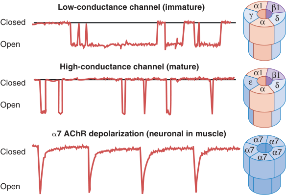

Low-conductance channel (immature)  α1 β1 γ δ Closed α Open High-conductance channel (mature) α1 β1 Closed ε δ α Open � 7 AChR depolarization (neuronal in muscle) α7 α7 Closed α7 α7 α7 Open 

**Fig. 11.4 Schematic illustration depicts acetylcholine receptor (AChR) channels** **_(right)_ and tracings of cell- patch records of receptor channel openings** **_(left)_ .** The mature or junctional receptor consists of two α1- subunits and one each of β1- , δ- , and ε- subunits. The immature, extrajunctional, or fetal form consists of two α1- subunits and one each of β1- , δ- , and γ- subunits. The latter is thus called the γ- subunit receptor. Recently, a neuronal receptor consisting of five α7- subunits has been described in muscle. All the subunits are arranged around the central cation channel. The immature isoform containing the γ- subunit has long open times and low- amplitude channel currents. The mature isoform containing the ε- subunit has shorter open times and high- amplitude channel currents during depolarization. Substitution of the ε- subunit for the γ- subunit gives rise to the fast- gated, high- conductance channel type. As expected, application of acetylcholine to the α7 AChR also results in a fast, rapidly decaying inward current. All these depolarizing events are insensitive to treatment with muscarinic acetylcholine receptor antagonist, atropine, but sensitive to treatment with α- bungarotoxin or muscle relaxants, which block the flow of current. The affinity of the muscle relaxants to each of the three isoforms may be different, α7 AChR being the least sensitive to block.

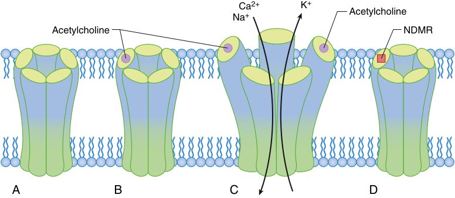

Ca 2+ K + Acetylcholine Na + Acetylcholine NDMR A B C D 

**Fig. 11.5 Actions of acetylcholine or nondepolarizing muscle relaxant (NDMR) on end- plate receptors.** (A) The ion channel is inactive and does not open in the absence of acetylcholine. (B) Although one acetylcholine molecule _(filled circle)_ is binding to one of two binding sites, the central channel does not open. (C) When acetylcholine simultaneously binds to the recognition sites of both α- subunits _(filled circles)_ , a conformation change is triggered that opens the channel and allows the cations to flow across the membrane. (D) Action of antagonists such as an NDMR _(filled square)_ . Acetylcholine is in competition with NDMR for the receptor’s recognition site but may also react with acetylcholinesterase. Inhibiting the acetylcholinesterase enzyme increases the lifetime of acetylcholine and the probability that it will react with a receptor. When one of the two binding (recognition) sites is occupied by an NDMR, the receptor will not open, even if the other binding site is occupied by acetylcholine. _Ca_2+ , calcium ion; _K_+ , potassium ion; _Na_+ , sodium ion.

::: warning 符號需核對
此頁有符號無法完整擷取，請展開下方原始頁面核對。
:::

::: details 原始表格與符號（PDF 第 9 頁）

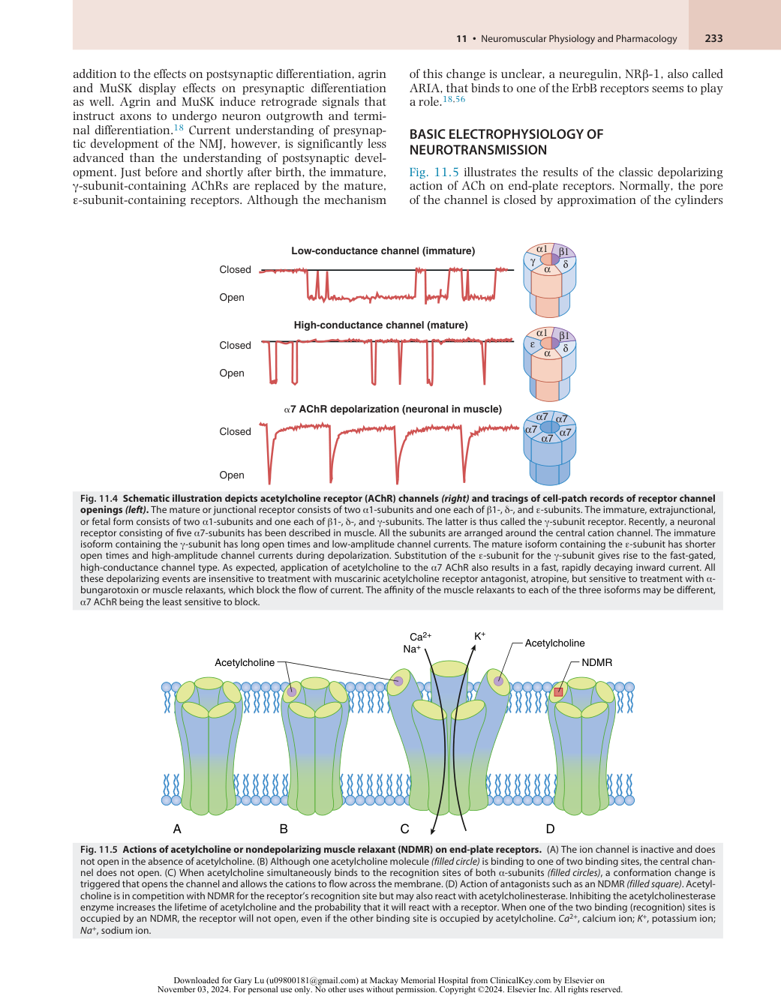

:::

<!-- PDF page 10 -->

(i.e., subunits). When an agonist occupies both α- subunit sites, the protein molecule undergoes a conformational change with a twisting movement along the central axis of the receptor that results in the opening of the central channel through which ions can flow along a concentration gradient. When the central channel is open, sodium and calcium flow from the outside of the cell to the inside and potassium flows from the inside to the outside. The channel is large enough to accommodate many cations and electrically neutral molecules, but excludes anions (e.g., chloride). The current transported by the ions depolarizes the adjacent membrane. The net current is depolarizing and creates the end- plate potential that stimulates the muscle to contract. In this instance, downward- going (i.e., depolarizing) current can be recorded by the patch- clamp electrophysiologic technique previously described (see Fig. 11.4).

The pulse stops when the channel closes by a reversed mechanical conformation (see earlier discussion), which is typically initiated when one or both agonist molecules detach from the receptor. In the activated, open state, the current that passes through each open channel is minuscule, only a few picoamperes (approximately 104 ions/ms). However, each burst of ACh from the nerve normally opens approximately 500,000 channels simultaneously, and the total current is more than adequate to produce depolarization of the end plate and contraction of muscle. Opening of a channel causes conversion of chemical signals from a nerve to the flow of current on the muscle disease to cause endplate potentials, thereby leading to muscle contraction. The end- plate potential has been viewed as a graded event that may be reduced in magnitude or extended in time by drugs, but the end- plate potential is the summation of many allor- nothing events simultaneously occurring at myriad ion channels. It is these tiny events that are affected by drugs.

Receptors that do not have two molecules of agonist (e.g., ACh) bound remain closed. Both α- subunits must be simultaneously occupied by agonist; if only one of them is occupied, then the channel remains closed (see Fig. 11.5). This is the basis for preventing depolarization by antagonists. NDMRs act by binding to either or both α- subunits and thus preventing ACh from binding and opening the channel. This interaction between agonists and antagonists is competitive, and the outcome—transmission or block—depends on the relative concentrations and binding characteristics of the drugs involved (see Drug Effects on Postjunctional Receptors, below).

Individual channels are also capable of a wide variety of conformational states.15,57 They may stay open or remain closed and thereby affect total current flow across the membrane, but they can do more. They may open for a longer or shorter time than normal, open or close more gradually than usual, open briefly and repeatedly (i.e., flickering), or pass fewer or more ions per opening than they usually do. Their function is also influenced by drugs, changes in fluidity of the membrane, temperature, electrolyte balance in the milieu, and other physical and chemical factors.38,39 Receptor channels are dynamic structures that are capable of a wide variety of interactions with drugs and of entering a wide variety of current- passing states. All these influences on channel activity are ultimately reflected in the strength or weakness of neuromuscular transmission and contraction of a muscle.

## Drug Effects on Postjunctional Receptors

### CLASSIC ACTIONS OF NONDEPOLARIZING MUSCLE RELAXANTS

Neurotransmission occurs when ACh released by the nerve action potential binds to nicotinic AChRs. All NDMRs impair or block neurotransmission by competitively preventing the binding of ACh to the muscle AChR. The outcome—block or transmission—depends on the relative concentrations of the chemicals and their comparative affinities for the receptor. Fig. 11.5 shows a system exposed to ACh and the nondepolarizing neuromuscular blocking compound. One receptor has attracted two ACh molecules and has opened its channel, where current will flow to depolarize that segment of membrane. Another has attracted one molecule of NDMR; its channel will not open, and no current will flow, even if one ACh molecule binds to the other site. The third receptor has ACh on one α- subunit and nothing on the other. What will happen depends on which of the molecules that binds. If ACh binds, then the channel will open and the membrane will be depolarized; if an NDMR binds, then the channel will remain closed, and the membrane will not be depolarized. At other times, one or two molecules of NDMR may attach to the receptor, in which case the receptor is not available to agonists; no current flow is recorded. In the presence of moderate concentrations of NDMR, the amount of current flowing through the entire end plate at any instant is reduced from normal, which results in a smaller end- plate potential and, if carried far enough, a block in neurotransmission or neuromuscular paralysis occurs.

Normally, acetylcholinesterase destroys ACh and removes it from competition for a receptor; therefore, an NDMR has a better chance of inhibiting transmission. If, however, an inhibitor of acetylcholinesterase such as neostigmine is added, then the cholinesterase cannot destroy ACh. The concentration of agonist in the cleft remains high, and this high concentration shifts the competition between ACh and an NDMR in favor of the former, thereby improving the chance of two ACh molecules binding to a receptor even though NDMR is still in the environment. This mechanism causes the cholinesterase inhibitors to overcome the neuromuscular paralysis produced by NDMRs. The channel opens only when ACh attaches to both recognition sites. A single molecule of antagonist, however, is adequate to prevent depolarization of that receptor. This modifies the competition by strongly biasing it in favor of the antagonist (relaxant). Mathematically, if the concentration of an NDMR is doubled, then the concentration of ACh must be increased fourfold if ACh is to remain competitive. Paralysis produced by high concentrations of muscle relaxants (antagonist) is more difficult to reverse with cholinesterase inhibitors than that produced by low concentrations. After large doses of NDMRs, cholinesterase inhibitors may be ineffective until the concentration of relaxant in the perijunctional area decreases to a lower level by the redistribution or elimination of the drug. This is the molecular basis for the recommendation to not administer anticholinesterases too early (i.e., at a deep block). In contrast to reversal with a cholinesterase inhibitor, cyclodextrin encapsulation takes place at any concentration of a steroid- based compound,

<!-- PDF page 11 -->

such as vecuronium or rocuronium, and reversal by this novel mechanism can therefore be achieved at any level of neuromuscular block provided the amount of cyclodextrin (sugammadex) is large enough.

### CLASSIC ACTIONS OF DEPOLARIZING MUSCLE RELAXANTS

Depolarizing relaxants (e.g., succinylcholine, decamethonium) initially simulate the effect of ACh and can be considered agonists, even though they block neurotransmission after the initial stimulation. Structurally, succinylcholine is very similar to the natural ligand ACh and consists of two molecules of ACh bound together through their backbones. It is thus not surprising that succinylcholine can mimic the effects of ACh.

Succinylcholine or decamethonium can bind to the receptor, open the channel, pass current, and depolarize the end plate. These agonists, like ACh, attach only briefly; each opening of a channel is very short in duration – 1 ms or less. The response to ACh, however, is over in milliseconds because of its rapid degradation by acetylcholinesterase, and the end plate resets to its resting state long before another nerve impulse arrives. In contrast, the depolarizing relaxants characteristically have a biphasic action on muscle – an initial contraction, followed by relaxation lasting from minutes to hours. Because they are not susceptible to hydrolysis by acetylcholinesterase, the depolarizing relaxants are not eliminated from the junctional cleft until after they are eliminated from plasma. The time required to clear the drug from the body is the principal determinant of how long the drug effect lasts. Whole- body clearance of the relaxant is very slow in comparison to ACh, particularly when plasma (pseudo) cholinesterase is abnormal. Because the relaxant molecules are not quickly cleared from the cleft, compared with ACh, they repeatedly react with receptors even with normal levels of plasma cholinesterase, almost immediately attaching to a receptor after separating from another, thereby repeatedly depolarizing the end plate and opening channels. For details on the effect of succinylcholine in patients with cholinesterase deficiency, also see Chapter 24.

The quick shift from excitation of muscle contraction to block of transmission by depolarizing relaxants occurs because the end plate is continuously depolarized. This comes about due to the juxtaposition of the edge of the end plate with a different kind of ion channel, the sodium channel that does not respond to chemicals but opens when exposed to a transmembrane voltage change. Just as the AChR, the sodium channel is also a cylindrical transmembrane protein through which sodium ions can flow. Two parts of its structure act as gates that allow or stop the flow of sodium ions.58 Both gates must be open if sodium is to flow through the channel; closing of either cuts off the flow. Because these two gates act sequentially, a sodium channel has three functional conformational states and can progressively move from one state to another (Fig. 11.6). This whole process is short lived when depolarization occurs with ACh.58 The initial response of a depolarizing muscle relaxant resembles that of ACh, but because the muscle relaxant is not rapidly hydrolyzed, depolarization of the end plate is not brief.

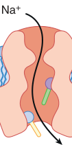

Na + 

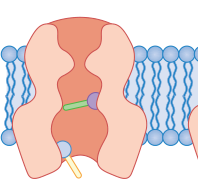

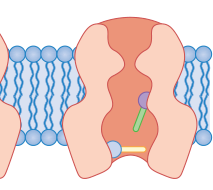

**Fig. 11.6 Illustration of a sodium (Na**+ **) channel.** The _bars_ represent parts of the molecule that act as gates. The _upper bar_ is voltage dependent; the _lower bar_ is time dependent. The _left side_ of the drawing represents the resting state. Once activated by a change in voltage, the molecule and its gates progress as illustrated _(left to right)_ . See text for details.

Depolarization of the end plate by the depolarizing relaxant initially causes the voltage gate in adjacent sodium channels to open, thereby producing a wave of depolarization that sweeps along the muscle and generates a muscle contraction. Shortly after the voltage- dependent gate opens, the time- dependent inactivation gate closes. Because the relaxant is not removed from the cleft, the end plate continues to be depolarized. Because the sodium channels immediately adjacent to the end plate are influenced by depolarization of the end plate, their voltage- dependent gates stay open, and their inactivation gates stay closed. Since sodium cannot flow through a channel that has a closed inactivation gate, the perijunctional muscle membrane does not depolarize. When the flow of ions through sodium channels in the perijunctional zone stops because of a closure of the inactivation gates, the channels downstream (beyond the perijunctional zone) are freed of depolarizing influence. In effect, the perijunctional zone becomes a buffer that shields the rest of the muscle from events at the end plate. Consequently, the muscle membrane is separated into three zones: (1) the end plate, which is depolarized by succinylcholine; (2) the perijunctional muscle membrane, in which the sodium channels are frozen in an inactivated state; and (3) the rest of the muscle membrane, in which the sodium channels are in the resting state. Because a burst of ACh from the nerve cannot overcome the inactivated sodium channels in the perijunctional zone, neuromuscular transmission is blocked. This phenomenon is also called _accommodation_ . During accommodation, when the synapse is inexcitable through the nerve (transmitter), direct electrical stimulation of muscle causes muscle contraction because the sodium channels beyond the junctional area are in the resting excitable state.

The extraocular muscles are tonic muscles, which are multiply innervated and chemically excitable along most of their surfaces.20–23 Despite their innervated state, the ocular muscles express both mature and immature receptors.20,22 Accommodation does not occur, and these muscles can undergo a sustained contracture in the presence of succinylcholine. The tension that develops forces the eye against the orbit and accounts for part of the increase in intraocular pressure produced by depolarizing relaxants. The extraocular muscles contain a special type of receptor that does not become desensitized (see later discussion) during the continued presence of ACh or other agonists.21,23 A single dose of succinylcholine can cause contracture lasting several minutes.23 Whether it is the immature γ- subunit

<!-- PDF page 12 -->

AChR or the α7 AChR subunit that plays a role in this resistance to desensitization in the ocular muscles is unknown.

### NONCLASSIC AND NONCOMPETITIVE ACTIONS OF NEUROMUSCULAR DRUGS

Several drugs can interfere with the receptor, directly or through its lipid environment, and can change transmission (Box 11.1). These drugs react with the AChR to change its function and impair transmission, but they do not act through the ACh binding site. These reactions cause drug- induced changes in the dynamics of the receptor; instead of sharply opening and closing, the modified channels are sluggish. They open more slowly and stay open longer, or they close slowly and in several steps, or both. These effects on channels cause corresponding changes in the flow of ions and distortions of the end- plate potential. The clinical effect depends on the molecular events. For example, procaine, ketamine, inhaled anesthetics, or other drugs that dissolve in the membrane lipid may change the opening or closing characteristics of the channel.57,59a If the channel is prevented from opening, then transmission is weakened. If, however, the channel is prevented from or slowed in closing, then transmission may be enhanced. These drugs do not fit the classic model, and the impaired neuromuscular function is not antagonized by increasing perijunctional ACh concentrations with cholinesterase inhibitors. Such drugs can be involved in two clinically important reactions: receptor desensitization and channel block. The former occurs in the receptor molecule, whereas the latter occurs in the ion channel. NDMRs also bind to non-muscular structures including carotid body and innate immune cells (macrophage and microglia cells(. The binding of NDMRs to the carotid body inhibits the ventilatory response to hypoxia.59b The NDMRs binding to the α7 AChRs in the innate immune cells have the potential to cause anti-inflammatory effects (decrease cytokine release).59c

### DESENSITIZATION BLOCK

The AChR, because of its flexibility and the fluidity of the lipid around it, is capable of existing in several conformational states.57–61 Because the resting receptor is free of agonist, its channel is closed. The second state exists when two molecules of agonist are bound to the α- subunit of the receptor and the receptor has undergone the conformational change that opens the channel and allows ions to flow. These reactions are the bases of normal neuromuscular transmission. Some receptors that bind to agonists, however, do not undergo the conformational change to open the channel. Receptors in these states are called desensitized (i.e., they are not sensitive to the channel- opening actions of agonists). They bind agonists with exceptional avidity, but the binding does not result in the opening of the channel. The mechanisms by which desensitization occurs are not known. The receptor macromolecule, 1000 times larger by weight than most drugs or gases, provides many places at which the smaller molecules may act. The interface between lipid and receptor protein provides additional potential sites of reaction. Several different conformations of the protein are known, and because ACh cannot cause the ion channel to open in any of them, they all are included in the functional term _desensitization_ . Desensitization is accompanied by phosphorylation of a tyrosine unit in the receptor protein.61,62

### Box 11.1 Drugs That Can Cause or Promote Desensitization of Muscle Nicotinic Receptors

|Volatile anesthetics|
|---|
|Halothane|
|Sevoflurane l|
|Isoflurane|
|Antibiotics|
|Polymyxin B|
|Cocaine|
|Alcohols|
|Ethanol|
|Butanol|
|Propanol|
|Octanol|
|Barbiturates|
|Thiopental|
|Pentobarbital|
|Agonists|
|Acetylcholine|
|Decamethonium|
|Carbachol|
|Succinylcholine|
|Acetylcholinesterase inhibitors|
|Neostigmine|
|Pyridostigmine l|
|Di- isopropyl- fluorophosphate|
|Edrophonium|
|Local anesthetics|
|Dibucaine|
|Lidocaine|
|Prilocaine|
|Etidocaine|
|Phenothiazines|
|Chlorpromazine|
|Trifluoperazine|
|l Prochlorperazine|
|Phencyclidine|
|Calcium channel blockers|
|Verapamil|

Although agonists (e.g., succinylcholine) induce desensitization, the receptors are in a constant state of transition between resting and desensitized states, regardless of whether agonists are present. Agonists do promote transition to a desensitized state or, because they bind very tightly to desensitized receptors, trap a receptor in a desensitized state. NDMRs also tightly bind to desensitized receptors and can trap molecules in these states. This action of NDMRs is not competitive with that of ACh; it may be augmented by ACh if the latter promotes the change to a desensitized state. Desensitization can lead to significant misinterpretation of data. Superficially, the preparation seems to be normal, but its responsiveness to agonists or antagonists is altered. One variety occurs very rapidly, within a few milliseconds after application of an agonist, which may explain the increased sensitivity to nondepolarizing relaxant after the prior administration of succinylcholine. Desensitization may also be a part of the phenomenon known as _phase II block_ (see Phase II Block, below), which is caused by a prolonged administration of depolarizing relaxants. Phase II block is frequently referred to as a desensitization block, but it should not be because desensitization of receptors is only one of many phenomena that contribute to the process.

::: details 原始表格與符號（PDF 第 12 頁）

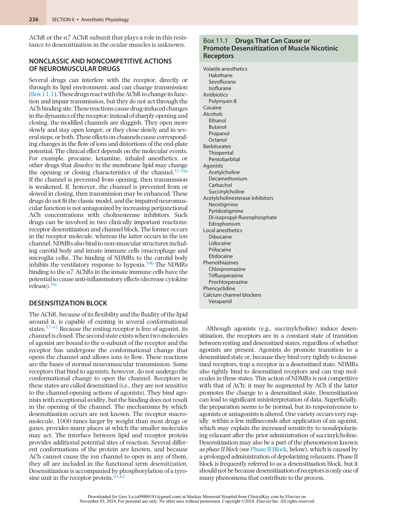

:::

<!-- PDF page 13 -->

Many other drugs used by anesthetists also promote the shift of receptors from a normal state to a desensitized state.58–60 These drugs, some of which are listed in Box 11.1, can weaken neuromuscular transmission by reducing the margin of safety that normally exists at the NMJ, or they can cause an apparent increase in the capacity of NDMRs to block transmission. These actions are independent of the classic effects, based on competitive inhibition of ACh. The presence of desensitized receptors means that fewer receptor channels than usual are available to carry transmembrane current. The production of desensitized receptors decreases the efficacy of neuromuscular transmission. If many receptors are desensitized, then insufficient normal ones are left to depolarize the motor end plate, and neuromuscular transmission will not occur. Even if only some receptors are desensitized, neuromuscular transmission will be impaired, and the system will be more susceptible to block by conventional antagonists such as atracurium or rocuronium.

### CHANNEL BLOCK

Local anesthetics and calcium entry blockers prevent the flow of sodium or calcium through their respective channels, thus explaining the term _channel- blocking drugs_ . Similarly, block of the flow of ions can occur at the AChR with concentrations of drugs used clinically and may contribute to some of the phenomena and drug interactions observed at the receptor. Two major types (closed- channel and open- channel block) can occur.60,63,64 In a closed- channel block, certain drugs can occupy the mouth of the channel and prevent ions from passing through the channel to depolarize the end plate. The process can take place even when the channel is not open. In an open- channel block, a drug molecule enters a channel that has been opened by reaction with ACh but does not necessarily penetrate all the way through. Open- channel block is a use- dependent block, which means that molecules can enter the channel only when it is open. In open- and closedchannel blocks, the normal flow of ions through the receptor is impaired, thereby resulting in the prevention of depolarization of the end plate and a weakened or blocked neuromuscular transmission. However, because the action is not at the ACh recognition site, it is not a competitive antagonism of ACh and is not relieved by anticholinesterases that increase concentrations of ACh. Increasing the concentration of ACh may cause the channels to open more often and, consequently, become more susceptible to block. Neostigmine and related cholinesterase inhibitors can act as channel- blocking drugs.15,63

Channel block may account for the antibiotic- , cocaine- , quinidine- , piperocaine- , tricyclic antidepressant- , naltrexone- , naloxone- , and histrionicotoxin- induced alterations in neuromuscular function. Muscle relaxants, in contrast, can bind to the ACh recognition site of the receptor and occupy the channel. Pancuronium preferentially binds to the recognition site. Gallamine (that was synthesized by the Swiss- born Italian pharmacologist Daniel Bovet, who received the Nobel Prize in Physiology or Medicine in 1957 for his work on cardiovascular and neuromuscular pharmacology) is not used clinically anymore and seems to act equally at the two sites (channel- blocking and AChblocking sites). Tubocurarine, the first NDMR used clinically, is in between: at small doses that clinically produce minimal blockage of transmission, the drug is essentially

a pure antagonist at the recognition site; at larger doses, it also enters and blocks channels. Decamethonium and succinylcholine, as agonists, can open channels and, as slender molecules, also enter and block them. Decamethonium and some other long, thin molecules can penetrate all the way through the open channel and enter the cytoplasm of muscle cells. Whether prolonged administration of NDMRs, as used in an intensive care unit, can result in the NDMR occupation of the channel, and even entry of drug into the cytosol, is unknown.

### PHASE II BLOCK

A phase II block is a complex phenomenon associated with a typical fade in muscle during continuous exposure to depolarizing drugs. This fade phenomenon is likely due to the interaction of depolarizing action of succinylcholine on distinct neuronal (prejunctional) AChRs; these prejunctional receptors are blocked by higher- than- usual concentrations of succinylcholine. This fade after succinylcholine is at least partly dependent on a presynaptic interaction with cholinergic transmission of importance for neurotransmitter mobilization and release. However, the mechanism of fade in muscle during repetitive nerve stimulation after NDMRs is due to simultaneous block of pre- and postjunctional AChR block.65

Factors influencing the development of a phase II block include the duration of exposure to the drug, the particular drug used and its concentration, and even the type of muscle (i.e., fast or slow twitch). Interactions with anesthetics and other agents also affect the process. All these drugs may also have prejunctional effects on the rate and amount of transmitter released and mobilized. With so many variables involved in the interference with neuromuscular transmission, a phase II block is a complex and ever- changing phenomenon. The reversal response of a phase II block produced by a depolarizing muscle relaxant to the administration of cholinesterase inhibitors is difficult to predict. It is therefore best that reversal by cholinesterase inhibitors is not attempted, although the response to tetanus or train- of- four stimulation resembles that produced by NDMRs.

## Biology of Prejunctional and Postjunctional Nicotinic ACh Receptors

### POSTJUNCTIONAL CONVENTIONAL ACh RECEPTORS IN MUSCLE VERSUS NEURONAL ACh RECEPTORS IN MUSCLE

Currently, three variants of postjunctional AChRs have been identified. The AChR isoform present in the innervated, adult NMJ is referred to as the adult, mature, or junctional receptor. The second AChR isoform is expressed when muscle activity is decreased, as observed in the fetus before innervation or after chemically or physically induced immobilization; after lower or upper motor neuron injury, burns, or sepsis; or after other events that cause increased muscle protein catabolism, including sepsis or generalized inflammation.1–3 In contrast with the mature or junctional

<!-- PDF page 14 -->

receptors, the third isoform is referred to as the immature, extrajunctional, or fetal form of AChR. The immature isoform is not observed in the muscle protein catabolism and wasting that occur with malnutrition.66 Qualitative differences in the mature isoform can occur because of gene mutations, which therefore alters the subunit protein structure. These qualitative changes in AChR can also cause abnormalities in neurotransmission (e.g., slow- or fast- channel syndrome)27,47 and therefore the response to muscle relaxants.

At the molecular level, the mature and immature receptors consist of five subunits (see Fig. 11.4).1–3 The mature junctional receptor is a pentamer of two α1- subunits and one each of the β1- , δ- , and ε- subunits. The immature receptor consists of two α1- subunits and one each of the β1- , δ- , and γ- subunits; that is, in the immature receptor, the γ- subunit is present instead of the ε- subunit. The γ- and ε- subunits differ very little from each other in amino acid homology, but the differences are great enough to affect the physiologic function and pharmacologic characteristics of the receptor and its ion channel. Junctional receptors are always confined to the end- plate region of the muscle membrane. The immature, or extrajunctional, receptor is almost exclusively expressed in the extrajunctional area.14 During development and in certain pathologic states, junctional and extrajunctional receptors can coexist in the perijunctional area of the muscle membrane (Fig. 11.7).

Quite in contrast to the conventional muscle AChRs described earlier, receptors formed of α7 AChRs have recently been found in skeletal muscle during immobilization, sepsis, and denervation.67,68 The expression of homomeric (i.e., formed of the same subunits) pentamers α7 AChR subunits in muscle has been evidenced recently by Western blotting, ligand binding, or genetic techniques after sepsis, and burn injury or immobilization, during which no overt denervation occurs (see Fig. 11.4).14,69 Ligand (drug)binding pockets are thought to be formed at negative and positive faces of the α7- subunit assembly interphases. As expected, the endogenous agonist, ACh, binds to α7 AChR subunits, and each of the five subunits has the potential to bind ACh or succinylcholine molecules.17,68 Other agonists, including nicotine and choline, and antagonists, including muscle relaxants, cobra toxin, and α- bungarotoxin, also bind to the α7 AChR.17,68–71

The α7 AChRs in muscle display unusual functional and pharmacologic characteristics when compared with conventional muscle (α1, β1, δ, ε/γ) AChRs or neuronal α7 AChRs in the brain. Choline, a precursor and metabolite of ACh (and succinylcholine), is a weak agonist of conventional muscle AChRs but is a full agonist of muscle α7 AChRs; that is, concentrations of choline that do not open conventional AChR channels will open α7 AChR channels.68 Furthermore, no desensitization of the α7 AChRs occurs even during the continued presence of choline,68 thus allowing a greater chance for potassium to efflux (approximately 145 mEq/L) from within the cell to the extracellular space, including plasma (approximately 4.5 mEq/L), down its concentration gradient. The chemical α- conotoxin GI from the snail specifically inhibits the conventional (mature and immature) AChRs in muscle but does not inhibit α7 AChRs. The important role of α7 AChRs in resistance to NDMRs is evidenced by the presence of immobilization- induced

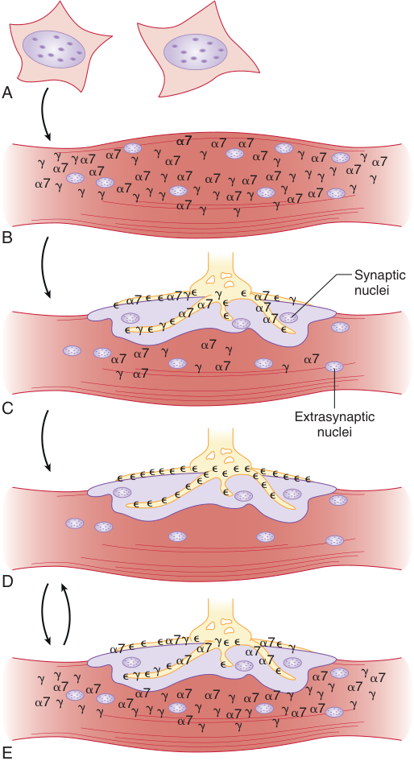

A �7 �7 �7 � � �� 7 �7�7�7 � � �7 � �7 � � �7 �7� �7 �7 � � � �7��7� �� �7� ��7 ��7��7 �7���7 ���7 � � � �7 � � � B Synaptic � �7 � � �7���7 �� � ��77 � � nuclei � � � � � �7 � �7 � �7 �7 � � �7 �7 � �7 � �7 � C Extrasynaptic nuclei � ��������������� � �� � � � � � � ��� D �7 � � � �7� ��7 � � � �7�7� � � � � � � � � � �7 � �7� �7 � �7 �7 �7 �7 �7 � � � �7� �7� �� �7 � �7� ��7 ��7 �7 ���7�� �7 � � � �7 � � � E 

**Fig. 11.7 Distribution of acetylcholine receptors in developing adult mature, denervated, or immobilized muscle and in inflammation- induced catabolic muscle.** (A and B) In the early fetal stage, mononucleated myoblasts, derived from the mesoderm, fuse with each other to form multinucleated myotubes. The γ- subunitcontaining immature acetylcholine receptors (AChRs) and the neuronal α7- subunit AChRs are scattered throughout the muscle membrane before innervation. (C) As the nerve makes contact with muscle, clustering of the receptors occurs at the synapse and is associated with some loss of extrasynaptic receptors. (D) Maturation of the junction is said to occur when ε- subunit- containing receptors replace γ- subunitand α7- subunit- containing AChRs at the neuromuscular junction. Even mature muscle is multinucleated, but it is devoid of extrasynaptic AChRs. (E) Denervation and some other pathologic states, even without anatomic denervation (e.g., burns, immobilization, chronic muscle relaxant therapy, stroke, sepsis), lead to the re- expression of the γ- subunit- containing AChRs mostly at the extrajunctional areas. The α7subunit AChRs are expressed in the junctional areas and are also most likely in the extrajunctional areas. These receptor changes are potentially reversible if muscle immobilization, catabolism, and inflammation are restored to normal.

::: warning 符號需核對
此頁有符號無法完整擷取，請展開下方原始頁面核對。
:::

::: details 原始表格與符號（PDF 第 14 頁）

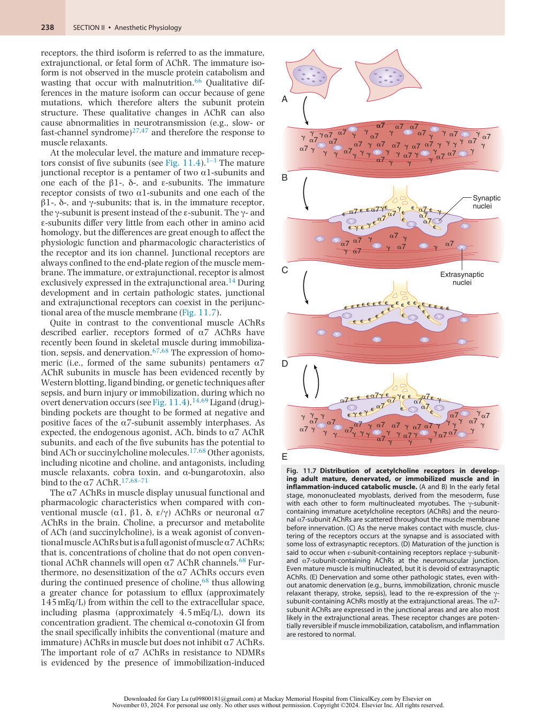

:::

<!-- PDF page 15 -->

resistance in wild- type mice and the absence of resistance in α7 AChRs knockout mice.72 The α7 AChRs expressed in neuronal tissue are also readily desensitized with choline, a feature that contrasts with muscle α7 AChRs, which do not desensitize with choline.68 The α7 AChRs in muscle also have lower affinity for its antagonists, including pancuronium, rocuronium, atracurium, or α- bungarotoxin; higher concentrations of these drugs are therefore required to block agonist- induced depolarization in α7 AChRs _in vitro_ or cause neuromuscular paralysis _in vivo_ or _ex vivo_ when α7 AChRs are upregulated.68–71 In the conventional muscle AChRs, binding of even one of the α1- subunits by an antagonist results in inactivation of that receptor because ACh needs both α1- subunits of the AChR for its activation. In α7 AChRs, however, even when three subunits are bound by an antagonist (e.g., muscle relaxant), two other subunits are still available for binding by agonist and cause depolarization. This feature may account for some of the resistance to muscle relaxants when α7 AChRs are expressed in muscle and other tissues in pathologic states.68–72

The clinical pharmacologic characteristics of the muscle α7 AChR have not yet been completely studied, but its basic composition also provides some insight into succinylcholine- related hyperkalemia. Chemical or physical denervation of muscle results in not only upregulation and qualitative (ε- subunit → γ- subunit) changes in AChRs, but it also results in upregulation of α7 AChRs in muscle. Succinylcholine, a synthetic analogue of ACh that consists of two molecules of ACh joined together, is capable of depolarizing not only conventional AChRs but also α7 AChRs in muscle.71 In addition, the metabolite of succinylcholine, choline, can depolarize α7 AChRs with little desensitization. The depolarizing effects of succinylcholine and choline on upregulated α7 AChRs can result in continued leakage of intracellular potassium and flooding of extracellular fluid, including plasma, thereby leading to hyperkalemia. Thus, differences in the subunit composition and increased numbers of the three isoforms junctionally and extrajunctionally expressed may account for aberrant responses to muscle relaxants clinically observed as resistant only to NDMRs and hyperkalemic response to succinylcholine.2,71,72

### MAINTENANCE OF MATURE NEUROMUSCULAR JUNCTIONS

Quite unlike other cells, muscle cells are unusual in that they have many, usually hundreds, of nuclei per cell. Each nucleus has the genes to make all three isoform receptors. Multiple factors, including electrical activity, growth factor signaling (e.g., insulin, agrin, neuregulins), and the presence or absence of innervation, control the expression of the three types of receptor isoforms.18,37 This control is most clearly observed in the developing embryo as the NMJ is formed. The muscle cells of a fetus, prior to innervation, synthesize only immature and α7 AChRs – hence the term _fetal isoform_ for the former receptor. Synthesis is directed by nearly all the nuclei in the cell, and the AChRs are expressed throughout the membrane of the muscle cell (see Fig. 11.7). As the fetus develops and the muscles become innervated, muscle cells begin to synthesize the mature isoform of receptors, which are exclusively inserted into the developing (future) end- plate area.14–19 The nerve

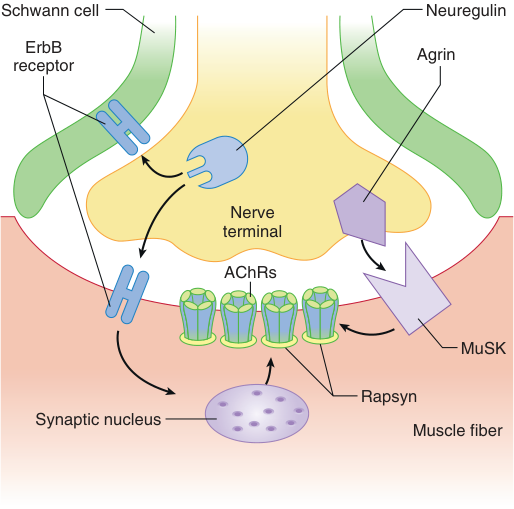

Schwann cell Neuregulin ErbB Agrin receptor Nerve terminal AChRs MuSK Rapsyn Synaptic nucleus Muscle fiber 

**Fig. 11.8 Diagram of agrin- and acetylcholine receptor- inducing activity (ARIA)/neuregulin- dependent events during maturation of the neuromuscular junction.** After the establishment of a nerve on the muscle, growth factors, including agrin and neuregulins, are released. Neuregulin signaling is essential for Schwann cell survival, and Schwann cells are essential for axonal maintenance. Agrin interacting with its receptor muscle- specific tyrosine kinase (MuSK) enhances the clustering of synaptic proteins, including acetylcholine receptors (AChRs), rapsyn, and ErbB receptors. ARIA/neuregulin is the best candidate for the involvement in the conversion of γ- subunit- containing immature receptor to ε- subunit- containing mature (innervated) receptor, which is synapse specific and therefore not inserted in the extrajunctional area.

releases several growth factors that influence the synthetic apparatus of the nearby nuclei. First, nerve- supplied factors induce the subsynaptic nuclei to increase synthesis of AChRs. Next, the nerve- induced electrical activity results in the repression of receptors in the extrajunctional area (see Fig. 11.7B,C). Nerve- derived growth factors, including agrin and ARIA/neuregulin, cause the receptors to cluster in the subsynaptic area and prompt the expression of the mature isoform.18,37 Clustering, expression, and stabilization of mature receptors are triggered by at least two growth factors: agrin, neuregulin/ARIA, and possibly calcitonin gene- related peptide.56,73,74 Neuregulin and agrin are also released from muscle, but muscle- derived agrin is not as important in clustering and maturation of the receptor. ARIA is made in the nerve and plays a role in the maturation of vesicular arrangement and conversion of the γ- to- ε switch.74 Agrin signals through MuSK and neuregulins through ErbB receptors (Fig. 11.8). These receptors control qualitative and quantitative changes at the junction. Once begun, the process is very stable, and nuclei in the junctional area continue to express mature receptors. In certain pathologic state–induced insulin resistance together with muscle wasting, a concomitant proliferation of AChRs occurs beyond the junctional area. Conditions in which this form of insulin resistance (i.e., decreased growth factor signaling) has been observed include immobilization, burn injury, sepsis, and denervation74–77 ; in these conditions,

<!-- PDF page 16 -->

not only does upregulation of total AChRs occur but also _de novo_ upregulation of the immature and α7 AChR isoforms is observed (see Fig. 11.7D).1–3 This upregulation may be related to the lack of growth factor effects of agrin and possibly neuregulin, which signal via some of the same downstream signaling proteins as insulin (e.g., phosphoinositide 3- kinase).56,75–78 Therefore, agrin and neuregulin signaling may be important for the suppression of α7 AChRs and immature AChRs in the normal NMJ. The expression of the α7 AChRs may be a protective anti- inflammatory mechanism as these receptors have anti- inflammatory properties.79 After innervation, AChRs become more and more concentrated at the postsynaptic membrane and are virtually absent in the extrasynaptic area at birth. The innervation process progresses somewhat slowly during fetal life and matures during infancy and early childhood.14–19 In the active, adult, and normal innervated muscle, just the nuclei under and very near the end plate direct the synthesis of the receptor; only the genes for expressing mature receptors are active. Nuclei beyond the junctional area are inactive, producing no receptors beyond the perijunctional area. Repression of all the extrajunctional AChRs is complete in the rodent, conversion by approximately 2 weeks.14–19 In humans, this process takes longer. Proteins implicated in the linking of mature receptors to the cytoskeleton include integrin, syntrophin, utrophin, α- and β- dystroglycan, and rapsyn, just to name a few.14–19

### RE- EXPRESSION OF IMMATURE (FETAL) γ- SUBUNIT AND α7- SUBUNIT ACh RECEPTORS IN ADULT LIFE

The extrajunctional immature receptors can reappear soon after upper and lower motor denervation and in certain pathologic states (e.g., burns, sepsis, immobilization, chronic muscle relaxant therapy or botulism, loss of muscle electrical activity). Stimulation of a denervated muscle with an external electrical stimulus can prevent the appearance of immature receptors. It has been suggested that the calcium that enters the muscle during activity is important in the suppression process.14,15 In the pathologic states previously enumerated, if the process is severe and prolonged, then extrajunctional receptors are inserted all over the surface of the muscle, including the perijunctional area (see Fig. 11.7D). The junctional nuclei also continue to make mature receptors. The synthesis of immature receptors is initiated within hours of inactivity, but it takes several days for the whole muscle membrane to be fully covered with receptors. This upregulation of receptors has implications for the use of depolarizing and possibly NDMRs. The changes in α7 AChRs parallel the expression of immature receptors, although this has not been well studied.

The changes in subunit composition (γ vs. ε) in the receptor confer certain changes in electrophysiologic (functional), pharmacologic, and metabolic characteristics.14,15,17 Mature receptors are metabolically stable, with a half- life approximating 2 weeks, whereas immature receptors have a metabolic half- life of less than 24 hours. Immature receptors have a smaller single- channel conductance and a twofold to tenfold longer mean channel open time than do mature receptors (see Fig. 11.4). The changes in

subunit composition may also alter the sensitivity or affinity, or both, of the receptor for specific ligands. Depolarizing or agonist drugs such as succinylcholine and ACh more easily depolarize immature receptors, thereby resulting in cation fluxes; doses one-tenth to one-hundredth of those needed for mature receptors can effect depolarization.2 The potency of NDMRs is also reduced, as demonstrated by the resistance to their neuromuscular effects documented in patients with burns, denervation, sepsis, and immobilization.1,3 In light of recent research, however, it seems that the resistance to nondepolarizers is more likely due to the junctional area expression of the α7 AChRs, which has a decreased affinity to NDMRs.14,68–72 Some NDMRs may also cause a partial agonist response in immature receptors, thus explaining the decreased potency in conditions in which upregulation of AChRs occurs.8 The upregulation of immature AChRs in the perijunctional and extrajunctional areas may have a buffering effect for diffusion of relaxants, contributing to resistance to NDMRs.79,80

The altered sensitivity to muscle relaxants may occur in only certain parts of the body or certain muscles if only some muscles are affected by the diminution in nerve activity (e.g., after a stroke). Sensitivity to relaxants can begin to change beyond 72 hours after an injury or hospitalization. The most serious side effect with the use of succinylcholine in the presence of upregulated AChRs in one or more muscles is hyperkalemia.1–3 In these subjects, the receptors can be scattered over a large surface of the muscle. The AChR channels opened by the agonist (succinylcholine) allow potassium to escape from the muscle and enter the blood (Fig. 11.9).2,3 If a large part of the muscle surface consists of upregulated (immature) receptor channels, each of which stays open for a longer time, then the amount of potassium that moves from muscle to blood can be considerable. The resulting hyperkalemia can cause dangerous disturbances in cardiac rhythm, including ventricular fibrillation. Moreover, hyperkalemia probably cannot be prevented by prior administration of NDMRs because large doses required to block the AChRs, in and of itself, will cause paralysis, obviating the need for succinylcholine.3 Larger- than- normal doses of NDMRs may attenuate the increase in blood potassium concentrations but cannot completely prevent it. In other words, no hyperkalemic response to succinylcholine has been seen earlier than four days after perturbations described previously.50 However, hyperkalemia and cardiac arrest can occur after the administration of succinylcholine, even in the absence of denervation states. These effects are observed in certain congenital muscle dystrophies in which the muscle membrane is prone to damage by the depolarization produced by succinylcholine, resulting in potassium release via the membrane damage.81

### PREJUNCTIONAL ACETYLCHOLINE RECEPTORS

Nicotinic AChRs exist in a variety of forms apart from that observed in muscle.14,17 The classic muscle- type nicotinic AChR is postsynaptically present, whereas neuronal subtype receptors may be presynaptically and postsynaptically present. The neuronal subtype nicotinic AChRs expressed prejunctionally are usually heteromeric and built up by _only_ α- and β- subunits. This family of nicotinic AChRs is widely expressed in the peripheral and central nervous

<!-- PDF page 17 -->

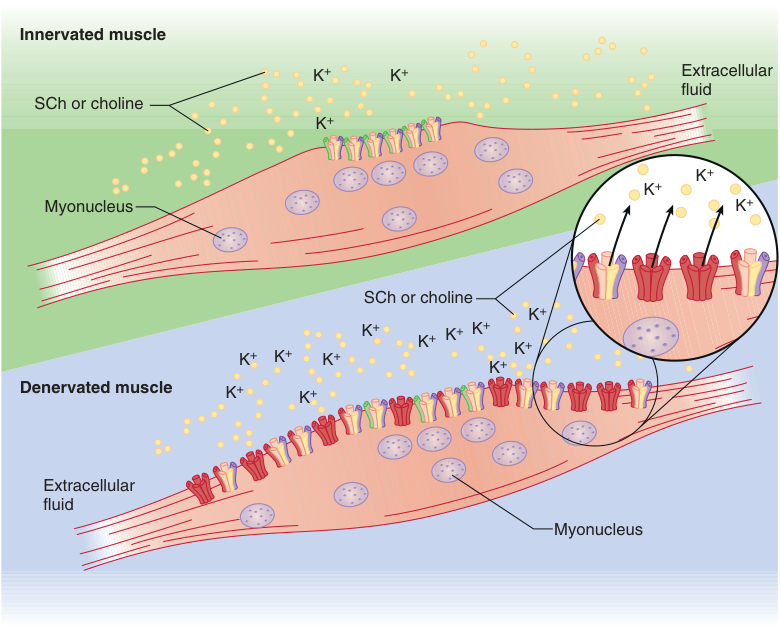

Innervated muscle K + K + Extracellular fluid SCh or choline K + K + K + Myonucleus K + SCh or choline K + K + K + K + K + K + K + K + K + K + Denervated muscle K + K + Extracellular fluid Myonucleus 

**Fig. 11.9 Schematic of the succinylcholine (SCh)- induced potassium (K**+ **) release in an innervated** **_(top)_ and denervated muscle** **_(bottom)_** . In the innervated muscle, the systemically administered SCh reaches all the muscle membrane but depolarizes only the junctional (α1, β1, δ/ε) receptors because acetylcholine receptors (AChRs) are located only in this area. With denervation, the muscle nuclei express not only extrajunctional (α1, β1, δ/γ) AChRs but also α7- nicotinic AChRs throughout the muscle membrane. Systemic SCh, in contrast to acetylcholine released locally, can depolarize all the upregulated AChRs, which leads to massive efflux of intracellular K+ into the circulation, resulting in hyperkalemia. The metabolite of SCh, choline, and possibly succinylmonocholine, can maintain this depolarization via α7- nicotinic AChRs, enhancing the K+ release and maintaining the hyperkalemia. (From Martyn JAJ, Richtsfeld M. Succinylcholine- induced hyperkalemia in acquired pathologic states: etiologic factors and molecular mechanisms. _Anesthesiology_ . 2006;104:158–169.)

systems, on autonomous nerves and ganglia on oxygensensing cells within the carotid bodies. There are also α7 AChRs in immune- competent cells, such as macrophages, microglia lymphocytes and granulocytes, and fibroblasts and chondrocytes.14,17 Seventeen AChR genes have been cloned from vertebrates. They include various combinations of α- subunits (α1 through α10) and β- subunits (β1 through β4) and one each of γ- , δ- , and ε- subunits. The γ- , δ- , and ε- subunits are found only in muscle.14,15,17

Prejunctional– or nerve terminal–associated cholinergic receptors have been demonstrated by morphologic pharmacologic and by molecular biologic techniques, but their form and functions are not as completely understood as those in the postjunctional area. Many drugs with an abundance of potential targets for drug action can affect the capacity of the nerve terminal to carry out its functions. The trophic function to maintain nerve–muscle contact involves the release and replenishment of ACh together with other trophic factors that require signaling through many receptors, of which the prejunctional nicotinic AChR is just one. Succinylcholine produces fasciculations that can be prevented by NDMRs. Because a fasciculation is, by definition, the simultaneous contraction of the multitude of muscle cells in a single motor unit and because only the nerve can synchronize all the muscles in its motor unit, it became apparent that succinylcholine must also act on

nerve endings. It was concluded that they acted on the same prejunctional nicotinic receptor. Very small doses cholinergic agonists (e.g., succinylcholine) and antagonists (e.g., NDMRs) act on the nicotinic receptors on the nerve ending; the former by depolarizing the nicotinic receptors on the nerve, sometimes inducing repetitive firing (depolarization) of the nerve ending while NDMRs prevents the actions of agonist by binding to the same receptor and preventing the depolarization (firing). This explains why NDMRs prevents fasciculations.5

By the use of specific monoclonal antibodies, the presence of nicotinic α3- subunits has been demonstrated in the nerve terminal.82 Another clue to the differences between prejunctional and postjunctional AChRs was the finding that some drugs (e.g., dihydro- β- erythroidine) bind only to prejunctional AChRs, whereas other drugs (e.g., α- bungarotoxin) bind only to postjunctional receptors.65 Additional clues were found in the many demonstrations of quantitative differences in the reaction of prejunctional and postjunctional nicotinic receptors to other cholinergic agonists and antagonists.65,82–84 For instance, it was known that tubocurarine, the first NDMR introduced into clinical practice in 1942 (not used in US or Europe), binds with lower affinity to the recognition sites of ganglionic nicotinic cholinoceptors and is not a competitive antagonist of Ach.

<!-- PDF page 18 -->

Decamethonium (i.e., a depolarizing muscle relaxant no longer clinically used) is a selective inhibitor of the muscle receptor, and hexamethonium is a selective inhibitor of nicotinic receptors in the autonomic ganglia.80–85 Instead, tubocurarine and hexamethonium can block the opened channels of these receptors and owe their ability to block ganglionic transmission to this property. The functional characteristics of prejunctional receptor channels may also be different. For example, the depolarization of motor nerve endings initiated by the administration of ACh can be prevented by tetrodotoxin, a specific blocker of sodium flux, with no effect on the end plate.

Specific information on the molecular organization of neuronal nicotinic receptors on the motor neuron terminal is still lacking. Some of the subunit composition is similar, but other subunits do not resemble those of the postjunctional receptor. Of the 16 different nicotinic AChR gene products identified, only 12 (α2 to α10 and β2 to β4) are thought to contribute nicotinic receptors expressed on neurons. Most strikingly, nervous tissue does not express γ- , δ- , or ε- receptor subunits; it contains genes only for the α- and β- subunits. The α- and β- subunit genes in nerve and muscle are not the same; they are variants. To emphasize the distinction between neural and muscle nicotinic receptors, the former are sometimes designated _Nn_ and the latter _Nm_ . With so many different subunits available, possible combinations are many, and it is not known which combinations are found in motor nerves. Their physiologic roles have also not been completely characterized. Expression of neuronal nicotinic AChRs in _in vitro_ systems has confirmed that muscle relaxants and their metabolites can bind to some of these neuronal AChRs.53,83–85

The nicotinic receptor on the junctional surface of the nerve (nerve terminal) senses transmitter in the cleft and, by means of a positive- feedback system, causes the release of more transmitter. In other parts of the nervous system, this positive feedback is complemented by a negative- feedback system that senses when the concentration of transmitter in the synaptic cleft has appropriately increased and shuts down the release system. It is believed that tetanic fade and train- of- four fade during neuromuscular block with NDMRs arise from presynaptic cholinergic autoreceptors at the motor nerve ending.5,52 The current view is that block of the prejunctional or postjunctional AChRs or a decrease in postjunctional AChR number (e.g., myasthenia gravis) can cause fade.79

The neuronal AChR subtype that is critically involved in ACh release and subsequent fade phenomenon (as observed in tetanic or train- of- four stimulus patterns) has been identified as the α3β2- subtype nicotinic AChR.10,84 When this prejunctional receptor is specifically blocked by a nondepolarizing relaxant such as tubocurarine, a reduction in neurotransmitter release occurs upon repeated stimulation with subsequent fade phenomenon. It should be noted, however, that block of the prejunctional AChRs alone is not necessary and sufficient to induce fade; concomitant reduction in the safety of neurotransmission prejunctionally or postjunctionally must be present for it to be noticeable.65 Although all clinically used nondepolarizing neuromuscular blocking drugs inhibit this prejunctional nicotinic AChR, as well as several other neuronal nicotinic AChRs, in the clinically relevant concentration range, succinylcholine neither activates nor inhibits the presynaptic α3β2 autoreceptor at clinically relevant concentrations.53,85 However,

the existence of the α3β2 autoreceptor at the prejunctional area has never been demonstrated by Western blot or mRNA techniques. Thus this prejunctional receptor has not been completely characterized.

This observation may be the reason for the typical lack of fade during succinylcholine- induced neuromuscular block. Succinylcholine, however, does not interact with α3β4 AChR found in autonomic ganglia.53 It has also been shown that NDMRs reduce the hypoxic ventilatory response in partially paralyzed humans,86 and the mechanism behind the depression might be related to inhibition of nicotine receptors on the carotid body.11 Nicotinic α3, 7, and β2 AChRs have recently been documented in the human carotid body.87 Whether the inhibition of these receptors plays a role in attenuated response to hypoxia drive needs further investigation. The motor nerve terminal is also known to bear several other receptors, such as opioid, adrenergic, dopamine, purine, and adenosine receptors, as well as receptors for endogenous hormones, neuropeptides, and a variety of proteins.88,89 The physiologic roles of these receptors and the effects of anesthetics on them are unknown.

## Neuromuscular Junction at Extremes of Age

### NEWBORN

Just before birth, the AChRs are all clustered around the nerve in the junctional area, and minimal extrajunctional AChRs are present. The newborn postsynaptic membrane, itself, is not specialized, having almost no synaptic folds, a widened synaptic space, and a reduced number of AChRs.19,18 The early postnatal AChR cluster appears as an oval plaque (Fig. 11.10). Within a few days, simplified folds appear. With continued maturation, the plaque is transformed to a multiperforated pretzel- like structure. The polyinnervated end plate is converted to a singly innervated junction because of a retraction of all but one terminal. In the adult, the terminals perfectly align with the AChR clusters. Morphologically, the postsynaptic membrane of the newborn and that from the patient with myasthenia gravis are not too different; the AChR number is decreased, and the postsynaptic folds are decreased. It is not surprising, therefore, that neurotransmission is not as efficient in the newborn and in patients with myasthenia gravis. For this reason, neonates and infants behave similarly to patients with myasthenia gravis when NDMRs are administered to them.90 In humans, maturation of the NMJ probably occurs at approximately 2 years of age.90

### OLD AGE

With increasing life expectancy, typical changes associated with aging are a gradual loss of lean body mass and strength, referred to as sarcopenia (Greek: _sarco_ - flesh, _penia_ - poverty), which has received increased attention recently.91 These sarcopenic changes occur in association with denervation- like changes at the synapse and altered anabolic or growth factor signaling changes within muscle.91–93 Old age–associated functional denervation, muscle wasting, and weakness are now well established.91,92 Agerelated morphologic changes include increase in length

<!-- PDF page 19 -->

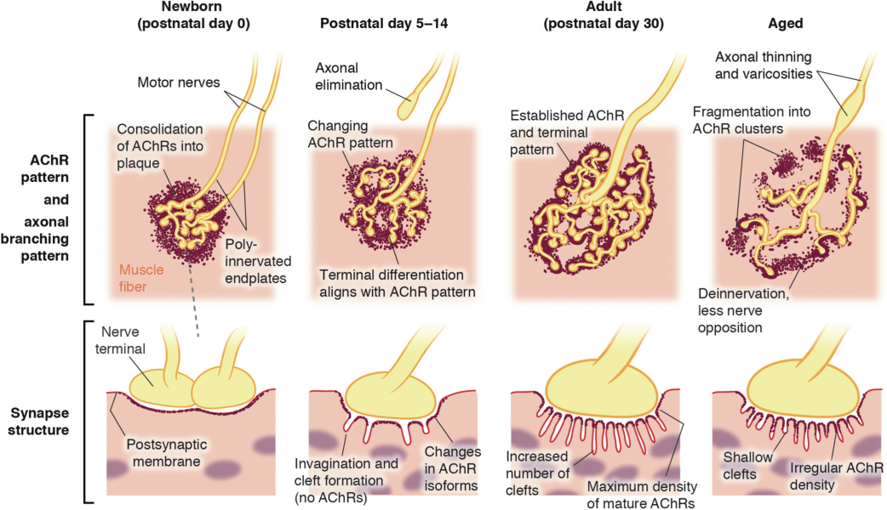

**Fig. 11.10 Maturation of the postsynaptic apparatus.** _Postnatal day 0 (Newborn)_ : At the time of birth, the aggregates of acetylcholine receptors (AChRs) have consolidated to form an oval- like plaque with irregular borders. At this point, each junction may have more than one nerve terminal innervating it. _Postnatal day 5 to 14_ : Approximately 5 to 14 days after birth, the postsynaptic membrane invaginates to form a gutter and small perforations develop on the plaque. These perforations reflect gaps due to the synaptic clefts (which do not have AChRs). During this time, the immature γ- subunit- containing AChRs are completely replaced by mature AChRs containing ε- subunit. The invaginations or clefts increase in numbers, resulting in more perforations in the synaptic AChRs giving it an almost pretzel- shaped junction. The perforations, as indicated, correspond to the synaptic clefts or folds. _Postnatal day 30_ : The neuromuscular junction is completely developed (mature) at 30 days after birth with a larger pretzel- shaped appearance. The AChRs have maximal density. A distinct set of postsynaptic proteins and signaling molecules are selectively transcribed in the subsynaptic area, providing integrity to the neuromuscular junction and efficient neurotransmission. _Aged NMJ_ : Examination of NMJ in the aged mice and humans reveals marked morphological changes. Some of the synapses undergo partial degeneration and synaptic staining becomes fainter. The synaptic folds are smaller in depth. The nerve terminals become thinner and appear swollen or bulbous with less apposition with the synapse. The Schwann cells seems to invade into the NMJ more (not shown). _NMJ,_ neuromuscular junction.

and area of the post- synaptic AChR, degenerating synaptic folds, and more invasion of synaptic folds by Schwann cells. The nerve terminals are thinned out and show terminal swelling with less apposition of the nerve to the synapse (see Fig. 11.10). Coupled with the morphologic changes in the NMJ that occur with aging, the functional changes that occur with it can include increased quantal content of neurotransmitter release and more rapid rundown of endplate potential during stimulation of the preterminal neuron.91–93 Regardless of these enumerated structured and functioned changes with aging, it appears that because of the superb margin of safety of neurotransmission, disability is not easily demonstrable by simple methods such as grip strength in most instances.93 Despite the structural and functional changes associated with aging, the overall margin of safety is better in the older individual than in the neonate.94 Even with these denervation- like changes in the elderly, there is no evidence that these patients are more prone to succinylcholine- induced hyperkalemia. In frailty and fragility, the denervation state, however, will be exaggerated together with muscle wasting. There are also no studies confirming increased or decreased sensitivity to nondepolarizing blockers due to the NMJ changes in the elderly. Some nondepolarizing neuromuscular blockers

have prolonged effect in old age (e.g., vecuronium) due to pharmacokinetic causes.

**Complete references available online at expertconsult.com.**

### References

1.  Martyn JAJ, et al. _Anaesthesia_ . 2009;64(suppl 1):1.

2.  Martyn JAJ, Richtsfeld M. _Anesthesiology_ . 2006;104:158.

3.  Fagerlund MJ, Eriksson LI. _Br J Anaesth_ . 2009;103(1):108.

4.  Gilhus NE. _Curr Opin Neurol_ . 2012;25:523.

5.  Bowman WC, et al. _Ann N Y Acad Sci_ . 1990;604:69.

6.  Frick CG, et al. _Anesthesiology_ . 2007;106:1139.

7.  Frick CG, et al. _Anesth Analg_ . 2012;114:102.

8.  Lape R, et al. _Nature_ . 2008;454:722.

9.  Paul M, et al. _Eur J Pharmacol_ . 2002;438:35.

10.  Vizi ES, Lendvai B. _Pharmacol Ther_ . 1997;73:75.

11.  Jonsson M, et al. _Eur J Pharmacol_ . 2004;497:173.

12.  Sunaga H, et al. _Anesthesiology_ . 2010;112:892.

13.  Fryer AD, Maclagan J. _Naunyn- Schmiedeberg’s Arch Pharmacol_ . 1987;335:367.

14.  Lee S, et al. _Anesthesiology_ . 2014;120(1):76–85.

15.  Sine SM. _Physiol Rev_ . 2012;92:1189.

16.  Tintignac LA, et al. _Physiol Rev_ . 2015;95:809.

17.  Albuquerque EX, et al. _Physiol Rev_ . 2009;89:73.

18.  Shi L, et al. _Trends Neurosci_ . 2012;35:441.

19.  Li L, et al. _Annu Rev Physiol_ . 2018;80:159.

<!-- PDF page 20 -->

20.  Fraterman S, et al. _Invest Ophthalmol Vis Sci_ . 2006;47:3828. 21.  Büttner- Ennever JA, Horn AK. _Mov Disord_ . 2002;17(suppl 2):S2.

22.  Kaminski HJ, et al. _Invest Ophthalmol Vis Sci_ . 1996;37:345.

23.  Lennerstrand G, et al. _Acta Ophthalmol_ . 2010;88:872. 24.  Vachon CA, et al. _Anesthesiology_ . 2003;99:220.

25.  Catterall WA. _J Physiol_ . 2012;590:2577.

26.  Catterall WA, et al. _J Biol Chem_ . 2013;288:10742.

27.  Engel AG, et al. _Ann N Y Acad Sci_ . 2012;1275:54.

28.  Heuser JE, Reese TS. _J Cell Biol_ . 1981;88:564.

29.  Rash JE, et al. _J Electron Microsc Tech_ . 1988;10(153). 30.  Sieburth D, et al. _Nature_ . 2005;436:510. 31.  Littleton JT, Sheng M. _Nature_ . 2003;423:931. 32.  Rich MM. _Neuroscientist_ . 2006;12:134. 33.  Wang X, et al. _J Neurosci_ . 2004;24:10687. 34.  Katz B, Miledi R. _Proc R Soc Lond B Biol Sci_ . 1979;215:369. 35.  Uchitel OD, et al. _Proc Natl Acad Sci U S A_ . 1992;89:3330. 36.  van Sonderen A, et al. _Curr Treat Options Neurol_ . 2013;15:224–239. 37.  Naguib M, et al. _Anesthesiology_ . 2002;96:202. 38.  Sudhof TC. _Neuron_ . 2012;75:11. 39.  Jahn R, Fasshauer D. _Nature_ . 2012;490:201. 40.  Heidelberger R. _Nature_ . 2007;450:623. 41.  Turton K, et al. _Trends Biochem Sci_ . 2002;27:552. 42.  Restani L, et al. _PLoS Pathog_ . 2012;8:e1003087. 43.  Schurch B. _Drugs Today (Barc)_ . 2004;40:205. 44.  Schiavo G. _Nature_ . 2006;444:1019. 45.  Lange DJ, et al. _Muscle Nerve_ . 1991;14:672. 46.  Heeroma JH, et al. _Neuroscience_ . 2003;120:733. 47.  Engel AG, Sine SM. _Curr Opin Pharmacol_ . 2005;5:308. 48.  Abraham RB, et al. _Anesthesiology_ . 2002;97:989. 49.  Karwa M, et al. _Crit Care Med_ . 2005;33:S75. 50.  Richtsfeld M, et al. _Anesthesiology_ . 2013;119:412. 51.  Kopta C, Steinbach JH. _J Neurosci_ . 1994;14:3922. 52.  Jonsson M, et al. _Anesthesiology_ . 2006;105:521. 53.  Jonsson M, et al. _Anesthesiology_ . 2006;104:724. 54.  Griesmann GE, et al. _J Neurochem_ . 1990;54:1541. 55.  Gullberg D. _Nature_ . 2003;424:138. 56.  Missias AC, et al. _Dev Biol_ . 1996;179:223.

57.  McCarthy MP, Stroud RM. _Biochemistry_ . 1989;28:40. 58.  Yamaoka K, et al. _Curr Pharm Des_ . 2006;12:429.

- 59a.  Raines DE. _Anesthesiology_ . 1996;84:663.

- 59b.  Jonsson Fagerlund M, et al. _Anesthesiology_ . 2010;113:1270–1279.

- 59c.  Jeevendra Martyn JA, et al. _Br J Anaesth_ . 2023;130:39–50.

60.  Gage PW. _Biophys Chem_ . 1988;29:95.

61.  Swope SL, et al. _Ann N Y Acad Sci_ . 1995;757:197.

62.  Plested CP, et al. _Neurology_ . 2002;59:1682.

63.  Albuquerque EX, et al. _J Pharmacol Exp Ther_ . 1997;280:1117.

64.  Maelicke A, et al. _J Recept Signal Transduct Res_ . 1997;17:11.

65.  Nagashima M, et al. _Anesth Analg_ . 2013;116:994.

66.  Ibebunjo C, Martyn JAJ. _Anesth Analg_ . 2000;91:1243.

67.  Fischer U, et al. _Eur J Neurosci_ . 1999;11:2856.

68.  Tsuneki H, et al. _J Physiol_ . 2003;54(7):169.

69.  Liu L, et al. _Br J Anaesth_ . 2014;112:159.

70.  Lindstrom JM. _Ann N Y Acad Sci_ . 2003;998:41.

71.  Khan MA, et al. _Shock_ . 2012;38:213.

72.  Lee S, et al. Abstract A1007. Presented at the ASA Annual Meeting; 2012.

73.  Placzek AN, et al. _Mol Pharmacol_ . 2004;66:169.

74.  Tansey MG, et al. _J Cell Biol_ . 1996;134:465.

75.  Hirose M, et al. _Am J Physiol_ . 2000;279:E1235.

76.  Sugita M, et al. _Metabolism_ . 2012;61:127.

77.  Hirose M, et al. _Metabolism_ . 2001;50:216.

78.  Samuel MA, et al. _PLoS One_ . 2012;7:e456663.

79.  Martyn JAJ, et al. _Br J Anaesth_ . 2023;130(1):39.

80.  Dilger JP. _Anesth Analg_ . 2013;117:792.

81.  Gronert GA. _Anesthesiology_ . 2001;94:523.

82.  Tsuneki H, et al. _Neurosci Lett_ . 1995;196:13.

83.  Chiodini F, et al. _Anesthesiology_ . 2001;94:643.

84.  Faria M, et al. _Synapse_ . 2003;49:77.

85.  Martyn J, Durieux ME. _Anesthesiology_ . 2006;104:633.

86.  Eriksson LI. _Acta Anaesthesiol Scand_ . 1996;40:520.

87.  Mkrtchian S, et al. _J Physiol_ . 2012;590:3807.

88.  Santafe MM, et al. _Eur J Neurosci_ . 2003;17:119.

89.  Wessler I. _Trends Pharmacol Sci_ . 1989;10:110.

90.  Goudsouzian NG, Standaert FG. _Anesth Analg_ . 1986;65:1208.

91.  Shafiee G, et al. _J Diabetes Metab Disord_ . 2017;16:21.

92.  Yang JC, Van Remmen H. _Exp Gerontol_ . 2011;46(2–3):193.

93.  Willadt, et al. _Ann N Y Acad Sci_ . 2018;1412:41.

94.  Sanes JR, Lichtman JW. _Nat Rev Neurosci_ . 2001;2:791.

<!-- PDF page 21 -->

### References

1.  Martyn JAJ, Jonsson M, Fagerlund MJ, et al. Basic principles of neuromuscular transmission. _Anaesthesia_ . 2009;64(suppl 1):1–9.

2.  Martyn JAJ, Richtsfeld M. Succinylcholine- induced hyperkalemia in acquired pathologic states: etiologic factors and molecular mechanisms. _Anesthesiology_ . 2006;104:158–169.

3.  Fagerlund MJ, Eriksson LI. Current concepts in neuromuscular transmission. _Br J Anaesth_ . 2009;103(1):108–114.

4.  Gilhus NE. Myasthenia and the neuromuscular junction. _Curr Opin Neurol_ . 2012;25:523–529.

5.  Bowman WC, Prior C, Marshall IG. Presynaptic receptors in the neuromuscular junction. _Ann N Y Acad Sci_ . 1990;604:69–81.

6.  Frick CG, Richtsfeld M, Sahani ND, et al. Long- term effects of botulinum toxin on neuromuscular function. _Anesthesiology_ . 2007;106:1139–1146.

7.  Frick CG, Fink H, Blobner M, Martyn JAJ. A single injection of botulinum toxin decreases the margin of safety of neurotransmission at local and distant sites. _Anesth Analg_ . 2012;114:102–109.

8.  Lape R, Colquhoun D, Sivilotti LG. On the nature of partial agonism in the nicotinic receptor superfamily. _Nature_ . 2008;454:722–727.

9.  Paul M, Kindler CH, Fokt RM, et al. Isobolographic analysis of nondepolarising muscle relaxant interactions at their receptor site. _Eur J Pharmacol_ . 2002;438:35–43.

10.  Vizi ES, Lendvai B. Side effects of nondepolarizing muscle relaxants: relationship to their antinicotinic and antimuscarinic actions. _Pharmacol Ther_ . 1997;73:75–89.

11.  Jonsson M, Wyon N, Lindahl SGE. Neuromuscular blocking agents block carotid body neuronal nicotinic acetylcholine receptors. _Eur J Pharmacol_ . 2004;497:173–180.

12.  Sunaga H, Zhang Y, Savarese JJ, Emala CW. Gantacurium and CW002 do not potentiate muscarinic receptor- mediated airway smooth muscle constriction in guinea pigs. _Anesthesiology_ . 2010;112:892–899.

13.  Fryer AD, Maclagan J. Pancuronium and gallamine are antagonists for pre- and post- junctional muscarinic receptors in the guinea- pig lung. _Naunyn- Schmiedeberg’s Arch Pharmacol_ . 1987;335:367–371.

14.  Lee S, Yang HS, Sasakawa T, et al. Immobilization with atrophy induces de novo expression of neuronal nicotinic α7 acetylcholine receptors in muscle contributing to neurotransmission. _Anesthesiology_ . 2014;120(1):76–85.

15.  Sine SM. End- plate acetylcholine receptor: structure, mechanism, pharmacology, and disease. _Physiol Rev_ . 2012;92:1189–1234.

16.  Tintignac LA, Brenner HR, Rüegg MA. Mechanisms regulating neuromuscular junction development and function and causes of muscle wasting. _Physiol Rev_ . 2015;95:809–852.

17.  Albuquerque EX, Pereira EF, Alkondon M, Rogers SW. Mammalian nicotinic acetylcholine receptors: from structure to function. _Physiol Rev_ . 2009;89:73–120.

18.  Shi L, Fu AK, Ip NY. Molecular mechanisms underlying maturation and maintenance of the vertebrate neuromuscular junction. _Trends Neurosci_ . 2012;35:441–453.

19.  Li L, Xiong WC, Mei L. Neuromuscular junction formation, aging, and disorders. _Annu Rev Physiol_ . 2018;80:159–188.

20.  Fraterman S, Khurana TS, Rubinstein NA. Identification of acetylcholine receptor subunits differentially expressed in singly and multiply innervated fibers of extraocular muscles. _Invest Ophthalmol Vis Sci_ . 2006;47:3828–3834.

21.  Büttner- Ennever JA, Horn AK. Oculomotor system: a dual innervation of the eye muscles from the abducens, trochlear, and oculomotor nuclei. _Mov Disord_ . 2002;17(suppl 2):S2.

22.  Kaminski HJ, Kusner LL, Block CH. Expression of acetylcholine receptor isoforms at extraocular muscle endplates. _Invest Ophthalmol Vis Sci_ . 1996;37:345–351.

23.  Lennerstrand G, Bolzani R, Tian S, et al. Succinylcholine activation of human horizontal eye muscles. _Acta Ophthalmol_ . 2010;88:872– 876.

24.  Vachon CA, Warner DO, Bacon DR. Succinylcholine and the open globe. Tracing the teaching. _Anesthesiology_ . 2003;99:220–223.

25.  Catterall WA. Voltage- gated sodium channels at 60: structure, function and pathophysiology. _J Physiol_ . 2012;590:2577–2589.

26.  Catterall WA, Leal K, Nanou E. Calcium channels and short- term synaptic plasticity. _J Biol Chem_ . 2013;288:10742–10749.

27.  Engel AG, Shen XM, Selcen D, Sine S. New horizons for congenital myasthenic syndromes. _Ann N Y Acad Sci_ . 2012;1275:54–62.

28.  Heuser JE, Reese TS. Structural changes after transmitter release at the frog neuromuscular junction. _J Cell Biol_ . 1981;88:564–580.

29.  Rash JE, Walrond JP, Morita M. Structural and functional correlates of synaptic transmission in the vertebrate neuromuscular junction. _J Electron Microsc Tech_ . 1988;10:153–185.

30.  Sieburth D, Ch’ng Q, Dybbs M, et al. Systematic analysis of genes required for synapse structure and function. _Nature_ . 2005;436:510– 517.

31.  Littleton JT, Sheng M. Neurobiology: synapses unplugged. _Nature_ . 2003;423:931–932.

32.  Rich MM. The control of neuromuscular transmission in health and disease. _Neuroscientist_ . 2006;12:134–142.

33.  Wang X, Engisch KL, Li Y, et al. Decreased synaptic activity shifts the calcium dependence of release at the mammalian neuromuscular junction in vivo. _J Neurosci_ . 2004;24:10687–10692.

34.  Katz B, Miledi R. Estimates of quantal content during “chemical potentiation” of transmitter release. _Proc R Soc Lond B Biol Sci_ . 1979;205:369–378.

35.  Uchitel OD, Protti DA, Sanchez V, et al. P- type voltage dependent calcium channel mediates presynaptic calcium influx and transmitter release in mammalian synapses. _Proc Natl Acad Sci U S A_ . 1992;89:3330–3333.

36.  van Sonderen A, Wirtz PW, Verschuuren JJ, et al. Paraneoplastic syndromes of the neuromuscular junction: therapeutic options in myasthenia gravis, Lambert- Eaton myasthenic syndrome, and neuromyotonia. _Curr Treat Options Neurol_ . 2013;15(2):224–239.

37.  Naguib M, Flood P, McArdle JJ, Brenner HR. Advances in neurobiology of the neuromuscular junction: implications for the anesthesiologist. _Anesthesiology_ . 2002;96:202–231.

38.  Sudhof TC. The presynaptic active zone. _Neuron_ . 2012;75:11–25.

39.  Jahn R, Fasshauer D. Molecular machines governing exocytosis of synaptic vesicles. _Nature_ . 2012;490:201–207.

40.  Heidelberger R. Neuroscience: sensors and synchronicity. _Nature_ . 2007;450:623–625.

41.  Turton K, Chaddock JA, Acharya KR. Botulinum and tetanus neurotoxins: structure, function and therapeutic utility. _Trends Biochem Sci_ . 2002;27:552–558.

42.  Restani L, Giribaldi F, Manich M, et al. Botulinum neurotoxins A and E undergo retrograde axonal transport in primary motor neurons. _PLoS Pathog_ . 2012;8:e1003087.

43.  Schurch B. The role of botulinum toxin in neurourology. _Drugs Today (Barc)_ . 2004;40:205–212.

44.  Schiavo G. Structural biology: dangerous liaisons on neurons. _Nature_ . 2006;444:1019–1020.

45.  Lange DJ, Rubin M, Green PE, et al. Distant effects of locally injected botulinum toxin: a double- blind study of single fiber EMG changes. _Muscle Nerve_ . 1991;14:672–675.

46.  Heeroma JH, Plomp JJ, Roubos EW, Verhage M. Development of the mouse neuromuscular junction in the absence of regulated secretion. _Neuroscience_ . 2003;120:733–744.

47.  Engel AG, Sine SM. Current understanding of congenital myasthenic syndromes. _Curr Opin Pharmacol_ . 2005;5:308–321.

48.  Abraham RB, Rudick V, Weinbroum AA. Practical guidelines for acute care of victims of bioterrorism: conventional injuries and concomitant nerve agent intoxication. _Anesthesiology_ . 2002;97:989–1004.

49.  Karwa M, Currie B, Kvetan V. Bioterrorism: preparing for the impossible or the improbable. _Crit Care Med_ . 2005;33:S75–95.

50.  Richtsfeld M, Yasuhara S, Fink H. Prolonged administration of pyridostigmine impairs neuromuscular function with down- regulation of acetylcholine receptors with and without down- regulation. _Anesthesiology_ . 2013;119:412–421.

51.  Kopta C, Steinbach JH. Comparison of mammalian adult and fetal nicotinic acetylcholinic receptors stably expressed in fibroblasts. _J Neurosci_ . 1994;14:3922–3933.

52.  Jonsson M, Gurley D, Dabrowski M, et al. Distinct pharmacologic properties of neuromuscular blocking agents on human neuronal nicotinic acetylcholine receptors: a possible explanation for the trainof- four fade. _Anesthesiology_ . 2006;105:521–533.

53.  Jonsson M, Dabrowski M, Gurley DA, et al. Activation and inhibition of human muscular and neuronal nicotinic acetylcholine receptors by succinylcholine. _Anesthesiology_ . 2006;104:724–733.

54.  Griesmann GE, McCormick DJ, De Aizpurua HJ, et al. Alphabungarotoxin binds to human acetylcholine receptor alpha- subunit peptide 185- 199 in solution and solid phase but not to peptides 125147 and 389- 409. _J Neurochem_ . 1990;54:1541–1547.

<!-- PDF page 22 -->

55.  Gullberg D. Cell biology: the molecules that make muscle. _Nature_ . 2003;424:138–140.

56.  Missias AC, Chu GC, Klocke BJ, et al. Maturation of the acetylcholine receptor in skeletal muscle: regulation of the AChR gamma- toepsilon switch. _Dev Biol_ . 1996;179:223–238.

57.  McCarthy MP, Stroud RM. Conformational states of the nicotinic acetylcholine receptor from _Torpedo californica_ induced by the binding of agonist, antagonists, and local anesthetics. Equilibrium measurements using tritium- hydrogen exchange. _Biochemistry_ . 1989;28:40– 48.

58.  Yamaoka K, Vogel SM, Seyama I. Na+ channel pharmacology and molecular mechanisms of gating. _Curr Pharm Des_ . 2006;12:429– 442.

- 59a.  Raines DE. Anesthesia and nonanesthetic volatile compounds have dissimilar activities on nicotinic acetylcholine receptor desensitization kinetics. _Anesthesiology_ . 1996;84:663–671.

- 59b.  Jonsson Fagerlund M, Kåhlin J, Ebberyd A, et al. The human carotid body: expression of oxygen sensing and signaling genes of relevance for anesthesia. _Anesthesiology_ . 2010;113:1270–1279.

- 59c.  Jeevendra Martyn JA, Sparling JL, Bittner EA. Molecular mechanisms of muscular and non-muscular actions of neuromuscular blocking agents in critical illness: a narrative review. _Br J Anaesth_ . 2023;130:39–50.

60.  Gage PW. Ion channels and postsynaptic potentials. _Biophys Chem_ . 1988;29:95–101.

61.  Swope SL, Qu Z, Huganir RL. Phosphorylation of nicotinic acetylcholine receptor by protein tyrosine kinases. _Ann N Y Acad Sci_ . 1995;757:197–214.

62.  Plested CP, Tang T, Spreadbury I, et al. AChR phosphorylation and indirect inhibition of AChR function in seronegative MG. _Neurology_ . 2002;59:1682–1688.

63.  Albuquerque EX, Alkondon M, Pereira EF, et al. Properties of neuronal nicotinic acetylcholine receptors: pharmacologic characterization and modulation of synaptic function. _J Pharmacol Exp Ther_ . 1997;280:1117–1136.

64.  Maelicke A, Coban T, Storch A, et al. Allosteric modulation of _Torpedo_ nicotinic acetylcholine receptor ion channel activity by noncompetitive agonists. _J Recept Signal Transduct Res_ . 1997;17:11–28.

65.  Nagashima M, Yasuhara S, Martyn JAJ. Train- of- four and tetanic fade are not always a prejunctional phenomenon as evaluated by toxins having highly specific pre- and post- junctional actions. _Anesth Analg_ . 2013;116:994–1000.

66.  Ibebunjo C, Martyn JAJ. Thermal injury induces greater resistance to d- tubocurarine in local than in distant muscles in the rat. _Anesth Analg_ . 2000;91:1243–1249.

67.  Fischer U, Reinhardt S, Albuquerque EX, Maelicke A. Expression of functional alpha7 nicotinic acetylcholine receptor during mammalian muscle development and denervation. _Eur J Neurosci_ . 1999;11:2856– 2864.

68.  Tsuneki H, Salas R, Dani JA. Mouse denervation increases expression of alpha 7 nicotinic receptor with unusual pharmacology. _J Physiol_ . 2003;54(7):169–170.

69.  Liu L, Min S, Li W, et al. Pharmacodynamic changes with vecuronium in sepsis are associated with expression of α7- and γ- nicotinic acetylcholine receptor in an experimental rat model of neuromyopathy. _Br J Anaesth_ . 2014;112(1):159–168.

70.  Lindstrom JM. Nicotinic acetylcholine receptors of muscles and nerves: comparison of their structures, functional roles, and vulnerability to pathology. _Ann N Y Acad Sci_ . 2003;998:41–52.

71.  Khan MA, Farkhondeh M, Crombie J, et al. Lipopolysaccharide upregulates α7 acetylcholine receptors: stimulation with GTS- 21 mitigates growth arrest of macrophages and improves survival in burned mice. _Shock_ . 2012;38:213–219.

72.  Lee S, Yang HS, Sasakawa T, Martyn JAJ. Alpha7 AChRs play a pivotal role in the immobilization- induced resistance to atracurium in mice. Abstract A1007; presented at the ASA Annual Meeting; 2012.

73.  Placzek AN, Grassi F, Papke T, et al. A single point mutation confers properties of the muscle- type nicotinic acetylcholine receptor to homomeric alpha7 receptors. _Mol Pharmacol_ . 2004;66:169–177.

74.  Tansey MG, Chu GC, Merlie JP. ARIA/HRG regulates AChR epsilon subunit gene expression at the neuromuscular synapse via activation of phosphatidylinositol 3- kinase and Ras/MAPK pathway. _J Cell Biol_ . 1996;134:465–476.

75.  Hirose M, Kaneki M, Martyn JAJ, et al. Immobilization depresses insulin signaling in skeletal muscle. _Am J Physiol_ . 2000;279:E1235– 1241.

76.  Sugita M, Sugita H, Kim M, et al. Inducible nitric oxide synthase deficiency ameliorates skeletal muscle insulin resistance but does not alter unexpected lower blood glucose levels after burn injury in C57BL/6 mice. _Metabolism_ . 2012;61:127–136.

77.  Hirose M, Kaneki M, Martyn JAJ, et al. Long- term denervation impairs insulin receptor substrate (IRS)- 1–mediated insulin signaling in skeletal muscle. _Metabolism_ . 2001;50:216–222.

78.  Samuel MA, Valdez G, Tapia JC, et al. Agrin and synaptic laminin are required to maintain adult neuromuscular junctions. _PLoS One_ . 2012;7:e46663.

79.  Martyn JAJ, Sparling JL, Bittner EA. Molecular mechanisms of muscular and non- muscular actions of neuromuscular blocking agents in criticall illness. _Br J Anaesth_ . 2023;130(1):39–50.

80.  Dilger JP. Simulation of the kinetics of neuromuscular block: implications for speed of onset. _Anesth Analg_ . 2013;117:792–802.

81.  Gronert GA. Cardiac arrest after succinylcholine: mortality greater with rhabdomyolysis than receptor upregulation. _Anesthesiology_ . 2001;94:523–529.

82.  Tsuneki H, Kimura I, Dezaki K, et al. Immunohistochemical localization of neuronal nicotinic receptor subtypes at the pre- and postjunctional sites in mouse diaphragm muscle. _Neurosci Lett_ . 1995;196:13–16.

83.  Chiodini F, Charpantier E, Muller D, et al. Blockade and activation of the human neuronal nicotinic acetylcholine receptors by atracurium and laudanosine. _Anesthesiology_ . 2001;94:643–651.

84.  Faria M, Oliveira L, Timoteo MA, et al. Blockade of neuronal facilitatory nicotinic receptors containing alpha 3 beta 2 subunits contribute to tetanic fade in the rat isolated diaphragm. _Synapse_ . 2003;49:77–88.

85.  Martyn JAJ, Durieux ME. Succinylcholine: new insights into mechanisms of action of an old drug. _Anesthesiology_ . 2006;104:633–634.

86.  Eriksson LI. Reduced hypoxic chemosensitivity in partially paralysed man. A new property of muscle relaxants? _Acta Anaesthesiol Scand_ . 1996;40:520–523.

87.  Mkrtchian S, Kahlin J, Ebberyd A, et al. The human carotid body transcriptome with focus on oxygen sensing and inflammation—a comparative analysis. _J Physiol_ . 2012;590:3807–3819.

88.  Santafe MM, Salon I, Garcia N, et al. Modulation of ACh release by presynaptic muscarinic autoreceptors in the neuromuscular junction of the newborn and adult rat. _Eur J Neurosci_ . 2003;17:119–127.

89.  Wessler I. Control of transmitter release from the motor nerve by presynaptic nicotinic and muscarinic autoreceptors. _Trends Pharmacol Sci_ . 1989;10:110–114.

90.  Goudsouzian NG, Standaert FG. The infant and the myoneural junction. _Anesth Analg_ . 1986;65:1208–1217.

91.  Shafiee G, Keshtkar A, Soltani A, et al. Prevalence of sarcopenia in the world: a systematic review and meta- analysis of general population studies. _J Diabetes Metab Disord_ . 2017;16:21.

92.  Yang JC, Van Remmen H. Age- associated alterations of the neuromuscular junction. _Exp Gerontol_ . 2011;46(2–3):193–198.

93.  Willadt S, Nash M, Slater C. Age- related changes in the structure and function of mammalian neuromuscular junctions. _Ann N Y Acad Sci_ . 2018;1412:41–53.

94.  Sanes JR, Lichtman JW. Induction, assembly, maturation and maintenance of a postsynaptic apparatus. _Nat Rev Neurosci_ . 2001;2:791–805.
