# Respiratory Physiology and Pathophysiology

<!-- PDF page 1 -->

STEFANO GIANNI, KATERINA VAPORIDI, MAURIZIO CEREDA, and LORENZO BERRA

### KEY POINTS

- Removal of carbon dioxide (CO2) is determined by alveolar ventilation, not by total (minute) ventilation.

- Dead space ventilation can be dramatically increased in patients with chronic obstructive pulmonary disease and pulmonary embolism to more than 80% of minute ventilation.

- Respiratory drive is regulated by central and peripheral chemoreceptors and by stretching/ irritation receptors in the lungs and rib cage.

- Hypoxemia can be caused by alveolar hypoventilation, diffusion impairment, ventilation– perfusion mismatch, and right- to- left shunt.

- Almost all anesthetics reduce skeletal muscle tone, which decreases functional residual capacity (FRC) to levels close to the awake residual volume.

- Atelectasis during anesthesia is caused by decreased FRC and the use of high fraction of inspired oxygen (FiO2), including breathing oxygen before induction of anesthesia.

- General anesthesia causes ventilation–perfusion mismatch (airway closure) and shunts (atelectasis).

- Venous admixture is due to V˙ A/Q˙ mismatch (response to increased FiO2) and shunts (unresponsive to increased FiO2).

- Hypoxic pulmonary vasoconstriction is blunted by most anesthetics, and this results in increased ventilation–perfusion mismatching.

- Respiratory work is increased during anesthesia as a consequence of reduced respiratory compliance and increased airway resistance.

## Respiratory Physiology is Central in the Practice of Anesthesia

The profound comprehension of respiratory physiology is a fundamental requisite for every anesthesiologist. Anesthesiologists must be aware of the effects of both general and regional anesthesia on respiratory function and lung physiology to adequately prevent and treat the adverse respiratory events that can occur during anesthesia.1 These events range from intractable hypoxemia caused by loss of airway patency to postoperative respiratory depression from opioids or regional anesthesia.2,3

Improved appreciation of anesthesia- induced physiologic alterations (e.g., mechanisms of bronchospasm,4 impact of mechanical ventilation),5 as well as pioneering developments in monitoring (e.g., pulse oximetry and capnography),6 together are associated with the specialty of anesthesiology’s emergence as a leader in patient safety.7 Finally, integrative measures of respiratory function, ranging from exercise capacity,8 spirometry to tissue oxygenation,9 to global O2 consumption,8 may help predict outcomes following anesthesia and surgery.

## Ventilation

_Ventilation_ refers to the movement of inspired gas into and exhaled gas out of the lungs. The driving force for this gas movement, during spontaneous breathing, is provided by an interplay between the respiratory muscles (mainly diaphragm and intercostal muscle) and the rib cage. During inspiration the diaphragm pulls down the basal part of the lung while the external intercostal muscles elevate the rib cage, moving forward the sternum and increasing the anteroposterior diameter of the chest. The synergistic effect of diaphragm and the external intercostal muscle contraction reduces the pleural pressure (the pressure between the chest wall pleura and the lung pleura) from −5 cmH2O to −7.5 cmH2O (average pleural pressure oscillation during normal breathing), creating the pressure gradient necessary to move air inside the lung.

During quiet breathing, exhalation is a passive phenomenon since the pressure gradient necessary to exhale is generated by the elastic recoil of the lungs and chest wall. During heavy breathing, however, the elastic forces are not enough to cause the necessary rapid expiration, so extra

<!-- PDF page 2 -->

force is achieved mainly by contraction of the abdominal muscles and internal intercostal muscles. Internal intercostal muscle contraction reduces the anteroposterior diameter of the chest wall, lowering the ribs while the abdominal muscles, pushing the abdominal organs against the diaphragm, compress the lung.

### ALVEOLAR VENTILATION

Fresh gas enters the lung by cyclic breathing at a rate and depth (tidal volume, VT) determined by metabolic demand, usually 7 to 8 L/min.10 While most inspired gas reaches the alveoli, some (100–150 mL) of each VT remains in the airways and cannot participate in gas exchange. Such dead space (VD) constitutes approximately one-third of each VT.11 Anatomic VD is the fraction of the VT that remains in the “conducting” airways, and physiologic VD is any part of a VT that does not participate in gas exchange (Fig. 12.1). Alveolar ventilation (VA) is defined as the volume of air entering and leaving the alveoli per minute.

For a single tidal volume (VT, mL), the following is true:

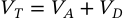

VT =  VA  +  VD 

The product of VT (mL) times the respiratory rate (per minute) is the minute ventilation (V E). Aggregated over time, minute ventilation (V E, mL/min) is:

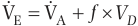

  VE  VA  f  VD 

The portion of the V E that reaches the alveoli and respiratory bronchioles each minute and participates in gas exchange is called the _alveolar ventilation_ ( V A), and it is approximately 5 L/min. Because this is similar to the blood flow through the lungs (i.e., the cardiac output, also 5 L/min), the overall alveolar ventilation–perfusion ratio is approximately 1.

### DEAD SPACE VENTILATION

Maintenance of partial pressure of arterial carbon dioxide (PaCO2) is a balance between CO2 production (V CO2, reflecting metabolic activity) and alveolar ventilation (V A). If V E is constant, but VD is increased, V A will naturally be reduced, and the PaCO2 will therefore rise. Therefore, if VD is increased, V  E must also increase to prevent a rise in PaCO2. Such elevations in VD occur when a mouthpiece or face mask is used, and in such cases, the additional VD is termed “apparatus deadspace” (which can be up to 300 mL; anatomic VD of the airways is 100–150 mL).12

Increases in the volume of the conducting airways (e.g., bronchiectasis) increase the overall VD only slightly. Far more significant increases in VD occur when perfusion to many ventilated alveoli is interrupted, as occurs in a pulmonary embolus (see Fig. 12.1). Indeed, with multiple pulmonary emboli, VD/VT can exceed 0.8 (2.7- fold normal). In such a case, to maintain a normal V A (5 L/min), the V E would have to increase (also 2.7- fold) to almost 20 L/min. This effort would cause considerable dyspnea, in addition to the dyspnea induced by the lowered partial pressure of arterial oxygen (PaO2).

Obstructive lung disease can result in diversion of inspired air into (nonobstructed) ventilated, but poorly perfused, regions of the lung. This results in local excesses of ventilation versus perfusion (high ratio) in such regions,13 which is equivalent to an increase in VD/VT (see Fig. 12.1). Patients with severe chronic obstructive pulmonary disease (COPD) may have a VD/VT ratio of up to 0.9 and would have to hyperventilate massively (30–50 L/min) to maintain normal PaCO2, which is not possible where ventilator reserve is diminished. Such patients demonstrate reduced V  A but often have an elevated V  E. An important compensatory mechanism is that a lower level of V A will maintain stable CO2 excretion where the PaCO2 is increased (Box 12.1).

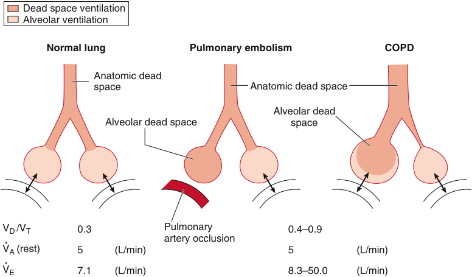

Dead space ventilation Alveolar ventilation Normal lung Pulmonary embolism COPD Anatomic dead space Anatomic dead space Alveolar dead Alveolar dead space space VD /VT 0.3 Pulmonary 0.4–0.9 . artery occlusion VA (rest) 5 (L/min) 5 (L/min) . VE 7.1 (L/min) 8.3–50.0 (L/min) 

**Fig. 12.1 Dead space and alveolar ventilation in normal and diseased lungs.** Either cessation of blood flow or excessive alveolar ventilation relative to perfusion will cause an increase in dead space (VD). If VD is increased, a large compensatory increase in minute ventilation is required to preserve V˙ A. _V D/VT_ , dead space to tidal volume ratio; V˙ _A_ , alveolar ventilation; _V_ ˙ _E_ , minute ventilation. _V_ ˙ E = _V_ ˙ A + _f_ × _V_ D. _Double arrows_ indicate normal CO2 exchange. _COPD_ , chronic obstructive pulmonary disease. (From Hedenstierna G. _Respiratory Measurement_ . London: BMJ Books; 1998:184; see also book review of _Respiratory Measurement in Thorax_ 1998;53:1096.)

<!-- PDF page 3 -->

### Box 12.1 Alveolar Gas Equations

**Alveolar Oxygen Tension (PAO2)**

where PIO2 is inspired oxygen tension, PACO2 is alveolar CO2 tension (assumed to equal arterial PCO2), R is the respiratory exchange ratio (normally in the range of 0.8–1.0), and FiO2 is the inspired oxygen fraction. The term within brackets compensates for the larger O2 uptake than CO2 elimination over the alveolar capillary membranes.

A simplified equation can be written without the compensation term:

### Alveolar Ventilation

Alveolar ventilation (V˙ A) can be expressed as

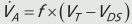

V  A  f  VT  VDS  

where _f_ is breaths/min, VT is tidal volume, and VDS is physiologic dead space.

Alveolar ventilation can also be derived from:

Where V˙ CO2 is CO2 elimination, _c_ is a conversion constant, and FACO2 is the alveolar CO2 concentration. If V˙ A is expressed in L/min, V˙ CO2 in mL/min, and FACO2 is replaced by PACO2 in mm Hg, _c_ = 0.863. By rearranging:

## Diffusion of Gas

Gas moves in the large and medium- sized airways by bulk flow (i.e., convection), meaning that the gas molecules travel together at a given mean velocity according to a driving pressure gradient. Flow is through multiple generations of bronchi, and the net resistance falls with each division. After the 14th generation, airways merge with alveoli and participate in gas exchange (respiratory bronchioles). The cross- sectional area expands massively (trachea, 2.5 cm2 ; 23rd-generation bronchi, 0.8 m2 ; alveolar surface, 140 m2 ),14 resulting in a sharp drop in overall resistance. Because the number of gas molecules is constant, the velocity falls rapidly, reaching zero when at the alveolar membrane. The velocity of the gas entering the alveolus is slower than the diffusion rates of O2 and CO2; therefore, diffusion—not convection—is necessary for transport in the distal airways and alveoli. Indeed, CO2 is detectable at the mouth after just seconds of breath- holding, because of rapid diffusion and because of cardiac oscillations (i.e., mixing).

Diffusion of a gas is a process characterized by a net transfer of molecules from a zone in which the gas exerts a high partial pressure to a zone in which it exerts a lower partial pressure. The driving force of this process is the random movement of molecules excluding both active transport and movement caused by a total pressure difference such as

flow during a normal tidal ventilation. The diffusion of a gas across a membrane is described by Fick’s law:

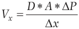

D  A  P Vx   x 

Vx is the volume of gas transferred per unit of time, D is the gas diffusion coefficient (mL/min), A is the membrane area, Δ _P_ is the partial pressure difference of gas across the membrane and Δ _x_ is the membrane thickness.

According to the described equation the driving force of gas diffusion is the difference of partial pressure across the membrane (Δ _P_ ) and the diffusion process continues until an equilibrium is reached (Δ _P_ = 0).

Oxygen diffusion across the alveolar membrane can reach an equilibrium (alveolar O2 partial pressure (PO2) − end capillary PO2 = 0) when the pulmonary capillary transit time is normal (i.e., during quiet breathing). Pulmonary capillary transit time, defined as the pulmonary capillary blood volume divided by pulmonary blood flow, is the main factor determining oxygen diffusing capacity (defined by net rate of gas transfer divided by Δ _P_ ) across the alveolar–capillary membrane.15 During heavy exercise, the pulmonary blood flow increases, causing a reduction of pulmonary capillary transit time: the time available for oxygen diffusion. In healthy subjects breathing air, there is generally no measurable fall in end capillary PO2. However, if the blood–gas barrier is markedly thickened by disease so that oxygen diffusion is impeded, PO2 may not reach that of alveolar gas before the time available for oxygenation in the capillary has run out. In this case, a measurable difference between alveolar gas and end- capillary blood for PO2 may occur. This phenomenon is worsened if the subject is breathing a hypoxic gas mixture because Δ _P_ is reduced.

Carbon dioxide (CO2) diffusion coefficient (D) is 20 times higher than oxygen diffusion coefficient so, for a stable Δ _P_ , CO2 diffuses 20 times faster than oxygen. Consequently, the main factor determining CO2 diffusing capacity is alveolar ventilation not pulmonary capillary transit time.

## Lung Perfusion and V˙ /Q˙ Match

### PULMONARY CIRCULATION

The pulmonary circulation differs from the systemic circulation: it operates at a five- to tenfold lower pressure while receiving the whole cardiac output, and the vessels are shorter and wider. There are two important consequences of the particularly low vascular resistance. First, the downstream blood flow in the pulmonary capillaries is pulsatile, in contrast to the more constant systemic capillary flow.16 Second, the capillary and alveolar walls are protected from exposure to high hydrostatic pressures; therefore, they can be sufficiently thin to optimize diffusion (i.e., exchange) of gas but not permit leakage of plasma or blood into the airspace. Whereas an abrupt increase in the pulmonary arterial (or venous) pressure can cause breaks in the capillaries,17 slower increases (i.e., months to years) stimulate vascular remodeling.18 This remodeling might protect against pulmonary edema19 (and possibly against lung injury20 ), but diffusion will be impaired (i.e., in patients with chronic pulmonary hypertension).

<!-- PDF page 4 -->

### DISTRIBUTION OF VENTILATION AND PERFUSION IN THE LUNG

Pulmonary blood flow depends on driving pressure (mean pulmonary pressure minus left atrial pressure) and vascular resistance (driving pressure divided by cardiac output). Since the pressure drop along the pulmonary arterioles is low, compared to the systemic circulation, driving pressure and resistance are not homogeneous throughout the lung but are affected by many external factors such as gravity. The traditional thinking about lung perfusion emphasized the importance of gravity16 ; however, factors other than gravity are also important.

Blood has weight and therefore blood pressure is affected by gravity. The height (base to apex) of an adult lung is approximately 25 cm; therefore, when a person is standing, the hydrostatic pressure at the base is 25 cmH2O (i.e., approximately 18 mm Hg) higher than at the apex. The mean pulmonary arterial pressure is approximately 12 mm Hg at the level of the heart, and the pulmonary artery pressure at the lung apex can therefore approach zero. Thus, less blood flow will occur at the apex (versus the base), and in the setting of positive pressure ventilation, the apical alveoli can compress the surrounding capillaries and prevent any local blood flow.

Based on such gravitational distribution of pulmonary artery pressure, as well as the effect of alveolar expansion, West and colleagues21 divided the lung into zones I to III (Fig. 12.2). This system is based on the principle that perfusion to an alveolus depends on the pressures in the pulmonary artery (PPA), pulmonary vein (PPV), and alveolus (PALV). In the apex (zone I), the key issue is that pulmonary arterial pressure is less than alveolar pressure; therefore, no perfusion occurs. Zone I conditions can exist during mechanical ventilation and be exacerbated by low PPA. Whenever zone I conditions exist, the nonperfused alveoli constitute additional dead space (VD). Below the apex in zone II, PPV is less than alveolar pressure, and the veins are collapsed except during flow, as in a “vascular waterfall.” Although PALV is always greater than PPV, perfusion occurs when PPA exceeds PALV (i.e., intermittently, during systole). Below this zone is zone III, in which there are two important differences: PPA and PPV both always exceed PALV. As a result, there is perfusion throughout systole and diastole (and inspiration and expiration). Gravity results in equal increases in both PPA and PPV toward the lung base; therefore, gravity cannot affect flow throughout zone III by increasing the PPA to PPV pressure gradient alone. Nonetheless, it is possible that the greater weight of the blood nearer the base results in vessel dilatation, thereby lowering vascular resistance and increasing flow.16 It was subsequently recognized that there is also a decrease in perfusion in the lung base, or zone IV, that is thought to occur because of the effects of gravity compressing the lung at the bases—and the blood vessels therein—and thereby increasing vascular resistance.22

Finally, additional evidence for the effect of gravity comes from volunteer experiments in which gravity was increased or abolished by altering the flight pattern of a jet aircraft.23 In these experiments, zero gravity decreased cardiac oscillations of O2 and CO2 during a breath- hold, indicating development of more homogeneous perfusion. In contrast,

(true only if lung is in zone III)

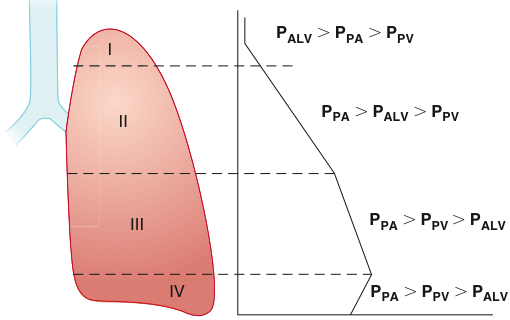

PALV �  PPA �  PPV I II PPA �  PALV �  PPV III PPA �  PPV  �  PALV IV PPA �  PPV �  PALV 

**Fig. 12.2 Vertical distribution of lung blood flow.** The so- called zones I, II, III, and IV are indicated. In zone I there is no perfusion, only ventilation. In zone II, pulmonary artery pressure exceeds alveolar pressure which in turn exceeds venous pressure; the driving pressure is PPA − PALV. In zone III, arterial and venous pressures both exceed alveolar pressure, and here the driving pressure is PPA − PPV. In the lung base, blood flow is decreased possibly because of increased interstitial pressure that compresses extra- alveolar vessels. _PALV,_ intra- alveolar pressure; _PPV,_ pulmonary vein pressure; _PPA,_ pulmonary artery pressure; _Q_ ˙ _T,_ cardiac output.

more recent experiments of exhaled gas analysis (on the Mir space station) reported that the heterogeneity of lung perfusion was reduced, but not eliminated, in the presence of microgravity, indicating that gravity contributes to the heterogeneity of blood flow distribution but does not explain it entirely.24 While the precise role of gravity is disputed, it is likely to play a smaller role when supine versus when upright.

Key experiments have reconsidered the effects of gravity. Blood flow measured in the same gravitational plane was less per unit of lung tissue at the apex than at the base.25 Additionally, microsphere assessment demonstrated significant variability within iso- gravitational planes, and lung height appeared to account for less than 10% of the distribution of flow in either the prone or supine positions.26 In addition, inhomogeneity in the horizontal planes can exceed that in the vertical direction (Fig. 12.3).27 Other studies have reported a preponderance of perfusion to the central lung (versus peripheral) tissue,28 which can be reversed by the application of positive end- expiratory pressure (PEEP).29 Although greater length of radial blood vessels was considered to explain this central–peripheral difference, others have suggested that it is not significant.26 Finally, differences have been reported among lung regions in local vascular resistance.30

Fractal distribution of blood flow may be more important than the influence of gravity.31 A fractal pattern of perfusion means that in any given region, there will be “spatial correlation” (similarity) of the blood flow between neighboring regions.

Although the methods to study lung perfusion are complex—and there is a spectrum of opinion32 —the aggregate

::: warning 符號需核對
此頁有符號無法完整擷取，請展開下方原始頁面核對。
:::

::: details 原始表格與符號（PDF 第 4 頁）

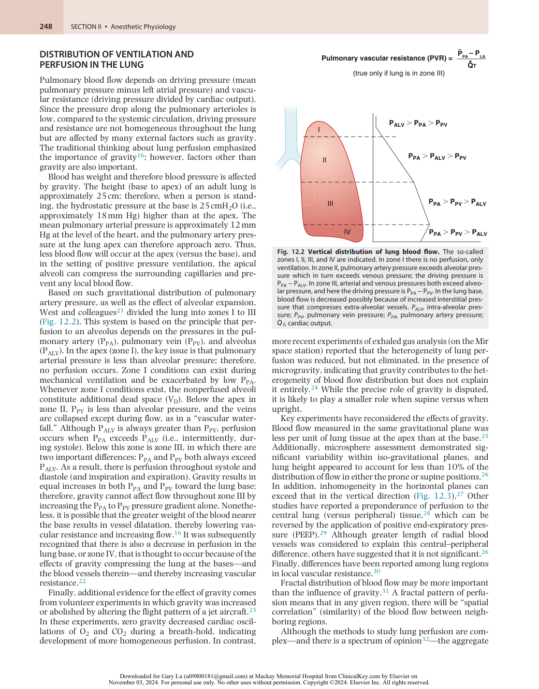

:::

<!-- PDF page 5 -->

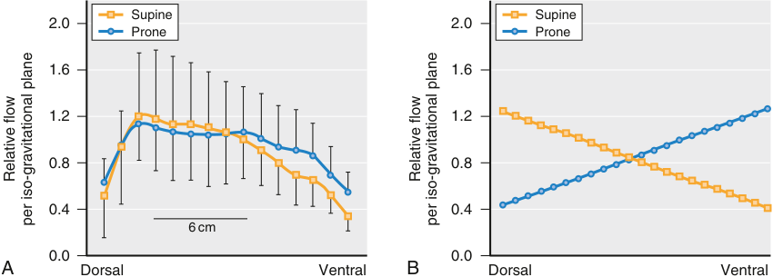

Supine Supine 2.0 2.0 Prone Prone 1.6 1.6 1.2 1.2 0.8 0.8 0.4 0.4 6 cm 0.0 0.0 A Dorsal Ventral B Dorsal Ventral Relative flow Relative flow per iso-gravitational plane per iso-gravitational plane 

**Fig. 12.3 Distribution of blood flow (ventral, dorsal) in supine versus prone position.** The distributions from ventral to dorsal are similar, irrespective of position, suggesting that the anatomic features (and not simply gravity) determine the distribution of flow. The magnitude of the variability in either the prone (or in the supine) position (i.e., nongravitational inhomogeneity), showed in (A), is far greater than the differences in distribution between the prone and the supine positions (i.e., gravitational inhomogeneity) showed in (B). (From Glenny RW, Lamm WJ, Albert RK, Robertson HT. Gravity is a minor determinant of pulmonary blood flow distribution. _J Appl Physiol._ 1991;71:620–629.)

data suggest that factors other than gravity contribute to the heterogeneity of the distribution of perfusion.

### HYPOXIC PULMONARY VASOCONSTRICTION

Hypoxic pulmonary vasoconstriction (HPV) is a compensatory mechanism that diverts blood flow away from hypoxic lung regions toward better oxygenated regions.33 The major stimulus for HPV is low alveolar oxygen tension (PAO2), whether caused by hypoventilation or by breathing gas with a low PO2 and is more potent when affecting a smaller lung region. The stimulus of hypoxic mixed venous blood is weaker.34,35 Whereas in humans halothane, isoflurane, fluroxene, and nitrous oxide were thought to inhibit HPV more than intravenously based anesthesia, modern volatile anesthetics, including sevoflurane36 and desflurane,37 have little effect.

During intravenously based anesthesia, exposure of one lung to a fraction of inspired oxygen (FiO2) of 1.0 and the contralateral lung to a hypoxic gas mixture (FiO2, 0.12 to 0.05) reduced perfusion to the hypoxic lung to 30% of the cardiac output.38 Continuous or intermittent HPV, such as living at high altitude39 or in presence of chronic hypoxemic lung disease, can lead to vascular remodeling and development of chronic pulmonary hypertension.

### PULMONARY VASCULAR RESISTANCE

Pulmonary vascular resistance (PVR) can be expressed according to the following equation:

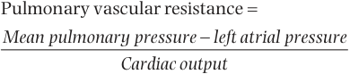

 Pulmonary vascular resistance Mean pulmonary pressure  left atrial pressure Cardiac output 

Pulmonary vascular resistance normal values are 0.25– 1.6 mm Hg·min/L or 37–250 dynes/sec/cm5 .40

While the greatest part of systemic vascular resistance is in the arterioles, in the pulmonary circulation the pressure drop is equally distributed between arteries, capillaries, and veins. Extra- alveolar vessels, with muscular vessel walls, are mainly involved in active control of pulmonary vascular resistance while vascular resistance in intra- alveolar

vessels is mainly dependent on alveolar pressure and pulmonary blood flow.

The active control of pulmonary vascular resistance is maintained by a complex interplay between the endothelium and the vascular smooth muscle cell. The most important molecule involved in this interplay is nitric oxide (NO). NO is produced in the endothelial cell by the conversion of L- arginine to L- citrulline by an enzyme called nitric oxide synthase. NO is a gas able to rapidly diffuse across the cell membrane into the smooth muscular cell of the pulmonary vessel. NO stimulates soluble guanylate cyclase (sGC) to synthesize cyclic guanosine monophosphate (cGMP) that activates cGMP- dependent protein kinase (PKG) leading to vascular relaxation. The physiologic actions of cGMP are limited by its hydrolysis to GMP by cyclic nucleotide phosphodiesterases (PDE), a family of proteins that hydrolyze cyclic nucleotides. It is important to understand this pathway since it is the target of drugs widely used for the treatment of pulmonary hypertension. Gaseous NO became in the past 20 years the cornerstone of pulmonary hypertension therapy. NO inhalation causes selective pulmonary vasodilation without systemic vasodilation since NO rapidly reacts with circulating hemoglobin exerting only a “local” effect on pulmonary vascular smooth muscle cell. Moreover, the intracellular NO concentration may be increased by PDE5 inhibitors such as sildenafil and vardenafil. They induce pulmonary vasodilation, inhibiting PDE5, the enzyme responsible for endogenous NO degradation in the smooth muscle cell.41

Other than the discussed active regulation of pulmonary vascular resistance, pulmonary circulation is highly affected by cardiac output and alveolar pressure/ volume.

The pulmonary circulation is highly compliant, able to adapt to large changes of cardiac output with minimum change in arterial pressure. When an acute increase in pulmonary blood flow occurs (i.e., in case of lung resection), the total cross- sectional area of the pulmonary vascular bed increases, reducing the overall pulmonary resistance. These adaptations to increased flow occur partly by passive distention of vessels and partly by recruitment of collapsed vessels such as capillaries in zone I.

<!-- PDF page 6 -->

Alveolar pressures and volumes greatly influence pulmonary vascular resistance. The effect of lung volume is different in extra- alveolar or alveolar vessels. Extra- alveolar vessels run through the lung parenchyma. As the lung expands, the diameter of these vessels increases via radial traction of the vessel walls, reducing vascular resistance as the lung volume increases. Conversely, during lung collapse, vascular resistance increases due to the unopposed action of vessel elasticity.

Alveolar capillaries include capillaries and vessels in the corner of the alveolar walls. The determinant of the amount of distention within these vessels is their transmural pressure (intravascular pressure minus alveolar pressure). During inspiration, alveolar pressure rises, compressing the surrounding alveolar capillaries. Stretching and thinning of the alveolar walls reduces capillary caliber and ultimately leads to an increase in pulmonary vascular resistance at large lung volumes.

Combining the behavior of extra- alveolar and alveolar vessels, pulmonary vascular resistance (PVR) at increasing lung volumes shows a characteristic U shape (Fig. 12.4), with PVR higher at residual volume and total lung capacity and lower at functional residual capacity.42

## Respiratory Gas Transport

### TRANSPORT OF O2 INTO THE BLOOD

Oxygen reaches the cells following transport by arterial blood, and the overall delivery of O2 (D O2) is the product of the arterial blood O. 2 content (CaO2) and blood flow (cardiac output, Q) as

### DO 2 = CaO 2 × Q

Oxygen is carried in the blood in two forms: O2 bound to hemoglobin (the vast bulk), and O2 dissolved in the plasma, and the content is expressed as the sum of these components:

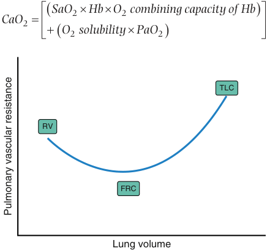

 SaO 2  Hb  O 2 combining capacity of Hb  CaO 2     O 2 solubility  PaO 2   TLC RV FRC Lung volume Pulmonary vascular resistance 

**Fig. 12.4 Relationship between pulmonary vascular resistance (PVR) and lung volume.** PVR is minimal at the functional residual capacity (FRC). Compression of alveolar capillaries is responsible for the increased PVR as lung volume approaches total lung capacity (TLC). Increasing PVR as lung volume approaches residual volume (RV) may result from either compression of corner capillaries or extra- alveolar vessels, or hypoxia- induced vasoconstriction in collapsed lung units.

where CaO2 (O2 content) is milliliters of O2 per 100 mL of blood, SaO2 is the fraction of hemoglobin (Hb) that is saturated with O2, O2- combining capacity of Hb is 1.34 mL of O2 per gram of Hb, _Hb_ is grams of Hb per 100 mL of blood, PaO2 is the O2 tension (i.e., dissolved O2), and solubility of O2 in plasma is 0.003 mL of O2 per 100 mL plasma for each mm Hg PaO2.

Each hemoglobin molecule reacts with 4 molecules of oxygen. Their binding is reversible and depends on PO2: when PO2 is high, as in the pulmonary capillaries, O2 binds with the hemoglobin, but when PO2 is low, as in the tissue capillaries, O2 is released from the hemoglobin. This is the basis for almost all O2 transport from the lungs to the tissues.

The hemoglobin dissociation curve is not steady but can be displaced by CO2 partial pressure, pH, temperature, and 2,3- biphosphoglycerate (BPG) concentration. The increase of PCO2 (or a reduction of pH), temperature, and BPG concentration shift the Hb–O2 dissociation curve to the right.43 A shift of the oxygen–hemoglobin dissociation curve to the right in response to increases in blood CO2 and hydrogen ions has a significant effect by enhancing the release of O2 from the blood in the tissues and enhancing oxygenation of the blood in the lungs. In the systemic capillaries, the PCO2 is higher than in the arterial blood (and the pH correspondingly lower) because of local CO2 production. These circumstances shift the Hb–O2 dissociation curve to the right, which increases the offloading of O2 to the tissues. The opposite occurs in the pulmonary capillaries; here, the PCO2 is lower (and the pH correspondingly higher) because of CO2 elimination, and the dissociation curve is shifted to the left to facilitate O2 binding to Hb. BPG is a byproduct of anaerobic glycolysis. In hypoxic conditions the quantity of BPG in the blood increases considerably, shifting the O2–hemoglobin dissociation to the right, improving oxygen release to tissues.

Hemoglobin’s crucial role in O2 delivery can be better understood by analyzing the effect of characteristic abnormalities of blood O2 carriage such as methemoglobinemia or carbon monoxide poisoning.

Methemoglobin (MetHb), formed by the oxidation to Fe3+ (ferric) instead of the usual Fe2+ (ferrous) iron, is less able to bind O2, resulting in diminished O2 content and less O2 delivery. Here, the PaO2 (in the absence of lung disease) will be normal: if the O2 content is calculated from the PaO2, it will appear normal, but if directly measured, it will be low. In contrast, MetHb level will be elevated. In severe cases, lactic acidosis develops because of impaired O2 delivery. In addition, because MetHb has a blue–brown color, the patient will appear blue, even if the fraction of MetHb is modest; specialized oximetry can separately measure MetHb levels.44,45 The apparent cyanosis is not responsive to supplemental O2, and therapy involves converting (i.e., reducing) the MetHb to Hb (e.g., by using methylene blue). Important medical causes of MetHb include benzocaine, dapsone, and nitric oxide.

In CO poisoning, the CO binds to Hb, with far greater (over 200- fold) avidity than molecular O2, tightly forming CO–Hb and resulting in two main effects.46 First, formation of CO–Hb results in fewer sites available for O2 binding, and this reduces the blood O2 content. Second, the formation of CO–Hb causes conformational changes in the Hb molecule such that the tendency to release bound O2 is reduced. This effect corresponds to a leftward shift of the Hb–O2 dissociation curve, and although this aspect of CO binding does

<!-- PDF page 7 -->

not reduce the O2 content or “global” delivery of O2, it does reduce the release of O2 and its local delivery to the cells. Because the color of CO–Hb closely resembles that of O2– Hb, the color of the blood (and the patient) is bright red; however, as with MetHb, the PaO2 will be normal (assuming no pulmonary disease) as will be the calculated CaO2; however, the measured CaO2 will be low and, if severe, a lactic acidosis will be present. Modern pulse oximeters can distinguish between Hb–O2 and CO–Hb.46

### OXYGENATION IN THE PULMONARY ARTERY

The central venous and pulmonary artery oxygen saturation are physiologic variables routinely measured in the intensive care unit setting since they can provide an insight on patient oxygen consumption and delivery.

Systemic venous blood (central venous blood) enters the right ventricle via the right atrium. The O2 saturation (SO2) differs among the major veins: higher venous SO2 reflects greater blood flow, less tissue oxygen uptake, or both.47 SO2 is usually higher in the inferior vena cava (IVC) than in the superior vena cava (SVC), possibly because of the high renal and hepatic flow relative to O2 consumption. In the right ventricle, the central venous blood (ScvO2) from the SVC and IVC is joined by additional venous blood from the coronary circulation (via the coronary sinuses). In the right ventricle, an additional small amount of venous drainage from the myocardium enters through the thebesian veins, and as all this venous blood enters the pulmonary artery, it is well mixed and is termed _mixed venous blood_ (SvO2); thus SvO2 &lt; ScvO2, although the trends of each usually run in parallel.48

SvO2 and ScvO2 monitoring gained a key role within early goal- directed therapy protocols and has been shown to decrease mortality when taken and analyzed appropriately.49 Indeed, ScvO2 >70% or mixed venous oxygen saturation (SvO2) >65% are usually recommended.

### RESPIRATION IN THE CELL

The ultimate goal of the respiratory and cardiovascular system is to deliver oxygen into the mitochondrion.

The partial pressure of oxygen (PaO2) in normal arterial blood is approximately 100 mm Hg and decreases to 4 to 22 mm Hg in the mitochondrion, where it is consumed. Glucose (C6H12O6) is converted into pyruvate (CH3COCOO− ) and H+ by glycolysis in the cytoplasm, and the pyruvate diffuses into the mitochondria and forms the initial substrate for Krebs cycle. At the end of the Krebs cycle are produced six nicotinamide adenine dinucleotide (NADH), two flavin adenine dinucleotide (FADH2), two adenosine triphosphate (ATP), four CO2 for each glucose molecule. The NADH is a key electron (and H+ ) donor in the process of oxidative phosphorylation, wherein O2 and adenosine diphosphate (ADP) are consumed, and ATP and H2O are produced. Thus the net effect is oxidation of glucose to produce energy (ultimately as ATP), H2O, and CO2.50

### TRANSPORT OF CO2 INTO THE BLOOD

CO2 is produced by metabolism in the mitochondria, where the CO2 levels are highest. The transport path (involving progressively decreasing pressure gradients) is from

mitochondria through cytoplasm, into venules, and finally, in mixed venous blood from where it is eliminated through the alveoli. In the blood, CO2 is transported in three main forms: dissolved (reflected as PaCO2, partial pressure; accounts for approximately 5% of transported CO2), bicarbonate ion (HCO3− ; almost 90%), and carbamino CO2 (CO2 bound to terminal amino groups in Hb molecules; approximately 5%).50 The usual quantities of CO2 in the arterial and (mixed) venous blood are approximately 21.5 and 23.3 mmol of CO2 per liter of blood, respectively.

The hemoglobin affinity for CO2 is not stable but depends on hemoglobin oxygen saturation: the difference in the amount of CO2 carried by oxygenated versus deoxygenated hemoglobin is called the Haldane effect51 (Fig 12.5). The Haldane effect can be explained by two mechanisms. First, increased PaO2 decreases the ability to form carbamino compounds—reducing the amount of CO2 bound to Hb—thereby raising the amount of dissolved CO2 (i.e., elevated PCO2). Second, the amino acid histidine, which has an imidazole group that is an effective H+ buffer at physiologic pH, is an important linking molecule between heme groups and the Hb chains. Increasing the partial pressure of oxygen (PO2) increases the amount of O2 bound to Hb; this changes the conformation of the Hb molecule, which in turn alters the heme- linked histidine and reduces its H+ buffering capacity. Therefore, more H+ is free (not buffered) and binds to HCO3− , releasing stored CO2. This phenomenon has important clinical applications and explains why breathing O2 can induce hypercapnia in patients with severe chronic lung disease. Although traditionally thought to occur because increased PaO2 reduces ventilatory drive,52 recent evidence suggests that this phenomenon can be

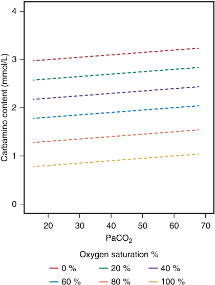

4 3 2 1 0 20 30 40 50 60 70 PaCO2 Oxygen saturation % 0 % 20 % 40 % 60 % 80 % 100 % Carbamino content (mmol/L) 

**Fig. 12.5** The broken lines on the graph indicate the carbamino carriage of carbon dioxide at different oxygen hemoglobin saturation. It will be seen that oxygen saturation has a far greater influence on carbamino carriage than the actual partial pressure of arterial carbon dioxide (PaCO2).

<!-- PDF page 8 -->

explained by the Haldane effect, as well as from impairment of hypoxic pulmonary vasoconstriction. The increased hemoglobin oxygen saturation causes the release of CO2 from hemoglobin, increasing PaCO2 (Haldane effect), while the increased PAO2 impairs HPV, decreasing perfusion (and delivery of CO2) to better ventilated regions, diminishing the efficiency of CO2 exhalation. Since severe chronic lung disease patients cannot compensate the increased CO2 availability, increasing VA, adding supplemental O2 can result in elevated PaCO2.

## Mechanics and Lung Volumes

Respiratory mechanics refers to the expression of lung function through measures of pressure and flow. From pressure and flow, a variety of derived indices can be determined, such as volume, compliance, resistance, and work of breathing (WOB). In mechanically ventilated patients, airway pressure and flow are continuously measured.

Airway pressure is predicted mathematically by the respiratory system equation of motion:

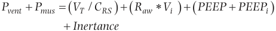

Pvent  Pmus   VT / CRS  Raw  Vi    PEEP  PEEPi   Inertance 

where Pvent is the proximal airway pressure applied by the ventilator, Pmus is the pressure generated by the patient’s inspiratory muscles, VT is tidal volume, CRS is respiratory system compliance, Raw is airway resistance, Vi is inspiratory flow, PEEP is the PEEP set on the ventilator, and PEEPi is intrinsic PEEP (auto- PEEP). The inertance variable, representing the effect of inertia, is assumed to be low and thus negligible.

According to the described equation every change in airway pressure can be explained by a change in elastic (VT/ CRS) or resistance (Raw * Vi ) forces.

### COMPLIANCE OF THE RESPIRATORY SYSTEM

The lung is like a rubber balloon that can be distended by positive pressure (inside) or negative pressure (outside). Under normal circumstances, inflation of the lung is maintained because although the pressure inside (alveolar pressure) is zero, the outside pressure (i.e., the pleural pressure) is sufficiently negative. The net distending pressure, which is the difference of the (positive) airway pressure (PAW) and the (negative) pleural pressure (PPL) is termed the _transpulmonary pressure_ (PTP). Thus:

PTP  PAW  PPL 

Clearly, increasing the PAW increases the PTP. In addition, lowering the PPL (which is usually negative and making it more negative) also increases the PTP.

_Compliance_ —the reciprocal of elastance—is the term that expresses how much distention (volume in liters) occurs for a given level of PTP (pressure, cmH2O); it is usually 0.2 to 0.3 L/cmH2O.24 However, although higher values of PTP maintain greater levels of lung opening, the relationship— as with most elastic structures—between applied pressure and resultant volume is curvilinear (Fig. 12.6).16 Lung compliance depends on the lung volume; it is lowest at an

extremely low or high FRC (see Fig. 12.6). In lung diseases characterized by reduced compliance (e.g., ARDS, pulmonary fibrosis, or edema), the pressure–volume (PV) curve is flatter and shifted to the right (Fig. 12.7).16 In contrast, although emphysema involves the loss of elastic tissue, the overall loss of lung tissue (as seen on computed tomography [CT] scanning)53 means that the compliance is increased; the PV curve is therefore shifted to the left and is steeper (see Fig. 12.7).16

Chest wall impedance is not noticed during spontaneous breathing because the respiratory “pump” includes the chest wall. Chest wall mechanics can be measured only if complete relaxation of the respiratory muscles can be achieved54 ; however, during mechanical ventilation, the respiratory muscles can be completely relaxed. As the lung is inflated by PAW, the properties of the chest wall will determine the resulting change in PPL. Under these circumstances, the increase in lung volume per unit increase in PPL is the chest wall compliance. Values of chest wall compliance are about the same as that of the lung and are reduced with chest wall edema, pleural effusions, and diseases of the costovertebral joints.54

### RESISTANCE OF THE RESPIRATORY SYSTEM

### Airways

Resistance impedes airflow into (and out of) the lung. The major component of resistance is the resistance exerted by the airways (large and small), and a minor component is the sliding of lung and the chest wall tissue elements during inspiration (and expiration).16 Resistance is overcome by (driving) pressure. In spontaneous breathing, driving pressure will be the PPL; in positive pressure ventilation, the driving pressure will be the difference between the pressures applied to the endotracheal tube (PAW; “source”) and the alveolus (PALV; “destination”). Resistance (R) is calculated as driving pressure (ΔP) divided by the resultant gas flow (F):

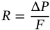

R  = Δ P F 

The value of airway resistance is approximately 1 cmH2O/ L/s, and is higher in obstructive lung disease (e.g., chronic obstructive pulmonary disease [COPD], asthma); in severe asthma, it is elevated approximately 10-fold.55 The presence of an endotracheal tube adds a resistance of 5 (or 8) cmH2O/L/min for a tube with internal diameter of size 8 (or 7) cm.56 For any tube for which the airflow is laminar (smooth, streamlined), the resistance increases in direct proportion to the tube length and increases dramatically (to the fourth power) as the diameter of the tube is reduced.

Two factors explain why most (approximately 80%) of the impedance to gas flow occurs in the large airways.16 First, as bronchi progressively branch, the resistances are arranged in parallel and the total cross- sectional area at the level of the terminal bronchioles adds up to almost 10-fold that at the trachea. Second, in tubes that are large, irregular or branched, the flow is often turbulent, not laminar. When flow is laminar:

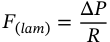

F ( lam ) = Δ R P 

<!-- PDF page 9 -->

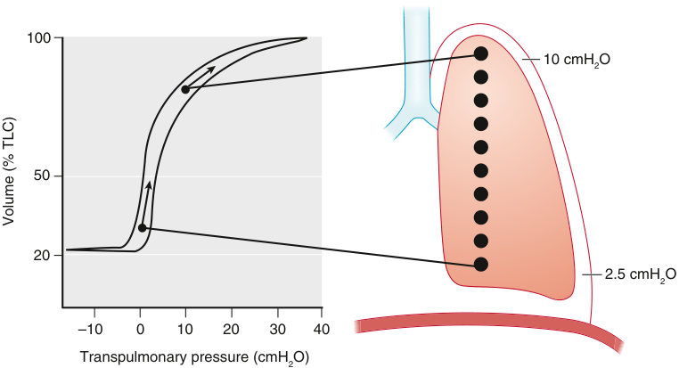

100 10 cmH2O 50 20 2.5 cmH2O –10 10 20 30 40 Transpulmonary pressure (cmH2O) Volume (% TLC) 0 

**Fig. 12.6 The pressure–volume relationships of the lung.** The relationship is curvilinear (typical for an elastic structure). The pleural pressure is lower (more subatmospheric) in the upper regions. In the upright subject, the transpulmonary pressure (PTP = PAW − PPL) is higher in apical than in basal regions. This results in different positions on the pressure volume curve of the upper (flatter, less compliant) versus lower (steeper, more compliant) lung regions. Thus, lower lung regions expand more (i.e., receive more ventilation) for a given increase in transpulmonary pressure than upper units. _TLC,_ total lung capacity.

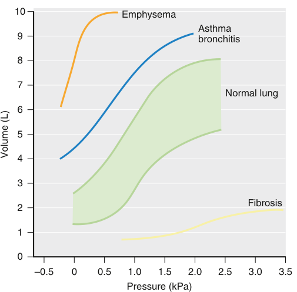

10 Emphysema Asthma 9 bronchitis 8 7 Normal lung 6 5 4 3 Fibrosis 2 1 0 –0.5 0 0.5 1.0 1.5 2.0 2.5 3.0 3.5 Pressure (kPa) Volume (L) 

**Fig. 12.7 Pressure–volume curves of the lung in healthy and lungdiseased patients.** In fibrosis, the slope of the curve is flatter, reflecting considerable increases in pressure variation and in respiratory work. In asthma or bronchitis, there is a parallel _(upward)_ shift of the pressure–volume curve, indicating an increase in lung volume but no change in compliance. In emphysema, the slope of the curve is steeper, reflecting tissue loss and possible increased compliance. However, in emphysema, asthma, or bronchitis, the airway resistance is increased; this increases the work of breathing and overrides any benefit from increased compliance. (From Hedenstierna G. _Respiratory Measurement_ . London: BMJ Books; 1998:184; see also book review of _Respiratory Measurement in Thorax_ 1998;53:1096.)

In contrast, when flow is turbulent:

_F_ ( _turb_ ) =Δ _R_&#95;P&#95;2

Therefore, for a given radius, far more pressure is required to achieve comparable flow where flow is turbulent; thus, the effort required is greater and if prolonged or severe, respiratory failure is more likely.

For long, straight unbranched tubes, the nature of the gas flow may be predicted from the value of the Reynolds number (Re). The Reynolds number can be derived by the following equation: Re =&lt;u>𝜌𝜌&lt;/u>&#95;d&#95;𝜐𝜐 𝜂𝜂

where ρ is density of the gas (kg/L), d is diameter of the tube (m), v is linear velocity (m/s) and η is gas viscosity (kg/m/s). Re is a dimensionless number that can be used to predict conditions of laminar or turbulent flow: Re >4000 predicts turbulent flow and &lt;2000 laminar flow. Consequently, a reduction of the inhaled gas mixture density (ρ) increases the likelihood of laminar flow being maintained. Helium density is 0.1785 g/L and is 1/7 of air density and, when mixed with other gases (such as oxygen), it will reduce the Re of the delivered gas mixture. Consequently, heliox (a mixture of helium and oxygen) inhalation showed a subjective decrease in work of breathing57 and a decreased rate of tracheal intubation58 in pediatric patients with upper airways obstruction.

Several factors can alter airflow resistance. First, resistance lessens as lung volume increases; this is intuitive, as increasing volume (positive pressure or spontaneous breathing) stretches the diameter of the airways. Because this is the key determinant of resistance, the resistance falls to a small extent. The opposite occurs with exhalation (Fig. 12.8). However, as lung volume approaches residual volume (RV)—as can happen during anesthesia—the airways are narrowed in parallel with the compressing lung tissue and the resistance rises exponentially. These effects are apparent with active or passive ventilation. Second, active ventilation has additional effects. Forced expiration

<!-- PDF page 10 -->

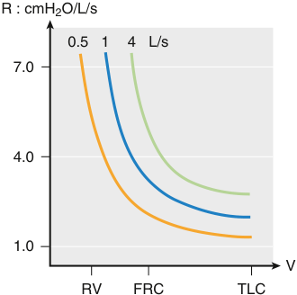

R : cmH2O/L/s 0.5 1 4 L/s 7.0 4.0 1.0 V RV FRC TLC 

**Fig. 12.8 Schematic drawing of airflow resistance against lung volume at different flow rates.** As lung volume falls, the resistance to flow increases; the steepness of this increase is far greater at lung volumes below functional residual capacity _(FRC)_ . In addition, higher airflow rates are associated with greater resistance. At extremely low lung volume, the resistance is comparable to values seen in moderate to severe asthma (6–8 cmH2O × l−1 × s). _RV,_ residual volume; _TLC,_ total lung capacity.

can compress small airways (i.e., that do not contain cartilage).16 In addition, forced expiration can cause turbulent flow in small airways in patients with COPD, precipitously dropping pressure in the lumen and thereby narrowing the bronchioles59 and resulting in expiratory flow limitation and, after multiple breaths, eventual “dynamic hyperinflation.”60 Expiring against resistance (or pursed- lips breathing) is sometimes used by those with COPD to make breathing easier. This works by increasing expiratory resistance and slowing expiration. The slowed expiration reduces the pressure gradient driving expiration (i.e., pressure highest in the alveolus, lower toward the mouth). Therefore, the point along the airway tree at which pressure inside the airway has decreased to less than that outside the airway (equal to pleural pressure) is moved from smaller collapsible airways toward the mouth to noncollapsible, cartilaginous airways (Fig. 12.9); this prevents collapse of the smaller airways, which are vital for proper gas exchange.61

The large airways (i.e., pharynx, larynx, and trachea) are outside the chest wall. During inspiration, the intrathoracic airways are exposed to extraluminal pressure (i.e., PPL) that is less than the lumen pressure; in contrast, the extrathoracic airways are exposed to lumen pressure that is less than the extraluminal (i.e., atmospheric) pressure.16 This feature, coupled with downward stretch induced by inspiration, narrows the large extrathoracic airways; in the presence of preexisting narrowing (e.g., thyroid enlargement or tumor, paralyzed vocal cord, epiglottitis), this can critically reduce the cross- sectional area.

### Tissue

Although not intuitively obvious, resistance of the lung tissue is the applied pressure on tissue divided by the resulting velocity of tissue movement. There are various approaches to determining this in humans, including separately considering the PV characteristics using plethysmography (where the area of the PV curve corresponds to work against total pulmonary resistance) and esophageal pressure (where the area of the PV curve corresponds to work against “tissue”

resistance).62 Alternative approaches mathematically model the lung responses to varying respiratory frequencies.63 Lung tissue resistance amounts to 20% of the total resistance to breathing; it can be increased threefold or fourfold in chronic lung disease64 and is reduced by panting respirations.65 Finally, in ARDS the chest wall resistance is increased.66

### INERTIA OR ACCELERATION OF GAS AND TISSUE

A final component of the total impedance to breathing is inertance, or the pressure required to accelerate air and tissue during inspiration and expiration. This component is minor, however, and can hardly be measured under normal breathing, regardless of whether the lungs are healthy. Nonetheless, tissue inertia is large during rapid ventilation,67 and it could be important during the rapid, shallow breathing characteristic of weaning failure or during highfrequency oscillation.

### FUNCTIONAL RESIDUAL CAPACITY

The amount of air in the lungs after an ordinary expiration is called _functional residual capacity_ (FRC); it is usually 3 to 4 L and occurs because of the balance of inward (lung) forces and outward (chest wall) forces. The inward force is the “elastic recoil” of the lung and emanates from the elastic lung tissue fibers, contractile airway smooth muscle, and alveolar surface tension. The outward force is developed by passive recoil from the ribs, joints, and muscles of the chest wall. FRC is greater with increased height and age (loss of elastic lung tissue), and smaller in women and in obesity.10,68

There are two reasons why maintenance of gas in the lung at end- expiration (i.e., FRC) is important. First, inflating an already opened (inflated) lung is easier than when the lung is deflated. This is because complete collapse results in liquid- only surfaces interfacing in alveoli (high surface tension), whereas alveoli in partially inflated lung have air–liquid interfaces (lower surface tension). Second, although perfusion in the lung is phasic, the frequency is rapid and the oscillations in flow are low, resulting in nearly continuous flow. Ventilation is different: the frequency is far slower and the size of the oscillations far larger. If the lung (or large parts of it) completely deflate between breaths, the blood flowing from closed alveoli (that contain zero O2) would have very low SO2 (the same as mixed venous blood); this would mix into the overall blood flow from the lungs and cause a major O2 desaturation after every exhalation.

### AIRWAY CLOSURE

Intermittent airway closure reduces ventilation of the affected alveoli. Such lung regions can become regions . . of low VA/Q since alveoli that remain closed during the respiratory cycle may collapse and cause intrapulmonary shunt. The propensity to airway closure increases at low lung volume since the small airways caliber and transmural pressure are reduced. With age, the lung elastic recoil is reduced, increasing the risk of airway closure (Fig. 12.10).69 Anesthesia reduces FRC by about 0.5 L,70 which increases airway closure during tidal ventilation.71,72 In

<!-- PDF page 11 -->

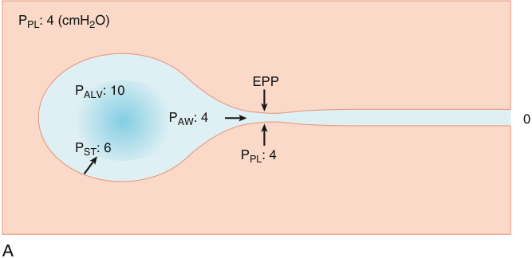

PPL: 4 (cmH2O) EPP PALV: 10 PAW: 4 0 PST: 6 PPL: 4 A 

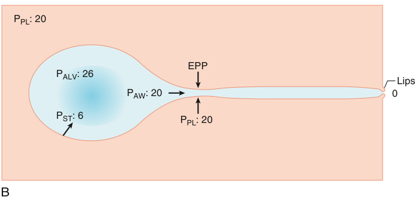

PPL: 20 EPP PALV: 26 Lips PAW: 20 0 PST: 6 PPL: 20 B 

**Fig. 12.9 Schematic drawings of the equal pressure point (EPP) concept and dynamic compression of airways.** (A) Slightly forced expiration during otherwise normal conditions. With the application of some expiratory muscle effort, pleural pressure (PPL) is positive, 4 cmH2O (0.4 kPa). The elastic recoil pressure (PST) of the alveoli (6 cmH2O) and the pleural pressure add together to yield intra- alveolar pressure (PALV) (10 cmH2O). This causes expiratory flow. At some point downstream toward the airway opening, airway pressure (PAW) has dropped by 6 cmH2O, so intraluminal pressure and pleural, extraluminal pressure are the same. This is the EPP. From this point to the mouth, intraluminal airway pressure is lower than the surrounding, extraluminal pressure and the airway may be compressed. (B) An attempt to stabilize the airway by so- called “pursed- lip” breathing. The increased resistance to expiratory flow requires increased expiratory effort to maintain gas flow. Thus pleural pressure is increased in comparison to the normal conditions (PPl = 20 cmH2O). Alveolar elastic recoil pressure (PST) is the same as in the earlier condition, provided that lung volume is the same. If expiratory flow is of the same magnitude as during normal breathing, pressure along the airway falls to the same extent as during normal breathing. Thus the EPP will have the same location as during normal breathing, and no stabilization of the airway has been achieved. The two ways of moving the EPP toward the mouth and to less collapsible airways is by raising alveolar recoil pressure (PST) by an increase in lung volume or by lowering the expiratory flow rate so that the pressure drop along the airway tree is slowed down.

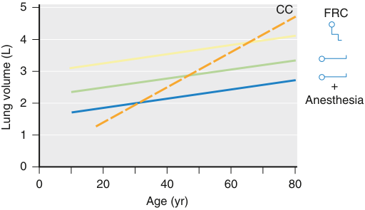

5 CC FRC 4 3 + 2 Anesthesia 1 0 0 20 40 60 80 Age (yr) Lung volume (L) 

**Fig. 12.10 Resting functional residual capacity (FRC) and closing capacity (CC).** FRC increases with age (because of loss of elastic tissue), and superimposed upon this is a step decrease in FRC with supine position (because of diaphragm elevation by abdominal contents), and a further decrease with anesthesia in the supine position. The CC is also increased with age, but far more steeply, causing airway closure above FRC in upright subjects (>65 years) and in supine subjects (>45 years). This relationship between CC and FRC explains decreasing oxygenation with age.

fact, the reduction in ventilation in the nonatelectatic lung (Fig. 12.11) is caused by airway closure. In addition, ventilation in these regions is less than perfusion (i.e., regions . . of low VA/Q) and contributes to impaired oxygenation during anesthesia. Taken together, the combination of atelectasis and airway closure explains about 75% of the overall impairment in oxygenation.73 In summary, a simple three- . . compartment lung model (normal VA/Q matching regions, region of airway closure, and atelectatic lung) describes well the components contributing to impairment of oxygenation during anesthesia (see Fig. 12.11).

## Control of Breathing

Breathing is centrally controlled by the respiratory centers, a complex network of interconnected neurons in the medulla and pons. Τhe respiratory centers’ neurons in the medulla are clustered in the ventral and dorsal respiratory groups. The ventral respiratory group includes the pre- Bötzinger complex, and neurons active both during inspiration and

<!-- PDF page 12 -->

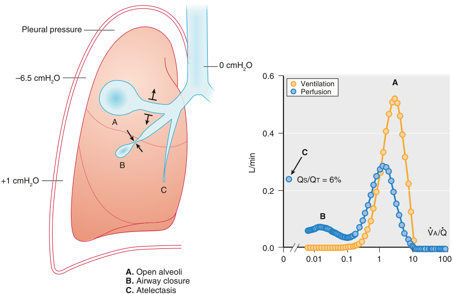

Pleural pressure 0 cmH2O –6.5 cmH2O 0.6 Ventilation A Perfusion A 0.4 C B +1 cmH2O QS/QT = 6% C 0.2 B VA/Q 0.0 0 0.01 0.1 1 10 100 A.  Open alveoli B.  Airway closure C.  Atelectasis L/min 

**Fig. 12.11 A three- compartment model of ventilation and perfusion during anesthesia.** In the upper regions, the alveoli and airways are open _(left panel, A)_ . In the middle region, the airways are intermittently closed _(B)_ , and atelectasis is present in the lower region _(C)_ . The corresponding ventilation– perfusion distribution (multiple inert gas elimination technique) is illustrated in the _right panel_ . Mode _A_ reflects good ventilation and perfusion, whereas mode _B_ reflects intermittent airway closure. In addition, there is a shunt in the atelectatic region (mode _C_ ). _QS/QT,_ venous admixture, or shunt equation.

expiration. The dorsal respiratory group consists mainly of inspiratory neurons and bears the connections to the upper motor neurons innervating the inspiratory muscle motor neurons. The pontine respiratory neurons, with multiple projections to the medullary centers and other brain areas, integrate all signals involved in the formation of the breathing pattern.

The central pattern generator consists of neurons concentrated in the pre- Bötzinger complex, which can be functionally divided in rhythm and motor pattern forming components. This central controller integrates multiple inputs and regulates the three phases of the breath, the inspiratory phase, with active contraction of inspiratory muscles, the postinspiratory phase, characterized by a declining discharge to the inspiratory muscles, and the expiratory phase, in which inspiratory muscles are inactive, and expiratory muscles contract only when ventilatory demands are increased. This tightly controlled system regulates arterial blood gases and acid–base balance, while optimizing the work of breathing, and synchronizing breathing with other activities (such as speaking and swallowing).74–77

### INPUTS TO THE RESPIRATORY CENTER

The main inputs to the respiratory centers affecting the breathing pattern arise from: the central and peripheral chemoreceptors, sensing changes in arterial blood gases; stretch and irritant receptors in the lungs, diaphragm, and the rib cage, regulating reflex responses; the central nervous system and muscle afferents regulating the ventilatory response to exercise, and finally from several cortical

afferents, modulating the breathing pattern through projections to the respiratory centers and the pons.78

### Effect of pH and CO2

Changes in PCO2 and pH are sensed by both peripheral and central chemoreceptors and induce changes in the respiratory centers’ output. Central chemoreceptors consist of glutaminergic neurons, which are mainly located at the retrotrapezoid nucleus on the ventrolateral surface of the medulla, and respond to changes in cerebrospinal fluid proton concentrations, likely via pH- sensitive potassium channels. Because the cerebrospinal fluid contains few buffering proteins, abrupt changes in CO2 levels cause greater alterations in H+ levels than in the blood, while in metabolic acid–base derangements equilibrium between plasma and cerebrospinal fluid is reached with some delay. Peripheral chemoreceptors are located in the aortic and carotid bodies and respond rapidly to changes in arterial pH.

At steady state, the arterial PCO2 is determined by the intersection of two curves: the metabolic hyperbola and the CO2 response curve (Fig. 12.12). The metabolic hyperbola describes PCO2 as a function of minute ventilation (V E), while the CO2 response curve describes V E as a function of PaCO2. The determinants of the metabolic hyperbola are the CO2 production and the dead space to tidal volume ratio. Dead space is affected by several variables such . . as true dead space, V/Q inequalities, and shunt. The CO2 response curve is linear (over the clinically relevant range) and is characterized by its slope and _x_ - intercept. The slope, described as “chemosensitivity,” varies widely in healthy individuals, having an average value of 2–3 L/min/mm

<!-- PDF page 13 -->

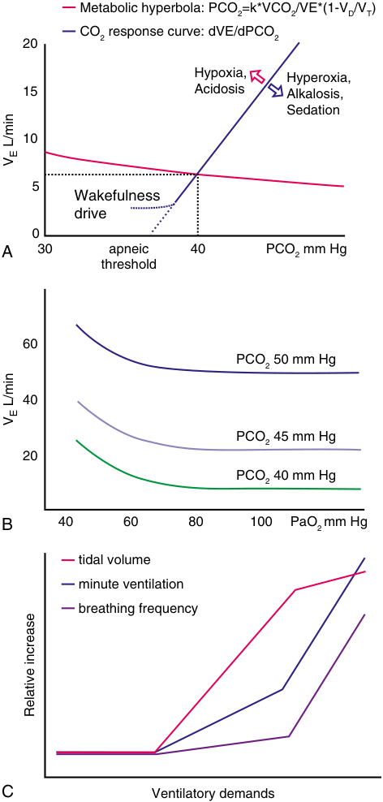

Metabolic hyperbola: PCO2=k*VCO2/VE*(1-VD/VT) CO2 response curve: dVE/dPCO2 20 Hypoxia, Hyperoxia, 15 Acidosis Alkalosis, Sedation 10 5 Wakefulness drive 0 A 30 apneic 40 PCO2 mm Hg threshold 60 PCO2 50 mm Hg 40 PCO2 45 mm Hg 20 PCO2 40 mm Hg B 40 60 80 100 PaO2 mm Hg tidal volume minute ventilation breathing frequency C Ventilatory demands  L/minVE  L/minVE Relative increase 

**Fig. 12.12** (A) Metabolic hyperbola and CO2 response curve, apneic threshold, and minimum ventilation maintained by the “wakefulness drive to breathe”. (B) Ventilatory response to hypoxemia for different levels of PaCO2. (C) Graphical representation of the relative changes in tidal volume, breathing frequency, and minute ventilation in response to increasing ventilatory demands.

Hg and a range of 0.6–8 L/min/mm Hg. The _x_ - intercept is referred to as “apneic threshold,” the PaCO2 level below which apnea occurs, and is normally present only during sleep or sedation. In awake individuals below the eupneic PaCO2 level (the normal PaCO2 at rest), the slope of the PCO2–ventilation response curve deviates from linear, becoming almost horizontal at a minimum level of ventilation, which is maintained despite hypocapnia, a phenomenon known as “wakefulness drive to breathe.” Similarly to chemosensitivity, the apneic threshold and minimum ventilation vary among healthy individuals, and are affected by

PaO2, pH, and sedation. Therefore, hypercapnia promotes an increase in ventilation and hypocapnia a decrease in ventilation to an extent determined by chemosensitivity and affected by wakefulness. Hypoxemia, hyperthermia, and acidosis increase chemosensitivity and minimum ventilation, while hyperoxemia, alkalosis, and sedation have the opposite effect. Opioid receptors (μ and δ) are present in the respiratory centers, and agonists of μ- opioid receptors cause a dose- dependent reduction in both hypoxemic and hypercapnic ventilatory responses. Similarly, γ-aminobutyric acid (GABA)- receptor agonists reduce both chemosensitivity and hypoxemic ventilatory responses.79–81

### Effect of Oxygen

The main chemoreceptors mediating the ventilatory response to hypoxemia are the carotid bodies, small clusters of oxygensensitive cells located at the carotid bifurcation. Acute hypoxemia results in a rapid increase in ventilation, peaking within a few minutes, but soon declining, to a level above resting ventilation. The magnitude of this response varies greatly not only among healthy individuals but also among the same individual at different time points. With gradually developing hypoxemia, ventilation changes minimally with mild hypoxemia (PaO2, 60–70 mm Hg), but at lower PaO2, it increases progressively with hypoxemia (see Fig. 12.12). Hypercapnia enhances the acute hypoxic response, as hypoxemia enhances hypercapnic responses, so that the ventilatory response to an acute interruption of breathing (asphyxia) is greater than the sum of the expected response to either change alone. Sustained hypoxemia (such as in high altitude) also leads to increased ventilation. Increase in tidal volume is largely responsible for the initial ventilatory rise with hypoxemia, while breathing frequency is increased with prolonged hypoxic exposures. Hypoperfusion of the carotid bodies produces an effect similar to hypoxemia. Nitric oxide has an inhibitory effect on carotid body hypoxemic chemoreception. Finally, very severe hypoxia of the medulla may abolish respiratory neuronal activity.78,79,82

### Other Inputs: Reflex Responses and Cortical Inputs

The most well- described reflex response is the Hering– Breuer reflex, which is important in balancing the rate and depth of ventilation. The afferent pathway includes slowly adapting mechanoreceptors associated with airway smooth muscle of the tracheobronchial tree, reaching the respiratory centers through the vagus. The Hering–Breuer reflex decreases inspiratory time in response to lung inflation. Other reflex responses include deep breaths and cough, mediated via rapidly adapting pulmonary receptors in response to decreased lung compliance, rapid shallow breathing in response to stimulation of pulmonary J receptors, and coughing and sneezing in response to stimulation of irritant receptors in lungs, airways, larynx, and nose.

The diving reflex is activated by strong activation of receptors in the face, nose, and pharynx via the trigeminal nerve, and receptors in the larynx via the superior laryngeal nerve, and causes apnea, also accompanied by a vagally mediated bradycardia and peripheral vasoconstriction.

Finally, cortical inputs can modulate the breathing pattern, either by (temporarily) overriding the automatic control of breathing (i.e., voluntary apnea), or as part of responses to sensory or emotional stimuli.83–85

<!-- PDF page 14 -->

### OUTPUT OF THE RESPIRATORY CENTER

The respiratory centers’ output travels from the medulla and pons to the upper motor neurons, the junction with the respiratory motor neurons in the anterior horn cells in the cervical spine, finally leading to activation and contraction of the respiratory muscles, and generation of inspiratory (and expiratory) flow.

Normally the changes in ventilation are primarily achieved through changes in effort and thus tidal volume, and to a lesser extent by changes in breathing frequency as shown in Fig. 12.12. Yet, when further increase in tidal volume is limited, such as when approaching total lung capacity, or in the presence of diaphragm weakness, breathing frequency may increase disproportionately to tidal volume.

In clinical practice the output of the respiratory centers (respiratory drive) cannot be directly quantified, but can be estimated using the rate of increase of the respiratory muscles motor output, such as the electrical activity of the diaphragm (dEAdi/dt), or the pressure generated by the diaphragm (dPdi/dt) or all the respiratory muscles, as indicated by the esophageal pressure (dPes/dt) or airway pressure (if the airway is occluded and there is no change in lung volume, dPaw/dt). A commonly used index of respiratory drive is the pressure drop generated against an occluded airway during the first 100 ms of inspiration (P0.1), as this can be easily measured in many ventilators. Clearly, any condition affecting the efferent respiratory centers’ pathway, globally (such as neuromuscular blockade) or locally but closer to the respiratory centers than the point of measurement (e.g., in the anterior horn cells), will lead to underestimation of the respiratory drive.79,80

## Mechanisms of Hypoxemia and Hypercapnia

In the previous sections we have discussed ventilation, diffusion, perfusion, and gas transport, all of which affect oxygenation and CO2 elimination. This section details the mechanisms of hypoxemia and hypercapnia, focusing on conditions relevant to anesthesia practice. The mechanisms . . of hypoxemia include right to left shunt, V/Q mismatch, impaired diffusion, alveolar hypoventilation, and low FiO2. The mechanisms of hypercapnia include alveolar hypoven-. . tilation (absolute or relative) and V/Q mismatch.

### RIGHT TO LEFT SHUNT

Blood passing from the right heart to the left without contacting ventilated alveoli cannot receive oxygen or release CO2, a condition called shunt (Fig. 12.13). Normally a small shunt (2%–3% of cardiac output) is present, caused by venous drainage of the heart muscle into the left atrium by the thebesian veins. Shunt can be observed in congenital heart diseases, and in conditions causing complete lung collapse, such as atelectasis, and in ARDS. Since shunted blood does not contact ventilated alveoli, increasing FiO2 has no effect in hypoxemia induced by shunt. Clinically, refractory hypoxemic respiratory failure occurs when shunt exceeds 50%. Impaired hypoxic pulmonary vasoconstriction can

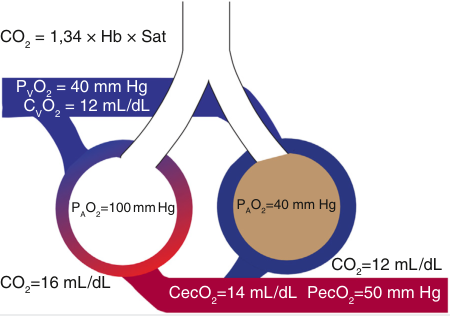

CO2 = 1,34 × Hb × Sat PVO2 = 40 mm Hg CVO2 = 12 mL/dL P O =100 mm Hg P O =40 mm Hg CO2=12 mL/dL CO2=16 mL/dL CecO2=14 mL/dL PecO2=50 mm Hg 

**Fig. 12.13 Two- unit lung model, where one unit is filled with exudative material and thus not ventilated creating shunt.** Assuming that blood flow is the same in both units, the oxygen content of the blood leaving these units (CecO2) will be the average of the oxygen content leaving each one. Blood leaves the left unit fully oxygenated, and assuming a hemoglobin (Hb) concentration of 12 mg/dL has an oxygen content of 16 mL/dL. Blood leaves the lung unit on the right with the same oxygen content as venous blood (CvO2), equal to 12 mL/dL (SvO2=75 mm Hg). The blood from the two units combined will have a CecO2 of 14 mL/dL, corresponding to SaO2=87% and a PaO2=50 mm Hg.

amplify shunt- induced hypoxemia. The shunt fraction can be calculated according to the equation:

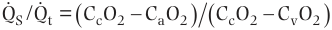

  QS /Qt =  CcO2  CaO2  CcO2  CvO2  

. . where Qs is the shunt flow and Qt total blood flow (cardiac output), CcO2 is the pulmonary end- capillary or alveolar O2 content, CaO2 is the arterial O2 content, and CvO2 the mixed venous O2 content. One study has shown that shunt can be roughly estimated from a PaO2/FiO2 table in subjects breathing 100% oxygen.86

Shunt causes not only hypoxemia but also, to a lesser extent, hypercapnia, as shunted blood does not release CO2, as in dead space. Quantification of the effect of shunt on dead space is complicated and multifactorial, depending mainly on cardiac output, CO2 production, and pH values. It can be roughly estimated that a 50% shunt can increase ventilatory demands by 10%.87

### VENTILATION–PERFUSION MISMATCH

Matching of ventilation with perfusion is essential for optimal gas exchange. At rest, both ventilation and perfusion increase downward through the lung. However, perfusion increases more than ventilation, so that the mean ratio is approximately 1 (observed in the middle of the lung) and the range of ratios is 0.5 (at the bottom), and 5.0 (in the apex; . . Fig. 12.14). The distribution of V/Q ratios is affected by body position (Fig. 12.15), the presence of diaphragmatic contractions, and by practically all diseases affecting the lungs.88–90

The mismatch of ventilation and perfusion is the most common cause of hypoxemia, but also an important cause of . . hypercapnia. Low V/Q ratios impede oxygenation because ventilation is insufficient to fully oxygenate the blood, and the greater the mismatch the greater the P. . AO2–PaO2 difference. High V/Q ratios result in hypercapnia, because when hemoglobin is fully saturated further increase of PAO2 cannot oxygenate blood further, while the limited blood flow reduces CO2 elimination (Fig. 12.16).

<!-- PDF page 15 -->

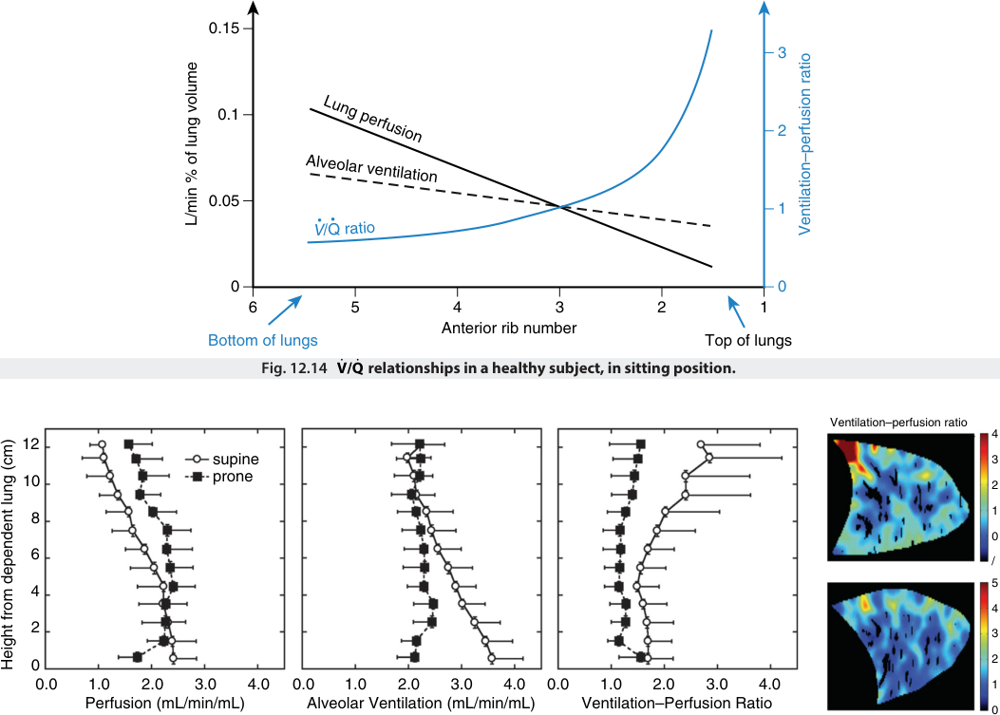

0.15 3 0.1 2 0.05 1 0 0 6 5 4 3 2 1 Anterior rib number Bottom of lungs Top of lungs Fig. 12.14 V/ ˙ Q ˙  relationships in a healthy subject, in sitting position. Ventilation–perfusion ratio 4 12 supine 3 10 prone 2 8 1 0 6 / 5 4 4 2 3 0 2 0.0 1.0 2.0 3.0 4.0 0.0 1.0 2.0 3.0 4.0 0.0 1.0 2.0 3.0 4.0 1 Perfusion (mL/min/mL) Alveolar Ventilation (mL/min/mL) Ventilation–Perfusion Ratio 0 V /Q ratio Alveolar ventilation Lung perfusion L/min % of lung volume Ventilation–perfusion ratio Height from dependent lung (cm) 

**Fig. 12.15 V/**˙ **Q**˙ **relationships in supine and prone position in healthy subjects, using proton magnetic resonance imaging (MRI).** (From Henderson AC, Sá RC, Theilmann RJ, et al. The gravitational distribution of ventilation- perfusion ratio is more uniform in prone than supine posture in the normal human lung. _J Appl Physiol Bethesda Md 1985._ 2013;115(3):313–324, with permission.)

The evaluation of ventilation and blood flow has been extensively investigated using the multiple inert gas elimination technique (MIGET). In short, MIGET is based on the constant intravenous infusion of several inert gases (usually six) with differing solubilities in blood. When passing through the lung capillaries, the different gases are eliminated via the alveoli and expired, in indirect proportion to their solubility. The poorly soluble gases rapidly leave the bloodstream,

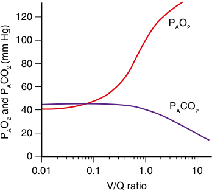

120 PAO2 100 80 60 40 PACO2 20 0 0.01 0.1 1.0 10 V/Q ratio OCO(mm Hg)P and PAA22 

**Fig. 12.16 Effect of V/**˙ **Q**˙ **ratio on the concentration of alveolar gases.**

being exhaled, while highly soluble gases are almost completely retained in the blood and not exhaled. As a result, the concentration of the different gases in arterial blood and expired air differs. The retention and excretion of each gas can be calculated as the ratio between arterial and mixed venous blood concentrations and expired over mixed venous blood concentrations, respectively. With knowledge of the retention, excretion, and solubility of each gas, an essen-. . tially continuous distribution of blood flow against V/Q ratios can be constructed. . Fig. 12.17. displays characteristic examples of analysis of V/Q ratios using MIGET in different conditions. Other techniques such as single-photon emission computed tomography (SPECT), proton magnetic resonance imaging (MRI) and electrical impedance tomography, the last one available at the bedside, are currently used to evaluate . . V/Q matching.91

### IMPAIRED DIFFUSION

Impaired diffusion is caused by thickening of the alveolar– capillary membranes, and results in hypoxemia. As diffusion is prolonged, oxygenation of the capillary blood depends on the time red blood cells have available in the capillary, and therefore hypoxemia is exacerbated when cardiac output

<!-- PDF page 16 -->

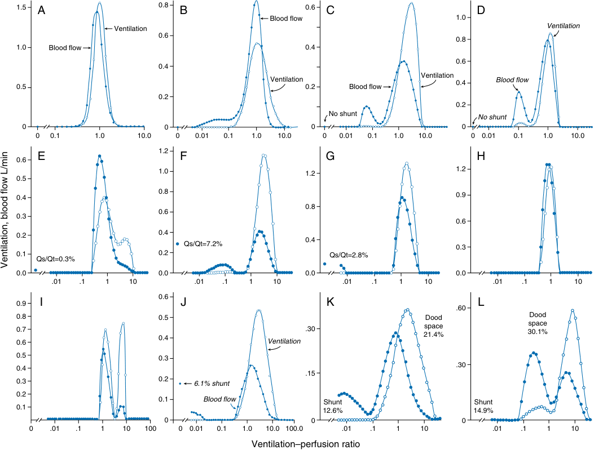

1.5 A 0.8 B 0.6 C D Blood flow 1.0 Ventilation Ventilation 0.6 0.8 1.0 Blood flow 0.4 0.6 0.4 Ventilation Ventilation 0.4 Blood flow 0.5 0.2 Blood flow 0.2 0.2 No shunt No shunt 0 0 0 0 0 0.1 1.0 10.0 0 0.01 0.1 1.0 10.0 0 0.01 0.1 1.0 10.0 0 0.01 0.1 1.0 10.0 0.6 E 1.2 F G H 1.0 1.2 1.2 0.5 0.4 0.8 0.9 0.8 0.6 0.3 0.6 0.2 0.4 0.4 Qs/Qt=7.2% 0.3 0.1 0.2 Qs/Qt=2.8% Qs/Qt=0.3% 0.0 0.0 0.0 0.0 .01 .1 1 10 .01 .1 1 10 .01 .1 1 10 .01 .1 1 10 0.9 I 0.6 J K L .60 0.8 0.5 Dood Dood 0.70.6 0.4 Ventilation .30 21.4%space 30.1%space 0.5 0.3 0.4 .30 .15 0.3 0.2 6.1% shunt 0.2 0.1 Blood flow Shunt Shunt 0.1 12.6% 14.9% 0 0 0 0 .01 .1 1 10 100 0 0.01 0.1 1.0 10.0 100.0 .01 .1 1 10 .01 .1 1 10 Ventilation–perfusion ratio Ventilation, blood flow L/min 

**Fig. 12.17 Representative images of V/**˙ **Q**˙ **ratios in different conditions as evaluated by multiple inert gas elimination technique (MIGET).** (A) Healthy, young. (B) Healthy, middle age. (C) Chronic obstructive lung disease. (D) Asthma. (E–H) Before surgery, after anesthesia, and 4 hours and 1 day postoperative. (I) Pulmonary embolism. (J) Myocardial infarction. Unilateral lung disease, lateral position, healthy side up (K) and down (L). (A–D, J, Redrawn from West JB. State of the art: ventilation- perfusion relationships. _Am Rev Respir Dis_ . 1977;116(5):919–943; E–H, Redrawn from Hachenberg T, Tenling A, Nyström SO, et al. Ventilation- perfusion inequality in patients undergoing cardiac surgery. _Anesthesiology_ . 1994;80(3):509–519; I, Huet Y, Lemaire F, BrunBuisson C, et al. Hypoxemia in acute pulmonary embolism. _Chest_ . 1985;88(6):829–836; K, L, Redrawn from Gillespie DJ, Rehder K. Body position and ventilationperfusion relationships in unilateral pulmonary disease. _Chest_ . 1987;91(1):75–79.)

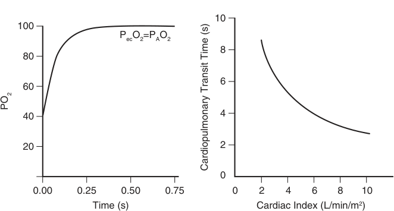

10 100 PecO2=PAO2 8 80 6 60 40 4 20 2 0 0.00 0.25 0.50 0.75 0 2 4 6 8 10 Time (s) Cardiac Index (L/min/m 2 ) PO2 Cardiopulmonary Transit Time (s) 

**Fig. 12.18** _Left panel:_ increase in capillary PO2 as a function of time the red blood cell spends in the alveolar capillary, with normal diffusing capacity. _Right panel:_ change in cardiopulmonary transit time (CPTT, time the red blood cell travels from the right to the left ventricle) as a function of cardiac output in healthy subjects. A healthy subject at rest has a CPTT of approximately 4–5 seconds of which 0.75–1 second is spent in the pulmonary capillaries. (Redrawn from Zavorsky GS, Walley KR, Russell JA. Red cell pulmonary transit times through the healthy human lung. _Exp Physiol_ . 2003;88(2):191–200.)

<!-- PDF page 17 -->

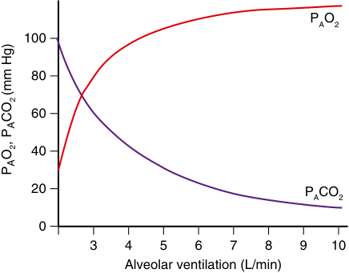

PAO2 100 80 60 40 20 PACO2 0 3 4 5 6 7 8 9 10 Alveolar ventilation (L/min) OCO(mm Hg)P, PAA22 

**Fig. 12.19 Partial pressures of alveolar oxygen (PAO2) and carbon dioxide (PACO2) as a function of alveolar ventilation.**

increases (Fig. 12.18). Hypoxemia from impaired diffusion is observed in chronic conditions, such as pulmonary fibrosis, but not as an acute complication during anesthesia, and is typically accompanied by decreased FRC and lung compliance.92–94

### HYPOVENTILATION

Hypoventilation can be defined as alveolar ventilation less than the one needed to maintain PaCO2 below 45 mm Hg. Apart from hypercapnia, which will be discussed in detail below, hypoventilation causes hypoxemia, simply because inadequate elimination of CO2 reduces alveolar space available for oxygen:

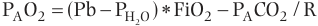

PAO2  (Pb  PH2O )  FiO2  PACO2 / R 

where PAO2 is the partial pressure of oxygen in the alveoli, Pb and PH2O the barometric pressure and the water vapor pressure, respectively. FiO2 is the fraction of inspired oxygen, and R is the gas exchange ratio (Fig. 12.19).

### MECHANISMS OF HYPERCAPNIA

The arterial PaCO2 is determined by the equilibrium between CO2 production (VCO2) and removal with alveolar ventilation (VA):

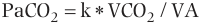

PaCO2  k  VCO2 / VA 

where k (0.86) is a constant for unit transformation. Therefore, hypercapnia can occur when CO2 production exceeds elimination by alveolar ventilation.95,96 The CO2 production depends on the metabolic rate, and increases with exercise, or other rigorous muscle contraction, such as strenuous breathing, agitation, seizures, shivering, increased temperature, and thyrotoxicosis. An increase in metabolic rate triggers an increase in ventilation from the control of breathing system. Yet, in subjects unable to increase ventilation, for example sedated patients under controlled ventilation, an increase in VCO2, for example due to fever, will result in increase in PaCO2.

Alveolar ventilation is the main determinant of CO2 elimination, and a relative decrease of alveolar ventilation is the

most common cause of hypercapnia in everyday clinical practice. Alveolar ventilation is the fraction of minute ventilation (VE) minus dead space ventilation (VD):

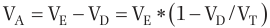

VA  VE  VD  VE  1  VD /VT  

usually estimated using the ratio of dead space to tidal volume (VD/VT), so a decrease in alveolar ventilation can occur because of decrease in total ventilation or an increase in dead space to tidal volume ratio. Conditions leading to increase in dead space are summarized in Fig. 12.20 and include chronic diseases such as emphysema and acute conditions . . such as pulmonary embolism. As discussed above, . . V/Q mismatch with areas of high V/Q reduce the efficiency of alveolar ventilation in CO2 elimination, and therefore have a similar result as dead space. The rapid–shallow breathing pattern, usually observed in patients with respiratory distress of various causes, results in an increase of VD/VT. In intubated patients, dead space is increased from the ventilator circuit, as the volume of the tubing and the heat and moisture exchanger (if present, mainly in ICU patients) after the Y of the circuit (the connection between inspiratory and expiratory circuits) is “anatomic” dead space.

Minute ventilation, the product of respiratory rate and tidal volume, is determined in spontaneously breathing patients from the control of breathing system, the integrity of the neuromuscular pathway, and the respiratory system mechanics, while in mechanically ventilated patients, minute volume depends totally (in control modes) or partially (in assisted modes), on ventilator settings. As detailed in Control of Breathing, above, conditions affecting the respiratory centers, such as sedation or injury, decrease respiratory drive and therefore the minute ventilation (in spontaneously breathing patients without mechanical ventilation). Conditions or lesions affecting the neuromuscular pathway from the brainstem to the diaphragm and other inspiratory muscles result in decrease of the pressure generated during inspiration for a given brain stimulus (e.g., upper motor neuron disease, myasthenia gravis, neuromuscular blockers, toxins, Guillain–Barré syndrome).

According to the equation of motion:

### Pmus = V’ × R + V × E

the decrease in muscle pressure (Pmus) will lead to decrease in tidal volume. A small decrease in Pmus, and thus tidal volume and minute ventilation, will increase PCO2 and trigger a compensatory increase in respiratory drive, and respiratory rate, but when compensatory mechanisms are impaired or exhausted, hypercapnia will develop. Similar to a decrease in Pmus, an impairment of respiratory system mechanics (resistance or elastance) will result in lower tidal volume for a given respiratory center output and Pmus. Again, hypercapnia will become apparent when compensatory mechanisms become insufficient.

Hypercapnia can be exacerbated by hyperoxemia through multiple mechanisms. First, hyperoxemia decreases chemosensitivity (the slope of the CO2 response curve, see Fig. 12.12). Second, the amount of CO2 carried by oxygenated hemoglobin is less than that carried by deoxygenated hemoglobin, known as the Haldane effect,51 and lastly hyperoxemia impairs hypoxic pulmonary vasoconstriction,

<!-- PDF page 18 -->

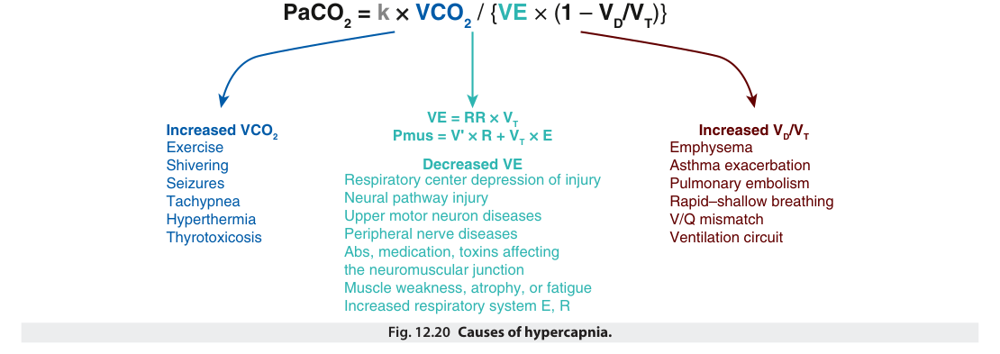

PaCO2 = k  × VCO2  / { VE  × ( 1  –  VD/VT )} VE = RR  ×  VT Increased VCO2 Pmus = V' ×  R + VT   ×  E Increased VD/VT Exercise Emphysema Shivering Decreased VE Asthma exacerbation Seizures Respiratory center depression of injury Pulmonary embolism Tachypnea Neural pathway injury Rapid–shallow breathing Hyperthermia Upper motor neuron diseases V/Q mismatch Thyrotoxicosis Peripheral nerve diseases Ventilation circuit Abs, medication, toxins affecting the neuromuscular junction Muscle weakness, atrophy, or fatigue Increased respiratory system E, R Fig. 12.20 Causes of hypercapnia. 

. . and V/Q matching. Hyperoxemia will cause hypercapnia only in patients who cannot increase alveolar ventilation.

In summary, hypercapnia develops when minute ventilation, due to reduced respiratory drive, impairment in neuromuscular pathway, or increased respiratory system elastance or resistance decreases or fails to increase adequately in response to an increase in the ventilatory demands, as determined by the CO2 production and the dead space.

## Lung Function Tests

Postoperative pulmonary complications after major surgery are common and associated with significant morbidity and health care costs. Therefore, it is important to assess pulmonary risk in all preoperative patients. A thorough history and physical examination for lung disease remains the cornerstone of preoperative pulmonary assessment. In patients with known risk factors, preexisting lung diseases, and thoracic surgery candidates, pulmonary function tests complement preoperative evaluation and risk stratification. Additionally, pulmonary function test results are used in the staging and prognosis of chronic lung diseases such as COPD and interstitial lung diseases and can provide helpful information in the decision- making process of critically ill patients.

### SPIROMETRY

The spirometry test consists of an inhalation to total lung capacity (TLC) followed by a forceful exhalation to measure the forced vital capacity (FVC), the forced expired volume in 1 second (FEV1), and the forced expiratory flow at 25%– 75% of FVC (Fig. 12.21). A reduction in the FEV1/FVC ratio below 70% indicates an obstructive airway disease, and the reduction of FEV1 from its predicted value is used for staging of chronic obstructive pulmonary disease. An FEV1 &lt;60% of predicted is associated with increased risk of serious postoperative pulmonary complications. Different thresholds of FEV1 are also used to guide lung cancer resection surgery decisions. Spirometry can also help identify variable intrathoracic or fixed (intra- or extrathoracic) airway obstruction from the shape of the forced expired flow–volume curve

(Fig. 12.22). A decreased FVC with preserved FEV1/FVC ratio indicates a restrictive lung disease.97,98

### MEASUREMENT OF LUNG VOLUMES

Measurement of lung volumes (Fig. 12.23) requires a method to estimate the gas that remains in the lungs at end  expiration, which cannot be calculated from spirometry. The methods used to measure lung volumes include nitrogen washout and body plethysmography, and less commonly helium dilution. Body plethysmography method applies Boyle’s law, which states that, under constant temperature, the product of volume and pressure of a constant mass of gas at any given moment remains the same, to measure lung volumes. The patient sits in an airtight, constant- volume chamber called the body box, and makes inspiratory efforts against a closed shutter equipped with a pressure transducer, and, as the diaphragm contracts causing the pressure inside the thorax to decrease and the volume of air to increase, the pressure in the box increases proportionately, allowing FRC or RV to be calculated. The nitrogen washout technique is based on the principle of conservation of mass of the inert gas, nitrogen. As the subject inhales 100% oxygen, nitrogen concentration in the exhaled gas is measured by dedicated microprocessors. When nitrogen disappears from the exhaled air, the test is terminated, the volume of nitrogen computed, and FRC calculated, on the basis that this nitrogen volume represents 80% of the lung gas contained at the beginning of the test. Commercially available ventilators allow estimation of FRC using modification of this technique.

### DIFFUSING CAPACITY FOR CARBON MONOXIDE (DLCO)

The diffusing capacity for carbon monoxide (DLCO) test is used to evaluate the functional capillary surface area available for gas exchange. The underlying principle of the test is that the diffusing capacity is determined by the surface area of the membrane exposed to gas, the pressure gradient between the gas in the alveolus and the blood, the solubility and molecular weight of the gas, and the thickness of the membrane. Because of the high affinity

<!-- PDF page 19 -->

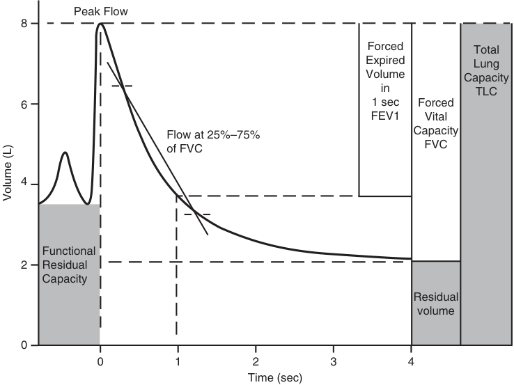

Peak Flow 8 Forced Total Expired Lung Volume Capacity in TLC 6 1 sec Forced FEV1 Vital Flow at 25%–75% Capacity FVC of FVC 4 Functional 2 Residual Capacity Residual volume 0 0 1 2 3 4 Time (sec) Volume (L) 

**Fig. 12.21** Lung volumes, measured using spirometry include forced vital capacity (FVC) and forced exhaled volume in 1 sec (FEV1). Gray shaded areas indicate lung volumes not measured by spirometry.

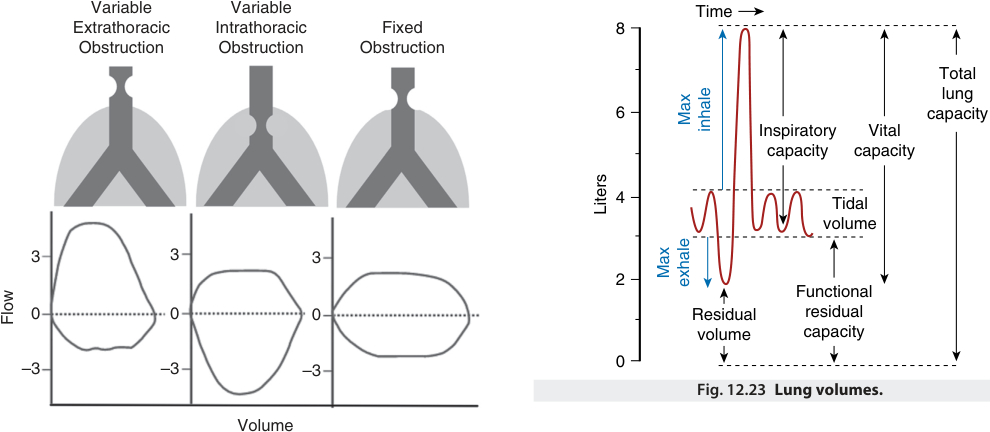

Variable Variable Time Extrathoracic Intrathoracic Fixed 8 Obstruction Obstruction Obstruction Total lung 6 capacity Inspiratory Vital capacity capacity 4 Tidal volume 3 3 3 2 Functional 0 0 0 Residual residual volume capacity 0 –3 –3 –3 Fig. 12.23 Lung volumes. Volume Max inhale Liters Max exhale Flow 

**Fig. 12.22 Typical flow–volume loops of lesions causing variable or fixed, intrathoracic and extrathoracic obstruction of the airways.**

of CO for hemoglobin, the partial pressure of dissolved CO in the blood remains very low, and so CO transfer is not limited by pulmonary blood flow, but only by membrane thickness. DLCO is reduced in patients with interstitial lung diseases and emphysema. Values of DLCO below 60% of predicted have been associated with increased risk of postoperative pulmonary complications, and an indication for further preoperative risk assessment using exercise testing.97,98

### CARDIOPULMONARY EXERCISE TESTING

Cardiopulmonary exercise testing (CPET) is an integrated and dynamic test which evaluates patients’ functional capacity and characterizes the contribution of the respiratory, cardiovascular, and musculoskeletal system in its limitation. CPET involves a brief incremental exercise using a treadmill or a bike, with continuous monitoring of electrocardiogram, pulse oximetry, respiratory rate, exhaled gases, airflow, and volume. The maximum oxygen consumption (VO2max), that is the value of VO2 reached at maximum tolerated exercise, is a broad indicator of cardiorespiratory functional capacity, and VO2max values below 15 mL/kg/ min have been associated with increased risk for postoperative pulmonary complications. The anaerobic threshold

<!-- PDF page 20 -->

(AT), that is the value of VO2 above which VCO2 increases disproportionately to VO2 due to increasing anaerobic metabolism, is a widely used measure of submaximal or sustainable exercise capacity. In the preoperative setting, AT values below 10 mL/kg/min have been associated with increased risk for postoperative complications. Finally, the ratio of minute ventilation (VE) to VCO2, which is a measure of the efficiency of gas exchange and reflects ventilation– perfusion matching and dead space, has been shown to predict more accurately than VO2max the risk of postoperative pulmonary complications, and a threshold of VE/VCO2 >35 is used to identify high-risk patients.99,100

## Effect of Anesthesia on Respiratory Physiology

### LUNG VOLUME AND RESPIRATORY MECHANICS DURING ANESTHESIA

Anesthesia impairs pulmonary function, whether the patient is breathing spontaneously or is receiving mechanical ventilation. Impaired oxygenation of blood occurs in most subjects who are anesthetized,101 and this is why supplemental O2 (FiO2 usually 0.3–0.5) is almost invariably used. Mild to moderate hypoxemia (SaO2, 85% to 90%) is common and lasts from seconds to minutes; sometimes it is severe, and approximately 20% of patients may suffer from SaO2 less than 81% for up to 5 minutes.102 Indeed, greater than 50% of claims in anesthesia- related deaths relate to hypoxemia during anesthesia.2 Beyond the operating room, the alterations in lung function acquired during anesthesia persist: clinically significant pulmonary complications can be seen in 1% to 2% of patients after minor surgery, and in up to 20% of patients after more major upper abdominal or thoracic surgery.103 Such consequences of anesthesia place prime importance on ascertaining the causes of perioperative respiratory dysfunction and the clinical approaches to treatment.

In this section, we describe the effects of anesthesia and mechanical ventilation on lung function. The arrangement of this section parallels the sequence of events involved in oxygenating the blood and removing CO2. Thus, the first phenomenon that might be seen with anesthesia is loss of muscle tone with a subsequent change in the balance between outward forces (i.e., respiratory muscles) and inward forces (i.e., elastic tissue in the lung) leading to a fall in FRC. This causes or is paralleled by an increase in the elastic behavior of the lung (reduced compliance) and an increase in respiratory resistance. The decrease in FRC affects the patency of lung tissue with the formation of atelectasis (made worse with the use of high concentrations of inspired oxygen) and airway closure. This alters the distribution of ventilation and matching of ventilation and blood flow and impedes oxygenation of blood and removal of CO2.

### Lung Volume

Resting lung volume (i.e., FRC) is reduced by almost 1 L by moving from upright to supine position; induction of anesthesia further decreases the FRC by approximately 0.5 L.104 This reduces the FRC from approximately 3.5 to 2 L, a value close to RV. General anesthesia causes a fall in

FRC (approximately 20%), whether breathing is controlled or spontaneous,70,73 and whether the anesthetic is inhalational or intravenous,105 this is a major contributor to lowered oxygenation (discussed later). Muscle paralysis in the context of general anesthesia does not cause additional reduction in FRC.

The anatomic basis of the FRC reduction is not well understood. A landmark experiment on three volunteers using two- dimensional tomography suggested that a cephalad shift of the diaphragm, induced by anesthesia and paralysis, was responsible.106 Recent studies using CT scanning also suggest cephalad diaphragm shift, as well as a decrease in the transverse chest area.105,107 However, other data suggest little role for the diaphragm, with possible caudal (not cephalad) shift of its anterior aspect.108 Simple CT suggests a cranial displacement, except in severe obstructive lung disease. Although the anatomic components of reduced FRC are debatable, the mechanism appears to be related to loss of respiratory muscle tone. FRC is maintained by a balance of the forces inward (lung recoil) versus forces outward (chest wall recoil, chest wall muscles, diaphragm). For example, maintenance of muscle tone using ketamine as the anesthetic does not reduce FRC.105 Because patients are usually supine, the FRC will already have been reduced, and in elderly patients, this is particularly the case; in this context, the effects of anesthesia are more marked (see Fig. 12.10). As can be seen in the figure, FRC decreases with age if weight does not change.

### Compliance and Airway Resistance During Anesthesia

Static compliance of the total respiratory system (lungs and chest wall) is reduced on average from 95 to 60 mL/cmH2O during anesthesia.109 Most studies of lung compliance during anesthesia indicate a decrease compared with the awake state, and pooled data from several studies suggest that anesthesia is associated with a reduction in mean static compliance from almost 190 to approximately 150 mL/ cmH2O.109 Data on changes in respiratory resistance are less clear. Although most studies suggest that anesthesia increases respiratory resistance, especially during mechanical ventilation,109 no studies have corrected for lung volume and flow rates (both affect resistance considerably), and it is possible that changes in resistance occur merely because of volume (i.e., FRC) loss (Fig. 12.24).

### PHYSIOLOGIC EFFECT OF PEEP

The application of a positive end- expiratory pressure (PEEP) is a cornerstone of positive pressure mechanical ventilation. The application of external PEEP can improve lung ventilation, preventing alveolar and airway collapse.110 In patients with COPD, external PEEP can balance small airway collapse, reducing the work of breathing.111 Despite these benefits, the application of external PEEP increases right atrium pressure, reducing cardiac preload and cardiac output. If this reduction is not balanced by an increase of systemic vascular resistance, a significant reduction of mean arterial pressure may happen. The described effect may be beneficial in patients with cardiogenic pulmonary edema. In patients with volume overload, decreasing venous return will have a dual beneficial effect: the LV may

<!-- PDF page 21 -->

be overdistended and also be working at a less- than- optimal point of the Frank–Starling curve. Decreasing preload, the left ventricle will work on a more optimal point of the Frank– Starling curve, increasing cardiac output and improving pulmonary edema.112 At the same time, decreased venous return means less blood pumped by the right ventricle and less pulmonary edema being generated. The decision to apply external PEEP must consider the complex effects of

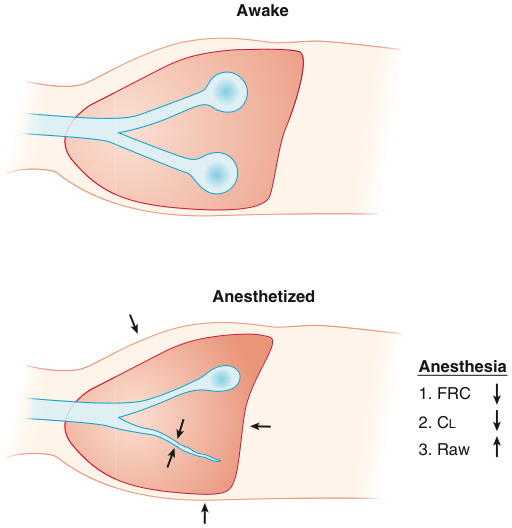

Awake Anesthetized Anesthesia 1. FRC 2. CL 3. Raw 

**Fig. 12.24 Anesthesia induces cranial shift of the diaphragm and a decrease of transverse diameter of the thorax.** These effects contribute to a lowered functional residual capacity (FRC). The decreased ventilated volume (atelectasis and airway closure) can contribute to reduced compliance (CL). Decreased airway dimensions by the lowered FRC can contribute to increased airway resistance (Raw).

increased intrathoracic pressure on respiratory and cardiovascular physiology, balancing the potential advantage and drawbacks of this ventilatory therapeutic option.

### EFFECTS OF ANESTHESIA ON VENTILATION– PERFUSION AND GAS EXCHANGE

### Distribution of Ventilation

Redistribution of inspired gas away from dependent to nondependent lung regions has been demonstrated, using isotope techniques in anesthetized supine humans. Radiolabeled aerosol and SPECT demonstrate that ventilation is distributed mainly to the upper lung regions, with a successive decrease toward the lower lung regions, and an absence of ventilation in the lowermost regions, a finding consistent with the atelectasis demonstrable using CT (Fig. 12.25).113

### Distribution of Lung Blood Flow

The distribution of lung blood flow has been studied by injection of radioactively labeled macroaggregated albumin and SPECT.114 During anesthesia, a successive increase in perfusion occurs from upper toward lower regions, with a slight drop in perfusion in the lowermost portion of the lung, which is atelectatic on simultaneous CT (see Fig. 12.25). PEEP will impede venous return to the right heart and reduce cardiac output. It can also affect pulmonary vascular resistance, although this would have little effect on cardiac output. In addition, PEEP redistributes blood flow toward dependent lung regions,21,115 reducing flow (and increasing dead space) in the upper lung; the increased dependent flow may increase shunt through atelectatic lung.116

### Carbon Dioxide Elimination

Anesthesia impairs CO2 elimination and oxygenation of blood. The explanation for reduced CO2 elimination is reduced minute ventilation (V E) because of respiratory depression, or where this is preserved, because of an

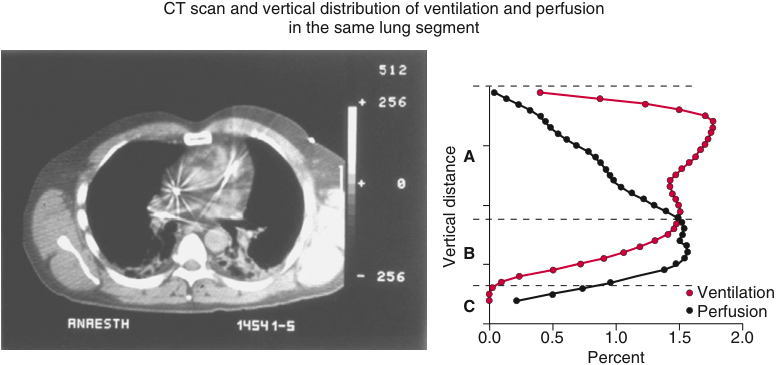

CT scan and vertical distribution of ventilation and perfusion in the same lung segment A B Ventilation C Perfusion 0.0 0.5 1.0 1.5 2.0 Percent Vertical distance 

**Fig. 12.25 Atelectasis and distribution of ventilation and blood flow.** The _left panel_ is a cross- sectional slice of a computed tomographic image of the chest of an anesthetized patient, illustrating atelectasis in the basal (dorsal) regions. The _right panel_ illustrates the distribution of ventilation and perfusion throughout that slice. The bulk of the ventilation is to the upper lung region (zone _A_ ), in contrast to the awake subject without atelectasis, and it exceeds the level of local perfusion; this results in wasted ventilation (i.e., dead space) in the upper regions. In the lower region (zone _B_ ), the ventilation is less (probably because of intermittent airway closure) and is exceeded by the local perfusion, resulting in areas of low V˙ A/Q˙ , causing hypoxemia. In the next lowest region (zone _C_ ), there is complete cessation of ventilation because of atelectasis, but some perfusion exists and causes a shunt. The farther from the top of the lung, the higher the perfusion; however, in the lowermost regions perfusion decreases (see text). (Data from Hedenstierna G. Alveolar collapse and closure of airways: regular effects of anaesthesia. _Clin Physiol Funct Imaging._ 2003;23:123–129.)

<!-- PDF page 22 -->

increase in the VD/VT. Single- breath washout recordings demonstrate that “anatomic” dead space is unchanged, indicating that increased VD/VT is alveolar and confirmed . . by MIGET scan (Fig. 12.26).50 Such high VA/Q can be explained by the perfusion of small corner vessels in interalveolar septa in the upper lung regions, where alveolar pressure can exceed pulmonary vascular pressure (zone I).102 The impaired CO2 elimination is most easily corrected by increasing the ventilation and is seldom a problem in routine anesthesia with mechanical ventilation.

### Oxygen

The impairment in arterial oxygenation during anesthesia is more marked with increased age, obesity, and smoking.117,118 In young healthy volunteers during anesthesia with thiopental and methoxyflurane, both ventilation and . . perfusion were distributed to wider ranges of VA/Q ratios, which can be expressed as an increase in the logarithmic standard deviation of the perfusion distribution (logSD . Q). In a similar group of patients studied during halothane . anesthesia and muscle paralysis, logSD Q was almost doubled (0.43 awake, 0.80 during anesthesia). In addition, true shunt was increased to a mean of 8%. A similar increase in shunt from 1% awake to a mean of 9% during anesthesia was recorded in a study on middle- aged (37 to 64 years) surgical patients, and there was a widening of the . distribution (logSD Q: 0.47 awake, 1.01 during anesthesia). In older patients with more severe impairment of lung function, halothane anesthesia with muscle paralysis, with or without nitrous oxide, caused considerable widening of . . . the VA/Q distribution (logSD Q: 0.87 awake, 1.73 during anesthesia). In addition, shunt increased to a mean of 15%, with large variation among patients (0% to 30%). Thus the most consistent findings during anesthesia are an increased . . . VA/Q mismatch, expressed as an increased logSD Q, and an increase in shunt.119

Spontaneous ventilation is frequently reduced during anesthesia because inhaled anesthetics120 or barbiturates121 reduce sensitivity to CO2. The response is dose- dependent, and ventilation decreases with deepening anesthesia. Anesthesia also reduces the response to hypoxia, possibly because of effects on the carotid body chemoreceptors.122

The effects of anesthesia on respiratory muscle function are becoming better understood.123 The effects are not uniform. Rib cage excursions diminish with deepening anesthesia.124 The predominant ventilatory response to CO2 is produced by the intercostal muscles,125,126 but with no clear increase in rib cage motion with CO2 rebreathing during halothane anesthesia. Thus, the reduced ventilatory response to CO2 during anesthesia is due to impeded function of the intercostal muscles.

## Mechanical Ventilation During Anesthesia

### PROTECTIVE MECHANICAL VENTILATION

During the last few years, a concept of “protective ventilation” has appeared, based on three tools of ventilator support: (1) low tidal volume (assumed to reduce stress and

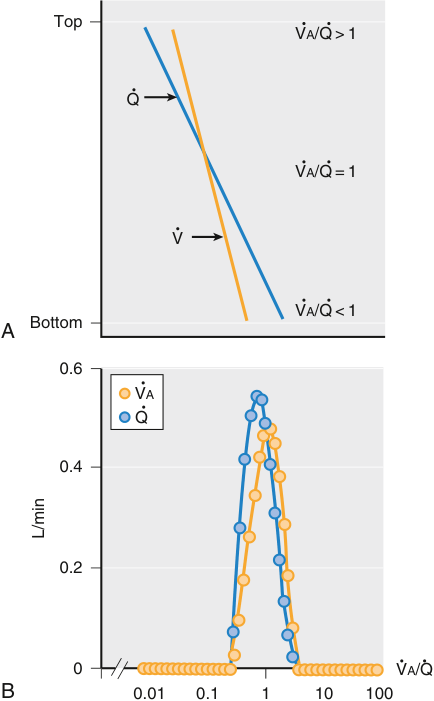

Top VA/Q > 1 Q VA/Q = 1 V VA/Q &lt; 1 Bottom A 0.6 VA Q 0.4 0.2 0 VA/Q B 0.01 0.1 1 10 100 L/min 

**Fig. 12.26** A schematic drawing of (A) the vertical distributions of ventilation (V˙ A) and blood flow through the lung (Q ) and (B) the resulting ventilation–perfusion distribution (V˙ A/Q˙ ). The V˙ A/Q˙ distribution is centered at a ratio of 1, corresponding to the intersection of the ventilation and perfusion distribution curves. The slightly larger ventilation than perfusion in upper lung regions contributes to the high V˙ A/Q˙ ratios greater than 1, whereas the larger perfusion than ventilation in the lower part of the lung is the cause of the lower V˙ A/Q˙ ratios, less than 1. Although there is a moderate increase in ventilation down the lung, the increase in perfusion is greater.

strain of the lung); (2) recruitment maneuver (assumed to reopen any collapsed alveoli); and (3) PEEP (assumed to keep a recruited lung open during ongoing anesthesia and surgery).120 These three tools have been adopted from intensive care, and one may ask whether they are equally useful in the mechanically ventilated, essentially lung healthy, anesthetized patient. As for (1) low tidal volume, a small tidal volume is reasonable, and a volume of 6 to 8 mL/ kg/body weight, as is generally suggested, is the same size of what a normal subject is breathing spontaneously when awake. As for (2) recruitment maneuver and (3) PEEP, opening and keeping the lung open is also reasonable and even important. Both a recruitment maneuver and PEEP will achieve this.

“Protective ventilation” has been claimed to reduce postoperative lung complications, although results vary between studies,120,127 and which tool may be the most important remains also to be shown. Moreover, the protective ventilation concept covers the period from induction to emergence from anesthesia, and whether any positive effects remain in the postoperative period is unknown.128

<!-- PDF page 23 -->

The atelectasis that develops intraoperatively may last for some days after surgery129 and may be a cause of postoperative pulmonary complications. Further refinement of ventilatory support strategy may therefore rather be focused on the emergence from anesthesia and the postoperative period.

### ONE-LUNG VENTILATION

Oxygenation can be a challenge during one- lung surgery. One lung is not ventilated but is still perfused, and in the postoperative period, restoration of lung integrity and ventilation–perfusion matching can take time.130

The technique of one- lung anesthesia and ventilation means that only one lung is ventilated and that the lung provides oxygenation of—and elimination of CO2 from— the blood. Persisting perfusion through the nonventilated lung causes a shunt and decreases PaO2 (Fig. 12.27); measures can be taken to reduce this blood flow.131,132

During one- lung anesthesia, there are two main contributors to impaired oxygenation: (1) the persisting blood flow through nonventilated lung and (2) development of atelectasis in the dependent lung, resulting in local shunt . . and low VA/Q.133 A recruitment maneuver can identify the influence of the dependent atelectasis134 ; serial increases in peak airway pressure and PEEP directed to the dependent, ventilated lung increased significantly the PaO2, indicating that dependent atelectasis was an important cause of hypoxemia. In this situation, diversion of perfusion from the dependent (ventilated) to the nondependent (i.e., nonventilated) lung would have worsened oxygenation.

Recruitment can also affect VD. Recruitment during onelung anesthesia improved oxygenation, but also decreased VD.135 The slope of the CO2 curve during a tidal expiration (phase III) was flatter, indicating a more even distribution of inspired gas throughout the lung and more synchronous alveolar emptying. Thus, a secondary effect of recruiting collapsed lung tissue can be (presumably not when recruitment causes overinflation) more even distribution of ventilation and a decrease in the dead space fraction. This

effect should facilitate the use of a smaller VT. In contrast to an individual recruitment, the application of continuous elevated PAW (PEEP titrated to optimal compliance in the ventilated lung) increased compliance by 10% but slightly worsened oxygenation, probably because of redistribution of blood from the ventilated to the nonventilated (nondependent) lung.136 The rationale for identifying and using optimal PEEP has also been reviewed.137

Maneuvers can also be applied to the nondependent lung. The effects of compressing the nondependent lung on oxygenation were examined using an intra- arterial O2 sensor, which provides instantaneous and continuous PaO2.138 Compression resulted in increased PaO2, suggesting a shift of blood flow from the nondependent (nonventilated) to the dependent (ventilated) lung; development of complete absorption atelectasis in the nondependent lung may have similar effects.139

Inhaled NO (pulmonary vasodilator) and intravenous almitrine (pulmonary vasoconstrictor) have been studied alone and in combination. NO alone has little effect,140 but oxygenation is improved when NO is combined with almitrine.141,142 Almitrine alone also improves oxygenation143 at a dose that does not alter PPA or cardiac output. Although inhaled NO increases perfusion to already ventilated regions . . (increasing VA/Q), almitrine potentiates HPV, decreasing perfusion to nonventilated (i.e., shunt) areas (reducing shunt) and potentially diverting blood flow to ventilated regions of the lung. Selective pulmonary vasodilation is reviewed.144,145 Careful analysis of the mechanical obstruction caused by kinking of pulmonary vessels and by HPV has shown that HPV is the important determinant of diversion of blood flow away from nonventilated lung (though not complete).146 Moreover, positioning of the patient can affect the degree of shunting.147

### PNEUMOPERITONEUM

Laparoscopic operations are usually performed by insufflation of CO2 into the abdominal cavity. The effects are twofold. First, the consequences of hypercapnic acidosis148,149

### Two-lung ventilation

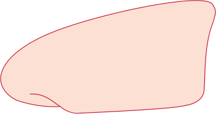

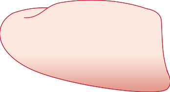

**One-lung ventilation**

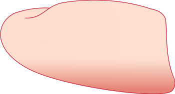

**Fig. 12.27** Schematic drawing of the distribution of shunt during two- lung ventilation and one- lung ventilation during anesthesia. Shunt region is indicated by dark area in the lower lung during two- lung ventilation and in the lower lung—plus the entire upper lung—during one- lung ventilation.

<!-- PDF page 24 -->

include depressed cardiac contractility, sensitization of the myocardium to the arrhythmogenic effects of catecholamines, pulmonary vasoconstriction, and systemic vasodilation.150 There can also be long- lasting postoperative effects on breathing control.151 In addition, the physical effects of pneumoperitoneum are important. These include decreased FRC and vital capacity (VC),152 formation of atelectasis,153 reduced respiratory compliance,154 and increased peak airway pressure.155 Nonetheless, shunt is reduced and arterial oxygenation is mostly improved during CO2 pneumoperitoneum.156 This paradox—more atelectasis and less shunt—suggests that efficient redistribution of blood flow away from collapsed lung regions is attributable to hypercapnic acidosis CO2 potentiating hypoxic pulmonary vasoconstriction. Indeed, a recent experimental study showed that if the abdomen was inflated with air, a much larger shunt developed than if CO2 had been used for inflation.157

## Postoperative Respiratory Complications

### MECHANISMS OF POSTOPERATIVE ATELECTASIS

The development of intraoperative atelectasis is as a cause of impaired oxygenation and reduced respiratory compliance during anesthesia.158 This phenomenon causes a progressive decrease in compliance that paralleled decreases in oxygenation in both anesthetized humans and experimental animals, which was interpreted as progressive of atelectasis. However, others noticed an abrupt decrease in compliance and PaO2 during induction of anesthesia, and yet atelectasis could not be shown on conventional chest radiography.

Since then, CT scanning has improved our knowledge of the nature of anesthesia- induced atelectasis, and the technique reveals prompt development of densities in the dependent regions of both lungs during anesthesia (data up to 1990 reviewed by Moller and associates).102,159 Morphologic studies of these densities in various animals supported the diagnosis of atelectasis. An example of atelectasis as seen on a CT scan is shown in Fig. 12.28.

Atelectasis develops in approximately 90% of patients who are anesthetized, but it is unrelated to the choice of anesthesia.160 It is seen during spontaneous breathing and after muscle paralysis, and with either intravenous or inhaled anesthetics.105 The atelectatic area near the diaphragm is usually 5% to 6% of the total lung area but can easily exceed 20%. The amount of lung tissue that is collapsed is larger, because the atelectatic area consists mostly of lung tissue, whereas normal aerated lung consists of 20% to 40% tissue (the rest being air). Thus, 15% to 20% of the lung is atelectatic during uneventful anesthesia, before surgery has commenced; it decreases toward the apex, which usually remains aerated (Fig. 12.29). However, this degree of atelectasis is larger (upward of 50% of lung volume) after thoracic surgery or cardiopulmonary bypass and can last for several hours.161 Abdominal surgery adds little to the atelectasis, but after such surgery, it can persist for several days.129

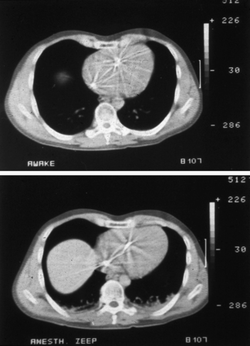

**Fig. 12.28** Computed tomography with transverse exposures of the chest when the subject is awake _(upper panel)_ and anesthetized _(lower panel)_ . In the awake condition, the lung is well aerated (radiations from a pulmonary artery catheter are seen in the heart). During anesthesia, atelectasis has developed in the dependent regions _(gray/white irregular areas)_ . The large gray/white area in the middle of the right lung field is caused by a cranial shift of the diaphragm and the underlying liver.

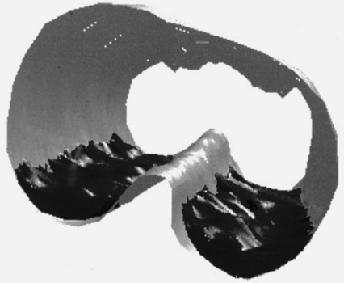

**Fig. 12.29** A three- dimensional reconstruction of the thorax of an anesthetized patient with atelectasis in the dependent regions of both lungs. There is a slight decrease in the degree of atelectasis toward the apex (distal in this image). (Data from Reber A, Nylund U, Hedenstierna G. Position and shape of the diaphragm: implications for atelectasis formation. _Anaesthesia._ 1998;53:1054–1061.)

Atelectasis is an important cause of hypoxemia: there is a strong and significant correlation between the degree of atelectasis and the size of the pulmonary shunt ( _R_ = 0.81), where atelectasis is expressed as the percentage of lung area just above the diaphragm on CT scan and shunt is expressed as the percentage of cardiac output using the multiple

<!-- PDF page 25 -->

inert gas elimination technique (MIGET).160 The site of the increased shunt has been co- localized to the areas of atelectasis, using a technique that combines CT scanning and single-photon emission computed tomography (SPECT; see Fig. 12.25).114 In addition to shunt, atelectasis may form a focus of infection and can certainly contribute to pulmonary complications.113

Aside from anesthesia (and the type of surgery), it is difficult to predict the development of atelectasis. The magnitude of atelectasis is often directly related to the body mass index (BMI) and inspired oxygen concentration.70,105 Moreover, neither age159 nor the presence of COPD160 predicts the development or extent of atelectasis. In COPD, it may be that airway closure precedes (and therefore prevents) alveolar closure. Alternatively, the greater loss of lung (elastic recoil) versus chest wall tissue may serve to protect against atelectasis.

### MANAGEMENT AND PREVENTION OF PERIOPERATIVE ATELECTASIS

Several interventions can help prevent atelectasis159 or even reopen collapsed tissue, as discussed in the following sections.

### Positive End- Expiratory Pressure

The application of PEEP (10 cmH2O) has been repeatedly demonstrated to re- expand atelectasis in part (Fig. 12.30). Some atelectasis may persist and might require higher PEEP and inspiratory airway pressure.105 The application of larger levels of PEEP can have complex effects. Reversal of hypoxemia is not proportionally associated with applied PEEP, and a threshold exists in many cases. In addition, SaO2 may decrease during the application of increased PEEP for two reasons. First, the increased PPL owing to the

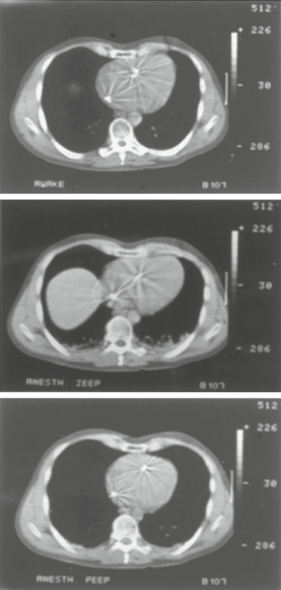

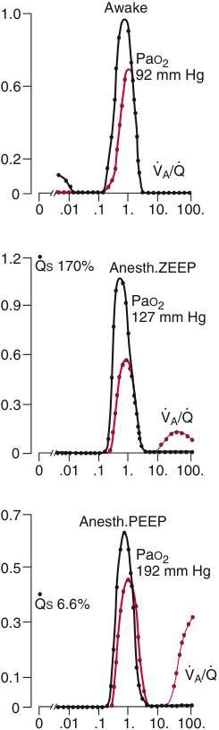

Awake 1.0 PaO2 92 mm Hg 0.6 0.2 · · VA/Q 0 0 .01 .1 1. 10. 100. 1.2 QS 170% Anesth.ZEEP 0.9 PaO2 127 mm Hg 0.6 0.3 · · VA/Q 0 0 .01 .1 1. 10. 100. 0.7 Anesth.PEEP PaO2 0.5 192 mm Hg QS 6.6% 0.3 0.1 V· A/Q· 0 0 .01 .1 1. 10. 100. 

**Fig. 12.30** Computed tomographic (CT) scans and V˙ A/Q˙ distributions in the lung of a healthy, awake subject during anesthesia (zero positive endexpiratory pressure [ZEEP]) and during anesthesia (10 cmH2O positive end- expiratory pressure [PEEP]). In the awake state, there is no atelectasis and the corresponding minor low V˙ A/Q˙ distribution ( _left side_ of plot) may reflect intermittent airway closure. During anesthesia with ZEEP, atelectasis is apparent in the lung bases (and the diaphragm has been pushed cranially). The low V˙ A/Q˙ has been replaced by atelectasis and large shunt; in addition, a small “high” V˙ A/Q˙ mode ( _right side_ of plot) may reflect alveolar dead space in upper lung regions. With the addition of PEEP during anesthesia, the collapsed lung tissue has been recruited and the shunt has been reduced considerably. Moreover, the “high” V˙ A/Q˙ mode ( _right side_ of plot) has significantly increased; this may reflect additional inflation of nonperfused upper lung.

<!-- PDF page 26 -->

PEEP can impair venous return, especially in the presence of hypovolemia, lowering the cardiac output and oxygen delivery (DO2) and thereby reducing mixed venous O2 content (CVO2). In the presence of an intrapulmonary shunt, such as with atelectasis, the mixed venous blood is shunted directly into pulmonary venous blood, causing arterial desaturation. Second, increased PEEP can cause redistribution of blood flow away from the aerated, expanded regions (distended by PEEP) toward atelectatic areas (not distended by PEEP; Fig. 12.31).116 In this context, persisting atelectasis in a dependent lung receives a larger proportion of the total pulmonary blood flow than without PEEP.22 Finally, anesthesia- induced atelectasis rapidly re- emerges after discontinuation of PEEP.105 Indeed, Hewlett and coworkers162 in 1974 cautioned against the “indiscriminate use of PEEP in routine anesthesia.”

To avoid negative circulatory effects, the magnitude of PEEP should just be enough to open up a collapsed lung. A PEEP of 7 cmH2O in normal- weight patients (BMI &lt;25 kg/ m2 ) without cardiopulmonary disease will recruit most of the lung, and keep it open with better oxygenation than in a comparable group without PEEP.163 Thus a forceful dedicated recruit maneuver should not be needed. This effect was seen in nonabdominal surgery, and whether similar beneficial effect will be seen in abdominal surgery remains to be shown.

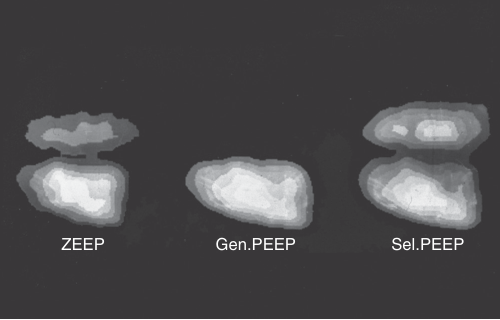

ZEEP Gen.PEEP Sel.PEEP 

**Fig. 12.31 Gamma camera images of lung blood flow in an anesthetized subject in the lateral position.** During mechanical ventilation with zero end- expiratory pressure (ZEEP), perfusion is predominantly (60%–70% of cardiac output) to the lower lung. Applying PEEP (10 cmH2O) to both lungs forces more perfusion to the lower lung, leaving almost no perfusion to the upper lung (i.e., major increase in VD). In contrast, selective application of PEEP to the lower lung causes redistribution of perfusion to the upper lung. Of course, the image presented is perfused tissue (not total anatomic lung tissue; in the right lateral position the upper- right lung would be larger). _PEEP_ , positive end- expiratory pressure. (From Hedenstierna G, Baehrendtz S, Klingstedt C, et al. Ventilation and perfusion of each lung during differential ventilation with selective PEEP. _Anesthesiology._ 1984;61:369–376.)

### Recruitment Maneuvers

A sigh maneuver, or a large VT, has been suggested for reversing atelectasis50 ; however, atelectasis is not uniformly reduced by a VT increase or sigh up to PAW of 20 cmH2O.70 Instead, a PAW of 30 cmH2O is required for initial opening, and 40 cmH2O for more complete reversal (Fig. 12.32). In the presence of normal lungs, such inflation is equivalent to a VC and can therefore be called a _VC maneuver_ (albeit achieved with positive PAW). In addition, a significant hemodynamic effect is likely if the VC maneuver is sustained; in fact, inflation with a PAW of 40 cmH2O for 7 to 8 seconds appears to successfully open almost all anesthesia- induced atelectasis.70

### Minimizing Gas Resorption

Although recruitment of anesthesia- induced atelectasis is completely possible with either PEEP or a VC maneuver, continuous application of some level of PEEP is required to prevent rapid recurrence of the atelectasis.164 However, nitrogen (N2)—an insoluble gas that is not absorbed into the blood—can “splint” the alveolus if the alveolus is already opened. As a result, in anesthetized patients, a VC maneuver followed by ventilation with a gas mixture containing 60% N2 (40% O2) reduced the propensity for reaccumulation of atelectasis, with only 20% reappearing 40 minutes after recruitment.165

The same principles apply in the practice of preoxygenation of patients during induction of anesthesia. Here, the aim is to prevent O2 desaturation (i.e., gain an O2 safety margin) during induction before the airway has been secured when the anesthesiologist can better manage ventilation and oxygenation. Traditionally, the application of FiO2 1.0 has been used. Although the SaO2 is usually well maintained with this approach, atelectasis inevitably forms. The use of 30% versus 100% O2 during induction was demonstrated in a clinical study to eliminate the formation of

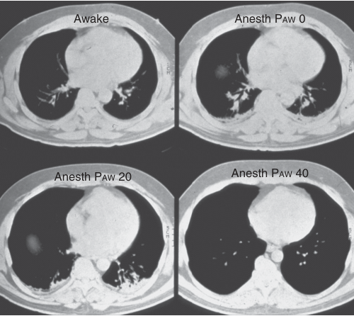

Awake Anesth PAW 0 Anesth PAW 20 Anesth PAW 40 

**Fig. 12.32 Computed tomographic (CT) scans during awake and anesthetized states with altered airway pressure (PAW).** The CT scan in the awake subject _(upper left panel)_ shows normal vasculature and no atelectasis. During anesthesia (PAW, 0 cmH2O; _upper right panel_ ), bilateral basal atelectasis is seen; the PAW is increased in increments (20 cmH2O shown), but the atelectasis is not reversed until a PAW of 40 cmH2O is applied ( _lower right panel_ ). Thus a vital capacity maneuver was required to open the lung. (From Rothen HU, Sporre B, Engberg G, et al. Re- expansion of atelectasis during general anaesthesia: a computed tomography study. _Br J Anaesth._ 1993;71:788–795.)

atelectasis.165 Later, a comparison of breathing 100%, 80%, and 60% O2 during induction demonstrated ubiquitous atelectasis with 100%, less with 80%, and even less with 60% O2 (Fig. 12.33); however, the trade- off for less atelectasis was a shorter safety margin before occurrence of O2 desaturation.166

<!-- PDF page 27 -->

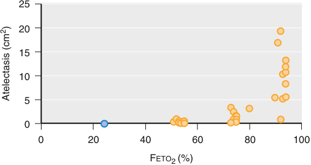

25 20 15 10 5 0 0 20 40 60 80 100 FETO2 (%) 2Atelectasis (cm) 

**Fig. 12.33 Atelectasis formation in anesthetized subjects following preoxygenation with different inspired oxygen concentrations.** Increasing the fraction of inspired oxygen (FiO2) during preoxygenation increases the propensity to subsequent atelectasis _(closed symbols)_ , although there is much variability. The _blue circle_ at around an expired oxygen concentration (FeTO2) of 25% represents data from anesthesia being induced while breathing 30% O2. _F_ eTO _2_ , expiratory oxygen fraction. (From Rothen HU, Sporre B, Engberg G, et al. Prevention of atelectasis during general anaesthesia. _Lancet._ 1995;345:1387–1391.)

An alternative approach may be continuous positive airway pressure (CPAP). Application of CPAP 10 cmH2O permitted the use of 100% inspired O2 without formation of significant degrees of atelectasis.167 This might provide an ideal combination of minimal risk of either O2 desaturation or atelectasis, but it has not been repeatedly verified.

### Maintenance of Muscle Tone

Because loss of muscle tone in the diaphragm or chest wall appears to increase the risk of atelectasis, techniques that preserve muscle tone may have advantages. Intravenous ketamine does not impair muscle tone and is the only individual anesthetic that does not cause atelectasis. If neuromuscular blockade is added, atelectasis occurs as with other anesthetics.106 Ketamine is an extremely useful anesthetic in special circumstances but has challenges with widespread use.

An experimental approach is restoration of respiratory muscle tone by diaphragm pacing. This approach is achieved with phrenic nerve stimulation, and it can modestly reduce the degree of atelectasis; however, the effect is minor, and the approach is complicated.168

16.  Barnes PJCR. _The Lung: Scientific Foundations_ . 2nd ed. Philadelphia: Lippincott- Raven; 1997.

17.  Bachofen H, et al. _Am Rev Respir Dis_ . 1993;147(4):997.

18.  Jeffery PK. _Proc Am Thorac Soc_ . 2004;1(3):176.

19.  Townsley MI, et al. _Circ Res_ . 1995;77(2):317.

20.  Kornecki A, et al. _Anesthesiology_ . 2008;108(6):1047.

21.  West JB, et al. _J Appl Physiol_ . 1964;19:713.

22.  Hughes JM, et al. _Respir Physiol_ . 1968;4(1):58.

23.  Michels DB, et al. _J Appl Physiol_ . 1978;45(6):987.

24.  Verbandt Y, et al. _J Appl Physiol Bethesda Md 1985_ . 2000;89(6):2407.

25.  Reed JH, et al. _J Appl Physiol_ . 1970;28(3):303.

26.  Glenny RW, et al. _J Appl Physiol Bethesda Md 1985_ . 1991;71(2):620.

27.  Glenny RW, et al. _J Appl Physiol Bethesda Md 1985_ . 1999;86(2):623.

28.  Hakim TS, et al. _J Appl Physiol Bethesda Md 1985_ . 1987;63(3):1114.

29.  Hedenstierna G, et al. _J Appl Physiol_ . 1979;47(5):938.

30.  Hlastala MP, et al. _J Appl Physiol Bethesda Md 1985_ . 1996;81(3):1051.

31.  Glenny RW, et al. _J Appl Physiol Bethesda Md 1985_ . 1991;70(3):1024.

32.  Glenny R. _J Appl Physiol Bethesda Md 1985_ . 2008;104(5):1540.

33.  Sylvester JT, et al. _Physiol Rev_ . 2012;92(1):367.

34.  Marshall BE, et al. _Intensive Care Med_ . 1994;20(5):379.

35.  Moudgil R, et al. _J Appl Physiol Bethesda Md 1985_ . 2005;98(1):390.

36.  Kerbaul F, et al. _Br J Anaesth_ . 2000;85(3):440.

37.  Kerbaul F, et al. _Can J Anaesth_ . 2001;48(8):760.

38.  Hambraeus- Jonzon K, et al. _Anesthesiology_ . 1997;86(2):308.

39.  Sartori C, et al. _Respir Physiol Neurobiol_ . 2007;159(3):338.

40.  Lai YC, et al. _Circ Res_ . 2014;115(1):115.

41.  Galiè N, et al. _N Engl J Med_ . 2005;353(20):2148.

42.  Suresh K, et al. _Compr Physiol_ . 2016;6(2):897.

43.  Bohr C, et al. _Skand Arch Physiol_ . 1904;16:401.

44.  Caboot JB, et al. _Pediatr Pulmonol_ . 2012;47(8):808.

45.  Shamir MY, et al. _Anesth Analg_ . 2012;114(5):972.

46.  Hampson NB, et al. _Am J Respir Crit Care Med_ . 2012;186(11):1095.

47.  Barratt- Boyes BG, et al. _J Lab Clin Med_ . 1957;50(1):93.

48.  Chawla LS, et al. _Chest_ . 2004;126(6):1891.

49.  Reid M. _Nurs Crit Care_ . 2013;18(5):245.

50.  Nunn JF LA. _Nunn’s Applied Respiratory Physiology_ . 7th ed. Churchill Livingstone Elsevier; 2010.

51.  Jensen FB. _Acta Physiol Scand_ . 2004;182(3):215.

52.  Hanson CW, et al. _Crit Care Med_ . 1996;24(1):23.

53.  Goldin JG. _Radiol Clin North Am_ . 2002;40(1):145.

54.  Van Lith P, et al. _J Appl Physiol_ . 1967;23(4):475.

55.  Slats AM, et al. _Am J Respir Crit Care Med_ . 2007;176(2):121.

56.  Holst M, et al. _Intensive Care Med_ . 1990;16(6):384.

57.  Grosz AH, et al. _Laryngoscope_ . 2001;111(9):1512.

58.  Tan TQ, et al. _J La State Med Soc Off Organ La State Med Soc_ . 1990;142(6):49.

59.  O’Donnell DE, et al. _Am Rev Respir Dis_ . 1987;135(4):912.

60.  Calverley PMA, et al. _Eur Respir J_ . 2005;25(1):186.

61.  Mead J, et al. _J Appl Physiol_ . 1967;22(1):95.

62.  Bachofen H. _J Appl Physiol_ . 1968;24(3):296.

63.  Kaczka DW, et al. _J Appl Physiol Bethesda Md 1985_ . 1997;82(5):1531.

64.  Verbeken EK, et al. _J Appl Physiol Bethesda Md 1985_ . 1992;72(6):2343.

65.  Bachofen H, et al. _J Clin Invest_ . 1967;46(1):133.

### Complete references available online at expertconsult.com.

66.  Tantucci C, et al. _Am Rev Respir Dis_ . 1992;145(2 Pt 1):355.

67.  Frostell C, et al. _J Appl Physiol_ . 1983;55(6):1854.

68.  Roca J, et al. _Respir Med_ . 1998;92(3):454.

### References

1.  von Ungern- Sternberg BS, et al. _Lancet Lond Engl_ . 2010;376 (9743):773.

2.  Cook TM, et al. _Anaesthesia_ . 2010;65(6):556.

3.  Cheney FW, et al. _Anesthesiology_ . 1991;75(6):932.

4.  Woods BD, et al. _Br J Anaesth_ . 2009;103(suppl 1):i57.

5.  Pinsky MR. _Curr Opin Crit Care_ . 2007;13(5):528.

6.  Buhre W, et al. _Lancet Lond Engl_ . 2003;362(9398):1839.

7.  Moonesinghe SR, et al. _Anesth Analg_ . 2011;112(4):891.

8.  Hennis PJ, et al. _Br J Anaesth_ . 2012;109(4):566.

9.  Poeze M, et al. _Intensive Care Med_ . 2000;26(9):1272.

10.  Quanjer PH, et al. _Eur Respir J Suppl_ . 1993;16:5.

11.  Aström E, et al. _Eur Respir J_ . 2000;16(4):659.

12.  Broughton SJ, et al. _Physiol Meas_ . 2006;27(2):99.

13.  Wilschut FA, et al. _Eur Respir J_ . 1999;14(1):166.

14.  Haefeli- Bleuer B, et al. _Anat Rec_ . 1988;220(4):401.

15.  Wagner PD. _J Appl Physiol Bethesda Md 1985_ . 1995;79(2):380.

69.  Milic- Emili J, et al. _Eur J Appl Physiol_ . 2007;99(6):567.

70.  Rothen HU, et al. _Br J Anaesth_ . 1998;81(5):681.

71.  Hedenstierna G. _Clin Physiol Funct Imag_ . 2003;23(3):123.

72.  Dueck R, et al. _Anesthesiology_ . 1988;69(6):854.

73.  Westbrook PR, et al. _J Appl Physiol_ . 1973;34(1):81.

74.  Del Negro CA, et al. _Nat Rev Neurosci_ . 2018;19(6):351.

75.  Richter DW, et al. _Physiol Bethesda Md_ . 2014;29(1):58.

76.  Kam K, et al. _J Neurosci Off J Soc Neurosci_ . 2013;33(22):9235.

77.  Ikeda K, et al. _J Physiol Sci JPS_ . 2017;67(1):45.

78.  Moutlana HJ. _South Afr J Anaesth Analg_ . 2020;26(6):S128.

79.  Duffin J. _Can J Anaesth_ . 1990;37(8):933.

80.  Vaporidi K, et al. _Am J Respir Crit Care Med_ . 2020;201(1):20.

81.  Guyenet PG, et al. _Neuron_ . 2015;87(5):946.

82.  Bender PR, et al. _J Appl Physiol Bethesda Md 1985_ . 1987;62(2):640.

83.  Panneton WM. _Physiol Bethesda Md_ . 2013;28(5):284.

84.  Yu J. _J Appl Physiol Bethesda Md 1985_ . 2016;121(5):1041.

85.  Yu J. _Respir Physiol Neurobiol_ . 2021;287:103595.

86.  Reske AW, et al. _Crit Care Med_ . 2013;41(3):732.

<!-- PDF page 28 -->

87.  Niklason L, et al. _Crit Care Lond Engl_ . 2008;12(2):R53. 88.  Petersson J, et al. _Eur Respir J_ . 2014;44(4):1023.

89.  West JB. _Am Rev Respir Dis_ . 1977;116(5):919.

90.  Henderson AC, et al. _J Appl Physiol Bethesda Md 1985_ . 2013;115(3): 313.

91.  Baumgardner JE, et al. _Curr Opin Anaesthesiol_ . 2016;29(1):2.

92.  Plantier L, et al. _Eur Respir Rev Off J Eur Respir Soc_ . 2018;27(147): 170062.

93.  Zavorsky GS, et al. _Exp Physiol_ . 2003;88(2):191.

94.  Presson RG, et al. _J Appl Physiol Bethesda Md 1985_ . 1995;79(2):382. 95.  West JB. _Compr Physiol_ . 2011;1(3):1541.

96.  Bigatello L, et al. _Anesthesiology_ . 2019;130(6):1064.

97.  Matheos T, et al. _Thorac Surg Clin_ . 2020;30(3):241.

98.  Lakshminarasimhachar A, et al. _Anesthesiol Clin_ . 2016;34(1):71. 99.  Older PO, et al. _Ann Am Thorac Soc_ . 2017;14(suppl 1):S74. 100.  Levett DZH, et al. _Br J Anaesth_ . 2018;120(3):484. 101.  Hedenstierna G. _Thorax_ . 1995;50:85.

102.  Moller JT. _Lancet_ . 1998;351:857.

103.  Kroenke K. _Chest_ . 1993;104:1445.

104.  Wahba RW. _Can J Anaesth_ . 1991;38:384.

105.  Hedenstierna G, Edmark L. _Intensive Care Med_ . 2005;31:1327. 106.  Froese AB, Bryan AC. _Anesthesiology_ . 1974;41:242. 107.  Reber A, et al. _Anaesthesia_ . 1998;53:1054.

108.  Warner DO, et al. _Anesthesiology_ . 1996;85:49.

109.  Don H. _Int Anesth Clin_ . 1977;15:113.

110.  Rossi A, et al. _Am J Respir Crit Care Med_ . 1994;149(5):1077.

111.  Glérant JC, et al. _Respir Physiol Neurobiol_ . 2005;146(2–3):117. 112.  Fellahi JL, et al. _Chest_ . 1998;114(2):556.

113.  van Kaam AH, et al. _Am J Respir Crit Care Med_ . 2004;169(9):1046. 114.  Tokics L. _J Appl Physiol_ . 1996;81:1822.

115.  Hulands GH. _Clin Sci_ . 1970;38:451.

116.  Musch G. _Anesthesiology_ . 2004;100:323.

117.  Pelosi P. _Anesthesiology_ . 1999;91:1221.

118.  Coussa M. _Anesth Analg_ . 2004;981:491.

119.  Gunnarsson L. _Eur Respir J_ . 1991;4:1106.

120.  Futier E, et al. _N Engl J Med_ . 2013;369(5):428.

121.  von Ungern- Sternberg BS, et al. _Br J Anaesth_ . 2007;98(4):503.

122.  Ide T. _Anesthesiology_ . 1999;90:1084.

123.  Sasaki N, et al. _Anesthesiology_ . 2013;118:961.

124.  Morton CP, et al. _Br J Anaesth_ . 1994;73:135.

125.  Warner DO, et al. _J Appl Physiol_ . 1994;76:2802. 126.  Warner DO, et al. _Anesthesiology_ . 1995;82:20. 127.  LAS VEGAS Investigators. _Eur J Anaesthesiol_ . 2017;34(8):492.

128.  Hedenstierna G. _Anesthesiology_ . 2015;123(3):501.

129.  Lindberg P. _Acta Anaesthesiol Scand_ . 1992;36:546.

130.  Benumof JL. _Anesth Analg_ . 1985;64:821.

131.  Karzai W, et al. _Anesthesiology_ . 2009;110:1402.

132.  Hedenstierna G, et al. _Acta Anaesthesiol Scand_ . 1996;40:2.

133.  Klingstedt C, et al. _Acta Anaesthesiol Scand_ . 1990;34:421.

134.  Tusman G. _Ann Thorac Surg_ . 2002;73:1204.

135.  Tusman G, et al. _Anesth Analg_ . 2004;98(6):1604.

136.  Mascotto G. _Eur J Anaesthesiol_ . 2003;20:704.

137.  Slinger PD. _Anesthesiology_ . 2001;95:1096.

138.  Ishikawa S, et al. _Br J Anaesth_ . 2003;90:21.

139.  Pfitzer J. _Br J Anaesth_ . 2003;91(1):153.

140.  Schwarzkopf K, et al. _Anesth Analg_ . 2001;92(4):842.

141.  Moutafis M. _Anesth Analg_ . 1997;85:1130.

142.  Silva- Costa- Gomes T. _Br J Anaesth_ . 2005;95:410.

143.  Moutafis M. _Anesth Analg_ . 2002;94:830.

144.  Dembinski R, et al. _Minerva Anestesiol_ . 2004;70:239.

145.  Schilling T. _Anesth Analg_ . 2005;101:957.

146.  Friedlander M. _Can J Anaesth_ . 1994;41:26.

147.  Choi YS. _J Thorac Cardiovasc Surg_ . 2007;134:613.

148.  McMahon AJ, et al. _Lancet_ . 2000;356:1632.

149.  Neudecker J. _Surg Endosc_ . 2002;16:1121.

150.  Gutt CN, et al. _Dig Surg_ . 2004;21(2):95.

151.  Bablekos GD, et al. _Arch Surg Chic Ill 1960_ . 2006;141(1):16.

152.  Hirvonen EA, et al. _Anesth Analg_ . 1995;80:961.

153.  Andersson L. _Acta Anaesthesiol Scand_ . 2002;46:552.

154.  Makinen MT, et al. _Can J Anaesth_ . 1998;45:865.

155.  Sharma KC. _Chest_ . 1996;110:810.

156.  Andersson LE, et al. _Anesthesiology_ . 2005;102(2):293. 157.  Strang CM. _Minerva Anestesiol_ . 2013;79:6.

158.  Bendixen HH, et al. _N Engl J Med_ . 1963;269:991.

159.  Duggan M, et al. _Anesthesiology_ . 2005;102:838.

160.  Gunnarsson L. _Br J Anaesth_ . 1991;66:423.

161.  Tenling A. _Anesthesiology_ . 1998;89:371.

162.  Hewlett AM. _Br J Anaesth_ . 1974;46:495.

163.  Ostberg E, et al. _Anesthesiology_ . 2018;128(6):1117.

164.  Rothen HU. _Anesthesiology_ . 1995;82:832.

165.  Rothen HU. _Lancet_ . 1995;345:1387.

166.  Edmark L. _Anesthesiology_ . 2003;98:28.

167.  Rusca M. _Anesth Analg_ . 2003;97:1835.

168.  Hedenstierna G, et al. _Anesthesiology_ . 1994;80(4):751.

<!-- PDF page 29 -->

### References

1.  von Ungern- Sternberg BS, Boda K, Chambers NA, et al. Risk assessment for respiratory complications in paediatric anaesthesia: a prospective cohort study. _Lancet Lond Engl_ . 2010;376(9743):773–783.

2.  Cook TM, Scott S, Mihai R. Litigation related to airway and respiratory complications of anaesthesia: an analysis of claims against the NHS in England 1995- 2007. _Anaesthesia_ . 2010;65(6):556–563.

3.  Cheney FW, Posner KL, Caplan RA. Adverse respiratory events infrequently leading to malpractice suits. A closed claims analysis. _Anesthesiology_ . 1991;75(6):932–939.

4.  Woods BD, Sladen RN. Perioperative considerations for the patient with asthma and bronchospasm. _Br J Anaesth_ . 2009;103(suppl 1):i57–65.

5.  Pinsky MR. Heart- lung interactions. _Curr Opin Crit Care_ . 2007;13(5):528–531.

6.  Buhre W, Rossaint R. Perioperative management and monitoring in anaesthesia. _Lancet Lond Engl_ . 2003;362(9398):1839–1846.

7.  Moonesinghe SR, Mythen MG, Grocott MPW. High- risk surgery: epidemiology and outcomes. _Anesth Analg_ . 2011;112(4):891–901.

8.  Hennis PJ, Meale PM, Hurst RA, et al. Cardiopulmonary exercise testing predicts postoperative outcome in patients undergoing gastric bypass surgery. _Br J Anaesth_ . 2012;109(4):566–571.

9.  Poeze M, Takala J, Greve JW, Ramsay G. Pre- operative tonometry is predictive for mortality and morbidity in high- risk surgical patients. _Intensive Care Med_ . 2000;26(9):1272–1281.

10.  Quanjer PH, Tammeling GJ, Cotes JE, et al. Lung volumes and forced ventilatory flows. Report working party standardization of lung function tests, European Community for Steel and Coal. Official statement of the European Respiratory Society. _Eur Respir J Suppl_ . 1993;16:5–40.

11.  Aström E, Niklason L, Drefeldt B, et al. Partitioning of dead space– a method and reference values in the awake human. _Eur Respir J_ . 2000;16(4):659–664.

12.  Broughton SJ, Sylvester KP, Page CM, et al. Problems in the measurement of functional residual capacity. _Physiol Meas_ . 2006;27(2):99– 107.

13.  Wilschut FA, van der Grinten CP, Lamers RJ, et al. Intrapulmonary gas mixing and the sloping alveolar plateau in COPD patients with macroscopic emphysema. _Eur Respir J_ . 1999;14(1):166–171.

14.  Haefeli- Bleuer B, Weibel ER. Morphometry of the human pulmonary acinus. _Anat Rec_ . 1988;220(4):401–414.

15.  Wagner PD. Vascular transit times in the lung. _J Appl Physiol Bethesda Md 1985_ . 1995;79(2):380–381.

16.  Barnes PJCR. _The Lung: Scientific Foundations_ . 2nd ed. Philadelphia: Lippincott- Raven; 1997.

17.  Bachofen H, Schürch S, Weibel ER. Experimental hydrostatic pulmonary edema in rabbit lungs. Barrier lesions. _Am Rev Respir Dis_ . 1993;147(4):997–1004.

18.  Jeffery PK. Remodeling and inflammation of bronchi in asthma and chronic obstructive pulmonary disease. _Proc Am Thorac Soc_ . 2004;1(3):176–183.

19.  Townsley MI, Fu Z, Mathieu- Costello O, West JB. Pulmonary microvascular permeability. Responses to high vascular pressure after induction of pacing- induced heart failure in dogs. _Circ Res_ . 1995;77(2):317–325.

20.  Kornecki A, Engelberts D, McNamara P, et al. Vascular remodeling protects against ventilator- induced lung injury in the in vivo rat. _Anesthesiology_ . 2008;108(6):1047–1054.

21.  West JB, Dollery CT, Naimark A. Distribution of blood flow in isolated lung; relation to vascular and alveolar pressures. _J Appl Physiol_ . 1964;19:713–724.

22.  Hughes JM, Glazier JB, Maloney JE, West JB. Effect of lung volume on the distribution of pulmonary blood flow in man. _Respir Physiol_ . 1968;4(1):58–72.

23.  Michels DB, West JB. Distribution of pulmonary ventilation and perfusion during short periods of weightlessness. _J Appl Physiol_ . 1978;45(6):987–998.

24.  Verbandt Y, Wantier M, Prisk GK, Paiva M. Ventilation- perfusion matching in long- term microgravity. _J Appl Physiol Bethesda Md 1985_ . 2000;89(6):2407–2412.

25.  Reed JH, Wood EH. Effect of body position on vertical distribution of pulmonary blood flow. _J Appl Physiol_ . 1970;28(3):303–311.

26.  Glenny RW, Lamm WJ, Albert RK, Robertson HT. Gravity is a minor determinant of pulmonary blood flow distribution. _J Appl Physiol Bethesda Md 1985_ . 1991;71(2):620–629.

27.  Glenny RW, Bernard S, Robertson HT, Hlastala MP. Gravity is an important but secondary determinant of regional pulmonary blood flow in upright primates. _J Appl Physiol Bethesda Md 1985_ . 1999;86(2):623–632.

28.  Hakim TS, Lisbona R, Dean GW. Gravity- independent inequality in pulmonary blood flow in humans. _J Appl Physiol Bethesda Md 1985_ . 1987;63(3):1114–1121.

29.  Hedenstierna G, White FC, Wagner PD. Spatial distribution of pulmonary blood flow in the dog with PEEP ventilation. _J Appl Physiol_ . 1979;47(5):938–946.

30.  Hlastala MP, Bernard SL, Erickson HH, et al. Pulmonary blood flow distribution in standing horses is not dominated by gravity. _J Appl Physiol Bethesda Md 1985_ . 1996;81(3):1051–1061.

31.  Glenny RW, Robertson HT. Fractal modeling of pulmonary blood flow heterogeneity. _J Appl Physiol Bethesda Md 1985_ . 1991;70(3):1024– 1030.

32.  Glenny R. Last word on Point:Counterpoint: gravity is/is not the major factor determining the distribution of blood flow in the human lung. _J Appl Physiol Bethesda Md 1985_ . 2008;104(5):1540.

33.  Sylvester JT, Shimoda LA, Aaronson PI, Ward JPT. Hypoxic pulmonary vasoconstriction. _Physiol Rev_ . 2012;92(1):367–520.

34.  Marshall BE, Hanson CW, Frasch F, Marshall C. Role of hypoxic pulmonary vasoconstriction in pulmonary gas exchange and blood flow distribution. 2. Pathophysiology. _Intensive Care Med_ . 1994;20(5):379–389.

35.  Moudgil R, Michelakis ED, Archer SL. Hypoxic pulmonary vasoconstriction. _J Appl Physiol Bethesda Md 1985_ . 2005;98(1):390–403.

36.  Kerbaul F, Bellezza M, Guidon C, et al. Effects of sevoflurane on hypoxic pulmonary vasoconstriction in anaesthetized piglets. _Br J Anaesth_ . 2000;85(3):440–445.

37.  Kerbaul F, Guidon C, Stephanazzi J, et al. Sub- MAC concentrations of desflurane do not inhibit hypoxic pulmonary vasoconstriction in anesthetized piglets. _Can J Anaesth_ . 2001;48(8):760–767.

38.  Hambraeus- Jonzon K, Bindslev L, Mellgård AJ, Hedenstierna G. Hypoxic pulmonary vasoconstriction in human lungs. A stimulusresponse study. _Anesthesiology_ . 1997;86(2):308–315.

39.  Sartori C, Allemann Y, Scherrer U. Pathogenesis of pulmonary edema: learning from high- altitude pulmonary edema. _Respir Physiol Neurobiol_ . 2007;159(3):338–349.

40.  Lai YC, Potoka KC, Champion HC, et al. Pulmonary arterial hypertension: the clinical syndrome. _Circ Res_ . 2014;115(1):115–130.

41.  Galiè N, Ghofrani HA, Torbicki A, et al. Sildenafil citrate therapy for pulmonary arterial hypertension. _N Engl J Med_ . 2005;353(20):2148– 2157.

42.  Suresh K, Shimoda LA. Lung circulation. _Compr Physiol_ . 2016;6(2):897–943. https://doi.org/10.1002/cphy.c140049.

43.  Bohr C, Hasselbalch K, Krogh A. Concerning a biologically important relationship – the influence of the carbon dioxide content of blood on its oxygen binding. _Skand Arch Physiol_ . 1904;16:401– 412.

44.  Caboot JB, Jawad AF, McDonough JM, et al. Non- invasive measurements of carboxyhemoglobin and methemoglobin in children with sickle cell disease. _Pediatr Pulmonol_ . 2012;47(8):808–815.

45.  Shamir MY, Avramovich A, Smaka T. The current status of continuous noninvasive measurement of total, carboxy, and methemoglobin concentration. _Anesth Analg_ . 2012;114(5):972–978.

46.  Hampson NB, Piantadosi CA, Thom SR, Weaver LK. Practice recommendations in the diagnosis, management, and prevention of carbon monoxide poisoning. _Am J Respir Crit Care Med_ . 2012;186(11):1095–1101.

47.  Barratt- Boyes BG, Wood EH. The oxygen saturation of blood in the venae cavae, right- heart chambers, and pulmonary vessels of healthy subjects. _J Lab Clin Med_ . 1957;50(1):93–106.

48.  Chawla LS, Zia H, Gutierrez G, et al. Lack of equivalence between central and mixed venous oxygen saturation. _Chest_ . 2004;126(6):1891–1896.

49.  Reid M. Central venous oxygen saturation: analysis, clinical use and effects on mortality. _Nurs Crit Care_ . 2013;18(5):245–250.

50.  Nunn JFLA. _Nunn’s Applied Respiratory Physiology_ . 7th ed. Churchill Livingstone Elsevier; 2010.

51.  Jensen FB. Red blood cell pH, the Bohr effect, and other oxygenationlinked phenomena in blood O2 and CO2 transport. _Acta Physiol Scand_ . 2004;182(3):215–227.

52.  Hanson CW, Marshall BE, Frasch HF, Marshall C. Causes of hypercarbia with oxygen therapy in patients with chronic obstructive pulmonary disease. _Crit Care Med_ . 1996;24(1):23–28.

<!-- PDF page 30 -->

53.  Goldin JG. Quantitative CT of the lung. _Radiol Clin North Am_ . 2002;40(1):145–162.

54.  Van Lith P, Johnson FN, Sharp JT. Respiratory elastances in relaxed and paralyzed states in normal and abnormal men. _J Appl Physiol_ . 1967;23(4):475–486.

55.  Slats AM, Janssen K, van Schadewijk A, et al. Bronchial inflammation and airway responses to deep inspiration in asthma and chronic obstructive pulmonary disease. _Am J Respir Crit Care Med_ . 2007;176(2):121–128.

56.  Holst M, Striem J, Hedenstierna G. Errors in tracheal pressure recording in patients with a tracheostomy tube – a model study. _Intensive Care Med_ . 1990;16(6):384–389.

57.  Grosz AH, Jacobs IN, Cho C, Schears GJ. Use of helium- oxygen mixtures to relieve upper airway obstruction in a pediatric population. _Laryngoscope_ . 2001;111(9):1512–1514.

58.  Tan TQ, Thiele JS, Cook EW. Use of helium in the management of upper airway obstruction. _J La State Med Soc Off Organ La State Med Soc_ . 1990;142(6):49–51.

59.  O’Donnell DE, Sanii R, Anthonisen NR, Younes M. Effect of dynamic airway compression on breathing pattern and respiratory sensation in severe chronic obstructive pulmonary disease. _Am Rev Respir Dis_ . 1987;135(4):912–918.

60.  Calverley PMA, Koulouris NG. Flow limitation and dynamic hyperinflation: key concepts in modern respiratory physiology. _Eur Respir J_ . 2005;25(1):186–199.

61.  Mead J, Turner JM, Macklem PT, Little JB. Significance of the relationship between lung recoil and maximum expiratory flow. _J Appl Physiol_ . 1967;22(1):95–108.

62.  Bachofen H. Lung tissue resistance and pulmonary hysteresis. _J Appl Physiol_ . 1968;24(3):296–301.

63.  Kaczka DW, Ingenito EP, Suki B, Lutchen KR. Partitioning airway and lung tissue resistances in humans: effects of bronchoconstriction. _J Appl Physiol Bethesda Md 1985_ . 1997;82(5):1531–1541.

64.  Verbeken EK, Cauberghs M, Mertens I, et al. Tissue and airway impedance of excised normal, senile, and emphysematous lungs. _J Appl Physiol Bethesda Md 1985_ . 1992;72(6):2343–2353.

65.  Bachofen H, Scherrer M. Lung tissue resistance in diffuse interstitial pulmonary fibrosis. _J Clin Invest_ . 1967;46(1):133–140.

66.  Tantucci C, Corbeil C, Chasse M, et al. Flow and volume dependence of respiratory system flow resistance in patients with adult respiratory distress syndrome. _Am Rev Respir Dis_ . 1992;145(2 Pt 1):355– 360.

67.  Frostell C, Pande JN, Hedenstierna G. Effects of high- frequency breathing on pulmonary ventilation and gas exchange. _J Appl Physiol_ . 1983;55(6):1854–1861.

68.  Roca J, Burgos F, Barberà JA, et al. Prediction equations for plethysmographic lung volumes. _Respir Med_ . 1998;92(3):454–460.

69.  Milic- Emili J, Torchio R, D’Angelo E. Closing volume: a reappraisal (1967- 2007). _Eur J Appl Physiol_ . 2007;99(6):567–583.

70.  Rothen HU, Sporre B, Engberg G, et al. Airway closure, atelectasis and gas exchange during general anaesthesia. _Br J Anaesth_ . 1998;81(5):681–686.

71.  Hedenstierna G. Alveolar collapse and closure of airways: regular effects of anaesthesia. _Clin Physiol Funct Imag_ . 2003;23(3):123– 129.

72.  Dueck R, Prutow RJ, Davies NJ, et al. The lung volume at which shunting occurs with inhalation anesthesia. _Anesthesiology_ . 1988;69(6):854–861.

73.  Westbrook PR, Stubbs SE, Sessler AD, et al. Effects of anesthesia and muscle paralysis on respiratory mechanics in normal man. _J Appl Physiol_ . 1973;34(1):81–86.

74.  Del Negro CA, Funk GD, Feldman JL. Breathing matters. _Nat Rev Neurosci_ . 2018;19(6):351–367.

75.  Richter DW, Smith JC. Respiratory rhythm generation in vivo. _Physiol Bethesda Md_ . 2014;29(1):58–71.

76.  Kam K, Worrell JW, Janczewski WA, et al. Distinct inspiratory rhythm and pattern generating mechanisms in the preBötzinger complex. _J Neurosci Off J Soc Neurosci_ . 2013;33(22):9235–9245.

77.  Ikeda K, Kawakami K, Onimaru H, et al. The respiratory control mechanisms in the brainstem and spinal cord: integrative views of the neuroanatomy and neurophysiology. _J Physiol Sci JPS_ . 2017;67(1):45–62.

78.  Moutlana HJ. Physiological control of respiration. _South Afr J Anaesth Analg_ . 2020;26(6):S128–132.

79.  Duffin J. The chemoreflex control of breathing and its measurement. _Can J Anaesth_ . 1990;37(8):933–942.

80.  Vaporidi K, Akoumianaki E, Telias I, et al. Respiratory drive in critically ill patients. pathophysiology and clinical implications. _Am J Respir Crit Care Med_ . 2020;201(1):20–32.

81.  Guyenet PG, Bayliss DA. Neural control of breathing and CO2 homeostasis. _Neuron_ . 2015;87(5):946–961.

82.  Bender PR, Weil JV, Reeves JT, Moore LG. Breathing pattern in hypoxic exposures of varying duration. _J Appl Physiol Bethesda Md 1985_ . 1987;62(2):640–645.

83.  Panneton WM. The mammalian diving response: an enigmatic reflex to preserve life? _Physiol Bethesda Md_ . 2013;28(5):284–297.

84.  Yu J. Deflation- activated receptors, not classical inflation- activated receptors, mediate the Hering- Breuer deflation reflex. _J Appl Physiol Bethesda Md 1985_ . 2016;121(5):1041–1046.

85.  Yu J. A historical perspective of pulmonary rapidly adapting receptors. _Respir Physiol Neurobiol_ . 2021;287:103595.

86.  Reske AW, Costa ELV, Reske AP, et al. Bedside estimation of nonaerated lung tissue using blood gas analysis. _Crit Care Med_ . 2013;41(3):732–743.

87.  Niklason L, Eckerström J, Jonson B. The influence of venous admixture on alveolar dead space and carbon dioxide exchange in acute respiratory distress syndrome: computer modelling. _Crit Care Lond Engl_ . 2008;12(2):R53.

88.  Petersson J, Glenny RW. Gas exchange and ventilation- perfusion relationships in the lung. _Eur Respir J_ . 2014;44(4):1023–1041.

89.  West JB. State of the art: ventilation- perfusion relationships. _Am Rev Respir Dis_ . 1977;116(5):919–943.

90.  Henderson AC, Sá RC, Theilmann RJ, et al. The gravitational distribution of ventilation- perfusion ratio is more uniform in prone than supine posture in the normal human lung. _J Appl Physiol Bethesda Md 1985_ . 2013;115(3):313–324.

91.  Baumgardner JE, Hedenstierna G. Ventilation/perfusion distributions revisited. _Curr Opin Anaesthesiol_ . 2016;29(1):2–7.

92.  Plantier L, Cazes A, Dinh- Xuan AT, et al. Physiology of the lung in idiopathic pulmonary fibrosis. _Eur Respir Rev Off J Eur Respir Soc_ . 2018;27(147):170062.

93.  Zavorsky GS, Walley KR, Russell JA. Red cell pulmonary transit times through the healthy human lung. _Exp Physiol_ . 2003;88(2):191– 200.

94.  Presson RG, Graham JA, Hanger CC, et al. Distribution of pulmonary capillary red blood cell transit times. _J Appl Physiol Bethesda Md 1985_ . 1995;79(2):382–388.

95.  West JB. Causes of and compensations for hypoxemia and hypercapnia. _Compr Physiol_ . 2011;1(3):1541–1553.

96.  Bigatello L, Pesenti A. Respiratory physiology for the anesthesiologist. _Anesthesiology_ . 2019;130(6):1064–1077.

97.  Matheos T, Ram L, Canelli R. Preoperative evaluation for thoracic surgery. _Thorac Surg Clin_ . 2020;30(3):241–247.

98.  Lakshminarasimhachar A, Smetana GW. Preoperative evaluation: estimation of pulmonary risk. _Anesthesiol Clin_ . 2016;34(1):71–88.

99.  Older PO, Levett DZH. Cardiopulmonary exercise testing and surgery. _Ann Am Thorac Soc_ . 2017;14(suppl 1):S74–S83.

100.  Levett DZH, Jack S, Swart M, et al. Perioperative cardiopulmonary exercise testing (CPET): consensus clinical guidelines on indications, organization, conduct, and physiological interpretation. _Br J Anaesth_ . 2018;120(3):484–500.

101.  Hedenstierna G. Contribution of multiple inert gas elimination technique to pulmonary medicine. 6. Ventilation- perfusion relationships during anaesthesia. _Thorax_ . 1995;50:85–91.

102.  Moller JT. Long- term postoperative cognitive dysfunction in the elderly ISPOCD1 study. ISPOCD investigators. International Study of Post- Operative Cognitive Dysfunction. _Lancet_ . 1998;351:857–861.

103.  Kroenke K. Postoperative complications after thoracic and major abdominal surgery in patients with and without obstructive lung disease. _Chest_ . 1993;104:1445–1451.

104.  Wahba RW. Perioperative functional residual capacity. _Can J Anaesth_ . 1991;38:384–400.

105.  Hedenstierna G, Edmark L. The effects of anesthesia and muscle paralysis on the respiratory system. _Intensive Care Med_ . 2005;31:1327– 1335.

106.  Froese AB, Bryan AC. Effects of anesthesia and paralysis on diaphragmatic mechanics in man. _Anesthesiology_ . 1974;41:242–255.

107.  Reber A, Nylund U, Hedenstierna G. Position and shape of the diaphragm: implications for atelectasis formation. _Anaesthesia_ . 1998;53:1054–1061.

108.  Warner DO, Warner MA, Ritman EL. Atelectasis and chest wall shape during halothane anesthesia. _Anesthesiology_ . 1996;85:49–59.

<!-- PDF page 31 -->

109.  Don H. The mechanical properties of the respiratory system during anesthesia. _Int Anesth Clin_ . 1977;15:113–136.

110.  Rossi A, Santos C, Roca J, et al. Effects of PEEP on VA/Q mismatching in ventilated patients with chronic airflow obstruction. _Am J Respir Crit Care Med_ . 1994;149(5):1077–1084.

111.  Glérant JC, Leleu O, Rose D, et al. Oxygen consumption and PEEPe in ventilated COPD patients. _Respir Physiol Neurobiol_ . 2005;146(2– 3):117–124.

112.  Fellahi JL, Valtier B, Beauchet A, et al. Does positive end- expiratory pressure ventilation improve left ventricular function? A comparative study by transesophageal echocardiography in cardiac and noncardiac patients. _Chest_ . 1998;114(2):556–562.

113.  van Kaam AH, Lachmann RA, Herting E, et al. Reducing atelectasis attenuates bacterial growth and translocation in experimental pneumonia. _Am J Respir Crit Care Med_ . 2004;169(9):1046–1053.

114.  Tokics L. V/Q distribution and correlation to atelectasis in anesthetized paralyzed humans. _J Appl Physiol_ . 1996;81:1822.

115.  Hulands GH. Influence of anaesthesia on the regional distribution of perfusion and ventilation in the lung. _Clin Sci_ . 1970;38:451–460.

116.  Musch G. Mechanism by which a sustained inflation can worsen oxygenation in acute lung injury. _Anesthesiology_ . 2004;100:323.

117.  Pelosi P. Positive end- expiratory pressure improves respiratory function in obese but not in normal subjects during anesthesia and paralysis. _Anesthesiology_ . 1999;91:1221–1231.

118.  Coussa M. Prevention of atelectasis formation during the induction of general anesthesia in morbidly obese patients. _Anesth Analg_ . 2004;98:1491–1495.

119.  Gunnarsson L. Chronic obstructive pulmonary disease and anaesthesia: formation of atelectasis and gas exchange impairment. _Eur Respir J_ . 1991;4:1106.

120.  Futier E, Constantin JM, Paugam-Burtz C, et al. A trial of intraoperative low- tidal- volume ventilation in abdominal surgery. _N Engl J Med_ . 2013;369(5):428–437.

121.  von Ungern- Sternberg BS, Frei FJ, Hammer J, et al. Impact of depth of propofol anaesthesia on functional residual capacity and ventilation distribution in healthy preschool children. _Br J Anaesth_ . 2007;98(4):503–508.

122.  Ide T. Contribution of peripheral chemoreception to the depression of the hypoxic ventilatory response during halothane anesthesia in cats. _Anesthesiology_ . 1999;90:1084–1091.

123.  Sasaki N, Meyer MJ, Eikermann M. Postoperative respiratory muscle dysfunction: pathophysiology and preventive strategies. _Anesthesiology_ . 2013;118:961–978.

124.  Morton CP, Drummond GB. Change in chest wall dimensions on induction of anaesthesia: a reappraisal. _Br J Anaesth_ . 1994;73:135– 139.

125.  Warner DO, Joyner MJ, Ritman EL. Anesthesia and chest wall function in dogs. _J Appl Physiol_ . 1994;76:2802–2813.

126.  Warner DO, Warner MA. Human chest wall function while awake and during halothane anesthesia. II. Carbon dioxide rebreathing. _Anesthesiology_ . 1995;82:20–31.

127.  LAS VEGAS Investigators. Epidemiology, practice of ventilation and outcome for patients at increased risk of postoperative pulmonary complications: LAS VEGAS – an observational study in 29 countries. _Eur J Anaesthesiol_ . 2017;34(8):492–507.

128.  Hedenstierna G. Small tidal volumes, positive end- expiratory pressure, and lung recruitment maneuvers during anesthesia: good or bad? _Anesthesiology_ . 2015;123(3):501–503.

129.  Lindberg P. Atelectasis and lung function in the postoperative period. _Acta Anaesthesiol Scand_ . 1992;36:546.

130.  Benumof JL. One- lung ventilation and hypoxic pulmonary vasoconstriction: implications for anesthetic management. _Anesth Analg_ . 1985;64:821–833.

131.  Karzai W, Schwarzkopf K. Hypoxemia during one- lung ventilation: prediction, prevention, and treatment. _Anesthesiology_ . 2009;110:1402–1411.

132.  Hedenstierna G, Reber A. Manipulating pulmonary blood flow during one- lung anaesthsia. _Acta Anaesthesiol Scand_ . 1996;40:2–4.

133.  Klingstedt C, Hedenstierna G, Baehrendtz S. Ventilation- perfusion relationships and atelectasis formation in the supine and lateral positions during conventional mechanical and differential ventilation. _Acta Anaesthesiol Scand_ . 1990;34:421–429.

134.  Tusman G. Alveolar recruitment strategy increases arterial oxygenation during one- lung ventilation. _Ann Thorac Surg_ . 2002;73:1204– 1209.

135.  Tusman G, Böhm SH, Sipmann FS, Maisch S. Lung recruitment improves the efficiency of ventilation and gas exchange during one- lung ventilation anesthesia. _Anesth Analg_ . 2004;98(6):1604– 1609.

136.  Mascotto G. Prospective, randomized, controlled evaluation of the preventive effects of positive end- expiratory pressure on patient oxygenation during one- lung ventilation. _Eur J Anaesthesiol_ . 2003;20:704–710.

137.  Slinger PD. Relation of the static compliance curve and positive endexpiratory pressure to oxygenation during one- lung ventilation. _Anesthesiology_ . 2001;95:1096–1102.

138.  Ishikawa S, Nakazawa K, Makita K. Progressive changes in arterial oxygenation during one- lung anaesthesia are related to the response to compression of the non- dependent lung. _Br J Anaesth_ . 2003;90:21–26.

139.  Pfitzer J. Acute lung injury following one- lung anaesthesia. _Br J Anaesth_ . 2003;91(1):153; author reply 153–154.

140.  Schwarzkopf K, Klein U, Schreiber T, et al. Oxygenation during onelung ventilation: the effects of inhaled nitric oxide and increasing levels of inspired fraction of oxygen. _Anesth Analg_ . 2001;92(4):842– 847.

141.  Moutafis M. The effects of inhaled nitric oxide and its combination with intravenous almitrine on Pao2 during one- lung ventilation in patients undergoing thoracoscopic procedures. _Anesth Analg_ . 1997;85:1130–1135.

142.  Silva- Costa- Gomes T. Low- vs high- dose almitrine combined with nitric oxide to prevent hypoxia during open- chest one- lung ventilation. _Br J Anaesth_ . 2005;95:410–416.

143.  Moutafis M. The effects of intravenous almitrine on oxygenation and hemodynamics during one- lung ventilation. _Anesth Analg_ . 2002;94:830–834.

144.  Dembinski R, Henzler D, Rossaint R. Modulating the pulmonary circulation: an update. _Minerva Anestesiol_ . 2004;70:239–243.

145.  Schilling T. The pulmonary immune effects of mechanical ventilation in patients undergoing thoracic surgery. _Anesth Analg_ . 2005;101:957–965.

146.  Friedlander M. Is hypoxic pulmonary vasoconstriction important during single lung ventilation in the lateral decubitus position? _Can J Anaesth_ . 1994;41:26–30.

147.  Choi YS. Effects of head- down tilt on intrapulmonary shunt fraction and oxygenation during one- lung ventilation in the lateral decubitus position. _J Thorac Cardiovasc Surg_ . 2007;134:613–618.

148.  McMahon AJ. Impact of laparoscopic cholecystectomy: a populationbased study. _Lancet_ . 2000;356:1632–1637.

149.  Neudecker J. The European Association for Endoscopic Surgery clinical practice guideline on the pneumoperitoneum for laparoscopic surgery. _Surg Endosc_ . 2002;16:1121–1143.

150.  Gutt CN, Oniu T, Mehrabi A, et al. Circulatory and respiratory complications of carbon dioxide insufflation. _Dig Surg_ . 2004;21(2):95– 105.

151.  Bablekos GD, Michaelides SA, Roussou T, Charalabopoulos KA. Changes in breathing control and mechanics after laparoscopic vs open cholecystectomy. _Arch Surg Chic Ill 1960_ . 2006;141(1):16– 22.

152.  Hirvonen EA, Nuutinen LS, Kauko M. Ventilatory effects, blood gas changes, and oxygen consumption during laparoscopic hysterectomy. _Anesth Analg_ . 1995;80:961–966.

153.  Andersson L. Effect of CO(2) pneumoperitoneum on ventilationperfusion relationships during laparoscopic cholecystectomy. _Acta Anaesthesiol Scand_ . 2002;46:552–560.

154.  Makinen MT, Yli- Hankala A. Respiratory compliance during laparoscopic hiatal and inguinal hernia repair. _Can J Anaesth_ . 1998;45:865–870.

155.  Sharma KC. Cardiopulmonary physiology and pathophysiology as a consequence of laparoscopic surgery. _Chest_ . 1996;110:810–815.

156.  Andersson LE, Bååth M, Thörne A, et al. Effect of carbon dioxide pneumoperitoneum on development of atelectasis during anesthesia, examined by spiral computed tomography. _Anesthesiology_ . 2005;102(2):293–299.

157.  Strang CM. Improved ventilation- perfusion matching by abdominal insufflation (pneumoperitoneum) with CO2 but not with air. _Minerva Anestesiol_ . 2013;79:6.

158.  Bendixen HH, Hedley- Whyte J, Laver MB. Impaired oxygenation in surgical patients during general anesthesia with controlled ventilation. A concept of atelectasis. _N Engl J Med_ . 1963;269:991.

<!-- PDF page 32 -->

159.  Duggan M, Kavanagh BP. Pulmonary atelectasis: a pathogenic perioperative entity. _Anesthesiology_ . 2005;102:838.

160.  Gunnarsson L. Influence of age on atelectasis formation and gas exchange impairment during general anaesthesia. _Br J Anaesth_ . 1991;66:423.

161.  Tenling A. Atelectasis and gas exchange after cardiac surgery. _Anesthesiology_ . 1998;89:371.

162.  Hewlett AM. Functional residual capacity during anaesthesia III: artificial ventilation. _Br J Anaesth_ . 1974;46:495.

163.  Ostberg E, Thorisson A, Enlund M, et al. Positive end- expiratory pressure alone minimizes atelectasis formation in nonabdominal surgery: a randomized controlled trial. _Anesthesiology_ . 2018;128(6):1117– 1124.

164.  Rothen HU. Influence of gas composition on recurrence of atelectasis after a reexpansion maneuver during general anesthesia. _Anesthesiology_ . 1995;82:832–842.

165.  Rothen HU. Prevention of atelectasis during general anaesthesia. _Lancet_ . 1995;345:1387–1391.

166.  Edmark L. Optimal oxygen concentration during induction of general anesthesia. _Anesthesiology_ . 2003;98:28–33.

167.  Rusca M. Prevention of atelectasis formation during induction of general anesthesia. _Anesth Analg_ . 2003;97:1835–1839.

168.  Hedenstierna G, Tokics L, Lundquist H, et al. Phrenic nerve stimulation during halothane anesthesia. Effects of atelectasis. _Anesthesiology_ . 1994;80(4):751–760.
