# Cardiac Physiology

<!-- PDF page 1 -->

LENA S. SUN and NICHOLAS A. DAVIS

|**KEY POINTS**|ᑏThe cardiac cycle is the sequence of electrical and mechanical events during a single heartbeat. ᑏCardiac output is determined by the heart rate, myocardial contractility, and preload and afterload.|
|---|---|
||ᑏMost cardiomyocytes consist of myofibrils, which are rod- like bundles that form the contractile elements within the cardiomyocyte. ᑏThe basic working unit of contraction is the sarcomere. ᑏGap junctions are responsible for the electrical coupling of small molecules between cells. ᑏAction potentials have four phases in the heart.|
||ᑏThe key player in cardiac excitation–contraction coupling is the ubiquitous second messenger calcium.|
||ᑏCalcium- induced sparks are spatially and temporally patterned activations of localized calcium release that are important for excitation–contraction coupling and regulation of automaticity and contractility.|
||ᑏHormones that have cardiac action can be synthesized and secreted by cardiomyocytes or produced by other tissues and delivered to the heart. ᑏCardiac reflexes are fast- acting reflex loops between the heart and central nervous system that contribute to the regulation of cardiac function and the maintenance of physiologic homeostasis.|

“To err, to be deceived, is human.” This was William Harvey’s gentle repudiation to fellow physicians in his 1628 _Exercitatio Anatomica de Motu Cordis et Sanguinis in Animalibus_ , in which he advanced the concepts of circulation with the heart as the central pump, a major break from the centuries- old anatomic teaching of Galen.1,2 Modern cardiac physiology includes this key concept as well as the importance of cellular and molecular biology of the cardiomyocyte and regulation of cardiac function by neural and humoral factors. This chapter focuses on the physiology of the heart, beginning with the intact heart and advancing to cellular cardiac physiology and its clinical implications. Finally, the various factors that regulate cardiac function are briefly discussed.

The basic anatomy of the heart consists of two atria and two ventricles that with normal anatomy provide two separate circulations in series. The pulmonary circulation, a low- resistance and high- capacitance vascular bed, receives output from the right side of the heart, and its chief function is bidirectional gas exchange. The left side of the heart provides output for the systemic circulation. It functions to deliver oxygen (O2) and nutrients and to remove carbon dioxide (CO2) and metabolites from various tissue beds.

## Physiology of the Intact Heart

Understanding the mechanical performance of the intact heart begins with the knowledge of the phases of the cardiac cycle and the determinants of ventricular function.

### CARDIAC CYCLE

The cardiac cycle is the sequence of electrical and mechanical events taking place during a single heartbeat. Fig. 13.1 illustrates the electrical events of a single cardiac cycle represented by the electrocardiogram (ECG) with corresponding mechanical events. Left atrial and left ventricular pressures are shown correlated in time with aortic flow and ventricular volume.3

Intrinsic to the specialized cardiac pacemaker tissues is automaticity and rhythmicity. The cardiac cycle begins with the initiation of the heartbeat at the sinoatrial (SA) node. Because the SA node can generate impulses at the greatest frequency, it is the natural pacemaker.

### Electrical Events and the Electrocardiogram (ECG)

Electrical events of the cardiac pacemaker and the specialized conduction system are represented by the ECG at the body surface. The ECG is the result of differences in electrical potential generated by the heart at sites of the surface recording. The action potential initiated at the SA node is propagated to both atria by specialized conduction tissue that leads to atrial systole (contraction) and the P wave of the ECG. At the junction of the interatrial and interventricular septa, specialized atrial conduction tissue converges at the atrioventricular (AV) node, which is distally connected to the His bundle. The AV node is an area of relatively slow conduction, and a delay between atrial and ventricular contraction normally occurs at this locus. The PR interval represents the delay between atrial

::: details 原始表格與符號（PDF 第 1 頁）

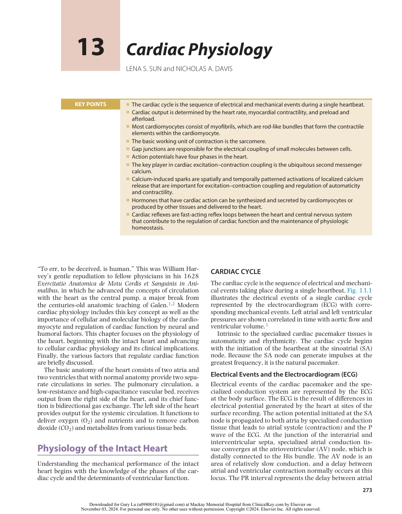

:::

<!-- PDF page 2 -->

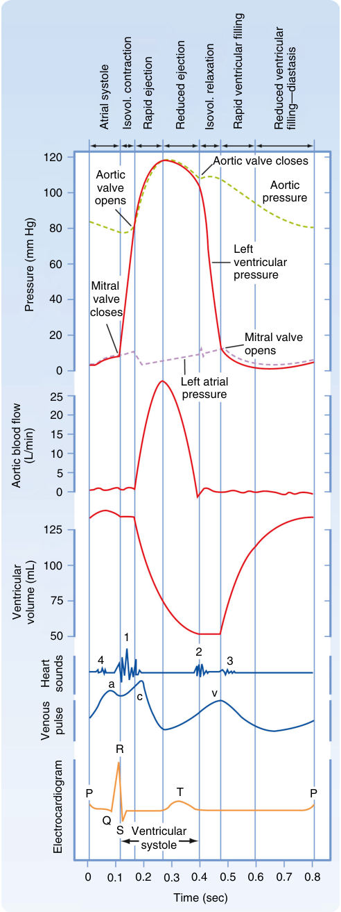

120 Aortic valve closes Aortic valve Aortic 100 opens pressure 80 Left 60 ventricular pressure Mitral 40 valve closes 20 Mitral valve opens 0 Left atrial 25 pressure 20 15 10 5 0 125 100 75 50 1 2 4 3 a c v R P T P Q S Ventricular systole 0 0.1 0.2 0.3 0.4 0.5 0.6 0.7 0.8 Time (sec) Atrial systole Isovol. contraction Rapid ejection Reduced ejection Isovol. relaxation Rapid ventricular filling Reduced ventricular filling—diastasis Pressure (mm Hg) (L/min) Aortic blood flow Ventricular volume (mL) Heart sounds pulse Venous Electrocardiogram 

**Fig. 13.1 Electrical and mechanical events during a single cardiac cycle.** Aortic and atrial blood flow, ventricular volume, venous pulse, and the electrocardiogram are shown. (From Koeppen BM, Dean FH, Stanton BA, Vail AC. In: _Berne and Levy Physiology_ . Philadelphia: Elsevier; 2018.)

and ventricular contraction at the level of the AV node. From the distal His bundle, an electrical impulse is propagated through large left and right bundle branches and finally to the Purkinje system fibers, which are the smallest branches of the specialized conduction system. Finally, electrical signals are transmitted from the Purkinje system to individual ventricular cardiomyocytes. The spread of depolarization to the ventricular myocardium is exhibited as the QRS complex on the ECG. Depolarization is followed by ventricular repolarization and the appearance of the T wave on the ECG.4

### Mechanical Events

The mechanical events of a cardiac cycle begin with the return of blood to the right and left atria from the systemic and pulmonary circulation, respectively. As blood accumulates in the atria, atrial pressure increases until it exceeds the pressure within the ventricle, and the AV valve opens. Blood passively flows first into the ventricular chambers, and such flow accounts for approximately 75% of the total ventricular filling.5 The remainder of the blood flow is mediated by active atrial contraction or systole, known as the atrial “kick.” The onset of atrial systole coincides with the depolarization of the SA node and the P wave. While the ventricles fill, the AV valves are displaced upward and ventricular contraction (systole) begins with closure of the tricuspid and mitral valves, which corresponds to the end of the R wave on the ECG. The first part of ventricular systole is known as isovolumic (or isometric) contraction. The electrical impulse traverses the AV region and passes through the right and left bundle branches into the Purkinje fibers, which leads to contraction of the ventricular myocardium and a progressive increase in intraventricular pressure. When intraventricular pressure exceeds pulmonary artery and aortic pressure, the pulmonic and aortic valves open and ventricular ejection occurs, representing the second part of ventricular systole.

Ventricular ejection is divided into the rapid ejection phase and the reduced ejection phase. During the rapid ejection phase, forward flow is maximal, and pulmonary artery and aortic pressure is maximally developed. In the reduced ejection phase, flow and great artery pressures taper with progression of systole. Pressures in both ventricular chambers decrease as blood is ejected from the heart, and ventricular diastole begins with closure of the pulmonic and aortic valves. The initial period of ventricular diastole consists of the isovolumic relaxation phase. This phase is concomitant with repolarization of the ventricular myocardium and corresponds to the end of the T wave on the ECG. The final portion of ventricular diastole involves a rapid decrease in intraventricular pressure until it decreases to less than that of the right and left atria, at which point the AV valve reopens, ventricular filling occurs, and the cycle repeats itself.

### VENTRICULAR STRUCTURE AND FUNCTION

### Ventricular Structure

The specific architectural order of the cardiac muscles provides the basis for the heart to function as a pump. The ellipsoid shape of the left ventricle (LV) is a result

<!-- PDF page 3 -->

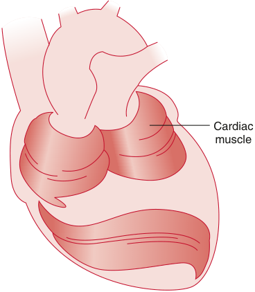

Cardiac muscle 

**Fig. 13.2 Muscle bundles.** (From Marieb EN. _Human Anatomy & Physiology,_ ed 5. San Francisco: Pearson Benjamin Cummings; 2001:684.)

of the laminar layering of spiraling bundles of cardiac muscles (Fig. 13.2). The orientation of the muscle bundle is longitudinal in the subepicardial myocardium and circumferential in the middle segment and again becomes longitudinal in the subendocardial myocardium. Because of the ellipsoid shape of the LV, regional differences in wall thickness result in corresponding variations in the cross- sectional radius of the left ventricular chamber. These regional differences may serve to accommodate the variable loading conditions of the LV.6 In addition, such anatomy allows the LV to eject blood in a corkscrew- type motion beginning from the base and ending at the apex. The architecturally complex structure of the LV thus allows maximal shortening of myocytes, which results in increased wall thickness and the generation of force during systole. Moreover, release of the twisted LV may provide a suction mechanism for filling of the LV during diastole. The left ventricular free wall and the septum have similar muscle bundle architecture. As a result, the septum moves inward during systole in a normal heart. Regional wall thickness is a commonly used index of myocardial performance that can be clinically assessed, such as by echocardiography or magnetic resonance imaging.

Unlike the LV, which needs to pump against the higherpressure systemic circulation, the right ventricle (RV) pumps against a much lower-pressure circuit in the pulmonary circulation. Consequently, wall thickness is considerably less in the RV. In contrast to the ellipsoidal form of the LV, the RV is crescent shaped; as a result, the mechanics of right ventricular contraction are more complex. Inflow and outflow contraction are not simultaneous, and much of the contractile force seems to be recruited from interventricular forces of the LV- based septum.

An intricate matrix of collagen fibers forms a scaffold of support for the heart and adjacent vessels. This matrix provides enough strength to resist tensile stretch. The collagen fibers are made up of mostly thick collagen type I fiber, which cross- links with the thin collagen type III fiber, the other major type of collagen.7 Elastic fibers that contain

elastin are near the collagen fibers and account for the elasticity of the myocardium.8

### Ventricular Function

The heart provides the driving force for delivering blood throughout the cardiovascular system to supply nutrients and to remove metabolic waste. Because of the anatomic complexity of the RV, the traditional description of systolic function is usually limited to the LV. Systolic performance of the heart is dependent on loading conditions and contractility. Preload and afterload are two interdependent factors extrinsic to the heart that govern cardiac performance.

Diastole is ventricular relaxation, and it occurs in four distinct phases: (1) isovolumic relaxation; (2) the rapid filling phase (i.e., the LV chamber filling at variable left ventricular pressure); (3) slow filling, or diastasis; and (4) final filling during atrial systole. The isovolumic relaxation phase is energy dependent. During auxotonic relaxation (phases 2 through 4), ventricular filling occurs against pressure. It encompasses a period during which the myocardium is unable to generate force, and filling of the ventricular chambers takes place. The isovolumic relaxation phase does not contribute to ventricular filling. The greatest amount of ventricular filling occurs in the second phase, whereas the third phase adds only approximately 5% of total diastolic volume and the final phase provides 15% of ventricular volume from atrial systole.

To assess diastolic function, several indices have been developed. The most widely used index for examining the isovolumic relaxation phase of diastole is to calculate the peak instantaneous rate of decline in left ventricular pressure (−d _P_ /d _t_ ) or the time constant of isovolumic decline in left ventricular pressure ( _τ_ ). The aortic closing–mitral opening interval and the isovolumic relaxation time and peak rate of left ventricular wall thinning, as determined by echocardiography, have both been used to estimate diastolic function during auxotonic relaxation. Ventricular compliance can be evaluated by pressure–volume relationships to determine function during the auxotonic phases of diastole.9,10

Many different factors influence diastolic function: magnitude of systolic volume, passive chamber stiffness, elastic recoil of the ventricle, diastolic interaction between the two ventricular chambers, atrial properties, and catecholamines. Whereas systolic dysfunction is a reduced ability of the heart to eject, diastolic dysfunction is a decreased ability of the heart to fill. Abnormal diastolic function is now recognized as the predominant cause of the pathophysiologic condition of congestive heart failure.11

Ventricular interactions during systole and diastole are internal mechanisms that provide feedback to modulate stroke volume (SV). Systolic ventricular interaction involves the effect of the interventricular septum on the function of both ventricles. Because the interventricular septum is anatomically linked to both ventricles, it is part of the load against which each ventricle must work. Therefore, any changes in one ventricle will also impact the other ventricle. In diastolic ventricular interaction, dilatation of either the LV or RV will have an impact on effective filling of the contralateral ventricle and thereby modify function.

<!-- PDF page 4 -->

**Preload and Afterload.** _Preload_ is the ventricular load at the end of diastole before contraction has started. First described by Starling, a linear relationship exists between sarcomere length and myocardial force (see Fig. 13.4). In clinical practice, surrogate representatives of left ventricular volume such as pulmonary wedge pressure or central venous pressure are used to estimate preload.5 More direct measures of ventricular volumes can be made using echocardiography.

_Afterload_ is the systolic load on the LV after contraction has begun. Aortic compliance is an additional determinant of afterload.3 Aortic compliance is the ability of the aorta to give way to systolic forces from the ventricle. Changes in the aortic wall (dilation or stiffness) can alter aortic compliance and thus afterload. Examples of pathologic conditions that alter afterload are aortic stenosis and chronic hypertension. Both impede ventricular ejection, thereby increasing afterload. Aortic impedance, or aortic pressure divided by aortic flow at that instant, is an accurate means of gauging afterload. However, clinical measurement of aortic impedance is invasive. Echocardiography can noninvasively estimate aortic impedance by determining aortic blood flow at the time of its maximal increase. In clinical practice, the measurement of systolic blood pressure is adequate to approximate afterload, provided that aortic stenosis is not present. Preload and afterload can be thought of as the wall stress that is present at the end of diastole and during left ventricular ejection, respectively. Wall stress is a useful concept because it includes preload, afterload, and the energy required to generate contraction. Wall stress and heart rate are probably the two most relevant indices that account for changes in myocardial O2 demand. Laplace’s law states that wall stress ( _σ_ ) is the product of pressure ( _P_ ) and radius ( _R_ ) divided by wall thickness ( _h_ )5 :

###  P  R /2 h

The ellipsoid shape of the LV allows the least amount of wall stress such that as the ventricle changes its shape from ellipsoid to spherical, wall stress is increased. By using the ratio of the long axis to the short axis as a measure of the ellipsoid shape, a decrease in this ratio would signify a transition from ellipsoid to spherical.

Thickness of the left ventricular muscle is an important modifier of wall stress. For example, in aortic stenosis, afterload is increased. The ventricle must generate a much higher pressure to overcome the increased load opposing systolic ejection of blood. To generate such high performance, the ventricle increases its wall thickness (left ventricular hypertrophy). By applying Laplace’s law, increased left ventricular wall thickness will decrease wall stress, despite the necessary increase in left ventricular pressure to overcome the aortic stenosis12 (Fig. 13.3). In a failing heart, the radius of the LV increases, thus increasing wall stress.

**Frank–Starling Relationship.** The Frank–Starling relationship is an intrinsic property of myocardium by which stretching of the myocardial sarcomere results in enhanced myocardial performance for subsequent contractions (Fig. 13.4). In 1895, Otto Frank first noted that in skeletal muscle, the change in tension was directly related to its length, and as pressure changed in the heart, a corresponding change in volume occurred.13 In 1914, E.H. Starling, using

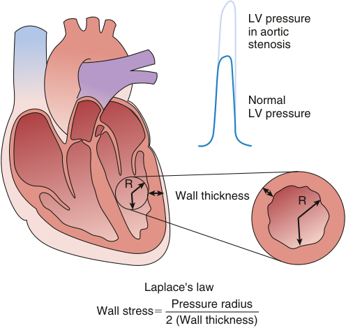

LV pressure in aortic stenosis Normal LV pressure R Wall thickness R Laplace's law Pressure radius Wall stress� 2 (Wall thickness) 

**Fig. 13.3 In response to aortic stenosis, left ventricular (LV) pressure increases.** To maintain wall stress at control levels, compensatory LV hypertrophy develops. According to Laplace’s law, wall stress = pressure • radius (R) ÷ (2 × wall thickness). Therefore the increase in wall thickness offsets the increased pressure, and wall stress is maintained at control levels. (From Opie LH. Ventricular function. In: _The Heart: Physiology from Cell to Circulation,_ ed 4. Philadelphia: Lippincott- Raven; 2004:355–401.)

an isolated heart–lung preparation as a model, observed that “the mechanical energy set free on passage from the resting to the contracted state is a function of the length of the muscle fiber.”14 If a strip of cardiac muscle is mounted in a muscle chamber under isometric conditions and stimulated at a fixed frequency, then an increase in sarcomere length results in an increase in twitch force. Starling concluded that the increased twitch force was the result of a greater interaction of muscle bundles.

Electron microscopy has demonstrated that sarcomere length (2–2.2 μm) is positively related to the amount of actin and myosin cross- bridging and that there is an optimal sarcomere length at which the interaction is maximal. This concept assumes that the increase in cross- bridging is equivalent to an increase in muscle performance. Although this theory continues to hold true for skeletal muscle, the force–length relationship in cardiac muscle is more complex. When comparing force–strength relationships between skeletal and cardiac muscle, it is noteworthy that the reduction in force is only 10%, even if cardiac muscle is at 80% sarcomere length.13 The cellular basis of this mechanism is an increase in the responsiveness of cardiac myofilaments to activating Ca2+ ions at a longer sarcomere length, often referred to as myofilament length- dependent activation.15 A common clinical application of Starling’s law is the relationship of left ventricular end- diastolic volume (LVEDV) and SV. The Frank–Starling mechanism may remain intact even in a failing heart.16 However, ventricular remodeling after injury or in heart failure may modify the Frank–Starling relationship.

**Contractility.** Each Frank–Starling curve specifies a level of contractility, or the inotropic state of the heart,

::: warning 符號需核對
此頁有符號無法完整擷取，請展開下方原始頁面核對。
:::

::: details 原始表格與符號（PDF 第 4 頁）

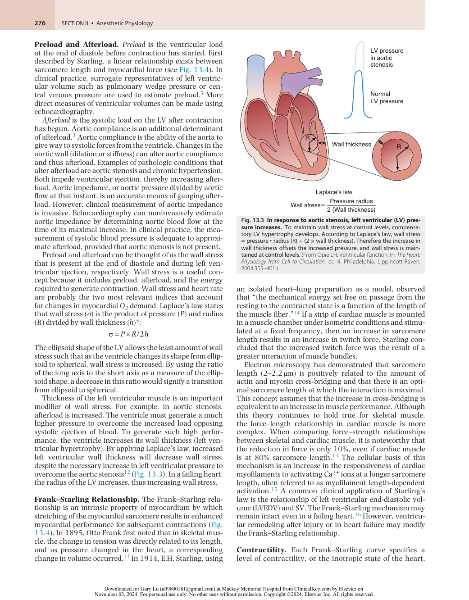

:::

<!-- PDF page 5 -->

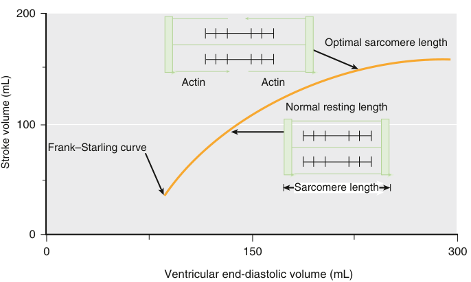

200 Optimal sarcomere length Actin Actin Normal resting length 100 Frank–Starling curve Sarcomere length 0 0 150 300 Ventricular end-diastolic volume (mL) Stroke volume (mL) 

**Fig. 13.4 Frank–Starling relationship.** The relationship between sarcomere length and tension developed in cardiac muscles is shown. In the heart, an increase in end- diastolic volume is the equivalent of an increase in myocardial stretch; therefore, according to the Frank–Starling law, increased stroke volume is generated.

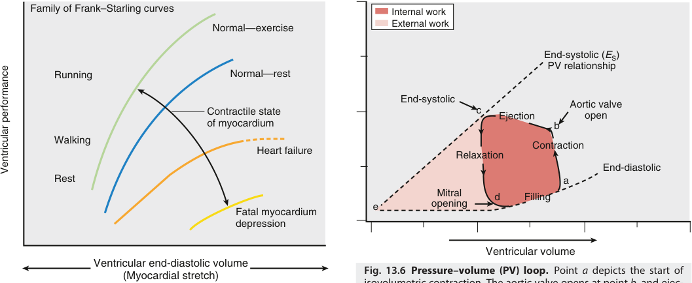

Family of Frank–Starling curves Internal work Normal—exercise External work End-systolic ( E S) PV relationship Running Normal—rest End-systolic Aortic valve Contractile state c Ejection open of myocardium b Walking Contraction Heart failure Relaxation End-diastolic Rest a Mitral d Filling Fatal myocardium e opening depression Ventricular volume Ventricular end - diastolic volume Fig. 13.6 Pressure–volume (PV) loop.  Point  a  depicts the start of (Myocardial stretch) Ventricular performance 

**Fig. 13.6 Pressure–volume (PV) loop.** Point _a_ depicts the start of isovolumetric contraction. The aortic valve opens at point _b,_ and ejection of blood follows _(points b→c)._ The mitral valve opens at point _d,_ and ventricular filling ensues. External work is defined by points _a, b, c,_ and _d,_ and internal work is defined by points _e, d,_ and _c._ The PV area is the sum of external and internal work. (From Opie LH. Ventricular function. In: _The Heart: Physiology from Cell to Circulation,_ ed 4. Philadelphia: Lippincott- Raven; 2004:355–401.)

**Fig. 13.5 A family of Frank–Starling curves is shown.** A leftward shift of the curve denotes enhancement of the inotropic state, whereas a rightward shift denotes decreased inotropy. (From Opie LH. Ventricular function. In: _The Heart: Physiology from Cell to Circulation,_ ed 4. Philadelphia: Lippincott- Raven; 2004:355–401.)

which is defined as the work performed by cardiac muscle at any given end- diastolic fiber. Factors that modify contractility will create a family of Frank–Starling curves with different contractility12 (Fig. 13.5). Factors that modify contractility are exercise, adrenergic stimulation, changes in pH, temperature, and various pharmacologic agents such as milrinone and digitalis. The ability of the LV to develop, generate, and sustain the necessary pressure for the ejection of blood is the intrinsic inotropic state of the heart.

heart because complete unloading is impossible. To measure the intrinsic contractile activity of an intact heart, several strategies have been attempted with varying success. Pressure–volume loops, albeit requiring catheterization of the left side of the heart, are currently the best way to determine contractility in an intact heart12 (Fig. 13.6). The pressure–volume loop represents an indirect measure of the Frank–Starling relationship between force (pressure) and muscle length (volume). Clinically, the most used noninvasive index of ventricular contractile function is the ejection fraction, which is assessed by echocardiography, angiography, or radionuclide ventriculography.

In isolated muscle, the maximal velocity of contraction (Vmax) is defined as the maximal velocity of ejection at zero load. Vmax is obtained by plotting the velocity of muscle shortening in isolated papillary muscle at varying degrees of force. Although this relationship can be replicated in isolated myocytes, Vmax cannot be measured in an intact

Ejection fraction   LVEDV  LVESV  /LVEDV

where LVESV is left ventricular end- systolic volume.

<!-- PDF page 6 -->

**Cardiac Work.** The work of the heart can be divided into external and internal work. External work is expended to eject blood under pressure, whereas internal work is expended within the ventricle to change the shape of the heart and to prepare it for ejection. Internal work contributes to inefficiency in the performance of the heart. Wall stress is directly proportional to the internal work of the heart.17

External work, or stroke work, is a product of the SV and pressure ( _P_ ) developed during ejection of the SV.

### Stroke work  SV  P or  LVEDV  LVESV   P

The external work and internal work of the ventricle both consume O2. The clinical significance of internal work is illustrated in the case of a poorly drained LV during cardiopulmonary bypass. Although external work is provided by the roller pump during bypass, myocardial ischemia can still occur because poor drainage of the LV creates tension on the left ventricular wall and increases internal work.

The efficiency of cardiac contraction is estimated by the following formula10 :

### Cardiac efficiency  External work/ Energy equivalent of O 2 consumption

The corkscrew motion of the heart for the ejection of blood is the most favorable in terms of work efficiency, based on the architecture in a normal LV (with the cardiac muscle bundles arranged so that a circumferentially oriented middle layer is sandwiched by longitudinally oriented outer layers). In heart failure, ventricular dilation reduces cardiac efficiency because it increases wall stress, which in turn increases O2 consumption.13

**Heart Rate and Force–Frequency Relationship.** In isolated cardiac muscle, an increase in the frequency of stimulation induces an increase in the force of contraction. This relationship is termed the _treppe_ , which means _staircase_ in German, and is the phenomenon of the force–frequency relationship.10,18 At between 150 and 180 stimuli per minute, maximal contractile force is reached in an isolated heart muscle at a fixed muscle length. Thus, an increased frequency incrementally increases inotropy, whereas stimulation at a lower frequency decreases contractile force. However, when the stimulation becomes extremely rapid, the force of contraction decreases. In the clinical context, pacing- induced positive inotropic effects may be effective only up to a certain heart rate, based on the force–frequency relationship. In a failing heart, the force–frequency relationship may be less effective in producing a positive inotropic effect.10

filling is adequate during diastole. _Contractility_ can be defined as the intrinsic level of contractile performance that is independent of loading conditions. Contractility is difficult to define in an intact heart because it cannot be separated from loading conditions.10,18 For example, the _Frank–Starling relationship_ is defined as the change in intrinsic contractile performance, based on changes in preload. Cardiac output in a living organism can be measured with the Fick principle3 (a schematic depiction is illustrated in Fig. 13.8).

The Fick principle is based on the concept of conservation of mass such that the O2 delivered from pulmonary venous blood ( _q_ 3) is equal to the total O2 delivered to pulmonary capillaries through the pulmonary artery ( _q_ 1) and the alveoli ( _q_ 2).

The amount of O2 delivered to the pulmonary capillaries by way of the pulmonary ârteries ( _q_ 1) equals total pulmonary arterial blood flow ( _Q_˙ ) times the O2 concentration in pulmonary arterial blood (CpaO2):

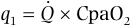

 q 1  Q  CpaO2 

The amount of O2 carried away from pulmonary venous blood ( _q3_ ) is equal to total pulmonary venous blood flow ( _Q_˙ ) times the O2 concentration in pulmonary venous blood (CpvO2):

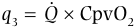

 q 3  Q  CpvO2 

The pulmonary arterial O2 concentration is the mixed systemic venous O2, and the pulmonary venous O2 concentration is the peripheral arterial O2. O2 consumption is the amount of O2 delivered to the pulmonary capillaries from the alveoli ( _q_ 2). Because _q_ 1 + _q_ 2 = _q_ 3,

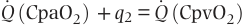

Q ˙  (CpaO2) +  q 2 = Q ˙  (CpvO2) 

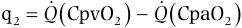

  q2  Q  CpvO2   Q  CpaO2  

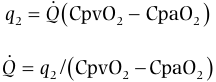

 q 2  Q  CpvO2  CpaO2   Q  q 2 /  CpvO2  CpaO2  

Thus, if the CpaO2, CpvO2, and O2 consumption ( _q_ 2) are known, then the cardiac output can be determined.

The indicator dilution technique is another method for determining cardiac output also based on the law of conservation of mass. The two most used indicator dilution techniques are the dye dilution and the thermodilution methods. Fig. 13.9 illustrates the principles of the dye dilution method.3

## Cellular Cardiac Physiology

### CARDIAC OUTPUT

### CELLULAR ANATOMY

Cardiac output is the âmount of blood pumped by the heart per unit of time ( _Q_ ) and is determined by four factors: two factors that are intrinsic to the heart (heart rate and myocardial contractility) and two factors that are extrinsic to the heart but functionally couple the heart and the vasculature (preload and afterload) (Fig. 13.7).

_Heart rate_ is defined as the number of beats per minute and is mainly influenced by the autonomic nervous system. Increases in heart rate escalate cardiac output if ventricular

At the cellular level, the heart consists of three major components: cardiac muscle tissue (contracting cardiomyocytes), conduction tissue (conducting cells), and extracellular connective tissue. A group of cardiomyocytes with its connective tissue support network or extracellular matrix make up a myofiber (Fig. 13.10). Adjacent myofibers are connected by strands of collagen. The extracellular matrix is the synthetic product of fibroblasts and is made up of collagen,

<!-- PDF page 7 -->

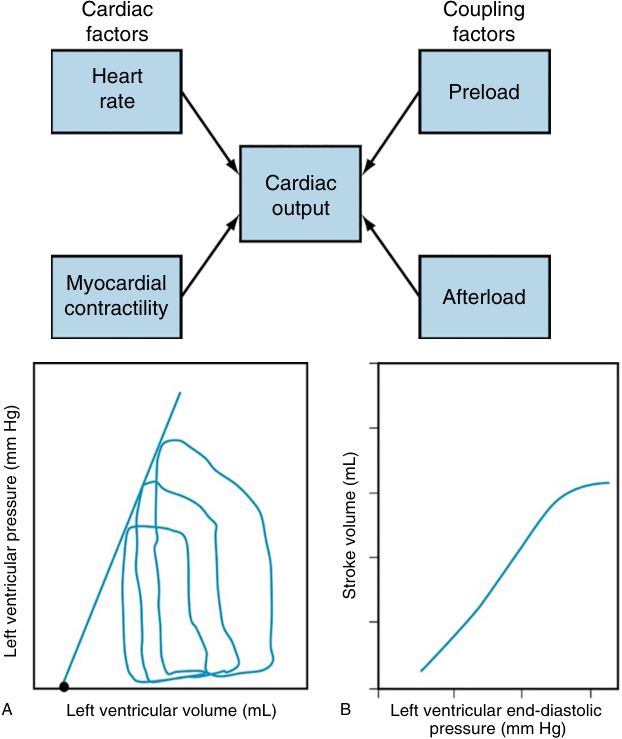

Cardiac Coupling factors factors Heart Preload rate Cardiac output Myocardial Afterload contractility A Left ventricular volume (mL) B Left ventricular end-diastolic pressure (mm Hg) Stroke volume (mL) Left ventricular pressure (mm Hg) 

**Fig. 13.7 The four factors that determine cardiac output.** The cardiac function curve (CFC) shows the relationship between preload and stroke volume or cardiac output. Increasing preload increases stroke volume. (A) Pressure–volume (P- V) loops recorded from the left ventricle of a human. A single CFC (B) can be obtained by varying preload (left ventricular end- diastolic pressure in this case) to produce different stroke volumes of the left ventricle (LV), as shown in the pressure–volume loops (A). The straight line represents the end- systolic pressure–volume relationship (ESPVR). When stroke volume is measured at many different preloads, the continuous curve in (B) is obtained, which is the complete cardiac function curve. (From Pappano, AJ, Wier WG. 10 – Control of cardiac output: coupling of heart and blood vessels. In: _Cardiovascular Physiology,_ 10th ed. Philadelphia: Elsevier; 2013.)

which is the main determinant of myocardial stiffness, and other major matrix proteins. One of the matrix proteins, elastin, is the chief constituent of elastic fibers. The elastic fibers account for, in part, the elastic properties of the myocardium. Other matrix proteins include the glycoproteins or proteoglycans and matrix metalloproteinases. Proteoglycans are proteins with short sugar chains, and they include heparan sulfate, chondroitin, fibronectin, and laminin. Matrix metalloproteins are enzymes that degrade collagen and other extracellular proteins. The balance between the accumulation of extracellular matrix proteins by synthesis and their breakdown by matrix metalloproteins contributes to the mechanical properties and function of the heart.8

### CARDIOMYOCYTE STRUCTURE AND FUNCTION

Individual contracting cardiomyocytes are large cells between 20 μm (atrial cardiomyocytes) and 140 μm (ventricular cardiomyocytes) in length. Approximately 50% of the cell volume in a contracting cardiomyocyte is made up of myofibrils, and the remainder consists of mitochondria, nucleus, sarcoplasmic reticulum (SR), and cytosol. The myofibril is the rod- like bundle that forms the contractile

elements within cardiomyocytes. Within each contractile element are contractile proteins, regulatory proteins, and structural proteins. Contractile proteins make up approximately 80% of the myofibrillar protein, with the remainder being regulatory and structural proteins.19,20 The basic unit of contraction is the sarcomere (see discussion under Contractile Elements later in this chapter).

The sarcolemma, or the outer plasma membrane, separates the intracellular and extracellular space. It surrounds the cardiomyocyte and invaginates into the myofibrils through an extensive tubular network known as _transverse tubules_ or _T tubules_ , and it also forms specialized intercellular junctions between cells.21,22

Transverse or T tubules are near an intramembranous system and the SR, which plays an important role in the calcium (Ca2+ ) metabolism that is critical in the excitation– contraction coupling (ECC) of the cardiomyocyte. The SR can be further divided into the longitudinal (or network) SR and the junctional SR. The longitudinal SR is involved in the uptake of Ca2+ for the initiation of relaxation. The junctional SR contains large Ca2+ - release channels (ryanodine receptors [RyRs]) that release SR Ca2+ stores in response to depolarization- stimulated Ca2+ influx through the

<!-- PDF page 8 -->

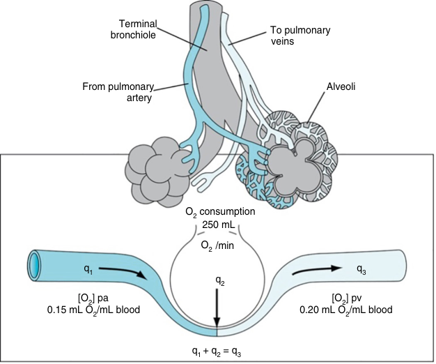

Terminal bronchiole To pulmonary veins From pulmonary Alveoli artery O2 consumption 250 mL O2 /min q1 q3 q2 [O2] pa [O2] pv 0.15 mL O2/mL blood 0.20 mL O2/mL blood q1 + q2 = q3 

**Fig. 13.8 Illustration demonstrates the principle of determination of cardiac output according to the Fick formula.** If the oxygen (O2) concentration in pulmonary arterial blood (CpaO2), the O2 concentration of the pulmonary vein (CpvO2), and the O2 consumption are known, then cardiac output can be calculated. _pa,_ pulmonary artery; _pv,_ pulmonary vein. (From Koeppen BM, Dean FH, Stanton BA, Vail AC. In: _Berne and Levy Physiology_ . Philadelphia: Elsevier; 2018.)

### Mixer

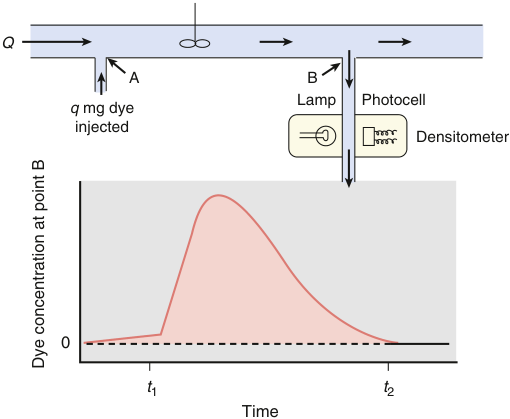

Q A B Lamp Photocell q  mg dye injected Densitometer 0 t 1 t 2 Time Dye concentration at point B 

**Fig. 13.9 Illustration demonstrates the principle of determining cardiac output with the indicator dilution technique.** This model assumes that there is no recirculation. A known amount of dye _(q)_ is injected at point _A_ into a stream flowing at _Q_˙ (mL/min). A mixed sample of the fluid flowing past point _B_ is withdrawn at a constant rate through a densitometer. The change in dye concentration over time is depicted in a curve. Flow may be measured by dividing the amount of indicator injected upstream by the area under the downstream concentration curve. (From Pappano, AJ, Wier WG. 10 – Control of cardiac output: coupling of heart and blood vessels. In: _Cardiovascular Physiology,_ 10th ed. Philadelphia: Elsevier; 2013.)

sarcolemmal Ca2+ channels. The RyRs are not only Ca2+ - release channels but also they form the scaffolding proteins that anchor many of the key regulatory proteins.23 Mitochondria are immediately found beneath the sarcolemma,

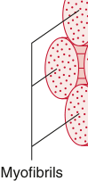

Myofibrils 

**Fig. 13.10 Organization of cardiomyocytes.** Fifty percent of cardiomyocyte volume is made up of myofibrils; the remainder consists of mitochondria, nucleus, sarcoplasmic reticulum, and cytosol. (From Opie LH. Heart cells and organelles. In: _The Heart: Physiology from Cell to Circulation_ , ed 4. Philadelphia: Lippincott- Raven; 2004.)

wedged between myofibrils within the cell. They contain enzymes that promote the generation of adenosine triphosphate (ATP), and they are the energy powerhouse for the cardiomyocyte. In addition, mitochondria can also accumulate Ca2+ and thereby contribute to the regulation of the cytosolic Ca2+ concentration. Nearly all the genetic information is found within the centrally located nucleus. The cytosol is the fluid- filled microenvironment within the sarcolemma, exclusive of the organelles and the contractile apparatus and proteins. Cardiac muscle cells contain three different types of intercellular junctions: gap junctions, _spot_ desmosomes, and _sheet_ desmosomes (or fasciae adherens)21,24 (Fig. 13.11). Gap junctions are responsible for electrical coupling and the transfer of small molecules between cells, whereas desmosome- like junctions provide mechanical linkage. The adhesion sites formed by spot desmosomes anchor the intermediate filament cytoskeleton of

<!-- PDF page 9 -->

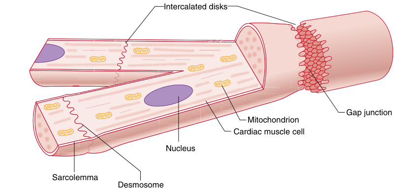

Intercalated disks Gap junction Mitochondrion Cardiac muscle cell Nucleus Sarcolemma Desmosome 

**Fig. 13.11** The sarcolemma that envelops cardiomyocytes becomes highly specialized to form the intercalated disks where ends of neighboring cells are in contact. The intercalated disks consist of gap junctions and _spot_ and _sheet_ desmosomes. (From Opie LH. Heart cells and organelles. In: _The Heart: Physiology from Cell to Circulation_ , ed 4. Philadelphia: Lippincott- Raven; 2004.)

the cell; those formed by the fasciae adherens anchor the contractile apparatus. Gap junctions consist of clusters of plasma membrane channels directly linking the cytoplasmic compartments of neighboring cells. Gap junction channels are constructed from connexins, a multigene family of conserved proteins. The principal connexin isoform of the mammalian heart is connexin25 ; other connexins, notably connexins 40, 45, and 37, are also expressed but in smaller quantities.23,24

The conducting cardiomyocytes, or Purkinje cells, are cells specialized for conducting propagated action potentials. These cells have a low content of myofibrils and a prominent nucleus, and they contain an abundance of gap junctions. Cardiomyocytes can be functionally separated into (1) the excitation system, (2) the ECC system, and (3) the contractile system.

### Excitation System

The cellular action potential originating in the specialized conduction tissue is propagated to individual cells where it initiates the intracellular event that leads to the contraction of the cell through the sarcolemmal excitation system.

**Action Potential.** Ion fluxes across plasma membranes result in depolarization (attaining a less negative membrane potential) and repolarization (attaining a more negative membrane potential). They are mediated by membrane proteins with ion- selective pores. Because these ion channel proteins open and close the pores in response to changes in membrane potential, the channels are voltage gated. In the heart, sodium (Na+ ), potassium (K+ ), Ca2+ , and chloride (Cl− ) channels contribute to the action potential.

The types of action potential in the heart can be separated into two categories: (1) fast- response action potentials, which are found in the His–Purkinje system and atrial or ventricular cardiomyocytes; and (2) slow- response action potentials, which are found in the pacemaker cells in the SA and AV nodes. A typical tracing of an action potential in the His–Purkinje system is depicted in Fig. 13.12. The electrochemical

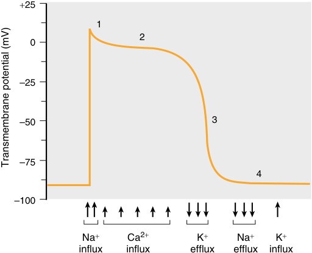

� 25 1 2 0 –25 –50 3 –75 4 –100 Na � Ca 2 � K � Na � K � influx influx efflux efflux influx Transmembrane potential (mV) 

**Fig. 13.12 Phases of cellular action potentials and major associated currents in ventricular myocytes.** The initial phase (0) spike and overshoot (1) are caused by a rapid inward sodium (Na+ ) current, the plateau phase (2) by a slow calcium (Ca2+ ) current through L- type Ca channels, and repolarization (phase 3) by outward potassium (K+ ) currents. Phase 4, the resting potential (Na+ efflux, K+ influx), is maintained by Na+ –K+ –adenosine triphosphatase (ATPase). The Na+ –Ca2+ exchanger is mainly responsible for extrusion of Ca2+ . In specialized conduction system tissue, spontaneous depolarization takes place during phase 4 until the voltage resulting in opening of the Na channel is reached. (From LeWinter MM, Osol G. Normal physiology of the cardiovascular system. In Fuster V, Alexander RW, O’Rourke RA, eds. _Hurst’s The Heart,_ ed 10. New York: McGraw- Hill; 2001:63–94.)

gradient for K+ across the plasma membrane is the determinant for the resting membrane potential. Mostly because of the influx of Na+ , the membrane potential becomes depolarized, which leads to an extremely rapid upstroke (phase 0). As the membrane potential reaches a critical level (or threshold) during depolarization, the action potential is propagated. The rapid upstroke is followed by a transient repolarization (phase 1). Phase 1 is a period of brief and limited repolarization that is largely attributable to the activation of a transient

::: warning 符號需核對
此頁有符號無法完整擷取，請展開下方原始頁面核對。
:::

::: details 原始表格與符號（PDF 第 9 頁）

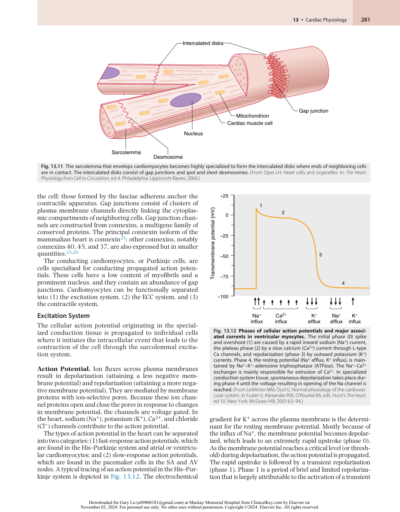

:::

<!-- PDF page 10 -->

outward K+ current, _i_ to. The plateau phase (phase 2) occurs with a net influx of Ca2+ through L- type Ca2+ channels and the efflux of K+ through several K+ channels – the inwardly rectifying _i_ k, the delayed rectifier _i_ k1, and _i_ to. Repolarization (phase 3) is brought about when an efflux of K+ from the three outward K+ currents exceeds the influx of Ca2+ , thus returning the membrane to the resting potential. Very little ionic flux occurs during diastole (phase 4) in a fast- response action potential.

In contrast, during diastole (phase 4), pacemaker cells that show slow- response action potentials have the capability of spontaneous diastolic depolarization and generate the automatic cardiac rhythm. Pacemaker currents during phase 4 are the result of an increase in the three inward currents and a decrease in the two outward currents. The three inward currents that contribute to spontaneous pacemaker activity include two carried by Ca2+ , _i_ CaL and _i_ CaT, and one that is a mixed cation current, _I_ f.26 The two outward currents are the delayed rectifier K+ current, _i_ k, and the inward rectifying K+ current, _i_ k1. When compared

with the fast- response action potential, phase 0 is much less steep, phase 1 is absent, and phase 2 is indistinct from phase 3 in the slow- response action potential.27 In SA node cells, the pacemaker _I_ f current is the principal determinant of duration diastolic depolarization, and it is encoded by four members of the hyperpolarization- activated cyclic nucleotide- gated gene (HCN1– 4) family.28

During the cardiac action potential, movement of Ca2+ into the cell and Na+ out of the cell creates an ionic imbalance. The Na+ –Ca2+ exchanger restores cellular ionic balance by actively transporting Ca2+ out of the cell against a concentration gradient while moving Na+ into the cell in an energy- dependent manner.

### Excitation–Contraction Coupling

Structures that participate in cardiac ECC include the sarcolemma, transverse tubules, SR, and myofilaments29 (Fig. 13.13). The process of ECC begins with depolarization of the plasma membrane and spread of electrical excitation along the sarcolemma of cardiomyocytes.

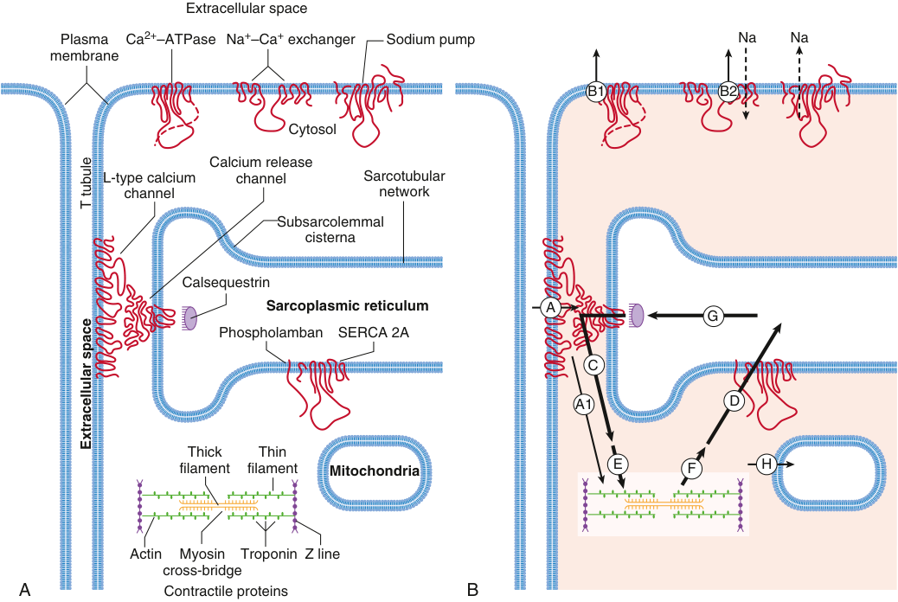

Extracellular space Plasma Ca 2+ –ATPase Na + –Ca +  exchanger  Sodium pump Na Na membrane B1 B2 Cytosol Calcium release L -type calcium channel Sarcotubular channel network Subsarcolemmal cisterna Calsequestrin Sarcoplasmic reticulum A G Phospholamban SERCA 2A C A1 D Thick Thin filament filament Mitochondria E F H Actin Myosin Troponin Z line cross-bridge A Contractile proteins B T tubule Extracellular space 

**Fig. 13.13** (A) Diagram depicts the components of cardiac excitation–contraction coupling. Calcium pools are noted in **bold** letters. (B) Extracellular ( _arrows A_ , _B1_ , _B2_ ) and intracellular calcium flux ( _arrows C_ , _D_ , _E_ , _F_ , and _G_ ) are shown. The thickness of the _arrows_ indicates the magnitude of the calcium flux, and the vertical orientations describe their energetics: _downward- pointing arrows_ represent passive calcium flux, whereas _upward- pointing arrows_ represent energy- dependent calcium transport. Calcium entering the cell from extracellular fluid through L- type calcium channels triggers the release of calcium from the sarcoplasmic reticulum. Only a small portion directly activates the contractile proteins ( _arrow A1_ ). _Arrow B1_ depicts active transport of calcium into extracellular fluid by means of the plasma membrane calcium adenosine triphosphatase (Ca2+ –ATPase) pump and the sodium–calcium (Na+ –Ca2+ ) exchanger. Sodium that enters the cell in exchange for calcium ( _dashed line_ ) is pumped out of the cytosol by the sodium pump. SR regulates calcium efflux from the subsarcolemmal cisternae ( _arrow C_ ) and calcium uptake into the sarcotubular network ( _arrow D_ ). _Arrow G_ represents calcium that diffuses within the SR. Calcium binding to ( _arrow E_ ) and dissociation from ( _arrow F_ ) high- affinity calcium- binding sites of troponin C activate and inhibit interactions of the contractile proteins. _Arrow H_ depicts movement of calcium into and out of mitochondria to buffer the cytosolic calcium concentration. _SERCA 2A_ , sarcoplasmic/endoplasmic reticulum Ca2+ –ATPase. (From Katz AM. Calcium fluxes. In: _Physiology of the Heart,_ ed 3. Philadelphia: Lippincott- Raven; 2001:232–233.)

<!-- PDF page 11 -->

The ubiquitous second messenger Ca2+ is the key player in cardiac ECC27 (see Fig. 13.13B). Cycling of Ca2+ within the structures that participate in ECC initiates and terminates contraction. Activation of the contractile system depends on an increase in free cytosolic Ca2+ and its subsequent binding to contractile proteins.

Ca2+ enters through plasma membrane channels concentrated at the T tubules, and such entry through L- type Ca2+ channels (dihydropyridine receptors) triggers the release of Ca2+ from the SR.30 This evokes a _Ca_&#95;2+&#95; _spark_ . Ca2+ sparks are the elementary Ca2+ signaling event of ECC in heart muscle. A Ca2+ spark occurs with the opening of a cluster of SR RyRs to release Ca2+ in a locally regenerative manner. It, in turn, activates the Ca2+ - release channels and induces further release of Ca2+ from sub- sarcolemmal cisternae in the SR and thus leads to a large increase in intracellular Ca2+ (iCa2+ ). These spatially and temporally patterned activations of localized Ca2+ release, in turn, stimulate myofibrillar contraction. The increase in iCa2+ , however, is transient, inasmuch as Ca2+ is removed by active uptake by the SR Ca2+ pump adenosine triphosphatase (ATPase), extrusion of Ca2+ from the cytosol by the Na+ –Ca2+ exchanger, and binding of Ca2+ to proteins.31 Ca2+ sparks have also been implicated in pathophysiologic diseases such as hypertension, cardiac arrhythmias, heart failure, and muscular dystrophy.32–34

The SR provides the anatomic framework and is the major organelle for the cycling of Ca2+ . It is the depot for iCa2+ stores. The cyclic release plus reuptake of Ca2+ by the SR regulates the cytosolic Ca2+ concentration and couples excitation to contraction. The physical proximity between L- type Ca2+ channels and RyRs at the SR membrane makes Ca2+ - induced Ca2+ release occur easily. The _foot_ region of the RyR is the part that extends from the SR membrane to the T tubules, where the L- type Ca2+ channels are located.20,31,35

The SR is also concerned with the reuptake of Ca2+ that initiates relaxation or terminates contraction. The sarcoplasmic/endoplasmic reticulum Ca2+ –ATPase (SERCA) pump is the ATP- dependent pump that actively pumps the majority of the Ca2+ back into the SR after its release. SERCA makes up close to 90% of all the SR proteins and is inhibited by the phosphoprotein, phospholamban, at rest. Phospholamban is an SR membrane protein that is active in the dephosphorylated form. Phosphorylation by a variety of kinases due to β- adrenergic stimulation or other stimuli inactivates phospholamban and releases its inhibitory action on SERCA. Positive feedback ensues and leads to further phospholamban phosphorylation and greater SERCA activity. Active reuptake of Ca2+ by SERCA then promotes relaxation.20,31,35

Once taken up into the SR, Ca2+ is stored until it is released during the next cycle. Calsequestrin and calreticulin are two storage proteins in the SR. Calsequestrin is a highly charged protein located in the cisternal component of the SR near the T tubules. Because it lies close to the Ca2+ - release channels, the stored Ca2+ can be quickly discharged for release once the Ca2+ - release channels are stimulated. Cytosolic Ca2+ can also be removed by extrusion through the sarcolemmal Ca2+ pump and the activity of the Na+ – Ca2+ exchanger. The protein calmodulin is an important _sensor_ and regulator of iCa2+ .22

**Errors in Ca**2+ **Handling.** Because of the ubiquity of Ca2+ in cardiac signaling, changes in Ca2+ handling can be associated with numerous maladaptive outcomes. There is an increase in Ca2+ leak from the SR in the failing heart, which may be associated with removal of Ca2+ from the cytosole.

This Ca2+ leak from the SR may significantly reduce contractile force in the heart and contributes to reduced inotropy in heart failure.36,37 Uncoupling of β- AR activation of protein kinase A (PKA) and dysregulation of Ca2+ handling occurs in heart failure.36 PKA, a cAMP- dependent protein kinase, is a key effector protein activated by β- AR agonists, which stimulates transsarcolemmal Ca2+ influx and its sequestration in the SR, leading to increased contractile function and lusitropy. Calcineurin, a Ca2+ - dependent signaling molecule, is consistently linked with myocardial hypertrophy via gene expression through a nuclear factor of activated T- cells pathway.36,37 Calcium–calmodulindependent protein kinase II, in addition to calcineurin, is tightly coupled with Ca2+ homeostasis, and its prolonged activation can be proarrhythmic.

### Contractile System

**Contractile Elements.** The basic working unit of contraction is the sarcomere. A _sarcomere_ is defined as the distance between Z lines ( _Z_ is an abbreviation for the German word, _Zuckung_ , meaning _contraction_ ), which join the sarcomeres in series. Each sarcomere consists of a central A band that is separated by one-half of an I band from the Z lines on each side because the Z line bisects the I band. A schematic representation is depicted in Fig. 13.14. Within each sarcomere are two principal contractile proteins (see the next section, Contractile Proteins) and one noncontractile protein, titin.31 The two contractile proteins are actin, the thin filament, and myosin, the thick filament. Actin filaments and titin are both tethered to the Z line, but the thick myosin filaments do not actually reach the Z lines. Titin, the third filament protein, tethers the thick- filament myosin to reach the Z line. The Z lines at the two ends of the sarcomere are brought closer together during contraction as the thickfilament myosin heads interact with the thin actin filaments and slide over each other.38,39

Familial hypertrophic cardiomyopathy is an inherited autosomal dominant sarcomeric disease40 that is the most common cause of sudden death in otherwise healthy individuals. Its clinical features are left ventricular hypertrophy and myocyte and myofibrillar disarray. Mutations in at least eight different genes encoding sarcomere proteins have been identified as the molecular basis for the disorder. These genes are β- cardiac myosin heavy chain, cardiac troponin T (TnT), α- tropomyosin, cardiac myosin- binding protein C, essential or regulatory myosin light chain, cardiac troponin I (TnI), α- cardiac actin, and titin.40

**Contractile Proteins.** The contractile apparatus within the cardiomyocyte consists of contractile and regulatory proteins.22,41,42 The thin- filament actin and the thickfilament myosin are the two principal contractile proteins. Actin contains two helical chains. Tropomyosin, a doublestranded α- helical regulatory protein, winds around the actin array and forms the backbone for the thin- filament actin. The thick- filament myosin is made up of 300 myosin molecules. Each myosin molecule has two functional

<!-- PDF page 12 -->

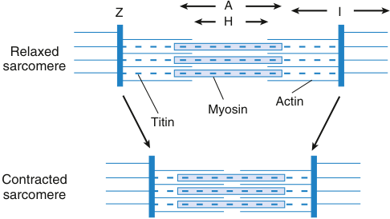

A Z I H Relaxed sarcomere Actin Myosin Titin Contracted sarcomere 

**Fig. 13.14 The basic unit of contraction is the sarcomere.** A contracted and relaxed sarcomere is depicted. Z lines are located at the ends of the sarcomere. The A band is the site of overlap between myosin and actin filaments. The I band is located on either side of the A band and contains only actin filament. The H zone is located in the center of the A band, and only myosin is present. (From LeWinter MM, Osol G. Normal physiology of the cardiovascular system. In: Alexander RW, O’Rourke RA, eds. _Hurst’s The Heart_ , ed 10. New York: McGraw- Hill; 2001.)

domains: the body or filament and the bilobar myosin head. The myosin head is made up of one heavy chain and two light chains. The heavy head chain has two domains: the larger one interacts with actin at the actin cleft and has an ATP- binding pocket where myosin ATPase is located, and the other smaller one is flexible and attached to the two light chains. The regulatory troponin heterotrimer complex is found at regular intervals along tropomyosin. The heterotrimer troponins are made up of troponin C (TnC), the Ca2+ receptor; TnI, an inhibitor of actin- myosin interaction; and TnT, which links the troponin complex to tropomyosin. Tropomodulin is another regulatory protein. It is located at the end of the thin- filament actin and caps the end to prevent any excessive elongation of the thin filament.38,39

**Myocyte Contraction and Relaxation.** At rest, crossbridge cycling and generation of force do not occur because either the myosin heads are blocked from physically reacting with the thin filament or they are only weakly bound to actin (Fig. 13.15).19 Cross- bridge cycling is initiated on binding of Ca2+ to TnC, which increases TnC–TnI interaction and decreases the inhibitory TnI–actin interaction. These events, which ensue from the binding of Ca2+ to TnC, lead to conformational changes in tropomyosin and permit attachment of the myosin head to actin. Crossbridging involves the detachment of the myosin head from actin and a reattachment of myosin to another actin on hydrolysis of ATP by myosin ATPase. Binding of ATP to the nucleotide pocket of the myosin head leads to the activation of myosin ATPase,35,38,39 ATP hydrolysis, and changes in the configuration of the myosin head, all of which facilitate binding of the myosin head to actin and the generation of the power stroke of the myosin head. Based on this model, the rate of cross- bridge cycling is dependent on the activity of myosin ATPase. Turnoff of cross- bridge cycling is largely initiated by the decrease in cytosolic Ca2+ .

Myocyte relaxation is an energy- dependent process because restoration of cytosolic Ca2+ to resting levels requires the expenditure of ATP. The decrease in cytosolic Ca2+ occurs through active reuptake of Ca2+ into the SR by

SERCA and extrusion of Ca2+ by the Na+ –Ca2+ exchanger. This activity results in the release of Ca2+ binding to TnC and the separation of the myosin–actin cross- bridge. Myocyte relaxation is dependent on the kinetics of cross- bridge cycling, the affinity of Ca2+ for TnC, and the activity of the Ca2+ - reuptake mechanisms. Relaxation is enhanced by the increased kinetics of cross- bridge cycling, decreased Ca2+ affinity for TnC, and increased activity of Ca2+ - reuptake mechanisms.31

Titin is a giant string- like protein that acts as the third filament within the sarcomere. A single titin molecule spans one-half of the sarcomere. Structurally, titin consists of an inextensible anchoring segment and an extensible elastic segment. Its two main functions involve muscle assembly and elasticity. Titin is the principal determinant of the passive properties of the myocardium at small ventricular volumes.43

The Frank–Starling relationship states that an increase in end- diastolic volume results in enhanced systolic function.25,44 At the cellular level, the key component for the Frank–Starling relationship is a length- dependent shift in Ca2+ sensitivity.45–47 Several possible mechanisms for this change in Ca2+ sensitivity have been implicated, including Ca2+ sensitivity: as a function of myofilament lattice spacing, involving positive cooperativity in cross- bridge binding to actin, and dependence on a strain of the elastic protein titin.42,45

**Cytoskeleton Proteins.** The cytoskeleton is the protein framework within the cytoplasm that links, anchors, or tethers structural components inside the cell.19,22 Microfilaments (actin filaments), microtubules, and intermediate filaments are three classes of cytoskeleton proteins found in the cytoplasm. Microfilament proteins are actin filaments, either sarcomeric or cortical, depending on their location. Sarcomeric actin filaments are the thin filaments in the contractile machinery that have been previously described. Cortical actin filaments are found below the plasma membrane at the cell surface and are linked to several other microfilament proteins, including dystrophin, vinculin, and ankyrin. Microtubules assemble by polymerization of the α- and β- dimers of tubulin. They play a major role in intracellular transport and cell division.48 Attachment of the ends of microtubules to cellular structures causes the microtubules to expand and contract, thereby pulling and pushing these structures around the cell. The intermediate filaments are relatively insoluble. They have been demonstrated to be important in normal mitochondrial function and behavior. The desmin intermediate filament in cardiomyocytes connects the nucleus to the plasma membrane and is important in the transmission of the stress and strain of contractile force between cells.49

The cytoskeleton provides the organization of microenvironments within the cell for enzyme and protein activity and interaction.

Whereas familial hypertrophic cardiomyopathy is a genetic sarcomeric disease, familial dilated cardiomyopathy (FDCM) is a disease of cytoskeleton proteins. The genetic basis of FDCM includes two genes for X- linked FDCM (dystrophin, G4.5) and four genes for the autosomal dominant form (actin, desmin, lamin A/C, and δ- sarcoglycan).19

<!-- PDF page 13 -->

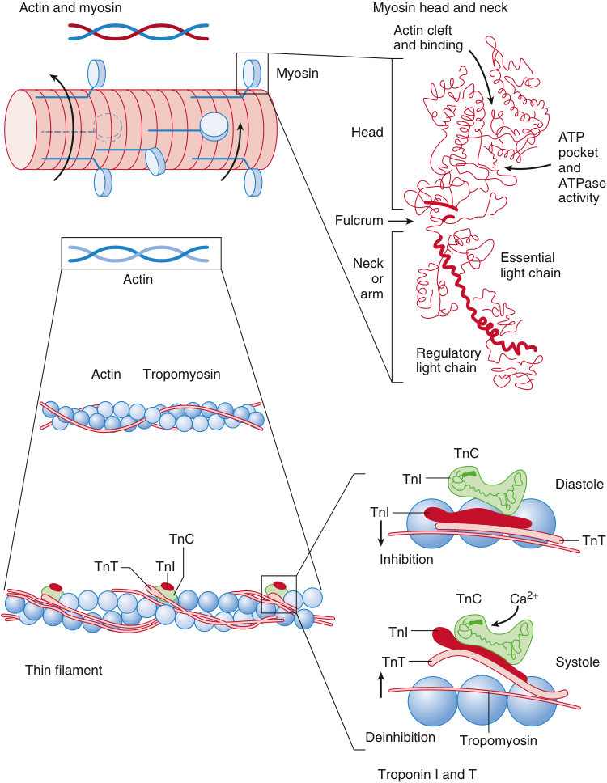

Actin and myosin Myosin head and neck Actin cleft and binding Myosin Head ATP pocket and ATPase activity Fulcrum Essential Neck Actin or light chain arm Regulatory Actin Tropomyosin light chain TnC TnI Diastole TnI TnC TnT Inhibition TnT TnI TnC Ca 2 � TnI Thin filament TnT Systole Deinhibition Tropomyosin Troponin I and T 

**Fig. 13.15 Molecules of the contractile system, troponins C, I, and T (TnC, TnI, and TnT).** _ATP_ , adenosine triphosphate; _ATPase_ , adenosine triphosphatase. (From Opie LH. Ventricular function. In _The Heart: Physiology from Cell to Circulation,_ ed 4. Philadelphia: Lippincott- Raven; 2004:209–231.)

## Control of Cardiac Function

### NEURAL REGULATION OF CARDIAC FUNCTION

The two limbs of the autonomic nervous system provide opposing input to regulate cardiac function.50 The neurotransmitter of the sympathetic nervous system is norepinephrine, which provides positive chronotropic (heart rate), inotropic (contractility), and lusitropic (relaxation) effects. The parasympathetic nervous system has a more direct inhibitory effect in the atria and has a negative modulatory effect in the ventricles. The neurotransmitter of the parasympathetic nervous system is acetylcholine. Both norepinephrine and acetylcholine bind to seven- transmembrane- spanning G protein–coupled receptors (GPCRs) to transduce their intracellular signals and affect their functional responses51 (Fig.

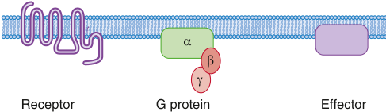

� � � Receptor G protein Effector 

**Fig. 13.16** General scheme for a G protein–coupled receptor consisting of receptor, the heterotrimeric G protein, and the effector unit. (Reprinted with permission from Bers DM. Cardiac excitation–contraction coupling. _Nature_ . 2002;415:198–205. Copyright MacMillan Magazines Ltd.)

13.16). At rest, the heart has a tonic level of parasympathetic cardiac nerve firing and little, if any, sympathetic activity. Therefore, the major influence on the heart at rest is parasympathetic. During exercise or stress, however, the sympathetic neural influence becomes more prominent.

::: warning 符號需核對
此頁有符號無法完整擷取，請展開下方原始頁面核對。
:::

::: details 原始表格與符號（PDF 第 13 頁）

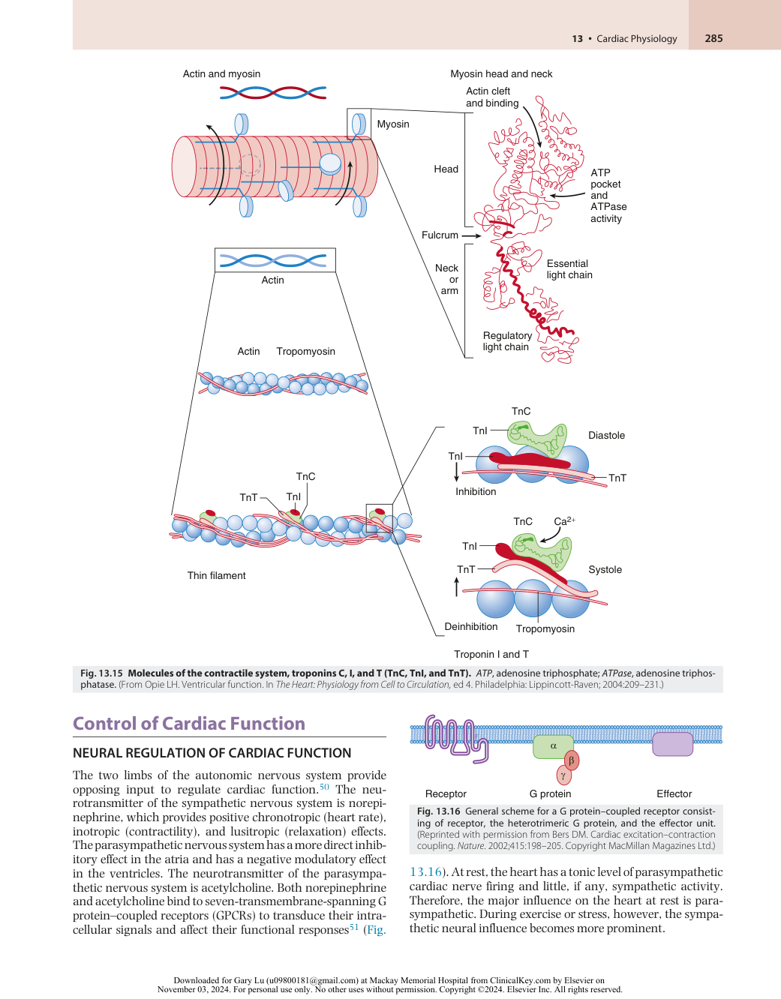

:::

<!-- PDF page 14 -->

Parasympathetic innervation of the heart is through the vagal nerve. Supraventricular tissue receives significantly more intense vagal innervation than do the ventricles. The principal parasympathetic target neuroeffectors are the muscarinic receptors in the heart.52,53 Activation of muscarinic receptors reduces pacemaker activity, slows AV conduction, directly decreases atrial contractile force, and exerts inhibitory modulation of ventricular contractile force. A total of five muscarinic receptors have been cloned.54 M2 receptors are the predominant subtype found in the mammalian heart. In the coronary circulation, M3 receptors have been identified. Moreover, non- M2 receptors have also been reported to exist in the heart. In general, for intracellular signaling, M1, M3, and M5 receptors couple to Gq/11 protein and activate the phospholipase C- diacylglycerol- inositol phosphate system. On the other hand, the M2 and M4 receptors couple to the pertussis toxinsensitive G protein, Gi/o, to inhibit adenylyl cyclase. M2 receptors can couple to certain K+ channels and influence the activity of Ca2+ channels, _I_ f current, phospholipase A2, phospholipase D, and tyrosine kinases.

In contrast to vagal innervation, sympathetic innervation of the heart is more predominant in the ventricle than in the atrium. Norepinephrine released from sympathetic nerve terminals stimulates adrenergic receptors (adrenoreceptors [AdRs]) located in the heart. The two major classes of ARs are α and β, both of which are GPCRs that transduce their intracellular signals by means of specific signaling cascades (Fig. 13.17).

β- ARs can be further divided into subpopulations of β1, β2, and β3.54 Although most mammalian hearts contain β1- ARs and β2- ARs, β3- ARs also exist in many mammalian ventricular tissues. The relative contribution of each β- AR subtype to modulation of cardiac function varies among species. In humans, β1- ARs are the predominant subtype in both the atria and ventricles, but a substantial proportion

of β2- ARs are found in the atria, and approximately 20% of β2- ARs are found in the LV. Much less is known about β3ARs, but they do exist in the human ventricle. Even though the β1- AR population is more intense than the β2- AR population, the cardiostimulant effect is not proportional to the relative densities of these two subpopulations, which is largely attributable to the tighter coupling of β2- ARs than β1- ARs to the cyclic adenosine monophosphate (cAMP) signaling pathway. Both β1- ARs and β2- ARs activate a pathway that involves the stimulatory G protein (Gs), activation of adenylyl cyclase, accumulation of cAMP, stimulation of cAMP- dependent PKA, and phosphorylation of key target proteins, including L- type Ca2+ channels, phospholamban, and TnI.

Both β1- ARs and β2- ARs are coupled to the Gs–cAMP pathway. Additionally, β2- ARs can couple to G protein– independent pathways to modulate cardiac function, and couple to the inhibitory G protein (Gi) to activate non– cAMP- dependent signaling pathways. β- AR stimulation increases both contraction and relaxation, as summarized in Fig. 13.18.

The two major subpopulations of α- ARs are α1 and α2. α1- ARs and α2- ARs can be further subdivided into different subtypes.55 α1- ARs are GPCRs and include the α1A, α1B, and α1D subtypes. The α1- AR subtypes are products of separate genes and differ in structure, G protein coupling, tissue distribution, signaling, regulation, and function. Both α1A- ARs and α1B- ARs mediate positive inotropic responses. However, the positive inotropic effect mediated by α1- ARs is believed to be of minor importance in the heart. α1- ARs are coupled to phospholipase C, phospholipase D, and phospholipase A2; they increase iCa2+ and myofibrillar sensitivity to Ca2+ .

Cardiac hypertrophy is primarily mediated by α1AARs.56,57 Cardiac hypertrophic responses to α1- AR agonists involve activation of protein kinase C and mitogen- activated

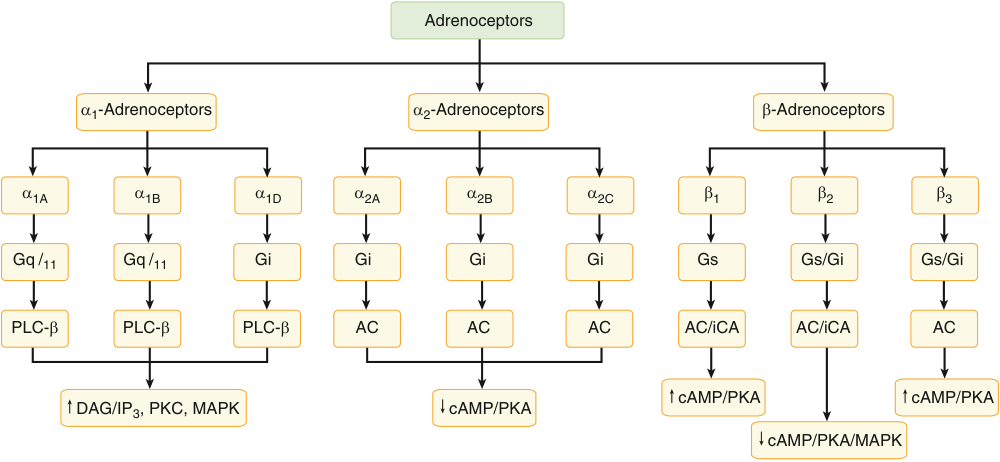

Adrenoceptors � 1-Adrenoceptors � 2-Adrenoceptors � -Adrenoceptors � 1A � 1B � 1D � 2A � 2B � 2C � 1 � 2 � 3 Gq /11 Gq /11 Gi Gi Gi Gi Gs Gs/Gi Gs/Gi PLC- � PLC- � PLC- � AC AC AC AC/iCA AC/iCA AC cAMP/PKA cAMP/PKA DAG/IP3, PKC, MAPK  cAMP/PKA cAMP/PKA/MAPK 

**Fig. 13.17** Adrenoceptor signaling cascades involving G proteins and effectors are adenylyl cyclase (AC), L- type calcium current (iCA), and phospholipase β (PLC- β) in the heart. The intracellular signals are diacylglycerol (DAG), inositol 1,4,5- triphosphate (IP3), protein kinase C (PKC), cyclic adenosine monophosphate (cAMP), protein kinase A (PKA), and mitogen- activated protein kinase (MAPK). _Gq/11_ , heterotrimeric G protein; _Gi_ , inhibitory G protein; _Gs_ , stimulatory G protein. (From Opie LH. Receptors and signal transduction. In: _The Heart. Physiology from Cell to Circulation,_ ed 3. Philadelphia: LippincottRaven; 1998.)

::: warning 符號需核對
此頁有符號無法完整擷取，請展開下方原始頁面核對。
:::

::: details 原始表格與符號（PDF 第 14 頁）

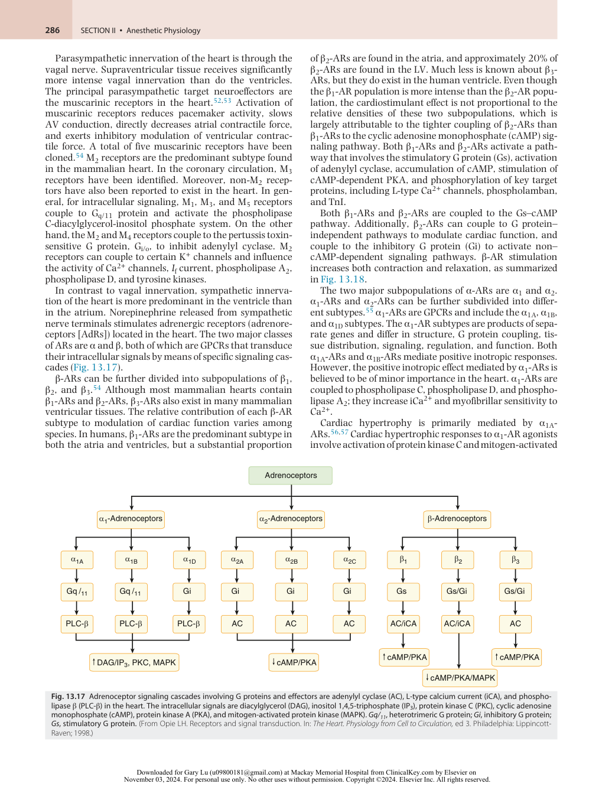

:::

<!-- PDF page 15 -->

protein kinase through Gq- signaling mechanisms. Three subtypes of α2- ARs are recognized: α2A, α2B, and α2C. In the mammalian heart, α2- ARs in the atrium play a role in the presynaptic inhibition of norepinephrine release. These prejunctional α2- ARs are believed to belong to the α2C subtype.

Neural regulation of cardiac function involves a complex interaction between the different classes and subpopulations of adrenoceptors and their signaling pathways. Targeted therapeutics in cardiovascular medicine involve the clinical application and manipulation of a basic understanding of adrenoceptor pharmacology.

### HORMONES AFFECTING CARDIAC FUNCTION

Many hormones have direct and indirect actions on the heart (Table 13.1). Hormones with cardiac actions can be synthesized and secreted by cardiomyocytes or produced by other tissues and delivered to the heart. They act on specific receptors expressed in cardiomyocytes. Most of these hormone receptors are plasma membrane GPCRs. NonGPCRs include the natriuretic peptide receptors, which are guanylyl cyclase–coupled receptors, and the glucocorticoid

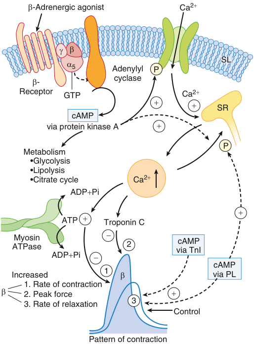

� -Adrenergic agonist Ca 2 � � � SL � 5 Adenylyl P cyclase � - Receptor GTP Ca 2 � � � SR cAMP via protein kinase A � P Metabolism    •Glycolysis    •Lipolysis    •Citrate cycle Ca 2 � ADP � Pi � ATP � Troponin C Myosin � cAMP ATPase 2 via TnI ADP � Pi � cAMP 1 Increased � via PL 1. Rate of contraction � 2. Peak force � 3 3. Rate of relaxation Control Pattern of contraction 

**Fig. 13.18** The β- adrenoceptor signaling system leads to an increased rate and force of contraction and increased relaxation. _ADP,_ adenosine diphosphate; _ATP,_ adenosine triphosphate; _ATPase,_ adenosine triphosphatase; _cAMP,_ cyclic adenosine monophosphate; _GTP,_ guanosine triphosphate; _Pi_ , phosphatidylinositol; _PL,_ phospholipase; _SL,_ sarcolemma; _SR,_ sarcoplasmic reticulum; _TnI,_ troponin I. (From Opie LH. Receptors and signal transduction. In: _The Heart: Physiology from Cell to Circulation,_ ed 3. Philadelphia: Lippincott- Raven; 1998:195.)

and mineralocorticoid receptors, which bind androgens and aldosterone and are nuclear zinc finger transcription factors. Hormones can have activity in normal cardiac physiologic function or are active only in pathophysiologic conditions, or both situations can apply. Most of the new information regarding the action of hormones in the heart has been derived from the endocrine changes associated with chronic heart failure.58

Cardiac hormones are polypeptides secreted by cardiac tissues into the circulation in the normal heart. Natriuretic peptides,59,60 aldosterone,61 and adrenomedullin62 are hormones secreted by cardiomyocytes. Angiotensin II, the effector hormone in the renin–angiotensin system, is also produced by cardiomyocytes.63,64 The renin–angiotensin system is one of the most important regulators of cardiovascular physiology. It is a key modulator of cardiac growth and function. Angiotensin II stimulates two separate receptor subtypes, AT1 and AT2, both of which are present in the heart. AT1 receptors are the predominant subtype expressed in the normal adult human heart. Stimulation of AT1 receptors induces a positive chronotropic and inotropic effect. Angiotensin II also mediates cell growth and proliferation in cardiomyocytes and fibroblasts and induces the release of the growth factors aldosterone and catecholamines through the stimulation of AT1 receptors. Activation of AT1 receptors is directly involved in the development of cardiac hypertrophy and heart failure, as well as adverse remodeling of the myocardium. In contrast, AT2 receptor activation is counterregulatory and generally antiproliferative. Expression of AT2 receptors, however, is relatively scant in the adult heart because AT2 receptors are most abundant in the fetal heart and decline with development. In response to injury and ischemia, AT2 receptors become upregulated. The precise role of AT2 receptors in the heart remains to be defined.

The beneficial effects of blockade of the renin–angiotensin system with angiotensin- converting enzyme inhibitors in the treatment of heart failure have been attributed to an inhibition of AT1- receptor activity. In addition to the renin–angiotensin system, other cardiac hormones that have been shown to play pathogenic roles in the promotion of cardiomyocyte growth and cardiac fibrosis, development of cardiac hypertrophy, and progression of congestive heart failure include aldosterone,61 adrenomedullin,65–67 natriuretic peptides,59,60 angiotensin,68–70 endothelin,71 and vasopressin.72,73

Increased stretch of the myocardium stimulates the release of atrial natriuretic protein (ANP) and B- type natriuretic protein (BNP) from the atria and ventricles, respectively. Both ANP and BNP bind to natriuretic peptide receptors to generate the second messenger cyclic guanosine monophosphate and represent part of the cardiac endocrine response to hemodynamic changes caused by pressure or volume overload. They also participate in organogenesis of the embryonic heart and cardiovascular system.59,60 In patients with chronic heart failure, increases of serum ANP and BNP levels are a predictor of mortality.74

Adrenomedullin is a recently discovered cardiac hormone that was originally isolated from pheochromocytoma tissue. It increases the accumulation of cAMP and has direct positive chronotropic and inotropic effects.62,65,66 Adrenomedullin, with interspecies and regional variations,

::: warning 符號需核對
此頁有符號無法完整擷取，請展開下方原始頁面核對。
:::

::: details 原始表格與符號（PDF 第 15 頁）

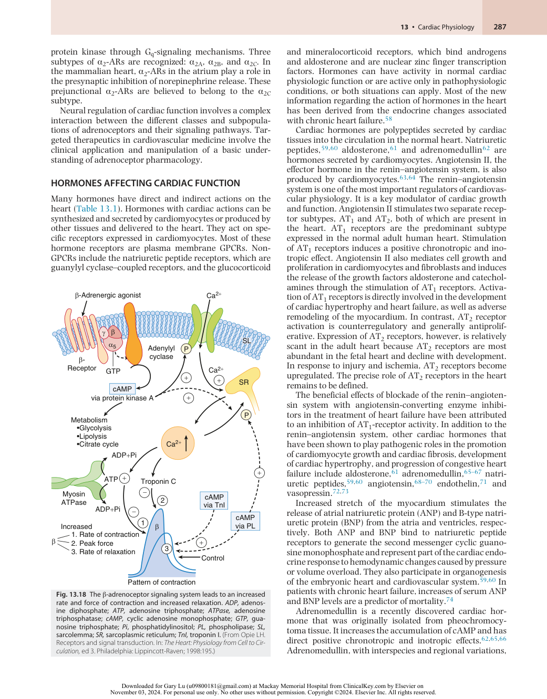

:::

<!-- PDF page 16 -->

**Table 13.1** Actions of Hormones on Cardiac Function

|**Hormone**|**Receptor**|**Cardiac Action**|**Increase (+) or Decrease (−) With CHF**|
|---|---|---|---|
|Adrenomedullin|GPCR|+ Inotropy/+ chronotropy|+|
|Aldosterone|Cytosolic or nuclear MR|?|+|
|Angiotensin|GPCR|+ Inotropy/+ chronotropy|+|
|Endothelin|GPCR|?|+|
|Natriuretic peptides|GCCR|||
|ANP (ANF)|||+|
|BNP|||+|
|Neuropeptide Y*|GPCR|− Inotropy|+|
|Vasopressin|GPCR|+ Inotropy/+ chronotropy|+|
|Vasoactive intestinal peptide†|GPCR|+ Inotropy|No|
|Estrogen|ERα/ERβ|Indirect|No|
|Testosterone|AR|Indirect|No|
|Progesterone|PR|Indirect|No|
|Thyroid hormones|NR|+ Inotropy/+ chronotropy|—|
|Growth hormones|IGF- 1|+ Inotropy/+ chronotropy|—|

*Data from Grundemar L, Hakanson R. Multiple neuropeptide Y receptors are involved in cardiovascular regulation. Peripheral and central mechanisms. _Gen Pharmacol_ . 1993;24:785–796; and Maisel AS, Scott NA, Motulsky HJ, et al. Elevation of plasma neuropeptide Y levels in congestive heart failure. _Am J Med_ . 1989;86:43–48.

> †Data from Henning RJ, Sawmiller DR. Vasoactive intestinal peptide: cardiovascular effects. _Cardiovasc Res_ . 2001;49:27–37. _ANF,_ atrial natriuretic factor; _ANP,_ atrial natriuretic peptide; _AR,_ androgen receptor; _BNP,_ B- type natriuretic peptide; _CHF,_ congestive heart failure; _ER,_ estrogen receptor; _GCCR,_ guanylyl cyclase–coupled receptor; _GPCR,_ G protein–coupled receptor; _IGF- 1,_ insulin growth factor 1; _MR,_ mineralocorticoid receptor; _NR,_ nuclear receptor; _PR,_ progesterone receptor.

has also been shown to increase nitric oxide production, and it functions as a potent vasodilator. Aldosterone is one of the cardiac- generated steroids, although its physiologic significance remains to be defined. It binds to mineralocorticoid receptors and can increase the expression or activity (or both) of cardiac proteins involved in ionic homeostasis or the regulation of pH, such as cardiac Na+ /K+ –ATPase, the Na+ –K+ cotransporter, Cl− –bicarbonate (HCO32+ ), and the Na+ –hydrogen (H+ ) antiporter.61 Aldosterone modifies cardiac structure by inducing cardiac fibrosis in both ventricular chambers and thereby leads to impairment of cardiac contractile function.

Other hormones such as the growth hormone,75 thyroid hormones,76 and sex steroid hormones (see below) can also have cardiac effects through direct actions of nuclear receptors or indirect effects.

### Sex Steroid Hormones and the Heart

Cardiac contractility is more intense in premenopausal women than in age- matched men, and withdrawal of hormone replacement therapy in postmenopausal women leads to a reduction in cardiac contractile function. The gender dimorphism in heart function and its adaptive responses to injury and disease states are partly mediated by sex steroid hormones. Indeed, healthy premenopausal women exhibit a lower cardiovascular risk compared to men, which suggests a mechanism for sex hormones in the modulation of cardiac function.77

The most extensively studied sex steroid hormones are estradiol- 17β (E2) and its bioactive metabolites. They bind and act on the two subtypes of estrogen receptors (ERs) in

the heart: ERα and ERβ. Progesterone and testosterone (two other sex steroid hormones) and the enzyme aromatase, which converts testosterone to estrogen, are much less well investigated. Progesterone and testosterone bind and act on their respective progesterone receptors and androgen receptors in the heart. Sex steroid hormones interact with their receptors to affect postsynaptic target cell responses and to influence presynaptic sympathoadrenergic function. Cardiomyocytes are not only targets for the action of sex steroid hormones, but they are also the source of synthesis and the site of metabolism of these hormones.78

E2 is derived from testosterone and is primarily metabolized in the liver to form hydroxyestradiols, catecholestradiols, and methoxyestradiols. Estradiol metabolism also takes place in vascular smooth muscle cells, cardiac fibroblasts, endothelial cells, and cardiomyocytes. Cardiomyocytes express nuclear steroid hormone receptors that modulate gene expression and non- nuclear receptors for the nongenomic effects of sex steroid hormones. They interact with many different coregulators to confer tissue and temporal specificity in their transcriptional actions. These cellspecific coactivator and corepressor proteins are known as estrogen- related receptors.79 Sex steroid hormones can activate rapid signaling pathways without changing gene expression (Fig. 13.19). One such example is stimulation of vascular endothelial nitric oxide synthase to mediate vascular dilation. Estrogen’s vasodilatory effect might explain the lower systolic blood pressures of premenopausal women when compared with age- matched men. In men, aromatase- mediated conversion of testosterone to estrogen maintains normal vascular tone. In addition to sex steroid

::: details 原始表格與符號（PDF 第 16 頁）

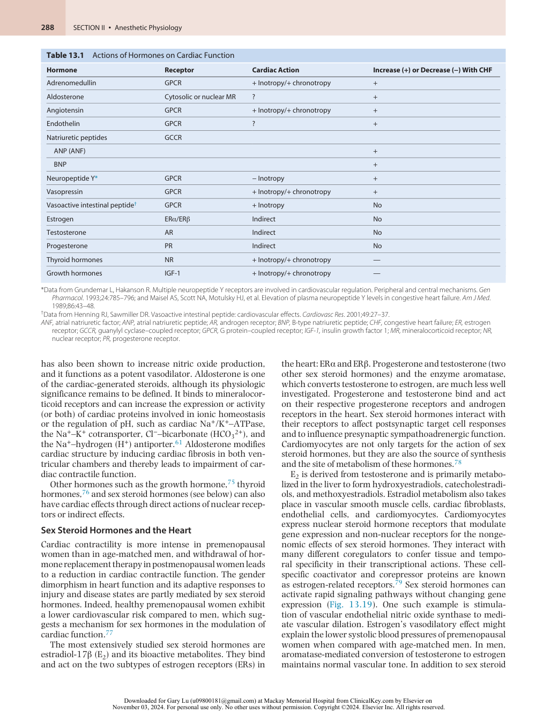

:::

<!-- PDF page 17 -->

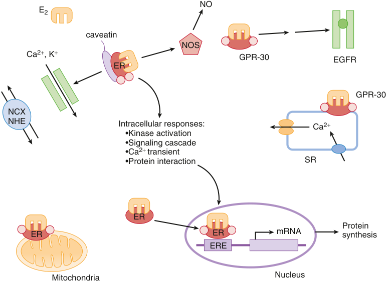

NO E2 caveatin NOS Ca 2 � , K � GPR-30 EGFR ER GPR-30 NCX NHE Intracellular responses: Ca 2 �    •Kinase activation    •Signaling cascade    •Ca 2 �� transient    •Protein interaction SR ER Protein ER ER mRNA synthesis ERE Mitochondria Nucleus 

**Fig. 13.19** Signaling mechanism of nuclear and non- nuclear localized estrogen receptor (ER) and the estrogen- binding receptor, GPR- 30. Nuclear ER influences the transcription of target genes by binding to an ER- response element (ERE) within the promotor region of target genes. _E2_ , estrogen; _EGFR,_ epidermal growth factor receptor; _NCX,_ Na+ –Ca2+ exchanger; _NHE,_ Na+ –H+ exchanger; _NO,_ nitric oxide; _NOS,_ nitric oxide synthase, _SR,_ sarcoplasmic reticulum. (From Du XJ, Fang L, Kiriazis H. Sex dimorphism in cardiac pathophysiology: experimental findings, hormonal mechanisms, and molecular mechanisms. _Pharmacol Ther_ . 2006;111:434–475.)

hormone stimulation of nuclear or non- nuclear receptors, sex steroid hormone receptors could also induce rapid signaling of growth factor pathways in the absence of ligands.

Differences between sexes exist in cardiac electrophysiologic function. The modulatory actions of estrogen on Ca2+ channels might be responsible for sex- based differences in repolarization of the heart, such as the faster resting heart rate of women, as well as the increased propensity of women to have prolonged QT syndrome.80 Estrogen, through the activation of ERβ, confers protection after ischemia and reperfusion in murine models of myocardial infarction. In contrast, testosterone, in the same model, has the opposite effect. Aromatase also has protective effects, probably through its action to increase estrogen and to decrease testosterone.

Differences between sexes in cardiac physiology should include consideration of the cellular physiology of sex steroid hormones in males and females; intrinsic differences in the physiology of cardiomyocytes, vascular smooth muscle cells, and endothelial cells between males and females; and sex- based differences in the autonomic modulation of cardiac physiology.

### CARDIAC REFLEXES

Cardiac reflexes are fast- acting reflex loops between the heart and the central nervous system (CNS) that contribute to regulation of cardiac function and the maintenance of physiologic homeostasis. Specific cardiac receptors elicit their physiologic responses by various pathways. Cardiac receptors are linked to the CNS by myelinated or

unmyelinated afferent fibers that travel along the vagus nerve. Cardiac receptors are in the atria, ventricles, pericardium, and coronary arteries. Extracardiac receptors are located in the great vessels and carotid artery. Sympathetic and parasympathetic nerve input is processed in the CNS. After central processing, efferent fibers to the heart or the systemic circulation will provoke a specific reaction. The response of the cardiovascular system to efferent stimulation varies with age and duration of the underlying condition that elicited the reflex in the first instance.

### Baroreceptor Reflex (Carotid Sinus Reflex)

The baroreceptor reflex is responsible for the maintenance of arterial blood pressure. This reflex regulates arterial pressure around a preset value through a negative feedback loop81,82 (Fig. 13.20). In addition, the baroreceptor reflex can establish a prevailing set point for arterial blood pressure when the preset value has been reset because of chronic hypertension. Changes in arterial blood pressure are monitored by circumferential and longitudinal stretch receptors located in the carotid sinus and aortic arch. The nucleus solitarius, located in the cardiovascular center of the medulla, receives impulses from these stretch receptors through afferents of the glossopharyngeal and vagus nerves. The cardiovascular center in the medulla consists of two functionally different areas; the area responsible for increasing blood pressure is laterally and rostrally located, whereas the area responsible for lowering arterial blood pressure is centrally and caudally located. The latter area also integrates impulses from the hypothalamus and the limbic system. Typically, stretch receptors are activated if

::: warning 符號需核對
此頁有符號無法完整擷取，請展開下方原始頁面核對。
:::

::: details 原始表格與符號（PDF 第 17 頁）

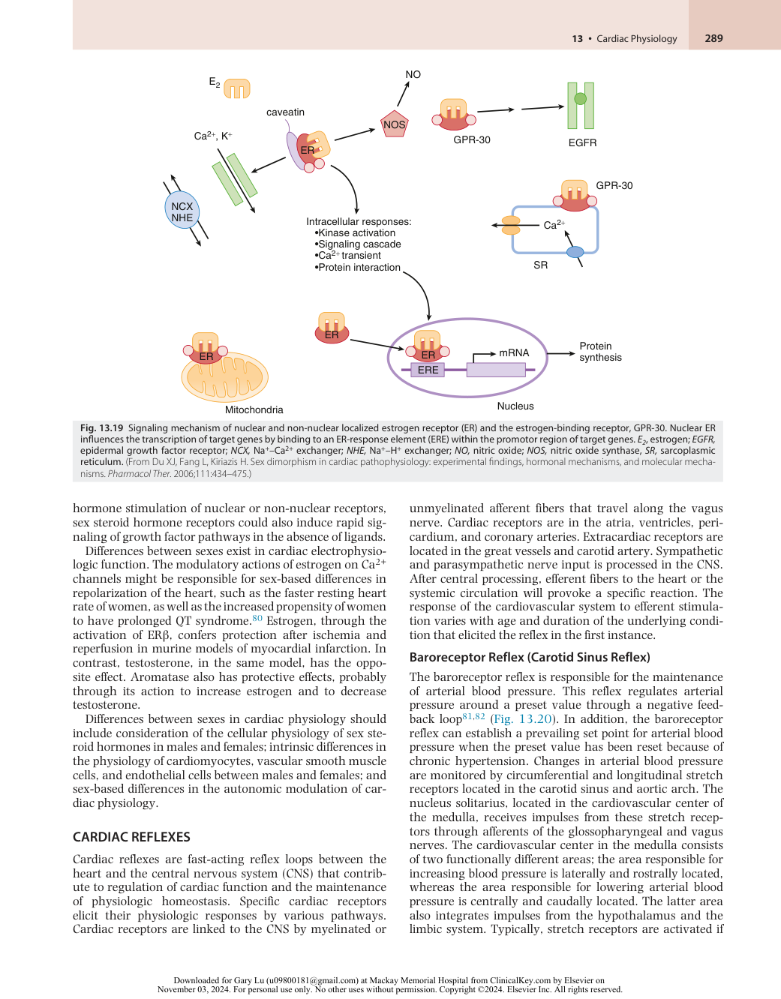

:::

<!-- PDF page 18 -->

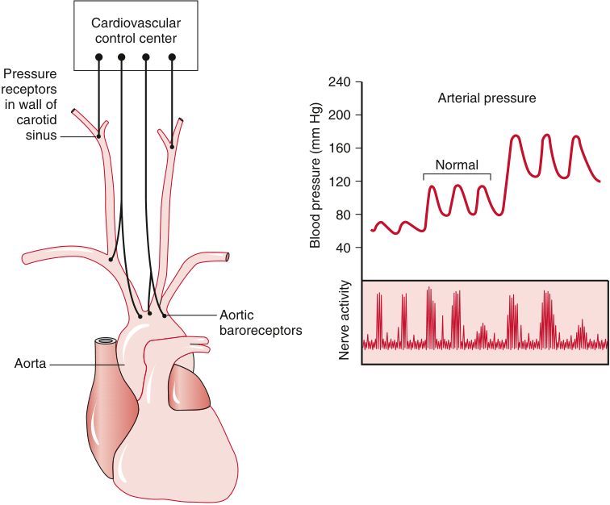

Cardiovascular control center Pressure 240 receptors in wall of Arterial pressure carotid 200 sinus 160 Normal 120 80 40 Aortic baroreceptors Aorta Blood pressure (mm Hg) Nerve activity 

**Fig. 13.20 Anatomic configuration of the baroreceptor reflex.** Pressure receptors in the wall of the carotid sinuses and aorta detect changes in arterial pressure in the circulation. These signals are conveyed to afferent receptive regions of the medulla through the Hering and vagus nerves. Output from effector portions of the medulla modulates peripheral tone and heart rate. The increase in blood pressure results in increased activation of the reflex ( _right_ ), which affects a decrease in blood pressure. (From Campagna JA, Carter C. Clinical relevance of the Bezold- Jarisch reflex. _Anesthesiology_ . 2003;98:1250–1260.)

systemic blood pressure is greater than 170 mm Hg. The response of the depressor system includes decreased sympathetic activity, leading to a decrease in cardiac contractility, heart rate, and vascular tone. In addition, activation of the parasympathetic system further decreases the heart rate and myocardial contractility. Reverse effects are elicited with the onset of hypotension.

The baroreceptor reflex plays an important beneficial role during acute blood loss and shock. However, the reflex arch loses its functional capacity when arterial blood pressure is less than 50 mm Hg. Hormonal status and therefore sex differences may alter baroreceptor responses.83 Furthermore, volatile anesthetics (particularly halothane) inhibit the heart rate component of this reflex.84 Concomitant use of Ca2+ - channel blockers, angiotensin- converting enzyme inhibitors, or phosphodiesterase inhibitors will lessen the cardiovascular response of raising blood pressure through the baroreceptor reflex. This lessened response is achieved by either their direct effects on the peripheral vasculature or, more importantly, their interference with CNS signaling pathways (Ca2+ , angiotensin).85 Patients with chronic hypertension often exhibit perioperative circulatory instability because of a decrease in their baroreceptor reflex response.

### Chemoreceptor Reflex

Chemosensitive cells are located in the carotid bodies and the aortic body. These cells respond to changes in pH status and blood O2 tension. At an arterial partial O2 pressure

(PaO2) of less than 50 mm Hg or in conditions of acidosis, the chemoreceptors send their impulses along the sinus nerve of Hering (a branch of the glossopharyngeal nerve) and the tenth cranial nerve to the chemosensitive area of the medulla. This area responds by stimulating the respiratory centers and thereby increasing ventilatory drive. In addition, activation of the parasympathetic system ensues and leads to a reduction in heart rate and myocardial contractility. In the case of persistent hypoxia, the CNS will be directly stimulated, with a resultant increase in sympathetic activity.

### Bainbridge Reflex

The Bainbridge reflex86–88 is elicited by stretch receptors located in the right atrial wall and the cavoatrial junction. An increase in right- sided filling pressure sends vagal afferent signals to the cardiovascular center in the medulla. These afferent signals inhibit parasympathetic activity, thereby increasing the heart rate. Acceleration of the heart rate also results from a direct effect on the SA node by stretching the atrium. The changes in heart rate are dependent on the underlying heart rate before stimulation.

### Bezold–Jarisch Reflex

The Bezold–Jarisch reflex responds to noxious ventricular stimuli sensed by chemoreceptors and mechanoreceptors within the left ventricular wall by inducing the triad of hypotension, bradycardia, and coronary artery dilatation.81 The activated receptors communicate along unmyelinated

<!-- PDF page 19 -->

vagal afferent–type C fibers. These fibers reflexively increase parasympathetic tone. Because it invokes bradycardia, the Bezold–Jarisch reflex is thought of as a cardioprotective reflex. This reflex has been implicated in the physiologic response to a range of cardiovascular conditions such as myocardial ischemia or infarction, thrombolysis, or revascularization and syncope. Natriuretic peptide receptors stimulated by endogenous ANP or BNP may modulate the Bezold–Jarisch reflex. Thus, the Bezold–Jarisch reflex may be less pronounced in patients with cardiac hypertrophy or atrial fibrillation.89

### Valsalva Maneuver

6.  Takayma Y, Costa KD, Covell JW. _Am J Physiol Heart Circ Physiol_ . 2002;282:H1510.

7.  Katz AM. In: _Physiology of the Heart_ . Lippincott- Raven; 2001:1.

8.  Opie LH. _Heart Physiology from Cell to Circulation_ . Lippincott- Raven; 2004:42.

9.  Little WC. In: Braunwald E, ed. _Heart Disease_ . 6th ed. Saunders; 2001:479.

10.  LeWinter MM, Osol G. In: Fuster V, Alexander RW, O’Rourke RA, eds. _Hurst’s the Heart_ . 10th ed. McGraw- Hill; 2001:63.

11.  Zile MR, Brutsaert DL. _Circulation_ . 2002;105:1387.

12.  Opie LH. _Heart Physiology from Cell to Circulation_ . Lippincott- Raven; 2004:355.

13.  Frank O. _Z Biol_ . 1895;32:370.

14.  Starling EH. _Linacre Lecture on the Law of the Heart_ . London: Longmans Green; 1918.

15.  De Tombe PP, et al. _J Mol Cell Cardiol_ . 2010;48:851.

Forced expiration against a closed glottis produces increased intrathoracic pressure, increased central venous pressure, and decreased venous return. Cardiac output and blood pressure will be decreased after the Valsalva maneuver. This decrease will be sensed by baroreceptors and will reflexively result in an increase in heart rate and myocardial contractility through sympathetic stimulation. When the glottis opens, venous return increases and causes the heart to respond by vigorous contraction and an increase in blood pressure. This increase in arterial blood pressure will, in turn, be sensed by baroreceptors, thereby stimulating the parasympathetic efferent pathways to the heart.

### Cushing Reflex

The Cushing reflex is a result of cerebral ischemia caused by increased intracranial pressure. Cerebral ischemia at the medullary vasomotor center induces initial activation of the sympathetic nervous system. Such activation will lead to an increase in heart rate, arterial blood pressure, and myocardial contractility to improve cerebral perfusion. As a result of the high vascular tone, reflex bradycardia mediated by baroreceptors will ensue.

### Oculocardiac Reflex

The oculocardiac reflex is provoked by pressure applied to the globe of the eye or traction on the surrounding structures. Stretch receptors are located in the extraocular muscles. Once activated, stretch receptors will send afferent signals through the short and long ciliary nerves. The ciliary nerves will merge with the ophthalmic division of the trigeminal nerve at the ciliary ganglion. The trigeminal nerve will carry these impulses to the Gasserian ganglion, thereby resulting in increased parasympathetic tone and subsequent bradycardia. The incidence of this reflex during ophthalmic surgery ranges from 30% to 90%.

Administration of an antimuscarinic drug such as glycopyrrolate or atropine reduces the incidence of bradycardia during eye surgery.

16.  Holubarsch CT, et al. _Circulation_ . 1996;94:683.

17.  Katz AM. _Physiology of the Heart_ . Lippincott- Raven; 2001:418.

18.  Opie LH. In: Braunwald E, ed. _Heart Disease_ . 6th ed. Saunders; 2001:443.

19.  Roberts R. In: Alexander RW, O’Rourke RA, eds. _Hurst’s the Heart_ . 10th ed. New York: McGraw- Hill; 2001:95.

20.  Opie LH. _Heart Physiology from Cell to Circulation_ . Lippincott- Raven; 2004:221.

21.  Severs NJ. _Bioessays_ . 2000;22:188.

22.  Katz AM. _Physiology of the Heart_ . Lippincott- Raven; 2001:123.

23.  Yeager M. _J Struct Biol_ . 1998;121:231.

24.  Severs NJ. _Adv Myocardiol_ . 1985;5:223.

25.  Alvarez BV, et al. _Circ Res_ . 1999;85:716.

26.  DiFrancesco D. _Circ Res_ . 2010;106:434.

27.  Fill M, Copella JA. _Physiol Rev_ . 2002;82:893.

28.  Baruscotti M, Difrancesco D. _Ann N Y Acad Sci_ . 2004;1015:111.

29.  Kumar NM, Gilula NB. _Cell_ . 1996;84:381.

30.  Katz AM. In: _Physiology of the Heart_ . Lippincott- Raven; 2001:478.

31.  Katz AM. In: _Physiology of the Heart_ . Lippincott- Raven; 2001:189.

32.  Katz AM, Lorell BH. _Circulation_ . 2000;102:69.

33.  Cheng H, Lederer WJ. _Physiol Rev_ . 2008;88:1491.

34.  Cheng H, et al. _Cell Calcium_ . 1996;20:129.

35.  Bers DM. _Nature_ . 2002;415:198.

36.  Luo M, Anderson ME. _Circ Res_ . 2013;113:690.

37.  Hajjar RJ, Ishikawa K, Thum T. In: Fuster V, Harrington RA, Narula J, Eapen ZJ. eds. _Hurst’s the Heart_ , 14th ed. McGraw- Hill.

38.  Opie LH. In: _Heart Physiology From Cell to Circulation_ . Lippincott- Raven; 2004:159.

39.  de Tombe PP. _J Biomech_ . 2003;36:721.

40.  Bonne GL, et al. _Circ Res_ . 1998;83:580.

41.  Solaro RJ, Rarick HM. _Circ Res_ . 1998;83:417.

42.  Fuchs F, Smith SH. _News Physiol Sci_ . 2001;16:5.

43.  Trinick J, Tskhovrebova L. _Trends Cell Biol_ . 1999;9:377.

44.  Moss RL, Fitzsimons DP. _Circ Res_ . 2002;90:11.

45.  Konhilas JP, et al. _Circ Res_ . 2002;90:59.

46.  Konhilas JP, et al. _J Physiol_ . 2002;544:225.

47.  Fukuda N, et al. _Circulation_ . 2001;104:1639.

48.  Capetanaki Y. _Trends Cardiovasc Med_ . 2002;12:339.

49.  Howard J, Hyman AA. _Nature_ . 2003;422:753.

50.  Opie LH. In: _Heart Physiology From Cell_ . Lippincott- Raven; 2004:187.

51.  Rockman HA, et al. _Nature_ . 2002;415:206.

52.  Mendelowitz D. _News Physiol Sci_ . 1999;14:155.

53.  Brodde OE, Michel MC. _Pharmacol Rev_ . 1999;51:651.

54.  Dhein S, et al. _Pharmacol Res_ . 2001;44:161.

55.  Kaumann AJ, Molenaar P. _Naunyn- Schmiedeberg’s Arch Pharmacol_ . 1997;355:667.

56.  Endoh M. _Neurochem Res_ . 1996;21:217.

### Complete references available online at expertconsult.com.

57.  Arteaga GMT, et al. _Ann Med_ . 2002;34:248.

58.  van der Horst IC, et al. _Neth Heart J_ . 2010;18:190.

59.  Cameron VA, Ellmers LJ. _Endocrinology_ . 2003;144:2191.

### References

1.  Harvey W. _On the Motion of the Heart And Blood in Animals_ [Willis R, Trans.] P. F. Collier & Son; 1910;Vol. 38.

2.  Shultz SG. _News Physiol Sci_ . 2002;17:175.

3.  Berne RM, Levy MN. _Cardiovascular Physiology_ . Mosby; 2001:55.

4.  Berne RM, Levy MN. _Cardiovascular Physiology_ . Mosby; 2001:7.

5.  Katz AM. _Physiology of the Heart_ . Lippincott- Raven; 2001:408.

60.  de Bold AJ, et al. _Cardiovasc Res_ . 1996;31:7.

61.  Delcayre C, Silvestre JS. _Cardiovasc Res_ . 1999;42:7.

62.  Martinez A. _Microsc Res Tech_ . 2002;57:1.

63.  Dinh DT, et al. _Clin Sci_ . 2001;100:481.

64.  Schuijt MP, Jan Danser AH. _Am J Hypertens_ . 2002;15:1109.

65.  Kitamura K, et al. _Microsc Res Tech_ . 2002;57:3.

66.  Minamino N, et al. _Microsc Res Tech_ . 2002;57:28.

67.  Smith DM, et al. _Biochem Soc Trans_ . 2002;30:432.

<!-- PDF page 20 -->

68.  Mello De WC. _J Mol Med_ . 2001;79:103. 69.  Opie LH, Sack MN. _Circ Res_ . 2001;88:654.

70.  Scicchitano P, et al. _Molecules_ . 2012;17:4225.

71.  Kramer BK, et al. _J Mol Med_ . 1997;75:886.

72.  Chandrashekhar Y, et al. _J Mol Cell Cardiol_ . 2003;35:495.

73.  Walker BR, et al. _Am J Physiol_ . 1988;255:H261.

74.  Giannakoulas G, et al. _Am J Cardiol_ . 2010;105:869.

75.  Palmeiro CR, et al. _Cardiol Rev_ . 2012;20:197.

76.  Danzi S, Klein I. _Med Clin North Am_ . 2012;96:257.

77.  Clerico A, et al. _Am J Physiol Heart Circ Physiol_ . 2011;301:H12.

   80.  Pham TV, Rosen MR. _Cardiovasc Res_ . 2002;53:740.

   81.  Campagna JA, Carter C. _Anesthesiology_ . 2003;98:1250.

   82.  Parlow JL, et al. _Anesthesiology_ . 1999;90:681.

   83.  Huikuri HV, et al. _Circulation_ . 1996;94:122.

   84.  Keyl C, et al. _Anesth Analg_ . 2002;95:1629.

   85.  Devlin MG, et al. _Clin Exp Pharmacol Physiol_ . 2002;29:372.

   86.  Crystal GJ, Salem MR. _Anesth Analg_ . 2012;114:520.

   87.  Hakumaki MO. _Acta Physiol Scand_ . 1987;130:177.

   88.  Ludbrook J. _Annu Rev Physiol_ . 1983;45:155.

   89.  Thomas CJ, Woods RL. _Hypertension_ . 2003;41:279.

78.  Mendelsohn ME. _Science_ . 2005;308:1583.

79.  Du XJ, et al. _Pharmacol Ther_ . 2006;111:434.

<!-- PDF page 21 -->

### References

1.  Harvey W. _On the Motion of the Heart and Blood in Animals_ [Willis R, Trans.]. Scientific papers; physiology, medicine, surgery, geology, Vol. 38. P. F. Collier & Son; 1910.

2.  Shultz Stanley G. William Harvey and the circulation of the blood: the birth of a scientific revolution and modern physiology. _News Physiol Sci_ . 2002;17:175–180.

3.  Berne RM, Levy MN. The cardiac pump. In: _Cardiovascular Physiology_ . St. Louis: Mosby; 2001:55–82.

4.  Berne RM, Levy MN. Electrical activity of the heart. In: _Cardiovascular Physiology_ . Vols. 7–32. St. Louis: Mosby; 2001.

5.  Katz AM. The heart as a muscular pump. In: _Physiology of the Heart_ . Philadelphia: Lippincott- Raven; 2001:408–417.

6.  Takayma Y, Costa KD, Covell JW. Contribution of laminar myofiber architecture to load- dependent changes in mechanics of LV myocardium. _Am J Physiol Heart Circ Physiol_ . 2002;282:H1510–H1520.

7.  Katz AM. Structure of the heart. In: _Physiology of the Heart_ . Philadelphia: Lippincott- Raven; 2001:1–38.

8.  Opie LH. Heart cells and organelles. In: _Heart Physiology from Cell to Circulation_ . Philadelphia: Lippincott- Raven; 2004:42–69.

9.  Little WC. Assessment of normal and abnormal cardiac function. In: Braunwald E, ed. _Heart Disease_ . 6th ed. Philadelphia: Saunders; 2001:479–502.

10.  LeWinter MM, Osol G. Normal physiology of the cardiovascular system. In: Alexander RW, O’Rourke RA, eds. _Hurst’s the Heart_ . 10th ed. New York: McGraw- Hill; 2001:63–94.

11.  Zile MR, Brutsaert DL. New concepts in diastolic dysfunction and diastolic heart failure. _Circulation_ . 2002;105:1387–1393.

12.  Opie LH. Ventricular function. In: _Heart Physiology from Cell to Circulation_ . Philadelphia: Lippincott- Raven; 2004:355–401.

13.  Frank O. Zur Dynamik des Herzmuskels. _Z Biol_ . 1895;32:370.

14.  Starling EH. _Linacre Lecture on the Law of the Heart_ . London: Longmans Green; 1918.

15.  De Tombe PP, Mateja RD, Tachampa K, et al. Myofilament length dependent activation. _J Mol Cell Cardiol_ . 2010;48:851–858.

16.  Holubarsch C, Ruf T, Goldstein D, et al. Existence of the Frank- Starling mechanism in the failing human heart. _Circulation_ . 1996;94:683– 689.

17.  Katz AM. The working heart. In: _Physiology of the Heart_ . Philadelphia: Lippincott- Raven; 2001:418–443.

18.  Opie LH. Mechanisms of cardiac contraction and relaxation. In: Braunwald E, ed. _Heart Disease_ . 6th ed. Philadelphia: Saunders; 2001:443–478.

19.  Roberts R. Principles of molecular cardiology. In: Alexander RW, O’Rourke RA, eds. _Hurst’s the Heart_ . 10th ed. New York: McGraw- Hill; 2001:95–112.

20.  Opie LH. Myocardial contraction and relaxation. In: _Heart Physiology from Cell to Circulation_ . Philadelphia: Lippincott- Raven; 2004:221– 245.

21.  Severs NJ. The cardiac muscle cell. _Bioessays_ . 2000;22:188–199.

22.  Katz AM. Contractile proteins and cytoskeleton. In: _Physiology of the Heart_ . Philadelphia: Lippincott- Raven; 2001:123–150.

23.  Yeager M. Structure of cardiac gap junction inter- cellular channels. _J Struct Biol_ . 1998;121:231–245.

24.  Severs NJ. Intercellular junctions and the cardiac intercalated disk. _Adv Myocardiol_ . 1985;5:223–242.

25.  Alvarez BV, Perez NG, Ennis IL, et al. Mechanisms underlying the increase in force and Ca2+ transient that follow stretch of cardiac muscle. _Circ Res_ . 1999;85:716–722.

26.  DiFrancesco D. The role of the funny current in pacemaker activity. _Circ Res_ . 2010;106(3):434–446.

27.  Fill M, Copella JA. Ryanodine receptor calcium release channels. _Physiol Rev_ . 2002;82:893–922.

28.  Baruscotti M, Difrancesco D. Pacemaker channels. _Ann N Y Acad Sci_ . 2004;1015:111–121.

29.  Kumar NM, Gilula NB. The gap junction communication channel. _Cell_ . 1996;84:381–388.

30.  Katz AM. The cardiac action potential. In: _Physiology of the Heart_ . Philadelphia: Lippincott- Raven; 2001:478–516.

31.  Katz AM. Calcium fluxes. In: _Physiology of the Heart_ . Philadelphia: Lippincott- Raven; 2001:189.

32.  Katz AM, Lorell BH. Regulation of cardiac contraction and relaxation. _Circulation_ . 2000;102:69–74.

33.  Cheng H, Lederer WJ. Calcium sparks. _Physiol Rev_ . 2008;88:1491– 1545.

34.  Cheng H, Lederer MR, Xiao RP, et al. Excitation- contraction coupling in heart: new insights from Ca2+ sparks. _Cell Calcium_ . 1996;20:129– 140.

35.  Bers DM. Cardiac excitation–contraction coupling. _Nature_ . 2002;415:198.

36.  Luo M, Anderson ME. Mechanisms of altered Ca2+ handling in heart failure. _Circ Res_ . 2013;113:690–708.

37.  Hajjar RJ, Ishikawa K, Thum T. Molecular and cellular biology of the heart. In: Fuster V, Harrington RA, Narula J, Eapen ZJ. eds. _Hurst’s the Heart_ , 14th ed. New York, NY: McGraw- Hill.

38.  Opie LH. Excitation- contraction coupling. In: _Heart Physiology from Cell to Circulation_ . Philadelphia: Lippincott- Raven; 2004:159–185.

39.  de Tombe PP. Cardiac myofilaments: mechanics and regulation. _J Biomech_ . 2003;36:721–730.

40.  Bonne G, Carrier L, Richard P, et al. Familial hypertrophic cardiomyopathy, from mutations to functional defect. _Circ Res_ . 1998;83:580– 593.

41.  Solaro RJ, Rarick HM. Troponin and tropomyosin. _Circ Res_ . 1998;83:417–480.

42.  Fuchs F, Smith SH. Calcium, cross- bridges, and the Frank- Starling relationship. _News Physiol Sci_ . 2001;16:5–10.

43.  Trinick J, Tskhovrebova L. Titin: a molecular control freak. _Trends Cell Biol_ . 1999;9:377–380.

44.  Moss RL, Fitzsimons DP. Frank- Starling relationship. _Circ Res_ . 2002;90:11–13.

45.  Konhilas JP, Irving TC, de Tombe PP. Myofilament calcium sensitivity in skinned rat cardiac trabeculae. _Circ Res_ . 2002;90:59–65.

46.  Konhilas JP, Irving TC, de Tombe PP. Length- dependent activation in three striated muscle types of the rat. _J Physiol_ . 2002;544:225–236.

47.  Fukuda N, Sasaki D, Ishiwata S, Kurihara S. Length dependence of tension generation in rat skinned cardiac muscle. _Circulation_ . 2001;104:1639–1645.

48.  Capetanaki Y. Desmin cytoskeleton: a potential regulator of muscle mitochondrial behavior and function. _Trends Cardiovasc Med_ . 2002;12:339–348.

49.  Howard J, Hyman AA. Dynamics and mechanics of the microtubule plus end. _Nature_ . 2003;422:753–758.

50.  Opie LH. Receptors and signal transduction. In: _Heart Physiology from Cell to Circulation_ . Philadelphia: Lippincott- Raven; 2004:187.

51.  Rockman HA, Koch WJ, Lefkowitz RJ. Seven- transmembranespanning receptors and heart function. _Nature_ . 2002;415:206–212.

52.  Mendelowitz D. Advances in parasympathetic control of heart rate and cardiac function. _News Physiol Sci_ . 1999;14:155–161.

53.  Brodde OE, Michel MC. Adrenergic and muscarinic receptors in the human heart. _Pharmacol Rev_ . 1999;51:651–689.

54.  Dhein S, Van Koppen CJ, Brodde OE. Muscarinic receptors in the mammalian heart. _Pharmacol Res_ . 2001;44:161–182.

55.  Kaumann AJ, Molenaar P. Modulation of human cardiac function through 4 beta- adrenoceptor populations. _Naunyn- Schmiedeberg’s Arch Pharmacol_ . 1997;355:667–681.

56.  Endoh M. Cardiac alpha(1)- adrenoceptors that regulate contractile function: subtypes and subcellular signal transduction mechanisms. _Neurochem Res_ . 1996;21:217–229.

57.  Arteaga GM, Kobayashi T, Solaro RJ. Molecular actions of drugs that sensitize cardiac myofilaments to Ca2+ . _Ann Med_ . 2002;34:248– 258.

58.  van der Horst IC, et al. Neurohormonal profile of patients with heart failure and diabetes. _Neth Heart J_ . 2010;18(4):190–196.

59.  Cameron VA, Ellmers LJ. Minireview: natriuretic peptides during development of the fetal heart and circulation. _Endocrinology_ . 2003;144:2191–2194.

60.  de Bold AJ, Bruneau BG, Kuroski de Bold M. Mechanical and neuroendocrine regulation of the endocrine heart. _Cardiovasc Res_ . 1996;31:7– 18.

61.  Delcayre C, Silvestre JS. Aldosterone and the heart: towards a physiological function? _Cardiovasc Res_ . 1999;42:7–12.

62.  Martinez A. Biology of adrenomedullin. Introduction. _Microsc Res Tech_ . 2002;57:1–2.

63.  Dinh DT, et al. Angiotensin receptors: distribution, signalling and function. _Clin Sci_ . 2001;100:481–492.

64.  Schuijt MP, Jan Danser AH. Cardiac angiotensin II: an intracrine hormone? _Am J Hypertens_ . 2002;15:1109–1116.

<!-- PDF page 22 -->

65.  Kitamura K, Kangawa K, Eto T. Adrenomedullin and PAMP: discovery, structures, and cardiovascular functions. _Microsc Res Tech_ . 2002;57:3–13.

66.  Minamino N, Kikumoto K, Isumi Y. Regulation of adrenomedullin expression and release. _Microsc Res Tech_ . 2002;57:28–39.

67.  Smith DM, Coppock HA, Withers DJ, et al. Adrenomedullin: receptor and signal transduction. _Biochem Soc Trans_ . 2002;30:432–437.

68.  De Mello WC. Cardiac arrhythmias: the possible role of the reninangiotensin system. _J Mol Med_ . 2001;79:103–108.

69.  Opie LH, Sack MN. Enhanced angiotensin II activity in heart failure. _Circ Res_ . 2001;88:654–658.

70.  Scicchitano P, Carbonara S, Ricci G, et al. HCN channels and heart rate. _Molecules_ . 2012;17:4225–4235.

71.  Kramer BK, Ittner KP, Beyer ME, et al. Circulatory and myocaridal effects of endothelin. _J Mol Med_ . 1997;75:886–890.

72.  Chandrashekhar Y, Prahash AJ, Sen A, et al. The role of arginine vasopressin and its receptors in the normal and failing rat heart. _J Mol Cell Cardiol_ . 2003;35:495–504.

73.  Walker BR, Childs ME, Adamas EM. Direct cardiact effects of vasopressin: role of V1 and V2 vasopressinergic receptors. _Am J Physiol_ . 1988;255:H261–H265.

74.  Giannakoulas G, Dimopoulos K, Bolger AP, et al. Usefulness of natriuretic peptide levels to predict mortality in adults with congenital heart disease. _Am J Cardiol_ . 2010;105:869–873.

75.  Palmeiro CR, Anand R, Dardi IK, et al. Growth hormone and the cardiovascular system. _Cardiol Rev_ . 2012;20:197–207.

76.  Danzi S, Klein I. Thyroid hormone and the cardiovascular system. _Med Clin North Am_ . 2012;96(2):257–268.

77.  Clerico A, Giannoni A, Vittorini S, Passino C. Thirty years of the heart as an endocrine organ: physiological role and clinical utility of cardiac natriuretic hormones. _Am J Physiol Heart Circ Physiol_ . 2011;301:H12–H20.

78.  Mendelsohn ME. Molecular and celular basis of cardiovascular gender differences. _Science_ . 2005;308:1583–1587.

79.  Du XJ, Fang L, Kiriazis H. Sex dimorphism in cardiac pathophysiology: experimental findings, hormonal mechanisms, and molecular mechanisms. _Pharmacol Ther_ . 2006;111:434–475.

80.  Pham TV, Rosen MR. Sex, hormones and repolarization. _Cardiovasc Res_ . 2002;53:740–751.

81.  Campagna JA, Carter C. Clinical relevance of the Bezold- Jarisch reflex. _Anesthesiology_ . 2003;98:1250–1260.

82.  Parlow JL, Begou G, Sagnard P, et al. Cardiac baroreflex during the postoperative period in patients with hypertension. _Anesthesiology_ . 1999;90:681–692.

83.  Huikuri HV, Pikkujamsa SM, Airaksinen KE, et al. Sex- related differences in autonomic modulation of heart rate in middle- aged subjects. _Circulation_ . 1996;94:122–125.

84.  Keyl C, Schneider A, Hobbhahn J, Bernardi L. Sinusoidal neck suction for evaluation of baroreflex sensitivity during desflurane and sevoflurane anesthesia. _Anesth Analg_ . 2002;95:1629–1636.

85.  Devlin MG, Angus JA, Wilson KM, Wright CE. Acute effects of L- and T- type calcium channel antagonists on cardiovascular reflexes in conscious rabbits. _Clin Exp Pharmacol Physiol_ . 2002;29:372–380.

86.  Crystal GJ, Salem MR. The Bainbridge and the “reverse” Bainbridge reflexes: history, physiology, and clinical relevance. _Anesth Analg_ . 2012;114:520–532.

87.  Hakumaki MO. Seventy years of the Bainbridge reflex. _Acta Physiol Scand_ . 1987;130:177–185.

88.  Ludbrook J. Reflex control of blood pressure during exercise. _Annu Rev Physiol_ . 1983;45:155–168.

89.  Thomas CJ, Woods RL. Guanylyl cyclase receptors mediate cardiopulmonary vagal reflex actions of ANP. _Hypertension_ . 2003;41:279– 285.
