# Gastrointestinal and Hepatic Physiology, Pathophysiology, and Anesthetic Considerations

<!-- PDF page 1 -->

DOLORES B. NJOKU, JULIE K. DROBISH, KATE KRONISH, and HOVIG V. CHITILIAN

- **KEY POINTS** The gastrointestinal (GI) tract forms a long tube from mouth to anus and its main functions are motility, digestion, absorption, excretion, and circulation. Each component of the GI tract has specific functions.

- The acinus is the basic functional unit of the liver. It is organized around the flow of blood from the portal vein to the central vein through the sinusoids. Hepatocytes in the acinus are organized into zones based on their proximity to the portal vein or central vein. Zone 1 or periportal hepatocytes are closer to the portal vein and receive oxygen and nutrient- rich blood. Zone 3 or perivenous hepatocytes are closer to the central veins and receive oxygen- poor blood. Hepatocytes in different zones serve different anatomic functions.

- The gallbladder primarily functions to store bile, while the pancreas has a variety of specialized cells to carry out both endocrine and exocrine functions.

- The GI tract is innervated by the autonomic and enteric systems, while the liver, gallbladder, and pancreas are innervated by the autonomic and sensory systems.

- The GI tract contains a microbiome of approximately 100 trillion microorganisms that perform various functions to aid digestion.

- The liver plays an integral role in carbohydrate, protein, lipid, and bile metabolism. It is also responsible for protein synthesis. Albumin is the most abundant plasma protein produced by the liver.

- Drug and toxin excretion is carried out by the hepatocytes by first polarizing the molecules, then conjugating them to make them more hydrophilic. Drugs excreted in the bile may be reabsorbed through enterohepatic circulation leading to prolonged effects.

- Standard laboratory panels used to evaluate the hepatobiliary system help define broad categories of hepatobiliary pathology: hepatitis, hepatobiliary dysfunction, or insufficient protein synthesis. Specific diagnoses often require clinical context and radiologic studies.

- The effect of general anesthesia on the GI tract is multifaceted. Medications, as well as their hemodynamic side effects, can alter GI tract function. Opioids have an adverse effect on bowel function. Many efforts are underway to decrease the use of opioids in GI surgery.

- Hemodynamic changes, bowel manipulation, and open abdominal surgeries can produce major effects on the anatomy and function of the GI tract including postoperative ileus, inflammatory states, mesenteric ischemia, and partial or total disruption of myogenic continuity.

- Volatile anesthetics reduce mean arterial pressure and cardiac output, leading to a reduction in portal blood flow in a dose- dependent manner. The hepatic arterial buffer response is preserved with isoflurane, sevoflurane, and desflurane leading to the preservation of total hepatic blood flow.

- Advanced liver disease impairs the elimination of many drugs including vecuronium, rocuronium, morphine, meperidine, and benzodiazepines. Dosing should be adjusted in the setting of liver failure.

- Elective surgery is contraindicated in patients with acute hepatitis or liver failure. Patients with chronic hepatitis can safely undergo elective surgery. Hepatotoxic drugs should be avoided and hepatic perfusion maintained. Child–Turcotte–Pugh class and Model for End- Stage Liver Disease (MELD) score can be used to predict risk of perioperative mortality.

- Cirrhosis from chronic liver disease can lead to liver failure, which can lead to significant systemic dysfunction: coagulopathy, hyperdynamic circulation, encephalopathy, hepatopulmonary dysfunction, hepatorenal dysfunction, and portopulmonary hypertension. The definitive treatment for hepatic failure is liver transplantation.

- Enhanced Recovery After GI Surgery (ERAS) protocols and evidence- based practices help to preserve natural GI physiology and are associated with shorter hospitalizations. These protocols focus on: optimal perioperative pain control; nutrition; avoidance of unnecessary tubes, lines, and drains; temperature; fluid management; and early ambulation.

<!-- PDF page 2 -->

## Anatomy of the Gastrointestinal and Hepatic Systems

### SURGICAL ANATOMY AND BLOOD FLOW

The digestive system consists of four components: the gastrointestinal (GI) tract, which consists of the esophagus, stomach, small intestine and large intestine, the liver and gallbladder that reside within the peritoneum, as well as the pancreas, that primarily resides in the retroperitoneal space with the exception of the tail of this organ **.** Singularly designed to absorb nutrients and remove waste, the anatomy, blood supply, and venous drainage are designed for the enhancement of these critical functions. Slight variations may occur in anatomy, blood supply, and/or venous drainage; however, they must allow critical functions to be accomplished.

### The Gastrointestinal Tract

The basic structure of the GI tract is a continuous tube that encompasses a continuous lumen. The tube consists of four layers, working from the outermost to innermost layers: serosa, muscular, submucosa, and mucosa. The serosa is a smooth membrane of thin connective tissue that reduces friction between muscle movements via serous fluid that is secreted by cells within the serosa. The longitudinal and circular muscle layers control GI tract motility via coordinated contractions that shorten the length of the intestinal segment or decrease the diameter of the intestinal lumen, respectively. Between the smooth muscle layers is the myenteric (Auerbach) plexus, which regulates smooth muscle contraction. The submucosa contains the submucosal (Meissner) plexus, which transmits information from the mucosal epithelium to the enteric and central nervous systems (CNS). The mucosa consists of (outermost to innermost) the muscularis mucosae, the lamina propria, and the epithelium. The function of the thin layer of muscularis mucosa is to move the villi. The lamina propria contains blood vessels, nerve endings, and immune and inflammatory cells. The epithelium has four primary functions that are specific to the location in the GI tract: sensing GI contents, secretion of enzymes, absorption of nutrients, and excretion of waste products.

Similar to the GI epithelium, the functions of the components of the GI tract vary and are dependent upon their location within the tract. The esophagus is a muscular tube that connects the pharynx to the stomach. It is approximately 18 to 25 cm in length and extends from the level of the hypopharynx at the C6 vertebrae down to the gastroesophageal (GE) junction at the T11 level.1 The esophagus has three regions: cervical, thoracic, and abdominal. The cervical esophagus is approximately 4 to 5 cm long and is surrounded by the trachea anteriorly, the vertebral column posteriorly, and the carotid sheaths and thyroid gland laterally. The thoracic esophagus spans from the suprasternal notch to the diaphragmatic hiatus and lies posterior to the trachea. At the level of the carina, it deviates right to allow room for the aortic arch and runs posteriorly and underneath the left mainstem bronchus. From T8 to the diaphragmatic hiatus (T10) the esophagus runs anterior to the aorta. The abdominal esophagus extends from the diaphragmatic hiatus to the cardia of the

stomach. The upper one- third of the esophagus is composed of striated muscle and the remaining two- thirds is smooth muscle with the combined purpose of propelling food through this portion of the GI tract toward the lower esophageal sphincter which will then relax in order to allow food to enter the stomach.2

The next stage of the GI tract, the stomach, is a J- shaped dilation that is divided into four parts: the cardia, followed by the fundus, body or corpus, and then the antrum. The small intestine is divided into the duodenum, which is 25–30 cm long and forms a C- shaped loop around the pancreas; the jejunum, which measures approximately 2.5 m; and the ileum, which is the final section of the small intestine and measures approximately 3 m. The ileocecal valve forms the connection between the small and large intestine and serves to prevent reflux of colonic contents into the small intestine. The large intestine is approximately 1.5 m long and is composed of the cecum, appendix, ascending colon, transverse colon, descending colon, sigmoid colon, and rectum.2

Because of its critical role in nutrient processing and distribution, the GI tract receives 10%–35% of the total cardiac output via a complex group of arteries that uniquely supply each section.3 Branches of the inferior thyroid artery supply the cervical esophagus, while the aortic esophageal arteries supply the thoracic esophagus. The abdominal esophagus and lower esophageal sphincter are supplied by the left gastric artery as well as a left phrenic artery branch.4 The celiac artery supplies the stomach and the proximal portion of the small intestine. The superior mesenteric artery supplies the rest of the small intestine and the proximal portion of the colon, while the inferior mesenteric artery supplies the distal portion of the colon.5 In sharp contrast to the arterial supply, venous drainage of the entire esophagus is to the vena cava, while venous drainage of the stomach, small intestine, and large intestine is to the portal vein via the gastric, superior mesenteric, and inferior mesenteric veins.

### The Liver

The liver is one of the largest organs in the body regardless of age, while the contribution of liver weight to total body weight decreases with age. The adult liver can range from around 600 to over 1800 g, representing 2%–2.5% of the total body weight. In healthy females the liver ranges in size from 603 to 1767 g,6 while in healthy males, the liver ranges in size from 968 to 1860 g.7 In contrast, in term 3- to 3.5- kg newborns, the liver can weigh 150 to 170 g, which represents around 5% of the total body weight.

With advances in hepatic surgery, anatomic descriptions of the liver were developed that divided the hemi-livers into segments based on the vascular distribution and biliary drainage. As a result, surgical resection of a segment does not compromise adjacent segments. The most commonly used organizational system was developed by Couinaud (Fig. 14.1).8 In the Couinaud model, the liver is divided into eight segments. The right and left hemi-livers are divided at the bifurcation of the portal vein, along the middle hepatic vein. The right, middle, and left hepatic veins divide the liver vertically into four sectors: right posterior, right anterior, left medial, and left lateral sectors. The four sectors are divided in the horizontal plane

<!-- PDF page 3 -->

Extended right hepatectomy (right trisegmentectomy)

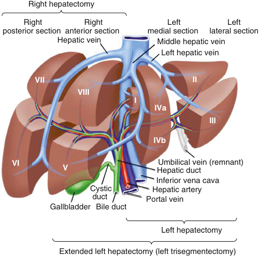

Right hepatectomy Right Right Left Left posterior section  anterior section  medial section  lateral section Hepatic vein  Middle hepatic vein Left hepatic vein VII II VIII I IVa III IVb VI Umbilical vein (remnant) V Hepatic duct Inferior vena cava Cystic Hepatic artery duct  Portal vein Gallbladder  Bile duct Left hepatectomy Extended left hepatectomy (left trisegmentectomy) 

**Fig. 14.1 Schematic depiction of Couinaud segmental liver anatomy and the normal portal venous structures.** _Bracketed text_ shows hepatic segments resected during partial hepatectomies. (Modified from Venook AP, Curley SA. Management of potentially resectable colorectal cancer liver metastases. http://www.uptodate.com/content s/management–of–potentially–resectable–colorectal–cancer–liver– metastases.)

by the branches of the portal vein, giving rise to the eight segments. In this system, the caudate lobe is referred to as segment 1 and the remainder of the segments are numbered in a clockwise fashion. Segments 2 and 3 are medial to the left hepatic vein, with segment 2 superior to segment 3. Segment 4 lies between the middle and left hepatic vein and is subdivided into 4a (superior) and 4b (inferior) subsegments. Segments 8 (superior) and 5 (inferior) are located between the middle and right hepatic veins. Segments 6 (inferior) and 7 (superior) are located between the right hepatic vein and the edge of the liver.8 To standardize the nomenclature used to describe hepatic resections, the International Hepatopancreatobiliary Association published consensus terminology in 2000 based on the Couinaud segments, known as the Brisbane 2000 terminology.9 This system of terminology was uniformly adopted.10,11 However, the Brisbane 2000 Terminology for Liver Anatomy and Resections did not address identification of smaller anatomic resections that are required for minimally invasive surgeries. Hence, an expert consensus meeting titled “Precision Anatomy for Minimally Invasive Hepatopancreatobiliary Surgery” was convened by the Tokyo 2020 Terminology for Liver Anatomy and Resections in order to update the Brisbane 2000 system.12 This update has been adopted today.

Regarding its blood supply, the liver receives approximately 25% of the resting cardiac output.13 The blood supply is through both the arterial and venous systems in the form of the hepatic artery and the portal vein (see Fig. 14.1). The hepatic artery is responsible for 25% to 30%

of the blood supply to the liver whereas the portal vein is responsible for 70% to 75%. The hepatic artery arises from the celiac trunk in 80% of the population. In the remainder of the population, it arises from the superior mesenteric artery. After giving rise to the gastroduodenal artery, the common hepatic artery enters the hilum of the liver (porta hepatis), where it further branches into the right and left hepatic arteries, supplying the right and left sides of the liver, respectively. The right hepatic artery gives rise to the cystic artery that supplies the gallbladder.13 The arteries continue to branch throughout the liver, ultimately running through the portal tracts and terminating in the hepatic sinusoids (capillaries).

Although part of the venous system, the portal vein is the primary source of oxygenated blood to the liver. The portal vein carries blood from the gastrointestinal tract, pancreas, and spleen to the liver via the superior mesenteric, splenic, and inferior mesenteric veins, as well as the gastric, cystic, and pancreaticoduodenal veins. The portal vein enters the hilum and, like the hepatic artery, branches into the right and left portal veins, supplying the respective sides of the liver.13 The portal veins continue to branch throughout the liver in conjunction with the hepatic arteries. As with the arteries, they terminate in the hepatic sinusoids. Venous drainage of the liver is through the hepatic veins directly into the inferior vena cava. The right and middle hepatic veins serve the right half and middle portions of the liver, respectively, while the left hepatic vein drains the left half of the liver.

### The Gallbladder

The gallbladder is a muscular sac that lies posteriorly between liver segments 4 and 5. It is separated from the liver by the adventita that surrounds the muscularis externa. The muscular layer surrounds the internal villous layer that is composed of columnar epithelia. Operating through a system of ducts in proximity of the intrahepatic portal veins, the gallbladder stores bile removed from the liver. The intrahepatic bile ducts drain into right and left collection systems that ultimately form a common hepatic bile duct (see Fig. 14.1).13 From the gallbladder, the cystic duct joins the common hepatic bile duct and forms the common bile duct. Bile from the common bile duct drains into the duodenum via the ampulla of Vater, where it is joined by the pancreatic duct. The sphincter of Oddi can contract to prevent reflux of duodenal contents into the bile and pancreatic ducts. The blood supply of the gallbladder is via the cystic artery, a branch of the right hepatic artery, while the cystic vein drains into the portal vein.14

### The Pancreas

The pancreas is primarily retroperitoneal and weighs approximately 100 g. Measuring 14–25 cm in healthy adults, it has an elongated shape consisting of a head adjacent to the duodenum and a neck, body, and tail extending leftward into the peritoneum and ending at the hilum of the spleen. It has two main functions – the exocrine pancreas, which makes up approximately 85% of pancreatic tissue and is involved in digestion, and the endocrine pancreas, which secretes hormones.15 There are two pancreatic ducts that empty into the duodenum, the duct of Wirsung, also known as the main duct, which connects with the bile duct

<!-- PDF page 4 -->

at the ampulla of Vater, and the duct of Santorini, or accessory pancreatic duct. The blood supply to the pancreas is primarily via branches of the celiac trunk, including the splenic, gastroduodenal, and the pancreaticoduodenal arteries. The superior mesenteric artery supplies the inferior pancreaticoduodenal artery branch. Venous drainage is to the superior mesenteric vein and the splenic vein, which both then drain into the portal vein.16

### CELLULAR ANATOMY

### The GI Tract

As noted by the surgical anatomy, the GI tract epithelium has specific functions that vary and depend upon their location in the GI tract. The normal esophagus has a squamous epithelial lining designed to promote the passage of ingested nutrients to the stomach. Although the stomach also has epithelium, there are additional cell types that have key roles in digestion, such as mucous cells, which protect against harsh hydrochloric acid; parietal cells, which secrete hydrochloric acid and intrinsic factor; chief cells, which secrete pepsin; and G cells, which secrete gastrin. Together these cells promote breakdown, partially digest food, and reduce food particle dimension to an appropriate size (2 mm or less) before it enters the small intestine.2 Similar to the stomach, the small intestine epithelia have a secondary role to villi that protrude into the intestinal lumen and crypts at the bases between villi. The villi are covered by a single layer of columnar intestinal epithelial cells, which can be either absorptive (enterocytes), or secretory (mucus- secreting goblet, antimicrobial- secreting Paneth, hormone- secreting enteroendocrine cells, and chemosensing/immunomodulatory cytokine- secreting tuft cells). Intestinal stem cells also reside at or near the base of the intestinal crypts and continuously generate daughter cells that differentiate near the top of the crypts before migrating toward the lumen, their final destinations. In the small intestine, most cells are sloughed into the lumen within a few days because they migrate upward toward the villus tip. However, Paneth cells move downward into the crypt as they mature and can persist for approximately 1 month.17 The large intestine has crypts with intestinal stem cells, similar to the small intestine but not villi. Additionally, the epithelial layer of the colon is made up mostly of absorptive and goblet cells, which constitute 16% of the cells and are 4 times more abundant than those in the duodenum. The cecum has an additional cell type called deep crypt secretory cells which also migrates downward, similar to antimicrobial- secreting Paneth cells, and turnover is in 14–21 days.18

### The Liver Lobule and Acinus

The cellular architecture of the liver supports its functions of detoxifying the blood and metabolizing nutrients. Histologically, the liver parenchyma can be organized into anatomic units (liver lobules) or functional units (liver acinus). The liver lobule is the basic structural unit of the hepatic parenchyma (Fig. 14.2). The lobule typically appears hexagonal in shape with a portal canal at each corner and a hepatic venule (central vein) located in the center. Through each portal canal run the lymphatics, nerve fibers, and a portal triad. Each portal triad consists

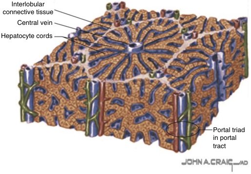

Interlobular connective tissue Central vein Hepatocyte cords Portal triad in portal tract 

**Fig. 14.2 Hepatic lobule.** Liver arranged as a series of hexagonal lobules, each composed of a series of hepatocyte cords (plates) interspersed with sinusoids. Each lobule surrounds a central vein and is bounded by six peripheral portal triads (low magnification).

of a bile ductule, hepatic arteriole, and portal venule. From a functional standpoint, the acinus is the smallest unit of the liver (Fig. 14.3A). It is composed of a portal tract at the center with central vein at the periphery. Oxygenated and nutrient- rich blood flows from the portal triads to the central hepatic veins through the hepatic sinusoids (Fig. 14.3B). The walls of the sinusoids are composed of liver sinusoidal endothelial cells (LSECs) that are separated by fenestrations of 50 to 150 nm in diameter. The fenestrations allow the passage of metabolites, plasma proteins, pharmaceutical molecules, lipoproteins, and other solutes into the space of Disse (SD) surrounding the sinusoids while retaining blood cells in the vessels. Larger macromolecules and potentially immunogenic peptides enter the SD by transcytosis through the SECs.19 Once in the SD, the molecules are taken up by hepatocytes.

**Hepatocytes.** Hepatocytes make up 75% to 80% of the cellular volume of the liver.20 They are responsible for drug, protein, carbohydrate, lipid, and heme metabolism in addition to the synthesis of a variety of proteins necessary for the maintenance of homeostasis at baseline and in response to acute insults secondary to ischemia–reperfusion, viral and bacterial infections, and toxins. Hepatocytes are polarized with heterogeneous plasma membranes to facilitate their various functions. The basolateral (sinusoidal) portion of the membrane is in direct contact with the SD while the apical portion of the membrane makes up the bile canaliculus that drains bile to the ductules.21 Hepatocytes are divided into different zones based on their proximity to the portal triad. Zone 1 is periportal, zone 3 is around the central vein (perivenous or pericentral), and zone 2 is in between (midzone). Zone 3 hepatocytes are furthest away from the portal tracts and thus receive blood with a lower oxygen tension and nutrient content.22 The metabolic functions of the hepatocytes differ based on the zone in which they are located (Fig. 14.3C). This metabolic zonation increases the efficiency of carbohydrate, amino acid, lipid, and xenobiotic metabolism. Periportal (zone 1) hepatocytes are the major sites of aerobic metabolism, and processes such as glycogen synthesis and sulfation, whereas perivenous (zone 3)

<!-- PDF page 5 -->

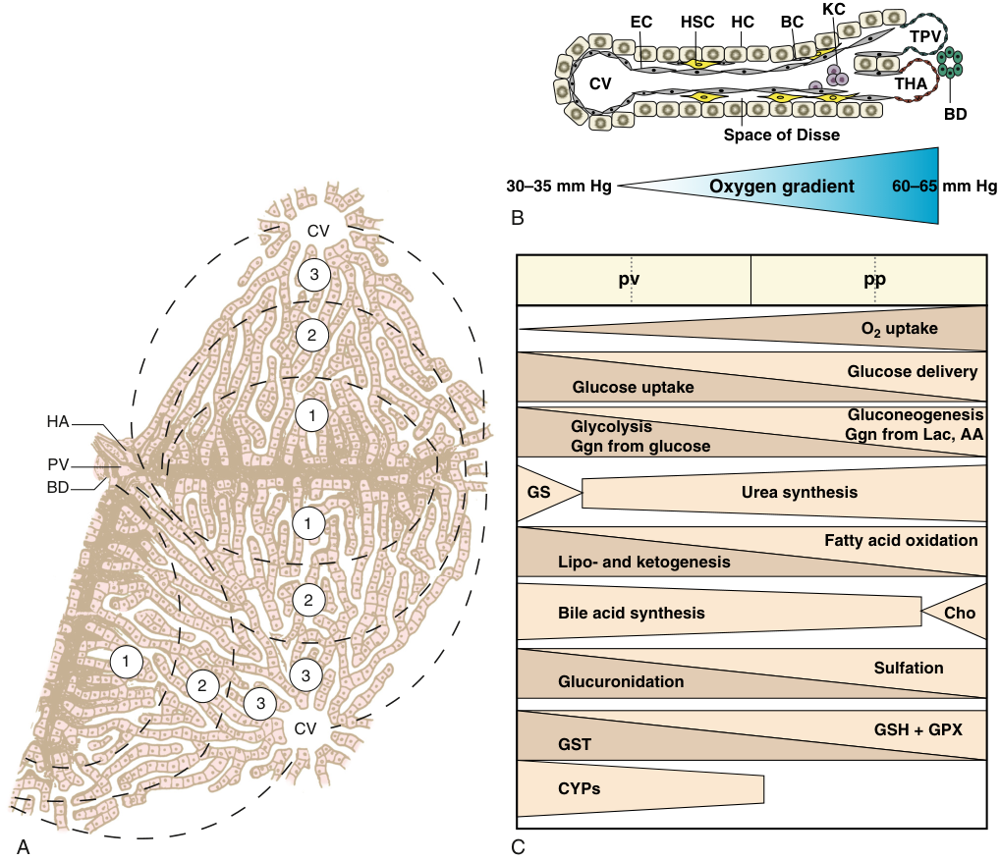

KC EC HSC HC BC TPV CV THA BD Space of Disse 30–35 mm Hg Oxygen gradient 60–65 mm Hg B CV 3 pv pp 2 O2 uptake Glucose delivery Glucose uptake HA 1 Glycolysis Gluconeogenesis Ggn from Lac, AA Ggn from glucose PV BD GS Urea synthesis 1 Fatty acid oxidation Lipo- and ketogenesis 2 Bile acid synthesis Cho 1 Sulfation 2 3 Glucuronidation 3 CV GSH + GPX GST CYPs A C 

**Fig. 14.3** (A) Blood supply of a liver acinus. Schematic representation of the acinus and hepatocyte zones. Hepatocytes can be divided into three zones based on their location along the sinusoid from the portal triad (PT) to the central vein (CV). Zone 1 – periportal zone: hepatocytes are closest to the portal triad; Zone 3 – perivenous, pericentral, or perilobular zone: hepatocytes are closest to the central vein. Zone 2 (intermediary) hepatocytes are in between. (B) Diagram of the sinusoid. The sinusoid is lined with sinusoidal epithelial cells (EC) separated by fenestrations that control the passage of solutes into the space of Disse. The space of Disse contains hepatic stellate cells (HSC) and is bound by the basolateral (sinusoidal) portion of the plasma membranes of the hepatocytes (HC). The apical portion of the plasma membranes makes up the bile canaliculus (BC). Oxygen and nutrient- rich blood flows from the terminal hepatic artery (THA) and portal vein (TPV) through the sinusoid to the central vein (CV). There is an oxygen gradient along the length of the sinusoid. Kupffer cells (KC) are resident hepatic macrophages and found in the sinusoids. (C) Hepatocyte zonation. The major metabolic pathways in the hepatocytes along the sinusoid differ based on their proximity to the portal triad or the central vein. Predominant metabolic pathways are listed for the periportal (pp) hepatocytes and the perivenous (pv) hepatocytes. _AA,_ amino acid; _BD_ , bile duct; _Cho,_ cholesterol synthesis; _CYPs,_ cytochrome P450 enzymes; _Ggn,_ glycogen; _GPX,_ glutathione peroxidase; _GS,_ glutamine synthesis; _GSH_ , glutathione; _GST,_ glutathione transferase; _Lac,_ lactate; _HA,_ hepatic artery; _PV,_ portal vein. (B,C, From Kietzmann T. Metabolic zonation of the liver: the oxygen gradient revisited. _Redox Biol_ . 2017;11:622–630.)

hepatocytes are the major sites of anaerobic metabolism, glycolysis, and glucuronidation. By virtue of their location, zone 3 hepatocytes are most sensitive to hypoxia.22

**Resident Immune Cells.** Resident immune cells in the liver consist of hepatic stellate cells, myeloid cells, and lymphocytes. Hepatic stellate cells (HSCs) make up 8% to 10% of resident liver cells.23 These specialized cells reside in the SD between LSECs and hepatocytes. In the normal liver, HSCs are in a quiescent state. The myeloid cells consist primarily of Kupffer cells, a type of resident tissue macrophages, in

addition to dendritic cells and myeloid- derived suppressor cells. Kupffer cells constitute around 20% to 30% of nonparenchymal cells; however, they constitute 80% to 90% of all tissue macrophages.24 Kupffer cells reside in the portal and lobular liver sinusoids where they engulf both infectious and noninfectious particles by phagocytosis. Cells of lymphatic origin include natural killer (NK) cells, NK T- cells (NKT), mucosal- associated invariant T- cells, and γδ T- cells in addition to major histocompatibility restricted CD4+ T- cells, CD8+ T- cells, and B- cells. These cells serve critical roles in the innate (NK, NKT, mucosal- associated invariant

<!-- PDF page 6 -->

T- cells, and γδ T- cells) and adaptive (major histocompatibility restricted CD4+ T- cells, CD8+ T- cells, and B- cells) immune responses.25

### Gallbladder

The gallbladder wall is composed of adventitia and muscularis externa, with the innermost mucosal layer made up of columnar epithelium with microvilli similar to the small intestine. The microvilli increase surface area which is useful for concentrating bile.14 The cells that participate in gallbladder function are the smooth muscle cells that contract and relax as well as the columnar epithelia that comprise the villi. Although resident immune cells have not been demonstrated in the gallbladder without infection or immune disorders, biliary epithelial cells possess Toll- like receptors that can trigger innate immune responses via antigen pattern recognition.26–28 With regards to the adaptive immune system, human biliary epithelia express major histocompatibility complex I and low levels of major histocompatibility complex II.29 Following stimulation, these cells express a variety of co- stimulatory molecules that are critical to adaptive immune responses.30

### Pancreas

The most abundant pancreatic cells have exocrine function via exocytosis, and are called acinar cells, derived from the Latin word “acinus”, meaning grape, because they form bundles similar to clusters of grapes. The acinar cells have a pyramidal shape, and synthesize and secrete the enzymes trypsin, lipase, and amylase, which are active in protein, fat, and carbohydrate digestion. Centroacinar cells form the connection between the acinar cells and the pancreatic duct system by partially covering the apical surface of the acinar cells and then forming the lining of the intercalated ducts that converge into the intralobular and interlobular ducts, and finally the main pancreatic duct. Acinar enzymes are secreted into the duodenum within a bicarbonate- rich fluid produced by the ductal epithelium.15

The pancreatic endocrine cells are organized in groups known as the islets of Langerhans, which are interspersed throughout the pancreas. There are five endocrine cell types: alpha cells which secrete glucagon, beta cells which secrete insulin and make up 40%–60% of the endocrine cells, delta cells which secrete somatostatin, pancreatic polypeptide (also known as F) cells which secrete pancreatic polypeptide, and epsilon cells, which secrete ghrelin. Each islet is supplied by one or more small arteries (arterioles) that branch into numerous capillaries which allow for direct secretion of the pancreatic endocrine hormones into the bloodstream.15

### INNERVATION

### GI Tract

The GI tract is innervated by the extrinsic and enteric nervous systems of the autonomic nervous system. The extrinsic nervous system has sympathetic and parasympathetic components. The extrinsic sympathetic nervous system is primarily inhibitory as stimulation can decrease or cease GI motility. The preganglionic fibers originate from T5 to L2, and then they travel to the sympathetic chain of ganglia and synapse with postganglionic neurons. Following this

synapse, they travel to the gut, where they terminate at the enteric nervous system. Norepinephrine is the primary neurotransmitter utilized by the extrinsic sympathetic system. Vasoactive intestinal polypeptide (VIP) also transmits sympathetic signals. The extrinsic parasympathetic nervous system is primarily excitatory as it activates GI motility and function. Parasympathetic preganglionic fibers originate in the medulla and sacral region of the spinal cord. Vagus nerve fibers innervate the esophagus, stomach, pancreas, small intestine, and the first half of the large intestine. Pelvic nerve fibers innervate the second half of the large intestine, sigmoid, rectal, and anal regions (Fig. 14.4). Acetylcholine is the primary neurotransmitter of the extrinsic parasympathetic nervous system.

The enteric nervous system is the independent nervous system of the GI tract, which controls motility, secretion, and blood flow. The enteric nervous system has two components: the myenteric (Auerbach) plexus and the submucosal (Meissner) plexus. The myenteric plexus controls motility, which is carried out by enteric neurons, interstitial cells of Cajal (pacemaker cells that generate intrinsic electrical activity of the GI tract), and smooth muscle cells. The submucosal plexus controls absorption, secretion, and mucosal blood flow. Both of these plexuses respond to sympathetic and parasympathetic stimulation. Sympathetic stimulation is inhibitory, so it will increase the tone of the intestinal wall, whereas parasympathetic stimulation is excitatory and will induce intestinal contractions and movement. In addition, the enteric nervous system possesses a variety of reflexes. For example, when there is sympathetic stimulation the tone of the wall increases, the sphincters contract, and this reflexively reduces the amount of excitatory acetylcholine. This latter mechanism occurs via α2 activation, which inhibits the release of acetylcholine and through β activation, which contracts sphincter muscles and relaxes intestinal muscles. These two actions work together to slow the transit of contents through the GI tract.

### Liver, Gallbladder, and Pancreas Innervation

The liver is innervated by autonomic and sensory nerve fibers from an anterior plexus that surrounds the hepatic artery, and a posterior plexus that surrounds the portal vein. Individual liver lobules receive innervation from nerve fibers that surround the hepatic artery, portal vein, and bile ducts. Sympathetic liver innervation includes preganglionic fibers from T7 to T12 and postganglionic fibers from the splanchnic nerve, while parasympathetic liver innervation arises from the vagus nerve. Hepatic neurons produce the expected cholinergic and catecholaminergic neurotransmitters, as well as several neuropeptides, including neuropeptide Y, substance P, vasoactive intestinal peptide, calcitonin- gene related peptide, glucagon- like peptide, somatostatin, neurotensin, and serotonin. While still poorly understood in humans, innervation and denervation of the liver are thought to be important factors in various disease states.

The gallbladder and cystic duct are innervated by the sensory, sympathetic, and parasympathetic systems, via the right phrenic nerve, the celiac plexus, and the hepatic branch of the right vagus nerve, respectively. Hence, surgeries that involve severing the vagus, such as gastric resections or vagotomies performed for peptic ulcer disease,

<!-- PDF page 7 -->

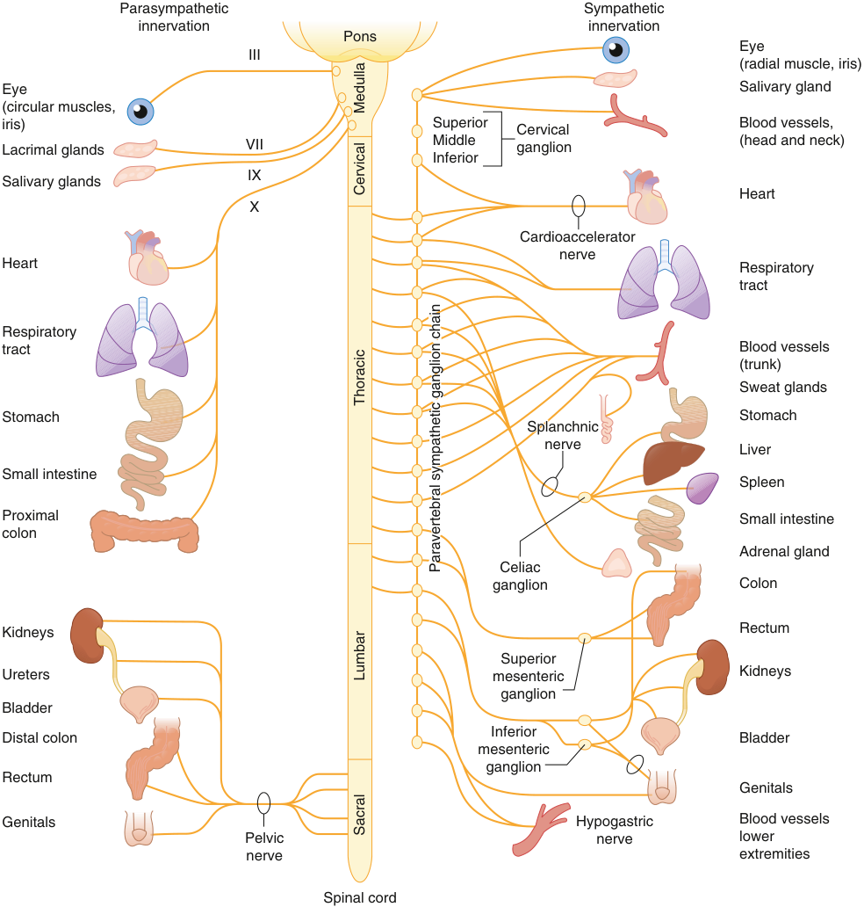

Parasympathetic Sympathetic innervation innervation Pons Eye III (radial muscle, iris) Eye Salivary gland (circular muscles, iris) Superior  Cervical Blood vessels, Lacrimal glands VII Middle Inferior ganglion (head and neck) Salivary glands IX Heart X Cardioaccelerator nerve Heart Respiratory tract Respiratory tract Blood vessels (trunk) Sweat glands Stomach Stomach Splanchnic nerve Liver Small intestine Spleen Proximal Small intestine colon Adrenal gland Celiac ganglion Colon Kidneys Rectum Superior Ureters mesenteric Kidneys ganglion Bladder Inferior Distal colon Bladder mesenteric ganglion Rectum Genitals Genitals Hypogastric Blood vessels Pelvic nerve lower nerve extremities Spinal cord Medulla Cervical Thoracic Paraverteral sympathetic ganglion chain Paravertebral sympathetic ganglion chain Lumbar Sacral 

**Fig. 14.4 Schematic diagram of sympathetic and parasympathetic innervation to the gastrointestinal (GI) tract.** Sympathetic innervation of the majority of the GI tract up to the rectum is supplied by the celiac plexus. (From Glick DB. The autonomic nervous system. In: Miller RD, ed. _Miller’s Anesthesia_ , 7th ed. Philadelphia: Elsevier; 2010.)

will result in gallbladder dysfunction and the formation of gallstones and/or cholecystitis. In these cases, prophylactic cholecystectomies can be done to prevent these complications.14

The pancreas also has a complex network of sensory, sympathetic, and parasympathetic nerve fibers, as well as an intrinsic nerve plexus. Pancreatic sensory information travels via two pathways. Sensation is carried in vagal parasympathetic afferent neurons to the nucleus of the solitary tract; sensory information also travels in pancreatic spinal sensory neurons to the dorsal root ganglia and then to the dorsal horn of the spinal cord and the CNS.31 Sympathetic

fibers arise via the T6–T10 splanchnic nerves and the celiac plexus, while parasympathetic fibers arise from the posterior vagal trunk. Both autonomic systems innervate the pancreatic acinar cells. Secretomotor stimulation comes from a combination of vagal inputs and from cholecystokinin and secretin, hormones produced by the epithelial cells of the duodenum.16

### Abdominal Viscera Pain and Autonomic Innervation

Abdominal visceral pain occurs via complex mechanisms. Although each organ appears to be innervated by specific

<!-- PDF page 8 -->

**Table 14.1** Summary of Visceral Innervation on Gastrointestinal Tract

|**Organ**|**Sympathetic Sensory Supply**|**Parasympathetic Sensory Supply**|
|---|---|---|
|Liver and biliary tract|T5–T10 via_Celiac plexus_|Vagus nerve|
|Stomach|T7–T9 via_Celiac plexus_|Vagus nerve|
|Pancreas|T6–T10 via_Celiac plexus_|Vagus nerve|
|Small bowel|T9–L1 via_Celiac plexus_|Vagus nerve|
|Cecum, ascending and transverse colon|T9–L1 via_Celiac plexus_|Vagus nerve|
|Descending colon|T9–T12 via_Celiac plexus_|S2–S4 via_Pelvic nerves_|
|Sigmoid, rectum|T11–L1 via_Inferior hypogastric plexus_|S2–S4 via_Pelvic nerves_|

From Sikandar S, Dickenson AH. Visceral pain – the ins and outs, the ups and downs. _Curr Opin Support Palliat Care_ . 2012;6(1):17–26.

cord segments, fibers frequently communicate with each other (Table 14.1). Abdominal visceral pain signals are carried in both sympathetic and parasympathetic autonomic fibers.32 In addition to innervation to the GI tract and organs previously described, innervation of the parietal peritoneum, abdominal wall muscles, and skin, supplied by the ventral rami of thoracoabdominal nerves, contributes to abdominal visceral pain.

Sympathetic afferent fibers transmit visceral pain, whereas sympathetic efferent nerves inhibit peristalsis and gastric distention as well as cause GI vasoconstriction.33 Visceral afferent parasympathetic nerve fibers transmit the sensations of satiety, nausea, and distention, whereas efferent parasympathetic nerve fibers increase functions such as secretion, sphincter relaxation, and peristalsis.33–35 Abdominal visceral innervation is almost exclusively myelinated A- delta and unmyelinated C fibers. However, this innervation has “dual- functional” properties (sensory, which carry sensory evoked potentials, and afferent, which regulate autonomic flow).36 In addition to multiple connections between nerves, ganglia, and plexuses, considerable variation in anatomy can be found between patients. Thus, visceral abdominal pain is affected by intra- abdominal pathology, and its distribution is diffuse and capable of amplification.36–39

## Gastrointestinal and Hepatic Physiology

The primary function of the GI tract is to facilitate the absorption of nutrients and the excretion of waste. Microbiota and hormones are inherent to this process, as well as coordinated input from the liver, gallbladder, and pancreas. Motility, absorption, circulation, and excretion are also inherent to this process. Drugs can also utilize gut absorption to access the bloodstream on the way to the liver, the primary site of drug metabolism. Additionally, gut microbiota can also participate in drug metabolism via formation of toxic waste, activation of a pro- drug or drug deactivation.

### GASTROINTESTINAL PHYSIOLOGY

### Absorption of Nutrients and Drugs

Nutrients are ultimately extracted from food that first enters the GI tract via the esophagus. Swallowing pushes

food backward and downward while the muscles of the nasopharynx prevent food from entering the nasal passages. The epiglottis moves upward in a protective mechanism over the larynx and trachea to prevent aspiration. The act of swallowing inhibits the respiratory center to protect from aspiration. Food then enters the esophagus through the upper esophageal sphincter (UES), which then constricts to prevent reflux back into the pharynx. The UES lies at the level of the cricoid cartilage and is made up of the cricopharyngeal, inferior constrictor, and circular esophageal muscles. Waves of peristalsis move the food into the stomach through the lower esophageal sphincter (LES), which is formed intrinsically by circular esophageal muscle and extrinsically by the diaphragm muscle.

Once food enters, the stomach has three main functions: store large quantities of food (up to 1.5–2 liters), mix food with gastric secretions to form chyme and break down particle size, and slow emptying into the small intestine. Solids must be broken down into 1- to 2- mm particles before entering the duodenum, and they take approximately 3 to 4 hours to empty from the stomach. Liquids will empty faster than solids. The proximal stomach is the reservoir for undigested food and produces smooth, tonic contractions. The distal stomach grinds, mixes, and sieves food particles via high- amplitude contractions. The duodenum mixes the contents of the stomach with digestive enzymes, further reducing particle size and increasing solubility. Next the jejunum absorbs nutrients utilizing villi, which increase its surface area and allow for maximal absorption of nutrients. By the time chyme enters the ileum, almost 90% of all available nutrients are absorbed.2 The ileum, the final section of the small intestine, absorbs vitamin B12 with the help of intrinsic factor produced by the stomach, and other products of digestion that were not previously absorbed in the jejunum. It ends at the ileocecal valve, a circular muscle that serves to prevent reflux of colonic contents into the small intestine by contraction in response to colonic dilation and relaxation in response to ileal dilation.2

The large intestine acts as a reservoir for waste and indigestible material before elimination and extracts any remaining electrolytes and water. The colon also exhibits giant migrating complexes that produce mass movements across the large intestine. In the healthy state, these complexes occur approximately 6 to 10 times within 24 hours with mean amplitude of 115 mm Hg at a distance of about 1 cm/s for approximately 20 seconds each.40 These

::: details 原始表格與符號（PDF 第 8 頁）

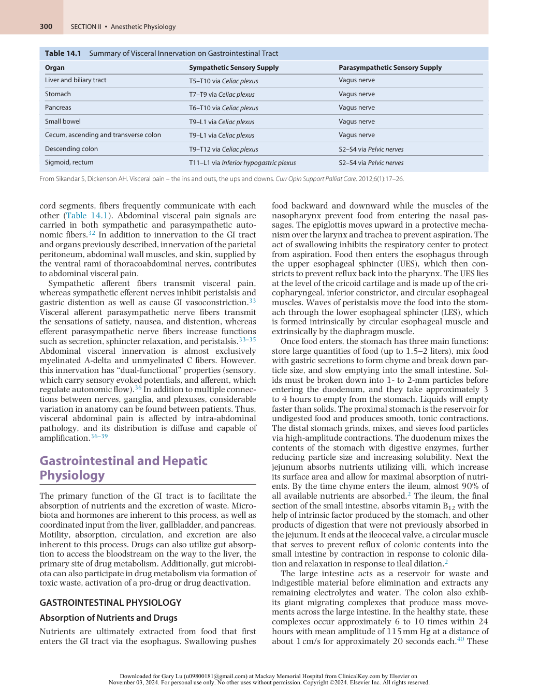

:::

<!-- PDF page 9 -->

complexes, as well as the mixing and propulsive movements, transfer contents to the rectum. The giant migrating complexes that originate in the sigmoid colon will produce the urge to defecate. Rectal distention as well as VIP and NO release will promote relaxation of the internal anal sphincter and allow for defecation.

In addition to giant migrating motor complexes (MMCs) associated with waste processing, there are MMCs that occur only during fasting. MMCs are composed of waves of electrical activity in regular cycles originating in the stomach and terminating in the distal ileum.41 Vagal stimulation releases motilin, which triggers an MMC, leading to peristaltic waves. They occur every 45 to 180 minutes and are composed of four phases. Phase I is a period of quiescence. Phase II is composed of increased action potentials and low- amplitude smooth muscle contractility. Phase III is the most active as it is the time of peak electrical and mechanical activity producing bursts of regular, highamplitude contractions. Phase IV demonstrates declining activity and will merge into the following MMC’s phase I. The MMC is significant because it moves residual undigested food through the GI tract and also moves bacteria from the small intestine to the large intestine.

### Microbiota

The human gut contains approximately 100 trillion microorganisms, and the term microbiome refers to the collective genomes of these organisms, while the term microbiota refers to the community of organisms themselves. The gut microbiota is sometimes referred to as a virtual organ of the body, and it performs many functions in the host, consequently influencing the host’s homeostasis via its effects on fitness, phenotype, and health. The microbial composition of the mouth, esophagus, stomach, and intestines is diverse and host- specific, and likely has a small genetic component and a larger environmental component.42

The gut microbiota benefit the human host in many ways, such as helping in digestion, assisting in the synthesis of certain vitamins, promoting the development of the gastrointestinal immune system, regulating metabolism, preventing invasion by specific pathogens, as well as drug processing and drug metabolism. Furthermore, these microorganisms provide essential capacities for the fermentation of non- digestible substrates like dietary fiber and endogenous intestinal mucus. This fermentation supports the growth of specialist microbes that produce short-chain fatty acids (SCFAs) and gases.42

**Esophagus.** The composition of the microbiota is similar throughout the upper, middle, and lower portions of the normal esophagus and consists of bacteria from six major phyla, comprising Firmicutes, Bacteroidetes, Actinobacteria, Proteobacteria, Fusobacteria and Saccharibacteria. The genus _Streptococcus_ from the phyla Firmicutes dominates the normal esophageal microbiota, and this gram- positive predominance is referred to as type I microbiota. However, in the abnormal esophagus, type II microbiota prevails, consisting of mostly gram- negative bacteria, which are anaerobes and microaerophiles from the genera _Veillonella_ , _Prevotella_ , _Haemophilus_ , _Neisseria_ , _Granulicatella_ , and _Fusobacterium_ , many of which are associated with Barrett’s esophagus.43

**Stomach.** The stomach has long been considered to be largely devoid of bacteria due to its acidic environment, even after the discovery of _Helicobacter pylori_ in 1982. However, recent sequencing work has shown that the stomach contains a microbiome similar to that of the rest of the GI tract. While there is variation in the bacteria profiled by each study, there is also significant overlap, with several studies demonstrating that the typical gastric microbiome consists of approximately 60 bacterial genera distributed among eight phyla, primarily Actinobacteria, Bacteroidetes, Firmicutes, Fusobacteria, and Proteobacteria. The most common genera reported were _Prevotella_ , _Streptococcus_ , _Neisseria_ , _Haemophilus_ , _Fusobacterium_ , _Veillonella_ , and _Rothia_ .44,45 The presence of _H. pylori_ is a known risk factor for gastric ulcers and gastric cancer, and both _H. pylori_ infection and treatment have been shown to alter the gastric microbiota.46,47

**Small Intestine.** The small intestine microbiota contains bacteria from the same primary phyla as the stomach, including Bacteriodetes, Proteobacteria, Firmicutes, Fusobacteria, and Actinobacteria.45,48 However, compared to the stomach, there is increased bacterial diversity and density, with both increasing from the duodenum to the jejunum and ileum. Common genera in the small intestine include _Lactobacillus_ , _Bacteroides_ , _Streptococcus_ , _Veillonella_ , and _Clostridiales_ .49 The goblet cells produce a mucus layer that protects the intestinal epithelial cells from direct contact, but the commensal bacteria and their microbial products still interact with the host cells, resulting in a complex microbial and immune homeostasis.50 Paneth cells play an integral role in maintaining this intestinal homeostasis via their dense granules which contain antimicrobial peptides and immunomodulating proteins that function to regulate the composition of the intestinal flora. This in turn affects the host microvasculature, injury and repair mechanisms, and levels of intestinal inflammation.17 Mucosal homeostasis requires balanced interactions among the intestinal epithelial cells, mucus layer, microbiota, and host immune defense. Disruption of this homeostasis can cause increased mucus barrier permeability, leading to inflammation and injury of the intestinal epithelial cells.

**Large Intestine.** In the ileum to the colon, the microbial content has its highest diversity and density, representing approximately 20% of wet stool mass in adults. The infant gut is colonized immediately after birth, starting with facultative anaerobes, such as _Enterobacter, Enterococcus, and Lactobacillus_ , and followed by anaerobic microorganisms, including _Bifidobacterium_ , _Bacteroides_ , and _Clostridium_ . The gut microbiota reaches a composition and diversity similar to adults by approximately age three, and remains fairly stable over time in adulthood. The most common phyla are Bacteroidetes and Firmicutes, with Actinobacteria, Proteobacteria, Fusobacteria, and Verrucomicrobia also contributing to the microbiota. Furthermore, methanogenic archaea, eukaryotes such as yeast, and viruses such as bacteriophages add to the diversity of the colon microbiome.44,51–53

As with other parts of the GI tract, disruption of the large intestinal microbiota has been associated with several gastrointestinal diseases, including inflammatory bowel disease, irritable bowel syndrome, and colorectal cancer. The

<!-- PDF page 10 -->

only disease in which a dysbiotic microbiota plays a clear causal role is in the case of _Clostridium difficile_ infections, which typically occur after antibiotic treatment alters the microbiota composition, allowing _C. difficile_ to multiply. One treatment for _C. difficile_ is to restore a normal microbiota via fecal transplantation, which consists of the engraftment of microbiota from a healthy donor into a recipient with a _C. difficile_ infection.51

**Drug Metabolism by Gut Microbiota.** While the majority of metabolism occurs in the liver, drug- metabolizing enzymes, such as, oxidoreductases, hydrolases, and lyases are found in the gut microbiome.54 Current evidence suggests that these enzymes can contribute to the overall drug effect via modulation of drug activity or production of toxic metabolites. For instance, gut microbiota–mediated transformation of thioguanine to 6- thioguanine converts the prodrug into the active form.55 Similarly, _Eggerthella lenta_ mediates deactivation of digoxin to the reduced inactive metabolite dihydrodigoxin via a cardiac glycoside reductase.56 In addition, although exact mechanisms are unclear, gut microbiota contributes to cisplatin- induced liver toxicity.57

In addition to drug metabolism modulated by the gut microbiota, drug–microbiota interactions also contribute to the overall drug effect. Drugs such as pump inhibitors, statins, and angiotensin- converting enzyme inhibitors can also affect gut microbiota composition, growth, and function.58 For instance, gut microbiota from metformintreated individuals maintained glucose homeostasis and lowered blood glucose when transferred into metforminnaïve mice. A recent study also showed that up to 27% of non- antibiotics had a suppressive effect of at least one component of the human gut microbiome. Hence, the influence of drugs on the microbiota can be just as impactful as the metabolism of drugs by the microbiota.

### Regulation of Hormones

In mammals, ghrelin (GHRL) and motilin (MLN) stimulate appetite and GI motility. In addition, these enzymes contribute to the regulation of energy homeostasis. GHRL and MLN are produced in the mucosal layer of the stomach and proximal small intestine, respectively. GHRL is a multifunctional peptide and is involved in glucose metabolism, endocrine/exocrine functions, and cardiovascular and reproductive functions, in addition to feeding and GI motility. In sharp contrast, the action of MLN is more restricted and is thought to be the mediator of the MMC, as well as the initiation or propagation of gastrointestinal hunger signals while connecting these signals to the brain.59

G- cells of the gastric antrum and duodenum stimulate gastrin release following protein ingestion and gastric distention.60 Gastrin stimulates gastric parietal cells to secrete hydrochloric acid that promotes protein digestion following conversion of pepsinogen to pepsin, as well as vitamin B12 release from ingested food. Gastric distention and fatty food content also stimulate release of cholecystokinin (CCK) from the inclusion cells of the duodenum, which causes contraction of the gallbladder and release of bile into the duodenum via the ampulla of Vater.14 The pancreatic acinar

cells produce the digestive enzymes lipase and amylase, and zymogens (e.g., trypsinogen, chymotrypsinogen, proelastase, and procarboxypeptidase), which are inactive enzyme precursors that are activated by proteolytic enzymes once they are secreted. The combined pancreatic enzymes and bicarbonate fluid produced by the pancreatic ductal epithelial cells converge into two pancreatic ducts that empty into the duodenum at the ampulla of Vater via the duct of Wirsung and the duct of Santorini.15

Pancreatic fluid output is regulated by several hormones, as well as by the autonomic nervous system. The basolateral membrane of the acinar cells contains several receptors for neurotransmitters including secretin, CCK, and acetylcholine. Food entry into the duodenum stimulates neuroendocrine cells to release secretin and CCK, which in turn stimulate exocytosis of pancreatic enzymes from acinar cells into the pancreatic ducts. Between meals, the pancreatic secretion rate is low (0.2–0.3 mL/min), but increases during meals to 4.0 mL/min, for a total daily volume of approximately 2.5 L.15

### HEPATIC PHYSIOLOGY (METABOLISM)

### Drug Metabolism

The vast majority of drugs used in the conduct of anesthesia are metabolized in the liver. A variety of enzymes convert drug molecules into more water- soluble (hydrophilic) molecules or compounds to facilitate their excretion. These enzymes are designated as being either part of the phase I pathway or phase II pathway based on the types of reactions they mediate. Phase I enzymes consist of the cytochrome P450 family of enzymes that convert lipophilic drug molecules to hydrophilic molecules primarily through oxidation, reduction, or hydrolysis. Non- CYP450 enzymes include monoamine oxidases, alcohol dehydrogenases, and aldo- keto reductase. The phase II pathway consists of the conjugation of the products of the phase I pathway with hydrophilic endogenous moieties to make them more watersoluble. Polar molecules may undergo phase II metabolism without having undergone phase I metabolism. The most common phase II reaction is glucuronidation, which is the conjugation of the drug compound to glucuronic acid. This reaction is carried out by a family of enzymes known as uridine 5′- diphosphoglucuronosyltransferases. Other phase II enzymes include sulfotransferases (SULT), glutathione S- transferases (GST), and catechol O- methyltransferases.61 The phase III pathway involves the excretion of compounds into the sinusoids or canalicular bile by molecular transporters that are transmembrane proteins which facilitate the movement of large or ionized molecules across cell membranes. The majority of these transmembrane proteins are part of a superfamily of ATP- binding cassette (ABC) transporters that use ATP to actively transport molecules. Common ABC transporters include multidrug resistance protein (MDR), cystic fibrosis transmembrane conductance regulator, and multidrug resistance–related protein (MRP).

Some orally administered medications undergo extensive metabolism in the gut or liver prior to entering the systemic circulation. This metabolism is termed the first- pass effect and is responsible for the lower oral bioavailability of these medications.62

<!-- PDF page 11 -->

Drug metabolism is affected by a number of factors including genetic polymorphisms of metabolic enzymes, age, sex, pregnancy, liver disease, and concomitantly administered medications. The expression and function of phase I and phase II enzymes are reduced in neonates. The activities of some CYP450 enzymes are increased in women compared to men. Genetic polymorphisms in drug metabolizing enzymes and transporters can lead to wide variations in the pharmacokinetics of some drugs such as warfarin, with some patients having lower rates of metabolism based on the specific CYP450 polymorphism they carry. The concomitant administration of medications may also influence drug metabolism. A number of commonly encountered medications can serve as inducers or inhibitors of the enzymes involved in the different phases of drug metabolism.62 Table 14.2 lists some of the commonly used drugs that are metabolized and excreted by each of the three phases, along with drugs that may serve as inhibitors or inducers for each phase.

See the Chapter 16 for further discussion of hepatic extraction ratio.

### Protein and Heme Metabolism

The liver is responsible for the synthesis and catabolism of proteins, amino acids, and peptides. It is the site of synthesis for 80% to 90% of the circulating proteins including

hormones, coagulant factors, cytokines, and chemokines. As such it plays a significant role in the functioning of the body. Albumin is the predominant protein produced by the liver, accounting for over 50% of total plasma protein. It functions to transport lipids and hormones and maintain blood volume. The liver plays a central role in protein degradation. Amino acids are catabolized through one of two reactions: deamination or transamination. Both reactions lead to the production of ammonia, which the liver converts to urea through the urea cycle. Urea is then excreted by the kidneys in the urine.63

The liver is involved in both heme synthesis and metabolism. Eighty to 90% of heme synthesis takes place in the bone marrow with the resultant heme used to produce hemoglobin. Most of the remainder of the heme is produced in the liver and used primarily to synthesize cytochrome P450 enzymes. Whereas the rate of heme synthesis in the bone marrow is a function of the availability of iron, the rate of synthesis in the liver is a function of the available free heme pool in the body.64 Heme is synthesized through an eight- step enzymatic cascade known as the Shemin pathway. Synthesis begins with glycine and succinyl coenzyme A (CoA) and proceeds through porphyrinogen intermediaries. A deficiency in any of the enzymes involved in heme synthesis leads to the development of porphyria. The specific type of porphyria and

**Table 14.2** List of Well- Known Substrates, Inhibitors, and Inducers for Phase I, II, and III Metabolism Pathways

|**Enzymes**|**Substrates**|**Inhibitors**|**Inducers**|
|---|---|---|---|
|**PHASE I**||||
|CYP3A|Midazolam, buspirone, felodipine, lovastatin, eletriptan, sildenafil, simvastatin, triazolam|Ketoconazole, clarithromycin, itraconazole, saquinavir, fluconazole, grapefruit juice, tipranavir/ ritonavir|Phenytoin, rifampin, St. John’s wort, efavirenz, etravirine, nafcillin, prednisone|
|1A2|Alosetron, caffeine, duloxetine, melatonin, ramelteon, tacrine, tizanidine|Ciprofloxacin, enoxacin, fluvoxamine, oral contraceptives, phenylpropanolamine|Montelukast, phenytoin, smoking components of cigarettes|
|2C8|Repaglinide, paclitaxel|Gemfibrozil, fluvoxamine, ketoconazole, trimethoprim|Rifampin|
|2C9|Celecoxib, warfarin, phenytoin|Amiodarone, fluconazole, miconazole, oxandrolone, capecitabine, etravirine, fluvastatin, metronidazole, sulfinpyrazone, tigecycline|Carbamazepine, rifampin, aprepitant, bosentan, phenobarbital, St. John’s wort|
|**PHASE II**||||
|UGTs|Bilirubin, phenols, estradiols, opiates, carboxylic acids|Paclitaxel, midazolam, cyclosporine, ketoconazole, phenobarbital, phenytoin|Bilirubin, phenobarbitone, rifampin|
|SULTs|Phenols, alcohols, and amines|Flavonoids, mefenamic acids, salicylic acids, clomiphene, danazol|Retinoic acid, methotrexate|
|NATs|Para- aminobenzoic acid, para- aminosalicylic acids, para- aminoglutamate, sulfamethazine, isoniazid, hydralazine, sulfonamides|Caffeic acid, esculetin, quercetin, genistein, scopoletin, Coumarin|Androgens, aminophylline|
|GSTs|Epoxides, quinone, sulfoxides, esters, peroxides|Phenols, quinone, vitamin C derivatives, dopamine, transretinoic acid|Extracts of broccoli, cabbage, Brussels sprouts, grapefruit|
|**PHASE III**||||
|P- gp|Digoxin, loperamide, vinblastine, talinolol|Amiodarone, azithromycin, cyclosporine, diltiazem, dronedarone, erythromycin, itraconazole, ketoconazole, lopinavir/ritonavir, quinidine, verapamil|Avasimibe, carbamazepine, phenytoin, rifampin, St John’s wort, tipranavir/ritonavir|

_CYP_ , cytochrome P450; _GST_ , glutathione S-transferase; _NAT_ , N-acetyltransferase; _P-gp_ , P-glycoprotein; _SULT_ , sulfotransferase; _UGT_ , UDP-glucuronosyltransferase. From Almazroo OA, Miah MK, Venkataramanan R. Drug metabolism in the liver. _Clin Liver Dis_ . 2017;21:1–20. Elsevier.

::: details 原始表格與符號（PDF 第 11 頁）

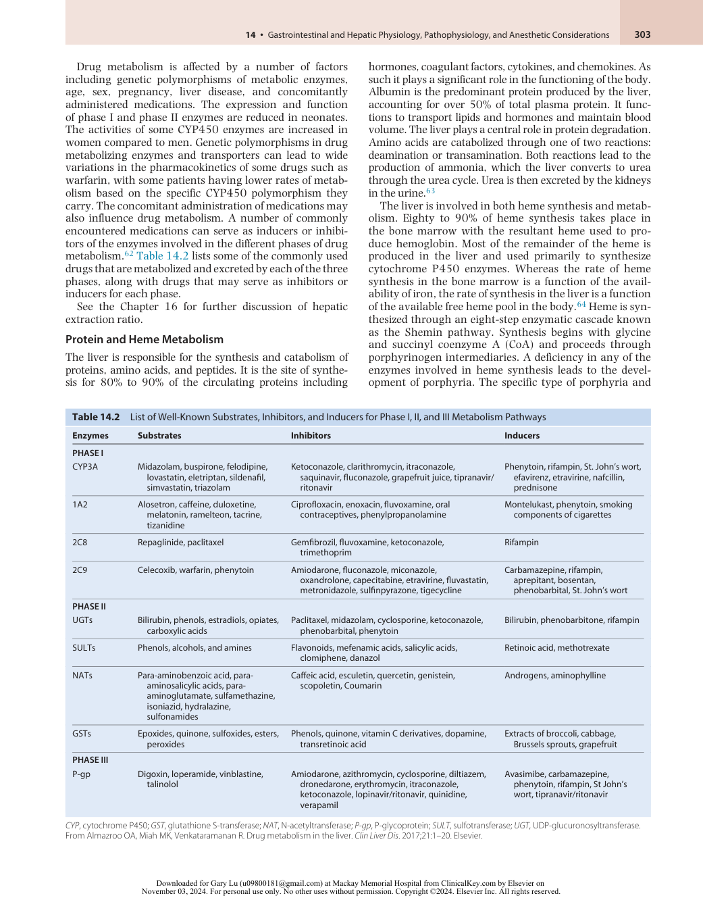

:::

<!-- PDF page 12 -->

its clinical manifestations depend on the specific enzyme that is deficient and the substrate that accumulates as a result. The most common porphyria is acute intermittent porphyria with an estimated incidence of 5 to 10 per 100,000. It is caused by a deficiency in porphobilinogen deaminase, which catalyzes the conversion of porphobilinogen to hydroxymethylbilane. Patients typically have adequate levels of the enzyme for heme homeostasis; however, in response to endogenous or exogenous triggers that induce the Shemin pathway, the capacity of the system is exceeded and they accumulate precursors leading to symptoms. Common triggers include erythromycin, trimethoprim, rifampicin, phenytoin, and barbiturates. Clinical symptoms of an attack include severe, poorly localized abdominal pain (in >90% of cases), nausea, vomiting, agitation, and confusion. Hyponatremia occurs in 40% of attacks. Change in urine color to dark red (especially on exposure to light) is a common finding. Treatment consists of discontinuing the triggering agent, administering pain medication, carbohydrates, and hematin.64

Bilirubin is a product of heme catabolism. The primary source is senescent erythrocytes that are phagocytosed by macrophages in the spleen, liver, and bone marrow. The released heme is metabolized by heme oxygenase into

|Box 14.1**Drugs,** **Metabolites That**|**Foreign Chemical** **Are Excreted in th**|**s, and Their** **e Bile**|
|---|---|---|
|Amiodarone159|Estrone160|Phenol red158|
|Ampicillin158,161|Ezetimibe155|Phenolphthalein162|
|Benzylpenicillin163|2- Fluoro-β- alanine164|Phenytoin162|
|Bilirubin165|Gentamycin163|Pivampicillin163|
|Bromocresol green166 |Glibenclamide (glyburide)|Rifamide158|
|Bromosulfophtha- lein167|Gliclazide190|Rifamycin158|
|Cefatzidime195|Imipramine193|Roquinimex192|
|Cefixime191|Indocyanine green167|Rose bengal166|
|Ceftriaxone194|Indomethacin193|Spironolactone193|
|Cephaloridine158|Irinotecan196|Sulfamethoxazole158|
|Cephamandole163|Lanatoside C163|Sulbactam161|
|Cephazolin163|Lomnetazepam8|Sulindac193 l|
|Chenodeoxycholic acid167,193|Lorazepam197|Temafloxacin198|
|Chloramphenicol163|Methotrexate158|Testosterone193|
|Chlortetracycline163|Metronidazole162|Tetracycline158,163|
|Clindamycin162|Mezlocillin199|Thiamphenicol158|
|Demethylchlortetra- cycline163|Morphine200|Tolfenamic acid201|
|Diazepam158|Mycophenolate mofetil203,205|Toremifene204|
|Digitoxin158|Mycophenolic acid202|Troglitazone206 l|
|Digoxin158|Nortriptyline198|Trovafloxacin9|
|Doxycycline163|Novobiocin198|Ursodeoxycholic acid167,193|
|Erythromycin158|Oltiprazl207|Valproic acid193|
|Estradiol193|Pethidine (meperidine)158|Warfarin200|

From Roberts MS, Magnusson BM, Bruczynski FJ. Enterohepatic circulation. _Clin Pharmacokinet_ . 2002;41:751–790, Table II, page 767.

bilirubin, yielding carbon monoxide and iron in the process. Unconjugated bilirubin is water insoluble and thus tightly bound to albumin in the circulation. Hepatocytes convert bilirubin into a water- soluble form by conjugating it to glucuronic acid via the enzyme glucuronyl transferase. Conjugated bilirubin is then transported across bile canaliculi and excreted in the bile. In the colon, bilirubin is deconjugated, metabolized by bacteria, and converted into urobilinogen. Urobilinogens are either reabsorbed through the enterohepatic circulation (EHC) or excreted in the urine and stool, giving urine and stool their characteristic colors.65

### Carbohydrate Metabolism

The liver is primarily responsible for storing and releasing glucose to meet the body’s needs. In the postprandial state, the liver stores glucose through glycogenesis. Once the glycogen stores are complete, the liver converts excess glucose into fat through lipogenesis. In the fasting state, the liver provides the body with glucose by breaking down glycogen (glycogenolysis) or by generating glucose from carbohydrate precursors (gluconeogenesis).66

### Lipid Metabolism

The liver plays an important role in lipid metabolism. Nonesterified fatty acids can arise from the lipase- mediated breakdown of complex lipids, or from thioesterasemediated hydrolysis of fatty acid CoA.67 These fatty acids can enter the liver following oral intake or they can enter the liver following the breakdown of adipose tissue. In the liver, fatty acid oxidation is regulated by two main factors: the supply of fatty acids to the liver (via lipolysis), and the amount of microsomal esterification that occurs.67 Lipid metabolism is also influenced by carbohydrate metabolism, as the acetyl CoA formed during carbohydrate metabolism can be utilized to synthesize fatty acids. Fatty acids can undergo biotransformation to supply energy for the needs of the body. Alternatively, the liver can convert amino acids and intermediate products of carbohydrates into fats and transport them to the adipose tissues.

### Enterohepatic Circulation (EHC)

The adult liver produces approximately 400 to 600 mL of bile each day. Bile facilitates the excretion of toxins as well as the absorption of dietary fats. It is the mechanism of excretion for compounds with molecular weights greater than 300 to 500 daltons (Da) that are not readily excreted by the kidneys. It is used to excrete a host of endogenous and exogenous compounds, including bile acids, bilirubin, phospholipids, cholesterol, drugs, toxins, steroid hormones, and water- insoluble porphyrins. Box 14.1 lists drugs, chemicals, and their metabolites that are excreted in the bile. The other major function of bile is to assist in the digestion and absorption of dietary fats, cholesterol, and vitamins.68 Bile is 95% water by volume, with the remainder consisting of bile acids, phospholipids, cholesterol, bilirubin, as well as other exogenous and endogenous substances. The two primary bile acids are cholic acid and chenodeoxycholic acid. Bile acids are synthesized by hepatocytes from cholesterol. They are then conjugated to reduce

::: details 原始表格與符號（PDF 第 12 頁）

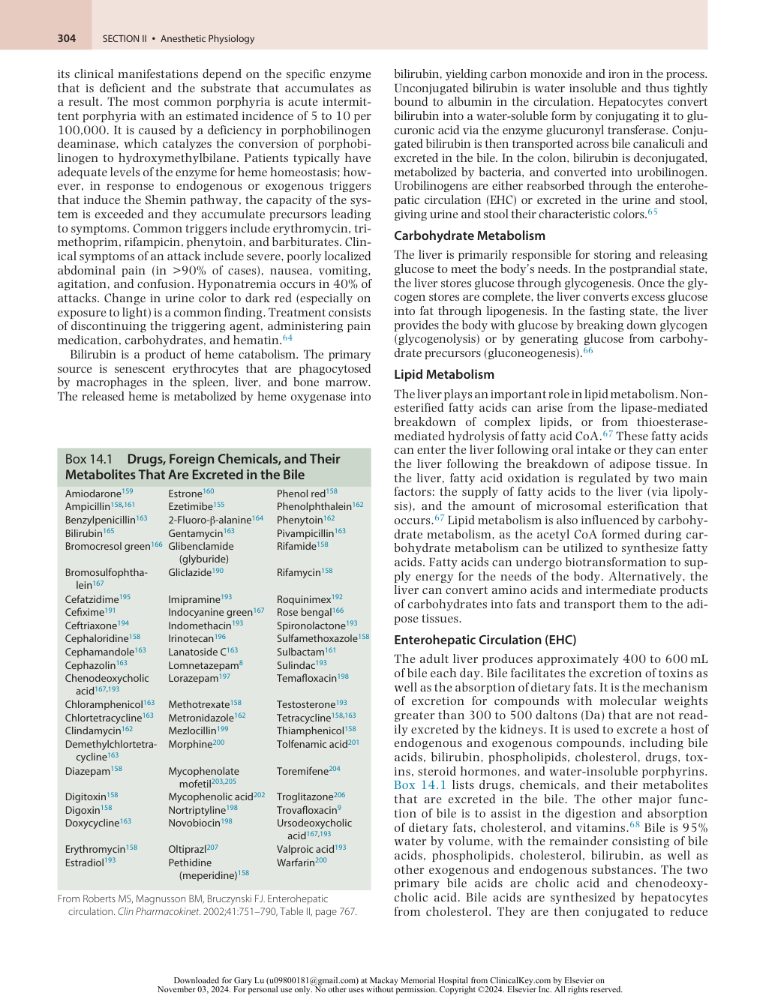

:::

<!-- PDF page 13 -->

hepatotoxicity and increase solubility and secreted into the canaliculi. The bile acids emulsify dietary fats and facilitate their absorption. The vast majority (95%) of the bile acids released into the duodenum are reabsorbed in the terminal ileum and returned to the liver to be reused. This pathway for recycling bile acids is known as the EHC.69 Enterohepatic cycling can impact the pharmacokinetics and pharmacodynamics of drugs that undergo biliary excretion by increasing their bioavailability, reducing their elimination, as well as altering their plasma concentration curves. The effect of EHC on the properties of a drug depends on the physiologic activity of the excreted form of the drug (i.e., pro- drug or activated form), the ease with which the excreted form is reabsorbed through the intestines, and whether it is recycled through the liver into the bile or the systemic circulation. In the case of some drugs, EHC can lead to secondary and tertiary peaks in plasma concentration as the drug is recycled into the system.70

### Coagulation

The liver plays a significant role in the coagulation system. It synthesizes all coagulation factors except factors III (thromboplastin), IV (calcium), VIII and von Willebrand factor (vWF). It also synthesizes proteins that regulate coagulation and fibrinolysis such as protein S, protein C, plasminogen activator inhibitor, and antithrombin III. Furthermore, it removes activated clotting and fibrinolysis products through the hepatic reticuloendothelial system. A number of factors require vitamin K to become active. Coagulation factors II, VII, IX, X, as well as protein C and protein S, undergo posttranslational modification with vitamin K to become active. Briefly, glutamic acid in the amino terminus of these proteins is converted to gamma- carboxyglutamic acid. These gamma- carboxylated procoagulants can then bind calcium ions and form bridges to phospholipid surfaces that are essential for the formation of activation complexes.71 Warfarin acts by inhibition of gamma- carboxylation. In addition to these vitamin K–dependent factors, hepatocytes also synthesize factor V, XIII, fibrinogen, antithrombin, α2 plasmin inhibitor, and plasminogen.72 Thrombomodulin, tissue plasminogen activator, tissue factor plasma inhibitor, vWF, and urokinase are not synthesized in the liver. Instead, these proteins are synthesized in endothelial cells, whereas urokinase is expressed by endothelial cells, macrophages, and renal epithelial cells. Tissue plasminogen activator is primarily removed from the bloodstream through the hepatic reticuloendothelial system.73

### Immunologic Role of the Liver

Resident immune cells in the liver consist of hepatic stellate cells, myeloid cells, and lymphocytes. Hepatic stellate cells are normally quiescent; however, in the setting of liver injury, these cells become activated in response to cytokines and chemokines generated by hepatocytes, LSECs, as well as leukocytes and Kupffer cells. These stellate cells proliferate and differentiate into myofibroblasts participating in hepatic inflammation and fibrosis.74 The most abundant myeloid cells, Kupffer cells participate in phagocytosis

of infectious and noninfectious particles. Once phagocytosed, these particles are unable to induce inflammatory responses in the liver. Thus, Kupffer cells are capable of neutralizing potentially proinflammatory triggers that could disrupt hepatic homeostasis.25 The least abundant myeloid cells are dendritic cells and myeloid- derived suppressor cells, which have immunomodulatory roles. Hepatic dendritic cells are present in the normal liver and reside in the portal area and promote tolerance to phagocytosed particles.75 Hepatic myeloid- derived suppressor cells reduce immune responses. Although this suppressive role can limit tissue injury in acute hepatitis, it could also promote viral persistence in chronic viral hepatitis as well as suppress immune responses to hepatic tumors.25 Similarly, the primary function of hepatic lymphocytes is to promote tolerance to foreign substances. However, major histocompatibility complex (MHC)- restricted cells can promote the clearance of foreign substances by expansion and recruitment from extrahepatic sources such as the lymph nodes and the spleen.25

### Hepatic Regulation of Hormones

The liver can participate in endocrine functions through hormone synthesis or hormone degradation. Hepatocytes synthesize hormones or prohormones such as hepcidin, insulin- like growth factor, and angiotensinogen, respectively. In addition to these hormones, thrombopoietin is also synthesized by hepatocytes and LSECs. These hormones and prohormones have specialized roles in the human body. Thus, hepcidin is responsible for iron homeostasis and regulates intestinal iron absorption, plasma iron concentrations, and tissue iron distribution by inducing degradation of the hepcidin receptor, ferroportin.76 Insulin- like growth factor promotes systemic growth, especially bone growth in children.77 Angiotensinogen, the precursor of all angiotensin proteins, regulates the systemic blood pressure as well as the water and sodium composition of the body.78 Thrombopoietin regulates platelet production by stimulating production and differentiation of megakaryocytes.79 In addition to hormone synthesis, the liver participates in endocrine function by inactivating many hormones, including thyroxine, aldosterone, antidiuretic hormone, estrogens, androgens, and insulin.

## Assessment of the Gastrointestinal and Hepatic Systems

### HISTORY AND PHYSICAL

Signs and symptoms of gastrointestinal (GI) illnesses are quite broad, including dysphagia, nausea, vomiting, abdominal pain and abdominal distention, weight loss, diarrhea, bloody stools, melena, and hematemesis. Patients should be screened for important risk factors, such as prior abdominal surgery, opioid use, and diabetes, and neurologic diseases causing vagal neuropathy may indicate a diagnosis of decreased gastric motility. Questions about diet in

<!-- PDF page 14 -->

relation to the symptoms may point to a diagnosis of gastrointestinal reflux disease (GERD), celiac disease, or other diseases. A positive history of smoking, Barrett’s esophagus, human papillomavirus, human immunodeficiency virus, and co- infection with these viruses are also important risk factors.

There are often no signs or symptoms of liver disease until it is quite advanced. Even then, the only clues may be mild or nonspecific symptoms such as loss of appetite, fatigability, malaise, disrupted sleep patterns, or subtle cognitive changes. Major risk factors for liver disease include alcohol use, illicit drug use, sexual promiscuity, blood transfusions, exposure to hepatotoxins, prior bouts of jaundice, and a family history of genetic diseases such as hemochromatosis, α1- antitrypsin deficiency, and Wilson disease. Patients with advanced liver disease may have these nonspecific symptoms, as well as pruritus, easy bruising, and changes in urine or stool color. In advanced liver disease, physical examination findings include jaundice, scleral icterus, ascites, spider angiomas, xanthelasma, asterixis, and palmar erythema.

### LABS

### Studies for Gastrointestinal Injury

General laboratory tests may be a useful initial step in the workup of GI illnesses. A complete blood count (CBC) can show elevated white blood cells (WBCs), indicating inflammation or infection. Anemia may be a sign of GI bleeding, celiac disease, Crohn disease, or colitis. Patients with severe vomiting may have hypokalemia and metabolic alkalosis noted on an electrolyte panel. Blood tests for specific GI diseases include total immunoglobulin A (IgA) and tissue transglutaminase IgA for celiac disease. Microscopic examination of a stool sample is an important diagnostic tool for several GI diseases. Stool analysis includes assessment for color, presence of occult blood, WBCs, mucus, or fat. Stool cultures and antigen testing can diagnose bacteria, viruses, and parasites in the stool.

### Studies for Hepatocellular Injury

**Aminotransferases.** Serum alanine aminotransferase (ALT) and aspartate aminotransferase (AST), formerly named serum glutamic–pyruvic transaminase and serum glutamic–oxaloacetic transaminase, respectively, are most commonly elevated because of hepatocellular injury. Both are aminotransferases, enzymes involved in gluconeogenesis. ALT is mainly a cytoplasmic liver enzyme. In contrast, cytoplasmic and mitochondrial isozymes of AST are found in many extrahepatic tissues, including the heart, skeletal muscle, brain, kidney, pancreas, adipose, and blood. Therefore, isolated elevations of AST likely represent non- liver sources, but concomitant elevations in AST and ALT usually represent liver injury. Rarely, elevations in AST and ALT levels may result from muscle injury.80

Practice guidelines provide recommendations for the evaluation of abnormal liver enzymes, based on the combination of clinical picture and degree of elevation of AST and ALT. Establishing normal reference ranges for AST and ALT have been complicated by studies with heterogeneous populations, since normal ranges differ with sex and body

mass index (BMI). Nevertheless, multiple studies show that even mild elevations of AST and ALT above the upper limit of normal are associated with increased mortality. Some clinicians therefore argue that the normal limits should be lowered.81

Elevated ALT and AST levels are sometimes described in qualitative terms, ranging from mild (>100 IU/L) to extreme (>2000 IU/L). The extent of aminotransferase elevation can sometimes aid in the differential diagnosis. Mild elevations in AST and ALT can arise from any hepatocyte injury. Large elevations often reflect acute hepatocyte ischemia. Extreme elevations signify massive hepatic necrosis, such as from fulminant viral hepatitis, severe drug- induced liver injury, or shock liver.82 However, aminotransferase levels do not reliably represent the extent of liver damage.

The ratio of AST to ALT may help identify the cause of liver disease. Most causes of hepatic injury are associated with higher ALT than AST levels. However, Wilson disease and alcoholic liver disease are classically associated with an AST–ALT ratio greater than 1; in some cases, a ratio of 4 has been documented. Chronic hepatitis with minimal fibrosis has a low AST–ALT ratio; however, when cirrhosis develops the ratio is greater than 1. Although the AST– ALT ratio may have insufficient predictive value as a sole marker, it can be used in combination with other noninvasive tests to predict the degree of fibrosis in patients with chronic hepatitis.83

**Lactate Dehydrogenase (LDH).** Lactate dehydrogenase (LDH) is a nonspecific marker of hepatocellular injury. Extremely elevated LDH signifies massive hepatocyte damage, usually from ischemia or drug- induced hepatotoxicity (such as acetaminophen overdose). These patients will also have extreme elevations in AST and ALT. Elevated LDH concomitant with elevated alkaline phosphatase (AP) suggests malignant infiltration of the liver. Extrahepatic disorders that cause LDH elevation include hemolysis, rhabdomyolysis, tumor necrosis, renal infarction, acute stroke, and myocardial infarction.80

**Glutathione- S- Transferase (GST).** GST is a sensitive test for liver injury, with a half- life (60–90 minutes) much shorter than AST or ALT. Following hepatocyte damage, serum GST rises quickly and serial GST measurements can help monitor for disease recovery.84 The enzymes AST and ALT are found primarily in periportal hepatocytes (acinar zone 1), whereas GST is present in hepatocytes throughout the acinar zones.85 Since centrilobular/perivenous hepatocytes are most susceptible to hypoxic injury and acetaminophen toxicity, GST is a useful marker, particularly in early stages of injury.

### Studies for Gastrointestinal and Hepatic Synthetic Function

**Serum Albumin.** The serum albumin concentration is used to evaluate chronic liver disease and hepatocellular function (protein synthesis). However, it has poor specificity. Hypoalbuminemia has many other causes besides decreased protein synthesis, including increased catabolism, expansion of the plasma volume, renal losses, and maldistribution of total body albumin. The half- life of albumin in the serum

<!-- PDF page 15 -->

is 20 days. As a result, changes in the synthetic function of the liver are not acutely reflected by the serum albumin concentration. Prealbumin is another protein synthesized in the liver that is also involved in transport and binding. It has a much shorter half- life than albumin. However, the level of prealbumin reflects the status of protein nutrition to a greater degree than liver synthetic function given its high percentage of essential amino acids.80

**Prothrombin Time (PT).** Hepatic synthetic function can also be assessed by measuring the levels of liver- derived coagulation factors. The liver synthesizes coagulation factors in great excess; thus the prothrombin time (PT) will remain normal until significant hepatic impairment occurs. Coagulation factors have shorter half- lives than albumin, ranging from 4 hours for factor VII to 4 days for fibrinogen. Thus when severe liver dysfunction occurs, PT (or the international normalized ratio [INR]) can reflect acute liver failure more quickly than can albumin. It is also used to monitor for restoration of hepatic function, often improving before other clinical signs of improvement occur. However, prolonged PT/INR is not specific for liver disease. It may also represent vitamin K deficiency, warfarin effect, or a genetic factor deficiency.80

### Studies for Hepatic Cholestatic and Metabolic Disease

**Alkaline Phosphatase (AP).** AP isoenzymes are present in many tissues, including liver, bone, intestine, and placenta. In the liver, AP is present in the canalicular membranes of the hepatocytes. Mild elevations in AP may be normal, as AP varies with sex, age, blood type, and smoking status.86 Nonhepatic causes of AP elevation include bone disorders such as Paget disease, osteomalacia, and tumors of the bone; normal growth spurts in children; the third trimester of pregnancy; sepsis; renal failure; and some medications. Elevated AP from a hepatobiliary source is most commonly due to cholestatic disease and typically manifests as an increase to 2 to 4 times the upper limit of normal. Rarely, patients with cholestasis can have extreme elevations in AP (10 times the upper limit of normal).82 AP will also be elevated to a lesser extent in hepatocellular disease

such as hepatitis. The ALT to AP ratio helps differentiate hepatocellular injury (ALT:AP >5) from cholestatic disease (ALT:AP &lt;2) from a mixed picture.81

AP elevation from cholestasis could be a result of either intrahepatic or extrahepatic biliary obstruction. Common causes include primary biliary cirrhosis, choledocholithiasis, and hepatic malignancy compressing small intrahepatic bile ducts. With a half- life of about 1 week, AP will be normal immediately after the onset of biliary obstruction, and it will remain elevated for days after resolution of obstruction.80

The source of AP isoenzyme elevation can be determined by electrophoresis, but this test is expensive and not routinely available. More commonly clinicians confirm the hepatic origin of the AP elevation with other tests that indicate cholestatic disease. The enzymes 5′- nucleotidase and gamma- glutamyl transpeptidase are also elevated in cholestatic disorders, coincident with AP. Simultaneous elevation of these enzymes helps identify liver as the source of AP elevation.

**Serum Bilirubin.** Serum bilirubin is the most commonly used test to monitor for excretory dysfunction of the liver. Bilirubin is measured in serum assays as either direct or indirect bilirubin. Direct bilirubin measures the water- soluble form, which interacts directly with the assay’s reagents. While direct bilirubin correlates with conjugated bilirubin levels, and indirect with unconjugated levels, the two terms are not synonymous. The level of unconjugated bilirubin is typically underestimated by the indirect bilirubin test. Distinguishing conjugated from unconjugated bilirubin is key to the differential diagnosis. The presence of bilirubin in the urine can also help differentiate the clinical cause. Bilirubinuria usually reflects conjugated hyperbilirubinemia, since only the water- soluble conjugated form is excreted by the kidney (Fig. 14.5).80

Elevation in the concentration of unconjugated bilirubin is either due to excessive heme breakdown, or the inability of the liver to conjugate bilirubin. One major cause is hemolysis, in which increased erythrocyte breakdown creates more unconjugated bilirubin than the liver is able to conjugate. Massive hemolysis will cause elevations in both forms of bilirubin, but with unconjugated predominance.

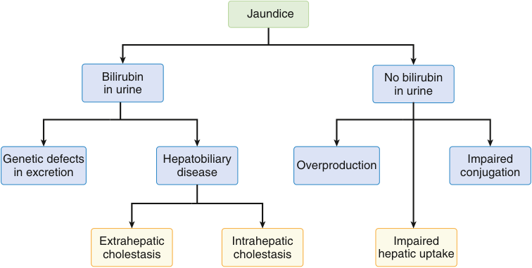

Jaundice Bilirubin No bilirubin in urine in urine Genetic defects Hepatobiliary Impaired in excretion disease Overproduction conjugation Extrahepatic Intrahepatic Impaired cholestasis cholestasis hepatic uptake 

**<mark>Fig. 14.5 Differential diagnosis of jaundice depending on whether bilirubin is or is not present in the urine.</mark>**

<!-- PDF page 16 -->

Gilbert syndrome is a benign condition with genetically low levels of the hepatic enzyme glucuronyl transferase, associated with mild or intermittent elevation in unconjugated bilirubin. Various drugs may also produce unconjugated hyperbilirubinemia. High levels of unconjugated bilirubin are neurotoxic, particularly in infants.

Conjugated hyperbilirubinemia occurs due to either problems with the secretion of conjugated bilirubin from hepatocytes into canalicular bile or to the blockage of bile flow within the hepatobiliary tree. This can be due to a genetic defect in the excretion of bilirubin, or cholestasis (either intrahepatic or extrahepatic). Intrahepatic cholestasis is caused by an inflammatory or infiltrative process compressing small intrahepatic bile ducts, while extrahepatic cholestasis is due to biliary obstruction such as from stones or a pancreatic mass. Primary sclerosing cholangitis (PSC) can involve both intra- and extrahepatic bile ducts.87

### Testing for Specific Diseases (Viral Serology; Genetic; Tumor)

In addition to the above standard laboratory tests, targeted testing can aid in the diagnosis of specific hepatobiliary diseases. Such testing includes serologic testing for viral and autoimmune diseases, genetic testing, and tumor marker assays. Viral markers, including antibodies, antigens, and genetic material, are used to diagnose hepatitis from hepatotropic viruses (A, B, C, D, and E) and herpesviruses such as cytomegalovirus and Epstein–Barr virus. Patients with acute or chronic hepatitis B infection and those with immunity due to resolved infection or vaccination can be distinguished based on measurements of hepatitis B surface antigens and surface and core antibodies (Table 14.3). HBV

**Table 14.3** Interpretation of Hepatitis B Viral Serologies

|**Hepatitis B Virus Serologies**|**Interpretation**|
|---|---|
|Hepatitis B surface antigen (HBsAg)|Acute or chronic infection|
|Antibody to hepatitis B surface antigen (Anti- HBs)|Immunity due to recovery from infection or vaccination|
|IgM antibody to hepatitis B core antigen (Anti- HBc IgM)|Previous or ongoing infection|
|IgG antibody to hepatitis B core antigen (Anti- HBc IgG)|Acute infection|
|**INTERPRETATION OF CONSTELL** HBsAg NEG Anti- HBs POS Anti- HBc IgG POS|**ATION OF RESULTS** Immune due to recovery|
|HBsAg NEG Anti- HBs POS Anti- HBc IgG NEG|Immune by vaccination|
|HBsAg POS Anti- HBs NEG Anti- HBc IgM POS|Acute hepatitis B infection|
|HBsAg POS Anti- HBs NEG Anti- HBc IgG POS Anti- HBc IgM NEG|Chronic hepatitis B infection|
|HBsAg NEG Anti- HBs NEG Anti- HBc IgG NEG|Not immune, potentially susceptible|

DNA testing has also emerged to monitor treatment effect and the development of chronic hepatitis B after resolution of acute hepatitis.88

Testing for hepatitis C is recommended for those with various risk behaviors and exposures (such as history of intravenous drug use, long- term hemodialysis, or HIV infection) and as part of an evaluation for unexplained liver disease. American guidelines also recommend onetime screening for hepatitis C in all persons in the United States born between 1945 and 1965, as this birth cohort has the highest prevalence of hepatitis C. Screening entails testing for antibodies to HCV; a positive screen indicates exposure to the virus. Active infection can then be confirmed with nucleic acid testing for HCV RNA. Sustained viral response to treatment is defined as the absence of HCV RNA detected at least 12 weeks after the completion of therapy.89 Currently, patients also receive HCV genotype testing prior to the initiation of treatment. New direct antiviral agents are highly effective in achieving sustained viral response for most genotypes and most clinical conditions. Therefore genotype testing may soon no longer be routinely required.90

Rapid HCV antibody testing and point-of-care RNA tests are useful in community- based settings serving high- risk populations and remote settings without access to centralized laboratories. The measurement of HCV core antigen (HCVcAg) can diagnose active hepatitis C infection with high sensitivity and specificity as a single test, although it is currently not the standard of care. HCVcAg measurement is particularly useful as a rapid, single test for diagnosis in populations who are at high risk of loss to follow- up. However, it is not yet available as a point- of- care test.91

Markers of hepatic malignancy include alpha fetoprotein (AFP) and protein induced by vitamin K absence or antagonist- II (PIVKA- II).92–94 AFP is a glycoprotein synthesized in the liver, fetal yolk sac, and GI tract. The normal value of AFP is less than 20 ng/mL. A significantly elevated concentration of AFP, often greater than 1000 ng/mL, is common in patients with hepatocellular carcinoma (HCC). AFP is also elevated in testicular germ cell tumors, and less frequently in prostate and other gastrointestinal cancers. The concentration of AFP is used to monitor HCC disease progression and response to treatment. It is also widely used to screen for HCC in high- risk patients, along with ultrasound. However, AFP’s role in HCC surveillance has recently been debated, as studies suggest that AFP has insufficient sensitivity as a screening tool for HCC, particularly for small and solitary tumors. AFP may be normal in 40% of HCC patients.82,95 PIVKA- II, also known as des- γ- carboxylated prothrombin, is a biomarker for HCC with high specificity.92,94 With a shorter half- life than AFP, PIVKA- II is useful in monitoring for treatment response and recurrence. PIVKA- II is also associated with worse survival. AFP and PIVKA- II combined can diagnose HCC with further increased sensitivity and specificity.96

Laboratory tests can help define the type of liver dysfunction, and even identify specific causes. In addition, some of these markers are used to assess disease severity, monitor disease progression and treatment, and predict mortality. Taken alone, thrombocytopenia is the earliest sign of cirrhosis among the routine serum tests, indicating both decreased hepatic function and splenic sequestration from

::: details 原始表格與符號（PDF 第 16 頁）

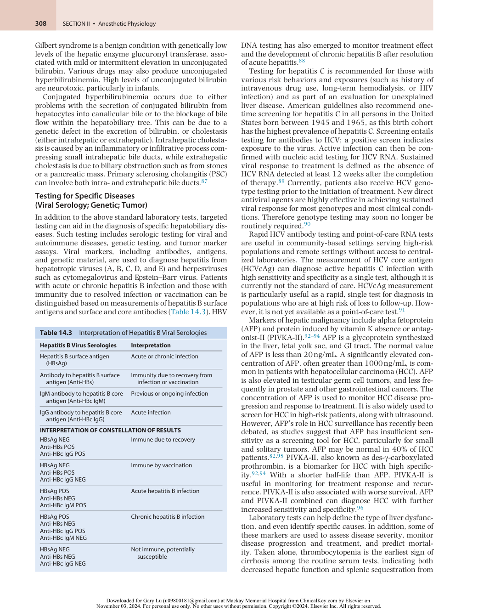

:::

<!-- PDF page 17 -->

portal hypertension.97 Some markers are combined to create scoring systems, thereby improving the sensitivity and specificity of single tests. For example, the Model for EndStage Liver Disease (MELD) score (a calculation that combines INR, bilirubin, and creatinine) was created to assess risk of mortality in cirrhotic patients undergoing transjugular intrahepatic portosystemic shunt (TIPS) procedures. The MELD score now is used for liver transplant listing, as it correlates with wait- list mortality. Standard tests such as INR, lactate, and platelet count, as well as novel quantitative tests have been used to predict short- term outcome after liver transplantation.98 The HCC- MELD score, which combines AFP, MELD, and tumor size, can predict survival after liver transplantation in HCC patients.99 Elevated bilirubin predicts poor prognosis in acute or chronic liver disease, and AFP and bilirubin together predict poor outcome in primary biliary cirrhosis.

### Noninvasive Serum Testing for Fibrosis

Multiple models combining noninvasive measurements have been used to assess the severity of fibrosis. The goal of these models is to allow for disease staging (from mild fibrosis to cirrhosis) without requiring liver biopsy. Although liver biopsy remains the diagnostic gold standard, limitations include sampling error, subjectivity in interpretation, pain, bleeding, and cost.54 These models include various combinations of standard tests such as aminotransferases, platelet count, and INR; as well as serum markers of extracellular matrix turnover such as alpha- 2- macroglobulin, apolipoprotein A1, and hyaluronic acid. New commercial panels test an array of direct markers of collagen turnover, which correlate with fibrosis.83,100,101

### QUANTITATIVE FUNCTIONAL TESTING

### GI Tract Manometry

In evaluating esophageal function, it is important to select a study with an appropriate clinical correlation – is it a problem with motility or is it an anatomic abnormality? If it is a questionable motility problem, then an esophageal manometry study is best. A special catheter detects changes in pressure in the esophagus at various levels. First the pressure of the LES is recorded. The catheter is then pulled back into the esophagus and pressure measurements are made at different levels. Esophageal motor function between swallows is also evaluated. Finally, the motor function of the UES is recorded and then the catheter is pulled out. Questionable anatomic problems are best studied using an upper GI series and ingested barium. These evaluate the act of swallowing and visualize the lining of the esophagus for anatomic abnormalities.

The most common test used to evaluate small intestine motility is small bowel manometry. This test is useful in patients with unexplained nausea, vomiting, abdominal pain, and manifested signs of obstruction without a clear obstructive cause. Similar to esophageal manometry, this test uses a small catheter with pressure sensors to evaluate the contractions of the intestine. The study evaluates contractions during three periods: fasting, during a meal, and postprandial. Normally the recording time is four hours for fasting, followed by ingestion of a meal, and two hours postprandial. Abnormal results are grouped into myopathic

and neuropathic causes. In myopathic results, the MMC is absent or phase III exhibits very low amplitudes (normal phase III amplitude is 40 mm Hg). In neuropathic results, the contraction amplitude is adequate but either the contractions are uncoordinated (enteric neuropathy) or there is an inappropriate postprandial response, meaning postprandial antral hypomotility is present (extrinsic neuropathy). This manometry test is reported to result in a change of diagnosis in 8% to 15% of patients with unexplained nausea, vomiting, and abdominal pain.102

### Evaluation of Hepatocellular Function

Quantitative liver function tests can estimate hepatocellular function by measuring the clearance of various substances metabolized by the liver. Two such substances are indocyanine green (ICG) and bromsulphalein. However, clearance techniques are imperfect tests, potentially influenced by extrahepatic uptake or clearance of the substance, changes in blood flow including portosystemic shunting, and other unknown factors. ICG is avidly extracted by the liver and undergoes minimal extrahepatic uptake and metabolism. Its elimination kinetics are expressed in the ICG plasma disappearance rate (PDR). It can be measured noninvasively by a transcutaneous method. The test is even sensitive to early changes in liver function, and it may be used to guide clinical management. By estimating functional hepatocellular mass, it may help predict outcomes after partial liver resections. It is also used as an early test of graft function following liver transplantation. However, like other highly extracted substances, ICG clearance is dependent on hepatic blood flow, and therefore reflects changes in both hepatic blood flow and hepatocyte function. In fact, ICG is also used specifically to test hepatic blood flow as discussed below. A drop in the ICG PDR may represent a reduction in hepatocellular function, a decrease in hepatic blood flow, or both. Bromsulphalein is another highly extracted substance that can be used to measure hepatic clearance. Bromsulphalein has been associated with severe systemic reactions, and therefore is largely no longer used.103

The capacity of the liver to metabolize drugs can also be measured by caffeine clearance, galactose elimination, aminopyrine breath test, and monoethylglycinexylidide (MEGX).80,104–106 Caffeine clearance can be measured noninvasively through metabolites present in the saliva up to 24 hours after oral caffeine intake. MEGX is the primary metabolite of lidocaine and is measured in the serum after intravenous injection of lidocaine. MEGX concentration may be used to estimate liver function after partial hepatectomy and may have prognostic value in intensive care unit (ICU) patients with liver dysfunction. MEGX was found to independently predict poor outcomes in patients with chronic hepatitis C, and it was more sensitive than standard liver tests in identifying these patients.107 Expensive and time consuming, quantitative tests currently remain primarily research tools and require further validation.

### Hepatic Blood Flow

**Clearance Techniques (Indirect).** Blood flow to the liver can be measured using clearance techniques, indicator dilution techniques, and direct measurements. Based upon the Fick principle, clearance techniques estimate the

<!-- PDF page 18 -->

hepatic blood flow by measuring the rate of disappearance of substances that are exclusively and avidly cleared by the liver. Such substances with high extraction ratios include ICG, propranolol, lidocaine, and radiolabeled colloid particles. The primary limitation of clearance techniques is they assume normal hepatocyte function. Hepatic capacity to eliminate these substances can be variably or significantly diminished in liver disease. This is particularly problematic since liver dysfunction and altered hepatic flow are so often linked.108

The dual cholate test measures the clearance of cholate, a bile salt, given in both oral and intravenous form. The oral cholate undergoes a high first- pass extraction and allows for a calculation of portal circulation. Clearance from the systemic circulation is measured using the intravenous cholate. One can quantify the degree of portal- systemic shunting and calculate a disease severity index. This index correlates with degree of fibrosis on liver biopsy and can predict risk of cirrhosis and poor clinical outcomes.107,109

**Indicator Dilution Techniques.** Unlike clearance methods, indicator dilution techniques can measure hepatic blood flow even in the setting of liver dysfunction. A known quantity of a radiolabeled indicator (e.g., iodinated albumin) is injected into the portal system and hepatic artery. The concentration of that substance is then measured continuously from a hepatic vein. Hepatic blood flow can then be calculated by creating indicator dilution curves. The substance used should be resistant to hepatic clearance.13 Indicator dilution techniques also presume uniform liver perfusion, and therefore results could be altered in patients with shunting. These techniques are invasive and are still primarily research tools as well.108

**Direct Measurements.** Blood flow through the portal vein or hepatic artery can be measured directly using electromagnetic or ultrasonic probes. These techniques are invasive and subject to significant error. The surgical procedures required to implant the probes can themselves alter hepatic blood flow. Once implanted, the probes are often left in place, and blood flow is then measured via telemetry. Implantable Doppler probes are sometimes used in patients immediately post–liver transplantation, and in patients who are at high risk for hepatic artery or portal vein thromboses.108

### IMAGING (MRI/ ULTRASOUND/CT)

### Gastrointestinal Disease

The most prevailing test to evaluate gastric motility is the gastric emptying study. The patient fasts for at least 4 hours prior to the study then consumes a meal with a tightly bound radiotracer, commonly egg albumin. Continuous or frequent imaging occurs for the next 60 to 120 minutes and the measurement of time for 50% of the ingested meal to empty is determined. It is important to note that while gastric emptying scintigraphy has long been the standard study, it is affected by multiple factors including meal composition and data acquisition parameters.110

The lower GI series, for example, involves the administration of a barium enema to a patient. The barium outlines the intestine and it is visible on radiograph.

This allows for detection of colon and rectal anatomic abnormalities.

### Liver Disease

Radiologic techniques play important roles in diagnosing liver disease. Splenoportography evaluates the splenic and portal veins; it is useful in identifying varices and thromboses. Portal venography uses three- dimensional computed tomography (CT) to create vascular maps of portosystemic collateral vessels. These noninvasive imaging techniques are particularly useful in surgical planning, such as before liver transplantation.111

Inexpensive and routinely available, ultrasound can help diagnose cirrhosis with high sensitivity and specificity. Ultrasonic signs of cirrhosis include surface nodularity, hepatomegaly, and hypertrophy of the caudate lobe, as well as signs of portal hypertension, such as ascites, splenomegaly, and increased portal vein diameter. Doppler ultrasonography can show diminished portal flow and portal venous flow reversal.112–114 Fibrosis can also be estimated using elastography, a noninvasive measure of liver stiffness (LS). A shear wave is delivered across the liver via an ultrasound probe, and the wave propagation is then measured. Transient elastography is reproducible and easily performed in the office. Magnetic resonance elastography is especially useful in obese patients and those with ascites, where transient elastography is less accurate. Stiffness is a continuous measure which correlates with the histologic stage of fibrosis, with high sensitivity and specificity.101,113,115 The combination of serum tests along with elastography offers much improved accuracy in diagnosing fibrosis. These tests are now widely used in practice, although they have not yet supplanted the role of liver biopsy.

Patients with chronic liver disease and chronic hepatitis B virus carriers are at increased risk for developing HCC and require regular screening for the cancer. Ultrasound is the most widely used screening tool for HCC worldwide. Multiphasic, contrast- enhanced CT and magnetic resonance imaging (MRI) are used to evaluate focal liver lesions suspicious for HCC with high sensitivity and specificity. While normal liver parenchyma receives only 25% blood flow from the hepatic artery (the rest via the portal vein), HCC cells receive their blood supply primarily from the hepatic artery. Contrast- enhanced imaging reflects this fact with HCCs showing hyperintensity in the arterial phase and washout during the portal venous phase. The Liver Imaging Reporting and Data System (LI- RADS) is a standardized tool for the radiologic classification of liver lesions in patients with chronic liver disease. Use of the LI- RADS has improved radiologic diagnostic accuracy and reduced the need for biopsy in these patients. In fact, confirmatory biopsy is rarely used, even prior to liver transplantation for HCC.97,116,117

### ENDOSCOPY

Endoscopy can be used to diagnose and even treat numerous GI diseases. Upper endoscopy allows for visualization of inflammation, polyps, and other masses of the upper GI tract, ulcerations, strictures, and varices. Endoscopicguided biopsy and tissue analysis is key in the diagnosis of malignancies, GERD, Barrett’s esophagus, eosinophilic or infectious esophagitis, gastric and duodenal ulcers, and celiac disease. Upper endoscopy can also be used to retrieve

<!-- PDF page 19 -->

swallowed objects such as batteries or chicken bones that can cause injury to the tissue. Endoscopic treatments include banding of esophageal varices, commonly found in patients with cirrhosis, dilation of strictures, and removal of pre- cancerous polyps.

Colonoscopy and sigmoidoscopy can identify cancers of the lower GI tract, inflammatory diseases such as Crohn disease and colitis, infections, and ulcerations. Colonoscopy is also used as a screening tool for colon cancer. Colonoscopy allows for visualization and removal of polyps. Regular colon cancer screening is recommended for asymptomatic people with average risk beginning at age 45, to at least age 75. Colonoscopy for colon cancer screening is recommended every 10 years. Flexible sigmoidoscopy, and stool- based tests can also screen for cancer. Surveillance is recommended earlier and more frequently in higher-risk patients such as those with certain kinds of colon polyps, strong family history of colon cancer, or inflammatory bowel disease.

## Pathophysiology of the Gastrointestinal and Hepatic Systems

### GASTROINTESTINAL PATHOPHYSIOLOGY

### Dysmotility and Inflammatory Bowel Syndromes

Diseases of the esophagus are varied. Etiologies can be grouped into anatomic, mechanical, and neurologic, although many disease states involve overlap between two or all three. Anatomic etiologies include the presence of diverticula, hiatal hernia, and changes associated with chronic acid reflux. These anatomic abnormalities interrupt the normal pathway of food as it travels to the stomach which, in turn, changes many of the pressure zones of the esophagus. This can have dangerous sequelae as the luminal pressures may increase enough to overcome the resting pressures of the UES and LES, allowing for reflux. Mechanical etiologies include achalasia, diffuse esophageal spasm, and hypertensive LES. There is also a neurologic component to these diseases but the result is the same – the esophagus is unable to relax properly for food travel. In achalasia the smooth muscles are unable to relax and move food down and the increased tone of the LES does not allow for complete relaxation. This results in dysphagia, regurgitation, and significant pain. In diffuse esophageal spasm the muscle contractions are uncoordinated and, as a result, food does not properly move downward. A hypertensive LES is defined as an LES with a mean pressure of 45 mm Hg or higher, leading to dysphagia and chest pain. Neurologic disorders such as stroke, vagotomy, or hormone deficiencies will alter the nerve pathways such that the appropriate sensing and feedback are disrupted. A common result of neurologic disorders in the esophagus is dysphagia.

Gastric motility disorders that slow its emptying can increase the incidence of GERD. These disorders can be drug- induced, neurologic, or a result of critical illness. Druginduced conditions include the administration of opioids (to be discussed later in the chapter), and the use of vasoactive agents. Vasoactive drugs increase catecholamine

concentrations leading to sympathetic stimulation and, therefore, decreased motility. These drugs are often given intraoperatively or to critically ill patients for blood pressure control. Neurologic disorders resulting in decreased gastric motility include vagal neuropathies and gastroparesis. Finally, conditions that are commonly present in severely compromised patients, such as those with hyperglycemia, increased intracranial pressure, and mechanical ventilation, can decrease gastric motility. Efforts to increase motility using drugs like erythromycin and metoclopramide have been used with some success.

When considering small bowel dysmotility it is helpful to distinguish etiologies based on reversible and nonreversible causes. For reversible causes, mechanical obstruction should be the first to come to mind. In this case, there is a physical obstruction that the muscles of the intestine cannot overcome. Hernias, malignancy, adhesions, and volvulus are all examples. Bacterial overgrowth should be another consideration. Although the large intestine is rich with bacteria, the small intestine usually has fewer than 100,000 organisms per milliliter. Disrupting this condition with bacterial overgrowth leads to alterations in absorptive function, leading to diarrhea. It is treated with antibiotics. Other reversible causes include ileus, electrolyte abnormalities, and critical illness. Nonreversible causes can be classified as structural or neuropathic. In structural causes there may be abnormalities with the intestinal smooth muscle, in which it cannot produce proper contractions. This occurs in diseases such as scleroderma and connective tissue disorders. In patients with an inflammatory bowel disease (IBD), there is a structural abnormality in the mucosa leading to decreased absorption of nutrients. Short bowel syndrome can be considered a structural etiology in that a large portion of the small intestinal structure is simply not present. In patients who have had a section of their small bowel resected, the remaining portion may not provide sufficient functional compensation, resulting in diarrhea, malnutrition, and weight loss. Neuropathic etiologies can produce a pseudo- obstruction in which the intrinsic and extrinsic nervous systems are altered in such a way that the intestines can only produce weak or uncoordinated contractions. This leads to symptoms of bloating, nausea, vomiting, and abdominal pain. Regardless of etiology, small intestinal dysmotility adversely affects nutrient absorption, leading to malnutrition.

Colonic dysmotility manifests with two primary symptoms: altered bowel habits and intermittent abdominal cramping. The most common diseases associated with colonic dysmotility are irritable bowel syndrome (IBS) and IBD, both of which are clinical diagnoses. Rome II criteria define IBS as having abdominal pain/discomfort along with at least two of the following three features: defecation relieves pain or discomfort, onset of pain is associated with an abnormal frequency of stools (more than three times per day or fewer than three times per week), and onset of pain is associated with a change in the form of the stool.7 In IBS with predominantly diarrheal symptoms, there is an increase in the frequency and amplitude of spontaneous giant migrating complexes, and this increase is directly proportional to the severity of symptoms. In IBS with predominantly constipation, there is a decreased amplitude and frequency of giant migrating complexes. In severe cases the

<!-- PDF page 20 -->

giant migrating complexes may be completely absent. In addition, there is a depression of overall contractile activity in the colon leading to colonic distention and the sensation of pain. This phenomenon is exacerbated by stress in which there is significant motor dysfunction and visceral hypersensitivity as well as an increase in plasma norepinephrine stimulating the sympathetic nervous system. In IBD the mixing and propulsive movements as well as the tonic contractions are suppressed due to colonic wall compression by the inflamed mucosa, but the giant migrating complexes remain. There is an increased frequency of the giant migrating complexes and their large pressure effect further compresses the inflamed mucosa, which can lead to hemorrhage, thick mucus secretion, and significant erosions.

### HEPATIC PATHOPHYSIOLOGY

### Cholestatic Disease

Cholestasis is the impairment of bile production or flow. Cholestatic disorders are characterized primarily by elevations of serum alkaline phosphatase (ALP) and gamma- glutamyl transferase (GGT), with or without elevations in bilirubin. Cholestasis can present as an acute or chronic condition and is thought to affect up to 10%–20% of the population.118 The impairment of flow leads to an increase in the concentration of bile salts in the serum and hepatocytes. As the bile salts accumulate in the liver, they dissolve hepatocyte cell membranes, leading to the release of ALP and GGT, resulting in an increase in the serum concentrations of these enzymes.119 Serum concentrations of AST and ALT, which are found in the cytoplasm of hepatocytes, are not increased to as great an extent. As the disease progresses, the serum concentration of conjugated bilirubin, which is excreted into bile, increases, giving rise to jaundice.120 The majority of cases of cholestasis are benign; however, severe and prolonged cholestasis can lead to cirrhosis.

Signs and symptoms of cholestasis include fatigue, pruritus, dark urine, and pale stools. An elevation of ALP on screening laboratory studies may be the first indication in asymptomatic patients. The evaluation consists of a history and physical exam followed by abdominal ultrasonography. Abdominal ultrasonography is used to distinguish between extrahepatic and intrahepatic cholestasis. Extrahepatic cholestasis results from mechanical obstruction of the extrahepatic bile ducts, typically by stones, strictures, or masses leading to ductal dilation. Definitive diagnosis and treatment is by endoscopic retrograde pancreatography (ERCP). If the etiology is unclear, further imaging can be conducted using endoscopic ultrasound (EUS) or magnetic resonance cholangiopancreatography (MRCP) to identify the biliary lesion leading to obstruction.121

Normal imaging results indicate intrahepatic cholestasis. Intrahepatic cholestasis can have a number of etiologies including immune- mediated, infectious, drug- induced, paraneoplastic, and ischemic. The first step in the evaluation is the measurement of antimitochondrial antibody (AMA) titers to rule out primary biliary cholangitis (PBC). Further evaluation may require ERCP and liver biopsy.

### Primary Biliary Cholangitis

Previously known as primary biliary cirrhosis, primary biliary cholangitis (PBC) is an autoimmune disease that is

characterized by the destruction of intrahepatic cholangiocytes and the presence of antimitochondrial antibodies (AMA). It is one of the most common cholestatic liver disorders.122 Reported prevalence rates vary from 20 to 490 cases per million inhabitants, with the highest rates reported in the USA.123 Over 90% of patients are female and the average age at diagnosis is typically in the sixth decade. The diagnosis is made based on an elevation of ALP over 1.5 times the upper limit of normal for a duration greater than 24 weeks along with the presence of an AMA titer greater than 1:40 or elevations in other PBC- specific autoantibodies such as sp100 or gp210.124 A liver biopsy in these patients will reveal interlobular bile duct lesions. Up to 60% of patients may be asymptomatic at diagnosis. If present, the most common symptoms at presentation are fatigue and pruritus. A large number of patients may present with other autoimmune disorders such as keratoconjunctivitis sicca and Raynaud phenomenon. PBC may be associated with osteopenia as well as hyperlipidemia.122 The disease develops due to loss of tolerance to mitochondrial antigens, leading to autoimmune- mediated destruction of biliary epithelial cells (cholangiocytes). PBC can lead to cirrhosis and liver failure, ultimately requiring transplantation.

Treatment consists of ursodeoxycholic acid (UDCA) administration. UDCA, a bile acid, is thought to act by modifying the bile acid pool and reducing inflammation. Approximately 60%–70% of patients with PBC respond to UDCA with improvement in serum ALP and bilirubin levels and a delay in the progression to cirrhosis and liver transplantation. Patients who have a suboptimal response to UDCA have an increased risk of developing complications and liver failure. In these patients, the administration of obeticholic acid (OCA), a farnesoid- X receptor agonist, has been shown to reduce the serum levels of ALP. Fibrates and corticosteroids have also shown benefit when combined with UDCA in patients who are unresponsive to UDCA alone.125–130

### Primary Sclerosing Cholangitis

Primary sclerosing cholangitis (PSC) is a rare cholestatic, immune- mediated disease that occurs most frequently in men aged 30–40 years. It is characterized by inflammation and fibrosis of the bile ducts. The majority of patients with PSC have ulcerative colitis (UC) as well. Approximately half of the patients are asymptomatic at diagnosis. The most common presenting symptoms are fatigue and pruritus. Blood tests demonstrate a cholestatic pattern. Patients may also have hypergammaglobulinemia and elevations in serum autoantibodies. Diagnosis is made based on the presence of multifocal strictures and segmental biliary dilations on cholangiography in the absence of other potential etiologies of sclerosing cholangitis.131 Patients with PSC have an increased risk of developing hepatobiliary carcinoma. The disease is progressive, with biliary fibrosis leading to cirrhosis and ultimately end- stage liver disease. Liver transplantation is the only effective therapy.

### Cirrhosis

Cirrhosis is the common pathologic end point of a variety of mechanisms of hepatic injury. In the US, cirrhosis is the ninth leading cause of death.132 The most common causes of cirrhosis in Western countries are alcoholic liver disease,

<!-- PDF page 21 -->

hepatitis C, and non- alcoholic steatohepatitis (NASH). In the Asia- Pacific region the most common cause is hepatitis B.133 The morbidity and mortality associated with cirrhosis result mainly from portal hypertension. Chronic liver disease promotes apoptosis and regeneration of hepatocytes. The resultant inflammation leads to parenchymal injury and fibrosis, causing distortion and obstruction of the hepatic vascular architecture. These structural changes increase hepatic resistance to portal blood flow and lead to portal hypertension. Hepatic vascular resistance is further increased due to hepatic endothelial dysfunction, which results in a reduction of vasodilator (primarily nitric oxide [NO]) production and an increase in vasoconstrictor (i.e. thromboxane) production.134 Portal hypertension and the release of angiogenic factors lead to the development of gastroesophageal varices as well as portosystemic shunts. As portal hypertension worsens, the local release of NO and prostaglandins causes the splanchnic circulation to vasodilate. This further increases portal inflow and exacerbates portal hypertension. Splanchnic vasodilation also leads to systemic hypotension that, in turn, increases sympathetic tone, activates the renin–angiotensin–aldosterone system and increases antidiuretic hormone (ADH) release, leading to the development of ascites and the hepatorenal syndrome.135 Other significant complications of cirrhosis and portal hypertension are spontaneous bacterial peritonitis, encephalopathy, hepatorenal syndrome, portopulmonary hypertension, cirrhotic cardiomyopathy, and hepatocellular carcinoma.

Laboratory abnormalities in cirrhotic patients include elevations in ALT, AST, ALP, and GGT, as well as serum bilirubin. Hypoalbuminemia and elevations in the PT are indications of hepatic synthetic dysfunction. Although liver biopsy is the gold standard for diagnosing cirrhosis, it is often not necessary in the presence of an appropriate patient history and laboratory and radiologic data. In patients who are suspected of having cirrhosis, serologic testing and ultrasonographic LS measurement is recommended.136

The risk stratification of patients with cirrhosis is based on the presence and degree of portal hypertension, gastroesophageal varices, and synthetic dysfunction, and can be used to guide therapy.137 There are two stages of cirrhosis: compensated and decompensated. Decompensated cirrhosis is characterized by the presence of ascites, variceal hemorrhage, and/or hepatic encephalopathy. Compensated cirrhosis is characterized by the absence of these clinical conditions. While the median survival in patients with compensated cirrhosis is greater than twelve years, in those with decompensated cirrhosis it is approximately two years.138 Patients with compensated cirrhosis can be further stratified based on their degree of portal hypertension. Portal hypertension is defined as a hepatic venous pressure gradient (HVPG) greater than 5 mm Hg. Patients with an HVPG greater than 10 mm Hg are deemed to have clinically significant portal hypertension. They are at increased risk of developing varices, overt hepatic decompensation, postsurgical decompensation, and hepatocellular carcinoma compared to those with mild portal hypertension (HVPG between 5 mm Hg and 10 mm Hg).139–141 Although HVPG is the gold standard for monitoring portal hypertension, its invasive nature precludes its routine use. A noninvasive measure

of clinically significant portal hypertension (CSPH) is liver stiffness (LS) using transient elastography, an ultrasoundbased approach. An LS value greater than 20 kPa has been shown to effectively discriminate mild from CSPH.142 Liver Doppler ultrasound may also aid in the diagnosis. The presence of portosystemic collaterals or reversal of portal venous flow on ultrasound imaging is also sufficient to diagnose CSPH.143 In patients with CSPH, the presence of gastroesophageal varices portends a worse prognosis.144

The management of patients with compensated cirrhosis who don’t have gastroesophageal varices focuses on preventing the advancement of the disease by treating the underlying etiology.137 Patients with varices are treated with nonspecific beta blockers (i.e. propranolol, timolol), carvedilol, or endoscopic variceal ligation to prevent variceal hemorrhage.145–147 Nonspecific beta- blocker therapy reduces HVPG.147

Acute variceal hemorrhage is a medical emergency. Management consists of airway protection, volume resuscitation, and endoscopy with variceal ligation. The concomitant initiation of antibiotic prophylaxis (ceftriaxone 1 g/24 h for seven days) and vasopressor infusion (somatostatin, octreotide, or terlipressin) has been shown to improve outcome and is the standard of care. Once stabilized, pre- emptive transjugular intrahepatic portosystemic shunt (TIPS) may be performed in patients who are at high risk of re- bleeding.137

### Ascites

The presence of ascites is a marker of decompensated cirrhosis. The development of ascites is associated with a reduction in five- year survival from 80% to 30%.148 Patients who develop ascites are at increased risk of developing further complications including spontaneous bacterial peritonitis and acute kidney injury (AKI). Initial management consists of dietary sodium restriction and diuretic administration (spironolactone, furosemide). Refractory ascites (RA) occurs in up to 10% of patients with cirrhosis and ascites. Large-volume paracentesis is the first- line treatment for RA. TIPS can improve transplant- free survival in selected patients with RA. Liver transplantation (LT) should be considered in patients with RA who have contraindications for TIPS.135

### Acute Kidney Injury and Hepatorenal Syndrome

Up to 50% of patients admitted to the hospital with cirrhosis and ascites develop acute kidney injury (AKI). AKI is defined as an increase in serum creatinine greater than or equal to 0.3 mg/dL from baseline within 48 hours or a ≥50% increase in creatinine over the last seven days.149 Renal failure is a sign of advanced disease and has a poor prognosis in liver failure. Seventy to 80% of cases are precipitated by hypovolemia or bacterial infections. Hepatorenal syndrome AKI (HRS- AKI) is less common and associated with a worse prognosis. HRS- AKI, formerly referred to as HRS type 1, is characterized by AKI in the absence of any apparent cause (shock, nephrotoxic drugs, obstruction, renal parenchymal disease) that is unresponsive to volume expansion and diuretic withdrawal.135 The treatment for HRS is aimed at increasing perfusion pressure to the kidneys. The treatment of choice is terlipressin administration in combination with albumin.

<!-- PDF page 22 -->

Norepinephrine can be used if terlipressin is not available (as in the US). Alternatively, midodrine with octreotide can be administered along with albumin, however, it is less effective than terlipressin.135 Liver transplantation is the definitive treatment for HRS- AKI. The use of renal replacement therapy (RRT) is controversial and generally reserved to bridge patients to liver transplantation.150

### Hepatic Encephalopathy

Hepatic encephalopathy (HE) is brain dysfunction secondary to hepatic insufficiency or portosystemic shunting. It is a sign of decompensated cirrhosis. It occurs in 30%–40% of patients with cirrhosis and 50% of patients with portosystemic shunts.151 The clinical presentation is variable and can range from mild changes in personality to disorientation, somnolence, and coma. Asterixis is usually present in the early to middle stages.152 The severity of HE is typically graded from I to IV using the West Haven criteria (Table 14.4) with Grade I indicating mild symptoms and Grade IV, coma.153 Common precipitating factors of HE include infections, variceal hemorrhage, and diuretic overdose. Diagnosis is based on the exclusion of other causes of brain dysfunction and the application of clinical criteria. Treatment consists of amelioration of precipitating factors and the administration of lactulose, a non- absorbable disaccharide. Rifaximin is added as an adjunct following ≥1 episode of overt HE within 6 months of initiating lactulose therapy.153

### Pulmonary Complications

Hepatopulmonary syndrome (HPS), portopulmonary hypertension (PoPH), and hepatic hydrothorax (HH) are pulmonary conditions that can develop in patients with cirrhosis and advanced liver disease. HPS has been reported in up to 30% of patients presenting for liver transplantation evaluation and is associated with increased mortality independent of the severity of liver disease.154 It is defined as abnormal alveolar to arterial oxygen gradient (≥15 mm Hg) while breathing room air in sitting position. It is caused by intrapulmonary vascular dilation (IPVD) in the setting of cirrhosis. Its severity is determined by the arterial partial pressure of oxygen (PaO2): greater than 80 mm Hg is mild, 60–80 mm Hg is moderate, 50–60 mm Hg is severe, and less than 50 mm Hg is very severe.155 Patients may present with dyspnea at rest or on exertion. Approximately 25% of patients have platypnea (dyspnea when moving from supine to standing)

**Table 14.4** West Haven Criteria for Hepatic Encephalopathy

|**Grade**|**Description**|
|---|---|
|I|Trivial lack of awareness; shortened attention span; disordered sleep|
|II|Lethargy; behavioral change; asterixis|
|III|Somnolence; confusion; gross disorientation; bizarre behavior|
|IV|Coma|

Adapted from Vilstrup H, Amodio P, Bajaj J, et al. Hepatic encephalopathy in chronic liver disease: 2014 practice guideline by the American Association for the Study of Liver Diseases and the European Association for the Study of the Liver. _Hepatology_ . 2014; 60: 715–735, Table 2.

or orthodeoxia (decrease in PaO2 more than 5% or 4 mm Hg when moving from supine to standing). In advanced disease, patients may exhibit digital clubbing and cyanosis. Patients can be screened with pulse oximetry (oxygen saturation [SpO2] &lt;96% on room air) and diagnosed based on PaO2 values. Contrast- enhanced transthoracic echocardiography may demonstrate IPVD. No medical therapy has been shown to change outcome in patients with HPS. Supplemental oxygen is provided to maintain SpO2 over 88%. Liver transplantation is the only effective treatment.156 As such, MELD exception points are granted for patients with severe HPS (PaO2 50–60 mm Hg). Patients with very severe HPS (PaO2 &lt;50 mm Hg) have an increased risk for complications and mortality following liver transplantation although this risk may be lower in experienced centers.156,157

Portopulmonary hypertension (PoPH) is pulmonary arterial hypertension in the setting of portal hypertension.158 It is found in 5% of patients presenting for liver transplant evaluation and, in the absence of treatment, is associated with a one- year survival of 46%.159,160 The diagnosis is made by right heart catheterization showing a mean pulmonary artery pressure (mPAP) greater than 25 mm Hg, pulmonary vascular resistance (PVR) greater than 240 dynes/s per cm−5 and a pulmonary artery wedge pressure (PAWP) less than 15 mm Hg. PoPH is classified as mild (mPAP: 25–35 mm Hg), moderate (mPAP: 35–45 mm Hg), and severe (mPAP >45 mm Hg).155 The pathophysiology of the disease remains to be elucidated. Patients are screened using TTE to measure right ventricular systolic pressure (RVSP). Those with RVSP greater than 50 mm Hg undergo right heart catheterization in order to confirm the diagnosis and determine the degree of PoPH. PoPH is treated with phosphodiesterase- 5 inhibitors, prostacyclin analogues, and endothelin receptor antagonists to reduce PVR. mPAP greater than 45 mm Hg is an absolute contraindication to liver transplantation. MELD exception is considered for treatment- responsive PoPH.155

Hepatic hydrothorax (HH) has a prevalence of 5%–10% in cirrhotic patients.161 It develops due to the passage of ascitic fluid from the peritoneal cavity into the pleural space through defects in the diaphragm, most often on the right side. Patients may present with dyspnea, cough, chest discomfort, and hypoxia. Chest radiography and thoracentesis are used for diagnosis. Medical therapy consists of sodium restriction and diuretic administration. Refractory HH is treated with TIPS placement. For patients who have failed TIPS, video- assisted thoracoscopic surgery (VATS) with pleurodesis is an option.162

### Hepatocellular Carcinoma

Hepatocellular carcinoma (HCC) is the most common primary liver malignancy and the fourth most common cause of cancer death globally. It occurs with greater frequency in men than women and with a higher incidence in Asia and Africa, although the incidence has been increasing in the US.163 Chronic liver disease is the most important risk factor for the development of HCC. Hepatitis B, hepatitis C, hemochromatosis, alcohol use, non- alcoholic fatty liver disease, diabetes mellitus, and obesity all increase the risk of developing HCC.164 Screening is recommended for all patients with cirrhosis at 6- month intervals using ultrasound with or without serum alfa- fetoprotein (AFP) measurement.

::: details 原始表格與符號（PDF 第 22 頁）

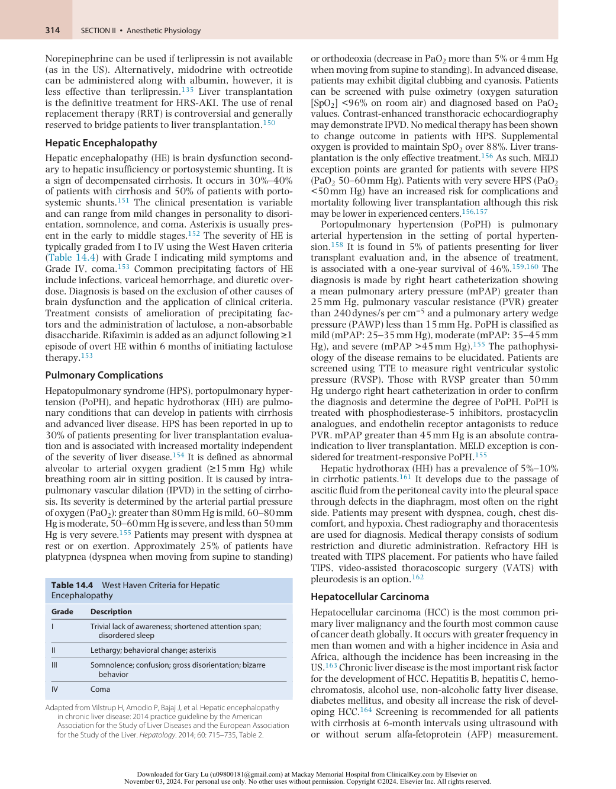

:::

<!-- PDF page 23 -->

Masses over 1 cm should be imaged with dynamic MRI or contrast- enhanced CT to make the diagnosis noninvasively. Percutaneous biopsy is used for nodules that have nontypical appearance on imaging.165 Staging is based on the size of the tumor, degree of extension into adjacent structures, presence of metastases, liver function, and the patient’s physical status. There is no universally accepted system for staging. The tumor, node, metastasis (TNM) and the Barcelona staging system (BCLC) are two of the more commonly used systems.165

Surgical resection of HCC is the definitive treatment for the disease. However, the diagnosis of HCC is typically made late in the course of the disease. In patients with preserved liver function and a solitary tumor confined to the liver, treatment with surgical resection carries a 5- year survival rate from 40% to 75%.166 Transplantation may be an option for patients with hepatic dysfunction and tumors confined to the liver which meet certain size criteria.167 Nonsurgical options for patients who are ineligible for resection or transplantation include radiofrequency ablation, transarterial chemoembolization, and systemic therapy.165

## Anesthetic Considerations of Gastrointestinal and Hepatic Systems in Health and Disease

### EFFECTS OF GENERAL ANESTHESIA AND SURGERY ON BOWEL FUNCTION

GI effects of the anesthetics are multifaceted and encompass a wide array of hemodynamic and physiologic changes. This section is broken down into the various components that make up a general anesthetic and the GI effects of each of these components. Emphasis is placed on the effects of preoperative sedation, induction of anesthesia, hypnotic agents, volatile agents, and reversal.

### Preoperative Sedation

In the preoperative setting patients are often nervous and sympathetic stimulation is high. Inhibition of GI tract activity is directly proportional to the amount of norepinephrine secreted from sympathetic stimulation, so the higher the anxiety the higher the inhibition. Even though a good bedside manner and the use of behavioral approaches are beneficial, patients often require premedication with a benzodiazepine, usually midazolam, to alleviate anxiety. Midazolam enhances the effect of neurotransmitter, gammaaminobutyric acid (GABA), on GABAA receptors. Additionally, midazolam increases duration of phase III of the MMC in the proximal and distal parts of the duodenum, which shortens the MMC by 27%,168 which could theoretically reduce small intestinal motility. However, when applied clinically, there was no real difference seen in small intestinal motility patterns. Similarly, the α- agonist dexmedetomidine inhibits gastric emptying and gastrointestinal transit in rodents and healthy volunteers in experimental studies;169,170 however, a more recent landmark study clearly shows that dexmedetomidine improved recovery of gastrointestinal motility following laparoscopic resection of colorectal cancer.171 This latter study strongly suggests that further studies are needed

to identify mechanisms responsible for this seemingly contradictory effect for dexmedetomidine and possibly midazolam.

### Inhalational Anesthetics

Nitrous oxide is 30 times more soluble than nitrogen in the blood and as such will diffuse into gas- containing cavities from the blood faster than the nitrogen already present in those cavities can diffuse out. This is especially important in the bowels as gut distention is correlated with the amount of gas already present in the bowel, the duration of nitrous oxide administration, and the concentration of nitrous oxide administered. Although it has been established that nitrous oxide causes bowel distention and it is prudent to avoid nitrous oxide in lengthy abdominal surgeries or when the bowel is already distended, the most recent ENIGMA trial did not relate the use of nitrous oxide to any significant adverse outcomes.172

Halogenated volatile anesthetics depress the spontaneous, electrical, contractile, and propulsive activity in the stomach, small intestine, and colon as demonstrated in many animal and human studies. However, similar to the sedation agents previously described, there is very little difference between desflurane, isoflurane, and sevoflurane’s effects on bowel function in clinical practice. Experimentally, in a study comparing desflurane and isoflurane, rapid increases in desflurane caused significantly greater effects on sympathetic and renin–angiotensin system activity as well as increases in blood pressure and heart rate as compared to isoflurane. However, this effect was transient, only seen with rapid increases in desflurane concentration, and was unlikely to have a lasting effect on bowel function.173

Halogenated volatile anesthetics also affect splanchnic circulation and oxygenation in a dose- dependent manner, which can have an effect on bowel function. In an experimental study of horses receiving isoflurane for maintenance of anesthesia, microperfusion and intestinal tissue oxygenation decreased when isoflurane reached 2%.174 In a human study by Müller and associates, the effects of desflurane and isoflurane on intestinal tissue oxygenation during colorectal surgery found that desflurane and isoflurane had comparable effects on intestinal tissue oxygenation. However, during periods of ischemia for resection and anastomosis, reactive hyperemia was better preserved in the patients given isoflurane.175 Although this latter study may have important implications in regaining coordinated and appropriate bowel function postoperatively and may determine maintenance with volatile versus total intravenous anesthesia (TIVA). Even so, following volatile anesthetic administration, the small intestine is the first part of the GI tract to recover, followed by the stomach in approximately 24 hours, and then the colon 30 to 40 hours postoperatively.

### Intravenous Anesthetics

The most commonly utilized intravenous anesthetic is propofol. There are few data on the effect of propofol on GI smooth muscle and many of the established studies show various and conflicting results when it comes to the recovery of bowel functions. In combination with remifentanil, propofol produced increased intestinal motility as compared to sevoflurane–remifentanil without differences in intestinal recovery.176 There were no differences in overall recovery and bowel function when comparing

<!-- PDF page 24 -->

isoflurane/nitrous oxide, propofol/air, and propofol/ nitrous oxide.177 Even in colorectal cancer patients there was no difference in inflammatory response among patients receiving either TIVA with propofol and remifentanil or inhalational anesthesia with sevoflurane and fentanyl.178,179 In sharp contrast, a recent clinical study strongly suggests that dexmedetomidine improves gastric recovery after laparoscopic surgery.180 This study supported an earlier study where low- dose dexmedetomidine was found to accelerate recovery of GI function after lumbar spinal fusion, even though these authors were unsure whether this was a direct effect of dexmedetomidine or the opioid- sparing effect of this intravenous anesthetic.181 Interestingly, although widely used, effects of ketamine in the acute setting have not been determined while abdominal pain from chronic ketamine use or abuse has been documented.

### Paralytics and Reversal Agents

Nondepolarizing neuromuscular blocking drugs affect skeletal muscle, so GI motility remains intact. However, succinylcholine mimics acetylcholine and produces an initial muscle contraction, which is visible as fasciculations. This contraction increases intragastric pressure, which may be so strong as to overcome the tone of the LES and allow reflux of gastric contents. However, aspiration because of succinylcholine has not been reported. Even so, patient condition, including body habitus, technical difficulty of intubation, nothing by mouth (NPO) status, and comorbidities should be the determining factors in assessing the risk of aspiration.

Reversal of nondepolarizing agents using the anticholinesterase neostigmine will increase parasympathetic activity and bowel peristalsis by increasing the frequency and intensity of contractions. In cases of fresh bowel anastomoses, this can be of concern as the increase in activity could result in dehiscence. This is partially offset by simultaneous administration of the anticholinergic medications, glycopyrrolate or atropine, which are used to attenuate the bradycardia from neostigmine. This effect is not seen with sugammadex, which may be a more prudent choice for reversal in situations of tenuous bowel anastomoses. There is some data to support the use of neostigmine in treating postoperative ileus but the adverse effects of bradycardia, vomiting, and abdominal cramps may preclude its use.

### Opioids

Opioids exert their function on both central and peripheral receptors, namely mu, delta, and kappa. While the central receptors mediate analgesia, peripheral mu- opioid receptors in the myenteric and submucosal plexuses can affect the GI system. Activation of these mu- opioid receptors in the myenteric plexus has a dual effect on the neural pathways controlling motility. On the one hand it inhibits excitatory pathways that depress peristaltic contraction in addition to blocking inhibitory pathways. These actions increase GI muscular activity and increase resting muscle tone including tone in the ileocecal valve and internal anal sphincters, which results in spasms and nonrhythmic or propulsive motility. Activation of these receptors is also linked to the inhibition of acetylcholine release and release of nitric oxide that inhibits propulsive motility.182 Together these effects will delay gastric emptying and slow transit through the intestine.

Activation of peripheral receptors in the submucosal plexus decreases nutrient secretion and increases fluid absorption. Coupled with reduced motility, the stool will remain in the gut for a longer period of time, and as more water is absorbed the stool becomes hard and dry leading to constipation.183 Other adverse sequelae include nausea, anorexia, delayed digestion, abdominal pain, excessive straining during bowel movements, and incomplete evacuation.

### EFFECT OF OPEN ABDOMINAL SURGERY, ISCHEMIA, AND BOWEL ANASTOMOSIS ON GASTROINTESTINAL PHYSIOLOGY AND

### FUNCTION

Surgical procedures on the GI tract produce an exaggerated stress response that may predispose to postoperative bowel dysfunction. Goals of anesthetic care should be to attenuate the stress response, optimize hemodynamic and fluid status, and maintain normothermia.184,185 At present there is no evidence for recommendations on specific anesthetic and analgesic agents to avoid adverse GI effects. Manipulation of the intestines is the main factor that initiates postoperative ileus. There are two phases of an uncomplicated postoperative ileus (i.e., in the absence of complications, such as perforation, bleeding, peritonitis). The first phase is an early neurogenic phase and the second is an inflammatory phase. In total, an uncomplicated postoperative ileus lasts about 3 to 4 days.186 Additional contributors include immobility, electrolyte imbalance from fluid shifts and insensible losses, and intestinal wall swelling from excessive fluid administration.

The early neurogenic phase results when the intestine is manipulated, which is more extensive in open procedures than in laparoscopic procedures. This manipulation activates the sympathetic nervous system, which increases the inhibitory neural input that leads to decreased propulsive movements and almost complete cessation of GI motility. This lasts about 3 to 4 hours after surgery. The late inflammatory phase also begins with surgical manipulation of the intestines. Surgical manipulation increases sympathetic stimulation of the myenteric plexus, which promotes the influx of leukocytes into the “traumatized” areas of the gut. Further release of cytokines, chemokines, and leukocytes as well as phagocytosis in the traumatized area occurs and eventually spreads through the entire GI tract. This inflammatory cascade increases permeability in the GI mucosa and allows for translocation of intraluminal bacteria, which further exacerbates the inflammatory process. This process occurs about 3 hours after intestinal manipulation and continues throughout the manipulated segment and the rest of the GI tract for the next 24 hours. It eventually subsides and within 3 to 4 days uncomplicated ileus is usually resolved.186,187

Mesenteric ischemia occurs when the supply of oxygen is insufficient to meet the oxygen demand of the intestines. Generally speaking, there are two types of mesenteric ischemia: occlusive or nonocclusive. Etiologies of mesenteric ischemia include strangulation, emboli (seen commonly in patients with atrial fibrillation), complications of aortic surgery or during cross- clamping, trauma, drug- induced, atherosclerosis, and inflammatory diseases. There are four stages of mesenteric ischemia. The first is the hyperactive stage when blood flow to the intestine is abruptly occluded.

<!-- PDF page 25 -->

This produces severe pain and overactive peristalsis. There may be passage of loose stool with blood. The second stage is a paralytic stage that spreads diffusely across the intestines. The third stage involves leakage of fluid, proteins, and electrolytes through the bowel wall into the peritoneum. If the bowel becomes necrotic, then peritonitis develops. The fourth stage is shock. End-organ damage is apparent and contributes to altered hemodynamics and critical illness. Mesenteric ischemia, if left untreated, will lead to 100% mortality. Treatment involves reperfusion of the occluded vessel through revascularization and possibly bowel resection.188

The degree of GI dysfunction depends on the portion of bowel resected. Small intestinal resections are more likely to affect GI function and can increase GI motility specifically when the terminal ileum and ileocecal valve are resected.189 In sharp contrast, a full colonic resection will not affect GI motility. Following jejunal resection, the ileum is usually able to adapt to fulfill its functions. If the ileum is resected (especially more than 100 cm), the remaining small intestine cannot compensate for the loss of its function and severe malabsorption and diarrhea will result. The unabsorbed bile salts enter the colon and stimulate fat and water secretion.

Bowel anastomoses can significantly alter GI function by disrupting normal motor activity. Partial transection usually preserves the wave of activity that is lost following complete transection. There is a loss in myogenic continuity in that the intestine distal to the transection will no longer receive signals or respond to the pacemaker in the proximal duodenum. Now the part distal to transection has to rely on its own intrinsic slow- wave transmission. This can be attenuated by close approximation of the muscle layers. There is motor asynchrony across the anastomotic site, but long- term studies report reasonable MMC activity is ultimately achieved with time.

### EFFECTS OF INHALATIONAL AND INTRAVENOUS ANESTHETICS ON THE LIVER

### Inhalational Anesthetics

### (see also Chapters 17 and 18)

The primary hepatic effects of volatile anesthetics result from alterations in liver perfusion. Total hepatic blood flow (THBF) is the sum of portal blood flow (PBF) and hepatic arterial blood flow (HABF). Reductions in portal blood flow (PBF) are matched by increases in HABF to maintain THBF through the hepatic arterial buffer response (HABR).190 Volatile anesthetics reduce mean arterial pressure (MAP) and cardiac output (CO), leading to a reduction in PBF in a dose- dependent manner. The HABR is preserved with isoflurane, sevoflurane, and desflurane, leading to preservation of THBF, but not with halothane.191–193

Xenon is an inert gas that can been used as an anesthetic.194 It has favorable anesthetic properties including a low blood- gas partition coefficient (0.115) and a stable hemodynamic profile.195,196 Hepatic perfusion during xenon anesthesia has been studied in pigs. In one study using radiolabeled microspheres, there was no difference in hepatic perfusion in pigs anesthetized with xenon when compared to propofol.197 However, a second study using indocyanine green (ICG), reported a 17% reduction

in portal venous blood flow in pigs anesthetized with a ketamine infusion that received a xenon anesthetic compared to controls. They reported no significant difference in hepatic arterial perfusion or hepatic function.198 In a porcine model, the use of xenon anesthesia was associated with significantly higher hepatic venous oxygen content when compared with propofol.199 The clinical consequences of these findings are unclear as the successful use of xenon anesthesia for the conduct of liver transplantation has been reported in a series of four cases.200

### Intravenous Anesthetics

In general, intravenous anesthetics such as propofol, and etomidate, and for historical perspective, thiopental and methohexital do not adversely affect the liver. Furthermore, the pharmacokinetic properties of these agents are unchanged in patients with cirrhosis.201–204 Cirrhotic patients may be more sensitive to their CNS depressant effects. Propofol has been found to increase hepatic blood flow and oxygen consumption in both animal and human studies that have measured flow using radiolabeled microspheres, Doppler, and electromagnetic flow meters.205–208 Studies using ICG clearance to measure hepatic flow, however, have reported that propofol reduces hepatic flow.209,210 These findings were confounded by the fact that propofol itself interferes with ICG clearance.208,211 Clinically, propofol has no adverse effect on hepatic function. Midazolam elimination is impaired in liver dysfunction, leading to prolongation of sedative effects.212 Dexmedetomidine elimination is reduced in patients with hepatic impairment, necessitating dose reduction.213

### Paralytics and Reversal Agents

Reduced levels of pseudocholinesterase in patients with hepatic dysfunction may prolong the effects of succinylcholine and mivacurium.214,215 The time to recovery from cisatracurium is unchanged as it is subject to Hofmann degradation.216

Aminosteroid neuromuscular blocking agents (vecuronium, rocuronium, pancuronium) have a larger volume of distribution in cirrhotic patients. They have a slower rate of onset and a longer duration of action, necessitating judicious dosing and close train- of- four monitoring when used in cirrhotic patients.217–219 Sugammadex has been shown to be effective for reversing rocuronium in patients with hepatic dysfunction.220 The use of neostigmine for reversal is likewise unaffected by the presence of hepatic dysfunction.

### Opioids

The effect of opioids on the liver are highly dependent on the level of liver impairment. Because opioids are metabolized by the liver; it should be expected that patients with liver impairment would be at risk for adverse events and dosing adjustments would be highly relevant. In landmark studies in patients with significant cirrhosis have demonstrated that, the metabolism of morphine, meperidine, and alfentanil was reduced and their durations of action prolonged.221–223 Similarly, in another landmark study in patients with mild hepatic insufficiency, demonstrated that the pharmacokinetics of fentanyl, sufentanil, and remifentanil were unchanged when compared to normal controls.224–226 Nevertheless, a recent systematic review concluded that since clearance of opioids and in some cases their metabolites in patients with hepatic insufficiency is decreased, generally

<!-- PDF page 26 -->

speaking, the initial dose must be decreased, and the intervals between doses should be increased in addition to continued patient assessment for adverse events.227

### Epidural Anesthesia

Five studies have examined the effect of epidural anesthesia on hepatic blood flow. Four have shown a reduction in hepatic blood flow in response to lumbar or thoracic epidural anesthesia when measured using the plasma disappearance rate (PDR) of indocyanine green (ICG) (PDR- ICG) and transgastric hepatic vein Doppler.228 In one study, blood flow was restored with the infusion of colloid and dopamine.228–230 Maintenance of MAP with ephedrine or norepinephrine further reduced hepatic blood flow. Unlike these studies, a study by Kortgen _et al._ found that thoracic epidural anesthesia increased hepatic blood flow when measured by PDR- ICG, whereas lumbar epidural anesthesia resulted in an overall reduction.231 The clinical significance of these findings is uncertain.

### ANESTHETIC CONSIDERATIONS FOR NONHEPATIC SURGERY IN PATIENTS WITH LIVER DISEASE

The preoperative evaluation of patients with liver disease should determine the severity of the disease and the presence of comorbid conditions associated with hepatic dysfunction. Given the high risk of mortality, elective surgery is contraindicated in patients with acute hepatitis or acute liver failure.232 In the absence of cirrhosis and significant hepatic dysfunction, patients with chronic liver disease generally have no increased risk for undergoing elective surgery. Patients with cirrhosis who undergo non- hepatic surgery have a higher incidence of postoperative morbidity and mortality when compared to patients without cirrhosis.233 A wide range of mortality rates has been reported in the literature (1% up to 50%) mostly in small, institutional studies spanning 30 years. Mortality in these patients is a function of the severity of liver disease, its attendant comorbidities, and the type of surgical procedure.233 The largest study of in- hospital mortality in patients with cirrhosis used data from the Nationwide Inpatient Sample. The outcomes of 22,569 cirrhotic patients undergoing one of four index operations (cholecystectomy, colectomy, coronary artery bypass grafting [CABG], and abdominal aortic aneurysm repair) from 1998 to 2005 were compared to those of 2.8 million control patients; 4214 of the cirrhotic patients had portal hypertension. Patients with cirrhosis had a threeto eightfold increase in the risk of in- hospital mortality, depending on the operation, compared to control patients. Mortality risk worsened in those with more severe liver disease, ranging from 12- to 23- fold, depending on the specific operation. The greatest risk was seen in patients undergoing CABG.234 A study in Taiwan comparing 24,282 cirrhotic patients undergoing major non- hepatic surgery with 97,128 matched control patients found an over twofold increased risk of 30- day mortality in patients with cirrhosis (1.2% vs. 0.7%). Mortality was further increased in those cirrhotic patients with viral hepatitis, jaundice, ascites, gastrointestinal hemorrhage, and hepatic coma.235

In cirrhotic patients undergoing non- hepatic surgery, the Child–Turcotte–Pugh (CTP) and Model for End-Stage Liver

Disease (MELD) scores have been shown to identify those who are at higher risk of morbidity and mortality.236–240 The CTP score is calculated based on the values of five variables: degree of hepatic encephalopathy, degree of ascites, INR, serum albumin, and total bilirubin. The CTP score is then used to classify the patient into one of three groups: class A (score of 5–6), class B (score of 7–9), and class C (score >10) (Table 14.5).241 A higher CTP class is associated with a greater risk of mortality. The mortality risk associated with each CTP class has decreased in more recent studies. In early retrospective series of cirrhotic patients undergoing abdominal surgery, the mortality risks associated with CTP class A, B, and C were 10%, 30%, and 73%–82%, respectively.242,243 In a more recent series of 194 patients undergoing 212 general surgical procedures, 30- day mortality was reported to be 6%, 13%, and 53% for CTP classes A, B, and C, respectively.237 The risk has been found to be even lower in patients undergoing laparoscopic procedures (class A: 2%; class B 12%; class C: 12%), suggesting that improvements in perioperative care and surgical techniques have made surgery safer for patients with cirrhosis.238 A disadvantage of the CTP score is that the grading of encephalopathy and ascites is subjective. Furthermore, the score doesn’t take into account other predictors of operative risk such as the type of surgery or the etiology of the cirrhosis.244

The MELD score was originally developed to predict survival in patients with cirrhosis who were undergoing transjugular intrahepatic portosystemic shunt (TIPS) placement. The MELD score is calculated using the patient’s INR, serum creatinine, serum bilirubin, as well as the etiology of liver disease (Fig. 14.6).245 It has been validated as a measure of mortality risk in patients with end- stage liver disease (ESLD) and is the basis of the organ allocation system.246 A number of studies have validated the MELD score as a predictor of risk in cirrhotic patients undergoing abdominal, orthopedic, and cardiac surgery.236,247–249 In a large, retrospective study of cirrhotic patients undergoing major abdominal, orthopedic, or cardiac surgery, MELD score was a predictor for mortality at 30 days, 90 days, 1 year, and 5 years. The 30- day mortality

**Table 14.5** Child–Pugh Classification

|||**POINTS ASSIG**|**NED**|
|---|---|---|---|
||**1**|**2**|**3**|
|Ascites|Absent|Slight|Moderate|
|Bilirubin|&lt;2 mg/dL|2–3 mg/dL|>3 mg/dL|
|Albumin|>3.5 g/dL|2.8–3.5 g/dL|&lt;2.8 g/dL|
|**PT**||||
|seconds over control|&lt;4|4–6|>6|
|INR|&lt;1.7|1.7–2.3|>2.3|
|Encephalopathy|None|Grade 1–2|Grade 3–4|
|**Point Total**|**Child Class**|**Opera**|**tive Mortality**|
|5–6|A|2%–1|0%|
|7–9|B|12%–|31%|
|10–15|C|12%–|82%|

_INR_ , international normalized ratio; _PT_ , prothrombin time.

30- day postoperative mortality based on retrospective studies cited in text. Lower rates reported in more recent studies.

::: details 原始表格與符號（PDF 第 26 頁）

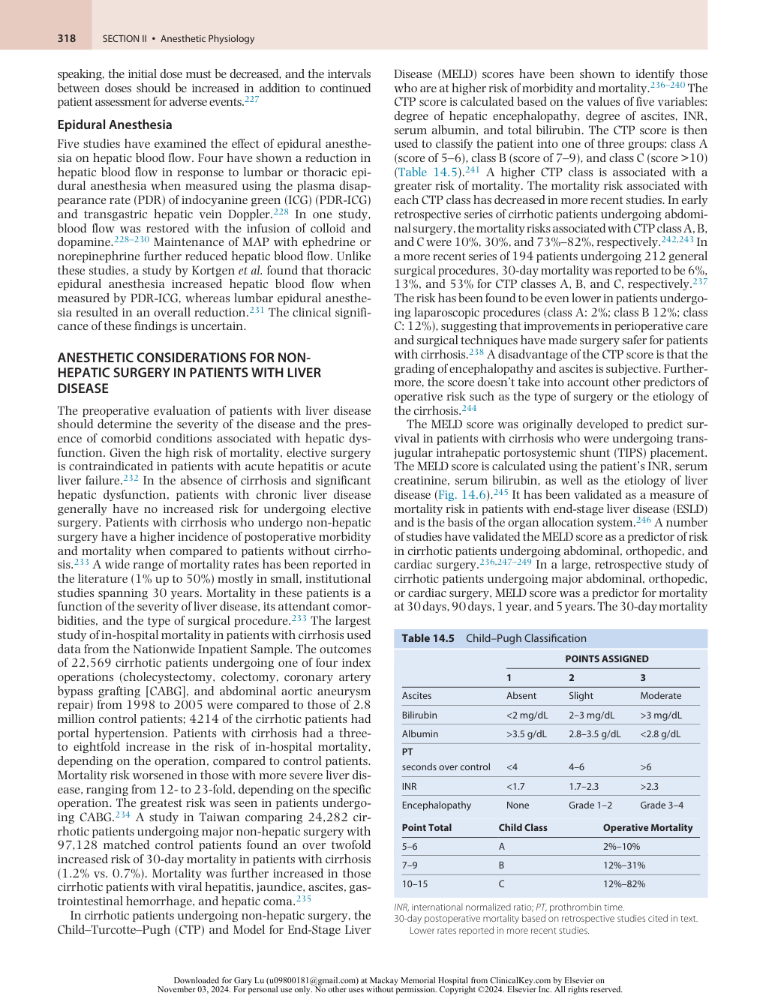

:::

<!-- PDF page 27 -->

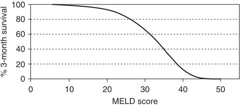

100 80 60 40 20 0 0 10 20 30 40 50 MELD score % 3-month survival 

**Fig. 14.6 MELD score and mortality.** MELD = 3.8*loge(serum bili [mg/dL]) + 11.2*loge(INR) + 9.6*loge(Cr [mg/dL]) + 6.4. _Cr_ , creatinine; _INR_ , international normalized ratio; _MELD_ , Model for End-Stage Liver Disease. (Adapted from Wiesner, R, Edwards, E, Freeman, R, et al. Model for end- stage liver disease (MELD) and allocation of donor livers. _Gastroenterology_ . 2003;124:91.)

ranged from 5.8% in patients with a MELD under 8 to over 50% in patients with a MELD score greater than 20.250 The incorporation of serum sodium into the MELD score (MELDNa) as well as a combination of serum sodium and patient age (integrated MELD or iMELD) have been shown to improve the accuracy of predictions of survival over MELD.251,252 The use of MELD- Na and iMELD may allow more accurate prediction of mortality following non- hepatic surgery, however, more studies are needed.237,253,254

Studies comparing the predictive power of CTP to MELD have yielded conflicting results likely due to small sample sizes and differences in primary outcomes and surgical procedures. Small studies in cardiac and general surgical patients have found the abilities of CTP and MELD to predict postoperative mortality to be comparable.236,247 A study in cirrhotic patients undergoing extrahepatic abdominal surgery found MELD to be a better predictor than CTP for mortality or hepatic decompensation within 90 days of surgery.248 A more recent study found neither to be a good predictor for death and hepatic decompensation in cirrhotic patients undergoing elective surgery requiring general anesthesia.239 It has been suggested that both scores should be used in conjunction with other available patient data when attempting to risk- stratify cirrhotic patients for non- hepatic surgery.255

Apart from the severity of cirrhosis and the specific surgical procedure, risk factors associated with increased postoperative morbidity and mortality in cirrhotic patients include emergency surgery, American Society of Anes thesiologists (ASA) status, the presence of renal insufficiency, male sex, and age.236,238,256

In addition to determining the severity of cirrhosis, the preoperative evaluation should determine the presence and severity of comorbidities associated with cirrhosis, including hepatic encephalopathy, pulmonary disease, cardiac disease, and renal dysfunction (see discussion above). Preoperative laboratory evaluation should include a complete blood count to evaluate for anemia, thrombocytopenia, and leukocytosis. Additionally, INR, fibrinogen, serum electrolytes, creatinine, glucose, transaminases, bilirubin, and albumin should be measured.

### ANESTHETIC CONSIDERATIONS FOR PROCEDURES INVOLVING THE LIVER

### Transjugular Intrahepatic Portosystemic Shunt (TIPS)

Transjugular intrahepatic portosystemic shunt (TIPS) placement is a catheter- based, endovascular procedure

during which a shunt is created between the portal and hepatic venous systems through the hepatic parenchyma. The goal of the procedure is to reduce portal hypertension.257 The main indications for TIPS are the secondary prevention of variceal hemorrhage and the management of refractory ascites.258 During acute variceal hemorrhage in high- risk patients (HVPG >20), TIPS placement, following endoscopic intervention, has been shown to reduce re- bleeding.259 Contraindications to the procedure include congestive heart failure, tricuspid regurgitation, and moderate to severe pulmonary hypertension. During the procedure, a catheter is typically inserted through the right internal jugular vein into a hepatic venous branch. A needle is then passed through the hepatic vein into the portal vein. The tract is dilated and a stent is placed across it. Hepatic venous pressure gradient (HVPG) should be less than 12 mm Hg following the procedure. The incidence of major complications such as intra- abdominal hemorrhage is on the order of 1%–2%.260

TIPS may be carried out electively or emergently. The preoperative assessment should determine the extent of liver dysfunction and associated morbidity. Patients with advanced liver disease may be in a hyperdynamic state. They may have significant ascites with reductions in functional residual capacity (FRC) as well as hepatic hydrothorax or hepatopulmonary syndrome. Pulmonary function may be further compromised when the patient is in supine position for the procedure. Patients may also have renal dysfunction, anemia, coagulopathy, and thrombocytopenia. Laboratory studies should screen for anemia, thrombocytopenia, and coagulopathy, as well as hyponatremia and elevations of creatinine and potassium. Patients should be transfused for hemoglobin less than 7–9 mg/dL, INR greater than 2, and platelet count less than 50,000/microliter.261 The procedure can be done under local anesthesia, sedation, or general anesthesia. Consideration should be given to the acuity of the patient, their ability to tolerate supine positioning, and the anticipated length of the case. In patients with significant ascites or recent variceal hemorrhage, general anesthesia with rapid-sequence induction for airway protection is preferred. Intraoperative pain may be experienced during the establishment of the intrahepatic shunt and the dilation of the stent. In a series of 150 patients undergoing TIPS with general anesthesia using TIVA, the authors reported a postoperative ICU admission rate of 6.6% primarily for intraoperative hemodynamic instability. They advocated for the use of general anesthesia for all TIPS procedures, given the concerns for airway protection, ability to maintain supine position, and pain associated with the procedure.262 Postprocedure complications include heart failure due to increased venous return, hepatic encephalopathy, contrast- induced nephropathy, hemolytic anemia, and sepsis.260,263

### Hepatic Resection

**Indications, Techniques, and Preoperative Evaluation.** The most common indications for hepatic resection are for the treatment of secondary metastases (i.e., metastatic colon cancer), primary hepatic malignancies, biliary tract malignancies, and benign hepatic masses.264 Hepatic resection is carried out along the functional segments of the liver. The liver is divided into eight functional

<!-- PDF page 28 -->

segments based on the distribution of blood supply and biliary drainage. The left liver comprises segments II, III, and IV, while the right liver is composed of segments V, VI, VII, and VIII. Segment I is the caudate lobe (Fig. 14.7; see Fig. 14.1). Right hepatectomy involves resection of segments V–VIII. Left hepatectomy involves resection of segments II–IV. Right lobectomy, also described as an extended

right hepatectomy or right trisegmentectomy, involves resection of segments IV–VIII with or without segment I. An extended left hepatectomy (left trisegmentectomy) is the resection of segments II–V and VIII.265 Mortality and morbidity rates are impacted by the extent of the resection. A review of the 4881 hepatic resections over a fiveyear period in the American College of Surgeons’ National

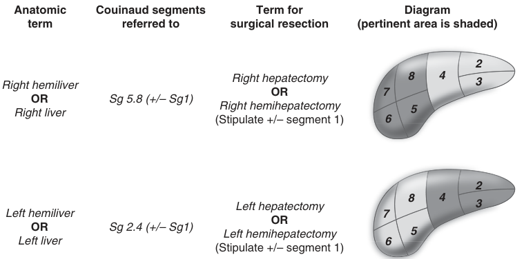

Anatomic Couinaud segments Term for Diagram term referred to surgical resection (pertinent area is shaded) 2 Right hemiliver Right hepatectomy 8 4 3 OR 7 OR Sg 5.8 (+/– Sg1) Right liver (Stipulate +/– segment 1) Right hemihepatectomy 6 5 2 8 4 Left hepatectomy 3 Left hemiliver 7 OR OR Sg 2.4 (+/– Sg1) Left hemihepatectomy 5 Left liver 6 (Stipulate +/– segment 1) 

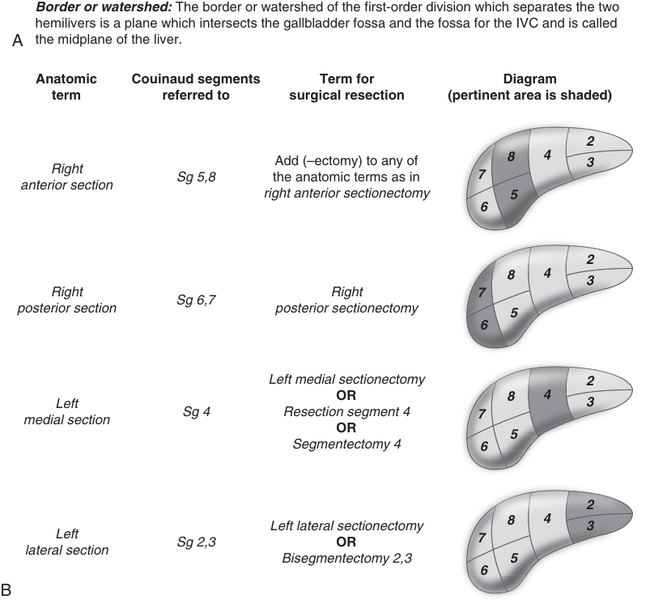

Border or watershed:  The border or watershed of the first-order division which separates the two hemilivers is a plane which intersects the gallbladder fossa and the fossa for the IVC and is called A the midplane of the liver. Anatomic Couinaud segments Term for Diagram term referred to surgical resection (pertinent area is shaded) 2 8 4 Add (–ectomy) to any of 3 Right Sg 5,8 the anatomic terms as in 7 anterior section right anterior sectionectomy 5 6 2 8 4 3 Right Right 7 Sg 6,7 posterior section posterior sectionectomy 5 6 Left medial sectionectomy 2 OR 8 4 Left 3 Sg 4 Resection segment 4 7 medial section OR 5 Segmentectomy 4 6 2 8 4 Left lateral sectionectomy 3 Left Sg 2,3 OR 7 lateral section Bisegmentectomy 2,3 5 6 B 

**Fig. 14.7 Nomenclature.** (A) Nomenclature for first- order division anatomy (hemilivers) and resections. _IVC_ , inferior vena cava. (B) Nomenclature for second- order division anatomy (sections) and resections. (From Strasberg SM. Nomenclature of hepatic anatomy and resections: a review of the Brisbane 2000 system. _J Hepatobiliary Pancreat Surg_ . 2005;12:354.)

<!-- PDF page 29 -->

Surgical Quality Improvement Program database reported 30- day mortality and morbidity rates of 1.9% and 13.1%, respectively, for patients undergoing partial hepatectomy. Those rates increased significantly for patients undergoing extended hepatectomies (lobectomies or trisegmentectomies) to 5.8% and 22.5%, respectively.266 Other factors that impact outcomes are the case volume of the performing center, patient age, history of cardiac, pulmonary, or renal disease, blood loss, the presence of ascites, and reduced hepatic function.266,267

Laparoscopic hepatic resection is considered most appropriate for small (&lt;5 cm), solitary lesions located in peripheral segments (II–VI), when performed in experienced institutions.268,269 More extensive resections have been reported in experienced centers. A meta- analysis of 83 comparative case series (2900 patients) found a significantly lower rate of complications, transfusions, blood loss, and hospital stay in case- matched cohort of patients undergoing laparoscopic liver resection compared to open liver resection.270 The only randomized controlled trial to date found a significant reduction in postoperative complications in patients undergoing laparoscopic hepatic resection (19% vs. 31%; 95% confidence interval [CI] 1.67–21.8; _P_ = .021) for colorectal cancer liver metastases requiring resection of fewer than three consecutive segments. Although the hospital length of stay was significantly shorter, there were no differences in blood loss or mortality.271 Conversion from a laparoscopic to an open procedure is usually associated with intraoperative hemorrhage and is reported to occur in up to 6%–14% of cases. Risk factors for conversion include elevated BMI, increased age, diabetes mellitus, hypertension, and large tumor size.272,273 A number of recent observational retrospective studies have described the performance of robot- assisted hepatectomy for both minor and major resections.274 Compared to open liver resection, robotic resection is associated with lower morbidity, reduced length of hospital stay, less intraoperative blood loss, and increased operative time without any difference in transfusion requirements or mortality rates.275 A meta- analysis of seven studies published between 2010 and 2014 comparing laparoscopic to robotic hepatectomy found that the laparoscopic approach is associated with significant reductions in blood loss, and operative time without any difference in the conversion rate, postoperative morbidity, and the hospital length of stay.276

The preoperative evaluation of the patient should determine the severity of liver disease and the presence of other comorbidities. Both cirrhosis and steatosis have been associated with increased mortality in patients undergoing liver resection. The decision to proceed is made based on the anticipated future liver remnant (FLR) that will remain following resection.277,278 In patients with an anticipated FLR size that is considered unsafe, selective portal vein embolization (PVE) may be conducted in the weeks prior to the hepatic resection. Disruption of portal flow to the diseased portion of the liver leads to atrophy of the portion to be resected and hypertrophy of the FLR, allowing the patient to have adequate liver mass following resection. PVE is typically indicated for patients with an anticipated FLR &lt;20% in the absence of cirrhosis, and &lt;40% in the presence of cirrhosis.165,279 Laboratory investigations prior to hepatic resection should include a complete blood count, serum

electrolytes, liver chemistries, albumin, coagulation studies, and a type and screen.

**Strategies for Minimizing Blood Loss.** Intraoperative blood loss during liver resection is associated with an increased risk of morbidity and mortality.280–282 Several preoperative factors have been associated with an increased risk of transfusion. These include preoperative anemia, the need for an extrahepatic procedure, the need for caval exposure, major hepatectomy (>3 segments), tumor size, thrombocytopenia, cirrhosis, and a repeat operation.283–285 For patients at increased risk of significant intraoperative hemorrhage, the use of techniques such as acute normovolemic hemodilution (ANH) and intraoperative cell salvage have been shown to reduce the transfusion of allogeneic units.286–289

**occlusion techniques.** A number of strategies have been adopted to reduce blood loss in open hepatic resection and case series from high- volume centers routinely report losses less than 500 mL.281,290,291 Such strategies include the use of temporary hepatic vascular occlusion and the intraoperative maintenance of low central venous pressure (CVP).292,293

Hepatic vascular occlusion techniques may be used by surgeons to limit blood loss by limiting blood flow to the liver. Although not routinely used in simple resections, familiarity with them is important as they may be employed in more complex liver resections. The most commonly used vascular occlusion technique is occlusion of the hepatic artery and portal vein by clamping the hepatoduodenal ligament. Otherwise known as the Pringle maneuver (PM), total hepatic inflow occlusion was first described in 1908 as a means of controlling hemorrhage in hepatic trauma (Fig. 14.8A).294 The drawback of this maneuver is the potential for hepatic ischemia and reperfusion injury.295 To mitigate this effect, surgeons typically make use of intermittent clamping with 15- to 20- minute intervals of clamping interspersed with 5- to 10- minute intervals of unclamping for a total ischemic time of less than 120 minutes.296 Tolerance of longer cumulative ischemic times has been reported.297 The application of sevoflurane for 30 minutes of preconditioning prior to PM has been shown in one single- center randomized controlled trial to significantly reduce postoperative transaminitis and complications in cases with greater than 30 minutes of continuous inflow occlusion.298 In a subsequent three- armed randomized controlled trial, the same group reported reductions in postoperative transaminitis and complications when sevoflurane was administered after PM (“post- conditioning”) or with the use of intermittent clamping.299

The utility of PM for reducing blood loss in modern hepatic resection has been called into question. While two early randomized controlled trials showed a significant reduction in blood loss with intermittent PM compared to no inflow occlusion, three more recent randomized controlled trials have shown no benefit.300–304 The median blood loss values reported in these three more recent trials were much lower than those reported in the initial two studies. This finding suggests that in the context of current intraoperative approaches to hepatic resection, the routine use of PM may not be necessary.304,305

An alternative technique that may be utilized is hemihepatic inflow occlusion. This maneuver involves exclusively

<!-- PDF page 30 -->

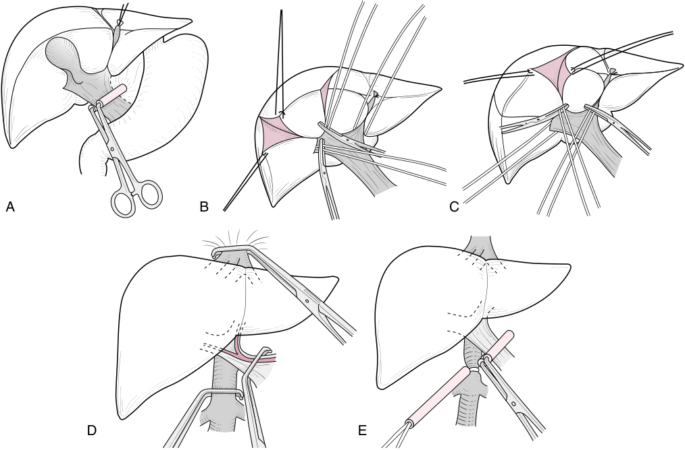

A B C D E 

**Fig. 14.8 Vascular occlusion techniques.** (A) Pringle maneuver: clamping of hepatoduodenal ligament to occlude hepatic arterial and venous inflow to the liver. (B,C) Selective hepatic vascular exclusion. (D) Total hepatic vascular exclusion. (E) Infrahepatic inferior vena cava (IVC) clamping. (From Otsubo T. Control of the inflow and outflow system during liver resection. _J Hepatobiliary Pancreat Sci_ . 2012;19:15–18.)

clamping the branches of the portal vein and hepatic artery which supply the lobe of the liver that is being resected in order to reduce ischemic injury to the remnant liver (see Fig. 14.8B,C).306 Hemihepatic inflow occlusion hasn’t been shown to reduce blood loss when compared to PM.307–310 Total hepatic vascular exclusion (THVE) involves occlusion of the suprahepatic and infrahepatic inferior vena cava (IVC) in addition to the portal vein and hepatic artery (see Fig. 14.8D).311 THVE can result in significant hypotension, as well as increased morbidity because of the reduction in venous return. It has not been shown to offer any benefit compared to PM and its use is typically reserved for patients with tumor extension into the IVC. In such complex resections, it has been combined with hypothermic portal perfusion and venovenous bypass to mitigate the risks of hypotension and hepatic ischemia, however, the reported mortality is high.312,313 To avoid the hemodynamic effects of THVE, selective hepatic vascular exclusion (SHVE), which involves clamping the hepatic veins instead of the IVC, may be employed by the surgeon.314 Some studies have shown that SHVE results in fewer complications than THVE, however, it is technically demanding and has a limited role in uncomplicated hepatic resections.315,316

**maintaining a reduced central venous pressure of &lt;5 mm hg.** While the PM occludes inflow to the liver, retrograde flow through the hepatic veins can still lead to substantial venous hemorrhage. The pressure in the hepatic veins is directly related to vena caval pressure, hence the

strategy of maintaining a low CVP (&lt;5 mm Hg) to minimize intraoperative blood loss.317 Retrospective observational studies have reported reduced blood loss in patients managed with CVP &lt;5 mm Hg without any significant adverse events.318–321 Two randomized controlled trials comparing CVP &lt;5 mm Hg with liberal volume administration have shown reductions in both intraoperative blood loss and the need for transfusion.322,323 These studies have all been at risk for significant bias. Furthermore, in some of the trials the difference in estimated blood loss (EBL), though statistically significant, was clinically inconsequential.324 Although standard practice in hepatic resections is to maintain low CVP, some studies have found no association between CVP and intraoperative blood loss. In retrospective studies of patients undergoing donor hepatectomies, no correlation was found between the CVP and intraoperative blood loss. This finding may be due to the fact that living liver donors are healthy patients with normal livers.325,326 The largest of these studies consisted of over 900 patients. Although it found no correlation between CVP and EBL, nearly all of the patients were managed with CVPs less than 10 mm Hg, and the majority had CVPs in the 4–6 mm Hg range.326 A meta- analysis of 10 randomized controlled trials, comprising 841 patients, found a lower incidence of intraoperative blood loss, blood transfusion, and shorter operative time in patients being managed with low CVP compared to controls.327

<!-- PDF page 31 -->

A number of techniques have been described for reducing CVP during hepatic resection. The most commonly reported approach is the use of intraoperative fluid restriction with rates of 1 mL/kg/h. Vasopressors are used as needed to maintain systolic blood pressure (SBP) >90 mm Hg and urine output >25 mL/h. Though seldom required, vasodilation using nitroglycerin or morphine, or forced diuresis with furosemide, can be instituted if fluid restriction is insufficient.317–319,322,323 The use of milrinone, reverse Trendelenburg position, and epidural anesthesia have also been described, though there is insufficient data to recommend one particular approach.324,328–330

Clamping of the infrahepatic IVC (IIVC) has been described as a means of minimizing hemorrhage in the setting of an elevated CVP in spite of the interventions described above (Fig. 14.8E).331 A number of randomized controlled trials have demonstrated a significant reduction in blood loss and transfusion with the use of IIVC clamping in patients who tolerate the clamp or have CVP >5 mm Hg.330,332–336 A meta- analysis of these trials, comprising 714 patients, showed a significant reduction in intraoperative blood loss (mean difference −353 mL) with no difference in the rates of postoperative complications. Of note, in pooled analysis, there was no significant difference in reported CVP values between the two groups.337

**additional approaches to reduce blood loss.** Two multicenter, randomized, placebo controlled trials have examined the efficacy of prophylactic recombinant factor VIIa (rFVIIa) administration to reduce transfusion in patients undergoing hepatic resection. The studies found no benefit of prophylactic rFVIIa with respect to mortality, red blood cell transfusions, or adverse events.338,339 A single randomized controlled trial in 214 patients undergoing primarily minor hepatic resections (82% of cases) found that the administration of tranexamic acid (TXA) resulted in fewer transfusions and less blood loss compared to placebo. In the study group, 500 mg of TXA was administered prior to incision followed by 250 mg every six hours for three days.340

A recent Cochrane database analysis of 67 randomized clinical trials of methods to decrease blood loss during liver resection found a high risk of bias in all trials. Based on the outcomes that were available in more than one trial, there is low- quality evidence that the “clamp and crush” parenchymal resection technique may be associated with fewer adverse events than radiofrequency resection techniques. They reported very low quality evidence that blood loss, operating time, and total hospital stay were reduced with intraoperative low CVP management.341

**Anesthetic Management.** The anesthetic management of these cases should be tailored to the comorbidities of the patients, the surgical approach (open, laparoscopic), the anticipated extent of resection, the need for vascular occlusive maneuvers, and the skill of the surgeon. Adequate venous access should be obtained for the anticipated degree of hemorrhage. In cases where significant blood loss is anticipated, red blood cell salvage can be used and consideration should be given to the use of ANH. In addition to standard ASA monitors, intra- arterial blood pressure monitoring should be used in cases during which significant volume shifts and the need for vascular occlusion maneuvers are

anticipated. Central venous catheters may be inserted for both vascular access and CVP monitoring, although some high-volume centers forgo the routine use of CVP monitoring.342,343 Peripheral venous pressure (PVP) monitoring may be considered as an alternative. Values are obtained through transduction of an antecubital vein and have been shown to correlate with the CVP in patients undergoing hepatic resection.344,345 Stroke volume variation (SVV) has been investigated as an alternative to CVP for volume management in patients undergoing liver resection. A study of patients undergoing donor hepatectomy showed an SVV value ≤6% to be predictive of blood loss over 700 mL.346 In two studies, targeting SVV values greater than 12%–15% in patients undergoing open or laparoscopic hepatic resection yielded blood loss comparable to, or better than, low CVP.347,348 In a study using milrinone to reduce CVP, SVV of 9% yielded a favorable surgical field. No correlation with CVP was noted in this study, possibly due to the lusitropic effects of milrinone.349 The use of transesophageal echocardiography may be considered in patients with cardiac risk factors although care must be taken in the presence of significant esophageal varices.

Hepatic resection may be associated with hemorrhage and, in extensive cases, the development of coagulopathy. There is insufficient data to recommend the routine use of viscoelastic hemostatic assays (rotational thromboelastography or rotational thromboelastometry). A single randomized controlled trial of thromboelastography (TEG)- guided transfusion in cirrhotic patients with coagulopathy (INR >1.8 and/or platelet count &lt;50 × 109 /L) undergoing invasive procedures found a significant reduction in blood product administration with TEG compared to the standard lab value–based group. However, only half of the patients enrolled in the trial were undergoing procedures associated with greater than 3% risk of hemorrhage.350

With respect to pain management, thoracic epidural analgesia (TEA) is a highly effective means of pain control for hepatic resection.351–353 Despite the reported benefit, the use of epidural anesthesia for postoperative pain control remains controversial due to the development of postoperative coagulopathy and thrombocytopenia following hepatic resection and the potential risk of epidural hematoma.354–358 Postoperative coagulopathy and thrombocytopenia occur in 21% to 100% of patients undergoing liver resection, depending on the volume of tissue resected. The INR peaks around postoperative day (POD) one or two while the platelet count is lowest on POD three or four. The values typically return to baseline by POD four or five, however, in some patients they may remain elevated for up to a week, leading to delays in epidural catheter removal or the decision to transfuse FFP to facilitate catheter removal.354–359 An additional concern is the accidental dislodgment of the epidural catheter while the patient is coagulopathic which has been reported to occur in up to 7% of patients.354,358 The degree of coagulopathy is influenced by the extent of the resection. In a review of 759 patients undergoing hepatic resection, the incidence of coagulopathy was 39.1% in patients who had undergone major hepatectomies (>2 segments) versus 21.3% in patients who had undergone minor hepatectomies (≤2 segments).359 Other factors that are independently

<!-- PDF page 32 -->

associated with postoperative coagulopathy included preexisting cirrhosis, preoperative INR ≥1.3, preoperative platelet count &lt;150,000/μL, EBL ≥1000 mL, and the duration of surgery.355,357,359 Although no case series has reported the complication of an epidural hematoma, the incidence is quite rare and the numbers published have likely been inadequate to detect its occurrence.360,361

Rapid-sequence induction should be considered in patients with significant ascites. Maintenance of general anesthesia has been described with both volatile anesthetics and intravenous anesthetics. There is no compelling clinical evidence for the benefit of one specific agent over another.362–365 Regardless of the approach, anesthetic dosing should be titrated to the patient’s requirements, taking into account the pharmacokinetics and pharmacodynamics of common anesthetic agents in patients with liver disease (see discussion above). The anesthesiologist should have an understanding of the vascular occlusion strategies that may be employed during the operation along with their hemodynamic effects. The Pringle maneuver, both during open and laparoscopic hepatic resections, leads to an increase in mean arterial pressure (MAP) and systemic vascular resistance (SVR) and a decrease in cardiac output (CO).366,367 During open hepatic resection, portal triad clamping leads to a decrease in left ventricular (LV) end- diastolic area (i.e., LV preload). During laparoscopic hepatic resection, in the presence of pneumoperitoneum, PTC also increases LV endsystolic wall stress (i.e. LV afterload).368 These hemodynamic alterations are generally well- tolerated.

### ENHANCED RECOVERY AFTER SURGERY (ERAS) FOR GASTROINTESTINAL PROCEDURES AND HEPATIC RESECTION

ERAS is an interdisciplinary, multimodal concept aimed at accelerating postoperative convalescence and reducing general morbidity by simultaneously applying several interventions. ERAS represents a paradigm shift in perioperative care. It reexamines traditional practice by replacing it with evidence- based practices.94 Although generally a successful intervention, ERAS differences in length of stay, postoperative complications, or readmissions is populationdependent. A recent review found that the elderly population as a group was especially susceptible to reduced length of stay and then determined that ERAS did not lead to a higher risk of postoperative complications or readmissions in this population.369

### Gastrointestinal Procedures

ERAS for GI procedures highlights a perioperative regimen with emphasis on the following areas370,371 : multimodal analgesia, regional anesthesia, opioid avoidance, nutrition and reduced perioperative fasting, early oral intake, selective bowel preparation, fluid optimization, temperature control, early mobilization, and early removal of surgical drains. ERAS in gastrointestinal surgeries has been extensively evaluated for colorectal surgery. In the laparoscopy in combination with fast track multimodal management (LAFA) trial, ERAS combined with laparoscopy improved postoperative recovery.372 Subsequent studies confirmed that ERAS decreased postoperative nonoperative morbidity in colorectal surgery by 40%–50%, and a reduced length of stay by 2 to 3 days.373,374

**Perioperative Pain Control.** Many aspects of regional anesthesia, opioid- sparing anesthesia, and multimodal analgesia have already been discussed. The effect of pain control on postoperative outcomes has also been evaluated in multiple studies and is an inseparable part of ERAS protocols for many surgeries including GI procedures.375–377 The favorable physiologic effects on the respiratory and cardiovascular systems by epidural analgesia may serve as yet another reason as to why epidural analgesia is a devoted part of ERAS protocols.375,378

### Preoperative Carbohydrate Loading and Early Post-

**operative Feeding.** There is strong evidence in animal studies demonstrating that fed animals tolerate stress much better than fasted animals. Perioperative oral carbohydrates raise insulin sensitivity by 50%. This means there is 50% less insulin resistance in the postoperative period, which also ameliorates ilium barrier failure. There is also less risk of development of hyperglycemic events and an improvement in retention of protein and lean body mass.379,380 Enteric feeding is associated with prevention of bacterial translocation381 or gut barrier failure.380 Carbohydrate loading shifts the cellular metabolism to an anabolic state that will support postoperative nutrition.382–384 The majority of the national and international societies now recommend a 6- hour preoperative fast for light, non-fatty solids and a 2- hour fast for clear fluids, which includes carbohydrate drinks.385–388 In order to maintain metabolic and nutritional homoeostasis, early postoperative feeding has been suggested. A small study on patients after major colorectal surgery showed that immediate postoperative enteral feeding does not result in a net loss of body nitrogen.379

**Bowel Preparation.** Bowel preparation for major GI procedures has been implemented in order to reduce postoperative complications related to infected bowel content,389 with polyethylene glycol a most popular preparation. Adverse physiologic effects of this bowel preparation include decreased exercise capacity, lower weight, increased plasma osmolality, decreased urea and phosphate, and reduced plasma calcium and potassium.390 These effects along with fasting can produce a very unpleasant experience for the patient. The routine use of bowel preparation has been questioned repeatedly. In fact, recent studies have shown that mechanical bowel preparation can be safely omitted before elective colorectal surgery.391,392

**Fluid Management.** All patients having elective surgery undergo a preoperative starvation period that results in a fluid deficit. This relative hypovolemia may stimulate the production of antidiuretic hormone, atrial natriuretic peptide, the renin–angiotensin–aldosterone system, and an increase in sympathetic activity. This relative hypovolemia is also more pronounced in patients who receive bowel preparation, experience diarrhea or vomiting, are exposed to high temperatures, or have high nasogastric tube output.

Recent NPO guidelines allow patients to have clear fluids up to 2 hours prior to surgery.393 Intraoperative fluid management takes into account the preoperative fluid deficit, the presence of a regional anesthesia technique, hemorrhage, and third- space losses. However, prudent administration of intravenous fluids is necessary as free and

<!-- PDF page 33 -->

rapid administration of salt and water will increase capillary hydrostatic pressure, cause tissue and bowel edema, and adversely affect anastomotic integrity. Optimizing fluid administration should focus on increasing tissue perfusion and oxygen delivery, and modulation of the hormonal and inflammatory response.394

**Temperature Control.** In addition to the adverse effects of hypothermia (&lt;35°C) on coagulation, cardiac, respiratory, and neurologic function, hypothermia triggers a whole- body thermoregulatory vasoconstriction response. Consequently, hypothermia reduces cutaneous flow and can result in tissue hypoxia and failure of the humoral immune defense system.395–397 Hypothermia is associated with a threefold increase in the incidence of surgical site infection.398

**Mobilization and Early Ambulation.** Early postoperative ambulation is recommended for prevention and treatment of postoperative ileus.399,400 It is believed that early ambulation helps with the restoration of normal bowel function. However, studies demonstrate that GI myoelectrical activity patterns are not always expedited by early postoperative ambulation; at least there is no correlation with the extent of ambulation.401 Yet, early ambulation confers many other advantages, specifically prevention of postoperative thromboembolism and pulmonary complications.402,403

minor adverse events, hospital length of stay, and hospital cost, and to improve patient quality of life.413

A meta- analysis published by the Cochrane group found that the use of ERAS protocols resulted in a reduction in mild adverse events, hospital length of stay, and cost. However, all studies were at high risk of bias and the quality of available evidence was determined to be low.414

### Acknowledgment

The editors and publisher would like to thank Drs. Phillip S. Mushlin, Simon Gelman, Laurie O. Mark, A. Sassan Sabouri, and Matthias F. Stopfkuchen- Evans for contributing chapters on this topic in the prior edition of this work. They have served as the foundation for the current chapter.

### Complete references available online at expertconsult.com.

### References

1.  Agur AMR, Dalley AF. _Grant’s Atlas of Anatomy_ . Lippincott Williams & Wilkins; 2005.

2.  Andreoli T, et al. _Andreoli and Carpenter’s Cecil Essentials of Medicine_ . Saunders; 2007.

3.  Yeo CJ. _Shackelford’s Surgery of the Alimentary Tract_ . Elsevier; 2019.

4.  Chaudhry SR, Bordoni B. _Anatomy, Thorax, Esophagus_ . StatPearls. 2023.

5.  Kvietys PR. _Colloq Ser Integr Syst Physiol Mol Funct_ . 2010;2:1.

6.  Molina DK, DiMaio VJM. _Am J Forensic Med Pathol_ . 2015;36:182.

7.  Molina DK, DiMaio VJM. _Am J Forensic Med Pathol_ . 2012;33:368.

8.  Juza RM, Pauli EM. _Clin Anat_ . 2014;27:764.

**Nasogastric Tubes and Drains.** Nasogastric tubes are regularly utilized for gastric decompression following major intra-abdominal surgery. The goal is to prevent anastomotic leakage and promote early return of bowel function. In addition, the presence of gastric tubes has been associated with increased gastric secretion and motility – a physiologic response to the presence of a foreign body. However, decreased patient comfort/satisfaction, as well as associated risks of developing pulmonary complications, delays in the return of bowel function, and increased rates of wound infections have questioned the routine use of this device.404

Intra- abdominal drains are placed to prevent accumulations of extravascular fluids, to quickly discover postoperative bleeding, to diagnose anastomotic leakage, and to drain intra- abdominal abscesses. However, prophylactic placement of drains after major abdominal surgeries has recently been questioned. Drains can be associated with bacterial contamination, wound infection, incisional hernia, intestinal obstruction and fistula formation, and bleeding.405 Moreover, there is insufficient evidence to support the notion that routine use of drains after colorectal anastomoses can prevent anastomotic leakage or any other related complications.406

### Liver Resection

9.  Strasberg SMJ. _Hepatobiliary Pancreat Surg_ . 2005;12:351.

10.  Strasberg SM, Phillips C. _Ann Surg_ . 2013;257:377.

11.  Bismuth H. _Ann Surg_ . 2013;257:383.

12.  Wakabayashi G, et al. _J Hepatobiliary Pancreat Sci_ . 2022;29:6.

13.  Abdel- Misih SR, Bloomston M. _Surg Clin North Am_ . 2010;90:643.

14.  Jones MW, et al. _Anatomy, Abdomen and Pelvis: Gallbladder_ . StatPearls. 2023.

15.  Atkinson MA, et al. _Diabetologia_ . 2020;63:1966.

16.  Talathi SS, et al. _Anatomy, Abdomen and Pelvis, Pancreas_ . StatPearls. 2023.

17.  Lueschow SR, McElroy S. _J Front Immunol_ . 2020;11:587.

18.  Karam SM. _Front Biosci_ . 1999;4:D286.

19.  Poisson J, et al. _J Hepatol_ . 2017;66:212.

20.  Blouin A, et al. _J Cell Biol_ . 1977;72:441.

21.  Treyer A, Müsch A. In: Terjung R, ed. _Comprehensive Physiology_ . Wiley; 2013:243.

22.  Kietzmann T. _Redox Biol_ . 2017;11:622.

23.  Geerts A. _Semin Liver Dis_ . 2001;21:311.

24.  Li P, et al. _Mol Immunol_ . 2017;85:222.

25.  Robinson MW, et al. _Cell Mol Immunol_ . 2016;13:267.

26.  Harada K, et al. _Liver Int_ . 2006;26:935.

27.  Harada K, et al. _Mediators Inflamm_ . 2010;2010:1.

28.  Strazzabosco M, et al. _Biochim Biophys Acta_ . 2018;1864:1374.

29.  Rumin S, et al. _J Hepatol_ . 1997;26:1287.

30.  Aoki C, et al. _Autoimmun Rev_ . 2005;4:137.

31.  Hampton RF, et al. _Diabetologia_ . 2022;65:1069.

32.  Cervero F. _Physiol Rev_ . 1994;74:95.

33.  Scratcherd T, Grundy D. _Br J Anaesth_ . 1984;56:3.

34.  Procacci P, et al. _Prog Brain Res_ . 1986;67:21.

35.  Paintal AS. _Prog Brain Res_ . 1986;67:3.

36.  Langley J. _N Brain_ . 1903;26:1.

37.  Altschuler SM, et al. _J Comp Neurol_ . 1989;283:248.

38.  Sengupta JN. Gebhart GFJ _. Neurophysiol._ 1994;71:2046.

A number of randomized controlled trials have been conducted comparing the use of enhanced recovery after surgery (ERAS) protocols with traditional management in patients undergoing both open and laparoscopic liver resections.407–411 Although ERAS Society consensus guidelines exist, these trials differed with respect to the number and nature of the implemented ERAS elements.412 Most incorporated preoperative education, early enteral nutrition, and early mobilization. The implementation of an ERAS protocol for liver resection surgery has been shown to reduce

39.  Al- Chaer ED, Traub R. _J Pain_ . 2002;96:221.

40.  Sarna SK. _Colonic Motility: From Bench Side to Bedside_ . Morgan & Claypool Life Sciences; 2010.

41.  Quigley MM, Thompson JS. _Braz J Med Biol Res_ . 1998;31:889.

42.  Valdes AM, et al. _BMJ_ . 2018;361:k2179.

43.  Lv J, et al. _World J Gastroenterol_ . 2019;25:2149.

44.  Chen CC, et al. _Gut Microb_ . 2021;13:1909459.

45.  Li XX, et al. _PLoS One_ . 2009;4:e7985.

46.  Iino C, Shimoyama T. _World J Gastroenterol_ . 2021;27:6224.

47.  Bakhti SZ, Latifi- Navid S. _BMC Microbiol_ . 2021;21:258.

48.  Zoetendal EG, et al. _ISME J_ . 2012;6:1415.

49.  Kastl AJ, et al. _Cell Mol Gastroenterol Hepatol_ . 2020;9:33.

<!-- PDF page 34 -->

50.  Kim YS, Ho SB. _Curr Gastroenterol Rep_ . 2010;12:319. 51.  Tojo R. _World J Gastroenterol_ . 2014;20:15163. 52.  Sender R, et al. _PLoS Biol_ . 2016;14:e1002533. 53.  Stearns JC, et al. _Sci Rep_ . 2011;1:170.

54.  Dhurjad P, et al. _Drug Metab Dispos_ . 2022;50:224. 55.  Oancea I, et al. _Gut_ . 2017;66:59.

56.  Haiser HJ, et al. _Science_ . 2013;341:295. 57.  Gong S, et al. _J Transl Med_ . 2021;19:147. 58.  Weersma RK, et al. _Gut_ . 2020;69:1510.

59.  Kitazawa T, Kaiya H. _Front Endocrinol_ . 2019;10:278. 60.  Schubert ML. _Curr Opin Gastroenterol_ . 2016;32:452. 61.  Njoku D. _Int J Mol Sci_ . 2014;15:6990. 62.  Almazroo OA, et al. _Clin Liver Dis_ . 2017;21:1.

63.  Trefts E, et al. _Curr Biol_ . 2017;27:R1147.

64.  Stein PE, et al. _Br J Haematol_ . 2017;176:527.

65.  Sticova E. _World J Gastroenterol_ . 2013;19:6398.

66.  Adeva- Andany MM, et al. _Biosci Rep_ . 2016;36:e00416.

67.  Nguyen P, et al. _J Anim Physiol Anim Nutr_ . 2008;92:272.

68.  Boyer JL. In: Terjung R, ed. _Comprehensive Physiology_ . Wiley; 2013:1035.

69.  Roberts MS, et al. _Clin Pharmacokinet_ . 2002;41:751.

70.  Malik MY, et al. _Drug Metab Rev_ . 2016;48:281.

71.  Borowski M, et al. _J Biol Chem_ . 1986;261:1624.

72.  Dimova EY, Kietzmann T. _Thromb Haemost_ . 2008;100:992.

73.  Cesarman- Maus G, Hajjar KA. _Br J Haematol_ . 2005;129:307.

74.  Tsuchida T, Friedman SL. _Nat Rev Gastroenterol Hepatol_ . 2017;14:397.

75.  Lau AH. _Gut_ . 2003;52:307.

76.  Ganz T, Nemeth E. _Biochim Biophys Acta_ . 2012;1823:1434.

77.  Yakar S, et al. _J Clin Invest_ . 2002;110:771.

78.  Lu H, et al. _Hypertens Res_ . 2016;39:492.

79.  Jelkmann W. _Eur J Gastroenterol Hepatol_ . 2001;13:791.

80.  Pratt D, et al. In: Feldman M, Friedman L, Brandt L, eds. _Sleisenger and Fordtran’s Gastrointestinal and Liver Disease: Pathophysiology, Diagnosis, Management_ . Elsevier; 2016:1243.

81.  Kwo PY, et al. _Am J Gastroenterol_ . 2017;112:18. 82.  Wong RJ, et al. _Clin Liver Dis_ . 2015;19:309. 83.  Eminler AT, et al. _Eur J Gastroenterol Hepatol_ . 2015;27:1361. 84.  Maina I, et al. _J Appl Lab Med_ . 2016;1:119. 85.  Redick JA, et al. _J Biol Chem_ . 1982;257:15200. 86.  Siddique A, Kowdley KV. _Clin Liver Dis_ . 2012;16:199. 87.  Fargo MV, et al. _Am Fam Physician_ . 2017;95:164. 88.  Liang TJ. _Hepatology_ . 2009;49:S13.

89.  AASLD/IDSA HCV Guidance Panel. _Hepatology_ . 2015;62:932. 90.  Fourati S, et al. _J Int AIDS Soc_ . 2018;21:e25058. 91.  Freiman JM, et al. _Ann Intern Med_ . 2016;165:345. 92.  Ajisaka H, et al. _J Surg Oncol_ . 2003;84:89. 93.  Fujioka M. _Hepatology_ . 2001;34:1128. 94.  Sugimoto H, et al. _Liver Int_ . 2003;23:38.

95.  Song PP. _World J Gastroenterol_ . 2016;22:262.

96.  Yuen MF, Lai CL. _Best Pract Res Clin Gastroenterol_ . 2005;19:91. 97.  Tapper EB, Lok ASF. _N Engl J Med_ . 2017;377:756. 98.  Bolondi G, et al. _World J Gastroenterol_ . 2016;22:5936. 99.  Guerrini GP, et al. _Prog Transplant_ . 2018;28:63.

100.  Lin CS, et al. _Intern Med_ . 2008;47:569.

101.  Younossi ZM, et al. _Hepatology_ . 2018;68:349.

102.  Patcharatrakul T, Gonlachanvit SJ. _Neuro Gastroenterol Motil_ . 2013;19:395.

103.  Sakka SG. _Curr Opin Crit Care_ . 2007;13:207. 104.  Denaro CP, et al. _Ther Drug Monit_ . 1998;20:78.

105.  Jover R, et al. _Am J Gastroenterol_ . 1997;92:1905. 106.  Wahllnder A, et al. _J Hepatol_ . 1990;10:129.

107.  Everson GT, et al. _Hepatology_ . 2012;55:1019.

108.  Chow PKH, et al. _J Surg Res_ . 2003;112:1.

109.  Helmke S, et al. _Curr Opin Gastroenterol_ . 2015;31:199. 110.  Seok JWJ. _Neuro Gastroenterol Motil_ . 2011;17:189. 111.  Kang HK, et al. _Radiographics_ . 2002;22:1053. 112. _N Engl J Med_ . 2017;377:2295.

113.  Sharma S. _World J Gastroenterol_ . 2014;20:16820.

114.  Iranpour P, et al. _Ultrasonography_ . 2016;35:3. 115.  Barr RG, et al. _Radiology_ . 2015;276:845.

116.  Tang A, et al. _Radiology_ . 2018;286:29.

117.  Bialecki ES, Di Bisceglie AM. _HPB_ . 2005;7:26.

118.  Pollock G, Minuk GY. _J Gastroenterol Hepatol_ . 2017;32:1303. 119.  Popper H, Schaffner F. _Hum Pathol_ . 1970;1:1.

120.  Berk P, Noyer C. _Semin Liver Dis_ . 1994;14:346.

121.  European Association for the Study of the Liver. _J Hepatol_ . 2009;51:237.

122.  Lleo A, et al. _Hepatol Int_ . 2017;11:485.

123.  Boonstra K, et al. _J Hepatol_ . 2012;56:1181.

124.  Lindor KD, et al. _Hepatology_ . 2019;69:394.

125.  Trivedi HD, et al. _Frontline Gastroenterol_ . 2017;8:29.

126.  Poupon RE, et al. _N Engl J Med_ . 1991;324:1548.

127.  Corpechot C, et al. _Hepatology_ . 2008;48:871.

128.  Hirschfield GM, et al. _Gastroenterology_ . 2015;148:751.

129.  Lens S, et al. _Liver Int_ . 2014;34:197.

130.  Rautiainen H, et al. _Hepatology_ . 2005;41:747.

131.  Bowlus CL, et al. _Hepatology_ . 2023;77:659.

132.  Xu J, et al. _NCHS Data Brief_ . 2022;1.

133.  Serper M, et al. _Am J Gastroenterol_ . 2023;118:294.

134.  García- Pagán JC, et al. _J Hepatol_ . 2012;57:458.

135.  Biggins SW, et al. _Hepatology_ . 2021;74:1014.

136.  Tapper EB, Parikh ND. _JAMA_ . 2023;329:1589.

137.  Garcia‐Tsao G, et al. _Hepatology_ . 2017;65:310.

138.  D’Amico G, et al. _Aliment Pharmacol Ther_ . 2014;39:1180.

139.  Ripoll C, et al. _J Hepatol_ . 2009;50:923.

140.  Ripoll C, et al. _Gastroenterology_ . 2007;133:481.

141.  Abraldes JG, et al. _Clin Liver Dis_ . 2014;18:779.

142.  Shi KQ, et al. _Liver Int_ . 2013;33:62.

143.  Vilgrain V, et al. _Gastrointest Radiol_ . 1990;15:218.

144.  Zipprich A, et al. _Liver Int_ . 2012;32:1407.

145.  Gluud LL, Krag A. _Cochrane Database Syst Rev_ . 2012:CD004544.

146.  Shah HA, et al. _J Hepatol_ . 2014;60:757.

147.  D’Amico G, Garcia- Pagan JC, Luca A, Bosch J. _Gastroenterology_ . 2006;131:1611.

148.  Pant C, et al. _J Investig Med_ . 2016;64:33.

149.  Angeli P, et al. _J Hepatol_ . 2015;62:968.

150.  Boyer TD, et al. _Liver Transpl_ . 2011;17:1328.

151.  Nolte W, et al. _Hepatology_ . 1998;28:1215.

152.  Montagnese S, et al. _Metab Brain Dis_ . 2004;19:281.

153.  Montagnese S, et al. _J Hepatol_ . 2022;77:807.

154.  Swanson KL, et al. _Hepatology_ . 2005;41:1122.

155.  Krowka MJ, et al. _Transplantation_ . 2016;100:1440.

156.  Iyer VN, et al. _Hepatology_ . 2013;57:2427.

157.  Schiffer E, et al. _Am J Transplant_ . 2006;6:1430.

158.  Simonneau G, et al. _Eur Respir J_ . 2019;53:1801913.

159.  Krowka MJ, et al. _Hepatology_ . 2006;44:1502.

160.  Swanson KL, et al. _Am J Transplant_ . 2008;8:2445.

161.  Malagari K, et al. _Hepato- Gastroenterology_ . 2005;52:558.

162.  Machicao VI, et al. _Hepatology_ . 2014;59:1627.

163.  GBD 2016 Causes of Death Collaborators. _Lancet_ . 2017;390:1151.

164.  Forner A, et al. _Lancet_ . 2018;391:1301.

165.  Heimbach JK, et al. _Hepatology_ . 2018;67:358.

166.  Poon RTP, et al. _Ann Surg_ . 2002;235:373.

167.  Mazzaferro V, et al. _N Engl J Med_ . 1996;334:693.

168.  Castedal M, Björnsson E, Abrahamsson H. _Aliment Pharmacol Ther_ . 2000;14:571.

169.  Herbert MK, et al. _Anesthesiology_ . 2002;97:1491.

170.  Iirola T, et al. _Br J Anaesth_ . 2011;106:522.

171.  Chen C, et al. _Medicine (Baltimore)_ . 2016;95:e4295.

172.  Leslie K, et al. _Anesth Analg_ . 2011;112:387.

173.  Welskopf RB, et al. _Anesthesiology_ . 1994;80:1035.

174.  Hopster K, et al. _Vet J_ . 2015;205:62.

175.  Müller M, et al. _Anaesthesia_ . 2002;57:110.

176.  Desmet M, et al. _Acta Anaesthesiol Scand_ . 2016;60:335.

177.  Jensen AG, et al. _Can J Anaesth_ . 1992;39:938.

178.  Tylman M, et al. _Minerva Anestesiol_ . 2011;77:275.

179.  Lee TL, et al. _Anesth Analg_ . 1999;89:1246.

180.  Wu Y, et al. _Sci Rep_ . 2022;12:14640.

181.  Li M, et al. _Front Pharmacol_ . 2019;10:1509.

182.  Galligan JJ, Akbarali HI. _Am J Gastroenterol Suppl_ . 2014;2:17.

183.  Leppert W. _Contemp Oncol Poznan Pol_ . 2012;16:125.

184.  Patel S, et al. _J Anaesthesiol Clin Pharmacol_ . 2012;28:162.

185.  Woerlee GM. _Common Perioperative Problems and the Anaesthetist_ . Springer; 1988:18.

186.  Zeinali F, et al. _Can J Surg_ . 2009;52:153.

187.  Kumar CM, Bellamy M, eds. _Gastrointestinal and Colorectal Anesthesia_ . Informa Healthcare; 2007.

188.  Holzheimer RG, Mannick JA, eds. _Surgical Treatment: Evidence- Based and Problem- Oriented_ . Zuckschwerdt; 2001.

189.  Jeejeebhoy KN. _Can Med Assoc J_ . 2002;166:1297.

<!-- PDF page 35 -->

190.  Lautt WW. _Am J Physiol Gastrointest Liver Physiol_ . 1985;249:G549. 191.  Gelman S, et al. _Anesthesiology_ . 1984;61:726.

192.  Hartman JC, et al. _Can J Anaesth_ . 1992;39:877.

193.  Frink EJ, et al. _Anesthesiology_ . 1992;76:85.

194.  Cullen SC, Gross EG. _Science_ . 1951;113:580.

195.  Goto T, et al. _Br J Anaesth_ . 1998;80:255.

196.  Wappler F, et al. _Anesthesiology_ . 2007;106:463.

197.  Schmidt M, et al. _Anaesthesia_ . 2001;56:1154.

198.  Iber T, et al. _Minerva Anestesiol_ . 2008;74:511.

199.  Reinelt H, et al. _Acta Anaesthesiol Scand_ . 2002;46:713.

200.  Wilke HJ, et al. _Transplant Proc_ . 2011;43:2683.

201.  Servin F, et al. _Br J Anaesth_ . 1990;65:177.

202.  Pandele G, et al. _Anesthesiology_ . 1983;59:123.

203.  Duvaldestin P, et al. _Acta Anaesthesiol Scand_ . 1991;35:159.

204.  Van Beem H, et al. _Anaesthesia_ . 1983;38:61.

205.  Carmichael FJ, et al. _Anesthesiology_ . 1993;79:1051.

206.  Wouters PF, et al. _Anesth Analg_ . 1995;81:125.

207.  Zhu T, et al. _Can J Anesth_ . 2008;55:364.

208.  Meierhenrich R, et al. _Anaesthesia_ . 2010;65:1085.

209.  Leslie K, et al. _Anesth Analg_ . 1995;80:1007.

210.  Runciman WB, et al. _Br J Anaesth_ . 1990;65:353.

211.  Sear JW, et al. _Br J Anaesth_ . 1994;72:451.

212.  MacGilchrist AJ, et al. _Gut_ . 1986;27:190.

213.  Cunningham F, et al. _Clin Pharmacol Ther_ . 1999;65:128.

214.  Devlin JC, et al. _Br J Anaesth_ . 1993;71:227.

215.  Viby- Mogensen J, Hanel HK. _Acta Anaesthesiol Scand_ . 1978;22:371. 216.  De Wolf AM, et al. _Br J Anaesth_ . 1996;76:624.

217.  Lebrault C, et al. _Anesthesiology_ . 1985;62:601.

218.  Khalil M, et al. _Anesthesiology_ . 1994;80:1241.

219.  Duvaldestin P, et al. _Br J Anaesth_ . 1978;50:1131.

220.  Fujita A, et al. _Acta Anaesthesiol Taiwan_ . 2014;52:54.

221.  Mazoit JX, et al. _Anesth Analg_ . 1987;66:293.

222.  Klotz U, et al. _Clin Pharmacol Ther_ . 1974;16:667.

223.  Ferrier C, et al. _Anesthesiology_ . 1985;62:480.

224.  Haberer JP, et al. _Br J Anaesth_ . 1982;54:1267.

225.  Chauvin M, et al. _Anesth Analg_ . 1989;68:1.

226.  Dershwitz M, et al. _Anesthesiology_ . 1996;84:812.

227.  Soleimanpour H, et al. _Hepat Mon_ . 2016;16:e32636.

228.  Tanaka N, et al. _Anesth Analg_ . 1997;85:286.

229.  Meierhenrich R, et al. _Anesth Analg_ . 2009;108:1331.

230.  Trepenaitis D, et al. _Med Kaunas Lith_ . 2010;46:465.

231.  Kortgen A, et al. _Eur J Anaesthesiol_ . 2009;26:111.

232.  Friedman LS. _Trans Am Clin Climatol Assoc_ . 2010;121:192.

233.  De Goede B, et al. _Best Pract Res Clin Gastroenterol_ . 2012;26:47.

234.  Csikesz NG, et al. _J Am Coll Surg_ . 2009;208:96.

235.  Lin CS, et al. _Br J Surg_ . 2013;100:1784.

236.  Farnsworth N, et al. _Am J Surg_ . 2004;188:580.

237.  Neeff HP, et al. _Surgery_ . 2014;155:623.

238.  Telem DA, et al. _Clin Gastroenterol Hepatol_ . 2010;8:451.

239.  Hoteit MA. _World J Gastroenterol_ . 2008;14:1774.

240.  Pantel HJ, et al. _J Gastrointest Surg_ . 2016;20:1511.

241.  Pugh RNH, et al. _Br J Surg_ . 2005;60:646.

242.  Garrison RN, et al. _Ann Surg_ . 1984;199:648.

243.  Mansour A, et al. _Surgery_ . 1997;122:730.

244.  Kiamanesh D, et al. _Br J Anaesth_ . 2013;111:i50.

245.  Malinchoc M, et al. _Hepatology_ . 2000;31:864.

246.  Kamath P. _Hepatology_ . 2001;33:464.

247.  Suman A, et al. _Clin Gastroenterol Hepatol_ . 2004;2:719.

248.  Befeler AS. _Arch Surg_ . 2005;140:650.

249.  Northup PG, et al. _Ann Surg_ . 2005;242:244.

250.  Teh SH, et al. _Gastroenterology_ . 2007;132:1261.

251.  Biggins SW, et al. _Gastroenterology_ . 2006;130:1652.

252.  Luca A, et al. _Liver Transpl_ . 2007;13:1174.

253.  Cho HC, et al. _Eur J Gastroenterol Hepatol_ . 2011;23:51.

254.  Kim DH, et al. _ANZ J Surg_ . 2014;84:832.

255.  Bhangui P, et al. _J Hepatol_ . 2012;57:874.

256.  Kim TH, et al. _Liver Int_ . 2015;35:713.

257.  Boyer TD, Haskal ZJ. _Hepatology (Baltimore)_ . 2010;51:306.

258.  Boike JR, et al. _Clin Gastroenterol Hepatol_ . 2022;20:1636.

259.  Monescillo A, et al. _Hepatology_ . 2004;40:793.

260.  Suhocki PV, et al. _Semin Interv Radiol_ . 2015;32:123.

261.  Chana A, et al. _BJA Educ_ . 2016;16:405.

262.  DeGasperi A, et al. _J Clin Monit Comput_ . 2009;23:341.

263.  Modha K, et al. _Cardiovasc Intervent Radiol_ . 2018;41:564. 264.  Dimick JB. _Arch Surg_ . 2003;138:185.

265.  Aragon RJ, Solomon NL. _J Gastrointest Oncol_ . 2012;3:28. 266.  Kneuertz PJ, et al. _J Gastrointest Surg_ . 2012;16:1727. 267.  Chang CM, et al. _Medicine (Baltimore)_ . 2014;93:e59.

268.  Wakabayashi G, et al. _Ann Surg_ . 2015;261:619.

269.  Abu Hilal M, et al. _Ann Surg_ . 2018;268:11.

270.  Ciria R, et al. _Ann Surg_ . 2016;263:761.

271.  Fretland ÅA, et al. _Ann Surg_ . 2018;267:199.

272.  Cauchy F, et al. _Br J Surg_ . 2015;102:785.

273.  Goh BKP, et al. _Surg Endosc_ . 2015;29:2636.

274.  Nota CL, et al. _HPB_ . 2016;18:113.

275.  Papadopoulou K, et al. _J Gastrointest Cancer_ . 2023;54:237.

276.  Montalti R. _World J Gastroenterol_ . 2015;21:8441.

277.  Capussotti L, et al. _Eur J Surg Oncol_ . 2005;31:986.

278.  Reddy SK, et al. _Hepatology_ . 2012;56:2221.

279.  Van Lienden KP, et al. _Cardiovasc Intervent Radiol_ . 2013;36:25. 280.  Kamiyama T, et al. _J Am Coll Surg_ . 2010;211:443.

281.  Aramaki O, et al. _J Hepatobiliary Pancreat Sci_ . 2014;21:585. 282.  Katz SC, et al. _Ann Surg_ . 2009;249:617.

283.  Nanashima A, et al. _Surg Today_ . 2013;43:485.

284.  Janny S, et al. _HPB_ . 2015;17:357.

285.  McNally SJ, et al. _HPB_ . 2012;14:236.

286.  Fujimoto J, et al. _Arch Surg_ . 1993;128:1065.

287.  Matot I, et al. _Anesthesiology_ . 2002;97:794.

288.  Jarnagin WR, et al. _Ann Surg_ . 2008;248:360.

289.  Frankel TL, et al. _J Am Coll Surg_ . 2013;217:210.

290.  Imamura H. _Arch Surg_ . 2003;138:1198.

291.  Grazi GL, et al. _Ann Surg_ . 2001;234:71.

292.  Huntington JT, et al. _J Surg Oncol_ . 2014;109:81.

293.  Jiang B, et al. _Hepatol Res_ . 2018;48:635.

294.  Pringle JH. _Ann Surg_ . 1908;48:541.

295.  Kim YI. _J Hepatobiliary Pancreat Surg_ . 2003;10:195.

296.  Hoekstra LT, et al. _Dig Surg_ . 2012;29:35.

297.  Torzilli G, et al. _Ann Surg_ . 2012;255:270.

298.  Beck- Schimmer B, et al. _Ann Surg_ . 2008;248:909.

299.  Beck- Schimmer B, et al. _Ann Surg_ . 2012;256:837. 300.  Man K, et al. _Ann Surg_ . 1997;226:704.

301.  Man K, et al. _Br J Surg_ . 2003;90:183.

302.  Capussotti L, et al. _Br J Surg_ . 2006;93:685.

303.  Lee KF, et al. _Br J Surg_ . 2012;99:1203.

304.  Lee KF, et al. _World J Surg_ . 2018;42:3302.

305.  Hanyong S, et al. _Eur J Surg Oncol_ . 2015;41:243.

306.  Makuuchi M, et al. _Surg Gynecol Obstet_ . 1987;164:155.

307.  Figueras J, et al. _Ann Surg_ . 2005;241:582.

308.  Liang G, et al. _Hepato- Gastroenterology_ . 2009;56:745. 309.  Ni J, et al. _J Gastrointest Surg_ . 2013;17:1414.

310.  Si- Yuan FU, et al. _Am J Surg_ . 2011;201:62.

311.  Huguet C, et al. _Surg Gynecol Obstet_ . 1978;147:689.

312.  Belghiti J, et al. _Ann Surg_ . 1996;224:155.

313.  Azoulay D, et al. _Ann Surg_ . 2015;262:93.

314.  Elias D, et al. _Br J Surg_ . 2005;82:1535.

315.  Smyrniotis VE, et al. _Am J Surg_ . 2002;183:173. 316.  Smyrniotis VE, et al. _World J Surg_ . 2003;27:765. 317.  Melendez JA, et al. _J Am Coll Surg_ . 1998;187:620.

318.  Jones RM, et al. _Br J Surg_ . 2003;85:1058.

319.  Smyrniotis V, et al. _Am J Surg_ . 2004;187:398.

320.  Bui LL, et al. _HPB_ . 2002;4:5.

321.  Chen HJ. _Gastrointest Surg_ . 2000;4:162.

322.  Wang WD. _World J Gastroenterol_ . 2006;12:935.

323.  Liu Y, et al. _Chin Ger J Clin Oncol_ . 2008;7:7.

324.  Hughes MJ, et al. _HPB_ . 2015;17:863.

325.  Chhibber A, et al. _Liver Transpl_ . 2007;13:537.

326.  Kim YK, et al. _Acta Anaesthesiol Scand_ . 2009;53:601.

327.  Ye H, et al. _BMC Anesthesiol_ . 2023;23:89.

328.  Ryu HG, et al. _Am J Transplant_ . 2010;10:877. 329.  Sand L, et al. _Acta Anaesthesiol Scand_ . 2011;55:1106. 330.  Rahbari NN, et al. _Ann Surg_ . 2011;253:1102.

331.  Otsubo T, et al. _Surgery_ . 2004;135:67.

332.  Chen X, et al. _Langenbeck’s Arch Surg_ . 2006;391:209. 333.  Kato M, et al. _World J Surg_ . 2008;32:1082.

334.  Zhu P, et al. _Br J Surg_ . 2012;99:781.

335.  Zhou YM, et al. _Medicine (Baltimore)_ . 2016;95:e4159. 336.  Ueno M, et al. _Surgery_ . 2017;161:1502.

337.  Fancellu A, et al. _J Gastrointest Surg_ . 2018:22@941. 338.  Lodge JPA, et al. _Anesthesiology_ . 2005;102:269. 339.  Shao YF, et al. _Am J Surg_ . 2006;191:245.

<!-- PDF page 36 -->

340.  Wu CC, et al. _Ann Surg_ . 2006;243:173.

341.  Moggia E, et al. _Cochrane Database Syst Rev_ . 2016;2016:CD010683. 342.  Wax DB, et al. _Eur J Surg Oncol_ . 2016;42:1608. 343.  Niemann CU, et al. _Liver Transpl_ . 2007;13:266. 344.  Choi SJ, et al. _Liver Transpl_ . 2007;13:1414.

345.  Stéphan F, Rezaiguia- Delclaux S. _Acta Anaesthesiol Scand_ . 2008;52:388. 346.  Kim YK, et al. _Transplant Proc_ . 2011;43:1407. 347.  Dunki- Jacobs EM, et al. _Ann Surg Oncol_ . 2014;21:473. 348.  Ratti F, et al. _HPB_ . 2016;18:136.

349.  Lee J, et al. _Anesth Analg_ . 2017;125:423.

350.  De Pietri L, et al. _Hepatology_ . 2016;63:566.

351.  Schreiber KL, et al. _Reg Anesth Pain Med_ . 2016;41:460. 352.  Ali M, et al. _Br J Anaesth_ . 2010;104:292.

353.  Knaak C, et al. _Pain Med_ . 2020;21:2650.

354.  Tsui SL, et al. _Anaesth Intensive Care_ . 2004;32:630.

355.  Yuan FS, et al. _J Clin Anesth_ . 2012;24:398.

356.  Elterman KG, Xiong Z. _J Anesth_ . 2015;29:367.

357.  Matot I, et al. _Anesth Analg_ . 2002;95:1179.

358.  Choi SJ, et al. _Liver Transpl_ . 2007;13:62.

359.  Jacquenod P, et al. _Anesth Analg_ . 2018;126:1142. 360.  Christie IW, McCabe S. _Anaesthesia_ . 2007;62:335. 361.  Cook TM, et al. _Br J Anaesth_ . 2009;102:179.

362.  Ko JS, et al. _Transplant Proc_ . 2012;44:442. 363.  Toprak HI, et al. _Transplant Proc_ . 2012;44:1635. 364.  Ko JS, et al. _Transpl Int_ . 2010;23:736.

365.  Ko JS, et al. _Liver Transpl_ . 2008;14:1150. 366.  Decailliot F, et al. _Br J Anaesth_ . 2001;87:493. 367.  Delva E, et al. _Anesth Analg_ . 1987;66:864. 368.  Decailliot F, et al. _Anesth Analg_ . 2005;100:617. 369.  Pędziwiatr M, et al. _Med Oncol_ . 2018;35:95.

370.  Varadhan KK, et al. _Clin Nutr Edinb Scotl_ . 2010;29:434.

371.  Ljungqvist O, et al. _JAMA Surg_ . 2017;152:292. 372.  Vlug MS, et al. _Ann Surg_ . 2011;254:868.

373.  Greco M, et al. _World J Surg_ . 2014;38:1531. 374.  Currie AC, et al. _Br J Surg_ . 2016;103:1783.

375.  Pöpping DM, et al. _Ann Surg_ . 2014;259:1056.

376.  Hughes MJ, et al. _JAMA Surg_ . 2014;149:1224. 377.  Khan SA, et al. _Surg Endosc_ . 2013;27:2581.

378.  Pöpping DM. _Arch Surg_ . 2008;143:990.

379.  Soop M, et al. _Br J Surg_ . 2004;91:1138.

380.  Mosenthal AC, et al. _Crit Care Med_ . 2002;30:396.

381.  Wildhaber BE, et al. _J Surg Res_ . 2005;123(1):8.

382.  Wang ZG, et al. _Br J Surg_ . 2010;97:317.

383.  Yuill KA, et al. _Clin Nutr_ . 2005;24:32.

384.  Bardram L, et al. _Lancet_ . 1995;345:763.

385.  Smith MD, et al. _Cochrane Database Syst Rev_ . 2014;(8):CD009161.

386.  American Society of Anesthesiologists Committee. _Anesthesiology_ . 2011;114:495.

387.  Soreide E, et al. _Acta Anaesthesiol Scand_ . 2005;49:1041.

388.  Spies CD, et al. _Anaesthesist_ . 2003;52:1039.

389.  Nichols RL, Condon RE. _Surg Gynecol Obstet_ . 1971;132:323.

390.  Holte K, et al. _Dis Colon Rectum_ . 2004;47:1397.

391.  Slim K, et al. _Gastroenterol Clin Biol_ . 2002;26:667.

392.  Guenaga KF, et al. _Cochrane Database Syst Rev_ . 2005:CD001544.

393. _Anesthesiology_ . 2017;126:376.

394.  Scott MJ, et al. _Acta Anaesthesiol Scand_ . 2015;59:1212.

395.  Hart SR, et al. _Ochsner J_ . 2011;11:259.

396.  van Oss CJ, et al. _J Reticuloendothel Soc_ . 1980;27:561.

397.  Sheffield CW, et al. _Wound Repair Regen_ . 1996;4:339.

398.  Kurz A, et al. _N Engl J Med_ . 1996;334:1209.

399.  Story SK, Chamberlain RS. _Dig Surg_ . 2009;26:265.

400.  Brieger GHA. _Ann Surg_ . 1983;197:443.

401.  Waldhausen JHT, Schirmer BD. _Ann Surg_ . 1990;212:671.

402.  Wenger NK. _Cardiovasc Clin_ . 1978;9:107.

403.  Parker HG, Reitman HK. _Surg Clin North Am_ . 1976;56:667.

404.  Nelson R, et al. _Br J Surg_ . 2005;92:673.

405.  Jesus EC, et al. _Cochrane Database Syst Rev_ . 2004;2004:CD002100. 406.  Merad F, et al. _Surgery_ . 1999;125:529.

407.  Ni CY, et al. _Eur J Surg Oncol_ . 2013;39:542.

408.  Qi S, et al. _J Clin Lab Anal_ . 2018;32:e22434.

409.  Liang X, et al. _Surg Endosc_ . 2018;32:2746.

410.  Jones C, et al. _Br J Surg_ . 2013;100:1015.

411.  He F, et al. _Clin Transl Oncol_ . 2015;17:694.

412.  Joliat GR, et al. _World J Surg_ . 2023;47:11.

413.  Noba L, et al. _J Gastrointest Surg_ . 2020;24:918.

414.  Bond- Smith G, et al. _Cochrane Database Syst Rev_ . 2016;2(2):CD011382.

<!-- PDF page 37 -->

### References

1.  Agur AMR, Dalley AF. _Grant’s Atlas of Anatomy_ . Lippincott Williams & Wilkins; 2005.

2.  Andreoli TE, Carpenter CCJ, Griggs RC, Benjamin I. _Andreoli and Carpenter’s Cecil Essentials of Medicine_ . Saunders; 2007.

3.  Yeo CJ. _Shackelford’s Surgery of the Alimentary Tract_ . Elsevier; 2019.

4.  Chaudhry SR, Bordoni B. _Anatomy, Thorax, Esophagus_ . Treasure Island, FL: StatPearls Publishing; 2023. StatPearls.

5.  Kvietys PR. The gastrointestinal circulation. _Colloq Ser Integr Syst Physiol Mol Funct_ . 2010;2:1–127.

6.  Molina DK, DiMaio VJM. Normal organ weights in women: Part II – the brain, lungs, liver, spleen and kidneys. _Am J Forensic Med Pathol_ . 2015;36:182–187.

7.  Molina DK, DiMaio VJM. Normal organ weights in men: Part II – the brain, lungs, liver, spleen and kidneys. _Am J Forensic Med Pathol_ . 2012;33:368–372.

8.  Juza RM, Pauli EM. Clinical and surgical anatomy of the liver: a review for clinicians: clinical and surgical anatomy of the liver. _Clin Anat_ . 2014;27:764–769.

9.  Strasberg SM. Nomenclature of hepatic anatomy and resections: a review of the Brisbane 2000 system. _J Hepatobiliary Pancreat Surg_ . 2005;12:351–355.

10.  Strasberg SM, Phillips C. Use and dissemination of the Brisbane 2000 nomenclature of liver anatomy and resections. _Ann Surg_ . 2013;257:377–382.

11.  Bismuth H. Revisiting liver anatomy and terminology of hepatectomies. _Ann Surg_ . 2013;257:383–386.

12.  Wakabayashi G, et al. The Tokyo 2020 terminology of liver anatomy and resections: updates of the Brisbane 2000 system. _J Hepatobiliary Pancreat Sci_ . 2022;29:6–15.

13.  Abdel- Misih SRZ, Bloomston M. Liver anatomy. _Surg Clin North Am_ . 2010;90:643–653.

14.  Jones MW, Hannoodee S, Young M. _Anatomym Abdomen and Pelvis: Gallbladder_ . Treasure Island, FL: StatPearls Publishing; 2023. StatPearls.

15.  Atkinson MA, Campbell- Thompson M, Kusmartseva I, Kaestner KH. Organisation of the human pancreas in health and in diabetes. _Diabetologia_ . 2020;63:1966–1973.

16.  Talathi SS, Zimmerman R, Young M. _Anatomy, Abdomen and Pelvis, Pancreas_ . Treasure Island, FL: StatPearls Publishing; 2023. StatPearls.

17.  Lueschow SR, McElroy SJ. The Paneth cell: the curator and defender of the immature small intestine. _Front Immun_ . 2020;11:587.

18.  Karam SM. Lineage commitment and maturation of epithelial cells in the gut. _Front Biosci_ . 1999;4:D286–298.

19.  Poisson J, et al. Liver sinusoidal endothelial cells: physiology and role in liver diseases. _J Hepatol_ . 2017;66:212–227.

20.  Blouin A, Bolender RP, Weibel ER. Distribution of organelles and membranes between hepatocytes and nonhepatocytes in the rat liver parenchyma. A stereological study. _J Cell Biol_ . 1977;72:441– 455.

21.  Treyer A, Müsch A. Hepatocyte polarity. In: Terjung R, ed. _Comprehensive Physiology_ . Wiley; 2013:243–287.

22.  Kietzmann T. Metabolic zonation of the liver: the oxygen gradient revisited. _Redox Biol_ . 2017;11:622–630.

23.  Geerts A. History, heterogeneity, developmental biology, and functions of quiescent hepatic stellate cells. _Semin Liver Dis_ . 2001;21:311–336.

24.  Li P, He K, Li J, et al. The role of Kupffer cells in hepatic diseases. _Mol Immunol_ . 2017;85:222–229.

25.  Robinson MW, Harmon C, O’Farrelly C. Liver immunology and its role in inflammation and homeostasis. _Cell Mol Immunol_ . 2016;13:267–276.

26.  Harada K, Isse K, Sato Y, et al. Endotoxin tolerance in human intrahepatic biliary epithelial cells is induced by upregulation of IRAK- M. _Liver Int_ . 2006;26:935–942.

27.  Harada K, Nakanuma Y. Biliary innate immunity: function and modulation. _Mediators Inflamm_ . 2010;2010:1–9.

28.  Strazzabosco M, et al. Pathophysiologic implications of innate immunity and autoinflammation in the biliary epithelium. _Biochim Biophys Acta_ . 2018;1864:1374–1379.

29.  Rumin S, et al. Patterns of intermediate filaments VLA integrins and HLA antigens in a new human biliary epithelial cell line sensitive to interferon- γ. _J Hepatol_ . 1997;26:1287–1299.

30.  Aoki C, Bowlus C, Gershwin M. The immunobiology of primary sclerosing cholangitis. _Autoimmun Rev_ . 2005;4:137–143.

31.  Hampton RF, Jimenez- Gonzalez M, Stanley SA. Unravelling innervation of pancreatic islets. _Diabetologia_ . 2022;65:1069–1084.

32.  Cervero F. Sensory innervation of the viscera: peripheral basis of visceral pain. _Physiol Rev_ . 1994;74:95–138.

33.  Scratcherd T, Grundy D. The physiology of intestinal motility and secretion. _Br J Anaesth_ . 1984;56:3–18.

34.  Procacci P, Zoppi M, Maresca M. Clinical approach to visceral sensation. _Prog Brain Res_ . 1986;67:21–28.

35.  Paintal AS. The visceral sensations – some basic mechanisms. _Prog Brain Res_ . 1986;67:3–19.

36.  Langley JN. The autonomic nervous system. _Brain_ . 1903;26:1–26.

37.  Altschuler SM, Bao X, Bieger D, et al. Viscerotopic representation of the upper alimentary tract in the rat: sensory ganglia and nuclei of the solitary and spinal trigeminal tracts. _J Comp Neurol_ . 1989;283:248–268.

38.  Sengupta JN, Gebhart GF. Characterization of mechanosensitive pelvic nerve afferent fibers innervating the colon of the rat. _J Neurophysiol_ . 1994;71:2046–2060.

39.  Al- Chaer ED, Traub RJ. Biological basis of visceral pain: recent developments. _Pain_ . 2002;96:221–225.

40.  Sarna SK. _Colonic Motility: From Bench Side to Bedside_ . Morgan & Claypool Life Sciences; 2010.

41.  Quigley MM, Thompson JS. The effects of surgery on gastrointestinal motor activity. _Braz J Med Biol Res_ . 1998;31:889–900.

42.  Valdes AM, Walter J, Segal E, Spector TD. Role of the gut microbiota in nutrition and health. _BMJ_ . 2018;361:k2179.

43.  Lv J, et al. Alteration of the esophageal microbiota in Barrett’s esophagus and esophageal adenocarcinoma. _World J Gastroenterol_ . 2019;25:2149–2161.

44.  Chen CC, et al. The interplay between _Helicobacter pylori_ and gastrointestinal microbiota. _Gut Microb_ . 2021;13:1909459.

45.  Li XX, et al. Bacterial microbiota profiling in gastritis without _Helicobacter pylori_ infection or non- steroidal anti- inflammatory drug use. _PLoS One_ . 2009;4:e7985.

46.  Iino C, Shimoyama T. Impact of _Helicobacter pylori_ infection on gut microbiota. _World J Gastroenterol_ . 2021;27:6224–6230.

47.  Bakhti SZ, Latifi- Navid S. Interplay and cooperation of _Helicobacter pylori_ and gut microbiota in gastric carcinogenesis. _BMC Microbiol_ . 2021;21:258.

48.  Zoetendal EG, et al. The human small intestinal microbiota is driven by rapid uptake and conversion of simple carbohydrates. _ISME J_ . 2012;6:1415–1426.

49.  Kastl AJ, Terry NA, Wu GD, Albenberg LG. The structure and function of the human small intestinal microbiota: current understanding and future directions. _Cell Mol Gastroenterol Hepatol_ . 2020;9:33–45.

50.  Kim YS, Ho SB. Intestinal goblet cells and mucins in health and disease: recent insights and progress. _Curr Gastroenterol Rep_ . 2010;12:319–330.

51.  Tojo R. Intestinal microbiota in health and disease: role of bifidobacteria in gut homeostasis. _World J Gastroenterol_ . 2014;20:15163.

52.  Sender R, Fuchs S, Milo R. Revised estimates for the number of human and bacteria cells in the body. _PLoS Biol_ . 2016;14:e1002533.

53.  Stearns JC, et al. Bacterial biogeography of the human digestive tract. _Sci Rep_ . 2011;1:170.

54.  Dhurjad P, Dhavaliker C, Gupta K, Sonti R. Exploring drug metabolism by the gut microbiota: modes of metabolism and experimental approaches. _Drug Metab Dispos_ . 2022;50:224–234.

55.  Oancea I, et al. Colonic microbiota can promote rapid local improvement of murine colitis by thioguanine independently of T lymphocytes and host metabolism. _Gut_ . 2017;66:59–69.

56.  Haiser HJ, et al. Predicting and manipulating cardiac drug inactivation by the human gut bacterium _Eggerthella lenta_ . _Science_ . 2013;341:295–298.

57.  Gong S, et al. Gut microbiota accelerates cisplatin- induced acute liver injury associated with robust inflammation and oxidative stress in mice. _J Transl Med_ . 2021;19:147.

58.  Weersma RK, Zhernakova A, Fu J. Interaction between drugs and the gut microbiome. _Gut_ . 2020;69:1510–1519.

59.  Kitazawa T, Kaiya H. Regulation of gastrointestinal motility by motilin and ghrelin in vertebrates. _Front Endocrinol_ . 2019;10:278.

60.  Schubert ML. Gastric acid secretion. _Curr Opin Gastroenterol_ . 2016;32:452–460.

61.  Njoku D. Drug- induced hepatotoxicity: metabolic, genetic and immunological basis. _Int J Mol Sci_ . 2014;15:6990–7003.

<!-- PDF page 38 -->

62.  Almazroo OA, Miah MK, Venkataramanan R. Drug metabolism in the liver. _Clin Liver Dis_ . 2017;21:1–20.

63.  Trefts E, Gannon M, Wasserman DH. The liver. _Curr Biol_ . 2017;27:R1147–R1151.

64.  Stein PE, Badminton MN, Rees DC. Update review of the acute porphyrias. _Br J Haematol_ . 2017;176:527–538.

65.  Sticova E. New insights in bilirubin metabolism and their clinical implications. _World J Gastroenterol_ . 2013;19:6398.

66.  Adeva- Andany MM, Pérez- Felpete N, Fernández- Fernández C, et al. Liver glucose metabolism in humans. _Biosci Rep_ . 2016;36:e00416.

67.  Nguyen P, et al. Liver lipid metabolism. _J Anim Physiol Anim Nutr_ . 2008;92:272–283.

68.  Boyer JL. Bile formation and secretion. In: Terjung R, ed. _Comprehensive Physiology_ . Wiley; 2013:1035–1078.

69.  Roberts MS, Magnusson BM, Burczynski FJ, Weiss M. Enterohepatic circulation: physiological pharmacokinetic and clinical implications. _Clin Pharmacokinet_ . 2002;41:751–790.

70.  Malik MY, Jaiswal S, Sharma A, et al. Role of enterohepatic recirculation in drug disposition: cooperation and complications. _Drug Metab Rev_ . 2016;48:281–327.

71.  Borowski M, Furie BC, Furie B. Distribution of gammacarboxyglutamic acid residues in partially carboxylated human prothrombins. _J Biol Chem_ . 1986;261:1624–1628.

72.  Dimova EY, Kietzmann T. Metabolic hormonal and environmental regulation of plasminogen activator inhibitor- 1 PAI- 1 expression: lessons from the liver. _Thromb Haemost_ . 2008;100:992–1006.

73.  Cesarman- Maus G, Hajjar KA. Molecular mechanisms of fibrinolysis. _Br J Haematol_ . 2005;129:307–321.

74.  Tsuchida T, Friedman SL. Mechanisms of hepatic stellate cell activation. _Nat Rev Gastroenterol Hepatol_ . 2017;14:397–411.

75.  Lau AH. Dendritic cells and immune regulation in the liver. _Gut_ . 2003;52:307–314.

76.  Ganz T, Nemeth E. Hepcidin and iron homeostasis. _Biochim Biophys Acta_ . 2012;1823:1434–1443.

77.  Yakar S, et al. Circulating levels of IGF- 1 directly regulate bone growth and density. _J Clin Invest_ . 2002;110:771–781.

78.  Lu H, Cassis LA, Kooi CWV, Daugherty A. Structure and functions of angiotensinogen. _Hypertens Res_ . 2016;39:492–500.

79.  Jelkmann W. The role of the liver in the production of thrombopoietin compared with erythropoietin. _Eur J Gastroenterol Hepatol_ . 2001;13:791–801.

80.  Pratt D. Liver chemistry and function tests. In: Feldman M, Friedman L, Brandt L, eds. _Sleisenger and Fordtran’s Gastrointestinal and Liver Disease: Pathophysiology, Diag nosis, Management_ . Elsevier; 2016:1243–1253.

81.  Kwo PY, Cohen SM, Lim JK. ACG clinical guideline: evaluation of abnormal liver chemistries. _Am J Gastroenterol_ . 2017;112:18–35.

82.  Wong RJ, Ahmed A, Gish RG. Elevated alpha- fetoprotein. _Clin Liver Dis_ . 2015;19:309–323.

83.  Eminler AT, et al. AST/ALT ratio is not useful in predicting the degree of fibrosis in chronic viral hepatitis patients. _Eur J Gastroenterol Hepatol_ . 2015;27:1361–1366.

84.  Maina I, et al. α- Glutathione _S_ - transferase: a new biomarker for liver injury? _J Appl Lab Med_ . 2016;1:119–128.

85.  Redick JA, Jakoby WB, Baron J. Immunohistochemical localization of glutathione S- transferases in livers of untreated rats. _J Biol Chem_ . 1982;257:15200–15203.

86.  Siddique A, Kowdley KV. Approach to a patient with elevated serum alkaline phosphatase. _Clin Liver Dis_ . 2012;16:199–229.

87.  Fargo MV, Grogan SP, Saguil A. Evaluation of jaundice in adults. _Am Fam Physician_ . 2017;95:164–168.

88.  Liang TJ. Hepatitis B: the virus and disease. _Hepatology_ . 2009;49:S13– S21.

89.  AASLD/IDSA HCV Guidance Panel. Hepatitis C guidance: AASLD‐ IDSA recommendations for testing managing and treating adults infected with hepatitis C virus. _Hepatology_ . 2015;62:932–954.

90.  Fourati S, Feld JJ, Chevaliez S, Luhmann N. Approaches for simplified HCV diagnostic algorithms. _J Int AIDS Soc_ . 2018;21:e25058.

91.  Freiman JM, et al. Hepatitis C core antigen testing for diagnosis of hepatitis C virus infection: a systematic review and meta- analysis. _Ann Intern Med_ . 2016;165:345.

92.  Ajisaka H, Shimizu K, Miwa K. Immunohistochemical study of protein induced by vitamin K absence or antagonist II in hepatocellular carcinoma. _J Surg Oncol_ . 2003;84:89–93.

93.  Fujioka M. Immunohistologic study on the expressions of [alpha ]- fetoprotein and protein induced by vitamin K absence or antagonist II in surgically resected small hepatocellular carcinoma. _Hepatology_ . 2001;34:1128–1134.

94.  Sugimoto H, et al. Des- gamma- carboxy prothrombin DCP ratio a novel parameter measured by monoclonal antibodies MU- 3 and 19B7 as a new prognostic indicator for hepatocellular carcinoma: DCP ratio as new prognostic indicator. _Liver Int_ . 2003;23:38–44.

95.  Song PP. Controversies regarding and perspectives on clinical utility of biomarkers in hepatocellular carcinoma. _World J Gastroenterol_ . 2016;22:262.

96.  Yuen MF, Lai CL. Serological markers of liver cancer. _Best Pract Res Clin Gastroenterol_ . 2005;19:91–99.

97.  Tapper EB, Lok ASF. Use of liver imaging and biopsy in clinical practice. _N Engl J Med_ . 2017;377:756–768.

98.  Bolondi G, et al. Predictive factors of short term outcome after liver transplantation: a review. _World J Gastroenterol_ . 2016;22:5936.

99.  Guerrini GP, et al. Value of HCC- MELD score in patients with hepatocellular carcinoma undergoing liver transplantation. _Prog Transplant_ . 2018;28:63–69.

100.  Lin CS, Chang CS, Yang SS, et al. Retrospective evaluation of serum markers APRI and AST/ALT for assessing liver fibrosis and cirrhosis in chronic hepatitis B and C patients with hepatocellular carcinoma. _Intern Med_ . 2008;47:569–575.

101.  Younossi ZM, et al. Diagnostic modalities for nonalcoholic fatty liver disease nonalcoholic steatohepatitis and associated fibrosis. _Hepatology_ . 2018;68:349–360.

102.  Patcharatrakul T, Gonlachanvit S. Technique of functional and motility test: how to perform antroduodenal manometry. _J Neurogastroenterol Motil_ . 2013;19:395–404.

103.  Sakka SG. Assessing liver function. _Curr Opin Crit Care_ . 2007;13:207– 214.

104.  Denaro CP, Jacob P, Benowitz NL. Evaluation of pharmacokinetic methods used to estimate caffeine clearance and comparison with a Bayesian forecasting method. _Ther Drug Monit_ . 1998;20:78–87.

105.  Jover R, et al. Salivary caffeine clearance predicts survival in patients with liver cirrhosis. _Am J Gastroenterol_ . 1997;92:1905–1908.

106.  Wahllnder A, Mohr S, Paumgartner G. Assessment of hepatic function. _J Hepatol_ . 1990;10:129–137.

107.  Everson GT, et al. Quantitative liver function tests improve the prediction of clinical outcomes in chronic hepatitis C: results from the hepatitis C antiviral long- term treatment against cirrhosis trial. _Hepatology_ . 2012;55:1019–1029.

108.  Chow PKH, Yu WK, Soo KC, Chan STF. The measurement of liver blood flow: a review of experimental and clinical methods. _J Surg Res_ . 2003;112:1–11.

109.  Helmke S, Colmenero J, Everson GT. Noninvasive assessment of liver function. _Curr Opin Gastroenterol_ . 2015;31:199–208.

110.  Seok JW. How to interpret gastric emptying scintigraphy. _J Neurogastroenterol Motil_ . 2011;17:189–191.

111.  Kang HK, et al. Three- dimensional multi–detector row CT portal venography in the evaluation of portosystemic collateral vessels in liver cirrhosis. _Radiographics_ . 2002;22:1053–1061.

112.  Use of liver imaging and biopsy in clinical practice. _N Engl J Med_ . 2017;377:2295–2297.

113.  Sharma S. Non- invasive diagnosis of advanced fibrosis and cirrhosis. _World J Gastroenterol_ . 2014;20:16820.

114.  Iranpour P, et al. Altered Doppler flow patterns in cirrhosis patients: an overview. _Ultrasonography_ . 2016;35:3–12.

115.  Barr RG, et al. Elastography assessment of liver fibrosis: Society of Radiologists in Ultrasound Consensus Conference Statement. _Radiology_ . 2015;276:845–861.

116.  Tang A, et al. Evidence supporting LI- RADS major features for CTand MR imaging–based diagnosis of hepatocellular carcinoma: a systematic review. _Radiology_ . 2018;286:29–48.

117.  Bialecki ES, Di Bisceglie AM. Diagnosis of hepatocellular carcinoma. _HPB_ . 2005;7:26–34.

118.  Pollock G, Minuk GY. Diagnostic considerations for cholestatic liver disease: causes of cholestasis. _J Gastroenterol Hepatol_ . 2017;32:1303– 1309.

119.  Popper H, Schaffner F. Pathophysiology of cholestasis. _Hum Pathol_ . 1970;1:1–24.

120.  Berk P, Noyer C. Clinical chemistry and physiology of bilirubin. _Semin Liver Dis_ . 1994;14:346–351.

<!-- PDF page 39 -->

121.  European Association for the Study of the Liver. EASL clinical practice guidelines: management of cholestatic liver diseases. _J Hepatol_ . 2009;51:237–267.

122.  Lleo A, Marzorati S, Anaya JM, Gershwin ME. Primary biliary cholangitis: a comprehensive overview. _Hepatol Int_ . 2017;11:485–499.

123.  Boonstra K, Beuers U, Ponsioen CY. Epidemiology of primary sclerosing cholangitis and primary biliary cirrhosis: a systematic review. _J Hepatol_ . 2012;56:1181–1188.

124.  Lindor KD, Bowlus CL, Boyer J, et al. Primary biliary cholangitis: 2018 practice guidance from the American Association for the Study of Liver Diseases. _Hepatology_ . 2019;69:394–419.

125.  Trivedi HD, Lizaola B, Tapper EB, Bonder A. Primary biliary cholangitis: new treatments for an old disease. _Frontline Gastroenterol_ . 2017;8:29–36.

126.  Poupon RE, Balkau B, Eschwège E, et al. A multicenter controlled trial of ursodiol for the treatment of primary biliary cirrhosis. _N Engl J Med_ . 1991;324:1548–1554.

127.  Corpechot C, et al. Biochemical response to ursodeoxycholic acid and long- term prognosis in primary biliary cirrhosis. _Hepatology_ . 2008;48:871–877.

128.  Hirschfield GM, et al. Efficacy of obeticholic acid in patients with primary biliary cirrhosis and inadequate response to ursodeoxycholic acid. _Gastroenterology_ . 2015;148:751–761.e8.

129.  Lens S, Leoz M, Nazal L, et al. Bezafibrate normalizes alkaline phosphatase in primary biliary cirrhosis patients with incomplete response to ursodeoxycholic acid. _Liver Int_ . 2014;34:197–203.

130.  Rautiainen H, et al. Budesonide combined with UDCA to improve liver histology in primary biliary cirrhosis: a three- year randomized trial. _Hepatology_ . 2005;41:747–752.

131.  Bowlus CL, et al. AASLD practice guidance on primary sclerosing cholangitis and cholangiocarcinoma. _Hepatology_ . 2023;77:659–702.

132.  Xu J, Murphy SL, Kochanek KD, Arias E. Mortality in the United States 2021. _NCHS Data Brief_ . 2022:1–8.

133.  Serper M, Tapper EB, Kaplan DE, et al. Patterns of care utilization and hepatocellular carcinoma surveillance: tracking care across the pandemic. _Am J Gastroenterol_ . 2023;118:294–303.

134.  García- Pagán JC, Gracia- Sancho J, Bosch J. Functional aspects on the pathophysiology of portal hypertension in cirrhosis. _J Hepatol_ . 2012;57:458–461.

135.  Biggins SW, et al. Diagnosis, evaluation, and management of ascites spontaneous bacterial peritonitis and hepatorenal syndrome: 2021, Practice Guidance by the American Association for the Study of Liver Diseases. _Hepatology_ . 2021;74:1014–1048.

136.  Tapper EB, Parikh ND. Diagnosis and management of cirrhosis and its complications: a review. _JAMA_ . 2023;329:1589.

137.  Garcia‐Tsao G, Abraldes JG, Berzigotti A, Bosch J. Portal hypertensive bleeding in cirrhosis: risk stratification diagnosis and management: 2016 practice guidance by the American Association for the Study of Liver Diseases. _Hepatology_ . 2017;65:310–335.

138.  D’Amico G, et al. Competing risks and prognostic stages of cirrhosis: a 25- year inception cohort study of 494 patients. _Aliment Pharmacol Ther_ . 2014;39:1180–1193.

139.  Ripoll C, et al. Hepatic venous pressure gradient predicts development of hepatocellular carcinoma independently of severity of cirrhosis. _J Hepatol_ . 2009;50:923–928.

140.  Ripoll C, et al. Hepatic venous pressure gradient predicts clinical decompensation in patients with compensated cirrhosis. _Gastroenterology_ . 2007;133:481–488.

141.  Abraldes JG, Sarlieve P, Tandon P. Measurement of portal pressure. _Clin Liver Dis_ . 2014;18:779–792.

142.  Shi KQ, et al. Transient elastography: a meta- analysis of diagnostic accuracy in evaluation of portal hypertension in chronic liver disease. _Liver Int_ . 2013;33:62–71.

143.  Vilgrain V, Lebrec D, Menu Y, et al. Comparison between ultrasonographic signs and the degree of portal hypertension in patients with cirrhosis. _Gastrointest Radiol_ . 1990;15:218–222.

144.  Zipprich A, et al. Prognostic indicators of survival in patients with compensated and decompensated cirrhosis. _Liver Int_ . 2012;32:1407–1414.

145.  Gluud LL, Krag A. Banding ligation versus beta- blockers for primary prevention in oesophageal varices in adults. _Cochrane Database Syst Rev_ . 2012:CD004544.

146.  Shah HA, et al. Carvedilol vs. esophageal variceal band ligation in the primary prophylaxis of variceal hemorrhage: a multicentre randomized controlled trial. _J Hepatol_ . 2014;60:757–764.

147.  D’Amico G, Garcia- Pagan JC, Luca A, Bosch J. Hepatic vein pressure gradient reduction and prevention of variceal bleeding in cirrhosis: a systematic review. _Gastroenterology_ . 2006;131:1611–1624.

148.  Pant C, et al. Hepatorenal syndrome in hospitalized patients with chronic liver disease: results from the Nationwide Inpatient Sample 2002–2012. _J Investig Med_ . 2016;64:33–38.

149.  Angeli P, et al. Diagnosis and management of acute kidney injury in patients with cirrhosis: revised consensus recommendations of the International Club of Ascites. _J Hepatol_ . 2015;62:968–974.

150.  Boyer TD, et al. Impact of liver transplantation on the survival of patients treated for hepatorenal syndrome type 1. _Liver Transpl_ . 2011;17:1328–1332.

151.  Nolte W, et al. Portosystemic hepatic encephalopathy after transjugular intrahepatic portosystemic shunt in patients with cirrhosis: clinical laboratory psychometric and electroencephalographic investigations. _Hepatology_ . 1998;28:1215–1225.

152.  Montagnese S, Amodio P, Morgan MY. Methods for diagnosing hepatic encephalopathy in patients with cirrhosis: a multidimensional approach. _Metab Brain Dis_ . 2004;19:281–312.

153.  Montagnese S, et al. EASL Clinical Practice Guidelines on the management of hepatic encephalopathy. _J Hepatol_ . 2022;77:807–824.

154.  Swanson KL, Wiesner RH, Krowka MJ. Natural history of hepatopulmonary syndrome: impact of liver transplantation. _Hepatology_ . 2005;41:1122–1129.

155.  Krowka MJ, et al. International Liver Transplant Society practice guidelines: diagnosis and management of hepatopulmonary syndrome and portopulmonary hypertension. _Transplantation_ . 2016;100:1440–1452.

156.  Iyer VN, et al. Hepatopulmonary syndrome: favorable outcomes in the MELD exception era. _Hepatology_ . 2013;57:2427–2435.

157.  Schiffer E, et al. Hepatopulmonary syndrome increases the postoperative mortality rate following liver transplantation: a prospective study in 90 patients. _Am J Transplant_ . 2006;6:1430–1437.

158.  Simonneau G, et al. Haemodynamic definitions and updated clinical classification of pulmonary hypertension. _Eur Respir J_ . 2019;53:1801913.

159.  Krowka MJ, Swanson KL, Frantz RP, et al. Portopulmonary hypertension: results from a 10- year screening algorithm. _Hepatology_ . 2006;44:1502–1510.

160.  Swanson KL, Wiesner RH, Nyberg SL, et al. Survival in portopulmonary hypertension: Mayo Clinic experience categorized by treatment subgroups. _Am J Transplant_ . 2008;8:2445–2453.

161.  Malagari K, et al. Cirrhosis- related intrathoracic disease. Imaging features in 1038 patients. _Hepato- Gastroenterology_ . 2005;52:558–562.

162.  Machicao VI, Balakrishnan M, Fallon MB. Pulmonary complications in chronic liver disease. _Hepatology_ . 2014;59:1627–1637.

163.  GBD 2016 Causes of Death Collaborators. Global regional and national age- sex specific mortality for 264 causes of death 19802016: a systematic analysis for the Global Burden of Disease Study 2016. _Lancet_ . 2017;390:1151–1210.

164.  Forner A, Reig M, Bruix J. Hepatocellular carcinoma. _Lancet_ . 2018;391:1301–1314.

165.  Heimbach JK, et al. AASLD guidelines for the treatment of hepatocellular carcinoma. _Hepatology_ . 2018;67:358–380.

166.  Poon RTP, Fan ST, Lo C, et al. Long- term survival and pattern of recurrence after resection of small hepatocellular carcinoma in patients with preserved liver function: implications for a strategy of salvage transplantation. _Ann Surg_ . 2002;235:373–382.

167.  Mazzaferro V, et al. Liver transplantation for the treatment of small hepatocellular carcinomas in patients with cirrhosis. _N Engl J Med_ . 1996;334:693–700.

168.  Castedal M, Björnsson E, Abrahamsson H. Effects of midazolam on small bowel motility in humans. _Aliment Pharmacol Ther_ . 2000;14:571–577.

169.  Herbert MK, Roth- Goldbrunner S, Holzer P, Roewer N. Clonidine and dexmedetomidine potently inhibit peristalsis in the guinea pig ileum in vitro. _Anesthesiology_ . 2002;97:1491–1499.

170.  Iirola T, et al. Dexmedetomidine inhibits gastric emptying and orocaecal transit in healthy volunteers. _Br J Anaesth_ . 2011;106:522– 527.

171.  Chen C, et al. Dexmedetomidine improves gastrointestinal motility after laparoscopic resection of colorectal cancer: a randomized clinical trial. _Medicine (Baltimore)_ . 2016;95:e4295.

<!-- PDF page 40 -->

172.  Leslie K, et al. Nitrous oxide and long- term morbidity and mortality in the ENIGMA Trial. _Anesth Analg_ . 2011;112:387–393.

173.  Welskopf RB, et al. Rapid increase in desflurane concentration is associated with greater transient cardiovascular stimulation than with rapid increase in isoflurane concentration in humans. _Anesthesiology_ . 1994;80:1035–1045.

174.  Hopster K, Hopster- Iversen C, Geburek F, et al. Temporal and concentration effects of isoflurane anaesthesia on intestinal tissue oxygenation and perfusion in horses. _Vet J_ . 2015;205:62–68.

175.  Müller M, et al. Effects of desflurane and isoflurane on intestinal tissue oxygen pressure during colorectal surgery: oxygen pressure during colorectal surgery. _Anaesthesia_ . 2002;57:110–115.

176.  Desmet M, et al. The influence of propofol and sevoflurane on intestinal motility during laparoscopic surgery. _Acta Anaesthesiol Scand_ . 2016;60:335–342.

177.  Jensen AG, Kalman SH, Nyström PO, Eintrei C. Anaesthetic technique does not influence postoperative bowel function: a comparison of propofol nitrous oxide and isoflurane. _Can J Anaesth_ . 1992;39:938–943.

178.  Tylman M, Sarbinowski R, Bengtson JP, et al. Inflammatory response in patients undergoing colorectal cancer surgery: the effect of two different anesthetic techniques. _Minerva Anestesiol_ . 2011;77:275– 282.

179.  Lee TL, Ang SB, Dambisya YM, et al. The effect of propofol on human gastric and colonic muscle contractions. _Anesth Analg_ . 1999;89:1246–1249.

180.  Wu Y, et al. Impact of intravenous dexmedetomidine on gastrointestinal function recovery after laparoscopic hysteromyomectomy: a randomized clinical trial. _Sci Rep_ . 2022;12:14640.

181.  Li M, Wang T, Xiao W, et al. Low- dose dexmedetomidine accelerates gastrointestinal function recovery in patients undergoing lumbar spinal fusion. _Front Pharmacol_ . 2019;10:1509.

182.  Galligan JJ, Akbarali HI. Molecular physiology of enteric opioid receptors. _Am J Gastroenterol Suppl_ . 2014;2:17–21.

183.  Leppert W. The impact of opioid analgesics on the gastrointestinal tract function and the current management possibilities. _Contemp Oncol Poznan Pol_ . 2012;16:125–131.

184.  Patel S, Lutz J, Panchagnula U, Bansal S. Anesthesia and perioperative management of colorectal surgical patients – a clinical review Part 1. _J Anaesthesiol Clin Pharmacol_ . 2012;28:162.

185.  Woerlee GM. _Common Perioperative Problems and the Anaesthetist_ . Netherlands: Springer; 1988:18.

186.  Zeinali F, Stulberg JJ, Delaney CP. Pharmacological management of postoperative ileus. _Can J Surg_ . 2009;52:153–157.

187.  Kumar CM, Bellamy M. _Gastrointestinal and Colorectal Anesthesia_ . Informa Healthcare; 2007.

188.  Holzheimer RG, Mannick JA, eds. _Surgical Treatment: Evidence- Based and Problem- Oriented_ . Munich: Zuckschwerdt; 2001.

189.  Jeejeebhoy KN. Short bowel syndrome: a nutritional and medical approach. _CMAJ (Can Med Assoc J)_ . 2002;166:1297–1302.

190.  Lautt WW. Mechanism and role of intrinsic regulation of hepatic arterial blood flow: hepatic arterial buffer response. _Am J Physiol Gastrointest Liver Physiol_ . 1985;249:G549–G556.

191.  Gelman S, Fowler KC, Smith LR. Liver circulation and function during isoflurane and halothane anesthesia. _Anesthesiology_ . 1984;61:726–730.

192.  Hartman JC, et al. Influence of desflurane, isoflurane and halothane on regional tissue perfusion in dogs. _Can J Anaesth_ . 1992;39:877– 887.

193.  Frink EJ, Morgan SE, Coetzee A, et al. The effects of sevoflurane, halothane, enflurane, and isoflurane on hepatic blood flow and oxygenation in chronically instrumented greyhound dogs. _Anesthesiology_ . 1992;76:85–90.

194.  Cullen SC, Gross EG. The anesthetic properties of xenon in animals and human beings with additional observations on krypton. _Science_ . 1951;113:580–582.

195.  Goto T, et al. The blood- gas partition coefficient of xenon may be lower than generally accepted. _Br J Anaesth_ . 1998;80:255–256.

196.  Wappler F, et al. Multicenter randomized comparison of xenon and isoflurane on left ventricular function in patients undergoing elective surgery. _Anesthesiology_ . 2007;106:463–471.

197.  Schmidt M, et al. Cerebral and regional organ perfusion in pigs during xenon anaesthesia. _Anaesthesia_ . 2001;56:1154–1159.

198.  Iber T, et al. Xenon anesthesia impairs hepatic oxygenation and perfusion in healthy pigs. _Minerva Anestesiol_ . 2008;74:511–519.

199.  Reinelt H, et al. Hepatic function during xenon anesthesia in pigs: xenon liver oxygenation and function. _Acta Anaesthesiol Scand_ . 2002;46:713–716.

200.  Wilke HJ, Moench C, Lotz G, et al. Xenon anesthesia for liver transplant surgery: a report of four cases. _Transplant Proc_ . 2011;43:2683– 2686.

201.  Servin F, et al. Pharmacokinetics of propofol infusions in patients with cirrhosis. _Br J Anaesth_ . 1990;65:177–183.

202.  Pandele G, Chaux F, Salvadori C, et al. Thiopental pharmacokinetics in patients with cirrhosis. _Anesthesiology_ . 1983;59:123–126.

203.  Duvaldestin P, et al. Effect of upper abdominal surgery and cirrhosis upon the pharmacokinetics of methohexital. _Acta Anaesthesiol Scand_ . 1991;35:159–163.

204.  Van Beem H, Manger FW, Van Boxtel C, Van Bentem N. Etomidate anaesthesia in patients with cirrhosis of the liver: pharmacokinetic data. _Anaesthesia_ . 1983;38:61–62.

205.  Carmichael FJ, Crawford MW, Khayyam N, Saldivia V. Effect of propofol infusion on splanchnic hemodynamics and liver oxygen consumption in the rat. _Anesthesiology_ . 1993;79:1051–1060.

206.  Wouters PF, Van De Velde MA, Marcus MA, et al. Hemodynamic changes during induction of anesthesia with eltanolone and propofol in dogs. _Anesth Analg_ . 1995;81:125–131.

207.  Zhu T, Pang Q, McCluskey SA, Luo C. Effect of propofol on hepatic blood flow and oxygen balance in rabbits. _Can J Anesth_ . 2008;55:364–370.

208.  Meierhenrich R, et al. The effect of propofol and desflurane anaesthesia on human hepatic blood flow: a pilot study. _Anaesthesia_ . 2010;65:1085–1093.

209.  Leslie K, Sessler DI, Bjorksten AR, Moayeri A. Mild hypothermia alters propofol pharmacokinetics and increases the duration of action of atracurium. _Anesth Analg_ . 1995;80:1007–1014.

210.  Runciman WB, Mather LE, Selby DG. Cardiovascular effects of propofol and of thiopentone anaesthesia in the sheep. _Br J Anaesth_ . 1990;65:353–359.

211.  Sear JW, Diedericks J, Foex P. Continuous infusions of propofol administered to dogs: effects on ICG and propofol disposition. Presented in part at the Annual Meeting of the American Society of Anesthesiologists October 1990 Las Vegas U.S.A. _Br J Anaesth_ . 1994;72:451–455.

212.  MacGilchrist AJ, et al. Pharmacokinetics and pharmacodynamics of intravenous midazolam in patients with severe alcoholic cirrhosis. _Gut_ . 1986;27:190–195.

213.  Cunningham F, Baughman V, Tonkovich L, et al. Pharmacokinetics of dexmedetomidine DEX in patients with hepatic failure HF. _Clin Pharmacol Ther_ . 1999;65:128–128.

214.  Devlin JC, Head- Rapson AG, Parker CJR, Hunter JM. Pharmacodynamics of mivacurium chloride in patients with hepatic cirrhosis. _Br J Anaesth_ . 1993;71:227–231.

215.  Viby- Mogensen J, Hanel HK. Prolonged apnoea after suxamethonium: an analysis of the first 225 cases reported to the Danish Cholinesterase Research Unit. _Acta Anaesthesiol Scand_ . 1978;22:371–380.

216.  De Wolf AM, et al. Pharmacokinetics and pharmacodynamics of cisatracurium in patients with end- stage liver disease undergoing liver transplantation. _Br J Anaesth_ . 1996;76:624–628.

217.  Lebrault C, et al. Pharmacokinetics and pharmacodynamics of vecuronium ORG NC 45 in patients with cirrhosis. _Anesthesiology_ . 1985;62:601–605.

218.  Khalil M, et al. Pharmacokinetics and pharmacodynamics of rocuronium in patients with cirrhosis. _Anesthesiology_ . 1994;80:1241–1247.

219.  Duvaldestin P, Agoston S, Henzel D, et al. Pancuronium pharmacokinetics in patients with liver cirrhosis. _Br J Anaesth_ . 1978;50:1131– 1136.

220.  Fujita A, et al. Rapid reversal of neuromuscular blockade by sugammadex after continuous infusion of rocuronium in patients with liver dysfunction undergoing hepatic surgery. _Acta Anaesthesiol Taiwan_ . 2014;52:54–58.

221.  Mazoit JX, Sandouk P, Zetlaoui P, Scherrmann JM. Pharmacokinetics of unchanged morphine in normal and cirrhotic subjects. _Anesth Analg_ . 1987;66:293–298.

222.  Klotz U, McHorse TS, Wilkinson GR, Schenker S. The effect of cirrhosis on the disposition and elimination of meperidine in man. _Clin Pharmacol Ther_ . 1974;16:667–675.

223.  Ferrier C, et al. Alfentanil pharmacokinetics in patients with cirrhosis. _Anesthesiology_ . 1985;62:480–484.

<!-- PDF page 41 -->

224.  Haberer JP, Schoeffler P, Couderc E, Duvaldestin P. Fentanyl pharmacokinetics in anaesthetized patients with cirrhosis. _Br J Anaesth_ . 1982;54:1267–1270.

225.  Chauvin M, et al. Sufentanil pharmacokinetics in patients with cirrhosis. _Anesth Analg_ . 1989;68:1–4.

226.  Dershwitz M, et al. Pharmacokinetics and pharmacodynamics of remifentanil in volunteer subjects with severe liver disease. _Anesthesiology_ . 1996;84:812–820.

227.  Soleimanpour H, Safari S, Shahsavari Nia K, et al. Opioid drugs in patients with liver disease: a systematic review. _Hepat Mon_ . 2016;16:e32636.

228.  Tanaka N, Nagata N, Hamakawa T, Takasaki M. The effect of dopamine on hepatic blood flow in patients undergoing epidural anesthesia. _Anesth Analg_ . 1997;85:286–290.

229.  Meierhenrich R, et al. The effects of thoracic epidural anesthesia on hepatic blood flow in patients under general anesthesia. _Anesth Analg_ . 2009;108:1331–1337.

230.  Trepenaitis D, Pundzius J, Macas A. The influence of thoracic epidural anesthesia on liver hemodynamics in patients under general anesthesia. _Med Kaunas Lith_ . 2010;46:465–471.

231.  Kortgen A, et al. Thoracic but not lumbar epidural anaesthesia increases liver blood flow after major abdominal surgery. _Eur J Anaesthesiol_ . 2009;26:111–116.

232.  Friedman LS. Surgery in the patient with liver disease. _Trans Am Clin Climatol Assoc_ . 2010;121:192–204; discussion 205.

233.  De Goede B, Klitsie PJ, Lange JF, et al. Morbidity and mortality related to non- hepatic surgery in patients with liver cirrhosis: a systematic review. _Best Pract Res Clin Gastroenterol_ . 2012;26:47–59.

234.  Csikesz NG, Nguyen LN, Tseng JF, Shah SA. Nationwide volume and mortality after elective surgery in cirrhotic patients. _J Am Coll Surg_ . 2009;208:96–103.

235.  Lin CS, et al. Postoperative adverse outcomes after non- hepatic surgery in patients with liver cirrhosis. _Br J Surg_ . 2013;100:1784– 1790.

236.  Farnsworth N, Fagan SP, Berger DH, Awad SS. Child- Turcotte- Pugh versus MELD score as a predictor of outcome after elective and emergent surgery in cirrhotic patients. _Am J Surg_ . 2004;188:580–583.

237.  Neeff HP, et al. Early mortality and long- term survival after abdominal surgery in patients with liver cirrhosis. _Surgery_ . 2014;155:623– 632.

238.  Telem DA, et al. Factors that predict outcome of abdominal operations in patients with advanced cirrhosis. _Clin Gastroenterol Hepatol_ . 2010;8:451–457.

239.  Hoteit MA. Model for End-Stage Liver Disease score versus Child score in predicting the outcome of surgical procedures in patients with cirrhosis. _World J Gastroenterol_ . 2008;14:1774.

240.  Pantel HJ, et al. Should we use the Model for End-Stage Liver Disease (MELD) to predict mortality after colorectal surgery? _J Gastrointest Surg_ . 2016;20:1511–1516.

241.  Pugh RNH, Murray- Lyon IM, Dawson JL, et al. Transection of the oesophagus for bleeding oesophageal varices. _Br J Surg_ . 2005;60:646–649.

242.  Garrison RN, Cryer HM, Polk HC, Howard DA. Clarification of risk factors for abdominal operations in patients with hepatic cirrhosis. _Ann Surg_ . 1984;199:648–655.

243.  Mansour A, Watson W, Shayani V, Pickleman J. Abdominal operations in patients with cirrhosis: Still a major surgical challenge. _Surgery_ . 1997;122:730–736.

244.  Kiamanesh D, Rumley J, Moitra VK. Monitoring and managing hepatic disease in anaesthesia. _Br J Anaesth_ . 2013;111:i50–i61.

245.  Malinchoc M, et al. A model to predict poor survival in patients undergoing transjugular intrahepatic portosystemic shunts. _Hepatology_ . 2000;31:864–871.

246.  Kamath P. A model to predict survival in patients with end- stage liver disease. _Hepatology_ . 2001;33:464–470.

247.  Suman A, et al. Predicting outcome after cardiac surgery in patients with cirrhosis: A comparison of Child- Pugh and MELD scores. _Clin Gastroenterol Hepatol_ . 2004;2:719–723.

248.  Befeler AS. The safety of intra- abdominal surgery in patients with cirrhosis: Model for End-Stage Liver Disease score is superior to Child- Turcotte- Pugh classification in predicting outcome. _Arch Surg_ . 2005;140:650.

249.  Northup PG, Wanamaker RC, Lee VD, et al. Model for End-Stage Liver Disease (MELD) predicts nontransplant surgical mortality in patients with cirrhosis. _Ann Surg_ . 2005;242:244–251.

250.  Teh SH, et al. Risk factors for mortality after surgery in patients with cirrhosis. _Gastroenterology_ . 2007;132:1261–1269.

251.  Biggins SW, et al. Evidence- based incorporation of serum sodium concentration into MELD. _Gastroenterology_ . 2006;130:1652–1660.

252.  Luca A, et al. An integrated MELD model including serum sodium and age improves the prediction of early mortality in patients with cirrhosis. _Liver Transpl_ . 2007;13:1174–1180.

253.  Cho HC, et al. Mortality after surgery in patients with liver cirrhosis: comparison of Child–Turcotte–Pugh MELD and MELDNa score. _Eur J Gastroenterol Hepatol_ . 2011;23:51–59.

254.  Kim DH, et al. Predictors of mortality in cirrhotic patients undergoing extrahepatic surgery: comparison of Child- Turcotte- Pugh and Model for End-Stage Liver Disease- based indices: Extrahepatic surgery in cirrhosis. _ANZ J Surg_ . 2014;84:832–836.

255.  Bhangui P, Laurent A, Amathieu R, Azoulay D. Assessment of risk for non- hepatic surgery in cirrhotic patients. _J Hepatol_ . 2012;57:874– 884.

256.  Kim TH, et al. The risk of perioperative adverse events in patients with chronic liver disease. _Liver Int_ . 2015;35:713–723.

257.  Boyer TD, Haskal ZJ, American Association for the Study of Liver Diseases. The role of transjugular intrahepatic portosystemic shunt (TIPS) in the management of portal hypertension: update 2009. _Hepatol_ . 2010;51:306.

258.  Boike JR, et al. North American practice- based recommendations for transjugular intrahepatic portosystemic shunts in portal hypertension. _Clin Gastroenterol Hepatol_ . 2022;20:1636–1662.e36.

259.  Monescillo A, et al. Influence of portal hypertension and its early decompression by TIPS placement on the outcome of variceal bleeding. _Hepatology_ . 2004;40:793–801.

260.  Suhocki PV, Lungren MP, Kapoor B, Kim CY. Transjugular intrahepatic portosystemic shunt complications: prevention and management. _Semin Interv Radiol_ . 2015;32:123–132.

261.  Chana A, James M, Veale P. Anaesthesia for transjugular intrahepatic portosystemic shunt insertion. _BJA Educ_ . 2016;16:405–409.

262.  DeGasperi A, et al. Transjugular intrahepatic portosystemic shunt (TIPS): the anesthesiological point of view after 150 procedures managed under total intravenous anesthesia. _J Clin Monit Comput_ . 2009;23:341–346.

263.  Modha K, Kapoor B, Lopez R, et al. Symptomatic heart failure after transjugular intrahepatic portosystemic shunt placement: incidence, outcomes and predictors. _Cardiovasc Intervent Radiol_ . 2018;41:564–571.

264.  Dimick JB. Hepatic resection in the United States: indications outcomes and hospital procedural volumes from a nationally representative database. _Arch Surg_ . 2003;138:185.

265.  Aragon RJ, Solomon NL. Techniques of hepatic resection. _J Gastrointest Oncol_ . 2012;3:28–40.

266.  Kneuertz PJ, et al. Risk of morbidity and mortality following hepatopancreato- biliary surgery. _J Gastrointest Surg_ . 2012;16:1727–1735.

267.  Chang CM, et al. Preoperative risk score predicting 90- day mortality after liver resection in a population- based study. _Medicine (Baltimore)_ . 2014;93:e59.

268.  Wakabayashi G, et al. Recommendations for laparoscopic liver resection: a report from the second international consensus conference held in Morioka. _Ann Surg_ . 2015;261:619–629.

269.  Abu Hilal M, et al. The Southampton Consensus Guidelines for Laparoscopic Liver Surgery: from indication to implementation. _Ann Surg_ . 2018;268:11–18.

270.  Ciria R, Cherqui D, Geller DA, et al. Comparative short- term benefits of laparoscopic liver resection: 9000 cases and climbing. _Ann Surg_ . 2016;263:761–777.

271.  Fretland ÅA, et al. Laparoscopic versus open resection for colorectal liver metastases: the OSLO- COMET randomized controlled trial. _Ann Surg_ . 2018;267:199–207.

272.  Cauchy F, et al. Risk factors and consequences of conversion in laparoscopic major liver resection. _Br J Surg_ . 2015;102:785–795.

273.  Goh BKP, et al. Factors associated with and outcomes of open conversion after laparoscopic minor hepatectomy: initial experience at a single institution. _Surg Endosc_ . 2015;29:2636–2642.

274.  Nota CL, et al. Robot- assisted laparoscopic liver resection: a systematic review and pooled analysis of minor and major hepatectomies. _HPB_ . 2016;18:113–120.

275.  Papadopoulou K, et al. Short- term outcomes after robotic versus open liver resection: a systematic review and meta- analysis. _J Gastrointest Cancer_ . 2023;54:237–246.

<!-- PDF page 42 -->

276.  Montalti R. Outcomes of robotic _vs_ laparoscopic hepatectomy: A systematic review and meta- analysis. _World J Gastroenterol_ . 2015;21:8441.

277.  Capussotti L, et al. Liver resection for hepatocellular carcinoma on cirrhosis: analysis of mortality morbidity and survival – a European single center experience. _Eur J Surg Oncol_ . 2005;31:986–993.

278.  Reddy SK, et al. Underlying steatohepatitis but not simple hepatic steatosis increases morbidity after liver resection: A case- control study. _Hepatology_ . 2012;56:2221–2230.

279.  Van Lienden KP, et al. Portal vein embolization before liver resection: a systematic review. _Cardiovasc Intervent Radiol_ . 2013;36:25–34.

280.  Kamiyama T, et al. Perioperative management of hepatic resection toward zero mortality and morbidity: analysis of 793 consecutive cases in a single institution. _J Am Coll Surg_ . 2010;211:443–449.

281.  Aramaki O, et al. Decreased blood loss reduces postoperative complications in resection for hepatocellular carcinoma. _J Hepatobiliary Pancreat Sci_ . 2014;21:585–591.

282.  Katz SC, et al. Operative blood loss independently predicts recurrence and survival after resection of hepatocellular carcinoma. _Ann Surg_ . 2009;249:617–623.

283.  Nanashima A, et al. Predictors of intraoperative blood loss in patients undergoing hepatectomy. _Surg Today_ . 2013;43:485–493.

284.  Janny S, et al. Assessment of the external validity of a predictive score for blood transfusion in liver surgery. _HPB_ . 2015;17:357–361.

285.  McNally SJ, et al. Factors in perioperative care that determine blood loss in liver surgery. _HPB_ . 2012;14:236–241.

286.  Fujimoto J, et al. Efficacy of autotransfusion in hepatectomy for hepatocellular carcinoma. _Arch Surg_ . 1993;128:1065–1069.

287.  Matot I, Scheinin O, Jurim O, Eid A. Effectiveness of acute normovolemic hemodilution to minimize allogeneic blood transfusion in major liver resections. _Anesthesiology_ . 2002;97:794–800.

288.  Jarnagin WR, et al. A prospective randomized trial of acute normovolemic hemodilution compared to standard intraoperative management in patients undergoing major hepatic resection. _Ann Surg_ . 2008;248:360–369.

289.  Frankel TL, et al. Selecting patients for acute normovolemic hemodilution during hepatic resection: a prospective randomized evaluation of nomogram- based allocation. _J Am Coll Surg_ . 2013;217:210–220.

290.  Imamura H. One thousand fifty- six hepatectomies without mortality in 8 years. _Arch Surg_ . 2003;138:1198.

291.  Grazi GL, et al. Improved results of liver resection for hepatocellular carcinoma on cirrhosis give the procedure added value. _Ann Surg_ . 2001;234:71–78.

292.  Huntington JT, Royall NA, Schmidt CR. Minimizing blood loss during hepatectomy: A literature review. _J Surg Oncol_ . 2014;109:81– 88.

293.  Jiang B, Yan XF, Zhang JH. Meta- analysis of laparoscopic versus open liver resection for hepatocellular carcinoma: To evaluate safety and effectiveness. _Hepatol Res_ . 2018;48:635–663.

294.  Pringle JH. Notes on the arrest of hepatic hemorrhage due to trauma. _Ann Surg_ . 1908;48:541–549.

295.  Kim YI. Ischemia- reperfusion injury of the human liver during hepatic resection. _J Hepatobiliary Pancreat Surg_ . 2003;10:195–199.

296.  Hoekstra LT, et al. Vascular occlusion or not during liver resection: the continuing story. _Dig Surg_ . 2012;29:35–42.

297.  Torzilli G, et al. Safety of intermittent Pringle maneuver cumulative time exceeding 120 minutes in liver resection: a further step in favor of the “radical but conservative” policy. _Ann Surg_ . 2012;255:270–280.

298.  Beck- Schimmer B, et al. A randomized controlled trial on pharmacological preconditioning in liver surgery using a volatile anesthetic. _Ann Surg_ . 2008;248:909–918.

299.  Beck- Schimmer B, et al. Protection of pharmacological postconditioning in liver surgery: results of a prospective randomized controlled trial. _Ann Surg_ . 2012;256:837–845.

300.  Man K, et al. Prospective evaluation of Pringle maneuver in hepatectomy for liver tumors by a randomized study. _Ann Surg_ . 1997;226:704–713.

301.  Man K, et al. Effects of the intermittent Pringle manoeuvre on hepatic gene expression and ultrastructure in a randomized clinical study. _Br J Surg_ . 2003;90:183–189.

302.  Capussotti L, et al. Randomized clinical trial of liver resection with and without hepatic pedicle clamping. _Br J Surg_ . 2006;93:685–689.

303.  Lee KF, et al. Randomized clinical trial of open hepatectomy with or without intermittent Pringle manoeuvre. _Br J Surg_ . 2012;99:1203– 1209.

304.  Lee KF, et al. Does intermittent Pringle maneuver increase postoperative complications after hepatectomy for hepatocellular carcinoma? A randomized controlled trial. _World J Surg_ . 2018;42:3302–3311.

305.  Hanyong S, et al. A prospective randomized controlled trial: Comparison of two different methods of hepatectomy. _Eur J Surg Oncol_ . 2015;41:243–248.

306.  Makuuchi M, Mori T, Gunvén P, et al. Safety of hemihepatic vascular occlusion during resection of the liver. _Surg Gynecol Obstet_ . 1987;164:155–158.

307.  Figueras J, et al. Complete versus selective portal triad clamping for minor liver resections: a prospective randomized trial. _Ann Surg_ . 2005;241:582–590.

308.  Liang G, et al. A prospective randomized comparison of continuous hemihepatic with intermittent total hepatic inflow occlusion in hepatectomy for liver tumors. _Hepato- Gastroenterology_ . 2009;56:745– 750.

309.  Ni J, et al. A prospective randomized controlled trial to compare Pringle manoeuvre with hemi- hepatic vascular inflow occlusion in liver resection for hepatocellular carcinoma with cirrhosis. _J Gastrointest Surg_ . 2013;17:1414–1421.

310.  Si- Yuan FU, et al. A prospective randomized controlled trial to compare Pringle maneuver hemihepatic vascular inflow occlusion and main portal vein inflow occlusion in partial hepatectomy. _Am J Surg_ . 2011;201:62–69.

311.  Huguet C, Nordlinger B, Galopin JJ, et al. Normothermic hepatic vascular exclusion for extensive hepatectomy. _Surg Gynecol Obstet_ . 1978;147:689–693.

312.  Belghiti J, Noun R, Zante E, et al. Portal triad clamping or hepatic vascular exclusion for major liver resection. A controlled study. _Ann Surg_ . 1996;224:155–161.

313.  Azoulay D, et al. Complex liver resection using standard total vascular exclusion venovenous bypass and in situ hypothermic portal perfusion: an audit of 77 consecutive cases. _Ann Surg_ . 2015;262:93–104.

314.  Elias D, et al. Intermittent vascular exclusion of the liver without vena cava clamping during major hepatectomy. _Br J Surg_ . 2005;82:1535–1539.

315.  Smyrniotis VE, et al. Total versus selective hepatic vascular exclusion in major liver resections. _Am J Surg_ . 2002;183:173–178.

316.  Smyrniotis VE, et al. Selective hepatic vascular exclusion versus Pringle maneuver in major liver resections: prospective study. _World J Surg_ . 2003;27:765–769.

317.  Melendez JA, et al. Perioperative outcomes of major hepatic resections under low central venous pressure anesthesia: blood loss, blood transfusion, and the risk of postoperative renal dysfunction. _J Am Coll Surg_ . 1998;187:620–625.

318.  Jones RM, Moulton CE, Hardy KJ. Central venous pressure and its effect on blood loss during liver resection. _Br J Surg_ . 2003;85:1058– 1060.

319.  Smyrniotis V, Kostopanagiotou G, Theodoraki K, et al. The role of central venous pressure and type of vascular control in blood loss during major liver resections. _Am J Surg_ . 2004;187:398–402.

320.  Bui LL, Smith AJ, Bercovici M, et al. Minimising blood loss and transfusion requirements in hepatic resection. _HPB_ . 2002;4:5–10.

321.  Chen H. Hepatic resection using intermittent vascular inflow occlusion and low central venous pressure anesthesia improves morbidity and mortality. _J Gastrointest Surg_ . 2000;4:162–167.

322.  Wang WD. Low central venous pressure reduces blood loss in hepatectomy. _World J Gastroenterol_ . 2006;12:935.

323.  Liu Y, et al. Effect of controlled low central venous pressure on renal function in major liver resection. _Chin Ger J Clin Oncol_ . 2008;7:7–9.

324.  Hughes MJ, Ventham NT, Harrison EM, Wigmore SJ. Central venous pressure and liver resection: a systematic review and meta-analysis. _HPB_ . 2015;17:863–871.

325.  Chhibber A, Dziak J, Kolano J, et al. Anesthesia care for adult live donor hepatectomy: Our experiences with 100 cases. _Liver Transpl_ . 2007;13:537–542.

326.  Kim YK, et al. Association between central venous pressure and blood loss during hepatic resection in 984 living donors. _Acta Anaesthesiol Scand_ . 2009;53:601–606.

327.  Ye H, Wu H, Li B, et al. Application of cardiovascular interventions to decrease blood loss during hepatectomy: a systematic review and meta- analysis. _BMC Anesthesiol_ . 2023;23:89.

328.  Ryu HG, Nahm FS, Sohn HM, et al. Low central venous pressure with milrinone during living donor hepatectomy. _Am J Transplant_ . 2010;10:877–882.

<!-- PDF page 43 -->

329.  Sand L, et al. Effect of patient position and PEEP on hepatic portal and central venous pressures during liver resection: Patient position during liver resection. _Acta Anaesthesiol Scand_ . 2011;55:1106–1112.

330.  Rahbari NN, et al. Infrahepatic inferior vena cava clamping for reduction of central venous pressure and blood loss during hepatic resection: a randomized controlled trial. _Ann Surg_ . 2011;253:1102– 1110.

331.  Otsubo T, et al. Bleeding during hepatectomy can be reduced by clamping the inferior vena cava below the liver. _Surgery_ . 2004;135:67–73.

332.  Chen X, et al. Modified technique of hepatic vascular exclusion: effect on blood loss during complex mesohepatectomy in hepatocellular carcinoma patients with cirrhosis. _Langenbeck’s Arch Surg_ . 2006;391:209–215.

333.  Kato M, et al. Effect of infra- hepatic inferior vena cava clamping on bleeding during hepatic dissection: a prospective randomized controlled study. _World J Surg_ . 2008;32:1082–1087.

334.  Zhu P, et al. Randomized clinical trial comparing infrahepatic inferior vena cava clamping with low central venous pressure in complex liver resections involving the Pringle manoeuvre. _Br J Surg_ . 2012;99:781–788.

335.  Zhou YM, Sui CJ, Zhang XF, et al. Anterior approach combined with infrahepatic inferior vena cava clamping right hepatic resection for large hepatocellular carcinoma: A prospective randomized controlled trial. _Medicine (Baltimore)_ . 2016;95:e4159.

336.  Ueno M, et al. Partial clamping of the infrahepatic inferior vena cava for blood loss reduction during anatomic liver resection: A prospective randomized controlled trial. _Surgery_ . 2017;161:1502–1513.

337.  Fancellu A, et al. Usefulness of infra- hepatic inferior vena cava clamping during liver resection: a meta- analysis of randomized controlled trials. _J Gastrointest Surg_ . 2018;22:941–951.

338.  Lodge JPA, et al. Recombinant coagulation factor VIIa in major liver resection. _Anesthesiology_ . 2005;102:269–275.

339.  Shao YF, et al. Safety and hemostatic effect of recombinant activated factor VII in cirrhotic patients undergoing partial hepatectomy: a multicenter randomized double- blind placebo- controlled trial. _Am J Surg_ . 2006;191:245–249.

340.  Wu CC, et al. Perioperative parenteral tranexamic acid in liver tumor resection: a prospective randomized trial toward a blood transfusionfree hepatectomy. _Ann Surg_ . 2006;243:173–180.

341.  Moggia E, et al. Methods to decrease blood loss during liver resection: a network meta- analysis. _Cochrane Database Syst Rev_ . 2016;2016:CD010683.

342.  Wax DB, et al. A retrospective analysis of liver resection performed without central venous pressure monitoring. _Eur J Surg Oncol_ . 2016;42:1608–1613.

343.  Niemann CU, et al. Central venous pressure monitoring during living right donor hepatectomy. _Liver Transpl_ . 2007;13:266–271.

344.  Choi SJ, et al. Can peripheral venous pressure be an alternative to central venous pressure during right hepatectomy in living donors? _Liver Transpl_ . 2007;13:1414–1421.

345.  Stéphan F, Rezaiguia- Delclaux S. Usefulness of a central venous catheter during hepatic surgery: Central venous catheter during liver resection. _Acta Anaesthesiol Scand_ . 2008;52:388–396.

346.  Kim YK, Shin WJ, Song JG, et al. Does stroke volume variation predict intraoperative blood loss in living right donor hepatectomy? _Transplant Proc_ . 2011;43:1407–1411.

347.  Dunki- Jacobs EM, Philips P, Scoggins CR, et al. Stroke volume variation in hepatic resection: a replacement for standard central venous pressure monitoring. _Ann Surg Oncol_ . 2014;21:473–478.

348.  Ratti F, et al. Intraoperative monitoring of stroke volume variation versus central venous pressure in laparoscopic liver surgery: a randomized prospective comparative trial. _HPB_ . 2016;18:136–144.

349.  Lee J, et al. Stroke volume variation–guided versus central venous pressure–guided low central venous pressure with milrinone during living donor hepatectomy: a randomized double- blinded clinical trial. _Anesth Analg_ . 2017;125:423–430.

350.  De Pietri L, et al. Thrombelastography-guided blood product use before invasive procedures in cirrhosis with severe coagulopathy: A randomized controlled trial. _Hepatology_ . 2016;63:566–573.

351.  Schreiber KL, et al. Epidural versus paravertebral nerve block for postoperative analgesia in patients undergoing open liver resection: a randomized clinical trial. _Reg Anesth Pain Med_ . 2016;41:460–468.

352.  Ali M, et al. Prospective randomized controlled trial of thoracic epidural or patient- controlled opiate analgesia on perioperative quality of life. _Br J Anaesth_ . 2010;104:292–297.

353.  Knaak C, et al. Epidural anesthesia in liver surgery – a propensity score–matched analysis. _Pain Med_ . 2020;21:2650–2660.

354.  Tsui SL, et al. Delayed epidural catheter removal: the impact of postoperative coagulopathy. _Anaesth Intensive Care_ . 2004;32:630–636.

355.  Yuan FS, et al. Abnormal coagulation profile after hepatic resection: the effect of chronic hepatic disease and implications for epidural analgesia. _J Clin Anesth_ . 2012;24:398–403.

356.  Elterman KG, Xiong Z. Coagulation profile changes and safety of epidural analgesia after hepatectomy: a retrospective study. _J Anesth_ . 2015;29:367–372.

357.  Matot I, Scheinin O, Eid A, Jurim O. Epidural anesthesia and analgesia in liver resection. _Anesth Analg_ . 2002;95:1179–1181.

358.  Choi SJ, et al. The changes in coagulation profile and epidural catheter safety for living liver donors: A report on 6 years of our experience. _Liver Transpl_ . 2007;13:62–70.

359.  Jacquenod P, et al. Incidence and risk factors of coagulation profile derangement after liver surgery: implications for the use of epidural analgesia – a retrospective cohort study. _Anesth Analg_ . 2018;126:1142–1147.

360.  Christie IW, McCabe S. Major complications of epidural analgesia after surgery: results of a six- year survey. _Anaesthesia_ . 2007;62: 335–341.

361.  Cook TM, Counsell D, Wildsmith JAW. Major complications of central neuraxial block: report on the Third National Audit Project of the Royal College of Anaesthetists. _Br J Anaesth_ . 2009;102:179–190.

362.  Ko JS, et al. The effects of desflurane and isoflurane on hepatic and renal functions after right hepatectomy in living donors. _Transplant Proc_ . 2012;44:442–444.

363.  Toprak HI, et al. Effects of desflurane and isoflurane on hepatic and renal functions and coagulation profile during donor hepatectomy. _Transplant Proc_ . 2012;44:1635–1639.

364.  Ko JS, et al. The effects of desflurane and sevoflurane on hepatic and renal functions after right hepatectomy in living donors*: Inhalational anesthetics for living donor right hepatectomy. _Transpl Int_ . 2010;23:736–744.

365.  Ko JS, et al. The effects of desflurane and propofol- remifentanil on postoperative hepatic and renal functions after right hepatectomy in liver donors. _Liver Transpl_ . 2008;14:1150–1158.

366.  Decailliot F, et al. Effects of portal triad clamping on haemodynamic conditions during laparoscopic liver resection. _Br J Anaesth_ . 2001;87:493–496.

367.  Delva E, et al. Hemodynamic effects of portal triad clamping in humans. _Anesth Analg_ . 1987;66:864–868.

368.  Decailliot F, et al. Hemodynamic effects of portal triad clamping with and without pneumoperitoneum: an echocardiographic study. _Anesth Analg_ . 2005;100:617–622.

369.  Pędziwiatr M, et al. Current status of enhanced recovery after surgery (ERAS) protocol in gastrointestinal surgery. _Med Oncol_ . 2018;35:95.

370.  Varadhan KK, et al. The enhanced recovery after surgery (ERAS) pathway for patients undergoing major elective open colorectal surgery: a meta- analysis of randomized controlled trials. _Clin Nutr_ . 2010;29:434–440.

371.  Ljungqvist O, Scott M, Fearon KC. Enhanced recovery after surgery: a review. _JAMA Surg_ . 2017;152:292–298.

372.  Vlug MS, et al. Laparoscopy in combination with fast track multimodal management is the best perioperative strategy in patients undergoing colonic surgery: a randomized clinical trial (LAFAstudy). _Ann Surg_ . 2011;254:868–875.

373.  Greco M, et al. Enhanced recovery program in colorectal surgery: a meta- analysis of randomized controlled trials. _World J Surg_ . 2014;38:1531–1541.

374.  Currie AC, et al. Network meta- analysis of protocol- driven care and laparoscopic surgery for colorectal cancer. _Br J Surg_ . 2016;103:1783–1794.

375.  Pöpping DM, et al. Impact of epidural analgesia on mortality and morbidity after surgery: systematic review and meta- analysis of randomized controlled trials. _Ann Surg_ . 2014;259:1056–1067.

376.  Hughes MJ, Ventham NT, McNally S, et al. Analgesia after open abdominal surgery in the setting of enhanced recovery surgery: a systematic review and meta- analysis. _JAMA Surg_ . 2014;149:1224.

377.  Khan SA, Khokhar HA, Nasr ARH, et al. Effect of epidural analgesia on bowel function in laparoscopic colorectal surgery: a systematic review and meta- analysis. _Surg Endosc_ . 2013;27:2581–2591.

378.  Pöpping DM. Protective effects of epidural analgesia on pulmonary complications after abdominal and thoracic surgery: a metaanalysis. _Arch Surg_ . 2008;143:990.

<!-- PDF page 44 -->

379.  Soop M, et al. Randomized clinical trial of the effects of immediate enteral nutrition on metabolic responses to major colorectal surgery in an enhanced recovery protocol. _Br J Surg_ . 2004;91:1138–1145.

380.  Mosenthal AC, Xu D, Deitch EA. Elemental and intravenous total parenteral nutrition diet- induced gut barrier failure is intestinal site specific and can be prevented by feeding nonfermentable fiber. _Crit Care Med_ . 2002;30:396–402.

381.  Wildhaber BE, Yang H, Spencer AU, et al. Lack of enteral nutrition – effects on the intestinal immune system. _J Surg Res_ . 2005;123(1):8– 16.

382.  Wang ZG, Wang Q, Wang WJ, Qin HL. Randomized clinical trial to compare the effects of preoperative oral carbohydrate _versus_ placebo on insulin resistance after colorectal surgery. _Br J Surg_ . 2010;97:317–327.

383.  Yuill KA, Richardson RA, Davidson HIM, et al. The administration of an oral carbohydrate- containing fluid prior to major elective uppergastrointestinal surgery preserves skeletal muscle mass postoperatively – a randomised clinical trial. _Clin Nutr_ . 2005;24:32–37.

384.  Bardram L, Funch- Jensen P, Jensen P, et al. Recovery after laparoscopic colonic surgery with epidural analgesia and early oral nutrition and mobilisation. _Lancet_ . 1995;345:763–764.

385.  Smith MD, et al. Preoperative carbohydrate treatment for enhancing recovery after elective surgery. _Cochrane Database Syst Rev_ . 2014;(8):CD009161.

386.  American Society of Anesthesiologists Committee. Practice guidelines for preoperative fasting and the use of pharmacologic agents to reduce the risk of pulmonary aspiration: application to healthy patients undergoing elective procedures: an updated report by the American Society of Anesthesiologists Committee on Standards and Practice Parameters. _Anesthesiology_ . 2011;114:495–511.

387.  Soreide E, et al. Pre- operative fasting guidelines: an update. _Acta Anaesthesiol Scand_ . 2005;49:1041–1047.

388.  Spies CD, et al. Prëoperative Nahrungskarenz. _Anaesthesist_ . 2003;52:1039–1045.

389.  Nichols RL, Condon RE. Preoperative preparation of the colon. _Surg Gynecol Obstet_ . 1971;132:323–337.

390.  Holte K, Nielsen KG, Madsen JL, Kehlet H. Physiologic effects of bowel preparation. _Dis Colon Rectum_ . 2004;47:1397–1402.

391.  Slim K, Panis Y, Chipponi J. [Mechanical colonic preparation for surgery or how surgeons fight the wrong battle]. _Gastroenterol Clin Biol_ . 2002;26:667–669.

392.  Guenaga KF, Matos D, Castro AA, et al. Mechanical bowel preparation for elective colorectal surgery. _Cochrane Database Syst Rev_ . 2005:CD001544.

393.  Practice guidelines for preoperative fasting and the use of pharmacologic agents to reduce the risk of pulmonary aspiration: application to healthy patients undergoing elective procedures: an updated report by the American Society of Anesthesiologists Task Force on preoperative fasting and the use of pharmacologic agents to reduce the risk of pulmonary aspiration. _Anesthesiology_ . 2017;126:376– 393.

394.  Scott MJ, et al. Enhanced Recovery After Surgery (ERAS) for gastrointestinal surgery part 1: pathophysiological considerations. _Acta Anaesthesiol Scand_ . 2015;59:1212–1231.

395.  Hart SR, Bordes B, Hart J, et al. Unintended perioperative hypothermia. _Ochsner J_ . 2011;11:259–270.

396.  van Oss CJ, Absolom DR, Moore LL, et al. Effect of temperature on the chemotaxis phagocytic engulfment digestion and O2 consumption

- of human polymorphonuclear leukocytes. _J Reticuloendothel Soc_ . 1980;27:561–565.

- 397.  Sheffield CW, et al. Centrally and locally mediated thermoregulatory responses alter subcutaneous oxygen tension. _Wound Repair Regen_ . 1996;4:339–345.

398.  Kurz A, Sessler DI, Lenhardt R. Perioperative normothermia to reduce the incidence of surgical- wound infection and shorten hospitalization. _N Engl J Med_ . 1996;334:1209–1216.

399.  Story SK, Chamberlain RS. A comprehensive review of evidencebased strategies to prevent and treat postoperative ileus. _Dig Surg_ . 2009;26:265–275.

400.  Brieger GH. A study in the history of surgery. _Ann Surg_ . 1983;197:443–449.

401.  Waldhausen JHT, Schirmer BD. The effect of ambulation on recovery from postoperative ileus. _Ann Surg_ . 1990;212:671–677.

402.  Wenger NK. The physiologic basis for early ambulation after myocardial infarction. _Cardiovasc Clin_ . 1978;9:107–115.

403.  Parker HG, Reitman HK. Changing patterns in fracture management emphasizing early motion and function. _Surg Clin North Am_ . 1976;56:667–672.

404.  Nelson R, Tse B, Edwards S. Systematic review of prophylactic nasogastric decompression after abdominal operations. _Br J Surg_ . 2005;92:673–680.

405.  Jesus EC, Karliczek A, Matos D, et al. Prophylactic anastomotic drainage for colorectal surgery. _Cochrane Database Syst Rev_ . 2004;2004:CD002100.

406.  Merad F, et al. Is prophylactic pelvic drainage useful after elective rectal or anal anastomosis? A multicenter controlled randomized trial. French Association for Surgical Research. _Surgery_ . 1999;125:529– 535.

407.  Ni CY, et al. Fast- track surgery improves postoperative recovery in patients undergoing partial hepatectomy for primary liver cancer: A prospective randomized controlled trial. _Eur J Surg Oncol_ . 2013;39:542–547.

408.  Qi S, et al. Safety and efficacy of enhanced recovery after surgery (ERAS) programs in patients undergoing hepatectomy: A prospective randomized controlled trial. _J Clin Lab Anal_ . 2018;32:e22434.

409.  Liang X, et al. Enhanced recovery care versus traditional care after laparoscopic liver resections: a randomized controlled trial. _Surg Endosc_ . 2018;32:2746–2757.

410.  Jones C, et al. Randomized clinical trial on enhanced recovery versus standard care following open liver resection. _Br J Surg_ . 2013;100:1015–1024.

411.  He F, Lin X, Xie F, et al. The effect of enhanced recovery program for patients undergoing partial laparoscopic hepatectomy of liver cancer. _Clin Transl Oncol_ . 2015;17:694–701.

412.  Joliat GR, et al. Guidelines for Perioperative Care for Liver Surgery: Enhanced Recovery After Surgery (ERAS) Society Recommendations 2022. _World J Surg_ . 2023;47:11–34.

413.  Noba L, et al. Enhanced recovery after surgery (ERAS) reduces hospital costs and improve clinical outcomes in liver surgery: a systematic review and meta- analysis. _J Gastrointest Surg_ . 2020; 24:918–932.

414.  Bond- Smith G, Belgaumkar AP, Davidson BR, Gurusamy KS. Enhanced recovery protocols for major upper gastrointestinal liver and pancreatic surgery. _Cochrane Database Syst Rev_ . 2016;2(2):CD011382.
