# Renal Anatomy, Physiology, Pharmacology, and Evaluation of Function

<!-- PDF page 1 -->

ABRAHAM SONNY and RICHARD M. PINO

### KEY POINTS

- A molecule in the plasma must pass in succession through the endothelial fenestration, glomerular basement membrane (GBM), and epithelial slit diaphragm to cross the filtration barrier and enter the tubular fluid. The capillary endothelium restricts the passage of cells, while the GBM restricts passage of albumin and larger molecules. The negatively charged glycoproteins of the GBM limit the passage of other negatively charged proteins. Thus, the filtration barrier is size selective and charge selective. The epithelial cells maintain the integrity of this capillary bed by producing several key signaling molecules and endocytosis of membrane receptors.

- A primary determinant of glomerular filtration rate (GFR) is glomerular filtration pressure, which depends on renal artery perfusion pressure and the balance between afferent and efferent arteriolar tone. With decreases in afferent arteriolar pressure or blood flow, mediators such as catecholamines, angiotensin II, and arginine vasopressin (AVP) constrict efferent arterioles to maintain glomerular filtration pressure. This change is reflected by an increase in GFR.

- Tubuloglomerular feedback is a critical mechanism for renal autoregulation. When GFR is increased, distal tubular NaCl delivery is enhanced and the increase in chloride concentration is sensed by the macula densa to trigger the renin–angiotensin cascade. The result is afferent arteriolar vasoconstriction, which in turn reduces GFR. Autoregulation enables the kidney to maintain solute and water regulation independently of wide fluctuations in arterial blood pressure. Tubular water reabsorption determines urinary flow rate and is closely related to the hydrostatic pressure in the peritubular capillaries. Hypotension of any cause results in decreased urinary flow rate that may be correctable only when arterial blood pressure is restored toward normal.

- The tubule has an enormous capacity for reabsorption of water and NaCl. Each day, 180 L of protein- free glomerular ultrafiltrate is formed, of which almost 99% of the water and 99% of the sodium is reabsorbed. The ability of the kidney to concentrate urine is dependent on the interaction of at least three processes: (1) generation of a hypertonic medullary interstitium by the countercurrent mechanism and urea recycling, (2) concentration and then dilution of tubular fluid in the loop of Henle, and (3) the action of AVP, also known as antidiuretic hormone, in increasing water permeability in the last part of the distal tubule and collecting ducts. The juxtaglomerular apparatus provides an important regulating system for arterial blood pressure, salt, and water homeostasis.

- The interactions of the sympathoadrenal axis, renin–angiotensin–aldosterone system, and AVP will respond to hypotension and hypovolemia by promoting vasoconstriction and the retention of salt and water. Prostaglandins and natriuretic peptides facilitate vasodilation and the excretion of salt and water excretion when there is hypertension and hypervolemia.

- Plasma osmolality is tightly controlled. The threshold for AVP secretion by the neurohypophysis is between 280 and 290 mOsm/kg. Even mild dehydration results in rapid antidiuresis, and urine osmolality can increase from 300 to 1200 mOsm/kg. Decreases in intravascular volume stimulate AVP secretion.

- Serum creatinine reflects the balance between creatinine production from muscle and creatinine excretion by the kidney, which is dependent on GFR. Creatinine generation rate varies with muscle mass, physical activity, protein intake, and catabolism. However, when these processes are in equilibrium and renal function is stable, serum creatinine is a useful marker of GFR. The relationship between serum creatinine and GFR is inverse and exponential. A doubling of the serum creatinine implies a halving of GFR.

<!-- PDF page 2 -->

## Introduction

The kidney exemplifies an exquisite structure–function relationship to regulate intravascular volume, osmolality, acid– base and electrolyte balance, and to excrete end products of metabolism and drugs. The kidney also produces hormones involved with fluid homeostasis (renin, prostaglandins, kinins), bone metabolism (1,25- dihydroxycholecalciferol) and hematopoiesis (erythropoietin).1 In addition to these multiple roles in the healthy patient, almost every systemic disease affects renal function. This chapter describes the normal anatomy and physiology of the kidney and the basics for the clinical evaluation of renal function.

## Organization of the Kidney

### THE NEPHRON

The fundamental unit of the kidney is the nephron (Figs. 15.1 and 15.2). The nephron is composed of a vascular network close to a series of tubules with distinct physiologic functions that empty into collecting ducts to form urine. There are approximately 1 million nephrons in the normal kidney. The kidneys receive about 20% of the cardiac output and are responsible for 7% of total body oxygen

consumption, although they account for only 0.5% of the total body weight.2 Afferent arterioles from the renal arteries branch extensively to supply the renal and peritubular capillaries. Kidney disease can result from perturbations of these vascular, glomerular, and tubular components (see Chapter 38). Knowledge of these factors is important to the anesthesiologist to limit decrements in renal function during the perioperative period.

The kidney is divided into an outer layer, the cortex, which receives 85% to 90% of the renal blood flow (RBF), and an inner medulla (see Fig. 15.1). The cortex contains glomeruli (see Figs. 15.2 and 15.3) that are tufts of capillaries originating from afferent arterioles. Glomerular capillary endothelial cells have fenestrations that allow the transit of plasma proteins and smaller molecules (Fig. 15.4) but are barriers to red blood cells. Their glycocalyx is an anionic barrier that repels large macromolecules and albumin. Knowledge of this is through experimental studies and diseases where albuminuria is seen after alteration of anionic sites in the glomerular basement membrane (GBM).3,4 During development, these capillaries invaginate epithelial cells to form tufts of visceral epithelial cells with footlike morphologies called podocytes that are rich in actin cytoskeletons. These podocytes anchor to the GBM, closely interdigitate, and envelope the renal capillaries (Fig. 15.5). A thin membrane called the slit diaphragm has an

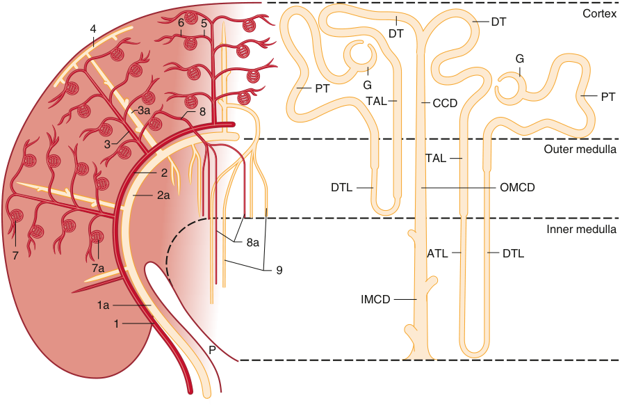

Cortex 6 5 DT 4 DT G PT G PT TAL CCD 3a 8 3 Outer medulla TAL 2 DTL OMCD 2a Inner medulla 8a 7 ATL DTL 7a 9 IMCD 1a 1 P 

**Fig. 15.1 Anatomic relationships of the nephron and the renal vasculature.** The _left side_ of the diagram represents the renal vasculature as distributed through the inner medulla, outer medulla, and cortex. Arteries are drawn as _solid lines_ , veins as _hollow tubes_ . The renal artery divides serially into interlobar arteries (1), arcuate arteries (2), and interlobular arteries (3). The afferent arterioles (5) branch off laterally and provide the capillary tufts of the renal glomeruli in the outer cortex (7a), whose efferent arterioles (6) supply the cortical capillary network (not shown). In the juxtamedullary zone (7b), the efferent arterioles become the vasa recta, which are closely applied to the long loops of Henle (8, 8a, 9). The venous drainage consists of stellate veins (4), interlobular veins (3a), arcuate veins (2a), and interlobar veins (1a). _ATL_ , ascending thin limb; _CCD_ , cortical collecting duct; _DTL_ , descending thin limb; _DT_ , distal convoluted tubule; _G_ , glomerulus; _IMCD_ , inner medullary collecting duct; _OMCD_ , outer medullary collecting duct; _PT_ , proximal tubule; _TAL_ , thick ascending limb. (Modified from Kriz W, Bankir L. A standard nomenclature for structures of the kidney. The Renal Commission of the International Union of Physiological Sciences (IUPS). _Kidney Int._ 1988;33[1]:1–7.)

<!-- PDF page 3 -->

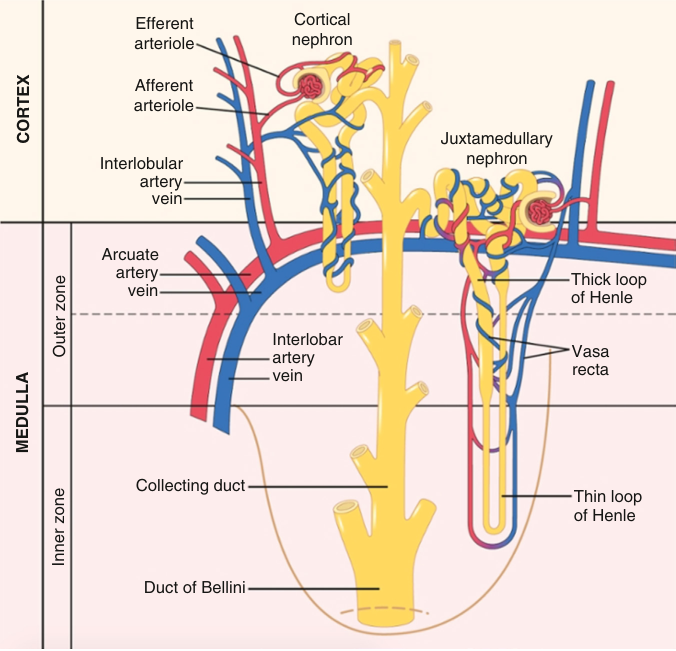

Efferent Cortical arteriole nephron Afferent arteriole Juxtamedullary Interlobular nephron artery vein Arcuate artery Thick loop vein of Henle Interlobar Vasa artery vein recta Collecting duct Thin loop of Henle Duct of Bellini CORTEX Outer zone MEDULLA Inner zone 

**Fig. 15.2 Schematic of relations between blood vessels and tubular structures.** (Redrawn from Hall JE. _Guyton and Hall Textbook of Medical Physiology_ . 13th ed. Philadelphia: Elsevier; 2016.)

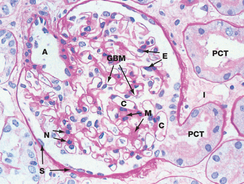

**Fig. 15.3 Glomerulus.** An afferent arteriole (A) enters the glomerulus and divides into numerous capillaries (C) adjacent to the glomerular basement membrane (GBM). The squamous epithelial cells (S) lining Bowman space lead to the cuboidal proximal convoluted tubules (PCT) with brush borders. _E_ , nuclei of endothelial cells; _M_ , mesangium; _N_ , nuclei of mesangial cells. (From Young B, Woodford P, O’Dowd G. Urinary system. In: _Wheater’s Functional Histology. A Text and Colour Atlas_ . 6th ed. Philadelphia: Elsevier Churchill Livingstone; 2014.)

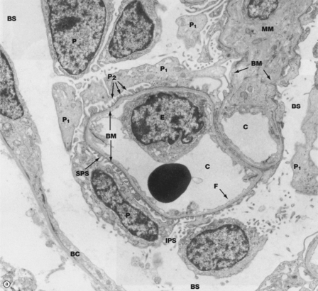

**Fig. 15.4 Electron micrograph of glomerulus.** The several glomerular capillaries (C) are lined by fenestrated endothelial cells. The podocytes (P) give rise to foot processes (P1, P2) that rest on the glomerular basement membrane (BM). Mesangial cells (M) support the capillary loops. Bowman space (BS) is delineated by the podocyte bodies on one side and the parietal epithelial cells on the other. _E_ , nucleus of capillary; _IPS,_ interpodocyte space; _MM_ , mesangial matrix; _SPS_ , subpodocyte space. (From Young B, Woodford P, O’Dowd G. Urinary system. In: _Wheater’s Functional Histology. A Text and Colour Atlas_ . 6th ed. Philadelphia: Elsevier Churchill Livingstone; 2014.)

<!-- PDF page 4 -->

ultrastructural zipper- like complex that spans the space between each of the foot processes of the podocytes.5 Additional epithelial cells and their extravascular matrix make up the parietal epithelium that lines a pouch- like cistern, called Bowman space, which is the beginning of the renal tubular system.

The vasculature of the kidney is unique in that it has two capillary beds. Upon exiting the glomerulus, the glomerular capillary forms the efferent artery that in turn leads to an anastomosing network of 10 to 25 long peritubular capillaries called vasa recta. The vasa recta are close around the ascending limb of the loop of Henle before anastomosing into veins that leave the kidney (see Fig. 15.2).

The endothelial and epithelial cells synthesize proteins that are essential components of the GBM, the filtration barrier of the kidney (see Fig. 15.5).6 The GBM is rich in the anionic glycosaminoglycan heparan sulfate, type IV collagen, and laminin.6,7 The epithelial cells maintain the integrity of this capillary bed by producing several key molecules including vascular endothelial growth factor8 and families of signaling proteins and receptors. The transmembrane protein nephrin supports the integrity of the slit pore diaphragms and its maintenance is dependent on the endocytosis of slit diaphragm proteins and plasma membrane components.7,9,10 The interplay between the foot processes of the podocytes, slit diaphragms, and organization of the actin intracellular scaffolds is centered on nephrin and related proteins.11 The functions of these numerous factors were often elucidated in experiential studies when found as etiologies of renal disease.7,11

### THE RENAL TUBULES

The kidneys receive 20% of the total cardiac output but extract relatively little oxygen, with a renal arteriovenous oxygen difference of only 1.5 mL/dL. However, there is marked critical dissimilarity between the renal cortex and medulla with regard to blood flow, oxygen delivery, and oxygen consumption (Table 15.1). The medulla receives

only 6% of the RBF and has an average oxygen tension (PO2) of 8 mm Hg. Thus, severe hypoxia could develop in the medulla despite a relatively adequate total RBF. The metabolically active medullary thick ascending loop of Henle (mTAL) is particularly vulnerable.12 This risk becomes clinically relevant during even brief episodes of hypotension, where tubules in renal medulla may undergo necrosis, called acute tubular necrosis.

The terminology of the renal tubular system is based on morphology as seen with light microscopy. The system begins with the proximal convoluted tubule (PCT) that starts as a continuation of the parietal epithelium of the nephron (see Fig. 15.3). A high density of mitochondria and the extensive surface area of the apical (referred to as the brush border) and basilar cell membranes mark the renal tubules and indicate high- energy requirements. In normal kidneys, 80% of the energy is utilized by Na+ /K+ - ATPase that maintains the osmotic gradient needed for the resorption of filtered molecules (Fig. 15.6).2 In spite of this high- energy demand, the tubular system is supplied by only

**Table 15.1** Distribution of Renal Blood Flow Between Cortex and Medulla

||**Cortex**|**Medulla***|
|---|---|---|
|Percentage of renal blood flow|94|6|
|Blood flow (mL/min/g)|5.0|0.03|
|PO2(mm Hg)|50|8|
|O2extraction ratio (VO2/DO2)|0.18|0.79|

*The renal medulla receives only a small fraction of the total renal blood flow, and flow rates are extremely slow. As a result, the tissue oxygen tension is extremely low, and the medulla extracts almost 80% of the oxygen delivered to it. A very mild reduction in total and cortical renal blood flow may therefore induce ischemia and hypoxia in the renal medulla.

_DO2_ , oxygen delivery; _O2_ , oxygen; _PO2_ , oxygen tension; _VO2_ , oxygen consumption.

- Data from Brezis M, Rosen S, Epstein F. The pathophysiological implications of medullary hypoxia. _Am J Kidney Dis_ . 1989;13:253–258.

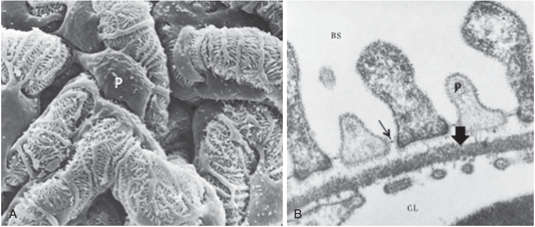

A B 

**Fig. 15.5** (A) Scanning electron micrograph of podocytes (P) and their processes. (B) Electron micrograph of podocyte processes (P), the glomerular basement membrane, and glomerular capillaries. Slit diaphragms _(arrow)_ span the podocyte processes. _Large arrow_ points to the lamina densa of the glomerular basement membrane. _BS_ , Bowman space; _CL_ , glomerular capillary lumen. (Modified from Gartner LP. Urinary system. In: _Textbook of Histology_ . 4th ed. Philadelphia: Elsevier; 2017.)

::: details 原始表格與符號（PDF 第 4 頁）

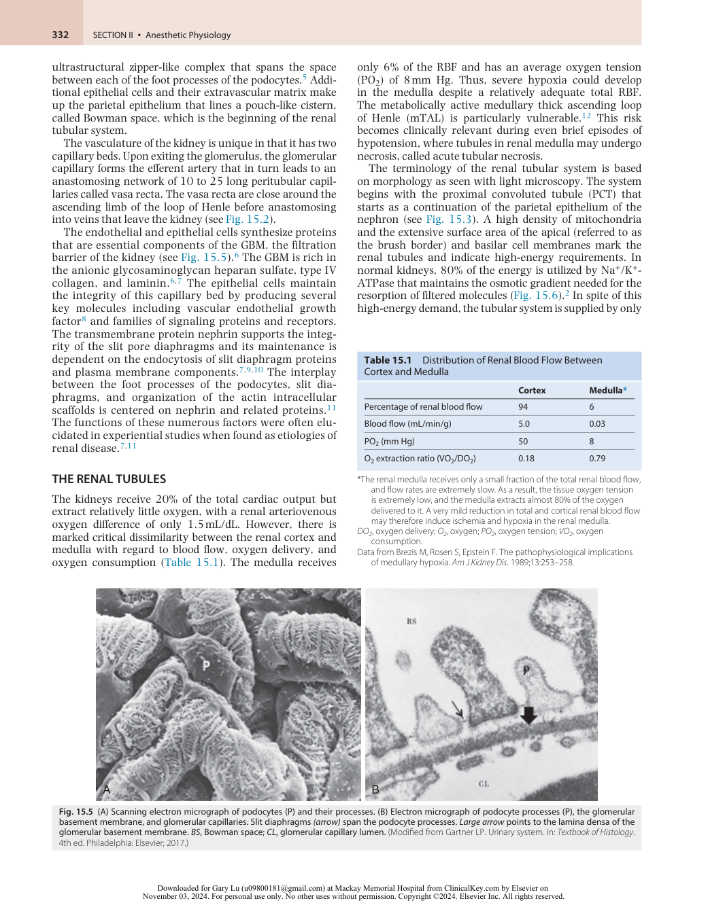

:::

<!-- PDF page 5 -->

10% to 15% of the RBF and is a key etiology for acute tubular necrosis after hypotension (see Chapter 38).

A distal short straight length of the proximal tubule leads to the thinner epithelium of the descending thin limb of

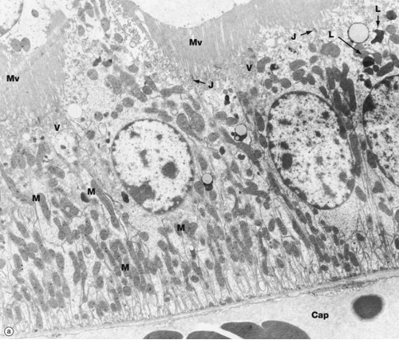

**Fig. 15.6 Proximal convoluted tubule.** The apical surface of the proximal convoluted tubule epithelium is marked by tall microvilli (Mv) that are seen as the brush border in light micrographs. The cytoplasm at the basal surface is filled with mitochondria (M) that are reflective of the high oxygen requirement needed for the maintenance of the basal lateral Na+ /K+ - ATPase. _Cap_ , tubular capillary; _J_ , tight intercellular junction; _L_ , lysosome; _V_ , vesicle. (From Young B, Woodford P, O’Dowd G. Urinary system. In: _Wheater’s Functional Histology. A Text and Colour Atlas_ . 6th ed. Philadelphia: Elsevier Churchill Livingstone; 2014.)

the loop of Henle. This makes a hairpin 180- degree turn to ascend toward the cortex and eventually becomes the medullary thick ascending limb of the loop of Henle (mTAL) and distal convoluted tube (see Fig. 15.2). Seventy to 80% of nephrons begin in the cortex and have short loops of Henle that enter only the outer margin of the medulla. The remaining juxtamedullary nephrons start at the corticomedullary junction and have elongated loops of Henle that descend into the most distal extent of the medulla. At the end of the distal tubule is the juxtaglomerular apparatus that is composed of specialized epithelial cells, called the macula densa (by virtue of light microscopic image), cells of the afferent glomerular arteriole, and mesangial cells (Fig. 15.7). The juxtaglomerular apparatus is essential for the maintenance of blood pressure, as described later. The most distal end of the nephron is the collecting duct that empties the ultrafiltrate into the renal pelvis and then the ureters.

### FORMATION OF URINE

Urine is formed by the interaction of three processes: glomerular filtration, tubular reabsorption, and tubular secretion.

### Glomerular Filtration

The formation of the glomerular filtrate is dependent on the balance of Starling forces regulating fluid flux across the filtration barrier.13 Central to this process is the hydrostatic pressure difference between the afferent and efferent arteries (Fig. 15.8) that is 60 mm Hg, which is three times higher than in most capillary beds. This pressure difference drives

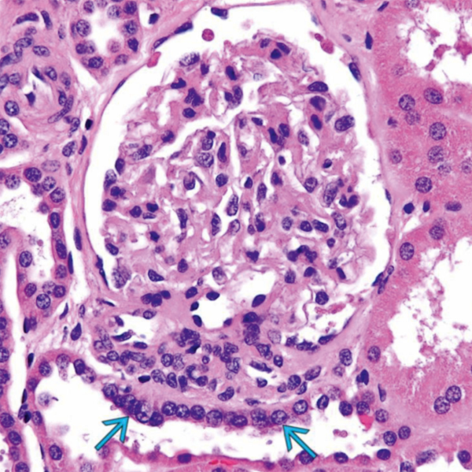

**Fig. 15.7 The macula densa** **_(arrows)_ .** The cells of the macula densa represent a special portion of the distal tubule that is adjacent to the juxtaglomerular apparatus. (From: Genitourinary and male genital tract. In: Lindberg MR, Lamps LW, eds. _Diagnostic Pathology: Normal Histology._ 2nd ed. Philadelphia: Elsevier; 2018.)

<!-- PDF page 6 -->

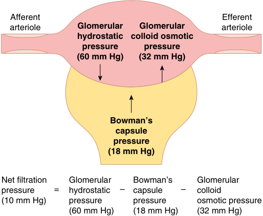

Afferent Efferent arteriole Glomerular Glomerular arteriole hydrostatic colloid osmotic pressure pressure (60 mm Hg) (32 mm Hg) Bowman’s capsule pressure (18 mm Hg) Net filtration Glomerular Bowman’s Glomerular pressure = hydrostatic – capsule – colloid (10 mm Hg) pressure pressure osmotic pressure (60 mm Hg) (18 mm Hg) (32 mm Hg) 

**Fig. 15.8 Summary of forces causing filtration by the glomerular capillaries.** (Redrawn from Hall JE. _Guyton and Hall Textbook of Medical Physiology_ . 13th ed. Philadelphia: Elsevier; 2016.)

**Table 15.2** Approximate Pressures and Vascular Resistances in the Circulation of a Normal Kidney

||**PRESSURE** **(mm**|**IN VESSEL** **Hg)**|**Percent of** **Total Renal** **Vascular**|
|---|---|---|---|
|**Vessel**|**Beginning**|**End**| **Resistance**|
|Renal artery|100|100|≈0|
|Interlobar, arcuate, and interlobular arteries|≈100|85|≈16|
|Afferent arteriole|85|60|≈26|
|Glomerular capillaries|60|59|≈1|
|Efferent arteriole|59|18|≈43|
|Peritubular capillaries|18|8|≈10|
|Interlobar, arcuate, and interlobular veins|8|4|≈4|
|Renal vein|4|≈4|≈0|

From Hall JE. _Guyton and Hall Textbook of Medical Physiology_ . 13th ed. Philadelphia: Elsevier; 2016.

plasma across the endothelial and epithelial filtration barriers (Table 15.2). A delicate balance in pressure maintenance is necessary because reduced pressures will decrease filtration, as increased pressures may cause renal damage. The glomerular filtration rate (GFR) depends upon the glomerular capillary pressure that is opposed by the hydrostatic pressure in Bowman space and the colloid osmotic pressure within the glomerular capillaries (Figs. 15.8 and 15.9). In healthy patients, the colloid osmotic pressure in Bowman space is negligible, since the GBM restricts the passage of proteins. The normal GFR is about 180 L/day.

### Mediator Control of the Glomerular Filtration Rate

Control of this glomerular capillary pressure is exquisite. Hormones, peptides, and autacoids interact with receptors

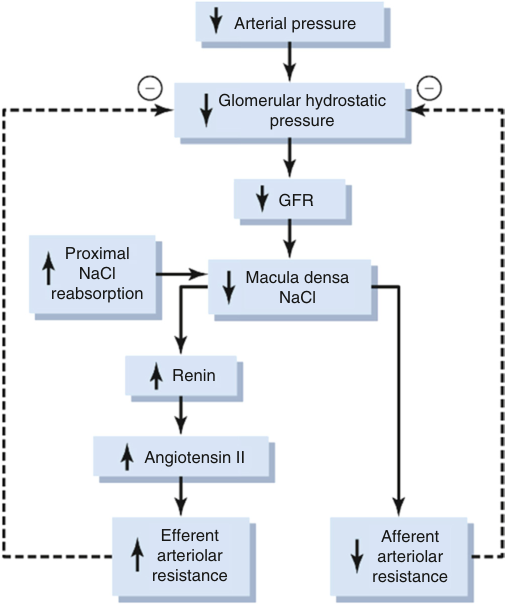

Arterial pressure Glomerular hydrostatic pressure GFR Proximal NaCl Macula densa reabsorption NaCl Renin Angiotensin II Efferent Afferent arteriolar arteriolar resistance resistance 

**Fig. 15.9** Macula densa feedback mechanism for autoregulation of glomerular hydrostatic pressure and glomerular filtration rate (GFR) during decreased renal artery pressure. (Redrawn from Hall JE. _Guyton and Hall Textbook of Medical Physiology._ 13th ed. Philadelphia: Elsevier; 2016.)

|Vasoconstrictor Systems|Vasodilator Systems|
|---|---|
|Sympathoadrenal system|Prostaglandins|
|Renin–angiotensin system|Kinins|
|Aldosterone|Atrial natriuretic peptide (ANP)|
|Antidiuretic hormone (ADH)||
|RBF|RBF|
|GFR|GFR|
|Urine flow|Urine flow|
|Na excretion|Na excretion|

**Fig. 15.10 Neurohormonal renal regulatory systems.** _GFR_ , glomerular filtration rate; _Na_ , sodium; _RBF_ , renal blood flow _;_ ↓, decreased; ↑, increased. (Modified from Sladen RN. Effect of anesthesia and surgery on renal function. _Crit Care Clin._ 1987;3(2):380–393.)

in the kidney to assure maintenance of RBF and GFR (Fig. 15.10).

**α- Adrenergic Effect.** The vascular myocytes of afferent and efferent arterioles have the pressure- dependent ability to contract or relax. This prevents increased diuresis, appropriately called pressure diuresis, when the blood pressure is elevated. Catecholamines influence GFR in two different ways: first they increase the systemic arterial pressure which indirectly increases GFR, and second, by their direct effect on the renal afferent and efferent arterioles.14 Mild α- adrenergic stimulation constricts the efferent arteriole that preserves GFR (Fig. 15.11). Severe α- adrenergic activity

::: details 原始表格與符號（PDF 第 6 頁）

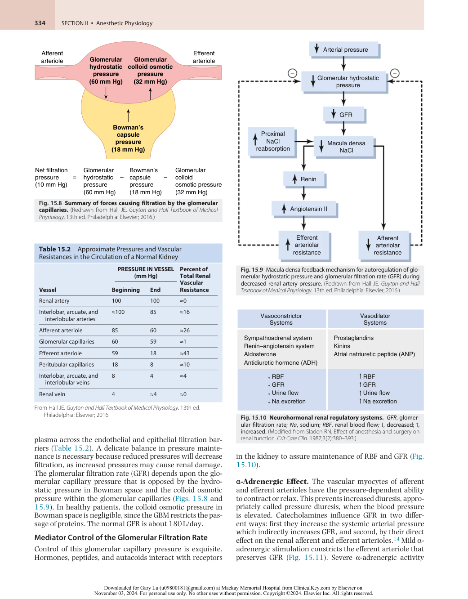

:::

<!-- PDF page 7 -->

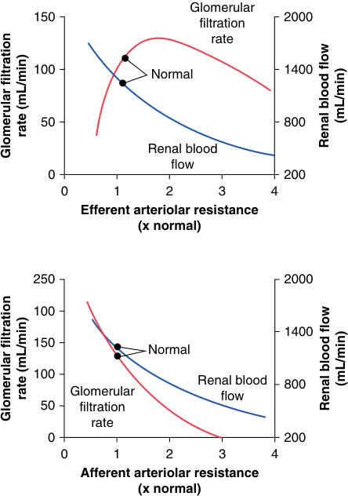

Glomerular 150 2000 filtration rate 100 Normal 1400 50 800 Renal blood flow 0 200 0 1 2 3 4 Efferent arteriolar resistance (x normal) 250 2000 100 1400 150 Normal 100 Renal blood 800 Glomerular flow 50 filtration rate 0 200 0 1 2 3 4 Afferent arteriolar resistance (x normal) (mL/min) rate (mL/min) Renal blood flow Glomerular filtration (mL/min) rate (mL/min) Renal blood flow Glomerular filtration 

**Fig. 15.11 Effect of change in afferent arteriolar resistance or efferent arteriolar resistance on glomerular filtration rate and renal blood flow.** (Redrawn from Hall JE. _Guyton and Hall Textbook of Medical Physiology_ . 13th ed. Philadelphia: Elsevier; 2016.)

decreases the filtration fraction by constricting the afferent and efferent arterioles to prevent a flow- induced decrease in GFR. The kidney is relatively devoid of β2 receptors, so epinephrine release induces predominant vasoconstriction through α receptor or angiotensin activation. Various animal and human studies show that norepinephrine administration during sepsis may preserve GFR primarily by maintaining systemic arterial pressure.15 However, the effect of norepinephrine on GFR during other shock states can be quite variable depending on the clinical context, especially based on the patient’s cardiac output and preload responsiveness.

**Renin–Angiotensin.** Adrenergic stimulation of the juxtaglomerular apparatus releases the enzyme renin from the cells of the macula densa and principal cells of the collecting ducts.16 Renin, more appropriately called angiotensinogenase, converts the hepatic synthesized glycopeptide angiotensinogen to angiotensin I, a 10- amino acid peptide. The vascular endothelial cells of the kidney and lung are the major source of angiotensin- converting enzymes (ACE), that converts angiotensin I to angiotensin II, by cleaving 2 amino acids.12,17–19 ACEs are present in diverse cell types,12 including leukocytes and smooth muscle. Angiotensin II can be further cleaved by peptidases into various metabolically active peptides.

Angiotensin peptides stimulate two pathways that have opposing effects (Fig. 15.12).20 The principal receptor is AT1R that is found on the luminal epithelial surface

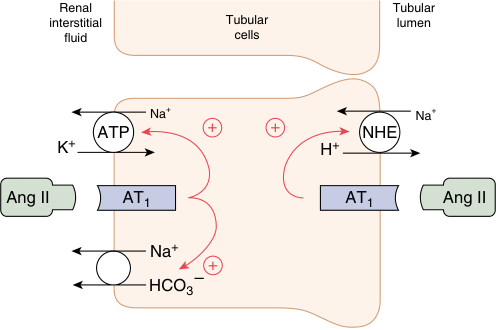

Renal Tubular interstitial Tubular lumen fluid cells Na + Na + ATP + + NHE K + H + Ang II AT1 AT1 Ang II Na + + HCO3– 

**Fig. 15.12 Direct effects of angiotensin II (Ang II) to increase proximal tubular sodium reabsorption.** Ang II stimulates sodium– hydrogen exchange (NHE) on the luminal membrane and the sodium– potassium ATPase transporter and sodium–bicarbonate cotransport on the basolateral membrane. _ATP_ , adenosine triphosphate. (Redrawn from Hall JE. _Guyton and Hall Textbook of Medical Physiology._ 13th ed. Philadelphia: Elsevier; 2016.)

of the proximal tubular cell (PTC), mTAL, macula densa, distal tubules, and collecting ducts.16,21 The angiotensin II–AT1R interaction serves to maintain systemic blood pressure through vasoconstriction, and enhancement of tubular transport mechanisms to reabsorb sodium and water.16,17,20 On the other hand, the non- classical RAS axis composed of angiotensin II/III–AT2R or Ang- (1- 7)- AT7R interaction opposes these actions and causes vasodilatation through nitric oxide (NO) and prostaglandin- mediated natriuresis, diuresis, and reduced oxidative stress.20

Angiotensin II is a potent vasoconstrictor of efferent arterioles, which increases the pressure difference and enhances filtration.21 This maintains the glomerular filtration fraction in the face of mild to moderate decreases in RBF or perfusion pressure that may result from hypovolemia or systemic hypotension. Angiotensin II promotes systemic vasoconstriction at about one-tenth of its renal effect. Renin secretion is stimulated by hypovolemia from hemorrhage, diuresis, or sodium loss/restriction and by reductions in perfusion as seen with positive pressure ventilation, congestive heart failure, sepsis, or cirrhosis with ascites. Angiotensin II feeds back to the juxtaglomerular apparatus to inhibit renin secretion. It also stimulates phospholipase A2 to trigger the synthesis of vasodilatory prostaglandins.

**Prostaglandins and Kinins.** Intrarenal prostaglandins play an important role in endogenous renal protection by vasodilating juxtamedullary blood vessels and maintaining inner cortical blood flow.22 Prostaglandins are called autacoids because, unlike true hormones, they are produced in minute amounts and have a local, evanescent action. Because their structure is based on a 20- carbon fatty acid, they are also referred to as eicosanoids, after _eicosa_ , the Greek word for the number 20.

Phospholipase A2 resides in the inner lipid layer of the cell membrane and controls prostaglandin production through its formation of the prime precursor, arachidonic acid. It is stimulated by ischemia, hypotension, norepinephrine, angiotensin II, and arginine vasopressin (AVP). Thus, the factors that induce and mediate the stress response

<!-- PDF page 8 -->

simultaneously activate prostaglandins, which defend the kidney against their actions. Cyclooxygenase- 1 acts on arachidonic acid to form the vasodilator prostaglandins that include PGD2, PGE2, and PGI2 (prostacyclin).23 Vasodilation is through activation of cyclic adenosine monophosphate (cAMP) to oppose the action of catecholamines, angiotensin II, and AVP. Prostaglandins are particularly important to decrease the vasoconstrictor activity of angiotensin II on the afferent arteriole and mesangial cells. Drugs that inhibit prostaglandin synthesis, such as nonsteroidal anti- inflammatory agents, can upset this compensatory mechanism and result in medullary ischemia and kidney injury in susceptible patients.

Kinins act directly as vasodilators, as well as stimulate phospholipase A2, prostacyclin production, and endothelial cell NO formation.24 Kinins are produced by cleavage of kininogen by the serine protease kallikrein. Over 90% of renal kallikrein is produced by the distal convoluted tubules in the cortex with decreased concentrations from outer to inner zones.24 Renal kininase, which controls the level of bradykinin, is inhibited by ACE inhibitors and is the reason for angioedema.25

**Arginine Vasopressin (AVP).** AVP, also known as antidiuretic hormone (ADH), is produced by the posterior pituitary with its release stimulated by hyperosmolality or hypovolemia.26 The most potent trigger for AVP release is systemic arterial hypotension, mediated by aortic and carotid baroreceptors that override all other triggers, and plasma AVP may reach levels 10- to 1000- fold greater than normal. At these concentrations, AVP acts as a vasoconstrictor, especially in the outer renal cortex. It does so by stimulating the V1A receptor that exists on vascular smooth muscle, glomerular mesangial cells, and the vasa recta and promotes vasoconstriction through the phosphatidylinositol pathway.27 AVP maintains effective glomerular filtration pressure as an extremely potent constrictor of the efferent arteriole. Unlike catecholamines and angiotensin, it has little effect on the afferent arteriole, even at high plasma levels.28 The binding to V2 receptors on the medullary collecting ducts stimulates adenylate cyclase to form cAMP that enhances aquaporin- 2 channels of the principal cells to increase water reabsorption (Fig. 15.13).26,29 Anesthetics have little direct effect on AVP secretion, except via the changes that they induce in arterial blood pressure, venous volume, and serum osmolality. Surgical stimulation is a major stimulus to AVP secretion. This stress response, whether mediated by pain or by intravascular volume changes, is profound and lasts at least 2 to 3 days after the surgical procedure and may lead to postoperative hyponatremia called syndrome of inappropriate ADH secretion.

**Natriuretic Peptides.** Natriuretic peptides dilate vascular smooth muscle through activation of cyclic guanosine monophosphate by blocking the phospholipase C- linked receptors to the actions of norepinephrine and angiotensin II. Atrial natriuretic peptide (ANP)30 is released from atrial myocytes in response to atrial wall stretch and increased atrial volume, brain (B- type) natriuretic peptide is released in response to cerebral ventricle stretch, and C- type is released from the endothelium of major blood vessels. Urodilatin is secreted by the epithelium of the distal tubules and

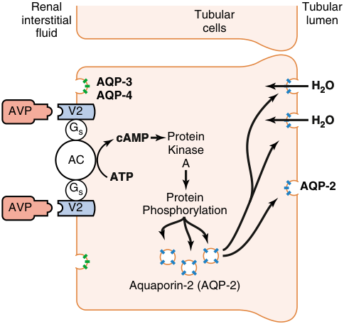

Renal Tubular Tubular interstitial lumen cells fluid AQP-3 H2O AQP-4 AVP V2 H2O Gs cAMP Protein Kinase AC A ATP Gs AQP-2 Protein AVP V2 Phosphorylation Aquaporin-2 (AQP-2) 

**Fig. 15.13 Mechanism of action of arginine vasopressin.** Arginine vasopressin (AVP) binds to receptors (V2) that are coupled to G proteins (Gs) to activate adenylate cyclase (AC) and stimulate the formation of cyclic adenosine monophosphate (cAMP). This will then activate protein kinase A to phosphorylate intracellular proteins and allow aquaporin- 2 (AQP- 2) to form water channels at the luminal side of the membrane. Other aquaporins (AQP- 3, AQP- 4) that are not controlled by AVP allow water to exit the cell at the basolateral cell membrane. _ATP_ , adenosine triphosphate. (Redrawn from Hall JE. _Guyton and Hall Textbook of Medical Physiology_ . 13th ed. Philadelphia: Elsevier; 2016.)

collecting ducts in response to increases in mean arterial pressure and blood volume. It is an A- type natriuretic peptide that is a paracrine intrarenal regulator for sodium and water homeostasis.

The natriuretic peptides cause prompt, sustained increases in GFR and glomerular filtration fractions even when RBF is not increased or when arterial pressure is decreased. They promote afferent arteriolar dilatation with or without efferent arteriolar constriction, antagonize endothelin (the endogenous vasoconstrictor peptide produced by vascular endothelial cells), inhibit renin secretion, and decrease angiotensin- stimulated aldosterone. These peptides also inhibit the release of aldosterone in the adrenal cortex and block its actions at the distal tubules and collecting ducts. Moreover, they inhibit the secretion of AVP through their effects on the brain and pituitary, which can lead to an enhanced diuresis. NaCl is resorbed, and diuresis is promoted.31 These actions are important in oliguric patients (such as those with acute renal failure and chronic renal failure) to increase urine output. Since their release is closely linked to volume status, natriuretic peptide levels are commonly used as a biomarker in heart failure.

**Aldosterone.** Aldosterone is a steroid hormone secreted by the zona glomerulosa of the adrenal cortex in response to hyperkalemia or hyponatremia.32 Angiotensin II and adrenocorticotropic hormone also trigger its release. It acts at the thick ascending limb of the loop of Henle, the principal cells of the distal tubule, and the collecting duct to increase active absorption of sodium and passive absorption of water, culminating in an expanded blood volume. Sodium retention in vessel walls appears to enhance their

<!-- PDF page 9 -->

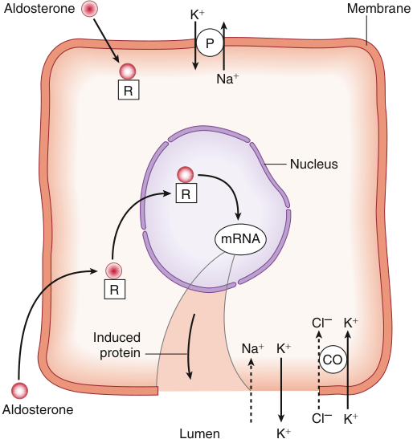

Aldosterone Membrane K � P Na � R Nucleus R mRNA R Cl – K � Induced protein Na � K � CO Aldosterone Cl – K � Lumen K � 

**Fig. 15.14 Action of aldosterone.** Aldosterone enters the distal tubular cytoplasm and attaches to a receptor, then migrates to the nucleus, where it induces the formation of messenger ribonucleic acid (mRNA). The mRNA in turn induces the synthesis of a protein that enhances the permeability of the apical (luminal) membrane to sodium and potassium. The reabsorption of sodium stimulates the basolateral membrane Na+ /K+ - ATPase pump, the intracellular concentration of potassium rises, and it follows its concentration gradient out into the lumen. The net effect of aldosterone’s action is sodium reabsorption and potassium loss. _Cl_− , chloride; _CO,_ cotransporter (= symporter); _K_+ , potassium; _Na_+ , sodium; _P,_ sodium–potassium ATPase pump; _R,_ receptor. (From Wingard LB, Brody TM, Larner J, et al. Diuretics: drugs that increase excretion of water and electrolytes. In: Wingard LB, Brody TM, Larner J, et al., eds. _Human Pharmacology: Molecular- To- Clinical._ London: Wolfe Publishing Ltd; 1991:249, Fig. 19.4.)

response to vasoconstrictor agents. In contrast to the immediate sympathetic angiotensin II response to hypovolemia, there is a delay of about 1 to 2 hours from the secretion of aldosterone to its action on sodium reabsorption.

Aldosterone forms a complex with a receptor at the cell membrane in the principal cells of the distal tubule (Fig. 15.14). The aldosterone– receptor complex travels to the cell nucleus, where it induces cytoplasmic transcription of messenger ribonucleic acid. This fosters synthesis of proteins that form sodium channels in the apical cell membrane to enhance the Na+ /K+ - ATPase pump in the basolateral cell membrane and transport sodium from the tubular fluid into the peritubular capillary in exchange for potassium.33 Long- standing stimulation of aldosterone secretion, characteristically induced by the intravascular volume depletion of chronic ascites, culminates in potassium depletion and hypokalemic alkalosis.

### The Dopaminergic System

There are at least two subtypes of dopaminergic (DA) receptors.34 DA1 receptors are present on the renal and splanchnic vasculature as well as on the proximal tubule. Stimulation of the DA1 receptor activates cAMP and induces renal vasodilation, increases RBF and GFR, natriuresis, and

diuresis. Resorption of NaCl is enhanced by dopamine’s inhibition of the sodium–hydrogen antiporter system at the brush- border membrane of the proximal tubule and the Na+ /K+ - ATPase pump at the basolateral membrane of the thick ascending limb of the loop of Henle.

Stimulation of D2 receptors on the presynaptic terminal of postganglionic sympathetic nerves inhibits the release of norepinephrine from presynaptic vesicles to facilitate vasodilation. The DA system plays an integral role in the endogenous vasodilator–natriuresis system and the maintenance of normal blood pressure. Endogenous dopamine constitutively activates the DA2 receptor, which synergistically enhances the activation of the DA1 receptor and inhibits tubular Na+ /K+ - ATPase activity, especially when sodium intake is increased. It also opposes the antinatriuretic effects of norepinephrine, angiotensin II, and aldosterone. Endogenous ANP acts via the renal dopamine system by recruiting “silent” DA1 receptors from the interior of the cell toward the plasma membrane and also enhances dopamine accumulation.34,35

Excretion of dopamine in the urine is increased with salt loading. Decreased DA activity may contribute to the pathogenesis of idiopathic edema, which manifests as retention of salt and water in the upright position. There is evidence that the endogenous dopamine system is activated in compensated cirrhosis and helps to maintain renal sodium excretion.34,35

### Adenosine

Adenosine is present in all tissues and in the extracellular space as a signaling molecule. It plays a role during conditions of cellular distress such as hypoxia, inflammation, and acute cellular injury.36 Extracellular adenosine mainly exerts its biologic actions through activation of four adenosine receptors leading to the attenuation or activation of intracellular cAMP levels through modulation of adenylate cyclase activity that affects the production of nucleotides adenosine monophosphate, adenosine diphosphate (ADP), and adenosine triphosphate (ATP) that have essential roles in most cellular functions.36 Adenosine is implicated in the regulation of RBF by tubuloglomerular feedback and protects the kidney from ischemia.37 During periods of ischemia, there is a fivefold increase in extracellular adenosine. In animal models, signaling through adenosine receptors has been effective in preventing acute kidney injury (AKI) from ischemia.37

### Nitric Oxide

Endogenous nitric oxide (NO) is a potent vasodilator of vascular smooth muscle. It is produced in many nephron segments including the cortical and medullary thick ascending limb of the loop of Henle (mTAL).38 During oxidative stress, reactive oxygen species (ROS), including superoxide (O2− ), hydrogen peroxide (H2O2), and the hydroxyl radical (OH), are produced. Under normal conditions, NO minimizes the influence of these ROS. NO acts at multiple points in the citric acid cycle and increases the efficiency of oxygen utilization within the kidney.38 NO inhibits apical Na+ /H+ cotransport and basolateral Na+ /K+ - ATPase activity in the proximal tubule, inhibits sodium reabsorption in the mTAL by blocking the Na+ /K+ /2Cl− cotransporter, and has a direct effect on apical sodium channels of the cortical collecting

::: warning 符號需核對
此頁有符號無法完整擷取，請展開下方原始頁面核對。
:::

::: details 原始表格與符號（PDF 第 9 頁）

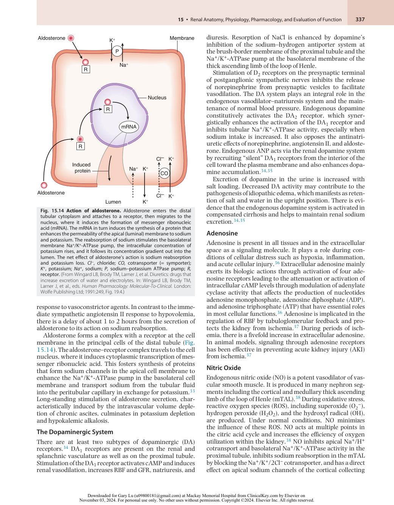

:::

<!-- PDF page 10 -->

**Table 15.3** Filtration, Reabsorption, and Excretion Rates of Different Substances by the Kidneys

||**Amount Filtered**|**Amount Reabsorbed**|**Amount Excreted**|**Percent of Filtered Load Reabsorbed**|
|---|---|---|---|---|
|Glucose (g/day)|180|180|0|100|
|Bicarbonate (mEq/day)|4320|4318|2|>99.9|
|Sodium (mEq/day)|25,560|25,410|150|99.4|
|Chloride (mEq/day)|19,440|19,260|180|99.1|
|Potassium (mEq/day)|756|664|92|87.8|
|Urea (g/day)|46.8|23.4|23.4|50|
|Creatinine (g/day)|1.8|0|1.8|0|

From Hall JE. _Guyton and Hall Textbook of Medical Physiology_ . 13th ed. Philadelphia: Elsevier; 2016.

ducts to inhibit sodium transport.38,39 NO produced in the epithelial cells of mTAL buffers the vasoconstriction in the medullary circulation in response to sympathetic stimulation and angiotensin II.40 As for antagonism of O2– tubular activity, endogenous NO counteracts the vasoconstrictor effects of O2.

### Renal Tubular System Physiology

The renal tubular system compensates for the large glomerular filtration by resorption so that only 1.5 L/day of fluid is excreted as urine. The tubules also conserve and regulate molecules within appropriate physiologic ranges that are freely filtered such as ions, glucose, and amino acids (Table 15.3). Under most conditions, the kidneys excrete more than 95% of the ingested Na+ at rates that match dietary Na+ intake.41 Approximately 65% of filtered sodium, chloride, and water is reabsorbed by the PCTs (Fig. 15.15). In the first segment of the PCT, sodium is reabsorbed across the apical lumen by cotransport with amino acids, bicarbonate, and glucose and counter- transport mechanisms (Fig. 15.16). This reabsorption increases the concentration of chloride ions to 140 mEq/L from the initial filtrate concentration of 105 mEq/L and favors its diffusion through the intercellular junctions into the interstitial space. Organic acids and bases including waste products of metabolism, such as bile salts and urea, and multiple exogenous drugs and toxins are removed from blood and secreted into the lumen of the PCT. This provides an alternate mechanism, in addition to glomerular filtration, for substances to enter the tubular lumen. This is clinically important since doses of drugs that are removed by the kidney, such as β- lactam antibiotics, will require dose adjustments to achieve therapeutic levels or to prevent toxicity in other organs. Fig. 15.17 outlines changes in the concentrations of different substances in the tubular system relative to the concentration in plasma and the glomerular filtrate.

### The Loop of Henle

The loop of Henle is composed of a thin descending limb, thin ascending limb, a medullary thick ascending limb (mTAL) as well as a cortical portion that leads to the distal convoluted tubule. The macula densa (see Fig. 15.1) is an area of closely packed cells lining the wall of the distal tubule at the point where it meets the thick ascending limb. The major function of the loop of Henle is to reabsorb 25% of filtered water and 40% of the filtered sodium, which is accomplished by maintaining an osmotic gradient in the

interstitium by a countercurrent system.41 Differential permeability to water, transport of ions, and urea carriers provides the interstitial environment to concentrate urine (see Fig. 15.15). The tubules of the descending loop of Henle are freely permeable to water and allow for the reabsorption of about 20% of the filtered water. Both the medullary and cortical thick ascending limbs are impermeable to water but use Na+ /K+ /2Cl− cotransporter to reabsorb Na+ , Cl− , and K+ from the tubular lumen. Inhibition of this cotransporter is the mechanism of cationic (positively charged) loop diuretics such as furosemide. The positive charge of the tubular lumen compared to the interstitium allows the paracellular reabsorption of magnesium and calcium in addition to sodium and potassium. ATPase- dependent Na+ /K+ pumps in the basilar membrane will reabsorb 25% of the filtered sodium and potassium.

Urea, which comprises 90% of waste nitrogen, is passively absorbed from the lumen of the collecting ducts into the interstitium by osmosis and is facilitated by specific transporters. An increased concentration of urea in the collecting duct lumen favors its movement into the interstitium to create an extremely high interstitial osmolality at the tip of the loop of Henle that approaches 1200 mOsm/kg. This high interstitial osmolarity is essential for passive reabsorption of water from the thin descending loop of Henle.

### DISTAL CONVOLUTED TUBULES AND MACULA DENSA

The first part of the distal convoluted tubule forms the macula densa of the juxtaglomerular apparatus. Approximately 5% of sodium is reabsorbed in the first part of the distal convoluted tubule by a sodium chloride cotransporter that moves ions from the tubular lumen into the cell and a Na+ /K+ - ATPase that moves Na+ out of the cell.41,42 Thiazide diuretics inhibit this cotransporter (see Fig. 15.16). The movement of chloride is passive. The permeability to water of the distal convoluted tubules, as well as the collecting ducts described later, is regulated by AVP (Fig. 15.18). With increased AVP, they become more permeable, and water is absorbed.

### RENAL CONNECTING TUBULES

The connecting tubules are extensions of the distal convoluted tubules and have the same function of Na+ resorption.

::: details 原始表格與符號（PDF 第 10 頁）

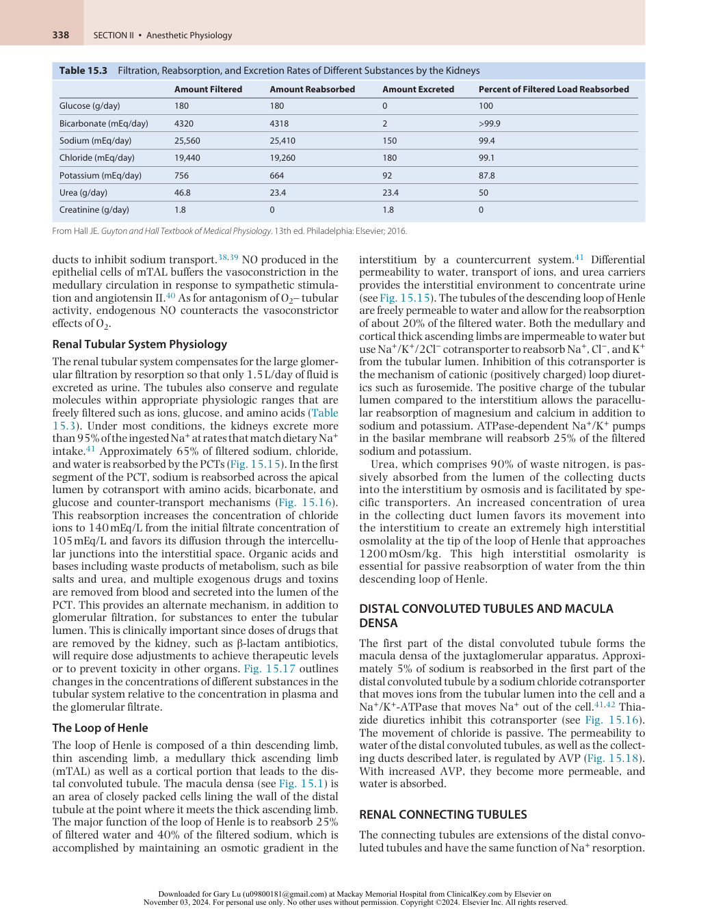

:::

<!-- PDF page 11 -->

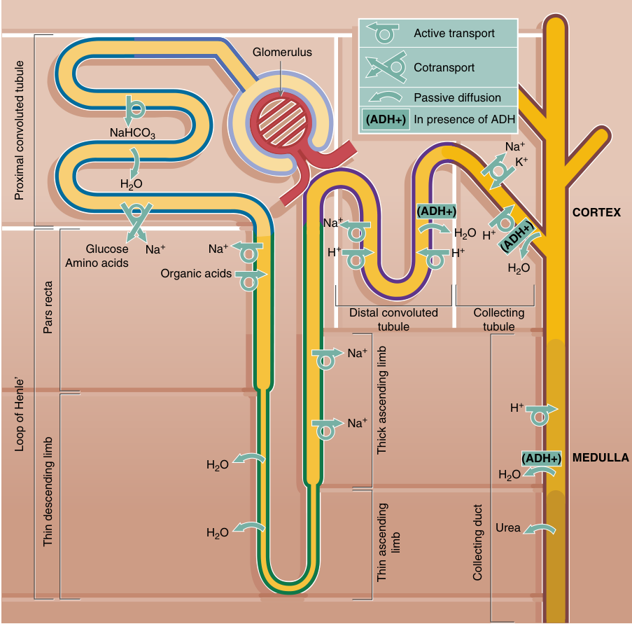

Active transport Glomerulus Cotransport Passive diffusion (ADH+) In presence of ADH NaHCO3 Na + K + H2O (ADH+) CORTEX Na + H2O H + Glucose Na + Na + H + H + Amino acids H2O Organic acids Distal convoluted Collecting tubule tubule Na + H + Na + (ADH+) MEDULLA H2O H2O H2O Urea (ADH+) Proximal convoluted tubule Pars recta Loop of Henle’ Thick ascending limb Thin descending limb limb Thin ascending Collecting duct 

**Fig. 15.15 Summary of major activities of different parts of the renal tubule** The ability of the tubule to produce concentrated urine is dependent on the high osmolality of the renal medulla created by the counter- current multiplier mechanism. This is dependent upon the active transport of NaCl in the water- impermeable thick ascending limb of the loop of Henle NaCl, the action of arginine vasopressin (antidiuretic hormone, ADH) on the collecting tubule and duct, the high concentration of urea created by passive diffusion, and the reabsorption of water reabsorbed into the hyperosmolar medulla by the vasa recta. (Redrawn from Young B, Woodford P, O’Dowd G. Urinary system. _Wheater’s Functional Histology. A Text and Colour Atlas_ . 6th ed. Philadelphia: Elsevier Churchill Livingstone; 2014.)

The two cell types lining the collecting tubules are the principal cells and two types of intercalated cells. Principal cells, the sites of action for the potassium- sparing diuretics such as spironolactone, a competitor of aldosterone, use Na+ / K+ - ATPase to resorb Na+ and excrete K+ . An additional mechanism is Na+ channel blockade by diuretics such as amiloride.

Type A intercalated cells use H+ - ATPase and H+ /K+ - ATPase transporters to secrete hydrogen ions formed by carbonic anhydrase against a large concentration gradient. Bicarbonate ions are absorbed from the basolateral membrane. In contrast, the type B intercalated cells transport hydrogen out of the cell on the basolateral side while bicarbonate is excreted into the tubular lumen. These cells are critical to the maintenance of

acid–base balance, sodium reabsorption, and intravascular volume.43

### COLLECTING DUCTS

The collecting ducts form as distal anastomoses of collecting tubules in the medulla and determine the final composition of urine. The principal cell of the collecting duct is a highly regulated epithelial cell which controls water resorption. AVP increases the quantity of aquaporin- 2 channels in the apical cell membrane of principal cells, thereby making it permeable to water. AVP also regulates urea transporters, which help reabsorb urea into the medullary interstitium, thereby raising the osmolality to assist in further concentrating urine. Hydrogen can also

<!-- PDF page 12 -->

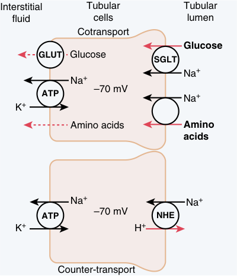

Interstitial Tubular Tubular fluid cells lumen Cotransport Glucose GLUT Glucose SGLT Na + Na + –70 mV ATP Na + K + Amino acids Amino acids Na + Na + ATP –70 mV NHE K + H + Counter-transport 

**Fig. 15.16 Mechanism of secondary active transport.** The _upper cell_ shows the cotransport of glucose and amino acids along with Na+ through the apical side of the tubular epithelial cells followed by facilitated diffusion through the basolateral membranes. The _lower cell_ shows the counter- transport of hydrogen ions from the interior of the cell across the apical membrane and into the tubular lumen. The movement of sodium ions into the cell is down an electrochemical gradient established by the sodium–potassium pump at the basolateral membrane and provides the energy for transport of the hydrogen ions from the inside of the cell into the tubular lumen. _ATP_ , adenosine triphosphate; _GLUT_ , glucose transporter; _NHE_ , sodium–hydrogen exchanger; _SGLT_ , sodium–glucose cotransporter. (Redrawn from Hall JE. _Guyton and Hall Textbook of Medical Physiology._ 13th ed. Philadelphia: Elsevier; 2016.)

be secreted against a high concentration gradient to regulate acidosis.

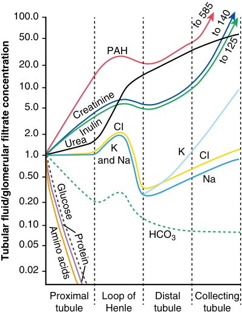

100.0 50.0 PAH 20.0 10.0 5.0 CI 2.0 1.0 K K CI and Na 0.50 Na 0.20 0.10 HCO3 0.05 0.02 Proximal Loop of Distal Collecting tubule Henle tubule tubule Urea Creatinine Inulin to 585 to 140 to 125 Glucose Protein Amino acids Tubular fluid/glomerular filtrate concentration 

**Fig. 15.17** Changes in the average concentrations of different substances at different points in the tubular system relative to the concentration of that substance in the plasma and in the glomerular filtrate. A value of 1.0 indicates that the concentration in the tubular fluid is the same as in the plasma, values below 1.0 indicate that the substance is reabsorbed more avidly than water, while values greater than 1.0 indicate that the substance is reabsorbed to a lesser extent than water or is secreted into the tubules. (Redrawn from Hall JE. _Guyton and Hall Textbook of Medical Physiology_ . 13th ed. Philadelphia: Elsevier; 2016.)

within 3 to 10 seconds over a mean arterial blood pressure range of 70 to 130 mm Hg.45

### TUBULOGLOMERULAR FEEDBACK

### RENAL AUTOREGULATION

The formation of urine is tightly controlled by complex autoregulation that maintains consistency of the RBF, GFR, and the resorption rate in tubules when there are changes in tubular flow. There are two mechanisms of renal autoregulation: myogenic mechanism which primary protects capillaries from rapid elevations in blood pressure, and tubuloglomerular feedback which is helpful in maintaining GFR in response to sustained reduction in arterial pressure.44 Glomerulotubular balance, not to be confused with tubuloglomerular feedback, is the phenomenon by which a constant proportion of the water and solutes (∼67%) filtered by the glomerulus is reabsorbed in the PCT, across a range of GFR. Although the mechanism of glomerulotubular balance is poorly understood, it is a critical mechanism which protects the distal segments of the nephron from being overloaded during increases in GFR.

### The Myogenic Mechanism of the Renal Blood Flow Autoregulation

The smooth muscles of the afferent arterioles, as is true for other vascular beds, have the intrinsic ability to contract, called a myogenic response, to increases in blood pressure. The response can compensate for changes in pressure

Tubuloglomerular feedback is the negative feedback mechanism which uses information from distal tubule to regulate RBF through macula densa. This process is more adaptable to slow changes in arterial pressure (>20 seconds) and more critical in maintaining GFR and RBF during sustained reductions in blood pressure (Fig. 15.19).45 An increase in GFR provides enhanced NaCl delivery to the distal tubules. The increased chloride concentration is sensed by the macula densa and triggers the renin–angiotensin cascade to decrease the GFR through angiotensin II constriction of the afferent arteriole. This trigger is sent by the macula densa through the complex of mesangial cells to the smooth muscle of the vasculature by paracrine signaling. There are no intercellular connections between the macula densa, other components of the juxtaglomerular apparatus, and the blood vessels.46 The increases in resorption proportionate to the GFR prevent distention of the distal tubular segments.

The dynamic range of tubuloglomerular feedback is a NaCl concentration between 15 and 60 mmol/L with maximal responses at greater than 60 mmol/L.46 In the tubules, more than 99% of water and most of the solutes that are absorbed pass through the interstitium, and enter the capillaries at a rate of 124 mL/min. As demonstrable for most capillary beds, the transit of fluids is dependent upon balance of hydrostatic and colloid forces (see Fig. 15.8).

<!-- PDF page 13 -->

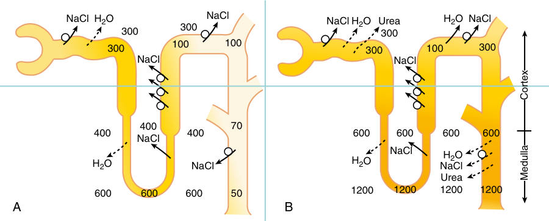

NaCl H2O NaCl NaCl H2O Urea H2O NaCl 300 300 300 300 100 100 300 100 300 NaCl NaCl 400 70 400 400 600 600 600 600 NaCl NaCl H2O H2O NaCl H2O NaCl Urea 600 600 600 50 1200 1200 1200 1200 A B C orte x M edull a 

**Fig. 15.18 Effect of arginine vasopressin on the formation of urine.** (A) With low levels of arginine vasopressin (AVP), fluid in the ascending limb of the loop of Henle is dilute and becomes further diluted in the distal and collecting tubules by continued reabsorption of solutes (indicated as millimoles per liter) while water is not resorbed. (B) Urine is concentrated when AVP is high. Fluid leaving the loop of Henle becomes more concentrated as water is absorbed from the distal and collecting tubules. With high AVP levels, the osmolality of the urine (indicated as milliosmoles) is the same as in the renal medullary interstitial fluid. (Modified from Hall JE. _Guyton and Hall Textbook of Medical Physiology_ . 13th ed. Philadelphia: Elsevier; 2016.)

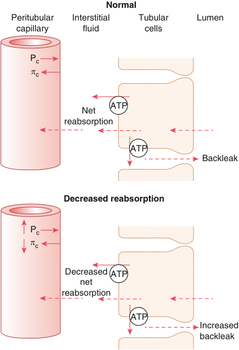

Normal Peritubular Interstitial Tubular Lumen capillary fluid cells Pc °c ATP Net reabsorption ATP Backleak Decreased reabsorption Pc °c Decreased ATP net reabsorption ATP Increased backleak 

**Fig. 15.19** Proximal and peritubular capillary reabsorption under normal conditions _(top)_ and during decreased peritubular capillary reabsorption caused by increased hydrostatic pressure (Pc) or decreased colloid osmotic pressure (πc). As peritubular capillary reabsorption decreases, the net reabsorption of solutes and water is lowered by the increase in solutes and water that leak back into the tubular lumen through the tight junctions of the tubular epithelial cells. _ATP_ , adenosine triphosphate. (Redrawn from Hall JE. _Guyton and Hall Textbook of Medical Physiology_ . 13th ed. Philadelphia: Elsevier; 2016.)

Intravascular pressure (13 mm Hg) and colloid osmotic pressure of the interstitium (15 mm Hg) oppose resorption, whereas the hydrostatic pressure in the interstitium (6 mm Hg), intravascular colloid osmotic pressure (32 mm Hg), and large surface area of the capillaries favor resorption.

### MAINTENANCE OF PLASMA OSMOLALITY

### Definition

An understanding about how plasma osmolality is maintained requires knowledge about the definitions and differences between osmolarity and osmolality. Osmolality is a measure of the osmoles (Osm) of solute per kilogram of solvent (Osm/kg), while osmolarity is defined as the number of osmoles of solute per liter of solution (Osm/L). Osmolarity is affected by changes in water content, temperature, and pressure. Osmolarity is slightly less than osmolality because the total solvent weight excludes any solutes. Nonetheless, in the clinical setting, the values for osmolarity and osmolality are very similar, and the terms are usually used interchangeably. The bedside calculation from laboratory data (2[Na+ mmol/L] + 2[K+ mmol/L] + blood urea nitrogen (BUN) mg/dL/2.8 + glucose mg/dL/18) is in units of osmolarity. The clinical laboratory measurements determined with osmometers are reported as osmolality.

### Regulation of Osmolality

Plasma osmolality is closely regulated between 275 and 300 mOsm/L. Acute alterations in osmolality, either hypoosmolality or hyperosmolality, can result in serious neurologic symptoms and death as the result of water movement in the brain. Normal individuals can dilute and concentrate urine within the range of 40 to 1400 mOsm/L.47 Maintenance of plasma osmolality is linked to the regulation of sodium concentration and water balance by the tubular system and the collecting ducts in concert with the vasa recta blood supply of the tubules through differences in tubular permeability to water and the control of sodium transport (Fig. 15.20). It is dependent on the interaction of at least three processes: the generation of a hypertonic medullary interstitium by the countercurrent mechanism and urea recycling, the concentration and then dilution of tubular fluid in the loop of Henle, and the action of AVP to increase water permeability in the last part of the distal tubule and collecting ducts.

<!-- PDF page 14 -->

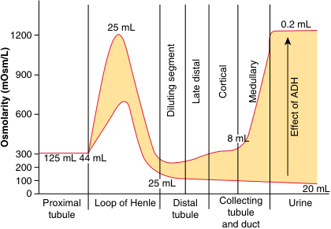

25 mL 0.2 mL 1200 900 600 8 mL 300 125 mL 44 mL 200 100 25 mL 20 mL 0 Proximal Loop of Henle Distal Collecting Urine tubule tubule tubule and duct Late distal Cortical Medullary Diluting segment Effect of ADH Osmolarity (mOsm/L) 

**Fig. 15.20** Changes in osmolarity of the tubular fluid as it passes through the different tubular segments (milliliters per minute) in the presence of high and low levels of arginine vasopressin (indicated here as the alternative term antidiuretic hormone _[ADH]_ ). (Redrawn from Hall JE. _Guyton and Hall Textbook of Medical Physiology_ . 13th ed. Philadelphia: Elsevier; 2016.)

### ROLE OF PROXIMAL TUBULES AND LOOP OF HENLE

Osmosis, the spontaneous net movement of solvent molecules through a selectively permeable membrane into a region of higher solute concentration to equalize the solute concentrations on the two sides, takes place in the proximal tubule. Proximal tubule solutes and water are equally reabsorbed so that the fluid in the tubules is isosmotic with plasma. In contrast, the organization of the loop of Henle is designed to maintain hyperosmolality of the medullary interstitium that can approach 1200 mOsm/L. The major process for this is the active transport of Na+ and cotransport of K+ and Cl− from the lumen of the thick limb of the loop of Henle, which is impermeable to water, to the interstitium. This allows for a concentration gradient of 1200 mOsm/L.

### Medullary Interstitium

The medullary interstitium becomes hypertonic by the countercurrent multiplier effect of the loop of Henle that is best understood diagrammatically (Fig. 15.21). The primary mechanism is by the combination of NaCl reabsorption and water impermeability in the ascending limb. The descending limb is freely permeable to water, which diffuses into the interstitium along the osmotic gradient, and the tubular fluid becomes progressively hyperosmotic at the bend of the loop.

Water entering the distal convoluted tubule after leaving the loop of Henle is dilute (about 100 mOsm/L). This dilution is increased because of the active transport of NaCl and the impermeability of the epithelium. In the collecting ducts, resorption of water is dependent upon the action of AVP (ADH) since the epithelium is normally impermeable to water. With the action of AVP, large amounts of water are reabsorbed into the interstitium and removed by the peritubular capillaries (see Fig. 15.18).

### Vasa Recta

The vasa recta or straight arterioles of kidney are a series of straight capillaries that lie parallel to the loops of Henle of the juxtamedullary nephrons (Fig. 15.22). Only 5% of the RBF is through the vasa recta, creating a sluggish flow. As the capillaries descend into the medulla,

the blood becomes more concentrated by solute entry from the interstitium. This high concentration in the ascending vasa recta in turn facilitates the entry of water from the ascending tubules. The combined interactions of tubular permeability and the vasa recta create the standing osmotic gradients in the cortex (300 mOsm/L), juxtamedullary zone (600 mOsm/L), and deep medulla (1200 mOsm/L).

### The Role of Urea

A healthy person excretes 20% to 50% of the filtered load of urea. The concentration of urea entering the tubular system is related to the prerenal plasma concentration and the GFR. Urea contributes 40% to 50% of the osmolality of the medullary interstitium. The PCT are freely permeable whereas the loop of Henle, distal tubules, and the collecting ducts have little permeability to urea (Fig. 15.23). As water absorption increases with AVP action, the concentration of urea in the tubules progressively increases. With this high concentration, urea diffuses into the interstitial fluid facilitated by specific urea transporters that are activated by AVP. The simultaneous movement of urea and water out of the inner medullary collecting ducts maintains a high concentration of urea in the tubular fluid. As the concentration of urea increases in the medullary interstitium, it diffuses through the thin limb of the loop of Henle and transits through the ascending system again before it is excreted. This recirculation enhances the increased osmotic pressure in the medulla.

### RENAL CONTROL OF INTRAVASCULAR VOLUME

### Hypovolemia

Patients with hypovolemia, associated with hemorrhage, gastrointestinal loss, preoperative fasting or other causes, are commonly encountered in the perioperative period. Contraction of the extracellular volume by hypovolemia increases sympathetic outflow, activates the renin–angiotensin–aldosterone response, and releases AVP. Despite reduction in GFR and the filtered load of sodium, there is a 66% to 80% increase in sodium reabsorption in the proximal tubule due to a decline in peritubular capillary pressure induced by renal vasoconstriction. Although sodium delivery to the thick ascending loop of Henle, distal tubule, and collecting duct is decreased, aldosterone promotes further reabsorption of sodium at these sites. Under the influence of AVP, water is also avidly reabsorbed in the collecting duct so that the urine becomes highly concentrated (osmolality–600 mOsm/kg) but with virtually no sodium (10 mEq/L).

### Hypervolemia

Expansion of the extracellular volume (hypervolemia) is countered by an increase in the GFR and filtered sodium load due to a combination of reflex decreases in sympathetic and angiotensin II activity and the release of ANP. Together with the increase in peritubular capillary hydrostatic pressure, these responses cause sodium reabsorption in the proximal tubule to decrease from 67% to 50%. The decline in plasma aldosterone decreases sodium absorption from the thick ascending loop of Henle to the collecting duct. The presence of ANP and absence of AVP impairs water absorption at the

<!-- PDF page 15 -->

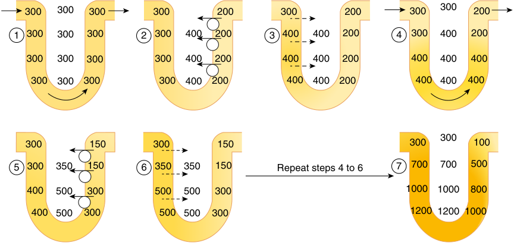

300 300 300 300 200 300 200 300 300 200 1 300 300 300 2 300 400 200 3 400 400 200 4 300 400 200 300 300 300 300 400 200 400 400 200 400 400 400 300 300 300 300 400 200 400 400 200 400 400 400 300 300 150 300 150 300 100 5 300 350 150 6 350 350 150 Repeat steps 4 to 6 7 700 700 500 400 500 300 500 500 300 1000 1000 800 400 500 300 500 500 300 1200 1200 1000 

**Fig. 15.21 Countercurrent multiplier system in the loop of Henle for producing a hyperosmotic (millimoles per liter) renal medulla.** (Redrawn from Hall JE. _Guyton and Hall Textbook of Medical Physiology_ . 13th ed. Philadelphia: Elsevier; 2016.)

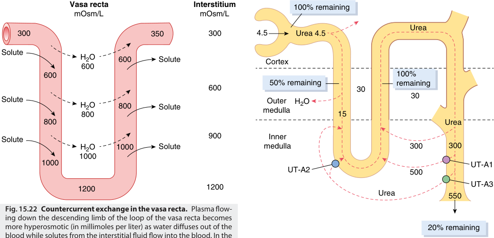

Vasa recta Interstitium 100% remaining mOsm/L mOsm/L Urea 300 350 300 4.5 Urea 4.5 Solute H2O 600 Solute Cortex 600 600 100% 50% remaining remaining 600 30 30 Solute Outer H2O H2O 800 Solute medulla 800 15 800 Urea Solute 900 Inner H2O 1000 Solute medulla 300 300 1000 1000 UT-A1 UT-A2 500 1200 1200 UT-A3 Urea 550 Fig. 15.22 Countercurrent exchange in the vasa recta.  Plasma flow- ing down the descending limb of the loop of the vasa recta becomes more hyperosmotic (in millimoles per liter) as water diffuses out of the  20% remaining blood while solutes from the interstitial fluid flow into the blood. In the 

**Fig. 15.22 Countercurrent exchange in the vasa recta.** Plasma flowing down the descending limb of the loop of the vasa recta becomes more hyperosmotic (in millimoles per liter) as water diffuses out of the blood while solutes from the interstitial fluid flow into the blood. In the ascending limb, solutes diffuse back to the interstitial fluid and water diffuses back into the vasa recta. (Redrawn from Hall JE. _Guyton and Hall Textbook of Medical Physiology_ . 13th ed. Philadelphia: Elsevier; 2016.)

**Fig. 15.23 Recirculation of urea absorbed from the medullary collecting duct into the interstitial fluid.** Urea diffuses into the thin loop of Henle assisted by urea transporter UT- A2 through to the distal tubules and finally passes back to the collecting duct aided by urea transporters (UT- A1 and UT- A3). This recirculation helps to trap urea in the renal medulla contributing to its hyperosmolality (millimoles per liter). _Heavy lines_ indicate segments that are not very permeable to urea. (Redrawn from Hall JE. _Guyton and Hall Textbook of Medical Physiology_ . 13th ed. Philadelphia: Elsevier; 2016.)

collecting duct so that a dilute urine (osmolality 300 mOsm/kg) with abundant sodium (80 mEq/L) is produced.

### CLINICAL TESTS FOR RENAL FUNCTION48,49

### Urine Output

The measurement of urine output is straightforward and represents the most common way to assess intraoperative and postoperative renal function without requiring measurement of laboratory data. By consensus, oliguria is defined as a urine flow rate less than 0.5 mL/kg/h; it is often interpreted as a sign of renal dysfunction50 and was first described by Galen and Ephesus between 100 and 200

AD. Urine output was listed as one of the most widely used indicators to suggest the need for intraoperative volume expansion by 80% of anesthesiologists surveyed from the United States and Europe.51 However, studies have shown that low urine output was not necessarily a predictor of nor associated with renal failure.52 Although traditionally oliguria is taken as a sign of hypovolemia and subsequent reduction in kidney perfusion, perioperative oliguria is not

<!-- PDF page 16 -->

always abnormal, especially when no other signs of hypoperfusion are present. For example, reduced intraoperative urinary output (&lt;1 mL/kg/h) for patients undergoing anesthesia for thoracic resections was not associated with postoperative renal dysfunction, regardless of the amount of fluid administered.53 As a result, tolerance of modest oliguria is important when considering how to manage fluid intake and limitations, particularly as part of enhanced recovery after surgery protocols.54 Targeting urine output alone does not affect 30- day mortality, and oliguria is not a modifiable risk factor for mortality.55

Despite the limited data on the implications of low urine output on postoperative renal function, oliguria has been correlated with acute kidney injury (AKI) in some clinical situations and may be a better threshold for the guidance of fluid administration.56 In the perioperative period, transient oliguria is almost inevitable, whether induced by hypotension, as an appropriate prerenal response to intravascular hypovolemia, or as a manifestation of the physiologic response to surgical stress.57 It is a relative condition that depends on _expected_ urine flow, and it may bear little, if any, relationship to GFR. When arterial blood pressure and intravascular volume are restored to normal levels, normal urinary flow should resume. Complete, often abrupt, cessation of urine flow (anuria) suggests postrenal obstruction. For patients with indwelling urinary catheters, obstruction of the catheter by malposition, blood, or kinking should be the first cause to be ruled out and corrected immediately, if confirmed. If catheter patency has been confirmed, obstruction from placement of retractors or other causes during a surgical procedure should be considered and modified to ensure return of urine flow.

### Creatinine

Creatine phosphate in muscle transfers high- energy phosphate to ADP, creating ATP necessary for contraction, and creatine. Creatinine results from the metabolism of creatine in the liver. Serum creatinine is a reasonable approximation of GFR since it is freely filtered by the glomerulus, is soluble, distributes through the total body water, and is not reabsorbed by the tubules. Creatinine varies with muscle mass, rate of catabolism, protein intake, and physical activity. Low GFR tends to overestimate renal function since little creatinine is secreted. The relationship between serum creatinine and GFR is inverse and exponential; that is, a doubling of serum creatinine implies a halving of GFR. The normal serum creatinine range is 0.5 to 1.2 mg/dL. Muscle mass must be taken into consideration since a normal creatinine in a malnourished, cachectic patient may reflect reduced GFR.

### Blood Urea Nitrogen

Urea is formed in the liver by the deamination of amino acids and conversion to ammonia by the arginine cycle. It is not an indicator of GFR since it is rapidly reabsorbed by the tubules. Absorption of blood from the gastrointestinal tract, steroids, and sepsis may increase the blood urea nitrogen (BUN), whereas malnutrition or liver disease might result in its decrease. The normal ratio of BUN to serum creatinine is between 10 and 15 to 1. The BUN to creatinine ratio may be useful in the diagnosis of renal

failure from prerenal causes versus acute tubular necrosis (see Chapter 38).

### RENAL CLEARANCE TECHNIQUES

Clearance is the pharmacokinetic measurement of the volume of plasma that is removed of a specific substance over a period of time. Classic renal physiology experiments used the plant polysaccharide that is freely filtered by the glomerulus and not secreted or reabsorbed by the tubules. 131I- iothalamate has the same renal properties as inulin and is used in radiographic studies to assess clearance.58

In routine clinical practice, calculation of GFR [urine creatinine (mg/dL) × volume of urine (mL)/plasma creatinine (mg/dL)] has been used to assess renal function. A volume of urine is carefully collected over a defined period and the creatinine concentration is measured. A comparison is then made with a blood sample that is taken during the midpoint of urine flow to determine the creatinine. The traditional urine collection period for obtaining this measurement is 24 hours. As a result, this technique is not helpful in the acute and dynamic perioperative period. In this perioperative period, shorter collection periods can be used to estimate GFR, even if not as accurate as is the 24- hour collection period.

The GFR may decrease significantly before serum creatinine increases above normal and can be inaccurate due to its variable tubular secretion, extrarenal elimination, and variable rates of generation. For these reasons, estimated GFR (eGFR) that is based on serum creatinine, serum cystatin C when available, age, and sex is often calculated using the Chronic Kidney Disease Epidemiology Collaboration (CKD- EPI) equation.59 Race, which was part of previous equations for eGFR calculations, has more recently been removed from the calculation since it is a social and not a biologic construct and the previous algorithms do not apply. The newer CKD- EPI eGFR equations that use both creatinine and cystatin C have been found to be more accurate. Cystatin C, produced by all nucleated cells in the body, is freely filtered by the glomerulus and not secreted. Although reabsorbed in the tubules, it is fully catabolized and hence does not re- enter the blood. Compared with creatinine, cystatin C–based estimates of eGFR are also less influenced by muscle mass and diet.60

Despite the advantages of using eGFR as a measure of renal function, eGFR equations are based on a stable steady- state production of creatinine and are not accurate with AKI when creatinine clearance is in flux. The Modification of Diet in Renal Disease (MDRD) formula is normalized to an average adult 1.73 m2 body surface area. The CKD- EPI equation is a better assessment for values less than 60 mL/min/1.73 m2 . Clinical laboratories will state which method is used when eGFR is reported. Extremes of muscle mass, pregnancy, dietary intake, and comorbidities are factors that will lead to errors in eGFR. Therefore, the dosing of drugs based on creatinine clearance using the CKD- EPI equation to ascertain renal function is more accurate.61

### Measurement of Tubular Function

When oliguria is present, tests of renal tubular function may be useful to distinguish dehydration (prerenal azotemia) from acute tubular necrosis. In dehydration, the

<!-- PDF page 17 -->

tubules function normally to retain Na+ and water to maintain the blood volume. The osmolality of plasma is 280 to 300 mOsm/kg but with dehydration, the urine osmolality can increase to greater than 450 mOsm/kg. Acute tubular necrosis is a pathologic state (see Chapter 38) in which the concentrating ability of the tubules is defective. Sodium and water may be lost in the urine if nonoliguric.

The most common method of assessing for tubular concentration ability is the calculation of fractional excretion of sodium (FENa), which is a measure of sodium clearance as a percentage of creatine clearance.62 FENa is calculated by the following from simultaneous samples of blood and urine collection:

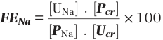

FENa  = [UNa] . [ Pcr ] × 100 [ P Na] . [ Ucr ] 

The normal value for FENa is &lt;1%. With salt wasting it will be >1%.

### Effect of Anesthetics on Renal Function

The effects of anesthesia must also be considered when evaluating urine flow and intraoperative renal function. All general anesthetics tend to decrease GFR and intraoperative urine flow as a consequence of decreased cardiac output and arterial blood pressure.63 Some drugs also decrease RBF, but filtration fraction is usually increased, which implies that angiotensin- induced efferent arteriolar constriction limits the decrease in GFR that resolves after emergence from anesthesia. Any anesthetic technique that induces hypotension will result in decreased urine flow because of altered peritubular capillary hydrostatic gradients, even if renal autoregulation is preserved. Injury to kidneys seldom occurs unless there is preexisting kidney disease, nephrotoxic injury, hypovolemia, or a combination thereof, which will exacerbate renal dysfunction.64 Volatile anesthetics induce mild to moderate reductions in RBF and GFR, primarily because of their myocardial depression and vasodilatory effects65 that can be attenuated by prior intravenous hydration. Opioid- based anesthetics are considerably more effective than volatile anesthetics in suppressing the release of catecholamines, angiotensin II, aldosterone, and AVP. Ketamine increases RBF but decreases urine flow rate, possibly through sympathetic activation; it preserves RBF during hemorrhagic hypovolemia.66

The direct effect of anesthetic agents on postoperative renal function was significant for volatile anesthetics used in the past. The potential for AKI after the breakdown of volatile anesthetics to free fluoride ions causing tubular lesions is now of only historical interest.67 The “older” volatile drug isoflurane produces minimal peak fluoride levels (&lt;4 μm/L).68 Initial studies of sevoflurane in rats reported nephrotoxicity through the formation of Compound A, a vinyl ether formed by degradation of sevoflurane at low flow through carbon dioxide absorbents.69 Clinically significant renal injury has not been shown with desflurane, sevoflurane, or propofol in patients even with moderate preexisting renal dysfunction.70

A more interesting finding is that some anesthetic agents have potential protective effects on the kidney. There is growing evidence to support anesthetics as agents that ameliorate ischemia–reperfusion injury in the kidney and

other organs.71 The volatile anesthetics desflurane, sevoflurane, isoflurane, and halothane attenuated the increase in serum creatinine compared with pentobarbital or ketamine in animal models.72 The mechanism is related to an induction of cytoprotective factors and suppression of proinflammatory cytokine and chemokine activation in response to ischemia–reperfusion. There is experimental evidence that propofol can prevent renal ischemia–reperfusion injury through inhibition of oxidative stress pathways.73

### EFFECTS OF MECHANICAL VENTILATION ON RENAL FUNCTION

Contrary to the effects of anesthetic agents on renal function, other perioperative management strategies can have deleterious effects on renal blood flow and function. Mechanical ventilation and positive end- expiratory pressure (PEEP) may cause decreases in RBF, GFR, sodium excretion, and urine flow rate through changes in hemodynamics.74 The increased airway and intrapleural pressures lead to decreased venous return, cardiac filling pressures, and cardiac output. Positive pressure ventilation increases inferior vena caval pressure and, through increased renal venous pressure, may increase peritubular capillary pressure to increase tubular sodium reabsorption. The decrease in cardiac output and systemic arterial pressure results in a carotid and aortic baroreceptor- mediated increase in sympathetic nerve tone to the kidney, with renal vasoconstriction, antidiuresis, and antinatriuresis. Volume receptors in the atria respond to decreased filling by decreased ANP secretion, resulting in increased sympathetic tone, renin activation, and AVP activity.

The renin–angiotensin–aldosterone system undoubtedly augments the renal responses to positive pressure ventilation. An increase in PEEP can depress cardiac output, RBF, GFR, and urine volume, and increase renin and aldosterone. Although the extent of depression of renal function depends on the mean airway pressure, there is no difference in creatinine clearance and FENa between volume- controlled and pressure support ventilation.75 Permissive hypercapnia as employed during acute respiratory distress syndrome may promote renal vasoconstriction.74

## Induced Hypotension

During anesthesia with induced hypotension, substantial reduction of GFR and urine flow rate is common. Although earlier studies suggested that hypotensive anesthesia can be well tolerated without permanent impairment of renal function, a more recent retrospective analysis suggests that mean arterial pressures less than 60 mm Hg for 11 to 20 min or less than 55 mm Hg for more than 10 minutes are associated with acute kidney injury.76 Vasodilators used to induce hypotension differ in their effect on RBF. Administration of sodium nitroprusside decreases renal vascular resistance but tends to shunt blood flow away from the kidney. Moreover, its administration is associated with marked renin–angiotensin activation and catecholamine release, which results in rebound hypertension if the infusion is suddenly discontinued. Nitroglycerin decreases RBF less than sodium nitroprusside.77 The selective DA1- dopaminergic

<!-- PDF page 18 -->

agonist fenoldopam can provide induced hypotension without any significant decrease in RBF.78 Nicardipine increased creatinine clearance and attenuated the increase in FENa in patients undergoing spine surgery under deliberate hypotension79 and improved renal function when given to patients with preexisting renal insufficiency who had robotic- assisted radical prostatectomy.80

### Acknowledgment

The editors and publisher would like to thank Drs. David McIlroy and Robert N. Sladen for contributing a chapter on this topic in a prior edition of this textbook that served as a foundation for the current chapter.

**Complete references available online at expertconsult.com.**

33.  Genuth SM. In: Berne RM, Levy EM, eds. _Physiology_ . 4th ed. Mosby; 1998:930.

34.  Choi MR, et al. _BioMed Res Int_ . 2014;2014:710781.

35.  Sansoè G, et al. _Dig Dis Sci_ . 2002;247:392.

36.  Eltzschig HK. _Anesthesiology_ . 2009;111:904.

37.  Bauerle JD, et al. _J Am Soc Nephrol_ . 2011;22:14.

38.  Evans RG, Fitzgerald SM. _Curr Opin Nephrol Hypertens_ . 2005;14:9.

39.  Ortiz PA, Garvin JL. _Am J Physiol Renal Physiol_ . 2002;282:F777.

40.  Cowley AW Jr, et al. _Am J Physiol Renal Physiol_ . 2015;308:F179.

41.  Palmer LG, Schnermann J. _Clin J Am Soc Nephrol_ . 2015;10:676.

42.  McCormick JA, Ellison DH. _Compr Physiol_ . 2015;5:45.

43.  Roy A, et al. _Clin J Am Soc Nephrol_ . 2015;10:305.

44.  Carlström M, et al. _Physiol Rev_ . 2015;95:405.

45.  Burke M, et al. _Curr Vasc Pharmacol_ . 2014;12:845.

46.  Komlosi P, et al. _Acta Physiol Scand_ . 2004;181:463.

47.  Rose BD. In: Rose BD, ed. _Clinical Physiology of Acid–Base and Electrolyte Disorders_ . 4th ed. McGraw- Hill; 1994:261.

48.  Winter WE. The kidney. In: _Laposata’s Laboratory Medicine Diagnosis of Disease in Clinical Laboratory_ . 2nd ed. McGraw Hill; 2014:385.

49.  Prowle JR, Forni LG. In: Ronco C, et al., ed. _Critical Care Nephrology_ . 3rd ed. Elsevier, Inc; 2019:141.

### References

1.  Jelkmann W. _J Physiol_ . 2011;589:1251. 2.  Hansell P, et al. _Clin Exp Pharmacol Physiol_ . 2014;40:123.

3.  Washinzawa K, et al. _Pediatr Nephrol_ . 1993;7:1.

4.  Raats CJ, et al. _Kidney Int_ . 2000;57:385. 5.  Rodewald R, Karnovsky MJ. _J Cell Biol_ . 1974;217:423. 6.  Farquhar MG. _J Clin Invest_ . 2006;116:2090. 7.  Neal CR. _Front Endocrinol_ . 2015;6. 8.  Schrijvers BF, et al. _Kidney Int_ . 2004;65:2003. 9.  Inoue K, Ishibe S. _Am J Physiol Renal Physiol_ . 2015;309:F398. 10.  Pulamen T, et al. _J Am Soc Nephrol_ . 2002;13:1766.

11.  New LA, et al. _Curr Opin Nephrol Hypertens_ . 2014;23:420.

12.  Wu C- H, et al. _Arterioscler Thromb Vasc Biol_ . 2018;38:e108. 13.  Koeppen BM, Stanton BA. In: Koeppen BM, Stanton BA, eds. _Renal Physiology_ . 4th ed. Mosby Elsevier; 2007:31.

14.  Langston JB, Guyton AC. _Am J Physiol_ . 1958;192(1):131.

15.  Bellomo R, et al. _Crit Care Med_ . 2008;36(suppl 4):S179.

16.  Navar LG, et al. _Hypertension_ . 2011;57:355.

17.  Wilson BA, et al. _Am J Physiol Regul Integr Comp Physiol_ . 2014; 307:R487.

18.  Herichova I, Szantoova K. _Endocr Regul_ . 2013;47:39. 19.  Sparks MA, et al. _Compr Physiol_ . 2014;4:1201. 20.  Chappell MC. _Compr Physiol_ . 2012;2(4):2733. 21.  Li C, et al. _Am J Physiol Renal Physiol_ . 2011;300:F1255. 22.  Hao C- M, Breyer MD. _Ann Rev Physiol_ . 2008;70:357. 23.  Kim G- H. _Electrolyte Blood Pressure_ . 2008;6:35. 24.  Scicli AG, Carretero OA. _Kidney Int_ . 1986;29:120. 25.  Baram M, et al. _J Allergy Clin Immunol Pract_ . 2013;1:442. 26.  Kortenoeven ML, et al. _Am J Physiol Renal Physiol_ . 2015;15:F280. 27.  Bayless PH. _Clin Endocrin Metab_ . 1983;12:747. 28.  Edwards RM, et al. _Am J Physiol_ . 1989;256:F526. 29.  Olesen ET, Fenton RA. _Am J Physiol Renal Physiol_ . 2017;312:F744. 30.  de Bold AJ. _Can J Physiol Pharmacol_ . 2011;89:527. 31.  Inoue T, et al. _Cardiovasc Res_ . 2001;15:470. 32.  Heras MM, et al. _J Diabetes Metabol_ . 2012;3:171.

50.  Kunst G, Ostermann M. _Br J Anaesth_ . 2017;119:1075.

51.  Cannesson M, et al. _Crit Care_ . 2011;15:R197.

52.  Kheterpal S, et al. _Anesthesiology_ . 2007;107:892.

53.  Matot I, et al. _J Thorac Cardiovasc Surg_ . 2013;146:461.

54.  Makaryus R, et al. _Br J Anaesth_ . 2018;120:376.

55.  van der Zee EN, et al. _BMC Anesthesiol_ . 2017;17:22.

56.  Matot I, et al. _Arch Surg_ . 2012;147:228.

57.  Sladen RN. _Anesthesiol Clin North Am_ . 2000;18:739.

58.  Seegmiller JC, et al. _Adv Chron Kidney Dis_ . 2018;25:84.

59.  National Institute of Diabetes and Digestive and Kidney Diseases. https://www.niddk.nih.gov/health- information/professionals/ clinical- tools- patient- management/kidney- disease/laboratoryevaluation/glomerular- filtration- rate- calculators/recommended.

60.  Inker LA, et al. _N Engl J Med_ . 2021;385(19):1737.

61.  Hermsen ED, et al. _Pharmacotherapy_ . 2009;29:649.

62.  Palmer BF, Clegg DJ. _Clin J Am Soc Nephrol_ . 2019;14:306.

63.  Priano LL. In: Barash PG, ed. _Refresher Courses in Anesthesiology_ . Lippincott; 1985:143.

64.  Fukazawa K, Lee T. _J Am Soc Nephrol_ . 2014;25:884.

65.  Gelman S, et al. _Anesth Analg_ . 1984;63:557.

66.  Priano LL. _Anesth Analg_ . 1982;61:853.

67.  Mazze RI, et al. _Anesthesiology_ . 1971;35:247.

68.  Mazze RI, et al. _Anesthesiology_ . 1974;40:536.

69.  Higuchi H, et al. _Anesth Analg_ . 2000;91:434.

70.  Ebert TJ, Arain SR. _Anesthesiology_ . 2000;93:1401.

71.  Motayagheni N, et al. _Am J Nephrol_ . 2017;46:380.

72.  Lee HT, et al. _Anesthesiology_ . 2004;101:1313.

73.  Li Y, et al. _Cell Physiol Biochem_ . 2015;37:14.

74.  Kuiper JW, et al. _Crit Care Med_ . 2005;33:1408.

75.  Botha J, et al. _Crit Care Resusc_ . 2005;7:303.

76.  Thompson GE, et al. _Anesthesiology_ . 1978;48:91.

77.  Colley PS, Silvarjan M. _Anesth Analg_ . 1984;63:503.

78.  Aronson S, et al. _J Cardiothorac Vasc Anesth_ . 1991;5:29.

79.  Park C, et al. _Clin Spine Surg_ . 2017;30:E954.

80.  Huh H, et al. _J Int Med Res_ . 2014;42:427.

<!-- PDF page 19 -->

### References

1.  Jelkmann W. Regulation of erythropoietin production. _J Physiol_ . 2011;589:1251–1258.

2.  Hansell P, Welch WJ, Blantz RC, Palm F. Determinants of kidney oxygen consumption and their relationship to tissue oxygen tension in diabetes and hypertension. _Clin Exp Pharmacol Physiol_ . 2014;40:123– 137.

3.  Washinzawa K, Kasai S, Mori T, et al. Ultrastructural alteration of glomerular anionic sites in nephrotic patients. _Pediatr Nephrol_ . 1993;7:1–5.

4.  Raats CJ, Van Den Born J, Berden JH. Glomerular heparan sulfate alterations: mechanisms and relevance for proteinuria. _Kidney Int_ . 2000;57:385–400.

5.  Rodewald R, Karnovsky MJ. Porous substructure of the glomerular slit diaphragm in the rat and mouse. _J Cell Biol_ . 1974;217:423– 433.

6.  Farquhar MG. The glomerular basement membrane: not gone, just forgotten. _J Clin Invest_ . 2006;116:2090–2093.

7.  Neal CR. Podocytes…what’s under yours? (Podocytes and foot processes and how they change in nephropathy). _Front Endocrinol_ . 2015:6–9.

8.  Schrijvers BF, Flyvbjerg A, De Vriese AS. The role of vascular endothelia growth factor (VEGF) in renal pathophysiology. _Kidney Int_ . 2004;65:2003–2017.

9.  Inoue K, Ishibe S. Podocyte endocytosis in the regulation of the glomerular filtration barrier. _Am J Physiol Renal Physiol_ . 2015;309:F398– F405.

10.  Pulamen T, Lehtonen S, Ora A, et al. Interaction of endogenous nephrine and CD2- associated protein in mouse epithelia M- 1 cell line. _J Am Soc Nephrol_ . 2002;13:1766–1772.

11.  New LA, Martin CE, Jones N. Advances in slit diaphragm signaling. _Curr Opin Nephrol Hypertens_ . 2014;23:420–430.

12.  Wu C- H, Mohammadmoradi S, Chen JZ, et al. Renin- angiotensin system and cardiovascular functions. _Arterioscler Thromb Vasc Biol_ . 2018;38:e108–e116.

13.  Koeppen BM, Stanton BA. Glomerular filtration and renal blood flow. In: Koeppen BM, Stanton BA, eds. _Renal Physiology_ . 4th ed. Philadelphia: Mosby Elsevier; 2007:31.

14.  Langston JB, Guyton AC. Effect of epinephrine on the rate of urine formation. _Am J Physiol_ . 1958;192(1):131–134.

15.  Bellomo R, Wan L, May C. Vasoactive drugs and acute kidney injury. _Crit Care Med_ . 2008;36(suppl 4):S179–186.

16.  Navar LG, Kobori H, Prieto MC, Gonzalez- Villalobos RA. Intratubular renin- angiotensin system in hypertension. _Hypertension_ . 2011;57:355–362.

17.  Wilson BA, Marshall AC, Alzayadneh EM, Chappell MC. The ins and outs of angiotensin processing within the kidney. _Am J Physiol Regul Integr Comp Physiol_ . 2014;307:R487–R489.

18.  Herichova I, Szantoova K. Renin- angiotensin system: upgrade of recent knowledge and perspectives. _Endocr Regul_ . 2013;47:39–52.

19.  Sparks MA, Crowley SD, Gurley SB, et al. Classical renin- angiotensin system in kidney physiology. _Compr Physiol_ . 2014;4:1201–1228.

20.  Chappell MC. Nonclassical renin- angiotensin system and renal function. _Compr Physiol_ . 2012;2:2733–2752.

21.  Li C, Wang W, Rivard CJ, et al. Molecular mechanisms of angiotensin II stimulation on aquaporin- 2 expression and trafficking. _Am J Physiol Renal Physiol_ . 2011;300:F1255–F1261.

22.  Hao C- M, Breyer MD. The physiologic regulation of prostaglandins in the kidney. _Ann Rev Physiol_ . 2008;70:357–377.

23.  Kim G- H. Renal effects of prostaglandins and cyclooxygenase- 2 inhibitors. _Electrolyte Blood Pressure_ . 2008;6:35–41.

24.  Scicli AG, Carretero OA. Renal kallikrein- kinin system. _Kidney Int_ . 1986;29:120–130.

25.  Baram M, Kommuri A, Sellers SA, Cohn JR. ACE inhibitor- induced angioedema. _J Allergy Clin Immunol Pract_ . 2013;1:442–445.

26.  Kortenoeven ML, Petersen NB, Rosenbaek LL, Fenton RA. Vasopressin regulation of sodium transport in the distal nephron and collecting duct. _Am J Physiol Renal Physiol_ . 2015;15:F280–299.

27.  Bayless PH. Posterior pituitary function in health and disease. _Clin Endocrinol Metabol_ . 1983;12:747–770.

28.  Edwards RM, Rizna W, Kinter LB. Renal microvascular effects of vasopressin and vasopressin antagonist. _Am J Physiol_ . 1989;256:F526– F534.

29.  Olesen ET, Fenton RA. Aquaporin- 2 membrane targeting: still a conundrum. _Am J Physiol Renal Physiol_ . 2017;312:F744–F747.

30.  de Bold AJ. Thirty years of research on atrial natriuretic factor: historical background and emerging concepts. _Can J Physiol Pharmacol_ . 2011;89:527–531.

31.  Inoue T, Nonoguchi H, Tomita K. Physiological effects of vasopressin and atrial natriuretic peptide in the collecting duct. _Cardiovasc Res_ . 2001;15:470–480.

32.  Heras MM, del Castillo Rodrígues N, Navarro JF. The reninangiotensin- aldosterone system in renal and cardiovascular disease and the effects of its pharmacological blockade. _J Diabetes Metabol_ . 2012;3:171.

33.  Genuth SM. The adrenal glands. In: Berne RM, Levy EM, eds. _Physiology_ . 4th ed. St Louis: Mosby; 1998:930–964.

34.  Choi MR, Mikusic NLR, Kouyoumdzian NM, et al. Atrial natriuretic peptide and renal dopamineric system: a positive friendly relationship? _BioMed Res Int_ . 2014;2014:710781.

35.  Sansoè G, Ferrari A, Baraldi E, et al. Dopaminergic control of renal tubular function in patients with compensated cirrhosis. _Dig Dis Sci_ . 2002;247:392–400.

36.  Eltzschig HK. Adenosine: an old drug newly discovered. _Anesthesiology_ . 2009;111:904–915.

37.  Bauerle JD, Grenz A, Kim J- H, et al. Adenosine generation and signaling during acute kidney injury. _J Am Soc Nephrol_ . 2011;22:14–20.

38.  Evans RG, Fitzgerald SM. Nitric oxide and superoxide in the renal medulla: a delicate balancing act. _Curr Opin Nephrol Hypertens_ . 2005;14:9–15.

39.  Ortiz PA, Garvin JL. Role of nitric oxide in the regulation of nephron transport. _Am J Physiol Renal Physiol_ . 2002;282:F777–F784.

40.  Cowley Jr AW, Abe M, Mori T, et al. Reactive oxygen species as important determinants of medullary flow, sodium excretion, and hypertension. _Am J Physiol Renal Physiol_ . 2015;308:F179–F197.

41.  Palmer LG, Schnermann J. Integrated control of Na transport along the nephron. _Clin J Am Soc Nephrol_ . 2015;10:676–687.

42.  McCormick JA, Ellison DH. Distal convoluted tubule. _Compr Physiol_ . 2015;5:45–98.

43.  Roy A, Al- Bataineh MM, Pastor- Soler NM. Collecting duct intercalated cell function and regulation. _Clin J Am Soc Nephrol_ . 2015;10:305– 324.

44.  Carlström M, Wilcox CS, Arendshorst WJ. Renal autoregulation in health and disease. _Physiol Rev_ . 2015;95:405–511.

45.  Burke M, Pabbidi MR, Farley J, Roman RJ. Molecular mechanisms of renal blood flow autoregulation. _Curr Vasc Pharmacol_ . 2014;12:845– 858.

46.  Komlosi P, Fintha A, Bell PD. Current mechanisms of macula densa signalling. _Acta Physiol Scand_ . 2004;181:463–469.

47.  Rose BD. Regulation of plasma osmolality. In: Rose BD, ed. _Clinical Physiology of Acid–Base and Electrolyte Disorders_ . 4th ed. New York, NY: McGraw- Hill; 1994:261–273.

48.  Winter WE. The kidney. In: _Laposata’s Laboratory Medicine Diagnosis of Disease in Clinical Laboratory_ . 2nd ed. New York, NY: McGraw Hill; 2014:385–396.

49.  Prowle JR, Forni LG. Functional biomarkers. In: Ronco C, Bellomo R, Kellum JA, Ricci Z, eds. _Critical Care Nephrology_ . 3rd ed. Philadelphia: Elsevier, Inc; 2019:141–145.

50.  Kunst G, Ostermann M. Intraoperative permissive oliguria – how much is too much? _Br J Anaesth_ . 2017;119:1075–1077.

51.  Cannesson M, Pestel G, Ricks C, et al. Hemodynamic monitoring and management in patients undergoing high risk surgery: a survey among North American and European anesthesiologists. _Crit Care_ . 2011;15:R197.

52.  Kheterpal S, Tremper KK, Englesbe MJ, et al. Predictors of postoperative acute renal failure after noncardiac surgery in patients with previously normal renal function. _Anesthesiology_ . 2007;107:892–902.

53.  Matot I, Dery E, Bulgov Y, et al. Fluid management during videoassisted thoracoscopic surgery for lung resection: a randomized, controlled trial of effects on urinary output and postoperative renal function. _J Thorac Cardiovasc Surg_ . 2013;146:461–466.

54.  Makaryus R, Miller TE, Gan TJ. Current concepts of fluid management in enchanced recovery pathways. _Br J Anaesth_ . 2018;120:376–383.

55.  van der Zee EN, Egal M, Gommers D, Groeneveld AB. Targeting urine output and 30- day mortality in goal- directed therapy: a systematic review with meta- analysis and meta-regression. _BMC Anesthesiol_ . 2017;17:22.

<!-- PDF page 20 -->

56.  Matot I, Paskaleva R, Eid L, et al. Effect of the volume of fluids administered on intraoperative oliguria in laparoscopic bariatric surgery: a randomized controlled trial. _Arch Surg_ . 2012;147:228–234.

57.  Sladen RN. Oliguria in the ICU. Systematic approach to diagnosis and treatment. _Anesthesiol Clin North Am_ . 2000;18:739–752, viii.

58.  Seegmiller JC, Eckfeldt JH, Lieske JC. Challenges in measuring glomerular filtration rate: a clinical laboratory perspective. _Adv Chron Kidney Dis_ . 2018;25:84–92.

59.  National Institute of Diabetes and Digestive and Kidney Diseases. _Recommended eGFR Calculators_ . Available at: https://www.niddk.nih.gov/health- information/professionals/ clinical- tools- patient- management/kidney- disease/laboratoryevaluation/glomerular- filtration- rate- calculators/recommended.

60.  Inker LA, Eneanya ND, Coresh J, et al. New creatinine- and cystatin C- based equations to estimate GFR without race. _N Engl J Med_ . 2021;385(19):1737–1749.

61.  Hermsen ED, Maiefski M, Florescu MC, et al. Comparison of the modification of diet in renal disease and Cockcroft- Gault equations for dosing antimicrobials. _Pharmacotherapy_ . 2009;29:649–655.

62.  Palmer BF, Clegg DJ. The use of selective urine chemistries in the diagnosis of kidney disorders. _Clin J Am Soc Nephrol_ . 2019;14:306–316.

63.  Priano LL. Effects of anesthetic agents on renal function. In: Barash PG, ed. _Refresher Courses in Anesthesiology_ . Philadelphia: Lippincott; 1985:143–156.

64.  Fukazawa K, Lee T. Volatile anesthetics and AKI: risks, mechanisms, and a potential therapeutic window. _J Am Soc Nephrol_ . 2014;25:884– 892.

65.  Gelman S, Gowler KC, Smith LR. Regional blood flow during isoflurane and halothane anesthesia. _Anesth Analg_ . 1984;63:557–565.

66.  Priano LL. Alteration of renal hemodynamics by thiopental, diazepam and ketamine in conscious dogs. _Anesth Analg_ . 1982;61:853–862.

67.  Mazze RI, Trudell JR, Cousins MJ. Methoxyflurane metabolism and renal dysfunction: clinical correlation in man. _Anesthesiology_ . 1971;35:247.

68.  Mazze RI, Cousins MJ, Barr GA. Renal effects and metabolism of isoflurane in man. _Anesthesiology_ . 1974;40:536–542.

69.  Higuchi H, Adachi Y, Arimura S, et al. Compound A concentrations during low- flow sevoflurane anesthesia correlate directly with the concentration of monovalent bases in carbon dioxide absorbents. _Anesth Analg_ . 2000;91:434–439.

70.  Ebert TJ, Arain SR. Renal responses to low- flow desflurane, sevoflurane, and propofol in patients. _Anesthesiology_ . 2000;93:1401–1406.

71.  Motayagheni N, Phan S, Eshraghi C, et al. A review of anesthetic effects on renal function: potential organ protection. _Am J Nephrol_ . 2017;46:380–389.

72.  Lee HT, Ota- Setlik A, Fu Y. Differential protective effects of volatile anesthetics against renal ischemia- reperfusion injury in vivo. _Anesthesiology_ . 2004;101:1313–1324.

73.  Li Y, Zhong D, Lei L, et al. Propofol prevents renal ischemia- reperfusion injury via inhibiting the oxidative stress pathways. _Cell Physiol Biochem_ . 2015;37:14–26.

74.  Kuiper JW, Groeneveld AB, Slutsky AS, Plotz FB. Mechanical ventilation and acute renal failure. _Crit Care Med_ . 2005;33:1408–1415.

75.  Botha J, Mudholkar P, Le Blanc V. The effect of changing from pressure support ventilation to volume control ventilation on renal function. _Crit Care Resusc_ . 2005;7:303–309.

76.  Thompson GE, Miller RD, Stevens WC, et al. Hypotensive anesthesia for total hip arthroplasty: a study of blood loss and organ function, brain, heart, liver and kidneys. _Anesthesiology_ . 1978;48:91–96.

77.  Colley PS, Silvarjan M. Regional blood flow in dogs during halothane anesthesia and controlled hypotension produced by nitroprusside or nitroglycerin. _Anesth Analg_ . 1984;63:503–510.

78.  Aronson S, Goldberg LI, Glock D, et al. Effects of fenoldopam on renal blood flow and systemic hemodynamics during isoflurane anesthesia. _J Cardiothorac Vasc Anesth_ . 1991;5:29–32.

79.  Park C, Kim JY, Kim C, Chang CH. Nicardipine effects on renal function during spine surgery. _Clin Spine Surg_ . 2017;30:E954–E958.

80.  Huh H, Kim NY, Park SJ, Cho JE. Effect of nicardipine on renal function following robot- assisted laparoscopic radical prostatectomy in patients with pre- existing renal insufficiency. _J Int Med Res_ . 2014;42:427–435.
