# Basic Principles of Pharmacology

<!-- PDF page 1 -->

TAE KYUN KIM, SHINJU OBARA, and KEN B. JOHNSON

### KEY POINTS

- Pharmacokinetics describes the relationship between drug dose and drug concentration in plasma or at the site of drug effect over time. For anesthetic drugs, the processes of distribution and elimination (metabolism and excretion) govern this relationship.

- The time course of intravenously administered drugs is a function of distribution volume and clearance. Estimates of distribution volumes and clearances, pharmacokinetic parameters, are derived from mathematical formulas fit to measured blood or plasma concentrations over time following a known drug dose.

- Front- end kinetics refer to alterations in cardiac output that substantially influence the pharmacokinetic behavior of anesthetic drugs in terms of onset and duration of effect. Contextsensitive decrement time, which is defined as the time required to reach a certain plasma concentration after a termination of long infusion, characterizes the back- end kinetics.

- Hysteresis refers to the time delay between changes in plasma concentration and drug effect. Hysteresis accounts for the time required for drug to diffuse from the plasma to the site of action plus the time required, once drug is at the site of action, to elicit a drug effect.

- Pharmacodynamics describes what the drug does to the body, particularly the relationship between drug concentration and pharmacologic effect.

- The effect- site concentration describes a mathematically derived virtual location where an anesthetic drug exerts its effect. This approach cannot describe a mechanism of drug action (e.g., drug– receptor interaction).

- A single anesthetic drug has multiple effects (i.e., analgesia, ventilatory depression, loss of response to laryngoscopy, and changes in the electroencephalogram) that typically occur at various effect- site concentrations.

- The concentration range where changes in drug effect occur is known as the dynamic range. Concentrations outside the dynamic range do not yield much change in drug effect. Levels below the dynamic range are ineffective and those above the dynamic range do not provide additional effect.

- Anesthesia is the practice of applied drug interactions. Anesthetic management rarely includes administration of a single drug, but rather a combination of drugs to achieve desired levels of hypnosis, analgesia, and muscle relaxation. Hypnotics, analgesics, and muscle relaxants all interact with one another such that rarely does one drug, when administered in the presence of other drugs, behave as if it were administered alone.

- Pharmacokinetic and pharmacodynamic principles characterize the magnitude and time course of drug effect, but because of complex mathematics, they have limited clinical utility. Advances in computer simulation have brought this capability to the point of real- time patient care in the form of drug displays.

- Many additional issues including, but not limited to, patient’s demographics and medical history must be considered in determining the correct drug(s) and correct doses for an individual patient. Some of these include age; body habitus; gender; chronic exposure to opioids, benzodiazepines, or alcohol; presence of heart, lung, kidney, or liver disease; and the extent of blood loss or dehydration.

- Some patient characteristics (e.g., obesity and age) influence anesthetic drug behavior, while the impact of other patient characteristics (chronic opioid use, hepatic and renal failure) remain poorly understood.

## Introduction

The basic principles of pharmacology are fundamental to the administration and management of an anesthetic. The aim of this chapter is to provide an overview of key principles in clinical pharmacology used to describe anesthetic

drug behavior. The chapter is divided into three major sections: pharmacokinetic principles, pharmacodynamic principles, and the importance of patient characteristics. Pharmacokinetics is the relationship between drug administration and drug concentration at the site of action. Core concepts include volumes of distribution, drug clearance,

<!-- PDF page 2 -->

and transfer of drugs between plasma and tissues. The section on pharmacokinetics introduces both the physiologic processes that determine pharmacokinetics and the mathematical models used to relate dose to concentration.

Pharmacodynamics is the relationship between drug concentration and pharmacologic effect. An anesthetic rarely consists of only one drug. In fact, most anesthetics are a combination of several drugs with specific goals in analgesia, sedation, and muscle relaxation. This section reviews common pharmacodynamic interactions and how they influence anesthetic effect.

The last section briefly addresses patient demographics and how they influence anesthetic behavior. When formulating an anesthetic, the following factors need to be considered in determining the correct dose: age; body habitus; gender; chronic exposure to opioids, benzodiazepines, or alcohol; presence of heart, lung, kidney, or liver disease; and the extent of blood loss or dehydration. This section focuses on body habitus and age, both known to influence the pharmacology of many anesthetic drugs and both of which serve as excellent examples of altered pharmacokinetics and pharmacodynamics.

## Fundamental Pharmacokinetic Concepts

Pharmacokinetics describes the relationship between drug dose and drug concentration in plasma or at the site of drug effect over time. The processes of absorption, distribution, and elimination (metabolism and excretion) govern this relationship. Absorption is not relevant to intravenously administered drugs but is relevant to all other routes of drug delivery. The time course of intravenously administered drugs is a function of distribution volume and clearance. Estimates of distribution volumes and clearances are described by pharmacokinetic parameters. Pharmacokinetic parameters are derived from mathematical formulas fit to measured blood or plasma concentrations over time following a known amount of drug dose.

### VOLUME OF DISTRIBUTION

An over- simplified model of drug distribution throughout plasma and tissues is the dilution of a drug dose into a tank of water. The volume of distribution (Vd) is the apparent size of the tank in which a known amount of drug distributes to produce a measured drug concentration once the drug has had enough time to thoroughly mix within the tank (Fig. 16.1). If an injected drug disperses and distributes instantaneously throughout the tank without any drug degradation, the distribution volume is estimated using the simple relationship between dose (e.g., mg) and measured concentration (e.g., mg/L) as presented in Eq. 16.1.

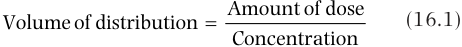

Volume of distribution  Amount of dose (16.1) Concentration 

With an estimate of tank volume, drug concentration after any bolus dose can be calculated. Human bodies are not like water tanks. As soon as a drug is injected, it begins to be cleared from the body. To account for this in the schematic presented in Fig. 16.1, a faucet is added to the tank to mimic

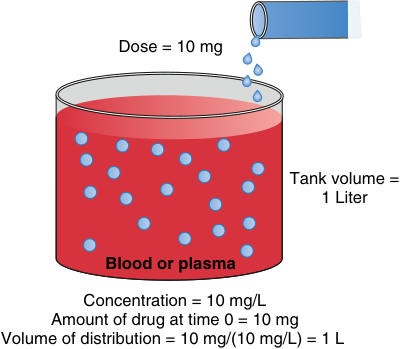

Dose = 10 mg Tank volume = 1 Liter Blood or plasma Concentration = 10 mg/L Amount of drug at time 0 = 10 mg Volume of distribution = 10 mg/(10 mg/L) = 1 L 

**Fig. 16.1 Schematic of a single- tank model of distribution volume.** The group of _blue drops_ emerging from the pipe at the _top right_ represent a bolus dose that, when administered to the tank of water, evenly distributes within the tank.

drug elimination from the body (Fig. 16.2). Considering the elimination of drug from the tank and the changes in concentration, the definition of distribution volume in Eq. 16.1 should be refined with the amount of drug and the concentration at a given time (t).

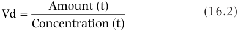

Amount (t) Vd  (16.2) Concentration (t) 

If drug elimination occurs as a first- order process (i.e., elimination is proportional to the concentration at that time), in a tank model, the volume of distribution calculated by Eq. 16.2 will be constant (Fig. 16.3; see also Fig. 16.2). When a drug is administered intravenously, some drug stays in the vascular volume, but most of the drug distributes to peripheral tissues. This distribution is often represented as additional tanks (peripheral distribution volumes) connected to a central tank (blood or plasma volume). Peripheral distribution volumes increase the total volume of distribution (Fig. 16.4). For the calculation of distribution volumes, peripheral tissue concentrations are difficult to measure, whereas plasma concentrations are easily measured.

The schematic in Fig. 16.4 presents two tanks that represent plasma and peripheral tissue volumes. The peripheral tank represents the drug volume of distribution in peripheral tissues. There may be more than one peripheral tank (volume) to best describe the entire drug disposition in the body. The size of the peripheral volumes represents a drug’s solubility in tissue relative to blood or plasma. The more soluble a drug is in peripheral tissue relative to blood or plasma, the larger the peripheral volumes of distribution.

An important point illustrated in Fig. 16.4 is that drug not only distributes to the peripheral tank and thus increases the volume of distribution, but it also binds to tissue in that tank. This process further lowers the measurable concentration in the central tank. Thus, the total volume of distribution may even be larger than the two tanks added together. In fact, some anesthetics have huge distribution volumes (e.g., fentanyl has an apparent distribution volume of 4 L/kg) that are substantially larger than an individual’s vascular volume (0.07 L/kg) or extracellular volume (0.2 L/kg).

<!-- PDF page 3 -->

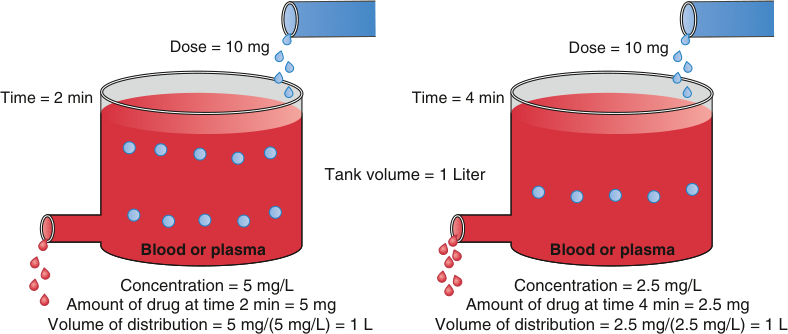

Dose = 10 mg Dose = 10 mg Time = 2 min Time = 4 min Tank volume = 1 Liter Blood or plasma Blood or plasma Concentration = 5 mg/L Concentration = 2.5 mg/L Amount of drug at time 2 min = 5 mg  Amount of drug at time 4 min = 2.5 mg Volume of distribution = 5 mg/(5 mg/L) = 1 L Volume of distribution = 2.5 mg/(2.5 mg/L) = 1 L 

**Fig. 16.2** Schematic of a single- tank model of elimination as a first- order process (eliminated at a rate of 50% to the amount of drug present at every two minutes). At 2 minutes _(left panel)_ and 4 minutes _(right panel)_ following a 10- mg drug bolus, tank concentrations are decreasing from 5 to 2.5 mg/ mL. Accounting for elimination, estimates of the distribution volume at each time point are both 1 L.

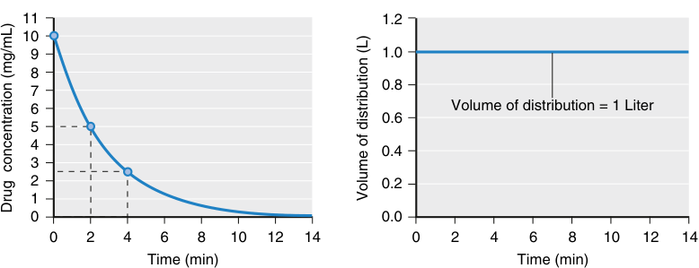

11 1.2 10 9 1.0 8 7 0.8 6 Volume of distribution = 1 Liter 0.6 5 4 0.4 3 2 0.2 1 0 0.0 0 2 4 6 8 10 12 14 0 2 4 6 8 10 12 14 Time (min) Time (min) Volume of distribution (L) Drug  concentration (mg/mL) 

**Fig. 16.3** Simulation of concentration _(left panel)_ and distribution volume _(right panel)_ changes over time following a bolus dose for a single- tank (onecompartment) model. The distribution volume remains constant throughout.

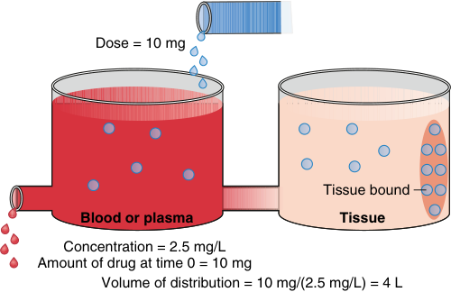

Dose = 10 mg Tissue bound Blood or plasma Tissue Concentration = 2.5 mg/L Amount of drug at time 0 = 10 mg Volume of distribution = 10 mg/(2.5 mg/L) = 4 L 

**Fig. 16.4 Schematic of a two- tank model.** The total volume of distribution consists of the sum of the two tanks. The _brown ellipse_ in the peripheral volume represents tissue that binds up drugs. The measured concentration in the blood or plasma is 2.5 mg/mL just after a bolus dose of 10 mg. Using Fig. 16.1, this leads to a distribution volume of 4 L.

With intravenous administration, drug rapidly distributes within the central tank. Assuming instantaneous mixing, the volume of this tank can be derived from the concentration at time 0 and the amount of drug administered. Drug then distributes into peripheral tissues. As described by Colburn and Takada and Asada,1,2 with more than one tank, the total apparent distribution volume increases over

time as drug equilibrates between the central and peripheral tanks. To illustrate this concept, Fig. 16.5 presents the apparent distribution volume over time following a bolus dose of intravenous anesthetic.

### CLEARANCE

Clearance describes the rate of drug removal from the plasma/blood. Two processes contribute to drug clearance: systemic (removal from the tank) and intercompartmental (between tanks) clearance (Fig. 16.6). Systemic clearance permanently removes drug from the body, either by eliminating the parent molecule or by transforming it into metabolites. Intercompartmental clearance moves drug between plasma and peripheral tissue tanks. By way of clarification, in this chapter, the words “compartment” and “tank” are interchangeable.

Clearance is defined in units of flow: that is, the volume completely cleared of drug per unit of time (e.g., L/min). Clearance is not to be confused with elimination rate (e.g., mg/min). The elimination rate is not an accurate method of describing the mass of drug removed over time. For example, assuming a first- order process, when plasma concentrations are high, the rate of drug elimination is high. When low, the rate is also low. Clearance is a better descriptor as it is independent of drug concentration.

<!-- PDF page 4 -->

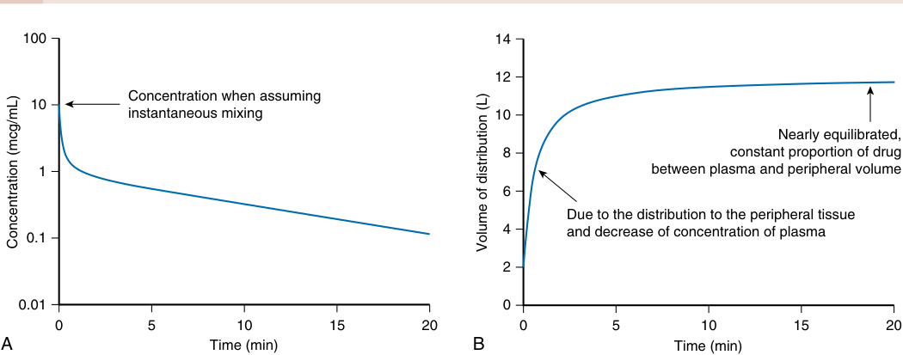

100 14 12 Concentration when assuming 10 instantaneous mixing 10 Nearly equilibrated, 8 constant proportion of drug 1 between plasma and peripheral volume 6 Due to the distribution to the peripheral tissue 0.1 4 and decrease of concentration of plasma 2 0.01 0 0 5 10 15 20 0 5 10 15 20 A Time (min) B Time (min) Concentration (mcg/mL) Volume of distribution (L) 

**Fig. 16.5** Simulations of concentration and apparent distribution volume changes over time following an administration of a bolus of an anesthetic drug for a two- tank (two- compartment) model. (A) Drug plasma concentration over time. (B) Apparent distribution volume over time.

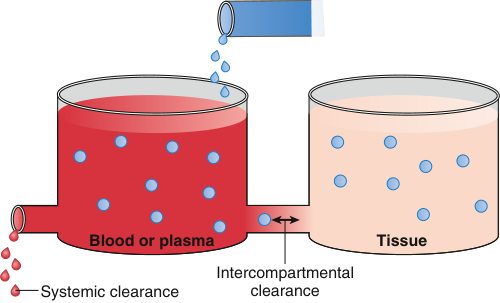

Blood or plasma Tissue Intercompartmental Systemic clearance clearance 

**Fig. 16.6** Schematic of a two- tank model illustrating two sources of drug removal from the central tank (blood or plasma): systemic and intercompartmental clearance.

To illustrate this point, consider the simulation presented in Fig. 16.7. In this simulation, the total amount of drug at each time can be calculated from the known volume of distribution and measured concentration. The concentration change in time window A is larger than in time window B even though they are both 1 minute in duration. The elimination rates are 28.4 and 10.4 mg/min for time windows A and B, respectively. They are different, and neither can be used as a parameter to represent a measure of drug removal from the body. Because of this limitation with elimination rate, clearance was developed to provide a single number to describe the decay in drug concentration presented in Fig. 16.7.

For discussion purposes, assume that concentration is the power necessary to push drug out of the water tank. The higher the concentration, the larger the amount of drug eliminated. To standardize the elimination rate, the eliminated amount of drug is scaled to concentration. For example, when the elimination rate in time window A (28.4 mg/ min) is scaled to the concentration at the middle of the time window (14.2 mcg/mL), the clearance is 2 L/min. When the elimination rate in time window _B_ (10.4 mg/min) is scaled to the concentration at the middle of the time window (5.2 mcg/mL), the clearance is again 2 L/min. If the

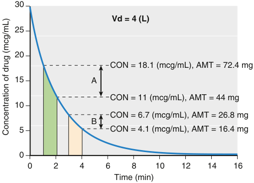

30 Vd = 4 (L) 25 20 CON = 18.1 (mcg/mL), AMT = 72.4  mg 15 A CON = 11 (mcg/mL), AMT = 44 mg 10 CON = 6.7 (mcg/mL), AMT = 26.8 mg B 5 CON = 4.1 (mcg/mL), AMT = 16.4 m g 0 0 2 4 6 8 10 12 14 16 Time (min) Concentration of drug (mcg/mL) 

**Fig. 16.7** Simulation of drug concentration changes when a drug is administered to a single- tank model with first- order elimination (see Fig. 16.2). The concentration changes for two time windows are labeled with _dashed lines_ from 1 to 2 minutes (time window _A_ ) and from 3 to 4 minutes (time window _B_ ), respectively. The concentrations (CON) at the beginning and end of each time window are used to calculate the amount (AMT) of drug that is eliminated (see text). _Vd_ , volume of distribution.

time interval is narrowed so that the time window converges zero, the definition of clearance becomes:

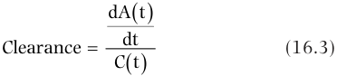

dA  t Clearance  dt (16.3) C  t 

where dA(t)/dt is the rate of drug elimination at given time t, and C(t) is the corresponding concentration at that time. Rearranging Eq. 16.3 and integrating both numerator and denominator, the following relationship holds:

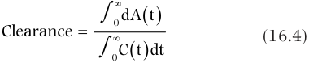

  0 dA  t Clearance   (16.4)  0C  t dt 

 because the term  0dA t is equal to the total amount  of drug eliminated and  0C tdt is the area under curve

<!-- PDF page 5 -->

(AUC) in concentration versus time plot, then the following equation can be derived:

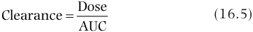

Clearance  Dose (16.5) AUC 

With long infusions, drug concentrations reach a steadystate condition where the rate of drug elimination dA &lt;u>&lt;/u> t is dt in equilibrium with the rate of drug administration (infusion rate). Clearance in a steady- state condition can be obtained using Eq. 16.3 as follows:

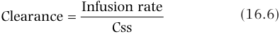

Clearance  Infusion rate (16.6) Css 

where Css is the plasma concentration at steady state.

To illustrate the relationship between clearance and volume of distribution, consider the following simulation using a generic drug dosed in milligrams into a single compartment (tank) representing the distribution volume that has a clearance of 1 L/min. Assume that when drug is administered, the tank is well stirred and has instantaneous mixing throughout the entire volume. Assume the distribution volume is 4 L, the total dose of drug is 64 mg, and that drug elimination is proportional to the amount of drug present inside the tank at any given time. This rate of drug elimination is known as first- order elimination kinetics. When the drug is injected into the 4 L distribution volume, the drug will instantly evenly distribute throughout the compartment (Fig. 16.8). With a clearance of 1 L/min, the amount of drug distributed to one-fourth of

compartment volume (1 L) will be cleared every minute. In the first minute, 16 mg drug is cleared. The remaining 48 mg will be redistributed evenly throughout the compartment. For the next minute, one-fourth of the compartment volume (1 L) is again cleared. In the second minute, 12 mg of drug is cleared. This process repeats every minute. When assuming instantaneously mixing, the ratio of the amount of drug removed within the cleared portion of the distribution volume to the amount of drug within the total distribution volume will remain the same as illustrated in Eq. 16.7.

16 mg 12 mg 9 mg cleared volume    (16.7) 64 mg 48 mg 36 mg volume of distribtuion This ratio, known as the elimination rate constant (k), is described in Eq. 16.8.

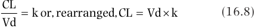

CL k or, rearranged,CL  Vd  k (16.8) Vd  

Where CL is clearance with units of volume/time (L/min), Vd is the compartment distribution volume with units of liters (L), and k is the first- order elimination rate constant with units of inverse time (min−1 ).

### PHYSIOLOGIC MODEL FOR CLEARANCE

Drug extraction by metabolic organs is illustrated in Fig. 16.9. This model contains a metabolic organ system responsible for drug elimination. According to mass balance, the rate at which drug flows _out_ of metabolic organs is the rate at which drug flows _into_ them minus the metabolic

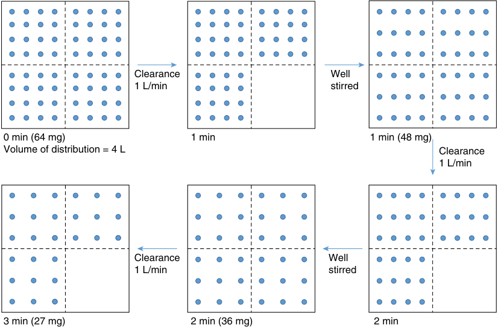

Clearance Well 1 L/min stirred 0 min (64 mg) 1 min 1 min (48 mg) Volume of distribution = 4 L Clearance 1 L/min Clearance Well 1 L/min stirred 3 min (27 mg) 2 min (36 mg) 2 min 

**Fig. 16.8 Schematic representation of relationship among clearance, volume of distribution, and elimination rate constant.** A generic drug dose of 64 mg is administered into a single compartment volume of 4 L that has a clearance of 1 L/min. Drug elimination is proportional to the amount of drug present inside the compartment at any given time, otherwise known as first- order elimination kinetics. At 1- minute intervals, one of the 4 L is cleared along with all drug contained in that liter. The drug amount decreases by 16, 12, and 9 mg at 1, 2, and 3 minutes, respectively.

<!-- PDF page 6 -->

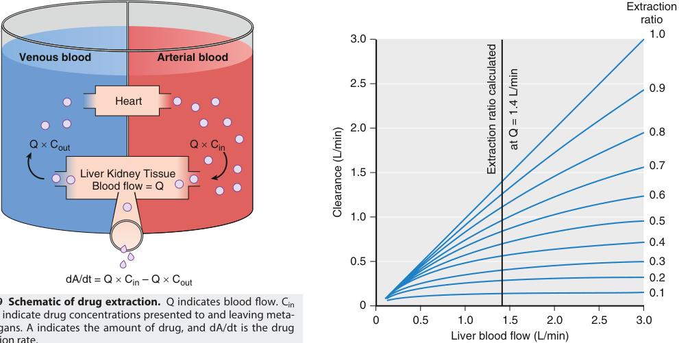

Extraction ratio 1.0 3.0 Venous blood Arterial blood 2.5 0.9 Heart 2.0 0.8 Q � Cout Q � Cin 0.7 Liver Kidney Tissue 1.5 Blood flow = Q 0.6 1.0 0.5 0.4 0.5 0.3 dA/dt = Q � Cin – Q � Cout 0.2 0.1 Schematic of drug extraction.  Q indicates blood flow. Cinin 0  indicate drug concentrations presented to and leaving meta- 0 0.5 1.0 1.5 2.0 2.5 3.0 bolic organs. A indicates the amount of drug, and dA/dt is the drug Liver blood flow (L/min) at Q = 1.4 L/min Extraction ratio calculated Clearance (L/min) 

**Fig. 16.9 Schematic of drug extraction.** Q indicates blood flow. Cinin and Cout indicate drug concentrations presented to and leaving metabolic organs. A indicates the amount of drug, and dA/dt is the drug elimination rate.

**Fig. 16.10 Relationship among liver blood flow (Q), clearance, and extraction ratio.** For drugs with a high extraction ratio, clearance is nearly identical to liver blood flow. For drugs with a low extraction ratio, changes in liver blood flow have almost no effect on clearance. (From Wilkinson GR, Shand DG. Commentary: a physiological approach to hepatic drug clearance _. Clin Pharmacol Ther_ . 1975;18:377–390.)

rate. The elimination rate (dA/dt) can be expressed as Q (Cin − Cout). Rearranging C(t) in Eq. 16.3 with Cin, clearance can be expressed as:

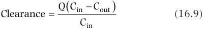

Clearance  Q  Cin  Cout  (16.9) Cin 

in hepatic metabolic function _per se_ will have little impact on clearance because hepatic metabolic capacity is overwhelmingly more than demand.

where Q is the blood flow to metabolic organs, Cin is the concentration of drug delivered to metabolic organs, and Cout is the concentration of drug leaving metabolic organs.

For many drugs (e.g., alfentanil), the ER is considerably less than 1. For these drugs, clearance is limited by the capacity of the liver to take up and metabolize drug. These drugs are said to be “capacity limited.” Clearance will change in response to any change in the capacity of the liver to metabolize such drugs, as might be caused by liver disease or enzymatic induction. However, changes in liver blood flow caused by the anesthetic regimen or other changes in splanchnic circulation usually have little influence on clearance because the liver handles only a fraction of the drug that it sees.

The fraction of inflowing drug extracted by the organ is Cin  Cout . This is called the extraction ratio (ER). Clearance Cin

can be estimated as organ blood flow multiplied by the ER. Eq. 16.9 can be simplified to:

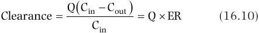

Clearance  Q  Cin  Cout   Q  ER (16.10) Cin 

Although most anesthetic drugs are cleared by hepatic metabolism, remifentanil, succinylcholine, and esmolol are cleared in the plasma and tissues by ester hydrolysis, and pancuronium is cleared via the kidney. The relationship between metabolism and clearance is complex.

The total clearance is the sum of each clearance by metabolic organs such as the liver, kidney, and other tissues.

Hepatic clearance has been well characterized. For example, the relationship among clearance, liver blood flow, and the ER is presented in Fig. 16.10.3 For drugs with an ER of nearly 1 (e.g., propofol), a change in liver blood flow produces a nearly proportional change in clearance. For drugs with a low ER (e.g., alfentanil), clearance is nearly independent of the rate of liver blood flow. If nearly 100% of the drug is extracted by the liver, this implies that the liver has a very large metabolic capacity for the drug. In this case, the rate- limiting step in metabolism is the flow of drug to the liver, and such drugs are said to be “flow limited.” Therefore, any reduction in liver blood flow due to circulatory effects of anesthetic agents or changes in circulatory volumes in cases of perioperative bleeding or other situations of excessive fluid loss can be expected to reduce liverdependent drug clearance. However, moderate changes

### HEPATIC BIOTRANSFORMATION

Most anesthetic drugs are cleared by hepatic biotransformation. The synthetic pathways for biotransformation are covered in detail in many biochemistry texts. Briefly, the liver metabolizes drugs through oxidation, reduction, hydrolysis, or conjugation. Oxidation and reduction occur in the cytochrome P450 system. These enzymes can be induced by exposure to certain drugs (e.g., the herbal remedy St. John’s wort) and increase the liver’s intrinsic metabolic capacity. Other drugs or hepatic disease can inhibit these enzymes (e.g., selected calcium channel blockers and selected antibiotics). Routes of oxidative metabolism

::: warning 符號需核對
此頁有符號無法完整擷取，請展開下方原始頁面核對。
:::

::: details 原始表格與符號（PDF 第 6 頁）

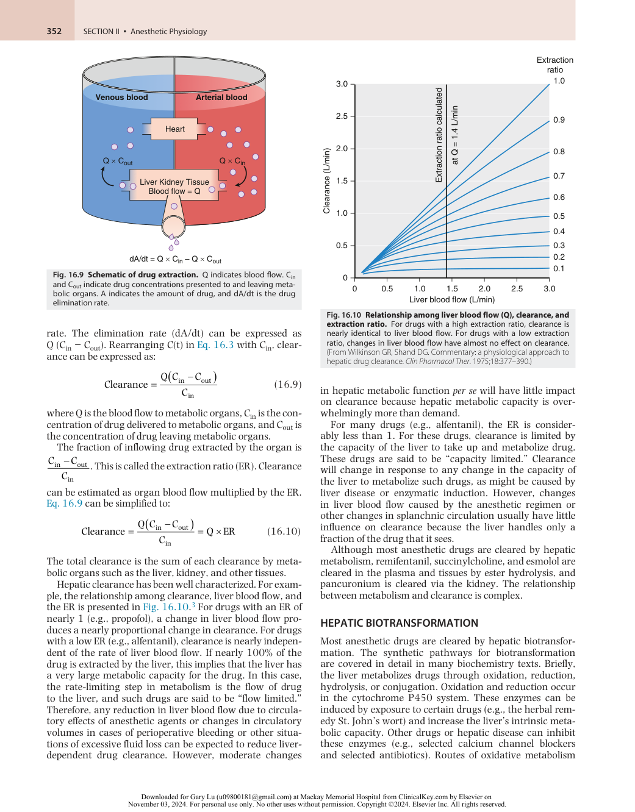

:::

<!-- PDF page 7 -->

include hydroxylation, dealkylation, deamination, desulfuration, epoxidation, and dehalogenation. Conjugation and hydrolysis often occur outside the P450 system, although glucuronidation involves the P450 system as well. The effect of conjugation is to transform hydrophobic molecules into water- soluble molecules through the addition of polar groups and thus render the metabolites easier to excrete via the kidneys. The metabolites generated by the liver are generally inactive, although some drugs (e.g., morphine, midazolam) have metabolites that are as potent as the parent drug. Genetic polymorphism can occur in all these pathways, and this accounts for part of the variability in clearance in the population.

## Pharmacokinetic Models

To create a framework from which to compare drugs and describe drug behavior, pharmacologists developed pharmacokinetic models to characterize drug concentrations as a function of time. Several types of pharmacokinetic models have been developed. Examples include complex physiologic models and the more common compartmental models.

### PHYSIOLOGIC MODELS

Physiologic models are based on organ and tissue physiologic and anatomic data. Drug concentrations into and out of an organ, organ blood flow, and organ drug distribution volume are required. Capturing these metrics from all organs is nearly impossible in humans and very challenging in animal models. If obtained, this data are used to estimate volumes and clearances for each organ in the body. Individual organ models are assembled into a whole organism physiologic model.4 Once assembled, the combined models are complex and mathematically cumbersome. They may not offer a better prediction of plasma drug concentrations over time than simple compartmental models. If the intent of the model is to explore the ability of possible dosing regimens to achieve therapeutic plasma drug concentrations, compartmental models are usually adequate.

### COMPARTMENTAL MODELS

Compartmental models are built on the same basic concepts as physiologic models, but with significant simplifications. Compartmental pharmacokinetic models are strictly empirical. They are based on fitting equations to measured plasma concentrations following a known dose. Compartmental models are transformed into models that characterize changes over time in terms of volumes and clearances. Part of the continuing popularity of compartmental pharmacokinetic models is that they can be transformed from an unintuitive exponential form to a more intuitive compartmental form as shown in Fig. 16.11.

Compartmental models used to describe anesthetic drugs typically consist of one, two, or three compartments corresponding to the number of exponents in an equation needed to best fit the plasma versus concentration data (see Fig. 16.11). Coefficients and exponents are difficult to work with and have little clinical meaning. Thus, they are converted into fictitious volumes and clearances. For example,

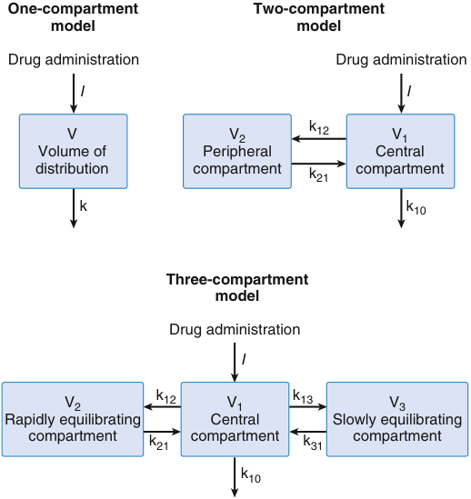

One-compartment Two-compartment model model Drug administration Drug administration I I V V2 k12 V1 Volume of Peripheral Central distribution compartment k21 compartment k k10 Three-compartment model Drug administration I k12 k13 V2 V1 V3 Rapidly equilibrating Central Slowly equilibrating compartment k21 compartment k31 compartment k10 

**Fig. 16.11 One- , two- , and three- compartment mammillary models.**

in a three- compartment model, there is a central compartment and two peripheral compartments. The sum of all volumes is the volume of distribution at steady state. Drug clearance from the central compartment to the outside is the central clearance. Central clearance accounts for both metabolism and excretion. Clearances between the central and peripheral compartments is the “intercompartmental” clearance. Micro rate constants, expressed as kij, define the rate of drug transfer from compartment i to compartment j. For example, k10 is the micro rate constant describing drug transfer from central compartment to the outside. The intercompartmental micro rate constants (k12, k21, etc.) describe movement of drug between the central and peripheral compartments. Each peripheral compartment has at least two micro rate constants, one for drug entry and one for drug exit. The micro rate constants for the two- and three- compartment models are presented in Fig. 16.11.

### ZERO VERSUS FIRST- ORDER KINETICS

Drug elimination can have one of two profiles, zero- and firstorder kinetics. With zero- order kinetics, drug is eliminated at a constant rate. With first- order kinetics, drug is eliminated at a rate proportional to the amount of drug present at that time. These rates are expressed using the following equations:

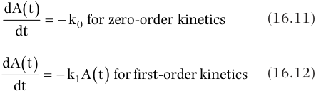

dAdt  t  k0 for zero-order kinetics (16.11) dA  t  k1A  t for first-order kinetics (16.12) dt 

where A(t) is the amount of drug at time t, dA(t) is the change in drug amount at time t. −k0 is the zero- order elimination

<!-- PDF page 8 -->

rate constant. Its units are mass/time (e.g., mg/min). −k1 is the first- order elimination rate constant. Its units are the reciprocal time 1/time (e.g., min−1 ). Most anesthetic drugs have first- order kinetics. When the processes responsible for metabolism are saturated, the kinetics could change from first to zero order.

### ONE- COMPARTMENT MODEL

For a one- compartment model with first- order kinetic elimination, the amount of drug at a given time t is described by Eq. 16.13.

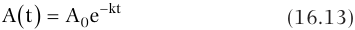

A  t  A0e  kt (16.13) 

where A0 is the initial drug amount (i.e., the initial dose), k is the first- order kinetic elimination rate constant. Note that k must be greater than 0. With this equation, there is an exponential decrease in drug amount.

The distribution volume (Vd) is a function of drug concentration and the total amount of drug in the compartment. Dividing Eq. 16.13 on both sides by Vd yields the following equation:

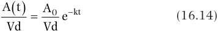

A  t  A0 e  kt (16.14) Vd Vd 

Drug concentration can be derived from this relationship with Eq. 16.15:

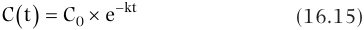

C  t  C0  e  kt (16.15) 

where C(t) is the concentration at time t, C0 is the initial concentration at time 0.

Taking the natural logarithm on both sides, the following expression is obtained:

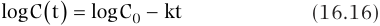

logC  t  logC0  kt (16.16) 

A plot of this equation shows a straight line with slope of −k and intercept of log C0. To yield the time required for the concentration to decrease by half, replacing log C(t) in Eq. 16.16 to log C0/2 and rearranging gives:

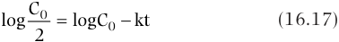

log C0  logC0  kt (16.17) 2 

Solving this equation gives

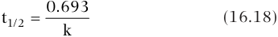

0.693 t1/2  (16.18) k 

where t1/2 is the elimination half- life.

### MULTICOMPARTMENT MODELS

Plasma concentrations over time after an intravenous bolus resemble the curve in Fig. 16.12. This curve has the characteristics common to most drugs when given by intravenous bolus. First, the concentrations continuously decrease over time. Second, the rate of decline is initially steep but continuously becomes less steep, until we get to a portion that is “log- linear.” For many drugs, three distinct phases can be distinguished, as illustrated in Fig. 16.12. A “rapid- distribution” phase _(blue line)_ begins immediately after bolus injection. Very rapid movement of the drug from

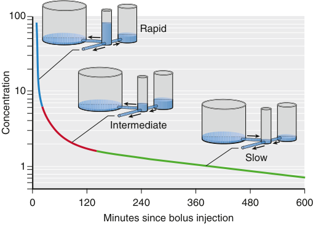

100 Rapid 10 Intermediate Slow 1 0 120 240 360 480 600 Minutes since bolus injection Concentration 

**Fig. 16.12 Hydraulic model of fentanyl pharmacokinetics.** Drug is administered into the central tank, from which it can distribute into two peripheral tanks, or it may be eliminated. The volume of the tanks is proportional to the volumes of distribution. The cross- sectional area of the pipes is proportional to clearance. (From Youngs EJ, Shafer SL. Basic pharmacokinetic and pharmacodynamic principles. In: White PF, ed. _Textbook of Intravenous Anesthesia_ . Baltimore: Williams & Wilkins; 1997.)

plasma to the rapidly equilibrating tissues characterizes this phase. Frequently there is a second “slow- distribution” phase _(red line)_ , which is characterized by movement of drug into more slowly equilibrating tissues and return of drug to plasma from the most rapidly equilibrating tissues. The terminal phase _(green line)_ is a straight line when plotted on a semilogarithmic graph. The terminal phase is often called the “elimination phase” because the primary mechanism for decreasing drug concentration during the terminal phase is elimination of drug from the body. The distinguishing characteristic of the terminal elimination phase is that the plasma concentration is lower than tissue concentrations and the relative proportion of drug in plasma and peripheral volumes of distribution remains constant. During this terminal phase, drug returns from the rapid- and slow- distribution volumes to plasma and is permanently removed from plasma by metabolism or excretion.

The presence of three distinct phases after bolus injection is a defining characteristic of a three- compartment model.5 A useful metaphor in describing the features of this model is hydraulics. This model has three tanks corresponding (from left to right) to the slowly equilibrating peripheral compartment, the central compartment (the plasma, into which drug is injected), and the rapidly equilibrating peripheral compartment. The horizontal pipes represent intercompartmental clearance or (for the pipe draining onto the page) metabolic clearance. The volumes of each tank correspond to the volumes of each compartment. The crosssectional areas of the pipes correlate with fentanyl systemic and intercompartmental clearance. The height of water in each tank corresponds to drug concentration.

By using this hydraulic model, we can follow the processes that decrease drug concentration over time after bolus injection. Initially, drug flows from the central compartment to both peripheral compartments via intercompartmental clearance and completely out of the model via metabolic clearance. Because there are three places for drug to go, the concentration in the central compartment

<!-- PDF page 9 -->

decreases very rapidly. At the transition between the blue line and the red line, a change occurs in the role of the most rapidly equilibrating compartment. At this transition, the concentration in the central compartment falls below the concentration in the rapidly equilibrating compartment, and the direction of flow between them is reversed. After this transition _(red line)_ , drug in plasma has only two places to go: into the slowly equilibrating compartment or out the drainpipe. These processes are partly offset by the return of drug to plasma from the rapidly equilibrating compartment. The net effect is that once the rapidly equilibrating compartment has come to equilibration, the concentration in the central compartment falls far more slowly than before.

Once the concentration in the central compartment falls below both the rapidly and slowly equilibrating compartments _(green line)_ , the only method of decreasing the plasma concentration is metabolic clearance, the drainpipe. Return of drug from both peripheral compartments to the central compartment greatly slows the rate of decrease in plasma drug concentration.

Curves that continuously decrease over time, with a continuously increasing slope (i.e., curves that look like Fig. 16.12), can be described by a sum of negative exponentials. In pharmacokinetics, one way of denoting this sum of exponentials is to say that the plasma concentration over time is:

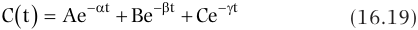

C  t  Ae  t  Be  t  Ce  t (16.19) 

where t is the time since the bolus, C(t) is the drug concentration after a bolus dose, and A, α, B, β, C, and γ are parameters of a pharmacokinetic model. A, B, and C are called coefficients, whereas α, β, and γ are called exponents. After a bolus injection, all six of the parameters in Eq. 16.19 will be greater than 0.

Special significance is often ascribed to the smallest exponent. This exponent determines the slope of the final loglinear portion of the curve. When the medical literature refers to the half- life of a drug, unless otherwise stated, the half- life will be the terminal half- life. Some literature occasionally refers to the half- life of the initial distribution phase as distribution half- life. The terminal half- life sets an upper limit on the time required for the concentrations to decrease by 50% after drug administration. Usually, the time needed for a 50% decrease will be much faster than that upper limit.

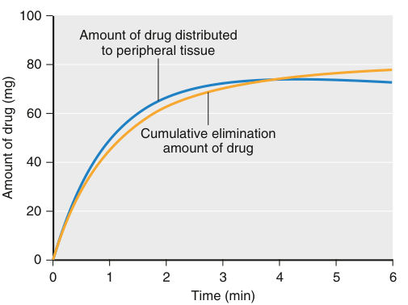

100 Amount of drug distributed to peripheral tissue 80 60 Cumulative elimination amount of drug 40 20 0 0 1 2 3 4 5 6 Time (min) Amount of drug (mg) 

**Fig. 16.13** Simulation of propofol accumulation in the peripheral tissues _(blue line)_ and the cumulative amount of propofol eliminated _(gold line)_ following a 2- mg/kg propofol bolus to a 77- kg (170- lb), 53- year- old male who is 177 cm (5 ft 10 inch) tall, using published pharmacokinetic model parameters.11 Drug indicates propofol.

larger than the amount eliminated out of the body. After 4

minutes, the amounts reverse.

With compartmental models, an important assumption is that an intravenous bolus instantly mixes in the central volume, with the peak concentration occurring at the moment of injection without elimination or distribution to peripheral tissues. For simulation purposes, the initial concentration and volume of distribution at time = 0 are extrapolated as if the circulation had been infinitely fast. This, of course, is not real. If drug is injected into an arm vein and the initial concentration is measured in a radial artery, drug appears in the arterial circulation 30 to 40 seconds after injection. The delay likely represents the time required for drug to pass through the venous volume of the upper part of the arm, heart, great vessels, and peripheral arterial circulation. More sophisticated models (e.g., a recirculatory model)6 account for this delay and are useful when characterizing the behavior of a drug immediately following bolus administration such as with induction agents where the speed of onset and duration of action are of interest (Fig. 16.14).

### BACK- END KINETICS

## Special Issues in Anesthetic Pharmacokinetics

### FRONT- END KINETICS

Front- end kinetics refers to the description of intravenous drug behavior immediately following administration. How a drug rapidly moves from the blood into peripheral tissues directly influences the peak plasma drug concentration. The amount of drug that moves to the peripheral tissue commonly surpasses the amount that is eliminated during the first few minutes after drug administration. As an example, consider a simulation of a propofol bolus that plots the accumulation of propofol in peripheral tissues and the amount eliminated over time (Fig. 16.13). During the first 4 minutes, the amount distributed to the peripheral tissue is

Using estimates of distribution volume and clearance, backend kinetics is a useful tool that describes the behavior of intravenous agents when administered as continuous infusions. Back- end kinetics provides descriptors of how plasma drug concentrations decrease once a continuous infusion is terminated. An example is decrement time, which predicts the time required to reach a certain plasma concentration once an infusion is terminated. Decrement times are a function of infusion duration. Consider the example of decrement times for a set of continuous target- controlled infusions (TCIs; Fig. 16.15). In this simulation, TCI of propofol is set to maintain a concentration of 4 mcg/mL for 30, 60, and 120 minutes. Once the infusion is stopped, the time to reach 0.5 mcg/mL is estimated. As illustrated, the longer the infusion, the longer the time required to reach 0.5 mcg/mL. This example demonstrates how drugs accumulate in

<!-- PDF page 10 -->

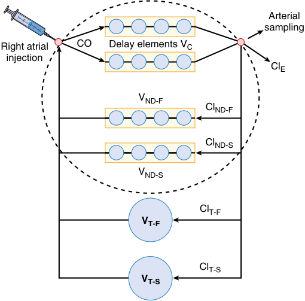

Arterial sampling Right atrial CO Delay elements VC injection ClE VND-F ClND-F ClND-S VND-S ClT-F V T-F ClT-S VT-S 

**Fig. 16.14** A recirculatory model accounting for cardiac output (CO), transit delays, pulmonary uptake (delay elements V and C), and nondistributive mixing pathways (VND and ClND). All the components within the _dashed circle_ are required to accurately model the central volume of distribution. In most situations, this complexity is not required, and the simpler approach of assuming instantaneous mixing within the central volume is an adequate approximation. ClND- F, fast nondistributive clearance; ClND- S, slow nondistributive clearance; ClT- F, fast tissue clearance; ClT- S, slow tissue clearance; VND- F, fast nondistributive volume; VND- S, slow nondistributive volume; VT- F, fast tissue volume; VT- S, slow tissue volume. (From Krejcie TC, Avram MJ, Gentry WB. A recirculatory model of the pulmonary uptake and pharmacokinetics of lidocaine based on analysis of arterial and mixed venous data from dogs. _J Pharmacokinet Biopharm_ . 1997;25:169–190.)

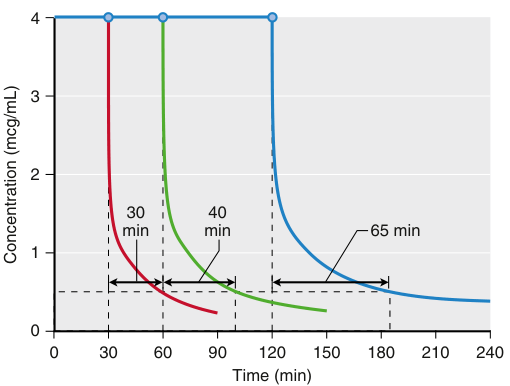

4 3 2 30 40 min min 65 min 1 0 0 30 60 90 120 150 180 210 240 Time (min) Concentration (mcg/mL) 

**Fig. 16.15** Simulation of decrement times for a target- controlled infusion set to maintain a target propofol concentration of 4 mcg/mL for 30, 60, and 120 minutes. Once terminated, the time required to reach 0.5 mcg/mL was 30, 40, and 65 minutes for each infusion, respectively. Simulations of the decrement times used a published pharmacokinetic model. (From Schnider TW, Minto CF, Gambus PL, et al. The influence of method of administration and covariates on the pharmacokinetics of propofol in adult volunteers _. Anesthesiology_ . 1998;88(5):1170–1182.)

peripheral tissues with prolonged infusions. This accumulation prolongs the decrement time.

Another use of decrement times is as a tool to compare drugs within a drug class (e.g., opioids). As a comparator, plots of decrement times are presented as a function of infusion duration. When used this way, decrement times are determined as the time required to reach a target percentage of the concentration just before the termination of a continuous infusion. Examples of 50% and 80% decrement times for selected opioids and sedatives based on published pharmacokinetic models7–12 are presented in Fig. 16.16. Of note, for shorter infusions, the decrement times are similar for both classes of anesthetic drugs. Once infusion duration exceeds 2 hours, the decrement times vary substantially. A popular decrement time is the 50% decrement time, also known as the context- sensitive half- time.8 The term “context- sensitive” refers to infusion duration and the term “half- time” refers to the 50% decrement time.

### HYSTERESIS

Hysteresis refers to the time delay between changes in plasma concentration and drug effect. Hysteresis accounts for the time required for drug to diffuse from the plasma to the site of action plus the time required, once drug is at the site of action, to elicit a drug effect. A simulation of various propofol bolus doses and their predicted effect on bispectral index is presented in Fig. 16.17. Of note, the time to peak effect for each dose is identical (approximately 1.5 minutes following the peak plasma concentration). The difference between each dose is the magnitude and duration of effect. A key principle here is that when drug concentrations are in flux (e.g., during induction and emergence), changes in drug effect will lag behind changes in plasma drug concentration. This lag between the plasma concentration and effect usually results in the phenomenon called hysteresis in which two different plasma concentrations correspond to one drug effect or one plasma concentration corresponds to two drug effects. Fig. 16.17 shows that different concentrations, C and c, correspond to the same bispectral index scale (BIS). To collapse the hysteresis between plasma concentration and effect and to match one concentration to one drug effect, this lag is often modeled with an effect- site compartment added to the central compartment. Kinetic micro rate constants used to describe this phenomenon called biophase include k1e and ke0. The k1e describes drug movement from the central compartment to the effect site, and ke0 describes the elimination of drug from the effect- site compartment. There are two important assumptions with the effect- site compartment: (1) the amount of drug that moves from the central compartment to the effect- site compartment is negligible and vice versa, and (2) there is no “volume” estimate to the effect- site compartment.

Typically, the relationship between plasma and the site of drug effect is modeled with an “effect- site” compartment model, as shown in Fig. 16.18. The site of drug effect is connected to plasma by a first- order process. The equation that relates effect- site concentration to plasma concentration is:

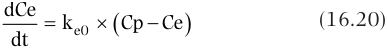

dCe  ke0   Cp  Ce  (16.20) dt 

<!-- PDF page 11 -->

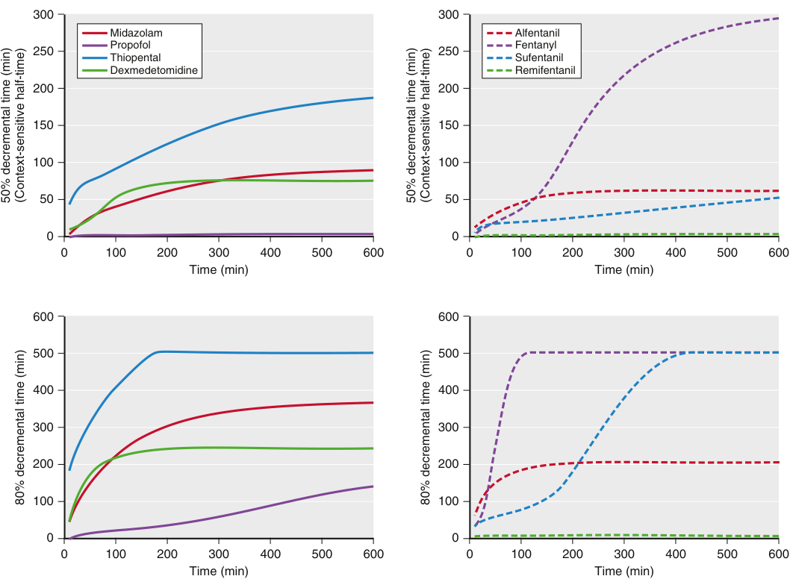

300 300 Midazolam Alfentanil 250 Propofol 250 Fentanyl Thiopental Sufentanil Dexmedetomidine Remifentanil 200 200 150 150 100 100 50 50 0 0 0 100 200 300 400 500 600 0 100 200 300 400 500 600 Time (min) Time (min) 600 600 500 500 400 400 300 300 200 200 100 100 0 0 0 100 200 300 400 500 600 0 100 200 300 400 500 600 Time (min) Time (min) 50% decremental time (min) (Context-sensitive half-time) 50% decremental time (min) (Context-sensitive half-time) 80% decremental time (min) 80% decremental time (min) 

**Fig. 16.16 Fifty percent and 80% decrement times for selected sedatives** **_(left side)_ and opioids** **_(right side)_ .** The _vertical axes_ refer to the time required to reach the desired decrement time. The _horizontal axes_ refer to infusion duration. Simulations of the decrement times used published pharmacokinetic models for each sedative and analgesic. (Data from references 7–12.)

where Ce is the effect- site concentration, Cp is the plasma drug concentration, and ke0 is the rate constant for elimination of drug. The constant ke0 describes the rate of rise and offset of drug effect (Fig. 16.19).

In summary, although of interest to many clinicians, the conventional pharmacokinetic term _half- life_ has limited meaning to anesthetic practice since the clinical behavior of drugs used in anesthesia is not well described by half- life. Instead, the pharmacokinetic principles discussed in this section (such as volume of distribution, clearance, elimination, front- end kinetics, back- end kinetics, context- sensitive half- time, and biophase) describe how drugs used in anesthesia will behave.

## Pharmacodynamic Principles

Simply stated, pharmacokinetics describes what the body does to the drug, whereas pharmacodynamics describes what the drug does to the body, particularly the relationship between drug concentration and pharmacologic effect.

Models used to describe the concentration–effect relationships are created in much the same way as pharmacokinetic

models; they are based on observations and used to create a mathematical model. To create a pharmacodynamic model, plasma drug levels and a selected drug effect are measured simultaneously. For example, consider the measured plasma concentrations of a drug following a bolus dose and the associated changes in the spectral edge from one individual presented in Fig. 16.20. Spectral edge is an easily captured metric used to quantify the electroencephalogram (EEG). Shortly after the plasma concentration peaks, the spectral edge starts to drop, reaches a nadir, and then returns to baseline as the plasma concentrations drop to near 0.

Combining data from several individuals and plotting the measured concentrations versus the observed effect (modified to be a percentage of the maximal effect across all individuals), the data create a hysteresis loop (Fig. 16.21). The ascending portion of the loop represents rising drug concentrations (see arrow). While rising, the increase in drug effect lags behind the increase in drug concentration. For the descending loop, the decrease in drug effect lags behind the decrease in drug concentration.

To create a pharmacodynamic model, the hysteresis loop is collapsed using modeling techniques that account for the

<!-- PDF page 12 -->

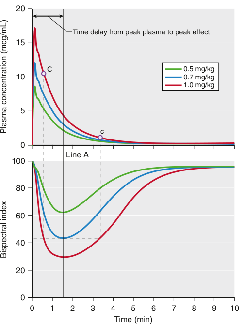

20 Time delay from peak plasma to peak effect 15 C 0.5 mg/kg 10 0.7 mg/kg 1.0 mg/kg 5 c 0 Line A 100 80 60 40 20 0 0 1 2 3 4 5 6 7 8 9 10 Time (min) Plasma concentration (mcg/mL) Bispectral index 

**Fig. 16.17 Illustration of hysteresis.** The top plot presents a simulation of three propofol doses and the resultant plasma concentrations. The bottom plot presents a simulation of the predicted effect on the bispectral index scale (BIS). These simulations assume linear kinetics: regardless of the dose, effects peak at the same time _(line A)_ as do the plasma concentration. The time to peak effect is 1.5 minutes. Even the plasma concentrations of point _C_ and _c_ are different; the BIS of those two points is the same. It shows the hysteresis between plasma concentration and BIS. Simulations used published pharmacokinetic and pharmacodynamic models. (Data from references 11 and 68.)

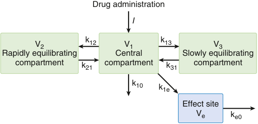

Drug administration I k12 k13 V2 V1 V3 Rapidly equilibrating Central Slowly equilibrating compartment k21 compartment k31 compartment k10 k1e Effect site Ve ke0 

**Fig. 16.18** A three- compartment model with an added effect site to account for the delay in equilibration between the rise and fall in arterial drug concentrations and the onset and offset of drug effect. The effect site is assumed to have a negligible volume.

lag time between plasma concentrations and the observed effect. These modeling techniques provide an estimate of the lag time, known as the t1/2ke0, and an estimate of the effect- site concentration (Ce) associated with a 50% probability of drug effect (C50). Most concentration effect relationships in anesthesia are described with a sigmoid curve. The

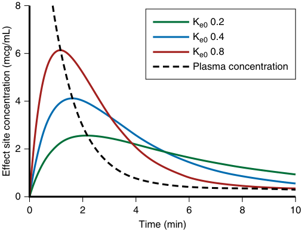

8 Ke0 0.2 Ke0 0.4 6 Ke0 0.8 Plasma concentration 4 2 0 0 2 4 6 8 10 Time (min) Effect site concentration (mcg/mL) 

**Fig. 16.19 Effect of the ke0 changes.** As the ke0 decreases, the time to peak effect is delayed. (Data from references 11, 68, and 77.)

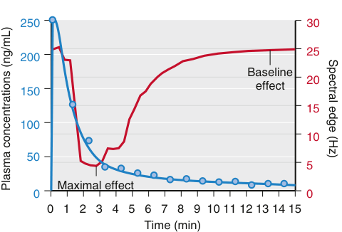

250 30 25 200 Baseline 20 effect 150 15 100 10 50 5 Maximal effect 0 0 0 1 2 3 4 5 6 7 8 9 10 11 12 13 14 15 Time (min) Spectral edge (Hz) Plasma concentrations (ng/mL) 

**Fig. 16.20** Schematic representation of drug plasma concentrations _(blue circles)_ following a bolus and the associated changes in the electroencephalogram’s spectral edge _(red line)_ measured in one individual. Note that changes in spectral edge lag behind changes in plasma concentrations.

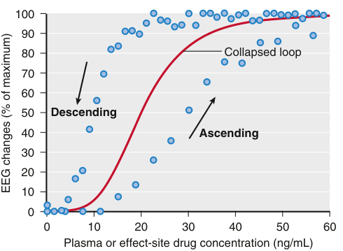

100 90 80 Collapsed loop 70 60 50 Descending 40 Ascending 30 20 10 0 0 10 20 30 40 50 60 Plasma or effect-site drug concentration (ng/mL) EEG changes (% of maximum) 

**Fig. 16.21** Schematic representation of plasma concentrations versus normalized spectral edge measurements (presented as a percentage of maximal effect) from several individuals _(blue circles)_ . The _black arrows_ indicate the ascending and descending arms of a hysteresis loop that coincide with increasing and decreasing drug concentrations. The _red line_ represents the pharmacodynamic model developed from collapsing the hysteresis loop. _EEG_ , electroencephalogram.

<!-- PDF page 13 -->

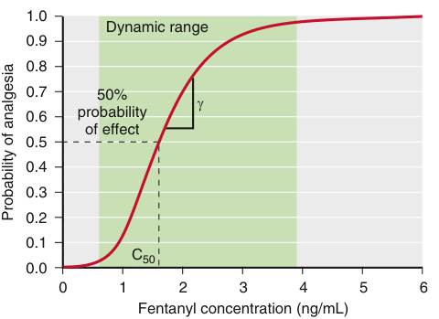

1.0 Dynamic range 0.9 0.8 0.7 50% 0.6 probability í of effect 0.5 0.4 0.3 0.2 0.1 C50 0.0 0 1 2 3 4 5 6 Fentanyl concentration (ng/mL) Probability of analgesia 

**Fig. 16.22 A pharmacodynamic model for the analgesic effect of fentanyl.** The _green area_ represents the dynamic range, the concentration range where changes in concentration lead to a change in effect. Concentrations above or below the dynamic range do lead to changes in drug effect. The C50 represents the concentration associated with 50% probability of analgesia. Gamma (γ) represents the slope of the curve in the dynamic range.

standard equation for this relationship is the “Hill equation,” also known as the “sigmoid Emax relationship”:

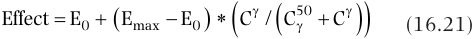

Effect  E0   Emax  E0    C  /  C50   C   (16.21) 

where E0 is the baseline effect, Emax is the maximal effect, C is the drug concentration, and γ (gamma) represents the slope of the concentration–effect relationship. Gamma (γ) is also known as the “Hill coefficient.” For values of γ &lt;1, the curve is hyperbolic; for values of γ >1, the curve is sigmoid. Fig. 16.22 presents an example of this relationship: a fentanyl effect- site concentration–effect curve for analgesia. This example illustrates how C50 and γ characterize the concentration–effect relationship.

### POTENCY AND EFFICACY

Two important concepts are relevant to this relationship: potency and efficacy. Potency describes the amount of drug required to elicit an effect. The C50 is a common parameter used to describe potency. For drugs that have a concentration- versus- effect relationship that is shifted to the left (small C50), the drug is more potent; the reverse is true for drugs that have a concentration- versus- effect relationship shifted to the right. For example, as illustrated in Fig. 16.23, the analgesia C50 for some of the fentanyl congeners ranges from small for sufentanil (0.04 ng/mL) to large for alfentanil (75 ng/mL). Thus, sufentanil is more potent than alfentanil.

Efficacy is a measure of drug effectiveness at producing an effect once it occupies a receptor. Similar drugs that work through the same receptor may have varying degrees of effect despite having the same receptor occupancy. For example, with G- protein coupled receptors, some drugs may bind the receptor in such a way as to produce a more pronounced activation of second messengers, causing more of an effect than others. Drugs that achieve maximal effect are known as full agonists, and those that have an effect less than maximal effect are known as partial agonists.

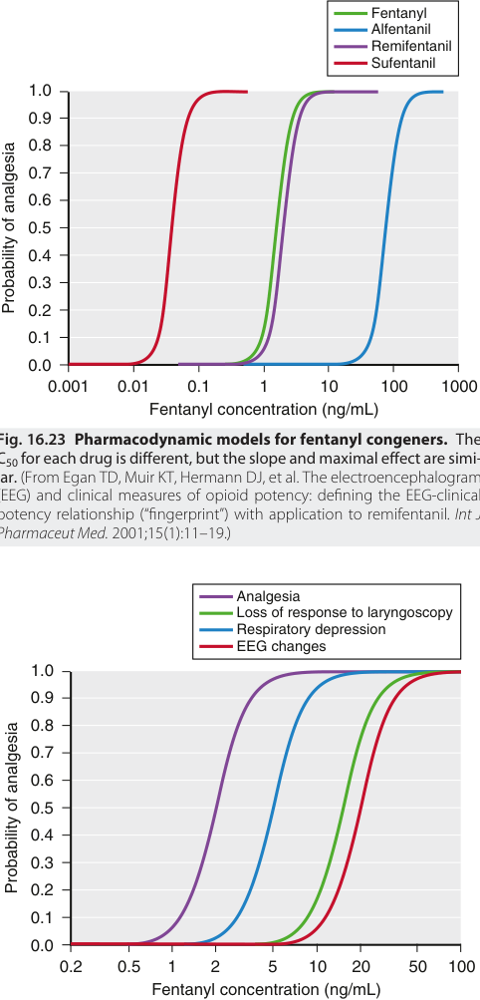

Fentanyl Alfentanil Remifentanil Sufentanil 1.0 0.9 0.8 0.7 0.6 0.5 0.4 0.3 0.2 0.1 0.0 0.001 0.01 0.1 1 10 100 1000 Fentanyl concentration (ng/mL) Fig. 16.23 Pharmacodynamic models for fentanyl congeners.  The C50 for each drug is different, but the slope and maximal effect are simi-50 for each drug is different, but the slope and maximal effect are simi- for each drug is different, but the slope and maximal effect are simi- lar. (From Egan TD, Muir KT, Hermann DJ, et al. The electroencephalogram (From Egan TD, Muir KT, Hermann DJ, et al. The electroencephalogram (EEG) and clinical measures of opioid potency: defining the EEG- clinical potency relationship (“fingerprint”) with application to remifentanil . Int J Pharmaceut Med.  2001;15(1):11–19.) Analgesia Loss of response to laryngoscopy Respiratory depression EEG changes 1.0 0.9 0.8 0.7 0.6 0.5 0.4 0.3 0.2 0.1 0.0 0.2 0.5 1 2 5 10 20 50 100 Fentanyl concentration (ng/mL) Probability of analgesia Probability of analgesia 

**Fig. 16.23 Pharmacodynamic models for fentanyl congeners.** The C50 for each drug is different, but the slope and maximal effect are simi-50 for each drug is different, but the slope and maximal effect are simi- for each drug is different, but the slope and maximal effect are similar. (From Egan TD, Muir KT, Hermann DJ, et al. The electroencephalogram (From Egan TD, Muir KT, Hermann DJ, et al. The electroencephalogram (EEG) and clinical measures of opioid potency: defining the EEG- clinical potency relationship (“fingerprint”) with application to remifentanil _. Int J Pharmaceut Med._ 2001;15(1):11–19.)

**Fig. 16.24 Pharmacodynamic models for various fentanyl effects.** _EEG_ , electroencephalogram. (From Egan TD, Muir KT, Hermann DJ, et al. The electroencephalogram (EEG) and clinical measures of opioid potency: defining the EEG- clinical potency relationship (“fingerprint”) with application to remifentanil _. Int J Pharmaceut Med._ 2001;15(1):11–19.)

### EFFECTIVE VERSUS LETHAL DOSES

A single drug can have multiple effects. The C50 concept is used to compare various drug effects for a single drug. For example, as illustrated in Fig. 16.24, fentanyl has a different C50 for analgesia (2 ng/mL), ventilatory depression (4 ng/mL), loss of response to laryngoscopy (15 ng/mL), and changes in the EEG (20 ng/mL).13

The concentration range where changes in drug effect occur is known as the _dynamic range_ . In Fig. 16.22, the dynamic range is from 0.6 to 3.9 ng/mL to cover a probability of analgesia ranging from 2% to 97%. Concentrations outside the dynamic range do not yield much change in

<!-- PDF page 14 -->

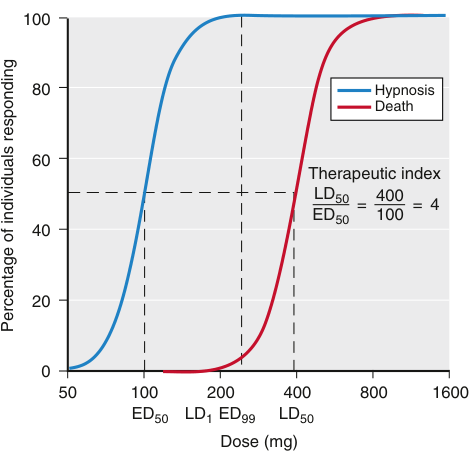

100 80 Hypnosis Death 60 Therapeutic index LD50 = 400 = 4 ED50 100 40 20 0 50 100 200 400 800 1600 ED50 LD1 ED99 LD50 Dose (mg) Percentage of individuals responding 

**Fig. 16.25 Median effective dose (ED50), median lethal dose (LD50), and the therapeutic index.** The _blue curve_ represents the dose–effect relationship for a sedative hypnotic to achieve unresponsiveness. The _red curve_ represents the dose–effect relationship for the same sedative hypnotic to achieve death. The therapeutic index is the ratio of the LD50/ED50, which in this example is 400. Also of interest are the ED99 and LD1. The ED99 is the dose with a 99% probability of unresponsiveness, and the LD1 is the dose with a 1% probability of death. In this example, the LD1 is less than the ED99, which is clinically unacceptable.

drug effect. Levels below the dynamic range are ineffective, and those above the dynamic range do not provide additional effect.

Like other effects, the concentration–relationship for death is also described with a sigmoid Emax curve. The relationship between drug and effect is expressed differently in that the horizontal axis uses dose in place of concentration. Similar to the C50, the ED50 is the dose at which there is a 50% probability of effect, and the LD50 is the dose with a 50% probability of death. The therapeutic index of a drug is defined as the ratio between the LD50 and the ED50 (Fig. 16.25). The larger the ratio, the safer the drug is for clinical use.

### ANESTHETIC DRUG INTERACTIONS

Anesthetics rarely consist of one drug, but rather a combination of drugs to achieve desired levels of hypnosis, analgesia, and muscle relaxation. Hypnotics, analgesics, and muscle relaxants all interact with one another such that rarely does one drug, when administered in the presence of other drugs, behave as if it were administered alone. For example, when administering an analgesic in the presence of a hypnotic, analgesia is more profound with the hypnotic than by itself and hypnosis is more profound with the analgesic than by itself. Thus anesthesia is the practice of applied drug interactions. This phenomenon is likely a function of each class of drug exerting an effect on different receptors.

Early work by McEwan and associates described interactions between two drugs and is illustrated in Fig. 16.26.14 It presents the interaction between isoflurane, a likely gamma-aminobutyric acid (GABA) agonist, and fentanyl, an opioid receptor agonist. This plot illustrates two key

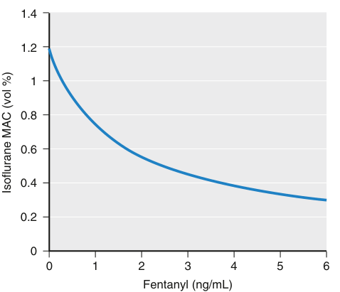

1.4 1.2 1 0.8 0.6 0.4 0.2 0 0 1 2 3 4 5 6 Fentanyl (ng/mL) Isoflurane MAC (vol %) 

**Fig. 16.26** The influence of fentanyl on the isoflurane minimal alveolar concentration (MAC) associated with a 50% probability of movement with skin incision. (Modified from McEwan AI, Smith C, Dyar O. Isoflurane minimum alveolar concentration reduction by fentanyl. _Anesthesiology._ 1993;78:864–869.)

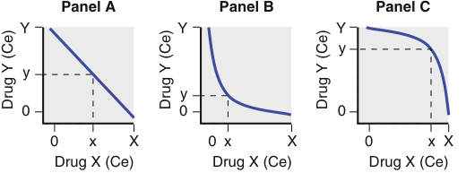

Panel A Panel B Panel C Y Y Y y y y 0 0 0 0 x X 0 x X 0 x X Drug X (Ce) Drug X (Ce) Drug X (Ce) Drug Y (Ce) Drug Y (Ce) Drug Y (Ce) 

**Fig. 16.27 Drug interactions.** For two drugs, X and Y, Panel A represents additive, Panel B represents synergistic, and Panel C represents antagonistic interactions.

points. First, with a relatively low fentanyl concentration (&lt;2 ng/mL), there is a substantial decrease (>50%) in the end- tidal isoflurane concentration necessary to achieve minimal alveolar concentration (MAC) necessary to avoid movement with skin incision. Second, with fentanyl concentrations above 3 ng/mL, the end- tidal concentration of isoflurane to maintain the MAC, although low, does not change much. Thus, there is a ceiling effect indicating that some isoflurane is necessary regardless of the fentanyl concentration to maintain a MAC of anesthesia.

A substantial body of work has been done to explore how anesthetic drugs interact with one another. As illustrated in Fig. 16.27, interactions have been characterized as antagonistic, additive, and synergistic. When drugs that have an additive interaction are co- administered, their overall effect is the sum of the two individual effects. With antagonistic interactions, the overall effect is less than if the drug combination were additive; with synergistic interactions, the overall effect is greater than if the drug combination were additive.

A term used to characterize the continuum of drug concentrations across various combinations of drug pairs (X in combination with Y) is the isobole. The isobole is an isoeffect line for a selected probability of effect. A common isobole is the 50% isobole line. It represents all possible combinations

<!-- PDF page 15 -->

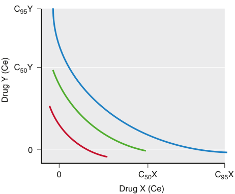

C95Y C50Y 0 0 C50X C95X Drug X (Ce) Drug Y (Ce) 

**Fig. 16.28 Schematic illustration of isoeffect (isobole) lines.** The _red, green, and blue lines_ represent the 50% and 95% isoboles for a synergistic interaction between drugs X and Y. Isoboles represent concentration pairs with an equivalent effect. A set of 5%, 50%, and 95% isoboles can be used to describe the dynamic range of the concentrations for drugs X and Y for a given effect. As with single concentration effect curves, the ideal dosing leads to concentration pairs that are near the 95% isobole.

of two- drug effect- site concentrations that would lead to a 50% probability of a given effect. Other isoboles are of more clinical interest. For example, the 95% isobole for loss of responsiveness represents the concentration pairs necessary to ensure a 95% probability of unresponsiveness. Similarly, the 5% isobole represents the concentration pairs in which the likelihood of that effect is low (i.e., most patients would be responsive). When formulating an anesthetic dosing regimen, dosing an anesthetic to achieve a probability of effect just above but not far beyond the 95% isobole is ideal (Fig. 16.28).

Hendrickx and colleagues surveyed the literature for work in both humans and animal models that described anesthetic drug interactions for opioids, sedative hypnotics, and inhalation agents for two anesthetic effects: (1) loss of responsiveness (humans) and loss of the righting reflex (animals) and (2) immobility defined as loss of movement in response to noxious stimulus in a nonparalyzed subject.15 They found several interesting features of anesthetic drug combinations. First, inhalation agents when combined are strictly additive, suggesting a common mechanism of action, except for nitrous oxide, which has an infra- additive interaction with other inhalation agents. Second, interactions between various intravenous drugs and inhalation agents are synergistic except for nitrous oxide and GABA sedative hypnotics. Third, interactions between different classes of intravenous drugs (e.g., opioids and sedative hypnotics) are also primarily synergistic, except for ketamine and benzodiazepines (Fig. 16.29).

Several researchers have developed mathematical models that characterize anesthetic drug interactions in three dimensions. These models are known as response surface models and include effect- site concentrations for each drug, as well as a probability estimate of the overall effect. Fig. 16.30 presents the propofol–remifentanil interaction

for loss of responsiveness as published by Bouillon and associates.16 The response surface presents the full range of remifentanil–propofol isoboles (0%–100%) for loss of responsiveness. There are two common representations of the response surface model: the three- dimensional plot and the topographical plot. The topographical plot represents a top- down view of the response surface with drug concentrations on the vertical and horizontal axes. Drug effect is represented with selected isobole lines (i.e., 5%, 50%, and 95%).

Response surface models have been developed for a variety of anesthetic effects to include responses to verbal and tactile stimuli, painful stimuli, hemodynamic or respiratory effects, and changes in electrical brain activity. For example, with airway instrumentation, response surface models have been developed for loss of response to placing a laryngeal mask airway,17 laryngoscopy,18,19 tracheal intubation,20 and esophageal instrumentation21 for selected combinations of anesthetic drugs. Although many response surface models exist, there are several gaps in available models covering all common combinations of anesthetic drugs and various forms of stimuli encountered in the perioperative environment.

Recent work characterizing the interaction between sevoflurane and remifentanil has been done for a variety of drug effects to include loss of responsiveness, loss of response to several surrogates of surgical pain such as electrical tetany (up to 50 mA), pressure algometry (50 PSI pressure on the anterior tibial), loss of response to laryngoscopy, and temperature.12 Using end- tidal measures of sevoflurane was found to be inaccurate under non- steady-state conditions (i.e., with a change in vaporizer settings). This was because end- tidal concentrations did not account for the hysteresis (or time lag) between end- tidal and effect- site concentrations. Improved model predictions were achieved when using estimated effect- site concentrations.22 Overall, for sevoflurane–opioid interactions, analgesic effects are markedly synergistic whereas sedative effects are somewhat synergistic.

Preliminary work has explored the adaptability of the sevoflurane–remifentanil interactions to other potent inhaled agent–opioid combinations using MAC and opioid equivalencies.23 Predictions from sevoflurane–remifentanil models adapted to isoflurane–fentanyl correlated well with observed effects in patients undergoing elective general surgery procedures. Recent work has also explored the construction of models that characterize the interactions between three or more drugs.24 For example, Vereecke and associates published a model that accounts for nitrous oxide, sevoflurane, and remifentanil.25 This is of clinical relevance because most anesthetics consist of more than two anesthetic drugs.

Substantial work has explored interactions between sedative hypnotics and opioids, primarily propofol with alfentanil26 or remifentanil16,17,21,27,28 for a variety of effects. As with potent inhaled anesthetics and opioids, the interactions between sedative hypnotics and opioids for analgesic effects are markedly synergistic whereas sedative hypnotic effects are somewhat synergistic.

Some work has explored interactions between different types of sedative hypnotics. Two include midazolam combined with propofol29,30 and propofol combined with a

<!-- PDF page 16 -->

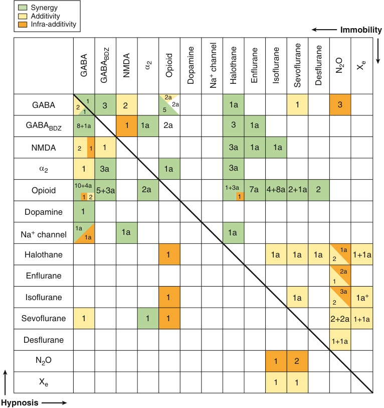

Synergy Additivity Infra-additivity Immobility 2a GABA 2 11 3 2 5 2a 1a 1 3 GABABDZ 8+1a 1 1a 2a 3 1a NMDA 2 1 1 3a 1a 1a Ü2 1 3a 1a 3a Opioid 10+4a 5+3a 2a 1+3a 7a 4+8a 2+1a 2 1 2 1 Dopamine 1 1a Na +  channel 1a 1a 1a 1a Halothane 1 1a 1a 1a 1+1a 2 2a Enflurane 1 3a Isoflurane 1 1a 1a + 2 Sevoflurane 1 1 1 2+2a 1+1a Desflurane 1+1a N2O 1 2 Xe 1 1 Hypnosis Ü2 Xe ON2 GABA NMDA Opioid GABABDZ Dopamine +Na channel Halothane Enflurane Isoflurane Sevoflurane Desflurane 

**Fig. 16.29 Summary of drug interactions in humans and animals for hypnosis (loss of responsiveness in humans, loss of righting reflex in animals) and immobility (loss of movement in response to a noxious stimulus).** The _numbers in each cell_ refer to the number of papers supporting the finding. α2 Agonists include dexmedetomidine and clonidine. Opioid agonists include morphine, remifentanil, fentanyl, sufentanil, and alfentanil. Dopamine agonists include droperidol and metoclopramide. Na+ (sodium) channel antagonists include lidocaine and bupivacaine. The letter “a” indicates the interaction was characterized in an animal model. The _thick diagonal line_ separates studies characterizing drug–drug interactions of hypnosis _(bottom half)_ and immobility _(top half)_ . _GABA_ , gamma-aminobutyric acid (GABA agonist drugs include propofol, thiopental, methohexital, and etomidate; GABABDZ agonist drugs that work via benzodiazepine binding site include midazolam and diazepam); _NMDA_ , _N_ - methyl- d- aspartate (NMDA receptor antagonists include ketamine). (From Hendrickx J, Eger EI 2nd, Sonner JM, et al. Is synergy the rule? A review of anesthetic interactions producing hypnosis and immobility. _Anesth Analg_ . 2008;107:494–506.)

volatile anesthetic.31–33 These interactions were found to be primarily additive.

### DRUG DISPLAYS

One major disadvantage to response surface models, as presented in the literature, is that they are complex and difficult to use in a clinical setting. Recent work has adapted these models to drug displays that allow clinicians to use them in real- time patient care settings.

These displays provide estimates of not only drug concentrations (both plasma and effect site) but also various drug effects over time such as loss of responsiveness, analgesia, and reduction in response to peripheral trainof- four simulation (i.e., monitoring of muscle relaxant action), among others. With manual entry of patient

demographics (age, gender, height, and weight) and drugs administered by syringe, either by bolus or continuous infusion along with automated data collection from an anesthesia machine (end- tidal potent inhaled anesthetic concentrations and, in some instances, infusion pump information), drug displays provide predictions of drug concentration and effects. Drug displays are currently available from several anesthesia machine manufacturers (Navigator Suite from GE Healthcare, Wauwatosa, WI, USA, and SmartPilot View from Dräger, Lübeck, Germany). An example of a drug display is presented in Fig. 16.30. All drug display examples are based on response surface interaction models.

A unique feature of drug displays is that a given dosing regimen can be simulated prior to administration. This information may be useful in identifying the optimal dose

<!-- PDF page 17 -->

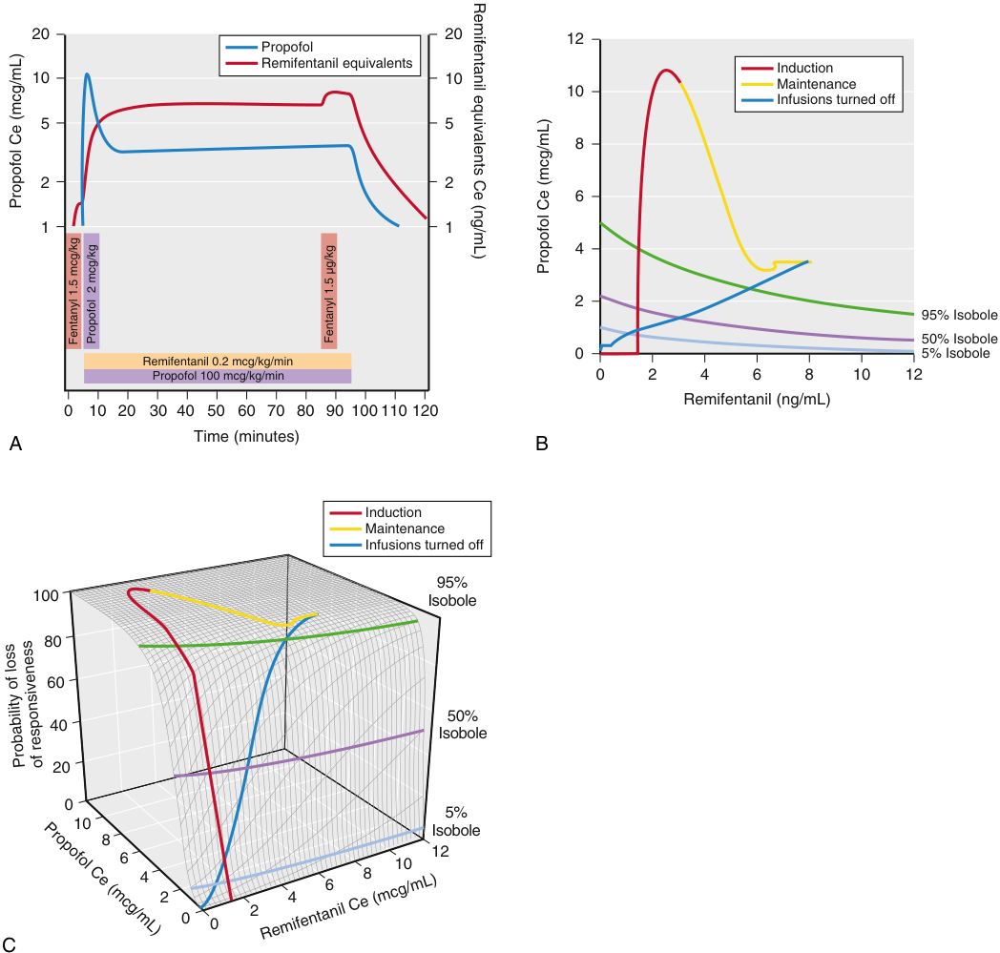

20 20 12 Propofol Remifentanil equivalents Induction 10 10 Maintenance 10 Infusions turned off 5 5 8 2 2 6 1 1 4 2 95% Isobole 50% Isobole 0 5% Isobole Remifentanil 0.2 mcg/kg/min Propofol 100 mcg/kg/min 0 2 4 6 8 10 12 Remifentanil (ng/mL) 0 10 20 30 40 50 60 70 80 90 100 110 120 A Time (minutes) B Induction Maintenance Infusions turned off 95% 100 Isobole 80 60 50% 40 Isobole 20 0 5% 10 Isobole 8 12 6 10 4 8 6 2 4 2 0 0 C Propofol Ce (mcg/mL) Remifentanil Ce (mcg/mL) Propofol Ce (mcg/mL) Remifentanil equivalents Ce (ng/mL) Propofol Ce (mcg/mL) Fentanyl 1.5 mcg/kg Propofol  2 mcg/kg Fentanyl 1.5 µg/kg Probability of lossof responsiveness 

**Fig. 16.30** (A–C) Simulation of a 90- minute total intravenous anesthetic consisting of propofol bolus (2 mcg/kg) and infusion (100 mcg/kg/min), remifentanil (0.2 mcg/kg/min), and intermittent fentanyl boluses (1.5 mcg/kg). (A) Resultant effect- site concentrations (Ce) are presented. (B) Predictions of loss of responsiveness are presented on a topographical _(top- down)_ view. (C) A three- dimensional response surface is shown. The _light blue, purple_ , _and green lines_ represent the 5%, 50%, and 95% isoboles. Each isobole presents the propofol–remifentanil pairs that yield the same effect. The inward bow of the isoboles indicates that the interaction is synergistic. The isoboles are near one another, indicating a steep transition from responsive to unresponsive.

in challenging patients, especially when more than one drug is used. The drug displays use population models that, although generalizable, may not provide a good “fit” to every patient. For some drug display systems, observed patient responses are used to calibrate predictions of drug effect (Fig. 16.31). For example, with elderly or debilitated patients, smaller doses are often required to achieve a desired effect. Drug displays allow clinicians to identify concentrations that produce a desired response and can be used to titrate additional anesthetic.

There are several other advantages from using drug displays. When titrating an anesthetic, it is often difficult to appreciate when effect- site concentrations are near steady state. Clinicians may be tempted to administer additional drug assuming that drug concentrations have peaked (with bolus dosing) or are near steady- state conditions (with continuous infusions of potent inhaled anesthetics). Clinicians may also be impatient, assuming that drug concentrations are near zero when in fact they are still increased, even after terminating delivery (e.g., the end- tidal potent inhaled

<!-- PDF page 18 -->

agent concentration is 0 mm Hg but there is persistent unresponsiveness). A second advantage is that drug displays provide a means of delivering passive TCI. Although widely used throughout the world, TCI is not used in the United States because of regulatory barriers.34 TCI uses population pharmacokinetic models to drive infusion pumps. After entering the target plasma or effect- site concentration, a computer identifies the optimal infusion rate to achieve that concentration. With passive TCI, population models are used to display predicted effect- site concentrations and associated effects over time, but the models do not deliver information to drive infusion pumps as with TCI. With this approach, clinicians can test out dosing regimens (bolus doses and infusion rates) before administering them to confirm they will achieve a desired effect. These features provide for a more consistent approach to drug delivery. A third advantage is that they provide a better approach to dosing anesthetics. Instead of considering an anesthetic in terms of MAC, where 50% of patients may respond to

surgical stimulus, drug displays provide a more refined characterization of anesthetic effect. Clinicians do not titrate an anesthetic to achieve a 50% probability of effect but rather aim for a 95% to 99% probability of effect. With response surfaces, anesthetic dosing regimens necessary to achieve this level of effect are easily visualized. Furthermore, the concept of MAC does not fully embody the three elements of an anesthetic: analgesia, sedation and hypnosis, and muscle relaxation. Drug displays provide a means of visualizing all three effects simultaneously over a full 0% to 100% probability range.

## Special Populations

When formulating an anesthetic, many aspects of patient demographics and medical history need to be considered to find the correct dose: age; body habitus; gender; chronic exposure to opioids, benzodiazepines, or alcohol; the presence of heart, lung, kidney, or liver disease; and the extent of blood loss or dehydration. Any of these

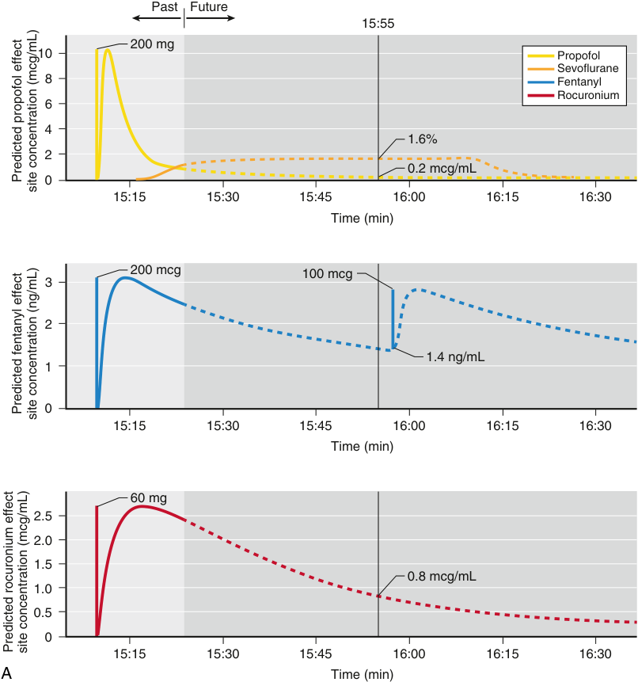

Past Future 15:55 200 mg 10 Propofol Sevoflurane 8 Fentanyl Rocuronium 6 4 1.6% 2 0.2 mcg/mL 0 15:15 15:30 15:45 16:00 16:15 16:30 Time (min) 200 mcg 100 mcg 3 2 1.4 ng/mL 1 0 15:15 15:30 15:45 16:00 16:15 16:30 Time (min) 60 mg 2.5 2.0 1.5 0.8 mcg/mL 1.0 0.5 0 15:15 15:30 15:45 16:00 16:15 16:30 A Time (min) Predicted propofol effect site concentration (mcg/mL) Predicted fentanyl effect site concentration (ng/mL) Predicted rocuronium effect site concentration (mcg/mL) 

**<mark>Fig. 16.31</mark>** <mark>(A) Example of a drug display. This example presents predictions of site-effect concentrations (A) and drug effects</mark>

<!-- PDF page 19 -->

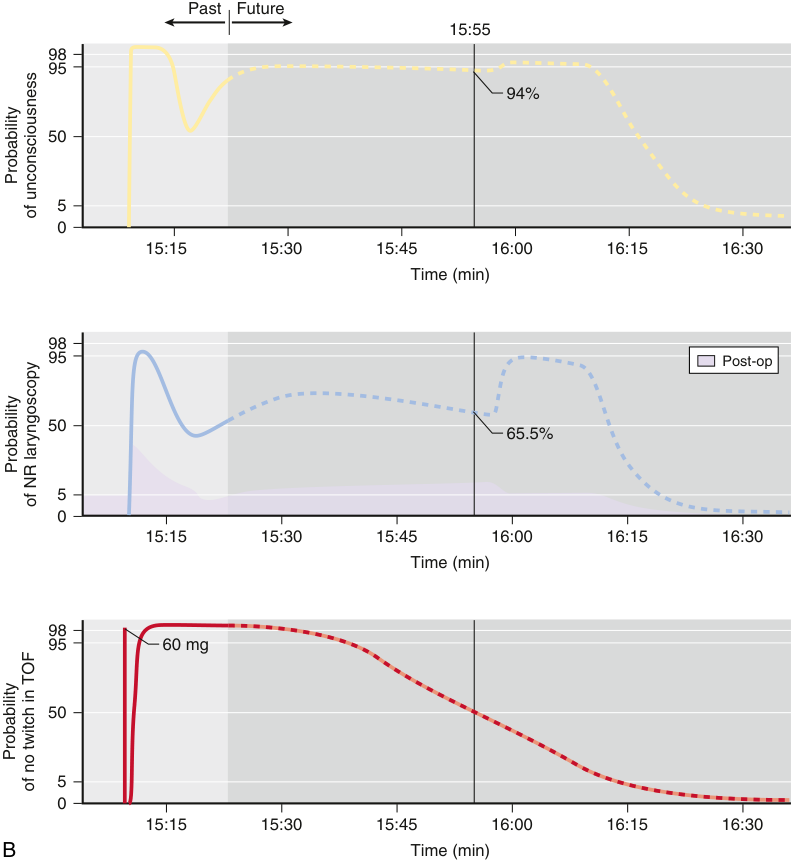

Past Future 15:55 98 95 94% 50 5 0 15:15 15:30 15:45 16:00 16:15 16:30 Time (min) 98 95 Post-op 50 65.5% 5 0 15:15 15:30 15:45 16:00 16:15 16:30 Time (min) 98 95 60 mg 50 5 0 15:15 15:30 15:45 16:00 16:15 16:30 B Time (min) Probability of unconsciousness Probability of NR laryngoscopy Probability of no twitch in TOF 

**Fig. 16.31, cont’d** (B) for a combined technique using fentanyl (2 mcg/kg), propofol (2 mg/kg), and rocuronium (0.6 mg/kg) boluses and maintenance with sevoflurane (2%) and fentanyl bolus (1 mcg/kg). This simulation assumes a 30- year- old, 100- kg male, 183 cm tall, with normal cardiac output and lung ventilation. (A) Predicted effect- site concentrations for propofol _(bright yellow line)_ , sevoflurane _(dark orange line)_ , fentanyl _(blue line)_ , and rocuronium _(red line)_ . Bolus doses are represented as _vertical lines_ , with the dose labeled adjacent to the line. Past predictions are _solid lines_ and future predictions are _dashed lines_ . The _vertical black line_ represents a future prediction of effect- site concentrations at 15:55 PM. Concentrations are reported. (B) Predicted drug effects. Probability of unresponsiveness _(yellow line)_ , probability of no response to laryngoscopy _(blue line)_ , and probability of loss of train- of- four _(red line)_ from this combined technique. The _white horizontal lines_ represent the 5%, 50%, 95%, and 98% probability of effect. The _vertical black line_ represents a future prediction of drug effects at 15:55 PM. _NR_ , no response to laryngoscopy; _TOF_ , train- of- four. (A, from Applied Medical Visualizations, Salt Lake City, Utah.)

factors can dramatically affect anesthetic drug kinetics and dynamics. Unfortunately, most studies characterizing anesthetic drug behavior have been conducted in healthy volunteers that rarely represent the general population presenting for surgery. Extensive work has explored how some patient characteristics (e.g., obesity) influence anesthetic drug behavior, whereas other patient characteristics remain difficult to assess (chronic opioid exposure). In addition, not all anesthetics have been studied. Most work has primarily focused on newer anesthetic drugs, such as propofol and remifentanil. This section briefly summarizes work that has been done to characterize the pharmacokinetics and pharmacodynamics in a few unique special populations.

### INFLUENCE OF OBESITY ON ANESTHETIC DRUGS

Obesity is a worldwide epidemic, and overweight patients frequently undergo anesthesia and surgery. Furthermore, pharmacologic alterations of anesthetics occur in obese individuals. In general, manufacturer dosing recommendations are on a per- kg basis according to the actual total body weight (TBW). Anesthesia providers rarely use mg/kg dosing in obese patients for fear of administering an excessive dose (e.g., a 136- kg patient does not require twice as much drug as a patient of the same height who weighs 68 kg). To resolve this problem, several weight scalars were developed to avoid excessive dosing or underdosing in this patient population. Some of these include lean body mass (LBM), ideal body weight (IBW),

<!-- PDF page 20 -->

corrected body weight (CBW), and fat- free mass (FFM).35 Table 16.1 presents the formulas used to estimate these weight scalars. Table 16.2 shows samples of the resultant scaled weight for lean and obese individuals. In general, the aim of weight scalars is to match dosing regimens for obese patients with what is required for normal- size patients. These scaled weights are usually smaller than TBW in obese patients and thus help prevent excessive drug dosing (Fig. 16.32). Scaled weights have been used in place of TBW for both bolus (mg/kg) and infusion (mg/ kg/h) dosing and for TCI.

This section will discusses the pharmacologic (primarily pharmacokinetic) alterations of select intravenous anesthetic drugs (propofol, remifentanil, fentanyl, and remimazolam) in obese patients, reviews examples of weight scalars and their shortcomings when used in bolus and continuous infusion dosing, and when data are available, briefly describes pharmacologic models used to drive TCI.

### Propofol

Dosing propofol in obese patients can be a challenge. For bolus dosing and continuous infusions, the choice of weight scalar is specific to the dosing technique being used (i.e., one is best for bolus dosing and another for continuous infusions). Furthermore, of the available propofol pharmacokinetic models, the one built from observations in obese patients may be best for TCI.

The influence of obesity on propofol pharmacokinetics is becoming clearer. Generally, in obese patients, the blood distributes more to non- adipose than to adipose tissues. This may result in higher plasma drug concentrations in obese patients with mg/kg dosing than in normal patients with less adipose mass. Furthermore, propofol clearance increases because of the increased liver volume and/or liver blood flow associated with obesity (and increased cardiac output). Distribution likely influences concentration peaks with bolus dosing, and clearance likely influences concentrations during and following infusions.

**Dosing Scalars for Propofol.** Simulations of an infusion using various weight scalars are presented in Fig. 16.33. The simulations predict propofol effect- site concentrations from a 60- minute infusion (167 mcg/kg/min) in 176cm (6- ft) males, obese (160 kg), and lean (68 kg). If dosed according to TBW, peak effect- site concentrations in a lean and obese individual are different; their respective peak propofol concentrations are approximately 3.9 and 5.3 mcg/ mL. If the obese individual is dosed to CBW, the peak concentration is near 3.5 mcg/mL. The other weight scalars lead to much lower concentrations with the infusion.

Of the many available dosing scalars, authors recommend LBM36 for bolus dosing (i.e., during induction) and TBW or CBW for infusions.11,37,38 For continuous infusions, other weight scalars are likely inadequate (the most worrisome is LBM). When dosing to CBW, plasma concentrations may be lower than concentrations when dosed to TBW. Propofol requirements calculated in a study in which anesthesia was maintained using the closed- loop system also suggest that the use of TBW is justified.39

One concern with using TBW to dose continuous infusions is drug accumulation. Prior work, however, does not support this assumption. Servin and colleagues38 performed

**Table 16.1** Common Weight Scalars

|**Name**|**Equations**|
|---|---|
|Ideal body weight|Male: 50 kg + 2.3 kg for each 2.54 cm (1 inch) over 152 cm (5 ft) Female: 45.5 kg + 2.3 kg for each 2.54 cm (1 inch) over 152 cm (5 ft)|
|Corrected body weight38|IBW + 0.4 × (TBW−IBW)|
|Lean body mass|Male: 1.1 × TBW−128 × (TBW/Ht)2 Female: 1.07 × TBW−148 × (TBW/Ht)2|
|Fat- free mass35|Male: (9.27 × 103× TBW)/(6.68 × 103+ 216 × BMI) Female: (9.27 × 103× TBW)/(8.78 × 103+ 244 × BMI)|
|Pharmacokinetic mass56,57|52/[1 + (196.4•e−0.025 TBW−53.66)/100] (fentanyl only)|
|Modified fat- free mass37|FFM + 0.4 × (TBW−FFM)|

_BMI_ , body mass index; _FFM_ , fat-free mass; _Ht_ , height in centimeters; _IBW_ , ideal body weight; _LBM_ , lean body mass; _TBW_ , total body weight in kg.

**Table 16.2** Dosing Weights Based on Various Dosing Scalars

||**176 cm**|**(6 ft) Male**|
|---|---|---|
||**68 kg** **BMI = 22**|**185 kg** **BMI = 66**|
|**Dosing Scalar**|**Dosing** **Weight (kg)**|**Dosing** **Weight (kg)**|
|Total body weight (TBW)|68|185|
|Ideal body weight (IBW)|72|72|
|Corrected body weight (CBW)|70|117|
|Lean body mass (LBM)|56|62|
|Fat- free mass (FFM)|55|88|
|Modified fat- free mass (MFFM)|60|127|

_BMI_ , body mass index (kg/m2 ).

pharmacokinetic analyses of propofol administration to normal and obese patients using TBW and CBW. The CBW was defined as the IBW + 0.4 × (TBW−IBW).40 They found similar concentrations at eye opening in both groups and absence of propofol accumulation in obese patients; in fact, obese patients showed earlier awareness after the termination of propofol infusions than did the normal subjects. Data suggest that dosing infusions according to Servin’s CBW may underdose obese patients.41

### Propofol Kinetic Models Target- Controlled Infusions.

Of the many available models, the two most widely used propofol kinetic models for TCI are those published by Marsh and associates and Schnider and associates.11,42 In addition to model selection, as with bolus and continuous infusion dosing, identifying the ideal weight scalar to use is also important.

::: details 原始表格與符號（PDF 第 20 頁）

:::

<!-- PDF page 21 -->

140 LBM IBW CBW 120 TBW FFM MFFM 100 80 60 40 40 60 80 100 120 140 160 180 200 Total body weight (kg) Fig. 16.32 Scaled weights as a function of total body weight (TBW).  Key points in this plot: IBW remains the same regardless of the TBW, and LBM starts to decline for weight increases above 127 kg.  CBW , corrected body weight;  FFM , fat- free mass;  IBW , ideal body weight; LBM , lean body mass;  MFFM , Modified fat- free mass (for a 40- year- old male, 176 cm tall). 6 TBW (obese) FFM (obese) CBW (obese) 5 LBM (obes e) IBW (obese) TBW (lean) 4 3 2 1 0 0 15 30 45 60 75 90 Time (min) Scale body weight (kg) g/mL)Propofol effect-site concentration (µ 

**Fig. 16.33** Simulations of propofol effect- site concentrations that result from a 60- minute infusion (10 mg/kg/h–167 mcg/kg/min) to a 40- year- old male who is 176 cm tall. Simulations include the following dosing weights: total body weights (TBW) of 68 kg and 160 kg (body mass indices of 22 and 52, respectively) and scaled weights for the 160 kg weight to include corrected body weight (CBW), lean body mass (LBM), ideal body weight (IBW), and fat- free mass (FFM). Key points: at the 160- kg weight, when dosed to TBW, the infusion leads to high propofol concentrations, whereas when dosed to IBW or LBM, the infusion leads to low propofol concentrations. When the 160- kg individual is dosed using CBW, it best approximates the propofol concentrations that result from TBW in a lean individual. Predictions of propofol effectsite concentrations were made using the Eleveld model.46

The Marsh model, although useful, was built from data collected in a pediatric population. Researchers have explored different dosing weights using this model in morbidly obese patients when co- administered with remifentanil with varied results. Albertin and colleagues40 used CBW to dose a propofol TCI using the Marsh model. They found predicted substantially overestimated measured propofol concentrations and expressed concern for intraoperative awareness when using CBW with the Marsh TCI model. The same group43 compared the predictive performance of

the TCI using CBW versus TBW and found that CBW performed worse than TBW. They concluded that TBW, not CBW, should be used to administer propofol via TCI to morbidly obese patients. In contrast, recently, Cortinez and colleagues44 evaluated the several pharmacokinetic models, and the use of CBW with the Marsh and Schnider models (described later) and showed acceptable prediction performances. They stated that, with both models, using CBW is one of the best options for propofol TCI in obese patients, in their opinion. In any case, electroencephalographic monitoring is recommended to avoid the risk of awareness.

The Schnider model, although built from data collected in adults over a range of weights, heights, and ages, does not specifically include obese patients. This model uses the weight scalar LBM, which has limited application in morbidly obese patients.11

For comparison, the Marsh or the Schnider model has been applied on morbidly obese patients. Echevarria and colleagues45 reported differences in effect- site propofol concentrations with a BIS of less than 60 between the two pharmacokinetic models when used for induction in morbidly obese patients. To achieve a 95% probability of effect, target concentrations of 4.2 and 5.5 mcg/mL were required for the Marsh and Schnider models, respectively. This difference occurred because of the potential prediction errors in each pharmacokinetic model that was used (the actual drug concentrations in each patient are unknown).

Eleveld and colleagues46 constructed a general-purpose allometric pharmacokinetic model for propofol using a large dataset containing data from young children, children, adults, elderly, and obese individuals. Vellinga and colleagues47 evaluated the predictive performance of the Eleveld model when used for TCI in a clinical practice and showed clinically acceptable prediction performance even in obese subjects.

Fig. 16.34 presents a simulation of propofol infusion rates and associated plasma concentrations using the Marsh, Schnider, and Eleveld models to drive a TCI to achieve a concentration of 3 mcg/mL. Key points from this simulation include TCI infusions based on the Marsh model are linear to TBW such that the infusion rates and plasma concentrations are identical across weights. With an increase in body weights, the degree of increase in total propofol amounts for TCI administrations is smaller with the Eleveld model than with the Marsh and Schnider models.

For propofol, the Eleveld model may be best suited for TCI in obese and morbidly obese patients. Unfortunately, this model is not yet available in many commercial TCI pumps. One caveat that is important to consider is that model differences are likely overshadowed by inter- individual variability. In sum, any one of the three models will likely yield similar clinical results if titrated to effect in conjunction with processed EEG monitoring.

### Other Sedatives

Some information is available on the behavior of other sedatives (i.e., midazolam, remimazolam, and dexmedetomidine) in obese patients. In a study by Greenblatt and associates, the volume of distribution even when normalized to weight (e.g., L/kg) was larger in obese subjects, suggesting that lean tissue may take up less midazolam than adipose tissue.48 Thus, midazolam’s distribution volume follows the TBW: as patient size increases, so does the distribution volume. In addition,

<!-- PDF page 22 -->

Marsh model Schnider model Eleveld model 200 200 200 68 kg 114 kg 160 kg 180 180 180 160 160 160 140 140 140 120 120 120 100 100 100 80 80 80 60 60 60 0 30 60 90 0 30 60 90 0 30 60 90 A Time (min) Time (min) Time (min) Marsh model Schnider model Eleveld model 3.5 3.5 3.5 68 kg 114 kg 160 kg 3.0 3.0 3.0 2.5 2.5 2.5 2.0 2.0 2.0 1.5 1.5 1.5 1.0 1.0 1.0 0.5 0.5 0.5 0.0 0.0 0.0 0 50 100 150 0 50 100 150 0 50 100 150 B Time (min) Time (min) Time (min) Infusion rate (mcg/kg/min) Propofol plasma concentration (mcg/mL) 

**Fig. 16.34** Simulations of a 90- minute propofol target- controlled infusion set to achieve and maintain a plasma concentration (Cp) of 3 mcg/mL using three different published propofol pharmacokinetic models: Marsh and associates,42 Schnider and associates,11 and Eleveld and associates.46 Simulations assumed 40- year- old males who are 176 cm tall and weigh 68, 114, or 160 kg. (A) Propofol infusion rates for each model at each weight. (B) Propofol plasma concentrations predicted by each model for each weight.

midazolam clearance was similar in all study subjects (lean or obese). This suggests that regardless of dose, hepatic metabolism of midazolam is fixed, and elimination will require more time in obese patients. Brill and colleagues49 performed a compartmental pharmacokinetic analysis of midazolam in obese patients which showed increased volumes of distribution and unchanged systemic clearance.

Although not clinically validated in obese patients, the authors recommend that bolus doses should be scaled to TBW and other dosing scalars may lead to inadequate

effect. On the other hand, with a fixed elimination, continuous infusion rates should be dosed to IBW.48

Remimazolam is a novel short- acting benzodiazepine. Masui and colleagues50 constructed a pharmacokinetic model of remimazolam using a data set that covered a wide range of patient characteristics, including obese subjects with BMI of up to 61 kg/m2 . Simulations using their model showed TBW- based dosing for an obese patient, an initial dose (2 min of 12 mg/kg/h remimazolam) followed by one hour of continuous infusion (1 mg/kg/h) resulted in a

<!-- PDF page 23 -->

remimazolam arterial concentration approximately 150% of that of a lean patient.

Xu and colleagues51 performed noncompartmental pharmacokinetic analysis of dexmedetomidine with dosing calculated on TBW. In obese patients, higher initial concentrations and lower clearance per kg, and deeper sedation with lower SpO2 values were observed. Morse and colleagues52 constructed a general- purpose pharmacokinetic model for dexmedetomidine that is applicable to a wide range of age groups and body weights including obese adults weighing up to 152 kg. Lean body weight is a better size descriptor for dexmedetomidine clearance than TBW. These results suggest that dosing of dexmedetomidine, which is calculated using TBW, can be overdosing in these populations.

### Opioids

Except for remifentanil, minimal work has explored the implication of obesity on the kinetic and dynamic behavior of opioids.

**Remifentanil.** In moderately obese patients, largely due to its rapid metabolism by nonspecific esterases, the distribution volume and clearance of remifentanil are similar in lean and obese patients.53 As with propofol, researchers have explored several scaled weights in an effort to optimize bolus dosing, continuous infusions, and TCIs.

**dosing scalars.** As previously noted with propofol, simulation is used to present the predicted remifentanil effect- site concentrations and analgesic effect for a variety of scaled weights in individuals 174 cm in height, some obese (185 kg, BMI of 60) and lean (68 kg, BMI of 22) (Fig. 16.35). Several key points are illustrated in these simulations:

1.  For an obese patient, dosing scaled to FFM resulted in almost identical remifentanil effect- site concentrations as in the lean patient dosed according to TBW. Unlike propofol, dosing remifentanil to CBW _(red line)_ leads to higher plasma concentrations compared with levels achieved when dosing to TBW in a lean individual.

2.  Dosing scaled to LBM in the severely obese individual resulted in lower effect- site concentrations and lower probability of analgesia than those in a lean individual dosed according to TBW.

**remifentanil kinetic models for target- controlled infusions.** For remifentanil TCI, there is one available pharmacokinetic model published by Minto and associates.10 Although built from data collected in adults over a range of weights, heights, and ages, obese patients and morbidly obese patients were not included. Many of the model parameters are scaled to LBM. As previously discussed, this may limit the application of this model in the morbidly obese. Kim and colleagues54 developed a new population pharmacokinetic model for remifentanil that characterized the influence of body weight using allometric body mass scaling in the general adult population.

Fig. 16.36 presents a simulation of the predicted remifentanil plasma concentrations based on the Minto and Kim models. The Minto model overestimates remifentanil concentrations with increasing weight. This is likely due to the use of LBM when estimating pharmacokinetic parameters.

In summary, available models (Minto or Kim) are appropriate for TCI in this patient group but will administer different amounts of remifentanil and require titration to achieve desired yet avoid adverse clinical effects.

**Fentanyl.** Despite widespread use in the clinical arena, relatively little work has explored how obesity impacts fentanyl pharmacokinetics in adults. Published fentanyl pharmacokinetic models55 tend to overestimate fentanyl concentrations as TBW increases. A fentanyl kinetic model based on data collected in obese subjects has not (yet) been published. Shibutani and colleagues56,57 explored ways to improve predictions using published models by modifying demographic data (e.g., either height or weight). They characterized a nonlinear relationship between fentanyl clearance and TBW and recommended the use of a modified weight, called the pharmacokinetic mass, to improve the predictive performance of one of the many available fentanyl kinetic models,

10 1 TBW (lean) TBW (obese) 8 CBW (obese) 0.8 LBM (obese) IBW (obese) 6 FFM (obese) 0.6 TBW (lean) 4 0.4 TBW (obese) CBW (obese) LBM (obese) 2 0.2 IBW (obese) FFM (obese) 0 0 0 20 40 60 80 100 0 20 40 60 80 100 A Time (min) B Time (min) Remifentanil effect-site concentration (ng/mL) Probability of analgesia 

**Fig. 16.35** Simulations of remifentanil effect- site concentrations (A) and analgesic effect (B) that result from a 1 mcg/kg bolus and a 60- minute infusion at a rate of 0.15 mcg/kg/min to a 40- year- old male who is 176 cm tall. Simulations include the following dosing weights: total body weights (TBW) of 68 kg and 185 kg (body mass indices of 22 and 60, respectively) and scaled weights for the 185- kg weight to include Servin’s corrected body weight (CBW), lean body mass (LBM), ideal body weight (IBW), and fat- free mass (FFM). Remifentanil effect- site concentrations and analgesic effect were estimated using published pharmacokinetic models.10,54

<!-- PDF page 24 -->

45 40 204 kg 136 kg 35 68 kg 30 25 20 15 10 5 0 0 20 40 60 80 100 120 140 160 Time (min) Remifentanil plasma concentration (ng/mL) 

**Fig. 16.36** Simulations of remifentanil plasma concentrations that result from a 60- minute infusion (0.5 mcg/kg/min) in a 40- year- old male, 176 cm tall. The simulations include three total body weights: 68, 136, and 204 kg with body mass indices of 22, 44, and 66, respectively. Simulations were performed using pharmacokinetic parameters published by Minto and associates10 _(dashed lines)_ and Kim and colleagues54 _(solid lines)_ . In an extremely obese (204 kg) individual, Minto’s model predicts very high remifentanil concentrations.

a model published by Shafer and colleagues. They explored the use of pharmacokinetic mass when dosing obese patients with fentanyl in a postoperative setting. They found that dosing based on TBW may be excessive.

**Other Opioids.** Even less information regarding the impact of obesity on drug behavior is available for opioids other than remifentanil and fentanyl. Sufentanil has been studied in obese patients, where its volume of distribution increases linearly with TBW58 and clearance was similar between lean and obese individuals. It was recommended that bolus dosing use TBW and “prudently reduced” dosing for continuous infusions. For TCI, Slepchenko and colleagues found model estimates of sufentanil concentrations accurately predicted measured concentrations in morbidly obese patients59 using a previously published mode of sufentanil kinetics by Gepts and associates.60 This is likely due to the fact that the kinetic model was built from measured concentrations in patients with a weight range of 47 to 94 kg. de Hoogd and colleagues61 performed a population pharmacokinetic analysis of intravenous morphine in morbidly obese individuals. They found that morphine pharmacokinetics were comparable to those of healthy volunteers. They concluded that no weight- based dosing adjustments were necessary. However, they also found that the elimination of pharmacologically active metabolite was decreased, resulting in an increased exposure to active metabolite with prolonged administrations. They concluded that the clinical relevance of this phenomenon was not clear.

tissue with volatile anesthetics is long. The time required to achieve 63% of the final equilibrium within adipose tissue for desflurane and isoflurane are longer than 22 and 35 hours, respectively.64,65

### INFLUENCE OF AGE ON ANESTHETIC DRUG PHARMACOLOGY

Clinicians are often faced with anesthetizing elderly adults and have long recognized that they usually require a smaller dosage of most anesthetics to produce the desired therapeutic effect while minimizing adverse effects. Age is one of the most valuable in covariates to consider when developing an anesthetic plan. The influence of age on pharmacokinetics and pharmacodynamics of many anesthetics has been well described. As with obesity, both remifentanil and propofol can serve as prototypes to understand how age influences anesthetic drug behavior. Studies specifically designed to assess the influence of age on remifentanil and propofol have characterized the influence of age in quantitative terms.10,11,46,54,66

With remifentanil, elderly patients require less drug to produce an opioid effect. Reduced doses are primarily a function of changes in pharmacodynamics but may involve pharmacokinetic changes as well.10 The concentration required to produce electroencephalographic changes is decreased. Based on previously published pharmacokinetic and pharmacodynamic models built from measurements over a wide age range,10,11,67,68 simulations can be performed to explore how age may influence dosing. For example, to achieve equipotent doses in 20 and 80 year olds the dose for the 80 year olds should be reduced by 55%. A similar analysis for propofol recommends that the dose for 80 year olds should be reduced by 65% compared to that for 20 year olds.

The mechanisms for these changes are not clear, especially for pharmacodynamic changes. One possible source of change in pharmacokinetic behavior may be due to decreased cardiac output. Lower cardiac output in the elderly69 results in slower circulation and subsequent changes in drug distribution and redistribution. This may lead to high peak concentrations69,70 and decreased drug delivery to metabolic organs and reduced clearance. This is consistent with what has been reported for many intravenous anesthetics (propofol, thiopental, and etomidate), which have slower clearance and a smaller volume of distribution.11,71–73 Beyond age- related changes in cardiac output, it is important to consider comorbidities that may reduce cardiovascular function.74 Taking this into account, anesthesiologists often consider a patient’s “physiologic” age instead of solely relying on actual age.75,76 For some older adult patients, such as those with no significant coexisting disease, normal body habitus, and good exercise tolerance, a substantial reduction in dose may not be warranted.

### Inhaled Anesthetics

The perception of volatile anesthetics is that they accumulate more in obese than in lean patients and that this leads to prolonged emergence. Studies on inhalation anesthetics in obese individuals, however, have not confirmed this perception.62 Two phenomena contribute to this observation: first, blood flow to adipose tissue _decreases_ with increasing obesity,63 and second, the time required to fill adipose

## Summary

This chapter reviewed basic principles of clinical pharmacology used to describe anesthetic drug behavior: pharmacokinetics, pharmacodynamics, and anesthetic drug interactions. These principles provide the information needed to make rational decisions about the selection and administration of

<!-- PDF page 25 -->

anesthetics. From a practical aspect, these principles characterize the magnitude and time course of drug effect, but because of complex math requirements, they have limited clinical utility in everyday practice. Advances in computer simulation, however, have brought this capability to the point of real- time patient care. Perhaps one of the most important advances in our understanding of clinical pharmacology is the development of interaction models that describe how different classes of anesthetic drugs influence one another. This is especially relevant to anesthesiologists, given that they rarely use just one drug when providing anesthesia.

29.  Fidler M, et al. _Anesthesiology_ . 2006;105(2):286.

30.  Vinik HR, et al. _Anesth Analg_ . 1994;78(2):354.

31.  Harris RS, et al. _Anesthesiology_ . 2006;104(6):1170.

32.  Schumacher PM, et al. _Anesthesiology_ . 2009;111(4):790.

33.  Sebel LE, et al. _Anesthesiology_ . 2006;104(6):1176.

34.  Egan TD, et al. _Anesthesiology_ . 2003;99(5):1039.

35.  Janmahasatian S, et al. _Clin Pharmacokinet_ . 2005;44(10):1051.

36.  Ingrande J, et al. _Anesth Analg_ . 2011;113(1):57.

37.  Cortinez LI, et al. _Br J Anaesth_ . 2010;105(4):448.

38.  Servin F, et al. _Anesthesiology_ . 1993;78(4):657.

39.  Liu N, et al. _Br J Anaesth_ . 2015;114(4):605.

40.  Albertin A, et al. _Br J Anaesth_ . 2007;98(1):66.

41.  Igarashi T, et al. _Masui_ . 2002;51(11):1243.

42.  Marsh B, et al. _Br J Anaesth_ . 1991;67(1):41.

43.  La Colla L, et al. _Eur J Anaesthesiol_ . 2009;26(5):362.

### Complete references available online at expertconsult.com.

44.  Cortinez LI, et al. _Anesth Analg_ . 2014;119(2):302.

45.  Echevarria GC, et al. _Anesth Analg_ . 2012;115(4):823.

46.  Eleveld DJ, et al. _Br J Anaesth_ . 2018;120(5):942.

47.  Vellinga R, et al. _Br J Anaesth_ . 2021;127(1):e3.

### References

1.  Colburn WA. _J Pharmacokinet Biopharm_ . 1983;11(4):389.

2.  Takada K, et al. _Chem Pharm Bull (Tokyo)_ . 1981;29(5):1462.

3.  Wilkinson GR. _Clin Pharmacol Ther_ . 1975;18:377.

4.  Ebling WF, et al. _J Pharmacokinet Biopharm_ . 1994;22:259.

5.  Youngs EJSS. _Basic Pharmacokinetic and Pharmacodynamic Principles_ . Williams & Wilkins; 1997.

6.  Krejcie TC, et al. _J Pharmacokinet Biopharm_ . 1997;25:169. 7.  Hudson RJ, et al. _Anesthesiology_ . 1989:70 426. 8.  Hughes MA, et al. _Anesthesiology_ . 1992;76(3):334. 9.  Lee S, et al. _J Clin Pharm Ther_ . 2012;37:698. 10.  Minto CF, et al. _Anesthesiology_ . 1997;86(1):10. 11.  Schnider TW, et al. _Anesthesiology_ . 1998;88(5):1170. 12.  Scott JC, et al. _J Pharmacol Exp Ther_ . 1987;240(1):159. 13.  Egan TD, et al. _Int J Pharm Med_ . 2001;15(1):11. 14.  McEwan AI, et al. _Anesthesiology_ . 1993;78:864. 15.  Hendrickx J, et al. _Anesth Analg_ . 2008;107:494. 16.  Bouillon TW, et al. _Anesthesiology_ . 2004;100(6):1353. 17.  Heyse B, et al. _Anesthesiology_ . 2012;116(2):311. 18.  Kern SE, et al. _Anesthesiology_ . 2004;100(6):1373. 19.  Manyam SC, et al. _Anesthesiology_ . 2006;105(2):267. 20.  Mertens MJ, et al. _Br J Anaesth_ . 2003;90(2):132. 21.  LaPierre CD, et al. _Anesth Analg_ . 2011;113(3):490. 22.  Johnson KB, et al. _Anesth Analg_ . 2010;111(2):387. 23.  Syroid ND, et al. _Anesth Analg_ . 2010;111(2):380. 24.  Minto CF, et al. _Anesthesiology_ . 2000;92(6):1603. 25.  Vereecke HE, et al. _Anesthesiology_ . 2013;118(4):894.

26.  Vuyk J, et al. _Anesthesiology_ . 1995;83:8.

27.  Johnson KB, et al. _Anesth Analg_ . 2008;106(2):471, table of contents. 28.  Zanderigo E, et al. _Anesthesiology_ . 2006;104(4):742.

48.  Greenblatt DJ, et al. _Anesthesiology_ . 1984;61(1):27.

49.  Brill MJ, et al. _Clin Pharmacokinet_ . 2014;53(10):931.

50.  Masui K, et al. _J Anesth_ . 2022;36(4):493.

51.  Xu B, et al. _J Anesth_ . 2017;31(6):813.

52.  Morse JD, et al. _J Clin Med_ . 2020;9(11).

53.  Egan TD, et al. _Anesthesiology_ . 1998;89(3):562.

54.  Kim TK, et al. _Anesthesiology_ . 2017;126(6):1019.

55.  Shafer SL, et al. _Anesthesiology_ . 1990;73(6):1091.

56.  Shibutani K, et al. _Anesthesiology_ . 2004;101(3):603.

57.  Shibutani K, et al. _Br J Anaesth_ . 2005;95(3):377.

58.  Schwartz AE, et al. _Anesth Analg_ . 1991;73(6):790.

59.  Slepchenko G, et al. _Anesthesiology_ . 2003;98(1):65.

60.  Gepts E, et al. _Anesthesiology_ . 1995;83(6):1194.

61.  de Hoogd S, et al. _Clin Pharmacokinet_ . 2017;56(12):1577.

62.  Cortinez LI, et al. _Anesth Analg_ . 2011;113(1):70.

63.  Lesser GT, et al. _J Appl Physiol_ . 1967;23(5):621.

64.  Eger 2nd EI, et al. _Anesthesiology_ . 1971;35(4):365.

65.  Wahrenbrock EA, et al. _Anesthesiology_ . 1974;40(1):19.

66.  Eleveld DJ, et al. _Anesth Analg_ . 2014;118(6):1221.

67.  Minto CF, et al. _Anesthesiology_ . 1997;86(1):24.

68.  Schnider TW, et al. _Anesthesiology_ . 1999;90(6):1502.

69.  Upton RN, et al. _Anesth Analg_ . 1999;89(3):545.

70.  Krejcie TC, et al. _Anesth Analg_ . 1999;89(3):541.

71.  Arden JR, et al. _Anesthesiology_ . 1986;65(1):19.

72.  Homer TD, et al. _Anesthesiology_ . 1985;62(6):714.

73.  Stanski DR, et al. _Anesthesiology_ . 1990;72(3):412.

74.  Rodeheffer RJ, et al. _Circulation_ . 1984;69(2):203.

75.  Avram MJ, et al. _Anesthesiology_ . 1990;72(3):403.

76.  Williams TF. _Clin Pharmacol Ther_ . 1987;42(6):663.

77.  Doufas AG, et al. _Anesthesiology_ . 2004;101:1112.

<!-- PDF page 26 -->

### References

1.  Colburn WA. A time- dependent volume of distribution term used to describe linear concentration- time profiles. _J Pharmacokinet Biopharm_ . 1983;11(4):389–400.

2.  Takada K, Asada S. A model independent approach to describe the blood disappearance profile of intravenously administered drugs. _Chem Pharm Bull (Tokyo)_ . 1981;29(5):1462–1466.

3.  Wilkinson GR SD. Commentary: a physiological approach to hepatic drug clearance. _Clin Pharmacol Ther_ . 1975;18:377–390.

4.  Ebling WF WD, Stanski DR. From piecewise to full physiologic pharmacokinetic modeling: applied to thiopental disposition in the rat. _J Pharmacokinet Biopharm_ . 1994;22:259–292.

5.  Youngs EJ SS. _Basic Pharmacokinetic and Pharmacodynamic Principles_ . Baltimore: Williams & Wilkins; 1997.

6.  Krejcie TC AM, Gentry WB. A recirculatory model of the pulmonary uptake and pharmacokinetics of lidocaine based on analysis or arterial and mixed venous data from dogs. _J Pharmacokinet Biopharm_ . 1997;25:169–190.

7.  Hudson RJ, Bergstrom RG, Thomson IR, et al. Pharmacokinetics of sufentanil in patients undergoing abdominal aortic surgery. _Anesthesiology_ . 1989;70:426–431.

8.  Hughes MA, Glass PS, Jacobs JR. Context- sensitive half- time in multicompartment pharmacokinetic models for intravenous anesthetic drugs. _Anesthesiology_ . 1992;76(3):334–341.

9.  Lee S, Kim BH, Lim K, et al. Pharmacokinetics and pharmacodynamics of intravenous dexmedetomidine in healthy Korean subjects. _J Clin Pharm Ther_ . 2012;37:698–703.

10.  Minto CF, Schnider TW, Egan TD, et al. Influence of age and gender on the pharmacokinetics and pharmacodynamics of remifentanil. I. Model development. _Anesthesiology_ . 1997;86(1):10–23.

11.  Schnider TW, Minto CF, Gambus PL, et al. The influence of method of administration and covariates on the pharmacokinetics of propofol in adult volunteers. _Anesthesiology_ . 1998;88(5):1170–1182.

12.  Scott JC, Stanski DR. Decreased fentanyl and alfentanil dose requirements with age. A simultaneous pharmacokinetic and pharmacodynamic evaluation. _J Pharmacol Exp Ther_ . 1987;240(1):159–166.

13.  Egan TD, Muir KT, Hermann DJ, et al. The electroencephalogram (EEG) and clinical measures of opioid potency: defining the EEGclinical potency relationship (‘fingerprint’) with application to remifentanil. _Int J Pharm Med_ . 2001;15(1):11–19.

14.  McEwan AISC, Dyar O. Isoflurane minimum alveolar concentration reduction by fentanyl. _Anesthesiology_ . 1993;78:864–869.

15.  Hendrickx J, Eger E, Sonner J, Shafer S. Is synergy the rule? A review of anesthetic interactions producing hypnosis and immobility. _Anesth Analg_ . 2008;107:494–506.

16.  Bouillon TW, Bruhn J, Radulescu L, et al. Pharmacodynamic interaction between propofol and remifentanil regarding hypnosis, tolerance of laryngoscopy, bispectral index, and electroencephalographic approximate entropy. _Anesthesiology_ . 2004;100(6):1353–1372.

17.  Heyse B, Proost JH, Schumacher PM, et al. Sevoflurane remifentanil interaction: comparison of different response surface models. _Anesthesiology_ . 2012;116(2):311–323.

18.  Kern SE, Xie G, White JL, Egan TD. A response surface analysis of propofol- remifentanil pharmacodynamic interaction in volunteers. _Anesthesiology_ . 2004;100(6):1373–1381.

19.  Manyam SC, Gupta DK, Johnson KB, et al. Opioid- volatile anesthetic synergy: a response surface model with remifentanil and sevoflurane as prototypes. _Anesthesiology_ . 2006;105(2):267–278.

20.  Mertens MJ, Engbers FH, Burm AG, Vuyk J. Predictive performance of computer- controlled infusion of remifentanil during propofol/remifentanil anaesthesia. _Br J Anaesth_ . 2003;90(2):132–141.

21.  LaPierre CD, Johnson KB, Randall BR, et al. An exploration of remifentanil- propofol combinations that lead to a loss of response to esophageal instrumentation, a loss of responsiveness, and/or onset of intolerable ventilatory depression. _Anesth Analg_ . 2011;113(3):490– 499.

22.  Johnson KB, Syroid ND, Gupta DK, et al. An evaluation of remifentanilsevoflurane response surface models in patients emerging from anesthesia: model improvement using effect- site sevoflurane concentrations. _Anesth Analg_ . 2010;111(2):387–394.

23.  Syroid ND, Johnson KB, Pace NL, et al. Response surface model predictions of emergence and response to pain in the recovery room: an evaluation of patients emerging from an isoflurane and fentanyl anesthetic. _Anesth Analg_ . 2010;111(2):380–386.

24.  Minto CF, Schnider TW, Short TG, et al. Response surface model for anesthetic drug interactions. _Anesthesiology_ . 2000;92(6):1603– 1616.

25.  Vereecke HE, Proost JH, Heyse B, et al. Interaction between nitrous oxide, sevoflurane, and opioids: a response surface approach. _Anesthesiology_ . 2013;118(4):894–902.

26.  Vuyk JLT, Engbers FH. The pharmacodynamic interaction of propofol and alfentanil during lower abdominal surgery in women. _Anesthesiology_ . 1995;83:8–22.

27.  Johnson KB, Syroid ND, Gupta DK, et al. An evaluation of remifentanil propofol response surfaces for loss of responsiveness, loss of response to surrogates of painful stimuli and laryngoscopy in patients undergoing elective surgery. _Anesth Analg_ . 2008;106(2):471–479.

28.  Zanderigo E, Sartori V, Sveticic G, et al. The well- being model: a new drug interaction model for positive and negative effects. _Anesthesiology_ . 2006;104(4):742–753.

29.  Fidler M, Kern SE. Flexible interaction model for complex interactions of multiple anesthetics. _Anesthesiology_ . 2006;105(2):286–296.

30.  Vinik HR, Bradley Jr EL, Kissin I. Triple anesthetic combination: propofol- midazolam- alfentanil. _Anesth Analg_ . 1994;78(2):354–358.

31.  Harris RS, Lazar O, Johansen JW, Sebel PS. Interaction of propofol and sevoflurane on loss of consciousness and movement to skin incision during general anesthesia. _Anesthesiology_ . 2006;104(6):1170–1175.

32.  Schumacher PM, Dossche J, Mortier EP, et al. Response surface modeling of the interaction between propofol and sevoflurane. _Anesthesiology_ . 2009;111(4):790–804.

33.  Sebel LE, Richardson JE, Singh SP, et al. Additive effects of sevoflurane and propofol on gamma- aminobutyric acid receptor function. _Anesthesiology_ . 2006;104(6):1176–1183.

34.  Egan TD, Shafer SL. Target- controlled infusions for intravenous anesthetics: surfing USA not! _Anesthesiology_ . 2003;99(5):1039–1041.

35.  Janmahasatian S, Duffull SB, Ash S, et al. Quantification of lean bodyweight. _Clin Pharmacokinet_ . 2005;44(10):1051–1065.

36.  Ingrande J, Brodsky JB, Lemmens HJ. Lean body weight scalar for the anesthetic induction dose of propofol in morbidly obese subjects. _Anesth Analg_ . 2011;113(1):57–62.

37.  Cortinez LI, Anderson BJ, Penna A, et al. Influence of obesity on propofol pharmacokinetics: derivation of a pharmacokinetic model. _Br J Anaesth_ . 2010;105(4):448–456.

38.  Servin F, Farinotti R, Haberer JP, Desmonts JM. Propofol infusion for maintenance of anesthesia in morbidly obese patients receiving nitrous oxide. A clinical and pharmacokinetic study. _Anesthesiology_ . 1993;78(4):657–665.

39.  Liu N, Lory C, Assenzo V, et al. Feasibility of closed- loop coadministration of propofol and remifentanil guided by the bispectral index in obese patients: a prospective cohort comparison. _Br J Anaesth_ . 2015;114(4):605–614.

40.  Albertin A, Poli D, La Colla L, et al. Predictive performance of ‘Servin’s formula’ during BIS- guided propofol- remifentanil target- controlled infusion in morbidly obese patients. _Br J Anaesth_ . 2007;98(1):66–75.

41.  Igarashi T, Nagata O, Iwakiri H, et al. [Two cases of intraoperative awareness during intravenous anesthesia with propofol in morbidly obese patients]. _Masui_ . 2002;51(11):1243–1247.

42.  Marsh B, White M, Morton N, Kenny GN. Pharmacokinetic model driven infusion of propofol in children. _Br J Anaesth_ . 1991;67(1):41– 48.

43.  La Colla L, Albertin A, La Colla G, et al. No adjustment vs. adjustment formula as input weight for propofol target- controlled infusion in morbidly obese patients. _Eur J Anaesthesiol_ . 2009;26(5):362–369.

44.  Cortinez LI, De la Fuente N, Eleveld DJ, et al. Performance of propofol target- controlled infusion models in the obese: pharmacokinetic and pharmacodynamic analysis. _Anesth Analg_ . 2014;119(2):302–310.

45.  Echevarria GC, Elgueta MF, Donoso MT, et al. The effective effectsite propofol concentration for induction and intubation with two pharmacokinetic models in morbidly obese patients using total body weight. _Anesth Analg_ . 2012;115(4):823–829.

46.  Eleveld DJ, Colin P, Absalom AR, Struys M. Pharmacokineticpharmacodynamic model for propofol for broad application in anaesthesia and sedation. _Br J Anaesth_ . 2018;120(5):942–959.

47.  Vellinga R, Hannivoort LN, Koomen JV, et al. Clinical validation of pharmacokinetic/pharmacodynamic models for propofol infusion. Response to _Br J Anaesth_ . 2021;126:e172–174. _Br J Anaesth_ . 2021;127(1):e3–e5.

48.  Greenblatt DJ, Abernethy DR, Locniskar A, et al. Effect of age, gender, and obesity on midazolam kinetics. _Anesthesiology_ . 1984;61(1):27–35.

<!-- PDF page 27 -->

49.  Brill MJ, van Rongen A, Houwink AP, et al. Midazolam pharmacokinetics in morbidly obese patients following semi- simultaneous oral and intravenous administration: a comparison with healthy volunteers. _Clin Pharmacokinet_ . 2014;53(10):931–941.

50.  Masui K, Stohr T, Pesic M, Tonai T. A population pharmacokinetic model of remimazolam for general anesthesia and consideration of remimazolam dose in clinical practice. _J Anesth_ . 2022;36(4):493–505.

51.  Xu B, Zhou D, Ren L, et al. Pharmacokinetic and pharmacodynamics of intravenous dexmedetomidine in morbidly obese patients undergoing laparoscopic surgery. _J Anesth_ . 2017;31(6):813–820.

52.  Morse JD, Cortinez LI, Anderson BJ. A universal pharmacokinetic model for dexmedetomidine in children and adults. _J Clin Med_ . 2020;9(11).

53.  Egan TD, Huizinga B, Gupta SK, et al. Remifentanil pharmacokinetics in obese versus lean patients. _Anesthesiology_ . 1998;89(3):562–573.

54.  Kim TK, Obara S, Egan TD, et al. Disposition of remifentanil in obesity: a new pharmacokinetic model incorporating the influence of body mass. _Anesthesiology_ . 2017;126(6):1019–1032.

55.  Shafer SL, Varvel JR, Aziz N, Scott JC. Pharmacokinetics of fentanyl administered by computer- controlled infusion pump. _Anesthesiology_ . 1990;73(6):1091–1102.

56.  Shibutani K, Inchiosa Jr MA, Sawada K, Bairamian M. Accuracy of pharmacokinetic models for predicting plasma fentanyl concentrations in lean and obese surgical patients: derivation of dosing weight (“pharmacokinetic mass”). _Anesthesiology_ . 2004;101(3):603–613.

57.  Shibutani K, Inchiosa Jr MA, Sawada K, Bairamian M. Pharmacokinetic mass of fentanyl for postoperative analgesia in lean and obese patients. _Br J Anaesth_ . 2005;95(3):377–383.

58.  Schwartz AE, Matteo RS, Ornstein E, et al. Pharmacokinetics of sufentanil in obese patients. _Anesth Analg_ . 1991;73(6):790–793.

59.  Slepchenko G, Simon N, Goubaux B, et al. Performance of targetcontrolled sufentanil infusion in obese patients. _Anesthesiology_ . 2003;98(1):65–73.

60.  Gepts E, Shafer SL, Camu F, et al. Linearity of pharmacokinetics and model estimation of sufentanil. _Anesthesiology_ . 1995;83(6):1194– 1204.

61.  de Hoogd S, Valitalo PAJ, Dahan A, et al. Influence of morbid obesity on the pharmacokinetics of morphine, morphine- 3- glucuronide, and morphine- 6- glucuronide. _Clin Pharmacokinet_ . 2017;56(12):1577– 1587.

62.  Cortinez LI, Gambus P, Troconiz IF, et al. Obesity does not influence the onset and offset of sevoflurane effect as measured by the hysteresis between sevoflurane concentration and bispectral index. _Anesth Analg_ . 2011;113(1):70–76.

63.  Lesser GT, Deutsch S. Measurement of adipose tissue blood flow and perfusion in man by uptake of 85Kr. _J Appl Physiol_ . 1967;23(5):621– 630.

64.  Eger 2nd EI, Bahlman SH, Munson ES. The effect of age on the rate of increase of alveolar anesthetic concentration. _Anesthesiology_ . 1971;35(4):365–372.

65.  Wahrenbrock EA, Eger 2nd EI, Laravuso RB, Maruschak G. Anesthetic uptake –  of mice and men (and whales). _Anesthesiology_ . 1974;40(1):19–23.

66.  Eleveld DJ, Proost JH, Cortinez LI, et al. A general purpose pharmacokinetic model for propofol. _Anesth Analg_ . 2014;118(6):1221–1237.

67.  Minto CF, Schnider TW, Shafer SL. Pharmacokinetics and pharmacodynamics of remifentanil. II. Model application. _Anesthesiology_ . 1997;86(1):24–33.

68.  Schnider TW, Minto CF, Shafer SL, et al. The influence of age on propofol pharmacodynamics. _Anesthesiology_ . 1999;90(6):1502–1516.

69.  Upton RN, Ludbrook GL, Grant C, Martinez AM. Cardiac output is a determinant of the initial concentrations of propofol after shortinfusion administration. _Anesth Analg_ . 1999;89(3):545–552.

70.  Krejcie TC, Avram MJ. What determines anesthetic induction dose? It’s the front- end kinetics, doctor. _Anesth Analg_ . 1999;89(3):541– 544.

71.  Arden JR, Holley FO, Stanski DR. Increased sensitivity to etomidate in the elderly: initial distribution versus altered brain response. _Anesthesiology_ . 1986;65(1):19–27.

72.  Homer TD, Stanski DR. The effect of increasing age on thiopental disposition and anesthetic requirement. _Anesthesiology_ . 1985;62(6):714– 724.

73.  Stanski DR, Maitre PO. Population pharmacokinetics and pharmacodynamics of thiopental: the effect of age revisited. _Anesthesiology_ . 1990;72(3):412–422.

74.  Rodeheffer RJ, Gerstenblith G, Becker LC, et al. Exercise cardiac output is maintained with advancing age in healthy human subjects: cardiac dilatation and increased stroke volume compensate for a diminished heart rate. _Circulation_ . 1984;69(2):203–213.

75.  Avram MJ, Krejcie TC, Henthorn TK. The relationship of age to the pharmacokinetics of early drug distribution: the concurrent disposition of thiopental and indocyanine green. _Anesthesiology_ . 1990;72(3):403–411.

76.  Williams TF. Aging or disease? _Clin Pharmacol Ther_ . 1987;42(6):663– 665.

77.  Doufas AG, Bakhshandeh M, Bjorksten AR, et al. Induction speed is not a determinant of propofol pharmacodynamics. _Anesthesiology_ . 2004;101:1112–1121.
