# Inhaled Anesthetics: Mechanisms of Action

<!-- PDF page 1 -->

MISHA PEROUANSKY, ROBERT A. PEARCE, HUGH C. HEMMINGS, JR, and NICHOLAS P. FRANKS

### KEY POINTS

|ᑏAnesthesia consists of separable and independent components, each of which involves distinct, but possibly overlapping, mechanisms at different sites in the central nervous system.|
|---|
|ᑏThe potencies of general anesthetics correlate with their solubility in oil, indicating the importance of interactions with predominantly hydrophobic targets.|
|ᑏGeneral anesthetics act by binding directly to amphiphilic cavities in proteins. Binding sites have been identified by a combination of site- directed mutagenesis and high- resolution structural analysis of anesthetic binding.|
|ᑏMutations made to render putative protein targets insensitive to inhaled anesthetics have been expressed in mice but have not generated breakthroughs analogous to the success of this strategy with intravenous anesthetics.|
|ᑏThe effects of inhaled anesthetics cannot be explained by a single molecular mechanism. Rather, several targets contribute to the component actions comprising the anesthetic effects of each anesthetic. However, these effects do converge on a limited number of states underlying the behavioral effects.|
|ᑏThe immobilizing effect of inhaled anesthetics involves actions in the spinal cord, whereas sedation/hypnosis and amnesia involve supraspinal mechanisms that interact with endogenous memory, sleep, and consciousness pathways and networks.|
|ᑏVolatile inhaled anesthetics enhance inhibitory synaptic transmission postsynaptically by potentiating ligand- gated ion channels activated byγ- aminobutyric acid (GABA) and glycine, extrasynaptically by enhancing GABA receptors, and presynaptically by enhancing basal GABA release.|
|ᑏInhaled anesthetics suppress excitatory synaptic transmission presynaptically by reducing glutamate release (volatile anesthetics) and postsynaptically by inhibiting excitatory ionotropic receptors activated by glutamate (gaseous, and to some extent volatile, anesthetics).|
|ᑏInhaled anesthetics directly activate certain two- pore domain potassium channels, whose effects are likely to impact on both pre- and postsynaptic mechanisms.|
|ᑏNo comprehensive theory of anesthesia yet describes the sequence of events leading from the interaction between an anesthetic molecule and its targets to the behavioral effects.|

Despite the widespread clinical use of general anesthetics, our current understanding of their molecular, cellular, and network mechanisms is incomplete. This critical gap in the pharmacology of one of medicine’s most important drug classes not only impedes rational use of available anesthetics, but also hinders the development of newer anesthetics that might selectively achieve the desirable end points of anesthesia with fewer adverse cardiovascular, respiratory, and possibly neuropathologic side effects. Although major progress has been made in understanding the pharmacology of the intravenous anesthetics by molecular genetic approaches (see also Chapter 21), the mechanisms of action of the inhaled anesthetics at the molecular and cellular levels have been more difficult to untangle. It is still not possible to precisely trace the sequence of events that leads from inhaled anesthetic–target interactions, through ascending levels of biologic complexity, to the various behavioral

effects that characterize the composite state of clinical anesthesia in humans. Nevertheless, investigations continue to reveal fundamental principles of action and have led to a framework for understanding anesthetic effects at different organizational levels.

The focus of this chapter is on the mechanisms involved in the principal therapeutic effects (anesthesia) and in the side effects of the inhaled anesthetics (Fig. 17.1), a chemically and pharmacologically diverse group that includes the potent halogenated ether (isoflurane, sevoflurane, desflurane, enflurane) and alkane (halothane) volatile anesthetics and the inorganic gaseous anesthetics (nitrous oxide and xenon). This critical summary of the current state of knowledge begins with a historical overview and a review of the behavioral end points of anesthesia. We then trace, where possible, inhaled anesthetic effects through ascending levels of organization from molecules, cells, circuits,

::: details 原始表格與符號（PDF 第 1 頁）

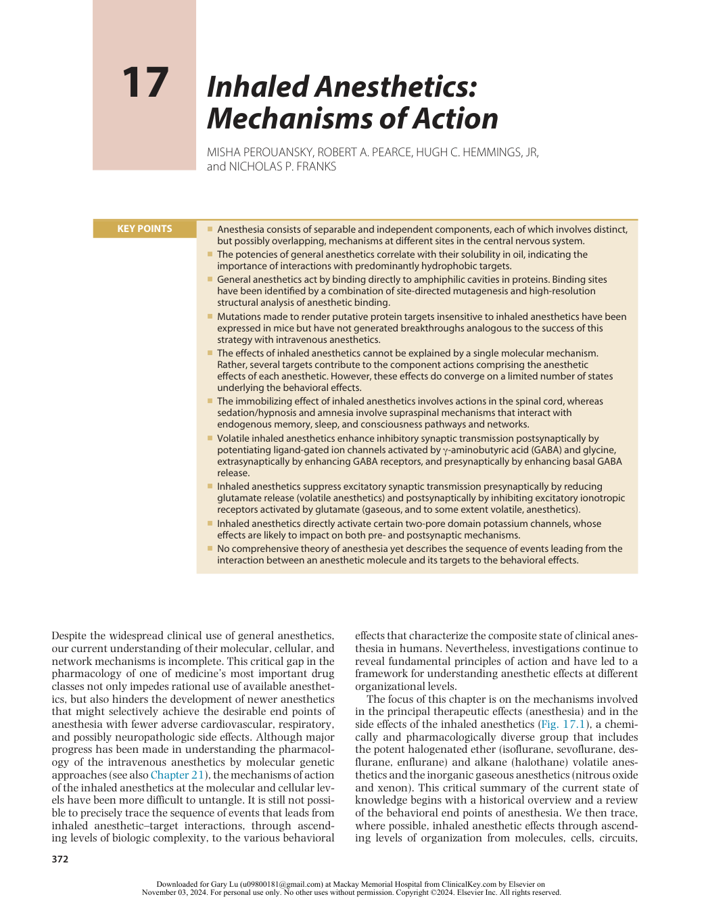

:::

<!-- PDF page 2 -->

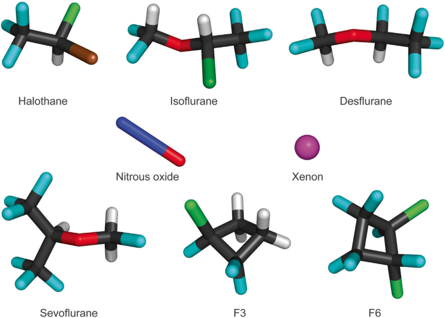

**Fig. 17.1 Structures of representative general anesthetics and a nonimmobilizer (F6) shown as space- filling models.**

networks, and organs to mammalian behavior. We also briefly address studies of anesthetic effects in very simple model organisms, with anesthetic end points being identified that bear, as yet, uncertain relationships to those in mammals.1

## History

### THE UNIFIED PARADIGM OF ANESTHETIC THEORIES

The first monograph reporting experimental work on anesthetic mechanisms, proposing a soon- to- be discredited lipid- elution theory of anesthetic action, was published only 6 months after Morton’s public demonstration of ether anesthesia in Boston’s Ether Dome. For decades thereafter, the phenomenon of anesthesia puzzled, inspired, and awed those who tried to understand it. An influential paradigm of anesthetic action formulated by Claude Bernard in the 1870s posited that anesthesia was a “unified” phenomenon: a unitary mechanism applicable to all forms of life. Although the anesthetized state could be brought about by a variety of agents, its essence was the same in all living creatures. In fact, Bernard thought that life itself was defined by susceptibility to anesthesia. Bernard also proposed a more specific theory of anesthesia, coagulation of protoplasm, which competed with several coexisting theories entertained by the scientific community. In a major work published in 1919, Hans Winterstein2 summarized the perplexing diversity of anesthetic theories by listing more than 600 references, the majority to original laboratory work – a convincing testimony to the interest of the scientific world in this phenomenon. Of note, the work of Meyer and Overton at the end of the 19th century had only a limited effect on the trajectory of research until the

1960s. Only then was the striking simplicity of the Meyer– Overton correlation (Fig. 17.2A) of anesthetic potency with solubility in olive oil interpreted at that time by almost all researchers that lipids are likely to be the anesthetic target. This interpretation focused attention on anesthetic effects on the bulk physical properties of cell membranes, which were known to consist primarily of lipid molecules. Such nonspecific or “lipoid- based” anesthetic theories dominated the field from the 1960s to the 1980s.

### MINIMUM ALVEOLAR CONCENTRATION: A BRIDGE BETWEEN PAST AND PRESENT

The potencies of inhaled anesthetics for immobilization were established in the classic studies in the 1960s of Eger and colleagues,3,4 who defined the _minimum alveolar concentration_ (MAC) as the inhaled anesthetic atmospheric pressure required to prevent movement in response to a defined noxious stimulus in 50% of subjects. The concept of MAC evolved within a unitary paradigm of anesthetic action and reflected the priorities of clinical practice. As a result, prevention of movement (immobility) became a universal yardstick for anesthetic effects, presumed to occur in the brain. Moreover, the simple elegance of the relationship between anesthetic potency and lipid solubility (see Fig. 17.2A) was graphically illustrated Meyer and Overton’s conclusion that “All chemically indifferent substances that are soluble in fat are anesthetics...their relative potency as anesthetics will depend on their affinity to fat on the one hand and water on the other hand, that is, on the fat/water partition coefficient.”1 This was interpreted as favoring lipids as the primary targets of anesthetics and a single nonspecific theory to explain anesthesia. The appeal of a single unified mechanism to explain anesthesia was (and remains) intellectually appealing. This focused the bulk of research efforts on delineating how anesthetic interactions with lipid

<!-- PDF page 3 -->

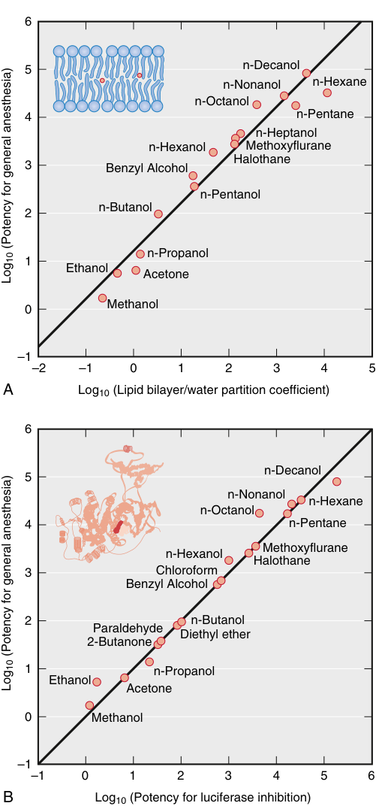

6 5 n-Decanol n-Nonanol n-Hexane n-Octanol 4 n-Pentane n-Heptanol n-Hexanol Methoxyflurane Halothane 3 Benzyl Alcohol n-Pentanol n-Butanol 2 n-Propanol 1 Ethanol Acetone Methanol 0 –1 –2 –1 0 1 2 3 4 5 A Log10 (Lipid bilayer/water partition coefficient) 6 n-Decanol 5 n-Nonanol n-Hexane n-Octanol 4 n-Pentane n-Hexanol Methoxyflurane Halothane 3 Chloroform Benzyl Alcohol 2 n-Butanol Paraldehyde Diethyl ether 2-Butanone 1 n-Propanol Ethanol Acetone 0 Methanol –1 –1 0 1 2 3 4 5 6 B Log10 (Potency for luciferase inhibition)  (Potency for general anesthesia)Log10  (Potency for general anesthesia)Log10 

**Fig. 17.2 General anesthetics act by binding directly to proteins.** (A) The iconic Meyer–Overton correlation (ca. 1900) between anesthetic potency and the lipid–water partition coefficient was initially interpreted as evidence that lipids of nerve membranes were the principal anesthetic target sites. (B) Progress in the 20th century showed that general anesthetic potencies correlate equally well with their ability to inhibit activity of the soluble firefly enzyme luciferase, which is not a physiologically relevant anesthetic target itself, but serves as a lipid- free model protein for anesthetic binding. _Inset_ , The crystal structure of luciferase94 with bound anesthetic _(red)._ (Reprinted with permission from Franks NP, Lieb WR. Molecular and cellular mechanisms of general anesthesia. _Nature_ . 1994;367:607–614.)

membranes might lead to the behavioral changes observed under anesthesia, the nonspecific lipoid theory.

Because inhaled anesthetic concentrations reflect concentrations in the tissues after equilibration, which is most

rapidly achieved for well- perfused organs such as the brain and heart, MAC is analogous to the plasma concentration for 50% effect (EC50) for intravenous anesthetics. In clinical applications, MAC is usually expressed as volume percent (vol%), which varies considerably with temperature, due to the large temperature dependence of partitioning between the gas phase and condensed phases (be they water, lipids, or proteins), whereas the equivalent condensed- phase molar concentrations are much less dependent on temperature.5 The MAC concept provided researchers and clinicians with a universal standard to measure a defined anesthetic end point (immobility), making meaningful comparisons of experimental results possible and accelerating clinical and laboratory research into anesthetic mechanisms. Today, a more nuanced understanding of MAC considers the structural and functional diversity of the physiologic targets for the different components of the anesthetic state.

### SHIFT FROM LIPID- TO PROTEIN- CENTERED MECHANISMS

Lipid- centered mechanisms of anesthesia prevailed in the two decades after definition of the MAC concept. Alternative targets were occasionally proposed but largely neglected by the scientific mainstream. Experimental inconsistencies of lipid targets,6–8 as well as evidence compatible with proteins as primary sites of action,9 were largely ignored. A shift from lipid- to protein- centered mechanisms, however, began in the late 1970s, owing largely to the discoveries by Franks and Lieb,10–15 who in an influential series of publications demonstrated that not only were lipids implausible targets but also that protein targets were compatible with the Meyer–Overton correlation (see Fig. 17.2B) – a proof of concept that, within a few years, redirected the bulk of research efforts toward proteins. As a corollary of this reorientation, evidence against lipid- based theories was recognized. Examples include the cutoff in anesthetic potency in homologous series of long- chain anesthetic alcohols,13,14 and the identification of hydrophobic drugs that do not obey the Meyer–Overton correlation.1,16 The enantiomeric selectivity of several anesthetics further strengthened the case for specific binding sites on proteins because stereoselectivity is difficult to reconcile with lipid targets.17–19 Today, there is widespread acceptance of the notion that lipid bilayers remain essentially unaffected by general anesthetics,11,20 and that critical signaling proteins (e.g., ion channels or ligand- gated receptors) are the relevant molecular targets of anesthetic action.21,22 The exact identity of proteins contributing to specific anesthetic end points continues to be sought, with research addressing not only the “where” (target) but also the “how” (process) of anesthetic mechanisms.

### DIVERSITY OF POTENTIAL ANESTHETIC TARGETS

At high concentrations _in vitro_ , most inhaled anesthetics affect the functions of multiple proteins, several of which might be plausibly connected to the components of the anesthetic state or anesthetic side effects. However, when considering a specific anesthetic end point, anesthetics are effective _in vivo_ over a very narrow concentration range.

<!-- PDF page 4 -->

This makes the concentration at which a relevant anesthetic effect is observed a critical consideration for deciding potential relevance. The mechanistic relevance of small effects observed _in vitro_ at relevant concentrations is less clear; that is, what effect is too small to be considered relevant to anesthesia?23,24

Whether anesthesia results from the sum of minor perturbations at multiple sites or from substantial effects on a small number of targets remains to be determined. This should be resolved as more sophisticated molecular genetics techniques are applied to test the relevance of putative targets. However, there are two reasons for believing that the number of relevant targets may be small. First, the extreme steepness of anesthetic concentration–response curves means that, for a given end point, substantial effects on two or three targets would be sufficient to account entirely for the _in vivo_ effect. Second, the stereoselectivity observed _in vivo_25 is comparable to the largest effects seen in putative targets _in vitro_ ,18,19 suggesting only a small number of targets are likely to be involved. Set against this logic is the experimental evidence that a rather large number of plausible target proteins are affected, albeit usually to small extents, and determining which of these are relevant to the various anesthetic end points remains a challenge.

## Integrated Effects on Central Nervous System Function

### ANESTHESIA: A COMPOSITE NEUROPHARMACOLOGIC STATE

Along with progress in identifying the molecular mechanisms of anesthesia, our understanding of the nature of the anesthetic state has evolved. It is now clear that anesthesia consists of separable and at least partially independent components or substates, each of which involves distinct, but possibly overlapping, mechanisms in different regions of the central nervous system (CNS) and with variations in relative potencies between specific agents.26 For example, immobilization (the core measure of MAC) is mediated largely at the level of the spinal cord by inhaled anesthetics27,28 but not by barbiturates29 (Fig. 17.3). Other anesthetic end points may also be discontinuous. For example, a functional separation between amnesia and sedation has been demonstrated for intravenous anesthetics,30 and it seems likely that this will apply to inhaled anesthetics as well. Furthermore, as consciousness research is advancing, the state simplistically referred to as “unconsciousness” is also in need of reanalysis based on electroencephalographic and neuroimaging studies. The state of general anesthesia itself may be better conceptualized as “fragmentation of selfhood”31 in view of accumulating evidence for distinct substates for the unresponsive phenotype.32 These and similar findings have led to the concept that general anesthesia consists of multiple independent components that should be resolvable experimentally and clinically.

In principle, each component of anesthesia can be preferentially induced in a concentration- and agent- specific manner using individual cellular/molecular pathways in various regions of the CNS. In the meantime, a patchwork of intriguing findings indicates that anesthetic

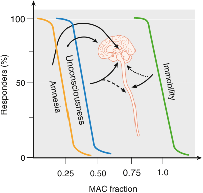

100 50 0 0.25 0.50 0.75 1.0 MAC fraction Unconsciousness Immobility Responders (%) Amnesia 

**Fig. 17.3 Several behavioral end points and sites of action underlie inhaled anesthetic action.** Amnesia, the most sensitive anesthetic end point, probably involves the hippocampus, amygdala, mediotemporal lobe, and other cortical structures. Unconsciousness likely involves the cerebral cortex, thalamus, and neuronal pathways of sleep and arousal. Sedation and hypnosis (loss of responsiveness) are part of the consciousness–unconsciousness continuum and are not shown. Immobility occurs by anesthetic action in the spinal cord, although supraspinal effects _(dotted arrow)_ are likely to be important for some anesthetics. Anesthetic action in the spinal cord blunts ascending impulses arising from noxious stimulation and might indirectly contribute to anesthetic- induced unconsciousness and amnesia _(dashed arrow)._ Cardiovascular responses occur at even greater minimum alveolar concen tration (MAC) fractions (not shown). (Courtesy Joseph Antognini, University of California, Davis.)

agents can provide insight into the neurobiology of higher cognitive function. For example, injections of pentobarbital into discrete sites in the mesopontine tegmentum induce a comatose state,33,34 whereas sedation induced by systemic administration of propofol can be reversed by microinjections of γ- aminobutyric acid A (GABAA) receptor antagonists into the tuberomammillary nucleus, a sleepregulating nucleus in the hypothalamus.35 Stimulation targeting dopaminergic nuclei induces emergence from general anesthesia.36,37 Thus, general anesthetics produce separate identifiable anesthetic substates via agent- specific actions at discrete anatomic sites in the CNS through different molecular targets. An important consequence of this complexity is that MAC, which is based exclusively on a motor response, might not proportionately reflect other components of anesthesia. Although this heterogeneity of anesthetic actions complicates a mechanistic understanding, it does open the possibility to use anesthetics as tools to advance the science of cognition.

### IMMOBILITY

Immobility remains the core clinical yardstick of the anesthetic phenotype. Decades ago, the failure to find a correlation between quantitative electroencephalographic activity and immobility in response to noxious stimulation led to the somewhat radical (at the time) hypothesis that immobility was not a cerebral cortex–mediated phenomenon,38 shattering the notion of a single, unitary anesthetic state. Experimental demonstration that volatile anesthetics act on the spinal cord to suppress movement27,28 supported this fragmentation and was a major factor leading to the

<!-- PDF page 5 -->

contemporary separation of anesthetic substates, of which immobility requires the highest drug concentrations (see Fig. 17.3). In a series of elegant experiments taking advantage of the unusual blood supply of the goat CNS, which allows separate perfusion of brain and spinal cord, Antognini and colleagues39,40 showed that immobility involves anesthetic effects at the spinal level, because selective delivery of isoflurane or halothane only to the brain required 2.5- fold to 4- fold higher concentrations.27 At the same time, experiments by Rampil and co- workers,28 which used surgical separation of the forebrain and midbrain from the spinal cord in rats, led to the conclusion that immobilization involves primarily suppression of the nocifensive withdrawal reflex arc at the level of the spinal cord (Fig. 17.4). In the 30 years since the identification of the spinal cord as the site of anesthetic- induced immobility, research has centered on pharmacologic, genetic, and complex network approaches. The pharmacologic approach to identify receptor- level contributions to isoflurane- induced immobility (isoflurane being the standard potent ether for experimental purposes) yielded the surprising finding that actions at GABAA receptors appear to be unimportant.41 Perhaps less surprisingly, inhibition of central nicotinic acetylcholine receptors also plays no role in immobilization.42 A role for voltage- gated sodium (Na+ ) channels was suggested by the finding that intrathecal administration of a selective inhibitor of Na+ channels potentiates anesthetic immobility (reduces MAC), whereas a Na+ channel activator does the opposite.43 Work on anesthetic-resistant transgenic mice confirmed that GABAA receptors containing α1 or α3 subunits do not contribute to the immobilizing action of isoflurane.44,45 In contrast, mutant mice lacking the TASK- 1, TASK- 3, and TREK- 1 K2P channels are less sensitive to volatile anesthetics but not intravenous anesthetics,46–49 indicating a role for these channels, possibly by a presynaptic mechanism.50

Work with physiologic preparations that attempt to preserve parts of the complex spinal cord circuitry suggests that anesthetic inhibition of afferent (noxious sensory) input to the dorsal horn plays a subordinate role to the suppression of the efferent (motor) output from the ventral horn, although this may vary by specific agent. This motor output is coordinated by neuronal networks organized in so- called central pattern generators that control the activity of cholinergic motoneurons.51 Not unlike understanding the anesthetic effects on higher cognitive function, the key to understanding immobility will likely lie in resolving the effect of anesthetics on integrated spinal network activity. Unfortunately, research into this flawed but clinically important measure of “adequate” general anesthesia is not being actively pursued.

### UNCONSCIOUSNESS

Consciousness, as a quality of the mind, is easy to recognize but difficult to define. It has been described as “what abandons us every night when we fall into dreamless sleep and returns the next morning when we wake up or when we dream.” This intuitive description applies equally as well to general anesthesia as it does to sleep; however, it does not provide a concrete definition that is useful for scientific studies.52 (For a comprehensive description see Chapter 8).

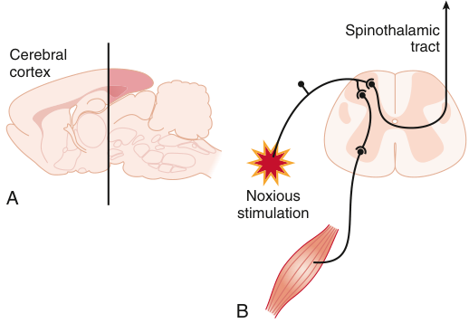

Spinothalamic tract Cerebral cortex A Noxious stimulation B 

**Fig. 17.4 Inhaled anesthetics produce immobility at the spinal level.** (A) Decerebration by removal of the forebrain rostral to the _black line_ does not alter the minimum alveolar concen tration (MAC) of isoflurane in rats, indicating that volatile anesthetic immobilization does not depend on the cerebral cortex.27,28 (B) Anesthetics suppress the nocifensive withdrawal reflex response to noxious stimulation transmitted to the dorsal horn by sensory nerves at the spinal level. Current efforts are focused on identifying the molecular, cellular, and anatomic substrates for this effect.

In brief, loss of consciousness (or hypnosis) is a hallmark of the onset of anesthesia, and anesthetic drugs are being used as tools for understanding the neural correlates of consciousness (NCC).53 However, as our understanding of the complex nature of consciousness is evolving it is worth abandoning the dichotomous classification of conscious vs. unconscious, not unlike advances in cardiac pathophysiology and imaging allowing a differentiated classification of “heart failure” that was impossible a couple of decades ago. Initially, it was suggested that _unresponsiveness_ may be a more accurate description of _unconsciousness_ under anesthesia because the latter term could obscure states of self- and environmental awareness lacking explicit memory traces.54

More recently, the umbrella concept of “selfhood” has been introduced. Selfhood describes the variety of brain processes that underly the experience of a person as a distinct entity capable of self- control and agency. The use of this concept should help to bridge the gap to a large nonanesthetic literature suggesting that selfhood can be deconstructed into a number of partially independent components and provide taxonomic precision for classifying various phenomena associated with anesthesia: (i) awareness of existence (core self); (ii) embodied self (sentience/ feeling); (iii) executive self (agency/volition); (iv) various other higher- order cognitive processes (including metacognition/meta- awareness); and (v) the knowledge of our autobiographical and social selves (narrative).31 This concept allows for a better categorization of the various forms under which “failure” to render a patient “unconscious” can manifest (Fig. 17.5), for example volitional responses to command observed in non- paralyzed patients and during the isolated forearm test (IFT).32 Typically, these patients are in a passive and apparently pain- free state and do not show spontaneous motor responses but respond accurately to verbal commands. This depersonalized state may be characterized by a feeling of detachment

<!-- PDF page 6 -->

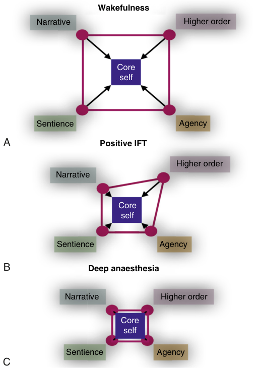

Wakefulness Narrative Higher order Core self Sentience Agency A Positive IFT Higher order Narrative Core self Sentience Agency B Deep anaesthesia Narrative Higher order Core self Sentience Agency C 

**Fig. 17.5 A conceptual model of selfhood in the context of deepening levels of general anesthesia based on experimental data obtained with the isolated forearm technique (IFT).** (A) Wakefulness is characterized by connectivity between the core self and (i) the autobiographical (narrative) self; (ii) sentience (perception of stimuli and feelings); (iii) agency (willful action); (iv) other higher order cognitive content (meta cognition). (B) A shrinking space under increasing levels of anesthesia resulting in a depersonalized subject still capable of positive responses during the IFT. (C) At deeper levels of anesthesia, the selfhood space is further reduced leaving only activity in the core self. (From: Sleigh J, et al. General anaesthesia as fragmentation of selfhood: insights from electroencephalography and neuroimaging. _Br J Anaesth_ . 2018;121(1):233–240. Conceptual model of selfhood.)

from the surroundings and an inability to attach appropriate significance to sensations that are not accompanied by formation of memories.31

Contemporary neuroscience has replaced the Cartesian view of an anatomically discrete brain structure as the center of consciousness with the concept that consciousness requires integration of information between multiple brain regions across large- scale cerebral networks. Examples of such networks are the default mode network (DMN), the executive control network (ECN), and the salience network (SN). Most common theories in use to frame hypotheses for consciousness research refer to these networks. These are: (i) global neuronal workspace55 ; (ii) integrated information56 ; (iii) recurrent processing57 ; (iv) higher-order thought58 ; and (v) orchestrated objective reduction.59 Measurable neural correlates for theories (iv) and (v) have not been determined and hence are currently

difficult to experimentally test within biologic systems.60 The rich connectivity of the cerebral cortex and its hierarchical organization are especially suited to enable high levels of information integration in the human brain. Some brain areas present a “rich- club” organization (i.e., highly connected nodes tend to be preferentially connected to other highly connected nodes), which has been suggested to be optimal for information integration.61,62 These hubs might be promising targets for the hypnotic action of general anesthetic drugs. Recent functionalbrain imaging research efforts have delineated the various brain regions associated with and possibly necessary for aspects of self- representation. Importantly, the different aspects of selfhood have been shown to consistently correlate with steady- state activity and connectivity in the major large- scale cortical functional networks,63 in particular: (i) the anterior and posterior medial cortical regions of the default mode network (DMN); (ii) the lateral frontoparietal cortical regions included in the executive control network (ECN); and (iii) the anterior cingulate cortex and insulae that form the major nodes of the salience network (SN).63 Interestingly, differences and similarities between functional brain imaging in sleep and general anesthesia allow a natural explanation of partial selfhood; i.e., failure to obtain complete oblivion under anesthesia, in terms of the differential effects of anesthetic drugs on activity in various specific brain regions that account for the various reported states of partial consciousness. Of particular relevance may be the interaction of anesthetics with the SN, which controls and switches the activity between the DMN and the ECN.63 Notably, activity in the SN differentiates between natural sleep and propofol anesthesia.32,64

Based on these and other observations, it has been suggested that the passive but marginally responsive (i.e., depersonalized) state seen in patients who show a positive volitional response to an IFT, or who report non- distressing intraoperative events is a state largely specific to general anesthesia. These patients may be accurately described as retaining many of the higher- order components of selfhood but have lost most of their agency and sentience because of drug- induced suppression of salience and sentience networks.31

Mechanistically, anesthetics might act by interfering with the operational synchronicity and coherence of these networks. Consequent disruption of cortical functional and effective connectivity has been observed during natural slow wave65 and midazolam- induced loss of responsiveness.66 This breakdown of cortical connectivity, rather than pharmacologic deafferentation from the environment, could underlie loss of consciousness.67 Unconsciousness would then be characterized not by the absence but by the fragmentation of cortical processing leading, in turn, to the fragmentation of selfhood. In animal models, a common feature of anesthetic- induced unconsciousness appears to be the breakdown of cortical connectivity68 which could be mediated by subcortical mechanisms. Animal68,69 and human70 data implicate activity in the γ- band throughout the cortex as a network- level target of general anesthetics because neuronal activity in the 40- to 90- Hz range across functionally connected cortical areas (commonly referred to as 40- Hz or γ- rhythm)

<!-- PDF page 7 -->

is considered a viable candidate “binding”, i.e., creating the unity of perception underlying consciousness. Importantly, anesthetic actions on cortical information processing consists not merely of suppression of responses but of reduced complexity and variability reflected counterintuitively in increased reliability and precision of evoked responses.71,72

### LEARNING AND MEMORY

Anterograde amnesia, one of the core desirable anesthetic end points, is achieved at lower anesthetic concentrations (∼0.25 MAC) than those required for “unconsciousness” (∼0.5 MAC). This high sensitivity of explicit memory formation complicates behavioral and recall- based analysis of anesthetic- induced states of selfhood (see previous section) as these have traditionally relied on explicit memory. Perhaps the closest analogue in rodents to explicit memory in humans is medial temporal lobe–dependent learning of temporal and spatial sequences known as hippocampus- dependent spatial learning. This can be tested by a variety of experimental paradigms, including fear conditioning to context. Other learning paradigms, such as fear conditioning to tone, are by contrast independent of the hippocampus. Isoflurane and the nonimmobilizer F6 both inhibit hippocampus- dependent learning at about one- half the concentration necessary for disrupting hippocampus- independent learning,73 suggesting that some forms of memory may be formed in the absence of explicit recall. Similarly, anesthetic concentrations that inhibit explicit memory in humans (memory that can be explicitly recalled as opposed to motor learning, classical conditioning, and so on) are similarly lower than concentrations that impair implicit memory (not subject to willful recollection). Taken together, these findings implicate the function of the medial temporal lobe, including the hippocampus, in the suppression of explicit memory by anesthetics.74 Effects on other structures, such as the amygdala, may be relevant to anesthetic impairment of implicit or other types of memory.75

Comparison of the amnesic potency of five inhaled anesthetics using an inhibitory avoidance paradigm revealed that nitrous oxide was the most and halothane the least potent amnestic (expressed in MAC fractions), with the halogenated ethers of intermediate potency.76 Because inhaled anesthetics affect multiple cellular targets at amnesic concentrations, it is difficult to attribute amnesia to specific cellular mechanisms. It is also unclear whether inhibition of learning and memory by drugs known to have different receptor affinities shares common mechanisms at some level of integration. Comparison with more selective drugs provides some insight. For example, θ- rhythms (4–12 Hz in rodents) are clearly important for hippocampus- dependent learning and memory.77 Benzodiazepines78 and cannabinoids79 slow and suppress hippocampal θ- rhythms in proportion to their ability to impair hippocampus- dependent learning (see also Chapter 36). Isoflurane and the experimental agent F6 (a “nonimmobilizer”) have comparable effects on θ- rhythms at amnesic concentrations while having different receptor- level profiles and opposite effects on sedation.80 Thus, alterations in neuronal synchrony provide a common network- level substrate for memory

impairment. The synchronization between amygdala and hippocampal θ- rhythms that occurs during fear- memory retrieval indicates that this principle might also apply to other forms of memory and their impairment by anesthetics.81 As with other components of the anesthetic state, the precise mechanisms of memory impairment by anesthetics, and of memory itself, remain to be fully elucidated.

### SEDATION

Sedation (defined as a decrease in activity, alertness, arousal, and/or vigilance), which is on a behavioral continuum leading to hypnosis, is achieved at anesthetic doses similar to those that produce amnesia (&lt;0.5 MAC). There is no clear mechanistic or clinical separation between sedation and hypnosis. By contrast, even though sedation can be difficult to separate from amnesia, for intravenous anesthetics (see Chapter 21) there may be separate but overlapping substrates for these two end points.30 The mechanisms involved in these behavioral effects are likely to resemble those of less promiscuous drugs, for which genetic approaches have been informative. An amino acid knockin mutation (H101R) in mice that renders the α1 GABAA receptor subunit insensitive to modulation by benzodiazepines produces resistance to the sedative and amnesic effects of benzodiazepines while maintaining other behavioral effects, among them anxiolysis.82 The α1 subunit is abundantly expressed in the CNS, mainly in the cortical areas and thalamus. Volatile anesthetics have qualitatively similar effects on α1- containing GABAA receptors (but also those containing other subunits) at low concentrations. The observation that the nonimmobilizer F6, which is devoid of sedative properties,80 is amnesic83 but does not modulate benzodiazepine- sensitive α1- containing GABAA receptors,84,85 is compatible with a role for α1- containing receptors in volatile anesthetic- induced sedation, because few other targets are affected at purely sedative concentrations. Possible mediators of the sedative effects of the gaseous anesthetics nitrous oxide and xenon, which do not affect GABAA receptors, include _N_ - methyl- d- aspartate (NMDA) receptor antagonism86 and K2P channel activation.87 Consistent with this distinct pharmacologic profile, nitrous oxide has strikingly different effects from benzodiazepines in behavioral tests aimed at evaluating sedation in mice.88

Recognizing that there may be more than a superficial similarity between natural sleep and anesthetic- induced sedation and hypnosis, the effects of some anesthetics apparently share natural sleep mechanisms by directly activating discrete sleep- promoting nuclei in the hypothalamus.35 Electroencephalographic patterns during natural slowwave sleep and propofol anesthesia show similarities,89 and partial recovery from sleep deprivation can occur under propofol90 and volatile anesthetics,91 supporting similarity but not identity (also see Chapter 8). Recently, functional imaging has revealed brain region- selective agent- specific differences between anesthetics and natural sleep.32,64 The differences between sleep and sedation/anesthesia by gaseous anesthetics known to inhibit NMDA receptors may be even more striking, as suggested by recent research showing that NMDA receptor- mediated transmission is necessary for normal sleep.92

<!-- PDF page 8 -->

## Identification of Molecular Sites of Anesthetic Action

### CRITERIA FOR IDENTIFYING SITES RELEVANT TO ANESTHESIA

Specific criteria have been proposed to evaluate the relevance of the many potential molecular targets of anesthetics.22 These criteria include:

1. _Reversible alteration of target function at clinically relevant concentrations._ This criterion requires comparable _in vivo_ and _in vitro_ sensitivities and depends on the anesthetic end point under consideration. For example, targets involved in immobility must be sensitive to anesthetics near MAC, whereas targets mediating amnesia must be affected at a fraction of MAC. Recent evidence for persistent effects of inhaled anesthetics demonstrable in the absence of continued anesthetic exposure is challenging the notion of reversibility for certain effects.

2. _Expression of the target in appropriate anatomic locations to mediate the specific anesthetic end point._ For example, immobilization by inhaled agents appears to involve primarily actions in the spinal cord, independent of actions in the brain.

3. _Concordant stereoselectivity of anesthetic effects_ in vivo _and on the target_ in vitro _._ Without a specific pharmacologic antagonist of anesthesia, correlation between the stereoselective actions of general anesthetics _in vivo_ and _in vitro_ is a useful test of pharmacologic relevance of putative molecular targets. Stereoselectivity data correlating _in vivo_ potency and _in vitro_ receptor actions implicate GABAA receptors as a target for the anesthetic actions of etomidate, pentobarbital, neurosteroid anesthetics, and isoflurane.

4. _Appropriate sensitivity or insensitivity to anesthetic and nonanesthetic compounds._ Anesthetic halogenated cyclobutanes together with structural analogues that do not produce anesthesia at concentrations predicted to be anesthetic by the Meyer–Overton correlation (nonimmobilizers) can be used to discriminate relevant volatile anesthetic targets _in vitro._ For example, the anesthetic F3 (1- chloro- 1,2,2- trifluorocyclobutane), but not the structurally similar nonanesthetic F6 (1,2- dichlorohexafluorocyclobutane), affect GABAA, glycine, AMPA (αamino- 3- hydroxy- 5- methyl- 4- isoxazolepropionic acid), kainate, and 5- HT3 receptors, and Na+ channels, consistent with possible roles in immobility, whereas both F3 and F6 affect neuronal nicotinic, M1 muscarinic, 5- HT2C, and mGluR5 receptors, indicating that these targets are not involved in immobility. F6 is interesting in that it lacks sedative and immobilizing effects but does possess amnesic effects, hence the more accurate term _nonimmobilizer_ , making it a useful pharmacologic tool for discriminating targets for these actions.

5. _Predictable effects of genetic manipulations targeted to putative molecular targets._ The effects of targeted deletion of specific molecules implicated as anesthetic targets (knockout mutations) or genetic engineering to introduce specific mutations that modify anesthetic sensitivity (knock- in mutations) in model organisms provide powerful approaches to test the roles of putative

molecular targets of anesthetic action. This approach has been particularly successful in implicating specific GABAA receptor subtypes in the effects of the GABAergic intravenous anesthetics propofol and etomidate, where single amino acid substitutions in specific receptor subtypes eliminates anesthetic effects both _in vitro_ and _in vivo._93 Targeted mutations of putative anesthetic targets provide a bridge between _in vitro_ observations and whole- animal experiments essential for demonstrating anesthetic end points. The existence of multiple targets and redundancy among ion channel subtypes make this a more challenging experimental approach for inhaled anesthetics compared with intravenous anesthetics (discussed later).

### PHYSICOCHEMICAL PROPERTIES OF ANESTHETIC BINDING SITES

A convergence of X- ray crystallography, molecular modeling, and structure–function studies indicate that inhaled anesthetics bind in hydrophobic cavities formed within proteins.21,22 The lipophilic (or hydrophobic) nature of these binding sites explains their adherence to the Meyer–Overton correlation. An element of amphiphilicity (possessing both polar and nonpolar characteristics) is also required for effective interaction with these cavities, as indicated by improvements in the Meyer–Overton correlation with more amphipathic solvents (possessing both hydrophobic and hydrophilic properties).8

### FROM MODEL PROTEINS TO RECEPTORS

Identifying inhaled anesthetic binding sites on plausible target proteins is difficult because of their low- affinity interactions, the paucity of atomic resolution structures of pharmacologically relevant target proteins, and the lack of specific antagonists. Consequently, most anesthetic binding sites have been identified in well- characterized model proteins for which three- dimensional atomic resolution structures are available, but which are not themselves directly relevant to anesthesia, such as luciferase94 and serum albumin.95

These studies indicate that anesthetics bind in pockets with both nonpolar and polar noncovalent chemical interactions.96,97 Binding involves weak hydrogen bond interactions with polar amino acid residues and water molecules, nonpolar van der Waals interactions, and a polarizing effect of the amphiphilic binding cavity on the relatively hydrophobic anesthetic molecules. Occupation of a site, or sites, by an anesthetic provides a plausible mechanism for alteration of receptor and ion channel function by selectively binding to a particular conformation (e.g., an open or inactivated state of an ion channel).21 Studies of glycine, GABAA, and NMDA receptors provide convincing evidence for the existence of anesthetic binding sites in critical neuronal signaling proteins.98 It is likely that, before long, high- resolution crystal structures of these receptors will be determined with inhaled anesthetic bound. However, because anesthetics act by binding only to certain transient conformational states, the relevance of necessarily static crystal structures will need to be assessed with care.

<!-- PDF page 9 -->

Structural studies using the more accessible prokaryotic homologues of eukaryotic ion channels have provided a powerful tool for the study of anesthetic binding sites in biologically plausible proteins. For example, both propofol and desflurane have been co- crystalized with GLIC, a bacterial homologue of eukaryotic inhibitory ligand- gated ion channels (glycine and GABAA receptors). Both anesthetics bind a common preexisting site in the upper part of the

transmembrane domain between the transmembrane segments of a single subunit (Fig. 17.6).99 Molecular modeling based on structurally homologous proteins has also been used to identify putative anesthetic binding sites in the transmembrane domains of vertebrate GABAA and glycine receptors (Fig. 17.7). These models suggest that different drugs may either bind in different orientations within a single amphiphilic cavity or occupy different cavities within

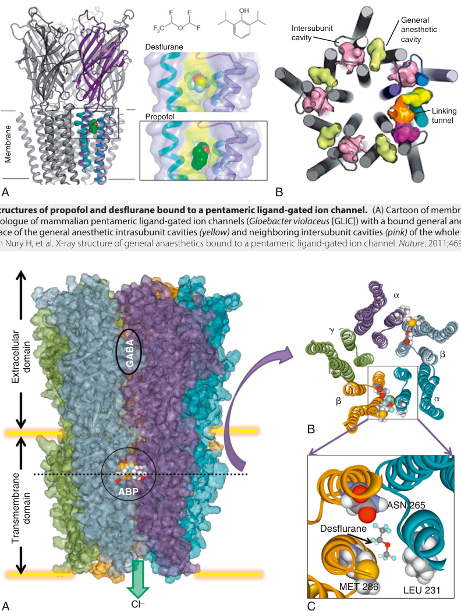

General Intersubunit anesthetic cavity cavity Desflurane Linking Propofol tunnel A B X- ray structures of propofol and desflurane bound to a pentameric ligand- gated ion channel.  (A) Cartoon of membrane- plane view of the bacterial homologue of mammalian pentameric ligand- gated ion channels ( Gloebacter violaceus  [GLIC]) with a bound general anesthetic molecule. (B) Molecular surface of the general anesthetic intrasubunit cavities  (yellow)  and neighboring intersubunit cavities  (pink) (Modified from Nury H, et al. X- ray structure of general anaesthetics bound to a pentameric ligand- gated ion channel.  Nature � � � � � B ABP ASN 265 Desflurane MET 286 LEU 231 A Cl – C Membrane domain GABA Extracellular domain Transmembrane 

**Fig. 17.6 X- ray structures of propofol and desflurane bound to a pentameric ligand- gated ion channel.** (A) Cartoon of membrane- plane view of the bacterial homologue of mammalian pentameric ligand- gated ion channels ( _Gloebacter violaceus_ [GLIC]) with a bound general anesthetic molecule. (B) Molecular surface of the general anesthetic intrasubunit cavities _(yellow)_ and neighboring intersubunit cavities _(pink)_ of the whole pentameric channel. (Modified from Nury H, et al. X- ray structure of general anaesthetics bound to a pentameric ligand- gated ion channel. _Nature_ . 2011;469:428–433.)

**Fig. 17.7 Putative anesthetic binding sites on γ-aminobutyric acid (GABA)A receptors identified by molecular modeling.** (A) Molecular model of the mouse GABAA receptor built using homology modeling techniques with computational chemistry optimizations and molecular dockings. The amino acid backbone is displayed in ribbon format and outlined by the transparent solvent- accessible molecular surface. Each of the five subunits is colored uniquely. The GABA binding site is noted in the extracellular domain, whereas the putative anesthetic binding pocket (ABP) for potentiation is noted in the outer third of the transmembrane domain between the α and β subunits. Two binding sites are shown but only one has computationally docked desflurane. (B) Cross section at the _dotted line_ level in (A) showing orientation of subunits with pentameric symmetry about a central ion pore. (C) Magnified region of intersubunit anesthetic binding site derived from region in (B) showing relevant amino acid positions (in space- filling format) interacting with desflurane (in ball- and- stick format at the same scale). (Courtesy the Bertaccini Laboratory, Stanford University.)

::: warning 符號需核對
此頁有符號無法完整擷取，請展開下方原始頁面核對。
:::

::: details 原始表格與符號（PDF 第 9 頁）

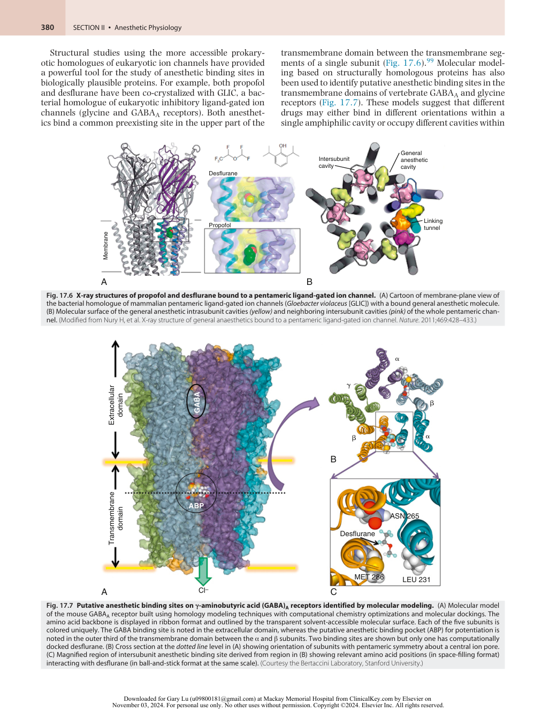

:::

<!-- PDF page 10 -->

the protein, causing similar functional effects. Refinement of these molecular models will continue to provide new insights in the molecular basis for general anesthetic action that can be experimentally tested. For example, potential sites of interaction of xenon and isoflurane with the NMDA receptor have also been identified using this approach. One site, which can contain up to three xenon atoms or one molecule of isoflurane, overlaps the known binding site for the co- agonist glycine in the NR1 subunit.100 This suggests that two chemically dissimilar inhaled anesthetics inhibit NMDA receptors by direct competitive inhibition of coagonist binding.

### Molecular Targets of Inhaled Anesthetics

Ion channels have emerged as the most promising molecular targets for inhaled anesthetics. Neurotransmitter- gated ion channels, in particular GABAA, glycine, and NMDAtype glutamate receptors, are leading candidates owing to their appropriate CNS distributions, essential physiologic roles in inhibitory and excitatory synaptic transmission, and sensitivities to clinically relevant concentrations of anesthetics.21,22,26,101 Other ion channels that are sensitive to inhaled anesthetics include the hyperpolarizationactivated cyclic nucleotide (HCN)- gated family of channels that give rise to pacemaker currents101 and regulate dendritic excitability, two- pore domain (K2P) “leak” K+ channels that maintain resting membrane potential in many cells,102,103 and voltage- gated Na+ and Ca2+ channels.101

### LIGAND- GATED ION CHANNELS

### Potentiation of Inhibitory GABAA and Glycine Receptors

The ether anesthetics (including isoflurane, sevoflurane, and desflurane), the alkane anesthetic halothane, most intravenous anesthetics (including propofol, etomidate, barbiturates), and the neurosteroid anesthetics enhance GABAA and glycine receptor (GlyR) function. GABAA and GlyRs are members of the same cys- loop ligand- gated ion channel superfamily that also includes the cation- permeable nicotinic acetylcholine and 5HT3 receptors. GABAA receptors are the principal transmitter- gated Cl− channels in the neocortex and allocortex, whereas GlyRs fulfill this function in the spinal cord, with some overlap in the diencephalon and brainstem. Activated receptors conduct chloride ions, driving the membrane potential toward the Cl− equilibrium potential. Both receptors are inhibitory (except in some cases during development) because the Cl− equilibrium potential is usually more negative than the normal resting potential. Channel opening also reduces membrane resistance and “shunts” excitatory responses. Most functional GABAA and GlyRs are heteropentamers, typically consisting of three different GABAA subunits (e.g., two α, two β, and one γ or δ)104 or two different GlyR subunits (three α and two β).105 The subunit composition of GABAA receptors determines their physiologic and pharmacologic properties and varies between and within brain areas, as well as between different compartments of individual neurons. Examples are the preferential expression of the α5 subunit in the dendritic field of the hippocampal CA1 area (a region important for memory formation), of the α4 subunit in the thalamus, and of the α6 subunit in the cerebellum. Presence

of a γ subunit is required for benzodiazepine modulation of GABAA receptors and can also influence modulation by inhaled anesthetics. Although the molecular mechanisms of receptor modulation by inhaled anesthetics are not clear, these receptors have been key to our understanding of anesthetic–receptor interactions. Using chimeric receptor constructs between anesthetic- sensitive GABAA and insensitive GlyR subunits, specific amino acid residues in transmembrane domains 2 and 3 critical to the action of inhaled anesthetics have been identified.106 This laid the groundwork for the construction of anesthetic- resistant GABAA receptors and the generation of transgenic mice with altered anesthetic sensitivity (discussed later).

The related cation- permeable 5- hydroxytryptamine (serotonin)- 3 (5HT3) receptors are similarly potentiated by volatile anesthetics.107,108 5HT3 receptors are involved with autonomic reflexes and probably contribute to the emetogenic properties of volatile anesthetics.

### Inhibition of Excitatory Acetylcholine and Glutamate Receptors

Neuronal nicotinic acetylcholine receptors (nnAChRs), like the other members of the cys- loop family, are heteropentameric ligand- gated ion channels, but are cation- selective. They are composed of α and β subunits, but functional homomeric receptors can be formed by certain α subunits. In the CNS, nnAChRs are localized primarily presynaptically.109 Homomeric α7 receptors have high permeability to Ca2+ that can exceed that of NMDA receptors.109 In contrast to GABAA and GlyRs, nnAChRs pass cations when activated and therefore depolarize the membrane potential. Receptors containing α4β2 subunits are very sensitive to block by isoflurane.110,111 Relevance of nnAChR block to immobilization, sedation, and unconsciousness by inhaled anesthetics is unlikely because nnAChRs are also blocked by nonimmobilizers, although it is possible that they do contribute to amnesia.

NMDA receptors are a major postsynaptic receptor subtype of inotropic receptors for glutamate, the principal excitatory neurotransmitter in the mammalian CNS.112 Typical NMDA receptors, defined pharmacologically by their selective activation by the exogenous agonist NMDA, are heteromers consisting of an obligatory GluN1 subunit and modulatory GluN2 subunits. Channel opening requires glutamate (or another synthetic agonist such as NMDA) binding to the GluN2 subunit while the endogenous co- agonist glycine binds to the GluN1 subunit. NMDA receptors also require membrane depolarization to relieve voltage- dependent block by Mg2+ . Depolarization is typically provided by binding of glutamate to nonNMDA glutamate receptors (discussed later). Because of this requirement for both presynaptic transmitter release and postsynaptic depolarization, synaptic NMDA receptors function as coincidence detectors, and this characteristic is thought to be central to their role in learning and memory. NMDA receptors are also involved in the development of chronic pain, perhaps because of mechanisms similar to those underlying synaptic plasticity, and in ischemiainduced excitotoxicity by virtue of their capacity to allow entry of the ubiquitous intracellular signal Ca2+ . The nonhalogenated inhaled anesthetics xenon, nitrous oxide, and cyclopropane have minimal effects on GABAA receptors

<!-- PDF page 11 -->

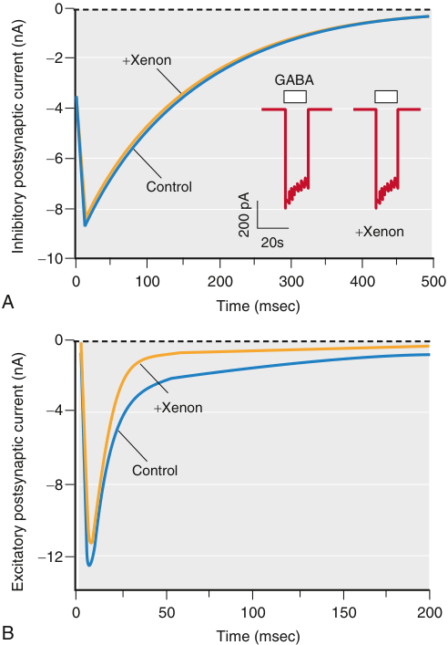

0 � 2 � Xenon GABA � 4 � 6 Control � 8 � Xenon 20s � 10 0 100 200 300 400 500 A Time (msec) 0 � 4 � Xenon Control � 8 � 12 0 50 100 150 200 B Time (msec) 200 pA Inhibitory postsynaptic current (nA) Excitatory postsynaptic current (nA) 

**Fig. 17.8 The actions of xenon on inhibitory GABAergic and excitatory glutamatergic synapses in cultured rat hippocampal neurons.** Xenon (3.4 mM, −1 MAC) has no significant effect on the inhibitory postsynaptic current (A) but depresses the excitatory glutamatergic synaptic current, almost exclusively the slow NMDA receptormediated component of the current (B). In contrast, the principal effects of ̃1 MAC isoflurane are a prolongation in the inhibitory current decay and a reduction in excitatory current peak height, with little change in time course (not shown, see Fig. 17.10). _GABA_ , γ-aminobutyric acid; _MAC_ , minimum alveolar concentration; _NMDA, N_ -methyl-d-aspartate. (Reprinted in modified form by permission from de Sousa SLM, et al. Contrasting synaptic activity of the inhalational general anesthetics isoflurane and xenon. _Anesthesiology_ . 2000;92:1055–1066.)

but depress excitatory glutamatergic synaptic transmission postsynaptically via NMDA glutamate receptor blockade (Fig. 17.8).113,114 Volatile anesthetics can also inhibit isolated NMDA receptors at higher concentrations.115 Along with presynaptic inhibition of glutamate release, this might contribute to their depression of NMDA receptor–mediated excitatory transmission.

A second class of inotropic glutamate receptors includes the non- NMDA receptors, which are subdivided into AMPA and kainate receptors based again on their sensitivities to selective exogenous agonists.112 Inhaled anesthetics only weakly inhibit AMPA receptors, hence this action is unlikely to be important in their actions.116,117 Interestingly, kainate receptors are enhanced by inhaled anesthetics, but this is unlikely to be involved in immobility because MAC is not altered in mice deficient in the GluR6 receptor subunit.118 Most evidence suggests that the principal mechanism for depression of glutamatergic transmission by volatile anesthetics is presynaptic, with minor contributions

from postsynaptic receptor blockade119–121 (see Cellular Mechanisms).

### VOLTAGE- GATED AND OTHER ION CHANNELS

Volatile anesthetics have diverse effects on a wide variety of ion channels which are critically involved in their neurophysiologic, cardiovascular, and respiratory actions. A detailed understanding of these interactions is crucial to a pharmacologic description of this essential drug class.

### Na+ Channels

Voltage- gated Na+ channels are critical to axonal conduction, synaptic integration, and neuronal excitability. In contrast to findings in invertebrate giant axons,122 axonal conduction in small (0.1 to 0.2 μm) unmyelinated hippocampal axons is depressed by volatile anesthetics,123,124 and small reductions in preterminal action potential amplitude significantly depress transmitter release and hence postsynaptic responses at a mammalian synapse.125 Heterologously expressed mammalian voltage- gated Na+ channels are sensitive to clinically relevant concentrations of volatile anesthetics. The Na+ channel family consists of nine homologous pore- forming α subunits with distinct cellular and subcellular distributions.126,127 Isoflurane and other volatile anesthetics inhibit the major mammalian Na+ channel isoforms, including neuronal (Nav1.1, Nav1.2, Nav1.6), skeletal muscle (Nav1.4), cardiac (Nav1.5), and peripheral (Nav1.8) isoforms.128 Volatile anesthetics, but not nonimmobilizers, also inhibit native neuronal and nerve terminal Na+ channels,126,129–133 lending support to the notion that Na+ channel blockade contributes to the depression of synaptic neurotransmitter release.134 In contrast, xenon has no detectable effect on Na+ , Ca2+ , or K+ channels in isolated cardiomyocytes.135 The demonstration that NaChBac, a prokaryotic homologue of voltage- gated Na+ channels, is also inhibited by volatile anesthetics opens the way for structure–function studies of these channels.131,136 These studies suggest that volatile anesthetics affect channel gating, probably via at least two drug binding sites.136–138

### Ca2+ Channels

Multiple cellular functions depend on the tightly controlled concentration of intracellular free Ca2+ ([Ca2+ ]i), which is determined by the integrated activities of voltage- gated Ca2+ channels, capacitative Ca2+ channels, plasma membrane and sarcoplasmic/endoplasmic reticulum Ca2+ –adenosine triphosphatases (pumps), Na+ /Ca2+ exchangers, mitochondrial Ca2+ sequestration, and cytoplasmic Ca2+ - binding proteins. Alteration of any of these mechanisms can affect the many cellular processes regulated by the second messenger actions of Ca2+ , including synaptic transmission, gene expression, cytotoxicity, and muscle excitation–contraction coupling. Excitable cells translate their electrical activity into action by Ca2+ fluxes mediated primarily by voltage- gated Ca2+ channels in the plasma membrane. Distinct Ca2+ channel subtypes are expressed in various cells and tissues and are classified pharmacologically and functionally by the degree of depolarization required to gate the channel as low voltage–activated (LVA; T- type) or high voltage–activated (HVA; L- , N- , R- , and P/Q- type) channels. Cloning and sequencing to identify their pore- forming

::: warning 符號需核對
此頁有符號無法完整擷取，請展開下方原始頁面核對。
:::

::: details 原始表格與符號（PDF 第 11 頁）

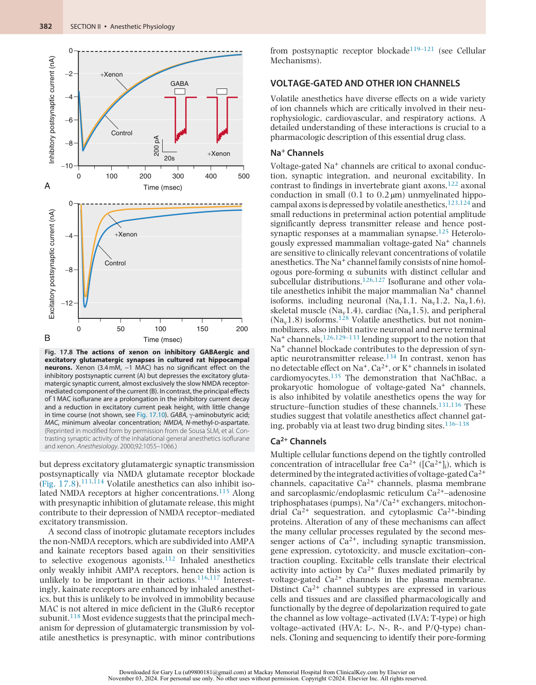

:::

<!-- PDF page 12 -->

α subunits has allowed molecular classification of these functionally identified channel subtypes.126 Considerable evidence indicates that volatile anesthetics inhibit certain Ca2+ channel isoforms but not others.

Inhibition of presynaptic voltage- gated Ca2+ channels coupled to transmitter release has been proposed as a mechanism by which volatile anesthetics reduce excitatory transmission.139,140 Indeed, N- type (Cav2.2) and P- type (Cav2.1) channels, which mediate Ca2+ entry coupled to neurotransmitter release, are modestly sensitive to volatile anesthetics,141,142 but not in all neuron types,143 suggesting the importance of auxiliary subunits, posttranslational modification, or other potential modulators of anesthetic sensitivity. A modest contribution of R- type Ca2+ channels (Cav2.3) to anesthesia is suggested by their sensitivity to volatile anesthetics and a small increase in MAC produced by genetic deletion in mice.144 T- type Ca2+ channels are particularly sensitive to volatile anesthetics145 and nitrous oxide.146 However, mutant mice lacking a major neuronal T- type Ca2+ channel isoform (Cav3.1) have normal volatile anesthetic sensitivity, although the onset of anesthesia is delayed.147 More recent work has shown that isoflurane alters oscillations in thalamic neurons, which might contribute to its anesthetic actions.148

At higher doses, a role for Ca2+ channel inhibition in the negative inotropic effects of volatile anesthetics is well established. The force of myocardial contraction is determined by the magnitude of cytosolic Ca2+ increase after electrical excitation, the responsiveness of the contractile proteins to Ca2+ , and sarcomere length. Negative inotropic effects of volatile anesthetics are mediated by reductions in Ca2+ availability, Ca2+ sensitivity of the contractile proteins, and rate of cytosolic Ca2+ clearance. Volatile anesthetics reduce the Ca2+ transient and shorten action potential duration in cardiomyocytes primarily by inhibiting L- type (Cav1.2) Ca2+ currents, resulting in a negative inotropic effect and arrhythmogenicity.149–151 In contrast, xenon does not depress myocardial function or inhibit L- type Ca2+ , Na+ , or K+ currents in isolated cardiomyocytes.135,152 Inhibition of trans- sarcolemmal Ca2+ influx through cardiac L- type Ca2+ channels plays a major role in the negative inotropic effects of volatile anesthetics, which is greatest for halothane, along with contributions from effects on myofilament Ca2+ sensitivity and sarcolemmal Ca2+ release.150,153

In contrast to voltage- gated Ca2+ channels that regulate the influx of extracellular Ca2+ , intracellular Ca2+ channels regulate Ca2+ release from intracellular stores, particularly the endoplasmic reticulum (ER) in neurons and sarcoplasmic reticulum (SR) in muscle. These include 1,4,5- inositol triphosphate receptors (IP3Rs), regulated by the second messenger IP3, and ryanodine receptors (RyRs); the latter mediate the release of SR Ca2+ , which is critical to excitation–contraction coupling in muscle. Volatile anesthetic– induced Ca2+ leak occurs by effects on both IP3R and RyR channels, which leads to depletion of intracellular Ca2+ stores from the SR and ER. In brain, volatile anesthetic activation of IP3Rs has been proposed as a mechanism for anesthetic neurotoxicity.154 This blunts changes in intracellular Ca2+ in response to stimulation and contributes to the smooth muscle–relaxing properties of volatile anesthetics that underlie bronchodilation and vasodilation.155 Malignant hyperthermia is a pharmacogenetic disorder

that manifests as a potentially fatal hypermetabolic crisis triggered by volatile anesthetics, particularly halothane. It is frequently associated with mutations in RyR1 and the physically associated L- type Ca2+ channel (Cav1.1) that functions as the voltage sensor.156 Volatile anesthetics activate the mutated RyRs, resulting in uncontrolled intracellular Ca2+ release from the sarcoplasmic reticulum, muscle contraction, and hypermetabolic activity157 (see Chapter 31).

### K+ Channels, HCN Channels, and TRP Channels

Potassium (K+ ) channels are an extremely diverse ion channel family noted for their varied modes of activation. They regulate electrical excitability, muscle contractility, and neurotransmitter release. They are important in determining input resistance and in driving repolarization after action potentials, and thus they determine excitability and action potential duration. Given the large diversity in K+ channel structure, function, and anesthetic sensitivity, it is not surprising that there is considerable diversity in their sensitivity and response to inhaled anesthetics158 : from relatively insensitive (voltage- gated K+ channels Kv1.1, Kv3)159 to sensitive (some members of the K2P family), resulting in either inhibition, activation, or no effect on K+ currents.

Volatile anesthetic activation of certain “leak” K+ channels was first observed in the snail _Lymnaea_ ,160 although the molecular identity of the affected ion channels was unknown. Activation of K2P channels by volatile and gaseous anesthetics, including xenon, nitrous oxide, and cyclopropane, was subsequently observed in mammals.102 Increased K+ conductance can hyperpolarize neurons, reducing responsiveness to excitatory synaptic input and possibly altering network synchrony. Targeted deletion of the TASK- 1, TASK- 3, and TREK- 1 K2P channels in mice reduces sensitivity to immobilization by volatile anesthetics in an agent- specific manner, implicating these channels as contributory anesthetic targets _in vivo_ .47–50 The K+ channel TREK- 1 also contributes to the neuroprotective effects of xenon161 and sevoflurane.47–50,162 Recent progress has been made in identifying anesthetic binding sites to multiple K+ channel types using photoaffinity labeling and complementary approaches.163 For example, a sevoflurane binding site has been identified in the Kv1.2 channel, which is widely expressed in brain and positively modulated by volatile anesthetics.164 Binding sites for isoflurane in TREK- 1 have been identified by photoaffinity labeling with validation by site- directed mutagenesis and molecular dynamics simulation.165,166

The recognition that inherited channelopathies are arrhythmogenic and constitute an important contributor to sudden cardiac death,167 particularly in young children,168 highlights the importance of analyzing anesthetic modulation of cardiac ion channels. Recombinant hERG (human ether- a- go- go related) channels are moderately inhibited by halothane, and depression of cardiac hERG channels likely contributes to arrhythmogenic effects of volatile anesthetics.150,169 hERG channels are also involved in acquired (drug- induced) and inherited long QT syndrome. Cardiac inward- rectifying (KIR), voltage- gated (Kv), and Ca2+ - activated K+ channels are generally relatively insensitive to clinical concentrations of volatile anesthetics and xenon.150,152,170 In contrast, volatile anesthetics and

<!-- PDF page 13 -->

xenon activate cardiac mitochondrial and sarcolemmal KATP channels,171 which might contribute to anesthetic preconditioning to cardiac ischemia. Direct electrophysiologic effects of anesthetics with preconditioning properties have been demonstrated on both mitochondrial and sarcolemmal KATP channels, although the precise mechanisms remain to be clarified. The large conductance (BK) mitochondrial K+ channel Slick of the _Slo2_ gene family has been shown to be important for volatile anesthetic preconditioning _in vivo_ .172

Volatile anesthetics also inhibit HCN pacemaker channels, reducing the rate of rise of pacemaker potentials and the bursting frequency of certain neurons that show autorhythmicity. They decrease the Ih conductance in neurons173 and modulate recombinant HCN1 and HCN2 channel isoforms at clinically relevant concentrations.174 Because HCN channels contribute to resting membrane potential, control action potential ring, dendritic integration, neuronal automaticity, and temporal summation, and determine periodicity and synchronization of oscillations in many neuronal networks,175 anesthetic modulation of these channels could play an important role in anesthetic effects on neuronal integrative functions.176 Selective knockout of HCN1 in mouse forebrain shows a role for these channels in the amnestic and hypnotic, but not the immobilizing, effects of volatile anesthetics.133

### INTRACELLULAR SIGNALING MECHANISMS

Cell signaling mechanisms are critical to all phases of organ and cellular function, which has made them attractive targets for producing the broad effects of general anesthetics on multiple organs. Anesthetics have complex actions on intracellular cell signaling pathways, which include processes downstream from cell surface receptors and ion channels, including effects on second messengers, protein phosphorylation pathways, and other regulatory mechanisms.

### G Protein–Coupled Receptors (GPCRs)

A variety of signals, including hormones, neurotransmitters, cytokines, pheromones, odorants, and photons, produce their intracellular actions by interactions with metabotropic receptors that activate heterotrimeric guanine nucleotide–binding proteins (G proteins). In contrast to inotropic receptors that directly couple to ion- selective channels, G proteins act as indirect molecular switches to relay information from activated plasma membrane receptors to appropriate intracellular targets.

Heterotrimeric G proteins consist of a large α subunit and a smaller β/γ subunit dimer, each expressed as multiple isoforms with distinct properties and downstream targets. G proteins regulate a plethora of downstream effectors to control the levels of cytosolic second messengers such as Ca2+ , cyclic adenosine monophosphate (cyclic AMP), and inositol triphosphate. These in turn regulate effector proteins such as ion channels and enzymes, either directly or via second messenger–regulated protein phosphorylation pathways. Ca2+ is a ubiquitous second messenger that regulates several downstream effectors, often mediated by the multifunctional Ca2+ - binding protein calmodulin. As volatile anesthetics have profound effects on intracellular Ca2+ concentrations via their effects on both plasma membrane and

intracellular Ca2+ channels, transporters, and exchangers (see section on Voltage- Gated and Other Ion Channels above), many of the downstream effects of anesthetics are ultimately mediated by changes in the second messenger actions of Ca2+ .

Drugs that act through G protein–coupled receptors (GPCRs), such as agonists for μ- opioid and α2- adrenergic receptors, can affect anesthetic sensitivity (reduce MAC). Inhaled anesthetics can also directly affect signaling via GPCRs.177 For example, volatile anesthetics activate multiple olfactory GPCRs in the rat _in vivo_ in a receptor- and agent- selective manner.178 Analogous effects on related GPCRs more relevant to critical anesthetic end points are possible but remain to be demonstrated. The observation that both volatile anesthetics and nonimmobilizers inhibit mGluR5 glutamate receptors, 5- HT2A serotonin receptors, and muscarinic acetylcholine receptors suggests that these GPCR effects do not contribute to anesthetic immobilization.179–181

### Protein Phosphorylation

Phosphorylation of proteins on specific serine, threonine, or tyrosine hydroxyl groups, posttranslational modifications involved in the regulation of many anesthetic- sensitive receptors and ion channels, is pivotal to synaptic plasticity (e.g., long- term potentiation [LTP]). Phosphorylation is controlled by the balance of activity between protein kinases and phosphatases, several of which are plausible anesthetic targets. The protein kinase C (PKC) family of multifunctional protein kinases is activated by the lipid- signaling molecule diacylglycerol and is involved in the regulation of many ion channels and receptors. Halothane182 and sevoflurane183 enhance the activity of some PKC isoforms and stimulate phosphorylation of specific PKC substrates. Structural studies have identified a potential binding site in the diacylglycerol-binding domain of PKCδ, consistent with the ability of certain anesthetics to mimic this natural regulator by binding to the activating site.184 A specific role for a direct pharmacologically relevant effect related to general anesthesia mediated by anesthetic activation of PKC or of any other kinase has yet to be demonstrated. Intrathecal injection of isoform- specific inhibitors of PKC does not affect sensitivity to halothane _in vivo_ .185 Knock- out mice lacking the PKCγ isoform show normal sensitivity to halothane and desflurane while isoflurane MAC was increased,186 suggesting that PKC is not critical to volatile anesthetic immobilization, but other end points like amnesia require further study.

An important role for effects of volatile anesthetics and xenon on cell signaling mechanisms has been discovered for anesthetic- induced preconditioning in the heart (see Chapter 50) and brain against ischemic damage.187–191 Anesthetic- induced and ischemic cardiac preconditioning share critical signaling mechanisms, including activation of multiple GPCRs (e.g., adenosine, opioid, adrenergic) and protein kinases (e.g., src kinase, PKCδ, PKCε, Akt, mitogenactivated protein kinases [MAPKs]) and their downstream targets, particularly sarcolemmal and/or mitochondrial KATP channels, possibly initiated by changes in reactive oxygen species as the critical second messenger.192,193 Volatile anesthetics and xenon share cardioprotective and neuroprotective effects involving these signaling pathways.189,194

<!-- PDF page 14 -->

The effects of anesthetics on the phosphorylation of individual residues in specific substrates can be studied using phosphorylation state–specific antibodies that are able to detect the phosphorylated forms of kinase substrates. A comparison of the effects of three mechanistically diverse anesthetics (isoflurane, propofol, and ketamine) on critical intracellular protein phosphorylation signaling pathways that are known to integrate multiple second messenger systems reveals both shared and agent- specific actions _in vivo_ .195 All three anesthetics reduce phosphorylation of activating sites on NMDA and AMPA glutamate receptors and of the downstream extracellular signal- regulated kinase ERK2, all of which are known to be involved in synaptic plasticity, consistent with depression of normal glutamatergic synaptic transmission in the anesthetized mouse cerebral cortex. These effects are somewhat selective in that several other PKA substrates examined are not affected, indicating substrate- specific effects rather than a general inhibition of PKA activity.196 Additional studies will be required to determine which anesthetic effects on kinase pathways represent direct effects, as occurs with PKC, and which are indirect because of anesthetic- induced alterations in signaling molecules known to regulate protein kinase and phosphatase activity such as Ca2+ and other second messengers.

### Gene Expression

The ability of general anesthetics to alter gene expression in the brain was first observed for the highly reactive immediate early genes _c- fos_ and _c- jun_ .197 Anesthetic effects on gene expression have since been observed for multiple anesthetics and organs.198 In the hippocampus of aged rats, changes in gene expression persisted for up to 2 days in rats exposed to isoflurane and nitrous oxide,199 and changes in protein expression have been observed 3 days after exposure to desflurane.200 The significance of these changes in gene and protein expression persisting after recovery from the classic signs of anesthesia remains to be established (see review201 ). Recent findings suggest that certain anesthetic effects are mediated by epigenetic mechanisms involving specific posttranslational modifications of DNA- binding histone proteins by acetylase and de- acetylase enzymes. For example, exposure of neonatal rats to general anesthesia led to reduced histone 3 acetylation and delayed cognitive deficits that could be reversed by a histone de- acetylase inhibitor.202

## Cellular Mechanisms

### NEURONAL EXCITABILITY

Neuronal excitability is determined by resting membrane potential, threshold for action potential initiation, and input resistance (an indication of overall channel activity). Considerable diversity exists for each of these factors in different types of neurons, and membrane properties differ not only between neurons but also between compartments (e.g., soma versus dendrite). Moreover, anesthetic effects vary with the state of the individual neuron – that is, whether it is hyperpolarized or depolarized, stimulated by synaptic inputs, or quiescent. Therefore, results obtained using model systems or reduced preparations (e.g., cultured

neurons and brain slices) incompletely reflect anesthetic effects _in vivo_ . Nevertheless, much valuable information has been obtained using these approaches, because they allow changes in neuronal activity to be attributed to specific cellular and molecular targets.

The intrinsic excitability of spinal motoneurons was reported to be little affected by halothane,203 but changes in hippocampal pyramidal neuron excitability were shown to be substantial and complex: threshold can be increased or decreased, and regional differences and dose- dependent effects on firing patterns have been observed.204,205 Neurons in the ventral–posterior nucleus of the thalamus (possibly thalamic relay neurons) hyperpolarize in the presence of isoflurane and are less likely to fire action potentials because of a decrease in input resistance (increased shunting), an effect that has been attributed to increased K+ conductance.206 Similar effects are observed in hypoglossal motoneurons and neurons from the locus coeruleus, where a TASK- type K2P channel has been causally implicated.207 By contrast, hyperpolarization of neurons in the central nucleus of the thalamus, one of the “nonspecific” intralaminar thalamic sites that serves as a central hub for thalamocortical connectivity and that is instrumental in anesthetic- induced changes in arousal, has been attributed to blockade of t- type calcium channels.208

GABAA receptors located at extrasynaptic sites can also influence excitability by increasing membrane conductance and thereby “shunting” excitatory currents. These receptors have a high affinity for GABA, they are continually exposed to low ambient GABA concentrations, and they desensitize slowly.209 Their importance to anesthesia, however, may hinge on exactly what these ambient concentrations are.210 Tonic current in hippocampal pyramidal neurons arises primarily from α5 subunit–containing GABAA receptors, which are highly sensitive to etomidate, propofol, midazolam, and isoflurane.211–214 Thus they provide a potential substrate for the amnesic properties of anesthetics. These same receptors also contribute to slow phasic (synaptic) currents, which are produced by spillover of GABA from synapses.215 Their slow time course and location, matching those of synaptic NMDA receptors, place them in an ideal position to modulate synaptic plasticity. Indeed, reducing or eliminating α5- GABAA receptors by pharmacologic or genetic means attenuates the amnestic properties of the GABAA receptor- selective anesthetic etomidate. However, since elimination of α5- GABAA receptors from pyramidal neurons does not reproduce this effect,216 modulation of other cell types (interneurons or glia) may also play a role in anesthetic- induced amnesia and other anesthetic end points.217

### PRESYNAPTIC VERSUS POSTSYNAPTIC EFFECTS ON SYNAPTIC TRANSMISSION

General anesthetics have potent and specific effects on synaptic transmission, including presynaptic actions (by altering transmitter release) and postsynaptic actions (by altering the postsynaptic responses of neurons to specific transmitters). The relative contributions of presynaptic compared with postsynaptic anesthetic effects on synaptic transmission have been difficult to resolve, probably because the effects are transmitter- and synapse- specific. The net effect

<!-- PDF page 15 -->

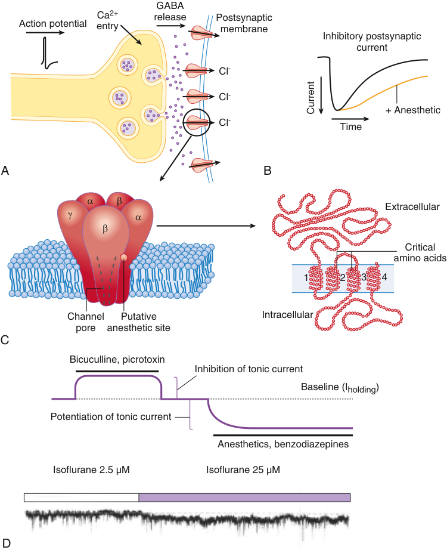

GABA Ca 2+ release Postsynaptic Action potential entry membrane Inhibitory postsynaptic current Cl - Cl - + Anesthetic Cl - Time A B � � Extracellular � � � Critical amino acids 1 2 3 4 Channel Putative Intracellular pore anesthetic site C Bicuculline, picrotoxin Inhibition of tonic current Baseline (Iholding) Potentiation of tonic current Anesthetics, benzodiazepines Isoflurane 2.5 µM Isoflurane 25 µM D Current 

**Fig. 17.9 Synaptic and extrasynaptic GABA** A **receptors are targets for inhaled anesthetics.** (A) On binding of γ-aminobutyric acid (GABA)A to the GABAA receptor, its chloride- permeable channel opens, usually leading to hyperpolarization. Volatile anesthetics have a relatively low potency but high efficacy at synaptic GABAA receptors and a high potency and low efficacy at extrasynaptic GABAA receptors. (B) General anesthetics prolong channel opening and increase postsynaptic inhibition. The cartoon illustrates the prolongation of miniature inhibitory synaptic currents (mIPSCs) by the slowing of current decay. (C) A pentameric GABAA receptor complex in the lipid bilayer membrane _(left),_ with a blow- up of a single subunit showing the location of residues critical to anesthetic efficacy in the second and third transmembrane domains _(right)._ (D) A tonic inhibitory conductance is revealed by the application of a GABAA receptor antagonist (bicuculline or picrotoxin), as shown by the upward shift in the baseline current. Anesthetics and benzodiazepines increase the tonic conductance as indicated by the inward shift in the current. (Modified from Hemmings HC Jr, Akabas MH, Goldstein PA, et al. Emerging molecular mechanisms of general anesthetic action. _Trends Pharmacol Sci_ . 2005;26:503–510.)

of anesthetics on synaptic transmission is determined by the relative magnitude and direction of both their presynaptic and postsynaptic effects. The usual effects of inhaled anesthetics are to increase inhibitory synaptic transmission and to decrease excitatory synaptic transmission (Fig. 17.9).

Reduced excitatory synaptic transmission (Fig. 17.10) is primarily the result of decreased neurotransmitter release from presynaptic terminals,123,203,218–221 but a postsynaptic mechanism is also involved because the response to directly applied glutamate is also reduced to some degree.220,222,223 Volatile anesthetics have inconsistent effects on cloned AMPA or NMDA glutamate receptors, but they potentiate

kainate receptors,100,113,224,225 consistent with a predominantly presynaptic mechanism for glutamatergic synapses. By contrast, the effects of the nonhalogenated inhaled anesthetics (xenon, nitrous oxide, cyclopropane) appear to be mediated primarily by inhibition of postsynaptic NMDA receptors (discussed earlier). Under some circumstances, such as in patients with defects in mitochondrial complex 1226 and in mice carrying mutations in mitochondrial complex 1,227 inhaled agents suppress glutamate release by interfering with the energy- intensive glutamate recycling pathways,221,228 thereby leading to extreme anesthetic sensitivity. Recent evidence from conditional knockout mice

::: warning 符號需核對
此頁有符號無法完整擷取，請展開下方原始頁面核對。
:::

::: details 原始表格與符號（PDF 第 15 頁）

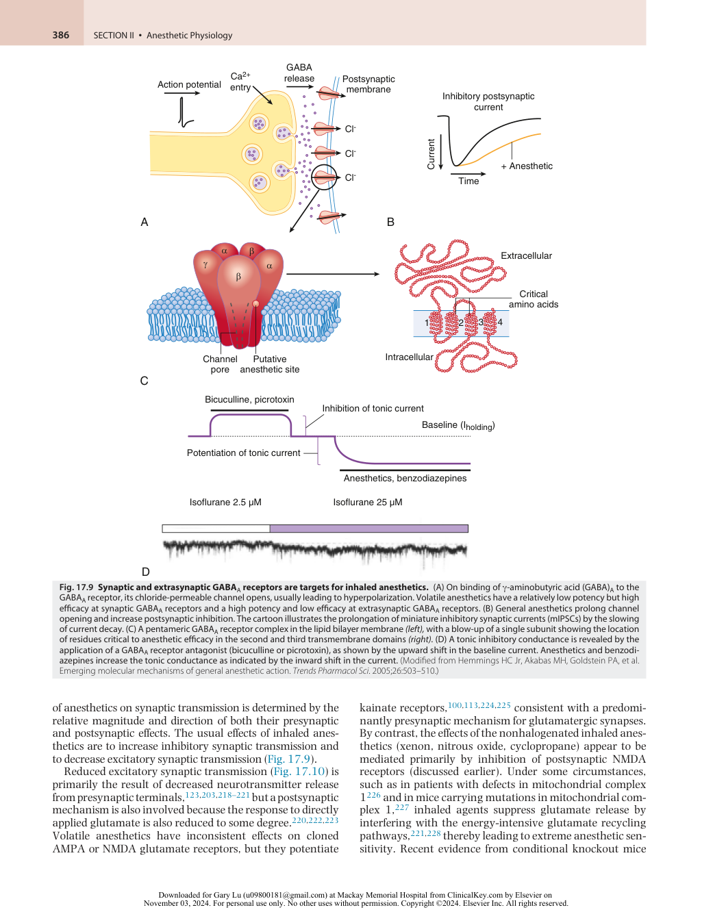

:::

<!-- PDF page 16 -->

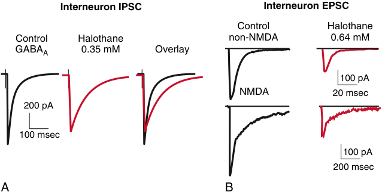

Interneuron IPSC Interneuron EPSC Control Halothane Control Halothane non-NMDA 0.64 mM GABAA 0.35 mM Overlay 100 pA NMDA 20 msec 200 pA 100 msec 100 pA 200 msec A B 

**Fig. 17.10 Halogenated anesthetics enhance inhibitory and depress excitatory synaptic transmission.** Halothane slows the decay of γ-aminobutyric acid (GABA)A receptor–mediated inhibitory postsynaptic currents (IPSCs) (A) and depresses the amplitude of glutamatergic excitatory postsynaptic currents (EPSCs) without affecting the decay (B) in hippocampal interneurons. _NMDA, N_ -methyl-d-aspartate. (A, Redrawn with permission from Nishikawa K, MacIver MB. Membrane and synaptic actions of halothane on rat hippocampal pyramidal neurons and inhibitory interneurons. _J Neurosci_ . 2000;20:5915–5923. B, Redrawn with permission from Perouansky M, et al. Effects of halothane on glutamate receptor- mediated excitatory postsynaptic currents: a patch- clamp study in adult mouse hippocampal slices. _Anesthesiology_ . 1995;83:109–119.)

indicates this mechanism contributes to various end points even in non- pathogenic states.229,230

Augmentation of GABAergic inhibition by most general anesthetics is mediated by both presynaptic and postsynaptic mechanisms. Enhancement of postsynaptic and extrasynaptic GABAA receptors is well recognized.101 Volatile anesthetics increase spontaneous GABA release and inhibitory postsynaptic current (IPSC) frequency231–235 – that is, their presynaptic effects at GABAergic terminals are distinct from those at glutamatergic synapses.

The mechanisms for the presynaptic effects of inhaled anesthetics, like those for their postsynaptic effects, are complex and involve multiple targets. Although a synapsespecific contribution of presynaptic Ca2+ channels is likely,236 presynaptic Na+ channels are more sensitive than the Ca2+ channels coupled to glutamate release. This finding is consistent with observations that the predominant Ca2+ channel coupled to neurotransmitter release at hippocampal glutamatergic synapses (P/Q- type) is insensitive to isoflurane.143 Synaptic vesicle exocytosis is more sensitive to volatile anesthetics in glutamatergic neurons than in GABAergic neurons, which is due to the greater functional expression of the less anesthetic- sensitive channel subtype Nav1.1 in specific interneurons compared to excitatory neurons in hippocampus.237 Other presynaptic mechanisms have been proposed, including actions on the vesicle fusion process, as demonstrated in the model organism _Caenorhabditis elegans_ .238,239 However, isoflurane effects on exocytosis in rat hippocampal neurons occur primarily upstream of vesicle fusion,125,240 although recent studies implicate effects on vesicle endocytosis mediated by reductions in presynaptic ATP levels by effects on mitochondrial complex 1 function.230

## Simple Circuits and Complex Networks

### SIMPLE CIRCUIT PHENOMENA

The development of a mechanistic understanding of phenomena involving complex circuits has been greatly

facilitated by the study of anatomically reduced ( _in vitro_ ) or physiologically simplified ( _in vivo_ ) preparations, complemented by computer simulations ( _in silico_ ). These approaches are essential for integrating reductionist observations of the multiple molecular effects of anesthetics into functional models relevant to behavioral end points. Anesthetic effects have been studied in acute brain slice preparations from various regions of the CNS (hippocampus, amygdala, cortex, thalamus, brainstem, and spinal cord) most often from rodents. Brain slices preserve native connections but usually lack natural inputs and outputs. Slices from developing mammalian brain can also be cultured _in vitro_ . These “organotypic slice cultures” preserve a high degree of synaptic connectivity and display spontaneous network activity, typically absent from “acute slices.” Simplified _in vivo_ preparations involve phenomena (typically evoked responses) with relatively well- understood circuitry. Computer models and simulations can assist in generating hypotheses for experimental testing and developing hypotheses based on experimental data.

### Synaptic Plasticity

Paired- pulse depression and paired- pulse facilitation are examples of short- term plasticity in response to external stimulation. Synaptic inhibition is prolonged by volatile anesthetics _in vivo_241 and _in vitro_ ,242 in general agreement with the notion that anesthetics enhance functional inhibition in the CNS. Enhancement of paired- pulse facilitation has been attributed to the presynaptic depressant effect of volatile agents (Fig. 17.11).218,219

Long- term potentiation (LTP), a cellular experimental model of learning and memory, is a use- dependent strengthening of glutamatergic excitatory synaptic connections. Volatile anesthetic effects on LTP depend on the experimental preparation: halothane, enflurane, and isoflurane do not block LTP induction _in vivo_ , whereas ketamine and the NMDA antagonist CPP do.241,243 By contrast, isoflurane blocks LTP in the hippocampal slice, by enhancing GABAA receptor–mediated inhibition (Fig. 17.12)244 or blocking neuronal nicotinic receptors.245 Long- term depression, a use- dependent weakening of excitatory connections that is

<!-- PDF page 17 -->

effectively a homeostatic counterpart of LTP, is also blocked by isoflurane _in vitro_ .244 The discrepancy between findings _in vivo_ and _in vitro_ remains unexplained.

### Spontaneously Active Circuits

Spontaneous neuronal activity is decreased by volatile anesthetics both _in vivo_ and in cortical brain slices.246,247 This effect is largely GABAA receptor- dependent and marked even at low sedative concentrations.246 Because the cortical brain slices lack subcortical input, these results suggest that volatile anesthetics can cause some effects (e.g., sedation) via direct cortical action. However, changes in raw neuronal firing rates do not provide a precise quantitative measure of higher cognitive function, which is better reflected by the relationship of firing patterns to the strength and

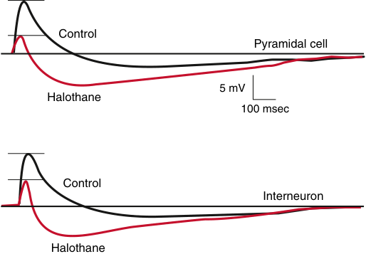

Control Pyramidal cell  5 mV Halothane 100 msec Control Interneuron Halothane 

**Fig. 17.11 Anesthetics affect excitation and inhibition simultaneously in opposite directions.** Halothane depresses the excitatory depolarization and augments the inhibitory hyperpolarization in both hippocampal pyramidal cells and interneurons. The net result will depend on the underlying neuronal state, the neuronal network, and its function. (Redrawn with permission form Nishikawa K, MacIver MB. Membrane and synaptic actions of halothane on rat hippocampal pyramidal neurons and inhibitory interneurons. _J Neurosci_ . 2000;20:5915–5923.)

phase of ongoing cortical rhythms (see next section). Anesthetic effects have also been tested on the circuitry underlying locomotion, a well- studied central pattern generator. Effects of isoflurane on _in vitro_ lamprey and rat spinal cord preparations support the spinal cord as the primary target for volatile anesthetic–induced immobility.248,249

### RHYTHMS AND SIMULATIONS

The brain perpetually generates complex electrical rhythms (oscillations in extracellular field potentials) that range in frequency from fractions to hundreds of Hertz (Hz; cycles per second), as recorded on the surface of the scalp as the electroencephalogram (EEG; the higher frequency oscillations cannot be resolved in surface recordings). All oscillations are behavioral state dependent, and multiple oscillations coexist throughout the sleep–wake cycle. Lower-frequency rhythms allow for integration over longer time periods and typically engage larger areas of the brain. By contrast, higher-frequency rhythms allow for higher temporal resolution on local scales. Cross- frequency modulation allows for integration of both aspects of information processing. Although their physiologic roles are not clear, brain rhythms reflect, subserve, and/or constitute fundamental higher- order processing, such that their modulation by anesthetics is of great interest. The current nomenclature of brain rhythms reflects historical conventions and is not based on underlying mechanisms.

### δ - Rhythms and Other Slow Rhythms

Oscillations with EEG frequencies from 1.5 to 4 Hz are generally referred to as δ- rhythms, and these oscillations are characteristic of deep sleep and are commonly observed under general anesthesia. Even slower rhythms (below 1 Hz) occur during non–rapid eye movement (NREM) sleep and appear at loss of consciousness induced by propofol,250 sevoflurane,251 and isoflurane.252 During natural NREM sleep, δ- rhythms and sleep spindles are phase related to a slower oscillation, suggesting functional interaction.253 Paroxysmal spindle- like waxing and waning oscillations

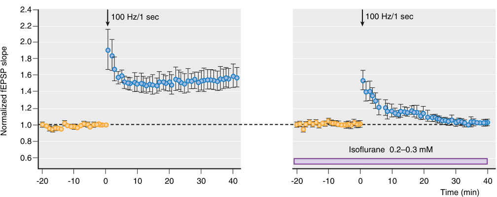

2.4 100 Hz/1 sec 100 Hz/1 sec 2.2 2.0 1.8 1.6 1.4 1.2 1.0 0.8 Isoflurane  0.2–0.3 mM 0.6 -20 -10 0 10 20 30 40 -20 -10 0 10 20 30 40 Time (min) Normalized fEPSP slope 

**Fig. 17.12 Isoflurane blocks the induction of synaptic plasticity** **_in vitro_ (a model of learning and memory).** Long- term potentiation (an increase in synaptic strength), indicated by the increase in normalized excitatory postsynaptic potential (EPSP) slope, in hippocampal slices evoked by tetanic stimulation of excitatory synapses, is blocked by 0.2 to 0.3 mM isoflurane. (Redrawn with permission from Simon W, et al. Isoflurane blocks synaptic plasticity in the mouse hippocampus. _Anesthesiology_ . 2001;94:1058–1065.)

<!-- PDF page 18 -->

overriding slower rhythms are also present in the cortical EEG under anesthesia. A change in δ–α phase relationships has been proposed as a “signature” of propofol- induced unconsciousness,254 but this pattern was reported not to apply to isoflurane.252

### θ - Rhythms

θ- Rhythms, present in various cortical structures but most prominent in the hippocampus, are thought to signal the “online state.” They are associated with sensorimotor and mnemonic functions during waking behavior.255 One component of the θ- rhythm (type I or atropine resistant) can be affected by amnestic concentrations of isoflurane as well as by the amnestic nonimmobilizer F6,80 indicating a potential network- level signature effect for anesthetic- induced amnesia. Type II θ- rhythm (atropine sensitive) can be evoked under anesthesia and is slowed and potentiated by halothane.256 Interestingly, this halothane- induced oscillation disappears in TASK- 3 knockout mice.49

### γ - Rhythms

This designation includes an extremely broad and probably functionally and mechanistically heterogeneous spectrum of rhythms. It is frequently subdivided into slow γ (30 to 50 Hz, i.e., the spectrum above β- rhythms); γ (50 to 90 Hz), and fast- , ultra- γ, or ε- rhythms (>90 and up to hundreds of Hz). Fast GABAA- ergic synaptic inhibition and intrinsic resonant properties of neurons play important roles in γ- physiology, making these obvious candidates for anesthetic modulation. Isoflurane slows the frequency of evoked γ- oscillations (30 to 90 Hz, also known as “40- Hz rhythms”) in humans.257,258 Studies of γ- oscillations _in vitro_ suggest that their frequency depends on the time constant of decay of GABAA receptor–mediated synaptic currents in inhibitory networks.259 Isoflurane slows γ- rhythms in hippocampal260 and neocortical slices261 to a comparable degree as it does in humans,257 providing a tentative link between receptor and circuit- level effects. However, the interaction between anesthetics and behaviorally relevant network effects is likely to be complex because flash- evoked γ- oscillations in the primary visual cortex are not affected by inhaled agents,262 whereas feedback information transfer at γ- frequencies between the visual and frontal cortices is disrupted.262,263 Moreover, many brain rhythms are interlinked (e.g., θ- rhythm modulates γ- oscillations (θ–γ nesting). The nature of their modulation by anesthetics as well as relevance are far from clear.

### Models and Simulations

On the macroscopic scale, computer simulations can provide an integrated picture of modulation of dynamic neuronal and network activity. “Bottom- up” neuron- by- neuron approaches are based on computational models of individual neurons, known anesthetic effects on intrinsic and synaptic membrane conductances, and simple network models. Computer simulations of anesthetic effects on integrated outputs can thereby be generated (e.g., the ring of pacemaker neurons).264 These models obviously rely on the accuracy of the derived characteristics of real neurons and networks as well as knowledge of the effects of anesthetics; the scale of simulations is limited by the complexity of its elements.265 An alternative is a “top- down” approach,

such as mean- field modeling, in which molecular and cellular individual accuracy detail is sacrificed in favor of global dynamics. For example, global cortical phenomena, such as anesthetic- induced seizures, have been modeled as phase transitions based on mean interactions between populations of averaged neurons (analogous to the EEG signal that also averages the signals of neuronal populations).266 This approach can be extended to other global cortical phenomena such as consciousness.267 Neuronal modeling and computer simulations may gain importance in the future as bridges between theoretical and experimental studies of anesthesia.

## Research Strategies for the Future

The search for anesthetic mechanisms is driven by advances in the basic sciences. Some strategies that should facilitate understanding of anesthetic mechanisms include use of agonists or antagonists _in vivo_ , nonanesthetics or nonimmobilizers, high- resolution imaging of the functioning brain _in vivo_ , use of transgenic animals expressing sensitive biosensor and optogenetic tools, and advanced techniques of molecular genetics.

### PHARMACOLOGIC APPROACHES

### Agonists, Antagonists, and Experimental Anesthetics

Use of receptor- specific agonists and antagonists provides a pharmacologic method for bridging _in vitro_ with _in vivo_ studies. In this approach, a receptor may be tested for its contribution to a specific end point (e.g., immobility) according to the criteria presented earlier. This approach was used to exclude an important role for NMDA receptor block in the immobilizing action of volatile anesthetics but did not yield conclusive results for the roles of GABAA receptors and GlyR for immobilization,267,268 probably owing to the intricacies of drug–receptor interactions on different levels of integration in complex networks like the spinal cord. A complementary pharmacologic approach using experimental anesthetics that inhibit NMDA receptors _in vitro_ with different potencies supports the conclusion that NMDA receptor blockade does not contribute significantly to immobility by conventional volatile anesthetics.269 Refinement of this strategy involves the anatomically discrete application of drugs to nuclei with known function. For example, the tuberomammillary nucleus (part of the endogenous sleep pathway) mediates the sedative component of anesthesia for some intravenous anesthetics (e.g., propofol).35 A discrete site of general anesthetic action for GABAergic drugs in the mesopontine tegmentum has also been proposed based on this strategy.34,270 However, these approaches suffer from the fact that, invariably, high concentrations of drugs have to be injected locally to observe pharmacologic effects (because of rapid redistribution), so that such observations need to be substantiated using more sophisticated approaches, such as genetic manipulations (see later).

### Nonimmobilizers

Nonimmobilizers are compounds with physicochemical characteristics similar to those of conventional inhaled

<!-- PDF page 19 -->

anesthetics, but their predicted anesthetizing concentrations (based on their lipid solubility and the Meyer–Overton correlation [MACpred]) do not induce immobility.16 Initially termed nonanesthetics, the terminology was revised when it was discovered that at least some of them cause amnesia at similar MACpred fractions to classic volatile anesthetics.84 If a molecular or cellular process is affected in similar ways by an anesthetic and a nonimmobilizer, that process is not relevant for the anesthetic state, with the notable exception of amnesia. Despite this elegant rationale, only a limited number of receptors have been excluded because, compared with volatile anesthetics, nonimmobilizers are relatively target selective. These compounds have the potential to provide insights beyond the initially envisaged receptor- level studies by allowing the separation of sedation from amnesia for the study of underlying network activity _in vivo_ .81

### Photoreactive Anesthetics

An approach that has proven to be very successful with intravenous drugs271 is one in which an analogue of an anesthetic is synthesized that bears a photoreactive group (often a tri fluoro- diazirine) which, when irradiated at a wavelength of around 300 nm, reacts irreversibly with some amino acids in the anesthetic binding site. This approach, of course, requires that the pharmacologic profile of the analogue is very similar to that of the parent compound, so that the relevant binding site is identified. Photoreactive analogues of inhaled anesthetics have been synthesized and four putative sites on GABAA receptors have been identified.272 One advantage of this approach over X- ray crystallography is that anesthetic binding to different conformational states of the receptor is, at least in principle, more accessible to analysis.

### GENETIC APPROACHES

### Whole-Organism Genetics

Genetic strategies on whole organisms take two forms: forward and reverse.273 The reverse genetic approach focuses on a particular gene, chosen because there are reasons to hypothesize that its product may be important to anesthesia. Examples of this strategy are targeted mutations that alter the sensitivity of specific neurotransmitter receptors to anesthetics.106 Initially, these mutations were used to identify anesthetic binding sites. Subsequently, transgenic animals rendered resistant to anesthetics, either by deletion of a putative target protein from the genome or by expressing a target receptor engineered to be insensitive to an anesthetic, were used to test behavioral relevance of the altered gene product for the production of anesthesia. Forward genetics, by contrast, is a discovery process that involves the study of randomly generated mutations (either experimentally induced or naturally occurring polymorphisms) in a population that affect the phenotype of interest (i.e., anesthetic end points). This approach, however, has not been widely used.

### Molecular Genetics

A third genetic approach that is playing an increasing role in neuroscience is the selective modification of neuronal function using molecular genetics. There are many different

approaches used, ranging from the selective knockdown of specific receptor populations using microRNA (a small non- coding piece of RNA that can selectively reduce protein expression), the block of neurotransmitter release from a population of neurons using tetanus toxin light chain, and the selective activation or inhibition of neuronal networks using optogenetics274 or pharmacogenetics.275 A powerful complement to these techniques is the ability to deliver artificial transgenes to defined neuronal populations using adeno- associated virus (AAV), and mouse lines that express Cre recombinase in particular cell types, which allow the selective expression of those genes in those specific cells. These approaches are only just beginning to be used to identify neuronal pathways that are involved in anesthetic action. For example, it has recently been shown that the sedative effects of propofol require the activation of the lateral habenula, an excitatory nucleus that lies close to the thalamus.276 These approaches are likely to have an increasing impact on our understanding of the mechanisms of inhaled general anesthetics.

### Knockout and Knock- in Animals

In the knockout approach, expression of the gene encoding a protein of interest is disrupted by a specific deletion or insertion. Nearly all such studies have been carried out in mice. A well- recognized problem with the global knockout approach is that extensive compensatory changes can be induced, from anomalies that are lethal _in utero_ to insidious (but experimentally confounding) influences that might be expressed only at maturity. A complementary strategy is the conditional knockout, in which the genetic deletion is restricted – either anatomically (limited to certain brain regions) or temporally (at a known point in time). These strategies can minimize developmental anomalies and reduce the likelihood of compensatory changes. In the knock- in approach, a mutation, usually of a single amino acid residue, is targeted to produce a protein with altered sensitivity to a drug of interest. Ideally, this mutation remains completely silent in the absence of the drug – that is, it does not perturb the normal expression and function of the protein of interest or alter the expression of other genes.

**GABAA Receptors.** Results from transgenic animals illustrate both the utility and the difficulties of the genetic approach with respect to inhaled agents. The conditional forebrain- restricted GABAA receptor α1-subunit knockout mouse was found to be less sensitive to isoflurane- induced amnesia than wild- type mice, and this led to the conclusion that action at these receptors contributes to its amnesic effects.277 By contrast, a mouse harboring a mutation of the GABAA receptor α1 subunit that renders the receptor insensitive to isoflurane _in vitro_ did not show reduced sensitivity to either the amnesic or the immobilizing effects of isoflurane, leading to the conclusion that this subunit does not mediate the impairment of learning and memory by isoflurane.45 Similar experiments indicate that action at the GABAA receptor β3 subunit does not mediate immobility or amnesia by isoflurane.44 This “bottom- up” genetic approach is a work- intensive but powerful tool that has yielded clear results with the receptor- specific intravenous anesthetics,26 but it has proved more challenging to apply it to the more promiscuous inhaled agents.

<!-- PDF page 20 -->

**Glycine α1–Containing Receptors.** Pharmacologic studies supported the notion that glycinergic neurotransmission might be the effector for the immobilizing action of inhaled anesthetics in the spinal cord, where glycine replaces GABA as the principal inhibitory transmitter. However, mice harboring mutations that render α1-subunit–containing glycine receptors largely insensitive to alcohol and inhaled ether anesthetics did not demonstrate a concordant change in MAC values. Because α1 is the most widely expressed subunit in adult animals, it is unlikely that action at glycine receptors plays an important part in the immobilizing action of inhaled agents.277

**Two- pore Domain K**+ **Channels.** Use of mice harboring knockout mutations of several two- pore domain K+ channel (K2P) family members (TASK- 1, TASK- 3, TREK1) has demonstrated a role for these channels in volatile anesthesia.47–49 For example, TREK- 1 knockout mice are partially resistant to all volatile anesthetics tested with respect to both loss of righting reflex (a surrogate measure of consciousness) and immobility, but anesthesia can still be induced, albeit at higher anesthetic concentrations. Interestingly, responses to pentobarbital are unaffected, indicating that the mutation does not cause a generalized resistance to anesthesia.

### FORWARD AND POPULATION GENETICS

The nematode _Caenorhabditis elegans_ and the fruit fly _Drosophila melanogaster_ , with 302 and 100,000 neurons, respectively, have also been used as model organisms in anesthesia research.239 Mutations in a number of _C. elegans_ genes affect sensitivity to volatile anesthetics,278 most notably _unc- 1_ ,279 a close homologue of the mammalian protein stomatin.280 Yeasts have also been used as model organisms, with even more obvious limitations with respect to identification of appropriate anesthetic end points. Sensitivity to anesthetics is a quantitative trait (varying continuously in a population).

Quantitative genetics is the study of the heritability of continuous traits. These traits are controlled by genes represented in quantitative trait loci (QTLs). A top- down population- based approach has been used to localize QTLs that govern susceptibility of individuals to anesthetics, in higher and lower organisms. Starting from the observation that inbred mouse strains vary in their sensitivity to isoflurane, microsatellite- based linkage analysis and, alternatively, single- nucleotide polymorphism–based analysis of genetic variation localized a QTL for isoflurane immobilization to the proximal part of mouse chromosome 7.281 Genetic variability in the sensitivity of _Drosophila melanogaster_ to inhaled anesthetics has also been demonstrated.282 This type of analysis promises to assist in defining the genetic basis for variability in the susceptibility to both primary anesthetic end points and side effects.

### FUNCTIONAL IMAGING AND HIGH- DENSITY EEG

Identification of the anatomic and functional substrates for anesthetic effects on consciousness, memory, and immobility is now approachable with improved imaging techniques. Imaging is based on mapping of either metabolic or

hemodynamic changes as surrogate measures of neuronal activity, as in positron emission tomography (PET) and functional magnetic resonance imaging, or on mapping electrical activity with high- density EEG, magnetoencephalography, and low- resolution brain electromagnetic tomography. Properties of receptors can also be probed with radioactive ligands (PET). These techniques have the capacity to identify neuroanatomic substrates of drug action, with method- specific limitations. Results from functional PET imaging suggest that propofol suppresses episodic memory by targeting the prefrontal and posterior parietal cortex as opposed to the medial temporal lobe,283 and that suppression of consciousness is caused by anesthetic action in the thalamus, parts of the medial and posterior parietal cortex, and/or the posterior cingulate and medial parietal cortex.284 Although observations of regionally specific and global suppressive effects of anesthetics on metabolic activity are unlikely to provide a definitive mechanistic understanding, such information can facilitate hypotheses and experimentally testable predictions.

Advanced analytical approaches based on theories from mathematical and statistical sciences are being increasingly applied to enhance the power of existing technologies. Magnetic resonance images and high- density EEG recordings of the brain reveal strong interregional connections, but the considerable potential of this connectivity information to better understand the brain’s response to anesthesia has only recently begun to be tapped. The growing use of invasive recording techniques (e.g., brain surface electrode grids and microelectrodes implanted deep into the brain for functional neurosurgical therapies) is also advancing the frontiers of neuroscience in general and particularly the understanding of anesthetic mechanisms.

### OVERLAP WITH NATURAL SLEEP PATHWAYS

The idea that anesthetics may exert some of their effects by recruiting natural sleep pathways is an established idea.21 However, it is clear that such mechanisms could only operate at relatively low, sedative, concentrations that cause loss of consciousness, rather than at surgical concentrations that prevent mobility. The overlap is tantalizing, however, and both the anesthetic- activation of pathways that cause sleep, and the inhibition of pathways that cause arousal have been demonstrated that might, plausibly, contribute to anesthetic- induced sedation. A common error in logic, however, has been to infer that a causal relationship has been shown, rather than a necessary but not sufficient condition. For example, when dopaminergic neurons in the ventral periaqueductal gray are lesioned,285 this resulted in a shorter induction time for isoflurane. A similar effect was observed when dopaminergic neurons in the nucleus accumbens were activated.286 Similarly, serotonergic neurons in the dorsal raphe will decrease anesthetic depth when stimulated.287 But it can safely be predicted that the stimulation of _any_ arousal pathway will tend to antagonize general anesthetics and such a relation does not mean that this contributes to the anesthetic state. Similarly, enhancing sleep pathways288 and finding that anesthesia is deepened, or emergence delayed, cannot be taken by themselves as evidence that a particular sleep pathway is causally involved. These studies are useful, nonetheless, and more

<!-- PDF page 21 -->

subtle ways are needed to establish a causal relationship between natural pathways of sleep and arousal and anesthetic- induced sedation.289

16.  Koblin DD, et al. _Anesth Analg_ . 1994;79:1043.

17.  Dickinson R, et al. _Biophys J_ . 1994;66:2019.

18.  Franks NP, Lieb WR. _Science_ . 1991;254:427.

19.  Hall AC, et al. _Br J Pharmacol_ . 1994;112:906.

20.  Herold KF, et al. _Proc Natl Acad Sci U S A_ . 2017;114:3109.

## Summary

The mechanisms of inhaled anesthetics have proved more difficult to explain than was envisaged a generation ago, when the paradigm shifted from lipids to amphiphilic cavities in proteins as targets for anesthetics. Despite a remarkable accumulation of information, a comprehensive theory of general anesthetic action has yet to be formulated. Progress toward this goal has been difficult for several reasons. Important pharmacologic characteristics of inhaled anesthetics that have impeded identification of their relevant molecular targets are their low potency (hundreds of micromolar), activity at several targets, lack of specific antagonists, and limitations to our understanding of the neuroscience of memory and consciousness. This contrasts with the situation for intravenous anesthetics that exhibit more conventional receptor pharmacology. Moreover, accumulating evidence indicates that no universal target exists to explain the actions of every general anesthetic, or even of a single anesthetic agent. It is now clear that the composite state of anesthesia and its core components (amnesia, sedation/ unconsciousness, immobility) are separable behavioral states _in vivo_ . Resolution of these phenomena at the molecular and cellular levels represents the cutting edge of contemporary neuroscience. Of the multiple molecular and cellular anesthetic effects identified, it is unclear which are critical for the desired behavioral end points, which are harmless or beneficial side effects (e.g., preconditioning), and which, if any, could have long- lasting or delayed undesirable consequences (e.g., cell death, cognitive dysfunction). Progress in identifying the molecular targets of general anesthetics provides a foundation for identification of the network and systems level effects relevant to their behavioral and peripheral end points. As the biologic foundations of behaviors once thought to be exclusively the realm of psychology are unraveled, for which anesthetics provide a valuable investigative tool, a comprehensive theory of anesthesia will also develop.

21.  Franks NP. _Nat Rev Neurosci_ . 2008;9:370.

22.  Franks NP, Lieb WR. _Nature_ . 1994;367:607.

23.  Eckenhoff RG, Johansson JS. _Anesthesiology_ . 2001;95:1537.

24.  Eger 2nd EI, et al. _Anesthesiology_ . 2001;94:915.

25.  Dickinson R, et al. _Anesthesiology_ . 2000;93:837.

26.  Rudolph U, Antkowiak B. _Nat Rev Neurosci_ . 2004;5:709.

27.  Antognini JF, Schwartz K. _Anesthesiology_ . 1993;79:1244.

28.  Rampil IJ, et al. _Anesthesiology_ . 1993;78:707.

29.  Stabernack C, et al. _Anesth Analg_ . 2005;100:128.

30.  Veselis RA, et al. _Anesthesiology_ . 2001;95:896.

31.  Sleigh J, et al. _Br J Anaesth_ . 2018;121:233.

32.  Guldenmund P, et al. _Br J Anaesth_ . 2017;119:674.

33.  Sukhotinsky I, et al. _Eur J Neurosci_ . 2007;25:1417.

34.  Minert A, et al. _J Neurosci_ . 2017;37:9320.

35.  Nelson LE, et al. _Nat Neurosci_ . 2002;5:979.

36.  Taylor NE, et al. _Proc Natl Acad Sci U S A_ . 2016;113:12826.

37.  Kelz MB, et al. _Anesth Analg_ . 2019;128:726.

38.  Rampil IJ, Laster MJ. _Anesthesiology_ . 1992;77:920.

39.  Antognini JF, et al. _Anesth Analg_ . 1998;87:1450.

40.  Antognini JF, Kien ND. _Anesthesiology_ . 1994;80:1148.

41.  Zhang Y, et al. _Anesth Analg_ . 2004;99:85.

42.  Raines DE, et al. _Anesth Analg_ . 2002;95:573.

43.  Zhang Y, et al. _Br J Pharmacol_ . 2010;159:872.

44.  Liao M, et al. _Anesth Analg_ . 2005;101:412.

45.  Sonner JM, et al. _Anesthesiology_ . 2007;106:107.

46.  Heurteaux C, et al. _EMBO J_ . 2004;23:2684.

47.  Linden AM, et al. _J Pharmacol Exp Ther_ . 2006;317:615.

48.  Linden AM, et al. _J Pharmacol Exp Ther_ . 2007;323:924.

49.  Pang DS, et al. _Proc Natl Acad Sci U S A_ . 2009;106:17546.

50.  Westphalen RI, et al. _Br J Pharmacol_ . 2007;152:939.

51.  Jinks SL, et al. _Anesthesiology_ . 2008;108:1016.

52.  Searle JR. _Annu Rev Neurosci_ . 2000;23:557.

53.  Crick F, Koch C. _Nat Neurosci_ . 2003;6:119.

54.  Sanders RD, et al. _Anesthesiology_ . 2012;116:946.

55.  Dehaene S, et al. _Characterizing Consciousness: From Cognition to the Clinic_ ? Springer; 2011:55.

56.  Tononi G, et al. _Nat Rev Neurosci_ . 2016;17:450.

57.  Lamme VAF. _Philos Trans R Soc Lond B Biol Sci_ . 2018;373: 20170344.

58.  Brown R, et al. _Trends Cogn Sci_ . 2019;23:754.

59.  Hameroff S, Penrose R. _Phys Life Rev_ . 2014;11:39.

60.  Mashour GA. _Anesth Analg_ . 2022;134:1118.

61.  Bullmore E, Sporns O. _Nat Rev Neurosci_ . 2012;13:336.

62.  van den Heuvel MP, Sporns O. _J Neurosci_ . 2011;31:15775.

63.  Bressler SL, Menon V. _Trends Cogn Sci_ . 2010;14:277.

64.  Warnaby CE, et al. _Anesthesiology_ . 2016;124:766.

65.  Massimini M, et al. _Science_ . 2005;309:2228.

66.  Ferrarelli F, et al. _Proc Natl Acad Sci U S A_ . 2010;107:2681.

67.  Alkire MT, et al. _Science_ . 2008;322:876.

### Complete references available online at expertconsult.com.

68.  Imas OA, et al. _Neurosci Lett_ . 2006;402:216.

69.  Imas OA, et al. _Anesthesiology_ . 2005;102:937.

70.  John ER, et al. _Conscious Cogn_ . 2001;10:165.

### References

1.  Perouansky M. _Anesthesiology_ . 2012;117:465.

2.  Winterstein H. _Die Narkose in Ihrer Bedeutung Fur Die Allgemeine Physiologie_ . Verlag Von Julius Springer; 1919.

3.  Eger 2nd EI. _Anesthesiology_ . 2002;96:238.

4.  Eger 2nd EI, et al. _Anesthesiology_ . 1965;26:756.

5.  Franks NP, Lieb WR. _Anesthesiology_ . 1996;84:716.

6.  Boggs JM, et al. _Mol Pharmacol_ . 1976;12:127.

7.  Franks NP, Lieb WR. _J Mol Biol_ . 1979;133:469.

8.  Franks NP, Lieb WR. _Nature_ . 1978;274:339.

9.  Featherstone RM, et al. _Anesthesiology_ . 1961;22:977.

10.  Franks NP, Lieb WR. _Nature_ . 1981;292:248.

11.  Franks NP, Lieb WR. _Nature_ . 1982;300:487.

12.  Franks NP, Lieb WR. _Nature_ . 1984;310:599.

13.  Franks NP, Lieb WR. _Nature_ . 1985;316:349.

14.  Franks NP, Lieb WR. _Proc Natl Acad Sci U S A_ . 1986;83:5116.

15.  Franks NP, Lieb WR. _Anesthesiology_ . 2004;101:235.

71.  Burlingame RH, et al. _Anesthesiology_ . 2007;106:754.

72.  Ter- Mikaelian M, et al. _J Neurosci_ . 2007;27:6091.

73.  Dutton RC, et al. _Anesthesiology_ . 2001;94:514.

74.  Perouansky M, Pearce RA. _Can J Anaesth_ . 2011;58:157.

75.  Alkire MT, Nathan SV. _Anesthesiology_ . 2005;102:754.

76.  Alkire MT, Gorski LA. _Anesthesiology_ . 2004;101:417.

77.  Vertes RP. _Hippocampus_ . 2005;15:923.

78.  Pan WX, McNaughton N. _Brain Res_ . 1997;764:101.

79.  Robbe D, et al. _Nat Neurosci_ . 2006;9:1526.

80.  Perouansky M, et al. _Anesthesiology_ . 2007;106:1168.

81.  Seidenbecher T, et al. _Science_ . 2003;301:846.

82.  Rudolph U, et al. _Nature_ . 1999;401:796.

83.  Kandel L, et al. _Anesth Analg_ . 1996;82:321.

84.  Mihic SJ, et al. _Mol Pharmacol_ . 1994;46:851.

85.  Zarnowska ED, et al. _Anesth Analg_ . 2005;101:401.

86.  Jevtovic- Todorovic V, et al. _Nat Med_ . 1998;4:460.

87.  Gruss M, et al. _Mol Pharmacol_ . 2004;65:443.

88.  Gries DA, et al. _Life Sci_ . 2005;76:1667.

<!-- PDF page 22 -->

89.  Murphy M, et al. _Sleep_ . 2011;34:283.

90.  Tung A, et al. _Anesthesiology_ . 2004;100:1419.

91.  Nelson AB, et al. _Sleep_ . 2010;33:1659.

92.  Miracca G, et al. _J Neurosci_ . 2022;42:5389.

93.  Zeller A, et al. _Handb Exp Pharmacol_ . 2008;31.

94.  Franks NP, et al. _Biophys J_ . 1998;75:2205.

95.  Bhattacharya AA, et al. _J Biol Chem_ . 2000;275:38731.

96.  Bertaccini EJ, et al. _Anesth Analg_ . 2007;104:318.

97.  Eckenhoff RG. _Mol Interv_ . 2001;1:258.

98.  Howard RJ, et al. _Pharmacol Rev_ . 2014;66:396.

99.  Nury H, et al. _Nature_ . 2011;469:428.

100.  Dickinson R, et al. _Anesthesiology_ . 2007;107:756.

101.  Hemmings Jr HC, et al. _Trends Pharmacol Sci_ . 2005;26:503.

102.  Franks NP, Honore E. _Trends Pharmacol Sci_ . 2004;25:601.

103.  Patel AJ, et al. _Nat Neurosci_ . 1999;2:422.

104.  Sieghart W. _Adv Pharmacol_ . 2015;72:53.

105.  Lynch JW. _Physiol Rev_ . 2004;84:1051.

106.  Mihic SJ, et al. _Nature_ . 1997;389:385.

107.  Jenkins A, et al. _Br J Pharmacol_ . 1996;117:1507.

108.  Solt K, et al. _J Pharmacol Exp Ther_ . 2005;315:771.

109.  Role LW, Berg DK. _Neuron_ . 1996;16:1077.

110.  Flood P, et al. _Anesthesiology_ . 1997;86:859.

111.  Violet JM, et al. _Anesthesiology_ . 1997;86:866.

112.  Dingledine R, et al. _Pharmacol Rev_ . 1999;51:7.

113.  de Sousa SL, et al. _Anesthesiology_ . 2000;92:1055.

114.  Franks NP, et al. _Nature_ . 1998;396:324.

115.  Solt K, et al. _Anesth Analg_ . 2006;102:1407.

116.  Harris RA, et al. _FASEB J_ . 1995;9:1454.

117.  Hemmings Jr HC, et al. _Trends Pharmacol Sci_ . 2019;40:464.

118.  Sonner JM, et al. _Anesth Analg_ . 2005;101:143.

119.  Maclver MB, et al. _Anesthesiology_ . 1996;85:823.

120.  Perouansky M, et al. _Anesthesiology_ . 2004;100:470.

121.  Winegar BD, MacIver MB. _BMC Neurosci_ . 2006;7:5.

122.  Haydon DA, Urban BW. _J Physiol_ . 1983;341:429.

123.  Berg- Johnsen J, Langmoen IA. _Acta Anaesthesiol Scand_ . 1992;36:350. 124.  Mikulec AA, et al. _Brain Res_ . 1998;796:231.

125.  Wu XS, et al. _Anesthesiology_ . 2004;100:663.

126.  Catterall WA. _Annu Rev Cell Dev Biol_ . 2000;16:521.

127.  Yu FH, Catterall WA. _Sci STKE_ . 2004:re15.

128.  Herold KF, et al. _Anesthesiology_ . 2009;111:591.

129.  Ouyang W, Hemmings Jr HC. _J Pharmacol Exp Ther_ . 2005;312:801.

130.  OuYang W, Hemmings Jr HC. _Anesthesiology_ . 2007;107:91.

131.  Ouyang W, et al. _J Pharmacol Exp Ther_ . 2007;322:1076.

132.  Ratnakumari L, et al. _Anesthesiology_ . 2000;92:529.

133.  Zhou C, et al. _J Pharmacol Exp Ther_ . 2019;369:200.

134.  Herold KF, Hemmings Jr HC. _Front Pharmacol_ . 2012;3:50.

135.  Stowe DF, et al. _Anesthesiology_ . 2000;92:516.

136.  Sand RM, et al. _J Gen Physiol_ . 2017;149:623.

137.  Barber AF, et al. _Proc Natl Acad Sci U S A_ . 2014;111:6726.

138.  Kinde MN, et al. _Proc Natl Acad Sci U S A_ . 2016;113:13762.

139.  Miao N, et al. _Anesthesiology_ . 1995;83:593.

140.  Pocock G, Richards CD. _Br J Anaesth_ . 1993;71:134.

141.  Kameyama K, et al. _Br J Anaesth_ . 1999;82:402.

142.  Study RE. _Anesthesiology_ . 1994;81:104.

143.  Hall AC, et al. _Anesthesiology_ . 1994;81:117.

144.  Takei T, et al. _Neurosci Lett_ . 2003;350:41.

145.  Joksovic PM, et al. _Br J Pharmacol_ . 2005;144:59.

146.  Todorovic SM, et al. _Mol Pharmacol_ . 2001;60:603.

147.  Petrenko AB, et al. _Anesthesiology_ . 2007;106:1177.

148.  Timic Stamenic T, et al. _Cereb Cortex_ . 2019;229:4679.

149.  Hanley PJ, et al. _Anesthesiology_ . 2004;101:999.

150.  Huneke R, et al. _Acta Anaesthesiol Scand_ . 2004;48:547.

151.  Rithalia A, et al. _Anesth Analg_ . 2004;99:1615.

152.  Huneke R, et al. _Anesthesiology_ . 2001;95:999.

153.  Davies LA, et al. _Anesthesiology_ . 2000;93:1034. 154.  Joseph JD, et al. _Anesthesiology_ . 2014;121:528.

155.  Pabelick CM, et al. _Anesthesiology_ . 2001;95:207.

156.  Roberts MC, et al. _Anesthesiology_ . 2001;95:716.

157.  Mickelson JR, Louis CF. _Physiol Rev_ . 1996;76:537.

158.  Yost CS. _Anesthesiology_ . 1999;90:1186.

159.  Friederich P, et al. _Anesthesiology_ . 2001;95:954.

160.  Franks NP, Lieb WR. _Nature_ . 1988;333:662.

161.  Dickinson R, Franks NP. _Crit Care_ . 2010;14:229. 162.  Tong L, et al. _Br J Anaesth_ . 2014;113:157.

163.  Li Y, et al. _Neurosci Bull_ . 2018;34:887.

164.  Woll KA, et al. _ACS Chem Biol_ . 2017;12:1353.

165.  Bertaccini EJ, et al. _ACS Chem Neurosci_ . 2014;5:1246.

166.  Wague A, et al. _Elife_ . 2020;9:e59839.

167.  Farwell D, Gollob MH. _Can J Cardiol_ . 2007;23(suppl A):16A.

168.  Antzelevitch C. _J Electrocardiol_ . 2001;34(suppl):177.

169.  Li J, Correa AM. _Anesthesiology_ . 2002;97:921.

170.  Davies LA, et al. _Br J Pharmacol_ . 2000;131:223.

171.  Stadnicka A, et al. _J Anesth_ . 2007;21:212.

172.  Wojtovich AP, et al. _Anesthesiology_ . 2016;124:1065.

173.  Sirois JE, et al. _J Physiol_ . 2002;541:717.

174.  Chen X, et al. _J Neurosci_ . 2005;25:5803.

175.  Robinson RB, Siegelbaum SA. _Annu Rev Physiol_ . 2003;65:453.

176.  Riegelhaupt PM, et al. _Methods Enzymol_ . 2018;602:391.

177.  Rebecchi MJ, Pentyala SN. _Br J Anaesth_ . 2002;89:62.

178.  Peterlin Z, et al. _Mol Cell Neurosci_ . 2005;30:506.

179.  Minami K, et al. _Mol Pharmacol_ . 1998;53:148.

180.  Minami K, et al. _J Pharmacol Exp Ther_ . 1997;281:1136.

181.  Minami K, et al. _Eur J Pharmacol_ . 1997;339:237.

182.  Hemmings Jr HC. _Toxicol Lett_ . 1998;100:89.

183.  Hasegawa J, et al. _Acta Histochem Cytochem_ . 2006;39:163.

184.  Das J, et al. _J Biol Chem_ . 2004;279:37964.

185.  Shumilla JA, et al. _Anesth Analg_ . 2004;99:82.

186.  Sonner JM, et al. _Anesth Analg_ . 1999;89:1030.

187.  Fukuda S, Warner DS. _Br J Anaesth_ . 2007;99:10.

188.  Inoue S, et al. _Anesthesiology_ . 2004;101:75.

189.  Pratt Jr PF, et al. _Curr Opin Anaesthesiol_ . 2006;19:397.

190.  Rasmussen LS, et al. _Acta Anaesthesiol Scand_ . 2004;48:1137.

191.  Turner CP, et al. _Neuroscience_ . 2012;210:384.

192.  Ludwig LM, et al. _Anesthesiology_ . 2004;100:532.

193.  Zaugg M, et al. _Br J Anaesth_ . 2003;91:551.

194.  Song IA, et al. _BMC Anesthesiol_ . 2016;16:13.

195.  Snyder GL, et al. _Neuropharmacology_ . 2007;53:619.

196.  Hemmings Jr HC, Adamo AI. _Anesthesiology_ . 1994;81:147.

197.  Marota JJ, et al. _Anesthesiology_ . 1992;77:365.

198.  Hamaya Y, et al. _Anesth Analg_ . 2000;90:1177.

199.  Culley DJ, et al. _Eur J Pharmacol_ . 2006;549:71.

200.  Futterer CD, et al. _Anesthesiology_ . 2004;100:302.

201.  Durieux M, Davis PJ. _Anesth Analg_ . 2010;110:1265.

202.  Dalla Massara L, et al. _Anesthesiology_ . 2016;124:1311.

203.  Kullmann DM, et al. _J Physiol_ . 1989;412:277.

204.  Fujiwara N, et al. _J Physiol_ . 1988;402:155. 1988.

205.  MacIver MB, Roth SH. _Br J Anaesth_ . 1988;60:680.

206.  Ries CR, Puil E. _J Neurophysiol_ . 1999;81:1802.

207.  Sirois JE, et al. _J Neurosci_ . 2000;20:6347.

208.  Timic Stamenic T, Todorovic SM. _Int J Mol Sci_ . 2022;23:2349.

209.  Semyanov A, et al. _Trends Neurosci_ . 2004;27:262.

210.  Houston CM, et al. _J Neurosci_ . 2012;32:3887.

211.  Bieda MC, MacIver MB. _J Neurophysiol_ . 2004;92:1658.

212.  Bai D, et al. _Mol Pharmacol_ . 2001;59:814.

213.  Caraiscos VB, et al. _Proc Natl Acad Sci U S A_ . 2004;101:3662.

214.  Caraiscos VB, et al. _J Neurosci_ . 2004;24:8454.

215.  Capogna M, Pearce RA. _Trends Neurosci_ . 2011;34:101.

216.  Rodgers FC, et al. _J Neurosci_ . 2015;35:9707.

217.  Speigel IA, Hemmings Jr HC. _Front Synaptic Neurosci_ . 2022;13: 812905.

218.  MacIver MB, et al. _Anesthesiology_ . 1996;85:823.

219.  Kirson ED, et al. _Br J Pharmacol_ . 1998;124:1607.

220.  Richards CD, Smaje JC. _Br J Pharmacol_ . 1976;58:347.

221.  Zimin PI, et al. _Br J Anaesth_ . 2018;120:1019.

222.  Wakamori M, et al. _J Neurophysiol_ . 1991;66:2014.

223.  Yang J, Zorumski CF. _Ann N Y Acad Sci_ . 1991;625:287.

224.  Dildy- Mayfield JE, et al. _J Pharmacol Exp Ther_ . 1996;276:1058.

225.  Minami K, et al. _J Biol Chem_ . 1998;273:8248.

226.  Morgan PG, et al. _Anesthesiology_ . 2002;96:1268.

227.  Quintana A, et al. _PLoS One_ . 2012;7 :e42904.

228.  Zimin PI, et al. _Curr Biol_ . 2016;26:2194.

229.  Ramadasan- Nair R, et al. _PLoS One_ . 2017;10:e0188087.

230.  Jung S, et al. _Curr Biol_ . 2022;32:3016.

231.  Banks MI, Pearce RA. _Anesthesiology_ . 1999;90:120.

232.  Murugaiah KD, Hemmings Jr HC. _Anesthesiology_ . 1998;89:919.

233.  Nishikawa K, MacIver MB. _Anesthesiology_ . 2001;94:340.

234.  Westphalen RI, Hemmings Jr HC. _J Pharmacol Exp Ther_ . 2003;304:1188.

235.  Westphalen RI, Hemmings Jr HC. _J Pharmacol Exp Ther_ . 2006;316:216.

<!-- PDF page 23 -->

236.  Baumgart JP, et al. _Proc Natl Acad Sci U S A_ . 2015;112:11959. 237.  Speigel IA, Hemmings Jr HC. _Br J Anaesth_ . 2021;127:587. 238.  Nagele P, et al. _Anesthesiology_ . 2005;103:768.

239.  van Swinderen B, et al. _Proc Natl Acad Sci U S A_ . 1999;96:2479. 240.  Hemmings Jr HC, et al. _Mol Pharmacol_ . 2005;67:1591. 241.  Pearce RA, et al. _Anesthesiology_ . 1989;71:591.

242.  Pearce RA. _J Physiol_ . 1996;492(Pt 3):823.

243.  Ballesteros KA, et al. _Int J Gen Med_ . 2012;5:935.

244.  Simon W, et al. _Anesthesiology_ . 2001;94:1058. 245.  Piao MH, et al. _Ann Fr Anesth Reanim_ . 2013;32:e135. 246.  Hentschke H, et al. _Eur J Neurosci_ . 2005;21:93. 247.  Kuo MC, Leung LS. _Anesthesiology_ . 2017;127:838. 248.  Jinks SL, et al. _Neuroreport_ . 2011;22:655. 249.  Jinks SL, et al. _Anesthesiology_ . 2005;103:567.

250.  Lewis LD, et al. _Proc Natl Acad Sci U S A_ . 2012;109:E3377. 251.  Guidera JA, et al. _Front Neural Circ_ . 2017;11:36.

252.  Jiang J, et al. _Front Pharmacol_ . 2022;13 :887981.

253.  Steriade M, et al. _J Neurosci_ . 1993;13:3266. 254.  Purdon PL, et al. _Proc Natl Acad Sci U S A_ . 2013;110:E1142. 255.  Buzsaki G. _Neuron_ . 2002;33:325. 256.  Bland BH, et al. _Hippocampus_ . 2003;13:38.

257.  Munglani R, et al. _Br J Anaesth_ . 1993;71:633.

258.  Madler C, et al. _Br J Anaesth_ . 1991;66:81.

259.  Buzsaki G, Wang XJ. _Annu Rev Neurosci_ . 2012;35:203.

260.  Dickinson R, et al. _Neuropharmacology_ . 2003;44:864.

261.  Antkowiak B, Hentschke H. _Neurosci Lett_ . 1997;231:87. 262.  Imas OA, et al. _Neurosci Lett_ . 2006;402:216. 263.  Imas OA, et al. _Neurosci Lett_ . 2005;387:145.

264.  Gottschalk A, Haney P. _Anesthesiology_ . 2003;98:548.

265.  Storer KP, Reeke GN. _Anesthesiology_ . 2012;117:780.

266.  Wilson MT, et al. _Anesthesiology_ . 2006;104:588.

267.  Steyn- Ross ML, et al. _Prog Biophys Mol Biol_ . 2004;85:369.

268.  Zhang Y, et al. _Anesth Analg_ . 2001;92:1585.

269.  Zhang Y, et al. _Anesth Analg_ . 2001;92:123.

270.  Devor M, Zalkind V. _Pain_ . 2001;94:101.

271.  Forman SA, Miller KW. _Anesth Analg_ . 2016;123:1263.

272.  Woll KA, et al. _FASEB J_ . 2018;32:4172.

273.  Nash HA. _Br J Anaesth_ . 2002;89:143.

274.  Kim CK, et al. _Nat Rev Neurosci_ . 2017;18:222.

275.  Roth BL. _Neuron_ . 2016;89:683.

276.  Gelegen C, et al. _Curr Biol_ . 2018;28:580.

277.  Sonner JM, et al. _Mol Pharmacol_ . 2005;68:61.

278.  Morgan PG, Sedensky MM. _Anesthesiology_ . 1994;81:888.

279.  Rajaram S, et al. _Proc Natl Acad Sci U S A_ . 1998;95:8761.

280.  Sedensky MM, et al. _Am J Physiol Cell Physiol_ . 2001;280:C1340.

281.  Cascio M, et al. _Anesth Analg_ . 2007;105:381.

282.  Olufs ZPG, et al. _Sci Rep_ . 2018;8:2348.

283.  Veselis RA, et al. _Anesthesiology_ . 2002;97:329.

284.  Alkire MT, Miller J. _Prog Brain Res_ . 2005;150:229.

285.  Liu C, et al. _CNS Neurosci Ther_ . 2020;26:1121.

286.  Zhang Y, et al. _Brain Behav_ . 2021;11:e01913.

287.  Li A, et al. _CNS Neurosci Ther_ . 2021;27:941.

288.  Yin L, et al. _Front Neural Circ_ . 2019;13:73. 289.  Franks NP, Wisden W. _Science_ . 2021;374:556.

<!-- PDF page 24 -->

### References

1.  Perouansky M. The quest for a unified model of anesthetic action: a century in Claude Bernard’s shadow. _Anesthesiology_ . 2012;117:465–474.

2.  Winterstein H. _Die Narkose in Ihrer Bedeutung Fur Die Allgemeine Physiologie_ . Berlin: Verlag Von Julius Springer; 1919.

3.  Eger 2nd EI. A brief history of the origin of minimum alveolar concentration (MAC). _Anesthesiology_ . 2002;96:238–239.

4.  Eger 2nd EI, Saidman LJ, Brandstater B. Minimum alveolar anesthetic concentration: a standard of anesthetic potency. _Anesthesiology_ . 1965;26:756–763.

5.  Franks NP, Lieb WR. Temperature dependence of the potency of volatile general anesthetics: implications for in vitro experiments. _Anesthesiology_ . 1996;84:716–720.

6.  Boggs JM, Yoong T, Hsia JC. Site and mechanism of anesthetic action. I. Effect of anesthetics and pressure on fluidity of spin- labeled lipid vesicles. _Mol Pharmacol_ . 1976;12:127–135.

7.  Franks NP, Lieb WR. The structure of lipid bilayers and the effects of general anaesthetics. An x- ray and neutron diffraction study. _J Mol Biol_ . 1979;133:469–500.

8.  Franks NP, Lieb WR. Where do general anaesthetics act? _Nature_ . 1978;274:339–342.

9.  Featherstone RM, et al. Interactions of inert anesthetic gases with proteins. _Anesthesiology_ . 1961;22:977–981.

10.  Franks NP, Lieb WR. Is membrane expansion relevant to anaesthesia? _Nature_ . 1981;292:248–251.

11.  Franks NP, Lieb WR. Molecular mechanisms of general anaesthesia. _Nature_ . 1982;300:487–493.

12.  Franks NP, Lieb WR. Do general anaesthetics act by competitive binding to specific receptors? _Nature_ . 1984;310:599–601.

13.  Franks NP, Lieb WR. Mapping of general anaesthetic target sites provides a molecular basis for cutoff effects. _Nature_ . 1985;316:349– 351.

14.  Franks NP, Lieb WR. Partitioning of long- chain alcohols into lipid bilayers: implications for mechanisms of general anesthesia. _Proc Natl Acad Sci U S A_ . 1986;83:5116–5120.

15.  Franks NP, Lieb WR. Seeing the light: protein theories of general anesthesia. 1984. _Anesthesiology_ . 2004;101:235–237.

16.  Koblin DD, et al. Polyhalogenated and perfluorinated compounds that disobey the Meyer- Overton hypothesis. _Anesth Analg_ . 1994;79:1043–1048.

17.  Dickinson R, Franks NP, Lieb WR. Can the stereoselective effects of the anesthetic isoflurane be accounted for by lipid solubility? _Biophys J_ . 1994;66:2019–2023.

18.  Franks NP, Lieb WR. Stereospecific effects of inhalational general anesthetic optical isomers on nerve ion channels. _Science_ . 1991;254:427–430.

19.  Hall AC, Lieb WR, Franks NP. Stereoselective and non- stereoselective actions of isoflurane on the GABAA receptor. _Br J Pharmacol_ . 1994;112:906–910.

20.  Herold KF, et al. Clinical concentrations of chemically diverse general anesthetics minimally affect lipid bilayer properties. _Proc Natl Acad Sci U S A_ . 2017;114:3109–3114.

21.  Franks NP. General anaesthesia: from molecular targets to neuronal pathways of sleep and arousal. _Nat Rev Neurosci_ . 2008;9:370–386.

22.  Franks NP, Lieb WR. Molecular and cellular mechanisms of general anaesthesia. _Nature_ . 1994;367:607–614.

23.  Eckenhoff RG, Johansson JS. What are “relevant” concentrations? _Anesthesiology_ . 2001;95:1537–1539.

24.  Eger 2nd EI, et al. Relevant concentrations of inhaled anesthetics for in vitro studies of anesthetic mechanisms. _Anesthesiology_ . 2001;94:915–921.

25.  Dickinson R, et al. Stereoselective loss of righting reflex in rats by isoflurane. _Anesthesiology_ . 2000;93:837–843.

26.  Rudolph U, Antkowiak B. Molecular and neuronal substrates for general anaesthetics. _Nat Rev Neurosci_ . 2004;5:709–720.

27.  Antognini JF, Schwartz K. Exaggerated anesthetic requirements in the preferentially anesthetized brain. _Anesthesiology_ . 1993;79:1244–1249.

28.  Rampil IJ, Mason P, Singh H. Anesthetic potency (MAC) is independent of forebrain structures in the rat. _Anesthesiology_ . 1993;78:707– 712.

29.  Stabernack C, et al. Thiopental produces immobility primarily by supraspinal actions in rats. _Anesth Analg_ . 2005;100:128–136.

30.  Veselis RA, Reinsel RA, Feshchenko VA. Drug- induced amnesia is a separate phenomenon from sedation: electrophysiologic evidence. _Anesthesiology_ . 2001;95:896–907.

31.  Sleigh J, Warnaby C, Tracey I. General anaesthesia as fragmentation of selfhood: insights from electroencephalography and neuroimaging. _Br J Anaesth_ . 2018;121:233–240.

32.  Guldenmund P, et al. Brain functional connectivity differentiates dexmedetomidine from propofol and natural sleep. _Br J Anaesth_ . 2017;119:674–684.

33.  Sukhotinsky I, et al. Neural pathways associated with loss of consciousness caused by intracerebral microinjection of GABA A- active anesthetics. _Eur J Neurosci_ . 2007;25:1417–1436.

34.  Minert A, Yatziv SL, Devor M. Location of the mesopontine neurons responsible for maintenance of anesthetic loss of consciousness. _J Neurosci_ . 2017;37:9320–9331.

35.  Nelson LE, et al. The sedative component of anesthesia is mediated by GABA(A) receptors in an endogenous sleep pathway. _Nat Neurosci_ . 2002;5:979–984.

36.  Taylor NE, et al. Optogenetic activation of dopamine neurons in the ventral tegmental area induces reanimation from general anesthesia. _Proc Natl Acad Sci U S A_ . 2016;113:12826–12831.

37.  Kelz MB, et al. Escape from oblivion: neural mechanisms of emergence from general anesthesia. _Anesth Analg_ . 2019;128:726–736.

38.  Rampil IJ, Laster MJ. No correlation between quantitative electroencephalographic measurements and movement response to noxious stimuli during isoflurane anesthesia in rats. _Anesthesiology_ . 1992;77:920–925.

39.  Antognini JF, et al. A method for differential delivery of intravenous drugs to the head and torso of the goat. _Anesth Analg_ . 1998;87:1450– 1452.

40.  Antognini JF, Kien ND. A method for preferential delivery of volatile anesthetics to the in situ goat brain. _Anesthesiology_ . 1994;80:1148– 1154.

41.  Zhang Y, et al. Gamma- aminobutyric acid A receptors do not mediate the immobility produced by isoflurane. _Anesth Analg_ . 2004;99:85– 90.

42.  Raines DE, Claycomb RJ, Forman SA. Nonhalogenated anesthetic alkanes and perhalogenated nonimmobilizing alkanes inhibit alpha(4)beta(2) neuronal nicotinic acetylcholine receptors. _Anesth Analg_ . 2002;95:573–577.

43.  Zhang Y, et al. Bidirectional modulation of isoflurane potency by intrathecal tetrodotoxin and veratridine in rats. _Br J Pharmacol_ . 2010;159:872–878.

44.  Liao M, et al. Beta3- containing gamma- aminobutyric acid A receptors are not major targets for the amnesic and immobilizing actions of isoflurane. _Anesth Analg_ . 2005;101:412–418.

45.  Sonner JM, et al. Effect of isoflurane and other potent inhaled anesthetics on minimum alveolar concentration, learning, and the righting reflex in mice engineered to express alpha1 gammaaminobutyric acid type A receptors unresponsive to isoflurane. _Anesthesiology_ . 2007;106:107–113.

46.  Heurteaux C, et al. TREK- 1, a K+ channel involved in neuroprotection and general anesthesia. _EMBO J_ . 2004;23:2684–2695.

47.  Linden AM, et al. The in vivo contributions of TASK- 1- containing channels to the actions of inhalation anesthetics, the alpha(2) adrenergic sedative dexmedetomidine, and cannabinoid agonists. _J Pharmacol Exp Ther_ . 2006;317:615–626.

48.  Linden AM, et al. TASK- 3 knockout mice exhibit exaggerated nocturnal activity, impairments in cognitive functions, and reduced sensitivity to inhalation anesthetics. _J Pharmacol Exp Ther_ . 2007;323:924–934.

49.  Pang DS, et al. An unexpected role for TASK- 3 potassium channels in network oscillations with implications for sleep mechanisms and anesthetic action. _Proc Natl Acad Sci U S A_ . 2009;106:17546– 17551.

50.  Westphalen RI, et al. Reduced inhibition of cortical glutamate and GABA release by halothane in mice lacking the K+ channel, TREK- 1. _Br J Pharmacol_ . 2007;152:939–945.

51.  Jinks SL, Bravo M, Hayes SG. Volatile anesthetic effects on midbrainelicited locomotion suggest that the locomotor network in the ventral spinal cord is the primary site for immobility. _Anesthesiology_ . 2008;108:1016–1024.

52.  Searle JR. Consciousness. _Annu Rev Neurosci_ . 2000;23:557–578.

53.  Crick F, Koch C. A framework for consciousness. _Nat Neurosci_ . 2003;6:119–126.

<!-- PDF page 25 -->

54.  Sanders RD, et al. Unresponsiveness not equal unconsciousness. _Anesthesiology_ . 2012;116:946–959.

55.  Dehaene S, Changeux J- P, Naccache L. The global neuronal workspace model of conscious access: from neuronal architectures to clinical applications. In: Dehaene S, Christen Y, eds. _Characterizing Consciousness: From Cognition to the Clinic?_ Springer; 2011:55–84.

56.  Tononi G, et al. Integrated information theory: from consciousness to its physical substrate. _Nat Rev Neurosci_ . 2016;17:450–461.

57.  Lamme VAF. Challenges for theories of consciousness: seeing or knowing, the missing ingredient and how to deal with panpsychism. _Philos Trans R Soc Lond B Biol Sci_ . 2018;373:20170344.

58.  Brown R, Lau H, LeDoux JE. Understanding the higher- order approach to consciousness. _Trends Cogn Sci_ . 2019;23:754–768.

59.  Hameroff S, Penrose R. Consciousness in the universe: a review of the ‘Orch OR’ theory. _Phys Life Rev_ . 2014;11:39–78.

60.  Mashour GA. Consciousness. _Anesth Analg_ . 2022;134:1118–1125.

61.  Bullmore E, Sporns O. The economy of brain network organization. _Nat Rev Neurosci_ . 2012;13:336–349.

62.  van den Heuvel MP, Sporns O. Rich- club organization of the human connectome. _J Neurosci_ . 2011;31:15775–15786.

63.  Bressler SL, Menon V. Large- scale brain networks in cognition: emerging methods and principles. _Trends Cogn Sci_ . 2010;14:277– 290.

64.  Warnaby CE, et al. Anesthesia- induced suppression of human dorsal anterior insula responsivity at loss of volitional behavioral response. _Anesthesiology_ . 2016;124:766–778.

65.  Massimini M, et al. Breakdown of cortical effective connectivity during sleep. _Science_ . 2005;309:2228–2232.

66.  Ferrarelli F, et al. Breakdown in cortical effective connectivity during midazolam- induced loss of consciousness. _Proc Natl Acad Sci U S A_ . 2010;107:2681–2686.

67.  Alkire MT, Hudetz AG, Tononi G. Consciousness and anesthesia. _Science_ . 2008;322:876–880.

68.  Imas OA, et al. Isoflurane disrupts anterio- posterior phase synchronization of flash- induced field potentials in the rat. _Neurosci Lett_ . 2006;402:216–221.

69.  Imas OA, et al. Volatile anesthetics enhance flash- induced gamma oscillations in rat visual cortex. _Anesthesiology_ . 2005;102:937–947.

70.  John ER, et al. Invariant reversible QEEG effects of anesthetics. _Conscious Cogn_ . 2001;10:165–183.

71.  Burlingame RH, et al. Subhypnotic doses of isoflurane impair auditory discrimination in rats. _Anesthesiology_ . 2007;106:754–762.

72.  Ter- Mikaelian M, Sanes DH, Semple MN. Transformation of temporal properties between auditory midbrain and cortex in the awake Mongolian gerbil. _J Neurosci_ . 2007;27:6091–6102.

73.  Dutton RC, et al. The concentration of isoflurane required to suppress learning depends on the type of learning. _Anesthesiology_ . 2001;94:514–519.

74.  Perouansky M, Pearce RA. How we recall (or don’t): the hippocampal memory machine and anesthetic amnesia. _Can J Anaesth_ . 2011;58:157–166.

75.  Alkire MT, Nathan SV. Does the amygdala mediate anestheticinduced amnesia? Basolateral amygdala lesions block sevofluraneinduced amnesia. _Anesthesiology_ . 2005;102:754–760.

76.  Alkire MT, Gorski LA. Relative amnesic potency of five inhalational anesthetics follows the Meyer- Overton rule. _Anesthesiology_ . 2004;101:417–429.

77.  Vertes RP. Hippocampal theta rhythm: a tag for short- term memory. _Hippocampus_ . 2005;15:923–935.

78.  Pan WX, McNaughton N. The medial supramammillary nucleus, spatial learning and the frequency of hippocampal theta activity. _Brain Res_ . 1997;764:101–108.

79.  Robbe D, et al. Cannabinoids reveal importance of spike timing coordination in hippocampal function. _Nat Neurosci_ . 2006;9:1526– 1533.

80.  Perouansky M, et al. Amnesic concentrations of the nonimmobilizer 1,2- dichlorohexafluorocyclobutane (F6, 2N) and isoflurane alter hippocampal theta oscillations in vivo. _Anesthesiology_ . 2007;106:1168–1176.

81.  Seidenbecher T, et al. Amygdalar and hippocampal theta rhythm synchronization during fear memory retrieval. _Science_ . 2003;301:846–850.

82.  Rudolph U, et al. Benzodiazepine actions mediated by specific gammaaminobutyric acid(A) receptor subtypes. _Nature_ . 1999;401:796– 800.

83.  Kandel L, et al. Nonanesthetics can suppress learning. _Anesth Analg_ . 1996;82:321–326.

84.  Mihic SJ, et al. Potentiation of gamma- aminobutyric acid type A receptor- mediated chloride currents by novel halogenated compounds correlates with their abilities to induce general anesthesia. _Mol Pharmacol_ . 1994;46:851–857.

85.  Zarnowska ED, et al. The gamma- subunit governs the susceptibility of recombinant gamma- aminobutyric acid type A receptors to block by the nonimmobilizer 1,2- dichlorohexafluorocyclobutane (F6, 2N). _Anesth Analg_ . 2005;101:401–406.

86.  Jevtovic- Todorovic V, et al. Nitrous oxide (laughing gas) is an NMDA antagonist, neuroprotectant and neurotoxin. _Nat Med_ . 1998;4:460– 463.

87.  Gruss M, et al. Two- pore- domain K+ channels are a novel target for the anesthetic gases xenon, nitrous oxide, and cyclopropane. _Mol Pharmacol_ . 2004;65:443–452.

88.  Gries DA, et al. Anxiolytic- like action in mice treated with nitrous oxide and oral triazolam or diazepam. _Life Sci_ . 2005;76:1667–1674.

89.  Murphy M, et al. Propofol anesthesia and sleep: a high- density EEG study. _Sleep_ . 2011;34:283–291A.

90.  Tung A, et al. Recovery from sleep deprivation occurs during propofol anesthesia. _Anesthesiology_ . 2004;100:1419–1426.

91.  Nelson AB, et al. Effects of anesthesia on the response to sleep deprivation. _Sleep_ . 2010;33:1659–1667.

92.  Miracca G, et al. NMDA receptors in the lateral preoptic hypothalamus are essential for sustaining NREM and REM sleep. _J Neurosci_ . 2022;42:5389–5409.

93.  Zeller A, et al. Inhibitory ligand- gated ion channels as substrates for general anesthetic actions. _Handb Exp Pharmacol_ . 2018;182:31–51.

94.  Franks NP, et al. Structural basis for the inhibition of firefly luciferase by a general anesthetic. _Biophys J_ . 1998;75:2205–2211.

95.  Bhattacharya AA, Curry S, Franks NP. Binding of the general anesthetics propofol and halothane to human serum albumin. High resolution crystal structures. _J Biol Chem_ . 2000;275:38731–38738.

96.  Bertaccini EJ, Trudell JR, Franks NP. The common chemical motifs within anesthetic binding sites. _Anesth Analg_ . 2007;104:318–324.

97.  Eckenhoff RG. Promiscuous ligands and attractive cavities: how do the inhaled anesthetics work? _Mol Interv_ . 2001;1:258–268.

98.  Howard RJ, Trudell JR, Harris RA. Seeking structural specificity: direct modulation of pentameric ligand- gated ion channels by alcohols and general anesthetics. _Pharmacol Rev_ . 2014;66:396–412.

99.  Nury H, et al. X- ray structures of general anaesthetics bound to a pentameric ligand- gated ion channel. _Nature_ . 2011;469:428–431.

100.  Dickinson R, et al. Competitive inhibition at the glycine site of the N- methyl- D- aspartate receptor by the anesthetics xenon and isoflurane: evidence from molecular modeling and electrophysiology. _Anesthesiology_ . 2007;107:756–767.

101.  Hemmings Jr HC, et al. Emerging molecular mechanisms of general anesthetic action. _Trends Pharmacol Sci_ . 2005;26:503–510.

102.  Franks NP, Honore E. The TREK K2P channels and their role in general anaesthesia and neuroprotection. _Trends Pharmacol Sci_ . 2004;25:601–608.

103.  Patel AJ, et al. Inhalational anesthetics activate two- pore- domain background K+ channels. _Nat Neurosci_ . 1999;2:422–426.

104.  Sieghart W. Allosteric modulation of GABAA receptors via multiple drug- binding sites. _Adv Pharmacol_ . 2015;72:53–96.

105.  Lynch JW. Molecular structure and function of the glycine receptor chloride channel. _Physiol Rev_ . 2004;84:1051–1095.

106.  Mihic SJ, et al. Sites of alcohol and volatile anaesthetic action on GABA(A) and glycine receptors. _Nature_ . 1997;389:385–389.

107.  Jenkins A, Franks NP, Lieb WR. Actions of general anaesthetics on 5- HT3 receptors in N1E- 115 neuroblastoma cells. _Br J Pharmacol_ . 1996;117:1507–1515.

108.  Solt K, et al. General anesthetic- induced channel gating enhancement of 5- hydroxytryptamine type 3 receptors depends on receptor subunit composition. _J Pharmacol Exp Ther_ . 2005;315:771–776.

109.  Role LW, Berg DK. Nicotinic receptors in the development and modulation of CNS synapses. _Neuron_ . 1996;16:1077–1085.

110.  Flood P, Ramirez- Latorre J, Role L. Alpha 4 beta 2 neuronal nicotinic acetylcholine receptors in the central nervous system are inhibited by isoflurane and propofol, but alpha 7- type nicotinic acetylcholine receptors are unaffected. _Anesthesiology_ . 1997;86:859–865.

111.  Violet JM, et al. Differential sensitivities of mammalian neuronal and muscle nicotinic acetylcholine receptors to general anesthetics. _Anesthesiology_ . 1997;86:866–874.

<!-- PDF page 26 -->

112.  Dingledine R, et al. The glutamate receptor ion channels. _Pharmacol Rev_ . 1999;51:7–61.

113.  de Sousa SL, et al. Contrasting synaptic actions of the inhalational general anesthetics isoflurane and xenon. _Anesthesiology_ . 2000;92:1055–1066.

114.  Franks NP, et al. How does xenon produce anaesthesia? _Nature_ . 1998;396:324.

115.  Solt K, Eger 2nd EI, Raines DE. Differential modulation of human N- methyl- D- aspartate receptors by structurally diverse general anesthetics. _Anesth Analg_ . 2006;102:1407–1411.

116.  Harris RA, et al. Actions of anesthetics on ligand- gated ion channels: role of receptor subunit composition. _FASEB J_ . 1995;9:1454–1462.

117.  Hemmings Jr HC, et al. Towards a comprehensive understanding of anesthetic mechanisms of action: a decade of discovery. _Trends Pharmacol Sci_ . 2019;40:464–481.

118.  Sonner JM, et al. The effect of three inhaled anesthetics in mice harboring mutations in the GluR6 (kainate) receptor gene. _Anesth Analg_ . 2005;101:143–148.

119.  Maclver MB, et al. Volatile anesthetics depress glutamate transmission via presynaptic actions. _Anesthesiology_ . 1996;85:823–834.

120.  Perouansky M, Hemmings HC, Pearce RA. Anesthetic effects on glutamatergic neurotransmission: lessons learned from a large synapse. _Anesthesiology_ . 2004;100:470–472.

121.  Winegar BD, MacIver MB. Isoflurane depresses hippocampal CA1 glutamate nerve terminals without inhibiting fiber volleys. _BMC Neurosci_ . 2006;7:5.

122.  Haydon DA, Urban BW. The effects of some inhalation anaesthetics on the sodium current of the squid giant axon. _J Physiol_ . 1983;341:429–439.

123.  Berg- Johnsen J, Langmoen IA. The effect of isoflurane on excitatory synaptic transmission in the rat hippocampus. _Acta Anaesthesiol Scand_ . 1992;36:350–355.

124.  Mikulec AA, et al. Halothane depresses action potential conduction in hippocampal axons. _Brain Res_ . 1998;796:231–238.

125.  Wu XS, et al. Isoflurane inhibits transmitter release and the presynaptic action potential. _Anesthesiology_ . 2004;100:663–670.

126.  Catterall WA. Structure and regulation of voltage- gated Ca2+ channels. _Annu Rev Cell Dev Biol_ . 2000;16:521–555.

127.  Yu FH, Catterall WA. The VGL- chanome: a protein superfamily specialized for electrical signaling and ionic homeostasis. _Sci STKE_ . 2004;2004:re15.

128.  Herold KF, et al. Isoflurane inhibits the tetrodotoxin- resistant voltagegated sodium channel Nav1.8. _Anesthesiology_ . 2009;111:591–599.

129.  Ouyang W, Hemmings Jr HC. Depression by isoflurane of the action potential and underlying voltage- gated ion currents in isolated rat neurohypophysial nerve terminals. _J Pharmacol Exp Ther_ . 2005;312:801–808.

130.  OuYang W, Hemmings Jr HC. Isoform- selective effects of isoflurane on voltage- gated Na+ channels. _Anesthesiology_ . 2007;107:91–98.

131.  Ouyang W, et al. Isoflurane inhibits NaChBac, a prokaryotic voltagegated sodium channel. _J Pharmacol Exp Ther_ . 2007;322:1076–1083.

132.  Ratnakumari L, et al. Differential effects of anesthetic and nonanesthetic cyclobutanes on neuronal voltage- gated sodium channels. _Anesthesiology_ . 2000;92:529–541.

133.  Zhou C, et al. Differential inhibition of neuronal sodium channel subtypes by the general anesthetic isoflurane. _J Pharmacol Exp Ther_ . 2019;369:200–211.

134.  Herold KF, Hemmings Jr HC. Sodium channels as targets for volatile anesthetics. _Front Pharmacol_ . 2012;3:50.

135.  Stowe DF, et al. Xenon does not alter cardiac function or major cation currents in isolated guinea pig hearts or myocytes. _Anesthesiology_ . 2000;92:516–522.

136.  Sand RM, et al. Isoflurane modulates activation and inactivation gating of the prokaryotic Na(+) channel NaChBac. _J Gen Physiol_ . 2017;149:623–638.

137.  Barber AF, et al. Modulation of a voltage- gated Na+ channel by sevoflurane involves multiple sites and distinct mechanisms. _Proc Natl Acad Sci U S A_ . 2014;111:6726–6731.

138.  Kinde MN, et al. Fluorine- 19 NMR and computational quantification of isoflurane binding to the voltage- gated sodium channel NaChBac. _Proc Natl Acad Sci U S A_ . 2016;113:13762–13767.

139.  Miao N, Frazer MJ, Lynch 3rd C. Volatile anesthetics depress Ca2+ transients and glutamate release in isolated cerebral synaptosomes. _Anesthesiology_ . 1995;83:593–603.

140.  Pocock G, Richards CD. Excitatory and inhibitory synaptic mechanisms in anaesthesia. _Br J Anaesth_ . 1993;71:134–147.

141.  Kameyama K, Aono K, Kitamura K. Isoflurane inhibits neuronal Ca2+ channels through enhancement of current inactivation. _Br J Anaesth_ . 1999;82:402–411.

142.  Study RE. Isoflurane inhibits multiple voltage- gated calcium currents in hippocampal pyramidal neurons. _Anesthesiology_ . 1994;81:104– 116.

143.  Hall AC, Lieb WR, Franks NP. Insensitivity of P- type calcium channels to inhalational and intravenous general anesthetics. _Anesthesiology_ . 1994;81:117–123.

144.  Takei T, et al. Increased sensitivity to halothane but decreased sensitivity to propofol in mice lacking the N- type Ca2+ channel. _Neurosci Lett_ . 2003;350:41–45.

145.  Joksovic PM, et al. Contrasting anesthetic sensitivities of T- type Ca2+ channels of reticular thalamic neurons and recombinant Ca(v)3.3 channels. _Br J Pharmacol_ . 2005;144:59–70.

146.  Todorovic SM, et al. Ca(v)3.2 channel is a molecular substrate for inhibition of T- type calcium currents in rat sensory neurons by nitrous oxide. _Mol Pharmacol_ . 2001;60:603–610.

147.  Petrenko AB, et al. Mutation of alpha1G T- type calcium channels in mice does not change anesthetic requirements for loss of the righting reflex and minimum alveolar concentration but delays the onset of anesthetic induction. _Anesthesiology_ . 2007;106:1177–1185.

148.  Timic Stamenic T, et al. Alterations in oscillatory behavior of central medial thalamic neurons demonstrate a key role of CaV3.1 isoform of T- channels during isoflurane- induced anesthesia. _Cereb Cortex_ . 2019;29:4679–4696.

149.  Hanley PJ, ter Keurs HE, Cannell MB. Excitation- contraction coupling in the heart and the negative inotropic action of volatile anesthetics. _Anesthesiology_ . 2004;101:999–1014.

150.  Huneke R, et al. Effects of volatile anesthetics on cardiac ion channels. _Acta Anaesthesiol Scand_ . 2004;48:547–561.

151.  Rithalia A, Hopkins PM, Harrison SM. The effects of halothane, isoflurane, and sevoflurane on Ca2+ current and transient outward K+ current in subendocardial and subepicardial myocytes from the rat left ventricle. _Anesth Analg_ . 2004;99:1615–1622.

152.  Huneke R, et al. Effects of the anesthetic gases xenon, halothane, and isoflurane on calcium and potassium currents in human atrial cardiomyocytes. _Anesthesiology_ . 2001;95:999–1006.

153.  Davies LA, et al. Effects of isoflurane, sevoflurane, and halothane on myofilament Ca2+ sensitivity and sarcoplasmic reticulum Ca2+ release in rat ventricular myocytes. _Anesthesiology_ . 2000;93:1034– 1044.

154.  Joseph JD, et al. General anesthetic isoflurane modulates inositol 1,4,5- trisphosphate receptor calcium channel opening. _Anesthesiology_ . 2014;121:528–537.

155.  Pabelick CM, et al. Effects of halothane on sarcoplasmic reticulum calcium release channels in porcine airway smooth muscle cells. _Anesthesiology_ . 2001;95:207–215.

156.  Roberts MC, et al. Autosomal dominant canine malignant hyperthermia is caused by a mutation in the gene encoding the skeletal muscle calcium release channel (RYR1). _Anesthesiology_ . 2001;95:716– 725.

157.  Mickelson JR, Louis CF. Malignant hyperthermia: excitationcontraction coupling, Ca2+ release channel, and cell Ca2+ regulation defects. _Physiol Rev_ . 1996;76:537–592.

158.  Yost CS. Potassium channels: basic aspects, functional roles, and medical significance. _Anesthesiology_ . 1999;90:1186–1203.

159.  Friederich P, et al. Interaction of volatile anesthetics with human Kv channels in relation to clinical concentrations. _Anesthesiology_ . 2001;95:954–958.

160.  Franks NP, Lieb WR. Volatile general anaesthetics activate a novel neuronal K+ current. _Nature_ . 1988;333:662–664.

161.  Dickinson R, Franks NP. Bench- to- bedside review: molecular pharmacology and clinical use of inert gases in anesthesia and neuroprotection. _Crit Care_ . 2010;14:229.

162.  Tong L, et al. Activation of K(2)P channel- TREK1 mediates the neuroprotection induced by sevoflurane preconditioning. _Br J Anaesth_ . 2014;113:157–167.

163.  Li Y, et al. Regulatory effect of general anesthetics on activity of potassium channels. _Neurosci Bull_ . 2018;34:887–900.

164.  Woll KA, et al. Photoaffinity ligand for the inhalational anesthetic sevoflurane allows mechanistic insight into potassium channel modulation. _ACS Chem Biol_ . 2017;12:1353–1362.

<!-- PDF page 27 -->

165.  Bertaccini EJ, et al. Molecular modeling of a tandem two pore domain potassium channel reveals a putative binding site for general anesthetics. _ACS Chem Neurosci_ . 2014;5:1246–1252.

166.  Wague A, et al. Mechanistic insights into volatile anesthetic modulation of K2P channels. _Elife_ . 2020;9:e59839.

167.  Farwell D, Gollob MH. Electrical heart disease: genetic and molecular basis of cardiac arrhythmias in normal structural hearts. _Can J Cardiol_ . 2007;23(suppl A):16A–22A.

168.  Antzelevitch C. Molecular biology and cellular mechanisms of Brugada and long QT syndromes in infants and young children. _J Electrocardiol_ . 2001;34(suppl):177–181.

169.  Li J, Correa AM. Kinetic modulation of HERG potassium channels by the volatile anesthetic halothane. _Anesthesiology_ . 2002;97:921–930.

170.  Davies LA, et al. Effects of halothane on the transient outward K(+) current in rat ventricular myocytes. _Br J Pharmacol_ . 2000;131:223– 230.

171.  Stadnicka A, et al. Volatile anesthetic- induced cardiac preconditioning. _J Anesth_ . 2007;21:212–219.

172.  Wojtovich AP, et al. Cardiac Slo2.1 is required for volatile anesthetic stimulation of K+ transport and anesthetic preconditioning. _Anesthesiology_ . 2016;124:1065–1076.

173.  Sirois JE, Lynch 3rd C, Bayliss DA. Convergent and reciprocal modulation of a leak K+ current and I(h) by an inhalational anaesthetic and neurotransmitters in rat brainstem motoneurones. _J Physiol_ . 2002;541:717–729.

174.  Chen X, et al. HCN subunit- specific and cAMP- modulated effects of anesthetics on neuronal pacemaker currents. _J Neurosci_ . 2005;25:5803–5814.

175.  Robinson RB, Siegelbaum SA. Hyperpolarization- activated cation currents: from molecules to physiological function. _Annu Rev Physiol_ . 2003;65:453–480.

176.  Riegelhaupt PM, Tibbs GR, Goldstein PA. HCN and K2P channels in anesthetic mechanisms research. _Methods Enzymol_ . 2018;602:391–416.

177.  Rebecchi MJ, Pentyala SN. Anaesthetic actions on other targets: protein kinase C and guanine nucleotide- binding proteins. _Br J Anaesth_ . 2002;89:62–78.

178.  Peterlin Z, et al. Selective activation of G- protein coupled receptors by volatile anesthetics. _Mol Cell Neurosci_ . 2005;30:506–512.

179.  Minami K, et al. Effects of ethanol and anesthetics on type 1 and 5 metabotropic glutamate receptors expressed in _Xenopus laevis_ oocytes. _Mol Pharmacol_ . 1998;53:148–156.

180.  Minami K, Minami M, Harris RA. Inhibition of 5- hydroxytryptamine type 2A receptor- induced currents by n- alcohols and anesthetics. _J Pharmacol Exp Ther_ . 1997;281:1136–1143.

181.  Minami K, et al. Inhibitory effects of anesthetics and ethanol on muscarinic receptors expressed in _Xenopus_ oocytes. _Eur J Pharmacol_ . 1997;339:237–244.

182.  Hemmings Jr HC. General anesthetic effects on protein kinase C. _Toxicol Lett_ . 1998;100–101:89–95.

183.  Hasegawa J, et al. Sevoflurane stimulates MAP kinase signal transduction through the activation of PKC alpha and betaII in fetal rat cerebral cortex cultured neuron. _Acta Histochem Cytochem_ . 2006;39:163–172.

184.  Das J, et al. Identification of a general anesthetic binding site in the diacylglycerol- binding domain of protein kinase Cdelta. _J Biol Chem_ . 2004;279:37964–37972.

185.  Shumilla JA, et al. Inhibition of spinal protein kinase C- epsilon or - gamma isozymes does not affect halothane minimum alveolar anesthetic concentration in rats. _Anesth Analg_ . 2004;99:82–84.

186.  Sonner JM, et al. Mouse strain modestly influences minimum alveolar anesthetic concentration and convulsivity of inhaled compounds. _Anesth Analg_ . 1999;89:1030–1034.

187.  Fukuda S, Warner DS. Cerebral protection. _Br J Anaesth_ . 2007;99:10–17.

188.  Inoue S, et al. Combination of isoflurane and caspase inhibition reduces cerebral injury in rats subjected to focal cerebral ischemia. _Anesthesiology_ . 2004;101:75–81.

189.  Pratt Jr PF, et al. Cardioprotection by volatile anesthetics: new applications for old drugs? _Curr Opin Anaesthesiol_ . 2006;19:397–403.

190.  Rasmussen LS, Siersma VD, Ispocd G. Postoperative cognitive dysfunction: true deterioration versus random variation. _Acta Anaesthesiol Scand_ . 2004;48:1137–1143.

191.  Turner CP, et al. Strategies to defeat ketamine- induced neonatal brain injury. _Neuroscience_ . 2012;210:384–392.

192.  Ludwig LM, et al. Protein kinase C translocation and Src protein tyrosine kinase activation mediate isoflurane- induced preconditioning in vivo: potential downstream targets of mitochondrial adenosine triphosphate- sensitive potassium channels and reactive oxygen species. _Anesthesiology_ . 2004;100:532–539.

193.  Zaugg M, et al. Anaesthetics and cardiac preconditioning. Part I. Signalling and cytoprotective mechanisms. _Br J Anaesth_ . 2003;91:551– 565.

194.  Song IA, et al. The involvement of protein kinase C- epsilon in isoflurane induced preconditioning of human embryonic stem cell- - derived Nkx2.5(+) cardiac progenitor cells. _BMC Anesthesiol_ . 2016;16:13.

195.  Snyder GL, et al. General anesthetics selectively modulate glutamatergic and dopaminergic signaling via site- specific phosphorylation in vivo. _Neuropharmacology_ . 2007;53:619–630.

196.  Hemmings Jr HC, Adamo AI. Effects of halothane and propofol on purified brain protein kinase C activation. _Anesthesiology_ . 1994;81:147–155.

197.  Marota JJ, Crosby G, Uhl GR. Selective effects of pentobarbital and halothane on c- fos and jun- B gene expression in rat brain. _Anesthesiology_ . 1992;77:365–371.

198.  Hamaya Y, et al. The effects of pentobarbital, isoflurane, and propofol on immediate- early gene expression in the vital organs of the rat. _Anesth Analg_ . 2000;90:1177–1183.

199.  Culley DJ, et al. Altered hippocampal gene expression 2 days after general anesthesia in rats. _Eur J Pharmacol_ . 2006;549:71–78.

200.  Futterer CD, et al. Alterations in rat brain proteins after desflurane anesthesia. _Anesthesiology_ . 2004;100:302–308.

201.  Durieux M, Davis PJ. The safety of key inhaled and intravenous drugs in pediatrics (SAFEKIDS): an update. _Anesth Analg_ . 2010;110:1265– 1267.

202.  Dalla Massara L, et al. General anesthesia causes epigenetic histone modulation of c- Fos and brain- derived neurotrophic factor, target genes important for neuronal development in the immature rat hippocampus. _Anesthesiology_ . 2016;124:1311–1327.

203.  Kullmann DM, Martin RL, Redman SJ. Reduction by general anaesthetics of group Ia excitatory postsynaptic potentials and currents in the cat spinal cord. _J Physiol_ . 1989;412:277–296.

204.  Fujiwara N, et al. Changes in spontaneous firing patterns of rat hippocampal neurones induced by volatile anaesthetics. _J Physiol_ . 1988;402:155–175.

205.  MacIver MB, Roth SH. Inhalation anaesthetics exhibit pathwayspecific and differential actions on hippocampal synaptic responses in vitro. _Br J Anaesth_ . 1988;60:680–691.

206.  Ries CR, Puil E. Ionic mechanism of isoflurane’s actions on thalamocortical neurons. _J Neurophysiol_ . 1999;81:1802–1809.

207.  Sirois JE, et al. The TASK- 1 two- pore domain K+ channel is a molecular substrate for neuronal effects of inhalation anesthetics. _J Neurosci_ . 2000;20:6347–6354.

208.  Timic Stamenic T, Todorovic SM. Thalamic T- type calcium channels as targets for hypnotics and general anesthetics. _Int J Mol Sci_ . 2022;23:2349.

209.  Semyanov A, et al. Tonically active GABA A receptors: modulating gain and maintaining the tone. _Trends Neurosci_ . 2004;27:262–269.

210.  Houston CM, et al. Are extrasynaptic GABAA receptors important targets for sedative/hypnotic drugs? _J Neurosci_ . 2012;32:3887– 3897.

211.  Bieda MC, MacIver MB. Major role for tonic GABAA conductances in anesthetic suppression of intrinsic neuronal excitability. _J Neurophysiol_ . 2004;92:1658–1667.

212.  Bai D, et al. Distinct functional and pharmacological properties of tonic and quantal inhibitory postsynaptic currents mediated by gamma- aminobutyric acid(A) receptors in hippocampal neurons. _Mol Pharmacol_ . 2001;59:814–824.

213.  Caraiscos VB, et al. Tonic inhibition in mouse hippocampal CA1 pyramidal neurons is mediated by alpha5 subunit- containing gamma- aminobutyric acid type A receptors. _Proc Natl Acad Sci U S A_ . 2004;101:3662–3667.

214.  Caraiscos VB, et al. Selective enhancement of tonic GABAergic inhibition in murine hippocampal neurons by low concentrations of the volatile anesthetic isoflurane. _J Neurosci_ . 2004;24:8454–8458.

215.  Capogna M, Pearce RA. GABA A,slow: causes and consequences. _Trends Neurosci_ . 2011;34:101–112.

216.  Rodgers FC, et al. Etomidate impairs long- term potentiation in vitro by targeting alpha5- subunit containing GABAA receptors on nonpyramidal cells. _J Neurosci_ . 2015;35:9707–9716.

<!-- PDF page 28 -->

217.  Speigel IA, Hemmings Jr HC. Relevance of cortical and hippocampal interneuron functional diversity to general anesthetic mechanisms: a narrative review. _Front Synaptic Neurosci_ . 2022;13: 812905.

218.  MacIver MB, et al. Volatile anesthetics depress glutamate transmission via presynaptic actions. _Anesthesiology_ . 1996;85:823–834.

219.  Kirson ED, Yaari Y, Perouansky M. Presynaptic and postsynaptic actions of halothane at glutamatergic synapses in the mouse hippocampus. _Br J Pharmacol_ . 1998;124:1607–1614.

220.  Richards CD, Smaje JC. Anaesthetics depress the sensitivity of cortical neurones to L- glutamate. _Br J Pharmacol_ . 1976;58:347–357.

221.  Zimin PI, et al. Isoflurane disrupts excitatory neurotransmitter dynamics via inhibition of mitochondrial complex I. _Br J Anaesth_ . 2018;120:1019–1032.

222.  Wakamori M, Ikemoto Y, Akaike N. Effects of two volatile anesthetics and a volatile convulsant on the excitatory and inhibitory amino acid responses in dissociated CNS neurons of the rat. _J Neurophysiol_ . 1991;66:2014–2021.

223.  Yang J, Zorumski CF. Effects of isoflurane on N- methyl- D- aspartate gated ion channels in cultured rat hippocampal neurons. _Ann N Y Acad Sci_ . 1991;625:287–289.

224.  Dildy- Mayfield JE, Eger 2nd EI, Harris RA. Anesthetics produce subunit- selective actions on glutamate receptors. _J Pharmacol Exp Ther_ . 1996;276:1058–1065.

225.  Minami K, et al. Sites of volatile anesthetic action on kainate (Glutamate receptor 6) receptors. _J Biol Chem_ . 1998;273:8248–8255.

226.  Morgan PG, Hoppel CL, Sedensky MM. Mitochondrial defects and anesthetic sensitivity. _Anesthesiology_ . 2002;96:1268–1270.

227.  Quintana A, et al. Altered anesthetic sensitivity of mice lacking Ndufs4, a subunit of mitochondrial complex I. _PLoS One_ . 2012;7:e42904.

228.  Zimin PI, et al. Glutamatergic neurotransmission links sensitivity to volatile anesthetics with mitochondrial function. _Curr Biol_ . 2016;26:2194–2201.

229.  Ramadasan- Nair R, et al. Regional knockdown of NDUFS4 implicates a thalamocortical circuit mediating anesthetic sensitivity. _PLoS One_ . 2017;12:e0188087.

230.  Jung S, et al. Isoflurane inhibition of endocytosis is an anesthetic mechanism of action. _Curr Biol_ . 2022;32:3016–3032.e3013.

231.  Banks MI, Pearce RA. Dual actions of volatile anesthetics on GABA(A) IPSCs: dissociation of blocking and prolonging effects. _Anesthesiology_ . 1999;90:120–134.

232.  Murugaiah KD, Hemmings Jr HC. Effects of intravenous general anesthetics on [3H]GABA release from rat cortical synaptosomes. _Anesthesiology_ . 1998;89:919–928.

233.  Nishikawa K, MacIver MB. Agent- selective effects of volatile anesthetics on GABAA receptor- mediated synaptic inhibition in hippocampal interneurons. _Anesthesiology_ . 2001;94:340–347.

234.  Westphalen RI, Hemmings Jr HC. Selective depression by general anesthetics of glutamate versus GABA release from isolated cortical nerve terminals. _J Pharmacol Exp Ther_ . 2003;304:1188–1196.

235.  Westphalen RI, Hemmings Jr HC. Volatile anesthetic effects on glutamate versus GABA release from isolated rat cortical nerve terminals: 4- aminopyridine- evoked release. _J Pharmacol Exp Ther_ . 2006;316:216–223.

236.  Baumgart JP, et al. Isoflurane inhibits synaptic vesicle exocytosis through reduced Ca2+ influx, not Ca2+ - exocytosis coupling. _Proc Natl Acad Sci U S A_ . 2015;112:11959–11964.

237.  Speigel IA, Hemmings Jr HC. Selective inhibition of gamma aminobutyric acid release from mouse hippocampal interneurone subtypes by the volatile anaesthetic isoflurane. _Br J Anaesth_ . 2021;127:587– 599.

238.  Nagele P, et al. Volatile anesthetics bind rat synaptic snare proteins. _Anesthesiology_ . 2005;103:768–778.

239.  van Swinderen B, et al. A neomorphic syntaxin mutation blocks volatile- anesthetic action in _Caenorhabditis elegans_ . _Proc Natl Acad Sci U S A_ . 1999;96:2479–2484.

240.  Hemmings Jr HC, et al. The general anesthetic isoflurane depresses synaptic vesicle exocytosis. _Mol Pharmacol_ . 2005;67:1591–1599.

241.  Pearce RA, Stringer JL, Lothman EW. Effect of volatile anesthetics on synaptic transmission in the rat hippocampus. _Anesthesiology_ . 1989;71:591–598.

242.  Pearce RA. Volatile anaesthetic enhancement of paired- pulse depression investigated in the rat hippocampus in vitro. _J Physiol_ . 1996;492(Pt 3):823–840.

243.  Ballesteros KA, et al. Effects of inhaled anesthetic isoflurane on longterm potentiation of CA3 pyramidal cell afferents in vivo. _Int J Gen Med_ . 2012;5:935–942.

244.  Simon W, et al. Isoflurane blocks synaptic plasticity in the mouse hippocampus. _Anesthesiology_ . 2001;94:1058–1065.

245.  Piao MH, et al. Volatile anesthetic isoflurane inhibits LTP induction of hippocampal CA1 neurons through alpha4beta2 nAChR subtype- mediated mechanisms. _Ann Fr Anesth Reanim_ . 2013;32:e135–e141.

246.  Hentschke H, Schwarz C, Antkowiak B. Neocortex is the major target of sedative concentrations of volatile anaesthetics: strong depression of firing rates and increase of GABAA receptor- mediated inhibition. _Eur J Neurosci_ . 2005;21:93–102.

247.  Kuo MC, Leung LS. Disruption of hippocampal multisynaptic networks by general anesthetics. _Anesthesiology_ . 2017;127:838–851.

248.  Jinks SL, Andrada J, Satter O. Anesthetic effects on fictive locomotion in the rat isolated spinal cord. _Neuroreport_ . 2011;22:655–659.

249.  Jinks SL, et al. Isoflurane disrupts central pattern generator activity and coordination in the lamprey isolated spinal cord. _Anesthesiology_ . 2005;103:567–575.

250.  Lewis LD, et al. Rapid fragmentation of neuronal networks at the onset of propofol- induced unconsciousness. _Proc Natl Acad Sci U S A_ . 2012;109:E3377–E3386.

251.  Guidera JA, et al. Sevoflurane induces coherent slow- delta oscillations in rats. _Front Neural Circ_ . 2017;11:36.

252.  Jiang J, et al. Signatures of thalamocortical alpha oscillations and synchronization with increased anesthetic depths under isoflurane. _Front Pharmacol_ . 2022;13. :887981.

253.  Steriade M, Nunez A, Amzica F. Intracellular analysis of relations between the slow (&lt; 1 Hz) neocortical oscillation and other sleep rhythms of the electroencephalogram. _J Neurosci_ . 1993;13:3266– 3283.

254.  Purdon PL, et al. Electroencephalogram signatures of loss and recovery of consciousness from propofol. _Proc Natl Acad Sci U S A_ . 2013;110:E1142–E1151.

255.  Buzsaki G. Theta oscillations in the hippocampus. _Neuron_ . 2002;33:325–340.

256.  Bland BH, et al. Effect of halothane on type 2 immobility- related hippocampal theta field activity and theta- on/theta- off cell discharges. _Hippocampus_ . 2003;13:38–47.

257.  Munglani R, et al. A measure of consciousness and memory during isoflurane administration: the coherent frequency. _Br J Anaesth_ . 1993;71:633–641.

258.  Madler C, et al. Sensory information processing during general anaesthesia: effect of isoflurane on auditory evoked neuronal oscillations. _Br J Anaesth_ . 1991;66:81–87.

259.  Buzsaki G, Wang XJ. Mechanisms of gamma oscillations. _Annu Rev Neurosci_ . 2012;35:203–225.

260.  Dickinson R, et al. The effects of general anaesthetics on carbacholevoked gamma oscillations in the rat hippocampus in vitro. _Neuropharmacology_ . 2003;44:864–872.

261.  Antkowiak B, Hentschke H. Cellular mechanisms of gamma rhythms in rat neocortical brain slices probed by the volatile anaesthetic isoflurane. _Neurosci Lett_ . 1997;231:87–90.

262.  Imas OA, et al. Isoflurane disrupts anterio- posterior phase synchronization of flash- induced field potentials in the rat. _Neurosci Lett_ . 2006;402:216–221.

263.  Imas OA, et al. Volatile anesthetics disrupt frontal- posterior recurrent information transfer at gamma frequencies in rat. _Neurosci Lett_ . 2005;387:145–150.

264.  Gottschalk A, Haney P. Computational aspects of anesthetic action in simple neural models. _Anesthesiology_ . 2003;98:548–564.

265.  Storer KP, Reeke GN. γ- Aminobutyric acid receptor type A receptor potentiation reduces firing of neuronal assemblies in a computational cortical model. _Anesthesiology_ . 2012;117: 780–790.

266.  Wilson MT, et al. General anesthetic- induced seizures can be explained by a mean- field model of cortical dynamics. _Anesthesiology_ . 2006;104:588–593.

267.  Steyn- Ross ML, Steyn- Ross DA, Sleigh JW. Modelling general anaesthesia as a first- order phase transition in the cortex. _Prog Biophys Mol Biol_ . 2004;85:369–385.

268.  Zhang Y, et al. Both cerebral GABA(A) receptors and spinal GABA(A) receptors modulate the capacity of isoflurane to produce immobility. _Anesth Analg_ . 2001;92:1585–1589.

<!-- PDF page 29 -->

269.  Zhang Y, et al. Neither GABA(A) nor strychnine- sensitive glycine receptors are the sole mediators of MAC for isoflurane. _Anesth Analg_ . 2001;92:123–127.

270.  Devor M, Zalkind V. Reversible analgesia, atonia, and loss of consciousness on bilateral intracerebral microinjection of pentobarbital. _Pain_ . 2001;94:101–112.

271.  Forman SA, Miller KW. Mapping general anesthetic sites in heteromeric gamma- aminobutyric acid type A receptors reveals a potential for targeting receptor subtypes. _Anesth Analg_ . 2016;123:1263– 1273.

272.  Woll KA, et al. Identification of binding sites contributing to

   - volatile anesthetic effects on GABA type A receptors. _FASEB J_ . 2018;32:4172–4189.

273.  Nash HA. In vivo genetics of anaesthetic action. _Br J Anaesth_ . 2002;89:143–155.

274.  Kim CK, Adhikari A, Deisseroth K. Integration of optogenetics with complementary methodologies in systems neuroscience. _Nat Rev Neurosci_ . 2017;18:222–235.

275.  Roth BL. DREADDs for neuroscientists. _Neuron_ . 2016;89:683–694.

276.  Gelegen C, et al. Excitatory pathways from the lateral habenula enable propofol- induced sedation. _Curr Biol_ . 2018;28:580–587.e585.

277.  Sonner JM, et al. Alpha 1 subunit- containing GABA type A receptors in forebrain contribute to the effect of inhaled anesthetics on conditioned fear. _Mol Pharmacol_ . 2005;68:61–68.

278.  Morgan PG, Sedensky MM. Mutations conferring new patterns of sensitivity to volatile anesthetics in _Caenorhabditis elegans_ . _Anesthesiology_ . 1994;81:888–898.

279.  Rajaram S, Sedensky MM, Morgan PG. Unc- 1: a stomatin homologue controls sensitivity to volatile anesthetics in _Caenorhabditis elegans_ . _Proc Natl Acad Sci U S A_ . 1998;95:8761–8766.

280.  Sedensky MM, Siefker JM, Morgan PG. Model organisms: new insights into ion channel and transporter function. Stomatin homologues interact in _Caenorhabditis elegans_ . _Am J Physiol Cell Physiol_ . 2001;280:C1340–C1348.

281.  Cascio M, et al. Mouse chromosome 7 harbors a quantitative trait locus for isoflurane minimum alveolar concentration. _Anesth Analg_ . 2007;105:381–385.

282.  Olufs ZPG, et al. Genetic variability affects absolute and relative potencies and kinetics of the anesthetics isoflurane and sevoflurane in _Drosophila melanogaster_ . _Sci Rep_ . 2018;8:2348.

283.  Veselis RA, et al. A neuroanatomical construct for the amnesic effects of propofol. _Anesthesiology_ . 2002;97:329–337.

284.  Alkire MT, Miller J. General anesthesia and the neural correlates of consciousness. _Prog Brain Res_ . 2005;150:229–244.

285.  Liu C, et al. Dopamine neurons in the ventral periaqueductal gray modulate isoflurane anesthesia in rats. _CNS Neurosci Ther_ . 2020;26:1121–1133.

286.  Zhang Y, et al. Dopamine D1 receptor in the NAc shell is involved in delayed emergence from isoflurane anesthesia in aged mice. _Brain Behav_ . 2021;11:e01913.

287.  Li A, et al. Dorsal raphe serotonergic neurons promote arousal from isoflurane anesthesia. _CNS Neurosci Ther_ . 2021;27:941–950.

288.  Yin L, et al. Optogenetic/chemogenetic activation of GABAergic neurons in the ventral tegmental area facilitates general anesthesia via projections to the lateral hypothalamus in mice. _Front Neural Circ_ . 2019;13:73.

289.  Franks NP, Wisden W. The inescapable drive to sleep: overlapping mechanisms of sleep and sedation. _Science_ . 2021;374:556–559.
