# Inhaled Anesthetic Uptake, Distribution, Metabolism, and Toxicity

<!-- PDF page 1 -->

STUART A. FORMAN and YUMIKO ISHIZAWA

### KEY POINTS

- The alveolar anesthetic concentration (FA) or partial pressure (Palv) is important because it is the driving force determining anesthetic uptake into blood and target tissues in the central nervous system, and it can be monitored as a readout of anesthetic dosage. Palv is influenced by both delivery and uptake of anesthetic gas.

- Inhaled anesthetic delivery to patients can be increased with larger fresh carrier gas flows, vaporizer output settings, and minute ventilation.

- Initial anesthetic uptake into blood increases with greater pulmonary blood flow (cardiac output) and high blood solubility of anesthetic gas. Increased uptake (as with a highly blood- soluble drug or high cardiac output) slows anesthetic induction because it slows the rate of rise of Palv. Conversely, low anesthetic solubility in blood is associated with rapid onset and offset of anesthesia.

- Uptake of anesthetic into blood slows as blood and tissue partial pressures increase, resulting in higher anesthetic partial pressure in mixed venous blood.

- The higher the inspired anesthetic concentration, the less it diminishes because of uptake (the concentration effect). At 100% inspired concentration of a gas, uptake reduces the volume of gas in alveoli, but does reduce Palv. During inhalation of anesthetic mixtures containing high nitrous oxide (N2O) concentrations, the reduction of alveolar volume produced by rapid N2O uptake sustains or increases the concentrations of other alveolar gases (the second gas effect).

- Factors that affect anesthetic uptake similarly affect pulmonary clearance of anesthetics. The rate of clearance is also context sensitive – that is, equivalent drops in alveolar and brain anesthetic concentrations are slower after a long exposure to inhaled anesthetic compared to a short exposure at equal depth.

- Toxicities of inhaled anesthetics that last beyond the exposure period are primarily associated with their biotransformation (metabolism). These toxic effects are usually produced in the tissues, such as liver and kidney, in which metabolism occurs. Modern inhaled anesthetics undergo less metabolism than older drugs, resulting in less hepatic and renal toxicity.

- Halothane hepatitis is a potentially fatal syndrome of fulminant liver damage after exposure to reactive metabolites produced by oxidation of volatile anesthetics. These metabolites covalently modify liver proteins, creating neohaptens that elicit an immune response against hepatocytes. The incidence of the syndrome varies with different anesthetics, paralleling the extent of drug metabolism: halothane >> enflurane > isoflurane > desflurane.

- Defluorination of some inhaled anesthetics occurs in both the liver and kidney, raising fluoride concentrations in blood. High fluoride is associated with toxicity characterized by high- output renal failure and is almost exclusively seen after prolonged exposure to methoxyflurane. Sevoflurane metabolism also results in high fluoride levels in blood but does not damage kidneys. Factors that enhance the toxicity of methoxyflurane relative to sevoflurane include its higher tissue solubility, slower clearance, and higher degree of renal metabolism, resulting in high intrarenal fluoride levels for an extended time.

- In laboratory mammals, including nonhuman primates, all general anesthetics alter synapse and neural circuit formation during critical periods of brain development, resulting in abnormal memory and behavior. Clinical studies in young children suggest that single brief (&lt;3 hours) anesthetic exposures are not associated with significant neurocognitive deficits relative to unexposed controls (see also Chapter 72). Postoperative delirium and cognitive decline/ dysfunction (POCD) in elderly patients is another concern (see Chapter 78). Based on animal and clinical studies, both postsurgical neuroinflammation and exposure to general anesthesia may contribute to POCD.

- Volatile anesthetics react with strong bases, particularly potassium hydroxide (KOH), in carbon dioxide (CO2) absorbents, resulting in production of several potentially toxic substances. Sevoflurane degrades to form compound A, which is associated with renal damage in rodents,

<!-- PDF page 2 -->

but not in humans. This differential toxicity is associated with differential renal metabolism in rodents versus humans. Dry CO2 absorbents in the breathing circuit react with inhaled anesthetics, releasing carbon monoxide and heat. New CO2 absorbent materials that lack strong base chemicals prevent these reactions and subsequent potential harm to patients.

- N2O is unique among anesthetics in its ability to inhibit methionine synthase by oxidizing a cofactor, vitamin B12. In certain susceptible patients or with multiple frequent exposures to N2O, methionine synthase inhibition can lead to hematologic and neurologic dysfunction. After prolonged N2O exposure, methionine synthase inhibition also increases blood homocysteine, which is hypothesized to increase vascular inflammation and the risk of thrombosis. Large clinical trials show that N2O exposure does not increase the risk of cardiovascular morbidity in most patients, but N2O should be avoided in patients with deficiencies in dietary vitamin B12 intake or absorption or vitamin B12- dependent metabolism.

- Inhaled anesthetics, when scavenged and ejected into the atmosphere, contribute to both global warming and ozone depletion. Minimizing the environmental impact of inhaled anesthetics requires reducing waste, through the routine use of low fresh gas flows and/or by use of new technologies that trap scavenged anesthetic gases. Reprocessing and reusing trapped anesthetic gases further reduce the environmental impact of drug production.

## Introduction

Modern inhaled anesthetics are important pharmacologic tools for reversibly altering central nervous system (CNS) functions in patients. Because inhaled anesthetics are both taken up and eliminated through alveolar blood–gas exchange, drug dosage can be monitored in expired alveolar gases and tissue- dependent metabolism is unnecessary for drug clearance. Optimal delivery of systemic drugs via inhalation requires a full understanding of the factors influencing how gas- phase compounds move into and out of various body tissues and how they are metabolized (pharmacokinetics) together with knowledge of where and how these drugs and their metabolism affect tissue functions. Reversible anesthetic effects on the nervous, respiratory, and cardiovascular systems (pharmacodynamics) are covered elsewhere in this book (see Chapters 10, 13, 17, and 19).

## Uptake and Distribution of Inhaled Anesthetics

In the first part of this chapter, we review and apply some of the basic principles of chemical equilibria to illuminate major factors influencing inhaled anesthetic uptake and distribution in patients. For this, we use a physiologic model that closely simulates clinical observations. The model, an elaboration of that introduced in 1973 by Mapleson,1 is described both qualitatively and quantitatively (using mathematical expressions) to convey important concepts to readers with different learning styles.

### BIOPHYSICAL PROPERTIES OF INHALED ANESTHETICS: PARTIAL PRESSURE, HYDROPHOBICITY, AND PARTITION COEFFICIENTS

Inhaled anesthetics are administered as a component of a gas mixture. Biophysical properties of inhaled anesthetics are summarized in Table 18.1.2–11 Partial pressure is the portion of total pressure contributed by one component of

a gas mixture, where each component contributes pressure in direct proportion to its molar fraction. For example, 1.5% isoflurane in air (21% O2 and 79% N2) at 1 standard atmosphere (atm) (760 mm Hg) is a mixture of O2 at 157.2 mm Hg, N2 at 591.4 mm Hg, and isoflurane at 11.4 mm Hg. The partial pressure of an anesthetic gas is a measure of its thermodynamic activity and determines its pharmacologic effect. The partial pressure of an anesthetic is usually reported as the percentage (or fraction) of the delivered gas mixture when atmospheric pressure is near 1 atm (760 mm Hg). Correcting these values to absolute partial pressure is important under conditions when local atmospheric pressure differs significantly from standard, such as at high altitude, underwater, or in a hyperbaric chamber (see Chapters 70 and 71). The same inhaled percentage or fraction of an anesthetic gas results in a reduced pharmacologic effect at high altitudes because the absolute partial pressure of the anesthetic is lower. Because partial pressure is the thermodynamic force for gas transfer between compartments in a system, anesthetics move from regions of high partial pressure to low partial pressure, unaffected by the other components of the gas mixture, and equilibrium is achieved when the partial pressure of an anesthetic is equal in the different compartments.

The maximum partial pressure of a volatile compound is its vapor pressure; this is the partial pressure of volatile anesthetic (VA) within the drug reservoir of a vaporizer. Vapor pressure is unique to each anesthetic and increases with increasing temperature. VAs are defined by a vapor pressure less than 1 atm at 20°C and a boiling point above 20°C (see Table 18.1). Gaseous anesthetics are defined by a vapor pressure above 1 atm at 20°C and a boiling point below 20°C (see Table 18.1). VAs typically compose a small fraction of the gas mixture delivered to patients. In contrast, gaseous anesthetics such as nitrous oxide (N2O) and xenon, because of their relatively low anesthetic potencies, typically compose a large fraction of an inhaled gas mixture, and thus produce additional effects (e.g., concentration effect, second gas effect, and airspace expansion) that are negligible with VAs.

Hydrophobicity is a molecular property of certain chemicals, including most general anesthetics that do not readily

<!-- PDF page 3 -->

|**Desflurane** **Sevoflurane**|**1990** **1981**|F F F H CF3|F O C C C H H C O C F|F H F CF3 H|168 200.1|22.8 58.6|1.45 1.50|664 157|19 47–54|0.45 0.65|6.0/45.6 2.05/15.6|2.4/19 0.63/4.79|||
|---|---|---|---|---|---|---|---|---|---|---|---|---|---|---|
|||F|C H|F|||||||||||
|**Isoflurane**|**1969**|F H|F O C C|F Cl|184.5|48.5|1.5|238|90.8|1.4|1.28/9.7|0.43/3.27|||
|**Enflurane**|**1966**|F F F|H O C C C H|Cl F F|184.5|56.5|1.52|175|98.5|1.9|1.58/12.0|0.51/3.88|||
|**Methoxyflurane**|**1960**|Cl F H|H O C C C H|Cl H F|165.0|104.8|1.42|22.5|950|12|0.2/1.52|0.081/0.62|||
|**Halothane**|**1956**|F Br|F C C H|F Cl|197.4|50.2|1.86|243|197|2.5|0.75/5.7|0.41/3.21|ately age 40 years.||
|**Nitrous Oxide**|**1840s**|N N+ O-||N+ N- O|44|−88.5|1.84 × 10−3|43,880|1.3|0.47|104/800|71/540|subjects approxim|6.|
|**Anesthetic**|**Year Introduced into Clinic**|Chemical structure|||Molecular weight|Boiling point (°C)|Density (g/mL)|Vapor pressure (mm Hg)|Oil/gas partition coefficient at 37°C|Blood/gas partition coefficient at 37°C|MAC- immobility (% atm/mm Hg)*|MAC- awake*|*MAC is minimal alveolar concentration for|Partition coefficients are from references2–|

::: details 原始表格與符號（PDF 第 3 頁）

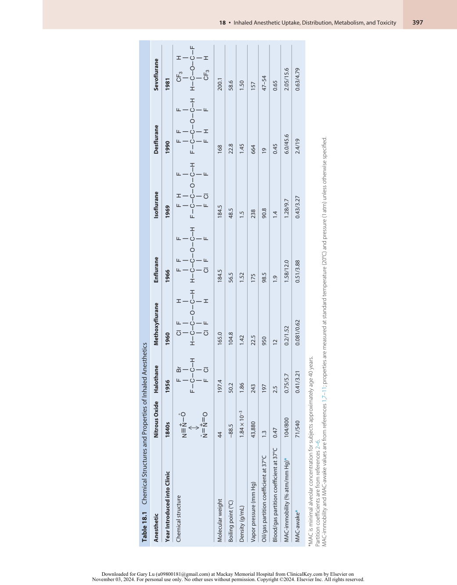

:::

<!-- PDF page 4 -->

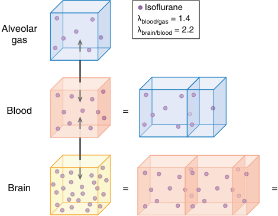

   Isoflurane λblood/gas = 1.4 Alveolar λbrain/blood = 2.2 gas Blood = Brain = = 

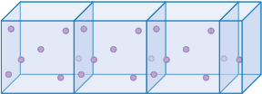

**Fig. 18.1 Partitioning of anesthetic gases between different biophases.** _Left:_ The partitioning of isoflurane between gas phase ( _blue_ ), blood _(red)_ , and brain _(yellow)_ . The blood:gas partition coefficient (λb/g) for isoflurane is 1.4 and the brain:blood partition coefficient (λCNS/blood) is 2.2 (see Table 18.2). At equilibrium, defined as equal isoflurane partial pressure in all compartments, a volume of blood contains 1.4- fold the quantity of isoflurane as the same volume of alveolar gas, whereas a volume of brain tissue contains 2.2- fold the quantity of isoflurane as the same volume of blood. _Right:_ Partition coefficients as effective (equivalent) volumes of another biophase. For example, 1 volume of blood contains the same amount of isoflurane as 1.4 volumes of alveolar gas, whereas 1 volume of brain contains the same amount of isoflurane as 2.2 volumes of blood or 3.1 volumes of gas.

form hydrogen bonds and therefore display low water solubility. Hydrophobic compounds are also usually lipophilic, demonstrating high solubility in low polarity solvents such as oils. Common measures of hydrophobicity are partition coefficients between water and olive oil (which is mostly oleic acid, an 18- carbon fatty acid) or between water and n- octanol. Usually represented by the Greek letter lambda (λ), a partition coefficient is the ratio of two solute concentrations at equilibrium (i.e., at equal partial pressure) in two separate but adjacent solvents or compartments such that the solute moves freely between the compartments (Fig. 18.1). Another useful way to conceptualize a partition coefficient is that it represents the relative volume of two phases or compartments that contain an equal amount of the solute at equilibrium (see Fig 18.1).

Anesthetic partition coefficients between blood and gas (λb/g) and between tissue and blood (λt/b) are important factors in uptake and distribution of inhaled drugs as they move from pulmonary airspace to pulmonary blood and then from blood to various tissues (Tables 18.1 and 18.2).6,12–15 The blood solubility of anesthetic gases (and other gases such as O2, N2, and CO2) increases as temperature decreases.16,17 Because most anesthetics are hydrophobic, they tend to display high solubility in tissues with high lipid content (e.g., fat), and also bind to many proteins that form hydrophobic or amphiphilic pockets.13 Anesthetic partitioning into blood (blood solubility) increases after ingestion of fatty foods18 and may decrease in anemic or malnourished patients. Methoxyflurane (no longer in clinical use) and halothane are notable for high blood solubility. N2O, sevoflurane, and desflurane are characterized by low blood solubility.

### ANESTHETIC DELIVERY, UPTAKE, AND DISTRIBUTION: A MULTICOMPARTMENTAL MODEL

Delivering an inhaled anesthetic agent to patients is analogous to an intravenous drug infusion with two major

differences: (1) entry of drug into the body is via transalveolar exchange from gas to blood, and (2) clearance is mostly via the same route. Thus inhaled anesthetic delivery is dependent on pulmonary ventilation, whereas uptake and clearance of inhaled anesthetics are also dependent on pulmonary perfusion.

### Upstream and Downstream Compartments and Anesthetic Transfer: Bulk Flow and Pressure Gradients

Uptake and distribution of inhaled anesthetic can be readily understood as a series of transfer steps from upstream compartments with high partial pressure to downstream compartments with low partial pressure, as depicted in Fig. 18.2. First, drug is transferred from an anesthesia delivery device, typically an anesthesia machine with a vaporizer designed to deliver specified concentrations (in percent atm) of VA agent, into a fresh gas mixture flowing in a breathing circuit. Second, ventilation transfers gases from the circuit to the alveolar airspace in lung. Third, anesthetic moves by transcapillary diffusion into pulmonary venous blood. Fourth, arterial blood distributes anesthetic to various tissues including the primary target tissue, the CNS. Fifth, venous outflow from tissues converges in the pulmonary artery, and sixth, the mixed venous blood passes through alveolar capillaries where it again equilibrates with alveolar gases.

Gas flow from the anesthesia machine into the breathing circuit is unidirectional. Blood circulation is also largely unidirectional. In transfers from the anesthesia machine (the fresh gas outlet) to breathing circuit and then to alveolar airspace, anesthetic flow can simply be understood as exchange from upstream compartments into downstream compartments. In later steps, such as exchange between alveolar gases and pulmonary capillary blood, flow of anesthetic molecules occurs via diffusion between adjacent compartments separated by a permeable membrane. For simplicity, we have not treated blood

<!-- PDF page 5 -->

||**ume (L)**|**7**|) τ(min)||29|47|25|41|41|41|41|
|---|---|---|---|---|---|---|---|---|---|---|---|
|**VPT**|**)** **Vol**||Veff(L||9.9|16|8.5|14|14|14|14|
||**Blood** **Flow** **(L/min**|**0.35**|) λtissue/|blood|1.4|2.3|1.2|2|2|2|2|
||**ume (L)**|**13**|τ(min||60|1700|1960|930|1160|670|1240|
|**Fat**|**Vol**||Veff |(L)|30|840|980|464|580|350|620|
||**Blood** **Flow** **(L/min)**|**0.5**|) λtissue/|blood|2.3|65|76|36|45|27|48|
||**lume** **(L)**|**30**|τ(min||48|100|64|68|116|80|120|
|**Muscle**|**Vo**||Veff |(L)|36|75|48|51|87|60|93|
||**Blood** **Flow** **(L/min)**|**0.75**|) λtissue/|blood|1.2|2.5|1.6|1.7|2.9|2.0|3.1|
||**olume** **(L)**|**1.43**|τ(min||2.6|3.3|4.7|3.3|3.5|3.0|4.0|
|**CNS**|**V**||Veff |(L)|1.6|3.9|2.9|2.0|2.1|1.9|2.4|
||**Blood** **Flow** **(L/min)**|**0.62**|λtissue/|blood|1.1|2.7|2|1.4|1.5|1.3|1.7|
||**olume** **(L)**|**3.9**|τ |(min)|3.4|8.0|8|6.7|7.6|4.5|7.7|
|**Liver**|**V**||Veff |(L)|4.1|9.8|9.8|8.2|9.4|5.5|9.4|
||**Blood** **Flow** **(L/min)**|**1.2**|) λtissue/|blood|1.1|2.5|2.5|2.1|2.4|1.4|2.4|
||**ume** **(L)**|**.32**|τ(min||0.3|0.4|.69|0.6|0.69|0.3|0.69|
|**Kidney**| **)** **Vol**|**0**|Veff(L)||0.3|0.5|0.74|0.64|0.74|0.32|0.74|
||**Blood** **Flow** **(L/min**|**1.07**|λtissue/|blood|0.93|1.5|2.3|2.0|2.3|1.0|2.3|
||**ume** **(L)**|**28**|τ |(min)|1.2|4.0|1.7|1.8|1.8|1.8|1.8|
|**Heart**|**Vol**|**0.**|Veff(L)||0.24|0.8|0.34|0.36|0.36|0.36|0.36|
||**e** **Blood** **Flow** **(L/min)**|**0.2**|λtissue/|blood|0.87|2.9|1.2|1.3|1.3|1.3|1.3|
|**ood**|**Volum** **(L)**|**5**||||||||||
|**Bl**|**Blood** **Flow** **(L/min)**|**5**|Veff(L)*||2.35|12.5|l 60|9|7|2.25|3.25|
|**Tissue**|||Anesthetic |Agent|Nitrous oxide|Halothane|Methoxyflurane|Enflurane|Isoflurane|Desflurane|Sevoflurane|

::: details 原始表格與符號（PDF 第 5 頁）

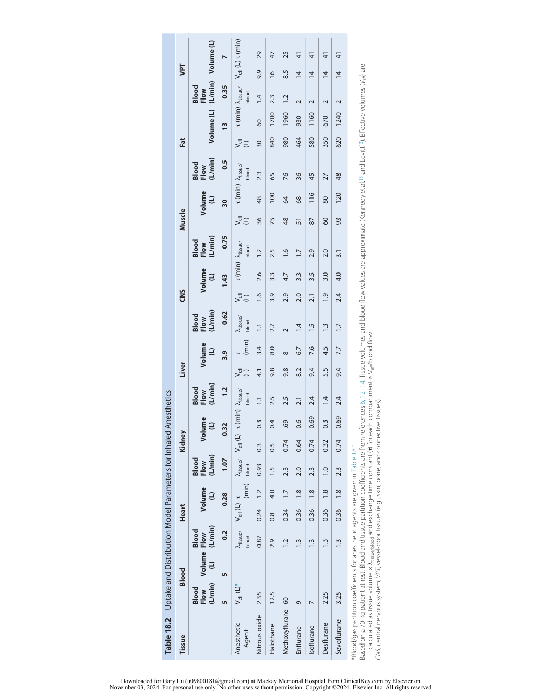

:::

<!-- PDF page 6 -->

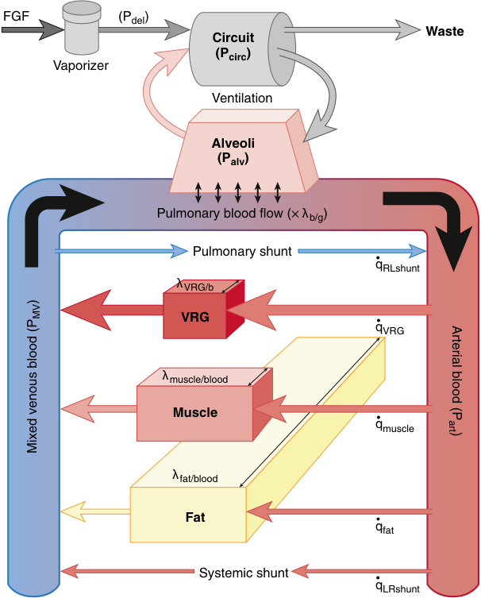

FGF (Pdel) Waste Circuit (Pcirc) Vaporizer Ventilation Alveoli (Palv) Pulmonary blood flow (× λ b/g) Pulmonary shunt • qRLshunt λ VRG/b VRG • qVRG λ muscle/blood Muscle • qmuscle λ fat/blood Fat • qfat Systemic shunt • qLRshunt artArterial blood (P) Mixed venous blood (P)MV 

**Fig. 18.2 Flow diagram for uptake and distribution of inhaled anesthetics.** Major compartments for anesthetic flow are depicted, including the breathing circuit, alveolar gas space, and three major tissue compartments: vessel- rich group (VRG), muscle, and fat. The physiologic volumes of the tissue compartments are approximately in proportion to the labeled face of the compartment, while the blood–tissue partition coefficients are depicted as the depth of the compartments. Thus the effective volume of the VRG is much smaller than that of muscle, which in turn is much smaller than that of fat. Carrier flows and exchange in different parts of the model are depicted by _arrows_ : fresh gas flow (FGF) moves anesthetic from the vaporizer to the circuit; ventilation drives exchange of anesthetic between the circuit and alveoli; pulmonary blood flow transfers anesthetic from alveoli into the circulation, which then distributes drug to different compartments depending on blood flow to various tissues. Relative blood flow is approximately proportional to the width of the arrows into and out of tissue compartments, as well as for shunts. The diagram depicts an early phase of anesthetic uptake when organs of the VRG, including the brain, are approaching equilibrium with alveolar and arterial anesthetic partial pressure, while anesthetic partial pressures in muscle and fat remain relatively low. Quantitative modeling of anesthetic gas movement in this system was performed using numerical integration of equations describing anesthetic flow into and out of each compartment (Eqs. 18.5, 18.8–18.11). Figs 18.4–18.7, 18.10, and 18.12 were all generated using this model. Standardized parameters used in the model are summarized in Table 18.2. _Palv_ , alveolar anesthetic partial pressure; _Pcirc_ , anesthetic partial pressure in the breathing circuit; _Pdel_ , delivered anesthetic partial pressure from the anesthesia machine gas outlet.

as a separate compartment in our model. Distribution of anesthetic to and from various tissues involves both bulk transfer via blood flow and diffusive equilibration across capillary membranes. Note that when anesthetic transfer occurs between gas and blood or between blood and tissue, the effective volume of the downstream compartment must be adjusted with the appropriate partition coefficient (see Table 18.2).

### Rate of Wash- In of the Circuit: Equilibration Between Vaporizer and Circuit

Equipment for controlled delivery of inhaled anesthetic drugs is described elsewhere in this text (see Chapter 20). Wash- in of the ventilator breathing circuit represents an example of simple bulk exchange, wherein the gas in circuit components is replaced by fresh gases emerging from the gas outlet of the anesthesia machine.

**Anesthetic Delivery from the Vaporizer.** VA delivery (in liters per minute of gaseous drug) from a vaporizer is closely approximated as the product of the delivered anesthetic concentration (fraction = Fdel or partial pressure at 1 atm = Pdel) of the anesthetic in a gas mixture and the fresh gas flow (FGF):

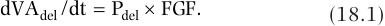

dVAdel /dt  Pdel  FGF. (18.1) 

Thus we can readily calculate the volume of delivered gas- phase anesthetic by simply integrating this function over time. In the simplest case where Pdel and FGF remain constant,

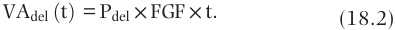

VAdel (t) = Pdel × FGF × t. (18.2) 

**Fresh Gas Wash- In to the Breathing Circuit.** The factors that affect the speed at which the gas mixture delivered

<!-- PDF page 7 -->

from the anesthesia machine replaces gases in the breathing circuit (wash- in) are FGF and the breathing circuit volume (Vcirc). Consider a typical situation where FGF at the beginning of an anesthetic is 6 L/min, and the gas volume inside the components of a breathing circuit is 6 L. If FGF is doubled to 12 L/min, then wash- in will proceed at twice the rate (halving the time). Conversely, if the Vcirc doubles to 12 L, then wash- in will proceed at half the rate (doubling the time).

The gas exchange process is independent of the concentration of anesthetic in the circuit because the exchange is simply through bulk flow and mixing. However, the difference between the delivered concentration and that in the circuit determines the magnitude and direction of net anesthetic gas flow. When the delivered anesthetic partial pressure (Pdel) is greater than that in the circuit (Pcirc), net anesthetic flow is into the circuit (and subsequently the patient). To remove anesthetic from the circuit, Pdel must be less than Pcirc. When there is no concentration gradient (i.e., equal partial pressures), bulk flow exchange may replace all the old anesthetic molecules with new ones, but there is no net flow and anesthetic concentrations in the circuit remain unchanged.

Mathematically, we can describe the breathing circuit exchange process as a differential equation that incorporates all the above factors:

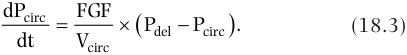

dPcirc  FGF   Pdel  Pcirc  . (18.3) dt Vcirc 

If Pdel is constant, integrating this equation results in a single exponential function that defines Pcirc at any given time following a change in Pdel at t = 0:

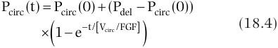

Pcirc(t)  Pcirc (0)  (Pdel  Pcirc(0))  1– e  t/  Vcirc /FGF  (18.4)   

Pcirc approaches Pdel following an exponential time course with a time constant of τ = Vcirc/FGF. Thus if Vcirc = 6 L and FGF = 6 L/min, the exponential time constant will be 1 minute (Fig. 18.3). Each minute results in the fraction of old gas in the breathing circuit dropping by 63.1%, and after 4 minutes, less than 2% old gas remains. The half- life for the process (time for halving the vaporizer- circuit concentration difference) is 0.693 × τ.

Breathing circuit components, such as CO2 absorbents and the plastic or rubber of the circuit tubing and connectors, influence the rate of equilibration between vaporizer and circuit because they absorb VAs, increasing the effective circuit volume.19 The more hydrophobic VAs absorb more into circuit components, whereas absorption negligibly affects wash- in and wash- out of low- solubility anesthetics.

The clinical relevance of the wash- in process is readily appreciated. An example of the importance of FGF is “priming” the anesthetic circuit for a single- breath induction technique. The FGF setting and the circuit volume influence the required duration of priming. More generally, whenever the vaporizer settings are altered, the speed at which the new settings influence the wash- in or wash- out of the circuit (and subsequently the patient) will depend on FGF. Open (non- rebreathing) anesthetic breathing circuits are designed to have low exchange volumes and to be used with high fresh gas flows. These features allow rapid changes in

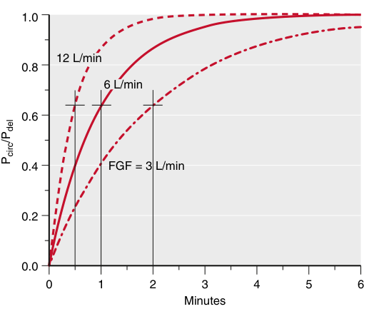

1.0 12 L/ min 0.8 6 L/m in 0.6 0.4 FGF = 3 L/min 0.2 0.0 0 1 2 3 4 5 6 Minutes /PPcircdel 

**Fig. 18.3 Wash- in of the breathing circuit depends on fresh gas flow (FGF).** The curves depict the rate of rise of anesthetic concentration (partial pressure) in a breathing circuit with 6 L gas volume, depending on FGF. Higher FGF results in more rapid exchange of circuit gases with fresh gas. The exponential time constant for the wash- in process is the circuit volume in liters divided by FGF flow in liters per minute (see Eq. 18.4). _Cross marks_ overlaying the curves indicate time constants under different gas flow rates. Each time constant correlates with a 63.1% exchange. _Pcirc_ , anesthetic partial pressure in the breathing circuit; _Pdel_ , delivered anesthetic partial pressure from the anesthesia machine gas outlet.

the delivered anesthetic concentration, while minimizing rebreathing of exhaled gases. The choice of an open versus rebreathing system influences the impact of various other factors that can affect uptake and distribution of inhaled anesthetics downstream from the breathing circuit. Some of the subsequent figures show models for both conditions.

### Equilibration Between Circuit and Pulmonary Airspace

Transfer of anesthetic gases from the breathing circuit to the pulmonary airspace is another bulk exchange process similar to that from vaporizer to breathing circuit. In this case, gas flow via ventilation is cyclical and bidirectional, and the factors that determine the rate of anesthetic exchange are minute ventilation (MV) and total pulmonary airspace volume (Vpulm).20 Because transfer from the circuit to the lungs represents anesthetic flow out of the circuit, we alter Eq. 18.3 to include both inflow to the circuit and outflow from the circuit:

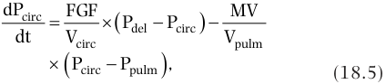

dPcirc  FGF  Pdel  Pcirc   MV dt Vcirc Vpulm   Pcirc  Ppulm  , (18.5) 

where Ppulm is a weighted average of the anesthetic partial pressure in dead space and alveolar space.

Eq. 18.5 describes how rebreathing affects the inhaled (breathing circuit) anesthetic concentration. Most inhaled anesthetics are delivered using a rebreathing circuit, which includes one- way flow valves and adsorbent material to chemically remove exhaled CO2. Rebreathing depends primarily on the balance between fresh gas flow and MV. The anesthetic gas in the breathing circuit represents a

<!-- PDF page 8 -->

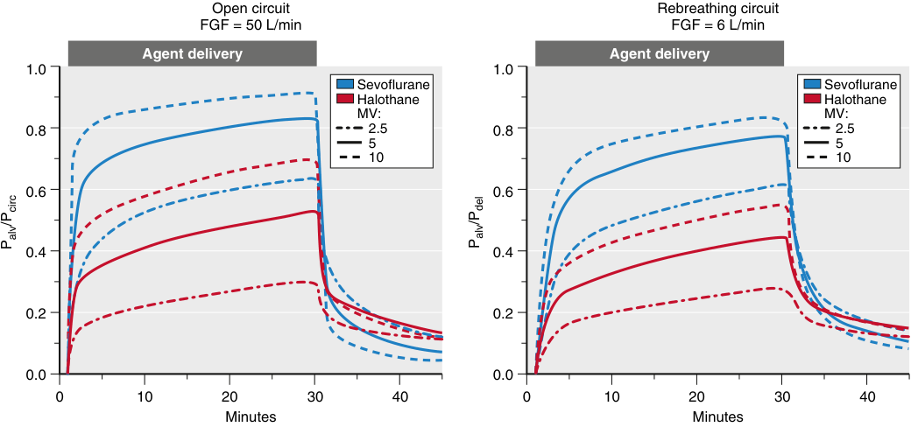

Open circuit Rebreathing circuit FGF = 50 L/min FGF = 6 L/min Agent delivery Agent delivery 1.0 1.0 Sevoflurane Sevoflurane Halothane Halothane MV: MV: 0.8    2.5 0.8    2.5    5    5    10    10 0.6 0.6 0.4 0.4 0.2 0.2 0.0 0.0 0 10 20 30 40 0 10 20 30 40 Minutes Minutes /PPalvcirc /PPalvdel 

**Fig. 18.4 Effect of ventilation on the rise of alveolar anesthetic partial pressure (Palv).** Left: A traditional open- circuit model with very high fresh gas flow (FGF) and therefore constant Pdel = Pcirc. Right: A more common clinical situation with constant vaporizer output (Pdel) and partial rebreathing at a 6 L/min fresh gas flow rate. Raising minute ventilation accelerates the rise of Palv by delivering more anesthetic to the lungs. The effect is seen whether anesthetic is highly soluble in blood (e.g., halothane) or relatively insoluble (e.g., sevoflurane). However, the relative size of the ventilation effect is greater for soluble agents. Increased ventilation also accelerates clearance of anesthetic agents after delivery ceases. _MV_ , minute ventilation; _Pcirc_ , anesthetic partial pressure in the breathing circuit; _Pdel_ , delivered anesthetic partial pressure from the anesthesia machine gas outlet.

mixture of fresh gas and exhaled gases. Increased fresh gas flow reduces rebreathing, whereas increased MV increases rebreathing.

### The Alveolar Anesthetic Concentration

The alveolar anesthetic concentration (Palv or FA) is a critically important factor in anesthetic uptake and distribution because (1) it is in rapid equilibrium with circulating blood and highly perfused tissues, including target tissues in the CNS, and (2) Palv can be measured in exhaled endtidal gases. Thus, except during periods of rapid change, Palv in exhaled breath represents a useful estimate of the anesthetic concentration in the patient’s CNS and other highly perfused organs.21

Because only alveolar gas is relevant to transpulmonary exchange of anesthetic into and out of the body, _alveolar ventilation_ (V˙ alv) is the proper gas flow to calculate anesthetic exchange into this part of the pulmonary airspace,

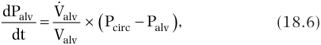

dPalv  V  alv   Pcirc  Palv  , (18.6) dt Valv 

where V˙ alv is MV corrected for dead space ventilation.

### Alveolar Uptake of Anesthetic into Pulmonary Blood

During inhaled anesthetic induction, anesthetic flows from alveolar gas to pulmonary blood across the alveolar/capillary interface separating these compartments and is driven by the partial pressure gradient between alveolar gas (Palv) and mixed venous blood (PMV) entering the pulmonary arteries. The net flow of anesthetic reverses during anesthetic wash- out when Palv drops

below PMV. Anesthetic uptake into blood also depends on the pulmonary blood flow (which is typically close to cardiac output, Q˙ ) and the blood’s capacity to solvate anesthetic from the gas state (the blood/gas partition coefficient, λb/g):

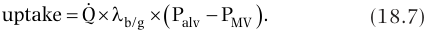

 uptake  Q  b/g  Palv  PMV  . (18.7) 

We therefore correct Eq. 18.6 to reflect both anesthetic inflow into alveolar airspace and its uptake into blood:

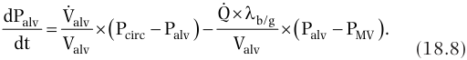

dPalv  V  alv  Pcirc  Palv   Q   b/g  Palv  PMV  . dt Valv Valv (18.8) 

Thus, during an inhaled anesthetic induction, the rate of increase of Palv relative to Pcirc is governed by (1) alveolar ventilation, (2) cardiac output, and (3) anesthetic solubility in blood. Increased ventilation delivers more anesthetic from circuit to alveoli and increases Palv/Pcirc (Fig. 18.4). Importantly, increased pulmonary blood flow removes more anesthetic from alveoli, thereby decreasing the rate of increase in alveolar concentration of anesthetic (Palv/Pcirc) (Fig. 18.5). Indeed, significant decreases in cardiac output are suspected when end- tidal CO2 (ETCO2) decreases and end- tidal concentration of VA increases.22 The more soluble an anesthetic is in blood (i.e., the higher its λb/g), the greater is the capacity for each volume of blood to take up anesthetic from alveolar gases (i.e., the larger the effective blood flow). Thus as λb/g increases, Palv/Pcirc increases more slowly (Fig. 18.6).

### Other Factors That Affect the Rate of Rise of Palv

Other factors affecting alveolar uptake of anesthetic include ventilation–perfusion matching and the absolute concentration of anesthetic in alveolar gases.

<!-- PDF page 9 -->

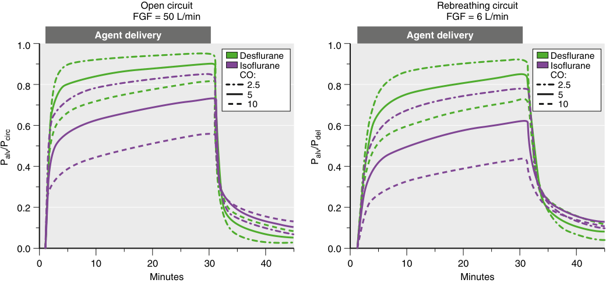

Open circuit Rebreathing circuit FGF = 50 L/min FGF = 6 L/min Agent delivery Agent delivery 1.0 1.0 Desflurane Desflurane Isoflurane Isoflurane CO: CO: 0.8    2.5 0.8    2.5    5    5    10    10 0.6 0.6 0.4 0.4 0.2 0.2 0.0 0.0 0 10 20 30 40 0 10 20 30 40 Minutes Minutes /PPalvcirc /PPalvdel 

**Fig. 18.5 Effect of cardiac output on the rise of alveolar anesthetic partial pressure (Palv).** Left: A traditional open- circuit model with very high fresh gas flows and therefore constant Pdel = Pcirc. Right: A more common clinical situation with constant vaporizer output (Pdel) and partial rebreathing at a 6 L/min fresh gas flow (FGF). Increasing cardiac output slows the rise of Palv by increasing anesthetic uptake into blood (removing anesthetic from alveolar gases). This effect is observed for both soluble (e.g., isoflurane) and relatively insoluble (e.g., desflurane) anesthetics, but the relative effect is greater for soluble agents. Cardiac output also affects clearance of anesthetics from the lungs in the same way it affects uptake (i.e., increased cardiac output slows anesthetic clearance rate). _CO_ , cardiac output; _Pcirc_ , anesthetic partial pressure in the breathing circuit; _Pdel_ , delivered anesthetic partial pressure from the anesthesia machine gas outlet.

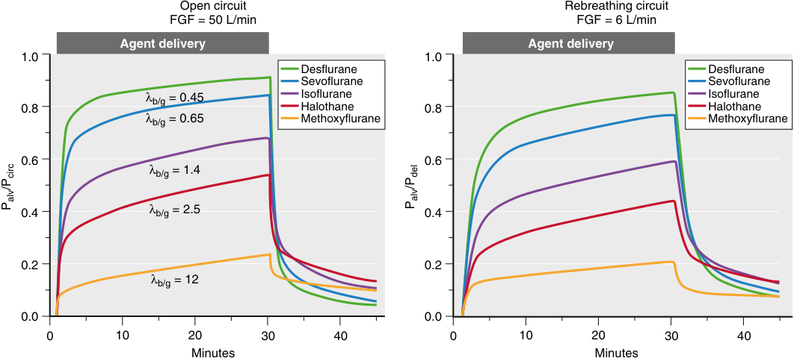

Open circuit Rebreathing circuit FGF = 50 L/min FGF = 6 L/min Agent delivery Agent delivery 1.0 1.0 Desflurane Desflurane Sevoflurane Sevoflurane 0.8 λb/g = 0.45 Isoflurane Halothane 0.8 Isoflurane Halothane λb/g = 0.65 Methoxyflurane Methoxyflurane 0.6 0.6 λb/g = 1.4 0.4 λb/g = 2.5 0.4 0.2 0.2 λb/g = 12 0.0 0.0 0 10 20 30 40 0 10 20 30 40 Minutes Minutes /PPalvcirc /PPalvdel 

**Fig. 18.6 Effect of blood solubility on the rise of alveolar anesthetic partial pressure (Palv).** Left: A traditional open- circuit model with very high fresh gas flow (FGF) and therefore constant Pdel = Pcirc. Right: A more common clinical situation with constant vaporizer output (Pdel) and partial rebreathing at a 6 L/min FGF rate. As blood solubility (λb/g) increases, the rate of rise in Palv slows, because uptake into blood is greater for high solubility agents. The major impact of blood solubility is the magnitude of the rapid initial rise in Palv, which represents a balance between anesthetic delivery and uptake into pulmonary blood. Blood solubility similarly affects clearance from alveoli after anesthetic delivery ceases (i.e., increased blood solubility results in slower clearance from alveolar gas). _Pcirc_ , anesthetic partial pressure in the breathing circuit; _Pdel_ , delivered anesthetic partial pressure from the anesthesia machine gas outlet.

**Pulmonary Dead Space.** Dead space (ventilated but not perfused pulmonary regions) reduces effective alveolar ventilation (see Eqs. 18.7 and 18.8), and thus slows anesthetic uptake. This effect is strongest under conditions of high FGF

and low blood- solubility agents, where alveolar ventilation is the limiting factor in uptake. Under conditions of low FGF and a highly blood- soluble agent, increased dead space, by reducing initial uptake, serves to maintain the inhaled

<!-- PDF page 10 -->

anesthetic concentration (Pcirc), which creates a compensatory increase in Palv and subsequent uptake.

**Pulmonary (Right-to-Left) Shunting.** Pulmonary right-to-left shunting can be either physiologic, pathologic, or iatrogenic, such as during one- lung ventilation. Rightto- left shunting results in a difference between Palv and the partial pressure of anesthetic in arterial blood (Part). This is because arterial blood represents a mixture of shunted mixed venous blood combined with blood that has equilibrated with alveolar gases (Eq. 18.9). Because such shunts also reduce transcapillary gas exchange in the lung and slow anesthetic uptake (Eqs. 18.7 and 18.8, after correcting pulmonary blood flow for shunt), right- to- left shunting sustains Pcirc, an effect that is more pronounced for highly soluble drugs compared with insoluble anesthetics. Consequently, pulmonary shunting will reduce the ratio of Part:Palv more for insoluble anesthetics, such as N2O (Fig. 18.7)23,24 :

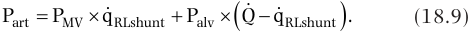

   Part  PMV  qRLshunt  Palv  Q  qRLshunt  . (18.9) 

**Concentration and Second Gas Effects.** The absolute concentration of anesthetic influences its uptake and that of other gases. In the previous discussion and illustrations, it was presumed that an inhaled anesthetic represents a small fraction of the inhaled gas mixture and that transalveolar uptake of the anesthetic results in a decrease in Palv and negligible changes in alveolar gas volume. However, when

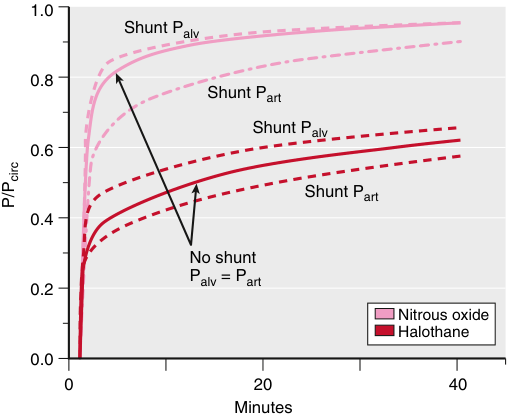

1.0 Shunt Palv 0.8 Shunt Part Shunt Palv 0.6 Shunt Part 0.4 No shunt Palv = Part 0.2 Nitrous oxide Halothane 0.0 0 20 40 Minutes P/Pcirc 

**Fig. 18.7 Effect of right- to- left pulmonary shunt on the anesthetic partial pressure in alveolar gas and arterial blood.** The curves represent anesthetic partial pressures in alveolar gases _(dashed lines)_ and arterial blood _(dash- dot lines)_ under conditions of 40% right- to- left shunt and no shunt _(solid lines)_ . Pulmonary right- to- left shunting bypasses alveolar uptake, so less anesthetic is removed from pulmonary gases; this accelerates the rise in alveolar anesthetic partial pressure (Palv). In addition, the anesthetic partial pressure in arterial blood (Part) is a mixture of pulmonary venous blood at Palv and shunted mixed venous blood at PMV. Thus Part, which determines the rate of anesthetic uptake into tissues, rises more slowly than Palv when right-to-left shunting is present. The shunt effect on Part versus Palv is larger for insoluble anesthetics (e.g., N2O) than for soluble anesthetics (e.g., halothane). Other model parameters were set for open circuit delivery (constant Pcirc) with MV = 6 L/min and CO = 5 L/min. _CO_ , cardiac output; _MV_ , minute ventilation; _PMV_ , anesthetic partial pressure in mixed venous blood; _Pcirc_ , anesthetic partial pressure in the breathing circuit.

the anesthetic represents a large fraction of the inhaled gas mixture, its rapid uptake results in a smaller relative alveolar anesthetic concentration drop, because the volume of alveolar gas also decreases. This is known as the concentration effect.25 In an imaginary situation where a patient is breathing 100% anesthetic, uptake into pulmonary blood reduces the volume of anesthetic gas in the alveoli without altering its concentration or partial pressure (oxygeninduced atelectasis occurs through a similar mechanism). A typical situation, illustrated in Fig. 18.8, is delivery of 66% N2O with 33% O2 and 1% isoflurane. Assuming cardiac output equals 5 L/min, the initial rate of N2O uptake is given by Eq. 18.7 as 5000 mL/min × 0.47 × 0.66 atm = 1550 mL/ min, indicating that a large fraction of N2O is taken up into blood during the first few breaths. If we assume that half the N2O is rapidly taken up into pulmonary blood during early breathing of this gas mixture, then the volume of inspired gas remaining in lung airspaces drops, concentrating the remaining gases. With 50% uptake of N2O, the reduction in alveolar gas volume results in a concentration of remaining alveolar N2O that is only 24% less than its initial value.

_The second gas effect_ is also evident in this example: the rapid uptake of N2O and reduced gas volume increases alveolar Piso and PO2 , thereby augmenting uptake of these “second” gases.26 Fig. 18.8 also shows that rapid uptake of N2O into blood results in a mismatch between inspired and expired gas volumes that may effectively increase ventilation under conditions of constant expiration.27 These effects have been demonstrated in humans28 and lab animals.26 Clinical studies and mathematical modeling indicate that, because of ventilation–perfusion heterogeneity, the second gas effect is greater in arterial blood than in expired gas, influenced by the blood solubility of VAs, and significantly affects anesthetic onset at relatively low rates of N2O uptake.29–31

### Distribution of Anesthetic into Tissues

Blood exiting the pulmonary capillaries enters the pulmonary vein and the left heart. Inhaled anesthetics are then distributed via arterial blood to various body tissues. The rate of increase of anesthetic partial pressure within each tissue is determined by tissue- specific arterial blood flow (q˙ ), effective volume (the product of anatomic volume and tissue/blood partition coefficient, _λ_ t/b), and the anesthetic partial pressure gradient between arterial blood and the tissue,

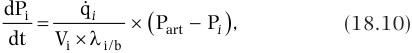

dPi  q  i   Part  P i  , (18.10) dt Vi  i/b 

where i designates a particular organ or type of tissue. Values used in model calculations are summarized in Table 18.2. The time required for anesthetic partial pressure equilibration between arterial blood (Part = Palv) and a specified tissue is shorter if its blood flow is high, and longer if that tissue has a large effective volume (Figs. 18.2 and 18.9).

Traditionally, anesthetic distribution has been described for four distinct tissue groups. The vessel- rich group (VRG) includes the heart, brain, lungs, spinal cord, liver, and kidney. Together, these organs compose approximately 10% of the adult human body mass; however, they receive approximately 70% of cardiac output under normal resting conditions. As a result, time constants for anesthetic equilibration between blood and these organs are typically

<!-- PDF page 11 -->

only a few minutes (see Table 18.2). Of particular interest is the equilibration time for the CNS, where anesthetic effects are mediated. After the highly perfused VRG tissues, skeletal muscle is the next compartment to equilibrate with inhaled anesthetics. Muscle composes approximately 40% of body mass in a typical healthy adult, making muscle the largest single compartment based on weight. Moreover, most inhaled anesthetics partition into muscle more than into brain, resulting in an increased effective volume for anesthetic uptake into this compartment. At rest, muscle receives about 10% to 15% of cardiac output (20 mL/ kg/min), but this value can increase dramatically during exercise, stress, fever, or other states associated with high cardiac output.32 Taken together, these factors generally result in slow equilibration between anesthetic in blood and muscle, with typical time constants of hours (see Table 18.2). The third tissue group is fat, which in a healthy adult composes less than 25% of body mass and receives approximately 10% of cardiac output.33 Potent VAs partition avidly into fat; therefore, fat represents the largest effective volume for uptake of these drugs (see Fig. 18.2, Table 18.2). The extremely large effective volume coupled with low blood flow results in very slow equilibration of anesthetics between blood and fat, with time constants approaching days. A fourth group, including skin, cortical bone, and connective tissue, is referred to as vessel- poor tissues. These tissues compose 10% to 15% of an average adult body while receiving less than 5% of cardiac output at rest. Induction of general anesthesia impairs normal sympathetic nervous function, resulting in increased blood flow to normally cool skin in the extremities.34 The blood volume represents approximately 7% of body mass and may be considered another compartment for anesthetic uptake, while also conveying drug to other tissue compartments.

As stated previously, increased cardiac output results in increased anesthetic uptake and a slower rate of rise of Palv. Clinical studies confirm that, other factors being equal, increasing cardiac output slows the induction of general anesthesia with inhaled anesthetics.22,35 This result can seem counterintuitive when increasing cardiac output increases uptake of anesthetic into the patient’s body and hastens its delivery to the tissues. However, during

induction, the anesthetic partial pressure in blood and downstream tissue compartments cannot be higher than that in the upstream alveolar compartment. Increased cardiac output slows the rise of Palv and thus also slows the rate of increase of the anesthetic partial pressure in blood (Part), the CNS (PCNS), and other highly perfused tissues. The extra anesthetic uptake is primarily into muscle, which is a large tissue compartment with a high capacity for anesthetic and is where much of the excess cardiac output flows. For

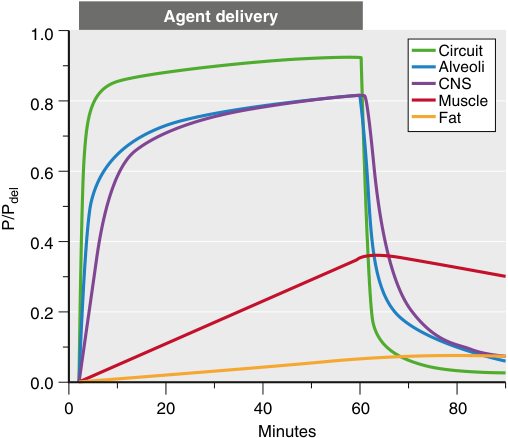

Agent delivery 1.0 Circuit Alveoli CNS 0.8 Muscle Fat 0.6 0.4 0.2 0.0 0 20 40 60 80 Minutes P/Pdel 

**Fig. 18.9 The rate of anesthetic partial pressure rise in different tissue compartments.** The curves represent model calculations for sevoflurane delivered at 6 L/min fresh gas flow, with 5 L/min ventilation and 5 L/min cardiac output. The anesthetic partial pressure in the central nervous system (CNS; _purple line_ ), part of the vessel- rich group, equilibrates rapidly with Palv _(blue line)_ , although a lag- time of several minutes is evident when Palv is rapidly rising or falling. The anesthetic partial pressures in both muscle _(red line)_ and fat _(orange line)_ rise and fall much more slowly, because muscle and fat compartments represent much larger effective volumes (see Fig. 18.2) and have lower blood flow than the vessel- rich group. Note that anesthetic partial pressure in fat continues to rise after anesthetic delivery stops, if partial pressure in alveolar gas (and arterial blood) is greater than that in the fat compartment.

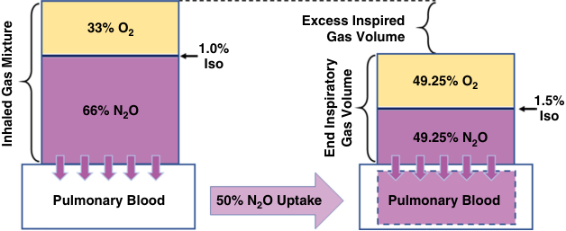

Excess Inspired 33% O2 Gas Volume 1.0% Iso 49.25% O2 1.5% 66% N2O Iso 49.25% N2O Pulmonary Blood 50% N2O Uptake Pulmonary Blood Inhaled Gas Mixture Gas Volume End Inspiratory 

**Fig. 18.8 Concentration and second gas effects.** The figure depicts alveolar gases at the beginning of an anesthetic and is adapted from Korman and Mapleson.27 After an initial inspiratory breath, alveoli are filled with the gas mixture in the circuit (66% N2O, 33% O2, 1% isoflurane). Rapid uptake of half of the N2O into pulmonary blood reduces the inhaled gas volume by 33%. Assuming constant functional residual capacity and expiratory volumes, inflow of additional inspired gas mixture is needed to replace the absorbed gas. After uptake of half of the inspired N2O, the alveolar gas mixture contains 49.25% N2O, 49.25%% O2, and 1.5% isoflurane. Thus, the alveolar partial pressure of N2O falls much less than the fractional uptake (the concentration effect). In addition, the alveolar partial pressures of both O2 and isoflurane increase relative to the inspired values, increasing their uptake (the second gas effect). _Iso_ , isoflurane; _N2O_ , nitrous oxide; _O2_ , oxygen.

<!-- PDF page 12 -->

example, a 50% increase in cardiac output can more than double muscle blood flow, diverting the majority of anesthetic to muscle, lowering Palv, and thus slowing anesthetic uptake into target tissues in the CNS. If one could manipulate inhaled anesthetic delivery to maintain constant Palv, which may be achievable with automated feedback control of vaporizer output and FGF,36 then increased cardiac output might have a different effect. Model simulations where Palv is maintained at a constant level show that uptake into VRG tissues, including brain tissue, increases more rapidly as cardiac output increases.37

In pediatric patients, the balance of cardiac output to various tissue beds differs from that in adults. Thus, although cardiac output per kilogram body weight is larger in children than in adults, anesthetic induction in young children is more rapid than in adults, because a disproportionate amount of perfusion goes to the vessel- rich organs, such as the brain.38

The equilibrium distribution volumes for most inhaled anesthetics are extremely large, with the largest compartment by far being fat. However, equilibration with fat is so slow that this compartment usually plays a relatively minor role in the pharmacokinetics of inhaled anesthetics. During a typical general anesthetic lasting from 30 minutes to several hours, the blood, VRG organs, and muscle are the compartments into which inhaled anesthetics mostly distribute.

Although the model in Fig. 18.2 illustrates anesthetic distribution only via arterial blood flow, inter- tissue diffusion takes place between abutting tissues that have large interfacial surface areas. In particular, direct diffusion from organs with high anesthetic partial pressures to abutting tissues with low partial pressure and high capacity for anesthetic uptake may also contribute to drug distribution. Examples of this process include anesthetic diffusion from the heart, liver, and kidneys to surrounding fat in the pericardium and abdomen.39,40

### The Mixed Venous Anesthetic Partial Pressure

The anesthetic partial pressure in mixed venous blood entering the pulmonary circulation is a weighted average of the venous outflows from all tissues and organs, which converge in the right ventricle:

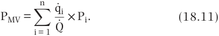

n q˙ i PMV = ∑ × Pi. (18.11) i = 1 Q˙ 

As PMV rises, the gradient driving uptake of inhaled anesthetics from alveoli weakens. The difference between the delivered (inspired) and the alveolar (end- expiratory) anesthetic concentrations also shrinks, causing transpulmonary uptake to slow (Eq. 18.7). Systemic (left to right) shunting causes PMV to increase more rapidly than it would in the absence of such shunts. When blood flow to other tissues remains normal and the left- to- right shunt simply represents excess cardiac output, the resulting increase in anesthetic uptake (Eq. 18.7) is offset by the increase in PMV, resulting in a slight increase in the rate of anesthetic delivery or uptake into the brain, muscle, and other tissues. In cases where large left- to- right shunts result in reduced blood flow to other tissues, anesthetic equilibration in those tissues will be relatively slow.

## Synthesis of the Model and Inhaled Anesthetic Induction: PK/PD

The earlier discussion emphasized the rate of equilibration (pharmacokinetics) of inhaled anesthetics among the various compartments involved in delivery to a patient: vaporizer, circuit, lung, blood, and various tissues. However, in a clinical setting, the goal of the anesthesia provider is the reversible production of certain desired effects (amnesia, unconsciousness, and immobility) in the patient within a reasonable period. To achieve this goal, pharmacokinetics must be combined with knowledge of the effects produced at different anesthetic partial pressures in target tissues (i.e., dose– response or pharmacodynamics).21,41 The most relevant pharmacodynamic guidelines are minimum alveolar concentration (MAC)- immobility,42 the alveolar anesthetic concentration preventing movement response to surgical stimulus in 50% of subjects, and MAC- awake,7 the alveolar anesthetic concentration preventing perceptive awareness in 50% of subjects, both measured under conditions where Palv is in equilibrium with anesthetic partial pressure in the CNS (PCNS).21 MAC- awake for potent VAs is typically 0.34 × MAC- immobility,43 whereas MAC- awake for N2O is approximately 0.7 × MAC- immobility (see Table 18.1). During induction of anesthesia, the goal may be achieving a high probability of immobility following incision (PCNS ≈ 1.2 × MAC- immobility) within 15 minutes, while avoiding the deleterious effects of overly deep anesthesia. At the end of an anesthetic, return of consciousness is likely to occur when PCNS decreases to less than MAC- awake. The targets used for this illustrative model patient are estimates. In clinical practice, the target for depth of general anesthesia should always minimize the risk of awareness (consciousness), but may vary, depending on patient factors, the presence of noxious stimuli, and other drugs that may be administered.

There are a variety of strategies to deliver inhaled anesthetics and to achieve the desired and reversible effects of anesthesia within a reasonable time frame. The first important consideration is that Pdel from the vaporizer must be higher than our target Palv or PCNS (overpressure). The more overpressure used, the more rapidly anesthetic is delivered. High fresh gas flows, large MV, and a low- solubility drug will also increase the rate of anesthetic delivery and the rate of rise of Palv and PCNS. These factors, and particularly overpressure, also increase the risk of delivering an overdose of anesthetic drug. A common strategy is to initiate inhaled anesthetic delivery with moderate to high fresh gas flows (≥6 L/min) and moderate overpressure (Pdel = 2 × MACimmobility) and reduce Pdel after Palv reaches or slightly exceeds the target level (Fig. 18.10, left). The need to maintain overpressure and slightly overshoot Palv derives from the fact that distribution of drug to vessel- rich organs and muscle maintains a high delivery requirement beyond the initial rapid phase of uptake. If Pdel is decreased too quickly, then Palv can decrease below the target. Pdel and/or FGF is slowly adjusted downward as the anesthetic inspired- toexpired difference in anesthetic partial pressures (Pdel–Palv) decreases.

<!-- PDF page 13 -->

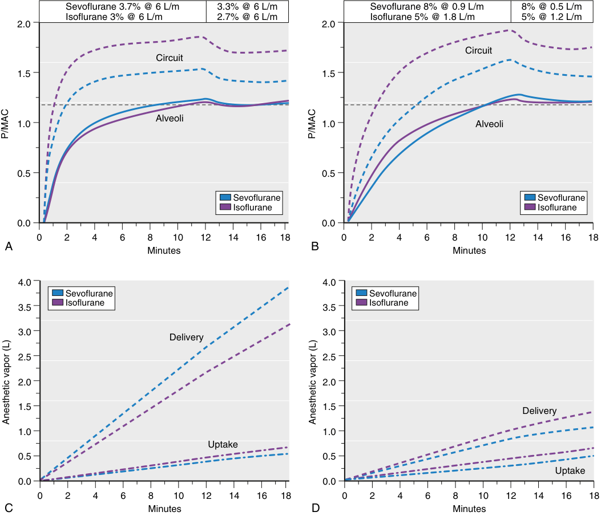

Sevoflurane 3.7% @ 6 L/m 3.3% @ 6 L/m Sevoflurane 8% @ 0.9 L/m 8% @ 0.5 L/m Isoflurane 3% @ 6 L/m 2.7% @ 6 L/m Isoflurane 5% @ 1.8 L/m 5% @ 1.2 L/m 2.0 2.0 Circuit Circuit 1.5 1.5 Alveoli 1.0 1.0 Alveoli 0.5 0.5 Sevoflurane Sevoflurane Isoflurane Isoflurane 0.0 0.0 0 2 4 6 8 10 12 14 16 18 0 2 4 6 8 10 12 14 16 18 A Minutes B Minutes 4.0 4.0 Sevoflurane Sevoflurane Isoflurane Isoflurane 3.5 3.5 3.0 3.0 Delivery 2.5 2.5 2.0 2.0 1.5 1.5 Delivery 1.0 1.0 Uptake 0.5 0.5 Uptake 0.0 0.0 0 2 4 6 8 10 12 14 16 18 0 2 4 6 8 10 12 14 16 18 C Minutes D Minutes P/MAC P/MAC Anesthetic vapor (L) Anesthetic vapor (L) 

**Fig. 18.10 Effect of induction technique on uptake and delivery of inhaled anesthetics.** (A) Anesthetic partial pressures in both the circuit _(dashed lines)_ and alveoli _(solid lines)_ during inhalation induction with moderate (6 L/min) fresh gas flows and modest (twofold to threefold) overpressure for sevoflurane _(blue)_ and isoflurane _(purple)_ . Palv reaches 1.2 × MAC in about 12 minutes, and approximately 10% downward adjustment of vaporizer settings results in maintenance of Palv near this target level. Additional downward adjustments in vaporizer setting or fresh gas flows, or both, would be needed to further maintain this Palv level. (B) Anesthetic partial pressures in both the circuit and alveoli during inhalation induction with low (&lt;2 L/min) fresh gas flows and maximal (fourfold) overpressure for sevoflurane _(blue)_ and isoflurane _(purple)_ . Palv reaches 1.2 × MAC in approximately 12 minutes, and a downward adjustment of fresh gas flow results in maintenance of Palv near this target level. (C) The total anesthetic vapor delivered and taken up into the model patient from panel A. Note that delivery far exceeds uptake, more so for the low solubility anesthetic (sevoflurane). (D) The total amount of anesthetic vapor delivered and taken up into the model patient from panel B. Note that uptake is very similar to that in panel C, whereas delivery is much lower. The low fresh gas flow technique (panels B and D) reduces waste more so for anesthetics with low blood solubility (e.g., sevoflurane) than for soluble drugs (e.g., isoflurane). _MAC_ , minimum alveolar concentration; _Palv_ , alveolar anesthetic partial pressure.

### CLOSED- CIRCUIT OR LOW- FLOW DELIVERY OF ANESTHESIA

The use of high or moderate fresh gas flows, while enabling use of less overpressure, results in far more anesthetic drug being delivered than being taken up into tissues. As illustrated in Fig. 18.10C, the amount of isoflurane delivered is 4.5- fold greater than that taken up, and delivered sevoflurane is 7.2- fold greater than absorbed drug. Thus more than 80% of delivered VA is waste using the moderately high FGF approach illustrated in this example (settings are shown in Fig. 18.10A). Rebreathing circuits allow the use

of fresh gas flows well below MV, which results in reduced anesthetic discharge into the waste- scavenging system. Less waste discharge translates into both reduced costs and reduced global environmental impact of anesthetic gases in the atmosphere, where they contribute to climate change (discussed later in this chapter). Additional benefits of low FGF and rebreathing include retention of expired heat and water vapor in rebreathed gas, improving airway epithelial health, and reducing accumulation of dried airway secretions.44

Closed- circuit anesthesia represents the ultimate limit of low gas flows, where fresh gases are delivered only in

<!-- PDF page 14 -->

quantities sufficient to replace those taken up into tissues, metabolized (especially O2), or otherwise lost to the environment, with the vast majority of gas in the breathing circuit undergoing rebreathing.45 Achieving this goal requires a leak- free breathing circuit, complete removal of CO2, and careful attention to the inspired- to- expired values of oxygen and anesthetic gases, and even to expired nitrogen that may slowly accumulate in the breathing circuit. Under these conditions, oxygen consumption in an anesthetized patient may be lower than 3 mL/kg/min, translating to O2 replacement of approximately 200 mL/min in a 70- kg patient. There are several significant limitations to this technique. Because all exhaled CO2 must be removed by absorbents, closed- circuit anesthesia increases the risk of rebreathing CO2 as absorbent capacity diminishes. Anesthetic breakdown products, carbon monoxide (CO), and slowly degassing nitrogen from blood can accumulate in the breathing circuit.46 Clinicians must be aware that patient metabolism may deplete oxygen from the breathing circuit and result in delivery of a hypoxic gas mixture during use of closed- circuit anesthesia. When using very low FGF values, changes in the vaporizer output (Pdel) result in extremely slow changes in Pcirc and the subsequent depth of anesthesia. Closed-circuit anesthetic administration is often guided by the “square root of time rule,” proposed by Severinghaus47 and detailed in now classic descriptions.48 This rule states that the rate of anesthetic uptake decreases approximately as the square root of delivery time. We can estimate the uptake of 1.2 MAC isoflurane during the first minute of anesthesia using Eq. 18.7.

Thus cardiac output × λb/g × 1.2 MAC = Initial uptake of isoflurane vapor (5000 mL/min × 1.4 × 0.0128 atm = 90 mL/min).

Using the above square- root of time rule, uptake at 4 minutes would be half of the initial rate (45 mL/min), and at 9 minutes, uptake would be one- third of the initial rate (30 mL/min). It should be noted that to deliver 90 mL/min of isoflurane vapor at a maximal vaporizer setting of 5% requires 1800 mL/min of FGF, far greater than the target FGF for closed-circuit anesthesia. Anesthetists can overcome this limitation by directly injecting small volumes of liquid anesthetic into the expiratory limb of the breathing circuit49 ; however, this technique requires vigilant attention to the clock along with many other factors. In inexperienced hands, miscalculation or mistiming of anesthetic injection runs the risk of overdose.

Because of the challenges of closed- circuit administration, a more common practice is to use moderate to high fresh gas flows to achieve rapid changes during induction of anesthesia, reserving closed- circuit anesthesia to periods where the Pcirc–Palv difference is small. Even so, changes in a patient’s metabolism because of temperature variation, degree of muscle relaxation, or surgical stimulation can result in the need for frequent adjustments to oxygen flow and anesthetic depth, making anesthesia delivery in a closed- circuit system relatively unstable and difficult.

Low- flow anesthetic delivery, typically with fresh gas flows of 0.5 to 1.0 L/min during the maintenance phase of an anesthetic, is a compromise between closed- circuit conditions and the use of high fresh gas flows. Much of the waste and other problems associated with high fresh gas flows are avoided, while the instability associated with a strict closed- circuit

technique is also moderated. As noted earlier (see section on Equilibration Between Circuit and Pulmonary Airspace), the inspired anesthetic concentration (Pcirc) depends on both Pdel and Ppulm when rebreathing occurs. Thus, as FGF diminishes, Pdel must be adjusted upward to compensate for diminished delivery. Given that the maximal output setting on most vaporizers is about 4 × MAC- immobility, anesthetic delivery at 1 L/min and maximal Pdel is still far less than the previous example with 6 L/min and Pdel = 2 × MAC isoflurane. Higher FGF or a less-soluble anesthetic drug, or both, is needed to achieve target PCNS in less than 15 minutes, but as uptake diminishes, FGF can be gradually reduced (Fig. 18.10, right panels). With soluble anesthetics like isoflurane, maximal vaporizer settings and FGF near 2 L/min is required for reasonably rapid induction. FGF can be incrementally decreased as Palv reaches the target level, and eventually vaporizer output setting is decreased as well. With low-solubility anesthetics like desflurane or sevoflurane, initial FGF values near 1.0 L/min can be used in combination with maximal vaporizer settings and a similar strategy of reducing FGF. These conditions result in reasonably rapid induction while minimizing waste of VAs. Low FGF can be maintained until high FGF is again needed to achieve emergence at the end of the anesthetic administration.

When using high vaporizer output settings, diligence must be maintained to avoid overdosing the patient by reducing FGF and the vaporizer setting in a timely and deliberate manner. Use of significant overpressure should be avoided in situations when other clinical issues require the attention of the anesthesia provider.

### PHARMACODYNAMIC EFFECTS OF ANESTHETICS ON UPTAKE AND DISTRIBUTION

The pharmacodynamic effects of most inhaled anesthetics also include changes in ventilatory and cardiac function that thereby introduce dynamic changes in the drug pharmacokinetics. Spontaneous ventilation is reduced by inhalation of potent VAs in a dose- dependent manner.50 As a result, spontaneously breathing patients will autoregulate to some degree by reducing their uptake of anesthetic agent as depth of anesthesia increases. This autoregulation provides a degree of safety that is absent in ventilated patients, who may be subjected to excessive delivery of inhaled anesthetics if a vaporizer is inadvertently set to deliver overpressure.51 Inhaled anesthetics also reduce cardiac output, a pharmacodynamic effect that leads to a more rapid increase in Palv/Pcirc and consequently a more rapid increase in the anesthetic partial pressure in heart, brain, and other highly perfused tissues.52 Halothane is the anesthetic associated with the greatest reduction in cardiac output. If anesthetic delivery continues in the face of a falling cardiac output, this can lead to a positive feedback loop of worsening cardiac depression and a rapid descent toward hemodynamic collapse. More details on the effects of inhaled anesthetics on respiratory and circulatory systems are provided in Chapter 19.

### THE EFFECT OF NITROUS OXIDE ON GAS- FILLED SPACES

Because N2O is often used at high partial pressures, it diffuses into and accumulates in spaces containing air or other

<!-- PDF page 15 -->

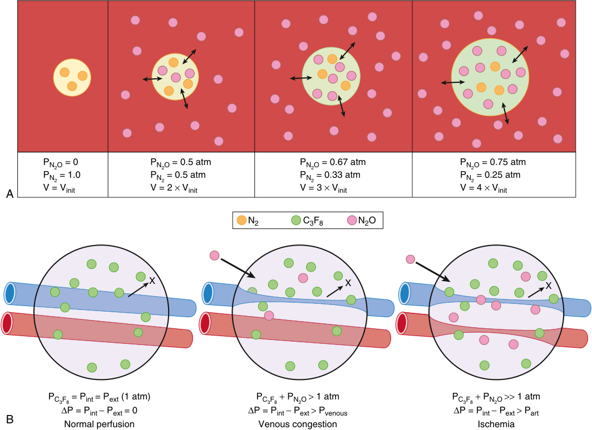

PN2O = 0 PN2O = 0.5 atm PN2O = 0.67 atm PN2O = 0.75 atm PN2 = 1.0 PN2 = 0.5 atm PN2 = 0.33 atm PN2 = 0.25 atm V = Vinit V = 2 × Vinit V = 3 × Vinit V = 4 × Vinit A N2  C3F8 N2O X X X PC3F8 = Pint = Pext (1 atm) PC3F8 + PN2O > 1 atm PC3F8 + PN2O >> 1 atm ∆P = Pint − Pext = 0 ∆P = Pint − Pext > Pvenous ∆P = Pint − Pext > Part B Normal perfusion Venous congestion Ischemia 

**Fig. 18.11 Nitrous oxide accumulation in gas- filled spaces.** (A) Expansion of a compliant air- filled space (a small vascular air embolus) occurs as the partial pressure of nitrous oxide in surrounding blood increases. Each panel depicts the equilibrium condition with PN2O inside the bubble equal to that in blood. Labels below each panel summarize the partial pressures of N2O and N2 in the bubble as well as the bubble volume relative to its initial value (Vinit). (B) The increase in pressure inside a noncompliant, gas- filled compartment (e.g., an eye following perfluoropropane [C3F8] injection) with blood vessels passing through it. As N2O accumulates, the pressure in the compartment increases, which can result in venous congestion ( _middle panel_ ) or ischemia ( _right panel_ ) in tissues that are perfused by the vessels in this compartment (e.g., the retina). _Atm_ , atmosphere; _ΔP_ , difference between internal and external pressure; _N2_ , nitrogen; _N2O_ , nitrous oxide; _Part_ , arterial blood pressure; _PC3F8_ , partial pressure of perfluoropropane; _Pext_ , pressure outside the compartment; _Pint_ , internal compartment pressure; _PN2_ , partial pressure of nitrogen; _PN2O_ , partial pressure of N2O; _Pvenous_ , venous blood pressure.

immobile gases, with potentially deleterious physiologic consequences. Clinically relevant examples include intravascular air emboli,53 pneumothorax,54 air in the inner chamber of the ear,55 intravitreal gas bubbles,56 intrathecal air, pneumoencephalus,57 and air in the gastrointestinal tract.54 Air- filled spaces contain mostly nitrogen, a gas that composes 78% of air but is 30- fold less soluble in blood than N2O (λb/g for N2 is 0.015). Thus N2O diffuses down its pressure gradient from blood and surrounding tissues into air- filled spaces, whereas N2 elimination from these spaces is far slower, even with inspired PN2 = 0, because of the limited capacity of blood to solvate and carry N2. As N2O enters and the total number of gas molecules in an airspace increases, it will expand in volume, increase in pressure, or both, depending on the compliance of the tissues surrounding the air- filled space.

In highly compliant air- filled spaces, such as intravascular air bubbles or small pneumothoraces, N2O accumulation increases the total volume of gas (Fig 18.11A) with minimal changes in pressure. Airspaces expand as N2O

enters until the PN2O within the airspace matches that in surrounding blood, establishing equilibrium. The maximum potential gas volume expansion in a highly compliant space is:

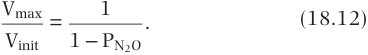

Vmax 1 = . (18.12) Vinit 1 − PN2O 

Thus administration of 50% N2O can double airspace volume, whereas 67% can potentially triple airspace volume. N2O can significantly worsen the cardiovascular consequences of intravascular air emboli, potentially expanding a nonlethal volume of venous air into the lethal range.53 Expansion of gastrointestinal gas volume by N2O may impede surgical exposure or abdominal wound closure. Gas- space compartment compliance eventually decreases as volume expands, resulting in increased pressure. For example, N2O may expand a small pneumothorax to a point where intrathoracic pressure rises, compressing lung, displacing the mediastinum, and impeding venous return

<!-- PDF page 16 -->

(tension pneumothorax). To avoid intracranial hypertension, N2O is contraindicated in patients with intracranial air until after dural opening.58 The air- filled endotracheal tube cuff is also susceptible to expansion by N2O, which can diffuse through soft plastic. Increased tracheal cuff pressure may impair perfusion of adjacent mucosa.59 Airfilled laryngeal mask airway cuffs60 and balloons on a Swan–Ganz catheter61 may similarly expand during N2O administration.

In noncompliant gas- filled spaces, gas pressure rises as N2O enters, until PN2O within the airspace matches that in blood. The maximal potential pressure increase in such a space, relative to initial pressure, is PN2O. Thus, in a patient inhaling 50% N2O, pressure in such a gas- filled compartment could approach 380 mm Hg, far greater than typical arterial perfusion pressures. A clinically important example is that of intravitreal sulfur hexafluoride (SF6) or perfluoropropane (C3F8) bubbles, which are injected as the sclera is closed at the end of intraocular or retinal surgery (see Fig. 18.11B).56 These gases persist even longer than N2 does, because of their low blood solubility. If N2O is administered to patients during or after intravitreal bubble injection, its diffusion into the bubble can rapidly increase intraocular pressure above that in retinal veins, producing retinal congestion. If the pressure in the eye further increases above systolic arterial pressure, retinal ischemia resulting in blindness may ensue.

The rate of N2O diffusion into gas- filled spaces in the body depends on local blood flow and the surface to volume ratio of the space. Thus, small air emboli expand within seconds, because they have high surface/volume ratios and are surrounded by a very high relative flow of blood containing dissolved N2O. Larger air emboli expand more slowly, because their surface/volume ratios are smaller (spherical surface/volume is inversely proportional to radius). Small pneumothoraces typically have large surface/volume ratios and high local blood flow. Animal experiments show that inhalation of 75% N2O roughly doubles pneumothorax volume in 10 minutes and triples it in 30 minutes (Fig. 18.12). Compared with pneumothoraces, gastrointestinal air pockets have lower surface/volume ratios and lower blood flow, resulting in much slower expansion of gas in the gastrointestinal tract. In animal studies (see Fig. 18.12), inhalation of 70% to 80% N2O doubled intestinal gas volume after approximately 2 hours.54

N2O use is contraindicated in patients with pneumothorax, pneumocephalus, and closed dura, or in those at high risk for vascular air embolus. Airspace expansion may impede surgery when substantial gastrointestinal air is present and N2O exposure is prolonged, or it can be inconsequential when the initial volume of gas in the gut is small or when surgery is brief.

### RECOVERY FROM ANESTHESIA

### Similarities and Differences to Induction

Clearance of inhaled anesthetics from target tissues (brain and spinal cord) is primarily via the same pathways used for anesthetic induction: anesthetic gases flow from tissue into venous blood and then to the lungs. If Palv is less than PMV, then the net flow of anesthetic will be out of the blood

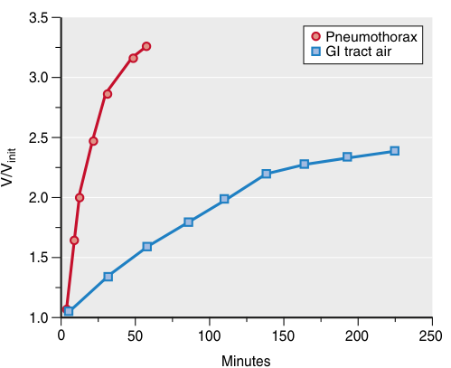

3.5 Pneumothorax GI tract air 3.0 2.5 2.0 1.5 1.0 0 50 100 150 200 250 Minutes V/Vinit 

**Fig. 18.12 The rate of airspace expansion during nitrous oxide administration.** The rate and extent of expansion of air pockets injected into either the pleural space _(red circles)_ or the gastrointestinal tract _(blue squares)_ of dogs during the inhalation of a 25% oxygen/75% nitrous oxide gas mixture is shown. Air pockets in the stomach, small intestine, and colon expand more slowly than do those in a pneumothorax. _GI_ , gastrointestinal. (Data are approximations from the results reported in Eger EI II, Saidman LJ. Hazards of nitrous oxide anesthesia in bowel obstruction and pneumothorax. _Anesthesiology_ . 1965;26:61–66.)

and into alveoli, where it is subsequently exhaled. For optimal clearance, Pcirc must be as low as possible, and this is achieved using high flows of nonanesthetic carrier gases (oxygen and air) after discontinuing anesthetic delivery. The same factors that affect transalveolar anesthetic exchange during induction will also affect clearance via this route. Increasing ventilation will accelerate clearance (see Fig. 18.4), whereas increased cardiac output slows clearance (see Fig. 18.5). Highly blood- soluble anesthetics clear more slowly than insoluble anesthetics (see Fig 18.6). Returnto- consciousness is faster following desflurane or sevoflurane anesthesia than after isoflurane anesthesia. N2O, which is characterized by blood solubility similar to that of desflurane, provides an even faster return to consciousness, because of two additional advantages. First, the concentration effect works in reverse during clearance of N2O, increasing effective alveolar ventilation and maintaining the gradient for flow from pulmonary blood to alveoli. Second, MAC- awake for N2O (0.71 atm at 40 years old) is near typical inhaled concentrations during general anesthesia; therefore, elimination of only a small fraction of this drug is associated with return to consciousness. This is also why N2O as the sole hypnotic drug is associated with a high risk of intraoperative awareness, which can be avoided by adding about 1 × MAC- awake of a potent inhaled anesthetic.

Body composition has an increasing impact as the length of anesthetic exposure increases, especially for highly soluble anesthetics. Compared with standard models, patients with increased muscle or fat will absorb larger amounts of anesthetic drug over time, slowing clearance.62 A fundamental difference between anesthetic uptake and clearance is that while overpressure can be utilized to hasten uptake and induction of anesthesia, the lowest vaporizer setting is zero. Consequently, the modifiable factors affecting anesthetic clearance are fresh gas flow and MV. Indeed,

<!-- PDF page 17 -->

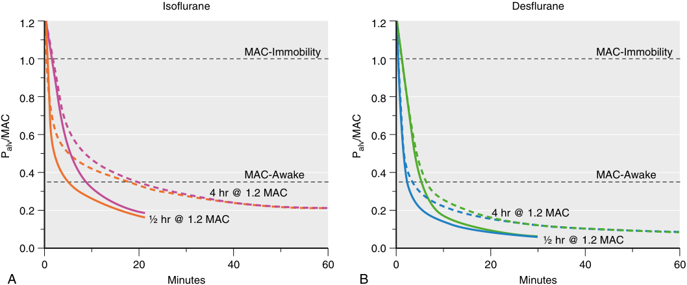

Isoflurane Desflurane 1.2 1.2 MAC-Immobility MAC-Immobility 1.0 1.0 0.8 0.8 0.6 0.6 0.4 MAC-Awake 0.4 MAC-Awake 4 hr @ 1.2 MAC 0.2 0.2 4 hr @ 1.2 MAC ½ hr @ 1.2 MAC ½ hr @ 1.2 MAC 0.0 0.0 0 20 40 60 0 20 40 60 A Minutes B Minutes /MACPalv /MACPalv 

**Fig. 18.13 Inhaled anesthetic wash- out and time to awakening depends on duration of anesthesia.** The panels depict model calculations of Palv and PCNS normalized to MAC during wash- out at 10 L/min FGF and 5 L/min MV following anesthesia at approximately 1.2 × MAC- immobility for 30 minutes _(solid lines)_ or 4 hours _(dashed lines)_ . The MAC- awake (approximately 0.34 × MAC- immobility) is shown to indicate the threshold below which typical patients regain perceptive awareness after general anesthesia. Although Palv drops earlier than PCNS, the clinically relevant end point (return of consciousness) is predicted when PCNS falls below MAC- awake. (A) Wash- out using a pharmacokinetic model for isoflurane ( _orange_ is Palv, _purple_ is PCNS). The 30- minute isoflurane uptake was 990 mL of vapor, and the 4- hour isoflurane uptake was 3420 mL of vapor. Prolonged anesthesia with isoflurane dramatically increases the time required to wash out sufficient drug to achieve awakening. After a 30- minute anesthetic, PCNS _(solid purple line)_ drops to MAC- awake in 9 minutes, whereas it takes more than 20 minutes of wash- out to reach the same PCNS following a 4- hour anesthetic _(dashed purple line)_ . (B) Wash- out using a desflurane model ( _blue_ is Palv, _green_ is PCNS). The 30- minute desflurane uptake was 1530 mL of vapor, and the 4- hour desflurane uptake was 4600 mL of vapor. The predicted times to awakening ( _solid versus dashed green lines_ reach MAC- awake at 5.2 and 6.3 minutes, respectively) are much closer following different durations of desflurane anesthesia, because of its low blood solubility. Clinical studies demonstrate that emergence and recovery (time to extubation) following isoflurane anesthesia nearly doubles when exposure increases from 20 to 75 minutes, whereas extubation is achieved in less than 10 minutes following desflurane anesthesia from 20 to 100 minutes’ duration.65 _FGF_ , fresh gas flow; _MAC_ , minimum alveolar concentration; _MV_ , minute ventilation; _Palv_ , alveolar anesthetic partial pressure; _PCNS_ , anesthetic partial pressure in the central nervous system.

after prolonged (>4 hours) exposure to 1 × MAC inhaled anesthesia, maintenance of adequate ventilation remains a high priority, even after end- tidal anesthetic concentrations reach MAC- awake. Hypoventilation in this situation can result in reanesthetization caused by redistribution of anesthetic drug from muscle into blood and highly perfused tissues.63

### Context-Sensitive Recovery from Anesthesia

The concept of context-sensitive half- time applies to both infused and inhaled anesthetics that distribute among multiple pharmacokinetic compartments.64 After a short period of exposure, inhaled anesthetic clearance from blood, reflected in decreasing Palv, proceeds rapidly through both exhalation and distribution to muscle and fat. After prolonged periods of inhalation and uptake, the anesthetic partial pressures in muscle and other compartments increase closer to that in blood, reducing the contribution of distributive clearance. Instead, clearance from the central blood compartment is prolonged by inflow of anesthetic from high- capacity tissues. Thus, in comparison with a short period of inhalation, prolonged inhaled anesthesia is followed by a smaller initial decrease in Palv and a more pronounced slow clearance phase, resulting in slower recovery from anesthesia (Fig. 18.13).65,66 Context sensitivity is exaggerated with highly blood- soluble anesthetics, and smaller with low- solubility drugs.65 The relative advantage of low blood solubility anesthetics increases with the duration of anesthesia (see Fig. 18.13).

### Percutaneous and Visceral Anesthetic Loss

Aside from pulmonary exchange, a portion of inhaled anesthetics is lost by diffusion through other large area interfaces between the body and surrounding air. The skin surface area of an average human is about 2 m2 , and blood flow through skin during general anesthesia may be substantial because of inhibition of normal thermoregulatory vasoconstriction.34 Nonetheless, transcutaneous losses of general anesthetics probably contribute negligibly to their clearance.67,68 During open abdominal or thoracic surgery, visceral surfaces are also directly exposed to air, and under these circumstances, anesthetic losses via direct transfer and air movements are larger than those via skin, but still a small fraction of total clearance.69

### Effect of the Anesthetic Circuit

Circuit components, including tubing, connectors, manual ventilation bag, and CO2 absorbent material, absorb inhaled anesthetics, effectively creating another compartment that needs to be cleared during wash- out.19 Low- level release of anesthetic gases from these components can continue for a considerable time, depending on fresh gas flows.

### Clearance via Metabolism of Anesthetics

Metabolism of inhaled anesthetics in tissues, particularly liver, contributes a variable degree to drug clearance. Metabolism of inhaled anesthetics is reviewed in detail in the latter part of this chapter (see section on Metabolism and Toxicity of Inhaled Anesthetics). Methoxyflurane, a drug that is

<!-- PDF page 18 -->

no longer in clinical use, and halothane, an older drug that is rarely used in the United States, are highly metabolized inhaled anesthetics. Methoxyflurane undergoes extensive metabolism in humans, with only 19% of an inhaled dose recovered in exhaled gases.70 Approximately 20% to 25% of inhaled halothane is biotransformed in the liver. A high rate of metabolism increases overall rates of drug clearance. However, tissue- dependent breakdown contributes far less to clearance of newer inhaled anesthetics.

### Diffusion Hypoxia

Diffusion hypoxia is another sequelae of rapid outgassing from the tissues of patients anesthetized with N2O. During the initial 5 to 10 minutes after discontinuation of anesthesia, the flow of N2O from blood into the alveoli can be several liters per minute, resulting in dilution of alveolar oxygen.71 Another effect of rapid outgassing is reduction of alveolar _PCO_ 2, which may also reduce respiratory drive.72 If the patient does not receive supplemental oxygen during this period, then the combined effects of respiratory depression from anesthesia, reduced alveolar _PO_ 2 and reduced alveolar _PCO_ 2 can result in hypoventilation and oxyhemoglobin desaturation. This outcome is avoided by routinely providing supplemental O2 for the first 5 to 10 minutes of recovery, together with vigilant attention to respiration and oxygenation.

## Metabolism and Toxicity of Inhaled Anesthetics

This portion of the chapter focuses on adverse effects attributable to inhaled anesthetics, excluding most of the acutely

reversible pharmacodynamic effects of inhaled anesthetics on various physiologic systems (see Chapters 10, 13, 14, 15, and 19).

The inhaled anesthetics are a unique group of drugs that can both enter and leave the body unchanged through the lungs. Thus, chemical transformation of inhaled anesthetics is unrelated to their therapeutic effects such as amnesia, hypnosis, and immobilization. Nonetheless, the inter- atomic bonds of volatile alkanes and ethers can break down under certain conditions: biotransformation by enzymes in tissues, reactions with strong bases in CO2 absorbents, and exposure to ultraviolet radiation. Anesthetic decomposition in tissues or the breathing circuit can produce toxic reactive intermediates which can harm patients directly or indirectly. N2O gas is not biotransformed, but selectively reacts with and inactivates vitamin B12 and inhibits vitamin B12- dependent biochemical pathways. The breakdown of waste anesthetics in the atmosphere also has environmental and health consequences. Currently it is not understood whether anesthetic exposure to vulnerable patients may contribute to long- term neurocognitive and behavioral deficits that are unassociated with chemical breakdown (see Chapters 72 and 78).

### BIOTRANSFORMATION OF INHALED ANESTHETICS

The extent and location of inhaled anesthetic metabolism depends on multiple chemical factors. Inhaled anesthetics undergo varying degrees of biotransformation (Table 18.3) in different tissues.73 Methoxyflurane undergoes by far the greatest metabolism, estimated at 70%, and only a small fraction of drug taken up into human tissues is exhaled.70

**Table 18.3** Metabolism of Halogenated Volatile Anesthetics

|**Anesthetic**|**Halothane**|**Methoxyflurane**|**Enflurane**|**Isoflurane**|**Desflurane**|**Sevoflurane**|
|---|---|---|---|---|---|---|
|Extent of tissue metabolism (%)|25|70|2.5|0.2|0.02|5|
|Oxidizing enzymes|CYP2E1 CYP2A6|CYP2E1 CYP1A2, 2C9/10, 2D6|CYP2E1|CYP2E1|CYP2E1|CYP2E1|
|Oxidative metabolites|F3C- COOH HBr, HCl|H3C- O- CF2- COOH HCl2C- COOH HOOC- COOH HF, HCl|HF2C- O- CF2- COOH HCl, HF|HF2C- O- CO- CF3 F3C- COOH CF2HOH HCl|HF2C- O- CO- CF3 F3C- COOH CF2HOH HF|HO- CH(CF3)2 HF|
|Trifluoroacetylated hepatocellular proteins|+++++|n/a|++|+|+|none|
|Reducing enzymes|CYP2A6 CYP3A4|n/a|n/a|n/a|n/a||
|Reductive metabolites|F–, Br– F2C=CHCl F3C- CH2Cl||||||
|Tissue toxicities|Hepatic|Renal Hepatic|Renal Hepatic|Hepatic|Hepatic|Hepatic|
|Fulminant hepatitis incidence|1:20,000|Reported, incidence unknown|1:300,000|rare|rare|Few case reports|
|References|74–78|79–82|83–87|86,88–90|91–94|80,95–98|

The plus signs indicate relative degree of protein modification. _n/a_ , the specific enzymes are not identified in these cases. From Kharasch ED. Adverse drug reactions with halogenated anesthetics. _Clin Pharmacol Ther_ . 2008;84:158–162.

::: details 原始表格與符號（PDF 第 18 頁）

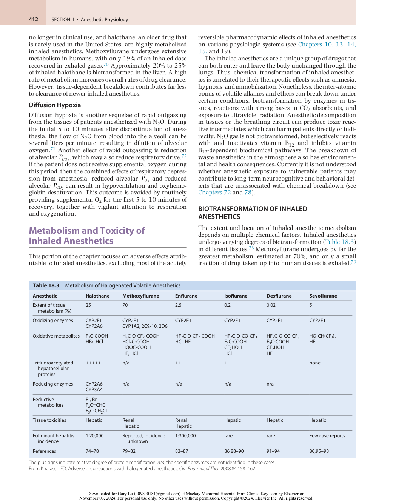

:::

<!-- PDF page 19 -->

Because of its remarkably high lipophilicity and solubility in blood and tissues, respiratory clearance of methoxyflurane from the body extends over a period of days (see Tables 18.1 and 18.2). Halothane is the next most lipophilic drug and ranks second in metabolic clearance (see Table 18.3).74–98 Thus, prolonged residence in body tissues enables more biotransformation of inhaled anesthetics. Chemical stability is another important factor. Isoflurane is an isomer of enflurane, and the two drugs display comparable respiratory uptake, distribution, and respiratory clearance. Nonetheless, isoflurane is metabolized only one-tenth as much as enflurane. Similarly, both sevoflurane and desflurane are characterized by rapid uptake, distribution, and respiratory clearance, whereas 5% of sevoflurane is biotransformed versus only 0.02% of desflurane.

Of the major organs involved in anesthetic biotransformation, the liver and kidneys are exposed to the highest metabolite concentrations and thus are most susceptible to damage from toxic metabolites. Clinically significant hepatotoxicity is primarily associated with exposure to halothane, and nephrotoxicity is associated with methoxyflurane.73 Investigations into the mechanisms of these toxicities have influenced drug development and provided important insights into human toxicology.99

### Biotransformation in the Liver

The liver is the major site of metabolism for most drugs, particularly lipophilic drugs, which typically are transformed into hydrophilic metabolites that are more readily excreted. The liver is large and contains high concentrations of many drug- metabolizing enzymes. Other organs that contribute to drug metabolism and clearance include the gastrointestinal tract, kidneys, and lungs.100,101 Drug biotransformation reactions broadly include oxidation, hydrolysis, and conjugation. A single drug may be transformed into several metabolites, depending on the relative rates of various enzyme reactions, the drug concentration in different tissues expressing relevant enzymes, competition at enzyme sites with other drugs or endogenous substances, and other factors. Oxidation and hydrolysis are known as phase 1 reactions, and they result in the introduction or exposure of a polar group on the drug. The phase 1 enzymes that metabolize inhaled anesthetics in the liver are cytochrome P450 (CYP) isoforms in the endoplasmic reticulum of hepatocytes. These catalyze oxidation reactions such as dehalogenation, N- and O- dealkylation, N- and S- oxidation, and deamination. These reactions require oxygen and NADPHdependent cytochrome P450 reductase as cofactors. Under hypoxic conditions, some P450 enzymes can also catalyze reductive reactions. More than 50 CYP isoforms are active in humans, with CYP3A4 and CYP3A5 the most abundant. Conjugations are also known as phase 2 reactions, and they often append highly polar groups such as glucuronic acid, sulfate, or glycine to polar groups on phase 1 metabolites. The resulting hydrophilic products are readily excreted in urine via the kidneys or in bile via the gastrointestinal tract. N- Acetylation reactions are an exception that result in metabolites that are less water- soluble than the parent drug.

Factors affecting hepatic drug metabolism include concomitant drugs, disease, age, and genetics.102 Induction or inhibition of enzymes are caused by exposure to certain

drugs or exogenous substances. Induction of CYP isoforms is a gene- mediated response to chronic exposure to substances that often are substrates of the enzyme, resulting in accelerated enzyme production or slowed turnover. For example, phenobarbital use results in increased production of CYP3A4 as well as NADPH- cytochrome P450 reductase, leading to increased metabolism of all CYP3A4 substrates. Enhanced metabolism typically reduces drug efficacy and is one mechanism of drug tolerance. Alternatively, enhanced prodrug conversion into active metabolites increases efficacy. If metabolites are toxic, as is the case with VAs, enhanced metabolism may increase toxicity. Conversely, CYP inhibition leads to enhanced activity of parent drugs and reduced metabolite effects. CYP enzyme inhibition is associated with hepatic disease and exposure (acute or chronic) to competing substrates or antagonists. An important example is CYP3A4 inhibition by grapefruit juice.102 CYP2E1 is inducible by ethanol and isoniazid and is inhibited by disulfiram.103 Hepatitis, cirrhosis, and hepatocarcinoma can also reduce enzymatic activity, as can conditions that reduce hepatic blood flow.

Neonates have different dominant CYP isoforms than adults. Impaired hepatic metabolism is common in premature and full- term infants, notably in bilirubin glucuronidation, leading to hyperbilirubinemia of the newborn.104,105 Pharmacogenomics is a growing area of research that has linked variable drug metabolism to genetic variability. A well- established example in anesthesiology is homozygous inheritance of atypical butyrylcholinesterase, resulting in slow hydrolysis of succinylcholine.106 Genetic variations in CYP2D6 have clarified the basis for widely varying efficacies and toxicities of codeine (a prodrug), metoprolol, nortriptyline, dextromethorphan, and other substrates.107

Hepatic CYP2E1 is particularly important in the oxidative metabolism of halogenated inhaled anesthetics (see Table 18.3). Under conditions of systemic hypoxia or decreased blood flow, or in liver regions of low PO2, CYP2A6 and CYP3A4 catalyze reductive metabolism of VAs. Halothane metabolism is primarily oxidative, and under normal conditions, about 1% of halothane undergoes reductive metabolism. Oxidative metabolism of halothane releases chloride and bromide ions, resulting in trifluoroacetyl chloride, which reacts with water to form trifluoroacetic acid (Fig. 18.14). Reductive metabolism of halothane results initially in loss of bromide, and the intermediate either reacts with a hydrogen donor to form 2- chloro- 1,1,1- trifluoroethane or captures an electron, further reducing the carbon–carbon bond to form 2- chloro- 1,1- difluoroethylene (see Fig 18.14). Halothane anesthesia reduces hepatic blood flow and can cause hypoxia in liver regions, potentially increasing its reductive metabolism.73 All of the ether anesthetics undergo similar oxidative metabolism catalyzed by CYP2E1 (see Table 18.3, Fig. 18.15). Oxidative metabolism of these drugs results in the release of fluoride (F− ) and chloride (Cl− ) ions and the formation of reactive intermediates that react with water to form carboxylic acids. Isoflurane and desflurane both produce trifluoroacetic acid, whereas enflurane forms 2- difluoromethoxy- 2,2- difluoroacetic acid. Oxidative metabolism of methoxyflurane may follow several paths, releasing either Cl− or F− in sequential steps and producing methoxy- difluoroacetic acid, dichloroacetic acid, and acetic acid (see Table 18.3).

<!-- PDF page 20 -->

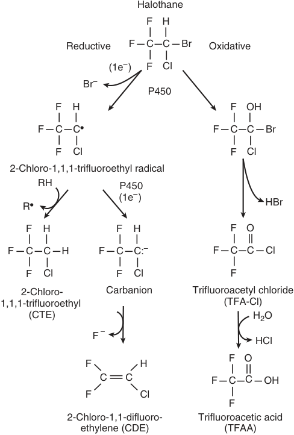

Halothane F H Reductive F C C Br Oxidative (1e – ) F Cl Br – P450 F H F OH F C C • F C C Br F Cl F Cl 2-Chloro-1,1,1-trifluoroethyl radical RH P450 (1e – ) HBr R • F H F H F O F C C H F C C: – F C C Cl F Cl F Cl F 2-Chloro- Carbanion Trifluoroacetyl chloride 1,1,1-trifluoroethyl  (TFA-Cl) (CTE) H2O F – HCl F O F H C C F C C OH F Cl F 2-Chloro-1,1-difluoro- Trifluoroacetic acid ethylene (CDE) (TFAA) 

**Fig. 18.14 Oxidative and reductive metabolism of halothane.** Major products of hepatic CYP2E1-catalyzed halothane metabolism are shown. Under normal conditions, 24% of halothane undergoes oxidative metabolism, and 1% undergoes reductive metabolism.

### Halothane Hepatotoxicity

The first halogenated VA, halothane, was introduced in 1955. Clinical exposure to halothane is associated with two distinct types of hepatic injury.78,108,109 Subclinical hepatotoxicity occurs in 20% of adults who receive halothane. It is characterized by mild postoperative elevations in alanine aminotransferase (ALT) and aspartate aminotransferase (AST) but is reversible and innocuous. Anaerobic halothane reduction by CYP2A6 to a 2- chloro- 1,1,1- trifluoroethyl radical (see Fig 18.14) is thought to mediate this mild hepatic injury.74 The fulminant form of hepatotoxicity, commonly known as halothane hepatitis, is characterized by elevated ALT, AST, bilirubin, and alkaline phosphatase levels, and massive hepatic necrosis following the administration of halothane. Halothane hepatitis is rare (1 in 5000–35,000 administrations in adults) but is fatal in 50% to 75% of cases. Because of this potentially fatal toxicity, halothane is no longer used in adult patients in most countries.

Halothane hepatitis is caused by a hypersensitivity reaction associated with oxidative metabolism of halothane. The highly reactive trifluoroacetyl chloride metabolite of halothane oxidation (see Fig. 18.14) can react with surface proteins on hepatocytes. In most patients who developed hepatic necrosis after halothane

anesthesia, antibodies against trifluoroacetyl- modified proteins were detected, suggesting that the hepatic damage is linked to an immune response against the modified protein, which acts as a neoantigen (Fig. 18.16). Accordingly, patients who develop halothane hepatitis often have a history of prior exposures to halothane or other VAs, together with symptoms suggestive of immune reactivity, such as fever, rash, arthralgia, and eosinophilia.77 It is hypothesized that trifluoroacetyl–protein adducts induce a cytotoxic T- cell reaction in sensitized individuals, which leads to liver damage.78 However, definitive evidence that liver injury is immune- mediated in halothane hepatitis is lacking.

Hepatotoxicity and massive hepatic necrosis after halothane anesthesia also occurs in children. However, large retrospective studies demonstrated that the clinical syndrome of halothane hepatitis is rarer in pediatric patients (1 in 80,000–200,000) than in adults.110–112 Halothane is metabolized to a similar degree in adults and children, and children are immune competent from birth. Pediatric cases of halothane hepatitis are also associated with multiple anesthetic exposures, suggesting a mechanism like that in adults. Why the incidence of halothane hepatitis is higher in adults remains unknown.

Other VAs including enflurane, isoflurane, and desflurane have also been associated with fulminant hepatic necrosis,94,113–117 but compared with halothane, the incidence of this outcome is extremely rare after administration of these newer VAs. The mechanism of severe hepatitis following enflurane, isoflurane, and desflurane may be the same as for halothane, because all these drugs are oxidatively metabolized to highly reactive intermediates that can covalently modify hepatic proteins (see Fig 18.15). Investigations usually find that patients had prior exposure to VAs and antibodies to modified hepatic proteins can be detected. The extremely infrequent incidence of severe hepatitis with modern VAs is likely because of their low degree of oxidative metabolism and subsequent immune sensitization. Of note, hepatitis was also commonly reported soon after introduction of methoxyflurane, another anesthetic that is mostly metabolized to highly reactive acidic intermediates.79,118 Unlike all other VAs, sevoflurane is oxidized at the fluoromethoxy C- H bond and forms hexafluoroisopropanol and inorganic F− (see Table 18.3; Fig. 18.17).119,120 Hexafluoroisopropanol is relatively stable, and modified liver proteins are not formed after sevoflurane anesthesia. Cases of fatal hepatitis after sevoflurane anesthesia have been reported, but without evidence of an immune- mediated mechanism.98

### Biotransformation in Kidneys

The kidneys are large organs that receive high blood flow. Renal physiologic activities include glomerular filtration of water- soluble metabolites, reabsorption of water and essential metabolites, urinary excretion of waste, and regulation of hormones involved in vascular tone (renin) and water balance (aldosterone). The kidneys clear most of the water- soluble metabolites resulting from biotransformation of inhaled anesthetics. Kidneys also possess CYP enzymes, including CYP2E1, that catalyze both phase 1 and phase 2 reactions and are therefore additional sites where inhaled anesthetic metabolism occurs. As in the liver, CYPs in renal

<!-- PDF page 21 -->

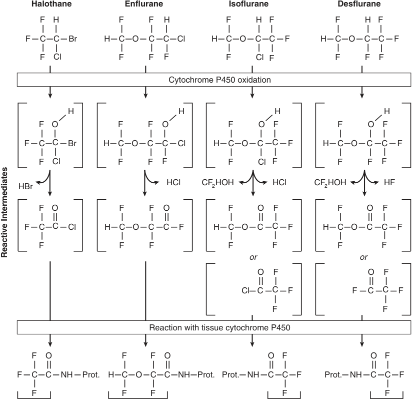

Halothane Enflurane Isoflurane Desflurane F H F F H F H F F H F F C C Br H C O C C Cl H C O C C F H C O C C F F Cl F F F F Cl F F F F Cytochrome P450 oxidation H H H H F O F F O F O F F O F F C C Br H C O C C Cl H C O C C F H C O C C F F Cl F F F F Cl F F F F HBr HCl CF2HOH HCl CF2HOH HF F O F F O F O F F O F F C C Cl H C O C C F H C O C C F H C O C C F F F F F F F F or or O F O F C l C C F F C C F F F Reaction with tissue cytochrome P450 F O F F O O F O F F C C NH Prot. H C O C C NH Prot. Prot . NH C C F Prot . NH C C F F F F F F Reactive Intermediates 

**Fig. 18.15 Proposed pathways for inhaled anesthetic metabolism to reactive intermediates.** CYP2E1 catalyzes oxidative metabolism of halothane, enflurane, isoflurane, and desflurane to a variety of reactive intermediates that can form adducts with hepatocellular proteins. Trifluoroacetylated proteins are identical after halothane, isoflurane, and desflurane, whereas adducts following enflurane are immunologically similar.

parenchyma may undergo induction or inhibition by exogenous substances.121–124

### Fluoride- Associated Nephrotoxicity

The first halogenated ether anesthetic, methoxyflurane was introduced in 1959. Methoxyflurane caused polyuric renal insufficiency and is no longer used in clinical practice.125 The nephrotoxic effect of methoxyflurane is attributed to inorganic fluoride (F− ) released during its metabolism. Mechanistic insights into methoxyflurane nephrotoxicity influenced the development of subsequent halogenated ether anesthetics.

Absorbed methoxyflurane undergoes extensive biotransformation,70 including cytochrome- catalyzed oxidation that releases fluoride ions (F− ) into blood. Animal studies provide clear evidence of the nephrotoxicity of methoxyflurane, including a strong relationship between methoxyflurane dose and renal injury,126 increased nephrotoxicity with induction of CYP enzymes,127,128 and decreased nephrotoxicity with inhibition of methoxyflurane metabolism.86,129 Nephrotoxicity in animals is produced by co- administration of oxidative metabolites F− and dichloroacetic acid.130 Clinical data indicate that severity of nephrotoxicity and

mortality are associated with high plasma fluoride concentrations after methoxyflurane anesthesia.131,132 Following methoxyflurane anesthesia, patients with serum fluoride levels below 50 μM had no renal injury, whereas patients with serum F− above 50 μM suffered increasing rates of renal dysfunction and mortality.81,133 Serum F− concentrations were significantly higher after the administration of methoxyflurane than with other halogenated VAs that are not associated with nephrotoxicity (Fig. 18.18). Individual variability among patients in the degree of apparent renal injury after methoxyflurane exposure is attributed to genetic heterogeneity, drug interactions, and preexisting renal disease.

Since the introduction of methoxyflurane, all prospective halogenated anesthetic agents have been extensively tested experimentally and clinically for their degree of defluorination and the resulting serum F− concentrations. However, experience with newer drugs, particularly with sevoflurane, initiated reevaluation of the fluoride- induced nephrotoxicity hypothesis. Sevoflurane was first synthesized in the 1970s, but its defluorination rate (2%–5%) caused delay in its introduction into clinical practice. Widespread clinical use began in Japan in 1990. Subsequent clinical studies

<!-- PDF page 22 -->

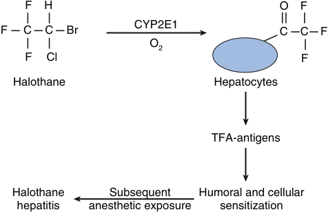

F H O F CYP2E1 F C C Br C C F O2 F Cl F Halothane Hepatocytes TFA-antigens Halothane Subsequent Humoral and cellular hepatitis anesthetic exposure sensitization 

**Fig. 18.16 Pathways generating the immune response after exposure to inhaled anesthetics.** Halothane is metabolized to a reactive trifluoroacetyl intermediate that forms an amide bond with hepatocellular proteins. The altered protein triggers an immune response, which on subsequent exposure to anesthetic results in hepatocellular damage and necrosis. A similar process may ensue after exposure to other fluorinated drugs metabolized to similar halo- acyl intermediates. _TFA_ , trifluoroacetic acid. (Modified from Njoku D, Laster MJ, Gong DH, et al. Biotransformation of halothane, enflurane, isoflurane, and desflurane to trifluoroacetylated liver proteins: association between protein acylation and liver injury. _Anesth Analg_ . 1997;84:173–178.)

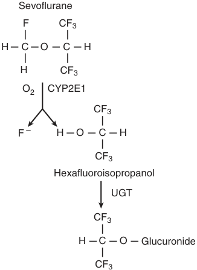

Sevoflurane F CF3 H C O C H H CF3 O2 CYP2E1 CF3 F  – H O C H CF3 Hexafluoroisopropanol UGT CF3 H C O Glucuronide CF3 

**Fig. 18.17 Metabolic oxidation of sevoflurane.** CYP2E1 catalyzes phase 1 defluorination of sevoflurane, forming hexafluoroisopropanol. Phase 2 glucuronidation is catalyzed by uridine 5′- diphosphate glucuronosyltransferase (UGT).

demonstrated no clinically significant nephrotoxicity after the administration of sevoflurane, even when peak blood F− concentrations exceeded 50 μM.119 Typical peak fluoride concentrations after 2 to 3 MAC- hours of sevoflurane anesthesia are 20 to 30 μM, and less than 5 μM after isoflurane and desflurane (see Fig. 18.18). Enflurane metabolism also often results in peak blood F− concentrations greater than 20 μM. Isoflurane and desflurane are minimally metabolized and produce lower plasma fluoride concentrations. However, none of these anesthetics is associated with clinically significant renal toxicity, suggesting that methoxyflurane is unique in its ability to harm kidneys.

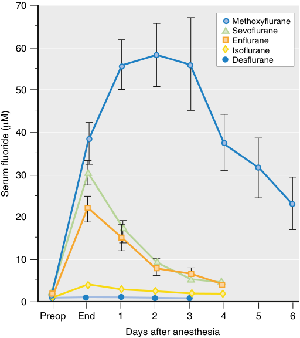

70 Methoxyflurane Sevoflurane Enflurane 60 Isoflurane Desflurane 50 40 30 20 10 0 Preop End 1 2 3 4 5 6 Days after anesthesia Serum fluoride (M)µ 

**Fig. 18.18** Serum inorganic fluoride (F− ) exposure during and after methoxyflurane anesthesia is much greater than with other anesthetics. _Points_ represent serum F− measurements (mean ± SD) from multiple subjects. After 2 to 3 MAC- hours of methoxyflurane anesthesia, F− rises during and after drug administration ends, peaks above 60 μmol/L on postanesthesia days 2 and 3, then declines slowly, remaining elevated for more than 1 week. Sevoflurane anesthesia (3.7 MAC- hours) produces an early peak F− concentration averaging 31 μmol/L, which declines over 3 to 4 days. Enflurane anesthesia (2.7 MAC- hours) results in an early average peak of 22 μmol/L that declines in 3 to 4 days. Isoflurane and desflurane result in small and negligible rises in serum F− concentrations. Only methoxyflurane is associated with fluoride- associated renal toxicity. _MAC_ , minimum alveolar concentration (immobility).

A key difference between methoxyflurane and newer VAs is its extreme lipophilicity and long residence time in tissues. This results in prolonged elevated F− concentrations in blood (see Fig. 18.18), suggesting that the length of F− exposure is another risk factor. However, prolonged moderate elevations of plasma fluoride (25–38 μM) during several days of isoflurane anesthesia without adverse renal effects have been documented.134,135 Thus, neither the peak level nor the duration of high plasma fluoride concentration entirely explains the nephrotoxic effects by the halogenated anesthetics. It is also not clear whether the integrated concentration multiplied by time exposure to inorganic F− accounts for overall risk. However, methoxyflurane is metabolized to a large extent within kidney parenchyma, producing high intrarenal F− concentrations (likely much higher than those in blood), which are proposed to cause renal injury.80,82 Thus, compared with methoxyflurane, the absence of renal toxicity with newer volatile halogenated agents is explained by: (1) their lower tissue solubilities, particularly in kidney (see Table 18.2), resulting in lower intrarenal fluoride production; (2) less overall biotransformation; and (3) more rapid respiratory clearance from the body.

<!-- PDF page 23 -->

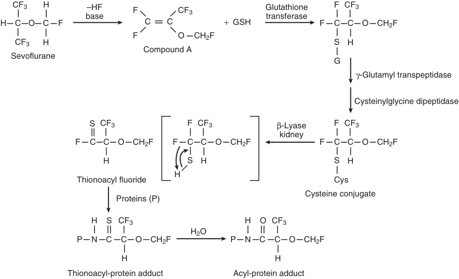

CF3 H –HF Glutathione F CF3 F CF3 base transferase H C O C F C   C +  GSH  F C C O CH2F F O CH2F CF3 H S H Compound A Sevoflurane G γ-Glutamyl transpeptidase Cysteinylglycine dipeptidase S CF3 F CF3 β-Lyase F CF3 kidney F C C O CH2F F C C O CH2F F C C O CH2F H S H S H H Thionoacyl fluoride Cys Cysteine conjugate Proteins (P) H S CF3 H O CF3 H2O P N C C O CH2F P N C C O CH2F H H Thionoacyl-protein adduct Acyl-protein adduct 

**Fig. 18.19 Proposed pathway mediating nephrotoxic effects of compound A in rodents.** Sevoflurane degrades to compound A in the presence of strong base in some CO2 absorbent materials. Compound A itself is not nephrotoxic but undergoes hepatic S- conjugation with glutathione. In the kidney, additional metabolic steps produce an S- cysteine compound A conjugate, which is metabolized by β- lyase to a reactive thionoacyl fluoride that is proposed to damage proteins essential for kidney function. Humans have very low β- lyase activity, which is hypothetically the basis for the lack of reported nephrotoxicity in patients. _CO2_ , carbon dioxide; _GSH_ , glutathione; _HF_ , hydrofluoric acid. (Adapted from Martin JL, Kandel L, Laster MJ, et al. Studies of the mechanism of nephrotoxicity of compound A in rats. _J Anesth_ . 1997;11:32–37.)

### ANESTHETIC DEGRADATION IN CARBON DIOXIDE ABSORBENTS

### Sevoflurane, Compound A, and Renal Toxicity

Halogenated anesthetics can undergo chemical breakdown while interacting with carbon dioxide (CO2) absorbents that contain strong bases such as sodium hydroxide (NaOH) and potassium hydroxide (KOH), which are present in soda lime and Baralyme.136 Strong bases extract a proton from the isopropyl group of sevoflurane, primarily forming a haloalkene [fluoromethyl- 2,2- difluoro- 1- (trifluoromethyl) vinyl ether], known as “compound A” (Fig. 18.19). Compound A is volatile and can be absorbed via alveolar gas exchange. Compound A exposure is nephrotoxic in laboratory animals, causing proximal tubular necrosis and, with sufficient exposure, death. In rats, renal injury is observed with cumulative exposure to compound A above 150 parts per million (ppm)- hours (e.g., 50 ppm inhalation for 3 hours).137,138 Moderately severe but reversible histopathologic damage was found in rats after 200 ppm- hour exposure, associated with increased blood urea nitrogen (BUN), creatinine, and other measures of renal damage. Compound A exposure over 1000 ppm- hours is lethal in half of exposed rats.

Patients receiving sevoflurane anesthesia may be exposed to compound A in rebreathing circuits, and the inhaled concentration is dependent on the fresh gas flow rate and the type of CO2 absorbent present. Fresh gas flows of 1 L/ min result in maximal compound A concentrations around 20 ppm with soda lime and 30 ppm with Baralyme.139 Higher FGF rates result in less compound A accumulation in the breathing circuit. However, compound A exposure

is not associated with clinically significant nephrotoxicity in humans. There is no threshold exposure level known to cause more than subclinical renal damage. Numerous studies in which human subjects or patients were exposed to more than 200 ppm- hours of compound A have reported that clinical measures of renal function (BUN, creatinine, urinary protein or glucose, and urine concentrating ability) and laboratory tests for subtle renal damage (N- acetyl- β- glucosaminidase, alanine aminopeptidase, γ- GTP, and β2microglobulin) remain unchanged.83,88,140–142 Kharasch and colleagues143 compared the effects of low- flow sevoflurane and isoflurane anesthesia in patients with chronic renal insufficiency, and found no significant difference in postoperative renal function tests. Other studies have reported normal BUN and creatinine, but transient reversible abnormalities in other renal function test values following prolonged sevoflurane anesthesia at low FGF (>330 ppm- hour compound A exposure in one study).144–147

The evidence of sevoflurane- induced nephrotoxicity in rats compared with the remarkably benign results in humans suggests interspecies differences in metabolic toxification, and/or sensitivity of the proximal tubular cells to compound A cytotoxicity.73 Detailed studies show that in rats, compound A undergoes S- conjugation to cysteine, and that the resulting cysteine conjugate is metabolized by renal β- lyase to form a reactive thionoacyl fluoride intermediate that acylates proteins and has been proposed to mediate nephrotoxicity (see Fig. 18.19).136,148 Human kidneys have far lower β- lyase activity than rat kidneys, accounting for the differential toxicity of compound A in the two species. Experiments testing whether inhibition of β- lyase with

<!-- PDF page 24 -->

aminooxy- acetic acid (AOAA) protects rats from compound A nephrotoxicity have had mixed results.149,150 Alternative mechanisms underlying compound A toxicity have been proposed, including formation of reactive sulfoxides catalyzed by CYP3A isozymes,151 which are also more active in rat than human kidneys.

Although the mechanism underlying compound A toxicity in laboratory animals remains uncertain, the lack of significant sevoflurane nephrotoxicity in human clinical data is reassuring. Compound A exposure depends on fresh gas flows, vaporizer output, duration of anesthesia, and CO2 absorbent materials. With soda lime or Baralyme as CO2 adsorbent, the use of 2 L/min fresh gas flows assures that for all but the longest cases, exposure to compound A will be below the most conservative threshold for nephrotoxicity. Although clinical studies indicate that sevoflurane is safe, even in patients with preexisting renal dysfunction, the drug should be administered in accordance with the approved package labeling guidelines.

Like sevoflurane, halothane degrades in the presence of CO2 absorbents to form a reactive intermediate, bromochlorodifluoroethylene (BCDFE),136 which has also been investigated as a possible nephrotoxin. In comparison to compound A, BCDFE accumulates 20- to 40- fold less in breathing circuits and is 4- fold less reactive.152 Thus the risk of BCDFE nephrotoxicity is negligible.

### Carbon Monoxide and Heat

In the presence of strong bases in dry CO2 absorbents (water content &lt;5%), some halogenated VAs decompose, forming CO, trifluoromethane (CF3H), and hydrogen fluoride (HF).136 The factors that determine the amount of CO produced include the chemical makeup of CO2 absorbent (KOH > NaOH >> Ba(OH)2, Ca(OH)2), dryness of the absorbent material, the concentration of volatile agent, and its chemical structure.153 Baralyme contains 4.6% KOH, whereas soda lime contains 2.5% KOH and 1.3% NaOH, and reacts less vigorously with halogenated anesthetics. The relatively weak bases Ba(OH)2 and Ca(OH)2 are other major constituents in CO2 absorbents, and do not catalyze CO formation (Table 18.4).139,154 The anesthetics that contain a difluoromethyl group (difluoromethyl- ethyl ethers) are most susceptible to this degradation, and for these drugs CO production correlates with anesthetic concentration in the breathing circuit (desflurane > enflurane > isoflurane) (Fig. 18.20).155 Sevoflurane, methoxyflurane, and halothane also degrade in the presence of strong bases, but do not produce CO. Production of CO appears to require nearly complete desiccation (i.e., removal of moisture) of the CO2 absorbent, and typically occurs after high- flow “flushing” of the breathing circuit for 1 to 2 days. Soda lime contains 15% water by weight, and Baralyme contains 13% water by weight (see Table 18.4). CO production is observed when the water content of soda lime or Baralyme falls below 1.4% and 5%, respectively.156 High ambient temperatures also accelerate desiccation of CO2 absorbent materials and may increase the rate of CO-producing reactions. As with compound A, CO accumulation in the breathing circuit is inversely related to the fresh gas flow.

Anesthetic degradation in the breathing circuit has resulted in CO poisoning during clinical anesthesia.157,158 CO has 250- fold greater affinity for hemoglobin than O2

does. Thus, the formation of carboxyhemoglobin reduces blood oxygen–carrying capacity and tissue oxygen delivery and is difficult to reverse. The detrimental effects and signs of CO toxicity are well known. However, during general anesthesia, signs of patient exposure to CO are masked and hypoxia may be difficult to detect because most pulse oximetry equipment cannot distinguish between carboxyhemoglobin and oxyhemoglobin.

The degradation of VAs by bases in CO2 absorbents is an exothermic reaction that results in the production of heat. Sevoflurane produces the most heat when it is used with desiccated CO2 absorbent. The absorbent canister and anesthetic circuit can reach extremely high temperatures, which can lead to explosion or fire, or both.159,160

Current recommendations to minimize anesthetic degradation to CO and heat include machine maintenance measures to avoid desiccation of CO2 absorbents and the use of absorbents that contain less KOH and NaOH. Newer CO2 absorbents (see Table 18.4) contain little or no strong base and do not degrade VAs, regardless of hydration status.139,161,162 Using the newer CO2 absorbents also reduces the production of compound A during sevoflurane anesthesia.163–165

### NITROUS OXIDE, VITAMIN B12, AND HOMOCYSTEINE

N2O is unique among anesthetics in irreversibly inhibiting cobalamins (vitamin B12) by oxidizing the Co (I) ligand. Cobalamins are ingested or produced by

**Table 18.4** Composition of Base Chemicals and Water Content of Carbon Dioxide Absorbents

|**CO2** **absorbent**|**Ca(OH)2** **(%)**|**Ba(OH)2** **(%)**|**KOH** **(%)**|**NaOH** **(%)**|**LiOH** **(%)**|**H2O** **(%)**|
|---|---|---|---|---|---|---|
|Baralyme*****|70|10|4.6|–|–|14|
|Soda lime I|80|–|2.6|1.3|–|15|
|Sodasorb|90|–|0.0005|3.8|–|16|
|Drägersorb 800 plus|82|–|0.003|2|–|16|
|Soda lime II/ Medisorb|81|–|0.003|2.6|–|16|
|Spherasorb|84.5|–|0.003|1.5|–|14|
|Amsorb|83.2|–|–|–|–|14.4|
|LofloSorb|84|–|–|–|–|16|
|Superia|79.5|–|–|–|–|17.5|
|Lithium hydroxide|–|–|–|–|99|1|

*Baralyme was withdrawn from the market in 2004. Various absorbents also contain other components, such as

polyvinylpyrrolidone, calcium chloride, calcium sulfate, magnesium chloride, and aluminosilicate.

Data from Keijzer C, Perez RS, de Lange JJ. Compound A and carbon monoxide production from sevoflurane and seven different types of carbon dioxide absorbent in a patient model. _Acta Anaesthesiol Scand_ . 2007;51:31–37, and Kharasch ED, Powers KM, Artru AA. Comparison of Amsorb, sodalime, and Baralyme degradation of volatile anesthetics and formation of carbon monoxide and compound A in swine in vivo. _Anesthesiology_ . 2002;96:173–182.

::: details 原始表格與符號（PDF 第 24 頁）

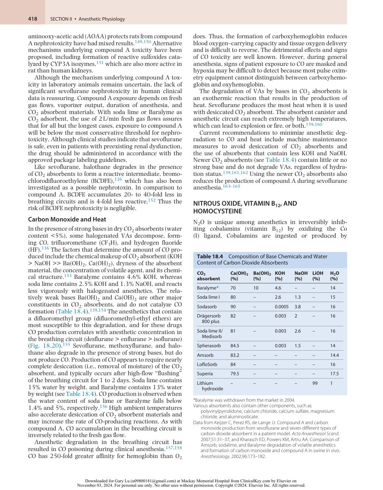

:::

<!-- PDF page 25 -->

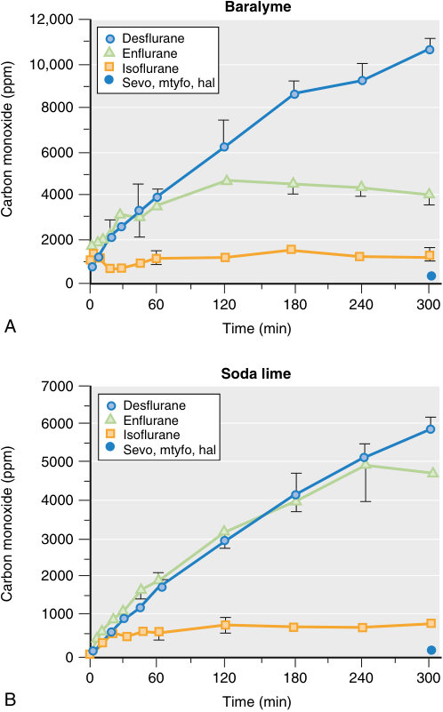

Baralyme 12,000 Desflurane Enflurane 10,000 Isoflurane Sevo, mtyfo, hal 8000 6000 4000 2000 0 0 60 120 180 240 300 A Time (min) Soda lime 7000 Desflurane 6000 Enflurane Isoflurane Sevo, mtyfo, hal 5000 4000 3000 2000 1000 0 0 60 120 180 240 300 B Time (min) Carbon monoxide (ppm) Carbon monoxide (ppm) 

**Fig. 18.20 Inhaled anesthetic degradation and carbon monoxide production.** _Points_ represent mean ± SD of three measurements with equivalent anesthetic doses (1.5 × MAC) in the presence of dry CO2 absorbents at identical fresh gas flows. (A) Degradation and CO production with Baralyme. (B) Degradation and CO production with soda lime. Degradation and CO production was observed with anesthetics containing difluoromethoxy groups (desflurane, enflurane, and isoflurane), but not halothane (hal) or those with monofluoromethoxy groups such as sevoflurane (sevo) and methoxyflurane (mtyfo). _CO,_ carbon monoxide; _MAC,_ minimum alveolar concentration. (Adapted from Baxter PJ, Garton K, Kharasch ED. Mechanistic aspects of carbon monoxide formation from volatile anesthetics. _Anesthesiology_ . 1998;89:929–941.)

bacteria in the gut and are critical cofactors together with 5- methyltetrahydrofolate in the activity of methionine synthase (Fig. 18.21). Methionine synthase catalyzes methylation of homocysteine to methionine, while demethylating 5- methyltetrahydrofolate to tetrahydrofolate. Methionine, converted to S- adenosylmethionine, is the major substrate for methylation in biochemical pathways involved in the synthesis of DNA, RNA, myelin, and catecholamines.166 Chronic vitamin B12 deficiency (as in pernicious anemia) results in hematologic and neurologic dysfunction. Longterm N2O exposure, typically among individuals who frequently inhale it as a recreational drug, can also cause megaloblastic anemia, myelopathy (subacute combined degeneration), motor and sensory neuropathy, and encephalopathy, sometimes presenting as psychosis.167–170 N2O is

the eighth most commonly used recreational substance in the United Kingdom.171 Risk factors that increase susceptibility to N2O toxicity include pernicious anemia or other gastrointestinal malabsorption syndromes, extremes of age, alcoholism, malnutrition, a strict vegetarian diet, and inborn deficiencies in cobalamin or tetrahydrofolate metabolism.167 Inhibitors of folate metabolism, such as methotrexate, may also enhance sensitivity to N2O toxicity.172

In healthy surgical patients, megaloblastic changes in the bone marrow are rare, and reported only after prolonged exposure (>12 hours) to N2O. Healthy pediatric patients exposed to N2O for up to 8 hours during spine surgery do not develop evidence of megaloblastic anemia.173 However, in seriously ill patients or those with risk factors noted earlier, shorter (or repetitive) periods of N2O exposure may lead to significant subacute pathology. Megaloblastic bone marrow changes can be induced after a short period (2–6 hours) of N2O exposure.174 Vitamin B12 deficiency or reduced methionine synthase activity can also lead to subacute myelopathy and neuropathy.175–178 A case highlighting the potential importance of inborn metabolism was reported by Selzer and colleagues.179 In this case, a 4- month- old child developed an irreversible and ultimately fatal seizure disorder several weeks after receiving N2O during anesthesia. Autopsy revealed widespread brain atrophy and demyelination, and biochemical investigations revealed reduced methyltetrahydrofolate reductase (MTHFR) activity, subsequently linked to mutations in the gene encoding MTHFR.

Another consequence of reduced methionine synthase activity is accumulation of its substrate: homocysteine (see Fig 18.21). Homocystinuria caused by severe inborn deficiency of methionine synthase activity is associated with extremely elevated blood homocysteine levels, early atherosclerosis of coronary and cerebral arteries, and premature death.180 These observations led to the “homocysteine hypothesis,” which postulates that homocysteine stimulates inflammation and atherosclerosis, and is a key modifiable factor in vascular morbidity and mortality. Despite some evidence that increased homocysteine levels are an independent risk factor for cardiac and cerebrovascular morbidity,181,182 the association between homocysteine levels and atherothrombotic disease is weak, as some large prospective studies have found.183 Moreover, studies in which diet and vitamin supplementation was used to reduce homocysteine levels demonstrate improvement in some markers of vascular risk, but do not reduce the rate of myocardial infarction and atherosclerotic stroke.183,184 Thus, it appears that the importance of chronic moderate elevation in homocysteine to cardiovascular outcomes is tenuous, or perhaps only pertinent to limited patient populations.

Does the rapid increase of homocysteine levels during N2O anesthesia influence the risk of cardiovascular and neurovascular morbidity following surgery and anesthesia? Badner and colleagues185 reported that N2O administration significantly increased homocysteine levels and increased myocardial risk in carotid endarterectomy patients. The Evaluation of Nitrous Oxide in a Gas Mixture for Anaesthesia (ENIGMA) trial in more than 2000 patients reported that avoidance of N2O combined with increased inspired oxygen concentration during anesthesia decreased the incidence of a variety of complications after major surgery, but found no

<!-- PDF page 26 -->

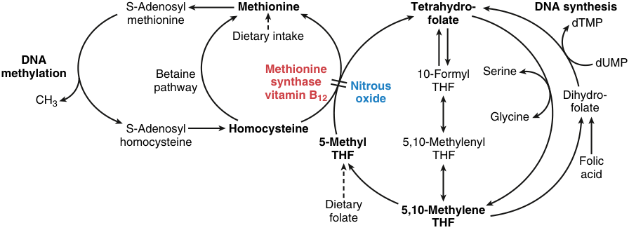

S-Adenosyl Methionine Tetrahydro- DNA synthesis methionine folate dTMP Dietary intake DNA dUMP methylation Betaine Methionine 10-Formyl Serine pathway synthase Nitrous THF CH3 vitamin B12 oxide Dihydro- folate Glycine S-Adenosyl Homocysteine homocysteine 5-Methyl 5,10-Methylenyl THF THF Folic acid Dietary 5,10-Methylene folate THF 

**Fig. 18.21 Nitrous oxide inhibition of methionine synthase.** Biochemical cycles involved in methylation reactions are shown. Methionine synthase _(red)_ catalyzes methylation of homocysteine with 5- methyl tetrahydrofolate as the donor, producing methionine and tetrahydrofolate (THF). Both vitamin B12 and folate are essential cofactors for methionine synthase. Nitrous oxide _(blue)_ inhibits methionine synthase by oxidizing the cobalt of cobalamin (vitamin B12). Methyl transfer pathways are important in synthesis of protein and DNA. _dTMP_ , deoxythymidine; _dUMP_ , 2′- deoxyuridine 5″- monophosphate.

reduction in death, myocardial infarction, stroke, or hospital length of stay.186 A follow- up randomized trial in 7112 patients (ENIGMA- II) reported no difference in myocardial infarction, stroke, pulmonary embolism, or cardiac arrest risk within 30 days of surgery.187 A post hoc study of 5133 enrollees in the Perioperative Ischemic Evaluation (POISE) trial also found no increase in rates of death, myocardial infarction, or stroke in approximately 1500 patients who received N2O.188

Anecdotally, N2O use is thought to contribute to myocardial infarction in patients with elevated homocysteine levels at baseline.189 Homocysteine elevation following N2O inhalation is a useful marker for assessing the sensitivity of methionine synthase and related biochemical pathways to N2O inhibition. Nagele and colleagues190 studied a small group of surgical patients with common mutations in the gene encoding MTHFR and found that those with 667C→T and 1298A→C mutations were at risk of developing abnormally high homocysteine levels after N2O exposures of at least 2 hours. However, a common gene variant (66A→G) associated with reduced methionine synthase reductase activity did not result in abnormally high homocysteine levels after anesthesia with N2O.191 Preoperative infusions of vitamin B12 and folate do not prevent the normal elevation in homocysteine observed following anesthesia with N2O.192

The continued value of N2O, first used as an anesthetic in the early 19th century, has been questioned by some who view its known and potential toxicities as outweighing benefits such as rapid onset and offset and relative cardiovascular stability during anesthesia.193,194 Currently available data indicate that N2O does not alter the risk of cardiovascular morbidity in the vast majority of patients. The authors recommend careful screening of patients to identify the few most likely to suffer N2O toxicity, and to avoid the drug in these cases.

### INHALED ANESTHETICS AND NEUROTOXICITY

While the neurologic effects of inhaled and other anesthetic agents have long been thought to be limited to the period of drug exposure and early recovery, animal studies have

revealed potential long- lasting neurotoxic effects in patients of extreme ages (see Chapters 72 and 78).195 The greatest concern addresses the impact in fetuses and young children exposed to general anesthetics during periods of rapid brain development.196 In a seminal study, Jevtovic- Todorovic and coworkers197 found widespread neuronal death (apoptosis) in the brains of 7- day- old rats after exposure to midazolam, isoflurane, and N2O, associated with persistent (up to 4.5 months) performance deficits in spatial learning tests. Studies in nonhuman primates demonstrated that during sensitive periods of early brain development, exposure to most general anesthetics is associated with accelerated neuronal apoptosis and degeneration, with exposures as short as 3 hours leading to neurocognitive problems.197–202 Other studies suggest that low nonapoptotic concentrations of general anesthetics may inhibit normal synapse formation and damage developing neuronal networks.203 Mechanisms underlying neurodevelopmental toxicity are potentially linked to _N_ - methyl- d- aspartate (NMDA) receptors and GABAA receptors, the same ion channels hypothesized to mediate general anesthesia.195,204–206

Based on preclinical evidence that anesthetic exposure impairs neurodevelopment, the US Food and Drug Administration (FDA) amended drug labels, warning that repeated or lengthy exposures to general anesthetics and sedative drugs “may negatively affect brain development in children younger than 3 years”.207 However, clinical studies have provided reassuring data on young children undergoing brief procedures with anesthesia.208–211 The Pediatric Anesthesia NeuroDevelopment Assessment (PANDA) trial compared neuropsychological outcomes in a cohort of children who received general anesthesia for hernia repair before age 3 with unexposed siblings, showing no difference.212 The Mayo Anesthesia Safety in Kids (MASK) study longitudinally measured neuropsychological outcomes in cohorts of children who had zero, one, or multiple anesthetic exposures and found no differences in general intelligence, while suggesting some behavioral and learning problems with increased exposure.213 The only prospective randomized clinical study, the General Anesthesia Compared to Spinal Anesthesia (GAS) trial, compared infants who underwent hernia repair with awake- spinal versus inhaled general

<!-- PDF page 27 -->

anesthesia. At ages 2 and 5, cognitive scores in the two groups were equivalent.214 Of note, most of the patients in PANDA and GAS trials were boys and inhaled anesthetic exposures were around an hour, limiting the generalizability of the outcomes. Assessing the risk to fetuses of women anesthetized while pregnant is a clinical challenge that has yet to be met. Given that such exposures are associated with non- elective procedures, recommendations focus on minimizing the duration of anesthesia and, when possible, avoidance of drugs that modulate GABAA receptors.215,216 A comprehensive examination of this topic is provided elsewhere in this textbook (see Chapter 72). For a comprehensive description of long- term cognitive effects of surgery and anesthesia in adults, see Chapter 78.

### INHALED ANESTHETICS AND ENVIRONMENTAL EFFECTS

Anesthetic gases in the workplace and in the outdoor environment have the potential to cause harm. An American Society of Anesthesiologists (ASA) Task Force released a comprehensive document on environmentally sustainable anesthesia practice, including the choice of anesthetic gases and reduction of waste: https://www.asahq.org/about- asa/governanceand- committees/asa- committees/environmentalsustainability/greening- the- operating- room. The ASA also published guidance on reducing atmospheric pollutants at health care facilities: https://www.asahq.org/abouta s a / g o v e r n a n c e - a n d - c o m m i t t e e s / a s a - committees/environmental- sustainability/inhaledanesthetic- challenge. Three potential environmental sequelae of inhaled anesthetics have been investigated: global warming, ozone depletion, and health effects from workplace exposure.

### Global Warming Effects

Atmospheric trapping of thermal radiation from the Earth’s surface is known as the _greenhouse effect_ , which the Intergovernmental Panel on Climate Change deems a major contributor to global warming.217 Inhaled anesthetics are recognized greenhouse gases.218–220 Isoflurane, sevoflurane, and desflurane, the most widely used current inhaled

anesthetics, are minimally metabolized in the body and are substantially eliminated through exhalation. Most anesthesia waste scavenging systems transfer these gases directly and unchanged into the atmosphere, which has drawn attention to the ecotoxicologic properties of inhaled anesthetics. The global warming potential (GWP) accounts for the heat- trapping efficiency and lifetime (i.e., the time for removal by chemical decomposition or deposition) of atmospheric gases relative to an equal mass of CO2 (Table 18.5). The estimated GWPs of halogenated anesthetics range from 151 (halothane) to 6810 (desflurane).218,219 The amount of an anesthetic released into the atmosphere, which is approximately the amount delivered (dependent on vaporizer settings and FGF; see Eq. 18.1), is another important factor in determining its greenhouse gas impact. Thus, VAs contribute to global warming, with desflurane potentially producing the greatest impact.221

The GWP of N2O is high (264) because it is remarkably stable, with an atmospheric lifetime near 120 years.222 Moreover, it is administered to patients in much larger quantities than VAs. Atmospheric N2O is produced by natural and human sources including agriculture (nitrogenbased fertilizers) and combustion of fossil fuels. Sherman and Cullen223 in 1988 estimated that anesthesia contributed approximately 1% of man- made N2O worldwide. In the United States, anesthetic use may represent 3.0% of total N2O emissions.224 Although the medical use of N2O is declining in many countries, data on worldwide clinical N2O use are not available.

### Ozone Depletion

The ozone layer of the Earth’s atmosphere, which has been declining 4% per decade since the 1970s, absorbs damaging ultraviolet B light (UVB; wavelengths 280–315 nm). The biologic consequences of increasing UVB radiation include increases in skin cancer, cataracts, damage to plants, and reduction of oceanic plankton populations. Halogenated VAs are similar to chlorofluorocarbons (CFCs), which are major ozone-depleting pollutants. The ozone- depleting potential of halocarbons (see Table 18.5) depends on molecular weight, number, and type of halogen atoms, and atmospheric lifetime.225 The atmospheric lifetime of halogenated anesthetics is much shorter (1.0–14 years) than that of

**Table 18.5** Atmospheric Lifetimes and Environmental Effects of Inhaled Anesthetics

|**Comp**|**ound**|**Lifetime (years)**|**ODP**|**GWP (20 years)**|**GWP (100 years)**|
|---|---|---|---|---|---|
|CFC- 12|CCl2F2|100|1|10,800|10,200|
|Carbon dioxide|CO2|5–200|–§|1|1|
|Nitrous oxide|N2O|114–121|0.017|264|265|
|Halothane|CF3CHBrCl|1.0|0.36|151|41|
|Isoflurane|CHF2OCHClCF3|3.2–3.6|0.01|1401–1800|491–510|
|Sevoflurane|CH2FOCH(CF3)2|1.1–2.2|0|349–795|130–216|
|Desflurane|CHF2OCHFCF3|10–14|0|3714–6810|1790–2540|

§CO2 unlikely reacts and depletes ozone. However, CO2 producing the greenhouse effect in the troposphere is predicted to reduce stratospheric temperatures and cause further ozone depletion.287 Computed value for halothane relative to GWP for CFC- 12.

Ozone-depleting potential (ODP) is the ratio of integrated perturbations to total ozone relative to an equal emission of CFC- 12. Global warming potential (GWP) is defined as the cumulative radiative retention integrated over a period of time from the emission of gas relative to reference gas (carbon dioxide). The data are based on the Intergovernmental Panel on Climate Change (IPCC) Fifth Assessment Report217 and other sources.218–220,222

::: details 原始表格與符號（PDF 第 27 頁）

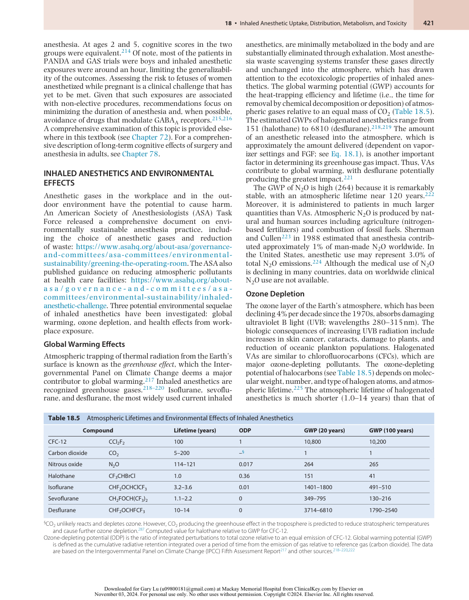

:::

<!-- PDF page 28 -->

many CFCs (up to 100 years).217 Fluorination is associated with longer atmospheric lifetime because of the stability of carbon–fluorine (C- F) bonds. Chemicals with a lifetime of more than 2 years are believed to reach the stratosphere in significant quantities. There, intense solar ultraviolet radiation breaks their carbon–halogen bonds, creating halogen radicals that catalytically destroy ozone. Chlorinecontaining anesthetics such as halothane, isoflurane, and enflurane may be more destructive to the ozone layer than sevoflurane and desflurane, which contain only C- F bonds. Carbon–hydrogen bonds are susceptible to attack by hydroxyl radicals (OH) in the troposphere,226 making them less likely to reach the stratosphere. However, even compounds with a lifetime of a few months may potentially contribute to ozone destruction.227 In 1999, contributions to total stratospheric ozone depletion were estimated as 1% for halothane and 0.02% for isoflurane and enflurane.218 N2O is the primary source of stratospheric nitrogen oxides, NO and NO2, and both destroy ozone. Because only 10% of N2O is converted to NOx, its ozone-depleting potential is lower than that of an equal mass of CFCs. However, because of the large quantities produced, N2O is the largest contributor to ozone depletion, and is expected to remain so for the rest of this century.217,222

The environmental impact of all inhaled anesthetics could be reduced by 80% to 90% if closed-circuit anesthesia is widely employed, and to a lesser degree if low carrier gas flow rates are routinely used (see Fig. 18.13). Technologies that trap anesthetics in waste gas flows have the potential to reduce both environmental emissions and drug costs by reusing (after redistillation) the trapped drugs.228 Activated charcoal filters have been introduced to recapture a fraction of volatile anesthetics in waste gas streams and are commercially available in some countries.229,230 Technical infrastructure and regulatory approval for reprocessing and reusing captured waste anesthetics are anticipated. Physician education about inhaled anesthetic contributions to both the greenhouse effect and ozone depletion should be continued. Avoiding N2O and desflurane when they provide no clinical advantage is recommended for environmental sustainability.221,224,231 However, even without desflurane and N2O, life- cycle analysis (from manufacture to disposal) suggests that sevoflurane is a major source of CO2 equivalents during general anesthesia, while general, spinal, and combined anesthetic approaches for total knee replacements produced similar overall carbon footprints.232 Anesthesiology more broadly is a major contributor to total health care pollution.231,233 Analysis of overall life-cycle environmental effects is advocated to promote environmentally sustainable practice (see also Chapter 20).

### Exposure to Waste Anesthetic Gases

Health care personnel can be exposed to waste anesthetic gases in the operating room environment and to exhaled anesthetic gases in postanesthesia care units, intensive care units, and other postoperative patient care areas. Possible adverse health effects from chronic exposure to trace concentrations of inhaled anesthetics has concerned health care professionals for many years.234,235 Laboratory studies suggest reproductive abnormalities in rodents exposed to high concentrations of N2O (1000 ppm or greater).236,237 All inhaled anesthetics cross the placental–fetal exchange

barrier. Teratogenicity due to occupational anesthetic exposure is of particular concern in pregnant health care workers. Long- term occupational exposure to anesthetic gases may be associated with genomic alterations.238,239 However, evidence of reproductive hazards in health care personnel exposed to anesthetic gases relative to unexposed controls is rare and inconsistent.240,241 There is no evidence of adverse health effects of chronic anesthetic exposure in the workplace when environmental waste anesthetic levels are kept within recommended threshold values.242–244 The US Occupational Safety and Health Administration (OSHA) recommends that no worker should be exposed to concentrations of halogenated anesthetics greater than 2 ppm for a period exceeding 1 hour during anesthesia administration (http://www.osha.gov/dts/osta/anestheticgases/inde x.html). OSHA also recommends that no worker should be exposed to 8- hour time- weighted average concentrations of N2O greater than 25 ppm.

Studies have documented excessive levels of waste anesthetic gases in poorly ventilated postanesthesia care areas.245–247 Limited observational studies in European postanesthesia care units reported sevoflurane at maximum concentrations below 1 ppm.248,249 In intensive care units, long- term use of inhaled anesthetics may confer advantages over intravenous infusions for sedation of mechanically ventilated patients.250–252 With this practice, environmental levels of anesthetic gases should be monitored and minimized.253

### Xenon

The noble gas xenon was first shown to produce general anesthesia in 1951,254 and of all inhaled anesthetics, it most closely approaches the ideal.255–257 Xenon is a minor constituent of air (∼90 parts per billion), and is produced by distillation of cryogenically liquefied air, along with liquefied nitrogen and oxygen. Xenon is entirely unreactive in the biosphere and non- polluting, although its production uses considerable energy, creating CO2 and other pollutants as byproducts.224 It is odorless, tasteless, nonflammable, and has unlimited shelf- life. Its solubility in blood (λb/g ≈ 0.12)258 and body tissues is lowest among inhaled anesthetics. As a result, xenon can provide remarkably rapid onset and respiratory clearance, with emergence times two- to threefold faster when it replaces N2O in clinical settings.259–261 It undergoes no reactions with CO2 absorbents or ultraviolet light. Xenon also has favorable pharmacodynamic properties. It produces minimal cardiovascular depression and is not arrhythmogenic.262–264 Like N2O, xenon has analgesic activity and reduces intraoperative opioid requirements.265 It does not trigger malignant hyperthermia or produce any organ toxicity.266 In preclinical models of ischemic or traumatic injury, xenon shows consistent cardioprotective and neuroprotective activities.255,257,267 Clinical trials in adult cardiac surgery patients,268–270 partial nephrectomy patients,271 and comatose survivors of cardiac arrest receiving targeted temperature management272,273 have shown that xenon reduces pressor requirements and modestly reduces the extent of organ damage, relative to control patients. However, in these clinical settings and in others, including perinatal asphyxia, xenon does not improve neurocognitive biomarkers, functional recovery, or survival.274–278

<!-- PDF page 29 -->

Given its advantages, why is xenon not a commonly used inhaled anesthetic? The main reason is cost.279 At more than $10/L of gas currently, xenon is many- fold more expensive than N2O and much more costly per patient than volatile anesthetics. The MAC- immobility of xenon is 0.61 atm, and using a strict closed- circuit technique, over 10 L are needed to anesthetize a typical patient. Total closed-circuit anesthesia with xenon–oxygen requires an initial lengthy denitrogenation period to prevent excessive N2 accumulation during rebreathing, followed by slow addition of xenon to replace metabolized O2 in the closed circuit.280 To achieve rapid anesthetic induction with xenon requires high flows, generating greater waste and expense. To make xenon more affordable, specialized anesthesia machines enable efficient closed- circuit delivery,281 and waste- gas scavenging systems fitted with cryogenic traps condense xenon into liquid form for repurification and re- use.282

In addition to cost, xenon presents a few other downsides. Xenon gas has a much higher density (5.9 g/L) than either N2O (1.9 g/L) or air (1.2 g/L), resulting in increased flow resistance and work of breathing.283 Thus, it may be a poor choice for patients with compromised respiratory function. As with N2O, high xenon partial pressures needed for anesthesia cause expansion of trapped airspaces and vascular air emboli.284 Compared with propofol infusion or sevoflurane inhalation, xenon anesthesia also results in a higher incidence of nausea and vomiting.285,286

Currently, xenon remains an experimental anesthetic, with clinical research focusing on its potential as an organ protectant and the development of technologies to reduce its cost. Shifting the cost–benefit balance toward more xenon use in patients will depend on future research outcomes.

30.  Peyton PJ, et al. _Anesthesiology_ . 2008;108(3):381.

31.  Korman B, et al. _Anesthesiology_ . 2018;129:1075.

32.  Barrett EJ, et al. _Diabetes_ . 2012;61(11):2661.

33.  Larsen OA, et al. _Acta Physiol Scand_ . 1966;66(3):337.

34.  Matsukawa T, et al. _Anesthesiology_ . 1995;82(3):662.

35.  Watt SJ, et al. _Anaesthesia_ . 1996;51(1):24.

36.  Westenskow DR, et al. _Br J Anaesth_ . 1986;58(5):555.

37.  Van Zundert T, et al. _Anaesth Intensive Care_ . 2010;38(1):76.

38.  Gallagher TM, et al. _Anaesthesia_ . 1985;40(11):1073.

39.  Carpenter RL, et al. _Anesth Analg_ . 1986;65(6):575.

40.  Yasuda N, et al. _Anesthesiology_ . 1991;74(3):489.

41.  Hendrickx J, et al. _Eur J Anaesthesiol_ . 2016;33(9):611.

42.  Eger EI, et al. _Anesthesiology_ . 1965;26:756.

43.  Eger 2nd EI. _Anesth Analg_ . 2001;93(4):947.

44.  Hunter T, et al. _Paediatr Anaesth_ . 2005;15(9):750.

45.  Baum JA. _Minimal Flow and Closed System Anaesthesia_ . 2nd ed. Butterworth- Heinemann; 2001.

46.  Levy RJ, et al. _Anesth Analg_ . 2010;110(3):747.

47.  Severinghaus JW. _J Clin Invest_ . 1954;33(9):1183.

48.  Lowe H, et al. _The Quantitative Practice of Anesthesia: Use of Closed Circuit_ . Williams & Wilkins; 1981.

49.  Lerou JG, et al. _Anesthesiology_ . 1991;75(2):230.

50.  Munson ES, et al. _Anesthesiology_ . 1973;38(3):251.

51.  Gibbons RT, et al. _Anesth Analg_ . 1977;56(1):32.

52.  Eger 2nd EI, et al. _Anesthesiology_ . 1970;32(5):396.

53.  Munson ES, et al. _Anesthesiology_ . 1966;27(6):783.

54.  Eger 2nd EI, et al. _Anesthesiology_ . 1965;26:61.

55.  Perreault L, et al. _Anesthesiology_ . 1982;57(4):325.

56.  Wolf GL, et al. _Anesthesiology_ . 1983;59(6):547.

57.  Miller CF, et al. _Anesthesiology_ . 1983;58(3):281.

58.  Singh M, et al. _J Surg Tech Case Rep_ . 2015;7(1):20.

59.  Stanley TH, et al. _Anesthesiology_ . 1974;41(3):256.

60.  Algren JT, et al. _Paediatr Anaesth_ . 1998;8(1):31.

61.  Kaplan R, et al. _Anesthesiology_ . 1981;55(1):71.

62.  Lemmens HJ, et al. _Anesth Analg_ . 2008;107(6):1864.

63.  Leeson S, et al. _Anesth Analg_ . 2014;119(4):829.

64.  Hendrickx JF, et al. _BMC Anesthesiol_ . 2006;6:7.

65.  Nordmann GR, et al. _Br J Anaesth_ . 2006;96(6):779.

66.  Lockwood G. _Br J Anaesth_ . 2010;104(5):648.

67.  Cullen BF, et al. _Anesthesiology_ . 1972;36(2):168.

68.  Fassoulaki A, et al. _Anesthesiology_ . 1991;74(3):479.

### Complete references available online at expertconsult.com.

69.  Laster MJ, et al. _Anesth Analg_ . 1991;73(2):209.

70.  Yoshimura N, et al. _Anesthesiology_ . 1976;44(5):372.

71.  Fink BR. _Anesthesiology_ . 1955;16(4):511.

### References

1.  Mapleson WW. _Br J Anaesth_ . 1973;45(4):319.

2.  Bovill JG. _Handb Exp Pharmacol_ . 2008;(182):121.

3.  Eger 2nd EI. _Anesth Analg_ . 1987;66(10):971.

4.  Eger 2nd EI, et al. _Anesthesiology_ . 1963;24:625.

5.  Cromwell TH, et al. _Anesthesiology_ . 1971;35(4):401.

6.  Yasuda N, et al. _Anesth Analg_ . 1989;69(3):370.

7.  Stoelting RK, et al. _Anesthesiology_ . 1970;33(1):5.

8.  Dwyer R, et al. _Anesthesiology_ . 1992;77(5):888.

9.  Gion H, et al. _Anesthesiology_ . 1971;35(4):361.

10.  Rampil IJ, et al. _Anesthesiology_ . 1991;74(3):429.

11.  Katoh T, et al. _Anesth Analg_ . 1993;77(5):1012.

12.  Steward A, et al. _Br J Anaesth_ . 1973;45(3):282.

13.  Levitt DG. _BMC Anesthesiol_ . 2002;2(1):5.

14.  Wissing H, et al. _Br J Anaesth_ . 2000;84(4):443.

15.  Kennedy RR, et al. _Anesth Analg_ . 2002;95(6):1616.

16.  Munson ES, et al. _Anesthesiology_ . 1970;33(5):515.

17.  Allott PR, et al. _Br J Anaesth_ . 1973;45(3):294.

18.  Munson ES, et al. _Anesth Analg_ . 1978;57(2):224.

19.  Eger 2nd EI, et al. _Anesth Analg_ . 1998;86(5):1070.

20.  Yamamura H, et al. _Anaesthesia_ . 1963;18:427.

21.  Hendrickx JFA, et al. _Anesthesiology_ . 2022;136(6):985.

22.  Kennedy RR, et al. _Anaesth Intensive Care_ . 2001;29(5):535.

23.  Eger 2nd EI, et al. _Anesthesiology_ . 1964;25:620.

24.  Stoelting RK, et al. _Anesthesiology_ . 1972;36(4):352.

25.  Stoelting RK, et al. _Anesthesiology_ . 1969;30(3):273.

26.  Epstein RM, et al. _Anesthesiology_ . 1964;25:364.

27.  Korman B, et al. _Br J Anaesth_ . 1997;78(5):618.

28.  Taheri S, et al. _Anesth Analg_ . 1999;89(3):774.

29.  Hendrickx JF, et al. _Br J Anaesth_ . 2006;96(3):391.

72.  Rackow H, et al. _J Appl Physiol_ . 1961;16:723.

73.  Kharasch ED. _Clin Pharmacol Ther_ . 2008;84(1):158.

74.  Kharasch ED, et al. _Eur J Clin Pharmacol_ . 2000;55(11–12):853.

75.  Kharasch ED, et al. _Lancet_ . 1996;347(9012):1367.

76.  Garton KJ, et al. _Drug Metab Dispos_ . 1995;23(12):1426.

77.  Kenna JG. _J Hepatol_ . 1997;26(suppl 1):5.

78.  Gut J, et al. _Pharmacol Ther_ . 1993;58(2):133.

79.  Joshi PH, et al. _Ann Intern Med_ . 1974;80(3):395.

80.  Kharasch ED, et al. _Anesthesiology_ . 1995;82(3):689.

81.  Cousins MJ, et al. _JAMA_ . 1973;225(13):1611.

82.  Kharasch ED, et al. _Anesthesiology_ . 2006;105(4):726.

83.  Kharasch ED, et al. _Anesth Analg_ . 2001;93(6):1511.

84.  Christ DD, et al. _Drug Metab Dispos_ . 1988;16(1):135.

85.  Mazze RI, et al. _Anesthesiology_ . 1982;57(1):5.

86.  Kharasch ED, et al. _Anesthesiology_ . 1993;79(4):795.

87.  Christ DD, et al. _Anesthesiology_ . 1988;69(6):833.

88.  Mazze RI, et al. _Anesth Analg_ . 2000;90(3):683.

89.  Brunt EM, et al. _Hepatology_ . 1991;13(6):1017.

90.  Mazze RI, et al. _Anesthesiology_ . 1974;40(6):536.

91.  Sutton TS, et al. _Anesth Analg_ . 1991;73(2):180.

92.  Martin JL, et al. _Anesthesiology_ . 1995;83(5):1125.

93.  Jones RM, et al. _Br J Anaesth_ . 1990;64(4):482.

94.  Anderson JS, et al. _Anesth Analg_ . 2007;104(6):1452.

95.  Holaday DA, et al. _Anesthesiology_ . 1981;54(2):100.

96.  Kharasch ED, et al. _Anesthesiology_ . 1995;82(6):1379.

97.  Kobayashi Y, et al. _Anesth Analg_ . 1992;74(5):753.

98.  Turillazzi E, et al. _Toxicol Pathol_ . 2007;35(6):840.

99.  Terrell RC. _Anesthesiology_ . 2008;108(3):531. 100.  Krishna DR, et al. _Clin Pharmacokinet_ . 1994;26(2):144. 101.  Lohr JW, et al. _Pharmacol Rev_ . 1998;50(1):107. 102.  Wilkinson GR. _N Engl J Med_ . 2005;352(21):2211.

<!-- PDF page 30 -->

103.  Kharasch ED. _Acta Anaesthesiol Belg_ . 1996;47(1):7. 104.  Weiss CF, et al. _N Engl J Med_ . 1960;262:787. 105.  Young WS, et al. _J Pharmacol Exp Ther_ . 1978;204(1):203.

106.  Kalow W. _Hum Genom_ . 2004;1(5):375.

107.  Ingelman- Sundberg M, et al. _Trends Pharmacol Sci_ . 1999;20(8):342.

108.  Summary of the national halothane study. _JAMA_ . 1966; 197(10):775.

109.  Ray DC, et al. _Br J Anaesth_ . 1991;67(1):84.

110.  Warner LO, et al. _Anesth Analg_ . 1984;63(9):838. 111.  Wark HJ. _Anaesthesia_ . 1983;38(3):237.

112.  Wark H, et al. _Br J Anaesth_ . 1986;58(11):1224.

113.  Tung D, et al. _Can J Anaesth_ . 2005;52(2):133.

114.  Ihtiyar E, et al. _Indian J Gastroenterol_ . 2006;25(1):41. 115.  Peiris LJ, et al. _J Clin Anesth_ . 2012;24(6):477.

116.  Turner GB, et al. _Eur J Gastroenterol Hepatol_ . 2000;12(8):955. 117.  Lewis JH, et al. _Ann Intern Med_ . 1983;98(6):984.

118.  Lischner MW, et al. _Arch Intern Med_ . 1967;120(6):725. 119.  Kharasch ED. _Anesth Analg_ . 1995;81(6 Suppl):S27. 120.  Kharasch ED, et al. _Anesthesiology_ . 1995;82(6):1369. 121.  Ronis MJ, et al. _Biochem Pharmacol_ . 1998;55(2):123. 122.  Hotchkiss JA, et al. _Toxicol Lett_ . 1995;78(1):1. 123.  Chen TL, et al. _Can J Anaesth_ . 2000;47(7):680.

124.  Knights KM, et al. _Br J Clin Pharmacol_ . 2013;76(4):587. 125.  Mazze RI. _Anesthesiology_ . 2006;105(4):843. 126.  Mazze RI, et al. _Anesthesiology_ . 1972;36(6):571. 127.  Baden JM, et al. _Anesthesiology_ . 1982;56(3):203. 128.  Mazze RI, et al. _J Pharmacol Exp Ther_ . 1974;190(3):523. 129.  Cousins MJ, et al. _J Pharmacol Exp Ther_ . 1974;190(3):530. 130.  Kharasch ED, et al. _Anesthesiology_ . 2006;105(4):737. 131.  Taves DR, et al. _JAMA_ . 1970;214(1):91. 132.  Mazze RI, et al. _JAMA_ . 1971;216(2):278. 133.  Mazze RI, et al. _Anesthesiology_ . 1971;35(3):247. 134.  Murray JM, et al. _Anesth Analg_ . 1992;74(2):236. 135.  Spencer EM, et al. _Anesth Analg_ . 1991;73(6):731. 136.  Anders MW. _Annu Rev Pharmacol Toxicol_ . 2005;45:147. 137.  Keller KA, et al. _Anesthesiology_ . 1995;83(6):1220. 138.  Gonsowski CT, et al. _Anesthesiology_ . 1994;80(3):566. 139.  Kharasch ED, et al. _Anesthesiology_ . 2002;96(1):173. 140.  Bito H, et al. _Anesth Analg_ . 1996;82(1):173. 141.  Kharasch ED, et al. _Anesthesiology_ . 1997;86(6):1238. 142.  Bito H, et al. _Anesthesiology_ . 1997;86(6):1231. 143.  Conzen PF, et al. _Anesthesiology_ . 2002;97(3):578. 144.  Eger 2nd EI, et al. _Anesth Analg_ . 1997;85(5):1154. 145.  Ebert TJ, et al. _Anesthesiology_ . 1998;88(3):601. 146.  Higuchi H, et al. _Anesthesiology_ . 1998;89(2):307. 147.  Higuchi H, et al. _Anesth Analg_ . 2001;92(3):650. 148.  Kharasch ED, et al. _Anesthesiology_ . 2005;103(6):1183. 149.  Kharasch ED, et al. _Anesthesiology_ . 1997;86(1):160. 150.  Kharasch ED, et al. _Anesthesiology_ . 1998;88(6):1624. 151.  Altuntas TG, et al. _Chem Res Toxicol_ . 2004;17(3):435. 152.  Eger 2nd EI, et al. _Anesth Analg_ . 1997;85(5):1164. 153.  Wissing H, et al. _Anesthesiology_ . 2001;95(5):1205. 154.  Keijzer C, et al. _Acta Anaesthesiol Scand_ . 2005;49(6):815. 155.  Baxter PJ, et al. _Anesthesiology_ . 1998;89(4):929. 156.  Fang ZX, et al. _Anesth Analg_ . 1995;80(6):1187. 157.  Woehlck HJ, et al. _Anesthesiology_ . 1997;87(2):228. 158.  Berry PD, et al. _Anesthesiology_ . 1999;90(2):613. 159.  Wu J, et al. _Anesthesiology_ . 2004;101(2):534. 160.  Laster M, et al. _Anesth Analg_ . 2004;99(3):769. 161.  Baum J, et al. _Eur J Anaesthesiol_ . 2000;17(10):597. 162.  Murray JM, et al. _Anesthesiology_ . 1999;91(5):1342. 163.  Kobayashi S, et al. _J Anesth_ . 2004;18(4):277. 164.  Struys MM, et al. _Anaesthesia_ . 2004;59(6):584. 165.  Kobayashi S, et al. _J Clin Anesth_ . 2003;15(1):33. 166.  Sanders RD, et al. _Anesthesiology_ . 2008;109(4):707. 167.  Reynolds E. _Lancet Neurol_ . 2006;5(11):949. 168.  Doran M, et al. _BMJ_ . 2004;328(7452):1364. 169.  Keddie S, et al. _J Neurol_ . 2018;265(5):1089. 170.  Garakani A, et al. _Am J Addict_ . 2016;25(5):358. 171.  Kaar SJ, et al. _J Psychopharmacol_ . 2016;30(4):395. 172.  Fiskerstrand T, et al. _J Pharmacol Exp Ther_ . 1997;282(3):1305. 173.  Duma A, et al. _Anesth Analg_ . 2015;120(6):1325. 174.  Amos RJ, et al. _Lancet_ . 1982;2(8303):835. 175.  Sesso RM, et al. _Neuroradiology_ . 1999;41(8):588. 176.  Hadzic A, et al. _Anesthesiology_ . 1995;83(4):863.

177.  McNeely JK, et al. _Anesthesiology_ . 2000;93(6):1549.

178.  Ilniczky S, et al. _Eur J Neurol_ . 2002;9(1):101.

179.  Selzer RR, et al. _N Engl J Med_ . 2003;349(1):45.

180.  McCully KS. _Am J Pathol_ . 1969;56(1):111.

181.  Nygard O, et al. _N Engl J Med_ . 1997;337(4):230.

182.  Mayer EL, et al. _J Am Coll Cardiol_ . 1996;27(3):517.

183.  Kaul S, et al. _J Am Coll Cardiol_ . 2006;48(5):914. 184.  Ntaios G, et al. _Arch Cardiovasc Dis_ . 2009;102(12):847.

185.  Badner NH, et al. _Anesth Analg_ . 2000;91(5):1073. 186.  Myles PS, et al. _Anesthesiology_ . 2007;107(2):221. 187.  Myles PS, et al. _Lancet_ . 2014;384(9952):1446.

188.  Leslie K, et al. _Anesth Analg_ . 2013;116(5):1034.

189.  Indraratna P, et al. _Heart Lung Circ_ . 2017;26(8):e41.

190.  Nagele P, et al. _Anesthesiology_ . 2008;109(1):36.

191.  Nagele P, et al. _Pharmacogenet Genom_ . 2009;19(5):325.

192.  Rao LK, et al. _Anaesthesia_ . 2010;65(7):710.

193.  Nunn JF. _Br J Anaesth_ . 1987;59(1):3.

194.  Myles PS, et al. _Anaesth Intensive Care_ . 2004;32(2):165.

195.  Vutskits L, et al. _Nat Rev Neurosci_ . 2016;17(11):705.

196.  Rappaport B, et al. _N Engl J Med_ . 2011;364(15):1387.

197.  Jevtovic- Todorovic V, et al. _J Neurosci_ . 2003;23(3):876.

198.  Stratmann G. _Anesth Analg_ . 2011;113(5):1170.

199.  Loepke AW, et al. _Anesth Analg_ . 2008;106(6):1681.

200.  Slikker Jr W, et al. _Toxicol Sci_ . 2007;98(1):145.

201.  Zou X, et al. _Neurotoxicol Teratol_ . 2011;33(5):592.

202.  Brambrink AM, et al. _Anesthesiology_ . 2010;112(4):834.

203.  Brambrink AM, et al. _Anesthesiology_ . 2012;116(2):372.

204.  Anand KJ. _Anesthesiology_ . 2007;107(1):2.

205.  Gascon E, et al. _Eur J Anaesthesiol_ . 2007;24(3):213.

206.  Xu J, et al. _Neurotoxicol Teratol_ . 2019;74:106812.

207.  FDA. _Food and Drug Administration Drug Safety Communication: FDA Approves Label Changes for Use of General Anesthetic and Sedation Drugs in Young Children_ ; 2017. Available at: https://www.fda.gov/downlo ads/Drugs/DrugSafety/ucm554644.pdf.

208.  Vutskits L, et al. _Paediatr Anaesth_ . 2012;22(10):973.

209.  DiMaggio C, et al. _J Neurosurg Anesthesiol_ . 2009;21(4):286.

210.  Glatz P, et al. _JAMA Ped_ . 2017;171:e163470.

211.  Wilder RT, et al. _Anesthesiology_ . 2009;110(4):796.

212.  Sun LS, et al. _JAMA_ . 2016;315(21):2312.

213.  Warner DO, et al. _Anesthesiology_ . 2018;129(1):89.

214.  McCann ME, et al. _Lancet_ . 2019;393(10172):664.

215.  De Tina A, et al. _Anesthesiol Clin_ . 2017;35(1):69.

216.  Olutoye OA, et al. _Am J Obstet Gynecol_ . 2018;218(1):98.

217.  Stocker TF, IPCC, 2013, et al. _Climate Change 2013: The Physical Science Basis_ . Cambridge, United Kingdom and New York, NY, USA: Contribution of Working Group I to the Fifth Assessment Report of the Intergovernmental Panel on Climate Change; 2013.

218.  Langbein T, et al. _Br J Anaesth_ . 1999;82(1):66.

219.  Ryan SM, et al. _Anesth Analg_ . 2010;111(1):92.

220.  Sulbaek Andersen MP, et al. _J Phys Chem A_ . 2012;116(24):5806.

221.  Ryan S, et al. _Anesth Analg_ . 2012;114(5):921.

222.  Ravishankara AR, et al. _Science_ . 2009;326(5949):123.

223.  Sherman SJ, et al. _Anesthesiology_ . 1988;68(5):816.

224.  Ishizawa Y. _Anesth Analg_ . 2011;112(1):213.

225.  Hammitt JK, et al. _Nature_ . 1987;330:711.

226.  Brown AC, et al. _Nature_ . 1989;341(6243):635.

227.  Executive Summary. _Scientific Assessment of Ozone Depletion: 2002_ . World Meteorological Organization; 2002.

228.  Barwise JA, et al. _Anesth Analg_ . 2011;113(5):1064.

229.  Hinterberg J, et al. _Br J Anaesth_ . 2022;129(4):e79.

230.  Ang TN, et al. _Chemosphere_ . 2020;239:124839.

231.  McGain F, et al. _Br J Anaesth_ . 2020;125(5):680.

232.  McGain F, et al. _Anesthesiology_ . 2021;135(6):976.

233.  Van Norman GA, et al. _Curr Opi Anaesthesiol_ . 2020;33(3):577.

234.  McGregor DG. _Mayo Clin Proc_ . 2000;75(3):273.

235.  Burm AG. _Best Pract Res Clin Anaesthesiol_ . 2003;17(1):147.

236.  Vieira E, et al. _Anesth Analg_ . 1980;59(3):175.

237.  Fujinaga M, et al. _Anesthesiology_ . 1988;69(3):401.

238.  Yilmaz S, et al. _J Clin Anesth_ . 2016;35:326.

239.  Szyfter K, et al. _J Appl Genet_ . 2004;45(3):369.

240.  Guirguis SS, et al. _Br J Ind Med_ . 1990;47(7):490.

241.  Teschke K, et al. _Am J Ind Med_ . 2011;54(2):118.

242.  Molina Aragones JM, et al. _Occup Med (Lond)_ . 2016;66(3):202. 243.  Varughese S, et al. _Anesth Analg_ . 2021;133(4):826. 244.  Spence AA. _Br J Anaesth_ . 1987;59(1):96.

<!-- PDF page 31 -->

245.  Sessler DI, et al. _Anesth Analg_ . 1998;87(5):1083. 246.  McGregor DG, et al. _Anesth Analg_ . 1999;89(2):472.

247.  Krenzischek DA, et al. _J Perianesth Nurs_ . 2002;17(4):227.

248.  Heiderich S, et al. _Eur J Anaesthesiol_ . 2018;35(7):534.

249.  Herzog- Niescery J, et al. _J Perianesth Nurs_ . 2019;34(3):606.

250.  Meiser A, et al. _Lancet Respir Med_ . 2021;9(11):1231.

251.  Hanidziar D, et al. _Crit Care Explor_ . 2021;3(3):e0370.

252.  Kermad A, et al. _J Anesth_ . 2021;35(5):625.

253.  Herzog- Niescery J, et al. _J Clin Monit Comput_ . 2018;32(4):667.

254.  Cullen SC, et al. _Science_ . 1951;113(2942):580.

255.  Preckel B, et al. _Anesthesiology_ . 2006;105(1):187.

256.  Sanders RD, et al. _Br J Anaesth_ . 2003;91(5):709.

257.  Sanders RD, et al. _Curr Opin Anaesthesiol_ . 2005;18(4):405.

258.  Goto T, et al. _Br J Anaesth_ . 1998;80(2):255.

259.  Goto T, et al. _Anesthesiology_ . 1997;86(6):1273.

260.  Rossaint R, et al. _Anesthesiology_ . 2003;98(1):6.

261.  Law LS, et al. _Anesth Analg_ . 2016;122(3):678.

262.  Goto T, et al. _Anaesthesia_ . 2004;59(12):1178.

263.  Wappler F, et al. _Anesthesiology_ . 2007;106(3):463.

264.  Baumert JH, et al. _Br J Anaesth_ . 2008;100(5):605.

265.  Lachmann B, et al. _Lancet_ . 1990;335(8703):1413. 266.  Wappler F. _Curr Opin Anaesthesiol_ . 2010;23(3):417.

267.  Campos- Pires R, et al. _Crit Care_ . 2020;24(1):667. 268.  Al Tmimi L, et al. _Anesth Analg_ . 2017;125(4):1118.

269.  Al Tmimi L, et al. _Trials_ . 2015;16:449.

270.  Hofland J, et al. _Anesthesiology_ . 2017;127(6):918. 271.  Stevanovic A, et al. _PLoS One_ . 2017;12(7):e0181022. 272.  Arola O, et al. _J Am Coll Cardiol_ . 2017;70(21):2652. 273.  Laitio R, et al. _JAMA_ . 2016;315(11):1120. 274.  Coburn M, et al. _Br J Anaesth_ . 2007;98(6):756. 275.  Coburn M, et al. _Eur J Anaesthesiol_ . 2005;22(11):870. 276.  Coburn M, et al. _Br J Anaesth_ . 2018;120(1):127. 277.  Azzopardi D, et al. _Lancet Neurol_ . 2016;15(2):145. 278.  McGuigan S, et al. _Med Gas Res_ . 2022;12(1):10. 279.  Nakata Y, et al. _J Clin Anesth_ . 1999;11(6):477. 280.  Rawat S, et al. _Anesth Analg_ . 2010;110(1):101. 281.  Dingley J, et al. _Anesthesiology_ . 2001;94(1):173. 282.  Dingley J, et al. _Anesth Analg_ . 2007;105(5):1312. 283.  Zhang P, et al. _Can J Anaesth_ . 1995;42(6):547. 284.  Lockwood G. _Br J Anaesth_ . 2002;89(2):282.

285.  Coburn M, et al. _Br J Anaesth_ . 2008;100(6):787. 286.  Fahlenkamp AV, et al. _PLoS One_ . 2016;11(4):e0153807. 287.  Austin J, et al. _Nature_ . 1992;360:221.

<!-- PDF page 32 -->

### References

1.  Mapleson WW. Circulation- time models of the uptake of inhaled anaesthetics and data for quantifying them. _Br J Anaesth_ . 1973;45(4):319–334.

2.  Bovill JG. Inhalation anaesthesia: from diethyl ether to xenon. _Handb Exp Pharmacol_ . 2008;(182):121–142.

3.  Eger 2nd EI. Partition coefficients of I- 653 in human blood, saline, and olive oil. _Anesth Analg_ . 1987;66(10):971–973.

4.  Eger 2nd EI, Shargel R. The solubility of methoxyflurane in human blood and tissue homogenates. _Anesthesiology_ . 1963;24:625–627.

5.  Cromwell TH, Eger 2nd EI, Stevens WC, Dolan WM. Forane uptake, excretion, and blood solubility in man. _Anesthesiology_ . 1971;35(4):401–408.

6.  Yasuda N, Targ AG, Eger 2nd EI. Solubility of I- 653, sevoflurane, isoflurane, and halothane in human tissues. _Anesth Analg_ . 1989;69(3):370–373.

7.  Stoelting RK, Longnecker DE, Eger 2nd EI. Minimum alveolar concentrations in man on awakening from methoxyflurane, halothane, ether and fluroxene anesthesia: MAC awake. _Anesthesiology_ . 1970;33(1):5–9.

8.  Dwyer R, Bennett HL, Eger 2nd EI, Heilbron D. Effects of isoflurane and nitrous oxide in subanesthetic concentrations on memory and responsiveness in volunteers. _Anesthesiology_ . 1992;77(5):888–898.

9.  Gion H, Saidman LJ. The minimum alveolar concentration of enflurane in man. _Anesthesiology_ . 1971;35(4):361–364.

10.  Rampil IJ, Lockhart SH, Zwass MS, et al. Clinical characteristics of desflurane in surgical patients: minimum alveolar concentration. _Anesthesiology_ . 1991;74(3):429–433.

11.  Katoh T, Suguro Y, Kimura T, Ikeda K. Cerebral awakening concentration of sevoflurane and isoflurane predicted during slow and fast alveolar washout. _Anesth Analg_ . 1993;77(5):1012–1017.

12.  Steward A, Allott PR, Cowles AL, Mapleson WW. Solubility coefficients for inhaled anaesthetics for water, oil and biological media. _Br J Anaesth_ . 1973;45(3):282–293.

13.  Levitt DG. PKQuest: volatile solutes – application to enflurane, nitrous oxide, halothane, methoxyflurane and toluene pharmacokinetics. _BMC Anesthesiol_ . 2002;2(1):5.

14.  Wissing H, Kuhn I, Rietbrock S, Fuhr U. Pharmacokinetics of inhaled anaesthetics in a clinical setting: comparison of desflurane, isoflurane and sevoflurane. _Br J Anaesth_ . 2000;84(4):443–449.

15.  Kennedy RR, French RA, Spencer C. Predictive accuracy of a model of volatile anesthetic uptake. _Anesth Analg_ . 2002;95(6):1616–1621.

16.  Munson ES, Eger 2nd EI. The effects of hyperthermia and hypothermia on the rate of of induction of anesthesia: calculations using a mathematical model. _Anesthesiology_ . 1970;33(5):515–519.

17.  Allott PR, Steward A, Flook V, Mapleson WW. Variation with temperature of the solubilities of inhaled anaesthetics in water, oil and biological media. _Br J Anaesth_ . 1973;45(3):294–300.

18.  Munson ES, Eger 2nd EI, Tham MK, Embro WJ. Increase in anesthetic uptake, excretion, and blood solubility in man after eating. _Anesth Analg_ . 1978;57(2):224–231.

19.  Eger 2nd EI, Ionescu P, Gong D. Circuit absorption of halothane, isoflurane, and sevoflurane. _Anesth Analg_ . 1998;86(5):1070–1074.

20.  Yamamura H, Wakasugi B, Okuma Y, Maki K. The effects of ventilation on the absorption and elimination of inhalation anaesthetics. _Anaesthesia_ . 1963;18:427–438.

21.  Hendrickx JFA, De Wolf AM. End- tidal anesthetic concentration: monitoring, interpretation, and clinical application. _Anesthesiology_ . 2022;136(6):985–996.

22.  Kennedy RR, Baker AB. The effect of cardiac output changes on end- tidal volatile anaesthetic concentrations. _Anaesth Intensive Care_ . 2001;29(5):535–538.

23.  Eger 2nd EI, Severinghaus JW. Effect of uneven pulmonary distribution of blood and gas on induction with inhalation anesthetics. _Anesthesiology_ . 1964;25:620–626.

24.  Stoelting RK, Longnecker DE. The effect of right- to- left shunt on the rate of increase of arterial anesthetic concentration. _Anesthesiology_ . 1972;36(4):352–356.

25.  Stoelting RK, Eger 2nd EI. An additional explanation for the second gas effect: a concentrating effect. _Anesthesiology_ . 1969;30(3):273– 277.

26.  Epstein RM, Rackow H, Salanitre E, Wolf GL. Influence of the concentration effect on the uptake of anesthetic mixtures: the second gas effect. _Anesthesiology_ . 1964;25:364–371.

27.  Korman B, Mapleson WW. Concentration and second gas effects: can the accepted explanation be improved? _Br J Anaesth_ . 1997;78(5):618–625.

28.  Taheri S, Eger 2nd EI. A demonstration of the concentration and second gas effects in humans anesthetized with nitrous oxide and desflurane. _Anesth Analg_ . 1999;89(3):774–780.

29.  Hendrickx JF, Carette R, Lemmens HJ, De Wolf AM. Large volume N2O uptake alone does not explain the second gas effect of N2O on sevoflurane during constant inspired ventilation. _Br J Anaesth_ . 2006;96(3):391–395.

30.  Peyton PJ, Horriat M, Robinson GJ, et al. Magnitude of the second gas effect on arterial sevoflurane partial pressure. _Anesthesiology_ . 2008;108(3):381–387.

31.  Korman B, Dash RK, Peyton PJ. Can mathematical modeling explain the measured magnitude of the second gas effect? _Anesthesiology_ . 2018;129:1075–1083.

32.  Barrett EJ, Rattigan S. Muscle perfusion: its measurement and role in metabolic regulation. _Diabetes_ . 2012;61(11):2661–2668.

33.  Larsen OA, Lassen NA, Quaade F. Blood flow through human adipose tissue determined with radioactive xenon. _Acta Physiol Scand_ . 1966;66(3):337–345.

34.  Matsukawa T, Sessler DI, Sessler AM, et al. Heat flow and distribution during induction of general anesthesia. _Anesthesiology_ . 1995;82(3):662–673.

35.  Watt SJ, Cook LB, Ohri S, Lockwood GG. The relationship between anaesthetic uptake and cardiac output. _Anaesthesia_ . 1996;51(1):24– 28.

36.  Westenskow DR, Zbinden AM, Thomson DA, Kohler B. Control of end- tidal halothane concentration. Part A: anaesthesia breathing system and feedback control of gas delivery. _Br J Anaesth_ . 1986;58(5):555–562.

37.  Van Zundert T, Hendrickx J, Brebels A, et al. Effect of the mode of administration of inhaled anaesthetics on the interpretation of the F(A)/F(I) curve – a GasMan simulation. _Anaesth Intensive Care_ . 2010;38(1):76–81.

38.  Gallagher TM, Black GW. Uptake of volatile anaesthetics in children. _Anaesthesia_ . 1985;40(11):1073–1077.

39.  Carpenter RL, Eger 2nd EI, Johnson BH, et al. Pharmacokinetics of inhaled anesthetics in humans: measurements during and after the simultaneous administration of enflurane, halothane, isoflurane, methoxyflurane, and nitrous oxide. _Anesth Analg_ . 1986;65(6):575– 582.

40.  Yasuda N, Lockhart SH, Eger 2nd EI, et al. Kinetics of desflurane, isoflurane, and halothane in humans. _Anesthesiology_ . 1991;74(3):489– 498.

41.  Hendrickx J, Peyton P, Carette R, De Wolf A. Inhaled anaesthetics and nitrous oxide: complexities overlooked: things may not be what they seem. _Eur J Anaesthesiol_ . 2016;33(9):611–619.

42.  Eger EI, Brandstater B. Minimum alveolar anesthetic concentration: a standard of anesthetic potency. _Anesthesiology_ . 1965;26:756– 763.

43.  Eger 2nd EI. Age, minimum alveolar anesthetic concentration, and minimum alveolar anesthetic concentration- awake. _Anesth Analg_ . 2001;93(4):947–953.

44.  Hunter T, Lerman J, Bissonnette B. The temperature and humidity of inspired gases in infants using a pediatric circle system: effects of high and low- flow anesthesia. _Paediatr Anaesth_ . 2005;15(9):750– 754.

45.  Baum JA. _Low Flow Anaesthesia: The Theory and Practice of Low Flow, Minimal Flow and Closed System Anaesthesia_ . 2nd ed. Boston, MA: Butterworth- Heinemann; 2001.

46.  Levy RJ, Nasr VG, Rivera O, et al. Detection of carbon monoxide during routine anesthetics in infants and children. _Anesth Analg_ . 2010;110(3):747–753.

47.  Severinghaus JW. The rate of uptake of nitrous oxide in man. _J Clin Invest_ . 1954;33(9):1183–1189.

48.  Lowe H, Ernst E. _The Quantitative Practice of Anesthesia: Use of Closed Circuit_ . Baltimore, MD: Williams & Wilkins; 1981.

49.  Lerou JG, Dirksen R, Beneken Kolmer HH, et al. A system model for closed- circuit inhalation anesthesia. II. Clinical validation. _Anesthesiology_ . 1991;75(2):230–237.

50.  Munson ES, Eger 2nd EI, Bowers DL. Effects of anesthetic- depressed ventilation and cardiac output on anesthetic uptake: a computer nonlinear stimulation. _Anesthesiology_ . 1973;38(3):251–259.

<!-- PDF page 33 -->

51.  Gibbons RT, Steffey EP, Eger 2nd EI. The effect of spontaneous versus controlled ventilation on the rate of rise of alveolar halothane concentration in dogs. _Anesth Analg_ . 1977;56(1):32–34.

52.  Eger 2nd EI, Smith NT, Stoelting RK, et al. Cardiovascular effects of halothane in man. _Anesthesiology_ . 1970;32(5):396–409.

53.  Munson ES, Merrick HC. Effect of nitrous oxide on venous air embolism. _Anesthesiology_ . 1966;27(6):783–787.

54.  Eger 2nd EI, Saidman LJ. Hazards of nitrous oxide anesthesia in bowel obstruction and pneumothorax. _Anesthesiology_ . 1965;26:61– 66.

55.  Perreault L, Normandin N, Plamondon L, et al. Tympanic membrane rupture after anesthesia with nitrous oxide. _Anesthesiology_ . 1982;57(4):325–326.

56.  Wolf GL, Capuano C, Hartung J. Nitrous oxide increases intraocular pressure after intravitreal sulfur hexafluoride injection. _Anesthesiology_ . 1983;59(6):547–548.

57.  Miller CF, Furman WR. Symptomatic pneumocephalus after translabrynthine acoustic neuroma excision and nitrous oxide anesthesia. _Anesthesiology_ . 1983;58(3):281–283.

58.  Singh M, Vasudeva VS, Rios Diaz AJ, et al. Intraoperative development of tension pneumocephalus in a patient undergoing repair of a

   - cranial- dural defect under nitrous oxide anesthesia. _J Surg Tech Case Rep_ . 2015;7(1):20–22.

59.  Stanley TH, Kawamura R, Graves C. Effects of nitrous oxide on volume and pressure of endotracheal tube cuffs. _Anesthesiology_ . 1974;41(3):256–262.

60.  Algren JT, Gursoy F, Johnson TD, Skjonsby BS. The effect of nitrous oxide diffusion on laryngeal mask airway cuff inflation in children. _Paediatr Anaesth_ . 1998;8(1):31–36.

61.  Kaplan R, Abramowitz MD, Epstein BS. Nitrous oxide and air- filled balloon- tipped catheters. _Anesthesiology_ . 1981;55(1):71–73.

62.  Lemmens HJ, Saidman LJ, Eger 2nd EI, Laster MJ. Obesity mod-

   - estly affects inhaled anesthetic kinetics in humans. _Anesth Analg_ . 2008;107(6):1864–1870.

63.  Leeson S, Roberson RS, Philip JH. Hypoventilation after inhaled anesthesia results in reanesthetization. _Anesth Analg_ . 2014;119(4):829– 835.

64.  Hendrickx JF, Lemmens HJ, Shafer SL. Do distribution volumes and clearances relate to tissue volumes and blood flows? A computer simulation. _BMC Anesthesiol_ . 2006;6:7.

65.  Nordmann GR, Read JA, Sale SM, et al. Emergence and recovery in children after desflurane and isoflurane anaesthesia: effect of anaesthetic duration. _Br J Anaesth_ . 2006;96(6):779–785.

66.  Lockwood G. Theoretical context- sensitive elimination times for inhalation anaesthetics. _Br J Anaesth_ . 2010;104(5):648–655.

67.  Cullen BF, Eger 2nd EI. Diffusion of nitrous oxide, cyclopropane, and halothane through human skin and amniotic membrane. _Anesthesiology_ . 1972;36(2):168–173.

68.  Fassoulaki A, Lockhart SH, Freire BA, et al. Percutaneous loss of desflurane, isoflurane, and halothane in humans. _Anesthesiology_ . 1991;74(3):479–483.

69.  Laster MJ, Taheri S, Eger 2nd EI, et al. Visceral losses of desflurane, isoflurane, and halothane in swine. _Anesth Analg_ . 1991;73(2):209– 212.

70.  Yoshimura N, Holaday DA, Fiserova- Bergerova V. Metabolism of methoxyflurane in man. _Anesthesiology_ . 1976;44(5):372–379.

71.  Fink BR. Diffusion anoxia. _Anesthesiology_ . 1955;16(4):511–519.

72.  Rackow H, Salanitre E, Frumin MJ. Dilution of alveolar gases during nitrous oxide excretion in man. _J Appl Physiol_ . 1961;16:723–728.

73.  Kharasch ED. Adverse drug reactions with halogenated anesthetics. _Clin Pharmacol Ther_ . 2008;84(1):158–162.

74.  Kharasch ED, Hankins DC, Fenstamaker K, Cox K. Human halothane metabolism, lipid peroxidation, and cytochromes P(450)2A6 and P(450)3A4. _Eur J Clin Pharmacol_ . 2000;55(11–12):853–859.

75.  Kharasch ED, Hankins D, Mautz D, Thummel KE. Identification of the enzyme responsible for oxidative halothane metabolism: implications for prevention of halothane hepatitis. _Lancet_ . 1996;347(9012):1367–1371.

76.  Garton KJ, Yuen P, Meinwald J, et al. Stereoselective metabolism of enflurane by human liver cytochrome P450 2E1. _Drug Metab Dispos_ . 1995;23(12):1426–1430.

77.  Kenna JG. Immunoallergic drug- induced hepatitis: lessons from halothane. _J Hepatol_ . 1997;26(suppl 1):5–12.

78.  Gut J, Christen U, Huwyler J. Mechanisms of halothane toxicity: novel insights. _Pharmacol Ther_ . 1993;58(2):133–155.

79.  Joshi PH, Conn HO. The syndrome of methoxyflurane- associated hepatitis. _Ann Intern Med_ . 1974;80(3):395–401.

80.  Kharasch ED, Hankins DC, Thummel KE. Human kidney methoxyflurane and sevoflurane metabolism. Intrarenal fluoride production as a possible mechanism of methoxyflurane nephrotoxicity. _Anesthesiology_ . 1995;82(3):689–699.

81.  Cousins MJ, Mazze RI. Methoxyflurane nephrotoxicity. A study of dose response in man. _JAMA_ . 1973;225(13):1611–1616.

82.  Kharasch ED, Schroeder JL, Liggitt HD, et al. New insights into the mechanism of methoxyflurane nephrotoxicity and implications for anesthetic development (part 1): Identification of the nephrotoxic metabolic pathway. _Anesthesiology_ . 2006;105(4):726–736.

83.  Kharasch ED, Frink Jr EJ, Artru A, et al. Long- duration low- flow sevoflurane and isoflurane effects on postoperative renal and hepatic function. _Anesth Analg_ . 2001;93(6):1511–1520.

84.  Christ DD, Satoh H, Kenna JG, Pohl LR. Potential metabolic basis for enflurane hepatitis and the apparent cross- sensitization between enflurane and halothane. _Drug Metab Dispos_ . 1988;16(1):135– 140.

85.  Mazze RI, Woodruff RE, Heerdt ME. Isoniazid- induced enflurane defluorination in humans. _Anesthesiology_ . 1982;57(1):5–8.

86.  Kharasch ED, Thummel KE. Identification of cytochrome P450 2E1 as the predominant enzyme catalyzing human liver microsomal defluorination of sevoflurane, isoflurane, and methoxyflurane. _Anesthesiology_ . 1993;79(4):795–807.

87.  Christ DD, Kenna JG, Kammerer W, et al. Enflurane metabolism produces covalently bound liver adducts recognized by antibodies from patients with halothane hepatitis. _Anesthesiology_ . 1988;69(6):833– 838.

88.  Mazze RI, Callan CM, Galvez ST, et al. The effects of sevoflurane on serum creatinine and blood urea nitrogen concentrations: a retrospective, twenty- two- center, comparative evaluation of renal function in adult surgical patients. _Anesth Analg_ . 2000;90(3):683–688.

89.  Brunt EM, White H, Marsh JW, et al. Fulminant hepatic failure after repeated exposure to isoflurane anesthesia: a case report. _Hepatology (Baltimore)_ . 1991;13(6):1017–1021.

90.  Mazze RI, Cousins MJ, Barr GA. Renal effects and metabolism of isoflurane in man. _Anesthesiology_ . 1974;40(6):536–542.

91.  Sutton TS, Koblin DD, Gruenke LD, et al. Fluoride metabolites after prolonged exposure of volunteers and patients to desflurane. _Anesth Analg_ . 1991;73(2):180–185.

92.  Martin JL, Plevak DJ, Flannery KD, et al. Hepatotoxicity after desflurane anesthesia. _Anesthesiology_ . 1995;83(5):1125–1129.

93.  Jones RM, Koblin DD, Cashman JN, et al. Biotransformation and hepato- renal function in volunteers after exposure to desflurane (I653). _Br J Anaesth_ . 1990;64(4):482–487.

94.  Anderson JS, Rose NR, Martin JL, et al. Desflurane hepatitis associated with hapten and autoantigen- specific IgG4 antibodies. _Anesth Analg_ . 2007;104(6):1452–1453.

95.  Holaday DA, Smith FR. Clinical characteristics and biotransformation of sevoflurane in healthy human volunteers. _Anesthesiology_ . 1981;54(2):100–106.

96.  Kharasch ED, Armstrong AS, Gunn K, et al. Clinical sevoflurane metabolism and disposition. II. The role of cytochrome P450 2E1 in fluoride and hexafluoroisopropanol formation. _Anesthesiology_ . 1995;82(6):1379–1388.

97.  Kobayashi Y, Ochiai R, Takeda J, et al. Serum and urinary inorganic fluoride concentrations after prolonged inhalation of sevoflurane in humans. _Anesth Analg_ . 1992;74(5):753–757.

98.  Turillazzi E, D’Errico S, Neri M, et al. A fatal case of fulminant hepatic necrosis following sevoflurane anesthesia. _Toxicol Pathol_ . 2007;35(6):840–845.

99.  Terrell RC. The invention and development of enflurane, isoflurane, sevoflurane, and desflurane. _Anesthesiology_ . 2008;108(3):531–533.

100.  Krishna DR, Klotz U. Extrahepatic metabolism of drugs in humans. _Clin Pharmacokinet_ . 1994;26(2):144–160.

101.  Lohr JW, Willsky GR, Acara MA. Renal drug metabolism. _Pharmacol Rev_ . 1998;50(1):107–141.

102.  Wilkinson GR. Drug metabolism and variability among patients in drug response. _N Engl J Med_ . 2005;352(21):2211–2221.

103.  Kharasch ED. Metabolism and toxicity of the new anesthetic agents. _Acta Anaesthesiol Belg_ . 1996;47(1):7–14.

104.  Weiss CF, Glazko AJ, Weston JK. Chloramphenicol in the newborn infant. A physiologic explanation of its toxicity when given in excessive doses. _N Engl J Med_ . 1960;262:787–794.

<!-- PDF page 34 -->

105.  Young WS, Lietman PS. Chloramphenicol glucuronyl transferase: assay, ontogeny and inducibility. _J Pharmacol Exp Ther_ . 1978;204(1):203–211.

106.  Kalow W. Human pharmacogenomics: the development of a science. _Hum Genom_ . 2004;1(5):375–380.

107.  Ingelman- Sundberg M, Oscarson M, McLellan RA. Polymorphic human cytochrome P450 enzymes: an opportunity for individualized drug treatment. _Trends Pharmacol Sci_ . 1999;20(8):342–349.

108.  Summary of the National Halothane Study. Possible association between halothane anesthesia and postoperative hepatic necrosis. _JAMA_ . 1966;197(10):775–788.

109.  Ray DC, Drummond GB. Halothane hepatitis. _Br J Anaesth_ . 1991;67(1):84–99.

110.  Warner LO, Beach TP, Garvin JP, Warner EJ. Halothane and children: the first quarter century. _Anesth Analg_ . 1984;63(9):838–840.

111.  Wark HJ. Postoperative jaundice in children. The influence of halothane. _Anaesthesia_ . 1983;38(3):237–242.

112.  Wark H, O’Halloran M, Overton J. Prospective study of liver function in children following multiple halothane anaesthetics at short intervals. _Br J Anaesth_ . 1986;58(11):1224–1228.

113.  Tung D, Yoshida EM, Wang CS, Steinbrecher UP. Severe desflurane hepatotoxicity after colon surgery in an elderly patient. _Can J Anaesth_ . 2005;52(2):133–136.

114.  Ihtiyar E, Algin C, Haciolu A, Isiksoy S. Fatal isoflurane hepatotoxicity without re- exposure. _Indian J Gastroenterol_ . 2006;25(1):41–42.

115.  Peiris LJ, Agrawal A, Morris JE, Basnyat PS. Isoflurane hepatitisinduced liver failure: a case report. _J Clin Anesth_ . 2012;24(6):477– 479.

116.  Turner GB, O’Rourke D, Scott GO, Beringer TR. Fatal hepatotoxicity after re- exposure to isoflurane: a case report and review of the literature. _Eur J Gastroenterol Hepatol_ . 2000;12(8):955–959.

117.  Lewis JH, Zimmerman HJ, Ishak KG, Mullick FG. Enflurane hepatotoxicity. A clinicopathologic study of 24 cases. _Ann Intern Med_ . 1983;98(6):984–992.

118.  Lischner MW, MacNabb GM, Galambos JT. Fatal hepatic necrosis following surgery. Possible relation to methoxyflurance anesthesia. _Arch Intern Med_ . 1967;120(6):725–728.

119.  Kharasch ED. Biotransformation of sevoflurane. _Anesth Analg_ . 1995;81(6 Suppl):S27–S38.

120.  Kharasch ED, Karol MD, Lanni C, Sawchuk R. Clinical sevoflurane metabolism and disposition. I. Sevoflurane and metabolite pharmacokinetics. _Anesthesiology_ . 1995;82(6):1369–1378.

121.  Ronis MJ, Huang J, Longo V, et al. Expression and distribution of cytochrome P450 enzymes in male rat kidney: effects of ethanol, acetone and dietary conditions. _Biochem Pharmacol_ . 1998;55(2):123–129.

122.  Hotchkiss JA, Kim H, Hahn FF, et al. Pyridine induction of SpragueDawley rat renal cytochrome P4502E1: immunohistochemical localization and quantitation. _Toxicol Lett_ . 1995;78(1):1–7.

123.  Chen TL, Chen TG, Tai YT, et al. Propofol inhibits renal cytochrome P450 activity and enflurane defluorination in vitro in hamsters. _Can J Anaesth_ . 2000;47(7):680–686.

124.  Knights KM, Rowland A, Miners JO. Renal drug metabolism in humans: the potential for drug- endobiotic interactions involving cytochrome P450 (CYP) and UDP- glucuronosyltransferase (UGT). _Br J Clin Pharmacol_ . 2013;76(4):587–602.

125.  Mazze RI. Methoxyflurane revisited: tale of an anesthetic from cradle to grave. _Anesthesiology_ . 2006;105(4):843–846.

126.  Mazze RI, Cousins MJ, Kosek JC. Dose- related methoxyflurane nephrotoxicity in rats: a biochemical and pathologic correlation. _Anesthesiology_ . 1972;36(6):571–587.

127.  Baden JM, Rice SA, Mazze RI. Deuterated methoxyflurane anesthesia and renal function in Fischer 344 rats. _Anesthesiology_ . 1982;56(3):203–206.

128.  Mazze RI, Hitt BA, Cousins MJ. Effect of enzyme induction with phenobarbital on the in vivo and in vitro defluorination of isoflurane and methoxyflurane. _J Pharmacol Exp Ther_ . 1974;190(3):523–529.

129.  Cousins MJ, Mazze RI, Kosek JC, et al. The etiology of methoxyflurane nephrotoxicity. _J Pharmacol Exp Ther_ . 1974;190(3):530–541.

130.  Kharasch ED, Schroeder JL, Liggitt HD, et al. New insights into the mechanism of methoxyflurane nephrotoxicity and implications for anesthetic development (part 2): Identification of nephrotoxic metabolites. _Anesthesiology_ . 2006;105(4):737–745.

131.  Taves DR, Fry BW, Freeman RB, Gillies AJ. Toxicity following methoxyflurane anesthesia. II. Fluoride concentrations in nephrotoxicity. _JAMA_ . 1970;214(1):91–95.

132.  Mazze RI, Shue GL, Jackson SH. Renal dysfunction associated with methoxyflurane anesthesia. A randomized, prospective clinical evaluation. _JAMA_ . 1971;216(2):278–288.

133.  Mazze RI, Trudell JR, Cousins MJ. Methoxyflurane metabolism and renal dysfunction: clinical correlation in man. _Anesthesiology_ . 1971;35(3):247–252.

134.  Murray JM, Trinick TR. Plasma fluoride concentrations during and after prolonged anesthesia: a comparison of halothane and isoflurane. _Anesth Analg_ . 1992;74(2):236–240.

135.  Spencer EM, Willatts SM, Prys- Roberts C. Plasma inorganic fluoride concentrations during and after prolonged (greater than 24 h) isoflurane sedation: effect on renal function. _Anesth Analg_ . 1991;73(6):731–737.

136.  Anders MW. Formation and toxicity of anesthetic degradation products. _Annu Rev Pharmacol Toxicol_ . 2005;45:147–176.

137.  Keller KA, Callan C, Prokocimer P, et al. Inhalation toxicity study of a haloalkene degradant of sevoflurane, Compound A (PIFE), in Sprague- Dawley rats. _Anesthesiology_ . 1995;83(6):1220–1232.

138.  Gonsowski CT, Laster MJ, Eger 2nd EI, et al. Toxicity of compound A in rats. Effect of increasing duration of administration. _Anesthesiology_ . 1994;80(3):566–573.

139.  Kharasch ED, Powers KM, Artru AA. Comparison of Amsorb, sodalime, and Baralyme degradation of volatile anesthetics and formation of carbon monoxide and compound A in swine in vivo. _Anesthesiology_ . 2002;96(1):173–182.

140.  Bito H, Ikeda K. Renal and hepatic function in surgical patients after low- flow sevoflurane or isoflurane anesthesia. _Anesth Analg_ . 1996;82(1):173–176.

141.  Kharasch ED, Frink Jr EJ, Zager R, et al. Assessment of low- flow sevoflurane and isoflurane effects on renal function using sensitive markers of tubular toxicity. _Anesthesiology_ . 1997;86(6):1238–1253.

142.  Bito H, Ikeuchi Y, Ikeda K. Effects of low- flow sevoflurane anesthesia on renal function: comparison with high- flow sevoflurane anesthesia and low- flow isoflurane anesthesia. _Anesthesiology_ . 1997;86(6):1231–1237.

143.  Conzen PF, Kharasch ED, Czerner SF, et al. Low- flow sevoflurane compared with low- flow isoflurane anesthesia in patients with stable renal insufficiency. _Anesthesiology_ . 2002;97(3):578–584.

144.  Eger 2nd EI, Gong D, Koblin DD, et al. Dose- related biochemical markers of renal injury after sevoflurane versus desflurane anesthesia in volunteers. _Anesth Analg_ . 1997;85(5):1154–1163.

145.  Ebert TJ, Frink Jr EJ, Kharasch ED. Absence of biochemical evidence for renal and hepatic dysfunction after 8 hours of 1.25 minimum alveolar concentration sevoflurane anesthesia in volunteers. _Anesthesiology_ . 1998;88(3):601–610.

146.  Higuchi H, Sumita S, Wada H, et al. Effects of sevoflurane and isoflurane on renal function and on possible markers of nephrotoxicity. _Anesthesiology_ . 1998;89(2):307–322.

147.  Higuchi H, Adachi Y, Wada H, et al. The effects of low- flow sevoflurane and isoflurane anesthesia on renal function in patients with stable moderate renal insufficiency. _Anesth Analg_ . 2001;92(3):650– 655.

148.  Kharasch ED, Schroeder JL, Sheffels P, Liggitt HD. Influence of sevoflurane on the metabolism and renal effects of compound A in rats. _Anesthesiology_ . 2005;103(6):1183–1188.

149.  Kharasch ED, Thorning D, Garton K, et al. Role of renal cysteine conjugate beta- lyase in the mechanism of compound A nephrotoxicity in rats. _Anesthesiology_ . 1997;86(1):160–171.

150.  Kharasch ED, Hoffman GM, Thorning D, et al. Role of the renal cysteine conjugate beta- lyase pathway in inhaled compound A nephrotoxicity in rats. _Anesthesiology_ . 1998;88(6):1624–1633.

151.  Altuntas TG, Park SB, Kharasch ED. Sulfoxidation of cysteine and mercapturic acid conjugates of the sevoflurane degradation product fluoromethyl- 2,2- difluoro- 1- (trifluoromethyl)vinyl ether (compound A). _Chem Res Toxicol_ . 2004;17(3):435–445.

152.  Eger 2nd EI, Ionescu P, Laster MJ, et al. Quantitative differences in the production and toxicity of CF2=BrCl versus CH2F- O- C(=CF2) (CF3) (compound A): the safety of halothane does not indicate the safety of sevoflurane. _Anesth Analg_ . 1997;85(5):1164–1170.

153.  Wissing H, Kuhn I, Warnken U, Dudziak R. Carbon monoxide production from desflurane, enflurane, halothane, isoflurane, and sevoflurane with dry soda lime. _Anesthesiology_ . 2001;95(5):1205–1212.

154.  Keijzer C, Perez RS, de Lange JJ. Carbon monoxide production from desflurane and six types of carbon dioxide absorbents in a patient model. _Acta Anaesthesiol Scand_ . 2005;49(6):815–818.

<!-- PDF page 35 -->

155.  Baxter PJ, Garton K, Kharasch ED. Mechanistic aspects of carbon monoxide formation from volatile anesthetics. _Anesthesiology_ . 1998;89(4):929–941.

156.  Fang ZX, Eger 2nd EI, Laster MJ, et al. Carbon monoxide production from degradation of desflurane, enflurane, isoflurane, halothane, and sevoflurane by soda lime and Baralyme. _Anesth Analg_ . 1995;80(6):1187–1193.

157.  Woehlck HJ, Dunning 3rd M, Connolly LA. Reduction in the incidence of carbon monoxide exposures in humans undergoing general anesthesia. _Anesthesiology_ . 1997;87(2):228–234.

158.  Berry PD, Sessler DI, Larson MD. Severe carbon monoxide poisoning during desflurane anesthesia. _Anesthesiology_ . 1999;90(2):613–616.

159.  Wu J, Previte JP, Adler E, et al. Spontaneous ignition, explosion, and fire with sevoflurane and barium hydroxide lime. _Anesthesiology_ . 2004;101(2):534–537.

160.  Laster M, Roth P, Eger 2nd EI. Fires from the interaction of anesthetics with desiccated absorbent. _Anesth Analg_ . 2004;99(3):769–774.

161.  Baum J, van Aken H. Calcium hydroxide lime – a new carbon dioxide absorbent: a rationale for judicious use of different absorbents. _Eur J Anaesthesiol_ . 2000;17(10):597–600.

162.  Murray JM, Renfrew CW, Bedi A, et al. Amsorb: a new carbon dioxide absorbent for use in anesthetic breathing systems. _Anesthesiology_ . 1999;91(5):1342–1348.

163.  Kobayashi S, Bito H, Morita K, et al. Amsorb Plus and Dragersorb Free, two new- generation carbon dioxide absorbents that produce a low compound A concentration while providing sufficient CO2 absorption capacity in simulated sevoflurane anesthesia. _J Anesth_ . 2004;18(4):277–281.

164.  Struys MM, Bouche MP, Rolly G, et al. Production of compound A and carbon monoxide in circle systems: an in vitro comparison of two carbon dioxide absorbents. _Anaesthesia_ . 2004;59(6):584–589.

165.  Kobayashi S, Bito H, Obata Y, et al. Compound A concentration in the circle absorber system during low- flow sevoflurane anesthesia: comparison of Dragersorb Free, Amsorb, and Sodasorb II. _J Clin Anesth_ . 2003;15(1):33–37.

166.  Sanders RD, Weimann J, Maze M. Biologic effects of nitrous oxide: a mechanistic and toxicologic review. _Anesthesiology_ . 2008;109(4):707–722.

167.  Reynolds E. Vitamin B12, folic acid, and the nervous system. _Lancet Neurol_ . 2006;5(11):949–960.

168.  Doran M, Rassam SS, Jones LM, Underhill S. Toxicity after intermittent inhalation of nitrous oxide for analgesia. _BMJ_ . 2004;328(7452):1364–1365.

169.  Keddie S, Adams A, Kelso ARC, et al. No laughing matter: subacute degeneration of the spinal cord due to nitrous oxide inhalation. _J Neurol_ . 2018;265(5):1089–1095.

170.  Garakani A, Jaffe RJ, Savla D, et al. Neurologic, psychiatric, and other medical manifestations of nitrous oxide abuse: a systematic review of the case literature. _Am J Addict_ . 2016;25(5):358–369.

171.  Kaar SJ, Ferris J, Waldron J, et al. Up: the rise of nitrous oxide abuse. An international survey of contemporary nitrous oxide use. _J Psychopharmacol_ . 2016;30(4):395–401.

172.  Fiskerstrand T, Ueland PM, Refsum H. Folate depletion induced by methotrexate affects methionine synthase activity and its susceptibility to inactivation by nitrous oxide. _J Pharmacol Exp Ther_ . 1997;282(3):1305–1311.

173.  Duma A, Cartmill C, Blood J, et al. The hematological effects of nitrous oxide anesthesia in pediatric patients. _Anesth Analg_ . 2015;120(6):1325–1330.

174.  Amos RJ, Amess JA, Hinds CJ, Mollin DL. Incidence and pathogenesis of acute megaloblastic bone- marrow change in patients receiving intensive care. _Lancet_ . 1982;2(8303):835–838.

175.  Sesso RM, Iunes Y, Melo AC. Myeloneuropathy following nitrous oxide anesthaesia in a patient with macrocytic anaemia. _Neuroradiology_ . 1999;41(8):588–590.

176.  Hadzic A, Glab K, Sanborn KV, Thys DM. Severe neurologic deficit after nitrous oxide anesthesia. _Anesthesiology_ . 1995;83(4):863– 866.

177.  McNeely JK, Buczulinski B, Rosner DR. Severe neurological impairment in an infant after nitrous oxide anesthesia. _Anesthesiology_ . 2000;93(6):1549–1550.

178.  Ilniczky S, Jelencsik I, Kenez J, Szirmai I. MR findings in subacute combined degeneration of the spinal cord caused by nitrous oxide anaesthesia – two cases. _Eur J Neurol_ . 2002;9(1):101–104.

179.  Selzer RR, Rosenblatt DS, Laxova R, Hogan K. Adverse effect of nitrous oxide in a child with 5,10- methylenetetrahydrofolate reductase deficiency. _N Engl J Med_ . 2003;349(1):45–50.

180.  McCully KS. Vascular pathology of homocysteinemia: implications for the pathogenesis of arteriosclerosis. _Am J Pathol_ . 1969;56(1):111–128.

181.  Nygard O, Nordrehaug JE, Refsum H, et al. Plasma homocysteine levels and mortality in patients with coronary artery disease. _N Engl J Med_ . 1997;337(4):230–236.

182.  Mayer EL, Jacobsen DW, Robinson K. Homocysteine and coronary atherosclerosis. _J Am Coll Cardiol_ . 1996;27(3):517–527.

183.  Kaul S, Zadeh AA, Shah PK. Homocysteine hypothesis for atherothrombotic cardiovascular disease: not validated. _J Am Coll Cardiol_ . 2006;48(5):914–923.

184.  Ntaios G, Savopoulos C, Grekas D, Hatzitolios A. The controversial role of B- vitamins in cardiovascular risk: an update. _Arch Cardiovasc Dis_ . 2009;102(12):847–854.

185.  Badner NH, Beattie WS, Freeman D, Spence JD. Nitrous oxideinduced increased homocysteine concentrations are associated with increased postoperative myocardial ischemia in patients undergoing carotid endarterectomy. _Anesth Analg_ . 2000;91(5):1073–1079.

186.  Myles PS, Leslie K, Chan MT, et al. Avoidance of nitrous oxide for patients undergoing major surgery: a randomized controlled trial. _Anesthesiology_ . 2007;107(2):221–231.

187.  Myles PS, Leslie K, Chan MT, et al. The safety of addition of nitrous oxide to general anaesthesia in at- risk patients having major noncardiac surgery (ENIGMA- II): a randomised, single- blind trial. _Lancet_ . 2014;384(9952):1446–1454.

188.  Leslie K, Myles P, Devereaux PJ, et al. Nitrous oxide and serious morbidity and mortality in the POISE Trial. _Anesth Analg_ . 2013;116(5):1034–1040.

189.  Indraratna P, Alexopoulos C, Celermajer D, Alford K. Acute STelevation myocardial infarction, a unique complication of recreational nitrous oxide use. _Heart Lung Circ_ . 2017;26(8):e41–e43.

190.  Nagele P, Zeugswetter B, Wiener C, et al. Influence of methylenetetrahydrofolate reductase gene polymorphisms on homocysteine concentrations after nitrous oxide anesthesia. _Anesthesiology_ . 2008;109(1):36–43.

191.  Nagele P, Zeugswetter B, Eberle C, et al. A common gene variant in methionine synthase reductase is not associated with peak homocysteine concentrations after nitrous oxide anesthesia. _Pharmacogenet Genom_ . 2009;19(5):325–329.

192.  Rao LK, Francis AM, Wilcox U, et al. Pre- operative vitamin B infusion and prevention of nitrous oxide- induced homocysteine increase. _Anaesthesia_ . 2010;65(7):710–715.

193.  Nunn JF. Clinical aspects of the interaction between nitrous oxide and vitamin B12. _Br J Anaesth_ . 1987;59(1):3–13.

194.  Myles PS, Leslie K, Silbert B, et al. A review of the risks and benefits of nitrous oxide in current anaesthetic practice. _Anaesth Intensive Care_ . 2004;32(2):165–172.

195.  Vutskits L, Xie Z. Lasting impact of general anaesthesia on the brain: mechanisms and relevance. _Nat Rev Neurosci_ . 2016;17(11):705– 717.

196.  Rappaport B, Mellon RD, Simone A, Woodcock J. Defining safe use of anesthesia in children. _N Engl J Med_ . 2011;364(15):1387–1390.

197.  Jevtovic- Todorovic V, Hartman RE, Izumi Y, et al. Early exposure to common anesthetic agents causes widespread neurodegeneration in the developing rat brain and persistent learning deficits. _J Neurosci_ . 2003;23(3):876–882.

198.  Stratmann G. Review article: neurotoxicity of anesthetic drugs in the developing brain. _Anesth Analg_ . 2011;113(5):1170–1179.

199.  Loepke AW, Soriano SG. An assessment of the effects of general anesthetics on developing brain structure and neurocognitive function. _Anesth Analg_ . 2008;106(6):1681–1707.

200.  Slikker Jr W, Zou X, Hotchkiss CE, et al. Ketamine- induced neuronal cell death in the perinatal rhesus monkey. _Toxicol Sci_ . 2007;98(1):145–158.

201.  Zou X, Liu F, Zhang X, et al. Inhalation anesthetic- induced neuronal damage in the developing rhesus monkey. _Neurotoxicol Teratol_ . 2011;33(5):592–597.

202.  Brambrink AM, Evers AS, Avidan MS, et al. Isoflurane- induced neuroapoptosis in the neonatal rhesus macaque brain. _Anesthesiology_ . 2010;112(4):834–841.

<!-- PDF page 36 -->

203.  Brambrink AM, Evers AS, Avidan MS, et al. Ketamine- induced neuroapoptosis in the fetal and neonatal rhesus macaque brain. _Anesthesiology_ . 2012;116(2):372–384.

204.  Anand KJ. Anesthetic neurotoxicity in newborns: should we change clinical practice? _Anesthesiology_ . 2007;107(1):2–4.

205.  Gascon E, Klauser P, Kiss JZ, Vutskits L. Potentially toxic effects of anaesthetics on the developing central nervous system. _Eur J Anaesthesiol_ . 2007;24(3):213–224.

206.  Xu J, Xu M, Wang Y, et al. Anesthetics disrupt growth cone guidance cue sensing through actions on the GABAA alpha2 receptor mediated by the immature chloride gradient. _Neurotoxicol Teratol_ . 2019;74:106812.

207.  FDA. _Food and Drug Administration Drug Safety Communication: FDA Approves Label Changes for Use of General Anesthetic and Sedation Drugs in Young Children [April 27, 2017]_ ; 2017. Available at: https://www .fda.gov/downloads/Drugs/DrugSafety/ucm554644.pdf.

208.  Vutskits L, Davis PJ, Hansen TG. Anesthetics and the developing brain: time for a change in practice? A pro/con debate. _Paediatr Anaesth_ . 2012;22(10):973–980.

209.  DiMaggio C, Sun LS, Kakavouli A, et al. A retrospective cohort study of the association of anesthesia and hernia repair surgery with behavioral and developmental disorders in young children. _J Neurosurg Anesthesiol_ . 2009;21(4):286–291.

210.  Glatz P, Sandin R, Pedersen N, et al. Association of anesthesia and surgery during childhood with long- term academic performance. _JAMA Ped_ . 2017;171:e163470.

211.  Wilder RT, Flick RP, Sprung J, et al. Early exposure to anesthesia and learning disabilities in a population- based birth cohort. _Anesthesiology_ . 2009;110(4):796–804.

212.  Sun LS, Li G, Miller TL, et al. Association between a single general anesthesia exposure before age 36 months and neurocognitive outcomes in later childhood. _JAMA_ . 2016;315(21):2312–2320.

213.  Warner DO, Zaccariello MJ, Katusic SK, et al. Neuropsychological and behavioral outcomes after exposure of young children to procedures requiring general anesthesia: the Mayo Anesthesia Safety in Kids (MASK) Study. _Anesthesiology_ . 2018;129(1):89–105.

214.  McCann ME, de Graaff JC, Dorris L, et al. Neurodevelopmental outcome at 5 years of age after general anaesthesia or awake- regional anaesthesia in infancy (GAS): an international, multicentre, randomised, controlled equivalence trial. _Lancet_ . 2019;393(10172):664–677.

215.  De Tina A, Palanisamy A. General anesthesia during the third trimester: any link to neurocognitive outcomes? _Anesthesiol Clin_ . 2017;35(1):69–80.

216.  Olutoye OA, Baker BW, Belfort MA, Olutoye OO. Food and Drug Administration warning on anesthesia and brain development: implications for obstetric and fetal surgery. _Am J Obstet Gynecol_ . 2018;218(1):98–102.

217.  Stocker TF, Qin D, Plattner GK, IPCC, 2013, et al. _Climate Change 2013: The Physical Science Basis_ . Cambridge, United Kingdom and New York, NY, USA: Contribution of Working Group I to the Fifth Assessment Report of the Intergovernmental Panel on Climate Change; 2013.

218.  Langbein T, Sonntag H, Trapp D, et al. Volatile anaesthetics and the atmosphere: atmospheric lifetimes and atmospheric effects of halothane, enflurane, isoflurane, desflurane and sevoflurane. _Br J Anaesth_ . 1999;82(1):66–73.

219.  Ryan SM, Nielsen CJ. Global warming potential of inhaled anesthetics: application to clinical use. _Anesth Analg_ . 2010;111(1):92–98.

220.  Sulbaek Andersen MP, Nielsen OJ, Karpichev B, et al. Atmospheric chemistry of isoflurane, desflurane, and sevoflurane: kinetics and mechanisms of reactions with chlorine atoms and OH radicals and global warming potentials. _J Phys Chem A_ . 2012;116(24):5806–5820.

221.  Ryan S, Sherman J. Sustainable anesthesia. _Anesth Analg_ . 2012;114(5):921–923.

222.  Ravishankara AR, Daniel JS, Portmann RW. Nitrous oxide (N2O): the dominant ozone- depleting substance emitted in the 21st century. _Science_ . 2009;326(5949):123–125.

223.  Sherman SJ, Cullen BF. Nitrous oxide and the greenhouse effect. _Anesthesiology_ . 1988;68(5):816–817.

224.  Ishizawa Y. Special article: general anesthetic gases and the global environment. _Anesth Analg_ . 2011;112(1):213–217.

225.  Hammitt JK, Camm F, Connell PS, et al. Future emission scenarios for chemicals that may deplete stratospheric ozone. _Nature_ . 1987;330:711–716.

226.  Brown AC, Canosa- Mas CE, Parr AD, et al. Tropospheric lifetimes of halogenated anaesthetics. _Nature_ . 1989;341(6243):635–637.

227.  Executive Summary. _Scientific Assessment of Ozone Depletion: 2002_ . Geneva: World Meteorological Organization; 2002.

228.  Barwise JA, Lancaster LJ, Michaels D, et al. Technical communication: an initial evaluation of a novel anesthetic scavenging interface. _Anesth Analg_ . 2011;113(5):1064–1067.

229.  Hinterberg J, Beffart T, Gabriel A, et al. Efficiency of inhaled anaesthetic recapture in clinical practice. _Br J Anaesth_ . 2022;129(4):e79– e81.

230.  Ang TN, Young BR, Taylor M, et al. Breakthrough analysis of continuous fixed- bed adsorption of sevoflurane using activated carbons. _Chemosphere_ . 2020;239:124839.

231.  McGain F, Muret J, Lawson C, Sherman JD. Environmental sustainability in anaesthesia and critical care. _Br J Anaesth_ . 2020;125(5):680–692.

232.  McGain F, Sheridan N, Wickramarachchi K, et al. Carbon footprint of general, regional, and combined anesthesia for total knee replacements. _Anesthesiology_ . 2021;135(6):976–991.

233.  Van Norman GA, Jackson SH. The anesthesiologist and global climate change: an ethical obligation to act. _Curr Opin Anaesthesiol_ . 2020;33(3):577–583.

234.  McGregor DG. Occupational exposure to trace concentrations of waste anesthetic gases. _Mayo Clin Proc_ . 2000;75(3):273–277.

235.  Burm AG. Occupational hazards of inhalational anaesthetics. _Best Pract Res Clin Anaesthesiol_ . 2003;17(1):147–161.

236.  Vieira E, Cleaton- Jones P, Austin JC, Moyes DG, Shaw R. Effects of low concentrations of nitrous oxide on rat fetuses. _Anesth Analg_ . 1980;59(3):175–177.

237.  Fujinaga M, Mazze RI, Baden JM, et al. Rat whole embryo culture: an in vitro model for testing nitrous oxide teratogenicity. _Anesthesiology_ . 1988;69(3):401–404.

238.  Yilmaz S, Calbayram NC. Exposure to anesthetic gases among operating room personnel and risk of genotoxicity: a systematic review of the human biomonitoring studies. _J Clin Anesth_ . 2016;35:326–331.

239.  Szyfter K, Szulc R, Mikstacki A, et al. Genotoxicity of inhalation anaesthetics: DNA lesions generated by sevoflurane in vitro and in vivo. _J Appl Genet_ . 2004;45(3):369–374.

240.  Guirguis SS, Pelmear PL, Wong RL. Health effects associated with exposure to anaesthetic gases in Ontario hospital personnel. _Br J Ind Med_ . 1990;47(7):490–497.

241.  Teschke K, Abanto Z, Arbour L, et al. Exposure to anesthetic gases and congenital anomalies in offspring of female registered nurses. _Am J Ind Med_ . 2011;54(2):118–127.

242.  Molina Aragones JM, Ayora Ayora A, Barbara Ribalta A, et al. Occupational exposure to volatile anaesthetics: a systematic review. _Occup Med (Lond)_ . 2016;66(3):202–207.

243.  Varughese S, Ahmed R. Environmental and occupational considerations of anesthesia: a narrative review and update. _Anesth Analg_ . 2021;133(4):826–835.

244.  Spence AA. Environmental pollution by inhalation anaesthetics. _Br J Anaesth_ . 1987;59(1):96–103.

245.  Sessler DI, Badgwell JM. Exposure of postoperative nurses to exhaled anesthetic gases. _Anesth Analg_ . 1998;87(5):1083–1088.

246.  McGregor DG, Senjem DH, Mazze RI. Trace nitrous oxide levels in the postanesthesia care unit. _Anesth Analg_ . 1999;89(2):472–475.

247.  Krenzischek DA, Schaefer J, Nolan M, et al. Phase I collaborative pilot study: waste anesthetic gas levels in the PACU. _J Perianesth Nurs_ . 2002;17(4):227–239.

248.  Heiderich S, Thoben C, Dennhardt N, et al. Low anaesthetic waste gas concentrations in postanaesthesia care unit: a prospective observational study. _Eur J Anaesthesiol_ . 2018;35(7):534–538.

249.  Herzog- Niescery J, Vogelsang H, Bellgardt M, et al. The personnel’s sevoflurane exposure in the postanesthesia care unit measured by photoacoustic gas monitoring and hexafluoroisopropanol biomonitoring. _J Perianesth Nurs_ . 2019;34(3):606–613.

250.  Meiser A, Volk T, Wallenborn J, et al. Inhaled isoflurane via the anaesthetic conserving device versus propofol for sedation of invasively ventilated patients in intensive care units in Germany and Slovenia: an open- label, phase 3, randomised controlled, non- inferiority trial. _Lancet Respir Med_ . 2021;9(11):1231–1240.

251.  Hanidziar D, Baldyga K, Ji CS, et al. Standard sedation and sedation with isoflurane in mechanically ventilated patients with Coronavirus disease 2019. _Crit Care Explor_ . 2021;3(3):e0370.

<!-- PDF page 37 -->

252.  Kermad A, Speltz J, Danziger G, et al. Comparison of isoflurane and propofol sedation in critically ill COVID- 19 patients–a retrospective chart review. _J Anesth_ . 2021;35(5):625–632.

253.  Herzog- Niescery J, Seipp HM, Weber TP, Bellgardt M. Inhaled anesthetic agent sedation in the ICU and trace gas concentrations: a review. _J Clin Monit Comput_ . 2018;32(4):667–675.

254.  Cullen SC, Gross EG. The anesthetic properties of xenon in animals and human beings, with additional observations on krypton. _Science_ . 1951;113(2942):580–582.

255.  Preckel B, Weber NC, Sanders RD, et al. Molecular mechanisms transducing the anesthetic, analgesic, and organ- protective actions of xenon. _Anesthesiology_ . 2006;105(1):187–197.

256.  Sanders RD, Franks NP, Maze M. Xenon: no stranger to anaesthesia. _Br J Anaesth_ . 2003;91(5):709–717.

257.  Sanders RD, Maze M. Xenon: from stranger to guardian. _Curr Opin Anaesthesiol_ . 2005;18(4):405–411.

258.  Goto T, Suwa K, Uezono S, et al. The blood- gas partition coefficient of xenon may be lower than generally accepted. _Br J Anaesth_ . 1998;80(2):255–256.

259.  Goto T, Saito H, Shinkai M, et al. Xenon provides faster emergence from anesthesia than does nitrous oxide- sevoflurane or nitrous oxide- isoflurane. _Anesthesiology_ . 1997;86(6):1273–1278.

260.  Rossaint R, Reyle- Hahn M, Schulte Am Esch J, et al. Multicenter randomized comparison of the efficacy and safety of xenon and isoflurane in patients undergoing elective surgery. _Anesthesiology_ . 2003;98(1):6–13.

261.  Law LS, Lo EA, Gan TJ. Xenon anesthesia: a systematic review and meta- analysis of randomized controlled trials. _Anesth Analg_ . 2016;122(3):678–697.

262.  Goto T, Hanne P, Ishiguro Y, et al. Cardiovascular effects of xenon and nitrous oxide in patients during fentanyl- midazolam anaesthesia. _Anaesthesia_ . 2004;59(12):1178–1183.

263.  Wappler F, Rossaint R, Baumert J, et al. Multicenter randomized comparison of xenon and isoflurane on left ventricular function in patients undergoing elective surgery. _Anesthesiology_ . 2007;106(3):463–471.

264.  Baumert JH, Hein M, Hecker KE, et al. Xenon or propofol anaesthesia for patients at cardiovascular risk in non- cardiac surgery. _Br J Anaesth_ . 2008;100(5):605–611.

265.  Lachmann B, Armbruster S, Schairer W, et al. Safety and efficacy of xenon in routine use as an inhalational anaesthetic. _Lancet_ . 1990;335(8703):1413–1415.

266.  Wappler F. Anesthesia for patients with a history of malignant hyperthermia. _Curr Opin Anaesthesiol_ . 2010;23(3):417–422.

267.  Campos- Pires R, Onggradito H, Ujvari E, et al. Xenon treatment after severe traumatic brain injury improves locomotor outcome, reduces acute neuronal loss and enhances early beneficial neuroinflammation: a randomized, blinded, controlled animal study. _Crit Care_ . 2020;24(1):667.

268.  Al Tmimi L, Devroe S, Dewinter G, et al. Xenon as an adjuvant to propofol anesthesia in patients undergoing off- pump coronary artery bypass graft surgery: a pragmatic randomized controlled clinical trial. _Anesth Analg_ . 2017;125(4):1118–1128.

269.  Al Tmimi L, Van de Velde M, Herijgers P, et al. Xenon for the prevention of postoperative delirium in cardiac surgery: study protocol for a randomized controlled clinical trial. _Trials_ . 2015;16:449.

270.  Hofland J, Ouattara A, Fellahi JL, et al. Effect of xenon anesthesia compared to sevoflurane and total intravenous anesthesia for

coronary artery bypass graft surgery on postoperative cardiac troponin release: an international, multicenter, phase 3, single- blinded, randomized noninferiority trial. _Anesthesiology_ . 2017;127(6):918– 933.

271.  Stevanovic A, Schaefer P, Coburn M, et al. Renal function following xenon anesthesia for partial nephrectomy– An explorative analysis of a randomized controlled study. _PLoS One_ . 2017;12(7):e0181022.

272.  Arola O, Saraste A, Laitio R, et al. Inhaled xenon attenuates myocardial damage in comatose survivors of out- of- hospital cardiac arrest: the Xe- Hypotheca Trial. _J Am Coll Cardiol_ . 2017;70(21):2652–2660.

273.  Laitio R, Hynninen M, Arola O, et al. Effect of inhaled xenon on cerebral white matter damage in comatose survivors of outof- hospital cardiac arrest: a randomized clinical trial. _JAMA_ . 2016;315(11):1120–1128.

274.  Coburn M, Baumert JH, Roertgen D, et al. Emergence and early cognitive function in the elderly after xenon or desflurane anaesthesia: a double- blinded randomized controlled trial. _Br J Anaesth_ . 2007;98(6):756–762.

275.  Coburn M, Kunitz O, Baumert JH, et al. Patients’ self- evaluation after 4- 12 weeks following xenon or propofol anaesthesia: a comparison. _Eur J Anaesthesiol_ . 2005;22(11):870–874.

276.  Coburn M, Sanders RD, Maze M, et al. The hip fracture surgery in elderly patients (HIPELD) study to evaluate xenon anaesthesia for the prevention of postoperative delirium: a multicentre, randomized clinical trial. _Br J Anaesth_ . 2018;120(1):127–137.

277.  Azzopardi D, Robertson NJ, Bainbridge A, et al. Moderate hypothermia within 6 h of birth plus inhaled xenon versus moderate hypothermia alone after birth asphyxia (TOBY- Xe): a proof- of- concept, open- label, randomised controlled trial. _Lancet Neurol_ . 2016;15(2):145–153.

278.  McGuigan S, Evered L, Scott DA, et al. Comparing the effect of xenon and sevoflurane anesthesia on postoperative neural injury biomarkers: a randomized controlled trial. _Med Gas Res_ . 2022;12(1):10–17.

279.  Nakata Y, Goto T, Niimi Y, Morita S. Cost analysis of xenon anesthesia: a comparison with nitrous oxide- isoflurane and nitrous oxidesevoflurane anesthesia. _J Clin Anesth_ . 1999;11(6):477–481.

280.  Rawat S, Dingley J. Closed- circuit xenon delivery using a standard anesthesia workstation. _Anesth Analg_ . 2010;110(1):101–109.

281.  Dingley J, Findlay GP, Foex BA, et al. A closed xenon anesthesia delivery system. _Anesthesiology_ . 2001;94(1):173–176.

282.  Dingley J, Mason RS. A cryogenic machine for selective recovery of xenon from breathing system waste gases. _Anesth Analg_ . 2007;105(5):1312–1318.

283.  Zhang P, Ohara A, Mashimo T, et al. Pulmonary resistance in dogs: a comparison of xenon with nitrous oxide. _Can J Anaesth_ . 1995;42(6):547–553.

284.  Lockwood G. Expansion of air bubbles in aqueous solutions of nitrous oxide or xenon. _Br J Anaesth_ . 2002;89(2):282–286.

285.  Coburn M, Kunitz O, Apfel CC, et al. Incidence of postoperative nausea and emetic episodes after xenon anaesthesia compared with propofol- based anaesthesia. _Br J Anaesth_ . 2008;100(6):787–791.

286.  Fahlenkamp AV, Stoppe C, Cremer J, et al. Nausea and vomiting following balanced xenon anesthesia compared to sevoflurane: a posthoc explorative analysis of a randomized controlled trial. _PLoS One_ . 2016;11(4):e0153807.

287.  Austin J, Butchart N, Shine KP. Possibility of an Arctic ozone hole in a double- CO2 climate. _Nature_ . 1992;360:221–225.
