# Pulmonary Pharmacology of Inhaled Anesthetics

<!-- PDF page 1 -->

OLEG V. EVGENOV, YAFEN LIANG, and YANDONG JIANG

|**KEY POINTS**|ᑏInhaled anesthetics affect every part of lung physiology, and their pulmonary pharmacology is complex. ᑏVolatile anesthetics produce bronchodilation by reducing cytoplasmic ionized calcium concentration and/or calcium sensitivity of airway smooth muscle. Volatile anesthetics also attenuate an increase in airway resistance induced by chemical and mechanical stimulation. ᑏInhaled anesthetics reduce the rate of mucus clearance and affect function of type II alveolar cells potentially contributing to postoperative pulmonary complications. ᑏInhaled anesthetics produce a biphasic response in pulmonary vascular smooth muscle. Although inhibition of hypoxic pulmonary vasoconstriction by volatile anesthetics is an overall small effect, it can contribute to worsening of hypoxemia in patients with underlying pulmonary disease. ᑏInhaled anesthetics depress respiratory function through a diminished respiratory drive and an increase in upper airway collapsibility. Following extubation of the trachea, volatile anesthetics can severely impair peripheral chemoreceptor inputs and hypoxic arousal reflexes even at residual concentrations. ᑏInhaled anesthetics produce dose- dependent reductions in tidal volume and minute alveolar ventilation, cause tachypnea, and blunt ventilatory response to hypercapnia and hypoxia. ᑏDuring anesthesia with volatile agents, diaphragmatic function remains relatively well preserved, whereas activity of the inspiratory rib cage muscles is significantly depressed, resulting in insufficiency of breathing or paradoxical breathing. ᑏVolatile anesthetics can compromise upper airway patency. Even at low concentrations, upper airway obstruction can occur in susceptible patients, including elderly, obese, and critically ill patients. ᑏInhaled anesthetics vary in their ability to irritate airways and augment defensive airway reflexes. Sevoflurane causes the least amount of subjective airway irritation and is the anesthetic of choice for inhaled induction of anesthesia in infants and children. ᑏExperimental and clinical evidence suggest therapeutic potential of isoflurane and sevoflurane in acute lung injury. ᑏDespite recent concerns regarding the use of nitrous oxide, a lack of strong evidence does not justify abandoning it from clinical practice, especially considering its favorable cost- effectiveness. ᑏXenon produces a fast on and off action and is a promising alternative for sedation in the critical care setting.|
|---|---|

## Introduction

Pulmonary pharmacology of inhaled anesthetics is complex. This chapter focuses on pulmonary pharmacology of isoflurane, sevoflurane, desflurane, nitrous oxide (N2O), and xenon. The older anesthetics (including halothane, enflurane, and ether) are no longer used in developed countries and are discussed here only for comparison. The lungs respond uniquely to their exposure to a wide variety of physical forces including ventilation, blood flow, and surface tension as well as derangements of function caused by disease and environmental factors. The effects of inhaled anesthetics on ventilatory control, airway tone,

mucociliary function, surfactant production, pulmonary vascular resistance (PVR), and acute lung injury (ALI) are examined in detail in this chapter.

Characteristics of commonly used inhalational anesthetics and clinical concerns are summarized in Table 19.1.

## Bronchomotor Tone

### PHYSIOLOGY OF BRONCHIAL SMOOTH MUSCLE

Airway resistance is increased, at least in part, by an increase in bronchiolar smooth muscle (BSM) tone. BSM extends down to the terminal bronchioles and is controlled

::: details 原始表格與符號（PDF 第 1 頁）

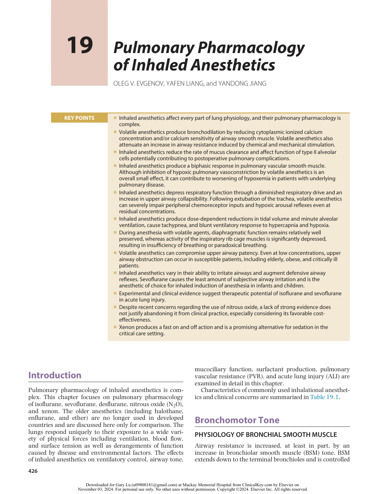

:::

<!-- PDF page 2 -->

**Table 19.1** The Physical Properties of Commonly Used Inhalational Anesthetics and Their Clinical Concerns

|**Property**|**Halothane**|**Isoflurane**|**Sevoflurane**|**Desflurane**|**Nitrous oxide**|**Xenon**|
|---|---|---|---|---|---|---|
|Boiling point (°C)|50.2|49|59|24|−88|−108|
|Vapor pressure (mm Hg) at 20°C|241|238|157|669|38,770|–|
|Blood:gas partition coefficient|2.5|1.46|0.65|0.42|0.46|0.115|
|Oil:gas partition coefficient|224|91|47|19|1.4|1.9|
|Minimum alveolar concentration (MAC)|0.74|1.17|1.8|6.6|104|63–71|
|Metabolized in the body (%)|25|0.2|2–4|0.02|0|0|
|Clinical concerns|Hepatotoxicity||Compound A|Airway irritation|Gas expansion|Apnea|

primarily by the autonomic nervous system. There are several paths involved in the regulation of BSM tone. Nonadrenergic, noncholinergic mechanisms, activated by the stimulation of the afferent bronchopulmonary sensory C fibers, play a role in BSM constriction. Certain peptides including tachykinins, vasoactive intestinal peptide (VIP), adenosine, and calcitonin can directly induce BSM constriction.

Asthmatic bronchiolar constriction involves complex interactions of airway nerves, smooth muscle, epithelium, and inflammatory cells. In contrast, reflex bronchoconstriction caused by airway irritation is mediated by sensory afferents in the nucleus of the solitary tract (NTS) projecting to vagal preganglionic neurons (VPN). Glutamate modulates stimulation of NTS and VPN, whereas γ- aminobutyric acid (GABA) inhibits NTS projecting to VPN. VPN projections to the airways release acetylcholine (ACh) predominantly onto M3 receptors, inducing bronchoconstriction. Baseline airway tone is also mediated by the vagus nerve. The muscarinic acetylcholine receptors (mAChRs, M1–M5) on BSM are G protein–coupled receptors, three of which (M1, M2, and M3) are expressed in the lungs of humans and most mammals.1 Belmonte and colleagues2 reviewed the essentials of muscarinic control of mAChRs in the lungs. Neuronal inhibitory M2 muscarinic ACh receptors on parasympathetic nerves are responsible for limiting ACh release from these nerves (Fig. 19.1). The reflex neuro loop together with systemic and localized neuropeptides regulate the BSM tone. Compared with healthy individuals, asthmatic patients respond to bronchiolar constriction very differently in terms of minimal effective inhaled concentration of the agonist or the threshold dose, the slope of the concentration/response curve or airway reactivity, the maximal bronchoconstrictor responses, and a “plateau response” to the bronchoconstrictor stimulus (Fig. 19.2). A volatile anesthetic may act at each of the four aspects, and the effects may be different among the volatile anesthetics.

### ROLE OF CALCIUM

Changes in cytoplasmic ionized calcium concentration (ICa2+ ) and calcium (Ca2+ ) influx result from the interplay of cyclic nucleotides in BSM that alters myosin light chain (MLC) and MLC kinase activity. Ca2+ /calmodulindependent MLC kinase is critical for tonic smooth muscle contraction.3 Agonist activation of BSM involves a second messenger, cADP ribose, resulting in inositol triphosphate

(IP3)- mediated release of Ca2+ from sarcoplasmic reticulum via activated ryanodine channels.4 This release is followed by an increase in sodium (Na+ ) influx across the cell membrane. This localized increase in Na+ may switch the Na+ / Ca2+ exchanger into reverse mode, leading to even more Ca2+ influx and greater bronchial constriction. Several different cyclic adenosine monophosphate (cAMP) signaling compartments exist in airway smooth muscle that are responsive to different hormones and neurotransmitters.5 The mechanical stretch of human BSM cells also causes contraction via an influx of Ca2+ through unique stretchactivated nonselective cation channels.6 Adenosine indirectly enhances contraction of airway smooth muscle via the activation of mast cells and nerves by directly stimulating adenosine type I receptors on airway smooth muscle, thereby rapidly mobilizing ICa2+ stores through G proteins and IP3 signaling. Agonist- induced stimulation of _particulate_ guanylyl cyclase relaxes bronchial smooth muscle by attenuating inward Ca2+ current, whereas stimulation of _soluble_ guanylyl cyclase by substances such as nitric oxide (NO) reduces ICa2+ concentration and Ca2+ sensitivity.7

### HISTAMINE

Histamine produces reflex bronchoconstriction by stimulating H1 receptors on BSM, activating phospholipase C and protein kinase C (PKC), and releasing Ca2+ from intracellular stores. This leads to calcium ion entry through calcium channels and stimulation of a Na+ /Ca2+ exchanger. Nicotinamide adenine dinucleotide phosphate (NADP) has also been suggested as a potential second messenger in histamine- induced Ca2+ release from lysosomelike acidic compartments, functionally coupled to the endoplasmic reticulum via H1 receptor in endothelial cells.8 This increase in bronchomotor tone is attenuated by the cholinergic antagonist atropine. The histaminedegrading enzyme, histamine _N_ - methyltransferase, has been localized to human airway epithelium and may play a protective role against histamine- mediated bronchoconstriction.9 Histamine- induced bronchoconstriction, measured as altered pulmonary resistance (PR) and dynamic pulmonary compliance (Cdyn), in response to intravenous (IV) histamine was studied in dogs to determine the bronchodilatory effects of halothane, sevoflurane, isoflurane, and enflurane. These four volatile anesthetics demonstrated an inhibitory effect on increases in PR and decreases in Cdyn caused by histamine.10

::: details 原始表格與符號（PDF 第 2 頁）

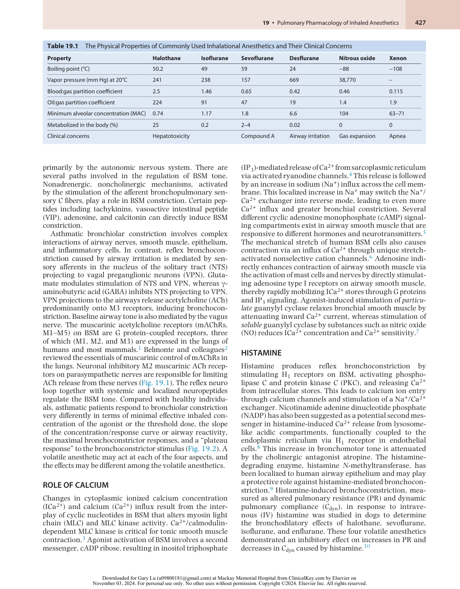

:::

<!-- PDF page 3 -->

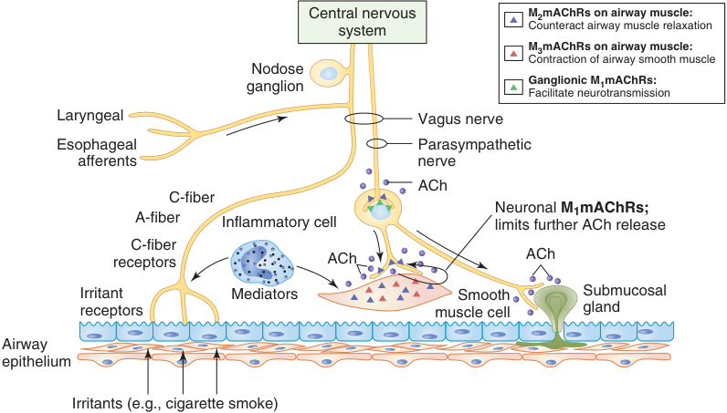

Central nervous M2mAChRs on airway muscle: system Counteract airway muscle relaxation M3mAChRs on airway muscle: Contraction of airway smooth muscle Nodose ganglion Ganglionic M Facilitate neurotransmission 1mAChRs: Laryngeal Vagus nerve Esophageal Parasympathetic afferents nerve ACh C-fiber Neuronal  M1mAChRs; A-fiber Inflammatory cell limits further ACh release C-fiber receptors ACh ACh Irritant Mediators Smooth Submucosal receptors muscle cell gland Airway epithelium Irritants (e.g., cigarette smoke) 

**Fig. 19.1 Control of airway smooth muscle in humans.** Preganglionic and postganglionic parasympathetic nerves release acetylcholine (ACh) and can be activated by airway and extrapulmonary afferent nerves. There is no direct sympathetic innervation to the airways. Mediators released from inflammatory cells directly activate airway smooth muscle cells, as well as act through a cholinergic reflex. This may explain why antimuscarinics are less effective than β2- agonists as bronchodilators in asthma because the latter drugs counteract the effect of all bronchoconstrictors. (Modified from Barnes PJ. β2- Agonists, anticholinergics, and other nonsteroid drugs. In: Albert RK, ed. _Clinical Respiratory Medicine_ , 3rd ed. Philadelphia: Mosby, 2008. Used with permission.)

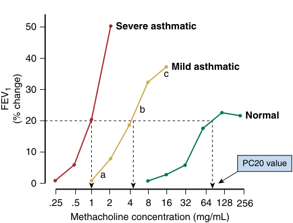

50 Severe asthmatic 40 Mild asthmatic c 30 b Normal 20 10 PC20 value a 0 .25 .5 1 2 4 8 16 32 64 128 256 Methacholine concentration (mg/mL) FEV1 (% change) 

**Fig. 19.2 Airway responsiveness to inhaled methacholine measured in a normal subject, and subjects with mild and severe asthma.** The response is measured by changes in the first second forced expiratory volume (FEV1), and the results expressed as PC20. Subjects with asthma have (a) reduced threshold responses to methacholine; (b) an increased slope of the methacholine dose–response curve; (c) an increase in the maximal bronchoconstrictor responses, when compared with subjects without asthma. (From Nair P, Martin JG, Cockcroft DC, et al. Airway hyperresponsiveness in asthma: measurement and clinical relevance. _J Allergy Clin Immunol Pract_ . 2017;5(3):649–659.e2.)

### ADRENERGIC RECEPTORS

Adrenergic receptors in BSM are classified into α and β types. The α2- agonists, clonidine, and dexmedetomidine, have been shown to produce bronchodilation in central airways, which may be mediated through α2 central vagolytic effects. Clinically, the β2- receptor subtypes play an important role in BSM responsiveness. Stimulation of β2 adrenoceptors causes cAMP- mediated relaxation via activation of protein kinase A and subsequent Ca2+ efflux out of the

smooth muscle cell and influx into the sarcoplasmic reticulum (SR). Interestingly, asthma, as well as allergy- and methacholine- induced bronchospasm, do not appear to be genetically linked to a dominant β2- adrenoceptor gene.11

Respiratory epithelium releases substances that modulate BSM tone. Removal of the epithelium enhances contractile responses to ACh, histamine, and serotonin in large airways and decreases relaxation responses to isoproterenol in small airways. These responses are similar to the effect of endothelial damage on vascular smooth muscle tone. Interestingly, the dilatory effect of inhaled anesthetic, halothane and isoflurane, on BSM is significantly reduced if epithelium is denuded. Cardiopulmonary bypass does not significantly affect porcine bronchiolar epithelium- mediated bronchomotor activity, in contrast to vascular endothelium- mediated smooth muscle dysfunction.12 Endogenous NO produced in respiratory epithelium likely plays a bronchodilatory role. Endothelin- 1 is a potent constrictor of vascular smooth muscle and BSM. It activates the IP3 pathway and produces greater pulmonary effects compared to the systemic circulation.

Even though bronchial epithelial cells are on the front line to fight lung infections,13,14 effects of tracheal intubation and inhaled anesthetics on this important defensive mechanism are yet to be determined. Clinically, evaluation of the effects of the inhalational agents may be framed against a background of the major physiologic mechanisms governing normal and pathophysiologic BSM activity. These include airway disease (such as asthma and chronic obstructive pulmonary disease [COPD]), the overarching complex chemistry of calcium release as the BSM stimulus– contraction coupler, intrinsic factors (afferent and efferent ACh signaling, α2-receptor signaling, NO, endothelin- 1, and histamine release), and extrinsic factors (physical and chemical irritants, e.g., endotracheal tubes) capable of promoting reflex bronchoconstriction.

<!-- PDF page 4 -->

### EFFECTS OF INHALED ANESTHETICS

In general, all volatile anesthetics are bronchodilators, which makes them a good choice for patients with increased airway resistance. Using computed tomography (CT), Brown and colleagues have demonstrated that halothane causes dose- dependent bronchodilation in a dog (Fig. 19.3).15

Eliminating indirect effects of arterial carbon dioxide (CO2) tension is important when examining the actions of volatile anesthetics on bronchial tone, especially during spontaneous ventilation. This is because hypercapnia- induced bronchodilation and hypocapnia- induced bronchoconstriction are both attenuated by isoflurane.16 Thus a concentrationdependent bronchodilator effect of volatile anesthetics may be indirectly attributable to an increase in CO2 tension. The structure of the respiratory epithelium changes from pseudostratified columnar cells of the large airways to thinner, cuboidal cells of the bronchioles, and thus a relatively large amount of histologic heterogeneity exists between these regions. The specific effects of volatile anesthetics on the bronchioles depend on the location within and the structure of the respiratory tree. _In vitro_ , isoflurane preferentially relaxes the bronchioles rather than the bronchi.17 Isoflurane and halothane dilate fourth-order bronchi at equivalent minimum alveolar concentration (MAC) values.18 Similarly, at up to 1 MAC, isoflurane, sevoflurane, and desflurane attenuate methacholine- induced bronchoconstriction in open- chest, pentobarbital- anesthetized rats.19 Isoflurane and sevoflurane also appear to have greater inhibitory effects on bronchial contraction as compared with tracheal smooth muscle contraction.20 Furthermore, halothane, desflurane, and isoflurane relax distal airways (e.g., bronchioles) to a greater extent than proximal airways (e.g., bronchi).21 These differential effects appear to be related to the type of voltage- dependent Ca2+ (VDC) channels that are present in these regions. Inhalation of 1 or 2 MAC halothane, enflurane, sevoflurane, and isoflurane did not alter baseline PR and Cdyn, but these anesthetics significantly attenuated increases in PR and decreases in Cdyn in response to intravenous histamine. Halothane was the most effective bronchodilator, whereas responses to isoflurane, enflurane, and sevoflurane were similar.10 In an isolated lung model, desflurane produced bronchodilation at 1 MAC but increased airway resistance at 2 MAC,22 presumably resulting in part from significant increases in inspired gas density at higher MAC. Isoflurane, sevoflurane, and desflurane at 1, 1.5, and 2 MAC in 25% O2 were examined in a two- chamber test lung model with fixed resistance. In a bench study, all volatile anesthetics demonstrated increased density and calculated resistance at higher MAC, with desflurane producing the highest increase in resistance at 2.0 MAC.23 In a randomized clinical trial evaluating the same agents at 1.0 and 1.5 MAC, total inspiratory resistance (R[rs]), minimal resistance (R[min]), and effective resistance (D[Rrs]) were calculated using the end- inspiratory occlusion technique. No significant differences in those parameters were observed during administration of the three agents at 1 MAC for 30 min. At 1.5 MAC, desflurane caused a maximum increase in R(rs) by 26% and in R(min) by 30% above baseline, in contrast to isoflurane and sevoflurane, which did not have a significant effect on R(rs) and R(min).24 Presumably, this increased resistance is partly due to the greater net viscosity of the higher absolute concentration of desflurane at 1.5

Halothane 0.5%

Control

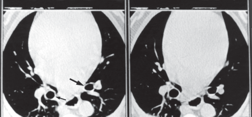

Halothane 1.0%

Halothane 1.5% 

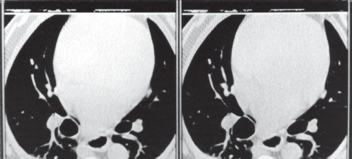

**Fig. 19.3 High- resolution computed tomography scans from one dog.** _Upper left:_ Control. _Upper right:_ During 0.5% halothane. _Lower left:_ During 1.0% halothane. _Lower right:_ During 1.5% halothane. Note the progressive dilation of the airways as indicated by the _arrows_ . (Reproduced from Brown RH, Mitzner W, Zerhouni E, et al. Direct in vivo visualization of bronchodilation induced by inhalational anesthesia using high- resolution computed tomography. _Anesthesiology._ 1993;78:295. Used with permission.)

MAC. Other factors may also play a role in the reduction of desflurane- induced bronchodilation when administered at higher concentrations, especially in smokers.25 Halothane, enflurane, and sevoflurane are equivalent at dilating thirdor fourth- generation bronchi as directly measured with a fiberoptic bronchoscope _in vivo_ .26

It appears that desflurane can both augment and inhibit bronchoconstriction (see below). At 1 MAC desflurane and sevoflurane blocked, to a similar degree, the increase in central airway resistance after a cholinergic challenge in rabbits. Both anesthetics reduced basal bronchial tone by 30% to 40%. This effect was consistently observed in the presence or absence of allergic airway inflammation and bronchial hyperresponsiveness.27 When lower airway constriction is centrally mediated, such as with a cholinergic challenge,17,19,28,29 desflurane appears to play a beneficial role in attenuating bronchoconstriction. However, when lower airway constriction is due to nonadrenergic, noncholinergic activation with tachykinins, desflurane may augment and worsen constriction.30,31 Thus clinicians tend to avoid using desflurane in patients with reactive airway disease.

### EFFECTS OF INHALED ANESTHETICS ON BRONCHOMOTOR TONE IN HUMANS AND THE WORK OF BREATHING

At 1 MAC, sevoflurane reduced respiratory system resistance by 15% in patients undergoing elective surgery, whereas desflurane had no effect.25 Rooke and associates32 compared the bronchodilating effects of halothane,

<!-- PDF page 5 -->

isoflurane, sevoflurane, desflurane, and thiopental–N2O in patients without respiratory disease undergoing induction of anesthesia and tracheal intubation. In contrast to thiopental- N2O, all volatile agents, except for desflurane, significantly reduced respiratory resistance (Fig. 19.4).

Expiration is passively affected by the recoil characteristics of the lung during normal breathing. In anesthetized patients, the ventilatory response to expiratory resistance is reduced to a greater extent than the response to inspiratory resistance. Conscious and anesthetized humans exhibit a decrease in respiratory rate when expiratory resistive loads are applied, but only anesthetized subjects develop rib cage–abdominal wall motion desynchrony that causes less effective ventilation and reduction in minute alveolar ventilation. This concept may be particularly important in spontaneously breathing anesthetized patients who demonstrate expiratory obstruction, such as in cases of asthma, COPD, increased airway secretions, or during hypopharyngeal obstruction or partial breathing circuit occlusion.

The work of breathing is defined as pressure or force multiplied by the tidal volume during inspiration. Respiratory work is further divided into elastic work (required to overcome the recoil of the lung) and resistive work (required to overcome airway flow resistance and viscoelastic resistance of pulmonary tissues). The work of breathing is usually derived from transpulmonary pressure–volume curves. In general, volatile anesthetics decrease the work of breathing in adults and children. In rats, sevoflurane reduced pulmonary compliance at the lung periphery rather than at the airway level, thereby increasing viscoelastic and elastic pressures in the lung.33 In addition, in a murine model of chronic asthma, sevoflurane significantly decreased resistance in central and distal airways and lowered resistance in the lung periphery. These data suggest that sevoflurane exerts a beneficial effect in the presence of chronic airway obstruction and indicate that sevoflurane might reduce the work of breathing in comparison to other drugs (Fig. 19.5).34

Experimental studies demonstrating the equal bronchodilator potency of sevoflurane and isoflurane and the higher potency of halothane must be extrapolated with caution because histamine- mediated experimental bronchospasm may not closely mimic tracheal intubation–induced bronchospasm in humans. Indeed, Arakawa and colleagues36 showed in a case report that similar inspired concentrations of halothane, isoflurane, and sevoflurane produced nearly identical reductions in airway resistance in a patient with status asthmaticus. Therefore, volatile anesthetics, except desflurane, may be an effective therapeutic modality in status asthmaticus when conventional therapy has failed.37

Studies in humans demonstrate a ceiling effect where low concentrations of volatile anesthetics significantly reduce upper airway resistance, reflecting changes in airway smooth muscle tone in the major airways. In contrast, distal airways and lung parenchyma lack a smooth muscle component (with lower airway and alveolar resistance being more a measure of viscoelastic changes in the lung). Increasing concentrations of inhalational agents can diminish effect on these more distal pulmonary components and thus do not further reduce total lung resistance.35

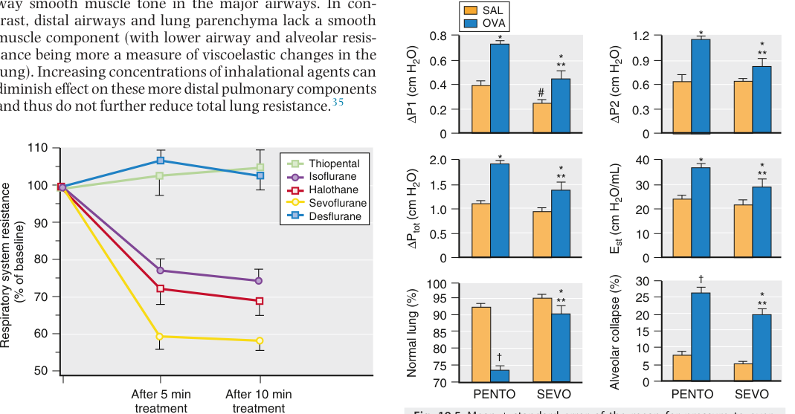

way smooth muscle tone in the major airways. In con- SAL trast, distal airways and lung parenchyma lack a smooth  OVA muscle component (with lower airway and alveolar resis- 0.8 * 1.2 * *** tance being more a measure of viscoelastic changes in the  0.6 ** * 0.9 lung). Increasing concentrations of inhalational agents can diminish effect on these more distal pulmonary components  0.4 # 0.6 and thus do not further reduce total lung resistance. 35 0.2 0.3 0 0 110 ThiopentalIsoflurane 2.0 * *** 40 * *** 100 Halothane 1.5 30 Sevoflurane 1.0 20 Desflurane 90 0.5 10 80 0 0 100 30 † 70 95 ** * 25 ** * 90 20 60 85 15 80 10 † 75 5 50 70 0 After 5 min After 10 min PENTO SEVO PENTO SEVO treatment treatment O)P1 (cm H∆2 O)P2 (cm H∆2 O)(cm HP∆2tot O/mL) (cm HE2st (% of baseline) Respiratory system resistance Normal lung (%) Alveolar collapse (%) 

**Fig. 19.5** Mean ± standard error of the mean for pressure to overcome airway resistance (ΔP1), viscoelastic lung properties (ΔP2), total of ΔP1 and ΔP2 (ΔPtot), and static lung elastance (Est). Also shown are the percent of normal area and the percent of alveolar collapse in mice repeatedly challenged with intratracheal instillation of saline (SAL) or ovalbumin (OVA). Animals were anesthetized with pentobarbital sodium (PENTO) or sevoflurane (SEVO), 1 minimum alveolar concentration (MAC). _*P_ &lt; .05 versus corresponding SAL group; _**P_ &lt; .001 versus OVA- PENTO group;&#95;#&#95; _P_ &lt; .05 versus SAL- PENTO group;† _P_ &lt; .01 versus the SAL- PENTO group. (Modified from Burburan SM, Xisto DG, Ferreira HC, et al. Lung mechanics and histology during sevoflurane anesthesia in a model of chronic allergic rhinitis. _Anesth Analg_ . 2007;104:631. Used with permission.)

**Fig. 19.4** Percent change in respiratory system resistance in patients after 5 and 10 minutes of maintenance anesthesia with either 0.25 mg/ kg/min thiopental plus 50% nitrous oxide or 1.1 minimum alveolar concentration (MAC) sevoflurane, halothane, or isoflurane, or approximately 1 MAC desflurane. All volatile anesthetics except desflurane decreased resistance. Sevoflurane decreased resistance more than isoflurane. (Modified from Rooke GA, Choi JH, Bishop MJ. The effect of isoflurane, halothane, sevoflurane, and thiopental/nitrous oxide on respiratory system resistance after tracheal intubation. _Anesthesiology._ 1997;86:1294; and Goff MJ, Arain SR, Ficke DJ, et al. Absence of bronchodilation during desflurane anesthesia: a comparison to sevoflurane and thiopental. _Anesthesiology_ . 2000;93:404. Used with permission.)

<!-- PDF page 6 -->

However, formal guidelines on this application remain unavailable.

β- Adrenoceptor agonists may be beneficial for treating acute bronchospasm in patients anesthetized with halothane,38,39 but their use may not be as beneficial with other volatile anesthetics. For example, the β2- adrenergic agonist fenoterol reduces respiratory system resistance after endotracheal intubation but did not further decrease resistance when administered in the presence of 1.3% isoflurane.40 These findings should be interpreted with caution because the technique used to determine respiratory system resistance incorporates alterations in lung and chest wall resistance, as well as tissue viscosity. The most important functional change that occurs in the presence of lung disease is increased resistance. Resistance to airflow is typically thought of as being determined by the flow rate and airway smooth muscle tension. However, other factors, such as lung inflammation, airway thickening, altered lung volumes, lung recoil, airway wall remodeling, mucus hypersecretion, and loss of lung elastance, also play a clinically significant role in the amount of airway narrowing. The role of volatile anesthetics in altering many of these non- smooth- muscle elements responsible for airway resistance needs further elucidation.

The effects of volatile anesthetics on bronchomotor tone are also dependent on the substance used to produce contraction _in vitro_ .41 Relaxation of tracheal smooth muscle by halothane and isoflurane is greatest in the presence of the endogenous mediator serotonin compared with ACh. Thus, inhaled anesthetics may remain effective bronchodilators, even in the presence of severe serotonin- or histamineinduced bronchospasm that is refractory to β2- adrenoceptor therapy. It is important to note that in anesthetized patients, volatile anesthetic–induced decreases in bronchomotor tone and neurally mediated airway reflexes may be partially opposed by a simultaneous reduction in functional residual capacity (FRC). The well- known increased risk for morbidity and mortality in patients with asthma may be at least partially attributed to these FRC- mediated increases in airway resistance. Low temperature abolishes the inhibitory effects of volatile anesthetics on carbachol- induced contraction of airway smooth muscle in dogs,42 suggesting that intraoperative hypothermia may also attenuate volatile anesthetic–induced bronchodilation.

### REACTIVE AIRWAY AND BRONCHOSPASM

Asthma is a chronic airway disease, with an estimated worldwide annual mortality of 461,000.43 Asymptomatic asthma patients have relatively infrequent perioperative respiratory complications. However, bronchospasm develops in about 9% of asthmatics in the perioperative period.44 Twenty- five percent of asthmatics may present with wheezing after induction of anesthesia,45 and 1.7% of asthma patients sustain a poor respiratory outcome.46 In addition, acute bronchospasm can also occur at induction, intubation, or during maintenance of anesthesia in patients without prior history of asthma or COPD. According to the American Society of Anes thesiologists’ (ASA) Closed Claims Project,47 40 cases of bronchospasm resulted in settled malpractice claims, with 88% involving brain damage or death. Importantly, only half of the patients had preexisting

asthma or COPD. Adverse respiratory events accounted for 28% of claims related to anesthesia- related brain damage and death in the United States; they were associated with the highest mean cost per closed claim. In France, 7% of anesthesia- related deaths were also attributed to bronchospasm.48 A nonallergic mechanism was involved in nearly 80% of cases. Although bronchospasm caused by airway irritation occurred more frequently in patients who had one or more predisposing factors including asthma, heavy tobacco smoking, or bronchitis, only 50% and 60% of patients with nonallergic and allergic bronchospasm, respectively, had history of asthma.

Bronchospasm may occur in conditions and with respiratory diseases other than asthma. For example, healthy patients undergoing surgical stimulation of lung parenchyma or airways including tracheal stimulation by an endotracheal tube are at risk of developing bronchospasm. Regardless of the airway sensitivity prior to induction, the different pathways involved in an individual patient may yield different responses to the volatile anesthetics. Iwasaki and colleagues49 demonstrated that sevoflurane- induced relaxation of airway smooth muscle and VDC channels were dependent on the type of hyperreactive airway model. Sevoflurane had smaller effects in a model of chronic tobacco smoking (enlarged alveolar ducts and less muscarinic hyperreactivity), compared with an antigen- acute asthmatic (ovalbumin- sensitized) model. The morphologic changes in the peripheral airway may be responsible to some degree for a decrease in the efficacy of volatile anesthetics as bronchodilators in tobacco smokers, but sevoflurane and isoflurane still decrease respiratory system resistance in patients with COPD.50

In children undergoing elective imaging studies, sevoflurane produced progressive reductions in the cross- sectional area of the upper airway, resulting in pharyngeal airway collapse.51 As observed with isoflurane in animal models, the effects of sevoflurane were not uniformly distributed along the upper airway. In healthy children, sevoflurane slightly decreased airway resistance, but desflurane had the opposite effect.52 Children with documented airway susceptibility, such as those with asthma or a recent upper respiratory tract infection, exhibit significant increases in airway resistance. In these pediatric patients, desflurane should be avoided.

### MECHANISMS OF ACTION OF VOLATILE ANESTHETICS

Volatile anesthetics attenuate airway smooth muscle tone by reducing smooth muscle contractility. This action is the result of the direct effects on bronchial epithelium and airway smooth muscle cells, combined with the indirect inhibition of reflex neural pathways. Several intracellular mediators responsible for Ca2+ mobilization are potential sites for the action of volatile anesthetics. Inhibition of cell membrane–associated VDC channels reduces Ca2+ entry into the cytosol.53 A volatile anesthetic–induced increase in cAMP concentrations decreases intracellular free Ca2+ by stimulating Ca2+ efflux and increasing Ca2+ uptake into the SR. In addition, a decrease in Ca2+ sensitivity attributable to inhibition of PKC activity, inhibition of G- protein function, and attenuation of Rho/Rho- kinase signaling pathways play important roles.53,54 Volatile anesthetics may also alter

<!-- PDF page 7 -->

pulmonary resistance by affecting the density of the gas mixture.23 In an experimental lung model of fixed pulmonary resistance, high concentrations of volatile anesthetics increased the density of the gas mixture and the calculated resistance, with desflurane producing the largest effect (Fig. 19.6).23 This effect is particularly profound for xenon,55 as at equal MAC values, the fraction of xenon is much greater than that of desflurane and other volatile agents.56

The effects of volatile anesthetics on proximal, compared with distal, airways may be related to their different actions on VDC channels and the relative distribution of these channels. Long- lasting (L- type) VDC channels appear to be the predominant mechanism for Ca2+ entry in tracheal smooth muscle, whereas both transient (T- type) and L- type VDC channels are present in bronchial smooth muscle.20,57 Isoflurane and sevoflurane inhibit both types of VDC channels in a dose- dependent fashion, and their effects on T- type VDC channels in bronchial smooth muscle are even more pronounced (Fig. 19.7).20 The different effects of volatile anesthetics on tracheal smooth muscle, compared with bronchial smooth muscle, may also be related to actions on Ca2+ - activated chloride channel activity58,59 or different sensitivities of K+ channel subtypes.58 The proposed signaling pathways underlying volatile anesthetic–induced bronchodilation are summarized in Fig. 19.8.60,61

Volatile anesthetic–induced reductions in ICa2+ result from the inhibition of both VDC and receptor- gated Ca2+ channels. In addition, volatile anesthetics deplete Ca2+ stores in SR by increasing Ca2+ leakage. Ca2+ influx occurring in response to depleted SR Ca2+ stores is known as store- operated Ca2+ entry (SOCE). By depleting Ca2+ stores in SR, volatile anesthetics may be expected to enhance SOCE. Nevertheless, at clinically relevant concentrations, volatile anesthetics (isoflurane

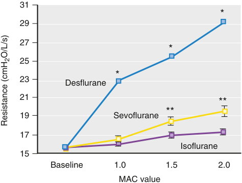

31 * 29 27 * 25 * 23 Desflurane 21 ** ** 19 Sevoflurane 17 Isoflurane 15 Baseline 1.0 1.5 2.0 MAC value O/L/s)Resistance (cmH2 

**Fig. 19.6 Comparison of the effect of different volatile anesthetics at equivalent minimum alveolar concentration (MAC).** At 1 MAC, only desflurane significantly increased pulmonary resistance, compared with isoflurane and sevoflurane. At 1.5 and 2 MAC, sevoflurane significantly increased total pulmonary resistance compared with isoflurane, whereas desflurane caused a more pronounced increase than the other two agents. *Increased pulmonary resistance in comparison with sevoflurane and isoflurane. **Increased pulmonary resistance in comparison with isoflurane. (Reproduced from Nyktari VG, Papaioannou AA, Prinianakis G, et al. Effect of the physical properties of isoflurane, sevoflurane, and desflurane on pulmonary resistance in a laboratory lung model. _Anesthesiology_ . 2006;104:1202. Used with permission.)

more than sevoflurane) also inhibit SOCE in airway smooth muscle to further reduce available Ca2+ .62

Volatile anesthetic–induced reductions in SR Ca2+ appear to occur through enhancement of IP363 and ryanodinereceptor channel activities.60 Kai and co- workers53 demonstrated that halothane attenuates ACh- induced Ca2+ sensitization in canine tracheal smooth muscle to a greater extent than does sevoflurane, whereas isoflurane has an effect at concentrations equivalent to 2 MAC. This effect appears to be mediated, at least in part, by an increase in smooth muscle protein phosphatase,61 modulation of G proteins (specifically Gq and GI that exert actions on cyclic guanosine monophosphate [cGMP]),53 or modulation of the Rho/Rho- kinase signaling pathways.64,65 Volatile anesthetics interact with the muscarinic receptor–heterotrimeric G protein complex to prevent agonist- promoted nucleotide exchange at the Gα subunit of the G protein.66,67 Halothane, sevoflurane, and, minimally, isoflurane exert direct effects on muscarinic receptor– mediated contraction of isolated airway smooth muscle.68 The inhibitory effects of volatile agents on the biochemical coupling between the M3 muscarinic receptor and the Gαq heterotrimeric G protein is completely reversible with time. Isoflurane- induced relaxation of precontracted bronchial smooth muscles is significantly augmented by pretreatment with a Rho- kinase inhibitor, whereas sevoflurane- inhibited guanosine- 5′- triphosphate (GTP) γ S- stimulated contraction and membrane translocation of both Rho and Rho- kinase in a concentrationdependent manner. These latter actions play important roles in Ca2+ sensitization.54 The final pathway in airway smooth muscle contraction is the generation of force and shortening of smooth muscles regulated by myosin cross- bridge number and kinetics. Isoflurane modulates both cross- bridge number and cycling rates of isolated rat airway smooth muscle.68

The bronchodilatory effect of volatile anesthetics is also mediated by GABA A (GABAA) receptors in the brainstem or GABA B (GABAB) receptors on preganglionic cholinergic nerves in the lung similar to the observations with propofol.69 GABAA and GABAB receptors, as well as glutamic decarboxylase (the enzyme responsible for GABA synthesis), are located in airway epithelial and smooth muscle cells. GABA levels increase and localize to airway smooth muscle after contractile stimuli in upper airways, while a GABA agonist reversed augmentation of cholinergicinduced tracheal ring contraction.69,70

Inhaled but not intravenous halothane attenuated bronchoconstricting effects of low inhaled concentrations of CO2 in rat distal bronchi, suggesting that halothane exerts a direct action on airway muscle tone or local neural reflex arcs rather than centrally controlled reflex pathways. Correspondingly, halothane- , isoflurane- , sevoflurane- , and desflurane- induced dilation of distal bronchial segments is partially dependent on the presence of bronchial epithelium.18,71 Prostanoids (e.g., prostaglandin E2 or I2) or NO may be responsible for the bronchodilatory effects of volatile anesthetics under these conditions. Focal epithelial damage or inflammation may occur in small airways in patients with asthma or allergen exposure, resulting in a reduced bronchodilatory response to volatile anesthetics.72 Nevertheless, the most pronounced bronchodilatory action of volatile anesthetics in patients with chronic reactive airway disease occurs primarily in the proximal rather than distal airways.

<!-- PDF page 8 -->

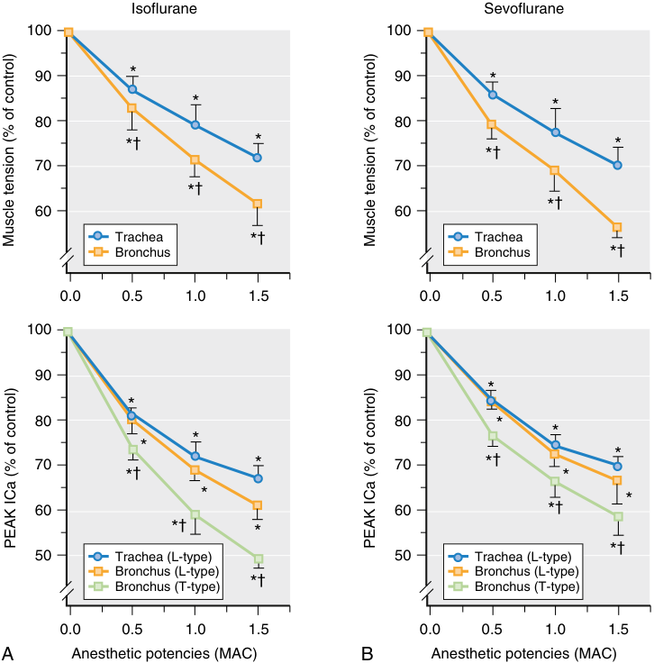

Isoflurane Sevoflurane 100 100 90 * 90 * * * 80 80 * † * * * † 70 70 * † * † 60 60 Trachea * † Trachea Bronchus  Bronchus  * † 0.0 0.5 1.0 1.5 0.0 0.5 1.0 1.5 100 100 90 90 * * 80 80 * * * * * 70 * † * 70 * † * * * 60 60 * † * † * * † 50 Trachea (L-type) 50 Trachea (L-type) Bronchus (L-type) Bronchus (L-type) * † Bronchus (T-type) Bronchus (T-type) 0.0 0.5 1.0 1.5 0.0 0.5 1.0 1.5 A Anesthetic potencies (MAC) B Anesthetic potencies (MAC) Muscle tension (% of control) Muscle tension (% of control) PEAK ICa (% of control) PEAK ICa (% of control) 

**Fig. 19.7** Effect of isoflurane and sevoflurane on porcine tracheal versus bronchial smooth muscle tension or inward calcium (Ca2+ ) current intercellular calcium (ICa2+ ) through T- and L- type voltage- dependent Ca2+ (VDC) channels. No differences were observed in the inhibition of L- type VDC channels. Both anesthetics had greater inhibitory effects on T- type VDC channels in bronchial smooth muscle. Symbols represent mean ± standard deviation (SD). (A) * _P_ &lt; .05 versus 0 minimum alveolar concentration _(MAC)_ .† _P_ &lt; .05 versus tracheal smooth muscle. (B)† _P_ &lt; .05 versus L- type VDC channels. (Reproduced from Yamakage M, Chen X, Tsujiguchi N, et al. Different inhibitory effects of volatile anesthetics on T- and L- type voltage dependent Ca2+ channels in porcine tracheal and bronchial smooth muscles. _Anesthesiology_ . 2001;94:683. Used with permission.)

Potent tracheal constriction also occurs in response to the endogenously produced endothelin- 1. Isoflurane attenuated the endothelin- 1- induced airway smooth muscle contraction in rat tracheal rings, suggesting another potential mechanism for airway smooth muscle relaxation.73

Direct stimulation of intrinsic airway nerves _in vitro_ produces a contractile response that is inhibited by atropine. Volatile anesthetic–induced bronchodilation also occurs by modulation of this airway cholinergic neural transmission mediated through prejunctional and postjunctional mechanisms.74,75 The combination of atropine and halothane did not increase airway caliber over that attained with either drug alone, suggesting that halothane dilates airways by blocking vagal tone during unstimulated conditions.76

## Mucociliary Function and Surfactant

### NORMAL MUCOCILIARY FUNCTION

Clearance of mucus from the tracheobronchial tree is a primary pulmonary defense mechanism responsible for removal of foreign particulate matter, microorganisms,

and dead cells. Ciliated respiratory epithelium is present throughout the respiratory tree, but the density of ciliated respiratory epithelium cells progressively decreases from the trachea to the terminal bronchioles. Cilia are hair- like appendages, consisting of hundreds of proteins organized around a microtubular architecture. They are anchored to the apical cytoplasm by a basal body and extend from the cell surface into the extracellular space.77,78 Cilia are classified as either motile or immotile (primary). Motile cilia were thought to be responsible for generating extracellular fluid movement or propelling individual cells, whereas primary cilia were believed to be vestigial. However, primary cilia are important environmental sensors. In human bronchial epithelium, they play a key role in sensing and transducing extracellular mechanochemical signals and identifying smooth muscle injury.79 Indeed, ciliopathies are responsible for a variety of pediatric disorders such as primary ciliary dyskinesia and autosomal recessive polycystic kidney disease.77,80 Christopher and co- workers studied the effects of temperature (15–37°C) with varying combinations with fentanyl, dexmedetomidine, and isoflurane on the cilia of mouse tracheal epithelia. There was a linear correlation between cilia motility and temperature. Fentanyl exerted stimulatory effects on

<!-- PDF page 9 -->

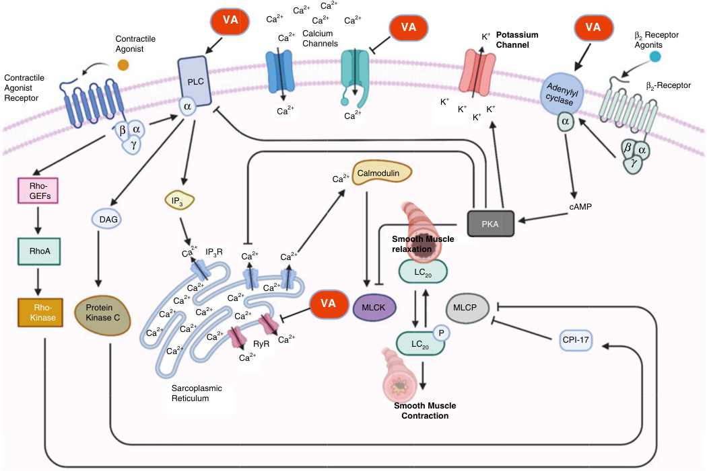

Ca 2+ Ca 2+ VA Ca 2+ Ca 2+ Ca 2+ VA VA Contractile Ca 2+ Calcium K + Potassium β2 Receptor Channels Channel Agonits Agonist Contractile Agonist β2-Receptor Receptor K + α Ca 2+ K + Ca 2+ K + K+ α β α γ α Calmodulin Ca 2+ Rho- GEFs IP3 cAMP DAG PKA Smooth Muscle RhoA IP3R Ca 2+ Ca 2+ relaxation LC20 Ca 2+ Ca 2+ KinaseRho- ProteinKinase C Ca 2+ Ca 2+ Ca 2+ CaCa 2+ 2+ VA MLCK MLCP Ca 2+ Ca 2+ Ca 2+ Ca 2+ P CPI-17 RyR LC20 Ca 2+ Ca 2+ Sarcoplasmic Reticulum Smooth Muscle Contraction PLC Adenylyl cyclase γ Ca2+ β 

**Fig. 19.8** Molecular pathways underlying airway smooth muscle contraction and relaxation and the actions of volatile anesthetics. The activation of G-coupled protein receptors, such as muscarinic and histamine receptors, leads to subsequent interaction and activation of phospholipase C (PLC), which promotes the hydrolysis of phosphatidylinositol 4,5-bisphosphate (PIP2) into inositol 1,4,5-trisphosphate (IP3) and diacylglycerol (DAG). IP3 interacts with IP3-gated channels on the sarcoplasm reticulum (SR) to induce Ca2+ efflux into the cytoplasmic space. Ryanodine receptors (RyR’s) on the SR also become activated to release Ca2+ . In the cytoplasmic space, Ca2+ binds to calmodulin (CaM) which activates it so that it may activate myosin light chain kinase (MLCK) which phosphorylates and activates the myosin regulatory light chain (LC20) of myosin to initiate cross-bridge cycling and thus muscle contraction. LC20 is dephosphorylated and thus inhibited by myosin light chain phosphatase (MLCP), but this dephosphorylation is inhibited by two pathways–including the Rho-kinase pathway, which is stimulated by the activated GPCR and a CPI-17 pathway which is activated by protein kinase C. Muscle relaxation can be induced by stimulation of a β2-receptor which leads to the activation of adenylyl cyclase (AC) which catalyzes the formation of cyclic AMP (cAMP). cAMP binds and activates PKA, which carries out various regulatory activities such as inhibiting MLCK, PLC, and IP3-gated channels and activating Ca2+ - gated potassium channels in the cellular membrane to release K+, which hyperpolarizes the cell. Volatile anesthetics (VA) activate PLC; adenylyl cyclase, reduce conduction of voltage-sensitive calcium channels and RyR’. The net effect is reducing ionized calcium concentration and the sensitivity of Cam to Ca2+ , which in turn inhibits MLCK, reduces the fraction of dephosphorylated MLC, and, therefore, leads to smooth muscle relaxation/bronchodilation. This Figure was modified from the article by Xiong et al (Xiong DJP, Martin JG, Lauzon AM. Airway smooth muscle function in asthma. Front Physiol. 2022 Oct 5;13:993406. https://doi.org/10.3389/fphys.2022.993406. PMID: 36277199; PMCID: PMC9581182) and created with Biorender.

cilia, while dexmedetomidine and isoflurane both inhibited cilia function. When combined together, fentanyl, dexmedetomidine, and isoflurane inhibited cilial function. In contrast, fentanyl plus dexmedetomidine did not significantly alter ciliary function, suggesting complex drug– drug and drug–temperature interactions.81

Movements of cilia are closely coordinated to move matter efficiently toward the trachea in a wave motion known as _metachronism_ . Each motile cilium is organized in nine peripheral microtubule pairs surrounding a central pair (9+2). Ciliary motion consists of a rapid stroke in a cephalad direction, followed by a slower caudal recovery stroke. During a beat, dynein arms undergo an adenosine triphosphate (ATP)–dependent attachment, retraction, and release cycle with the adjacent doublet, which results in a sliding motion. The basal bodies of the motile cilia are anchored to the microtubules, nexin links, and radial spokes and are further restricted by the ciliary membrane. This anatomic constraint converts the sliding motion into a bend.

The quantity and physical properties of the mucous layer may also promote the coordination of ciliary beats. Mucus is a mixture of water, electrolytes, and macromolecules (e.g., lipids, mucins, enzymes) secreted by goblet cells and mucosal glands. Thicker layers of mucus slow the removal of surface particles from the airway, whereas low- viscosity mucus promotes more rapid ciliary transport. Furthermore, impaired mucociliary function in the upper airways correlates with low levels of nasal NO, although the clinical significance of this finding is unclear.82 Mucociliary clearance is closely related to autonomic nervous system activity, most likely related to changes in physical characteristics of respiratory secretions.83

Several factors affect mucociliary function in mechanically ventilated patients, contributing to lung atelectasis and hypoxemia. For example, insufficiently humidified inspired gases reduce ciliary movement and desiccate mucus. In dogs, the flow rate of tracheal mucus was maintained within the basal range during a 40- minute exposure to inspired

<!-- PDF page 10 -->

dry air at a temperature higher than 32°C. However, 3 hours of inhalation of dry air caused a complete cessation of the flow of tracheal mucus, which was restored by the subsequent use of inspired gases with 100% relative humidity at 38°C. Several anesthesia- related factors also reduce the rate of mucus movement, including high- inspired oxygen (O2) concentrations, adjuvant medications (e.g., corticosteroids, atropine, β- adrenoreceptor antagonists) that affect bronchial tone, the presence of an endotracheal tube, and positive- pressure ventilation.84

### EFFECTS OF INHALED ANESTHETICS ON MUCOCILIARY FUNCTION

Volatile anesthetics and N2O diminish the rates of mucus clearance by decreasing ciliary beat frequency, disrupting metachronism, and altering the physical characteristics or quantity of mucus. In contrast to intravenous anesthetics,85,86 halothane, enflurane, isoflurane, and sevoflurane all reduce ciliary movement and beat frequency _in vitro_ .85– 88 Among the volatile anesthetics, sevoflurane exhibited the weakest cilioinhibitory effects in rat cultured tracheal epithelial cells (Fig. 19.9).88

Gamsu and colleagues89 measured the rate of tantalum (a powder that adheres to airway mucus) clearance from the lungs of postoperative patients who received general anesthesia for intra- abdominal or lower extremity surgeries. Tantalum retention was closely correlated with the retention of mucus and shown for as long as 6 days after intra- abdominal surgery. The administration of halothane (1%–2%) and N2O (60%) rapidly decreased the rate of mucus movement in females undergoing gynecologic surgery. Little or no mucus motion was observed after 90 minutes of halothane–N2O inhalation.90 Bronchial mucosal transport velocity was also determined using radiolabeled albumin microspheres distally deposited in the mainstem bronchi using a fiberoptic bronchoscope in patients without underlying pulmonary disease. In contrast to the findings of the study with halothane, mucus velocity was unchanged during the administration of 1.5 MAC isoflurane.91

Impairments of ciliary beat frequency, mucociliary clearance, and bronchial mucus transport contribute to pulmonary complications including retention of secretions, atelectasis, and lower respiratory tract infections. A reduction in bronchial mucus transport from normally 10 mm/ min to as little as 3.5 mm/min was associated with an increase in pulmonary complications in patients who were mechanically ventilated for 4 days in the intensive care unit (ICU).92 Thus, pulmonary therapies directed at enhancing clearance of secretions from the airways may be beneficial in the immediate postoperative period, regardless of the type of volatile anesthetic used.

Compared to nonsmokers, tobacco smokers have significantly slower bronchial mucus transport velocities and are prone to more frequent pulmonary complications following major abdominal or thoracic surgeries.93 The specific effects of volatile anesthetics on mucus movement have not been well studied in smokers. However, it is likely that an additive or synergistic negative effect on mucus transport may be present. Impairment of mucociliary function also occurs after lung transplantation. The mechanism for this dysfunction may be related to alterations in the surface properties of mucus and impairment

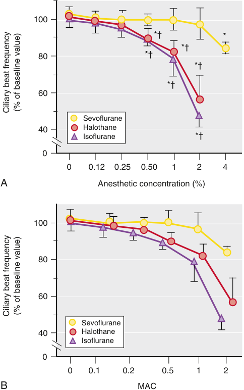

100 *† * *† 80 * † *† *† 60 Sevoflurane 40 Halothane Isoflurane *† 0 0 0.12 0.25 0.50 1 2 4 A Anesthetic concentration (%) 100 80 60 Sevoflurane 40 Halothane Isoflurane 0 0 0.1 0.2 0.5 1 2 B MAC Ciliary beat frequency (% of baseline value) Ciliary beat frequency (% of baseline value) 

**Fig. 19.9 Effects of sevoflurane, halothane, and isoflurane on ciliary beat frequency (CBF) in cultured rat tracheal epithelial cells.** CBF was measured at baseline and 30 minutes after exposure to various anesthetic concentrations. Values represent mean ± standard deviation. (A) Plot of percent baseline CBF versus anesthetic concentration. * _P_ &lt; .05 versus 0% vehicle.† _P_ &lt; .05 versus sevoflurane at the same concentration. (B) Percent baseline CBF versus minimum alveolar concentration (MAC). (Modified from Matsuura S, Shirakami G, Iida H, et al. The effect of sevoflurane on ciliary motility in rat cultured tracheal epithelial cells: a comparison with isoflurane and halothane. _Anesth Analg_ . 2006;102:1703. Used with permission.)

of mucociliary transport distal to bronchial transection and re- anastomosis.94 The effects of volatile anesthetics on mucus transport in lung transplant patients have not been described, but the baseline reductions in mucociliary movement would certainly predispose to postoperative respiratory complications.

### EFFECTS OF INHALED ANESTHETICS ON SURFACTANT

Pulmonary surfactant is a mixture of proteins and phospholipids synthesized by alveolar type II cells. Surfactant decreases the work of breathing by reducing surface tension at the fluid–gas interface, plays a role in removing foreign particles from airways, and also enhances the bactericidal actions of alveolar macrophages. Halothane95 and isoflurane96 produced a transient, dose- dependent reduction in phosphatidylcholine (a major component of surfactant)

<!-- PDF page 11 -->

synthesis by alveolar cells. High concentrations of halothane also disrupted the energy metabolism of cultured alveolar cells, as indicated by reduced ATP content and enhanced glycolytic metabolism. Halothane and isoflurane potentiated a hydrogen peroxide–induced reduction of phosphatidylcholine content in alveolar type II cells96,97 by affecting cell energetics. Halothane decreased the Na+ / K+ –adeno sine triphosphatase (Na+ /K+ - ATPase) and Na+ channel activity that was probably related to alterations in ICa2+ or ATP depletion. A similar decrease in type II alveolar cell Na+ /K+ - ATPase occurs after the administration of isoflurane.98 Transepithelial Na+ transport helps regulate alveolar fluid balance. Correspondingly, impairment of this transport system may contribute to alveolar edema. This observation may be especially relevant in surgical patients because volatile anesthetics decrease alveolar epithelial fluid clearance.99

The phospholipid composition of surfactant is critical to its functional integrity. Another crucial component of surfactant is the hydrophobic surfactant–associated protein C synthesized by alveolar type II cells. This protein facilitates the adsorption and spreading of phospholipids to form the surfactant monolayer and enhances the lipid uptake into alveolar type II cells. Exogenous surfactants that contain surfactant- associated protein C are effective at decreasing barotrauma and mortality _in vivo_ . Clinically relevant concentrations of halothane increase surfactant- associated protein C messenger ribonucleic acid (mRNA) _in vitro_ but cause the opposite effect in mechanically ventilated rats.100 Extrapolation of these findings to patients should be approached with caution, but administration of halothane and mechanical ventilation may play a potentially additive deleterious role on surfactant production and homeostasis of the alveolar space, particularly in the presence of acute lung injury. In a rat model, sevoflurane produced deterioration in surfactant composition and viscosity with impaired lung mechanics promoting alveolar collapse101 ; again, caution is warranted in extrapolating these findings to humans. Bilgi and colleagues compared the effects of low- flow and high- flow inhalational anesthesia with N2O and desflurane on mucociliary activity and pulmonary function tests in humans. The forced vital capacity and forced expiratory volume and mucociliary clearance of saccharin powder were better preserved with a low- flow rather than a high- flow technique, suggesting that heated and humidified gases may have a greater impact than the inhaled anesthetics themselves.102

Prolonged administration of volatile anesthetics may produce mucus pooling and impair alveolar cell surfactant metabolism. These actions may result in adverse effects on pulmonary function including development of atelectasis and infections. Patients with excessive or abnormal mucus or surfactant production and patients with ALI, chronic bronchitis, asthma, cystic fibrosis, and chronic mechanical ventilation are at the greatest risk. Clinical studies of the effects of volatile anesthetics on mucociliary function, surfactant metabolism, and immunomodulation in patients with compromised pulmonary function are still sparse. Current literature seems to imply that total intravenous anesthesia vs. volatile anesthetics might reduce the overall mortality and improve the recurrence- free survival based on limited to small and low- quality studies. Well- designed and executed randomized controlled trials remain unavailable.

## Pulmonary Hemodynamics

### REGULATION OF PULMONARY VASCULAR TONE

The pulmonary vasculature is a low- pressure, high- flow system. Normal pulmonary arterial (PA) pressure is approximately one- fifth of the systemic arterial pressure. Correspondingly, PVR is lower than systemic vascular resistance. The main pulmonary artery and its major branches have a thinner media and less vascular smooth muscle than the aorta and major proximal arterial vessels. Changes in pulmonary vascular smooth muscle tone alter PVR by affecting the slope of pressure–flow relation. Such direct changes may be produced by a rapid rise in cytoplasmic ICa2+ of the pulmonary vascular smooth muscle cell or by alterations in sympathetic nervous system activity, arterial O2 and CO2 tension, acid–base balance, or plasma catecholamine concentrations. Hypercapnia at constant pH (i.e., isohydria) does not alter tone in isolated pulmonary arteries, but normocapnic acidosis relaxes isolated pulmonary arteries by an endothelium- independent mechanism.103 However, pulmonary endothelial dysfunction potentiates hypercapnia- induced vasoconstriction.104 Changes in PA pressure and PVR exert important effects on pulmonary gas or fluid exchange. An increase in PVR occurring in conjunction with a corresponding increase in PA pressure promotes interstitial fluid transudation, resulting in pulmonary edema. An acute increase in PVR can be caused by large tidal volumes, high positive end- expiratory pressure, alveolar hypoxia, hypercarbia, acidosis, and critical closing pressure. Hypoxia and acidosis have a synergistic effect, increasing PVR. In contrast to acute pulmonary hypertension, the development of chronic pulmonary hypertension involves endothelial dysfunction with persistent vasoconstriction due to an imbalance between endogenous vasoconstrictors (such as thromboxane A2, angiotensin II, and endothelin 1) and vasodilators (including NO and prostacyclin), smooth muscle proliferation, platelet aggregation, vascular remodeling and thrombosis, and formation of plexiform lesions that irreversibly obliterate pulmonary arterioles. Clinically, the use of positive inotropic medications (e.g., milrinone) decrease PVR. Volatile anesthetics may also have indirect effects on PVR through a reduction in lung volumes during spontaneous ventilation.

Endogenously produced nitric oxide (NO) plays an important role in the regulation of PVR. Nitric oxide is generated via oxidation of a terminal guanidinium nitrogen on the amino acid L- arginine. The reaction utilizes molecular O2 and NADPH as substrates, requires the presence of tetrahydrobiopterin, flavoproteins, calmodulin, and thiols as cofactors, and yields NO in addition to the co- product L- citrullin.105 This oxidation is catalyzed by NO synthase (NOS), which exists in three distinct isoforms. Constitutive calcium- dependent isoforms of the enzyme were originally purified from neuronal tissue (nNOS) and vascular endothelium (eNOS).106,107 When stimulated by bacterial endotoxin and proinflammatory cytokines, a third calciumindependent isoform (iNOS) is induced in various cell types including endothelial and vascular smooth muscle cells, macrophages, and fibroblasts. Once expressed, iNOS produces NO at a maximum rate. All three NOS isoforms are present in the lung, extensively involved in vascular

<!-- PDF page 12 -->

homeostasis, and intimately linked to the pulmonary O2 environment.108

NO interacts with various intracellular molecular sites both within the generating cells and the target cells. The bestcharacterized target for NO is iron, bound within certain proteins, either as a heme group or as an iron–sulfur complex. The interaction of NO with the heme component of soluble guanylate cyclase stimulates enzymatic conversion of guanosine triphosphate to cGMP.105 In turn, increased intracellular levels of cGMP cause relaxation of systemic and pulmonary vascular and nonvascular smooth muscles by several mechanisms. Besides lowering free intracellular calcium and attenuating calcium transients, cGMP causes hyperpolarization of muscle cells through activation of potassium channels.

Inhalation of gaseous NO produces selective pulmonary vasodilation in well- ventilated lung areas and is used in the treatment of neonatal pulmonary hypertension resulting from a variety of congenital heart diseases, hypoplastic lung, and meconium aspiration. Inhaled NO has also some benefits in the treatment of acute pulmonary hypertension in adults, provided that the PVR is not fixed by remodeling of pulmonary vasculature. Additionally, the use of inhaled NO to reduce PVR in pediatric and adult patients during cardiac surgeries has become common.109 In heart transplant and lung transplant recipients, inhaled NO reduces pulmonary arterial blood pressure and PVR and improves cardiac index and mixed venous oxygen saturation.110 Interestingly, inhaled prostacyclin produces similar effects. Prostacyclin is an endogenous vasodilator produced by the endothelium. It causes smooth muscle relaxation through adenylyl cyclase stimulation and production of cAMP. Prostacyclin is used in inhaled or injected formulations to produce pulmonary vasodilation in patients with chronic pulmonary hypertension. Another group of pulmonary vasodilators, including sildenafil and tadalafil, acts by inhibiting cGMP- specific phosphodiesterase type 5 (an enzyme that is responsible for cGMP degradation) and is used for therapy of refractory pulmonary arterial hypertension. Finally, riociguat, a novel drug that directly stimulates soluble guanylate cyclase independently of NO, has been recently approved for treating patients with chronic pulmonary arterial hypertension and chronic thromboembolic pulmonary hypertension.111

### MECHANISMS OF HYPOXIC PULMONARY VASOCONSTRICTION

Changes in PVR affect the regional distribution of blood flow within the lung and produce changes in ventilation– perfusion matching and gas exchange. The distribution of pulmonary arterial blood flow and ventilation in the lung is mainly a gravity- dependent phenomenon that is primarily mediated by the asymmetric branching of airways and blood vessels, thereby establishing regional heterogeneity.112 In response to local hypoxia, an increase in PVR occurring within affected lung areas optimizes gas exchange by diverting blood flow from those areas to well- ventilated regions of the lung (Fig. 19.10). This phenomenon, termed hypoxic pulmonary vasoconstriction (HPV), is unique to the pulmonary circulation because other vascular beds (e.g., coronary and cerebral) dilate in response to hypoxia. Thus, HPV maintains oxygenation, while medications (including

volatile anesthetics) that interfere with HPV may adversely affect gas exchange. HPV plays an especially important role in the presence of atelectasis, pneumonia, reactive airway disease, acute respiratory distress syndrome (ARDS), or one- lung ventilation (OLV). It usually does not contribute to pulmonary blood flow heterogeneity under normal conditions in supine humans.113

HPV is a locally mediated phenomenon that occurs when alveolar O2 tension falls below approximately 60 mm Hg and is maximal when O2 tension is approximately 30 mm Hg. Specialized O2- sensing cells modulate respiratory and circulatory function to maintain a normal O2 supply. Hypercapnia- induced acidosis increases PVR in intact animals and in isolated, perfused lungs. Acidosisinduced increases in PVR are relatively small at normal alveolar O2 tensions but are dramatically enhanced during alveolar hypoxia. Local acidosis and increases in alveolar CO2 tension augment HPV and further improve arterial oxygenation in healthy lungs. High CO2 concentrations reduce NO levels,114 but whether this effect contributes to a hypercarbia- induced improvement in the ventilation–perfusion ratio is unclear.115

Although the hypoxia- mediated endothelial- derived vasoconstrictor has yet to be identified,116 hypoxia releases Ca2+ from smooth muscle SR via ryanodine receptors,117 enhances Ca2+ sensitization,116–118 and modulates voltage- gated K+ channels in smooth muscles.119 Other mediators of the hypoxic- response coupling have been identified.118,120 Wang and colleagues121 have recently demonstrated that both connexin 40–mediated retrograde endothelial signal conduction for O2 sensing, as well as Ca2+ influx at TRP1 channel V4 on pulmonary arterioles122 are required for HPV. Ultimately, there are several contenders for the role of HPV oxygen sensor, yet there is still no consensus on how this happens _in vivo_ , with most of the proposed mechanisms interlinked, depending on the phase of HPV, the degree of hypoxia, involvement of anesthetic, or other agents.123

### INHALED ANESTHETICS AND HYPOXIC PULMONARY VASOCONSTRICTION

All volatile anesthetics dilate pulmonary vasculature. Akata124 reviewed the mechanisms of this vasodilation, including a reduction in free cytosolic Ca2+ and inhibition of myofilament Ca2+ sensitivity. However, the vasodilator effect of volatile anesthetics is modest in normal lungs, and the small attenuation of PVR is usually offset by a concomitant reduction in cardiac output. The net effect of these hemodynamic changes in healthy individuals results in minor, if any, changes in pulmonary arterial blood pressure concomitant with a small decrease in total pulmonary blood flow. In contrast to their acute action as direct pulmonary vasodilators, volatile anesthetics attenuate KATP channel–mediated and endothelium- dependent pulmonary vasodilation in chronically instrumented dogs.125–127 Such pulmonary vasodilation is not a uniform observation under all experimental conditions. An observational study of 10 children with pulmonary hypertension did not demonstrate a significant difference in those children who were anesthetized with propofol or isoflurane.128

<!-- PDF page 13 -->

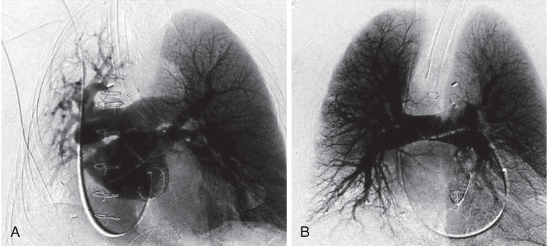

A B 

**Fig. 19.10 Radiographic demonstration of hypoxic pulmonary vasoconstriction.** During isolated left- lung ventilation, a pulmonary angiogram was performed that revealed selective peripheral microvascular perfusion to the left lung, but no microvascular perfusion to the right lung (A). Repeat angiogram during two- lung ventilation restored symmetric microvascular perfusion (B). (From Royster RL, Johnson SD, Krupp ND, Sullivan TP. Radiographic demonstration of hypoxic pulmonary vasoconstriction during one- lung ventilation. _Anesthesiology_ . 2022;137(6):733–734))

Smooth muscle TASK- 1 channels also appear to contribute to volatile anesthetic- induced PA dilation.129 Rather than causing immediate vasodilation, volatile anesthetics produce a paradoxical initial dose- dependent increase in force in isolated PA strips as a result of Ca2+ release from intracellular stores (Fig. 19.11).124,130,131 Subsequently, a decrease in force, associated with a Ca2+ /calmodulin–dependent protein kinase II activation, occurs.130,131 Extrapolation of these results to humans must be approached with caution, but these studies suggest that vasodilatory responses of volatile anesthetics may be more profound in patients with reduced SR Ca2+ stores (e.g., neonates) or those with depressed protein kinase activity (e.g., primary pulmonary hypertension).

In general, all volatile anesthetics attenuate HPV in isolated perfused lungs or in _in situ_ preparations with constant perfusion (Fig. 19.12),123,132 whereas most intravenous anesthetics do not have such an effect.120 The combined administration of a Ca2+ channel blocker and a volatile anesthetic further reduces HPV by up to 40%, compared with either drug alone, suggesting that these drugs inhibit HPV through differing mechanisms. The mechanisms of HPV inhibition by volatile anesthetics may be related to arachidonic acid metabolites133 or endothelial- derived vasodilating factors.134 Halothane and isoflurane attenuated endothelium- dependent vasodilation by inhibiting cGMP accumulation135 and a KATP channel– mediated interaction between NO and prostacyclin in isolated canine PA rings.136 In contrast, isoflurane modulated the HPV response, at least in part, through Ca2+ - activated and voltage- sensitive K+ channels. Attenuation of HPV by sevoflurane occurred independent of K+ - channel function.137

The relative efficacy of volatile anesthetics on HPV _in vivo_ is difficult to assess because several other factors affect HPV, including temperature, pH, CO2 tension, degree of hypoxia, size of the hypoxic area, surgical trauma, and medications. Volatile anesthetics may also affect HPV, lung perfusion, and oxygenation by indirect actions on cardiac output and mixed venous O2 saturation.138 Elevated PA pressures may cause passive distention of constricted vascular beds and

thereby reverse HPV. Alternatively, reflex pulmonary and systemic vasoconstriction in response to hypotension may increase PVR in healthy lung segments, leading to a shift of pulmonary blood flow to hypoxic areas of the lung.123

Early studies suggested that N2O attenuates HPV in animal models _in vivo_ . In contrast to isoflurane,133 sevoflurane and desflurane did not inhibit HPV in chronically instrumented dogs subjected to gradual occlusion of the right main PA (Fig. 19.13).139 Nitrous oxide,140 desflurane, and isoflurane,141 but not xenon,140 reduced the mixed venous O2 saturation, cardiac output, and arterial oxygenation during OLV in pigs. However, N2O,140 xenon,140 desflurane,141,142 and isoflurane141,143 did not alter perfusion of the nonventilated lung or the shunt fraction during OLV. In animals with a preexisting impairment of gas exchange attributable to a pneumoperitoneum, sevoflurane, but not isoflurane, caused more profound abnormalities in gas exchange than did propofol.144 Thus, although reductions in HPV by volatile anesthetics have been relatively small _in vivo_ , preexisting pulmonary disease may worsen anesthetic- induced gas exchange abnormalities.

### EFFECTS OF VOLATILE ANESTHETICS ON PULMONARY VASCULATURE IN HUMANS

General anesthesia frequently impairs pulmonary gas exchange. In addition to specific effects of volatile anesthetics, many other factors including gravity, posture, atelectasis, differences in vessel conductance between lung regions, intrathoracic pressure, and HPV may affect the distribution of pulmonary blood flow and ventilation during the administration of volatile anesthetics. Alterations in regional ventilation are related to changes in alveolar compliance, respiratory and flow rates, pleural pressures, and ventilatory modes.145 In spontaneously breathing healthy volunteers, sevoflurane (1 MAC for 20 minutes) administered via a face mask did not alter the relative distribution of either ventilation or perfusion in a ventral to dorsal direction measured by single-photon emission CT.145 Similarly, no such

<!-- PDF page 14 -->

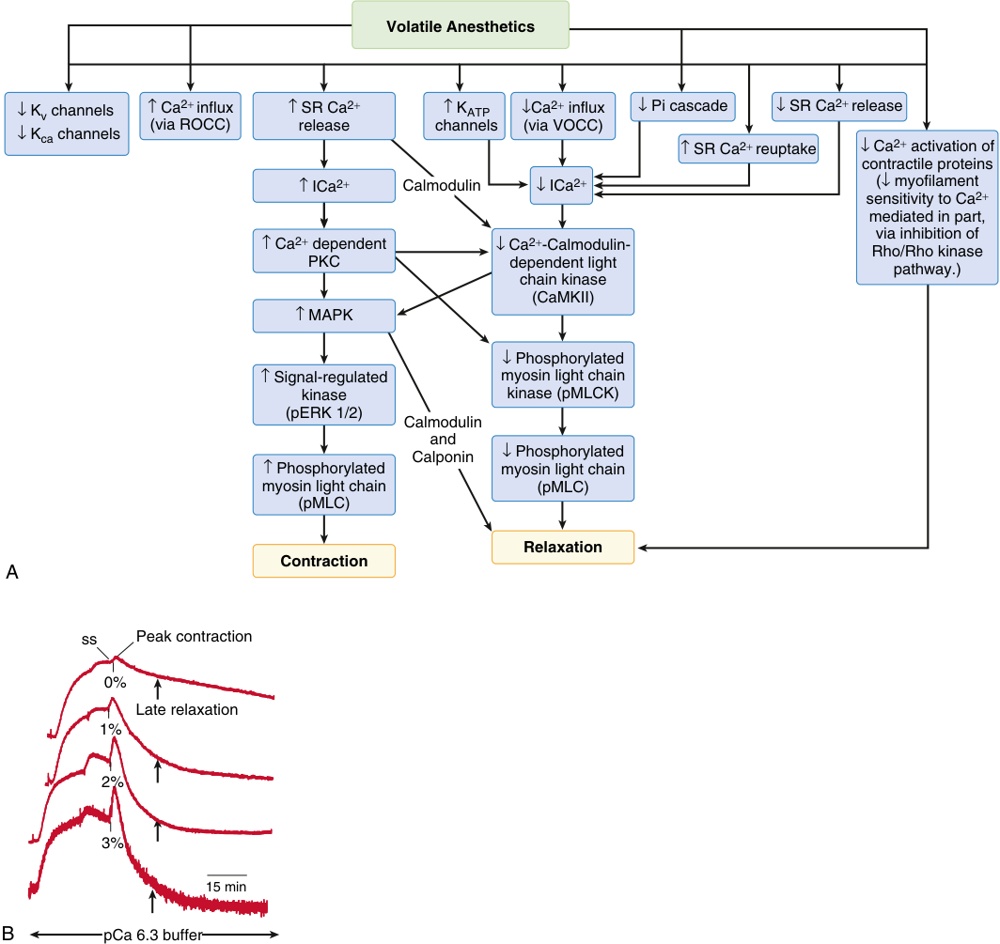

Volatile Anesthetics ↓ Kv channels ↑ Ca 21  influx ↑ SR Ca 21 ↑ KATP ↓Ca 21  influx ↓ Pi cascade ↓ SR Ca 21  release (via ROCC) release channels (via VOCC) ↓ Kca channels ↑ SR Ca 21  reuptake ↓ Ca 21  activation of contractile proteins ↑ ICa 21 Cal mod ulin ↓ ICa 21 (↓ myofilament sensitivity to Ca 21 mediated in part, via inhibition of ↑ Ca 21  dependent ↓ Ca 21 -Calmodulin- Rho/Rho kinase PKC dependent light pathway.) chain kinase (CaMKII) ↑ MAPK ↓ Phosphorylated ↑ Signal-regulated myosin light chain kinase kinase (pMLCK) (pERK 1/2) Calmodulin and Calponin ↓ Phosphorylated ↑ Phosphorylated myosin light chain myosin light chain (pMLC) (pMLC) Relaxation Contraction A ss Peak contraction 0% Late relaxation 1% 2% 3% 15 min B pCa 6.3 buffer 

**Fig. 19.11** (A) Proposed signaling pathways underlying volatile anesthetic–induced contraction and relaxation in pulmonary artery smooth muscle. Intracellular calcium (ICa2+ ) may be increased by release from the sarcoplasmic reticulum (SR), by the inhibition of voltage- sensitive potassium (Kν) or calcium- activated potassium (Kca) channels, or by receptor- operated Ca2+ channels (ROCC). Increased ICa2+ results in an initial dose- dependent increase in force (associated with activation of protein kinase C [PKC] and increased mitogen- activated protein kinase [MAPK]). Volatile anesthetics also decrease ICa2+ by activating adenosine triphosphate–regulated potassium (KATP) channels, thereby inhibiting Ca2+ influx via voltage- operated Ca2+ channels (VOCC), decreasing SR- induced release of Ca2+ , inhibiting the phosphatidylinositol (Pi) cascade, and enhancing SR- mediated reuptake of Ca2+ . The resultant decrease in force is associated with activation of Ca2+ - calmodulin- dependent protein kinase II (CaMKII). It is important to note that there are many agent- specific effects of volatile anesthetics on each component of these pathways. _pERK,_ phosphorylated extracellular signal- regulated kinase. (B) Example of a biphasic (contraction/relaxation) effect of halothane on pulmonary arterial smooth muscle. _0%, 1%, 2%,_ and _3%,_ halothane concentrations; _ss,_ control force at steady state before halothane. Halothane dose dependently enhanced Ca2+ - activated peak force and late relaxation. (Data from Akata,124 Su and Vo,130 and Zhong and Su.131 )

changes, as measured by electrical impedance tomography, occurred in spontaneously breathing adults receiving 0.7 MAC of sevoflurane via a laryngeal mask airway (LMA).143 Interestingly, sevoflurane reduced regional heterogeneity of the perfusion distribution and increased regional het-. . erogeneity of the ventilation/perfusion (V/Q) ratio with a tendency toward lower ratios in spontaneously breathing

volunteers.145 This alteration could potentially contribute to a less effective pulmonary gas exchange, but these effects . . were relatively small compared with alterations in V/Q distribution that occur during mechanical ventilation.146,147 Either pressure- controlled or pressure- supported ventilation with sevoflurane caused similar ventral redistributions of ventilation.146

<!-- PDF page 15 -->

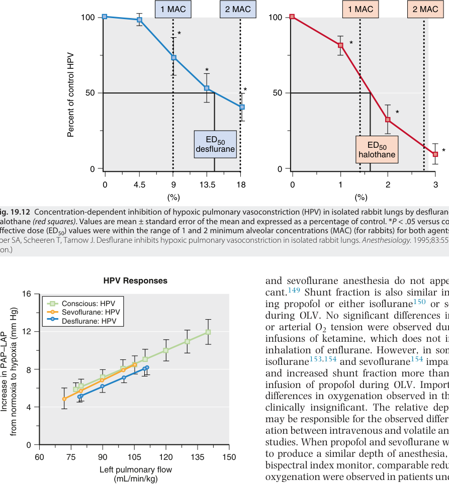

1 MAC 2 MAC 1 MAC 2 MAC 100 100 * * * 50 * 50 * ED50 desflurane ED50 * halothane 0 0 0 4.5 9 13.5 18 0 1 2 3 (%) (%) Fig. 19.12  Concentration- dependent inhibition of hypoxic pulmonary vasoconstriction (HPV) in isolated rabbit lungs by desflurane halothane  (red squares) . Values are mean ± standard error of the mean and expressed as a percentage of control. * P effective dose (ED50) values were within the range of 1 and 2 minimum alveolar concentrations (MAC) (for rabbits) for both agents. 50) values were within the range of 1 and 2 minimum alveolar concentrations (MAC) (for rabbits) for both agents. ) values were within the range of 1 and 2 minimum alveolar concentrations (MAC) (for rabbits) for both agents. (Reproduced from Loer SA, Scheeren T, Tarnow J. Desflurane inhibits hypoxic pulmonary vasoconstriction in isolated rabbit lungs.  Anesthesiology. sion.) HPV Responses and sevoflurane anesthesia do not appear to be signifi- 16 cant. 149  Shunt fraction is also similar in patients receiv- Conscious: HPV ing propofol or either isoflurane 150 Sevoflurane: HPV during OLV. No significant differences in shunt fraction Desflurane: HPV 12 or arterial O2 tension were observed during intravenous 2 tension were observed during intravenous  tension were observed during intravenous infusions of ketamine, which does not inhibit HPV, and inhalation of enflurane. However, in some other studies, isoflurane 153,154,154154  and sevoflurane 154 8 and increased shunt fraction more than an intravenous infusion of propofol during OLV. Importantly, the small differences in oxygenation observed in these studies were 4 clinically insignificant. The relative depth of anesthesia may be responsible for the observed differences in oxygen- ation between intravenous and volatile anesthetics in these 0 studies. When propofol and sevoflurane were administered 60 75 90 105 120 135 150 to produce a similar depth of anesthesia, as assessed by a bispectral index monitor, comparable reductions in arterial Left pulmonary flow (mL/min/kg) oxygenation were observed in patients undergoing OLV. Percent of control HPV Increase in PAP–LAP from normoxia to hypoxia (mm Hg) 

**Fig. 19.12** Concentration- dependent inhibition of hypoxic pulmonary vasoconstriction (HPV) in isolated rabbit lungs by desflurane _(blue squares)_ and halothane _(red squares)_ . Values are mean ± standard error of the mean and expressed as a percentage of control. * _P_ &lt; .05 versus control HPV. The 50% effective dose (ED50) values were within the range of 1 and 2 minimum alveolar concentrations (MAC) (for rabbits) for both agents. 50) values were within the range of 1 and 2 minimum alveolar concentrations (MAC) (for rabbits) for both agents. ) values were within the range of 1 and 2 minimum alveolar concentrations (MAC) (for rabbits) for both agents. (Reproduced from Loer SA, Scheeren T, Tarnow J. Desflurane inhibits hypoxic pulmonary vasoconstriction in isolated rabbit lungs. _Anesthesiology._ 1995;83:552. Used with permission.)

and sevoflurane anesthesia do not appear to be significant.149 Shunt fraction is also similar in patients receiving propofol or either isoflurane150 or sevoflurane151,152 during OLV. No significant differences in shunt fraction or arterial O2 tension were observed during intravenous 2 tension were observed during intravenous  tension were observed during intravenous infusions of ketamine, which does not inhibit HPV, and inhalation of enflurane. However, in some other studies, isoflurane153,154,154154 and sevoflurane154 impaired oxygenation and increased shunt fraction more than an intravenous infusion of propofol during OLV. Importantly, the small differences in oxygenation observed in these studies were clinically insignificant. The relative depth of anesthesia may be responsible for the observed differences in oxygenation between intravenous and volatile anesthetics in these studies. When propofol and sevoflurane were administered to produce a similar depth of anesthesia, as assessed by a bispectral index monitor, comparable reductions in arterial oxygenation were observed in patients undergoing OLV.152 Similar changes in shunt fraction and oxygenation were shown to occur with halothane,155 isoflurane,149,155,156 desflurane,156 and sevoflurane in patients undergoing thoracotomy and OLV (Fig. 19.14).149,154–156

**Fig. 19.13** Composite hypoxic pulmonary vasoconstriction (HPV) responses (increase in pulmonary artery pressure [PAP] minus left atrial pressure [LAP]) as a function of left pulmonary flow in the same seven chronically instrumented dogs in the conscious state and during sevoflurane and desflurane anesthesia. Neither anesthetic affected the magnitude of HPV when compared with the response in the conscious state. (From Lesitsky MA, Davis S, Murray PA. Preservation of hypoxic pulmonary vasoconstriction during sevoflurane and desflurane anesthesia compared to the conscious state in chronically instrumented dogs. _Anesthesiology_ . 1998;89:1501. Used with permission.)

There is strong evidence that all volatile anesthetics may be safely used in patients undergoing thoracotomy and OLV. The increase in shunt and the decrease in oxygenation caused by halothane or isoflurane155 were consistent with an approximately 20% inhibition of HPV at 1 MAC. Instead of the expected 50% reduction in pulmonary blood flow in a hypoxic lung in the absence of a volatile anesthetic, blood flow decreases by 40% during hypoxia in the presence of 1 MAC isoflurane. This change in flow corresponds to an increase in intrapulmonary shunt by approximately 4% of the cardiac output. Carlsson and colleagues157 applied multiple inert gas elimination techniques to measure the true shunt fraction in anesthetized humans and demonstrated a 2%–3% increase in shunt fraction corresponding to approximately 20% HPV inhibition following 1.5% isoflurane. In addition, no significant effects on arterial oxygenation occurred with

Isoflurane produces no clinically significant effects on pulmonary shunt in healthy individuals even at concentrations that cause systemic hypotension.148 Thoracic surgeries are usually performed in the lateral position with an open chest and dramatically affect the relative distribution of ventilation and perfusion. Under these conditions, a diseased, nondependent lung and surgical manipulations may affect the pulmonary vascular response to hypoxia. In lung cancer patients undergoing OLV for lobectomy, differences in shunt fraction, PVR, or oxygenation between isoflurane

<!-- PDF page 16 -->

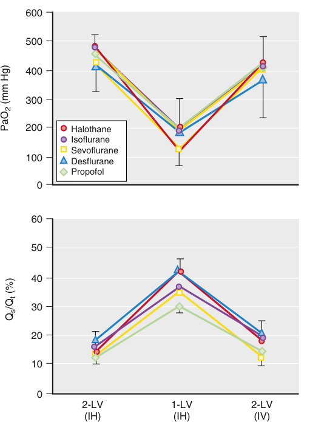

600 500 400 300 200 Halothane Isoflurane Sevoflurane 100 Desflurane Propofol 0 60 50 40 30 20 10 0 2-LV 1-LV 2-LV (IH) (IH) (IV) PaO (mm Hg)2 Q/Q (%)ts 

**Fig. 19.14** Partial arterial pressure of oxygen (PaO2) and intrapulmonary shunt fraction (Qs/Qt) in patients with both lungs ventilated (2- LV) or with one lung ventilated (1- LV). Patients received an inhaled agent (IH) halothane, isoflurane, sevoflurane, or desflurane or the intravenous (IV) anesthetic propofol. Note the minimal effect on PaO2 and shunt fraction that occurs in changing from a volatile anesthetic to an IV agent. (Data modified from Abe and colleagues,149 Benumof and colleagues,155 and Pagel and colleagues.156 )

clinically relevant concentrations of isoflurane or enflurane. Indeed, the use of total intravenous anesthesia with propofol and alfentanil did not reduce the occurrence of hypoxemia during OLV, compared with a volatile anesthetic.150

Functionally, volatile anesthetics exert only mild, if any, inhibitory effects on HPV and oxygenation.158,159 The relatively small inhibition of HPV should not be influencing clinical decision- making. In addition, ventilatory strategies (e.g., nondependent lung continuous positive airway pressure, permissive hypercapnia) and fiberoptic bronchoscopy to ensure proper positioning of a double- lumen endotracheal tube help alleviate hypoxemia. The net effect of volatile anesthetics on HPV is multifactorial and depends on the direct effects of these agents not only on pulmonary vascular tone, but also by indirect actions that occur during anesthesia and surgery.

## Control of Respiration

### COMPONENTS OF THE RESPIRATORY REGULATORY SYSTEM

The complex regulation of respiratory function occurs both on unconscious and conscious levels and is precisely

controlled by neuronal circuits mainly located in the brainstem (medulla oblongata, pons, and midbrain) (Fig. 19.15).

The neuronal networks in these areas generate involuntary, automatic breathing, which may be superseded by cortical centers for voluntary efforts such as speech, swallowing, laughing, sneezing, and coughing. Respiration ensures adequate gas exchange to meet metabolic demand during various levels of activity. Reflex inputs from the upper airways, lungs, and carotid bodies modulate respiration when abnormal gas exchange is sensed. Connections to the lateral hypothalamus also convey wakefulness drive to the respiratory center. Both physiologic statuses like sleep and pregnancy and nonphysiologic statuses including sedation alter the respiratory function. This section is not intended to discuss respiratory physiology in detail. Rather, it is focused on the major regulatory components of the respiratory system and how they are affected by inhalational anesthetics.

Readers are referred to Chapters 12 and 37 for a detailed discussion of respiratory physiology and monitoring.

In general, respiratory drive is suppressed by all inhalational anesthetics with the exception of N2O and xenon.160,161 Volatile anesthetics decrease glutamatergic excitatory drive to bulbospinal respiratory neurons and increase GABAA- ergic inhibitory mechanisms at the postsynaptic neuronal membrane.162 In hypoglossal upper airway motor neurons, volatile anesthetics hyperpolarize neuronal membrane and increase resting potential by activating K+ channels that are linked to serotonin and norepinephrine receptors.163,164 The magnitude of respiratory depression by volatile anesthetics also depends on the position of the affected neurons in the neuronal hierarchy, which extends from the neurons generating excitatory respiratory drive to the respiratory pattern generator (RPG) and down to the phrenic and hypoglossal respiratory output motor neurons (Fig. 19.16). Consequently, volatile anesthetics, which strongly affect synaptic neurotransmission, have a greater depressant effect on polysynaptic neuronal circuits that include many synapses, compared with those composed of only a few neurons (paucisynaptic). Fortunately, most connections between the single components of the respiratory system seem to be paucisynaptic, which may explain a relative resistance of automatic breathing to the depressant effects of volatile anesthetics.

The depressant effect of inhalational anesthetics on the respiratory system may be further demonstrated at the molecular and genetic levels. Heterozygous paired- like homeobox 2b ( _PHOX2B_ ) gene mutations have been found in the majority of patients diagnosed with late- onset central hypoventilation syndrome and may increase sensitivity of those patients to anesthetic- induced depression of breathing.165 A recent study demonstrated that isoflurane can potentiate aggregation and mislocalization of _PHOX2B_ variants, alter protein folding, and induce endoplasmic reticulum stress, indicating a mechanism by which these agents may affect respiratory neuronal function after surgery and contribute to the onset of the neurologic respiratory disease.166 Central hypoventilation syndrome is more frequently encountered in the pediatric population, but it is also reported in adulthood.167

Importantly, most data on respiratory regulatory systems are derived from animal models and may not directly

<!-- PDF page 17 -->

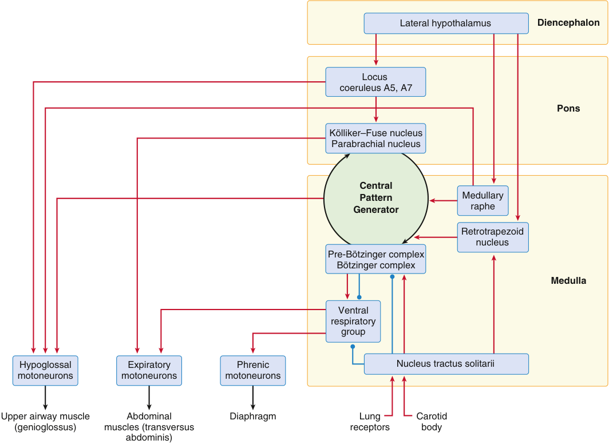

Lateral hypothalamus Diencephalon Locus coeruleus A5, A7 Pons Kölliker–Fuse nucleus Parabrachial nucleus Central Pattern Medullary Generator raphe Retrotrapezoid nucleus Pre-Bötzinger complex Bötzinger complex Medulla Ventral respiratory group Hypoglossal Expiratory Phrenic Nucleus tractus solitarii motoneurons motoneurons motoneurons Upper airway muscle Abdominal Diaphragm Lung Carotid (genioglossus) muscles (transversus receptors body abdominis) 

**Fig. 19.15** Anatomic components of the respiratory system and the main nuclei involved in the generation of respiration from chemoreception to motoneuron activation (see text for details). Wakefulness drive is derived from the lateral hypothalamus. The _central pattern generator_ , where respiratory drive is converted into a respiratory pattern, is thought to consist of several nuclei in the medulla and pons. Potential sites of central chemoreception are the locus coeruleus, areas A5 and A7, in the pons, and the medullary raphe and retrotrapezoid nucleus in the medulla. Expiratory and inspiratory excitatory drive is relayed to premotor neurons (ventral respiratory group), which project to expiratory motoneurons and inspiratory motoneurons (e.g., phrenic nerve) in the spinal cord. These motor nerves innervate abdominal muscles (expiratory) and diaphragm (inspiratory). Respiratory pattern and chemoreception are influenced by afferents from the lungs and carotid bodies. Excitatory inputs _(red arrows)_ ; inhibitory inputs _(blue buttons)_ .

translate to humans, as summarized in a review by Forster and Smith.168 This section therefore covers important experimental results to help understand the basic respiratory structure and function, as well as presenting recent clinical studies that demonstrate the correlation of those findings to clinical practice.

### CENTRAL CHEMORECEPTION

Central chemoreceptors contribute about two-thirds of the ventilatory response to CO2/H+ , while peripheral chemoreceptors contribute about one-third.168 These excitatory mechanisms ensure automatic breathing under normoxic, normocapnic conditions in healthy individuals.168 Central chemoreceptors discharge in response to a decrease in extracellular pH or an increase in [H+ ]. In addition, they project to other areas of the respiratory system where they form excitatory synapses. The exact location of this well- recognized pathway remains to be defined. Animal studies have pointed to multiple chemosensitive sites in the brainstem169 including the retrotrapezoid nucleus

(RTN), medullary raphe, locus coeruleus, nucleus tractus solitarius (NTS), lateral hypothalamus, and caudal ventrolateral medulla. The RTN is a particularly strong candidate as the absence of RTN likely causes severe central apneas in congenital central hypoventilation syndrome. Glial cells in these areas may also theoretically contribute to chemoreception through their effect on extracellular pH or by hypoxia- or CO2- induced ATP release potentially altering the function of chemosensitive neurons.170

Central chemoreceptors also promote excitatory drive to neurons regulating upper airway patency and arousal from sleep.169 The genioglossus muscle, considered a typical representative for the muscles maintaining upper airway patency, receives significant tonic and phasic excitatory drive in the conscious state. Genioglossal muscle activity is reduced during sleep, but high levels of inspiratory CO2 (>5%) are capable of recruiting near- normal levels of phasic activity. This phenomenon does not occur during rapid eye movement (REM) sleep because genioglossal muscle activity is absent, and therefore the upper airway collapses and hypoventilation follows.

<!-- PDF page 18 -->

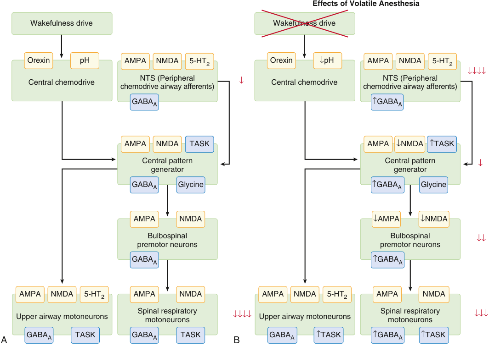

Effects of Volatile Anesthesia Wakefulness drive Wakefulness drive Orexin pH AMPA NMDA 5-HT2 Orexin ↓pH AMPA NMDA 5-HT2 ↓↓↓↓ Central chemodrive NTS (Peripheral ↓ Central chemodrive NTS (Peripheral chemodrive airway afferents) chemodrive airway afferents) GABAA ↑GABAA AMPA NMDA TASK AMPA ↓NMDA ↑TASK Central pattern Central pattern ↓ generator generator GABAA Glycine ↑GABAA Glycine AMPA NMDA ↓AMPA ↓NMDA Bulbospinal Bulbospinal ↓↓ premotor neurons premotor neurons GABAA ↑GABAA AMPA NMDA 5-HT2 AMPA NMDA AMPA NMDA 5-HT2 AMPA NMDA Upper airway motoneurons Spinal respiratorymotoneurons ↓↓↓↓ Upper airway motoneurons Spinal respiratorymotoneurons ↓↓↓ GABAA TASK GABAA TASK GABAA ↑TASK ↑GABAA ↑TASK A B 

**Fig. 19.16** (A) Ligand- gated receptors and ion channels on respiratory- related neurons. Excitatory receptors and channels are marked in _yellow_ , inhibitory in _blue_ . Opening of pH-sensitive channels excites the neuron, whereas the opening of two- pore domain, acid- sensitive potassium (K+ ) (TASK) channels causes membrane hyperpolarization and inhibition of neuronal discharge. (B) Effects of volatile anesthetics on respiratory- related neurons. Volatile anesthetics eliminate wakefulness drive to the respiratory system _(red cross out)_ . _Black arrows_ indicate changes in receptor function ( _up_ , increase; _down_ , decrease) that have been published in the literature. Volatile anesthetics reduce the presynaptic release of glutamate and γ- aminobutyric acid A (GABAA) in respiratory premotor neurons. The cumulative anesthetic effects on the respective neuron groups are depicted _(red arrows)_ . The relative magnitude of the depressant effect is visualized _(number of arrows)_ . In humans, peripheral chemodrive is significantly more depressed than central chemodrive. Upper airway motoneurons are significantly more depressed than inspiratory motoneurons. _5- HT2,_ 5- hydroxytryptamine; _AMPA,_ alphaamino- 3- hydroxy- 5- methyl- 4- isoxazolepropionic acid; _NMDA, N_ - methyl- d- aspartate; _NTS_ , nucleus of the solitary tract.

Hypercapnia secondary to upper airway obstruction and hypoventilation may recruit the normal phasic activity of genioglossal muscle through central chemoreceptors and function as another mechanism (aside from hypoxia) by which patients with obstructive sleep apnea (OSA) arouse from sleep and reestablish airway patency. Residual subanesthetic concentrations of volatile anesthetics, which may be present for hours in postoperative patients, inhibit both peripheral hypoxic171 and CO2 chemosensitivity172 and may also substantially impair the spontaneous arousal and resolution of upper airway obstruction that would otherwise occur with severe hypoxia or hypercarbia. This is particularly important in same- day surgery patients, especially with a history of OSA.173 Supplementation of oxygen reduces the incidence of desaturation in the postoperative period. However, it can also attenuate the hypoxia- triggered arousal. Therefore, experts advocate systematic clinical approach in implementing effective

measures that increase perioperative safety in this growing patient population.

### CENTRAL PATTERN GENERATOR

The cyclic breathing pattern is controlled by the central pattern generator (CPG). A review by Abdala and colleagues summarizes the progress in the field.174 Even though several models of the CPG network have been proposed, many of the circuit interactions and their functionalities remain unknown. CPG is believed to be located in nuclei of the pontomedullary network (see Fig. 19.15).175 In the related nuclei, the network consists of excitatory and inhibitory neurons that control the inspiratory and expiratory phases of breathing. The breathing cycle is complexly regulated, and the type of neurons and the related neurotransmitters have been well illustrated (Fig. 19.17). This neuronal circuit can be modulated by inhaled anesthetics, affecting

<!-- PDF page 19 -->

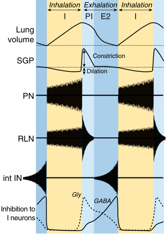

Inhalation Exhalation Inhalation I PI E2 I Lung volume Constriction SGP Dilation PN RLN int IN Gly GABA Inhibition to I neurons 

**Fig. 19.17 Schematic diagram of a three- phase respiratory cycle and its neuromechanical components.** Top schematic plots and neurograms represent lung volume, subglottal pressure (SGP), phrenic (PN), recurrent laryngeal (RLN), and internal intercostal (int IN) nerve activities during the three phases of a respiratory cycle, i.e., inspiration (I), postinspiration (PI), and late expiration (E2). Note that RLN conveys outputs from both abductor and adductor motoneurons, which fire, respectively, during inspiration (to dilate the glottis during inhalation) and postinspiration (to narrow the glottis during exhalation). Bottom overlay plots represent hypothetical time courses of glycine‐ _(_ Gly _, dotted line)_ and γ-aminobutyric acid (GABA)‐mediated _(continuous line)_ inhibition to inspiratory (I) neurons during the respiratory cycle. These time courses reflect the activity of medullary postinspiratory (PI) inhibitory neurons, thought to be predominantly glycinergic, and GABA- ergic augmenting expiratory (E‐AUG) inhibitory neurons active during E2 phase, both of which inhibit inspiratory neurons during expiration. Phasic inhibition of inspiratory neurons is minimal during inspiration, when active inspiratory neurons inhibit expiratory neurons, but rises abruptly during PI to orchestrate the inspiratory–expiratory phase transition and initiate exhalation. (Redrawn from Abdala AP, Paton JF, Smith JC. Defining inhibitory neurone function in respiratory circuits: opportunities with optogenetics? _J Physiol._ 2015;593[14]:3033–3046. Used with permission.)

respiratory rate, upper airway patency, and relative contributions of the chest wall versus the diaphragm to tidal volume and minute alveolar ventilation.

### INTEGRATION OF PERIPHERAL INPUTS

Afferent inputs from the periphery reach the brainstem respiratory center and influence respiratory drive. These inputs include the carotid body chemoreceptors, vagal inputs from the lungs and airways, and pulmonary baroreceptor inputs. The carotid body is the major peripheral chemoreceptor. It senses hypoxia or hypercapnia, which in turn increases carotid sinus nerve discharge. This information then reaches the RPG via NTS glutamatergic neurons, which also targets rostral ventrolateral medulla presympathetic neurons, thereby raising sympathetic nerve activity. Chemoreceptors also regulate presympathetic neurons and VPN indirectly via inputs from the RPG.176 In essential hypertension, OSA, and congestive heart failure, chronically elevated carotid body afferent activity contributes

to increasing sympathetic nerve activity but breathing remains unchanged or becomes periodic.

The function of the carotid body was discovered more than 80 years ago, and for a long time it was thought that the carotid body chemoreceptors function independently from central chemoreceptors.177 However, more recent studies indicated that the peripheral and central chemoreceptors are functionally interdependent. The sensitivity of the medullary chemoreceptors is determined by input from the peripheral chemoreceptors and possibly other breathing- related reflex afferents as well.168 This effect might be mediated through interactions within the NTS and/or through NTS projections to parafacial respiratory group/RTN integrating neurons and/or through projections to neurons of a raphe–pontomedullary respiratory network.

Afferent vagal inputs from the lungs and airways are also relayed through the NTS. Pulmonary baroreceptor inputs project to second- order pump neurons in the NTS, which can provide both excitatory and inhibitory inputs to various parts of the medullary respiratory column. In general, pulmonary baroreceptor inputs promote the phase switch from inspiration to expiration. This vagal expiratory- facilitating reflex (Hering–Breuer reflex) is most prominent in immature mammals but also modulates respiratory phase- timing during resting ventilation in adult humans.178 Although some of these inputs directly influence the CPG, others are integrated at the level of the bulbospinal or premotor neurons, which project to the motor neurons in the spinal cord.

### RESPIRATORY MOTOR OUTPUT AND UPPER AIRWAY PATENCY

The pontomedullary respiratory network generates the respiratory pattern and then projects to and controls respiratory motor outputs in the brainstem and spinal cord. The phrenic motor neurons are the main inspiratory neurons in the spinal cord. They are located at the levels C3 to C5 of the spinal cord and innervate the diaphragm.175 Phrenic motor neurons are directly depressed by volatile anesthetics.179 Expiratory motor neurons are located at approximately T7–T12 of the spinal cord and innervate truncal abdominal muscles that aid with forceful expiration and with expiratory expulsive efforts such as coughing. Expiratory motor neurons receive inputs from expiratory bulbospinal neurons and the pons.175 The spinal motor neurons are the final neurons in the respiratory neuronal hierarchy. Their activity can be reduced by the cumulative effect of anesthetics on all previous steps of chemoreception and neurotransmission.

To ensure effective ventilation, inspiratory muscle activity needs to be closely coordinated with upper airway muscles that maintain airway patency. Central respiratory motor output almost simultaneously engages both the phrenic motor neurons (innovating phrenic muscles) and hypoglossal motor neurons (innervating pharyngeal muscle dilators).180,181 The hypoglossal motor nerve innervates upper airway muscles, particularly the genioglossal muscle. The strength of excitatory and inhibitory drive to hypoglossal motor neurons strongly depends on the level of consciousness and differs between the REM and non- REM sleep phases.

<!-- PDF page 20 -->

The onset of the sleeping state results in a reduced tonic activation of upper airway dilator musculature and enhances collapsibility. This is especially significant for patients with OSA because they have a narrower and more collapsible airway and thus critically rely on compensatory activation of airway dilator muscles to maintain patency during wakefulness. The reduced lung volumes in obese recumbent patients during sleep decrease caudal traction on the trachea, promoting pharyngeal collapse.182,183 In addition, the loss of wakefulness removes an important vigilance component in the ventilatory control system, leaving the regulation of central respiratory motor output largely under chemoreceptor and mechanoreceptor feedback control.

The mechanisms of airway collapse during sleep and anesthesia are closely related. Hypoventilation and/or hypoxia secondary to upper airway collapse during anesthesia/sedation represent a significant challenge for anesthesia care providers, particularly in ambulatory surgery patients.

### EFFECTS OF INHALED ANESTHETICS ON RESTING VENTILATION

Volatile anesthetics suppress conscious control of breathing at concentrations of less than 1 MAC and completely abolish conscious breathing drive at higher concentrations. Breathing is then largely controlled by automatic brainstem mechanisms and chemoreflex inputs. All volatile anesthetics also cause a dose- dependent decrease in minute ventilation at

concentrations greater than 1 MAC because of a decrease in tidal volume. However, in a pressure chamber, Hornbein and colleagues demonstrated that N2O does not significantly reduce minute ventilation at 1.5 MAC (well beyond an atmosphere).184 Most volatile anesthetics produce an increase in respiratory rate by decreasing both inspiratory and expiratory duration. In contrast, xenon causes a significant reduction in respiratory rate, resulting in hypopnea or apnea185,186 (Fig. 19.18). The modest decrease in minute ventilation with volatile anesthetics could underestimate the magnitude of the respiratory depressant effects of these agents. This is due to volatile anesthetic- induced hypoventilation increasing partial arterial pressure of carbon dioxide (PaCO2) in a closed central chemoreflex feedback loop. In turn, central chemoreceptors are stimulated, thereby increasing central chemodrive to the respiratory center and increasing minute ventilation.187–190

### EFFECTS OF INHALED ANESTHETICS ON CHEMOREFLEXES

Volatile anesthetics impair peripheral chemoreceptor responses to hypoxia and hypercarbia in a dose- dependent manner. At MAC of 1 or higher, breathing in humans is entirely dependent on the automatic control from the pontomedullary respiratory center and afferent excitatory inputs from the central chemoreceptors. This is because at such concentrations, peripheral chemoreflex loop completely depressed.191 Even at very low concentrations (0.1 MAC of isoflurane and sevoflurane), volatile anesthetics

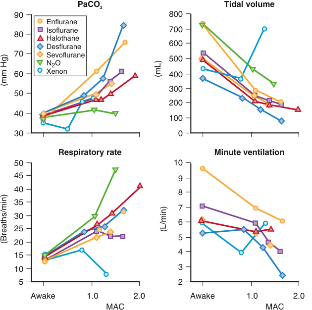

PaCO2 Tidal volume 90 800 Enflurane Isoflurane 700 80 Halothane Desflurane 600 70 Sevoflurane 500 N2O 60 Xenon 400 300 50 200 40 100 30 0 Respiratory rate Minute ventilation 50 10 45 9 40 8 35 7 30 6 25 5 20 4 15 10 3 5 2 Awake 1.0 2.0 Awake 1.0 2.0 MAC MAC (mL) (mm Hg) (L/min) (Breaths/min) 

**Fig. 19.18** Comparison of mean changes in resting partial arterial pressure of carbon dioxide (PaCO2), tidal volume, respiratory rate, and minute ventilation in patients anesthetized with various inhaled agents. Most agents cause dose- dependent tachypnea, decreases in minute ventilation and tidal volume, and an increase in PaCO2. _MAC,_ minimum alveolar concentration, _N2O,_ nitrous oxide. _Note: data for xenon have been extrapolated from references._

<!-- PDF page 21 -->

depress the peripheral chemoreflex loop, without affecting the central chemoreflex loop. Desflurane at the same MAC showed no effect on peripheral and central CO2 sensitivity. A loss of upper airway muscle tone and function accompanies this process, as does depression of neurotransmission at the level of the spinal cord.192

The effect of inhaled anesthetics on respiratory drive may not be clinically relevant in the patient undergoing controlled ventilation. However, it does matter in spontaneously breathing patients. Because the suppressive effect of inhaled anesthetics on respiratory drive is synergetic with narcotics, and these two drug classes are often administered concurrently, the suppression on the hypoxic and hypercarbic drive can increase the risk of postoperative respiratory complications.

### EFFECTS OF INHALED ANESTHETICS ON THE HYPERCAPNIC VENTILATORY RESPONSE

The respiratory drive mediated by the peripheral chemoreceptors is augmented by hypoxia.193 However, the hypoxia- mediated component is abolished by most volatile anesthetics at concentrations even under 1 MAC. When the anesthetic concentration increases above 1 MAC, the peripheral chemoreceptor- mediated portion of the CO2 responsive respiratory drive is also abolished, and only the central chemoreceptor loop remains functional.171,194–196 Depression of the respiratory drive is often described in a quantitative manner by plotting the CO2 response curve (an increase in PaCO2 vs. an increase in minute alveolar ventilation). Volatile anesthetics cause a rightward shift of the apneic threshold,197 that is the minimum PaCO2 required to initiate spontaneous respiration. Thus, spontaneous breathing efforts do not occur if mechanical or assisted ventilation efforts drive the PaCO2 levels below the CO2 threshold during anesthesia.198

Patients under general anesthesia with volatile anesthetics become hypercarbic if they are spontaneously breathing without any ventilatory support. Pressure support ventilation is often used to counteract the suppression of the respiratory drive by the volatile anesthetics. However, it remains to be determined if an increase in pressure support would lead to a proportional increase in minute alveolar ventilation as the intrinsic CO2 response curve at a given level of sedation is not altered by pressure support. An increase in minute alveolar ventilation secondary to increased tidal volumes from pressure support may result in a decreased respiratory rate and therefore minute alveolar ventilation may not be increased as much as expected.

### EFFECTS OF VOLATILE ANESTHETIC ON THE HYPOXIC VENTILATORY RESPONSE IN HUMANS

Hypoxic ventilatory response (HVR) is rarely encountered in conscious healthy humans at sea level. However, for special occupations (e.g., tunnel workers at sea level or mountain climbers staying at high altitude), hypoxia does occur and therefore the HVR becomes an important mechanism to compensate for low inspired O2 concentrations. One example is humans living at high altitudes. At the top of Mt. Everest (8848 m), the partial pressure of O2 of ambient air is only about 50 mm Hg compared with 159.6 mm Hg

at sea level. The corresponding arterial blood PaO2 is only 37.6 mm Hg, which is lower than the partial pressure of O2 in the mixed venous blood in healthy resting adults living at sea level. The estimated minute ventilation can be as high as 166 L/min in a healthy adult as a result of severe hypoxic hyperventilation.199 However, this powerful compensation mechanism is significantly diminished by volatile anesthetics under 1 MAC and completely abolished at 1.1 MAC of halothane (Fig. 19.19). It is important to realize that even a subanesthetic concentration (0.1 MAC) of volatile anesthetics profoundly attenuates HVR without concurrent use of narcotics.200 The potency of the suppression of HVR has been proposed as the following order: halothane > enflurane > sevoflurane > isoflurane > desflurane.171

Certain patient populations are particularly vulnerable to the inhibition of HVR at subanesthetic concentrations, including premature infants and patients with OSA.201,202 The depressant effect on the HVR is due to selective inhibition of the peripheral chemoreflex loop. The carotid body appears to be the most likely target. However, the mechanisms by which subanesthetic concentrations of volatile anesthetics attenuate HVR are not completely understood. Interestingly, acute pain and central nervous system arousal do not restore impaired HVR during sevoflurane sedation. Thus, compromise of the central nervous system arousal state _per se_ does not contribute to the impairment of the acute HVR by sevoflurane.203 Additionally, audiovisual stimulation does not prevent the blunting of acute HVR by low- dose halothane, but by isoflurane. This finding raises

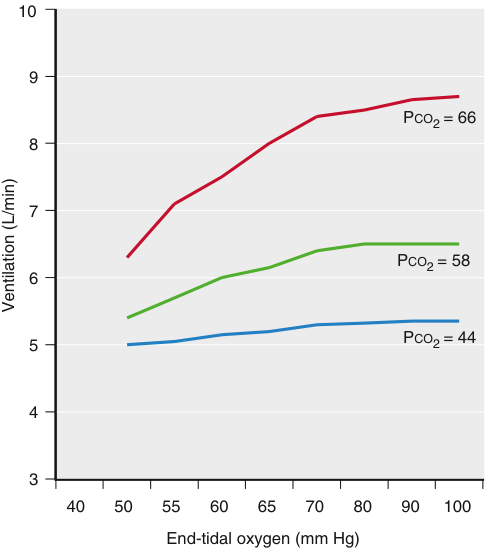

10 9 PCO2 = 66 8 7 PCO2 = 58 6 5 PCO 2  = 44 4 3 40 50 55 60 65 70 80 90 100 End-tidal oxygen (mm Hg) Ventilation (L/min) 

**Fig. 19.19** Effects of halothane anesthesia on the hypoxic ventilatory response in humans at three steady- state levels of partial pressure of carbon dioxide (PCO2). Halothane anesthesia (1.1 minimum alveolar concentration [MAC]) completely eliminates the hypoxic ventilatory response and the hypoxic–hypercapnic interaction at the peripheral chemoreceptors. (Modified from Knill RL, Gelb AW. Ventilatory responses to hypoxia and hypercapnia during halothane sedation and anesthesia in man. _Anesthesiology_ . 1978;49:244. Used with permission.)

<!-- PDF page 22 -->

the possibility that volatile anesthetics might differently affect the hypoxic chemoreflex loop.204

### EFFECTS OF INHALED ANESTHETICS ON RESPIRATORY MUSCLE ACTIVITY

Humans are bipeds and very different from the quadruped mammals in terms of the contribution of various muscle groups, particularly the truncal muscles, to the normal respiratory effort, probably due to differences in posture. Thus, the results of respiratory control studies in animals could not be directly extrapolated to humans, whether under normal resting conditions or under anesthesia. At quiet breathing in supine and conscious nonpregnant adult humans, scalene and parasternal inspiratory activity is universally present, but abdominal expiratory activity is absent.205,206 This means that at quiet breathing, expiration is mostly passive and likely occurs via recoiling of the chest wall and lungs. When breathing is stimulated by inhaling CO2, the inspiratory activity is enhanced, and expiratory muscles are also recruited.

Volatile anesthetics, such as halothane, depress various respiratory muscles differently (Fig. 19.20). The diaphragm, as the main inspiratory muscle, is unique in that regard because it is relatively spared from the respiratory depression by volatile anesthetics, probably because of its low position in the hierarchy of the neurotransmission system. At 1 MAC of halothane, in adult humans, the tidal volume was reduced by 59%, respiratory rate was increased by 146%, and FRC was decreased by 335 ± 75 mL. The decrease in minute alveolar ventilation could be because of rib cage/chest wall activity. However, it is not because of a reduction in abdominal breathing as the contribution of the diaphragm is substantially less affected.207 Paradoxical rib cage motion develops in some subjects during halothane anesthesia, such that the rib cage continues to expand during the first portion of expiration. Such paradoxical rib cage motion is exaggerated during a CO2- stimulated rebreathing.205–207

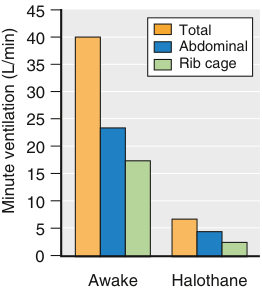

45 Total 40 Abdominal 35 Rib cage 30 25 20 15 10 5 0 Awake Halothane Minute ventilation (L/min) 

**Fig. 19.20** Effects of halothane anesthesia on rib cage and abdominal ventilation during hypercapnia (calculated ventilation at partial arterial pressure of carbon dioxide [PaCO2] of 55 mm Hg). Compared with being awake, halothane anesthesia strongly depresses minute ventilation. Halothane depresses the rib cage component to ventilation more than the abdominal component (diaphragmatic). Data are means. (Graph is based on data from Warner DO, Warner MA, Ritman EL. Mechanical significance of respiratory muscle activity in humans during halothane anesthesia. _Anesthesiology_ . 1996;84:309.)

### EFFECTS OF INHALED ANESTHETICS ON THE UPPER AIRWAY

In the conscious state, inspiratory upper airway patency is maintained by the cortical wakefulness drive, fully preserved chemical chemoreceptor sensitivity and chemodrive transmission, and optimal reflex feedback from upper airway receptors. These upper airway receptors are activated by the negative pressure and airflow208,209 generated by the inspiratory muscles. During sleep or volatile anesthesia, the cortical wakefulness drive is absent, and the sensitivity of the chemoreceptors and upper airway receptors is decreased. Thus, both phasic and tonic inspiratory excitatory drives to the upper airway muscles are decreased or entirely absent. The loss of tone in the upper airway muscles (genioglossus and other pharyngeal muscles) predisposes individuals with anatomic limitations to upper airway obstruction.210,211 Even in the presence of subanesthetic concentrations of volatile anesthetics, e.g., in an early postoperative period, the cortical wakefulness drive, the drive from peripheral chemoreceptors, and excitatory inputs from upper airway mechanoreceptors are all significantly impaired. This may lead to partial or even complete upper airway obstruction, a situation that can be further complicated by inhibition of hypoxia- mediated arousal reflexes.191

### EFFECTS OF INHALED ANESTHETICS ON DEFENSIVE AIRWAY REFLEXES

Humans have very effective protective mechanisms to prevent aspiration by closing glottis and coughing. Volatile anesthetics (≥1–1.3 MAC) progressively abolish defensive airway reflexes. The loss of airway protection against gastroesophageal reflux with consequent aspiration of orogastric content into the trachea can be catastrophic. However, lower concentrations of volatile anesthetics may paradoxically enhance and prolong the duration of protective defensive reflexes. Laryngospasm is the sustained and complete reflex glottic closure in response to foreign material (e.g., oral secretions) contacting the vocal cords, or to a poorly timed noxious stimulus (e.g., pain from incision, venipuncture) during the administration of inadequately low concentrations of a volatile anesthetic. It occurs during induction before anesthesia reaches adequate depth and during emergence when the agent is washing out but not completely eliminated. A recent study showed that laryngospasm could be observed in 18% of children under deep anesthesia with sevoflurane, but higher concentration (4.7% = MACED95 intubation) provided better protection from laryngospasm as compared with lower concentration (2.5% = 1 MAC).212

Not all volatile anesthetics are equally prone to elicit unwanted defensive airway reflexes. Desflurane and isoflurane appear to be the most irritating to the airways; neither anesthetic is recommended for an inhaled induction of anesthesia. The maintenance and emergence from desflurane anesthesia caused more severe adverse airway events than did isoflurane anesthesia in spontaneously breathing infants and children with an LMA, especially when the LMA was removed before emergence.213 Sevoflurane has the most favorable profile and is frequently used for inhalational induction in the pediatric population.

<!-- PDF page 23 -->

## Inhaled Anesthetics and Acute Lung Injury

### PATHOPHYSIOLOGY OF SEPSIS- INDUCED ACUTE LUNG INJURY (ALI)

ALI represents the pulmonary manifestation of a global inflammatory process that is commonly associated with Gram- negative bacterial sepsis.214–217 Derangements of pulmonary hemodynamics,218 fluid filtration, and gas exchange are pathophysiologic manifestations.219 Bacterial endotoxin often triggers ALI.220 In addition, other humoral and cellular cascades are involved, including eicosanoids,221 cytokines, O2 free radicals, endothelin,222 NO, as well as the coagulation, the fibrinolytic, and the kinin/ kallikrein systems,223 and degradation fragments of extracellular matrix.224

It is now well established that NO is involved in the pathogenesis of sepsis and sepsis- induced ALI. In hyperdynamic sepsis, increased iNOS- dependent formation of NO and, subsequently, cGMP is associated with myocardial depression, reduced contractile responses to vasoconstrictor agents, and circulatory shock.225 In addition, NO may mediate cytotoxic effects following its reaction with the superoxide anion to yield the strong oxidant anion peroxynitrite and eventually its breakdown cytotoxic product OH•.226 Large amounts of NO may also activate enzymes in the cyclooxygenase pathway and modify gene expression.227 Interaction of NO with many molecular targets represents a pathway for its breakdown and inactivation. The most important is the reaction of NO with molecular O2 to form nitrite, which in the presence of hemoproteins (i.e., hemoglobin) is oxidized further to nitrate.228

Moreover, excessively produced NO may attenuate HPV, thereby contributing to derangement of gas exchange.229 Ultimately, tissue hypoxia and microvascular damage may result in multiple organ failure and death. However, in less extreme conditions, the generation of minute amounts of NO by eNOS and/or iNOS might be protective. Vasodilatation may enhance tissue perfusion. NO inhibition of platelet adhesion and aggregation may produce antithrombotic effects. NO scavenging of superoxide anions and other free radicals and inhibition of leukocyte–endothelial cell adhesion may prevent crucial steps in the inflammatory reactions. Finally, stimulation of cGMP production may preserve the integrity of the microvascular barrier.230,231

### INHALED ANESTHETICS IN EXPERIMENTAL SEPSIS- INDUCED ACUTE LUNG INJURY

There is a substantial debate surrounding the choice of anesthetic regimens for patients with ALI that require surgery. Animal studies suggest an anti- inflammatory potential of volatile anesthetics in ALI. Pretreatment with sevoflurane significantly reduced the inflammatory response and attenuated lipopolysaccharide (LPS)- induced chemotaxis of neutrophils from alveolar type II cells.232 Compared with thiopental anesthesia, pigs anesthetized with sevoflurane exhibited decreased expression of tumor necrosis factor-α (TNF-α) and interleukin-1β (IL-1β) in lung tissue.233 Volatile anesthetics exert other anti- inflammatory effects including reduction of proinflammatory cytokine production in

alveolar type II cells, reduction of neutrophil migration into the lung interstitium and alveolar space, and decreased protein leakage and pulmonary edema.234–236 In a rat model, LPS- induced ALI was markedly attenuated by sevoflurane compared with propofol anesthesia. Rats receiving sevoflurane demonstrated improved gas exchange, reduced amounts of albumin and total cell count in bronchoalveolar lavage fluid (BALF), and lower cytokine levels in BALF and RNA levels in lung tissue compared with rats receiving propofol. Sevoflurane, but not propofol, also decreased the amount of pulmonary edema, most likely through a reduction in edema formation rather than water reabsorption.235 When administered after the onset of oleic acid–induced ALI in dogs, sevoflurane reduced the elevated PA pressure and PVR, attenuated pulmonary edema as evidenced by reduced extravascular lung water index, and decreased TNF- α production and diffuse alveolar damage score compared with propofol. However, despite these effects, sevoflurane worsened systemic oxygenation possibly via inhibition of HPV.237 In a rat model of cecal ligation and puncture (CLP)- induced sepsis, both sevoflurane and isoflurane attenuated inflammatory response, lipid peroxidation, oxidative stress, and improved survival. Furthermore, sevoflurane was more effective in modulating sepsis- induced inflammatory response.238 Induction of heme oxygenase- 1 and suppression of iNOS expression provide cytoprotection in lung and vascular injury. In a rat model of ALI induced by CLP, the isoflurane posttreatment reduced pulmonary microvascular permeability, as well as lung injury as assessed by histologic and immunohistochemical examinations. Furthermore, isoflurane decreased iNOS and increased heme oxygenase- 1 expression in lung tissue. These findings suggest that the protective role of isoflurane postconditioning against CLP- induced ALI may be associated with its role in upregulating heme oxygenase- 1.239

### INHALED ANESTHETICS AND VENTILATORINDUCED LUNG INJURY

Mechanical ventilation is a life- saving clinical treatment, but it can also produce pulmonary inflammatory changes and injury known as ventilator- induced lung injury (VILI). Cyclic stretching of the lung during mechanical ventilation releases proinflammatory cytokines such as IL- 1 and MIP- 2, leading to pulmonary neutrophil accumulation; enhances activity of phospholipase A2, which degrades surfactant; and results in pulmonary edema, hyaline membrane formation, and cellular infiltration.240 Volatile anesthetics have been shown to attenuate lung injury due to mechanical ventilation. In mice, mechanical ventilation led to induction of lung injury, reactive O2 species production, proinflammatory cytokine release, and neutrophil influx. Sevoflurane posttreatment reduced histologic signs of VILI, as well as prevented increased production of reactive O2 species, release of IL- 1β and MIP- 1β, and neutrophil transmigration.241 Similarly, isoflurane reduced VILI in mice, as indicated by reduced inflammation, transmigration of neutrophils, and cytokine levels. Phosphorylation of Akt protein was significantly increased during mechanical ventilation with isoflurane. Inhibition of phosphoinositide 3- kinase/Akt signaling before mechanical ventilation completely reversed the lung- protective effects of isoflurane.

<!-- PDF page 24 -->

These findings suggest that isoflurane- mediated pulmonary protection is mediated via phosphoinositide 3- kinase/ Akt signaling.242 Moreover, in a murine two- hit model of LPS- induced inflammation followed by VILI, isoflurane exposure before initiation of mechanical ventilation ameliorated VILI by improving both lung mechanics and vascular leakage. In addition, isoflurane prevented a decrease of a key tight junction protein (zona occludens 1) in lung tissue and lung epithelial cells.243 In another study in murine VILI, animals anesthetized with isoflurane and sevoflurane showed thinner alveolar septa, lower VILI scores, lower polymorph neutrophil counts, lower IL- 1β concentrations, less reactive O2 species production, and higher glutathione contents compared to ketamine- anesthetized mice. In contrast, desflurane- ventilated mice showed signs of lung injury similar to mice receiving ketamine anesthesia. Desflurane also failed to inhibit inflammatory responses and reactive O2 species production in lung tissue.244

### INHALED ANESTHETICS AND LUNG ISCHEMIA– REPERFUSION

Lung ischemia–reperfusion (IR) injury is a hallmark of many lung diseases, and it also occurs during surgical procedures such as lung transplantation. The reestablishment of blood flow and O2 delivery into the previously ischemic lung exacerbates the ischemic injury and leads to increased PVR and microvascular permeability, as well as activation of the immune response. These events trigger ALI with subsequent edema formation that can result in systemic hypoxemia and multiorgan failure. Reactive O2 and nitrogen species have been suggested as crucial mediators of such responses during IR in the lung.245 Isoflurane attenuated increases in PVR and the filtration coefficient and the wet- to- dry ratio in isolated rabbit lungs subjected to IR.246 Isoflurane also protected against warm IR injury in an isolated, perfused rat lung model when it was administered after the onset of ischemia.247 Moreover, reductions in inflammatory responses and oxidative stress were observed during sevoflurane compared with propofol anesthesia in a porcine model of IR injury.248 In a rat lung transplantation model, preconditioning and postconditioning using sevoflurane significantly improved the oxygenation of lung grafts and decreased pulmonary edema. Sevoflurane treatment also reduced levels of IL- 1β, IL- 6, and TNF- α. In addition, sevoflurane significantly inhibited cell apoptosis by a decrease in cytochrome _c_ release into cytosol and caspase3 cleavage.249 In contrast, pretreatment with desflurane exacerbated IR injury in isolated rabbit lungs perfused with saline by increasing pulmonary microvascular permeability and NO production.250 Furthermore, postconditioning with xenon during prolonged _ex vivo_ lung perfusion did not improve graft function in a porcine warm ischemic lung injury model.251

### CLINICAL EVIDENCE

Clinical evidence supports therapeutic potential of volatile anesthetics in ALI. For example, short- term positivepressure ventilation with high tidal volumes did not affect cytokine production in the lungs of healthy subjects anesthetized with isoflurane.252 Several studies investigated the effects of volatile anesthetics in patients undergoing

thoracic surgery with OLV.253–255 OLV is associated with hypoxia–reoxygenation injury in the deflated and subsequently reventilated lung. OLV increased the release of proinflammatory mediators in both the dependent and the nondependent lung.254 Sevoflurane suppressed local alveolar inflammatory responses and cytokine release compared with propofol. Furthermore, the anti- inflammatory effects of sevoflurane were greater in the dependent compared with the nondependent lung.254,255 Patients receiving sevoflurane also had an improved postoperative course as indicated by a shorter ICU stay and fewer adverse events including pneumonia, pleural effusion, and bronchopleural fistula compared with those anesthetized with propofol.253 In addition, a meta- analysis in cardiac surgical patients demonstrated that volatile as opposed to intravenous anesthesia is associated with a significant reduction in pulmonary complications and overall mortality.256 However, in a randomized multicenter controlled trial in patients scheduled for surgery with OLV, the incidence of major complications during hospitalization and within 6 months from surgery was similar in propofol and desflurane groups.257 This finding is in agreement with an earlier study demonstrating that in healthy surgical patients, desflurane increased lipid peroxidation as measured in BALF, indicating injury to the pulmonary alveolar membranes. Sevoflurane caused less pronounced effects, suggesting that it may exert a protective effect compared with desflurane.258

In a recent parallel, open- label, single- center randomized controlled trial, adult patients with moderate- to- severe ARDS were randomized to receive either intravenous midazolam or inhaled sevoflurane for 48 hours. On day 2, the PaO2/FiO2 (partial arterial pressure of oxygen/fraction of inspired oxygen) ratio was significantly higher in the sevoflurane group than in the midazolam group. There was also a significant reduction in cytokines and the soluble form of the receptor for advanced glycation end- product levels in the sevoflurane group, compared with the midazolam group. No serious adverse events were observed with sevoflurane. This study suggests therapeutic utility of sevoflurane in patients with ARDS.259 Moreover, the use of inhaled anesthetics in the ICU is conceptually appealing as they offer a safe, effective, and easily titratable method of sedation. A retrospective analysis of patients receiving inhaled sedation in the ICU demonstrated reductions in one- year and in- hospital mortality, likely related to a significant increase in ventilator- free days compared to sedation with intravenous agents.260 Prospective randomized clinical trials are needed to further elucidate therapeutic potential of inhaled anesthetics in intubated patients with ALI/ARDS and ICU patients requiring long- term sedation.

## Nonvolatile Inhaled Agents

The pharmacokinetics of all inhalational anesthetics follow the same principle. At initial uptake, the dynamic change of the ratio of the fraction of a gas in alveoli (FA) to its fraction in the inspiratory gas (FI) (FA/FI) is dependent on initial FI, solubility of the anesthetic, minute alveolar ventilation, and cardiac output. Fig. 19.21 depicts the dynamic changes in FA/FI of inhalational anesthetics during the phase of uptake. Because xenon has the lowest solubility among the clinically used inhalational anesthetics, it

<!-- PDF page 25 -->

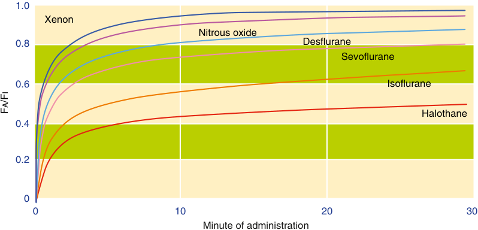

1.0 Xenon Nitrous oxide 0.8 Desflurane Sevoflurane 0.6 Isoflurane Halothane 0.4 0.2 0 0 10 20 30 Minute of administration /FFAI 

**Fig. 19.21 Pharmacokinetics of the inhalational anesthetics.** The rise in the alveolar fraction of anesthetic (FA) toward the fraction of inspired anesthetics (FI) is most rapid with the least soluble anesthetic, Xenon and slowest with the most soluble anesthetic, halothane, among the six inhalational agents. All data are from human studies. (Data from Yashuda N, Lockhart SH, Eger EI II, et al. Kinetics of desflurane, isoflurane and halothane in humans. _Anesthesiology_ . 1991;74:489–498; and _Anesth Analg_ . 1991;72:316–24. Data for Xenon only recently available.)

reaches equilibrium quickly, and even faster than N2O. The speed of washout of anesthetics also follows the same principle but in the reverse direction. Among the four factors affecting washout (solubility, fresh gas flow rate, minute alveolar ventilation, and cardiac output), fresh gas flow is the only one the provider can fully control besides partially controlling minute alveolar ventilation. Adequate fresh gas flow plays an important role in preventing rebreathing expired gas and affects the rate of its elimination. Fresh gas flow must be higher than the peak inspiratory flow rate for the adult breathing circuit. For circuits used in pediatric patients, the minimal fresh gas flow rate for preventing rebreathing is dependent on the type of the circuit. In the following section, two commonly used nonvolatile gases, xenon and N2O, are discussed with focus on their clinically related aspects.

### NITROUS OXIDE

Advantages of N2O are well established including the ability to quickly reach its target MAC value and quick washout. N2O does not significantly interfere with respiratory drive and has no negative impact on bronchial mucosa or bronchial smooth muscle activity in healthy individuals. N2O enhances catecholamine release and does not reduce systemic vascular resistance or cardiac output, maintaining hemodynamic stability. Because its MAC value is 104%, N2O cannot be used as a sole anesthetic at 1 atmosphere pressure to achieve adequate sedation. However, because it is odorless, it is often used as an adjuvant at the beginning of inhalational induction, especially in pediatric patients, prior to administration of volatile anesthetics. It is also commonly used for analgesia and sedation for dental procedures.261 Its use for labor pain has faded but it is still used for labor analgesia in some centers.262

### Sedative and Analgesic Effects

Nitrous oxide has both sedative and analgesic effects. Because MAC is determined as the threshold of an individual’s response to the painful stimulation of skin incision,

and N2O is analgesic, it is difficult to distinguish its sedative from analgesic effects. Therefore, the sedative potency of N2O at equal MAC values is different from other inhalational anesthetics which do not possess analgesic effects. The MAC of N2O and other inhalational anesthetics are additive relative to a subject’s movement in response to nociceptive stimulation, but not necessarily when it comes to the level of sedation. For most volatile anesthetics, MAC awake is approximately 0.3 MAC value.263 However, MAC awake of N2O is 0.61 MAC (63.3%).263 At 50% of N2O or 0.48 MAC, most adults are conscious. Clinicians often use N2O at the end of anesthesia to facilitate washout of a volatile anesthetic. Even though the sum of the MAC values of the volatile anesthetic and that of N2O is above the MAC awake value of the volatile anesthetic alone, this does not guarantee the unconsciousness of the patient. Awareness may occur even though it may not be associated with postoperative recall.264

In humans, the analgesic effect of 66%–70% of N2O is equal to that of an intravenous infusion of remifentanil at 0.085–0.17 mg/kg/min, or a whole- blood concentration of 2 ng/mL.265,266 Analgesic potency of N2O can be attenuated by sevoflurane (Fig. 19.22).267 Precise mechanisms of its analgesic action remain to be determined. However, animals tolerant to N2O are cross- tolerant to morphine,268 and the analgesic effect of N2O can be reversed by naloxone.269 This means that, at least in part, the analgesic action of N2O occurs via the mu opioid receptor. Small animals develop tolerance quickly (6–24 hours) following continuous administration of N2O.269 Humans can also develop acute tolerance to N2O in only 40 minutes.270 In clinical practice, N2O is commonly administered for several hours, and its analgesic effects may be significantly reduced due to development of tolerance.

### Gas Volume Expansion

Nitrous oxide has a greater rate of diffusion across tissues than nitrogen. Therefore, N2O diffuses into any closed nitrogen- containing space more quickly than nitrogen diffuses out, resulting in gas volume expansion. One of the

<!-- PDF page 26 -->

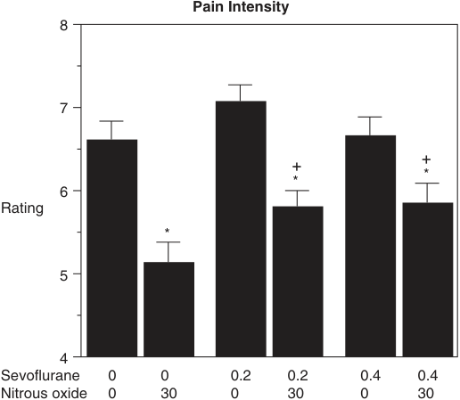

Pain Intensity 8 7 * * 6 Rating * 5 4 Sevoflurane 0 0 0.2 0.2 0.4 0.4 Nitrous oxide 0 30 0 30 0 30 

**Fig. 19.22 Effects of sevoflurane and nitrous oxide on ratings of pain intensity to cold.** _Each bar_ is the mean across all subjects. _Brackets_ represent SEM. *Significant decrease from placebo (0% sevoflurane/0% nitrous oxide) ratings.+ Significant increase from the 0% sevoflurane/30% nitrous oxide ratings. (Redrawn from Janiszewski DJ, Galinkin JL, Klock PA, et al. The effects of subanesthetic concentrations of sevoflurane and nitrous oxide, alone and in combination, on analgesia, mood, and psychomotor performance in healthy volunteers. _Anesth Analg._ 1999;88(5):1149–1154. With permission.)

major concerns related to this gas expansion effect is bowel dilatation.271 However, this observation is based on surgical procedures lasting three hours. The increase in pressure and volume in a closed space due to accumulation of N2O is dependent on the duration of exposure and pressure gradient of N2O. Using N2O for periods of 15–20 minutes during emergence enhances washout of volatile anesthetics and may not lead to clinically relevant bowel dilation.

### Nausea and Vomiting

Postoperative nausea and vomiting (PONV) are common complications of N2O.272 However, a meta- analysis demonstrated that N2O- related PONV is clinically insignificant following a less than one- hour exposure.273 The authors suggested that a minor risk of PONV should not preclude N2O use for a limited time period, such as for minor or ambulatory surgeries. Even though others questioned the methodology of the meta- analysis,274,275 the incidence of PONV is likely associated with the duration of N2O exposure. Therefore, clinicians should consider the beneficial properties of N2O to facilitate the washout of volatile agents and shorten the time of emergence.

### Pulmonary Hypertension

Several studies tested whether N2O worsens pulmonary hypertension with no consistent conclusions due to variation of the experimental protocols. In an earlier study, Konstadt and colleagues demonstrated no significant changes in PA pressure and cardiac output in patients with pulmonary hypertension when 70% N2O versus 70% nitrogen was used (Fig. 19.23).276 The authors concluded that N2O does not have adverse effects on the pulmonary circulation or right ventricular function and may be used with appropriate monitoring in patients

with pulmonary hypertension. This conclusion should be interpreted with caution in patients with elevated PVR, particularly in the presence of right ventricular dysfunction and/or right coronary artery disease.277 Nitrous Oxide Anaesthesia and Cardiac Morbidity After Major Surgery, a randomized controlled trial, demonstrated no difference in the risk of death or cardiovascular complications with N2O.278

### Potential Neurotoxicity of Nitrous Oxide

Prolonged use of N2O can block _N_ - methyl- d- aspartate (NMDA) receptors and result in swelling of neuronal organelles including mitochondria and endoplasmic reticulum,279 presenting as neurotoxicity280 with an acute neuropathy postoperatively.281 Nitrous oxide also increases plasma homocysteine levels282 caused by oxidation of methionine synthase.283 As homocysteine can be easily measured in blood, it is used as a biomarker of N2O- induced modulation of methionine synthase activity. After an 8- hour exposure to N2O, an eightfold increase in blood homocysteine levels was detected.284 Increased homocysteine may be prevented by continuous infusion of vitamin B12, which is an enzyme cofactor of methionine synthase.285 However, only 46% of adolescents treated with vitamin B12 achieved the full recovery of degeneration of the spinal cord following recreational N2O abuse.286

### XENON

Xenon has been suggested as an ideal inhalational anesthetic. It is stable, non- biotransformable, nontoxic, nonflammable, nonirritant, and has a low blood– gas partition coefficient. Because of its specific molecular properties, xenon (Xe129 ) can be hyperpolarized, with ventilation distribution and gas uptake yielding a highly selective tool for a three-dimensional magnetic resonance imaging (3D MRI) evaluation of the lungs.287 Therefore, xenon is used more frequently as an agent for imaging rather than as an inhalational anesthetic. However, its sedative effect is unique and mainly conferred by the inhibition of NMDA receptors in the central nervous system. In healthy young male adults breathing 70% xenon through a face mask, loss of consciousness occurs within 60–120 seconds (Fig. 19.24).288 In 1969, Cullen and colleagues determined the MAC of xenon to be 71% in O2.289 Using more modern measurements, Nakata and colleagues determined the MAC to be 63.1%.290 A meta- analysis concluded that xenon anesthesia provides more stable intraoperative blood pressure, lower heart rate, and faster emergence from anesthesia than volatile agents and propofol, but xenon is associated with a higher risk of PONV.291

### Speed of Emergence and Postoperative Cognitive Dysfunction with Xenon

Compared with volatile anesthetics and propofol, anesthetic emergence is faster with xenon. In intubated patients, it shortens time to extubation by approximately 4 minutes.291 However, the shortening of emergence is not associated with the reduction in length of postanesthesia care unit (PACU) or hospital stays. There is some evidence suggesting that, compared with other general anesthetic agents, xenon is associated with better neurologic outcomes.292 Therefore, it might reduce the occurrence of perioperative

<!-- PDF page 27 -->

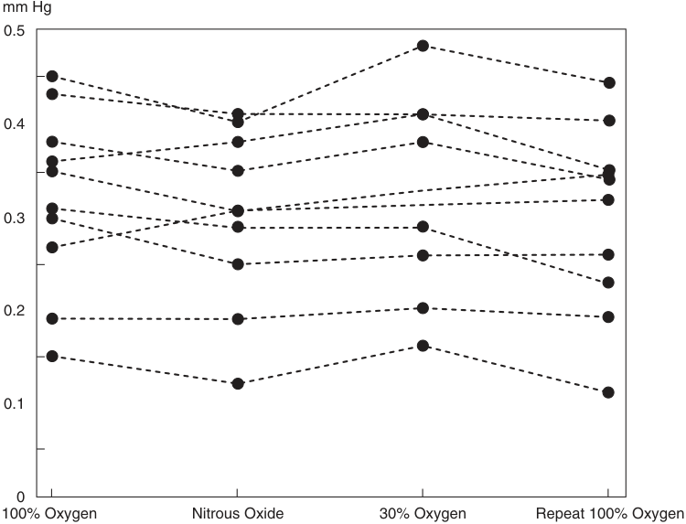

mm Hg 0.5 0.4 0.3 0.2 0.1 0 100% Oxygen Nitrous Oxide 30% Oxygen Repeat 100% Oxygen 

**Fig. 19.23 Individual patient responses in mean pulmonary arterial blood pressure (mm Hg) to nitrous oxide administration.** (Redrawn from Konstadt SN, Reich DL, Thys DM. Nitrous oxide does not exacerbate pulmonary hypertension or ventricular dysfunction in patients with mitral valvular disease. _Can J Anaesth._ 1990;37(6):613–617, with permission.)

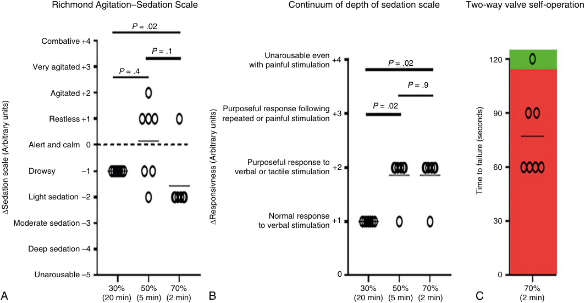

Richmond Agitation–Sedation Scale Continuum of depth of sedation scale Two-way valve self-operation P  = .02 Combative +4 P  = .1 Unarousable even Very agitated +3 P  = .4 with painful stimulation +4 P  = .02 120 P  = .9 Agitated +2 Purposeful response following +3 P  = .02 90 Restless +1 repeated or painful stimulation Alert and calm 0 Purposeful response to +2 60 Drowsy –1 verbal or tactile stimulation Light sedation –2 Moderate sedation –3 to verbal stimulationNormal response +1 30 Deep sedation –4 Unarousable –5 0 0 30% 50% 70% 30% 50% 70% 70% A (20 min) (5 min) (2 min) B (20 min) (5 min) (2 min) C (2 min) Time to failure (seconds) Sedation scale (Arbitrary units)V Responsivness (Arbitrary units)V 

**Fig. 19.24 Sedative properties of acute xenon inhalation.** Degree of sedation as measured by the Richmond Agitation–Sedation scale (A) and sedation by the continuum of depth of sedation (B) at the end of 30%, 50%, and 70% xenon inhalation. Note the times in parentheses on both x- axes correspond to the length on xenon inhalation. Time- to- task failure using a two- way Hans Rudolph valve as an objective indication to self- operated breathing apparatus (C). _Red shaded area_ indicates failure to self- operate that value, which could result in suffocation. _N_ = 7 in study 1 (A and B) and study 2 (C) one- way single- factor ANOVA with follow- up _t_ - tests. (From Lawley JS, Gatterer H, Dias KA, et al. Safety, hemodynamic effects, and detection of acute xenon inhalation: rationale for banning xenon from sport. _J Appl Physiol (1985)._ 2019;127(6):1511–1518.)

<!-- PDF page 28 -->

neurocognitive disorder. A recent study did show that compared with sevoflurane, xenon was associated with faster emergence and with better early postoperative cognitive recovery.293 However, such a benefit did not extend beyond 2 to 3 days post operation.294 Xenon did not show benefits in postoperative cognitive dysfunction in elderly patients compared with desflurane295 or propofol.296 A recent review concluded that xenon does not reduce the incidence of postoperative cognitive dysfunction in cardiac and noncardiac surgery patient population.297 Therefore, its neuroprotective potential in patients undergoing general anesthesia remains debatable.

### Intraoperative Hemodynamics and Postoperative Outcome

Multiple studies have demonstrated that xenon produces a stable intraoperative hemodynamic response. Xenon is a sympathetic stimulant that maintains systolic, diastolic, and mean arterial blood pressures and reduces heart rate.298 Such a favorable hemodynamic profile is unique and in contrast to most volatile anesthetics that reduce systemic vascular resistance and perfusion pressure and increase heart rate. Hofland and colleagues recently demonstrated that compared with total intravenous anesthesia or anesthesia with sevoflurane, xenon reduces postoperative cardiac troponin I release and was noninferior to sevoflurane in low- risk, on- pump coronary artery bypass graft surgery patients.299 However, the benefit of xenon as a cellular protectant observed _in vitro_300 has not yet been demonstrated in human studies.

### Use of Xenon in Critical Care

Sedation in the ICU usually lasts much longer than in the operating room. Xenon could potentially be an ideal agent for sedation in the critical care setting, provided that its neuroprotective effect demonstrated in preclinical studies is confirmed in humans.301 A recent study demonstrated that xenon improves functional outcome and reduces neuronal loss after brain trauma in rats.302 However, there is currently a lack of clinical trials to determine the outcome of sedation with xenon compared to conventional sedation regimens in the ICU. There was no statistically significant difference in neurologic outcomes or mortality at 6 months for victims who had outside hospital cardiac arrest and received hypothermia and xenon inhalation compared to hypothermia alone.303 A recent study by Bedi and colleagues304 demonstrated the safety and feasibility of its use in critical care settings. Compared with a conventional propofol sedation regimen, a similar sedation level can be achieved at xenon concentrations of 28 ± 9.0% (range 9%–62%).305 Patients achieved Ramsay Sedation Score from 3 or 4 to 1 in 173±114 seconds even after sedation of longer than 8 hours.304

### Postoperative Nausea and Vomiting

Xenon is a potent antagonist at the 5- HT3 receptor,306 and could theoretically exert intrinsic antiemetic properties. However, a previous study demonstrated that xenon causes an increase in the risk of PONV by 72% (34.4% vs. 19.9%) when compared with volatile and propofol anesthesia.291 Another randomized trial demonstrates that an increase in the risk of postoperative nausea only occurs in the early phase

of recovery (0–2 hours). Schaefer and colleagues recently assessed the risk of nausea and vomiting among several anesthetic regimens and concluded that xenon causes nausea and vomiting no more frequently than other regimens.307

### Airway Resistance

Xenon has a high density and viscosity. Therefore, when using xenon, airway resistance is greater compared to other inhalational anesthetics at equivalent MAC values. The increase in airway resistance with 70% xenon mixed with 30% O2 compared to 70% nitrogen mixed with 30% O2 was minimal in healthy lungs in a pig model. However, the airway resistance was further increased in a bronchoconstriction model of asthma. Increased airway resistance is an intrinsic property of xenon and probably not a result of bronchoconstriction. The increase in pulmonary airway resistance does not negatively affect oxygenation308 and is not associated with decreased airway diameter.309 Similar results were also reached in a dog model.310 A human study with 33% xenon and 67% O2 showed a significant increase in airway pressure but no alteration in oxygenation was reported.311 Even when using 60% of xenon in healthy adults, peak airway pressure and airway resistance were increased, but transpulmonary pressure was unchanged.312 Therefore, the increase in airway resistance is likely due to the intrinsic property of xenon, and not airway reactivity to xenon.

### Apnea

Xenon is the only inhalational anesthetic that causes a decrease in respiratory rate (Fig. 19.25).185 There are a few case reports describing prolonged apnea occurring in spontaneously breathing patients, even with subanesthetic concentrations of xenon.186

### Comparison of Nitrous Oxide and Xenon

Both N2O and xenon are nonvolatile inhaled anesthetics. Their pharmacodynamics are similar, although the solubility of N2O is higher than that of xenon. The site of action of xenon313,314 and N2O315,316 are believed to be the same: the NMDA receptor. However, imaging studies show that xenon and N2O do not work on the same regions of the brain.317,318 In addition, their sedative319 and analgesic320,321 properties, and their side effects322,323 are not the same. Recently, concern has been raised for air pollution associated with the use of N2O, and whether it should be routinely used in anesthesia. Since N2O has not been shown to be associated with an increased rate of wound infections and its cost- effectiveness is favorable, there is no evidence to support abandoning N2O for routine anesthetic use. On the other hand, since the superiority of xenon over the volatile anesthetics and N2O remains to be determined and its cost is high, routine use of xenon as an anesthetic is not recommended (Table 19.2).324–326

## Summary

Even though the popularity of total intravenous anesthesia has been growing, inhalational anesthetics remain globally the most used agents for general anesthesia. At least in part, this is due to our current thorough understanding of

<!-- PDF page 29 -->

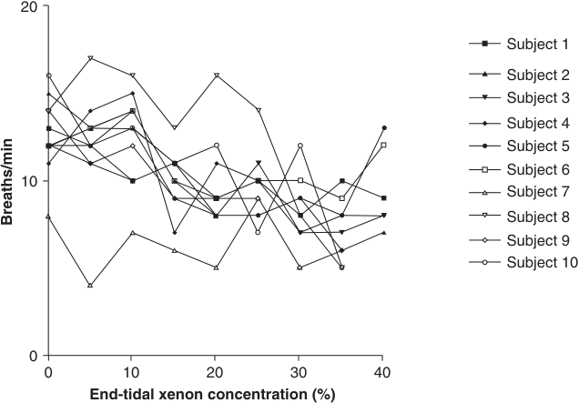

20 Subject 1 Subject 2 Subject 3 Subject 4 Subject 5 Subject 6 10 Subject 7 Subject 8 Subject 9 Subject 10 0 0 10 20 30 40 End-tidal xenon concentration (%) Breaths/min 

**Fig. 19.25 The respiratory rate (breath/min) for individual subjects at increasing end- tidal concentration of xenon in oxygen.** (Redrawn from Bedi A, McCarroll C, Murray JM, et al. The effects of subanaesthetic concentrations of xenon in volunteers. _Anaesthesia_ . 2002;57(3):233–241, with permission.)

**Table 19.2** Comparison of Xenon and Nitrous Oxide

||**Nitrous oxide**|**Xenon**|
|---|---|---|
|Pharmacodynamics|Comparable|Comparable|
|Sedation mechanism|NMDA|NMDA|
|Analgesic effect|Yes|Yes|
|Gas expansion|Yes|No|
|Nausea and vomiting|Yes|Yes|
|Increase in airway resistance|No|Yes|
|Increase in pulmonary vasculature resistance|Maybe|No|
|Diffusion hypoxia|Yes|No|
|MAC value|104%|63.1%–71%|
|MAC awake|63.3%|32.6%|
|Use as a sole anesthetic at ambient pressure at sea level|No|Yes|
|Respiratory rate|No effect|Decrease|
|Maintain hemodynamic stability|Yes|Yes|
|Acute tolerance|Yes|Unknown|
|Cost- efficiency|Favorable|Not favorable at present|

_MAC,_ minimum alveolar concentration; _NMDA, N_ - methyl- d- aspartate.

the pharmacology of these agents and their cost- efficiency. Measurement of the expiratory gas concentrations is readily available in any modern anesthesia machine and therefore the depth of sedation is easier to monitor. Thus, inhalational anesthesia will remain in the mainstream of anesthesia practice for the foreseeable future. Careful selection of a particular agent based on the mechanism of its action and other effects can improve quality of patient care. Such care will continue to be based on an individual’s needs, with consideration of the pharmacokinetics and interactions of these agents with the respiratory system. Further research

into the clinical utility of inhalational agents is essential for advancing the goals of precision medicine in anesthesia care.

### Acknowledgment

This chapter is a consolidation of two chapters in the eighth and ninth editions, Inhaled Anesthetics: Pulmonary Pharmacology and Inhaled Anesthetics: Cardiovascular Pharmacology. The editors and publisher would like to thank the following authors: Neil E. Farber, Eckehard A.E. Stuth, Astrid G. Stucke, Paul S. Pagel, and James L. Blair for their contributions to the prior editions of this work, which have served as the foundation for the current chapter.

### Complete references available online at expertconsult.com.

### References

1.  Caulfield MP, Birdsall NJ. _Pharmacol Rev_ . 1998;50(2):279.

2.  Belmonte KE. _Proc Am Thorac Soc_ . 2005;2(4):297.

3.  Zhang WC, et al. _J Biol Chem_ . 2010;285:5522.

4.  Prakash YS, et al. _Am J Physiol Cell Physiol_ . 1998;274:C1653.

5.  Bogard AS, et al. _J Pharmacol Exp Ther_ . 2011;337:209.

6.  Ito S, et al. _Am J Resp Cell Mol Biol_ . 2008;38:407.

7.  Rho EH, et al. _J Appl Physiol_ . 2002;92:257.

8.  Panula P, et al. _Pharmacol Rev_ . 2015;67(3):601.

9.  Tamaoki J, et al. _Mediators Inflamm_ . 1994;3:125.

10.  Katoh T, Ikeda K. _Can J Anaesth_ . 1994;41:1214.

11.  Emala CW, et al. _Chest_ . 2002;121:722.

12.  Park KW, et al. _Anesth Analg_ . 2000;90:778.

13.  Fehr JJ, et al. _Crit Care Med_ . 2000;28:1884.

14.  Bigot J, et al. _Front Immunol_ . 2020;11:1041.

15.  Brown RH, et al. _Anesthesiology_ . 1993;78:1097.

16.  D’Angelo E, et al. _Anesthesiology_ . 2001;94:604.

17.  Mazzeo AJ, et al. _Anesth Analg_ . 1994;78:948.

18.  Park KW, et al. _Anesthesiology_ . 1997;86:1078.

19.  Habre W, et al. _Anesthesiology_ . 2001;94:348.

20.  Yamakage M, et al. _Anesthesiology_ . 2001;94:683.

21.  Cheng EY, et al. _Anesth Analg_ . 1996;83:162.

22.  Dikmen Y, et al. _Anaesthesia_ . 2003;58:745.

23.  Nyktari VG, et al. _Anesthesiology_ . 2006;104:1202.

24.  Nyktari V, et al. _Br J Anaesth_ . 2011;107(3):454.

25.  Goff MJ, et al. _Anesthesiology_ . 2000;93:404.

26.  Hashimoto Y, et al. _J Cardiothorac Vasc Anesth_ . 1996;10:213.

::: details 原始表格與符號（PDF 第 29 頁）

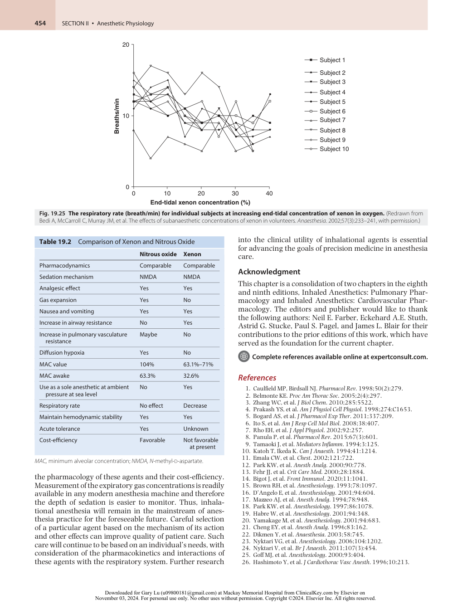

:::

<!-- PDF page 30 -->

27.  Myers CF, et al. _Can J Anaesth_ . 2011;58:1007.

28.  Lele E, et al. _Acta Anaesthesiol Scand_ . 2006;50:1145.

29.  Lele E, et al. _Anesth Analg_ . 2013;116(6):1257.

30.  Satoh J, Yamakage M. _J Anesth_ . 2009;23:620.

31.  Satoh JI, et al. _Br J Anaesth_ . 2009;102:704.

32.  Rooke GA, et al. _Anesthesiology_ . 1997;86:1294.

33.  Correa FCF, et al. _J Appl Physiol_ . 2001;91:803.

34.  Burburan SM, et al. _Anesth Analg_ . 2007;104:631.

35.  Ruiz P, Chartrand D. _Can J Anaesth_ . 2003;50:67.

36.  Arakawa H, et al. _J Asthma_ . 2002;39:77.

37.  Keenan LM, et al. _Fed Pract_ . 2019;36(10):476.

38.  Morimoto N, et al. _Anesth Analg_ . 1994;78:328.

39.  Tobias JD, Hirshman CA. _Anesthesiology_ . 1990;72:105.

40.  Wu RSC, et al. _Anesth Analg_ . 1996;83:238.

41.  Yamamoto K, et al. _Anesthesiology_ . 1993;78:1102.

42.  Yamakage M, et al. _Anesthesiology_ . 2000;93:179. 43. _Lancet_ . 2020;396:S108–S109. https://www.thelancet.com/pbassets/Lancet/gbd/summaries/diseases/asthma.pdf.

44.  Kumeta Y, et al. _Masui_ . 1995;44:396.

45.  Pizov R, et al. _Anesthesiology_ . 1995;82:1111.

46.  Forrest JB, et al. _Anesthesiology_ . 1992;76:3.

47.  Cheney FW, et al. _Anesthesiology_ . 1991;75:932.

48.  Auroy Y, et al. _Anaesthesia_ . 2009;64:366.

49.  Iwasaki S, et al. _Anesthesiology_ . 2006;105:753.

50.  Volta CA, et al. _Anesth Analg_ . 2005;100:348.

51.  Crawford MW, et al. _Anesthesiology_ . 2006;105:1147.

52.  von Ungern- Sternberg BS, et al. _Anesthesiology_ . 2008;108:216.

53.  Kai T, et al. _Anesthesiology_ . 1998;89:1543.

54.  Yu J, Ogawa K, et al. _Anesthesiology_ . 2003;99:646.

55.  Lynch C, et al. _Anesthesiology_ . 2000;92(3):865.

56.  Schaefer MS, et al. _Br J Anaesth_ . 2018;120(6):1394.

57.  Janssen LJ. _Am J Physiol Cell Physiol_ . 1997;272:C1757.

58.  Chen X, et al. _Anesthesiology_ . 2002;96:458.

59.  Yamakage M, et al. _Anesth Analg_ . 2002;94:84.

60.  Pabelick CM, et al. _Anesthesiology_ . 2001;95:207.

61.  Hanazaki M, et al. _Anesthesiology_ . 2001;94:129.

62.  Ay B, et al. _Am J Physiol Lung Cell Mol Physiol_ . 2006;290(2):L278.

63.  Jude JA, et al. _Proc Am Thorac Soc_ . 2008;5(1):15.

64.  Wettschureck N, et al. _J Mol Med (Berl)_ . 2002;80(10):629.

65.  Iizuka K, et al. _Eur J Pharmacol_ . 2000;406(2):273.

66.  Sakihara C, et al. _Anesthesiology_ . 2004;101:120.

67.  Nakayama T, et al. _Anesthesiology_ . 2006;105:313.

68.  Duracher C, et al. _Anesth Analg_ . 2005;101:136.

69.  Gallos G, et al. _Anesthesiology_ . 2009;110:748.

70.  Gallos G, et al. _Am J Physiol Lung Cell Moll Physiol_ . 2011;302:L248.

71.  Park KW, et al. _Anesth Analg_ . 1998;86:646.

72.  Mougdil GC. _Can J Anaesth_ . 1997;44:R77.

73.  Akhtar S, Brull SJ. _Pulm Pharmacol Ther_ . 1998;11:227.

74.  Warner DO, et al. _Anesthesiology_ . 1990;72:1057.

75.  Wiklund CU, et al. _Br J Anaesth_ . 1999;83:422.

76.  Brown RH, et al. _Anesthesiology_ . 1993;78:295.

77.  Berbari NF, et al. _Curr Biol_ . 2009;19:R526.

78.  Czarnecki PG, Shah JV. _Trends Cell Biol_ . 2012;22:201.

79.  Wu J, et al. _Chest_ . 2009;136:561.

80.  Ferkol TW, Leigh MW. _J Pediatr_ . 2012;160:366.

81.  Christopher AB, et al. _Front Pediatr_ . 2014;2:111.

82.  Lindberg S, et al. _Acta Otolaryngol_ . 1997;117:728.

83.  Lund VJ. _Allergy Asthma Proc_ . 1996;17:179.

84.  Keller C, Brimacombe J. _Anesth Analg_ . 1998;86:1280.

85.  Raphael JH, Butt MW. _Br J Anaesth_ . 1997;79:473.

86.  Iida H, et al. _Can J Anaesth_ . 2006;53:242.

87.  Raphael JH, et al. _Br J Anaesth_ . 1996;76:116.

88.  Matsuura S, et al. _Anesth Analg_ . 2006;102:1703.

89.  Gamsu G, et al. _Am Rev Respir Dis_ . 1976;114:673.

90.  Lichtiger M, et al. _Anesthesiology_ . 1975;42:753.

91.  Konrad F, et al. _Anaesthesist_ . 1997;46:403.

92.  Konrad F, et al. _Chest_ . 1994;105:237.

93.  Konrad FX, et al. _J Clin Anesth_ . 1993;5:375.

94.  Rivero DH, et al. _Chest_ . 2001;119:1510.

95.  Molliex S, et al. _Anesthesiology_ . 1994;81:668.

96.  Yang T, et al. _Drug Metabol Drug Interact_ . 2001;18:243.

97.  Patel AB, et al. _Anesth Analg_ . 2002;94:943.

98.  Li Y, et al. _Drug Metabol Drug Interact_ . 2004;20:175.

99.  Rezaiguai- Delclaux S, et al. _Anesthesiology_ . 1998;88:751.

100.  Paugam- Burtz C, et al. _Anesthesiology_ . 2000;93:805.

101.  Malacrida L, et al. _Pulm Pharmacol Ther_ . 2014;28(2):122. 102.  Bilgi M, et al. _Eur J Anaesthesiol_ . 2011;28(4):279.

103.  Sweeney M, et al. _J Appl Physiol_ . 1998;85:2040.

104.  Myers JL, et al. _Ann Thorac Surg_ . 1996;62:1677.

105.  Moncada S. _Pharmacol Rev_ . 1991;43(2):109.

106.  Bredt DS, et al. _Neuron_ . 1991;7(4):615.

107.  Lamas S, et al. _Proc Natl Acad Sci U S A_ . 1992;89(14):6348.

108.  Moncada S, Palmer RM. _Semin Perinatol_ . 1991;15(1):16.

109.  Ichinose F. _Circulation_ . 2004;109(25):3106.

110.  Pasero D, et al. _Minerva Anestesiol_ . 2010;76(5):353.

111.  Lian TY. _Drug Des Dev Ther_ . 2017;11:1195.

112.  Galvin I, et al. _Br J Anaesth_ . 2007;98:420.

113.  Arai TJ, et al. _J Appl Physiol_ . 2009;106:1057.

114.  Adding LC, et al. _Acta Anaesthesiol Scand_ . 1999;167:167.

115.  Yamamoto Y, et al. _J Appl Physiol_ . 2001;91:1121.

116.  Robertson TP, et al. _Cardiovasc Res_ . 2001;50:145.

117.  Morio Y, McMurtry IF. _J Appl Physiol_ . 2002;92:527.

118.  Evans AM, et al. _Curr Opin Anesthesiol_ . 2011;24:13.

119.  Firth AL, et al. _Am J Physiol Lung Cell Mol Physiol_ . 2008;295:L61.

120.  Nagendran J, et al. _Curr Opin Anesthesiol_ . 2006;19:34.

121.  Wang L, et al. _J Clin Invest_ . 2012;122(11):4218.

122.  Goldenberg NM. _Anesthesiology_ . 2015;122(6):1338.

123.  Lumb AB, Slinger P. _Anesthesiology_ . 2015;122(4):932.

124.  Akata T. _Anesthesiology_ . 2007;106:365.

125.  Gambone LM, et al. _Am J Physiol Heart Circ Physiol_ . 1997;272:H290. 126.  Seki S, et al. _Anesthesiology_ . 1997;86:923.

127.  Nakayama M, et al. _Anesthesiology_ . 1998;88:1023.

128.  Giesen LA, et al. _Cardiol Young_ . 2015;25(2):368.

129.  Olschewski A. _Adv Exp Med Biol_ . 2010;661:459.

130.  Su JY, Vo AC. _Anesthesiology_ . 2002;97:207.

131.  Zhong L, Su JY. _Anesthesiology_ . 2002;96:148.

132.  Loer SA, et al. _Anesthesiology_ . 1995;83(3):552.

133.  Lennon PF, Murray PA. _Anesthesiology_ . 1996;84:404.

134.  Johns RA. _Anesthesiology_ . 1993;79:1381.

135.  Jing M, et al. _Life Sci_ . 1995;56(1):19.

136.  Gambone LM, et al. _Anesthesiology_ . 1997;86:936.

137.  Liu R, et al. _Anesthesiology_ . 2001;95:939.

138.  Eisenkraft JB. _Br J Anaesth_ . 1990;65:63.

139.  Lesitsky MA, et al. _Anesthesiology_ . 1998;89:1501.

140.  Schwarzkopf K, et al. _Anesth Analg_ . 2005;100:335.

141.  Schwarzkopf K, et al. _J Cardiothorac Vasc Anesth_ . 2003;17:73.

142.  Karzai W, et al. _Anesth Analg_ . 1999;89:215.

143.  Schwarzkopf K, et al. _Anesth Analg_ . 2001;93:1434.

144.  Kleinsasser A, et al. _Anesthesiology_ . 2001;95:1422.

145.  Nyren S, et al. _Anesthesiology_ . 2010;113:1370.

146.  Radke OC, et al. _Anesthesiology_ . 2012;116:1186.

147.  Bindlsev L, et al. _Acta Anaesthesiol Scand_ . 1981;25:360.

148.  Nishiwaki K, et al. _Am J Physiol Heart Circ Physiol_ . 1992;262:H1331.

149.  Abe K, et al. _Anesth Analg_ . 1998;86:266.

150.  Reid CW, et al. _J Cardiothorac Vasc Anesth_ . 1996;10:860.

151.  Beck DH, et al. _Br J Anaesth_ . 2001;86:38.

152.  Pruszkowski O, et al. _Br J Anaesth_ . 2007;98:539.

153.  Kellow NH, et al. _Br J Anaesth_ . 1995;75:578.

154.  Abe K, et al. _Anesth Analg_ . 1998;87:1164.

155.  Benumof JL, et al. _Anesthesiology_ . 1987;67:910.

156.  Pagel P, et al. _Anesth Analg_ . 1998;87:800.

157.  Carlsson AJ, et al. _Anesthesiology_ . 1987;66:312.

158.  Ng A, Swanevelder J. _Br J Anaesth_ . 2011;106:761.

159.  Karzai W, Schwarzkopf K. _Anesthesiology_ . 2009;110:1402.

160.  Teppema LJ, Baby S. _Respir Physiol Neurobiol_ . 2011;177:80.

161.  Stuth EAE, et al. In: Denham S, Ward ADLJT, eds. _Pharmacology and Pathophysiology of the Control of Breathing_ . Tayor and Francis Group; 2005:571.

162.  Stuth EA, et al. _Respir Physiol Neurobiol_ . 2008;164:151.

163.  Sirois JE, et al. _J Neurosci_ . 2000;201:6347.

164.  Sirois JE, et al. _J Physiol_ . 2002;541:717.

165.  Trochet D, et al. _Am J Respir Crit Care Med_ . 2008;177:906.

166.  Coghlan M, Richards E. _ER Trafficking_ . 2018;8(1):5275.

167.  Meylemans A, et al. _Acta Neurol Belg_ . 2021;121(1):23.

168.  Forster HV, Smith CA. _J Appl Physiol_ . 2010;108:989.

169.  Nattie E, et al. _J Appl Physiol_ . 2011;110:1.

170.  Erlichman JS, et al. _Respir Physiol Neurobiol_ . 2010;173:305.

171.  Pandit JJ. _Anaesthesia_ . 2002;57:632.

172.  Pandit JJ. _Anaesthesia_ . 2005;60:461.

173.  Baugh R, et al. _Otolaryngol Head Neck Surg_ . 2013;148(5):867.

174.  Abdala AP, et al. _J. Physiol._ 2015;593(14):3033.

175.  Rybak IA, et al. _J Neurophysiol_ . 2008;100:1770.

176.  Smith CA, et al. _Respir Physiol Neurobiol_ . 2010;173:288.

177.  von Euler US LG, Zotterman Y. _Scand Arch Physiol_ . 1939;83:132.

<!-- PDF page 31 -->

178.  BuSha BF, et al. _J Appl Physiol_ . 2002;93:903. 179.  Lazarenko RM, et al. _J Neurosci_ . 2010;30:7691. 180.  Haxhiu MA, et al. _Respir Physiol_ . 1987;70(2):183. 181.  Horner RL. _Respir Physiol Neurobiol_ . 2008;164:179. 182.  Begle RL, et al. _Am Rev Respir Dis_ . 1990;141(4 Pt 1):854. 183.  Tagaito Y, et al. _J Appl Physiol_ . 2007;103(4):1379. 184.  Hornbein TF, et al. _Anesth Analg_ . 1982;61(7):553. 185.  Bedi A, et al. _Anaesthesia_ . 2002;57(3):233. 186.  Cormack JR, et al. _A A Case Rep_ . 2017;8(4):90. 187.  Ballantyne D, Scheid P. _Adv Exp Med Biol_ . 2001;499:17. 188.  Ballantyne D, Scheid P. _Respir Physiol_ . 2001;129:5. 189.  Branco LG, et al. _J Appl Physiol_ . 2009;106:1467. 190.  Heeringa J, et al. _Respir Physiol_ . 1979;37:365. 191.  Knill RL, Gelb AW. _Anesthesiology_ . 1978;49:244. 192.  Kammer T, et al. _Anesthesiology_ . 2002;97:1416. 193.  Barnard P, et al. _J Appl Physiol_ . 1987;63:685. 194.  Dahan A, Teppema L. _Br J Anaesth_ . 1999;83:199. 195.  Sarton E, et al. _Anesthesiology_ . 1999;90:1288. 196.  van den Elsen MJLJ, et al. _Anesthesiology_ . 1994;81:860. 197.  Hickey RF, et al. _Anesthesiology_ . 1971;35:32.

198.  Nakayama H, et al. _Am J Respir Crit Care Med_ . 2002;165:1251. 199.  West JB. _Respir Physiol_ . 1983;52(3):265. 200.  Dahan A, et al. _Anesthesiology_ . 1994;80:727. 201.  Chung F, Liao P. _Anesthesiology_ . 2014;120(2):287. 202.  Chung F, et al. _Anesthesiology_ . 2014;120(2):299. 203.  Sarton E, et al. _Anesthesiology_ . 1996;85:295. 204.  Pandit JJ, et al. _Anesthesiology_ . 2004;101(6):1409. 205.  Warner DO. _Anesthesiology_ . 1996;84(2):309. 206.  Warner DO, et al. _Anesthesiology_ . 1995;82:6. 207.  Warner DO, Warner MA. _Anesthesiology_ . 1995;82:20. 208.  Gauda EB, et al. _J Appl Physiol_ . 1994;76:2656.

209.  Wheatley JR, et al. _J Appl Physiol_ . 1991;70:2242.

210.  Schwartz AR, et al. _Am J Respir Crit Care Med_ . 1998;157(4 Pt 1):1051. 211.  Kuna ST, et al. _Med Clin North Am_ . 1985;69(6):1221. 212.  Erb TO, et al. _Paediatr Anaesth_ . 2017;27(3):282.

213.  Lerman J, et al. _Paediatr Anaesth_ . 2010;20:495. 214.  Ulevitch RJ. _Adv Immunol_ . 1993;53:267.

215.  Chow JC, et al. _J Biol Chem_ . 1999;274(16):10689. 216.  Marini JJ, Evans TW. _Intensive Care Med_ . 1998;24(8):878. 217.  Meyrick B, et al. _Prog Clin Biol Res_ . 1989;308:91.

218.  Brigham KL. _Am Rev Respir Dis_ . 1987;136(3):785.

219.  Bulger EM, Maier RV. _Crit Care Med_ . 2000;28(suppl 4):N27.

220.  Ermert L, et al. _Am J Physiol Lung Cell Mol Physiol_ . 2000;278(4):L744. 221.  Quinn JV, Slotman GJ. _Crit Care Med_ . 1999;27(11):2485. 222.  Langleben D, et al. _Am Rev Respir Dis_ . 1993;148(6 Pt 1):1646. 223.  O’Grady NP, et al. _Am J Respir Crit Care Med_ . 2001;163(7):1591. 224.  Bachofen M, Weibel ER. _Clin Chest Med_ . 1982;3(1):35. 225.  Kumar A, et al. _Am J Physiol_ . 1999;276(1 Pt 2):R265. 226.  McQuaid KE, Keenan AK. _Exp Physiol_ . 1997;82(2):369.

227.  Salvemini D. _Cell Mol Life Sci_ . 1997;53(7):576. 228.  Ignarro LJ, et al. _Proc Natl Acad Sci U S A_ . 1993;90(17):8103. 229.  Weissmann N, et al. _Am J Physiol Lung Cell Mol Physiol_ . 2000; 279(4):L683.

230.  Singh S, Evans TW. _Eur Respir J_ . 1997;10(3):699. 231.  Westendorp RG, et al. _J Vasc Res_ . 1994;31(1):42.

232.  Suter D, et al. _Anesth Analg_ . 2007;104(3):638.

233.  Takala RS, et al. _Acta Anaesthesiol Scand_ . 2006;50(2):163. 234.  Giraud O, et al. _Anesthesiology_ . 2003;98(1):74. 235.  Voigtsberger S, et al. _Anesthesiology_ . 2009;111(6):1238. 236.  Schlapfer M, et al. _Clin Exp Immunol_ . 2012;168(1):125. 237.  Du G, et al. _Anesth Analg_ . 2017;124(5):1555. 238.  Bedirli N, et al. _J Surg Res_ . 2012;178(1):e17. 239.  Dong X, et al. _Exp Lung Res_ . 2013;39(7):295. 240.  Beitler JR, et al. _Clin Chest Med_ . 2016;37(4):633. 241.  Wagner J, et al. _PLoS One_ . 2018;13(2):e0192896. 242.  Faller S, et al. _Anesth Analg_ . 2012;114(4):747. 243.  Englert JA, et al. _Anesthesiology_ . 2015;123(2):377. 244.  Strosing KM, et al. _Anesth Analg_ . 2016;123(1):143. 245.  Pak O, et al. _Adv Exp Med Biol_ . 2017;967:195. 246.  Liu R, et al. _Anesth Analg_ . 1999;89(3):561. 247.  Fujinaga T, et al. _Transplantation_ . 2006;82:1168. 248.  Casanova J, et al. _Anesth Analg_ . 2011;113:742. 249.  Ohsumi A, et al. _Ann Thorac Surg_ . 2017;103(5):1578. 250.  Oshima Y, et al. _SpringerPlus_ . 2016;5(1):2031. 251.  Martens A, et al. _J Surg Res_ . 2016;201(1):44.

252.  Wrigge H, et al. _Anesthesiology_ . 2000;93:1413.

253.  De Conno E, et al. _Anesthesiology_ . 2009;110:1316.

254.  Schilling T, et al. _Anesthesiology_ . 2011;115:65.

255.  Sugasawa Y, et al. _J Anesth_ . 2012;26:62.

256.  Uhlig C, et al. _Anesthesiology_ . 2016;124(6):1230.

257.  Beck- Schimmer B, et al. _Anesthesiology_ . 2016;125(2):313.

258.  Koksal GM, et al. _Eur J Anaesthesiol_ . 2004;21(3):217.

259.  Jabaudon M, et al. _Am J Respir Crit Care Med_ . 2017;195(6):792.

260.  Bellgardt M, et al. _Eur J Anaesthesiol_ . 2016;33(1):6.

261.  Wilson KE. _Dent Update_ . 2013;40(10):822, 826.

262.  Likis FE, et al. _Anesth Analg_ . 2014;118(1):153.

263.  Goto T. _Anesthesiology_ . 2000;93(5):1188.

264.  Mashour GA, Avidan MS. _Br J Anaesth_ . 2015;115(suppl 1):i20. 265.  Mathews DM, et al. _Anesth Analg_ . 2008;106(1).

266.  Lee LH, et al. _Anesthesiology_ . 2005;102(2):398.

267.  Janiszewski DJ, et al. _Anesth Analg_ . 1999;88(5):1149.

268.  Berkowitz BA, et al. _Anesthesiology_ . 1979;51(4):309.

269.  Berkowitz BA, et al. _J Pharmacol Exp Ther_ . 1977;203(3):539.

270.  Ramsay DS, et al. _Pain_ . 2005;114(1–2):19.

271.  Akca O, et al. _Acta Anaesthesiol Scand_ . 2004;48(7):894.

272.  Fernandez- Guisasola J, et al. _Anaesthesia_ . 2010;65(4):379–387. 273.  Peyton PJ, Peyton PJ. _Anesthesiology_ . 2014;120(5):1137. 274.  Pace NL. _Anesthesiology_ . 2014;121(6):1356.

275.  Zhou L, Chen C, Yu H. _Anesthesiology_ . 2014;121(6):1356. 276.  Konstadt SN, et al. _Can J Anaesth_ . 1990;37(6):613.

277.  Schulte- Sasse U, et al. _Anesthesiology_ . 1982;57(1):9.

278.  Beattie WS, et al. _Anesth Analg_ . 2018;127(5):1118.

279.  Jevtovic- Todorovic V, et al. _Br J Anaesth_ . 2013;111(2):143.

280.  Savage S, Ma D. _Brain Sci_ . 2014;4(1):73.

281.  Morris N, et al. _Muscle Nerve_ . 2015;51(4):614.

282.  Myles PS, et al. _Anesthesiology_ . 2008;109(4):657.

283.  Drummond JT, Matthews RG. _Biochemistry_ . 1994;33(12):3742. 284.  Nagele P, et al. _Anesth Analg_ . 2011;113(4):843. 285.  Kiasari AZ, et al. _Oman Med J_ . 2014;29(3):194.

286.  Lan SY, et al. _Brain Dev_ . 2019;41(5):428.

287.  Mugler JP, et al. _Proc Natl Acad Sci U S A_ . 2010;107(50):21707. 288.  Lawley JS, et al. _J Appl Physiol_ . 2019;127(6):1511. 289.  Cullen SC. _Anesthesiology_ . 1969;31(4):305.

290.  Nakata Y, et al. _Anesthesiology_ . 2001;94(4):611.

291.  Law LS. _Anesth Analg_ . 2016;122(3):678.

292.  Law LS, et al. _Can J Anaesth_ . 2018;65(9):1041.

293.  Bronco A, et al. _Eur J Anaesthesiol_ . 2010;27(10):912.

294.  Cremer J, et al. _Med Gas Res_ . 2011;1(1):9.

295.  Coburn M, et al. _Br J Anaesth_ . 2007;98(6):756.

296.  Hocker J, et al. _Anesthesiology_ . 2009;110(5):1068.

297.  Nair AS, et al. _Med Gas Res_ . 2021;11(3):110.

298.  Neukirchen M, et al. _Br J Anaesth_ . 2012;109(6):887. 299.  Hofland J, et al. _Anesthesiology_ . 2017;127(6):918. 300.  Petzelt C, et al. _BMC Neurosci_ . 2004;5:55.

301.  Sacchetti ML. _Stroke_ . 2008;39(6):1659.

302.  Campos- Pires R, et al. _Crit Care_ . 2020;24(1):667.

303.  Laitio R, et al. _JAMA_ . 2016;315(11):1120. 304.  Bedi A, et al. _Crit Care Med_ . 2003;31(10):2470.

305.  Roehl AB, et al. _Eur J Anaesthesiol_ . 2010;27(7):660. 306.  Suzuki T, et al. _Anesthesiology_ . 2002;96(3):699.

307.  Schaefer MS, et al. _Br J Anaesth_ . 2015;115(1):61.

308.  Calzia E, et al. _Anesthesiology_ . 1999;90(3):829.

309.  Baumert JH, et al. _Br J Anaesth_ . 2002;88(4):540.

310.  Zhang P. _Can J Anaesth_ . 1995;42(6):547.

311.  Rueckoldt H, et al. _Acta Anaesthesiol Scand_ . 1999;43(10):1060. 312.  Schaefer MS, et al. _Br J Anaesth_ . 2018;120(6):1394.

313.  Dickinson R, et al. _Anesthesiology_ . 2007;107(5):756.

314.  Kratzer S, et al. _Anesthesiology_ . 2012;116(3):673.

315.  Nagele P, et al. _Proc Natl Acad Sci U S A_ . 2004;101(23):8791. 316.  Richardson KJ, et al. _J Pharmacol Exp Ther_ . 2015;352(1):156. 317.  Hagen T, et al. _J Comput Assist Tomogr_ . 1999;23(2):257.

318.  Reinstrup P, et al. _Anesthesiology_ . 1994;81(2):396.

319.  Yagi M, et al. _Br J Anaesth_ . 1995;74(6):670.

320.  Petersen- Felix S, et al. _Br J Anaesth_ . 1998;81(5):742.

321.  Utsumi J, et al. _Anesth Analg_ . 1997;84(6):1372.

322.  Yonas H. _J Comput Assist Tomogr_ . 1981;5(4):591.

323.  Kamp HD. _Klin Anasthesiol Intensivther_ . 1993;42:17.

324.  de Vasconcellos K, Sneyd JR. _Br J Anaesth_ . 2013;111(6):877.

325.  Imberger G, et al. _Br J Anaesth_ . 2014;112(3):410.

326.  Myles PS, et al. _Lancet_ . 2014;384(9952):1446.

<!-- PDF page 32 -->

### References

1.  Caulfield MP, Birdsall NJ. International Union of Pharmacology. XVII. Classification of muscarinic acetylcholine receptors. _Pharmacol Rev_ . 1998;50(2):279–290.

2.  Belmonte KE. Cholinergic pathways in the lungs and anticholinergic therapy for chronic obstructive pulmonary disease. _Proc Am Thorac Soc_ . 2005;2(4):297–304; discussion 311–312.

3.  Zhang WC, Peng YJ, Zhang GS, et al. Myosin light chain kinase is necessary for tonic airway smooth muscle contraction. _J Biol Chem_ . 2010;285(8):5522–5531.

4.  Prakash YS, Kannan MS, Walseth TF, Sieck GC. Role of cyclic ADPribose in the regulation of [Ca2+ ]i in porcine tracheal smooth muscle. _Am J Physiol_ . 1998;274(6 Pt 1):C1653–1660.

5.  Bogard AS, Xu C, Ostrom RS. Human bronchial smooth muscle cells express adenylyl cyclase isoforms 2, 4, and 6 in distinct membrane microdomains. _J Pharmacol Exp Ther_ . 2011;337(1):209–217.

6.  Ito S, Kume H, Naruse K, et al. A novel Ca2+ influx pathway activated by mechanical stretch in human airway smooth muscle cells. _Am J Respir Cell Mol Biol_ . 2008;38(4):407–413.

7.  Rho EH, Perkins WJ, Lorenz RR, et al. Differential effects of soluble and particulate guanylyl cyclase on Ca(2+) sensitivity in airway smooth muscle. _J Appl Physiol_ . 2002;92(1):257–263.

8.  Panula P, Chazot PL, Cowart M, et al. International union of basic and clinical pharmacology. XCVIII. Histamine receptors. _Pharmacol Rev_ . 2015;67(3):601–655.

9.  Tamaoki J, Chiyotani A, Tagaya E, et al. Histamine N- methyltransferase modulates human bronchial smooth muscle contraction. _Mediators Inflamm_ . 1994;3(2):125–129.

10.  Katoh T, Ikeda K. A comparison of sevoflurane with halothane, enflurane, and isoflurane on bronchoconstriction caused by histamine. _Can J Anaesth_ . 1994;41(12):1214–1219.

11.  Emala CW, McQuitty CK, Eleff SM, et al. Asthma, allergy, and airway hyperresponsiveness are not linked to the beta(2)- adrenoceptor gene. _Chest_ . 2002;121(3):722–731.

12.  Park KW, Sato K, Dai HB, et al. Epithelium- dependent bronchodilatory activity is preserved in pig bronchioles after normothermic cardiopulmonary bypass. _Anesth Analg_ . 2000;90(4):778–783.

13.  Fehr JJ, Hirshman CA, Emala CW. Cellular signaling by the potent bronchoconstrictor endothelin- 1 in airway smooth muscle. _Crit Care Med_ . 2000;28(6):1884–1888.

14.  Bigot J, Guillot L, Guitard J, et al. Bronchial epithelial cells on the front line to fight lung infection- causing _Aspergillus fumigatus_ . _Front Immunol_ . 2020;11:1041.

15.  Brown RH, Zerhouni EA, Hirshman CA. Comparison of low concentrations of halothane and isoflurane as bronchodilators. _Anesthesiology_ . 1993;78(6):1097–1101.

16.  D’Angelo E, Calderini IS, Tavola M. The effects of CO2 on respiratory mechanics in anesthetized paralyzed humans. _Anesthesiology_ . 2001;94(4):604–610.

17.  Mazzeo AJ, Cheng EY, Bosnjak ZJ, et al. Differential effects of desflurane and halothane on peripheral airway smooth muscle. _Br J Anaesth_ . 1996;76(6):841–846.

18.  Park KW, Dai HB, Lowenstein E, et al. Isoflurane- and halothanemediated dilation of distal bronchi in the rat depends on the epithelium. _Anesthesiology_ . 1997;86(5):1078–1087; discussion 1023A–1024A.

19.  Habre W, Petak F, Sly PD, et al. Protective effects of volatile agents against methacholine- induced bronchoconstriction in rats. _Anesthesiology_ . 2001;94(2):348–353.

20.  Yamakage M, Chen X, Tsujiguchi N, et al. Different inhibitory effects of volatile anesthetics on T- and L- type voltage- dependent Ca2+ channels in porcine tracheal and bronchial smooth muscles. _Anesthesiology_ . 2001;94(4):683–693.

21.  Cheng EY, Mazzeo AJ, Bosnjak ZJ, et al. Direct relaxant effects of intravenous anesthetics on airway smooth muscle. _Anesth Analg_ . 1996;83(1):162–168.

22.  Dikmen Y, Eminoglu E, Salihoglu Z, Demiroluk S. Pulmonary mechanics during isoflurane, sevoflurane and desflurane anaesthesia. _Anaesthesia_ . 2003;58(8):745–748.

23.  Nyktari VG, Papaioannou AA, Prinianakis G, et al. Effect of the physical properties of isoflurane, sevoflurane, and desflurane on pulmonary resistance in a laboratory lung model. _Anesthesiology_ . 2006;104(6):1202–1207.

24.  Nyktari V, Papaioannou A, Volakakis N, et al. Respiratory resistance during anaesthesia with isoflurane, sevoflurane, and desflurane: a randomized clinical trial. _Br J Anaesth_ . 2011;107(3):454–461.

25.  Goff MJ, Arain SR, Ficke DJ, et al. Absence of bronchodilation during desflurane anesthesia: a comparison to sevoflurane and thiopental. _Anesthesiology_ . 2000;93(2):404–408.

26.  Hashimoto Y, Hirota K, Ohtomo N, et al. In vivo direct measurement of the bronchodilating effect of sevoflurane using a superfine fiberoptic bronchoscope: comparison with enflurane and halothane. _J Cardiothorac Vasc Anesth_ . 1996;10(2):213–216.

27.  Myers CF, Fontao F, Janosi TZ, et al. Sevoflurane and desflurane protect cholinergic- induced bronchoconstriction of hyperreactive airways in rabbits. _Can J Anaesth_ . 2011;58(11):1007–1015.

28.  Lele E, Petak F, Fontao F, et al. Protective effects of volatile agents against acetylcholine- induced bronchoconstriction in isolated perfused rat lungs. _Acta Anaesthesiol Scand_ . 2006;50(9):1145–1151.

29.  Lele E, Petak F, Carnesecchi S, et al. The protective effects of volatile anesthestics against the bronchoconstriction induced by an allergic reaction in sensitized rabbit pups. _Anesth Analg_ . 2013;116(6):1257–1264.

30.  Satoh J, Yamakage M. Desflurane induces airway contraction mainly by activating transient receptor potential A1 of sensory C- fibers. _J Anesth_ . 2009;23(4):620–623.

31.  Satoh JI, Yamakage M, Kobayashi T, et al. Desflurane but not sevoflurane can increase lung resistance via tachykinin pathways. _Br J Anaesth_ . 2009;102(5):704–713.

32.  Rooke GA, Choi JH, Bishop MJ. The effect of isoflurane, halothane, sevoflurane, and thiopental/nitrous oxide on respiratory system resistance after tracheal intubation. _Anesthesiology_ . 1997;86(6):1294–1299.

33.  Correa FC, Ciminelli PB, Falcao H, et al. Respiratory mechanics and lung histology in normal rats anesthetized with sevoflurane. _J Appl Physiol_ . 2001;91(2):803–810.

34.  Burburan SM, Xisto DG, Ferreira HC, et al. Lung mechanics and histology during sevoflurane anesthesia in a model of chronic allergic asthma. _Anesth Analg_ . 2007;104(3):631–637.

35.  Ruiz P, Chartrand D. The effect of isoflurane 0.6% on respiratory mechanics in anesthetized- paralyzed humans is not increased at concentrations of 0.9% and 1.2%. _Can J Anaesth_ . 2003;50(1):67–70.

36.  Arakawa H, Takizawa T, Tokuyama K, et al. Efficacy of inhaled anticholinergics and anesthesia in treatment of a patient in status asthmaticus. _J Asthma_ . 2002;39(1):77–80.

37.  Keenan LM, Hoffman TL. Refractory status asthmaticus: treatment with sevoflurane. _Fed Pract_ . 2019;36(10):476–479.

38.  Morimoto N, Yamamoto K, Jones KA, Warner DO. Halothane and pertussis toxin- sensitive G proteins in airway smooth muscle. _Anesth Analg_ . 1994;78(2):328–334.

39.  Tobias JD, Hirshman CA. Attenuation of histamine- induced airway constriction by albuterol during halothane anesthesia. _Anesthesiology_ . 1990;72(1):105–110.

40.  Wu RS, Wu KC, Wong TK, et al. Isoflurane anesthesia does not add to the bronchodilating effect of a beta 2- adrenergic agonist after tracheal intubation. _Anesth Analg_ . 1996;83(2):238–241.

41.  Yamamoto K, Morimoto N, Warner DO, et al. Factors influencing the direct actions of volatile anesthetics on airway smooth muscle. _Anesthesiology_ . 1993;78(6):1102–1111.

42.  Yamakage M, Tsujiguchi N, Hattori J, et al. Low- temperature modification of the inhibitory effects of volatile anesthetics on airway smooth muscle contraction in dogs. _Anesthesiology_ . 2000;93(1):179–188.

43.  Global Health Metrics. Asthma- Level 3 cause. _Lancet_ . 2020;396:S108–S109. https://www.thelancet.com/pb- assets/Lan cet/gbd/summaries/diseases/asthma.pdf.

44.  Kumeta Y, Hattori A, Mimura M, et al. [A survey of perioperative bronchospasm in 105 patients with reactive airway disease]. _Masui_ . 1995;44(3):396–401.

45.  Pizov R, Brown RH, Weiss YS, et al. Wheezing during induction of general anesthesia in patients with and without asthma. A randomized, blinded trial. _Anesthesiology_ . 1995;82(5):1111–1116.

46.  Forrest JB, Rehder K, Cahalan MK, Goldsmith CH. Multicenter study of general anesthesia. III. Predictors of severe perioperative adverse outcomes. _Anesthesiology_ . 1992;76(1):3–15.

47.  Cheney FW, Posner KL, Caplan RA. Adverse respiratory events infrequently leading to malpractice suits. A closed claims analysis. _Anesthesiology_ . 1991;75(6):932–939.

<!-- PDF page 33 -->

48.  Auroy Y, Benhamou D, Pequignot F, et al. Mortality related to anaesthesia in France: analysis of deaths related to airway complications. _Anaesthesia_ . 2009;64(4):366–370.

49.  Iwasaki S, Yamakage M, Satoh J, Namiki A. Different inhibitory effects of sevoflurane on hyperreactive airway smooth muscle contractility in ovalbumin- sensitized and chronic cigarette- smoking guinea pig models. _Anesthesiology_ . 2006;105(4):753–763.

50.  Volta CA, Alvisi V, Petrini S, et al. The effect of volatile anesthetics on respiratory system resistance in patients with chronic obstructive pulmonary disease. _Anesth Analg_ . 2005;100(2):348–353.

51.  Crawford MW, Arrica M, Macgowan CK, Yoo SJ. Extent and localization of changes in upper airway caliber with varying concentrations of sevoflurane in children. _Anesthesiology_ . 2006;105(6):1147– 1152; discussion 1145A.

52.  von Ungern- Sternberg BS, Saudan S, Petak F, et al. Desflurane but not sevoflurane impairs airway and respiratory tissue mechanics in children with susceptible airways. _Anesthesiology_ . 2008;108(2):216– 224.

53.  Kai T, Jones KA, Warner DO. Halothane attenuates calcium sensitization in airway smooth muscle by inhibiting G- proteins. _Anesthesiology_ . 1998;89(6):1543–1552.

54.  Yu J, Ogawa K, Tokinaga Y, Hatano Y. Sevoflurane inhibits guanosine 5’- [gamma- thio]triphosphate- stimulated, Rho/Rhokinase- mediated contraction of isolated rat aortic smooth muscle. _Anesthesiology_ . 2003;99(3):646–651.

55.  Lynch C, Baum J, Tenbrinck R. Xenon anesthesia. _Anesthesiology_ . 2000;92(3):865–868.

56.  Schaefer MS, Treschan TA, Gauch J, et al. Influence of xenon on pulmonary mechanics and lung aeration in patients with healthy lungs. _Br J Anaesth_ . 2018;120(6):1394–1400.

57.  Janssen LJ. T- type and L- type Ca2+ currents in canine bronchial smooth muscle: characterization and physiological roles. _Am J Physiol_ . 1997;272(6 Pt 1):C1757–1765.

58.  Chen X, Yamakage M, Namiki A. Inhibitory effects of volatile anesthetics on K+ and Cl− channel currents in porcine tracheal and bronchial smooth muscle. _Anesthesiology_ . 2002;96(2):458–466.

59.  Yamakage M, Chen X, Kimura A, et al. The repolarizing effects of volatile anesthetics on porcine tracheal and bronchial smooth muscle cells. _Anesth Analg_ . 2002;94(1):84–88.

60.  Pabelick CM, Prakash YS, Kannan MS, et al. Effects of halothane on sarcoplasmic reticulum calcium release channels in porcine airway smooth muscle cells. _Anesthesiology_ . 2001;95(1):207–215.

61.  Hanazaki M, Jones KA, Perkins WJ, Warner DO. Halothane increases smooth muscle protein phosphatase in airway smooth muscle. _Anesthesiology_ . 2001;94(1):129–136.

62.  Ay B, Iyanoye A, Sieck GC, et al. Cyclic nucleotide regulation of store- operated Ca2+ influx in airway smooth muscle. _Am J Physiol Lung Cell Mol Physiol_ . 2006;290(2):L278–L283.

63.  Jude JA, Wylam ME, Walseth TF, Kannan MS. Calcium signaling in airway smooth muscle. _Proc Am Thorac Soc_ . 2008;5(1):15–22.

64.  Wettschureck N, Offermanns S. Rho/Rho- kinase mediated signaling in physiology and pathophysiology. _J Mol Med (Berl)._ 2002;80(10):629–638.

65.  Iizuka K, Shimizu Y, Tsukagoshi H, et al. Evaluation of Y- 27632, a rho- kinase inhibitor, as a bronchodilator in guinea pigs. _Eur J Pharmacol_ . 2000;406(2):273–279.

66.  Sakihara C, Perkins WJ, Warner DO, Jones KA. Anesthetics inhibit acetylcholine- promoted guanine nucleotide exchange of heterotrimeric G proteins of airway smooth muscle. _Anesthesiology_ . 2004;101(1):120–126.

67.  Nakayama T, Penheiter AR, Penheiter SG, et al. Differential effects of volatile anesthetics on M3 muscarinic receptor coupling to the Galphaq heterotrimeric G protein. _Anesthesiology_ . 2006;105(2):313– 324.

68.  Duracher C, Blanc FX, Gueugniaud PY, et al. The effects of isoflurane on airway smooth muscle crossbridge kinetics in Fisher and Lewis rats. _Anesth Analg_ . 2005;101(1):136–142.

69.  Gallos G, Gleason NR, Virag L, et al. Endogenous gammaaminobutyric acid modulates tonic guinea pig airway tone and propofol- induced airway smooth muscle relaxation. _Anesthesiology_ . 2009;110(4):748–758.

70.  Gallos G, Yim P, Chang S, et al. Targeting the restricted alphasubunit repertoire of airway smooth muscle GABAA receptors augments airway smooth muscle relaxation. _Am J Physiol Lung Cell Mol Physiol_ . 2012;302(2):L248–L256.

71.  Park KW, Dai HB, Lowenstein E, Sellke FW. Epithelial dependence of the bronchodilatory effect of sevoflurane and desflurane in rat distal bronchi. _Anesth Analg_ . 1998;86(3):646–651.

72.  Moudgil GC. The patient with reactive airways disease. _Can J Anaesth_ . 1997;44(5 Pt 2):R77–89.

73.  Akhtar S, Brull SJ. Effect of isoflurane on endothelin- 1 mediated airway smooth muscle contraction. _Pulm Pharmacol Ther_ . 1998;11(2– 3):227–230.

74.  Warner DO, Vettermann J, Brichant JF, Rehder K. Direct and neurally mediated effects of halothane on pulmonary resistance in vivo. _Anesthesiology_ . 1990;72(6):1057–1063.

75.  Wiklund CU, Lim S, Lindsten U, Lindahl SG. Relaxation by sevoflurane, desflurane and halothane in the isolated guinea- pig trachea via inhibition of cholinergic neurotransmission. _Br J Anaesth_ . 1999;83(3):422–429.

76.  Brown RH, Mitzner W, Zerhouni E, Hirshman CA. Direct in vivo visualization of bronchodilation induced by inhalational anesthesia using high- resolution computed tomography. _Anesthesiology_ . 1993;78(2):295–300.

77.  Berbari NF, O’Connor AK, Haycraft CJ, Yoder BK. The primary cilium as a complex signaling center. _Curr Biol_ . 2009;19(13):R526–535.

78.  Czarnecki PG, Shah JV. The ciliary transition zone: from morphology and molecules to medicine. _Trends Cell Biol_ . 2012;22(4):201–210.

79.  Wu J, Du H, Wang X, et al. Characterization of primary cilia in human airway smooth muscle cells. _Chest_ . 2009;136(2):561–570.

80.  Ferkol TW, Leigh MW. Ciliopathies: the central role of cilia in a spectrum of pediatric disorders. _J Pediatr_ . 2012;160(3):366–371.

81.  Christopher AB, Ochoa S, Krushansky E, et al. The effects of temperature and anesthetic agents on ciliary function in murine respiratory epithelia. _Front Pediatr_ . 2014;2:111.

82.  Lindberg S, Cervin A, Runer T. Low levels of nasal nitric oxide (NO) correlate to impaired mucociliary function in the upper airways. _Acta Otolaryngol_ . 1997;117(5):728–734.

83.  Lund VJ. Nasal physiology: neurochemical receptors, nasal cycle, and ciliary action. _Allergy Asthma Proc_ . 1996;17(4):179–184.

84.  Keller C, Brimacombe J. Bronchial mucus transport velocity in paralyzed anesthetized patients: a comparison of the laryngeal mask airway and cuffed tracheal tube. _Anesth Analg_ . 1998;86(6):1280– 1282.

85.  Raphael JH, Butt MW. Comparison of isoflurane with propofol on respiratory cilia. _Br J Anaesth_ . 1997;79(4):473–475.

86.  Iida H, Matsuura S, Shirakami G, et al. Differential effects of intravenous anesthetics on ciliary motility in cultured rat tracheal epithelial cells. _Can J Anaesth_ . 2006;53(3):242–249.

87.  Raphael JH, Strupish J, Selwyn DA, et al. Recovery of respiratory ciliary function after depression by inhalation anaesthetic agents: an in vitro study using nasal turbinate explants. _Br J Anaesth_ . 1996;76(6):854–859.

88.  Matsuura S, Shirakami G, Iida H, et al. The effect of sevoflurane on ciliary motility in rat cultured tracheal epithelial cells: a comparison with isoflurane and halothane. _Anesth Analg_ . 2006;102(6):1703– 1708.

89.  Gamsu G, Singer MM, Vincent HH, et al. Postoperative impairment of mucous transport in the lung. _Am Rev Respir Dis_ . 1976;114(4):673– 679.

90.  Lichtiger M, Landa JF, Hirsch JA. Velocity of tracheal mucus in anesthetized women undergoing gynecologic surgery. _Anesthesiology_ . 1975;42(6):753–756.

91.  Konrad F, Marx T, Schraag M, Kilian J. [Combination anesthesia and bronchial tranport velocity. Effects of anesthesia with isoflurane, fentanyl, vecuronium and oxygen- nitrous oxide breathing on bronchial mucus transport]. _Anaesthesist_ . 1997;46(5):403–407.

92.  Konrad F, Schreiber T, Brecht- Kraus D, Georgieff M. Mucociliary transport in ICU patients. _Chest_ . 1994;105(1):237–241.

93.  Konrad FX, Schreiber T, Brecht- Kraus D, Georgieff M. Bronchial mucus transport in chronic smokers and nonsmokers during general anesthesia. _J Clin Anesth_ . 1993;5(5):375–380.

94.  Rivero DH, Lorenzi- Filho G, Pazetti R, Jatene FB, Saldiva PH. Effects of bronchial transection and reanastomosis on mucociliary system. _Chest_ . 2001;119(5):1510–1515.

95.  Molliex S, Crestani B, Dureuil B, et al. Effects of halothane on surfactant biosynthesis by rat alveolar type II cells in primary culture. _Anesthesiology_ . 1994;81(3):668–676.

96.  Yang T, Li Y, Liu Q, et al. Isoflurane aggravates the decrease of phosphatidycholine synthesis in alveolar type II cells induced by

<!-- PDF page 34 -->

- hydrogen peroxide. _Drug Metabol Drug Interact_ . 2001;18(3–4):243– 249.

97.  Patel AB, Sokolowski J, Davidson BA, et al. Halothane potentiation of hydrogen peroxide- induced inhibition of surfactant synthesis: the role of type II cell energy status. _Anesth Analg_ . 2002;94(4):943–947.

98.  Li Y, Yang T, Liu Q, et al. Effect of isoflurane on proliferation and Na+ ,K+ - ATPase activity of alveolar type II cells injured by hydrogen peroxide. _Drug Metabol Drug Interact_ . 2004;20(3):175–183.

99.  Rezaiguia- Delclaux S, Jayr C, Luo DF, et al. Halothane and isoflurane decrease alveolar epithelial fluid clearance in rats. _Anesthesiology_ . 1998;88(3):751–760.

100.  Paugam- Burtz C, Molliex S, Lardeux B, et al. Differential effects of halothane and thiopental on surfactant protein C messenger RNA in vivo and in vitro in rats. _Anesthesiology_ . 2000;93(3):805–810.

101.  Malacrida L, Reta G, Piriz H, et al. Sevoflurane anesthesia deteriorates pulmonary surfactant promoting alveolar collapse in male Sprague- Dawley rats. _Pulm Pharmacol Ther_ . 2014;28(2):122–129.

102.  Bilgi M, Goksu S, Mizrak A, et al. Comparison of the effects of lowflow and high- flow inhalational anaesthesia with nitrous oxide and desflurane on mucociliary activity and pulmonary function tests. _Eur J Anaesthesiol_ . 2011;28(4):279–283.

103.  Sweeney M, Beddy D, Honner V, et al. Effects of changes in pH and CO2 on pulmonary arterial wall tension are not endothelium dependent. _J Appl Physiol_ . 1998;85(6):2040–2046.

104.  Myers JL, Wizorek JJ, Myers AK, et al. Pulmonary arterial endothelial dysfunction potentiates hypercapnic vasoconstriction and alters the response to inhaled nitric oxide. _Ann Thorac Surg_ . 1996;62(6):1677– 1684.

105.  Moncada S, Palmer RM, Higgs EA. Nitric oxide: physiology, pathophysiology, and pharmacology. _Pharmacol Rev_ . 1991;43(2):109– 142.

106.  Bredt DS, Glatt CE, Hwang PM, et al. Nitric oxide synthase protein and mRNA are discretely localized in neuronal populations of the mammalian CNS together with NADPH diaphorase. _Neuron_ . 1991;7(4):615–624.

107.  Lamas S, Marsden PA, Li GK, et al. Endothelial nitric oxide synthase: molecular cloning and characterization of a distinct constitutive enzyme isoform. _Proc Natl Acad Sci U S A_ . 1992;89(14):6348–6352.

108.  Moncada S, Palmer RM. Biosynthesis and actions of nitric oxide. _Semin Perinatol_ . 1991;15(1):16–19.

109.  Ichinose F, Roberts JD, Zapol WM. Inhaled nitric oxide: a selective pulmonary vasodilator: current uses and therapeutic potential. _Circulation_ . 2004;109(25):3106–3111.

110.  Pasero D, Martin EL, Davi A, et al. The effects of inhaled nitric oxide after lung transplantation. _Minerva Anestesiol_ . 2010;76(5):353– 361.

111.  Lian TY, Jiang X, Jing ZC. Riociguat: a soluble guanylate cyclase stimulator for the treatment of pulmonary hypertension. _Drug Des Dev Ther_ . 2017;11:1195–1207.

112.  Galvin I, Drummond GB, Nirmalan M. Distribution of blood flow and ventilation in the lung: gravity is not the only factor. _Br J Anaesth_ . 2007;98(4):420–428.

113.  Arai TJ, Henderson AC, Dubowitz DJ, et al. Hypoxic pulmonary vasoconstriction does not contribute to pulmonary blood flow heterogeneity in normoxia in normal supine humans. _J Appl Physiol_ . 2009;106(4):1057–1064.

114.  Adding LC, Agvald P, Persson MG, Gustafsson LE. Regulation of pulmonary nitric oxide by carbon dioxide is intrinsic to the lung. _Acta Physiol Scand_ . 1999;167(2):167–174.

115.  Yamamoto Y, Nakano H, Ide H, et al. Role of airway nitric oxide on the regulation of pulmonary circulation by carbon dioxide. _J Appl Physiol_ . 2001;91(3):1121–1130.

116.  Robertson TP, Ward JP, Aaronson PI. Hypoxia induces the release of a pulmonary- selective, Ca(2+)- sensitising, vasoconstrictor from the perfused rat lung. _Cardiovasc Res_ . 2001;50(1):145–150.

117.  Morio Y, McMurtry IF. Ca(2+) release from ryanodine- sensitive store contributes to mechanism of hypoxic vasoconstriction in rat lungs. _J Appl Physiol_ . 2002;92(2):527–534.

118.  Evans AM, Hardie DG, Peers C, Mahmoud A. Hypoxic pulmonary vasoconstriction: mechanisms of oxygen- sensing. _Curr Opin Anaesthesiol_ . 2011;24(1):13–20.

119.  Firth AL, Yuill KH, Smirnov SV. Mitochondria- dependent regulation of Kv currents in rat pulmonary artery smooth muscle cells. _Am J Physiol Lung Cell Mol Physiol_ . 2008;295(1):L61–L70.

120.  Nagendran J, Stewart K, Hoskinson M, Archer SL. An anesthesiologist’s guide to hypoxic pulmonary vasoconstriction: implications for managing single- lung anesthesia and atelectasis. _Curr Opin Anaesthesiol_ . 2006;19(1):34–43.

121.  Wang L, Yin J, Nickles HT, et al. Hypoxic pulmonary vasoconstriction requires connexin 40- mediated endothelial signal conduction. _J Clin Invest_ . 2012;122(11):4218–4230.

122.  Goldenberg NM, Wang L, Ranke H, et al. TRPV4 is required for hypoxic pulmonary vasoconstriction. _Anesthesiology_ . 2015; 122(6):1338–1348.

123.  Lumb AB, Slinger P. Hypoxic pulmonary vasoconstriction: physiology and anesthetic implications. _Anesthesiology_ . 2015;122(4):932–946.

124.  Akata T. General anesthetics and vascular smooth muscle: direct actions of general anesthetics on cellular mechanisms regulating vascular tone. _Anesthesiology_ . 2007;106(2):365–391.

125.  Gambone LM, Fujiwara Y, Murray PA. Endothelium- dependent pulmonary vasodilation is selectively attenuated during isoflurane anesthesia. _Am J Physiol_ . 1997;272(1 Pt 2):H290–298.

126.  Seki S, Sato K, Nakayama M, Murray PA. Halothane and enflurane attenuate pulmonary vasodilation mediated by adenosine triphosphate- sensitive potassium channels compared to the conscious state. _Anesthesiology_ . 1997;86(4):923–935.

127.  Nakayama M, Kondo U, Murray PA. Pulmonary vasodilator response to adenosine triphosphate- sensitive potassium channel activation is attenuated during desflurane but preserved during sevoflurane anesthesia compared with the conscious state. _Anesthesiology_ . 1998;88(4):1023–1035.

128.  Giesen LA, White M, Tulloh RM. Comparison of the effect of inhaled anaesthetic with intravenous anaesthetic on pulmonary vascular resistance measurement during cardiac catheterisation. _Cardiol Young_ . 2015;25(2):368–372.

129.  Olschewski A. Targeting TASK- 1 channels as a therapeutic approach. _Adv Exp Med Biol_ . 2010;661:459–473.

130.  Su JY, Vo AC. Ca(2+)- calmodulin- dependent protein kinase II plays a major role in halothane- induced dose- dependent relaxation in the skinned pulmonary artery. _Anesthesiology_ . 2002;97(1):207–214.

131.  Zhong L, Su JY. Isoflurane activates PKC and Ca(2+) - calmodulin- dependent protein kinase II via MAP kinase signaling in cultured vascular smooth muscle cells. _Anesthesiology_ . 2002;96(1):148–154.

132.  Loer SA, Scheeren TW, Tarnow J. Desflurane inhibits hypoxic pulmonary vasoconstriction in isolated rabbit lungs. _Anesthesiology_ . 1995;83(3):552–556.

133.  Lennon PF, Murray PA. Attenuated hypoxic pulmonary vasoconstriction during isoflurane anesthesia is abolished by cyclooxygenase inhibition in chronically instrumented dogs. _Anesthesiology_ . 1996;84(2):404–414.

134.  Johns RA. Endothelium, anesthetics, and vascular control. _Anesthesiology_ . 1993;79(6):1381–1391.

135.  Jing M, Hart JL, Masaki E, et al. Vascular effects of halothane and isoflurane: cGMP dependent and independent actions. _Life Sci_ . 1995;56(1):19–29.

136.  Gambone LM, Murray PA, Flavahan NA. Isoflurane anesthesia attenuates endothelium- dependent pulmonary vasorelaxation by inhibiting the synergistic interaction between nitric oxide and prostacyclin. _Anesthesiology_ . 1997;86(4):936–944.

137.  Liu R, Ueda M, Okazaki N, Ishibe Y. Role of potassium channels in isoflurane- and sevoflurane- induced attenuation of hypoxic pulmonary vasoconstriction in isolated perfused rabbit lungs. _Anesthesiology_ . 2001;95(4):939–946.

138.  Eisenkraft JB. Effects of anaesthetics on the pulmonary circulation. _Br J Anaesth_ . 1990;65(1):63–78.

139.  Lesitsky MA, Davis S, Murray PA. Preservation of hypoxic pulmonary vasoconstriction during sevoflurane and desflurane anesthesia compared to the conscious state in chronically instrumented dogs. _Anesthesiology_ . 1998;89(6):1501–1508.

140.  Schwarzkopf K, Schreiber T, Gaser E, et al. The effects of xenon or nitrous oxide supplementation on systemic oxygenation and pulmonary perfusion during one- lung ventilation in pigs. _Anesth Analg_ . 2005;100(2):335–339.

141.  Schwarzkopf K, Schreiber T, Preussler NP, et al. Lung perfusion, shunt fraction, and oxygenation during one- lung ventilation in pigs: the effects of desflurane, isoflurane, and propofol. _J Cardiothorac Vasc Anesth_ . 2003;17(1):73–75.

<!-- PDF page 35 -->

142.  Karzai W, Haberstroh J, Priebe HJ. The effects of increasing concentrations of desflurane on systemic oxygenation during one- lung ventilation in pigs. _Anesth Analg_ . 1999;89(1):215–217.

143.  Schwarzkopf K, Schreiber T, Bauer R, et al. The effects of increasing concentrations of isoflurane and desflurane on pulmonary perfusion and systemic oxygenation during one- lung ventilation in pigs. _Anesth Analg_ . 2001;93(6):1434–1438.

144.  Kleinsasser A, Lindner KH, Hoermann C, et al. Isoflurane and sevoflurane anesthesia in pigs with a preexistent gas exchange defect. _Anesthesiology_ . 2001;95(6):1422–1426.

145.  Nyren S, Radell P, Mure M, et al. Inhalation anesthesia increases V/Q regional heterogeneity during spontaneous breathing in healthy subjects. _Anesthesiology_ . 2010;113(6):1370–1375.

146.  Radke OC, Schneider T, Heller AR, Koch T. Spontaneous breathing during general anesthesia prevents the ventral redistribution of ventilation as detected by electrical impedance tomography: a randomized trial. _Anesthesiology_ . 2012;116(6):1227–1234.

147.  Bindslev L, Hedenstierna G, Santesson J, et al. Ventilation- perfusion distribution during inhalation anaesthesia. Effects of spontaneous breathing, mechanical ventilation and positive end- expiratory pressure. _Acta Anaesthesiol Scand_ . 1981;25(4):360–371.

148.  Nishiwaki K, Nyhan DP, Rock P, et al. N omega- nitro- L- arginine and pulmonary vascular pressure- flow relationship in conscious dogs. _Am J Physiol_ . 1992;262(5 Pt 2):H1331–1337.

149.  Abe K, Mashimo T, Yoshiya I. Arterial oxygenation and shunt fraction during one- lung ventilation: a comparison of isoflurane and sevoflurane. _Anesth Analg_ . 1998;86(6):1266–1270.

150.  Reid CW, Slinger PD, Lenis S. A comparison of the effects of propofol- alfentanil versus isoflurane anesthesia on arterial oxygenation during one- lung ventilation. _J Cardiothorac Vasc Anesth_ . 1996;10(7):860–863.

151.  Beck DH, Doepfmer UR, Sinemus C, et al. Effects of sevoflurane and propofol on pulmonary shunt fraction during one- lung ventilation for thoracic surgery. _Br J Anaesth_ . 2001;86(1):38–43.

152.  Pruszkowski O, Dalibon N, Moutafis M, et al. Effects of propofol vs sevoflurane on arterial oxygenation during one- lung ventilation. _Br J Anaesth_ . 2007;98(4):539–544.

153.  Kellow NH, Scott AD, White SA, Feneck RO. Comparison of the effects of propofol and isoflurane anaesthesia on right ventricular function and shunt fraction during thoracic surgery. _Br J Anaesth_ . 1995;75(5):578–582.

154.  Abe K, Shimizu T, Takashina M, et al. The effects of propofol, isoflurane, and sevoflurane on oxygenation and shunt fraction during one- lung ventilation. _Anesth Analg_ . 1998;87(5):1164–1169.

155.  Benumof JL, Augustine SD, Gibbons JA. Halothane and isoflurane only slightly impair arterial oxygenation during one- lung ventilation in patients undergoing thoracotomy. _Anesthesiology_ . 1987;67(6):910–915.

156.  Pagel PS, Fu JL, Damask MC, et al. Desflurane and isoflurane produce similar alterations in systemic and pulmonary hemodynamics and arterial oxygenation in patients undergoing one- lung ventilation during thoracotomy. _Anesth Analg_ . 1998;87(4):800–807.

157.  Carlsson AJ, Bindslev L, Hedenstierna G. Hypoxia- induced pulmonary vasoconstriction in the human lung. The effect of isoflurane anesthesia. _Anesthesiology_ . 1987;66(3):312–316.

158.  Ng A, Swanevelder J. Hypoxaemia associated with one- lung anaesthesia: new discoveries in ventilation and perfusion. _Br J Anaesth_ . 2011;106(6):761–763.

159.  Karzai W, Schwarzkopf K. Hypoxemia during one- lung ventilation: prediction, prevention, and treatment. _Anesthesiology_ . 2009;110(6):1402–1411.

160.  Teppema LJ, Baby S. Anesthetics and control of breathing. _Respir Physiol Neurobiol_ . 2011;177(2):80–92.

161.  Stuth EAE, Stucke AG. Effects of general anesthesia. In: Ward DS, ed. _Pharmacology and Pathophysiology of the Control of Breathing_ . Boca Raton, FL: Taylor and Francis Group; 2005:571.

162.  Stuth EA, Stucke AG, Brandes IF, Zuperku EJ. Anesthetic effects on synaptic transmission and gain control in respiratory control. _Respir Physiol Neurobiol_ . 2008;164(1–2):151–159.

163.  Sirois JE, Lei Q, Talley EM, et al. The TASK- 1 two- pore domain K+ channel is a molecular substrate for neuronal effects of inhalation anesthetics. _J Neurosci_ . 2000;20(17):6347–6354.

164.  Sirois JE, Lynch C, Bayliss DA. Convergent and reciprocal modulation of a leak K+ current and I(h) by an inhalational anaesthetic

and neurotransmitters in rat brainstem motoneurones. _J Physiol_ . 2002;541(Pt 3):717–729.

165.  Trochet D, de Pontual L, Straus C, et al. PHOX2B germline and somatic mutations in late- onset central hypoventilation syndrome. _Am J Respir Crit Care Med_ . 2008;177(8):906–911.

166.  Coghlan M, Richards E. Inhalational anesthetics induce neuronal protein aggregation and affect. _ER Trafficking_ . 2018;8(1):5275.

167.  Meylemans A, Depuydt P, De Baere E, et al. Adult- onset congenital central hypoventilation syndrome due to PHOX2B mutation. _Acta Neurol Belg_ . 2021;121(1):23–35.

168.  Forster HV, Smith CA. Contributions of central and peripheral chemoreceptors to the ventilatory response to CO2/H+ . _J Appl Physiol_ . 2010;108(4):989–994.

169.  Nattie E, Julius H, Comroe. Distinguished lecture: central chemoreception: then ... and now. _J Appl Physiol_ . 2011;110(1):1–8.

170.  Erlichman JS, Leiter JC, Gourine AV. ATP, glia and central respiratory control. _Respir Physiol Neurobiol_ . 2010;173(3):305–311.

171.  Pandit JJ. The variable effect of low- dose volatile anaesthetics on the acute ventilatory response to hypoxia in humans: a quantitative review. _Anaesthesia_ . 2002;57(7):632–643.

172.  Pandit JJ. Effect of low dose inhaled anaesthetic agents on the ventilatory response to carbon dioxide in humans: a quantitative review. _Anaesthesia_ . 2005;60(5):461–469.

173.  Baugh R, Burke B, Fink B, et al. Safety of outpatient surgery for obstructive sleep apnea. _Otolaryngol Head Neck Surg_ . 2013;148(5):867–872.

174.  Abdala AP, Paton JF, Smith JC. Defining inhibitory neurone function in respiratory circuits: opportunities with optogenetics? _J Physiol_ . 2015;593(14):3033–3046.

175.  Rybak IA, O’Connor R, Ross A, et al. Reconfiguration of the pontomedullary respiratory network: a computational modeling study with coordinated in vivo experiments. _J Neurophysiol_ . 2008;100(4):1770–1799.

176.  Smith CA, Forster HV, Blain GM, Dempsey JA. An interdependent model of central/peripheral chemoreception: evidence and implications for ventilatory control. _Respir Physiol Neurobiol_ . 2010;173(3):288–297.

177.  von Euler US LG, Zotterman Y. The excitation mechanism of the chemoreceptors of the carotid body. _Scand Arch Physiol_ . 1939;83:132– 152.

178.  BuSha BF, Stella MH, Manning HL, Leiter JC. Termination of inspiration by phase- dependent respiratory vagal feedback in awake normal humans. _J Appl Physiol_ . 2002;93(3):903–910.

179.  Lazarenko RM, Willcox SC, Shu S, et al. Motoneuronal TASK channels contribute to immobilizing effects of inhalational general anesthetics. _J Neurosci_ . 2010;30(22):7691–7704.

180.  Haxhiu MA, van Lunteren E, Mitra J, Cherniack NS. Comparison of the response of diaphragm and upper airway dilating muscle activity in sleeping cats. _Respir Physiol_ . 1987;70(2):183–193.

181.  Horner RL, Liu X, Gill H, et al. Effects of sleep- wake state on the genioglossus vs. diaphragm muscle response to CO(2) in rats. _J Appl Physiol_ . 2002;92(2):878–887.

182.  Begle RL, Badr S, Skatrud JB, Dempsey JA. Effect of lung inflation on pulmonary resistance during NREM sleep. _Am Rev Respir Dis_ . 1990;141(4 Pt 1):854–860.

183.  Tagaito Y, Isono S, Remmers JE, et al. Lung volume and collapsibility of the passive pharynx in patients with sleep- disordered breathing. _J Appl Physiol_ . 2007;103(4):1379–1385.

184.  Hornbein TF, Eger EI, Winter PM, et al. The minimum alveolar concentration of nitrous oxide in man. _Anesth Analg_ . 1982;61(7):553– 556.

185.  Bedi A, McCarroll C, Murray JM, et al. The effects of subanaesthetic concentrations of xenon in volunteers. _Anaesthesia_ . 2002;57(3):233–241.

186.  Cormack JR, Gott J, Kondogiannis S. Profound hypopnea with xenon anesthesia in a free diver. _A A Case Rep_ . 2017;8(4):90.

187.  Ballantyne D, Scheid P. Central respiratory chemosensitivity: cellular and network mechanisms. _Adv Exp Med Biol_ . 2001;499:17–26.

188.  Ballantyne D, Scheid P. Central chemosensitivity of respiration: a brief overview. _Respir Physiol_ . 2001;129(1–2):5–12.

189.  Branco LG, Moreira TS, Guyenet PG, et al. Commentaries on viewpoint: central chemoreception is a complex system function that involves multiple brain stem sites. _J Appl Physiol_ . 2009;106(4):1467– 1470.

<!-- PDF page 36 -->

190.  Heeringa J, Berkenbosch A, de Goede J, Olievier CN. Relative contribution of central and peripheral chemoreceptors to the ventilatory response to CO2 during hyperoxia. _Respir Physiol_ . 1979;37(3):365– 379.

191.  Knill RL, Gelb AW. Ventilatory responses to hypoxia and hypercapnia during halothane sedation and anesthesia in man. _Anesthesiology_ . 1978;49(4):244–251.

192.  Kammer T, Rehberg B, Menne D, et al. Propofol and sevoflurane in subanesthetic concentrations act preferentially on the spinal cord: evidence from multimodal electrophysiological assessment. _Anesthesiology_ . 2002;97(6):1416–1425.

193.  Barnard P, Andronikou S, Pokorski M, et al. Time- dependent effect of hypoxia on carotid body chemosensory function. _J Appl Physiol_ . 1987;63(2):685–691.

194.  Dahan A, Teppema L. Influence of low- dose anaesthetic agents on ventilatory control: where do we stand? _Br J Anaesth_ . 1999;83(2):199–201.

195.  Sarton E, van der Wal M, Nieuwenhuijs D, et al. Sevofluraneinduced reduction of hypoxic drive is sex- independent. _Anesthesiology_ . 1999;90(5):1288–1293.

196.  van den Elsen MJ, Dahan A, Berkenbosch A, et al. Does subanesthetic isoflurane affect the ventilatory response to acute isocapnic hypoxia in healthy volunteers?. _Anesthesiology_ . 1994;81(4):860–867; discussion 826A.

197.  Hickey RF, Fourcade HE, Eger EI, et al. The effects of ether, halothane, and Forane on apneic thresholds in man. _Anesthesiology_ . 1971;35(1):32–37.

198.  Nakayama H, Smith CA, Rodman JR, et al. Effect of ventilatory drive on carbon dioxide sensitivity below eupnea during sleep. _Am J Respir Crit Care Med_ . 2002;165(9):1251–1260.

199.  West JB, Climbing M. Everest without oxygen: an analysis of maximal exercise during extreme hypoxia. _Respir Physiol_ . 1983;52(3):265–279.

200.  Dahan A, van den Elsen MJ, Berkenbosch A, et al. Effects of subanesthetic halothane on the ventilatory responses to hypercapnia and acute hypoxia in healthy volunteers. _Anesthesiology_ . 1994;80(4):727–738.

201.  Chung F, Liao P, Yegneswaran B, et al. Postoperative changes in sleep- disordered breathing and sleep architecture in patients with obstructive sleep apnea. _Anesthesiology_ . 2014;120(2):287–298.

202.  Chung F, Liao P, Elsaid H, et al. Factors associated with postoperative exacerbation of sleep- disordered breathing. _Anesthesiology_ . 2014;120(2):299–311.

203.  Sarton E, Dahan A, Teppema L, et al. Acute pain and central nervous system arousal do not restore impaired hypoxic ventilatory response during sevoflurane sedation. _Anesthesiology_ . 1996;85(2):295–303.

204.  Pandit JJ, Moreau B, Donoghue S, Robbins PA. Effect of pain and audiovisual stimulation on the depression of acute hypoxic ventilatory response by low- dose halothane in humans. _Anesthesiology_ . 2004;101(6):1409–1416.

205.  Warner DO, Warner MA, Ritman EL. Mechanical significance of respiratory muscle activity in humans during halothane anesthesia. _Anesthesiology_ . 1996;84(2):309–321.

206.  Warner DO, Warner MA, Ritman EL. Human chest wall function while awake and during halothane anesthesia. I. Quiet breathing. _Anesthesiology_ . 1995;82(1):6–19.

207.  Warner DO, Warner MA. Human chest wall function while awake and during halothane anesthesia. II. Carbon dioxide rebreathing. _Anesthesiology_ . 1995;82(1):20–31.

208.  Gauda EB, Carroll TP, Schwartz AR, et al. Mechano- and chemoreceptor modulation of respiratory muscles in response to upper airway negative pressure. _J Appl Physiol_ . 1994;76(6):2656–2662.

209.  Wheatley JR, Kelly WT, Tully A, Engel LA. Pressure- diameter relationships of the upper airway in awake supine subjects. _J Appl Physiol_ . 1991;70(5):2242–2251.

210.  Schwartz AR, O’Donnell CP, Baron J, et al. The hypotonic upper airway in obstructive sleep apnea: role of structures and neuromuscular activity. _Am J Respir Crit Care Med_ . 1998;157(4 Pt 1):1051– 1057.

211.  Kuna ST, Remmers JE. Neural and anatomic factors related to upper airway occlusion during sleep. _Med Clin North Am_ . 1985;69(6):1221–1242.

212.  Erb TO, von Ungern- Sternberg BS, Moll J, Frei FJ. Impact of high concentrations of sevoflurane on laryngeal reflex responses. _Paediatr Anaesth_ . 2017;27(3):282–289.

213.  Lerman J, Hammer GB, Verghese S, et al. Airway responses to desflurane during maintenance of anesthesia and recovery in children with laryngeal mask airways. _Paediatr Anaesth_ . 2010;20(6):495– 505.

214.  Ulevitch RJ. Recognition of bacterial endotoxins by receptordependent mechanisms. _Adv Immunol_ . 1993;53:267–289.

215.  Chow JC, Young DW, Golenbock DT, et al. Toll- like receptor- 4 mediates lipopolysaccharide- induced signal transduction. _J Biol Chem_ . 1999;274(16):10689–10692.

216.  Marini JJ, Evans TW. Round table conference: acute lung injury, 15th- 17th March 1997 Brussels, Belgium. _Intensive Care Med_ . 1998;24(8):878–883.

217.  Meyrick B, Johnson JE, Brigham KL. Endotoxin- induced pulmonary endothelial injury. _Prog Clin Biol Res_ . 1989;308:91–99.

218.  Brigham KL. Conference summary: lipid mediators in the pulmonary circulation. _Am Rev Respir Dis_ . 1987;136(3):785–788.

219.  Bulger EM, Maier RV. Lipid mediators in the pathophysiology of critical illness. _Crit Care Med_ . 2000;28(suppl 4):N27–N36.

220.  Ermert L, Ermert M, Duncker HR, et al. In situ localization and regulation of thromboxane A(2) synthase in normal and LPS- primed lungs. _Am J Physiol Lung Cell Mol Physiol_ . 2000;278(4):L744– L753.

221.  Quinn JV, Slotman GJ. Platelet- activating factor and arachidonic acid metabolites mediate tumor necrosis factor and eicosanoid kinetics and cardiopulmonary dysfunction during bacteremic shock. _Crit Care Med_ . 1999;27(11):2485–2494.

222.  Langleben D, DeMarchie M, Laporta D, et al. Endothelin- 1 in acute lung injury and the adult respiratory distress syndrome. _Am Rev Respir Dis_ . 1993;148(6 Pt 1):1646–1650.

223.  O’Grady NP, Preas HL, Pugin J, et al. Local inflammatory responses following bronchial endotoxin instillation in humans. _Am J Respir Crit Care Med_ . 2001;163(7):1591–1598.

224.  Bachofen M, Weibel ER. Structural alterations of lung parenchyma in the adult respiratory distress syndrome. _Clin Chest Med_ . 1982;3(1):35–56.

225.  Kumar A, Brar R, Wang P, et al. Role of nitric oxide and cGMP in human septic serum- induced depression of cardiac myocyte contractility. _Am J Physiol_ . 1999;276(1 Pt 2):R265–R276.

226.  McQuaid KE, Keenan AK. Endothelial barrier dysfunction and oxidative stress: roles for nitric oxide? _Exp Physiol_ . 1997;82(2):369–376.

227.  Salvemini D. Regulation of cyclooxygenase enzymes by nitric oxide. _Cell Mol Life Sci_ . 1997;53(7):576–582.

228.  Ignarro LJ, Fukuto JM, Griscavage JM, et al. Oxidation of nitric oxide in aqueous solution to nitrite but not nitrate: comparison with enzymatically formed nitric oxide from L- arginine. _Proc Natl Acad Sci U S A_ . 1993;90(17):8103–8107.

229.  Weissmann N, Tadic A, Hanze J, et al. Hypoxic vasoconstriction in intact lungs: a role for NADPH oxidase- derived H(2)O(2)? _Am J Physiol Lung Cell Mol Physiol_ . 2000;279(4):L683–690.

230.  Singh S, Evans TW. Nitric oxide, the biological mediator of the decade: fact or fiction? _Eur Respir J_ . 1997;10(3):699–707.

231.  Westendorp RG, Draijer R, Meinders AE, van Hinsbergh VW. Cyclic- GMP- mediated decrease in permeability of human umbilical and pulmonary artery endothelial cell monolayers. _J Vasc Res_ . 1994;31(1):42–51.

232.  Suter D, Spahn DR, Blumenthal S, et al. The immunomodulatory effect of sevoflurane in endotoxin- injured alveolar epithelial cells. _Anesth Analg_ . 2007;104(3):638–645.

233.  Takala RS, Soukka H, Salo MS, et al. Gene expression of pulmonary cytokines after sevoflurane or thiopentone anaesthesia in pigs. _Acta Anaesthesiol Scand_ . 2006;50(2):163–167.

234.  Giraud O, Molliex S, Rolland C, et al. Halogenated anesthetics reduce interleukin- 1beta- induced cytokine secretion by rat alveolar type II cells in primary culture. _Anesthesiology_ . 2003;98(1):74–81.

235.  Voigtsberger S, Lachmann RA, Leutert AC, et al. Sevoflurane ameliorates gas exchange and attenuates lung damage in experimental lipopolysaccharide- induced lung injury. _Anesthesiology_ . 2009;111(6):1238–1248.

236.  Schlapfer M, Leutert AC, Voigtsberger S, et al. Sevoflurane reduces severity of acute lung injury possibly by impairing formation of alveolar oedema. _Clin Exp Immunol_ . 2012;168(1):125–134.

237.  Du G, Wang S, Li Z, Liu J. Sevoflurane posttreatment attenuates lung injury induced by oleic acid in dogs. _Anesth Analg_ . 2017;124(5):1555–1563.

<!-- PDF page 37 -->

238.  Bedirli N, Demirtas CY, Akkaya T, et al. Volatile anesthetic preconditioning attenuated sepsis induced lung inflammation. _J Surg Res_ . 2012;178(1):e17–e23.

239.  Dong X, Hu R, Sun Y, et al. Isoflurane post- treatment improves pulmonary vascular permeability via upregulation of heme oxygenase1. _Exp Lung Res_ . 2013;39(7):295–303.

240.  Beitler JR, Malhotra A, Thompson BT. Ventilator- induced lung injury. _Clin Chest Med_ . 2016;37(4):633–646.

241.  Wagner J, Strosing KM, Spassov SG, et al. Sevoflurane posttreatment prevents oxidative and inflammatory injury in ventilator- induced lung injury. _PLoS One_ . 2018;13(2):e0192896.

242.  Faller S, Strosing KM, Ryter SW, et al. The volatile anesthetic isoflurane prevents ventilator- induced lung injury via phosphoinositide 3- kinase/Akt signaling in mice. _Anesth Analg_ . 2012;114(4):747– 756.

243.  Englert JA, Macias AA, Amador- Munoz D, et al. Isoflurane ameliorates acute lung injury by preserving epithelial tight junction integrity. _Anesthesiology_ . 2015;123(2):377–388.

244.  Strosing KM, Faller S, Gyllenram V, et al. Inhaled anesthetics exert different protective properties in a mouse model of ventilator- induced lung injury. _Anesth Analg_ . 2016;123(1):143–151.

245.  Pak O, Sydykov A, Kosanovic D, et al. Lung ischaemia- reperfusion injury: the role of reactive oxygen species. _Adv Exp Med Biol_ . 2017;967:195–225.

246.  Liu R, Ishibe Y, Ueda M, Hang Y. Isoflurane administration before ischemia and during reperfusion attenuates ischemia/ reperfusion- induced injury of isolated rabbit lungs. _Anesth Analg_ . 1999;89(3):561–565.

247.  Fujinaga T, Nakamura T, Fukuse T, et al. Isoflurane inhalation after circulatory arrest protects against warm ischemia reperfusion injury of the lungs. _Transplantation_ . 2006;82(9):1168–1174.

248.  Casanova J, Garutti I, Simon C, et al. The effects of anesthetic preconditioning with sevoflurane in an experimental lung autotransplant model in pigs. _Anesth Analg_ . 2011;113(4):742–748.

249.  Ohsumi A, Marseu K, Slinger P, et al. Sevoflurane attenuates ischemia- reperfusion injury in a rat lung transplantation model. _Ann Thorac Surg_ . 2017;103(5):1578–1586.

250.  Oshima Y, Sakamoto S, Yamasaki K, et al. Desflurane inhalation before ischemia increases ischemia- reperfusion- induced vascular leakage in isolated rabbit lungs. _SpringerPlus_ . 2016;5(1):2031.

251.  Martens A, Montoli M, Faggi G, et al. Argon and xenon ventilation during prolonged ex vivo lung perfusion. _J Surg Res_ . 2016;201(1):44–52.

252.  Wrigge H, Zinserling J, Stuber F, et al. Effects of mechanical ventilation on release of cytokines into systemic circulation in patients with normal pulmonary function. _Anesthesiology_ . 2000;93(6):1413– 1417.

253.  De Conno E, Steurer MP, Wittlinger M, et al. Anesthetic- induced improvement of the inflammatory response to one- lung ventilation. _Anesthesiology_ . 2009;110(6):1316–1326.

254.  Schilling T, Kozian A, Senturk M, et al. Effects of volatile and intravenous anesthesia on the alveolar and systemic inflammatory response in thoracic surgical patients. _Anesthesiology_ . 2011;115(1):65–74.

255.  Sugasawa Y, Yamaguchi K, Kumakura S, et al. Effects of sevoflurane and propofol on pulmonary inflammatory responses during lung resection. _J Anesth_ . 2012;26(1):62–69.

256.  Uhlig C, Bluth T, Schwarz K, et al. Effects of volatile anesthetics on mortality and postoperative pulmonary and other complications in patients undergoing surgery: a systematic review and meta- analysis. _Anesthesiology_ . 2016;124(6):1230–1245.

257.  Beck- Schimmer B, Bonvini JM, Braun J, et al. Which anesthesia regimen is best to reduce morbidity and mortality in lung surgery?: a multicenter randomized controlled trial. _Anesthesiology_ . 2016;125(2):313–321.

258.  Koksal GM, Sayilgan C, Aydin S, et al. The effects of sevoflurane and desflurane on lipid peroxidation during laparoscopic cholecystectomy. _Eur J Anaesthesiol_ . 2004;21(3):217–220.

259.  Jabaudon M, Boucher P, Imhoff E, et al. Sevoflurane for sedation in acute respiratory distress syndrome. a randomized controlled pilot study. _Am J Respir Crit Care Med_ . 2017;195(6):792–800.

260.  Bellgardt M, Bomberg H, Herzog- Niescery J, et al. Survival after longterm isoflurane sedation as opposed to intravenous sedation in critically ill surgical patients: retrospective analysis. _Eur J Anaesthesiol_ . 2016;33(1):6–13.

261.  Wilson KE. Overview of paediatric dental sedation: 2. Nitrous oxide/ oxygen inhalation sedation. _Dent Update_ . 2013;40(10):822–824, 826–829.

262.  Likis FE, Andrews JC, Collins MR, et al. Nitrous oxide for the management of labor pain: a systematic review. _Anesth Analg_ . 2014;118(1):153–167.

263.  Goto T, Nakata Y, Ishiguro Y, et al. Minimum alveolar concentrationawake of xenon alone and in combination with isoflurane or sevoflurane. _Anesthesiology_ . 2000;93(5):1188–1193.

264.  Mashour GA, Avidan MS. Intraoperative awareness: controversies and non- controversies. _Br J Anaesth_ . 2015;115(suppl 1):i20–i26.

265.  Mathews DM, Gaba V, Zaku B, Neuman GG. Can remifentanil replace nitrous oxide during anesthesia for ambulatory orthopedic surgery with desflurane and fentanyl? _Anesth Analg_ . 2008;106(1):101–108.

266.  Lee LH, Irwin MG, Lui SK. Intraoperative remifentanil infusion does not increase postoperative opioid consumption compared with 70% nitrous oxide. _Anesthesiology_ . 2005;102(2):398–402.

267.  Janiszewski DJ, Galinkin JL, Klock PA, et al. The effects of subanesthetic concentrations of sevoflurane and nitrous oxide, alone and in combination, on analgesia, mood, and psychomotor performance in healthy volunteers. _Anesth Analg_ . 1999;88(5):1149–1154.

268.  Berkowitz BA, Finck AD, Hynes MD, Ngai SH. Tolerance to nitrous oxide analgesia in rats and mice. _Anesthesiology_ . 1979;51(4):309– 312.

269.  Berkowitz BA, Finck AD, Ngai SH. Nitrous oxide analgesia: reversal by naloxone and development of tolerance. _J Pharmacol Exp Ther_ . 1977;203(3):539–547.

270.  Ramsay DS, Leroux BG, Rothen M, et al. Nitrous oxide analgesia in humans: acute and chronic tolerance. _Pain_ . 2005;114(1–2):19–28.

271.  Akca O, Lenhardt R, Fleischmann E, et al. Nitrous oxide increases the incidence of bowel distension in patients undergoing elective colon resection. _Acta Anaesthesiol Scand_ . 2004;48(7):894–898.

272.  Fernandez- Guisasola J, Gomez- Arnau JI, Cabrera Y, del Valle SG. Association between nitrous oxide and the incidence of postoperative nausea and vomiting in adults: a systematic review and metaanalysis. _Anaesthesia_ . 2010;65(4):379–387.

273.  Peyton PJ, Wu CY. Nitrous oxide- related postoperative nausea and vomiting depends on duration of exposure. _Anesthesiology_ . 2014;120(5):1137–1145.

274.  Pace NL. Questioning a relationship between nitrous oxide duration of exposure and postoperative nausea and vomiting. _Anesthesiology_ . 2014;121(6):1356–1358.

275.  Zhou L, Chen C, Yu H. Nitrous oxide- related postoperative nausea and vomiting depends on duration of exposure: more questions than answers. _Anesthesiology_ . 2014;121(6):1356.

276.  Konstadt SN, Reich DL, Thys DM. Nitrous oxide does not exacerbate pulmonary hypertension or ventricular dysfunction in patients with mitral valvular disease. _Can J Anaesth_ . 1990;37(6):613–617.

277.  Schulte- Sasse U, Hess W, Tarnow J. Pulmonary vascular responses to nitrous oxide in patients with normal and high pulmonary vascular resistance. _Anesthesiology_ . 1982;57(1):9–13.

278.  Beattie WS, Wijeysundera DN, Chan MTV, et al. Implication of major adverse postoperative events and myocardial injury on disability and survival: a planned subanalysis of the ENIGMA- II trial. _Anesth Analg_ . 2018;127(5):1118–1126.

279.  Jevtovic- Todorovic V, Absalom AR, Blomgren K, et al. Anaesthetic neurotoxicity and neuroplasticity: an expert group report and statement based on the BJA Salzburg Seminar. _Br J Anaesth_ . 2013;111(2):143–151.

280.  Savage S, Ma D. The neurotoxicity of nitrous oxide: the facts and “putative” mechanisms. _Brain Sci_ . 2014;4(1):73–90.

281.  Morris N, Lynch K, Greenberg SA. Severe motor neuropathy or neuronopathy due to nitrous oxide toxicity after correction of vitamin B12 deficiency. _Muscle Nerve_ . 2015;51(4):614–616.

282.  Myles PS, Chan MT, Kaye DM, et al. Effect of nitrous oxide anesthesia on plasma homocysteine and endothelial function. _Anesthesiology_ . 2008;109(4):657–663.

283.  Drummond JT, Matthews RG. Nitrous oxide inactivation of cobalamin- dependent methionine synthase from _Escherichia coli_ : characterization of the damage to the enzyme and prosthetic group. _Biochemistry_ . 1994;33(12):3742–3750.

284.  Nagele P, Tallchief D, Blood J, et al. Nitrous oxide anesthesia and plasma homocysteine in adolescents. _Anesth Analg_ . 2011;113(4):843–848.

<!-- PDF page 38 -->

285.  Kiasari AZ, Firouzian A, Baradari AG, et al. The effect of vitamin B12 infusion on prevention of nitrous oxide- induced homocysteine increase: a double- blind randomized controlled trial. _Oman Med J_ . 2014;29(3):194–197.

286.  Lan SY, Kuo CY, Chou CC; PCHAN Study Group, et al. Recreational nitrous oxide abuse related subacute combined degeneration of the spinal cord in adolescents – a case series and literature review. _Brain Dev_ . 2019;41(5):428–435.

287.  Mugler JP, Altes TA, Ruset IC, et al. Simultaneous magnetic resonance imaging of ventilation distribution and gas uptake in the human lung using hyperpolarized xenon- 129. _Proc Natl Acad Sci U S A_ . 2010;107(50):21707–21712.

288.  Lawley JS, Gatterer H, Dias KA, et al. Safety, hemodynamic effects, and detection of acute xenon inhalation: rationale for banning xenon from sport. _J Appl Physiol_ . 2019;127(6):1511–1518.

289.  Cullen SC, Eger EI, Cullen BF, Gregory P. Observations on the anesthetic effect of the combination of xenon and halothane. _Anesthesiology_ . 1969;31(4):305–309.

290.  Nakata Y, Goto T, Ishiguro Y, et al. Minimum alveolar concentration (MAC) of xenon with sevoflurane in humans. _Anesthesiology_ . 2001;94(4):611–614.

291.  Law LS, Lo EA, Gan TJ. Xenon anesthesia: a systematic review and meta- analysis of randomized controlled trials. _Anesth Analg_ . 2016;122(3):678–697.

292.  Law LS, Lo EA, Chan CC, Gan TJ. Neurologic and cognitive outcomes associated with the clinical use of xenon: a systematic review and meta- analysis of randomized- controlled trials. _Can J Anaesth_ . 2018;65(9):1041–1056.

293.  Bronco A, Ingelmo PM, Aprigliano M, et al. Xenon anaesthesia produces better early postoperative cognitive recovery than sevoflurane anaesthesia. _Eur J Anaesthesiol_ . 2010;27(10):912–916.

294.  Cremer J, Stoppe C, Fahlenkamp AV, et al. Early cognitive function, recovery and well- being after sevoflurane and xenon anaesthesia in the elderly: a double- blinded randomized controlled trial. _Med Gas Res_ . 2011;1(1):9.

295.  Coburn M, Baumert JH, Roertgen D, et al. Emergence and early cognitive function in the elderly after xenon or desflurane anaesthesia: a double- blinded randomized controlled trial. _Br J Anaesth_ . 2007;98(6):756–762.

296.  Hocker J, Stapelfeldt C, Leiendecker J, et al. Postoperative neurocognitive dysfunction in elderly patients after xenon versus propofol anesthesia for major noncardiac surgery: a double- blinded randomized controlled pilot study. _Anesthesiology_ . 2009;110(5):1068– 1076.

297.  Nair AS, Christopher A, Pulipaka SK, et al. Efficacy of xenon anesthesia in preventing postoperative cognitive dysfunction after cardiac and major non- cardiac surgeries in elderly patients: a topical review. _Med Gas Res_ . 2021;11(3):110–113.

298.  Neukirchen M, Hipp J, Schaefer MS, et al. Cardiovascular stability and unchanged muscle sympathetic activity during xenon anaesthesia: role of norepinephrine uptake inhibition. _Br J Anaesth_ . 2012;109(6):887–896.

299.  Hofland J, Ouattara A, Fellahi JL, et al. Effect of xenon anesthesia compared to sevoflurane and total intravenous anesthesia for coronary artery bypass graft surgery on postoperative cardiac troponin release: an international, multicenter, phase 3, single- blinded, randomized noninferiority trial. _Anesthesiology_ . 2017;127(6):918–933.

300.  Petzelt C, Blom P, Schmehl W, et al. Xenon prevents cellular damage in differentiated PC- 12 cells exposed to hypoxia. _BMC Neurosci_ . 2004;5:55.

301.  Sacchetti ML. Is it time to definitely abandon neuroprotection in acute ischemic stroke? _Stroke_ . 2008;39(6):1659–1660.

302.  Campos- Pires R, Onggradito H, Ujvari E, et al. Xenon treatment after severe traumatic brain injury improves locomotor outcome, reduces acute neuronal loss and enhances early beneficial neuroinflammation: a randomized, blinded, controlled animal study. _Crit Care_ . 2020;24(1):667.

303.  Laitio R, Hynninen M, Arola O, et al. Effect of inhaled xenon on cerebral white matter damage in comatose survivors of outof- hospital cardiac arrest: a randomized clinical trial. _JAMA_ . 2016;315(11):1120–1128.

304.  Bedi A, Murray JM, Dingley J, et al. Use of xenon as a sedative for patients receiving critical care. _Crit Care Med_ . 2003;31(10):2470–2477.

305.  Roehl AB, Goetzenich A, Rossaint R, et al. A practical rule for optimal flows for xenon anaesthesia in a semi- closed anaesthesia circuit. _Eur J Anaesthesiol_ . 2010;27(7):660–665.

306.  Suzuki T, Koyama H, Sugimoto M, et al. The diverse actions of volatile and gaseous anesthetics on human- cloned 5- hydroxytryptamine3 receptors expressed in _Xenopus_ oocytes. _Anesthesiology_ . 2002; 96(3):699–704.

307.  Schaefer MS, Apfel CC, Sachs HJ, et al. Predictors for postoperative nausea and vomiting after xenon- based anaesthesia. _Br J Anaesth_ . 2015;115(1):61–67.

308.  Calzia E, Stahl W, Handschuh T, et al. Continuous arterial P(O2) and P(CO2) measurements in swine during nitrous oxide and xenon elimination: prevention of diffusion hypoxia. _Anesthesiology_ . 1999;90(3):829–834.

309.  Baumert JH, Reyle- Hahn M, Hecker K, et al. Increased airway resistance during xenon anaesthesia in pigs is attributed to physical properties of the gas. _Br J Anaesth_ . 2002;88(4):540–545.

310.  Zhang P, Ohara A, Mashimo T, et al. Pulmonary resistance in dogs: a comparison of xenon with nitrous oxide. _Can J Anaesth_ . 1995;42(6):547–553.

311.  Rueckoldt H, Vangerow B, Marx G, et al. Xenon inhalation increases airway pressure in ventilated patients. _Acta Anaesthesiol Scand_ . 1999;43(10):1060–1064.

312.  Schaefer MS, Treschan TA, Gauch J, et al. Influence of xenon on pulmonary mechanics and lung aeration in patients with healthy lungs. _Br J Anaesth_ . 2018;120(6):1394–1400.

313.  Dickinson R, Peterson BK, Banks P, et al. Competitive inhibition at the glycine site of the N- methyl- D- aspartate receptor by the anesthetics xenon and isoflurane: evidence from molecular modeling and electrophysiology. _Anesthesiology_ . 2007;107(5):756–767.

314.  Kratzer S, Mattusch C, Kochs E, et al. Xenon attenuates hippocampal long- term potentiation by diminishing synaptic and extrasynaptic N- methyl- D- aspartate receptor currents. _Anesthesiology_ . 2012;116(3):673–682.

315.  Nagele P, Metz LB, Crowder CM. Nitrous oxide (N(2)O) requires the N- methyl- D- aspartate receptor for its action in _Caenorhabditis_ elegans. _Proc Natl Acad Sci U S A_ . 2004;101(23):8791–8796.

316.  Richardson KJ, Shelton KL. N- methyl- D- aspartate receptor channel blocker- like discriminative stimulus effects of nitrous oxide gas. _J Pharmacol Exp Ther_ . 2015;352(1):156–165.

317.  Hagen T, Bartylla K, Piepgras U. Correlation of regional cerebral blood flow measured by stable xenon CT and perfusion MRI. _J Comput Assist Tomogr_ . 1999;23(2):257–264.

318.  Reinstrup P, Ryding E, Algotsson L, et al. Effects of nitrous oxide on human regional cerebral blood flow and isolated pial arteries. _Anesthesiology_ . 1994;81(2):396–402.

319.  Yagi M, Mashimo T, Kawaguchi T, Yoshiya I. Analgesic and hypnotic effects of subanaesthetic concentrations of xenon in human volunteers: comparison with nitrous oxide. _Br J Anaesth_ . 1995;74(6):670–673.

320.  Petersen- Felix S, Luginbuhl M, Schnider TW, et al. Comparison of the analgesic potency of xenon and nitrous oxide in humans evaluated by experimental pain. _Br J Anaesth_ . 1998;81(5):742–747.

321.  Utsumi J, Adachi T, Miyazaki Y, et al. The effect of xenon on spinal dorsal horn neurons: a comparison with nitrous oxide. _Anesth Analg_ . 1997;84(6):1372–1376.

322.  Yonas H, Grundy B, Gur D, Shabason L, Wolfson SK, Cook EE. Side effects of xenon inhalation. _J Comput Assist Tomogr_ . 1981;5(4):591– 592.

323.  Kamp HD. [Side effects and risks in the use of nitrous oxide in the course of general anesthesia]. _Klin Anasthesiol Intensivther_ . 1993;42:17–24.

324.  de Vasconcellos K, Sneyd JR. Nitrous oxide: are we still in equipoise? A qualitative review of current controversies. _Br J Anaesth_ . 2013;111(6):877–885.

325.  Imberger G, Orr A, Thorlund K, et al. Does anaesthesia with nitrous oxide affect mortality or cardiovascular morbidity? A systematic review with meta- analysis and trial sequential analysis. _Br J Anaesth_ . 2014;112(3):410–426.

326.  Myles PS, Leslie K, Chan MT, et al. The safety of addition of nitrous oxide to general anaesthesia in at- risk patients having major noncardiac surgery (ENIGMA- II): a randomised, single- blind trial. _Lancet_ . 2014;384(9952):1446–1454.
