# Intravenous Anesthetics

<!-- PDF page 1 -->

JAAP VUYK, ELSKE SITSEN, and MARIJE REEKERS

### KEY POINTS

- The introduction of thiopental into clinical practice in 1934 marked the beginning of modern intravenous (IV) anesthesia. Today, a wide variety of IV anesthetics, analgesics, and hypnotic agents are used for induction and maintenance of anesthesia and sedation in a wide variety of circumstances.

- The most commonly used IV anesthetic is propofol, an alkylphenol presently formulated in a lipid emulsion. Propofol provides rapid onset and offset with context- sensitive decrement times of approximately 10 minutes when infused for less than 3 hours and less than 40 minutes when infused for up to 8 hours. Its mechanism of action is likely the enhancement of gammaaminobutyric acid (GABA)- induced chloride currents. Propofol causes a dose- dependent decrease in arterial blood pressure predominantly through a decrease in systemic vascular resistance and causes moderate respiratory depression. A unique action of propofol is its antiemetic effect, even at concentrations less than those producing sedation.

- Barbiturates were the most commonly used IV drugs administered to induce anesthesia prior to the introduction of propofol. With the introduction of propofol, barbiturate use has essentially been eliminated as a routine anesthetic agent. Thiopental provides rapid onset and offset when used as a single dose, but it accumulates rapidly with repeated or prolonged administration, thus postponing recovery from anesthesia. Methohexital has a rapid onset and offset similar to propofol for procedures lasting less than 2 hours. The barbiturates are administered as sodium salts diluted in a water base at an alkaline pH. Similar to propofol, the barbiturates provide their hypnotic effects largely through action on the GABA receptor. Barbiturates provide cerebral protection and are, apart from induction of anesthesia, used primarily for this purpose. They cause a moderate dose- dependent decrease in arterial blood pressure (primarily because of peripheral vasodilation) and respiratory drive. The barbiturates are contraindicated in patients with porphyria.

- Benzodiazepines are used primarily for anxiolysis and amnesia or for conscious sedation. The water- soluble benzodiazepine midazolam is most frequently used intravenously as part of anesthetic management because of its rapid onset and offset compared with other benzodiazepines (e.g., diazepam). The onset time of midazolam is slower than that of propofol and barbiturates, and its offset, especially with larger doses or a prolonged infusion, is considerably longer than that of propofol or methohexital and may be prolonged in hepatic and renal failure. The benzodiazepines act through the GABA receptor. Flumazenil is a specific benzodiazepine antagonist. It can be used to reverse the effects of benzodiazepines but should be used with caution because its antagonizing effect often lasts shorter than the benzodiazepine effect that it is supposed to antagonize. The benzodiazepines generally produce only a mild decrease in arterial blood pressure and mild to moderate respiratory depression. Remimazolam is the most recently introduced benzodiazepine with an ultra- short duration of action due to its rapid clearance through plasma esterases.

- Ketamine is a phencyclidine derivative that acts primarily, but not entirely, as antagonist of the _N_ - methyl- d- aspartate (NMDA) receptor. It produces a dissociative state of hypnosis and analgesia. It has been used for induction and maintenance of anesthesia. Ketamine is associated with significant adverse psychological effects from larger doses and has several other side effects. It is used now primarily for its analgesic properties. It has rapid onset and relatively rapid offset, even after an infusion of several hours. It has sympathomimetic effects that preserve cardiac function. Ketamine has minimal effect on respiration and tends to preserve autonomic reflexes. In addition, recent studies have demonstrated that ketamine may play a role as an antidepressant.

- Etomidate is an imidazole derivative used primarily for induction of anesthesia, especially in elderly patients and patients who have cardiovascular instability. It has a rapid onset of effect and a rapid offset even after a continuous infusion. One disadvantage of etomidate is that a single dose used to induce anesthesia results in inhibition of adrenocortical synthesis and possible increased mortality when administered to intensive care unit (ICU) patients. The major advantage of etomidate is its minimal effect on the cardiovascular and respiratory systems.

- Dexmedetomidine has become a commonly used IV anesthetic. It is a highly selective α2- adrenergic agonist that produces sedation, sympatholysis, hypnosis, and analgesia. Dexmedetomidine is also approved for ICU sedation of initially intubated and mechanically

<!-- PDF page 2 -->

ventilated patients, up to 24 hours. It can be administered for procedural sedation in nonintubated patients, including when undergoing invasive or radiologic procedures. In addition, it might have benefit in preventing delirium. Its primary action is as an agonist on α2- receptors in the locus coeruleus. It has minimal effect on respiration. Heart rate and cardiac output show a concentration- dependent decrease.

ᑏ Droperidol, a butyrophenone and major tranquilizer, has been used to produce a state of neuroleptanesthesia previously, but is now rarely administered due to potential side effects, including prolongation of the QT interval. As a result, droperidol has been withdrawn in several countries. In the US, it is accompanied by a black box warning; its use is limited to the treatment of postoperative nausea and vomiting (PONV); low- dose droperidol continues to be used for antiemetic therapy in many European countries (also see Chapter 76).

## Introduction

The administration of intravenous (IV) anesthesia can be traced back to 1656 with Percival Christopher Wren’s and Daniel Johann Major’s first experiments with the IV using a goose quill and bladder to inject wine and ale into a dog’s vein. In 1665 German naturalist and physician Sigismund Elsholz made the first attempt at IV anesthesia in humans. He also evaluated the use of IV administration of opiates. The further evolution of intravenous anesthesia is documented to have taken place in St. Petersburg in 1905 when Fedoroff began administering hedonal; the subsequent release of thiopental in 1936 marked the advance of intravenous anesthesia to broader use.1 Since that time not only has intravenous anesthesia progressed, but also the understanding of the pharmacokinetics and pharmacodynamics of IV anesthetics and their interactions have been described in greater detail. As a result, the administration of intravenous anesthesia can be more effectively tailored to the needs of the patient in both the operating room and other clinical settings. In addition, as the knowledge of the drugs and their mode of action has improved, newer shorter- acting drugs have been developed, allowing anesthesia providers to define the most appropriate drug or combination of drugs to meet the individual needs of the patient. Administration techniques have also evolved, allowing target- controlled infusions and better monitoring techniques to optimize care. This chapter describes the current status of the pharmacology of IV anesthetics and their application in modern anesthetic management.

## Intravenous Anesthetic Agents

### PROPOFOL

### History

Since its introduction in the 1970s, propofol has become the most commonly used IV hypnotic. Propofol is used for induction and maintenance of anesthesia and for sedation in and outside the operating room. Building on work on the sedative properties of phenol derivates in mice, propofol was developed in the United Kingdom by Imperial Chemical Industries as ICI 35868. The initial solution of propofol, as released in 1977 in Cremophor EL,2 was withdrawn because of anaphylactic reactions, and reintroduced as a

reformulated emulsion of a soya oil/propofol mixture in water in 1986.

### Physicochemical Characteristics

Propofol (Fig. 21.1) is one of a group of alkylphenols that were initially evaluated in humans based on their hypnotic properties in animals.3–5 The alkylphenols are highly lipid soluble and are insoluble in an aqueous solution.6 Numerous formulations of propofol are marketed internationally. The formulation most used is a combination of 1% propofol, 10% soybean oil, and 1.2% purified egg phospholipid added as emulsifier, with 2.25% of glycerol as a tonicity- adjusting agent, and sodium hydroxide to change the pH. Following concerns regarding microbial growth in this high fat emulsion, ethylenediaminetetraacetic acid (EDTA) was added for its bacteriostatic activities. Propofol has a pH of 7 and appears as a slightly viscous, milky white substance, a result of small lipid droplets in solution. In Europe, a 2% formulation and a formulation in which the emulsion contains a mixture of medium- chain and long- chain triglycerides also are available. All formulations commercially available are stable at room temperature, are not light sensitive, and may be diluted with 5% dextrose in water. Propofol concentrations may be measured both in whole blood and in the exhaled air.7–10

In December 2008 the US Food and Drug Administration (FDA) approved fospropofol disodium (Lusedra) for monitored anesthesia care in adult patients undergoing diagnostic and therapeutic procedures. Fospropofol is a water- soluble prodrug of propofol that is metabolized by alkaline phosphatases in the liver to the active metabolite propofol. One millimole (mmol) of propofol is generated for each mmol of fospropofol sodium administered. About 1.86 mg of fospropofol sodium is the molar equivalent of 1 mg propofol. In contrast to propofol, fospropofol is not

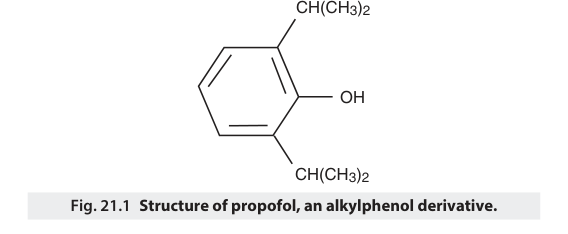

CH(CH3)2 OH CH(CH3)2 Fig. 21.1 Structure of propofol, an alkylphenol derivative. 

<!-- PDF page 3 -->

associated with pain on injection, although mild to moderate perineal paresthesias and pruritus minutes after a bolus injection of fospropofol have been reported and may be due to a phosphate metabolite.

Although multiple studies defining the pharmacokinetics and pharmacodynamics of fospropofol were published prior to 2010, six of the studies were retracted as a result of an analytical assay inaccuracy that was discovered after publication.11,12 Since that time, few data on the pharmacokinetics and pharmacodynamics of fospropofol have been published. Although fospropofol remains available for monitored anesthesia care, the only recent data are based on a review published in the United States.13

### Pharmacokinetics

Propofol is oxidized to 1,4- diisopropyl quinol in the liver. Propofol and 1,4- diisopropyl quinol are conjugated with glucuronic acid to propofol- 1- glucuronide, quinol- 1- glucuronide, and quinol- 4- glucuronide, which then may be excreted by the kidneys.14,15 After a 2.5- hour anesthetic with propofol, patients excrete propofol and propofol metabolites for over 60 hours.15 Less than 1% propofol is excreted unchanged in urine, and only 2% is excreted in feces. The metabolites of propofol are thought to be inactive. Because clearance of propofol (>1.5 L/min) exceeds hepatic blood flow, extrahepatic metabolism or extrarenal elimination may occur. Extrahepatic metabolism has been confirmed during the anhepatic phase of patients receiving a transplanted liver with the determination of propofol metabolites after propofol administration in the absence of liver tissue. The most important extrahepatic site for propofol metabolism is the kidney.16,17 Renal metabolism of propofol accounts for up to 30% of propofol clearance, which explains the rapid clearance of propofol, which exceeds liver blood flow. The lungs also may play a role in the extrahepatic propofol metabolism.18,19 In sheep, the lungs are responsible for approximately 30% of the uptake and firstpass elimination after a bolus dose. In humans, a 20% to 30% decrease in propofol concentration measured across the lung exists with a higher concentration of the metabolite 2,6- diisopropyl 1,4- quinol on the arterial side of the circulation.

Propofol is recognized to have significant hemodynamic depressant effects and may reduce hepatic blood flow. As such, it may reduce the clearance of other drugs metabolized by the liver, in particular those with a high extraction ratio.20 In addition, propofol is known as a CYP3A4 inhibitor.21 In contrast to enzyme induction that may take several days or weeks to develop, competitive inhibition of CYP activity may occur almost instantaneously when administered in combination with other drugs (e.g., propofol and midazolam) causing competition for the enzyme’s active site. A short- term exposure to propofol at a blood concentration of 3 mcg/mL already reduces the CYP3A4 activity by about 37%.

The pharmacokinetics of propofol have been described by two- compartment and three- compartment models (Table 21.1).22 After a single bolus dose, whole blood propofol levels decrease rapidly because of redistribution and elimination (Fig. 21.2). The initial distribution half- life of propofol is 2 to 8 minutes. Studies in which the disposition of propofol is described by a three- compartment model give initial and

slow distribution half- lives of 1 to 8 minutes and 30 to 70 minutes and an elimination half- life of 4 to 23.5 hours.23–28 The context- sensitive half- time for propofol (Fig. 21.3) for infusions of up to 8 hours is less than 40 minutes.29 Because the required decrease in concentration for awakening after anesthesia or sedation with propofol is generally less than 50%, recovery from propofol remains rapid even after prolonged infusion. The volume of distribution of the central compartment has been calculated between 6 and 40 L, and the volume of distribution at steady state has been calculated as 150 to 700 L. The central compartment generally is smaller in the elderly due to the reduced cardiac output in these patients. A reduced cardiac output is associated with a higher peak plasma concentration; this is reflected by a smaller central compartment in the pharmacokinetic analysis. The clearance of propofol is extremely high: 1.5 to

**Table 21.1** Pharmacokinetic Variables for Commonly Used Intravenous Anesthetics

|**Elimination**|**Elimination** **Half- Life (h)**|**Clearance** **(mL/kg/min)**|**VdSS (L/kg)**|
|---|---|---|---|
|Dexmedetomidine|2–3|10–30|2–3|
|Diazepam|20–50|0.2–0.5|0.7–1.7|
|Droperidol|1.7–2.2|14|2|
|Etomidate|2.9–5.3|18–25|2.5–4.5|
|Flumazenil|0.7–1.3|5–20|0.6–1.6|
|Ketamine|2.5–2.8|12–17|3.1|
|Lorazepam|11–22|0.8–1.8|0.8–1.3|
|Methohexital|2–6|10–15|1.5–3|
|Midazolam|1.7–2.6|6.4–11|1.1–1.7|
|Propofol|4–7|20–30|2–10|
|Thiopental|7–17|3–4|1.5–3|

_VdSS_ , apparent volume of distribution at steady state.

From Reves JG, Glass P, Lubarsky DA, et al. Intravenous anesthetics. In: Miller RD, Eriksson LI, Fleischer LA, et al, eds. _Miller’s Anesthesia,_ 7th ed. Philadelphia: Churchill Livingstone; 2010:719–768.

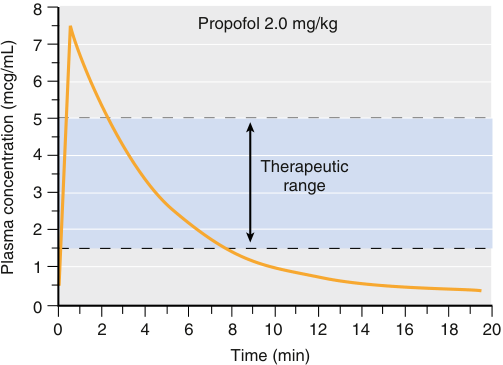

8 Propofol 2.0 mg/kg 7 6 5 4 Therapeutic 3 range 2 1 0 0 2 4 6 8 10 12 14 16 18 20 Time (min) Plasma concentration (mcg/mL) 

**Fig. 21.2 Simulated time course of whole blood levels of propofol after an induction dose of 2 mg/kg.** Blood levels required for anesthesia during surgery are 2 to 5 mcg/mL, with awakening usually occurring at a blood level less than 1.5 mcg/mL.

::: details 原始表格與符號（PDF 第 3 頁）

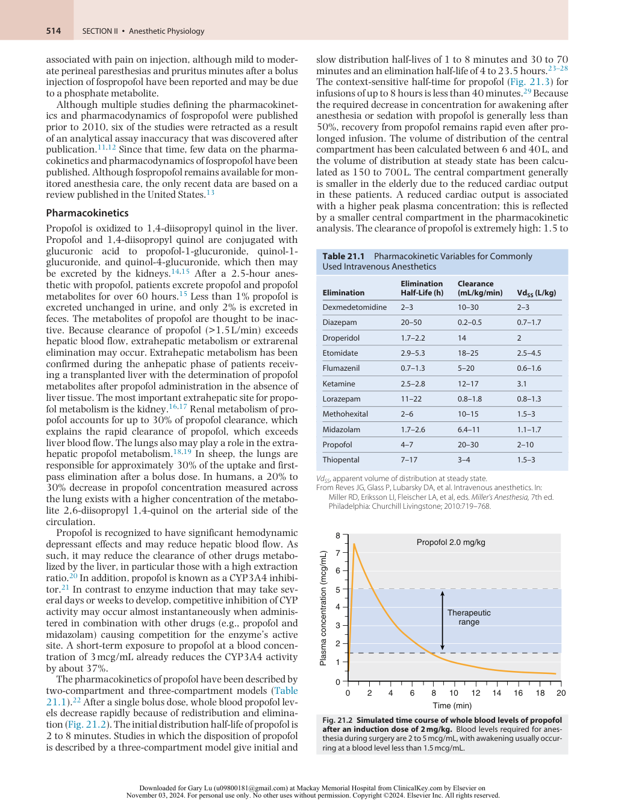

:::

<!-- PDF page 4 -->

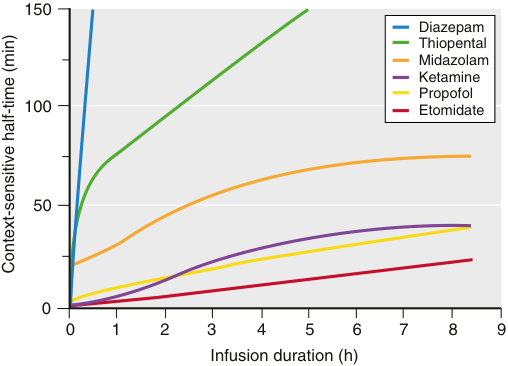

150 Diazepam Thiopental Midazolam Ketamine Propofol 100 Etomidate 50 0 0 1 2 3 4 5 6 7 8 9 Infusion duration (h) Context-sensitive half-time (min) 

**Fig. 21.3 The context- sensitive half- times for commonly used IV anesthetic drugs.** The context- sensitive half- time is the time for the plasma level of the drug to decrease 50% after cessation of infusion. The duration of infusion is plotted on the horizontal axis. The rapidity with which the drug level decreases is directly related to the time of infusion (i.e., the longer the drug is infused, the longer the half- time). Etomidate, propofol, and ketamine have significantly shorter halftimes than thiopental and diazepam, which makes them more suitable for prolonged infusion.

2.2 L/min. As discussed earlier, this exceeds hepatic blood flow, and extrahepatic metabolism has been shown.

The equilibrium constant for propofol based on suppression of the activity in the electroencephalogram (EEG) is about 0.3 min, and the half- life of equilibrium (T½ke0) between plasma concentration and EEG effect is 2.5 minutes. The time to peak effect is 90 to 100 seconds. The onset of EEG effect with propofol seems to be independent of age. The onset of a reduction in arterial blood pressure is much slower (double the time) and increases with age.30 For EEG and blood pressure changes, elderly patients show a concentration- dependent increasing sensitivity. The pharmacokinetics of propofol may be altered by various factors (e.g., gender, weight, preexisting disease, age, and concomitant medication).31–33 Some studies suggest that propofol may exhibit nonlinear pharmacokinetics.34 Because propofol has a high extraction ratio, this may impair its own clearance by decreasing cardiac output and thus hepatic blood flow.35 As a result, a doubling of the dose of propofol may lead to a drug concentration that may be more than twice that initially experienced. In contrast, an increase in cardiac output induced by sympaticomimetic administration may lead to a decrease in the propofol plasma concentration. In a hemorrhagic shock model propofol concentrations increased 20% until uncompensated shock occurred, when there was a rapid and marked increase in propofol concentrations.36

In term and preterm neonates, variability of propofol clearance was accounted for largely by postmenstrual and postnatal age with very fast maturation of clearance in neonatal life. Dosing in these neonates needs to be calculated with extreme care.37,38 Women have a larger volume of distribution and higher clearance rates, but the elimination half- life is similar for males and females. Elderly individuals have decreased clearance rates and a smaller central compartment volume.39 Both may be the result of a reduced cardiac output. Because of this and because of an increased

sensitivity to the propofol effect in the elderly, patients aged 80 years or older generally need 50% of the propofol dose of patients aged 20 years old to target the same level of sedation or hypnosis.23,32,39,40 Children have a relatively larger central compartment volume (50%) and a more rapid clearance (25%).25,41 In children older than 3 years, volumes and clearances should be weight adjusted (also see Chapter 72). Children younger than 3 years of age also show weightproportional pharmacokinetic parameters, but with larger central compartment and systemic clearance values than in adults or older children. This finding explains the larger dose requirements in this age group.42,43 Hepatic disease seems to result in larger steady-state and central compartment volumes; clearance is unchanged, but the elimination half- life is slightly prolonged, as is time to recovery.44,45 In clinical practice, no significant dose adjustment is required in case of hepatic disease. The extrahepatic clearance of propofol that may compensate for a reduced hepatic function may be responsible for this.

Midazolam affects the pharmacokinetics of propofol.46 In the presence of a sedative midazolam concentration of 200 ng/mL, the blood propofol concentrations become elevated by about 25%. Midazolam reduces propofol metabolic clearance from 1.94 to 1.61 L/min, Cl2 from 2.86 to 1.52 L/ min, and Cl3 from 0.95 to 0.73 L/min. The high extraction ratio of propofol of 0.79 to 0.92 suggests that the metabolic clearance of propofol may not be affected by enzyme inhibition but may be susceptible to changes in hepatic perfusion. The changes in the pharmacokinetics of propofol induced by midazolam thus may be the result of the hemodynamic alterations induced by the co- administration of midazolam.

Propofol affects midazolam pharmacokinetics as well.20 In the presence of sedative concentrations of propofol, plasma midazolam concentrations increased by 27%. In the presence of propofol, midazolam is administered in a smaller central compartment from which midazolam is cleared and distributed less rapidly to peripheral tissues. For example, alfentanil47 has been shown to increase blood propofol concentrations through a reduction in the elimination and distribution clearance of propofol. This is in line with other pharmacokinetic interactions between hypnotics and opioids when combined with propofol. Propofol has been shown to increase alfentanil concentrations by decreasing the elimination and the rapid and slow distribution clearances of alfentanil. Co- administration of propofol increased remifentanil concentrations via both a decrease in the central volume of distribution and distributional clearance of remifentanil by 41% and elimination clearance by 15%. Propofol kinetics is unaltered by renal disease.

Epidural blockade also affects the pharmacokinetics of propofol and the performance of a target- controlled infusion of propofol.48,49 At an epidural ropivacaine dose that blocks 20 segments, the propofol dosage or target concentration may be reduced by 30% compared with when no epidural blockade is present. An epidural- induced reduction in hepatic and/or renal blood flow may explain this pharmacokinetic interaction.

Fospropofol50–56,57 is a water- soluble prodrug of propofol and is chemically described as phosphono- _O_ - methyl- 2, 6- diisopropylphenol, disodium salt (C13H19O5PNa2). Fospropofol is metabolized by alkaline phosphatases to propofol, formaldehyde, and phosphate. Formaldehyde is further

<!-- PDF page 5 -->

metabolized to formate, which is then eliminated, primarily by oxidation to carbon dioxide. Over 71% of fospropofol is recovered in the urine within 192 hours following a single 400 mg IV dose. Renal elimination is &lt;0.02% and total body clearance in the order of 0.28 L/h/kg. The terminal elimination half- life of fospropofol is 0.88 hours. The pharmacokinetics of fospropofol and liberated propofol are not affected by race, sex, or mild to moderate renal impairment. Furthermore, fospropofol pharmacokinetics are not affected by age or alkaline phosphatase concentration. So far, no pharmacokinetic interactions have been found between fospropofol and fentanyl, midazolam, morphine, or with propofol. The lack of interaction is probably because fospropofol is not subject to cytochrome P450 enzyme- mediated metabolism.13

Fospropofol protein binding is extensive (98%).13 It has a small volume of distribution of 0.3 L/kg, a total body clearance of 0.36 L/kg/h with a terminal elimination half- life of 0.88 hours. After a bolus dose of 6 mg/kg of fospropofol, the parent drug peaks at 4 minutes and is rapidly metabolized to propofol with a peak plasma propofol concentration at 12 minutes after administration of fospropofol. With this fospropofol dose the highest plasma concentration reached (Cmax) of fospropofol was 78.7 mcg/mL and the Cmax of propofol was 1.08 mcg/mL. The total body clearance of fospropofol and propofol were 0.36 and 3.2 L/kg/h. The terminal half- lives were 0.88 and 1.13 hours, respectively.

### Pharmacodynamics

**Effects on the Central Nervous System.** The hypnotic action of propofol is mostly mediated by enhancing γ- aminobutyric acid (GABA)- induced chloride current through its binding to the β subunit of GABAA receptor. Sites on the β1 subunit, β2 subunit, and β3 subunit of the transmembrane domains are crucial for the hypnotic action of propofol.58,59 The α subunit and γ2 subunit subtypes also seem to contribute to modulating the effects of propofol on the GABA receptor. The effect of propofol has been described in two manners – indirect and direct. Propofol exhibits an indirect effect by potentiation of the ion channel activation by GABA, shifting the concentration–response relationship to the left. At higher propofol concentrations, propofol is also thought to directly activate GABAA receptor channels.60–62 The exact mechanism and location of changes that are associated with the change from consciousness to the unconscious state are not yet fully understood. Some experts suggest that a proper functioning of the brainstem– thalamocortical arousal circuits are critical while others state that consciousness is more related to frontoparietal association cortex activity. Propofol, through its action on GABAA receptors63 in the hippocampus, inhibits acetylcholine release in the hippocampus and prefrontal cortex. The α2- adrenoreceptor system also seems to play an indirect role in the sedative effects of propofol.64 Resting state functional MRI (fMRI) studies suggest that propofol’s action may be related to a CNS that reduces its discriminable state and switches into stereotypic patterns of firing under propofol sedation.65 The so- called default mode network (DMN), including the posterior cingulated, the medial frontal cortex, and bilateral parietal cortices, is the anatomical substrate in which these stereotypical patterns become visible. Using positron emission tomography, propofol hypnosis is

related with reduced activity in the thalamic and precuneus regions. These regions likely play an important role in propofol- induced unconsciousness.66

Propofol results also in widespread inhibition of the _N_ - methyl-d- aspartate (NMDA) subtype of glutamate receptor through modulation of sodium channel gating, an action that also may contribute to the drug’s CNS effects.67,68 Propofol has a direct depressant effect on neurons of the spinal cord. In acutely dissociated spinal dorsal horn neurons, propofol acts on GABAA and glycine receptors.69 The sense of well- being in patients with propofol is related to the increase in dopamine concentrations in the nucleus accumbens (a phenomenon noted with drugs of abuse and pleasure- seeking behavior).70 Propofol’s antiemetic action may be explained by the decrease in serotonin levels it produces in the area postrema, probably through its action on GABA receptors.71

The onset of hypnosis after a propofol dose of 2.5 mg/kg is rapid (one arm–brain circulation), with a peak effect seen at 90 to 100 seconds. The median effective dose (ED50) of propofol for loss of consciousness is 1 to 1.5 mg/kg after a bolus. The duration of hypnosis is 5 to 10 minutes after 2 to 2.5 mg/kg and dose  dependent. Age markedly affects the induction dose, which is largest for ages younger than 2 years (ED95 2.88 mg/kg) and decreases with increasing age. This is a direct result of the altered pharmacokinetics in children and elderly. Children exhibit a relatively larger central compartment and therefore need a higher dose to achieve a similar blood–drug concentration.72–74 In addition, the rapid clearance of propofol in children requires a larger maintenance dose as well. Increasing age decreases the propofol concentration required for loss of consciousness.

At subhypnotic doses, propofol provides sedation and amnesia. Propofol infusions of at least 2 mg/kg/h were necessary to provide amnesia in unstimulated volunteers. Awareness during surgery at higher infusion rates has been reported. During surgical procedures, extremely high infusion rates producing blood propofol concentrations more than 10 mcg/mL may be necessary to prevent awareness if propofol is used as the sole anesthetic. Propofol also tends to produce a general state of well- being. Hallucinations, sexual fantasies, and opisthotonos occur after propofol administration.

The effect of propofol on the EEG, as assessed after 2.5 mg/ kg followed by an infusion, shows an initial increase in alpha rhythm followed by a shift to gamma and theta frequency. Rapid infusion rates produce burst suppression at blood propofol concentrations higher than 8 mcg/mL. Propofol causes a concentration- dependent decrease in the bispectral index (BIS), with 50% and 95% of patients unable to respond to a verbal command at a BIS of 63 and 51, respectively. The propofol concentration at which 50% of volunteers failed to respond to verbal command was 2.35 mcg/ mL. Lack of recall was observed in 95% of patients at a BIS value of 77.75 Propofol effect-site concentrations provide similar correlation with decreases in the spectral entropy variable derived from the EEG as it does with BIS, and a similar ability to titrate propofol anesthetic effect. The effect of propofol on epileptogenic EEG activity is controversial. Propofol may suppress seizure activity via GABA agonism, inhibition of NMDA receptors, and modulation of slow calcium ion channels. However, the same GABA agonism and

<!-- PDF page 6 -->

glycine antagonism may also induce clinical seizures and EEG epileptiform changes.76 This especially may occur during induction of and emergence from anesthesia. Propofol has a dose- dependent anticonvulsant. Propofol has even been used to treat epileptic seizures. Yet propofol can cause grand mal seizures and has been used for cortical mapping of epileptogenic foci.77

Unfortunately, propofol can be addictive. An important issue in the potential of abuse is the development of tolerance. Tolerance to a drug creates circumstances for abuse. Propofol dosage needs to be carefully managed when used as a sedative in the intensive care unit (ICU); in 20% to 40% of ICU patients, the propofol dosage regimen needs to be repeatedly adjusted upward in order to maintain the same effect.78 Data on propofol abuse in the general public are unknown but the incidence of abuse is likely to be low compared to other substances. For health care workers, propofol is easy to access and case reports of lethal selfadministration have been documented. Some investigators have suggested that there may be more frequent incidences of propofol abuse among health care providers than the general public because of ease of access79,80 and support stricter propofol regulation. In contrast to propofol, fospropofol was classified in 2009 by the US Drug Enforcement Administration (DEA) as a controlled substance.

Propofol decreases intracranial pressure (ICP) in patients with either normal or increased ICP (also see Chapters 53 and 80). The decrease in ICP (30% to 50%) is associated with significant decreases in cerebral perfusion pressure (CPP).81 The use of propofol in head- injured patients should be restricted to doses providing mild to moderate sedation (i.e., blood concentration of 2 mcg/mL, infusion of 25 to 75 mcg/kg/min).82 Anesthetics are neuroprotective because they reduce the metabolic oxygen use that is beneficial for the balance between energy supply and demand and because they increase the tolerance to hypoxia by the neuronal tissue. Propofol has no direct preconditioning effect but may attenuate glutamate- mediated excitotoxicity.83–85 Propofol acutely reduces intraocular pressure by 30% to 40%. Compared with thiopental, propofol produces a larger decrease in intraocular pressure and is more effective in preventing an increase in intraocular pressure secondary to succinylcholine and endotracheal intubation. Normal cerebral reactivity to carbon dioxide and autoregulation are maintained during a propofol infusion.

Whether propofol has neuroprotective effects remains controversial.86 In an incomplete ischemia model in rats, propofol administered to burst suppression results in significantly better neurologic outcome and less brain tissue injury compared with fentanyl. Propofol administered at sedative concentrations started either immediately after or at 1 hour after an ischemic insult significantly reduced infarct size compared with awake controls infused with intralipid.87,88 Subanesthetic doses of propofol also induce neuroapoptosis in the infant mouse brain.89 In addition, anesthetic doses of propofol in rats90 induce complex changes that are accompanied by cell death in the cortex and thalamus of the developing rat brain. The neuronal protective effect of propofol may be due to the attenuation of changes in adenosine triphosphate, calcium, sodium, and potassium caused by hypoxic injury and its antioxidant action by inhibiting lipid peroxidation. Current evidence indicates that propofol can

protect neurons against ischemic injury caused by excitotoxicity, but neuroprotection may be sustained only if the ischemic insult is relatively mild and is not sustained after a prolonged recovery period. Prolonged propofol sedation in children is associated with adverse neurologic sequelae.91

Many anesthetic- related drugs decrease the required dose or blood concentrations of propofol’s pharmacologic action. The “required dose” is usually directly related to the required concentration for a given effect. The propofol Cp50 (blood concentration needed for 50% of subjects to not respond to a defined stimulus) for loss of response to verbal command in the absence of any other drug is 2.3 to 3.5 mcg/mL.92–94 The propofol Cp50 to prevent movement on skin incision is 16 mcg/mL; this is markedly reduced by increasing concentrations (i.e., doses) of fentanyl or alfentanil. The propofol Cp50 for skin incision when combined with benzodiazepine premedication (lorazepam, 1 to 2 mg) and 66% nitrous oxide is 2.5 mcg/mL (venous).95 This concentration is reduced to 1.7 mcg/mL when morphine (0.15 mg/kg) rather than lorazepam is used for premedication. The concentration of propofol (when combined with 66% nitrous oxide) required during minor surgery is 1.5 to 4.5 mcg/mL, and the concentration for major surgery is 2.5 to 6 mcg/mL.96 Awakening usually occurs at concentrations less than 1.6 mcg/mL and orientation occurs at concentrations less than 1.2 mcg/mL when the propofol concentration is decreasing. Not surprisingly, awakening is postponed in the presence of high blood concentrations of opioids. Optimal propofol blood concentrations have been defined when combined with several opioids including remifentanil, alfentanil, sufentanil, and fentanyl that assure adequate anesthesia and the most rapid return to consciousness, postoperatively (Table 21.2). In the presence of remifentanil, a relatively large- dose opioid anesthetic is recommended. Yet, with fentanyl an accompanying large dose of propofol should be used to assure rapid return to recovery postoperatively (Fig. 21.4). When equilibration between blood and effect site is allowed, however, awakening concentrations (2.2 mcg/mL) are similar to concentrations associated with loss of verbal command.97

**Effects on the Respiratory System.** Apnea occurs after administration of an induction dose of propofol; the incidence and duration of apnea depend on dose, speed of injection, and concomitant premedication.98 An induction dose of propofol results in a 25% to 30% incidence of apnea from the respiratory depressant effects of propofol and yet a normal partial pressure of carbon dioxide in the blood (PaCO2) at induction in the absence of surgical stimulation. Metabolic depression further prevents the PaCO2 to increase. On the other hand, the duration of apnea occurring with propofol may be prolonged to more than 30 seconds. The incidence of prolonged apnea (>30 seconds) is increased further when propofol is combined with an opiate, either as premedication or administered just before induction of anesthesia.96,99 A maintenance infusion of propofol (100 mcg/ kg/min) results in a 40% decrease in tidal volume and a 20% increase in respiratory frequency, with an unpredictable change in minute ventilation. Doubling the infusion rate from 100 to 200 mcg/kg/min causes a further moderate decrease in tidal volume but no change in respiratory frequency.100 As with other hypnotic drugs, spontaneous

<!-- PDF page 7 -->

**Table 21.2** Infusion Schemes of Propofol and the Opioids Required to Maintain Effect- Site Concentrations of These Agents*

|**Opioid**|**Alfentanil EC50–EC95** **(90–130 ng/mL)**|**Fentanyl EC50–EC95** **(1.1–1.6 ng/mL)**|**Sufentanil EC50–EC95** **(0.14–0.20 ng/mL)**|**Remifentanil EC50–EC95** **(4.7–8.0 ng/mL)**|
|---|---|---|---|---|
|Bolus|25–35 mcg/kg in 30 sec|3 mcg/kg in 30 sec|0.15–0.25 mcg/kg in 30 sec|1.5–2 mcg/kg in 30 sec|
|Infusion 1|50–75 mcg/kg/h for 30 min|1.5–2.5 mcg/kg/h for 30 min|0.15–0.22 mcg/kg thereafter|13–22 mcg/kg/h for 20 min|
|Infusion 2|30–42.5 mcg/kg/h thereafter|1.3–2 mcg/kg/h up to 150 min||11.5–19 mcg/kg/h thereafter|
|Infusion 3||0.7–1.4 mcg/kg/h thereafter|||
|**Propofol**|**Propofol EC50–EC95** **(3.2–4.4 mcg/mL)**|**Propofol EC50–EC95** **(3.4–5.4 mcg/mL)**|**Propofol EC50–EC95** **(3.3–4.5 mcg/mL)**|**Propofol EC50–EC95** **(2.5–2.8 mcg/mL)**|
|Bolus|2.0–2.8 mg/kg in 30 sec|2.0–3.0 mg/kg in 30 sec|2.0–2.8 mg/kg in 30 sec|1.5 mg/kg in 30 sec|
|Infusion 1|9–12 mg/kg/h for 40 min|9–15 mg/kg/h for 40 min|9–12 mg/kg/h for 40 min|7–8 mg/kg/h for 40 min|
|Infusion 2|7–10 mg/kg/h for 150 min|7–12 mg/kg/h for 150 min|7–10 mg/kg/h for 150 min|6–6.5 mg/kg/h for 150 min|
|Infusion 3|6.5–8 mg/kg/h thereafter|6.5–11 mg/kg/h thereafter|6.5–8 mg/kg/h thereafter|5–6 mg/kg/h thereafter|

- These optimal infusion schemes have been derived from data in female patients undergoing lower abdominal surgery. These should be used as guidelines and be adjusted to the individual needs of the patient.

- *When given in combination, within ±15% of the effect- site concentrations that are associated with a 50% and 95% probability of no response to surgical stimuli and the most rapid possible return of consciousness after termination of the infusions.

- Reproduced from Vuyk J, Mertens MJ, Olofsen E, et al. Propofol anesthesia and rational opioid selection: determination of optimal EC50–EC95 propofol- opioid concentrations that assure adequate anesthesia and a rapid return of consciousness. _Anesthesiology_ . 1997;87:1549–1562, with permission from Lippincott Williams and Wilkins ©, 1997; and Kataria BK, Ved SA, Nicodemus HF, et al. The pharmacokinetics of propofol in children using 3 different data- analysis approaches. _Anesthesiology_ . 1994;80:104–122.

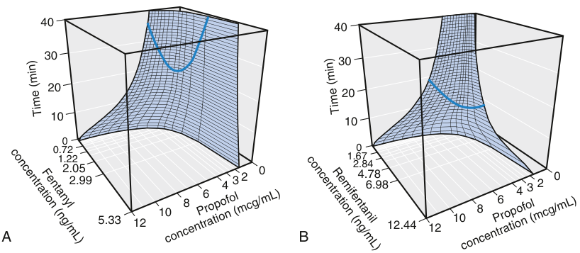

40 40 30 30 20 20 10 10 0 0.72 0 1.22 1.67 2.052.99 6 4 3 2 0 2.844.786.98 4 3 2 0 8 6 10 8 5.33 12 12.44 12 10 A B Propofol Propofol concentration (mcg/mL) concentration (mcg/mL) Remifentanil concentration (ng/mL) Fentanyl concentration (ng/mL) Time (min) Time (min) 

**Fig. 21.4** Computer simulation of effect- site propofol and fentanyl (A) or remifentanil (B) concentrations vs. time during the first 40 min after termination of target- controlled infusions of propofol and fentanyl or remifentanil that had been maintained for 300 min at constant target blood or plasma concentration combinations associated with a 50% probability of no response to surgical stimuli. These concentration combinations are represented by the curved line on the bottom of the figure in the _x_ – _y_ plane. The decrease in concentrations following the intraoperative propofol–fentanyl and propofol–remifentanil combinations is represented by the curves running upward from the _x_ – _y_ plane. The curved lines in parallel to the _x_ – _y_ plane represent consecutive 1- min time intervals. The bold lines within the two figures represent the propofol–fentanyl–time and propofol–remifentanil–time relationships at which consciousness is regained in 50% of the patients. (Reproduced from Vuyk J, Mertens MJ, Olofsen E, et al. Propofol anesthesia and rational opioid selection: determination of optimal EC50- EC95 propofol- opioid concentrations that assure adequate anesthesia and a rapid return of consciousness. _Anesthesiology_ . 1997;87:1549–1562, with permission from Lippincott Williams and Wilkins, © 1997.)

ventilation is the result of the respiratory depressant effects of the hypnotic agents and the decrease in CO2 production resulting from the metabolic depression versus the stimulatory effects of the increasing PaCO2 resulting from apnea and the level of nociception. Propofol (50–120 mcg/kg/min) also depresses the ventilatory response to hypoxia, presumably by a direct action on carotid body chemoreceptors.101 Propofol induces bronchodilation in patients with chronic obstructive pulmonary disease. Propofol attenuates vagal (at low concentrations) and methacholine- induced (at high concentrations) bronchoconstriction and seems to have a direct action on muscarinic receptors. Propofol inhibits

the receptor- coupled signal transduction pathway through inositol phosphate generation and inhibition of Ca2+ mobilization. The preservative used with propofol is important regarding its bronchodilator activity. Propofol with metabisulfite (compared with propofol without metabisulfite) does not inhibit vagal or methacholine- induced bronchoconstriction. Propofol potentiates hypoxic pulmonary vasoconstriction, an effect caused by inhibition of K(+) (ATP)- mediated pulmonary vasodilatation. Propofol has an impact on the pulmonary pathophysiology of adult respiratory distress syndrome. In an animal model of septic endotoxemia, propofol (10 mg/kg/h) significantly reduced free radical mediated

::: details 原始表格與符號（PDF 第 7 頁）

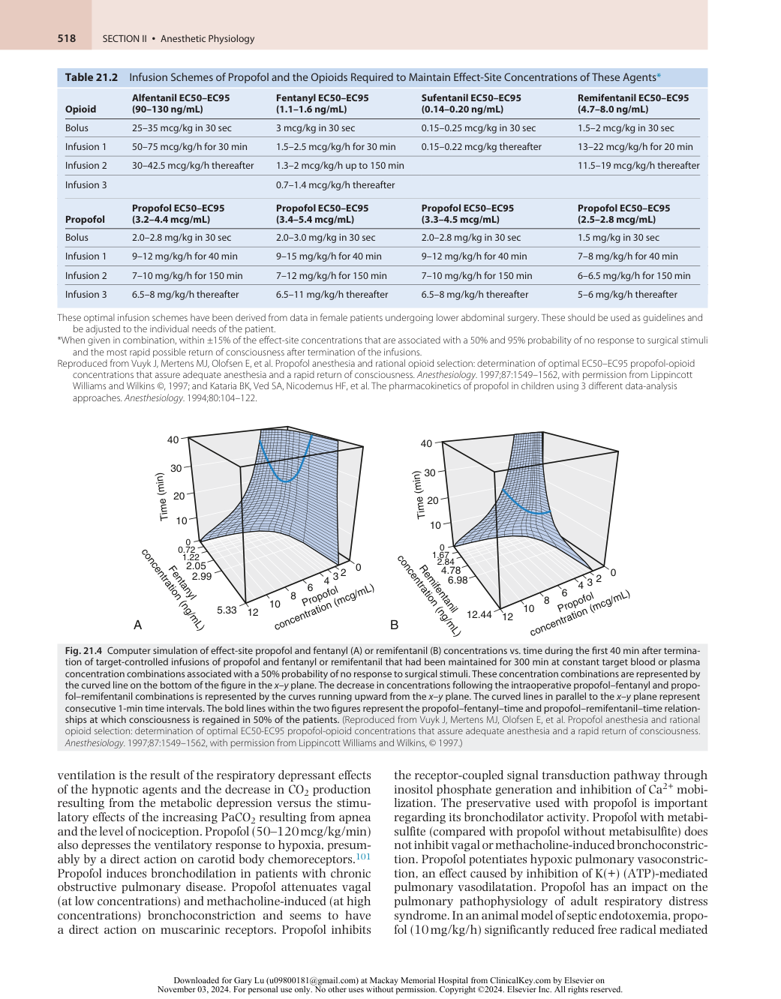

:::

<!-- PDF page 8 -->

**Table 21.3** Hemodynamic Changes % After Induction of Anesthesia With Nonbarbiturate Hypnotics

||**Diazepam**|**Droperidol**|**Etomidate***|**Ketamine**|**Lorazepam**|**Midazolam**|**Propofol**|
|---|---|---|---|---|---|---|---|
|HR|−9 ± 13|Unchanged|−5 ± 10|0–59|Unchanged|−14 ± 12|−10 ± 10|
|MBP|0–19|0–10|0–17|0 ± 40|−7 to 20|−12 to 26|−10 to 40|
|SVR|−22 ± 13|−5 to 15|−10 ± 14|0 ± 33|−10 to 35|0–20|−15 to 25|
|PAP|0–10|Unchanged|−9 ± 8|+44 ± 47|—|Unchanged|0–10|
|PVR|0–19|Unchanged|−18 ± 6|0 ± 33|Unchanged|Unchanged|0–10|
|PAO|Unchanged|+25 ± 50|Unchanged|Unchanged|—|0–25|Unchanged|
|RAP|Unchanged|Unchanged|Unchanged|+15 ± 33|Unchanged|Unchanged|0–10|
|CI|Unchanged|Unchanged|−20 ± 14|0 ± 42|0 ± 16|0–25|−10 to 30|
|SV|0–8|0–10|0–20|0–21|Unchanged|0–18|−10 to 25|
|LVSWI|0–36|Unchanged|0–33|0 ± 27|—|−28 to 42|−10 to 20|
|dP/dt|Unchanged|—|0–18|Unchanged|—|0–12|Decreased|

_CI,_ cardiac index; _dP/dt,_ first derivative of pressure measured over time; _HR,_ heart rate; _LVSWI,_ left ventricular stroke work index; _MBP,_ mean blood pressure; _PAO,_ pulmonary artery occluded pressure; _PAP,_ pulmonary artery pressure; _PVR,_ pulmonary vascular resistance; _RAP,_ right atrial pressure; _SV,_ stroke volume; _SVR,_ systemic vascular resistance. *The larger deviations are in patients with valvular disease. From Reves JG, Glass P, Lubarsky DA, et al. Intravenous anesthetics. In: Miller RD, Eriksson LI, Fleischer LA, et al, eds. _Miller’s Anesthesia,_ 7th ed. Philadelphia: Churchill Livingstone; 2010:719–768.

and cyclooxygenase-catalyzed lipid peroxidation. In addition, partial pressure of arterial oxygen (PaO2) and hemodynamics were maintained closer to baseline. These benefits of propofol have not yet been confirmed in humans.

**Effects on the Cardiovascular System.** The cardiovascular effects of propofol for induction and maintenance of anesthesia are well described (Table 21.3).102 The most prominent effect of propofol is a decrease in arterial blood pressure during induction of anesthesia.103 Independent of the presence of cardiovascular disease, an induction dose of 2 to 2.5 mg/kg produces a 25% to 40% reduction of systolic blood pressure. Similar changes are seen in mean and diastolic blood pressure. The decrease in arterial blood pressure is associated with a decrease in cardiac output and cardiac index (±15%), stroke volume index (±20%), and systemic vascular resistance (15%–25%). Left ventricular stroke work index also is decreased (±30%). When looking specifically at right ventricular function, propofol produces a marked reduction in the slope of the right ventricular endsystolic pressure–volume relationship.

In patients with valvular heart disease, pulmonary artery and pulmonary capillary wedge pressure also are reduced, a finding that implies the resultant decrease in pressure is due to a decrease in preload and afterload. Although the decrease in systemic pressure after an induction dose of propofol is due to vasodilation **,** the direct myocardial depressant effects of propofol are more controversial. The decrease in cardiac output after propofol administration may be through its action on sympathetic drive to the heart. The hemodynamic response to propofol lags significantly behind that of the hypnotic effect. The effect- site equilibration half- life of propofol is on the order of 2 to 3 minutes for the hypnotic effect and about 7 minutes for the hemodynamic depressant effect.30 These finding suggest that hemodynamic depression increases in a few minutes after a patient has lost consciousness from an induction of anesthesia.

High concentrations of propofol abolish the inotropic effect of α- but not β- adrenoreceptor stimulation and enhance the lusitropic (relaxation) effect of β stimulation. Clinically, the myocardial depressant effect and the vasodilation are dose dependent and plasma concentration dependent.104 Propofol is a vasodilator due to a reduction in sympathetic activity. The mechanism of this activity is a combination of a direct effect on intracellular smooth muscle calcium mobilization, inhibition of prostacyclin synthesis in endothelial cells, reduction in angiotensin II–elicited calcium entry,105,106 activation of K+ adenosine triphosphate channels, and stimulation of nitric oxide. The stimulation of nitric oxide may be modulated by any intralipid rather than propofol itself.

Heart rate does not change significantly after an induction dose of propofol, although several factors may have impact on heart rate changes associated with propofol administration. The extent of hypotension, the ability for the patient to compensate, and the use of any other concomitant drugs are likely the most important factors in determining what happens to the heart rate after propofol administration. Propofol may also reset or inhibit the baroreflex, reducing the tachycardic response to hypotension. Propofol also decreases cardiac parasympathetic tone in a dose- dependent manner. Propofol has a minimal direct effect on sinoatrial node function or on normal atrioventricular and accessory pathway conduction. Propofol attenuates the heart rate response to atropine in a dosedependent manner. Propofol suppresses atrial (supraventricular) tachycardias and probably should be avoided during electrophysiologic studies. The peak plasma concentrations obtained after a bolus dose are substantially higher than the concentrations seen with a continuous infusion and may reach concentrations up to 80 to 100 mcg/ mL. Because the vasodilatory and myocardial depressant effects are concentration  dependent, the decrease in arterial blood pressure from propofol during the infusion

::: details 原始表格與符號（PDF 第 8 頁）

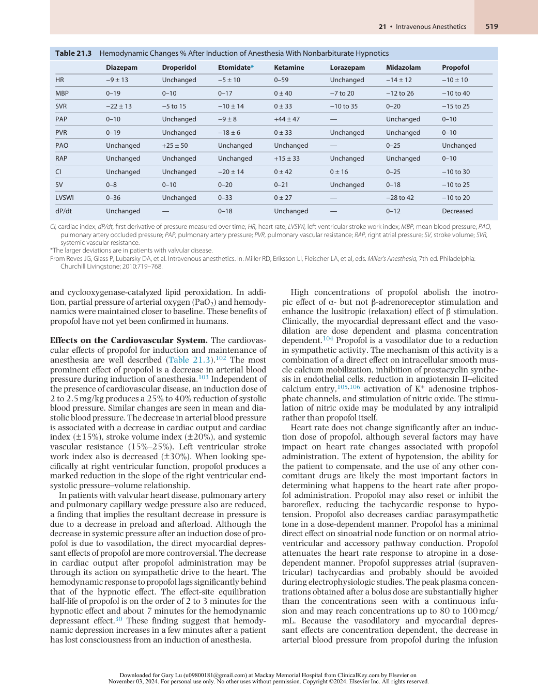

:::

<!-- PDF page 9 -->

phase (maintenance of anesthesia) is much less than that seen after induction of anesthesia by an intravenous bolus administration of propofol. An infusion of propofol reduces myocardial blood flow and oxygen consumption. Thus, global myocardial oxygen supply- to- demand ratio is likely preserved. The cardioprotective effect of propofol versus volatile anesthetics in patients having cardiac surgery on- or off- cardiopulmonary bypass is less debatable. In two large studies comparing propofol with sevoflurane in patients undergoing cardiac surgery, postoperative troponin levels were lower and hemodynamic function better in patients receiving sevoflurane. A study comparing desflurane with propofol in patients undergoing off- pump coronary artery bypass showed similar results. In contrast, administration of a large dose of propofol (120 mcg/kg/min) or small dose of propofol (60 mcg/kg/min) during cardiopulmonary bypass, or titrating isoflurane throughout surgery, showed improved troponin levels and better hemodynamic function in the large- dose propofol group compared to the isoflurane or small- dose propofol group. This study suggests that cardioprotection with propofol is dose dependent.107 Lastly, combinations of propofol with inhaled anesthetics may offer an optimal pre- and post- conditioning strategy in patients scheduled for coronary bypass surgery. Isoflurane preconditioning combined with propofol post- conditioning acts synergistically in attenuating postischemic myocardial reperfusion injury as determined by surrogate markers of myocardial injury and function.108

**Other Effects.** Propofol, like thiopental, does not enhance neuromuscular blockade produced by neuromuscular blocking drugs. Propofol produces no effect on the evoked electromyogram or twitch tension; however, good or acceptable tracheal intubating conditions after propofol alone have been reported. Propofol does not trigger malignant hyperthermia and is an appropriate choice in patients with this condition.109–111 Propofol, after a single dose or a prolonged infusion, does not affect corticosteroid synthesis or alter the normal response to adrenocorticotropic hormone (ACTH) stimulation. Propofol in the emulsion formulation does not alter hepatic, hematologic, or fibrinolytic function. Lipid emulsion _per se_ reduces _in vitro_ platelet aggregation, however. Although the current formulation of propofol does not cause anaphylaxis, anaphylactoid reactions to the present formulation of propofol have been reported. In at least some patients, the immune response was entirely due to propofol and not to the lipid emulsion. Most patients developing the anaphylactoid response to propofol had a previous history of allergic responses. These findings suggest that propofol should be used cautiously or avoided in patients with multiple drug allergies.112–114 Propofol alone in intralipid does not trigger histamine release. Propofol also possesses significant antiemetic activity with small (subhypnotic) doses (i.e., 10 mg in adults). The median concentration of propofol with an antiemetic effect was 343 ng/mL, which also causes a mild sedative effect.115 This concentration can be achieved by an initial dose of propofol infusion of 10 to 20 mg followed by 10 mcg/kg/ min. Propofol used as a maintenance anesthetic during breast surgery was more effective than 4 mg of ondansetron given as prophylaxis in preventing postoperative nausea and vomiting (PONV) (also see Chapter 76). Propofol as an

infusion of 1 mg/kg/h (17 mcg/kg/min) also has provided excellent antiemetic action after anticancer chemotherapy. At subhypnotic doses, propofol relieves cholestatic pruritus and is likely as effective as naloxone in treating pruritus induced by spinal opiates.

Propofol decreases polymorphonuclear leukocyte chemotaxis, but not adherence phagocytosis and killing. This action contrasts with the effect of thiopental, which inhibits all these chemotactic responses. However, propofol inhibits phagocytosis and killing of _Staphylococcus aureus_ and _Escherichia coli_ . There have been life- threatening systemic infections associated with the use of propofol.116 In hospitals where these infections occurred, opened vials and syringes of propofol had positive cultures. The intralipid that acts as the solvent for propofol is an excellent culture medium. Disodium edetate or metabisulfite has been added to the formulation of propofol to retard such bacterial growth. Strict aseptic technique still must be observed. The administration of propofol is associated with the development of pancreatitis,117 which may be related to hypertriglyceridemia. Patients who developed hypertriglyceridemia tended to be older, had a longer ICU stay, and received propofol for a longer duration. If propofol is being used for prolonged sedation or at higher infusion rates (especially in elderly patients), serum triglyceride concentrations should be routinely monitored.

Numerous studies explored the effects of propofol in cancer patients. Biomarker studies indicate that propofol is associated with a favorable inhibiting effect on vascular endothelial growth factor C, an enhanced activity of natural killer cells and increased cancer cell apoptosis.118–122 As such, preclinical and various retrospective studies suggest that the use of propofol for anesthesia for oncologic surgery is associated with anti- inflammatory, antitumorigenic effects and improved recurrence- free survival, in contrast to inhalational anesthesia.123

Unfortunately, despite the speculation from these preclinical and retrospective studies, limited data from prospective studies conclude that propofol- based anesthesia does not reduce cancer recurrence compared with volatile anesthesia.124,125 More prospective studies may be necessary to better understand the impact of propofol anesthesia on cancer survival.

### Uses

**Induction and Maintenance of Anesthesia.** Propofol is suitable for the induction and maintenance of anesthesia (Box 21.1). The intravenous induction dose is 1 to 2.5 mg/ kg. Physiologic characteristics that best determine the appropriate dose to induce anesthesia are age, lean body mass, and central blood volume.126 Propofol may be titrated based on the BIS value for maintenance of anesthesia and to assure adequacy of anesthesia and prevention of overdosing. Premedication with an opiate or a benzodiazepine, or both, markedly reduces the necessary induction dose.127–129 The induction dose needs to be reduced in elderly patients and a dose of 1 mg/kg (with premedication) to 1.75 mg/kg (without premedication) is recommended for inducing anesthesia in patients older than 60. Furthermore, older and sicker (American Society of Anes thesiologists [ASA] class III to IV) patients develop more profound hypotension, especially when propofol is combined with an opiate (also see Chapter 61).

<!-- PDF page 10 -->

### Box 21.1 Uses and Doses of Intravenous Propofol

|Induction of general anesthesia|1–2.5 mg/kg IV, dose reduced with increasing age|
|---|---|
|Maintenance of general anesthesia|50–150 mcg/kg/min IV combined with N2O or an opiate|
|Sedation|25–75 mcg/kg/min IV|
|Antiemetic action|10–20 mg IV, can repeat every 5–10 min or start infusion of 10 mcg/kg/min|

_IV,_ intravenously; _N2O,_ nitrous oxide. From Reves JG, Glass P, Lubarsky DA, et al. Intravenous anesthetics. In Miller RD, Eriksson LI, Fleischer LA, et al, eds. _Miller’s Anesthesia,_ 7th ed. Philadelphia: Churchill Livingstone; 2010:719–768.

To prevent hypotension in sicker patients or in patients presenting for cardiac surgery, intravenously administered fluids should be given as tolerated, and propofol titrated to achieve the desired anesthetic state. In general, for both pharmacokinetic and pharmacodynamic reasons, elderly patients (>80 years old) require half the dose of young patients (&lt;20 years).130 For induction of anesthesia in children, the ED95 (2–3 mg/kg) is increased, primarily because of pharmacokinetic differences. Children demonstrate a smaller central compartment, an increased metabolic clearance, and larger volumes of distribution of propofol relative to adult patients.73 Propofol, when used for induction of anesthesia in short- lasting procedures, results in a significantly quicker recovery and an earlier return of psychomotor function compared with thiopental or methohexital, regardless of the anesthetic used for maintenance of anesthesia.

Several infusion schemes have been used to achieve adequate plasma concentrations of propofol. After an induction dose, an infusion of 100 to 200 mcg/kg/min is usually needed. The infusion rate is titrated to individual requirements and the surgical stimulus. When combined with propofol, the required infusion rate and concentration of opiates, midazolam, clonidine, or ketamine should be reduced.20,131 Because opioids alter the concentration of propofol required for adequate anesthesia, the time to awakening and recovery can be influenced by these drug combinations. Also, opioids affect both the pharmacokinetics and the pharmacodynamics of propofol. Alfentanil decreases the elimination clearance of propofol from 2.1 L/ min to 1.9 L/min, the distribution clearance from 2.7 L/min to 2.0 L/min, and the peripheral volume of distribution from 179 L to 141 L. The pharmacokinetic parameters of propofol are affected by cardiac output, heart rate, and plasma alfentanil concentration.33 Similarly, midazolam reduces propofol’s metabolic clearance from 1.94 to 1.61 L/min, Cl2 from 2.86 to 1.52 L/min, and Cl3 from 0.95 to 0.73 L/ min. Consequently, in the presence of both midazolam and alfentanil, propofol concentrations are increased by 20% to 30%.47 The infusion rate required to achieve the combination with the shortest recovery is propofol, 1 to 1.5 mg/kg, followed by 140 mcg/kg/min for 10 minutes, followed by 100 mcg/kg/min, and alfentanil, 30 mcg/kg, followed by an infusion of 0.25 mcg/kg/min, or fentanyl, 3 mcg/kg, followed by 0.02 mcg/kg/min.

As indicated previously, increasing age is associated with a decrease in propofol infusion requirements, whereas the

requirements are larger in infants and children. The blood levels of propofol alone to achieve loss of consciousness are 2.5 to 4.5 mcg/mL, and the blood concentrations (when combined with nitrous oxide) required for surgery are 2.5 to 8 mcg/mL. Similar concentrations are necessary when propofol is combined with an opioid for a total IV technique. The knowledge of these levels and of the pharmacokinetics of propofol has enabled the use of pharmacokinetic model– driven infusion systems to deliver propofol as a continuous infusion for the maintenance of anesthesia. A meta- analysis of recovery data after either propofol for maintenance or the newer volatile anesthetics indicated only minor differences in times to reach recovery goals; however, the incidence of nausea and vomiting remained significantly less frequent in the patients given propofol for maintenance of anesthesia.

Propofol can be used as an infusion for maintenance anesthesia during cardiac surgery. Using reduced and titrated doses of propofol for induction of anesthesia and titrated infusion rates of 50 to 200 mcg/kg/min combined with an opioid for maintenance, propofol provides intraoperative hemodynamic control and ischemic episodes similar to those with either enflurane/opioid or a primary opioid technique.

Blood propofol concentrations increase in the presence of hemorrhagic shock. Shock affects the pharmacokinetics and pharmacodynamics of propofol. Shock results in slower intercompartmental clearances and shock shifts the concentration-effect relationship to the left, demonstrating a 2.7- fold decrease in the effect- site concentration required to achieve 50% of the maximal effect in the BIS.132 These pharmacokinetic changes may be reversed with intravenous fluid resuscitation. The propofol doses needed to reach a 50% decrease from baseline BIS, and no movement after noxious stimuli, are reduced by hemorrhagic shock by 54% and 38%, respectively. Hemorrhagic shock decreases the effect- site concentration that produced 50% of the maximal BIS effect from 11.6 ± 3.8 to 9.1 ± 1.7 mcg/mL and that produced a 50% probability of movement from 26.8 ± 1.0 to 20.6 ± 1.0 mcg/mL.133

**Sedation.** Propofol has been evaluated for sedation during surgical procedures and for patients receiving mechanical ventilation in the ICU.134 As noted earlier, tolerance can occur with propofol. Increased propofol dosage is required with repeated anesthetic administration over a short period of time and an increased infusion rate when propofol is infused for prolonged periods.78 Infusion rates required for sedation to supplement regional anesthesia in healthy patients are half or less than the rates required for general anesthesia (i.e., 30–60 mcg/kg/min). In elderly patients (>65 years old) and in sicker patients, the infusion rates that are necessary are markedly reduced up to 50% compared to 20- year- old patients. As a result, the infusion should always be individually titrated to the desired effect.

The pharmacokinetic profile of propofol makes it a suitable choice for long- term (days) sedation. This should always be weighed, though, against the hemodynamic side effects, tolerance, and rare occurrences of hypertriglyceridemia (and potential pancreatitis) or propofol infusion syndrome (described in more detail below). Maintaining the smallest possible dose required for the desired level of sedation with potential “sedation holidays” should be considered as part

::: details 原始表格與符號（PDF 第 10 頁）

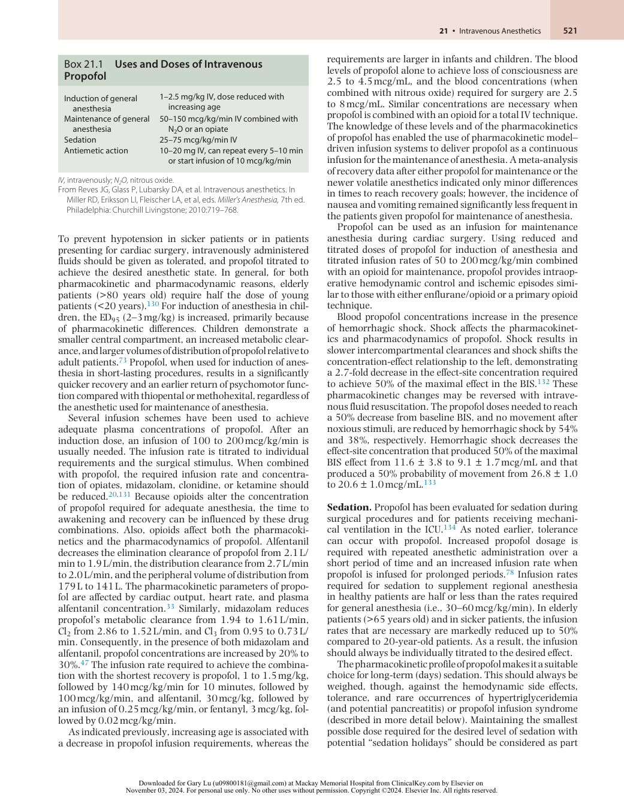

:::

<!-- PDF page 11 -->

of a long- term propofol sedation regimen. In addition, the FDA has specifically recommended against the use of propofol for the prolonged sedation of pediatric patients. The sedation guidelines of the American College of Critical Care Medicine also recommend “that patients receiving propofol for long- term sedation should be monitored for unexplained metabolic acidosis or arrhythmias. Drugs other than propofol should be considered for patients with escalating vasopressor or inotrope requirements or cardiac failure during large dose propofol infusions.” The recommended maximal dose of propofol infusion rate is 80 mcg/kg/min (&lt;5 mg/ kg/h).135 Generally, at propofol infusion rates more rapid than 30 mcg/kg/min, patients are amnesic.

### Side Effects and Contraindications

In December 2016 the FDA issued a warning raising concerns about the potential risks to fetal brain development with general anesthetics, including propofol. Animal studies show that prolonged or repetitive propofol exposure to the developing fetal brain may be related to propofol neurotoxicity. Minimizing fetal exposure to propofol and other general anesthetics is therefore important and advisable.136–138

Induction of anesthesia with propofol is often associated with pain on injection, myoclonus, apnea, hypotension, and, rarely, thrombophlebitis of the vein into which propofol is injected.139 Pain on injection is reduced by using a large vein, avoiding veins in the dorsum of the hand, and adding lidocaine to the propofol solution or changing the propofol formulation. Multiple other drugs and distraction techniques have been investigated to reduce the pain on injection of propofol. Pretreatment with a small dose of propofol, opiates, nonsteroidal anti- inflammatory drugs, ketamine, esmolol/metoprolol, magnesium, a flash of light, clonidine/ephedrine combination, dexamethasone, and metoclopramide all have been tested with variable efficacy.

Propofol infusion syndrome is a rare, potentially fatal syndrome. It is associated with infusion of propofol at 4 mg/ kg/h or more for 48 hours or longer,140 although cases have been reported with lower dosage administered for as short as 3 hours.141 It was first described in children, but subsequently has been observed in critically ill adults.142,143 The clinical features of propofol infusion syndrome are acute refractory bradycardia leading to asystole, in the presence of one or more of the following: metabolic acidosis (base deficit >10 mmol/L−1 ), rhabdomyolysis, hyperlipidemia, and enlarged or fatty liver. Other features include cardiomyopathy with acute cardiac failure, skeletal myopathy, hyperkalemia, hepatomegaly, and lipemia. The symptoms and signs are the result of muscle injury and of the release of intracellular toxic contents. The major risk factors for its development are poor oxygen delivery, sepsis, serious cerebral injury, and large propofol dosage. Predisposing factors for the propofol infusion syndrome are likely genetic disorders impairing fatty acid metabolism, such as mediumchain acyl CoA (MCAD) deficiency and low carbohydrate supply. Because lipemia has been noted, a failure of hepatic lipid regulation, possibly related to poor oxygenation or a lack of glucose, may be the cause. In some cases, an increasing lipemia was the first indication of impending propofol infusion syndrome onset, so lipemia is a sign.

### BARBITURATES

### History

Barbiturates were discovered in the early 20th century. The first barbiturate administered to achieve loss of consciousness was hexobarbital. After the clinical introduction of thiopental by Waters and Lundy in 1934, thiopental became preferred clinically because of its rapid onset of action and short duration, without the excitatory effects of hexobarbital.144 Although criticized after many casualties during the attack on Pearl Harbor as “the cause of more fatal casualties among the servicemen at Pearl Harbor than were the enemy bombs,” the barbiturates continued to be widely used in clinical practice.145 Many other barbiturate derivatives have been synthesized throughout the past decades, yet none have enjoyed the clinical success and popularity of thiopental.

### Physicochemical Characteristics

**Chemistry and Formulation.** Barbiturates are hypnotically active drugs that are derivatives of barbituric acid (2, 4,6- trioxohexahydropyrimidine), a hypnotically inactive pyrimidine nucleus that is formed by the condensation of malonic acid and urea (Fig. 21.5). The two major classes of barbiturates are the oxybarbiturates and thiobarbiturates with either an oxygen at position 2 or with a sulfur in position 2, respectively. Through keto- enol tautomerization, the oxygen or sulfur in position 2 becomes a reactive species in the enol form. This allows for the formation of watersoluble barbiturate salts in alkaline solutions and permits the IV use of barbiturates. Although tautomerization to the enol form allows for the creation of salts, the substitution of the hydrogen attached to the carbon atom in position 5 with aryl or alkyl groups gives the barbiturates their hypnotic activity. Only thiopental and thiamylal, thiobarbiturates, and methohexital, an oxybarbiturate, have been used for induction of anesthesia (Fig. 21.6). The formulation of barbiturates involves preparation as sodium salts (mixed with 6% by weight anhydrous sodium carbonate) and then reconstitution with either water, glucose 5%, or normal saline to produce a 2.5% solution of thiopental, a 2% solution of thiamylal, or a 1% solution of methohexital. The thiobarbiturates are stable for 1 week if refrigerated after reconstitution, and methohexital remains available for use for 6 weeks after reconstitution. Barbiturates cannot be reconstituted with lactated Ringer solution or mixed with other acidic solutions, as a decrease in the alkalinity of the solution can result in precipitation of the barbiturates as free acids. Examples of drugs that are not to be co- administered or mixed in solution with the barbiturates

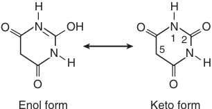

H H O N OH O N O 1 2 N 5 N H H O O Enol form Keto form = — — = = — — — — = = 

**Fig. 21.5** The keto and enol tautomeric forms of barbituric acid with the sites of substitution in the hypnotically active barbiturates identified as 1, 2, and 5.

<!-- PDF page 12 -->

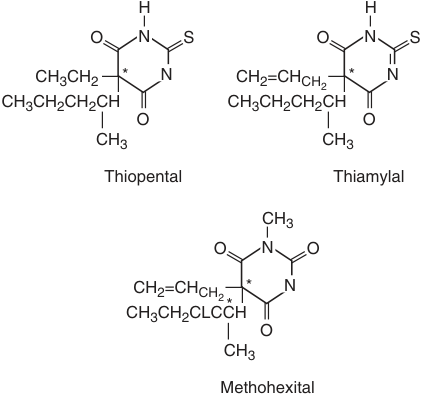

H H O N S O N S CH3CH2 — * N CH2=CHCH2— * N CH3CH2CH2CH CH3CH2CH2CH O O CH3 CH3 Thiopental Thiamylal CH3 O N O CH2=CHCH2—* * N CH3CH2CLCCH O CH3 Methohexital = = = = = = — — — — — = = — — — — = — 

**Fig. 21.6** Hypnotically active barbiturates commonly used for induction, with their asymmetric centers indicated by an asterisk.

include atracurium, vecuronium, rocuronium, suxamethonium, alfentanil, sufentanil, dobutamine, dopamine, esketamine, and midazolam. Mixing thiopental with vecuronium or pancuronium results in the formation of precipitate that may occlude the IV line during a rapid sequence induction of anesthesia.146

**Structure–Activity Relationships.** As noted earlier, substitutions at the 5, 2, and 1 positions confer different pharmacologic activities to the barbiturate nucleus. Substitutions at position 5 with either aryl or alkyl groups produce hypnotic and sedative effects, whereas substitution at C5 with a phenyl group produces anticonvulsant activity. An increase in length of one or both side chains of an alkyl group at C5 increases hypnotic potency. Barbiturates used in clinical practice have either an oxygen or sulfur at C2. Substitution of a sulfur at position 2 produces a more rapid onset of action, as with thiopental. The addition of a methyl or ethyl group at position 1 also may produce a more rapid onset of action, as with methohexital. However, excitatory side effects, including tremor, hypertonus, and involuntary movement, may occur upon administration.

### Pharmacokinetics

**Metabolism.** The barbiturates (except for phenobarbital) are metabolized hepatically. The metabolites are almost all inactive, water- soluble, and excreted in the urine. Barbiturates are biotransformed by four processes: (1) oxidation of the aryl, alkyl, or phenyl moiety at C5; (2) _N_ - dealkylation; (3) desulfuration of the thiobarbiturates at C2; and (4) destruction of the barbituric acid ring.147 Oxidation is the most important pathway, producing polar (charged) alcohols, ketones, phenols, or carboxylic acids. These metabolites are readily excreted in the urine or as glucuronic acid conjugates in the bile. Hydrolytic cleavage of the barbituric acid ring forms a minimal contribution to the total metabolism of barbiturates since the ring is stable _in vivo_ . Drugs that induce oxidative microsomes or long- term administration enhance the metabolism of barbiturates. The hepatic enzyme induction by barbiturates is the reason that they are not recommended for administration to patients with

acute intermittent porphyria. Barbiturates may precipitate an attack by stimulating γ- aminolevulinic acid synthetase, the enzyme responsible for producing porphyrins.148

As mentioned earlier, hepatic metabolism accounts for the elimination of all the barbiturates except for phenobarbital. Renal excretion accounts for 60% to 90% of phenobarbital excretion in an unchanged form. The alkalinization of urine with bicarbonate enhances the renal excretion of phenobarbital. Other barbiturates are excreted unchanged by the kidney only in trivial amounts.

Methohexital is metabolized in the liver by oxidation to an alcohol and _N_ - dealkylation. Methohexital exhibits similar distribution half- lives, volumes of distribution, and protein bindings as thiopental. A marked difference exists, however, in plasma disappearance and elimination halflives (4 hours for methohexital and 12 hours for thiopental). This difference is due to the threefold more rapid rate of hepatic clearance of methohexital (mean 7.8–12.5 mL/ kg/min).149 The hepatic extraction ratio of methohexital (clearance to hepatic blood flow) is approximately 0.5, indicating that the liver extracts 50% of the drug presented to it. This ratio differs from the smaller hepatic extraction ratio of thiopental (0.15).

Barbiturate pharmacokinetics have been described in physiologic and compartmental models.150 Both of these pharmacokinetic models describe rapid redistribution as the primary mechanism that terminates the action of a single induction dose. Physiologic models of barbiturates describe a rapid mixing of the drug within the central blood volume followed by a quick distribution of the drug to highly perfused, low- volume tissues (i.e., brain) with a slower redistribution of the drug to lean tissue (muscle), which terminates the effect of the initial (induction of anesthesia) dose. In these models, adipose tissue uptake and metabolic clearance (elimination) play only a minor role in the termination of the effects of the induction dose. This is a result of the minimal perfusion ratio of adipose tissue compared with other tissues and the slow rate of removal. Compartmental model values for thiopental and methohexital, the most commonly used barbiturates for induction of anesthesia, are given in Table 21.1. The compartmental model explains the delay of recovery when a continuous infusion of a barbiturate is used. This model describes how the termination of effect becomes increasingly dependent on the slower process of uptake into and redistribution from adipose tissue and elimination clearance through hepatic metabolism. After prolonged infusions, the pharmacokinetics of barbiturate metabolism is best approximated by nonlinear Michaelis– Menten metabolism. In usual doses (4–5 mg/kg), thiopental exhibits first- order kinetics (i.e., a constant _fraction_ of drug is cleared from the body per unit time); however, at very high doses of thiopental (300–600 mg/kg) with receptor saturation, zero- order kinetics occur (i.e., a constant _amount_ of drug is cleared per unit time). The volume of distribution is slightly larger in female patients, causing a longer elimination half- life.151 Pregnancy also increases the volume of distribution of thiopental, prolonging the elimination half- life.152 Even at advanced stages of liver cirrhosis, the clearance of thiopental is not altered. Because of its lipophilicity, relatively large volume of distribution, and low rate of hepatic clearance, thiopental can accumulate in tissues, especially if given in large doses over a prolonged period.

<!-- PDF page 13 -->

The plasma drug level increases when repeated doses of drug are given. Although not used in routine clinical practice, appropriately designed infusion schemes ensure constant blood levels, maintaining the desired hypnotic effect.

### Pharmacology

**Mechanism of Action.** The mechanisms of action of barbiturates on the CNS are largely unknown, with the exception of their action on the GABAA receptor.153,154 Perhaps the NMDA receptors are involved with the effects of barbiturates.155–157 The effects of barbiturates on the CNS have been grouped into two categories: (1) enhancement of the synaptic actions of _inhibitory_ neurotransmitters, and (2) blockade of the synaptic actions of _excitatory_ neurotransmitters.158 GABA is the principal inhibitory neurotransmitter in the mammalian CNS, and the GABAA receptor is the only site proven to be involved in barbiturate- induced anesthesia.154 The GABAA receptor is a chloride ion channel, composed of five subunits, with specific sites of action for GABA, barbiturates, benzodiazepines, and other molecules. The binding sites are at the interface of the specific subunits, where the combination of the adjacent subunits determine the affinity and selectivity for drugs like propofol, etomidate, or pentobarbital. Of each subunit multiple types exist, leading to various compositions of the GABAA receptor. Progressive insights in the composition of these binding sites may be useful in developing novel clinical anesthetics.159 Barbiturate binding to the GABAA receptor enhances and mimics the action of GABA by increasing chloride conductance through the ion channel. This causes hyperpolarization of the cell membrane and increases the threshold of excitability of the postsynaptic neuron. At low concentrations barbiturates enhance the effects of GABA, decreasing the rate of dissociation of GABA from its receptor and increasing the duration of GABA- activated chloride ion channel openings. This enhancement of the action of GABA is likely responsible for the sedative–hypnotic effects of the barbiturates. At larger concentrations, the barbiturates activate the chloride channels directly, without the binding of GABA, acting as the agonist itself. The GABA- mimetic effect at slightly higher concentrations may be responsible for what is termed barbiturate anesthesia.154 The second mechanism of action of barbiturates involves the inhibition of the synaptic transmission of excitatory neurotransmitters, such as glutamate and acetylcholine. The actions of the barbiturates to block excitatory CNS transmission are specific for synaptic ion channels. Thiopental, however, may exert GABA- independent effects on the glutaminergic- NMDA system. In two studies on effects in the rat prefrontal cortex, thiopental decreased extracellular glutamate levels in the CNS and decreased NMDA- gated currents in a concentration- dependent manner.156,157

**Effects on Cerebral Metabolism (see also Chapters 53 and 80).** Barbiturates, like other CNS depressants, have potent effects on cerebral metabolism. A dose- related depression of cerebral metabolic oxygen consumption rate (CMRO2) progressively slows the EEG, reduces the rate of adenosine triphosphate consumption, and enhances protection from partial cerebral ischemia. The relationship between depressed metabolism and drug requirement was demonstrated using a model in which thiopental was not

eliminated (i.e., sustained with an extracorporeal circulation pump).160 When the EEG became isoelectric, a point at which cerebral metabolic activity was roughly 50% of baseline,161 no further decreases in CMRO2 occurred. These findings support the hypothesis that metabolism and function of the brain are coupled. Barbiturates reduce the metabolic activity concerned with neuronal signaling and impulse traffic, not the metabolic activity corresponding to basal metabolic function. The only way to suppress baseline metabolic activity concerned with cellular activity is via hypothermia.161 The effect of barbiturates on cerebral metabolism is maximized at a 50% depression of cerebral function, leaving all metabolic energy for the maintenance of cellular integrity. With the reduction in CMRO2, there is a parallel reduction in cerebral perfusion, which is seen in decreased cerebral blood flow (CBF) and ICP. With reduced CMRO2, cerebral vascular resistance increases, and CBF decreases.162 The ratio of CBF to CMRO2 remains unchanged. Even though the mean arterial pressure (MAP) decreases, barbiturates do not compromise the overall CPP because the CPP equals MAP minus ICP. In this relationship, ICP decreases more than MAP after barbiturate administration, preserving CPP.

### Pharmacodynamics

Sufficient doses of barbiturates cause loss of consciousness, amnesia, and respiratory and cardiovascular depression, e.g., general anesthesia. The response to pain and other noxious stimulation during general anesthesia is depressed. Pain studies reveal that barbiturates may decrease the pain threshold. This anti- analgesic effect occurs only with low blood levels of barbiturates, as might be achieved with small doses of thiopental for induction of anesthesia or after emergence from thiopental. The amnesic effect of barbiturates is less pronounced than that produced by benzodiazepines.

**Effects on the Central Nervous System.** Drugs with high lipid solubility and a low degree of ionization cross the blood–brain barrier rapidly, producing a fast onset of action.154 Most barbiturates exist in a nonionized form. Thiopental and methohexital are more lipid soluble than pentobarbital, which is clinically reflected by the more rapid onset of action of thiopental and methohexital compared to pentobarbital.163 Only the nonionized form of a drug can directly traverse the cellular membranes. Thiopental has a p _K_ a of 7.6. Approximately 50% of thiopental is nonionized at physiologic pH, which accounts partly for the rapid accumulation of thiopental in the cerebrospinal fluid (CSF) after IV administration.164 Methohexital is 75% nonionized at pH 7.4, which may explain the slightly more rapid effect of methohexital compared to thiopental. As pH decreases, with poor perfusion, barbiturates have a larger fraction of nonionized drug available to cross the blood– brain barrier.164

The onset of action in the CNS is affected by protein binding, because only unbound drug (free drug) can cross the blood–brain barrier.165 Barbiturates are highly bound to albumin and other plasma proteins, where the thiobarbiturates are more highly protein bound than are the oxybarbiturates. The degree of protein binding of a drug is influenced by the physiologic pH and disease states, which alter the absolute amount of protein. Most barbiturates tend to

<!-- PDF page 14 -->

experience peak protein binding at or around pH 7.5. The final factor governing the rapidity of drug penetration of the blood–brain barrier is the plasma drug concentration, causing a concentration gradient. The two primary determinants of the plasma concentration are the _dose_ administered and the _rate_ (speed) of administration. As the dose of thiopental over the same time is increased, an increased percentage of patients will be anesthetized.166 Concerning absolute dose, 2 mg/kg produced anesthesia in 20% of patients, whereas a dose of 2.4 mg/kg produced anesthesia in 80% of patients. Similarly, the speed of injection influences the effect of thiopental. A smaller amount of drug is required to produce anesthesia when the dose rate of the administration is over 5 seconds as opposed to over 15 seconds.

Because of the equilibrium between brain concentration and plasma concentration, factors that determine the rate of onset of barbiturate effects also affect their termination. Lipid solubility, degree of ionization, and CSF drug concentration affect the movement of drug from the CSF to plasma. As plasma levels decrease, drug levels in the brain and CSF decrease. The most important factors in the termination of drug effect are those that govern plasma disappearance of the drug. These are generally divided into a rapid redistribution phase and a slow metabolic and second redistribution phase. In a classic pharmacologic study, Brodie and coworkers167 showed that awakening from thiopental occurred because the plasma concentration rapidly declined. They further showed that the cause of the rapid plasma decay of thiopental was not metabolism of the drug but was rather due to a redistribution of the drug to other tissues throughout the body. The relationship of the plasma drug level and drug redistribution to the onset and termination of effect is illustrated in Fig. 21.7. Clinically, patients awake from a single dose of thiopental 5 to 10 minutes after administration, as the drug is redistributed from highly perfused CNS tissues to well- perfused lean tissues. The termination of effect after multiple drug administrations or constant infusion depends on the elimination of the drug from the blood, which becomes increasingly more dependent on first- order metabolism than redistribution and is a function of its context- sensitive decrement time (see Fig. 21.3). Awakening may be delayed in older patients because of increased CNS sensitivity, alterations in metabolism, or decreased central volume of distribution relative to younger adults.168 The initial volume of distribution is less in elderly patients than in young patients, which explains a smaller dose requirement for the onset effect. Pediatric patients (&lt;13 years old) seem to have a more rapid rate of total clearance and a shorter rate of plasma thiopental clearance than do adults, which theoretically might result in earlier awakening, especially after multiple doses of the drug.169 There is little difference in distribution of thiopental and methohexital, which may explain the similar wakeup times. There is, however, a difference in the rate of total body clearance, being more rapid for methohexital. This disparity explains the difference found in the psychomotor skills of patients and the earlier full recovery after methohexital. Despite some residual effects, methohexital is cleared more rapidly than thiopental, which explains why methohexital is preferred for use by some clinicians when rapid awakening is desirable, such as in outpatient anesthesia. Prolongation of

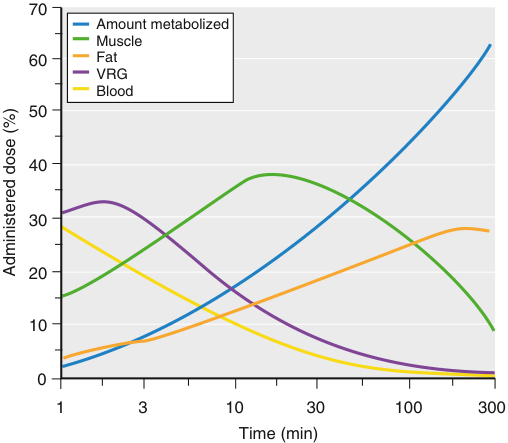

70 Amount metabolized Muscle 60 Fat VRG Blood 50 40 30 20 10 0 1 3 10 30 100 300 Time (min) Administered dose (%) 

**Fig. 21.7** After delivery of an IV bolus, the percentage of thiopental remaining in blood rapidly decreases as drug moves from blood to body tissues. The time to attainment of peak tissue levels is a direct function of tissue capacity for barbiturate relative to blood flow. A larger capacity or smaller blood flow is related to a longer time to a peak tissue level. Initially, most thiopental is taken up by the vessel- rich group (VRG) of tissues because of their high blood flow. Subsequently, drug is redistributed to muscle and to a lesser extent to fat. Throughout this period, small but substantial amounts of thiopental are removed and metabolized by the liver. In contrast to removal by tissues, this removal is cumulative. The rate of metabolism equals the early rate of removal by fat. The sum of this early removal by fat and metabolism is the same as the removal by muscle. (Redrawn from Saidman LJ. Uptake, distribution and elimination of barbiturates. In: Eger EI [ed]. _Anesthetic Uptake and Action_ . Baltimore: Williams & Wilkins; 1974.)

early and late recovery by the barbiturates is the primary reason behind the fact that they have been largely replaced by propofol.

**Effects on the Respiratory System.** Barbiturates produce dose- related central respiratory depression. The evidence for central depression is a correlation between EEG suppression and diminished minute ventilation. Peak respiratory depression (as measured by the slope of carbon dioxide concentration in the blood) and maximum depression of minute ventilation after delivery of thiopental (3.5 mg/kg) occurs 1 to 1.5 minutes after administration. These variables return to pre- drug levels rapidly, and within 15 minutes the drug effects are barely detectable.170 Patients with chronic lung disease are slightly more susceptible to the respiratory depression of thiopental. The ventilatory pattern with thiopental induction has been described as “double apnea”: that is, an initial apnea of a few seconds occurring upon drug administration, succeeded by a few breaths of reasonably adequate tidal volume, which is followed by a more prolonged period of apnea, typically of approximately 25 seconds. This apnea occurs in at least 20% of cases. During the induction of anesthesia with thiopental, ventilation must be assisted or controlled to provide adequate respiratory exchange. Like thiopental, methohexital is a central respiratory system depressant.170 Induction doses (1.5 mg/kg) significantly decrease the slope of the ventilatory response to carbon dioxide, with a maximal reduction at 30 seconds

<!-- PDF page 15 -->

after drug administration.171 The peak decrease in tidal volume occurs 60 seconds after methohexital administration. All variables return to baseline within 15 minutes. In contrast to the effects on ventilation, patients awaken within about 5 minutes after the administration of methohexital (1.5 mg/kg).

**Effects on the Cardiovascular System.** Cardiovascular depression from barbiturates is a result of central and peripheral (direct vascular and cardiac) effects. The primary cardiovascular effect of a barbiturate during induction of anesthesia is peripheral vasodilation causing a pooling of blood in the venous system. Mechanisms for the decrease in cardiac output include (1) direct negative inotropic action, due to a decrease of calcium influx into the cells, (2) decreased ventricular filling, due to increased capacitance, and (3) transiently decreased sympathetic outflow from the CNS.172 The increase in heart rate (10% to 36%) that accompanies thiopental administration probably results from the baroreceptor- mediated sympathetic reflex stimulation of the heart in response to the decrease in output and pressure. The cardiac index, as well as the MAP, is unchanged or reduced. Hemodynamic changes are dependent on the infusion rate of thiopental. In the dose ranges hitherto studied, no relationship between plasma thiopental level and hemodynamic effect has been found. There is little difference in the responses after thiopental and methohexital administration in patients with heart disease. The increase in heart rate (11%–36%) encountered in patients with coronary artery disease anesthetized with thiopental (1–4 mg/kg) is potentially deleterious because of the obligatory increase in myocardial oxygen consumption that accompanies the increased heart rate. In a study in dogs, thiopental prolonged the QT interval, flattened T waves, and increased QT dispersion during and after induction.168 Thiopental may not be the most appropriate choice for patients with a susceptibility to ventricular dysrhythmias or a prolonged QT interval, such as acidotic patients or conditions that prolong the QT interval, such as long- term dialysis or advanced cirrhosis. Patients who have normal coronary arteries have no difficulty in maintaining adequate coronary blood flow to meet the increased myocardial oxygen consumption.173 Thiopental should be avoided in hypovolemic patients because there is a significant reduction in cardiac output (69%) and a significant decrease in arterial blood pressure.174 Patients without adequate compensatory mechanisms may have serious hemodynamic depression with a thiopental induction of anesthesia.

**Other Effects.** The side effects of injecting barbiturates include a garlic or onion taste (40% of patients), allergic reactions, local tissue irritation, and rarely, tissue necrosis. A transient urticarial rash may develop on the head, neck, and trunk. More severe reactions such as facial edema, hives, bronchospasm, and anaphylaxis can occur. Treatment of anaphylaxis is symptomatic. Thiopental and thiamylal produce fewer excitatory symptoms with induction than methohexital, which produces cough, hiccups, tremors, and twitching approximately five times more often. Tissue irritation and local complications may occur more frequently with the use of thiopental and thiamylal than with methohexital.

The consequences of accidental arterial injection may be severe. The degree of injury is related to the concentration of the drug. Treatment consists of (1) dilution of the drug by the administration of saline into the artery, (2) heparinization to prevent thrombosis, and (3) brachial plexus block. Overall, the proper administration of thiopental intravenously is remarkably free of local toxicity.

Phenobarbital is used experimentally as an inducer of the cytochrome P450 (CYP) system in rodents, particularly of the CYP2B enzymes. In human hepatocyte culture, phenobarbital acts as an inducer of the CYP2B6, CYP2C9, CYP2C19, and CYP3A4 enzymes. This phenomenon may cause changes in the metabolism of drugs that are administered concomitantly.175 On the other hand, the metabolism of thiopental can be influenced by concomitant drugs like selective serotonin reuptake inhibitors (SSRIs). SSRIs are commonly administered to patients who also require electroconvulsive therapy (ECT). If thiopental or thiamylal are used for induction of anesthesia for ECT, the barbiturate dosage may require careful titration.176

### Uses

**Induction and Maintenance of Anesthesia.** Barbiturates are used clinically for induction and maintenance of anesthesia and premedication. Methohexital is the drug of choice for providing anesthesia during electroconvulsive therapy.177 Other barbiturates used in this field are thiopental and thiamylal. Less frequently, barbiturates are used to provide cerebral protection in patients at risk of developing incomplete ischemia. The three barbiturates that are most used for IV anesthesia induction and maintenance are thiopental, thiamylal, and methohexital. Thiopental is an excellent drug to use for induction of anesthesia. The prompt onset (15–30 seconds) of action and smooth induction are advantages for this drug. The rapid emergence, particularly after single use for induction, also was a reason for the widespread use of thiopental in this setting. Thiopental can be used to maintain general anesthesia because repeated doses reliably sustain unconsciousness and contribute to amnesia but should not be the drug of first choice as the hypnotic component in balanced anesthesia. A review of the role of anesthetics on the risk of awareness during surgery show that benzodiazepines reduce awareness compared to thiopental, ketamine, and placebo. Wakefulness is reduced by ketamine and etomidate, compared with thiopental. The evidence is not strong due to the risk of bias, the very small event rate, and the heterogeneity in definition of awareness.178

Methohexital is the only other IV barbiturate used for induction of anesthesia that has similar characteristics to thiopental. With a dose of 1 to 2 mg/kg, induction and emergence from anesthesia is rapid. Methohexital also may be used as a hypnotic component to maintain anesthesia. Like thiopental, it is not an analgesic. Additional opioids or volatile anesthetics are required to provide a balanced technique satisfactory for general anesthesia during surgery. Because methohexital is cleared more rapidly than thiopental, it may be preferred to thiopental for the maintenance of anesthesia, as accumulation and saturation of peripheral sites takes longer. For brief infusion (&lt;60 minutes), recovery from a methohexital infusion titrated to maintain hypnosis (50–150 mcg/kg/min) is like that provided by

<!-- PDF page 16 -->

propofol. There are probably upper limits of safe infusion doses yet to be defined, but seizures have occurred in neurosurgical patients after large doses of methohexital (24 mg/ kg).172 Methohexital may be given rectally and is absorbed rapidly and can be used as a premedication drug in pediatric patients. The dose recommended for this use is 25 mg/ kg rectal instillation (10% solution through a 14F catheter, 7 cm into rectum).179 With this method of administration, sleep onset is rapid: mean peak plasma levels occur within 14 minutes.

### Dosing

Dosing for the two most used barbiturates is listed in Table 21.4. The usual doses of thiopental (3–4 mg/kg) and thiamylal (3–4 mg/kg) are about twice the dose of methohexital (1–2 mg/kg). In dose–response studies, the ED50 for thiopental ranged from 2.2 to 2.7 mg/kg, and the ED50 for methohexital was 1.1 mg/kg.165 There is less interpatient variability in the dose response to barbiturates than to benzodiazepines when used for anesthesia induction, but there still is significant variability in the dose of thiopental required to induce anesthesia.166 Interpatient dose variability is related to the presence of hemorrhagic shock, cardiac output, lean body mass, obesity, gender, and age. Hemorrhagic shock, lean body mass, age, and obesity explain variability of patient response owing to a decrease in the central volume of distribution. Finally, patients who have severe anemia, burns, malnutrition, widespread malignant disease, uremia, ulcerative colitis, or intestinal obstruction also require smaller induction doses of barbiturates.

### Contraindications

The following conditions should be considered a contraindication for the use of IV barbiturates: (1) when there is respiratory obstruction or an inadequate airway, thiopental may worsen respiratory depression; (2) severe cardiovascular instability or shock contraindicate its use; (3) status asthmaticus is a condition in which airway control and ventilation may be worsened further by thiopental; (4) porphyria may be precipitated or acute attacks may be accentuated by the administration of thiopental; and (5) without proper induction equipment (IV instrumentation) and airway equipment (means of artificial ventilation), thiopental should not be administered.

### BENZODIAZEPINES

### Introduction

Benzodiazepines were discovered in 1954 by Sternbach and in 1959 chlordiazepoxide (Librium) was the first benzodiazepine patented. Diazepam was synthesized in 1963 in a search for a better compound and was used intravenously to induce anesthesia in 1965.180 Oxazepam (Seresta), a metabolite of diazepam, was synthesized in 1961 by Bell. Lorazepam (Ativan), a 2′chloro- substitution product of oxazepam, was synthesized in 1971 to produce a more potent benzodiazepine. The next major achievement was Fryer and Walser’s synthesis in 1976 of midazolam (Versed, Dormicum), the first clinically used water- soluble benzodiazepine, produced primarily for use in anesthesia.181 An ultra- short- acting benzodiazepine, remimazolam, was approved for procedural sedation or use in general anesthesia in 2020.207

**Table 21.4** Recommended Doses of Barbiturates for Anesthesia Induction and Maintenance

|**Drug**|**Induction Dose** **(mg/kg)***,†|**Onset (s)**|**Intravenous** **Maintenance Infusion**|
|---|---|---|---|
|Thiopental|3–4|10–30|50–100 mg every 10–12 min|
|Methohexital|1–1.5|10–30|20–40 mg every 4–7 min|

*Adult and pediatric intravenous doses are roughly the same in milligrams per kilogram.

†Methohexital can be given rectally in pediatric patients as a 20 to 25 mg/kg/ dose.

From Reves JG, Glass P, Lubarsky DA, et al. Intravenous anesthetics. In: Miller RD, Eriksson LI, Fleischer LA, et al, eds. _Miller’s Anesthesia,_ 7th ed. Philadelphia: Churchill Livingstone; 2010:719–768.

Benzodiazepines have become a category of drugs widely used in anesthesia as anxiolytics, sedatives, and hypnotics. They exert their action through GABAA receptors, which are the key targets that mediate most of the clinically important effects of IV anesthetics.182 In the clinical practice of daily anesthesia, midazolam is often used as premedication administered prior to induction of anesthesia, for sedation in children and adults in a variety of clinical settings, as well as a part of medication management during palliative care. Less commonly used benzodiazepines include diazepam, lorazepam, and temazepam. Remimazolam, the ultrashort- acting GABAA receptor agonist, may have beneficial effects in some clinical situations as part of perioperative management.

Because of the widespread use of benzodiazepines, addiction remains a significant concern. Research is ongoing to elucidate the neural mechanism of the reward- related effects of benzodiazepines. Reynolds and associates conclude in their findings that α2- and α3- subunit- containing GABAA receptors are implicated as key mediators of the reward- related effects of benzodiazepines. This finding has important implications for the development of new drugs with less addictive properties.183

### Physicochemical Characteristics

Four benzodiazepine receptor agonists are commonly used in anesthesia: midazolam, diazepam, lorazepam, and temazepam (Fig. 21.8). The physicochemical characteristics of the benzodiazepines used in anesthesia are listed in Table 21.5. These six molecules are relatively small and are lipid soluble at physiologic pH.

Of the clinically used benzodiazepines, midazolam is the most lipid soluble _in vivo_ ,184 but because of its pH- dependent solubility, it is water soluble when formulated in a buffered acidic medium (pH 3.5). The imidazole ring of midazolam accounts for its stability in solution and its lipophilicity due to rapid closing of the imidazole ring at physiologic pH. The high lipophilicity of the compounds accounts for the rapid CNS effect and relatively large volumes of distribution.

### Pharmacokinetics

The four benzodiazepines used in anesthesia are classified as short- acting (midazolam), intermediate- acting (lorazepam, temazepam), and long- acting (diazepam), according to their metabolism and plasma clearance (Table 21.6). The

::: details 原始表格與符號（PDF 第 16 頁）

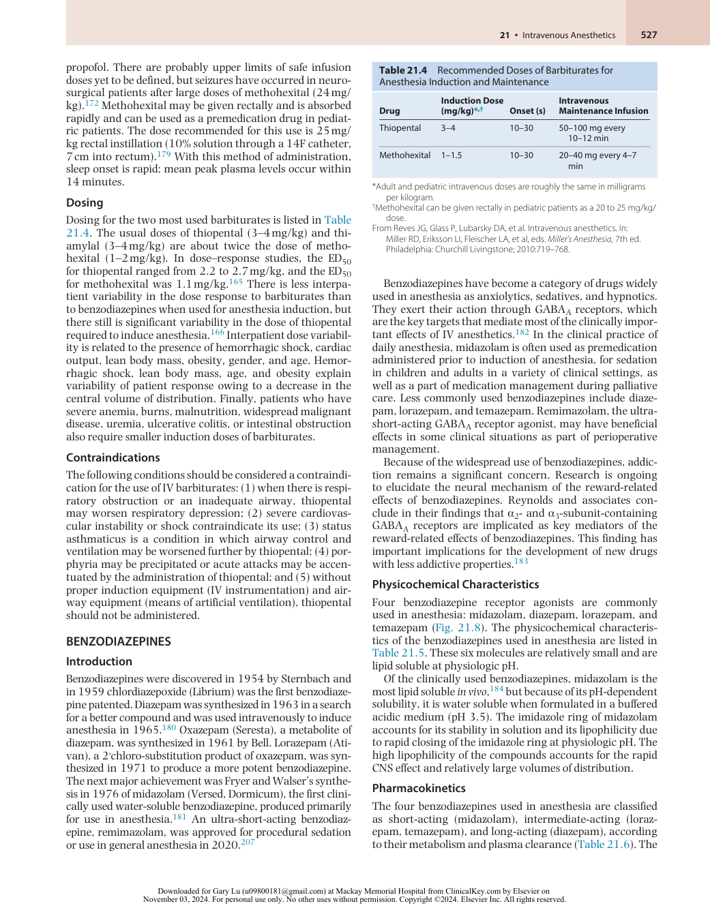

:::

<!-- PDF page 17 -->

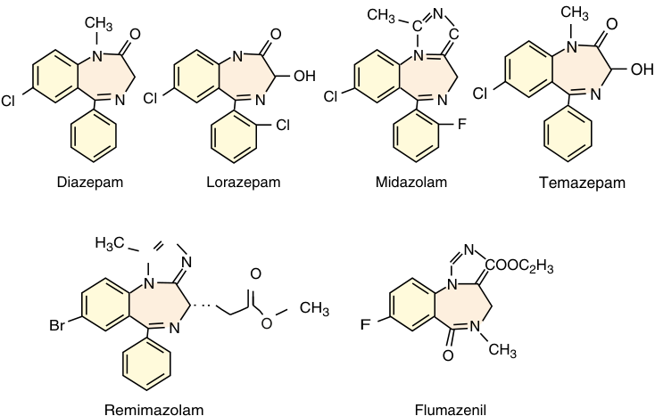

CH3 N CH3 CH3 C O O O C N N N N OH OH Cl N Cl N Cl N Cl N Cl F Diazepam Lorazepam Midazolam Temazepam H3C N N O COOC2H3 N N CH3 Br N O F N O CH3 Remimazolam Flumazenil 

**<mark>Fig. 21.8 The structures of six benzodiazepines.</mark>**

**Table 21.5** Physicochemical Characteristics of Benzodiazepines

||**Molecular** **Weight**|**p****_K_a**|**Water** **Solubility**|**Lipid** **Solubility**|
|---|---|---|---|---|
||**Da**||**g/L**|**Log P**|
|Diazepam|284.7|3.4|0.051|2.801|
|Lorazepam|321.2|1.3|0.12|2.382|
|Temazepam|300.7|1.6, 11.7|0.28|2.188|
|Midazolam|325.8 (hydrochloride 362.2)|6.0|0.004 (2.0, pH 1)|3.798|
|Remimazolam|439.3 (besylate 597.5)|5.3|0.008 (7.5, pH 1)|3.724|
|Flumazenil|303.3|0.86|0.042|2.151|

Water solubility values are in unbuffered water, maximal solubility at acidic pH in parenthesis. Data from http://scifinder.cas.org. _pKa_ , dissociation constant.

From Saari TI, Uusi- Oukari M, Ahonen J, Olkkola KT. Enhancement of GABAergic activity: neuropharmacological effects of benzodiazepines and therapeutic use in anesthesiology. _Pharmacol Rev_ . 2011;63(1):243–267.

plasma disappearance curves of all benzodiazepines can be best described by a two- or three- compartment model.

Protein binding and volumes of distribution are not much different among these four benzodiazepines, but the clearance is significantly different. Factors that may influence the pharmacokinetics of benzodiazepines are age, gender, race, enzyme induction, and hepatic and renal disease. In addition, the pharmacokinetics of the benzodiazepines are affected by obesity. The volume of distribution is increased as drug diffuses from the plasma into the adipose tissue. Although clearance is not altered, elimination half- lives are prolonged, owing to the increased volume of distribution and delayed return of the drug to the plasma in obese patients.185 Generally, sensitivity to benzodiazepines in some patient groups, such as elderly patients, is greater

despite relatively modest pharmacokinetic changes; factors other than pharmacokinetics must be considered when these drugs are used.

**Midazolam.** After oral ingestion midazolam is absorbed completely and the peak plasma concentration is achieved in 30 to 80 minutes.186 The bioavailability is less than 50% due to a significant first- pass metabolism in the intestinal wall and the liver.186,187 After IV administration, midazolam is rapidly distributed, with a distribution half- life of 6 to 15 minutes.187 The plasma protein binding is high: 94% to 98%.

The hepatic extraction ratio is low, ranging from 0.30 to 0.44, but is higher than the unbound free fraction of midazolam in plasma.186 Thus, the protein binding is not a restrictive factor in drug extraction by the liver. With this intermediate hepatic extraction ratio, the metabolic clearance of midazolam may be susceptible both to changes in enzyme activity and to changes in hepatic blood flow.

The elimination half- life ranges from 1.7 to 3.5 hours.187,188 The plasma clearance ranges from 5.8 to 9.0 mL/kg/min and is higher compared to that of the other benzodiazepines. This is due to the fused imidazole ring, which is rapidly oxidized _in vivo_ – much more rapidly than the methylene group of the diazepine ring of other benzodiazepines.189

The pharmacokinetics of midazolam are affected by obesity, age, hepatic cirrhosis, and severity of critical illness. Because of its high lipophilicity (at physiologic pH), midazolam distributes preferably to adipose tissue, resulting in a prolonged elimination half- life in obese patients.185 Liver cirrhosis reduces plasma clearance of midazolam due to decreased metabolism.190

Midazolam is metabolized by CYP3A4 and CYP3A5191 to 1- hydroxymethylmidazolam (= α- hydroxymidazolam) and 4- hydroxymidazolam.192 These metabolites possess similar sedative activities compared to the parent compound and, when given over a longer time, these metabolites may accumulate. These metabolites are rapidly

::: details 原始表格與符號（PDF 第 17 頁）

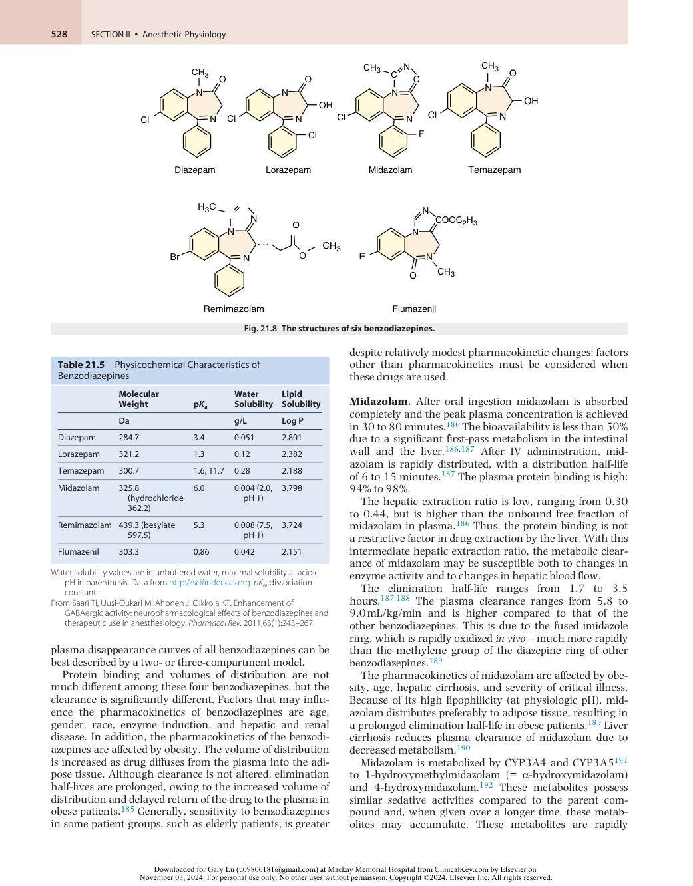

:::

<!-- PDF page 18 -->

**Table 21.6** Pharmacokinetic Parameters of the Benzodiazepines

||**Elimination** **half- life (h)**|**Clearance** **(mL/kg/min)**|**Vd (L/kg)**|**Plasma Protein** **Binding (%)**|**Reference**|
|---|---|---|---|---|---|
|Midazolam|1.7–3.5|5.8–9.0|1.1–1.7|94–98|Dundee et al. (1984)|
|Diazepam|20–50|0.2–0.5|0.7–1.7|98–99|Greenblatt et al. (1980)|
|Lorazepam|11–22|0.8–1.5|0.8–1.3|88–92|Greenblatt et al. (1979)|
|Temazepam|6–8|1.0–1.2|1.3–1.5|96–98|Fraschini and Stankov (1993)|
|Remimazolam*|0.4|4521 mL/min|36.4 L|N.A.|Upton et al. (2010)|
|Flumazenil|0.7–1.3|13–17|0.9–1.9|40–50|Klotz and Kanto (1998)|

_N.A_ ., not available. *Noncompartmental analysis results from sheep. From Saari TI, Uusi- Oukari M, Ahonen J, Olkkola KT. Enhancement of GABAergic activity: neuropharmacological effects of benzodiazepines and therapeutic use in anesthesiology. _Pharmacol Rev_ . 2011;63(1):243–267.

conjugated and excreted in the urine and have, like midazolam, a marked increase in peripheral volume of distribution in obese/overweight adolescents.193 In comparison, 1- hydroxymethylmidazolam is less potent than its parent compound, the affinity to the receptor is about 60%, and weaker than that of midazolam. The metabolites are cleared more rapidly than midazolam itself, making them of little concern in patients with normal hepatic and renal function. In patients with renal impairment, though, they can cause profound sedation.194

**Diazepam.** After oral ingestion the bioavailability is about 94%.195 Time to peak plasma concentrations after oral ingestion is approximately 60 minutes.196 Diazepam is extensively bound to plasma proteins; the volume of distribution ranges from 0.7 to 4.7 L/kg. The plasma clearance of diazepam ranges from 0.2 to 0.5 mL/kg/min.197

The pharmacokinetics of diazepam are affected by obesity and liver dysfunction and particularly by age. Increasing age reduces the clearance of diazepam significantly.198

Metabolism occurs in the liver and is mediated mainly by CYP2C19 and CYP3A4. This accounts for 80% of the biotransformation of diazepam.199–201 The metabolite _N_ - desmethyldiazepam has pharmacodynamic characteristics similar to those of diazepam but has a much slower elimination half- life extending to 200 hours. _N_ - desmethyldiazepam is further metabolized to oxazepam, which is also pharmacologically active.

Temazepam, another metabolite of diazepam, is mainly conjugated to temazepam glucuronide and a smaller part is demethylated to oxazepam and thereafter conjugated to oxazepam glucuronide.202

**Lorazepam.** The oral bioavailability is high, nearly 90%. Peak plasma concentrations are reached approximately 2 hours after oral ingestion; the mean elimination half- life is 15 hours, with a range of 8 to 25 hours.203 Lorazepam has a large volume of distribution from 0.8 to 1.3 L/kg,204 and it is highly bound to plasma proteins (>90%).

The clearance of lorazepam is 0.8 to 1.8 mL/kg/min. Lorazepam is conjugated in the liver to an inactive glucuronide and up to 70% is excreted in urine. The pharmacokinetics of lorazepam is little altered by age, and not altered by gender or renal disease, but clearance is decreased by hepatic dysfunction.205

**Remimazolam.** Remimazolam has a structure similar to midazolam and is a high- affinity, selective ligand for the GABAA receptor’s benzodiazepine site while lacking affinity for other sites. A novel class of ultra- short- acting sedative/ anesthetic has been created by altering the chemical makeup of midazolam to include a carboxylic ester side group. The ultra- short activity of the medication is caused by the quick breakdown of this carboxylic ester into the inactive metabolite CNS7054 by tissue esterases. In humans, remimazolam is eliminated by first- order pharmacokinetics, with no clear relationship registered between body weight and elimination clearance. Accumulation after prolonged infusion is unlikely. The clearance of remimazolam was rapid (overall mean clearance 70.3 ± 13.9 L/h) and the volume of distribution moderately large (steady- state volume of distribution is 34.8 ± 9.4 L).206 The extent and duration of remimazolam sedation are dose- dependent due to its firstorder pharmacokinetics and organ- independent metabolism, and long- term infusions or greater dosages will not produce cumulative and prolonged sedative effects. Additionally, flumazenil can effectively reverse remimazolam sedation (1 minute reversal with flumazenil versus 10.5 minutes with placebo) without causing resedation of the patient.207,208 Remimazolam trials conclude a safe administration for procedural sedation and anesthetic use. It allows a faster recovery of neuropsychiatric function compared to midazolam. There are no clinical effects on heart rate (HR), electrocardiogram (ECG), blood pressure (BP), and respiratory rate.209 The pharmacokinetics of remimazolam did not change significantly between healthy people and people with end- stage renal failure.210 In individuals with hepatic failure, remimazolam should be administered with caution during anesthesia or sedation maintenance. Although the PK of remimazolam is unchanged by age, ASA class, sex, or race, lower infusion dosages should be taken into consideration for the frail elderly or patients who are ASA class 3+. Remimazolam has been shown to have the potential to be an effective treatment for gastrointestinal endoscopy in all clinical studies, with a sedative success rate that is comparable to propofol but greater than midazolam and with improved safety.

### Pharmacodynamics

Benzodiazepines act selectively at the GABAA receptor, which mediates fast inhibitory synaptic transmission in

::: details 原始表格與符號（PDF 第 18 頁）

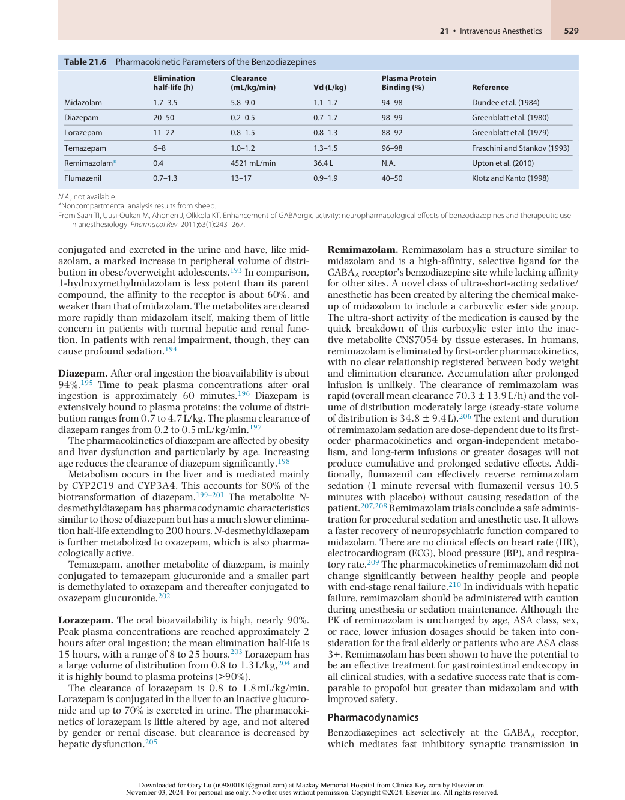

:::

<!-- PDF page 19 -->

the CNS. Benzodiazepines enhance the response to GABA by facilitating the opening of the GABA- activated chloride channels resulting in hyperpolarization. A series of compounds are candidates as endogenous ligand of the GABAA receptor, such as diazepam-binding inhibitor and other substances. This is an area of ongoing research.211

**Effects on the Central Nervous System.** All benzodiazepines have hypnotic, sedative, anxiolytic, amnesic, anticonvulsant, and centrally produced muscle- relaxing properties. They may differ to some extent in their potency and efficacy regarding some of these pharmacodynamic actions (e.g., anticonvulsive action). The neurotransmitter GABA is an inhibitory neurotransmitter and controls the state of a chloride ion channel. Activation of this chloride ion channel results in neuronal hyperpolarization (increased membrane potential in the direction away from the threshold potential) and accounts for the classification of the GABA system as “inhibitory.” Benzodiazepines bind to their receptors with high affinity; the binding is stereospecific and saturable; the order of receptor affinity (potency) of three agonists is lorazepam > midazolam > diazepam. Midazolam is approximately 3 to 6 times, and lorazepam 5 to 10 times, as potent as diazepam.212 As indicated previously, the mechanism of action of benzodiazepines is reasonably well understood.213,214 The interaction of benzodiazepine ligands with the GABAA receptor is one of the few examples in which the complex systems of biochemistry, molecular pharmacology, genetic mutations, and clinical behavioral patterns can to some extent be explained. GABAA subtypes mediate the different effects (amnesic, anticonvulsant, anxiolytic, and sleep).214 The GABAA receptor is a pentameric assembly built from 18 or more subunits (Fig. 21.9). Many different combinations of this pentameric assembly occur in different parts of the brain; linking this diversity to physiologic function and pharmacologic specificity may be possible. The α subunit of the pentameric complex occurs in six isoforms (α1–α6).205 Sedation, anterograde amnesia, and anticonvulsant properties are mediated via α1 subunits of the GABAA receptors,214 and anxiolysis and muscle relaxation are mediated via the α2 subunits. The “benzodiazepine receptors” are found in highest densities in the olfactory bulb, cerebral cortex, cerebellum, hippocampus, substantia nigra, and inferior colliculus, where lower densities in the striatum, lower brainstem, and spinal cord are found. Spinal cord benzodiazepine receptors can play an important role in analgesia; however, further elucidation of the mechanism of action of this drug class is required.215 Intrathecal midazolam reduces excitatory GABA- mediated neurotransmission in interneurons, leading to a decrease in the excitability of spinal dorsal horn neurons.215 A meta- analysis shows that intrathecal midazolam improves perioperative analgesia and reduces nausea and vomiting.216

The benzodiazepines reduce the CMRO2 in a dose- related manner. Midazolam and diazepam maintain a relatively normal ratio of CBF to CMRO2.217 Midazolam, diazepam, and lorazepam all increase the seizure initiation threshold to local anesthetics and decrease the mortality rate in mice exposed to lethal doses of local anesthetics. Midazolam has neuroprotective effects by preventing lipid peroxidation and mitochondrial damage. There are indications in rats that

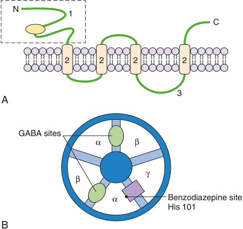

N 1 C 2 2 2 2 3 A GABA sites α β γ β α Benzodiazepine site His 101 B 

**Fig. 21.9 Schematics of GABAA receptor structure and function.** (A) Topography of a GABAA receptor subunit partially embedded in the lipid bilayer. _1_ , N- terminal extracellular domain responsible for transmitter and ligand binding and coupling of the binding sites with ion channel. This part is also important for the assembly of various receptor subunits into functional receptors. _2_ , four transmembrane segments forming the anion channel are responsible for binding of hydrophobic ligands, ion selectivity, and channel binding sites. _3_ , intracellular loop between transmembrane segments 3 and 4 forms the domain for regulatory phosphorylation sites and for the intracellular factors anchoring the receptors in appropriate locations. (B) Hypothetical binding sites for GABA and benzodiazepines ligands in a pentameric receptor complex. (From Saari TI, Uusi- Oukari M, Ahonen J, Olkkola KT. Enhancement of GABAergic activity: neuropharmacological effects of benzodiazepines and therapeutic use in anesthesiology. _Pharmacol Rev_ . 2011;63[1]:243–267.)

the peripheral benzodiazepine receptor is involved in these actions.218

**Effects on the Respiratory System.** Benzodiazepines, like most IV anesthetics, produce dose- related central respiratory system depression. The benzodiazepines affect respiration in two different ways. First, they have an effect on the muscular tone leading to an increased risk of upper airway obstruction.219 Second, they flatten the response of the respiratory curve to carbon dioxide.220 In addition, sedative doses of midazolam depress the hypoxic ventilatory response in humans.221

Benzodiazepines and opioids produce additive or supraadditive (synergistic) respiratory depression, even though they act at different receptors.222 Old age, debilitating disease, and other respiratory depressant drugs increase the incidence and degree of respiratory depression and apnea by benzodiazepines.

**Effects on the Cardiovascular System.** The hypothalamic paraventricular nucleus (PVN) is an important site for autonomic and endocrine homeostasis of the cardiovascular system. The PVN integrates afferent stimuli to regulate blood volume; the rostral ventrolateral medulla is the dominant brain region for tonic regulation of arterial blood pressure.223 Under normal circumstances, the sympathetic nervous system is tonically inhibited. This inhibition is dependent on GABA- ergic signaling and nitric oxide.224

<!-- PDF page 20 -->

Benzodiazepines, when used alone, have modest hemodynamic effects. The predominant hemodynamic change is a minimal decrease in arterial blood pressure, resulting from a decrease in systemic vascular resistance. The mechanism by which benzodiazepines maintain relatively stable hemodynamics involves the preservation of homeostatic reflex mechanisms. The hemodynamic effects of midazolam and diazepam are dose related; however, there is a plateau plasma drug effect above which little change in arterial blood pressure occurs. The plateau plasma level for midazolam is 100 ng/mL, and that for diazepam is about 900 ng/mL. Heart rate, ventricular filling pressures, and cardiac output are maintained after induction of anesthesia with benzodiazepines. More recent studies using heart rate variability variables as measurements to evaluate the effect of benzodiazepines on autonomic neurocardiac regulation conclude a biphasic effect. First, the vagal tone reduces and second, the cardiac pacemaker may decrease using intravenous premedication doses. In patients with increased left ventricular filling pressures, diazepam and midazolam produce a “nitroglycerin- like” effect by decreasing the filling pressure and increasing cardiac output. Notably, the stress of endotracheal intubation and surgery are not blocked by midazolam.

### Drug Interactions

**Pharmacokinetic Drug Interactions.** The pharmacokinetics of benzodiazepines may be altered by drug interactions. As cytochrome P450 is often involved in the metabolism of the benzodiazepines, drugs inducing or inhibiting CYP function often cause alterations in the pharmacokinetics of the benzodiazepines.

CYP- mediated drug interactions have extensively been examined utilizing midazolam, which is almost completely metabolized by CYP, particularly CYP3A4.

The inhibition of CYP3A by concomitantly administered drugs like – among many others – the azole antifungal agents results in significant inhibition of the metabolism of midazolam.225 Orally administered midazolam is especially affected by these inhibitors due to reduction of the first- pass metabolism elimination.226

Diazepam is primarily metabolized by CYP2C19 and CYP3A4. Different CYP2C19 alleles have varying activity, which results in ultra- rapid, extensive, intermediate, and poor metabolizer genotypes.227,228 Pharmacokinetics and pharmacodynamics vary among these different metabolizers.229,230 Strong inhibitors of CYP3A4 have a minor effect on the pharmacokinetics of diazepam.231,232 Inhibitors of CYP2C19 like omeprazole, fluvoxamine, and ciprofloxacin consequently increase the plasma half- life of diazepam substantially.233–235 The clearance of lorazepam is affected by probenecid and valproic acid, both of which decrease the formation clearance of lorazepam glucuronide.236,237 Remimazolam is not metabolized by CYP- dependent mechanisms, which decreases the chances of significant drug interactions occurring.

**Pharmacodynamic Drug Interaction.** All benzodiazepines act on the CNS and interact with other drugs targeting the CNS, particularly those causing CNS depression.

In anesthetic practice, opioids are often combined with benzodiazepines, which interact in a synergistic manner.238

The interaction between midazolam and ketamine is additive,239 while the interaction between the hypnotic effects of thiopental and midazolam and of propofol and midazolam are synergistic.240,251

### Uses

**Premedication.** Benzodiazepines are the most commonly administered drugs for premedication. The goals of administration include anxiolysis, sedation, amnesia, vagolysis, and sympathicolysis, and reduction of PONV.241 The amnestic effects are anterograde; retrograde memory is not affected.

Diazepam, lorazepam, and midazolam are given orally or intravenously for preoperative sedation. Midazolam is the most frequently used benzodiazepine for premedication in both adults and children.242 The usual oral dose for adults ranges from 7.5 to 15 mg for midazolam, from 5 to 10 mg for diazepam, and from 10 to 20 mg for temazepam.243 Many factors including age, ASA physical status, level of anxiety, and type and length of surgery determine the dose. Lorazepam is mostly used when a prolonged and intense anxiolysis is pursued, like in cardiac surgery. Typically, 2 to 4 mg lorazepam is administered orally 2 hours before anesthesia and surgery.244

For pediatric patients midazolam is available in several preparations (including a formulation for intranasal administration in some countries); all preparations are well- tolerated. The dose of 0.025 mg/kg produces sedation and anxiolysis in 10 to 20 minutes.

Midazolam has minimal effects on respiration and oxygen saturation in adults, even in doses up to 1.0 mg/kg with a maximum of 20 mg.

Administration of benzodiazepines for premedication are well tolerated with no evidence of increased mortality. A supplementary examination of the Peri- interventional Outcome Study in the Elderly (POSE) data failed to uncover a clear link between premedication with benzodiazepines and 30- day mortality in people aged 80 or older. Point estimates suggested that individuals using benzodiazepines had a lower 30- day death rate.245

**Sedation.** Relief of anxiety and lack of recall of unpleasant events during minor surgical and diagnostic procedures are the primary objectives of good sedation. Appropriately used sedation improves patient satisfaction.241 Patients are seemingly conscious and coherent during sedation with benzodiazepines, yet they are amnesic for the procedure and events.246 For this use drugs should be given by titration; end points of titration are adequate sedation or dysarthria (Table 21.7). The onset of action is rapid with midazolam, usually with a peak effect reached within 2 to 3 minutes of administration; time to peak effect is slightly longer with diazepam and even longer still with lorazepam. The duration of action of these drugs are dose dependent. Although the onset is more rapid with midazolam than with diazepam after bolus administration, the recovery is similar, probably because both drugs have similar early plasma decay (redistribution) patterns247 (Fig. 21.10). With lorazepam, sedation and particularly amnesia are slower in onset and are longer lasting than with the other two benzodiazepines.248 Lorazepam is particularly unpredictable regarding duration of amnesia, and this is undesirable in patients who wish or

<!-- PDF page 21 -->

**Table 21.7** Uses and Doses of Intravenous Benzodiazepines

||**Midazolam**|**Diazepam**|**Lorazepam**|**Remimazolam**|
|---|---|---|---|---|
|Induction|0.05–0.15 mg/kg|0.3–0.5 mg/kg|0.1 mg/kg|2.5–5.0 mg 0.05 mg/kg|
|Maintenance|0.05 mg/kg prn|0.1 mg/kg prn|0.02 mg/kg prn|1 mg/kg/h|
||1 mcg/kg/min||||
|Sedation*|0.5–1 mg repeated|2 mg repeated|0.25 mg repeated|2.5–5 mg repeated|
||0.07 mg/kg IM||||

_IM,_ intramuscular; _prn,_ as required to keep patient hypnotic and amnesic. *Incremental doses given until desired degree of sedation is obtained. From Reves JG, Glass P, Lubarsky DA, et al. Intravenous anesthetics. In: Miller RD, Eriksson LI, Fleischer LA, et al, eds. _Miller’s Anesthesia,_ 7th ed. Philadelphia: Churchill Livingstone; 2010:719–768. And references 15, 18, and 19.

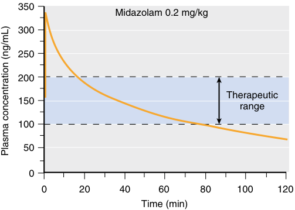

350 Midazolam 0.2 mg/kg 300 250 200 Therapeutic 150 range 100 50 0 0 20 40 60 80 100 120 Time (min) Plasma concentration (ng/mL) 

**Fig. 21.10** Simulated time course of plasma levels of midazolam after an induction dose of 0.2 mg/kg. Plasma levels required for hypnosis and amnesia during surgery are 100 to 200 ng/mL, with awakening usually occurring at levels less than 50 ng/mL.

need to have recall in the immediate postoperative period. The degree of sedation, the reliable amnesia, and the preservation of respiratory and hemodynamic function are better with benzodiazepines than with other sedative–hypnotic drugs used for conscious sedation. When midazolam is compared with propofol for sedation during procedures, the two are generally similar except that emergence or wake- up is more rapid with propofol. Sedation with propofol is safe in the hands of well- trained nonanesthetic professionals.249,250

A number of studies demonstrate that remimazolam has a favorable profile as a sedative for upper gastrointestinal endoscopy; the time to recovery was shorter and more consistent than that observed after the use of midazolam.206 The effectiveness of remimazolam has been shown to be noninferior to the use of propofol. Emergent adverse events were lower in the remimazolam group than in the propofol group.251 Remimazolam can also be safely used as a sedative during bronchoscopy. Compared to midazolam, remimazolam facilitated a quicker start time for bronchoscopy, quicker time to full alertness, and superior restoration of neuropsychiatric function after the procedure.252

Two studies report the use of midazolam during cesarean section either for sedation in preeclamptic parturients or prevention of nausea and vomiting; they showed that

a single IV dose of midazolam was safe, with no deleterious impact on Apgar scores, neurobehavioral scores, continuous oxygen saturation, or the ability of the mother to recall the birth events.253 Nitsun and associates found that 0.005% of the maternal dose of midazolam is transferred into the breast milk during a 24- hour milk collection.254 Although verification of these findings is needed, they highlight an important clinical use of midazolam that may be safe for mother and infant.

Sedation for longer periods of time as is often required for critically ill patients can also be achieved with benzodiazepines. At the same time, prolonged infusion may result in accumulation of drug and, in the case of midazolam, significant concentration of the active metabolite. Reviews have identified both concerns and advantages of benzodiazepine sedation.255 The main advantages include amnesia and hemodynamic stability, where the disadvantage is the potential lingering sedative effect after termination of the infusion when compared with propofol and a higher prevalence of delirium compared to dexmedetomidine. In 2018, the Society of Critical Care Medicine’s (SCCM) American College of Critical Care Medicine (ACCM) published an updated version of its pain, agitation, and delirium, immobility, and sleep (disruption) (PADIS) clinical practice guidelines for adult ICU patients.256 These guidelines suggest that sedation strategies using nonbenzodiazepine sedatives may be preferred over sedation with benzodiazepines, either midazolam or lorazepam, to improve clinical outcome in mechanically ventilated ICU patients.257 To prevent overdosing and prolonged mechanical ventilation, evidencebased sedation algorithms have evolved. Daily interruption of sedation has not proven to decrease the time to extubation of the trachea or length of hospital stay.258

### Induction and Maintenance of Anesthesia. Midazolam

is the benzodiazepine of choice for induction of anesthesia. Numerous factors influence the rapidity of action of midazolam and the other benzodiazepines when used for induction of general anesthesia, including dose, speed of injection, degree of premedication, age, ASA physical status, and concurrent anesthetic drugs. The usual induction dose of midazolam is 0.1 to 0.2 mg/kg in premedicated patients, and up to 0.3 mg/kg in unpremedicated patients. The onset of anesthesia is within 30 to 60 seconds. The halftime of equilibrium between the plasma concentration and the EEG effects is about 2 to 3 minutes.259

::: details 原始表格與符號（PDF 第 21 頁）

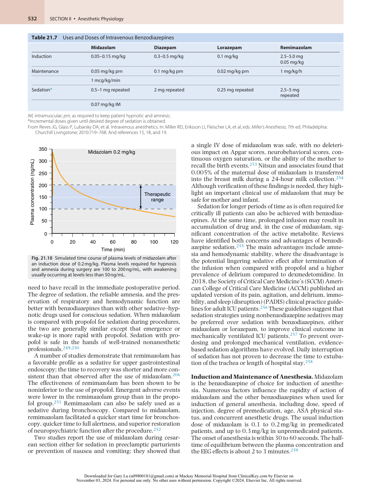

:::

<!-- PDF page 22 -->

Elderly patients require smaller doses of midazolam than younger patients (Fig. 21.11).260

When midazolam is combined with other anesthetic drugs (coinduction), often a synergistic interaction occurs, similar to that seen with propofol. This synergy is observed when midazolam is used with opioids or other hypnotics, similar to propofol in combination with opioids (Fig. 21.12).20,46,261

Emergence time is related to the dose of midazolam and to the dose of adjuvant anesthetic drugs.

Benzodiazepines lack analgesic properties and must be used with other anesthetic drugs to provide sufficient analgesia; however, as maintenance anesthetic drugs during general anesthesia, benzodiazepines provide hypnosis and amnesia. The amnesic period after an anesthetic dose is about 1 to 2 hours.

A plasma level of more than 50 to 100 ng/mL occurs when used with adjuvant opioids (e.g., fentanyl) or inhaled

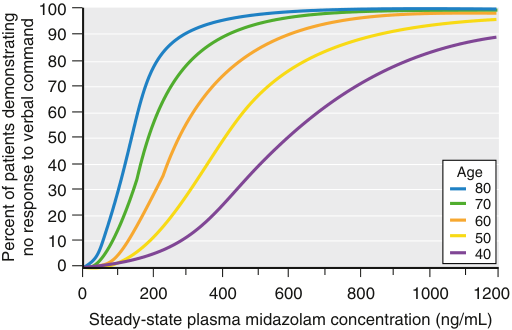

100 90 80 70 60 50 40 Age 30 80 70 20 60 10 50 40 0 0 200 400 600 800 1000 1200 Steady-state plasma midazolam concentration (ng/mL) Percent of patients demonstrating no response to verbal command 

**Fig. 21.11** Simulated quantal concentration-response curves generated by the parameterized pharmacodynamic model for midazolam. (Redrawn from Jacobs JR, Reves JG, Marty J, et al. Aging increases pharmacodynamic sensitivity to the hypnotic effects of midazolam, Anesth Analg 1995;80:143–148.)

anesthetics (e.g., nitrous oxide, volatile anesthetics) by a bolus initial dose of 0.05 to 0.15 mg/kg and a continuous infusion of 0.25 to 1 mcg/kg/min.262 This plasma level is sufficient to keep the patient asleep and amnesic but arousable at the end of surgery. Smaller infusion doses may be required in some patients or in combination with opioids. Midazolam, diazepam, and lorazepam accumulate in the blood after repeated bolus administrations or with continuous infusion. If the benzodiazepines do accumulate with repeated administration, prolonged arousal time can be anticipated. This is less of a problem with midazolam than with diazepam and lorazepam because of the shorter context- sensitive half- time and greater clearance of midazolam. Remimazolam might be a reasonable alternative; a dosing regimen of 6 mg/kg/h or 12 mg/kg/h has been administered to surgical patients with an ASA Class I, II, or III and found to be equally effective and safe.263,264

**Nausea and Vomiting Prophylaxis.** Numerous studies have highlighted the role that benzodiazepines, and specifically midazolam, may play in the prevention of PONV. A recent review and meta- analysis on the effect of midazolam on the prevention of PONV concludes a decrease in overall PONV and rescue antiemetic drug. The decreases in the frequency of PONV were larger when midazolam was taken at the induction of surgery, and the benefits were more noticeable in the early postoperative period than in the late phase.265 Jung and colleagues found that in women undergoing middle ear surgery, IV midazolam, 0.075 mg/kg after induction of anesthesia, reduced the incidence of PONV and the need for rescue antiemetics with no difference from placebo in pain intensity or drowsiness.266 Furthermore, the combination of midazolam with dexamethasone proved more effective in preventing PONV than midazolam alone.267 The incidence of PONV after minor gynecologic or urologic surgery was the same when comparing IV ondansetron, 4 mg, and IV midazolam, 2 mg.268

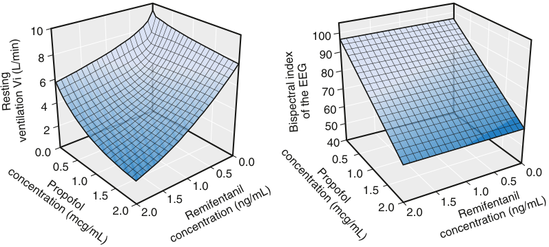

10 100 8 90 80 6 70 4 60 2 50 40 0.0 0.5 0.0 0.5 0.5 1.0 0.0 1.0 0.5 1.5 1.5 1.0 1.5 1.5 1.0 2.0 2.0 2.0 2.0 Remifentanil concentration (ng/mL) concentration (ng/mL)Remifentanil Propofol concentration (mcg/mL) Propofol concentration (mcg/mL) of the EEG Bispectral index Resting ventilation Vi (L/min) 

**Fig. 21.12** Response surface modeling of the interaction of remifentanil and propofol on resting ventilation and the bispectral index of the electroencephalogram (BIS). Population response surface showing that the propofol–remifentanil interaction on respiration is synergistic and on BIS is inert since remifentanil had no effect on bispectral index irrespective of the propofol concentrations. Over this dose range, propofol causes a linear decrease in bispectral index with a 25% decrease occurring at 1.4 mcg/mL. (From Nieuwenhuijs DJ, Olofsen E, Romberg RR, et al. Response surface modeling of remifentanil- propofol interaction on cardiorespiratory control and bispectral index. _Anesthesiology_ . 2003;98:312–322.)

<!-- PDF page 23 -->

In children, IV midazolam, 0.05 mg/kg, reduced PONV significantly after pediatric (4–12 years old) strabismus surgery compared with placebo or IV dexamethasone 0.5 mg/ kg. No child vomited with midazolam alone or with the midazolam–dexamethasone combination.269,270

Finally, in a 2010 three- arm, placebo- controlled, doubleblind clinical trial, Fuji and associates compared midazolam 0.050 mg/kg with 0.075 mg/kg in patients undergoing laparoscopic gynecologic surgery regarding PONV prophylaxis. The two doses of midazolam were not significantly different with regard to PONV (30% vs. 27% of patients experienced PONV) and both proved better than placebo (67%).271

### Side Effects and Contraindications

Benzodiazepines have limited allergenic effects and do not suppress the adrenal gland. The most significant side effect with midazolam is respiratory depression. The major side effects of lorazepam and diazepam in addition to respiratory depression are venous irritation and thrombophlebitis, problems related to aqueous insolubility and requisite solvents.181 When used as sedative or for induction and maintenance of anesthesia, benzodiazepines may produce an undesirable degree or prolonged interval of postoperative amnesia, sedation, and, rarely, respiratory depression. These residual effects can be reversed with flumazenil.272

### FLUMAZENIL

Flumazenil (Anexate, Romazicon) is the first benzodiazepine antagonist approved for clinical use.273 It is a benzodiazepine receptor ligand with high affinity, great specificity, and minimal intrinsic effect. Flumazenil, similar to the agonists it replaces at the benzodiazepine receptor, interacts with the receptor in a concentration- dependent manner. It is a competitive antagonist at the benzodiazepine receptor and produces antagonism that is reversible and surmountable. In humans, flumazenil has minimal agonist activity, which means that its benzodiazepine receptor agonist effects are very weak, significantly less than those of clinical agonists.274 Flumazenil, similar to all competitive antagonists at receptors, does not displace the agonist, but rather occupies the receptor when an agonist dissociates from the receptor. The half- time (or half- life) of a receptor- ligand bond is a few milliseconds to a few seconds, and new ligand receptor bonds are immediately formed. This dynamic situation accounts for the ability of either an agonist or an antagonist to readily occupy the receptor. The ratio of agonist to total receptors produces the effects of the agonist drug, but the antagonist can alter this ratio, depending on its concentration and dissociation constant. Flumazenil, which is an avid (high- affinity) ligand, replaces a relatively weak agonist, such as diazepam, as long as it is given in sufficient dose. Flumazenil is rapidly metabolically cleared, however, and the proportion of receptors occupied by the agonist then increases again, and the potential for rebound sedation and respiratory suppression exists (Fig. 21.13). This situation is less likely to occur when flumazenil is used to reverse midazolam, which has a more rapid clearance than other benzodiazepine agonists. Another important finding is that in the presence of extremely large doses of agonist (e.g., when a mistake in dosing has occurred, or

suicide by means of an overdose is attempted), a small dose of flumazenil attenuates the deep CNS depression (loss of consciousness, respiratory depression) by reducing the fractional receptor occupancy by the agonist without decreasing the agonist effects that occur at low fractional receptor occupancy (drowsiness, amnesia).

Conversely, large doses of flumazenil in the presence of small doses of agonist completely reverse all the agonist effects. Flumazenil can precipitate withdrawal symptoms in animals or in humans physically dependent on a benzodiazepine receptor agonist.275 However, this is generally not a problem when flumazenil is used to reverse clinical effects of benzodiazepine receptor agonists used as part of anesthesia practice.

### Physicochemical Characteristics

Flumazenil is like midazolam and other classic benzodiazepines except for the absence of the phenyl group, which is replaced by a carbonyl group (see Fig. 21.8). It forms a colorless, crystalline powder; has a dissociation constant of 1.7; and has weak but sufficient water solubility to permit its preparation in aqueous solution. Its octanol/aqueous buffer (pH 7.4) partition coefficient is 14, showing moderate lipid solubility at pH 7.4.276

### Pharmacokinetics

Flumazenil, like the other benzodiazepines, is completely (99%) metabolized in the liver; is rapidly cleared from the plasma; and has three known metabolites: _N_ - desmethylflumazenil, _N_ - desmethylflumazenil acid, and flumazenil acid.277 The metabolic end product (i.e., flumazenil acid) has no pharmacologic activity. The major metabolites identified in urine are the de- ethylated free acid and its glucuronide conjugate. Flumazenil is a short- lived compound. Box 21.2 includes a summary of its pharmacokinetics, which are described in various clinical settings.

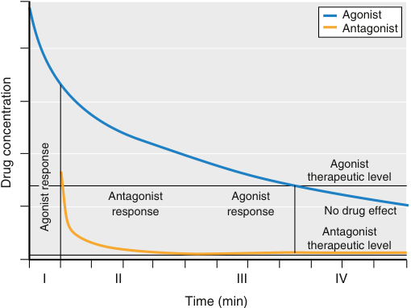

Agonist Antagonist Agonist therapeutic level Antagonist Agonist response response No drug effect Antagonist therapeutic level I II III IV Time (min) Drug concentration Agonist response 

**Fig. 21.13** Schematic representation of the interaction of a shortacting antagonist with a longer- acting agonist resulting in resedation. The _upper curve_ shows disappearance of agonist from blood, and the _lower curve_ shows disappearance of antagonist from plasma. Four conditions are represented: I, agonist response; II, antagonist response (the antagonist reverses the agonist effect); III, agonist response (resedation or resumption of agonist response with disappearance of short- lasting antagonist); and IV, no drug effect, with disappearance of agonist and antagonist (both drugs are below the therapeutic level).

<!-- PDF page 24 -->

### Box 21.2 Uses and Doses of Flumazenil

|Reversal of benzodiazepines* 0.2 mg repeated†up to 3 mg|
|---|
|Diagnosis in coma 0.5 mg repeated up to 1 mg|
|From Reves JG, Glass P, Lubarsky DA, et al. Intravenous anesthetics. In Miller RD, Eriksson LI, Fleischer LA, et al, eds._Miller’s Anesthesia,_7th ed. Philadelphia: Churchill Livingstone; 2010:719–768. *The dose required to reverse each benzodiazepine (BZD) depends on residual BZD and the particular BZD (i.e., higher doses are required for more potent BZDs) (see text). †The degree of reversal should be titrated by repeating 0.2- mg increments every 1 to 2 min until the desired level of reversal is achieved.|
|The volume of distribution is high and extravascular distri- bution is rapid.|

Compared with most benzodiazepine receptor agonists, flumazenil has a very rapid clearance and short elimination half- life.278 Only remimazolam has a more rapid clearance and shorter half- life. The plasma half- life of flumazenil is about 1 hour – it is the shortest lived of all benzodiazepines used in anesthetic practice. The rapid blood clearance of flumazenil approaches hepatic blood flow, a finding that indicates that liver clearance partially depends on hepatic blood flow. Compared with other benzodiazepines, flumazenil has a high proportion of unbound drug; plasma protein binding is about 40%. The potential exists for the antagonist to be cleared, leaving sufficient concentrations of agonist at the receptor site to cause resedation.279 To maintain a constant therapeutic blood level over a prolonged time, either repeated administration or a continuous infusion is required. An infusion rate of 30 to 60 mcg/min (0.5–1 mcg/ kg/min) has been used for this purpose.280

### Pharmacodynamics

When given in the absence of a benzodiazepine receptor agonist, flumazenil has little discernible CNS effect. When given to healthy subjects and patients in clinically relevant doses, flumazenil has no effect on the EEG or cerebral metabolism. Flumazenil is free of anticonvulsant properties and reverses the anticonvulsant properties of benzodiazepines in local anesthetic- induced seizures.281 When administered to patients who have benzodiazepine- induced CNS depression, flumazenil produces rapid and dependable reversal of unconsciousness, respiratory depression, sedation, amnesia, and psychomotor dysfunction.282 Flumazenil can be given before, during, or after the agonist to block or reverse the CNS effects of the agonist.

Flumazenil has successfully reversed the effects of benzodiazepines like midazolam, diazepam, lorazepam, remimazolam, and flunitrazepam. It has also been used successfully to reverse the effects of chloral hydrate and cannabis intoxication in children,283,284 carbamazepine and alcohol overdose,285 and antihistamines overdose.286 The onset is rapid, with peak effect occurring in 1 to 3 minutes, which coincides with the detection of C- flumazenil in the human brain.282 Flumazenil reverses the agonist by replacing it at the benzodiazepine receptor, and its onset and duration are governed by the law of mass action. When flumazenil is given in the presence of agonists, there are significant respiratory effects because it reverses respiratory depression caused by the agonists (e.g., when given to volunteers made apneic with midazolam). For example, the reversal of

midazolam- induced (0.13 mg/kg) respiratory depression with flumazenil (1 mg) lasts 3 to 30 minutes. Other agonists and other doses would have different durations of antagonism of respiratory depression.

Incremental doses up to 3 mg intravenously in patients with ischemic heart disease had no significant effect on cardiovascular variables.282,287 Administration of flumazenil to patients given agonists is remarkably free of cardiovascular effects, in contrast to the experience of opioid reversal with naloxone.288 Although flumazenil does reverse sedation, it does not increase blood concentrations of catecholamines. However, catecholamine levels may increase when arousal is more rapid after flumazenil.289 The reversal of sedation by midazolam with flumazenil also restores the attenuated cardiac baroreflex function.290

In healthy subjects, flumazenil did not alter intraocular pressure but reversed the decrease in intraocular pressure observed after administration of midazolam (Romazicon package insert; www.fda.gov).

### Uses and Doses

Application of a benzodiazepine antagonist (see Box 21.2) includes the diagnostic and therapeutic reversal of benzodiazepine receptor agonists. For diagnostic use in suspected benzodiazepine overdose, flumazenil may be given in incremental IV doses of 0.2 to 0.5 mg up to 3 mg. More commonly in anesthesia, flumazenil is used to reverse the residual sedation of a patient after administration of a benzodiazepine for premedication of a short surgical procedure, conscious sedation, or for general anesthesia. Flumazenil reliably reverses the sedation, respiratory depression, and amnesia caused by benzodiazepines. There are differential reversal effects on the different agonist actions. Flumazenil tends to reverse the hypnotic and respiratory effects more than the amnesic effects of the benzodiazepine agonist.291,292

The dose varies with the specific benzodiazepine being reversed, and the duration of reversal depends on the kinetics of the agonist and of flumazenil. Surveillance is recommended if a long- lasting benzodiazepine is reversed with a single administration of flumazenil because of the relatively short- lived effect. If a patient shows no signs of recurrent sedation within 2 hours after a 1- mg reversal dose of flumazenil, serious recurrent sedation later is unlikely. Flumazenil may be administered by continuous infusion to prevent recurrent sedation by longer-lasting benzodiazepine receptor agonists. The pharmacokinetic profile of flumazenil is unaltered in the presence of benzodiazepine agonists (diazepam, flunitrazepam, lormetazepam, midazolam) and _vice versa_ .

### Side Effects and Contraindications

Flumazenil has been given in large oral and IV doses with remarkably few toxic reactions.282 It is free of local or tissue irritant properties, and there are no known organotoxicities. Similar to all benzodiazepines, it apparently has a high safety margin, probably higher than the safety margins of the agonists, because it does not produce prominent CNS depression. In patients using large doses of benzodiazepines over several weeks or longer, the administration of flumazenil may elicit symptoms of benzodiazepine withdrawal, including seizures.

::: details 原始表格與符號（PDF 第 24 頁）

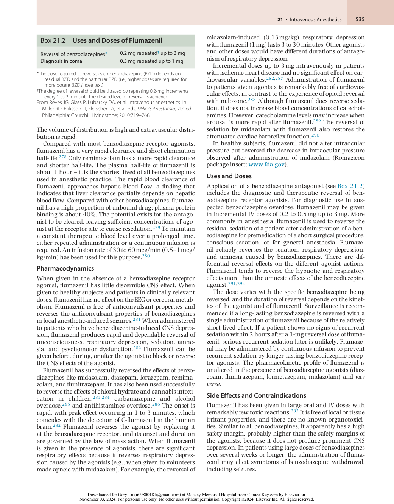

:::

<!-- PDF page 25 -->

### PHENCYCLIDINES (KETAMINE)

### History

Ketamine (Ketalar) was synthesized in 1962 by Stevens and was first used in humans in 1965 by Corssen and Domino. Ketamine was released for clinical use in 1970 and is still used in various clinical settings. It produces dissociative anesthesia rather than generalized depression of the CNS through antagonistic actions at the phencyclidine (PCP) site of the _N_ - methyl-d- aspartate receptor (NMDAR). Ketamine is a racemic mixture of the isomers R(−)- ketamine and S(+)- ketamine. It usually does not depress the cardiovascular and respiratory systems, but it does possess some of the adverse psychological effects found with the other phencyclidines.293 The S(+)- isomer (Ketanest) is 3 to 4 times more potent as an analgesic with a faster clearance and recovery and with fewer psychomimetic side effects. Still, S- ketamine produces – besides analgesia – psychotropic effects, cognitive impairment, memory impairment, and a reduced reaction time. Interest in ketamine has increased more recently because of its effects on hyperalgesia and opiate tolerance, use in chronic pain states, potential neuroprotective effects, increasing popularity of total IV anesthesia, and the availability in some countries of S(+) ketamine.294 Lastly, ketamine receives growing interest because of its antidepressant effects.

### Physicochemical Characteristics

Ketamine (Fig. 21.14) has a molecular weight of 238 kD, is partially water soluble, and forms a white crystalline salt with a p _K_ a of 7.5. It has a lipid solubility 5 to 10 times that of thiopental. Ketamine is only 12% bound to proteins. Its bioavailability is 93% after parenteral administration but only 20% after oral use, due to its high first- pass metabolism.295

### Pharmacokinetics

Ketamine is metabolized by hepatic microsomal enzymes.296,297 The major pathway involves _N_ - demethylation to form norketamine (metabolite I), which is then hydroxylated to hydroxynorketamine, which is further conjugated to water- soluble glucuronide derivates and excreted in the urine. The activity of the principal metabolites of ketamine has not been well studied, but norketamine (metabolite I) has significantly less (20%–30%) activity than the parent compound. More recent modeling of norketamine suggests that it contributes to prolonging the analgesia provided by either a bolus or infusion of ketamine, although this conclusion is being questioned.296,298,299 In contrast to previous reports, S- norketamine may have a negative contribution to S- ketamine- induced analgesia but shows absence of contribution to the cognitive impairment. This effect may explain the observation of ketamine- related excitatory phenomena (such as hyperalgesia and allodynia) upon the termination of ketamine infusions.296,298,299

Ketamine’s pharmacokinetics have been examined after bolus administration of anesthetizing doses (2–2.5 mg/kg IV), after a subanesthetic dose (0.25 mg/kg IV), and after continuous infusion (steady- state plasma level 2000 ng/mL).

Regardless of the dose, ketamine plasma disappearance can be described by a two- compartment model. Table 21.1 contains the pharmacokinetic values from bolus administration studies. Of note is the rapid distribution reflected

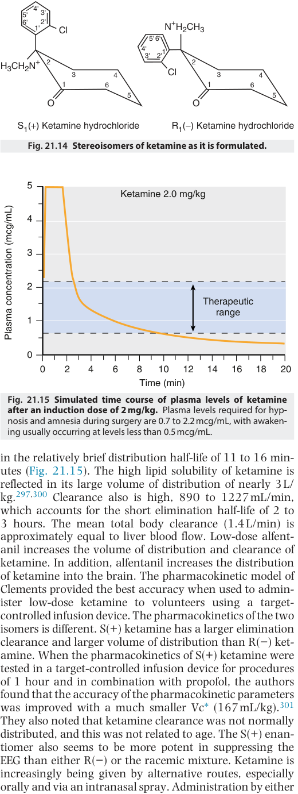

5' 4' 3' 6' 2' 1' Cl N + H2CH3 5' 6' 4' 1' 3' — 2' H3CH2N + 2 2 3 4 Cl 3 4 1 6 1 6 5 5 O O S1(+) Ketamine hydrochloride R1(−) Ketamine hydrochloride Fig. 21.14 Stereoisomers of ketamine as it is formulated. 5 Ketamine 2.0 mg/kg 4 3 2 Therapeutic range 1 0 0 2 4 6 8 10 12 14 16 18 20 Time (min) Fig. 21.15 Simulated time course of plasma levels of ketamine after an induction dose of 2 mg/kg.  Plasma levels required for hyp- nosis and amnesia during surgery are 0.7 to 2.2 mcg/mL, with awaken- ing usually occurring at levels less than 0.5 mcg/mL. in the relatively brief distribution half- life of 11 to 16 min- utes (Fig. 21.15). The high lipid solubility of ketamine is reflected in its large volume of distribution of nearly 3 L/ kg. 297,300  Clearance also is high, 890 to 1227 mL/min, which accounts for the short elimination half- life of 2 to 3 hours. The mean total body clearance (1.4 L/min) is approximately equal to liver blood flow. Low- dose alfent- anil increases the volume of distribution and clearance of ketamine. In addition, alfentanil increases the distribution of ketamine into the brain. The pharmacokinetic model of Clements provided the best accuracy when used to admin- ister low- dose ketamine to volunteers using a target- controlled infusion device. The pharmacokinetics of the two isomers is different. S(+) ketamine has a larger elimination clearance and larger volume of distribution than R(−) ket- amine. When the pharmacokinetics of S(+) ketamine were tested in a target- controlled infusion device for procedures of 1 hour and in combination with propofol, the authors found that the accuracy of the pharmacokinetic parameters was improved with a much smaller Vc* (167 mL/kg). 301 They also noted that ketamine clearance was not normally distributed, and this was not related to age. The S(+) enan- tiomer also seems to be more potent in suppressing the EEG than either R(−) or the racemic mixture. Ketamine is increasingly being given by alternative routes, especially orally and via an intranasal spray. Administration by either — — — Plasma concentration (mcg/mL) — — 

*Vc (central compartment volume of a three-compartment model).

<!-- PDF page 26 -->

of these routes is subject to significant first- pass metabolism. The bioavailability via oral administration is 20% to 30%, and via the intranasal route is approximately 40% to 50%. In clinical and experimental studies hyperalgesic responses have been noted after the withdrawal of S(+)ketamine.298–300,302,303 Furthermore, no delay between concentration and effect has been observed for any of the antinociceptive end points. This indicates an almost immediate passage of S(+)- ketamine across the blood–brain barrier and rapid receptor kinetics.

### Pharmacodynamics

**Effects on the Central Nervous System.** Ketamine produces dose- related unconsciousness and analgesia. Ketamine acts at multiple receptors including the NMDAR, opioid receptors, and monoaminergic receptors. At high ketamine concentrations, sigma opioid receptors are also affected, muscarinic receptors are blocked, and GABAergic neurotransmission is facilitated. Its most important action is the inhibition of NMDAR- mediated glutamatergic input to the GABA- ergic system leading to a changing excitatory activity in the cortex and limbic system that in the end results in unconsciousness. At the spinal cord level, ketamine has potent antinociceptive effects on NMDAR and inhibits acetylcholine release.298–300 The anesthetized state has been termed _dissociative anesthesia_ because patients who receive ketamine alone appear to be in a cataleptic state, in contrast with other states of anesthesia that resemble normal sleep. Patients anesthetized with ketamine have profound analgesia but keep their eyes open and are able to maintain some protective reflexes. While corneal, cough, and swallow reflexes may be present in some patients, these reflexes should not be assumed to be protective. There is no recall of surgery or anesthesia, but amnesia is not as prominent with ketamine as with the benzodiazepines. Because ketamine has a low molecular weight, a p _K_ a near the physiologic pH, and relatively high lipid solubility, it crosses the blood–brain barrier rapidly and has an onset of action within 30 to 60 seconds of administration. The maximal effect occurs in about 1 minute.

After ketamine administration, pupils dilate moderately, and nystagmus occurs. Lacrimation and salivation are common, as is increased skeletal muscle tone, often with coordinated but seemingly purposeless movements of the arms, legs, trunk, and head. Although there is great interindividual variability, plasma levels of 0.6 to 2 mcg/mL are considered the minimum concentrations for general anesthesia; children may require slightly higher plasma levels (0.8–4 mcg/mL). The duration of ketamine anesthesia after a single IV administration of a general anesthetic dose (2 mg/kg) is 10 to 15 minutes (see Fig. 21.15), and full orientation to person, place, and time occurs within 15 to 30 minutes. The S(+) enantiomer enables quicker recovery (by a couple of minutes) than the racemic mixture.304,305 This is due to the smaller dose necessary to produce an equianesthetic effect and to the 10% faster hepatic biotransformation. Because there is a good correlation between blood concentration of ketamine and CNS effect, the relatively short duration of action of ketamine is probably due to its redistribution from the brain and blood to the other tissues in the body.

Concomitant administration of benzodiazepines, which is a common practice, may prolong the effect of ketamine. When used in combination with a benzodiazepine, the S(+) enantiomer was no different in terms of awareness at 30 minutes, but it was significantly better at 120 minutes than the racemic mixture. Analgesia occurs at considerably lower blood concentrations than loss of consciousness.

Ketamine provides important postoperative analgesia. The plasma level at which pain thresholds are elevated is 0.1 mcg/mL or greater.302,306,307 This means there is a considerable period of postoperative analgesia after ketamine general anesthesia, and subanesthetic doses can consequently be used to produce analgesia. Ketamine inhibits nociceptive central hypersensitization. Ketamine also attenuates acute tolerance after opiate administration. The NMDAR plays an important role in the induction of hyperalgesia and antinociceptive tolerance as induced by opioids. Preventive ketamine administration may thus prevent central sensitization and long- lasting enhancement in pain sensitivity as induced by opioids. Ketamine, just as other NMDAR antagonists, may thus prevent opioid- induced hyperalgesia.308 The primary site of CNS action of ketamine seems to be the thalamoneocortical projection system. The drug selectively depresses neuronal function in parts of the cortex (especially association areas) and thalamus, while stimulating parts of the limbic system, including the hippocampus. This process creates what is termed a _functional disorganization_ of nonspecific pathways in midbrain and thalamic areas. Ketamine acts via antagonism of the excitatory glutamatergic NMDA receptor. The NMDA receptor has a high expression in the temporal cortex, hippocampus, basal ganglia, cerebellum, and brainstem, all regions significantly affected by ketamine. There is also evidence that ketamine depresses transmission of impulses in the medial medullary reticular formation, which is important for transmission of the affective–emotional components of nociception from the spinal cord to higher brain centers. In volunteers experiencing heat pain, fMRI studies showed ketamine produced a dose- dependent effect on pain processing by decreasing activation of the secondary somatosensory cortex (S2), insula, and anterior cingulate cortex. Ketamine occupies opiate receptors in the brain and spinal cord, and this property could account for some of the analgesic effects.309,310 The S(+) enantiomer has some opioid μ- receptor activity, accounting for part of its analgesic effect. NMDA receptor interaction may mediate the general anesthetic effects and some analgesic actions of ketamine. The spinal cord analgesic effect of ketamine is postulated to be due to inhibition of dorsal horn wide dynamic range neuronal activity. In a resting state fMRI study, low- dose ketamine induced connectivity changes in brain areas involved in motor function, psychedelic effects, and pain processing. Ketamine’s analgesic effect may arise from multiple pathways; a decreased connectivity in regions of the pain matrix responsible for the perception of pain (pain sensing); and the affective processing of pain. In addition, ketamine affected connectivity in brain areas involved in endogenous pain inhibition.311,312

Although some drugs have been used to antagonize ketamine, no specific receptor antagonist reverses all the CNS effects of ketamine.

<!-- PDF page 27 -->

Ketamine increases cerebral metabolism, CBF, and ICP. Because of its excitatory CNS effects, which can be detected by generalized EEG development of theta wave activity and by petit mal seizure- like activity in the hippocampus, ketamine increases CMRO2. There is an increase in CBF, which appears higher than the increase in CMRO2 would mandate. With the increase in CBF and the generalized increase in sympathetic nervous system response, there is an increase in ICP after ketamine. The increase in CMRO2 and CBF can be blocked using thiopental or diazepam. Cerebrovascular responsiveness to carbon dioxide seems to be preserved with ketamine; reducing PaCO2 attenuates the increase in ICP after ketamine.

S(+) ketamine may influence the expression of apoptosisregulating proteins in rat brains 4 hours after cerebral ischemia/reperfusion. The neuroprotection observed with ketamine may involve antiapoptotic mechanisms in addition to reducing necrotic cell death.

In contrast, ketamine and other anesthetics like propofol and volatile anesthetics accentuate apoptosis in the brain of newborn animals and cause changes in the morphology of dendritic spines. This finding has sparked controversy over the use of ketamine in neonates. An editorial in the journal _Anesthesiology_ and the Anesthetic and Life Support Drugs Advisory Committee of the FDA cautioned changing clinical practice based on present available data.

Ketamine, like other phencyclidines, produces undesirable psychological reactions, which occur during awakening from ketamine anesthesia and are termed _emergence reactions_ . The common manifestations of these reactions, which vary in severity and classification, are vivid dreaming, extracorporeal experiences (sense of floating out of body), and illusions (misinterpretation of a real, external sensory experience). These incidents of dreaming and illusion are often associated with excitement, confusion, euphoria, and fear. They occur in the first hour of emergence and usually abate within 1 to several hours. The psychic emergence reactions occur secondary to ketamine- induced depression of auditory and visual relay nuclei, leading to misperception or misinterpretation of auditory and visual stimuli. The incidence of the psychic emergence reactions ranges from 3% to 100%. A clinically relevant range is probably 10% to 30% of adult patients who receive ketamine as a sole or major part of the anesthetic technique. Factors that affect the incidence of emergence reactions are age, dose, gender, psychological susceptibility, and concurrent drugs. Pediatric patients do not report as high an incidence of unpleasant emergence reactions as do adult patients; men also report a less frequent incidence compared with women. Larger doses and rapid administration of large doses seem to predispose patients to a frequent incidence of adverse effects. Finally, certain personality types seem prone to the development of emergence reactions. Patients who score high in psychoticism on the Eysenck Personality Inventory are prone to develop emergence reactions, and individuals who commonly dream at home are more likely to have postoperative dreams in the hospital after ketamine. While numerous drugs have been used to reduce the incidence and severity of postoperative reactions to ketamine, the benzodiazepines seem to be the most effective group of drugs. Next to the undesirable psychological reactions, increasingly ketamine is described for its antidepressant effects. The dose often

used for this indication is 0.5 mg/kg, given as a 40- minute infusion. This often results in a dramatic mood change within a day, often lasting for 3 to 12 days. A maintenance dose every 2 to 4 days may lengthen this effect.313 The precise mechanism of action of the antidepressant effects of ketamine remain unknown.

**Effects on the Respiratory System.** Ketamine has minimal effects on the central respiratory drive as reflected by an unaltered response to carbon dioxide. There can be a transient (1–3 minutes) decrease in minute ventilation after the bolus administration of an induction dose of ketamine (2 mg/kg intravenously). Unusually large doses can produce apnea, but this is seldom seen. In a μ- opioid knockout mouse model, though, at supraspinal sites S(+) ketamine interacts with the μ- opioid receptor system. This interaction contributes significantly to S(+) ketamine- induced respiratory depression and supraspinal antinociception.314,315 With the use of adjuvant sedatives or anesthetic drugs, respiratory depression may become clinically significant. Ketamine depresses ventilatory control in children, especially with bolus doses. Ketamine is a bronchial smooth muscle relaxant. When it is given to patients with reactive airway disease and bronchospasm, pulmonary compliance is improved.

Ketamine is as effective as halothane or enflurane in preventing experimentally induced bronchospasm. The mechanism for this effect is probably a result of the sympathomimetic response to ketamine, but there are isolated bronchial smooth muscle studies showing that ketamine can directly antagonize the spasmogenic effects of carbachol and histamine. Owing to its bronchodilating effect, administration of ketamine can treat status asthmaticus unresponsive to conventional therapy. A potential respiratory problem, especially in children, is the increased salivation that follows ketamine administration, which can be modulated by an anticholinergic drug such as atropine or glycopyrrolate.

**Effects on the Cardiovascular System.** Ketamine has several cardiovascular effects. It increases arterial blood pressure, heart rate, and cardiac output in a biphasic manner. It produces a direct cardiodepressive, negative inotropic effect while at the same time has an indirect stimulatory effect due to activation of the sympathetic system. Ketamine causes the systemic release of catecholamines, inhibition of the vagal nerve, inhibition of norepinephrine reuptake at peripheral nerves and non- neuronal tissues such as the myocardium, and norepinephrine release from sympathetic ganglia.316 Cardiodepression precedes stimulation after large- dose ketamine administration or occurs after repeated administrations when presynaptic catecholamine stores become depleted. Cardiovascular stimulation occurs after small- dose ketamine infusion and is characterized by tachycardia, systemic and pulmonary hypertension, increases in cardiac output, and myocardial oxygen consumption. Whereas the cardiovascular stimulatory effects of ketamine generally are dominant, after termination of S- ketamine infusion, cardiovascular depression may become evident as cardiac output may decrease below pre- infusion values.298 The cardiovascular stimulatory effects of S(+) ketamine are characterized by an increase in the cardiac output of

<!-- PDF page 28 -->

1 L/min in the presence of 243 ng/mL S(+) ketamine.298 The cardiovascular stimulatory effect of S(+) ketamine is induced very rapidly with a half- life for onset/offset of the effect of ketamine on cardiac output of 1 to 2 minutes. The increase in hemodynamic variables is associated with increased work and myocardial oxygen consumption. The healthy heart increases oxygen supply by increased cardiac output and decreased coronary vascular resistance, so that coronary blood flow is appropriate for the increased oxygen consumption. In patients with congenital heart disease, there are no significant changes in shunt directions or fraction, or systemic oxygenation after ketamine induction of anesthesia. In patients who have increased pulmonary artery pressure (as with mitral valvular and some congenital lesions), ketamine causes a more pronounced increase in pulmonary than systemic vascular resistance. Ketamine injected directly into the CNS produces an immediate sympathetic nervous system hemodynamic response. Ketamine also causes the sympathoneuronal release of norepinephrine, which can be detected in venous blood. Blockade of this effect is possible with barbiturates, benzodiazepines, and droperidol. The centrally mediated sympathetic responses to ketamine usually override the direct depressant effects of ketamine. Some peripheral nervous system actions of ketamine play an undetermined role in the hemodynamic effects of the drug. Ketamine inhibits intraneuronal uptake of catecholamines in a cocaine- like effect and inhibits extraneuronal norepinephrine uptake.

Stimulation of the cardiovascular system is not always desirable, and certain pharmacologic methods have been used to block the ketamine- induced tachycardia and systemic hypertension. Probably the most appropriate way to manage the cardiovascular changes associated with ketamine administration is prior administration of benzodiazepines. Modest doses of diazepam, flunitrazepam, and midazolam all attenuate the hemodynamic effects of ketamine. It also is possible to decrease the tachycardia and hypertension caused by ketamine by using a continuous infusion technique of ketamine with or without a benzodiazepine. Inhalation anesthetics and propofol also blunt the hemodynamic effects of ketamine.

### Uses

The many unique features of ketamine pharmacology, especially its propensity to produce unwanted emergence reactions in 10% to 20% of patients, have limited its use for routine anesthesia. Nevertheless, ketamine has an important niche in the practice of anesthesiology when its unique sympathomimetic activity and bronchodilating capabilities are indicated during induction of anesthesia. It is used for premedication, sedation, induction, and maintenance of general anesthesia. There has been increased interest in the use of ketamine in small doses for preventive analgesia, for the treatment or prevention of opiate tolerance and hyperalgesia, and in treatment of acute and chronic pain.

**Induction and Maintenance of Anesthesia.** The cardiovascular stimulatory effects make ketamine a desirable drug for the induction of anesthesia in unstable cardiovascular patients suffering from hypovolemia, hemorrhagic shock, or cardiovascular depression in sepsis. Ketamine bronchodilation and profound analgesia allowing the use

of high oxygen concentrations make ketamine an excellent choice for induction of anesthesia in patients with reactive airway disease. Trauma patients with extensive blood loss are typical candidates for rapid- sequence anesthesia induction with ketamine. Patients with septic shock also may benefit from ketamine. The intrinsic myocardial depressant effect of ketamine may manifest in this situation if trauma or sepsis has caused depletion of catecholamine stores before the patient’s arrival in the operating room. Use of ketamine in these patients does not obviate the need for appropriate preoperative preparation, including restoration of intravascular blood volume. Other cardiac diseases that can be well managed with ketamine anesthesia are cardiac tamponade and restrictive pericarditis. The finding that ketamine preserves heart rate and right atrial pressure through its sympathetic stimulating effects makes ketamine an excellent anesthetic induction and maintenance drug in this setting. Ketamine can also be administered to patients with congenital heart disease, especially patients in whom the propensity for right- to- left shunting exists. Ketamine has been safely used in patients susceptible to malignant hyperthermia without resultant hyperthermia or other adverse effects. Ketamine combined with propofol or midazolam can be given by continuous infusion to produce satisfactory cardiac anesthesia for patients with valvular and ischemic heart disease. The combination of a benzodiazepine or of a benzodiazepine plus sufentanil with ketamine attenuates or eliminates the unwanted tachycardia and hypertension and postoperative psychological derangements. With this technique, there are minimal hemodynamic perturbations, profound analgesia, dependable amnesia, and an uneventful convalescence. The use of propofol plus small- dose ketamine also has gained increasing popularity as a total IV anesthesia technique for patients undergoing noncardiac surgery. The advantages of this combination are maintenance of stable hemodynamics and minimal ventilatory depression when allowing spontaneous ventilation.

**Pain Management.** Postoperative pain is a major concern of many patients and inadequately treated in as many as 30% to 50% of all postoperative patients. Multimodal analgesia combining various analgesic agents that act through different pathways is the way to manage postoperative pain. Ketamine is increasingly used as one of the constituents of this multimodal analgesia therapy. Over the years the ketamine dose used for perioperative analgesia has gradually been decreasing. Ketamine administered in small doses decreases postoperative analgesic consumption by 33%. Several meta- analyses of the use of small- dose ketamine (20 to 60 mg) perioperatively have been performed. These meta- analyses showed an overall decrease in opiate use or improved analgesia and a decrease in opiate- induced side effects, especially PONV. Side effects, especially psychomimetic effects, were minimal, especially if a benzodiazepine also was administered.

The epidural/caudal administration of ketamine (0.5 to 1 mg/kg) has also been demonstrated to be effective. At the same time, the safety of this technique has yet to receive regulatory approval. The preservative of racemic mixture is potentially neurotoxic, whereas studies to date indicate preservative- free S(+) ketamine may be safe. Epidural preservative- free S(+) ketamine has been shown to

<!-- PDF page 29 -->

be safe and of value in adjunct to corticosteroids in patients for the treatment of chronic low back pain secondary to radiculopathy.317 The favorable hemodynamic effects and conservation of respiration makes intravenously and even intranasally administered ketamine useful for analgesia after extremity fractures.

The action of ketamine on opiate tolerance and hyperalgesia combined with its direct analgesic activity has led to its use in chronic pain states. Ketamine may be effective in the treatment of cancer pain, chronic peripheral and central neuropathic pain, phantom and ischemic limb pain, fibromyalgia, complex regional pain syndrome, visceral pain, and migraine. Multiple open- label studies conclude positively on the analgesic properties of ketamine in cancer pain. While effective for neuropathic pain, the sustained effect of ketamine has not been documented in randomized controlled clinical trials, although one cannot exclude the possibility that selective use of ketamine in patients with central sensitization, opioid- induced hyperalgesia, or opioid tolerance might have value.318 Thus, while ketamine is effective for relief of postoperative pain, causing reduced opioid consumption, ketamine for most other indications appears to have limited efficacy and results in no beneficial effects.

In addition to its other clinical uses, ketamine has been used to successfully treat severe depression. For this clinical condition, the administration requires close monitoring during the administration and extensive postadministration observation. Although providing a novel antidepressant mechanism and approach to treating therapy- resistant depression, its use may be limited by cost, administration, and diversion concerns.319 Nonetheless, the use of ketamine for treatment of severe depression continues to expand.

**Sedation.** Often, ketamine is combined with premedication of a barbiturate or benzodiazepine to provide perioperative sedation. The administration of the antisialagogue (e.g., glycopyrrolate) reduces the significant and sometimes troublesome salivation that accompanies administration of ketamine. In adults and children, ketamine can be used as a supplement or an adjunct to regional anesthesia, extending the usefulness of the primary (local anesthetic) form of anesthesia. Also, in the emergency department ketamine is increasingly used for short painful procedures. The dose used then is between 0.1 and 0.6 mg/kg. As previously described, ketamine also may be considered for sedation of patients in a critical care unit because of its combined sedative and analgesic properties and favorable effects on hemodynamics. Ketamine can even be used safely in head injury patients when they are adequately ventilated.320,321

Ketamine is particularly suitable for sedation of pediatric patients undergoing procedures outside of the operating room. Pediatric patients have fewer adverse emergence reactions than adults, and this feature makes the use of ketamine in pediatric patients more versatile.

### Doses and Routes of Administration

Ketamine has been administered intravenously, intramuscularly, transcutaneously, orally, nasally, and rectally, and as a preservative- free solution epidurally or intrathecally. Most

### Box 21.3 Uses and Doses of Ketamine

|Induction of general anesthesia*|0.5–2 mg/kg IV 4–6 mg/kg IM|
|---|---|
|Maintenance of general anesthesia|0.5–1 mg/kg IV with N2O 50% in O2 15–45 mcg/kg/min IV with N2O 50%–70% in O2 30–90 mcg/kg/min IV without N2O|
|Sedation and analgesia|0.2–0.8 mg/kg IV over 2–3 min 2–4 mg/kg IM|
|Preemptive or preventive analgesia|0.15–0.25 mg/kg IV|

*Lower doses are used if adjuvant drugs such as midazolam or thiopental also are given.

_IM,_ intramuscular; _IV,_ intravenous; _N2O,_ nitrous oxide.

From Reves JG, Glass P, Lubarsky DA, et al. Intravenous anesthetics. In: Miller RD, Eriksson LI, Fleischer LA, et al, eds. _Miller’s Anesthesia,_ 7th ed. Philadelphia: Churchill Livingstone; 2010:719–768.

clinical use involves the IV and intramuscular (IM) routes, by which the drug rapidly achieves therapeutic concentrations. The dose depends on the desired therapeutic effect and on the route of administration. Box 21.3 contains general recommended doses for the IV and IM administration of ketamine for various therapeutic goals. Intranasal administration has an onset closer to IV administration; an oral dose of 3 to 10 mg/kg generates a sedative effect in 20 to 45 minutes. For sedation, ketamine may be given in an IM dose of 2 to 4 mg/kg. It also has been administered orally in doses of 3 to 10 mg/kg, with 6 mg/kg providing optimal conditions in 20 to 25 minutes in one study and 10 mg/kg providing sedation in 87% of children within 45 minutes in another study.

### Side Effects and Contraindications

Contraindications to ketamine relate to specific pharmacologic actions and patient diseases. In patients with increased ICP and breathing spontaneously, ketamine should be used with caution because it can increase ICP and has been reported to cause apnea. There is increasing clinical use of ketamine in emergency airway management in brain injury patients with or without other body injuries. In this setting, the current knowledge on safe management of increased ICP is continuing to grow.320,321

In mechanically ventilated patients, ketamine retains the response of CBF to carbon dioxide, which makes it useful in head- injured patients because of its potential neuroprotective effect. Ketamine may be contraindicated in patients with an open eye injury or other ophthalmologic disorder, in which a ketamine- induced increase in intraocular pressure would be detrimental. Because ketamine has a propensity to cause hypertension and tachycardia, with a commensurate increase in myocardial oxygen consumption, it may be contraindicated as the sole anesthetic in patients with ischemic heart disease. Likewise, it is unwise to give ketamine to patients with vascular aneurysms because of the possible sudden change in arterial blood pressure. Psychiatric disease, such as schizophrenia, and a history of adverse reaction to ketamine or one of its congeners are also contraindications. One also should consider carefully using ketamine when there is a possibility of postoperative delirium

::: details 原始表格與符號（PDF 第 29 頁）

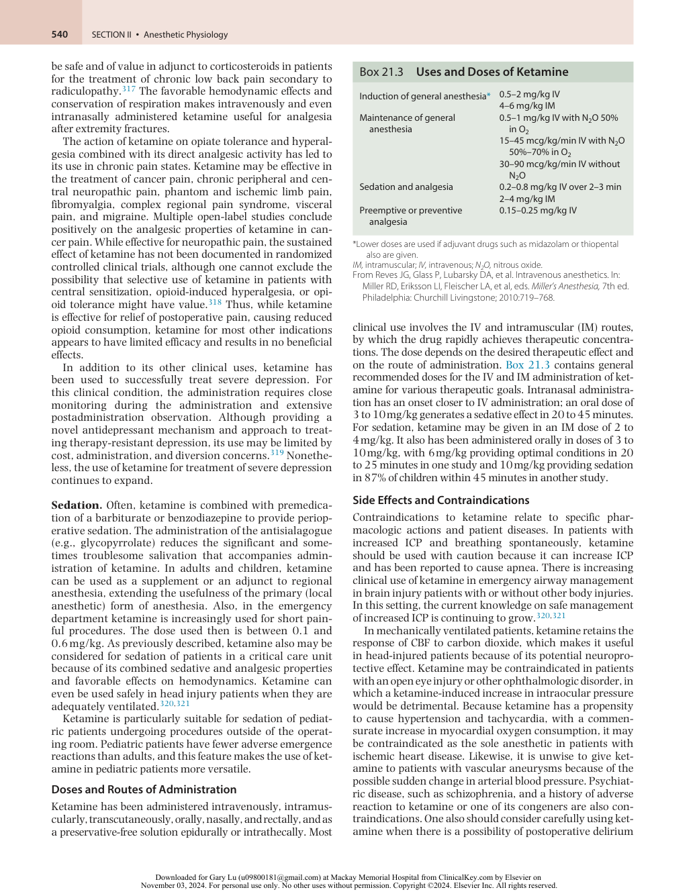

:::

<!-- PDF page 30 -->

from other causes (e.g., delirium tremens, possibility of head trauma), and a ketamine- induced psychomimetic effect would confuse the differential diagnosis.

As mentioned earlier, ketamine or other NMDA receptor antagonists accentuate apoptosis in the newborn brain of animals, and the clinical implications of this are unknown. Finally, because ketamine’s preservative, chlorobutanol, is neurotoxic, this formulation of ketamine for subarachnoid or epidural administration is contraindicated. S(+) ketamine is available in a preservative- free solution. The FDA has not approved the use of intrathecal or epidural ketamine. Caudal ketamine has been used for perioperative analgesia in children and neonates with 0.5 mg/kg as the optimal dose. Caudal analgesia, by combinations of ketamine and a local anesthetic, prolongs analgesia from 2.26 to 5.3 hours and reduces the need for nonopioid analgesics.322–326

Finally, liver and renal toxicity can occur after ketamine administration. These toxicities have been associated with the recreational abuse of ketamine. In addition, when ketamine is repeatedly administered in the treatment of chronic pain in patients with complex regional pain syndrome type 1 (CRPS), hepatotoxicity developed in patients that received two 100- hour infusions of S(+)- ketamine with a 16- day interval.324,327,328

### ETOMIDATE

### History

The first report on etomidate was published in 1965.329 Etomidate was introduced into clinical practice in 1972. The unique properties of etomidate include hemodynamic stability, minimal respiratory depression, cerebral protection, favorable toxicity profile, and pharmacokinetics enabling rapid recovery after either a single dose or a continuous infusion. In the 1970s, these beneficial properties led to widespread use of etomidate for induction, for maintenance of anesthesia, and for prolonged sedation in critically ill patients. The enthusiasm among clinicians for etomidate was tempered in the 1980s by reports that the drug can cause temporary inhibition of steroid synthesis after single doses and infusions.330,331 This effect, combined with other minor disadvantages (e.g., pain on injection, superficial thrombophlebitis, myoclonus, and a frequent incidence of nausea and vomiting), led to several editorials questioning the role of etomidate in modern anesthetic practice.332,333 Use of the drug decreased after those editorials, but its use has expanded again as a result of the rediscovery of etomidate’s beneficial physiologic profile and a widening use in emergency departments and intensive care departments. Clinically significant adrenocortical suppression after induction of anesthesia with etomidate is a contraindication for its use in critically ill patients.

### Physicochemical Characteristics

Etomidate is an imidazole derivative (R- (+)- pentylethyl1H- imidazole- 5 carboxylate sulfate). Its chemical structure is illustrated in Fig. 21.16. Etomidate has a p _K_ a of 4.2 and is hydrophobic at physiologic pH. To increase its solubility, it is formulated as a 0.2% solution either in 35% propylene glycol (Amidate; Hospira Inc., Lafe Forest, IL) or in

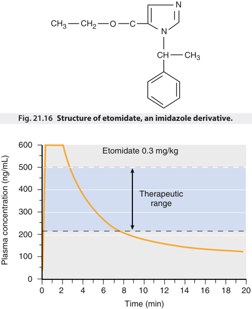

N CH3 CH2 O C N CH CH3 Fig. 21.16 Structure of etomidate, an imidazole derivative. 600 Etomidate 0.3 mg/kg 500 400 Therapeutic range 300 200 100 0 0 2 4 6 8 10 12 14 16 18 20  Time (min) Plasma concentration (ng/mL) 

**Fig. 21.17 Simulated time course of plasma levels of etomidate after an induction dose of 0.3 mg/kg.** Plasma levels required for hypnosis during surgery are 300 to 500 ng/mL, with awakening usually occurring at levels less than 225 ng/mL.

a lipid emulsion (Etomidate- Lipuro; B. Braun, Melsungen,

Germany).334

### Pharmacokinetics

The pharmacokinetics of etomidate have been determined after single bolus doses and after continuous infusion. The time course of plasma disappearance after a 0.3 mg/kg bolus is shown in Fig. 21.17. The pharmacokinetics of etomidate are best described by an open three- compartment model.335

The drug has an initial distribution half- life of 2.7 minutes, a redistribution half- life of 29 minutes, and an elimination half- life of 2.9 to 5.3 hours.336 Clearance of etomidate by the liver is high (18–25 mL/kg/min), with a hepatic extraction ratio of 0.5 ± 0.9.335 Because redistribution is the mechanism whereby the effect after a bolus of etomidate is dissipated (Box 21.4), hepatic dysfunction should not appreciably alter recovery from a single induction dose. Etomidate is 75% protein bound.

A hemorrhagic shock model in pigs bled to a MAP of 50 mm Hg did not alter etomidate pharmacokinetics or pharmacodynamics.337 This finding contrasts with the marked changes seen in this same model with other IV anesthetics. In patients with cirrhosis, the volume of distribution is doubled, whereas clearance is normal; the result is an elimination half- life that is twice normal.338 The initial distribution half- life and clinical effect are likely unchanged. Increasing age is associated with a smaller initial volume of distribution and a decreased clearance of etomidate.339

The short elimination half- life and the rapid clearance of etomidate make it suitable for administration in a single

<!-- PDF page 31 -->

### Box 21.4 Uses and Doses of Etomidate

Induction of general anesthesia0.2–0.6 mg/kg IV Sedation and analgesia Limited to periods of brief sedation because of inhibition of corticosteroid synthesis

_IV,_ intravenous; _N2O,_ nitrous oxide. From Reves JG, Glass P, Lubarsky DA, et al. Intravenous anesthetics. In Miller RD, Eriksson LI, Fleischer LA, et al, eds. _Miller’s Anesthesia,_ 7th ed. Philadelphia: Churchill Livingstone; 2010:719–768.

dose, in multiple doses, or in a continuous infusion with its context- sensitive half- time being shorter than that of propofol.340 Continuous infusion was practiced in the first decade of its clinical availability, but the now widely recognized adrenal suppression by the inhibition of the enzyme 11β- hydroxylase limits this application. Etomidate is metabolized in the liver primarily by ester hydrolysis to the corresponding carboxylic acid of etomidate (major metabolite) and an ethanol leaving group.341 The main metabolite is inactive. Only 2% of the drug is excreted unchanged, the remaining part being excreted as metabolites by the kidney (85%) and bile (13%). Pathologic conditions altering serum proteins (e.g., hepatic or renal disease) affect the amount of the free (unbound) fraction and may cause a dose to have an exaggerated pharmacodynamic effect.342

### Pharmacodynamics

**Effects on the Central Nervous System.** The primary action of etomidate on the CNS is through the GABAA receptor and results in hypnosis,343,344 which is achieved in one arm–brain circulation after a normal induction dose (0.3 mg/kg). The mechanism by which etomidate produces hypnosis is almost exclusively through GABAA receptor facilitation.344,345 This includes two effects produced by different concentrations of etomidate. The first is the positive modulation of the GABAA receptor: activation of the receptor by agonists at concentrations associated with clinical doses. A lower dose of GABA is required in the presence of etomidate to activate the GABAA receptor.346 The second action is called the direct activation or allosteric agonism. In supraclinical concentrations etomidate can directly, thus in absence of GABA, activate the GABAA receptor.347 These two actions suggest two independent binding sites at the GABAA receptor.344 These two binding sites on the α1β2γ2 GABAA receptor contribute equally and noncooperatively to drug interaction and gating effects. At a dose of 0.2 to 0.3 mg/kg, etomidate reduces CBF by 34% and CMRO2 by 45% without altering MAP. CPP is maintained or increased, and there is a beneficial net increase in the cerebral oxygen supply- to- demand ratio.348 Etomidate, given in doses sufficient to produce EEG burst suppression, acutely decreases ICP by 50% in patients with already increased ICP, returning increased ICP to almost normal values.349 The decrease in ICP is maintained in the period immediately after intubation. To maintain the effects of etomidate on ICP, high infusion rates (60 mcg/kg/min) are necessary. Controversy remains on the neuroprotective qualities of etomidate. There is a dose- dependent increase in latency and a decreasing amplitude of the auditory evoked potentials.350

Preliminary animal experiments suggest that in a case of acute fetal distress and hypoxic injury, propofol and midazolam may be preferred over etomidate to protect the fetal brain as the first choice anesthetic in cesarean delivery.218,351,352 Etomidate has been associated with grand mal seizures and produces increased EEG activity in epileptogenic foci. This feature has proven useful for intraoperative mapping of seizure foci before surgical ablation.353,354 BIS monitor values decrease after etomidate bolus administration and return to baseline during recovery.355 During etomidate infusion, the BIS values reliably predict the depth of sedation and hypnosis.356

**Effects on the Respiratory System.** Etomidate has less effect on ventilation than other anesthetics used to induce anesthesia. It does not induce histamine release in healthy patients or in patients with reactive airway disease.357 Ventilatory response to carbon dioxide is depressed by etomidate, but the ventilatory drive at any given carbon dioxide tension is greater than that following an equipotent dose of methohexital.171 Induction with etomidate produces a brief period of hyperventilation, sometimes followed by a similarly brief period of apnea,358 which results in a slight (±15%) increase in PaCO2, but no change in the partial pressure of arterial oxygen (PaO2).359 Etomidate’s action on pulmonary vascular tone is similar to the actions observed with ketamine and propofol; that is, they attenuate the vasorelaxant responses to acetylcholine and bradykinine.360

**Effects on the Cardiovascular System.** The hemodynamic stability associated with administration of etomidate is due to its lack of effect on the sympathetic nervous system and on the function of the baroreceptor. The effect of etomidate on the α2- adrenoceptors generates an increase in blood pressure _in vivo_ ; this may contribute to the cardiovascular stability after induction of anesthesia. The minimal effect of etomidate on cardiovascular function sets it apart from other rapid- onset anesthetics.361,362 Etomidate has proven useful in patients with valvular or ischemic heart disease undergoing noncardiac surgery and in patients with poor cardiac function.363,364 In patients receiving etomidate during induction of anesthesia, more hypertension and tachycardia occurs after etomidate compared to propofol.365 The myocardial oxygen supply- to- demand ratio is well maintained.366 Etomidate lacks analgesic efficacy, however, and needs to be combined with an opiate to prevent hemodynamic perturbations in response to painful stimuli such as laryngoscopy and intubation.

In the setting of a hemorrhagic shock, etomidate provides advantages for induction of anesthesia. In contrast to other drugs, in a pig model of hemorrhagic shock the pharmacodynamics and pharmacokinetics of etomidate were minimally altered.337

**Endocrine Effects.** In 1983 Ledingham and Watt reported retrospective data showing increased mortality among intensive care patients receiving long- term etomidate infusion compared to patients receiving benzodiazepines.330 They postulated that adrenal cortical suppression could be the cause of this increased mortality. Soon after this publication, clinical investigators confirmed the adrenocortical suppression by etomidate.331,367

<!-- PDF page 32 -->

The specific endocrine effects manifested by etomidate are a dose- dependent reversible inhibition of the enzyme 11β- hydroxylase, which results in decreased biosynthesis of cortisol. The blockade of the cytochrome P450- dependent enzyme 11β- hydroxylase also results in decreased mineralocorticoid production and an increased formation of intermediaries (11- deoxycorticosterone) (Fig. 21.18). Subsequent research showed that etomidate is far more potent as an inhibitor of steroid synthesis than as a sedative hypnotic agent.367,368 The etomidate concentrations associated with adrenal cortical suppression are less than 10 ng/ mL, which are much lower than the concentrations needed for hypnosis (more than 200 ng/mL). The disparate concentrations for hypnosis and adrenotoxicity may explain the dramatic difference in duration of these two actions.61

A Cochrane review in 2015 of single- dose etomidate versus other induction agents for endotracheal intubation in critically ill patients reveals no conclusive evidence that etomidate increases mortality.369 As indicated earlier, etomidate is associated with suppression of adrenal steroidogenesis, which can last up to 72 hours. However, the clinical impact of this adrenal suppressive effect is not certain.370

The Corticosteroid Therapy of Septic Shock (CORTICUS) study followed 500 patients with septic shock, who were randomized to receive either low- dose corticosteroid therapy or placebo. Twenty percent of the patients received etomidate. The study concluded that there was no benefit of low- dose corticosteroid therapy to long- term outcome.371 Retrospective analyses of the CORTICUS population suggest that patients receiving etomidate before enrollment had a 28- day mortality significantly higher and that steroid supplements provided no benefit.372,373 A meta- analysis on

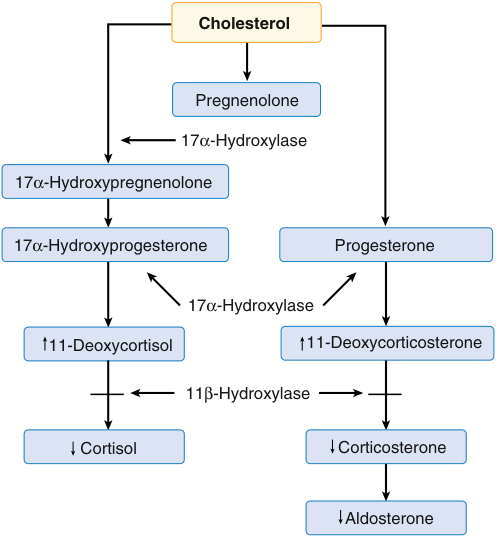

Cholesterol Pregnenolone 17α-Hydroxylase 17α-Hydroxypregnenolone 17α-Hydroxyprogesterone Progesterone 17α-Hydroxylase 11-Deoxycortisol 11-Deoxycorticosterone 11β-Hydroxylase Cortisol Corticosterone Aldosterone 

**Fig. 21.18 Pathway for the biosynthesis of cortisol and aldosterone.** The sites at which etomidate affects cortisol–aldosterone synthesis by its action on 11β- hydroxylase (major site) and 17α- hydroxylase (minor site) are illustrated.

adrenal insufficiency by etomidate and mortality published in 2021 concluded that relative death rates linked to etomidate grew steadily and were most common in critically ill patients. Etomidate has a greater relative fatality rate (20%) in severely ill patients with a projected mortality >44% than comparable anesthetic induction drugs. The necessity for glucocorticoid supplementation following etomidate in patients with severe critical illness and those who have suddenly deteriorated vital signs should be anticipated by intensivists.374

### Uses

**Induction of Anesthesia.** The induction dose of etomidate is 0.2 to 0.6 mg/kg.375 The induction dose is reduced by premedication with an opiate, a benzodiazepine, or a barbiturate. Onset of anesthesia after a routine induction dose of 0.3 mg/kg of etomidate is rapid (one arm–brain circulation). Various infusion schemes have been devised to use etomidate as a maintenance anesthetic for the hypnotic component of anesthesia in the past. After the publications on the adrenocortical suppressive effects of etomidate, continuous infusion has been abandoned.

Etomidate is most appropriate in patients with cardiovascular disease, reactive airway disease, intracranial hypertension, or any combination of disorders indicating the need for an induction agent with limited or beneficial physiologic side effects. The hemodynamic stability of etomidate is unique among the rapid-onset anesthetics used to induce anesthesia. In multiple studies, etomidate has been used for induction in patients with a compromised cardiovascular system who are undergoing coronary artery bypass surgery or valve surgery, and in patients requiring induction of general anesthesia for percutaneous transluminal coronary angioplasty, aortic aneurysm repair, and thoracic surgery. For cardioversion, the rapid onset, quick recovery, and maintenance of arterial blood pressure in these sometimes hemodynamically tenuous patients, combined with continued spontaneous respiration, make etomidate an acceptable choice.376 Etomidate has been successfully used in neurosurgical procedures such as giant aneurysm clippings, making it a reasonable choice during neurosurgical induction.377 In addition, etomidate should be considered as an anesthetic induction agent to reduce increased ICP when maintenance of cerebral or coronary perfusion pressure is also important.

Trauma patients whose intravascular volume status is unclear may benefit from the use of etomidate for induction of anesthesia. At the same time, when using etomidate in trauma patients, loss of consciousness by itself can be associated with decreased adrenergic output, and controlled ventilation can exacerbate the cardiovascular effects of a decreased preload. Both factors may cause a significant decrease in arterial blood pressure during induction of anesthesia despite etomidate having no direct cardiovascular drug effect.

Short- term sedation with etomidate is useful in hemodynamically unstable patients, such as patients requiring cardioversion or patients requiring sedation after an acute myocardial infarction or with unstable angina for a minor operative procedure.376 When used during electroconvulsive therapy, etomidate can produce longer seizures compared with other hypnotics.378,379 Induction of anesthesia

<!-- PDF page 33 -->

with etomidate is an independent risk factor in the development of an emergence delirium.380

**Treatment in Hypercortisolemia.** Etomidate has a special place in the treatment of endogenous hypercortisolemia. It is proven to be an effective parenteral treatment for this indication. In patients with unstable hemodynamics, patients with a sepsis, or patients with a psychosis, treatment should be performed under intensive care conditions.381 Patients with severe Cushing syndrome can be treated effectively with low-dose etomidate to lower serum cortisol levels outside of the intensive care environment.382,383

### Side Effects

Although etomidate provides stable hemodynamics and minimal respiratory depression, it is associated with several adverse effects when used for induction, including PONV, pain on injection, myoclonic movement, and hiccups. More recently, etomidate in a lipid emulsion was associated with an equal or an increased incidence of postoperative nausea compared with propofol.384–386

The lipid formulation of etomidate is associated with a much less frequent incidence of pain on injection, thrombophlebitis, and histamine release.387,388 Pain on injection may be reduced by injecting lidocaine, 20 to 40 mg immediately before injection of etomidate.

The incidence of muscle movement (myoclonus) and of hiccups is highly variable (0%–70%), but myoclonus is reduced by premedication with a hypnotic like midazolam or a small dose of magnesium 60 to 90 seconds before the induction dose of etomidate is given.389,390

### Novel Etomidate Derivatives

Etomidate is a well- known and widely used anesthetic for induction of anesthesia. The limitations of etomidate are, as mentioned earlier, adrenocortical suppression, myoclonus, and PONV. Modifying etomidate could improve its clinical utility and produce etomidate derivatives with a better profile. Methoxycarbonyl etomidate (MOC- etomidate) is an etomidate derivative and is rapidly metabolized to methoxycarbonyl etomidate carboxylic acid (MOC- ECA). MOCetomidate has almost equal hypnotic potency as etomidate, and the duration of the induced anesthesia is short due to rapid metabolization by nonspecific esterase enzymes. In preclinical studies MOC may not act as an inhibitor of adrenal steroid synthesis.391 The accumulation of metabolites, leading to delayed recovery, makes it less than ideal for infusion.

Another etomidate derivative, methoxycarbonylcarboetomidate (MOC- carboetomidate), combines the favorable effects with no adrenal suppression and potency of the parent compound, but has a longer duration of action and this makes it disadvantageous for longer infusions.

Cyclopropyl- methoxycarbonyl metomidate (CPMM) and dimethyl- methoxycarbonyl metomidate (DMMM) are the newest derivatives of etomidate. In healthy human volunteers, the safety and effectiveness of CPMM was assessed. The findings include no centrally mediated apnea or adrenocortical suppression, a moderate dose- dependent tachycardia and slightly increased blood pressure without suppression of the adrenal axis. Plasma cortisol levels were similar to levels in a placebo control. The primary side effect

is uncontrollable muscular movements. This complication will probably limit its clinical value.392,393

### DEXMEDETOMIDINE

### History

The α2- adrenergic receptor agonists have sedative, anxiolytic, hypnotic, analgesic, and sympatholytic effects. Their potential for use in anesthesia was recognized based on experience in patients who were receiving clonidine therapy.394 In addition, one study demonstrated a reduction of the minimum alveolar concentration (MAC) of halothane in patients receiving clonidine. Based on this experience, the potential value of dexmedetomidine, a more selective α2agonist was investigated. Dexmedetomidine has a selectivity ratio for the α2- receptor compared with the α1- receptor of 1600:1, as compared to a ratio of 220:1 for clonidine. Based on these pharmacologic differences. dexmedetomidine was introduced in clinical practice in the United States in 1999 and approved by the FDA only as a short- term (&lt;24 hours) sedative for mechanically ventilated adult ICU patients. Dexmedetomidine is used for prolonged sedation and anxiolysis in the ICU, as well as outside of the ICU in various settings, including sedation and adjunct analgesia in the operating room, sedation in diagnostic and procedure units, and for other applications such as withdrawal/detoxification amelioration in adult and pediatric patients.395,396 However, based on data related to the risk of death in selective patients, the European Medicines Agency (EMA) issued a Direct Healthcare Professional Communication in June 2022 reporting an increased risk of mortality in ICU patients ≤65 years and recommending caution in its use.397

### Physicochemical Characteristics

Dexmedetomidine is the S- enantiomer of medetomidine, a substance that has been used for sedation and analgesia in veterinary medicine for many years.398 It shows a high ratio of specificity for the α2- receptor (α2/α1 = 1600:1) compared with clonidine (α2/α1 = 220:1), making it a complete α2- agonist.399 The p _K_ a is 7.1. Dexmedetomidine belongs to the imidazole subclass of α2- receptor agonists, similar to clonidine, and its structure is illustrated in Fig. 21.19. It is freely soluble in water and available as a clear isotonic solution containing 100 mcg per mL and 9 mg sodium chloride per mL of water. Before infusion, this solution is diluted to a concentration of 4 mcg/mL or 8 mcg/mL by adding either saline, 5% glucose, mannitol, or Ringer’s lactate solution. It is not to be combined with amphotericin B, amphotericin B in liposomes, diazepam, phenytoin, gemtuzumab, irinotecan, or pantoprazole.

### Metabolism and Pharmacokinetics

Dexmedetomidine undergoes almost complete biotransformation with minimal unchanged dexmedetomidine

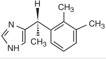

H CH3 N CH3 CH3 NH 

**<mark>Fig. 21.19 Chemical structure of dexmedetomidine.</mark>**

<!-- PDF page 34 -->

excreted in urine and feces. Biotransformation involves both direct glucuronidation as well as cytochrome P450– mediated metabolism. The major metabolic pathways of dexmedetomidine are direct _N_ - glucuronidation to inactive metabolites, hydroxylation (mediated primarily by CYP2A6), and _N_ - methylation. Polymorphism in CYP2A6 does not influence clinical dosing regimens.400 Dexmedetomidine is 94% protein bound, and its concentration ratio between whole blood and plasma is 0.66. Dexmedetomidine has effects on cardiovascular variables, potentially causing bradycardia, transient hypertension, or hypotension, and may alter its own pharmacokinetics. With large doses, there is marked vasoconstriction, which probably reduces the drug’s volumes of distribution. The observed hypertension may be avoided by decreasing the loading dose or by increasing the time of administration.

In essence, dexmedetomidine displays nonlinear pharmacokinetics.401 Its pharmacokinetics in volunteers are best described by a three- compartment model (see Table 21.1). Many subsequent studies in various patient populations have investigated the clinical pharmacokinetics and pharmacodynamics, the results of which are reviewed and summarized by Weerink and colleagues.402 One of the findings is that the bodyweight adjustment dosing that is currently applied is only appropriate for the nonobese population. For obese patients, fat- free mass may be more appropriate, although the specific metric for adjusting dose in obese patients remains under investigation.403

In subjects with varying degrees of hepatic impairment (Child–Pugh Class A, B, or C), clearance of dexmedetomidine is slower than in healthy subjects. The mean clearance values for patients with mild, moderate, and severe hepatic

impairment are 74%, 64%, and 53% of those observed in the normal healthy subjects, respectively.

The pharmacokinetics of dexmedetomidine are not influenced by renal impairment (creatinine clearance &lt;30 mL/ min) or age. In patients with severe renal disease, the sedative effect may be stronger, due to a lower degree of plasma protein binding. Clearance is a function of height.401,404 The elimination half- life of dexmedetomidine is 2 to 3 hours, with a context- sensitive half- time ranging from 4 minutes after a 10- minute infusion to 250 minutes after an 8- hour infusion. Postoperative patients sedated with dexmedetomidine display similar pharmacokinetics to the pharmacokinetics seen in volunteers.405 No clinically relevant cytochrome P450–mediated drug interaction has been found.

### Pharmacology

Dexmedetomidine acts as a nonselective α2- agonist on membrane-bound G- protein coupled α2- adrenoreceptors. Intracellular pathways include inhibition of adenylate cyclase and modulation of calcium and potassium ion channels. Three subtypes of α2- adrenoreceptors have been described in humans: α2A, α2B, and α2C (Fig. 21.20).406 The α2A- adrenoreceptors are primarily distributed in the periphery, whereas α2B and α2C are in the brain and spinal cord. Postsynaptically located α2- adrenoreceptors in peripheral blood vessels produce vasoconstriction, whereas presynaptic α2- adrenoreceptors inhibit the release of norepinephrine, potentially attenuating the vasoconstriction. The overall response to α2- adrenoreceptor agonists is related to the stimulation of α2- adrenoreceptors located in the CNS and spinal cord. These receptors are involved

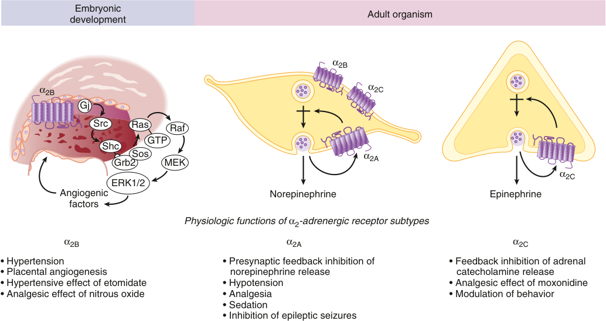

Embryonic Adult organism development α2B α2B α2C Gj Src Ras Raf GTP Shc Sos α2A Grb2 MEK α2C ERK1/2 Angiogenic Norepinephrine Epinephrine factors Physiologic functions of  α2 -adrenergic receptor subtypes α2B α2A α2C • Hypertension • Presynaptic feedback inhibition of  • Feedback inhibition of adrenal • Placental angiogenesis norepinephrine release catecholamine release • Hypertensive effect of etomidate • Hypotension • Analgesic effect of moxonidine • Analgesic effect of nitrous oxide • Analgesia • Modulation of behavior • Sedation • Inhibition of epileptic seizures 

**Fig. 21.20 The different physiologic functions of α2- adrenoreceptors.** The _top panel_ depicts the three α2- receptor subtypes acting as presynaptic inhibitory feedback receptors to control the release of norepinephrine and epinephrine from peripheral or central adult neurons. Also, a negative feedback loop has been seen in the adrenal gland. Alpha2B receptors have been involved in the development of the placental vascular system during prenatal development. The _lower panel_ lists a series of physiologic effects with its associated α2- adrenoreceptors. (From Paris A, Tonner PH. Dexmedetomidine in anaesthesia. _Curr Opin Anaesthesiol_ . 2005;18:412–418.)

<!-- PDF page 35 -->

in the sympatholysis, sedation, and antinociceptive effects of α2- adrenoreceptors.407 The α2- agonists have the advantage that their effects are readily reversible by α2- adrenergic antagonists (e.g., atipamezole).408 Atipamezole is currently not approved for use in humans.

### Effects on the Central Nervous System

**sedation.** The α2- agonists produce their sedative– hypnotic effect by an action on α2- receptors in the locus coeruleus and an analgesic action at α2- receptors within the locus coeruleus and within the spinal cord.409 Dexmedetomidine produces a decrease in activity of the projections of the locus coeruleus to the ventrolateral preoptic nucleus. As a result, GABA- ergic and galanin release in the tuberomammillary nucleus is increased, producing a decrease in histamine release in cortical and subcortical projections.410 The α2-agonists inhibit ion conductance through L- type or P- type calcium channels and facilitate conductance through voltage- gated calcium- activated potassium channels. Dexmedetomidine induces sedation through different receptors than the sedative drugs propofol or benzodiazepines, which exert their action through the GABA system. The sedative effect of dexmedetomidine acts through the endogenous sleep- promoting pathways, generating natural sleep patterns (Fig. 21.21).411 Patients are easily aroused and have the ability to follow commands and cooperate despite remaining tracheally intubated. Undisturbed, patients were noted to fall asleep when not stimulated.412 This characteristic allows for “daily

wake up” tests to be done in a safe fashion. This critical test – when ventilated ICU patients are taken off all sedatives to assess their mental status and titrate sedation – shortens their ventilated and ICU length of stay.413,414 The plasma concentration at which significant yet rousable sedation is achieved is about 0.2 to 0.3 ng/mL. Unarousable deep sedation is thought to occur at plasma concentrations above 1.9 ng/mL.415 Although the precise mechanism by which dexmedetomidine preserves cognition is still unclear, there are data that suggest that the suppression of α5 γ- aminobutyric acid type A receptor expression after exposition to an anesthetic may play a role.416

Finally, the number of patients experiencing delirium in the ICU is significantly lower when sedated with dexmedetomidine, compared to propofol or lorazepam,417 or midazolam.418

**analgesia.** The analgesic effect of the α2- agonists is mediated through stimulation of the α2C-and α2A-receptor in the dorsal horn, directly suppressing pain transmission by reducing the release of pronociceptive transmitters, substance P and glutamate, and hyperpolarization of interneurons.419 Systemic use of dexmedetomidine has an opioid- sparing effect during surgery and postoperatively.420 This is advantageous in patients who are prone to postoperative apnea or hypoventilation, as with patients undergoing bariatric surgery.421 In the postoperative ICU setting, narcotic requirements are reduced by 50% when patients are receiving a dexmedetomidine infusion compared with placebo.412 When used as part of an anesthetic

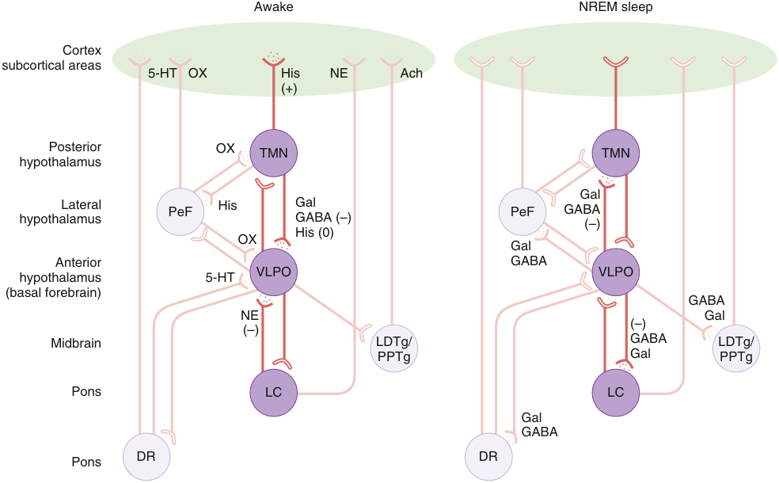

Awake NREM sleep Cortex subcortical areas 5-HT OX His NE Ach (+) Posterior OX TMN TMN hypothalamus Gal Lateral PeF His Gal PeF GABA hypothalamus GABA (–) (–) OX His (0) Gal Anterior GABA VLPO VLPO hypothalamus 5-HT (basal forebrain) GABA NE Gal (–) (–) Midbrain LDTg/ GABA LDTg/ PPTg Gal PPTg Pons LC LC Gal GABA DR DR Pons 

**Fig. 21.21** Dexmedetomidine has been shown to induce a non–rapid eye movement sleeping pattern (NREM). The stimulation of the locus coeruleus (LC) by dexmedetomidine _(right diagram)_ releases the inhibition the LC has over the ventrolateral preoptic nucleus (VLPO). The VLPO subsequently releases γ- aminobutyric acid (GABA) onto the tuberomammillary nucleus (TMN). This inhibits the release of the arousal- promoting histamine on the cortex and forebrain, inducing the loss of consciousness. (From Ebert T, Maze M. Dexmedetomidine: another arrow for the clinician’s quiver. _Anesthesiology_ . 2004;101:569–570.)

<!-- PDF page 36 -->

regimen, dexmedetomidine reduces the MAC of inhaled anesthetics.422,423

Like clonidine, dexmedetomidine is frequently used as an adjuvant in central or peripheral neural blockade. When administered caudally, 1 mcg/kg as adjuvant to bupivacaine 0.25% 1 mL/kg, in children undergoing inguinal hernia repair, response to hernial sac traction is reduced and postoperative analgesia is prolonged.424 Dexmedetomidine has been investigated in volunteers when administered as an adjuvant to ropivacaine in ulnar nerve block425 and tibial nerve block.426 Both studies showed intensification and foremost prolongation of the sensory blockade. This effect is likely elicited by prolonged hyperpolarization of the unmyelinated C- fibers (sensory), and to a lesser extent of the A- fibers (motor function).

**central nervous system protection and other central nervous system effects.** The CNS protective effects are not well defined. Dexmedetomidine in animal models of incomplete cerebral ischemia and reperfusion reduces cerebral necrosis and improves neurologic outcome. The prevalent idea is that dexmedetomidine reduces the intracerebral catecholamine outflow during injury. The neuroprotection may be attributed to modulation of proapoptotic and antiapoptotic proteins.427 Also, the reduction of the excitatory neurotransmitter glutamate during injury may explain some of the protective effects.428

In patients undergoing transsphenoidal hypophysectomy, dexmedetomidine has no effect on lumbar cerebral fluid pressure.429 In other studies, CBF velocity at the middle cerebral artery, as measured by transcranial Doppler, decreased with increasing concentrations of dexmedetomidine but CO2 responsiveness and autoregulation were preserved.430,431 The decrease in CBF is not accompanied by a reduction in CRMO2. More recently, in a study in six normal volunteers, the administration of dexmedetomidine to achieve serum levels of 0.6 ng/mL and 1.2 ng/mL (with and without hyperventilation) produced the predicted reduction of CBF with a concomitant reduction in CRMO2.432 This finding suggests that on the maintenance of the cerebral oxygen supply- to- demand relationship, further work in injured brains needs to be done.

Dexmedetomidine has been used in neurosurgical procedures involving neurophysiologic monitoring. Cortical evoked potentials, amplitudes, and latencies were minimally affected when using dexmedetomidine intraoperatively. It may also be suitable as an anesthetic adjunct during seizure surgery, since the epileptiform activity of seizure foci was not reduced by dexmedotomidine.433

**Effects on the Respiratory System.** In spontaneous breathing volunteers, dexmedetomidine at concentrations producing significant sedation reduces minute ventilation, but results in no change in arterial oxygenation, pH, or the slope in the CO2 ventilatory response curve. In a study comparing the effects of remifentanil and dexmedetomidine on respiratory parameters in normal volunteers, the hypercapnic ventilatory response was unaffected even at doses that produced unresponsiveness to vigorous stimulation.434 Dexmedetomidine exhibited a hypercarbic arousal phenomenon, which has been described during normal sleep.

**Effects on the Cardiovascular System.** Ebert and colleagues performed a study in volunteers using a target- controlled infusion system to provide increasing concentrations (0.7 to 15 ng/mL) of dexmedetomidine (Fig. 21.22). The lowest two concentrations produced a decrease in MAP (13%) followed by progressive increase (12%). Increasing concentrations of dexmedetomidine also produce progressive decreases in heart rate (maximum 29%) and cardiac output (35%). The most commonly reported hemodynamic adverse reactions associated with dexmedetomidine in a phase III trial in 401 patients were hypotension (30%), hypertension (12%), and bradycardia (9%).398 The initial increase in arterial blood pressure is probably due to the vasoconstrictive effects of dexmedetomidine when stimulating peripheral α2- receptors. The incidence of hypotension and bradycardia may be related to the administration of a large intravenous “loading” dose. Omitting the loading dose or not giving more than 0.4 mcg/ kg reduces the incidence of hypotension or makes it less pronounced. Giving the loading dose over 20 minutes also minimizes the transient hypertension.435 In several studies related to the hemodynamic effects of dexmedetomidine after either IM and IV administration, a small percentage of patients experienced profound bradycardia (&lt;40 beats/ min) and occasionally sinus arrest/pause. Generally, these episodes resolved spontaneously or were readily treated without adverse outcome by anticholinergics. No rebound effects have been found when discontinuing a dexmedetomidine infusion, even when it was given for more than 24 hours.436 As clonidine and dexmedetomidine have been shown to reduce perioperative oxygen consumption and blunt the sympathetic response to surgery, cardiac outcome may be improved.437,438 However, more studies are needed to determine whether dexmedetomidine is beneficial in decreasing the risk of myocardial ischemia.

### Uses

Dexmedetomidine has been approved as a short- term sedative for adult intubated patients in the ICU, as is described below. Given its well- documented beneficial effects of anxiolysis, sedation, analgesia, and sympatholysis with minimal respiratory depression, it also has been used in various other clinical scenarios. It is registered for use as a sedative during radiologic or invasive procedures. Two studies, comprising 140 children 1 to 7 years old, reported successful sedation for MRI scans compared with midazolam or propofol.439 For a thorough review of a wide range of studies on various procedures under sedation in different populations, we refer to Gerlach _et al_ .440

As a premedicant, dexmedetomidine, at IV doses of 0.33 to 0.67 mcg/kg given 15 minutes before surgery, seems efficacious, while minimizing the cardiovascular side effects of hypotension and bradycardia.423 Dexmedetomidine has a high bioavailability when administered nasally or buccally. This improves compliance and absorption in younger children. A dose of 3 to 4 mcg/kg 1 hour before surgery is safe and effective.

In a study comparing the efficacy of dexmedetomidine or propofol as a sedative agent in a group of 40 patients receiving local anesthesia or regional blocks, dexmedetomidine (1 mcg/kg given over 10 minutes) when used for intraoperative sedation resulted in a slower onset than propofol

<!-- PDF page 37 -->

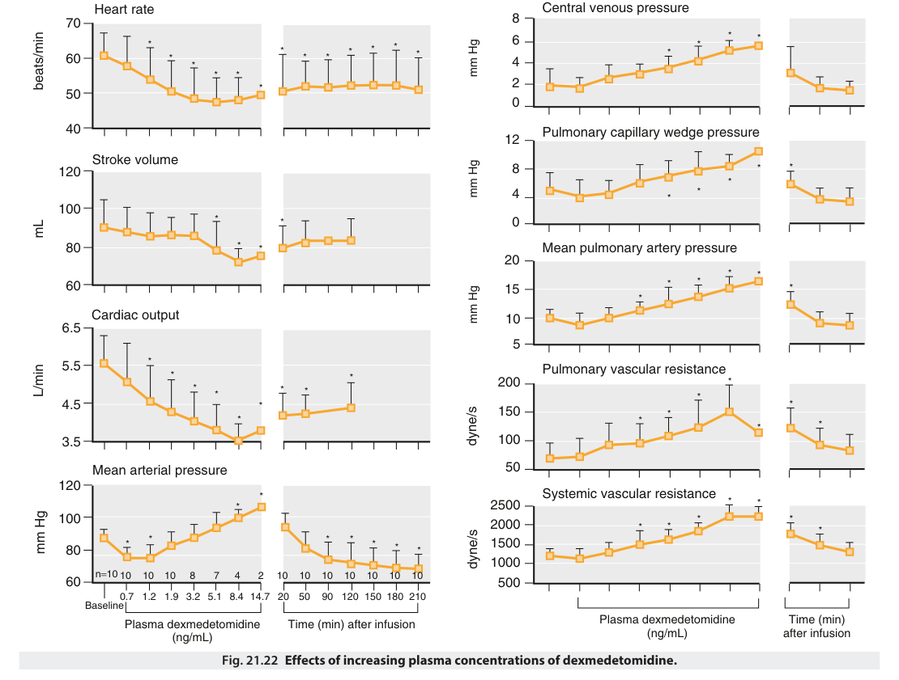

Heart rate Central venous pressure 70 8 * * 60 * * * * * * * * * * 64 * * * * * 2 50 0 40 12 Pulmonary capillary wedge pressure 120 Stroke volume 8 * * * * 4 * 100 * * 0 80 * * Mean pulmonary artery pressure 20 * * 60 15 * * * * Cardiac output 10 6.5 5 5.5 * * * * * * * 200 Pulmonary vascular resistance* * 4.5 * * 150 * * * * * 3.5 100 Mean arterial pressure 50 120 * * 2500 Systemic vascular resistance * * 100 2000 * * * * * 80 * * * * * * * 1500 1000 60 n=10 10 10 10 8 7 4 2 10 10 10 10 10 10 10 500 0.7 1.2 1.9 3.2 5.1 8.4 14.7 20 50 90 120 150 180 210 Baseline Plasma dexmedetomidine Time (min) after infusion Plasma dexmedetomidine Time (min) (ng/mL) (ng/mL) after infusion Fig. 21.22 Effects of increasing plasma concentrations of dexmedetomidine. mm Hg beats/min mm Hg mL mm Hg L/min dyne/s mm Hg dyne/s 

(75 mcg/kg/min for 10 minutes) but had similar cardiorespiratory effects when titrated to equal sedation. The average infusion rate of dexmedetomidine intraoperatively to maintain a BIS value of 70 to 80 was 0.7 mcg/kg/min. Sedation was more prolonged after termination of the infusion, as was recovery of arterial blood pressure. Dexmedetomidine can also produce profound sedation, and it has been used as a total IV anesthetic when given at 10 times the normal sedation concentration range.441 This characteristic, combined with the cooperative status of the patient at a lighter sedative level, and its analgesic effect with sparing of respiratory function, makes the drug suitable as a hypnotic during surgical procedures like awake craniotomy, deep brain stimulation, surgery near speech areas, or awake carotid endarterectomies, with fewer fluctuations from the desired sedation level and more stable hemodynamics.430 A recent study shows that dexmedetomidine may be advantageous by improving the quality of emergence from general anesthesia in avoiding coughing, agitation, hypertension, tachycardia, and shivering. This may be achieved by administration of dexmedetomidine 1 mcg/kg intravenously at the end of surgery. Time to extubation is not prolonged.442 The opioid- sparing effects are advantageous

in the performance of bariatric surgery in patients who are prone to postoperative respiratory depression.421

Dexmedetomidine has been advocated as a treatment for addiction. It has been used to facilitate rapid opioid detoxification, cocaine withdrawal, and iatrogenic- induced benzodiazepine and opioid tolerance after prolonged sedation.443 The use in opioid/benzodiazepine withdrawal therapy in pediatric patients during mechanical ventilation in intensive care areas has been described as well.444

Dexmedetomidine may produce dry mouth due to a decrease in salivation. Combined with the sparing effect on respiratory function, this effect is beneficial for the facilitation of awake fiberoptic intubation, an application which is rapidly emerging.445 Furthermore, dexmedetomidine decreases intraocular pressure and decreases the shivering threshold.446

The role of general anesthesia in general and dexmedetomidine in particular on cancer remains unclear. Studies of the _in vitro_ and _in vivo_ effects of dexmedetomidine on lung carcinoma and neuroglioma cell lines have demonstrated enhancement of cancer proliferation and migration, primarily by the upregulation of antiapoptotic proteins. The clinical relevance of these findings remains to be determined.447

<!-- PDF page 38 -->

**Intensive Care Unit.** Dexmedetomidine may have advantages over propofol for sedation in mechanically ventilated postoperative patients. Heart rate was slower in the dexmedetomidine group, whereas MAP was similar. The PaO2/FiO2 (arterial partial pressure of oxygen/ fraction of inspired oxygen) ratio was significantly higher in the dexmedetomidine group. Time to extubation of the trachea after discontinuation of the infusion was similar, at 28 minutes. Patients receiving dexmedetomidine had greater recall of their stay in the ICU, but all described this as pleasant overall.448 Several other studies have confirmed the decreased requirement for opioids (>50%) when dexmedetomidine is used for sedation compared with propofol or benzodiazepines. Hemodynamics during weaning are more stable, which benefits patients with high risk for myocardial ischemia.449 For sedation in the ICU, loading doses of 0.5 to 1 mcg/kg have been used. Omitting the bolus dose or giving the lower dose has been associated with fewer episodes of severe bradycardia and other hemodynamic perturbations. Infusion rates of 0.1 to 1 mcg/ kg/h are generally needed to maintain adequate sedation. Delirium in the ICU is a risk factor for increased length of stay and increased mortality.450 In a double- blind, randomized controlled trial of sedation in ventilated patients with dexmedetomidine versus lorazepam, it was found that using dexmedetomidine infusions provided more days alive without delirium or coma and a greater amount of time spent at the appropriate sedation level compared with lorazepam.416 It also improved the patient’s ability to communicate pain, compared to midazolam or propofol in two recent trials.413 The unique characteristics of dexmedetomidine, that is providing adequate sedation with minimal respiratory depression, make this selective α2adrenoceptor agonist very useful when weaning patients from the ventilator.451 While the FDA approved the use of dexmedetomidine infusions for 24 hours or less, multiple studies have shown the safety of using this agent for longer periods, even up to 30 days.419,452 The Sedation Practice in Intensive Care Evaluation (SPICE III) trial published in 2019 evaluated a cohort of 4000 patients undergoing mechanical ventilation in the ICU, receiving early sedation with dexmedetomidine, after a period of 90 days. The overall analysis revealed no difference in 90- day mortality in the dexmedetomidine group compared to conventional care.453 A thorough analysis for heterogeneity of treatment effect of the same study, published in 2021, revealed a high probability of increased mortality in critically ill mechanically ventilated patients ≤65 years admitted for nonoperative reasons and receiving early sedation with dexmedetomidine (odds ratio [OR] 1.26, 95% confidence interval [CI] 1.02–1.56).454 This finding led to a warning by the ENA about the use of dexmedetomidine in this specific group of patients.

### DROPERIDOL

### History

Janssen324,327 synthesized haloperidol, the first member of the butyrophenones, which became the primary neuroleptic component in neuroleptanesthesia. In 1959, DeCastro and Mundeleer combined haloperidol with phenoperidine (a meperidine derivative also synthesized by Janssen) in the

forerunner to the practice of neuroleptanesthesia. Droperidol, a derivative of haloperidol, and fentanyl (a phenoperidine congener), both synthesized by Janssen, were used by DeCastro and Mundeleer in a combination they reported to be superior to haloperidol and phenoperidine. This neuroleptanesthesia combination produced more rapid onset of analgesia, less respiratory depression, and fewer extrapyramidal side effects. The fixed combination of droperidol and fentanyl, marketed as Innovar in the United States, was the drug primarily used for neuroleptanesthesia. The use of neuroleptanesthesia has largely disappeared in modern anesthetic practice. The primary use of droperidol in anesthesia has been as an antiemetic and to a lesser extent as a sedative and antipruritic. In addition, droperidol is used as an antipsychotic agent and to reduce agitation.455

In 2001, the FDA issued a black box warning regarding the use of droperidol and its potential for fatal arrhythmias and recommended that it be administered only during continuous electrocardiogram monitoring. With the withdrawal of droperidol in certain countries and more stringent labeling regarding potentially lethal dysrhythmias in others, the use of droperidol has decreased markedly. The validity of the risk of low- dose droperidol in causing QT prolongation, dysrhythmias, and death has been challenged by numerous editorials, articles, and letters reviewing the cases that prompted this action.324,456–460 In Europe, 19 out of 25 countries with council members in the European Society of Anesthesiologists reported that droperidol is regularly used in a dosage of 0.5 to 2.5 mg for the prevention of PONV. Furthermore, in 2007, an international consensus panel recommended droperidol despite the FDA warning as a first- line antiemetic.324,461

Droperidol is a butyrophenone, a fluorinated derivative of phenothiazines (Fig. 21.23). Butyrophenones produce CNS depression, characterized by marked apparent tranquility and cataleptic immobility and are potent antiemetics. Droperidol is a potent butyrophenone, and like the others, it produces its action centrally at sites where dopamine, norepinephrine, and serotonin act.324,462 It has been postulated that butyrophenones may occupy GABA receptors on the postsynaptic membrane, reducing synaptic transmission and resulting in a build- up of dopamine in the synaptic cleft. Droperidol results in a submaximal inhibition of the GABAA α1-, β1-, and γ2- acetylcholine receptors and full inhibition of α2- acetylcholine receptors. This submaximal inhibition of GABA receptors by droperidol may explain the anxiety, dysphoria, and restlessness that may occur with its administration.324,463 An imbalance in dopamine and acetylcholine is thought to occur with subsequent alteration in normal transmission of signals in the CNS. The chemoreceptor trigger zone is the emetic center, and “red” astrocytes transport neurolept molecules from the capillary to dopaminergic synapses in the chemoreceptor trigger zone,

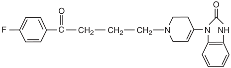

O O F C CH2  CH2  CH2  N N NH 

**<mark>Fig. 21.23 Structure of droperidol, a butyrophenone derivative.</mark>**

<!-- PDF page 39 -->

where they occupy GABA receptors. This is thought to be the mechanism by which droperidol exerts its antiemetic effect.

### Pharmacokinetics

Droperidol is biotransformed in the liver into two primary metabolites. Its plasma decay can be described by a twocompartment model. The pharmacokinetics324,464 are shown in Table 21.1.

### Pharmacodynamics

**Effects on the Central Nervous System.** The effects of neurolept anesthetics on human CBF and CMRO2 have not been studied. In dogs, droperidol causes potent cerebral vasoconstriction, producing a 40% reduction in CBF. No significant change in CMRO2 occurs during droperidol administration. The EEG in conscious patients shows some reduction in frequency, with occasional slowing. Low- dose droperidol has also been shown to cause balance disturbances at the time of discharge after doses used for antiemetic prophylaxis. Droperidol may produce extrapyramidal signs and worsen symptoms of Parkinson disease, which is why the drug should be used with great caution in patients with this degenerative disorder. It also rarely may precipitate malignant neuroleptic syndrome.

**Effects on the Respiratory System.** When used alone, droperidol has little effect on the respiratory system. Droperidol (0.044 mg/kg) given to surgical patients produced a slight reduction in respiratory rate, and IV droperidol (3 mg) had no significant effect on tidal volume in volunteers. More detailed respiratory studies are unavailable.

**Effects on the Cardiovascular System.** Similar to most antipsychotics, droperidol may prolong the QT interval by delaying myocardial repolarization and precipitating torsades de pointes.324,465 This effect seems to be dose dependent and may be of clinical significance particularly when other potential causes for QT prolongation coexist. Droperidol also may possess some antiarrhythmic effects that are similar to those of quinidine. Droperidol produces vasodilation with a decrease in blood pressure (see Table 21.3). This effect is a result of moderate α- adrenergic blockade. The dopamine- induced increase in renal blood flow (renal artery flowmeter methodology) is not significantly impaired by administration of droperidol. Droperidol has little effect on myocardial contractility.

### Uses

Because of some of the deleterious effects of droperidol, its use in the perioperative period is largely restricted to its antiemetic and sedative effects. It is an effective antiemetic; the dose for this use ranges from 10 to 20 mcg/kg IV (typically 0.6–1.25 mg for a 70- kg individual).324,466 Because droperidol in dosages below 1 mg produces antiemetic effects and because the cardiac side effects may be dose dependent, an IV dose below 1 mg for prevention of PONV is advisable.467 These doses of droperidol, given at the start of anesthesia for operations lasting 1 hour, reduce the incidence of nausea and vomiting by about 30%. These doses given at induction have little effect on wake- up time, but should they be given at the end of surgery, there could be

some residual hypnotic effect. Overall, antiemetic efficacy of droperidol alone is equal to that of ondansetron and results in an equal number of side effects, but droperidol is more cost- effective. The efficacy of droperidol as an antiemetic is enhanced when used in combination with serotonin antagonists or dexamethasone, or both. Droperidol also has been shown to be effective in the treatment and prevention of pruritus secondary to opioid administration. It has been given intravenously and into the epidural space for this purpose. When used in this fashion, droperidol also effectively reduces nausea, but it increases sedation. The safety of droperidol administration into the epidural space has not been fully evaluated, however, and it is not approved for administration via this route.

## Summary

A wide variety of intravenously administered drugs have beneficial effects in the care of patients requiring general anesthesia or sedation. The selection of a particular drug and, more commonly, a combination of drugs, should be based on the individual patient’s need for hypnosis, amnesia, and analgesia and the clinical goals of care. Drug selection must consider the physiology and/or pathophysiology of the individual patient and the pharmacology of the particular drug(s). In addition, based on the pharmacokinetic and pharmacodynamic interactions described, optimal dosage of hypnotic–analgesic combinations can be determined. For example, a patient in shock who requires induction of anesthesia should receive the drug that produces rapid onset of effect without causing further hemodynamic compromise. The knowledge of the clinical pharmacology of each of the IV anesthetic drugs enables the clinician to induce and maintain sedation or general anesthesia safely and effectively. There is no single perfect drug for every patient, but rather a number of options that can be selected by an informed practitioner who takes into account the benefits, risks, and alternatives to wisely employ the appropriate drug(s) to optimize anesthesia care.

### Acknowledgment

The editors and publisher would like to thank Drs. J.G. Reeves, Peter S.A. Glass, David A. Lubarsky, Matthew D. McEvoy, and Richardo Martinez- Ruiz for contributing a chapter on this topic in a previous edition of this work. It has served as the foundation for the current chapter.

### Complete references available online at expertconsult.com.

### References

1.  Jarman R. _Postgrad Med_ . 1946;22:311.

2.  Glen JB, et al. _Br J Anaesth_ . 1982;54:231.

3.  Adam HK, et al. _Br J Anaesth_ . 1980;52:743.

4.  Glen JB. _Br J Anaesth_ . 1980;52:230.

5.  Glen JB. _Br J Anaesth_ . 1980;52:731.

6.  James R, Glen JB. _J Med Chem_ . 1980;23:1350.

7.  Grossherr M, et al. _Br J Anaesth_ . 2009;102:608.

8.  Grossherr M, et al. _Xenobiotica_ . 2009;39:782.

9.  Liu B, et al. _J Clin Monit Comput_ . 2012;26:29.

10.  Cowley NJ, et al. _Anaesthesia_ . 2012;67:870.

11.  Struys MMRF, et al. _Eur J Anaesthesiol_ . 2010;27:395.

12.  Struys MMRF, et al. _Anesthesiology_ . 2010;112:1056.

13.  Garnock- Jones KP, Scott LJ. _Drugs_ . 2010;70:469.

<!-- PDF page 40 -->

14.  Vree TB, et al. _J Chromatogr B Biomed Sci Appl_ . 1999;721:217.

15.  Bleeker C, et al. _Br J Anaesth_ . 2008;101:207.

16.  Takizawa D, et al. _Clin Pharmacol Ther_ . 2004;76:648.

17.  Takizawa D, et al. _Anesthesiology_ . 2005;102:327.

18.  Kuipers JA, et al. _Anesthesiology_ . 1999;91:1780.

19.  Reekers M, et al. _Adv Exp Med Biol_ . 2003;523:19.

20.  Lichtenbelt BJ, et al. _Anesth Analg_ . 2010;110:1597.

21.  Chen TL, et al. _Br J Anaesth_ . 1995;74:558.

22.  van den Berg JP, et al. _Br J Anaesth_ . 2017;119(5):918.

23.  Vuyk J, et al. _Br J Anaesth_ . 2001;86:183.

24.  Schnider TW, et al. _Anesthesiology_ . 1999;90:1502.

25.  Marsh B, et al. _Br J Anaesth_ . 1991;67:41.

26.  Marsh BJ, et al. _Can J Anaesth_ . 1990;37:S97.

27.  Gepts E, et al. _Anesth Analg_ . 1987;66:1256.

28.  Schuttler J, Ihmsen H. _Anesthesiology_ . 2000;92:727.

29.  Hughes MA, et al. _Anesthesiology_ . 1992;76:334.

30.  Kazama T, et al. _Anesthesiology_ . 1999;90:1517.

31.  Shafer A, et al. _Anesthesiology_ . 1988;69:348.

32.  Vuyk J, et al. _Anesthesiology_ . 2000;93:1557.

33.  Mertens MJ, et al. _Anesthesiology_ . 2004;100:795.

34.  Leslie K, et al. _Anesth Analg_ . 1995;80:1007.

35.  Upton RN, et al. _Anesth Analg_ . 1999;89:545.

36.  Kazama T, et al. _Anesthesiology_ . 2002;97:1156.

37.  Allegaert K, et al. _Br J Anaesth_ . 2007;99:864.

38.  Allegaert K, et al. _Neonatology_ . 2007;92:291.

39.  Kirkpatrick T, et al. _Br J Anaesth_ . 1988;60:146.

40.  Vuyk J. _Acta Anaesthesiol Belg_ . 2001;52:445.

41.  Kataria BK, et al. _Anesthesiology_ . 1994;80:104.

42.  Murat I, et al. _Anesthesiology_ . 1995;83:A1131.

43.  Murat I, et al. _Anesthesiology_ . 1996;84:526.

44.  Servin F, et al. _Anesthesiology_ . 1988;69:887.

45.  Servin F, et al. _Br J Anaesth_ . 1990;65:177.

46.  Vuyk J, et al. _Anesth Analg_ . 2009;108:1522.

47.  Mertens MJ, et al. _Anesthesiology_ . 2001;94:949.

48.  Sitsen E, et al. _Anesth Analg_ . 2016:1341.

49.  Sitsen E, et al. _Eur J Anaesthesiol_ . 2021:S121.

50.  Candiotti K, et al. _Crit Care Med_ . 2010;38:U268.

51.  Candiotti KA, et al. _Anesth Analg_ . 2011;113:550.

52.  Gan TJ, et al. _J Clin Anesth_ . 2010;22:260.

53.  Cohen LB, et al. _J Clin Gastroenterol_ . 2010;44:345.

54.  Abdelmalak B, et al. _Curr Pharm Des_ . 2012;18:6241.

55.  Patwardhan A, et al. _Anesth Analg_ . 2012;115:837.

56.  Sneyd JR, Rigby- Jones AE. _Br J Anaesth_ . 2010;105:246.

57.  Feng AY, et al. _J Anaesthesiol Clin Pharmacol_ . 2017;33(1):9.

58.  Krasowski MD, et al. _Mol Pharmacol_ . 1998;53:530.

59.  Krasowski MD, et al. _Neuropharmacology_ . 2001;41:952.

60.  Forman SA, Ruesch D. _Biophys J_ . 2003;84:87A.

61.  Forman SA. _Anesthesiology_ . 2011;114:695.

62.  Ruesch D, et al. _Anesthesiology_ . 2012;116:47.

63.  Franks NP. _Nat Rev Neurosci_ . 2008;9:370.

64.  Kushikata T, et al. _Anesth Analg_ . 2002;94:1201.

65.  Stamatakis EA, et al. _PLoS One_ . 2010;5:e14224.

66.  Xie G, et al. _Br J Anaesth_ . 2011;106:548.

67.  Lingamaneni R, et al. _Anesthesiology_ . 2001;95:1460.

68.  Lingamaneni R, Hemmings HC. _Br J Anaesth_ . 2003;90:199.

69.  Dong XP, Xu TL. _Anesth Analg_ . 2002;95:907.

70.  Pain L, et al. _Anesth Analg_ . 2002;95:915.

71.  Gelb AW, et al. _Anesthesiology_ . 1995;83:A752.

72.  Rigby- Jones AE, et al. _Anesthesiology_ . 2002;97:1393.

73.  Rigby- Jones AE, Sneyd JR. _Paediatr Anaesth_ . 2011;21:247.

74.  Murray DM, et al. _Br J Anaesth_ . 2002;88:318P.

75.  Glass PS, et al. _Anesthesiology_ . 1997;86:836.

76.  San- Juan D, et al. _Clin Neurophysiol_ . 2010;121:998.

77.  Hodkinson BP, et al. _Lancet_ . 1987;2:1518.

78.  Wilson C, et al. _Clin Toxicol_ . 2010;48:165.

79.  Kirby RR, et al. _Anesth Analg_ . 2009;108:1182.

80.  Wischmeyer PE, et al. _Anesth Analg_ . 2007;105:1066.

81.  Noterman J, et al. _Neurochirurgie_ . 1988;34:161.

82.  Steiner LA, et al. _Anesth Analg_ . 2003;97:572.

83.  Adembri C, et al. _Crit Care Med_ . 2002;30:A24.

84.  Adembri C, et al. _Anesthesiology_ . 2006;104:80.

85.  Adembri C, et al. _CNS Drug Rev_ . 2007;13:333.

86.  Kotani Y, et al. _J Cerebr Blood Flow Metabol_ . 2008;28:354.

87.  Gelb AW, et al. _Anesthesiology_ . 2002;96:1183.

88.  Gelb AW. _Anesth Analg_ . 2003;96:33.

89.  Cattano D, et al. _Anesth Analg_ . 2008;106:1712.

90.  Pesic V, et al. _Int J Dev Neurosci_ . 2009;27:279.

91.  Lanigan C, et al. _Anaesthesia_ . 1992;47:810.

92.  Vuyk J, et al. _Anesthesiology_ . 1992;77:3.

93.  Vuyk J, et al. _Anesthesiology_ . 1996;84:288.

94.  Vuyk J, et al. _Anesthesiology_ . 1997;87:1549.

95.  Spelina KR, et al. _Br J Anaesth_ . 1986;58:1080.

96.  Smith C, et al. _Anesthesiology_ . 1994;81:820.

97.  Kazama T, et al. _Anesth Analg_ . 1998;86:872.

98.  Dahan A, et al. _Adv Exp Med Biol_ . 2003;523:81.

99.  Nieuwenhuijs DJ, et al. _Anesthesiology_ . 2003;98:312.

100.  Goodman NW, et al. _Br J Anaesth_ . 1987;59:1497.

101.  Jonsson MM, et al. _Anesthesiology_ . 2005;102:110.

102.  Larsen R, et al. _Anaesthesia_ . 1988;43(suppl):25.

103.  de Wit F, et al. _Br J Anaesth_ . 2016;116(6):784.

104.  Pagel PS, Warltier DC. _Anesthesiology_ . 1993;78:100.

105.  Samain E, et al. _Anesthesiology_ . 2000;93:U169.

106.  Samain E, et al. _Anesth Analg_ . 2000;90:546.

107.  Xia ZY, et al. _Anesth Analg_ . 2006;103:527.

108.  Huang ZY, et al. _Clin Sci_ . 2011;121:57.

109.  Denborough M, Hopkinson KC. _Lancet_ . 1988;1:191.

110.  Denborough MA. _Anesthesiology_ . 2008;108:156.

111.  Foster PS, et al. _Clin Exp Pharmacol Physiol_ . 1992;19:183. 112.  Mertes PM, Laxenaire MC. _Anaesthesia_ . 2002;57:821.

113.  Laxenaire MC, et al. _Anesthesiology_ . 1992;77:275.

114.  Laxenaire MC. _Ann Fr Anesth Reanim_ . 1994;13:498.

115.  Gan TJ, et al. _Anesthesiology_ . 1997;87:779.

116.  Bennett SN, et al. _N Engl J Med_ . 1995;333:147.

117.  Devlin JW, et al. _Pharmacotherapy_ . 2005;25:1348.

118.  Looney M, et al. _Anesthesiology_ . 2010:1118.

119.  Oh CS, et al. _Anesthesiology_ . 2018:921.

120.  Li R, et al. _BMC Anesthesiol_ . 2018;77.

121.  Lim JA, et al. _Vitro analysis BMC Cancer_ . 2018:159.

122.  Kushida A, et al. _Immunopharmacol Immunotoxicol_ . 2007:477. 123.  Enlund M, et al. _Ups J Med Sci_ . 2014:251. 124.  Karmakar MK, et al. _Anticancer Res_ . 2017:5813.

125.  Sessler DI, et al. _Lancet_ . 2019:1807.

126.  Kazama T, et al. _Anesthesiology_ . 2003;98:299.

127.  Mertens MJ, et al. _Anesthesiology_ . 2003;99:347.

128.  Minto CF, et al. _Anesthesiology_ . 2000;92:1603.

129.  Short TG, et al. _Br J Anaesth_ . 1992;69:162.

130.  Reich DL, et al. _Anesth Analg_ . 2005;101:622.

131.  Lichtenbelt BJ, et al. _Clin Pharmacokinet_ . 2004;43:577.

132.  Johnson KB, et al. _Anesthesiology_ . 2004;101:647.

133.  Kurita T, et al. _Anesth Analg_ . 2009;109:398.

134.  Reade MC, Finfer S. _N Engl J Med_ . 2014;370:444.

135.  Jacobi J, et al. _Crit Care Med_ . 2002;30:119.

136.  Olutoyin OA, et al. _Am J Obstet Gynecol_ . 2018;218:98.

137.  Malhotra A, et al. _Brain Sci_ . 2017;7(8):107.

138.  Jiang S, et al. _Eur J Pharmacol_ . 2018;831:1.

139.  Jalota L, et al. _BMJ_ . 2011;342:d1110.

140.  Roberts R, et al. _Crit Care Med_ . 2008;36:A180.

141.  Fodale V, La Monaca E. _Drug Saf_ . 2008;31:293.

142.  Otterspoor LC, et al. _Curr Opin Anaesthesiol_ . 2008;21:544. 143.  Fudickar A, Bein B. _Minerva Anestesiol_ . 2009;75:339.

144.  Lundy JS. _J Am Assoc Nurse Anesth_ . 1966;34:95.

145.  Bennetts FE. _Br J Anaesth_ . 1995;75:366.

146.  Mahisekar UL, et al. _J Clin Anesth_ . 1994;6:55.

147.  Mark L. _Clin Pharmacol Ther_ . 1963;4:504.

148.  Granick S. _J Biol Chem_ . 2012;238:PC2247.

149.  Breimer DD. _Br J Anaesth_ . 1976;48:643.

150.  Henthorn TK, et al. _Clin Pharmacol Ther_ . 1989;45:56.

151.  Christensen JH, et al. _Br J Anaesth_ . 1980;52:913. 152.  Morgan DJ, et al. _Anesthesiology_ . 1981;54:474.

153.  Downie DL, et al. _Anesthesiology_ . 2000;93:774.

154.  Tomlin SL, et al. _Anesthesiology_ . 1999;90:1714.

155.  Fredriksson A, et al. _Anesthesiology_ . 2007;107:427.

156.  Liu H, Yao S. _Exp Brain Res_ . 2005;167:666.

157.  Liu H, et al. _Can J Anaesth_ . 2006;53:442.

158.  Judge SE. _Br J Anaesth_ . 1983;55:191.

159.  Forman SA, Miller KW. _Anesth Analg_ . 2016;123(5):1263.

160.  Stullken EH, et al. _Anesthesiology_ . 1977;46:28.

161.  Baughman VL. _Anesthesiol Clin North Am_ . 2002;20(vi):315. 162.  Albrecht RF, et al. _Anesthesiology_ . 1977;47:252.

163.  Pancrazio JJ, et al. _J Pharmacol Exp Ther_ . 1993;265:358.

<!-- PDF page 41 -->

164.  Mark LC, et al. _J Pharmacol Exp Ther_ . 1957;119:35. 165.  Burch PG, Stanski DR. _Anesthesiology_ . 1983;58:146. 166.  Stella L, et al. _Br J Anaesth_ . 1979;51:119. 167.  Brodie BB, et al. _J Pharmacol Exp Ther_ . 1960;130:20. 168.  Homer TD, Stanski DR. _Anesthesiology_ . 1985;62:714. 169.  Sorbo S, et al. _Anesthesiology_ . 1984;61:666. 170.  Gross JB, et al. _Anesthesiology_ . 1983;58:540. 171.  Choi SD, et al. _Anesthesiology_ . 1985;62:442. 172.  Todd MM, et al. _Anesth Analg_ . 1985;64:681.

173.  Sonntag H, et al. _Acta Anaesthesiol Scand_ . 1975;19:69. 174.  Dundee JW, Moore J. _Anaesthesia_ . 1961;16:50.

175.  Touw DJ. _Drug Metabol Drug Interact_ . 1997;14:55. 176.  Bajwa SJ, et al. _J Anaesthesiol Clin Pharmacol_ . 2011;27:440. 177.  Ding Z, White PF. _Anesth Analg_ . 2002;94:1351.

178.  Messina AG, et al. _Cochrane Database Syst Rev_ . 2016;10:CD007272. 179.  Rodriguez E, Jordan R. _Emerg Med Clin North Am_ . 2002;20:199. 180.  Stovner J, Endresen R. _Lancet_ . 1965;2:1298. 181.  Reves JG, et al. _Anesthesiology_ . 1985;62:310.

182.  Winsky- Sommerer R. _Eur J Neurosci_ . 2009;29:1779.

183.  Reynolds LM, et al. _Neuropsychopharmacology_ . 2012;37(11):2531. 184.  Greenblatt DJ, et al. _Clin Pharmacokinet_ . 1983;8:233. 185.  Greenblatt DJ, et al. _Anesthesiology_ . 1984;61:27. 186.  Thummel KE, et al. _Clin Pharmacol Ther_ . 1996;59:491. 187.  Allonen H, et al. _Clin Pharmacol Ther_ . 1981;30:653. 188.  Greenblatt DJ, et al. _Pharmacology_ . 1983;27:70. 189.  Dundee JW, et al. _Drugs_ . 1984;28:519.

190.  Pentikainen PJ, et al. _J Clin Pharmacol_ . 1989;29:272.

191.  Wandel C, et al. _Br J Anaesth_ . 1994;73:658.

192.  Heizmann P, et al. _Br J Clin Pharmacol_ . 1983;16(suppl 1):43S. 193.  van Rongen A, et al. _Br J Clin Pharnacol_ . 2015;80:1185. 194.  Bauer TM, et al. _Lancet_ . 1995;346:145. 195.  Divoll M, et al. _Anesth Analg_ . 1983;62:1.

196.  Gamble JA, et al. _Anaesthesia_ . 1975;30:164.

197.  Greenblatt DJ, et al. _Clin Pharmacol Ther_ . 1980;27:301. 198.  Klotz U, et al. _J Clin Invest_ . 1975;55:347. 199.  Andersson T, et al. _Br J Clin Pharmacol_ . 1994;38:131. 200.  Jung F, et al. _Drug Metab Dispos_ . 1997;25:133.

201.  Yang TJ, et al. _Drug Metab Dispos_ . 1999;27:102.

202.  Locniskar A, Greenblatt DJ. _Biopharm Drug Dispos_ . 1990;11:499. 203.  Greenblatt DJ, et al. _J Pharm Sci_ . 1979;68:57. 204.  Greenblatt DJ. _Clin Pharmacokinet_ . 1981;6:89. 205.  Saari TI, et al. _Pharmacol Rev_ . 2011;63:243. 206.  Antonik LJ, et al. _Anesth Analg_ . 2012;115:274. 207.  Hu Q, et al. _Drug Des Dev Ther_ . 2022;16:3957. 208.  Worthington MT, et al. _Anesth Analg_ . 2013;117(5):1093. 209.  Antonik LJ, et al. _Anesth Analg_ . 2012;115(2):274. 210.  Stöhr T, et al. _Br J Anaesth_ . 2021;127(3):415. 211.  Tsukagoshi E, et al. _J Pharmacol Sci_ . 2011;115:221. 212.  Mould DR, et al. _Clin Pharmacol Ther_ . 1995;58:35.

213.  Mohler H, Richards JG. _Eur J Anaesthesiol Suppl_ . 1988;2:15. 214.  Mohler H, et al. _J Pharmacol Exp Ther_ . 2002;300:2. 215.  Kohno T, et al. _Anesthesiology_ . 2006;104:338. 216.  Ho KM, Ismail H. _Anaesth Intensive Care_ . 2008;36:365. 217.  Forster A, et al. _Anesthesiology_ . 1982;56:453. 218.  Harman F, et al. _Childs Nerv Syst_ . 2012;28:1055. 219.  Norton JR, et al. _Anesthesiology_ . 2006;104:1155. 220.  Sunzel M, et al. _Br J Clin Pharmacol_ . 1988;25:561. 221.  Alexander CM, Gross JB. _Anesth Analg_ . 1988;67:377. 222.  Tverskoy M, et al. _Anesth Analg_ . 1989;68:282. 223.  Coote JH. _Exp Physiol_ . 2007;92:3. 224.  Li YF, et al. _Am J Physiol_ . 2006;291:H2847. 225.  von Moltke LL, et al. _J Clin Pharmacol_ . 1996;36:783. 226.  Olkkola KT, et al. _Anesth Analg_ . 1996;82:511. 227.  Goldstein JA. _Br J Clin Pharmacol_ . 2001;52:349. 228.  Sim SC, et al. _Clin Pharmacol Ther_ . 2006;79:103. 229.  Ishizaki T, et al. _Clin Pharmacol Ther_ . 1995;58:155. 230.  Qin XP, et al. _Clin Pharmacol Ther_ . 1999;66:642. 231.  Ahonen J, et al. _Fundam Clin Pharmacol_ . 1996;10:314. 232.  Luurila H, et al. _Pharmacol Toxicol_ . 1996;78:117. 233.  Kamali F, et al. _Eur J Clin Pharmacol_ . 1993;44:365. 234.  Andersson T, et al. _Eur J Clin Pharmacol_ . 1990;39:51. 235.  Perucca E, et al. _Clin Pharmacol Ther_ . 1994;56:471. 236.  Abernethy DR, et al. _J Pharmacol Exp Ther_ . 1985;234:345. 237.  Samara EE, et al. _J Clin Pharmacol_ . 1997;37:442. 238.  Vinik HR, et al. _Anesth Analg_ . 1989;69:213.

239.  Hong W, et al. _Anesthesiology_ . 1993;79:1227.

240.  McClune S, et al. _Br J Anaesth_ . 1992;69:240.

241.  Bauer KP, et al. _J Clin Anesth_ . 2004;16:177.

242.  Kain ZN, et al. _Anesthesiology_ . 1998;89:1147.

243.  Hargreaves J. _Br J Anaesth_ . 1988;61:611.

244.  Pollock JS, Kenny GN. _Br J Anaesth_ . 1993;70:219.

245.  Kowark, et al. _Eur J Anaesthesiol_ . 2022;39(3):210.

246.  George KA, Dundee JW. _Br J Clin Pharmacol_ . 1977;4:45.

247.  Cole SG, et al. _Gastrointest Endosc_ . 1983;29:219.

248.  McNulty SE, et al. _Anesth Analg_ . 1995;81:404.

249.  Lee SH. _Dig Dis Sci_ . 2012;57:2243.

250.  Garewal D, et al. _Cochrane Database Syst Rev_ . 2012:CD007274. 251.  Chen S, et al. _Am J Trans Res_ . 2020;12(8):4594.

252.  Pastis NJ, et al. _Chest_ . 2019;155(1):137.

253.  Frolich MA, et al. _Can J Anaesth_ . 2006;53:79.

254.  Nitsun M, et al. _Clin Pharmacol Ther_ . 2006;79:549.

255.  Walder B, et al. _Anesth Analg_ . 2001;92:975.

256.  Devlin JW, et al. _Crit Care Med_ . 2018:1532.

257.  Barr J, et al. _Crit Care Med_ . 2013;41:263.

258.  Mehta S, et al. _JAMA_ . 1985;308:2012.

259.  Breimer LT, et al. _Clin Pharmacokinet_ . 1990;18:245.

260.  Jacobs JR, et al. _Anesth Analg_ . 1995;80:143.

261.  Melvin MA, et al. _Anesthesiology_ . 1982;57:238.

262.  Theil DR, et al. _J Cardiothorac Vasc Anesth_ . 1993;7:300. 263.  Doi M, et al. _J Anesth_ . 2020;34(4):491.

264.  Doi M, et al. _J Anesth_ . 2020;34(4):543.

265.  Ahn EJ, et al. _Anesth Analg_ . 2016;122(3):664.

266.  Jung JS, et al. _Otolaryngol Head Neck Surg_ . 2007;137:753.

267.  Heidari SM, et al. _Adv Biomed Res_ . 2012;1:9.

268.  Lee Y, et al. _Anaesthesia_ . 2007;62:18.

269.  Riad W, et al. _Eur J Anaesthesiol_ . 2007;24:697.

270.  Riad W, Marouf H. _Middle East J Anesthesiol_ . 2009;20:431. 271.  Fujii Y, Itakura M. _Clin Ther_ . 2010;32:1633.

272.  Rinehart JB, et al. _Neurol_ . 2012;18:216.

273.  Brogden RN, Goa KL. _Drugs_ . 1991;42:1061.

274.  File SE, Pellow S. _Psychopharmacology (Berl)_ . 1986;88:1.

275.  Cumin R, et al. _Experientia_ . 1982;38:833.

276.  Haefely W, Hunkeler W. _Eur J Anaesthesiol Suppl_ . 1988;2:3. 277.  Klotz U, Kanto J. _Clin Pharmacokinet_ . 1988;14:1. 278.  Klotz U, et al. _Eur J Clin Pharmacol_ . 1984;27:115.

279.  Lauven PM, et al. _Anesthesiology_ . 1985;63:61.

280.  Kleinberger G, et al. _Lancet_ . 1985;2:268.

281.  Yokoyama M, et al. _Anesth Analg_ . 1992;75:87.

282.  Amrein R, et al. _Resuscitation_ . 1988;16(suppl):S5.

283.  Rubio F, et al. _Lancet_ . 1993;341:1028.

284.  Donovan KL, Fisher DJ. _BMJ_ . 1989;298:1253.

285.  Zuber M, et al. _Eur Neurol_ . 1988;28:161.

286.  Lassaletta A, et al. _Pediatr Emerg Care_ . 2004;20:319.

287.  Rouiller M, et al. _Ann Fr Anesth Reanim_ . 1987;6:1.

288.  Duka T, et al. _Psychopharmacology (Berl)_ . 1986;90:351.

289.  Nilsson A. _Acta Anaesthesiol Scand Suppl_ . 1990;92:51.

290.  Ueda K, et al. _Acta Anaesthesiol Scand_ . 2013;57:488.

291.  Weinbrum A, Geller E. _Acta Anaesthesiol Scand Suppl_ . 1990;92:65. 292.  Ghoneim MM, et al. _Anesthesiology_ . 1989;70:899. 293.  White PF, et al. _Anesthesiology_ . 1982;56:119.

294.  Bovill JG. _Anesth Analg_ . 2007;105:1186.

295.  Bovill JG, et al. _Lancet_ . 1971;1:1285.

296.  Nimmo WS, Clements JA. _Br J Anaesth_ . 1981;53:186. 297.  Clements JA, Nimmo WS. _Br J Anaesth_ . 1981;53:27.

298.  Olofsen E, et al. _Anesth Analg_ . 2012;115:536.

299.  Olofsen E, et al. _Anesthesiology_ . 2012;117:353.

300.  Dahan A, et al. _Eur J Pain_ . 2011;15:258.

301.  White M, et al. _Br J Anaesth_ . 2006;96:330.

302.  Sigtermans M, et al. _Eur J Pain_ . 2010;14:302.

303.  Noppers I, et al. _Anesthesiology_ . 2011;114:1435.

304.  Kharasch ED, Labroo R. _Anesthesiology_ . 1992;77:1201.

305.  Kharasch ED, et al. _Anesthesiology_ . 1992;77:1208.

306.  Sigtermans M, et al. _Anesthesiology_ . 2009;111:892.

307.  Sigtermans MJ, et al. _Pain_ . 2009;145:304.

308.  Weinbroum AA. _Pharmacol Res_ . 2012;65:411.

309.  Niesters M, et al. _Anesthesiology_ . 2011;115:1063.

310.  Niesters M, et al. _Pain_ . 2011;152:656.

311.  Niesters M, et al. _Anesthesiology_ . 2012;117:868.

312.  Niesters M, Dahan A. _Expet Opin Drug Metabol Toxicol_ . 2012;8:1409.

313.  Lee EE, et al. _Gen Hosp Psychiatr_ . 2015;37(2):178.

<!-- PDF page 42 -->

314.  Nieuwenhuijs D, et al. _Clin Exp Pharmacol Physiol_ . 2002;29:A77.

315.  Sarton E, et al. _Anesth Analg_ . 2001;93:1495.

316.  Timm C, et al. _Anaesthesist_ . 2008;57:338.

317.  Amr YM. _Pain Physician_ . 2011;14:475.

318.  Kamp J, et al. _Expet Opin Drug Metabol Toxicol_ . 2019;15(12):1033.

319.  Bozymski KM, et al. _Ann Pharmacother_ . 2020;54(6):567.

320.  Bar- Joseph G, et al. _Crit Care Med_ . 2009;37:A402.

321.  Bar- Joseph G, et al. _J Neurosurg Pediatr_ . 2009;4:40.

322.  Dahmani S, et al. _Paediatr Anaesth_ . 2011;21:636.

323.  Dahmani S. _Paediatr Anaesth_ . 2011;21:1081.

324.  Schnabel A, et al. _Br J Anaesth_ . 2011;107:601.

325.  Walker SM, Yaksh TL. _Anesth Analg_ . 2012;115:638.

326.  Walker SM, et al. _Anesth Analg_ . 2012;115:450.

327.  Janssen PA. _Int J Neuropsychiatry_ . 1967;3(suppl 1):S10.

328.  Noppers IM, et al. _Pain_ . 2011;152:2173.

329.  Godefroi EF, et al. _J Med Chem_ . 1965;8:220.

330.  Ledingham IM, Watt I. _Lancet_ . 1983;1:1270.

331.  Wagner RL, White PF. _Anesthesiology_ . 1984;61:647.

332.  Longnecker DE. _Anesthesiology_ . 1984;61:643.

333.  Owen H, Spence AA. _Br J Anaesth_ . 1984;56:555.

334.  Doenicke A, et al. _Br J Anaesth_ . 1997;79:386.

335.  Van Hamme MJ, et al. _Anesthesiology_ . 1978;49:274.

336.  Schuttler J, et al. _Eur J Anaesthesiol_ . 1985;2:133.

337.  Johnson KB, et al. _Anesth Analg_ . 2003;96:1360.

338.  van Beem H, et al. _Anaesthesia_ . 1983;38(suppl):61.

339.  Arden JR, et al. _Anesthesiology_ . 1986;65:19.

340.  Sear J. In: Longnecker DE, et al., ed. _Anesthesia_ . McGraw- Hill Medical; 2008:897.

341.  Heykants JJ, et al. _Arch Int Pharmacodyn Ther_ . 1975;216:113.

342.  Meuldermans WE, Heykants JJ. _Arch Int Pharmacodyn Ther_ . 1976;221:150.

343.  Evans RH, Hill RG. _Experientia_ . 1978;34:1325.

344.  Guitchounts G, et al. _Anesthesiology_ . 2012;116:1235.

345.  Cheng VY, et al. _J Neurosci_ . 2006;26:3713.

346.  Carlson BX, et al. In: Yaksh TL, Lynich C, et al., eds. _Anesthesia: Biologic Foundations_ . Lippincott- Raven; 1998:259.

347.  Rusch D, et al. _J Biol Chem_ . 2004;279:20982.

348.  Cold GE, et al. _Acta Anaesthesiol Scand_ . 1986;30:159.

349.  Modica PA, Tempelhoff R. _Can J Anaesth_ . 1992;39:236.

350.  Thornton C, et al. _Br J Anaesth_ . 1985;57:554.

351.  Drummond JC, et al. _Neurosurgery_ . 1995;37:742.

352.  Flower O, Hellings S. _Emerg Med Int_ . 2012;2012:637171.

353.  Ebrahim ZY, et al. _Anesth Analg_ . 1986;65:1004.

354.  Pastor J, et al. _Epilepsia_ . 2010;51:602.

355.  Lallemand MA, et al. _Br J Anaesth_ . 2003;91:341.

356.  Kaneda K, et al. _J Clin Pharmacol_ . 2011;51:482.

357.  Guldager H, et al. _Acta Anaesthesiol Scand_ . 1985;29:352.

358.  Morgan M, et al. _Br J Anaesth_ . 1977;49:233.

359.  Colvin MP, et al. _Br J Anaesth_ . 1979;51:551.

360.  Ogawa K, et al. _Anesthesiology_ . 2001;94:668.

361.  Gooding JM, Corssen G. _Anesth Analg_ . 1977;56:717.

362.  Gooding JM, et al. _Anesth Analg_ . 1979;58:40.

363.  Bovill JG. _Semin CardioThorac Vasc Anesth_ . 2006;10:43.

364.  Sprung J, et al. _Anesth Analg_ . 2000;91:68.

365.  Möller PA, Kamenik M. _Br J Anaesth_ . 2013;110:388.

366.  Larsen R, et al. _Anaesthesist_ . 1988;37:510.

367.  Fragen RJ, et al. _Anesthesiology_ . 1987;66:839.

368.  Diago MC, et al. _Anaesthesia_ . 1988;43:644.

369.  Bruder EA, et al. _Cochrane Database Syst Rev_ . 2015;1:CD010225.

370.  Cherfan AJ, et al. _Pharmacotherapy_ . 2012;32:475.

371.  Sprung CL, et al. _N Engl J Med_ . 2008;358:111.

372.  Lipiner- Friedman D, et al. _Crit Care Med_ . 2007;35:1012.

373.  Cuthbertson BH, et al. _Intensive Care Med_ . 2009;35:1868.

374.  Stewart G, et al. _J Intensive Care Med_ . 2021;36(10):1124.

375.  Nimmo WS, Miller M. _Contemp Anesth Pract_ . 1983;7:83.

376.  Canessa R, et al. _J Cardiothorac Vasc Anesth_ . 1991;5:566. 377.  Kim TK, Park IS. _J Korean Neurosurg Soc_ . 2011;50:497.

378.  Wang N, et al. _J ECT_ . 2011;27:281.

379.  Avramov MN, et al. _Anesth Analg_ . 1995;81:596.

380.  Radtke FM, et al. _Minerva Anestesiol_ . 2010;76:394.

381.  Preda VA, et al. _Eur J Endocrinol_ . 2012;167:137.

382.  Carroll TB, et al. _J Endocrine Soc_ . 2019;3(1):1.

383.  Stefan M, et al. _Eur J Endocrinol_ . 2020;183(2):161.

384.  St Pierre M, et al. _Eur J Anaesthesiol_ . 2000;17:634.

385.  Mayer M, et al. _Anaesthesist_ . 1996;45:1082.

386.  Wu J, et al. _Contraception_ . 2013;87:55.

387.  Doenicke AW, et al. _Br J Anaesth_ . 1999;83:464.

388.  Nyman Y, et al. _Br J Anaesth_ . 2006;97:536.

389.  Huter L, et al. _Anesth Analg_ . 2007;105:1298.

390.  Un B, et al. _J Res Med Sci_ . 2011;16:1490.

391.  Cotten JF, et al. _Anesthesiology_ . 2009;111:240.

392.  Struys MMRF, et al. _Anesthesiol_ . 2017;127:20.

393.  Valk BI, et al. _Br J Anaesth_ . 2018;120(6):1401.

394.  Maze M, Tranquilli W. _Anesthesiology_ . 1991;74:581.

395.  Gerlach AT, Dasta JF. _Ann Pharmacother_ . 2007;41:245.

396.  Tobias JD. _Pediatr Crit Care Med_ . 2007;8:115.

397.  European Medicines Agency. https://www.ema.europa.eu/en/med icines/dhpc/dexmedetomidine- increased- risk- mortality- intensivecare- unit- icu- patients- 65- years.

398.  Bhana N, et al. _Drugs_ . 2000;59:263.

399.  Virtanen R, et al. _Eur J Pharmacol_ . 1988;150:9.

400.  Wang L, et al. _Expert Rev Clin Pharmacol_ . 2018;11(9):917.

401.  Dyck JB, et al. _Anesthesiology_ . 1993;78:821.

402.  Weerink MAS, et al. _Clin Pharmacokinet_ . 2017;56(8):893.

403.  Erstad BL, et al. _Crit Care_ . 2020;24(1):315.

404.  De Wolf AM, et al. _Anesth Analg_ . 2001;93:1205.

405.  Venn RM, et al. _Br J Anaesth_ . 2002;88:669.

406.  Aantaa R, Jalonen J. _Eur J Anaesthesiol_ . 2006;23:361.

407.  Paris A, Tonner PH. _Curr Opin Anaesthesiol_ . 2005;18:412.

408.  Aho M, et al. _J Clin Anesth_ . 1993;5:194.

409.  Guo TZ, et al. _Anesthesiology_ . 1996;84:873.

410.  Nelson LE, et al. _Anesthesiology_ . 2003;98:428.

411.  Angst MS, et al. _Anesthesiology_ . 2004;101:744.

412.  Venn RM, et al. _Anaesthesia_ . 1999;54:1136.

413.  Jakob SM, et al. _JAMA_ . 2012;307:1151.

414.  Kress JP, et al. _N Engl J Med_ . 2000;342:1471.

415.  Ebert TJ, et al. _Anesthesiology_ . 2000;93(2):382.

416.  Pandharipande PP, et al. _JAMA_ . 2007;298:2644.

417.  Riker RR, et al. _JAMA_ . 2009;301:489.

418.  Wang D- S, et al. _Anesthesiology_ . 2018;129:477.

419.  Ishii H, et al. _Eur J Neurosci_ . 2008;27:3182.

420.  McCutcheon CA, et al. _Anesth Analg_ . 2006;102:668.

421.  Hofer RE, et al. _Can J Anaesth_ . 2005;52:176.

422.  Aho M, et al. _Anesthesiology_ . 1991;74:997.

423.  Aantaa R, et al. _Anesthesiology_ . 1990;73:230.

424.  Xiang Q, et al. _Br J Anaesth_ . 2013;110:420.

425.  Marhofer D, et al. _Br J Anaesth_ . 2013;110:438.

426.  Rancourt MP, et al. _Anesth Analg_ . 2012;115:958.

427.  Engelhard K, et al. _Anesth Analg_ . 2003;96:524.

428.  Talke P, Bickler PE. _Anesthesiology_ . 1996;85:551.

429.  Talke P, et al. _Anesth Analg_ . 1997;85:358.

430.  Bekker A, Sturaitis MK. _Neurosurgery_ . 2005;57:1.

431.  Zornow MH, et al. _J Cerebr Blood Flow Metabol_ . 1993;13:350.

432.  Drummond JC, et al. _Anesthesiology_ . 2008;108:225.

433.  Talke P, et al. _J Neurosurg Anesthesiol_ . 2007;19:195.

434.  Hsu YW, et al. _Anesthesiology_ . 2004;101:1066.

435.  Riker RR, Fraser GL. _Pharmacotherapy_ . 2005;25:8S.

436.  Venn M, et al. _Intensive Care Med_ . 2003;29:201.

437.  Jalonen J, et al. _Anesthesiology_ . 1997;86:331.

438.  Talke P, et al. _Anesthesiology_ . 1995;82:620.

439.  Koroglu A, et al. _Anesth Analg_ . 2006;103:63.

440.  Gerlach AT, et al. _Ann Pharmacother_ . 2009;43(12):2064.

441.  Ramsay MA, Luterman DL. _Anesthesiology_ . 2004;101:787.

442.  Aouad MT, et al. _Anesth Analg_ . 2019;129(6):1504.

443.  Maccioli GA. _Anesthesiology_ . 2003;98:575.

444.  Phan H, Nahata MC. _Paediatr Drugs_ . 2008;10:49.

445.  Maroof M, et al. _Can J Anaesth_ . 2005;52:776.

446.  Yazbek- Karam VG, Aouad MM. _Middle East J Anesthesiol_ . 2006;18:1043.

447.  Wang C, et al. _Anesthesiology_ . 2018;129:1000–1014.

448.  Venn RM, Grounds RM. _Br J Anaesth_ . 2001;87:684.

449.  Triltsch AE, et al. _Crit Care Med_ . 2002;30:1007.

450.  Ely EW, et al. _JAMA_ . 2004;291:1753.

451.  Siobal MS, et al. _Respir Care_ . 2006;51:492.

452.  Lewis K, et al. _Intensive Care Med_ . 2022;48(7):811.

453.  Shehabi Y, et al. _N Engl J Med_ . 2019;380:2506.

454.  Shehabi Y, et al. _Intensive Care Med_ . 2021;47(4):455.

455.  Khokhar MA, Rathbone J. _Cochrane Database Syst Rev_ . 2016;12: CD002830.

456.  Dershwitz M. _J Clin Anesth_ . 2002;14:598.

<!-- PDF page 43 -->

457.  Gan TJ, et al. _Anesthesiology_ . 2002;97:287. 458.  Gan TJ. _Anesth Analg_ . 2004;98:1809. 459.  White PF, et al. _Anesthesiology_ . 2005;102:1101. 460.  White PF, Abrao J. _Anesthesiology_ . 2006;104:386. 461.  Gan TJ, et al. _Anesth Analg_ . 2007;105:1615. 462.  Gan TJ. _Anesth Analg_ . 2006:47–51.

463.  Flood P, Coates KM. _Anesthesiology_ . 2002;96:987. 464.  Fischler M, et al. _Anesthesiology_ . 1986;64:486. 465.  Wooltorton E. _CMAJ (Can Med Assoc J)_ . 2002;166:932. 466.  Hill RP, et al. _Anesthesiology_ . 2000;92:958. 467.  Schaub I, et al. _Eur J Anesthesiol_ . 2012;29:286.

<!-- PDF page 44 -->

### References

1.  Jarman R. History of intravenous anaesthesia with ten years’ experience in the use of pentothal sodium. _Postgrad Med J_ . 1946;22:311– 318.

2.  Glen JB, Hunter SC, Thomson DS. The role of cremophor El in anaphylactoid reactions to IV anesthetics. _Br J Anaesth_ . 1982;54:231– 232.

3.  Adam HK, Glen JB, Hoyle PA. Pharmacokinetics in laboratoryanimals of ICI 35- 868, a new IV anesthetic agent. _Br J Anaesth_ . 1980;52:743–746.

4.  Glen JB. Animal pharmacology of ICI- 35- 868 – new IV anesthetic agent. _Br J Anaesth_ . 1980;52:230.

5.  Glen JB. Animal studies of the anesthetic activity of ICI 35- 868. _Br J Anaesth_ . 1980;52:731–742.

6.  James R. Glen JB. Synthesis, biological evaluation, and preliminary structure- activity considerations of a series of alkylphenols as intravenous anesthetic agents. _J Med Chem_ . 1980;23:1350–1357.

7.  Grossherr M, Hengstenberg A, Meier T, et al. Propofol concentration in exhaled air and arterial plasma in mechanically ventilated patients undergoing cardiac surgery. _Br J Anaesth_ . 2009;102:608– 613.

8.  Grossherr M, Hengstenberg A, Dibbelt L, et al. Blood gas partition coefficient and pulmonary extraction ratio for propofol in goats and pigs. _Xenobiotica_ . 2009;39:782–787.

9.  Liu B, Pettigrew DM, Bates S, et al. Performance evaluation of a whole blood propofol analyser. _J Clin Monit Comput_ . 2012;26:29– 36.

10.  Cowley NJ, Laitenberger P, Liu B, et al. Evaluation of a new analyser for rapid measurement of blood propofol concentration during cardiac surgery. _Anaesthesia_ . 2012;67:870–874.

11.  Struys MMRF, Fechner J, Schuttler J, Schwilden H. Requested retraction of six studies on the PK/PD and tolerability of fospropofol. _Eur J Anaesthesiol_ . 2010;27:395.

12.  Struys MMRF, Fechner J, Schuttler J, Schwilden H. Erroneously published fospropofol pharmacokinetic- pharmacodynamic data and retraction of the affected publications (retracted article). _Anesthesiology_ . 2010;112:1056–1057.

13.  Garnock- Jones KP, Scott LJ. Fospropofol. _Drugs_ . 2010;70:469– 477.

14.  Vree TB, Lagerwerf AJ, Bleeker CP, de Grood PMRM. Direct highperformance liquid chromatography determination of propofol and its metabolite quinol with their glucuronide conjugates and preliminary pharmacokinetics in plasma and urine of man. _J Chromatogr B_ . 1999;721:217–228.

15.  Bleeker C, Vree T, Lagerwerf A, Bree EWV. Recovery and longterm renal excretion of propofol, its glucuronide, and two diisopropylquinol glucuronides after propofol infusion during surgery. _Br J Anaesth_ . 2008;101:207–212.

16.  Takizawa D, Hiraoka H, Nakamura K, et al. Propofol concentrations during the anhepatic phase of living- related donor liver transplantation. _Clin Pharmacol Ther_ . 2004;76:648–649.

17.  Takizawa D, Hiraoka H, Goto F, et al. Human kidneys play an important role in the elimination of propofol. _Anesthesiology_ . 2005;102:327–330.

18.  Kuipers JA, Boer F, Olieman W, et al. First- pass lung uptake and pulmonary clearance of propofol: assessment with a recirculatory indocyanine green pharmacokinetic model. _Anesthesiology_ . 1999;91:1780–1787.

19.  Reekers M, Boer F, Vuyk J. Basic concepts of recirculatory pharmacokinetic modelling. _Adv Exp Med Biol_ . 2003;523:19–26.

20.  Lichtenbelt BJ, Olofsen E, Dahan A, et al. Propofol reduces the distribution and clearance of midazolam. _Anesth Analg_ . 2010;110:1597– 1606.

21.  Chen TL, Ueng TH, Chen SH, et al. Human cytochrome P450 mono- oxygenase system is suppressed by propofol. _Br J Anaesth_ . 1995;74:558–562.

22.  van den Berg JP, Eleveld DJ, De Smet T, et al. Influence of Bayesian optimization on the performance of propofol target- controlled infusion. _Br J Anaesth_ . 2017;119(5):918–927.

23.  Vuyk J, Oostwouder CJ, Vletter AA, et al. Gender differences in the pharmacokinetics of propofol in elderly patients during and after continuous infusion. _Br J Anaesth_ . 2001;86:183–188.

24.  Schnider TW, Minto CF, Shafer SL, et al. The influence of age on propofol pharmacodynamics. _Anesthesiology_ . 1999;90:1502–1516.

25.  Marsh B, White M, Morton N, Kenny GN. Pharmacokinetic model driven infusion of propofol in children. _Br J Anaesth_ . 1991;67:41– 48.

26.  Marsh BJ, Morton NS, White M, Kenny GN. A computer controlled infusion of propofol for induction and maintenance of anaesthesia in children. _Can J Anaesth_ . 1990;37:S97.

27.  Gepts E, Camu F, Cockshott ID, Douglas EJ. Disposition of propofol administered as constant rate intravenous infusions in humans. _Anesth Analg_ . 1987;66:1256–1263.

28.  Schuttler J, Ihmsen H. Population pharmacokinetics of propofol: a multicenter study. _Anesthesiology_ . 2000;92:727–738.

29.  Hughes MA, Glass PS, Jacobs JR. Context- sensitive half- time in multicompartment pharmacokinetic models for intravenous anesthetic drugs. _Anesthesiology_ . 1992;76:334–341.

30.  Kazama T, Ikeda K, Morita K, et al. Comparison of the effect- site k(eO)s of propofol for blood pressure and EEG bispectral index in elderly and younger patients. _Anesthesiology_ . 1999;90:1517–1527.

31.  Shafer A, Doze VA, Shafer SL, White PF. Pharmacokinetics and pharmacodynamics of propofol infusions during general anesthesia. _Anesthesiology_ . 1988;69:348–356.

32.  Vuyk J, Schnider T, Engbers F. Population pharmacokinetics of propofol for target- controlled infusion (TCI) in the elderly. _Anesthesiology_ . 2000;93:1557–1560.

33.  Mertens MJ, Olofsen E, Burm AGL, et al. Mixed- effects modeling of the influence of alfentanil on propofol pharmacokinetics. _Anesthesiology_ . 2004;100:795–805.

34.  Leslie K, Sessler DI, Bjorksten AR, Moayeri A. Mild hypothermia alters propofol pharmacokinetics and increases the duration of action of atracurium [see comments]. _Anesth Analg_ . 1995;80:1007– 1014.

35.  Upton RN, Ludbrook GL, Grant C, Martinez AM. Cardiac output is a determinant of the initial concentrations of propofol after shortinfusion administration. _Anesth Analg_ . 1999;89:545–552.

36.  Kazama T, Kurita T, Morita K, et al. Influence of hemorrhage on propofol pseudo- steady state concentration. _Anesthesiology_ . 2002;97:1156–1161.

37.  Allegaert K, Peeters MY, Verbesselt R, et al. Inter- individual variability in propofol pharmacokinetics in preterm and term neonates. _Br J Anaesth_ . 2007;99:864–870.

38.  Allegaert K, Verbesselt R, Naulaers G, et al. Interindividual variability of propofol clearance in neonates. _Neonatology_ . 2007;92:291.

39.  Kirkpatrick T, Cockshott ID, Douglas EJ, Nimmo WS. Pharmacokinetics of propofol (diprivan) in elderly patients. _Br J Anaesth_ . 1988;60:146–150.

40.  Vuyk J. Clinical interpretation of pharmacokinetic and pharmacodynamic propofol- opioid interactions. _Acta Anaesthesiol Belg_ . 2001;52:445–451.

41.  Kataria BK, Ved SA, Nicodemus HF, et al. The pharmacokinetics of propofol in children using 3 different data- analysis approaches. _Anesthesiology_ . 1994;80:104–122.

42.  Murat I, Zaouter M, Granados M, et al. Pharmacokinetics of propofol children under 3 years of age. _Anesthesiology_ . 1995;83:A1131.

43.  Murat I, Billard V, Vernois J, et al. Pharmacokinetics of propofol after a single dose in children aged 1–3 years with minor burns – comparison of three data analysis approaches. _Anesthesiology_ . 1996;84:526–532.

44.  Servin F, Desmonts JM, Haberer JP, et al. Pharmacokinetics and protein- binding of propofol in patients with cirrhosis. _Anesthesiology_ . 1988;69:887–891.

45.  Servin F, Cockshott ID, Farinotti R, et al. Pharmacokinetics of propofol infusions in patients with cirrhosis. _Br J Anaesth_ . 1990;65:177– 183.

46.  Vuyk J, Lichtenbelt BJ, Olofsen E, et al. Mixed- effects modeling of the influence of midazolam on propofol pharmacokinetics. _Anesth Analg_ . 2009;108:1522–1530.

47.  Mertens MJ, Vuyk J, Olofsen E, et al. Propofol alters the pharmacokinetics of alfentanil in healthy male volunteers. _Anesthesiology_ . 2001;94:949–957.

48.  Sitsen E, Olofsen E, Lesman A, et al. Epidural blockade affects the pharmacokinetics of propofol in surgical patients. _Anesth Analg_ . 2016;122(5):1341–1349.

49.  Sitsen E, Olofsen E, Dahan A, Vuyk J. Effect of lumbar epidural blockade and propofol on mean arterial pressure, cardiac output and bispectral index: a randomised controlled and pharmacodynamic modelling study. _Eur J Anaesthesiol_ . 2021;38(suppl 2):S121–S129.

<!-- PDF page 45 -->

50.  Candiotti K, Gan T, Young C, et al. Safety and tolerability of fospropofol for patients requiring intubation and mechanical ventilation in the ICU: randomized, open- label study vs propofol. _Crit Care Med_ . 2010;38:U268.

51.  Candiotti KA, Gan TJ, Young C, et al. A randomized, open- label study of the safety and tolerability of fospropofol for patients requiring intubation and mechanical ventilation in the intensive care unit. _Anesth Analg_ . 2011;113:550–556.

52.  Gan TJ, Berry BD, Ekman EF, et al. Safety evaluation of fospropofol for sedation during minor surgical procedures. _J Clin Anesth_ . 2010;22:260–267.

53.  Cohen LB, Cattau E, Goetsch A, et al. A randomized, double- blind, phase 3 study of fospropofol disodium for sedation during colonoscopy. _J Clin Gastroenterol_ . 2010;44:345–353.

54.  Abdelmalak B, Khanna A, Tetzlaff J. Fospropofol, a new sedative anesthetic, and its utility in the perioperative period. _Curr Pharm Design_ . 2012;18:6241–6252.

55.  Patwardhan A, Edelmayer R, Annabi E, et al. Receptor specificity defines algogenic properties of propofol and fospropofol. _Anesth Analg_ . 2012;115:837–840.

56.  Sneyd JR, Rigby- Jones AE. New drugs and technologies, intravenous anaesthesia is on the move (again). _Br J Anaesth_ . 2010;105:246– 254.

57.  Feng AY, Kaye AD, Kaye RJ, et al. Novel propofol derivatives and implications for anesthesia practice. _J Anaesthesiol Clin Pharmacol_ . 2017;33(1):9–15.

58.  Krasowski MD, Koltchine VV, Rick CE, et al. Propofol and other intravenous anesthetics have sites of action on the gamma- aminobutyric acid type A receptor distinct from that for isoflurane. _Mol Pharmacol_ . 1998;53:530–538.

59.  Krasowski MD, Nishikawa K, Nikolaeva N, et al. Methionine 286 in transmembrane domain 3 of the GABA(A) receptor beta subunit controls a binding cavity for propofol and other alkylphenol general anesthetics. _Neuropharmacology_ . 2001;41:952–964.

60.  Forman SA, Ruesch D. Two general anesthetic actions in GABA(A) Rs attributable to altered gating. _Biophys J_ . 2003;84:87A.

61.  Forman SA. Clinical and molecular pharmacology of etomidate. _Anesthesiology_ . 2011;114:695–707.

62.  Ruesch D, Neumann E, Wulf H, Forman SA. An allosteric coagonist model for propofol effects on alpha 1 beta 2 gamma 2L gammaaminobutyric acid type A receptors. _Anesthesiology_ . 2012;116: 47–55.

63.  Franks NP. General anaesthesia: from molecular targets to neuronal pathways of sleep and arousal. _Nat Rev Neurosci_ . 2008;9:370–386.

64.  Kushikata T, Hirota K, Yoshida H, et al. Alpha- 2 adrenoceptor activity affects propofol- induced sleep time. _Anesth Analg_ . 2002;94:1201– 1206.

65.  Stamatakis EA, Adapa RM, Absalom AR, Menon DK. Changes in

   - resting neural connectivity during propofol sedation. _PLoS One_ . 2010;5.

66.  Xie G, Deschamps A, Backman SB, et al. Critical involvement of the thalamus and precuneus during restoration of consciousness with physostigmine in humans during propofol anaesthesia: a positron emission tomography study. _Br J Anaesth_ . 2011;106:548–557.

67.  Lingamaneni R, Birch ML, Hemmings HC. Widespread inhibition of sodium channel- dependent glutamate release from isolated nerve terminals by isoflurane and propofol. _Anesthesiology_ . 2001;95:1460–1466.

68.  Lingamaneni R, Hemmings HC. Differential interaction of anaesthetics and antiepileptic drugs with neuronal Na+ channels, Ca2+ channels, and GABA(A) receptors. _Br J Anaesth_ . 2003;90:199–211.

69.  Dong XP, Xu TL. The actions of propofol on gamma- aminobutyric acid- A and glycine receptors in acutely dissociated spinal dorsal horn neurons of the rat. _Anesth Analg_ . 2002;95:907–914.

70.  Pain L, Gobaille S, Schleef C, et al. In vivo dopamine measurements in the nucleus accumbens after nonanesthetic and anesthetic doses of propofol in rats. _Anesth Analg_ . 2002;95:915–919.

71.  Gelb AW, Diab T, Cechetto DF. Effects of propofol on neuronal activity in the area postrema of the rat. _Anesthesiology_ . 1995;83:A752.

72.  Rigby- Jones AE, Nolan JA, Priston MJ, et al. Pharmacokinetics of propofol infusions in critically ill neonates, infants, and children in an intensive care unit. _Anesthesiology_ . 2002;97:1393–1400.

73.  Rigby- Jones AE, Sneyd JR. Propofol and children – what we know and what we do not know. _Pediatr Anesth_ . 2011;21:247–254.

74.  Murray DM, Rigby- Jones AE, Tonucci D, et al. Propofol blood levels, clinical sedation scores and electrophysiological variables in children emerging from propofol infusion anaesthesia. _Br J Anaesth_ . 2002;88:318P.

75.  Glass PS, Bloom M, Kearse L, et al. Bispectral analysis measures sedation and memory effects of propofol, midazolam, isoflurane, and alfentanil in healthy volunteers. _Anesthesiology_ . 1997;86:836–847.

76.  San- Juan D, Chiappa KH, Cole AJ. Propofol and the electroencephalogram. _Clin Neurophysiol_ . 2010;121:998–1006.

77.  Hodkinson BP, Frith RW, Mee EW. Proprofol and the electroencephalogram. _Lancet_ . 1987;2:1518.

78.  Wilson C, Canning P, Caravati EM. The abuse potential of propofol. _Clin Toxicol_ . 2010;48:165–170.

79.  Kirby RR, Colaw JM, Douglas SMM. Death from propofol: accident, suicide, or murder? _Anesth Analg_ . 2009;108:1182–1184.

80.  Wischmeyer PE, Johnson BR, Wilson JE, et al. A survey of propofol abuse in academic anesthesia programs. _Anesth Analg_ . 2007;105:1066–1071.

81.  Noterman J, Berre J, Vandesteene A, Brotchi J. Intracranial- pressure monitoring in the postoperative period of cerebral aneurysms. _Neurochirurgie_ . 1988;34:161–163.

82.  Steiner LA, Johnston AJ, Chatfield DA, et al. The effects of largedose propofol on cerebrovascular pressure autoregulation in headinjured patients. _Anesth Analg_ . 2003;97:572–576.

83.  Adembri C, Venturi L, De Gaudio RA. Propofol is neuroprotective in a rat model of focal cerebral ischemia when administered after the insult. _Crit Care Med_ . 2002;30:A24.

84.  Adembri C, Venturi L, Tani A, et al. Neuroprotective effects of propofol in models of cerebral ischemia – inhibition of mitochondrial swelling as a possible mechanism. _Anesthesiology_ . 2006;104:80–89.

85.  Adembri C, Venturi L, Pellegrini- Giampietro DE. Neuroprotective effects of propofol in acute cerebral injury. _CNS Drug Rev_ . 2007;13:333–351.

86.  Kotani Y, Nakajima Y, Hasegawa T, et al. Propofol exerts greater neuroprotection with disodium edetate than without it. _J Cerebr Blood Flow Metabol_ . 2008;28:354–366.

87.  Gelb AW, Bayona NA, Wilson JX, Cechetto DF. Propofol anesthesia compared to awake reduces infarct size in rats. _Anesthesiology_ . 2002;96:1183–1190.

88.  Gelb AW. Drug choices for neuroanesthesia. _Anesth Analg_ . 2003;96:33–35.

89.  Cattano D, Young C, Straiko MMW, Olney JW. Subanesthetic doses of propofol induce neuroapoptosis in the infant mouse brain. _Anesth Analg_ . 2008;106:1712–1714.

90.  Pesic V, Milanovic D, Tanic N, et al. Potential mechanism of cell death in the developing rat brain induced by propofol anesthesia. _Int J Dev Neurosci_ . 2009;27:279–287.

91.  Lanigan C, Sury M, Bingham R, et al. Neurological sequelae in children after prolonged propofol infusion. _Anaesthesia_ . 1992;47:810– 811.

92.  Vuyk J, Engbers FH, Lemmens HJ, et al. Pharmacodynamics of propofol in female patients. _Anesthesiology_ . 1992;77:3–9.

93.  Vuyk J, Engbers FH, Burm AGL, et al. Pharmacodynamic interaction between propofol and alfentanil when given for induction of anesthesia. _Anesthesiology_ . 1996;84:288–299.

94.  Vuyk J, Mertens MJ, Olofsen E, et al. Propofol anesthesia and rational opioid selection: determination of optimal EC50- EC95 propofolopioid concentrations that assure adequate anesthesia and a rapid return of consciousness. _Anesthesiology_ . 1997;87:1549–1562.

95.  Spelina KR, Coates DP, Monk CR, et al. Dose requirements of propofol by infusion during nitrous oxide anesthesia in man .1. Patients premedicated with morphine sulfate. _Br J Anaesth_ . 1986;58:1080– 1084.

96.  Smith C, McEwan AI, Jhaveri R, et al. The interaction of fentanyl on the Cp50 of propofol for loss of consciousness and skin incision. _Anesthesiology_ . 1994;81:820–828.

97.  Kazama T, Ikeda K, Morita K, et al. Propofol concentration required for endotracheal intubation with a laryngoscope or fiberscope and its interaction with fentanyl. _Anesth Analg_ . 1998;86:872–879.

98.  Dahan A, Nieuwenhuijs DJF, Olofsen E. Influence of propofol on the control of breathing. _Adv Exp Med Biol_ . 2003;523:81–92.

99.  Nieuwenhuijs DJ, Olofsen E, Romberg RR, et al. Response surface modeling of remifentanil- propofol interaction on cardiorespiratory control and bispectral index. _Anesthesiology_ . 2003;98:312–322.

<!-- PDF page 46 -->

100.  Goodman NW, Black AMS, Carter JA. Some ventilatory effects of propofol as sole anesthetic agent. _Br J Anaesth_ . 1987;59:1497–1503.

101.  Jonsson MM, Lindahl SGE, Eriksson LI. Effect of propofol on carotid body chemosensitivity and cholinergic chemotransduction. _Anesthesiology_ . 2005;102:110–116.

102.  Larsen R, Rathgeber J, Bagdahn A, et al. Effects of propofol on cardiovascular dynamics and coronary blood flow in geriatric patients. A comparison with etomidate. _Anaesthesia_ . 1988;43(suppl):25–31.

103.  de Wit F, van Vliet AL, de Wilde RB, et al. The effect of propofol on haemodynamics: cardiac output, venous return, mean systemic filling pressure, and vascular resistances. _Br J Anaesth_ . 2016;116(6):784– 789.

104.  Pagel PS, Warltier DC. Negative inotropic effects of propofol as evaluated by the regional preload recruitable stroke work relationship in chronically instrumented dogs. _Anesthesiology_ . 1993;78:100–108.

105.  Samain E, Clichet A, Bouillier H, et al. Effect of propofol on the vascular action of norepinephrine in hypertension. _Anesthesiology_ . 2000;93:U169.

106.  Samain E, Bouillier H, Marty J, et al. The effect of propofol on angiotensin II- induced Ca2+ mobilization in aortic smooth muscle cells from normotensive and hypertensive rats. _Anesth Analg_ . 2000;90:546–552.

107.  Xia ZY, Huang ZY, Ansley DM. Large- dose propofol during cardiopulmonary bypass decreases biochemical markers of myocardial injury in coronary surgery patients: a comparison with isoflurane. _Anesth Analg_ . 2006;103:527–532.

108.  Huang ZY, Zhong XW, Irwin MG, et al. Synergy of isoflurane preconditioning and propofol postconditioning reduces myocardial reperfusion injury in patients. _Clin Sci_ . 2011;121:57–69.

109.  Denborough M, Hopkinson KC. Propofol and malignant hyperpyrexia. _Lancet_ . 1988;1:191.

110.  Denborough MA. Malignant hyperthermia. _Anesthesiology_ . 2008;108:156–157.

111.  Foster PS, Hopkinson KC, Denborough MA. Propofol anesthesia in malignant hyperpyrexia susceptible swine. _Clin Exp Pharmacol Physiol_ . 1992;19:183–186.

112.  Mertes PM, Laxenaire MC. Unrecognised fatal anaphylactic reaction to propofol or fentanyl. _Anaesthesia_ . 2002;57:821–822.

113.  Laxenaire MC, Matabermejo E, Moneret- Vautrin DA, Gueant JL. Lifethreatening anaphylactoid reactions to propofol (Diprivan®). _Anesthesiology_ . 1992;77:275–280.

114.  Laxenaire MC. Use of Diprivan® in the allergic patient. _Ann Fr Anesth Reanim_ . 1994;13:498–502.

115.  Gan TJ, Glass PS, Howell ST, et al. Determination of plasma concentrations of propofol associated with 50% reduction in postoperative nausea. _Anesthesiology_ . 1997;87:779–784.

116.  Bennett SN, Mcneil MM, Bland LA, et al. Postoperative infections traced to contamination of an intravenous anesthetic, propofol. _N Engl J Med_ . 1995;333:147–154.

117.  Devlin JW, Lau AK, Tanios MA. Propofol- associated hypertriglyceridemia and pancreatitis in the intensive care unit: an analysis of frequency and risk factors. _Pharmacotherapy_ . 2005;25:1348–1352.

118.  Looney M, Doran P, Buggy DJ. Effect of anesthetic technique on serum vascular endothelial growth factor C and transforming growth factor β in women undergoing anesthesia and surgery for breast cancer. _Anesthesiology_ . 2010;113:1118–1125.

119.  Oh CS, Lee J, Yoon TG, et al. Effect of equipotent doses of propofol versus sevoflurane anesthesia on regulatory T cells after breast cancer surgery. _Anesthesiology_ . 2018;129:921–931.

120.  Li R, Liu H, Dilger JP, Lin J. Effect of propofol on breast cancer cell, the immune system, and patient outcome. _BMC Anesthesiol_ . 2018;18:77.

121.  Lim JA, Oh CS, Yoon TG, et al. The effect of propofol and sevoflurane on cancer cell, natural killer cell, and cytotoxic T lymphocyte function in patients undergoing breast cancer surgery: an vitro analysis. _BMC Cancer_ . 2018;18:159.

122.  Kushida A, Inada T, Shingu K. Enhancement of antitumor immunity after propofol treatment in mice. _Immunopharmacol Immunotoxicol_ . 2007;29:477–486.

123.  Enlund M, Berglund A, Andreasson K, et al. The choice of anaesthetic – sevoflurane or propofol – and outcome from cancer surgery: a retrospective analysis. _Ups J Med Sci_ . 2014;119:251–261.

124.  Karmakar MK, Samy W, Lee A, et al. Survival analysis of patients with breast cancer undergoing a modified radical mastectomy with

- or without a thoracic paravertebral block: a 5- year follow- up of a randomized controlled trial. _Anticancer Res_ . 2017;37:5813–5820.

- 125.  Sessler DI, Pei L, Huang Y, et al. Breast cancer recurrence collaboration. recurrence of breast cancer after regional or general anaesthesia: a randomised controlled trial. _Lancet_ . 2019;394:1807–1815.

- 126.  Kazama T, Morita K, Ikeda T, et al. Comparison of predicted induction dose with predetermined physiologic characteristics of patients and with pharmacokinetic models incorporating those characteristics as covariates. _Anesthesiology_ . 2003;98:299–305.

127.  Mertens MJ, Olofsen E, Engbers FHM, et al. Propofol reduces perioperative remifentanil requirements in a synergistic manner – response surface modeling of perioperative remifentanil- propofol interactions. _Anesthesiology_ . 2003;99:347–359.

128.  Minto CF, Schnider TW, Short TG, et al. Response surface model for anesthetic drug interactions. _Anesthesiology_ . 2000;92:1603–1616.

129.  Short TG, Plummer JL, Chui PT. Hypnotic and anaesthetic interactions between midazolam, propofol and alfentanil. _Br J Anaesth_ . 1992;69:162–167.

130.  Reich DL, Hossain S, Krol M, et al. Predictors of hypotension after induction of general anesthesia. _Anesth Analg_ . 2005;101:622–628.

131.  Lichtenbelt BJ, Mertens M, Vuyk J. Strategies to optimise propofolopioid anaesthesia. _Clin Pharmacokinetics_ . 2004;43:577–593.

132.  Johnson KB, Egan TD, Kern SE, et al. Influence of hemorrhagic shock followed by crystalloid resuscitation on propofol – a pharmacokinetic and pharmacodynamic analysis. _Anesthesiology_ . 2004;101:647– 659.

133.  Kurita T, Takata K, Morita K, et al. The influence of hemorrhagic shock on the electroencephalographic and immobilizing effects of propofol in a swine model. _Anesth Analg_ . 2009;109:398–404.

134.  Reade MC, Finfer S. Sedation and delirium in the intensive care unit. _N Engl J Med_ . 2014;370:444–463.

135.  Jacobi J, Fraser GL, Coursin DB, et al. Clinical practice guidelines for the sustained use of sedatives and analgesics in the critically ill adult. _Crit Care Med_ . 2002;30:119–141.

136.  Olutoyin OA, Baker BW, Belfort BA, et al. Food and Drug Administration warning on anesthesia and brain development: implications for obstetric and fetal surgery. _Am J Obstet Gynecol_ . 2018;218:98– 102.

137.  Malhotra A, Yosh E, Xiong M. Propofol’s effects on the fetal brain for non- obstetric surgery. _Brain Sci_ . 2017;7(8):107.

138.  Jiang S, Liu Y, Huang L, et al. Effects of propofol on cancer development and chemotherapy: potential mechanisms. _Eur J Pharmacol_ . 2018;831:1–106.

139.  Jalota L, Kalira V, George E, et al. Prevention of pain on injection of propofol: systematic review and meta- analysis. _BMJ_ . 2011;342:d1110.

140.  Roberts R, Devlin JW, Schutnaker G, et al. Incidence of the propofol infusion syndrome in critically ill adults. _Crit Care Med_ . 2008;36:A180.

141.  Fodale V, La Monaca E. Propofol infusion syndrome – an overview of a perplexing disease. _Drug Saf_ . 2008;31:293–303.

142.  Otterspoor LC, Kalkman CJ, Cremer OL. Update on the propofol infusion syndrome in ICU management of patients with head injury. _Curr Opin Anesthesiol_ . 2008;21:544–551.

143.  Fudickar A, Bein B. Propofol infusion syndrome: update of clinical manifestation and pathophysiology. _Minerva Anestesiol_ . 2009;75:339–344.

144.  Lundy JS. From this point in time: some memories of my part in the history of anesthesia. _J Am Assoc Nurse Anesth_ . 1966;34:95–102.

145.  Bennetts FE. Thiopentone anaesthesia at Pearl harbor. _Br J Anaesth_ . 1995;75:366–368.

146.  Mahisekar UL, Callan CM, Derasari M, Kirkpatrick AF. Infusion of large particles of thiopental sodium during anesthesia induction. _J Clin Anesth_ . 1994;6:55–58.

147.  Mark L. Metabolism of barbiturates in man. _Clin Pharmacol Ther_ . 1963;4:504–530.

148.  Granick S. Induction of the synthesis of δ- amino- levulinic acid synthetase in liver parenchyma cells in culture by chemicals that induce porphyria. _J Biol Chem_ . 2012;238:PC2247–PC2249.

149.  Breimer DD. Pharmacokinetics of methohexitone following intravenous infusion in humans. _Br J Anaesth_ . 1976;48:643–649.

150.  Henthorn TK, Avram MJ, Krejcie TC. Intravascular mixing and drug distribution: the concurrent disposition of thiopental and indocyanine green. _Clin Pharmacol Ther_ . 1989;45:56–65.

<!-- PDF page 47 -->

151.  Christensen JH, Andreasen F, Jansen JA. Pharmacokinetics of thiopentone in a group of young women and a group of young men. _Br J Anaesth_ . 1980;52:913–918.

152.  Morgan DJ, Blackman GL, Paull JD, Wolf LJ. Pharmacokinetics and plasma binding of thiopental. II: studies at cesarean section. _Anesthesiology_ . 1981;54:474–480.

153.  Downie DL, Franks NP, Lieb WR. Effects of thiopental and its optical isomers on nicotinic acetylcholine receptors. _Anesthesiology_ . 2000;93:774–783.

154.  Tomlin SL, Jenkins A, Lieb WR, Franks NP. Preparation of barbiturate optical isomers and their effects on GABA(A) receptors. _Anesthesiology_ . 1999;90:1714–1722.

155.  Fredriksson A, Ponten E, Gordh T, Eriksson P. Neonatal exposure to a combination of N- methyl- D- aspartate and gamma- aminobutyric acid type A receptor anesthetic agents potentiates apoptotic neurodegeneration and persistent behavioral deficits. _Anesthesiology_ . 2007;107:427–436.

156.  Liu H, Yao S. Thiopental sodium reduces glutamate extracellular levels in rat intact prefrontal cortex. _Exp Brain Res_ . 2005;167:666– 669.

157.  Liu H, Dai T, Yao S. Effect of thiopental sodium on N- methyl- D- aspartate- gated currents. _Can J Anaesth_ . 2006;53:442–448.

158.  Judge SE. Effect of general anaesthetics on synaptic ion channels. _Br J Anaesth_ . 1983;55:191–200.

159.  Forman SA, Miller KW. Mapping general anesthetic sites in heteromeric γ- aminobutyric acid type A receptors reveals a potential for targeting receptor subtypes. _Anesth Analg_ . 2016;123(5):1263–1273.

160.  Stullken EH, Milde JH, Michenfelder JD, Tinker JH. The nonlinear responses of cerebral metabolism to low concentrations of halothane, enflurane, isoflurane, and thiopental. _Anesthesiology_ . 1977;46:28–34.

161.  Baughman VL. Brain protection during neurosurgery. _Anesthesiol Clin North Am_ . 2002;20:315–327, vi.

162.  Albrecht RF, Miletich DJ, Rosenberg R, Zahed B. Cerebral blood flow and metabolic changes from induction to onset of anesthesia with halothane or pentobarbital. _Anesthesiology_ . 1977;47:252–256.

163.  Pancrazio JJ, Frazer MJ, Lynch C. Barbiturate anesthetics depress the resting K+ conductance of myocardium. _J Pharmacol Exp Ther_ . 1993;265:358–365.

164.  Mark LC, Burns JJ, Campomanes CI, et al. The passage of thiopental into brain. _J Pharmacol Exp Ther_ . 1957;119:35–38.

165.  Burch PG, Stanski DR. The role of metabolism and protein binding in thiopental anesthesia. _Anesthesiology_ . 1983;58:146–152.

166.  Stella L, Torri G, Castiglioni CL. The relative potencies of thiopentone, ketamine, propanidid, alphaxalone and diazepam. A statistical study in man. _Br J Anaesth_ . 1979;51:119–122.

167.  Brodie BB, Kurz H, Schanker LS. The importance of dissociation constant and lipid- solubility in influencing the passage of drugs into the cerebrospinal fluid. _J Pharmacol Exp Ther_ . 1960;130:20–25.

168.  Homer TD, Stanski DR. The effect of increasing age on thiopental disposition and anesthetic requirement. _Anesthesiology_ . 1985;62:714– 724.

169.  Sorbo S, Hudson RJ, Loomis JC. The pharmacokinetics of thiopental in pediatric surgical patients. _Anesthesiology_ . 1984;61:666–670.

170.  Gross JB, Zebrowski ME, Carel WD, et al. Time course of ventilatory depression after thiopental and midazolam in normal subjects and in patients with chronic obstructive pulmonary disease. _Anesthesiology_ . 1983;58:540–544.

171.  Choi SD, Spaulding BC, Gross JB, Apfelbaum JL. Comparison of the ventilatory effects of etomidate and methohexital. _Anesthesiology_ . 1985;62:442–447.

172.  Todd MM, Drummond JC, Hs U. The hemodynamic consequences of high- dose thiopental anesthesia. _Anesth Analg_ . 1985;64:681–687.

173.  Sonntag H, Hellberg K, Schenk HD, et al. Effects of thiopental (Trapanal) on coronary blood flow and myocardial metabolism in man. _Acta Anaesthesiol Scand_ . 1975;19:69–78.

174.  Dundee JW, Moore J. Thiopentone and methohexital, a comparison as main anaesthetic agents for a standard operation. _Anaesthesia_ . 1961;16:50–60.

175.  Touw DJ. Clinical implications of genetic polymorphisms and drug interactions mediated by cytochrome P- 450 enzymes. _Drug Metabol Drug Interact_ . 1997;14:55–82.

176.  Bajwa SJ, Jindal R, Kaur J, Singh A. Psychiatric diseases: need for an increased awareness among the anesthesiologists. _J Anaesthesiol Clin Pharmacol_ . 2011;27:440–446.

177.  Ding Z, White PF. Anesthesia for electroconvulsive therapy. _Anesth Analg_ . 2002;94:1351–1364.

178.  Messina AG, Wang M, Ward MJ, et al. Methods to prevent people waking during surgery and remembering surgical events. _Cochrane Database Syst Rev_ . 2016;10:CD007272.

179.  Rodriguez E, Jordan R. Contemporary trends in pediatric sedation and analgesia. _Emerg Med Clin North Am_ . 2002;20:199–222.

180.  Stovner J, Endresen R. Diazepam in intravenous anesthesia. _Lancet_ . 1965;2:1298–1299.

181.  Reves JG, Fragen RJ, Vinik HR, Greenblatt DJ. Midazolam: pharmacology and uses. _Anesthesiology_ . 1985;62:310–324.

182.  Winsky- Sommerer R. Role of GABAA receptors in the physiology and pharmacology of sleep. _Eur J Neurosci_ . 2009;29:1779–1794.

183.  Reynolds LM, Engin E, Tantillo G, et al. Differential roles of GABAA receptor subtypes in benzodiazepine- induced enhancement of brainstimulation reward. _Neuropsychopharmacology_ . 2012;37(11):2531– 2540.

184.  Greenblatt DJ, Divoll M, Abernethy DR, et al. Clinical pharmacokinetics of the newer benzodiazepines. _Clin Pharmacokinet_ . 1983;8:233– 252.

185.  Greenblatt DJ, Abernethy DR, Locniskar A, et al. Effect of age, gender and obesity on midazolam kinetics. _Anesthesiology_ . 1984;61:27–35.

186.  Thummel KE, O’Shea D, Paine MF, et al. Oral first- pass elimination of midazolam involves both gastrointestinal and hepatic CYP3Amediated metabolism. _Clin Pharmacol Ther_ . 1996;59:491–502.

187.  Allonen H, Ziegler G, Klotz U. Midazolam kinetics. _Clin Pharmacol Ther_ . 1981;30:653–661.

188.  Greenblatt DJ, Divoll M, Abernethy DR, et al. Pharmacokinetics of benzodiazepine hypnotics. _Pharmacology_ . 1983;27:70–75.

189.  Dundee JW, Halliday NJ, Harper KW, Brogden RN. Midazolam. A review of its pharmacological properties and therapeutic use. _Drugs_ . 1984;28:519–543.

190.  Pentikainen PJ, Valisalmi L, Himberg JJ, Crevoisier C. Pharmacokinetics of midazolam following intravenous and oral administration in patients with chronic liver disease and in healthy subjects. _J Clin Pharmacol_ . 1989;29:272–277.

191.  Wandel C, Bocker R, Bohrer H, et al. Midazolam is metabolized by at least three different cytochrome P450 enzymes. _Br J Anaesth_ . 1994;73:658–661.

192.  Heizmann P, Eckert M, Ziegler WH. Pharmacokinetics and bioavailability of midazolam in man. _Br J Clin Pharmacol_ . 1983;16(suppl 1):43S–49S.

193.  van Rongen A, Vaughns JD, Moorthy GS, et al. Population pharmacokinetics of midazolam and its metabolites in overweight and obese adolescents. _Br J Clin Pharnacol_ . 2015;80:1185.

194.  Bauer TM, Ritz R, Haberthur C, et al. Prolonged sedation due to accumulation of conjugated metabolites of midazolam. _Lancet_ . 1995;346:145–147.

195.  Divoll M, Greenblatt DJ, Ochs HR, Shader RI. Absolute bioavailability of oral and intramuscular diazepam: effects of age and sex. _Anesth Analg_ . 1983;62:1–8.

196.  Gamble JA, Dundee JW, Assaf RA. Plasma diazepam levels after single dose oral and intramuscular administration. _Anaesthesia_ . 1975;30:164–169.

197.  Greenblatt DJ, Allen MD, Harmatz JS, Shader RI. Diazepam disposition determinants. _Clin Pharmacol Ther_ . 1980;27:301–312.

198.  Klotz U, Avant GR, Hoyumpa A, et al. The effects of age and liver disease on the disposition and elimination of diazepam in adult man. _J Clin Invest_ . 1975;55:347–359.

199.  Andersson T, Miners JO, Veronese ME, Birkett DJ. Diazepam metabolism by human liver microsomes is mediated by both S- mephenytoin hydroxylase and CYP3A isoforms. _Br J Clin Pharmacol_ . 1994;38:131–137.

200.  Jung F, Richardson TH, Raucy JL, Johnson EF. Diazepam metabolism by cDNA- expressed human 2C P450s: identification of P4502C18 and P4502C19 as low K(M) diazepam N- demethylases. _Drug Metab Dispos_ . 1997;25:133–139.

201.  Yang TJ, Krausz KW, Sai Y, et al. Eight inhibitory monoclonal antibodies define the role of individual P- 450s in human liver microsomal diazepam, 7- ethoxycoumarin, and imipramine metabolism. _Drug Metab Dispos_ . 1999;27:102–109.

202.  Locniskar A, Greenblatt DJ. Oxidative versus conjugative biotransformation of temazepam. _Biopharm Drug Dispos_ . 1990;11:499– 506.

<!-- PDF page 48 -->

203.  Greenblatt DJ, Shader RI, Franke K, et al. Pharmacokinetics and bioavailability of intravenous, intramuscular, and oral lorazepam in humans. _J Pharm Sci_ . 1979;68:57–63.

204.  Greenblatt DJ. Clinical pharmacokinetics of oxazepam and lorazepam. _Clin Pharmacokinet_ . 1981;6:89–105.

205.  Saari TI, Uusi- Oukari M, Ahonen J, Olkkola KT. Enhancement of GABAergic activity: neuropharmacological effects of benzodiazepines and therapeutic use in anesthesiology. _Pharmacol Rev_ . 2011;63:243–267.

206.  Antonik LJ, Goldwater DR, Kilpatrick GJ, et al. A placebo- and midazolam- controlled phase I single ascending- dose study evaluating the safety, pharmacokinetics, and pharmacodynamics of remimazolam (CNS 7056): Part I. Safety, efficacy, and basic pharmacokinetics. _Anesth Analg_ . 2012;115:274–283.

207.  Hu Q, Liu X, Wen C, et al. Remimazolam: an updated review of a new sedative and anaesthetic. _Drug Des Dev Ther_ . 2022;16:3957–3974.

208.  Worthington MT, Antonik LJ, Goldwater DR, et al. A phase Ib, dose- finding study of multiple doses of remimazolam (CNS 7056) in volunteers undergoing colonoscopy. _Anesth Analg_ . 2013;117(5):1093–1100.

209.  Antonik LJ, Goldwater DR, Kilpatrick GJ, et al. A placebo- and midazolam- controlled phase I single ascending- dose study evaluating the safety, pharmacokinetics, and pharmacodynamics of remimazolam (CNS 7056): part I. safety, efficacy, and basic pharmacokinetics. _Anesth Analg_ . 2012;115(2):274–283.

210.  Stöhr T, Colin PJ, Ossig J, et al. Pharmacokinetic properties of remimazolam in subjects with hepatic or renal impairment. _Br J Anaesth_ . 2021;127(3):415–423.

211.  Tsukagoshi E, Kawaguchi M, Shinomiya T, et al. Diazepam enhances production of diazepam- binding inhibitor (DBI), a negative saliva secretion regulator, localized in rat salivary gland. _J Pharmacol Sci_ . 2011;115:221–229.

212.  Mould DR, DeFeo TM, Reele S, et al. Simultaneous modeling of the pharmacokinetics and pharmacodynamics of midazolam and diazepam. _Clin Pharmacol Ther_ . 1995;58:35–43.

213.  Mohler H, Richards JG. The benzodiazepine receptor: a pharmacological control element of brain function. _Eur J Anaesthesiol Suppl_ . 1988;2:15–24.

214.  Mohler H, Fritschy JM, Rudolph U. A new benzodiazepine pharmacology. _J Pharmacol Exp Ther_ . 2002;300:2–8.

215.  Kohno T, Wakai A, Ataka T, et al. Actions of midazolam on excitatory transmission in dorsal horn neurons of adult rat spinal cord. _Anesthesiology_ . 2006;104:338–343.

216.  Ho KM, Ismail H. Use of intrathecal midazolam to improve perioperative analgesia: a meta- analysis. _Anaesth Intensive Care_ . 2008;36:365–373.

217.  Forster A, Juge O, Morel D. Effects of midazolam on cerebral blood flow in human volunteers. _Anesthesiology_ . 1982;56:453–455.

218.  Harman F, Hasturk AE, Yaman M, et al. Neuroprotective effects of propofol, thiopental, etomidate, and midazolam in fetal rat brain in ischemia- reperfusion model. _Childs Nerv Syst_ . 2012;28:1055–1062.

219.  Norton JR, Ward DS, Karan S, et al. Differences between midazolam and propofol sedation on upper airway collapsibility using dynamic negative airway pressure. _Anesthesiology_ . 2006;104:1155–1164.

220.  Sunzel M, Paalzow L, Berggren L, Eriksson I. Respiratory and cardiovascular effects in relation to plasma levels of midazolam and diazepam. _Br J Clin Pharmacol_ . 1988;25:561–569.

221.  Alexander CM, Gross JB. Sedative doses of midazolam depress hypoxic ventilatory responses in humans. _Anesth Analg_ . 1988;67:377–382.

222.  Tverskoy M, Fleyshman G, Ezry J, et al. Midazolam- morphine sedative interaction in patients. _Anesth Analg_ . 1989;68:282–285.

223.  Coote JH. Landmarks in understanding the central nervous control of the cardiovascular system. _Exp Physiol_ . 2007;92:3–18.

224.  Li YF, Jackson KL, Stern JE, et al. Interaction between glutamate and GABA systems in the integration of sympathetic outflow by the paraventricular nucleus of the hypothalamus. _Am J Physiol Heart Circ Physiol_ . 2006;291:H2847–H2856.

225.  von Moltke LL, Greenblatt DJ, Schmider J, et al. Midazolam hydroxylation by human liver microsomes in vitro: inhibition by fluoxetine, norfluoxetine, and by azole antifungal agents. _J Clin Pharmacol_ . 1996;36:783–791.

226.  Olkkola KT, Ahonen J, Neuvonen PJ. The effects of the systemic antimycotics, itraconazole and fluconazole, on the pharmacokinetics and pharmacodynamics of intravenous and oral midazolam. _Anesth Analg_ . 1996;82:511–516.

227.  Goldstein JA. Clinical relevance of genetic polymorphisms in the human CYP2C subfamily. _Br J Clin Pharmacol_ . 2001;52:349– 355.

228.  Sim SC, Risinger C, Dahl ML, et al. A common novel CYP2C19 gene variant causes ultrarapid drug metabolism relevant for the drug response to proton pump inhibitors and antidepressants. _Clin Pharmacol Ther_ . 2006;79:103–113.

229.  Ishizaki T, Chiba K, Manabe K, et al. Comparison of the interaction potential of a new proton pump inhibitor, E3810, versus omeprazole with diazepam in extensive and poor metabolizers of S- mephenytoin 4’- hydroxylation. _Clin Pharmacol Ther_ . 1995;58:155–164.

230.  Qin XP, Xie HG, Wang W, et al. Effect of the gene dosage of CgammaP2C19 on diazepam metabolism in Chinese subjects. _Clin Pharmacol Ther_ . 1999;66:642–646.

231.  Ahonen J, Olkkola KT, Neuvonen PJ. The effect of the antimycotic itraconazole on the pharmacokinetics and pharmacodynamics of diazepam. _Fundam Clin Pharmacol_ . 1996;10:314–318.

232.  Luurila H, Olkkola KT, Neuvonen PJ. Interaction between erythromycin and the benzodiazepines diazepam and flunitrazepam. _Pharmacol Toxicol_ . 1996;78:117–122.

233.  Kamali F, Thomas SH, Edwards C. The influence of steady- state ciprofloxacin on the pharmacokinetics and pharmacodynamics of a single dose of diazepam in healthy volunteers. _Eur J Clin Pharmacol_ . 1993;44:365–367.

234.  Andersson T, Andren K, Cederberg C, et al. Effect of omeprazole and cimetidine on plasma diazepam levels. _Eur J Clin Pharmacol_ . 1990;39:51–54.

235.  Perucca E, Gatti G, Cipolla G, et al. Inhibition of diazepam metabolism by fluvoxamine: a pharmacokinetic study in normal volunteers. _Clin Pharmacol Ther_ . 1994;56:471–476.

236.  Abernethy DR, Greenblatt DJ, Ameer B, Shader RI. Probenecid impairment of acetaminophen and lorazepam clearance: direct inhibition of ether glucuronide formation. _J Pharmacol Exp Ther_ . 1985;234:345–349.

237.  Samara EE, Granneman RG, Witt GF, Cavanaugh JH. Effect of valproate on the pharmacokinetics and pharmacodynamics of lorazepam. _J Clin Pharmacol_ . 1997;37:442–450.

238.  Vinik HR, Bradley EL, Kissin I. Midazolam- alfentanil synergism for anesthetic induction in patients. _Anesth Analg_ . 1989;69:213–217.

239.  Hong W, Short TG, Hui TW. Hypnotic and anesthetic interactions between ketamine and midazolam in female patients. _Anesthesiology_ . 1993;79:1227–1232.

240.  McClune S, McKay AC, Wright PM, et al. Synergistic interaction between midazolam and propofol. _Br J Anaesth_ . 1992;69:240–245.

241.  Bauer KP, Dom PM, Ramirez AM, O’Flaherty JE. Preoperative intravenous midazolam: benefits beyond anxiolysis. _J Clin Anesth_ . 2004;16:177–183.

242.  Kain ZN, Mayes LC, Wang SM, et al. Parental presence during induction of anesthesia versus sedative premedication: which intervention is more effective? _Anesthesiology_ . 1998;89:1147–1156.

243.  Hargreaves J. Benzodiazepine premedication in minor day- case surgery: comparison of oral midazolam and temazepam with placebo. _Br J Anaesth_ . 1988;61:611–616.

244.  Pollock JS, Kenny GN. Effects of lorazepam on oxygen saturation before cardiac surgery. _Br J Anaesth_ . 1993;70:219–220.

245.  Kowark A, Berger M, Rossaint R, et al. Association between benzodiazepine premedication and 30- day mortality rate: a propensity- score weighted analysis of the Peri- interventional Outcome Study in the Elderly (POSE). _Eur J Anaesthesiol_ . 2022;39(3):210.

246.  George KA, Dundee JW. Relative amnesic actions of diazepam, flunitrazepam and lorazepam in man. _Br J Clin Pharmacol_ . 1977;4:45– 50.

247.  Cole SG, Brozinsky S, Isenberg JI. Midazolam, a new more potent benzodiazepine, compared with diazepam: a randomized, double- blind study of preendoscopic sedatives. _Gastrointest Endosc_ . 1983;29:219– 222.

248.  McNulty SE, Gratch D, Costello D, et al. The effect of midazolam and lorazepam on postoperative recovery after cardiac surgery. _Anesth Analg_ . 1995;81:404–407.

249.  Lee SH. Non- anesthesiologist administered propofol with or without midazolam for moderate sedation – the problem is not “which regimen” but “who’s regimen”. _Dig Dis Sci_ . 2012;57:2243–2245.

250.  Garewal D, Powell S, Milan SJ, et al. Sedative techniques for endoscopic retrograde cholangiopancreatography. _Cochrane Database Syst Rev_ . 2012;6:CD007274.

<!-- PDF page 49 -->

251.  Chen S, Wang J, Xu X, et al. The efficacy and safety of remimazolam tosylate versus propofol in patients undergoing colonoscopy: a multicentered, randomized, positive- controlled, phase III clinical trial. _Am J Translat Res_ . 2020;12(8):4594–4603.

252.  Pastis NJ, Yarmus LB, Schippers F, et al. Safety and efficacy of remimazolam compared with placebo and midazolam for moderate sedation during bronchoscopy. _Chest_ . 2019;155(1):137–146.

253.  Frolich MA, Burchfield DJ, Euliano TY, Caton D. A single dose of fentanyl and midazolam prior to Cesarean section have no adverse neonatal effects. _Can J Anaesth_ . 2006;53:79–85.

254.  Nitsun M, Szokol JW, Saleh HJ, et al. Pharmacokinetics of midazolam, propofol, and fentanyl transfer to human breast milk. _Clin Pharmacol Ther_ . 2006;79:549–557.

255.  Walder B, Elia N, Henzi I, et al. A lack of evidence of superiority of propofol versus midazolam for sedation in mechanically ventilated critically ill patients: a qualitative and quantitative systematic review. _Anesth Analg_ . 2001;92:975–983.

256.  Devlin JW, Skrobik Y, Gélinas C, et al. Executive summary: clinical practice guidelines for the prevention and management of pain, agitation/sedation, delirium, immobility, and sleep disruption in adult patients in the ICU. _Crit Care Med_ . 2018;46(9):1532–1548.

257.  Barr J, Fraser GL, Puntillo K, et al. Clinical practice guidelines for the management of pain, agitation, and delirium in adult patients in the intensive care unit. _Crit Care Med_ . 2013;41:263–306.

258.  Mehta S, Burry L, Cook D, et al. Daily sedation interruption in mechanically ventilated critically ill patients cared for with a sedation protocol: a randomized controlled trial. _JAMA_ . 2012;308:1985–1992.

259.  Breimer LT, Hennis PJ, Burm AG, et al. Quantification of the EEG effect of midazolam by aperiodic analysis in volunteers. Pharmacokinetic/pharmacodynamic modelling. _Clin Pharmacokinet_ . 1990;18:245–253.

260.  Jacobs JR, Reves JG, Marty J, et al. Aging increases pharmacodynamic sensitivity to the hypnotic effects of midazolam. _Anesth Analg_ . 1995;80:143–148.

261.  Melvin MA, Johnson BH, Quasha AL, Eger EI. Induction of anesthesia with midazolam decreases halothane MAC in humans. _Anesthesiology_ . 1982;57:238–241.

262.  Theil DR, Stanley TE, White WD, et al. Midazolam and fentanyl continuous infusion anesthesia for cardiac surgery: a comparison of computer- assisted versus manual infusion systems. _J Cardiothorac Vasc Anesth_ . 1993;7:300–306.

263.  Doi M, Hirata N, Suzuki T, et al. Safety and efficacy of remimazolam in induction and maintenance of general anesthesia in high- risk surgical patients (ASA Class III): results of a multicenter, randomized, double- blind, parallel- group comparative trial. _J Anesth_ . 2020;34(4):491–501.

264.  Doi M, Morita K, Takeda J, et al. Efficacy and safety of remimazolam versus propofol for general anesthesia: a multicenter, singleblind, randomized, parallel- group, phase IIb/III trial. _J Anesth_ . 2020;34(4):543–553.

265.  Ahn EJ, Kang H, Choi GJ, et al. The effectiveness of midazolam for preventing postoperative nausea and vomiting: a systematic review and meta- analysis. _Anesth Analg_ . 2016;122(3):664–676.

266.  Jung JS, Park JS, Kim SO, et al. Prophylactic antiemetic effect of midazolam after middle ear surgery. _Otolaryngol Head Neck Surg_ . 2007;137:753–756.

267.  Heidari SM, Talakoub R, Yaraghi Z. Comparing the preventive effect of midazolam and midazolam- dexamethasone on postoperative nausea and vomiting in elective middle ear surgery. _Adv Biomed Res_ . 2012;1:9.

268.  Lee Y, Wang JJ, Yang YL, et al. Midazolam vs ondansetron for preventing postoperative nausea and vomiting: a randomised controlled trial. _Anaesthesia_ . 2007;62:18–22.

269.  Riad W, Altaf R, Abdulla A, Oudan H. Effect of midazolam, dexamethasone and their combination on the prevention of nausea and vomiting following strabismus repair in children. _Eur J Anaesthesiol_ . 2007;24:697–701.

270.  Riad W, Marouf H. Combination therapy in the prevention of PONV after strabismus surgery in children: granisetron, ondansetron, midazolam with dexamethasone. _Middle East J Anesthesiol_ . 2009;20:431–436.

271.  Fujii Y, Itakura M. A prospective, randomized, double- blind, placebocontrolled study to assess the antiemetic effects of midazolam on postoperative nausea and vomiting in women undergoing laparoscopic gynecologic surgery. _Clin Ther_ . 2010;32:1633–1637.

272.  Rinehart JB, Baker B, Raphael D. Postoperative global amnesia reversed with flumazenil. _Neurologist_ . 2012;18:216–218.

273.  Brogden RN, Goa KL, Flumazenil. A reappraisal of its pharmacological properties and therapeutic efficacy as a benzodiazepine antagonist. _Drugs_ . 1991;42:1061–1089.

274.  File SE, Pellow S. Intrinsic actions of the benzodiazepine receptor antagonist Ro 15- 1788900. _Psychopharmacology (Berl)_ . 1986;88:1–11.

275.  Cumin R, Bonetti EP, Scherschlicht R, Haefely WE. Use of the specific benzodiazepine antagonist, Ro 15- 1788, in studies of physiological dependence on benzodiazepines. _Experientia_ . 1982;38:833–834.

276.  Haefely W, Hunkeler W. The story of flumazenil. _Eur J Anaesthesiol Suppl_ . 1988;2:3–13.

277.  Klotz U, Kanto J. Pharmacokinetics and clinical use of flumazenil (Ro 15- 1788). _Clin Pharmacokinet_ . 1988;14:1–12.

278.  Klotz U, Ziegler G, Reimann IW. Pharmacokinetics of the selective benzodiazepine antagonist Ro 15- 1788 in man. _Eur J Clin Pharmacol_ . 1984;27:115–117.

279.  Lauven PM, Schwilden H, Stoeckel H, Greenblatt DJ. The effects of a benzodiazepine antagonist Ro 15- 1788 in the presence of stable concentrations of midazolam. _Anesthesiology_ . 1985;63:61–64.

280.  Kleinberger G, Grimm G, Laggner A, et al. Weaning patients from mechanical ventilation by benzodiazepine antagonist Ro15- 1788. _Lancet_ . 1985;2:268–269.

281.  Yokoyama M, Benson KT, Arakawa K, Goto H. Effects of flumazenil on intravenous lidocaine- induced convulsions and anticonvulsant property of diazepam in rats. _Anesth Analg_ . 1992;75:87–90.

282.  Amrein R, Hetzel W, Bonetti EP, Gerecke M. Clinical pharmacology of dormicum (midazolam) and anexate (flumazenil). _Resuscitation_ . 1988;16(suppl):S5–27.

283.  Rubio F, Quintero S, Hernandez A, et al. Flumazenil for coma reversal in children after cannabis. _Lancet_ . 1993;341:1028–1029.

284.  Donovan KL, Fisher DJ. Reversal of chloral hydrate overdose with flumazenil. _BMJ_ . 1989;298:1253.

285.  Zuber M, Elsasser S, Ritz R, Scollo- Lavizzari G. Flumazenil (Anexate) in severe intoxication with carbamazepine (Tegretol). _Eur Neurol_ . 1988;28:161–163.

286.  Lassaletta A, Martino R, Gonzalez- Santiago P, et al. Reversal of an antihistamine- induced coma with flumazenil. _Pediatr Emerg Care_ . 2004;20:319–320.

287.  Rouiller M, Forster A, Gemperle M. [Assessment of the efficacy and tolerance of a benzodiazepine antagonist (Ro 15- 1788)]. _Ann Fr Anesth Reanim_ . 1987;6:1–6.

288.  Duka T, Ackenheil M, Noderer J, et al. Changes in noradrenaline plasma levels and behavioural responses induced by benzodiazepine agonists with the benzodiazepine antagonist Ro 15- 1788. _Psychopharmacology (Berl)_ . 1986;90:351–357.

289.  Nilsson A. Autonomic and hormonal responses after the use of midazolam and flumazenil. _Acta Anaesthesiol Scand Suppl_ . 1990;92:51– 54.

290.  Ueda K, Ogawa Y, Aoki K, et al. Antagonistic effect of flumazenil after midazolam sedation on arterial- cardiac baroreflex. _Acta Anaesthesiol Scand_ . 2013;57(4):488–494.

291.  Weinbrum A, Geller E. The respiratory effects of reversing midazolam sedation with flumazenil in the presence or absence of narcotics. _Acta Anaesthesiol Scand Suppl_ . 1990;92:65–69.

292.  Ghoneim MM, Dembo JB, Block RI. Time course of antagonism of sedative and amnesic effects of diazepam by flumazenil. _Anesthesiology_ . 1989;70:899–904.

293.  White PF, Way WL, Trevor AJ. Ketamine – its pharmacology and therapeutic uses. _Anesthesiology_ . 1982;56:119–136.

294.  Bovill JG. Anesthetic pharmacology: reflections of a section editor. _Anesth Analg_ . 2007;105:1186–1190.

295.  Bovill JG, Dundee JW, Coppel DL, Moore J. Current status of ketamine anaesthesia. _Lancet_ . 1971;1:1285.

296.  Nimmo WS, Clements JA. Pharmacokinetics of ketamine. _Br J Anaesth_ . 1981;53:186.

297.  Clements JA, Nimmo WS. Pharmacokinetics and analgesic effect of ketamine in man. _Br J Anaesth_ . 1981;53:27–30.

298.  Olofsen E, Sigtermans M, Noppers I, et al. The dose- dependent effect of S(+)- ketamine on cardiac output in healthy volunteers and complex regional pain syndrome type 1 chronic pain patients. _Anesth Analg_ . 2012;115:536–546.

299.  Olofsen E, Noppers I, Niesters M, et al. Estimation of the contribution of norketamine to ketamine- induced acute pain relief and

<!-- PDF page 50 -->

neurocognitive impairment in healthy volunteers. _Anesthesiology_ . 2012;117:353–364.

300.  Dahan A, Olofsen E, Sigtermans M, et al. Population pharmacokineticpharmacodynamic modeling of ketamine- induced pain relief of chronic pain. _Eur J Pain_ . 2011;15:258–267.

301.  White M, de Graaff P, Renshof B, et al. Pharmacokinetics of S(+) ketamine derived from target controlled infusion. _Br J Anaesth_ . 2006;96:330–334.

302.  Sigtermans M, Noppers I, Sarton E, et al. An observational study on the effect of S(+)- ketamine on chronic pain versus experimental acute pain in Complex Regional Pain Syndrome type 1 patients. _Eur J Pain_ . 2010;14:302–307.

303.  Noppers I, Olofsen E, Niesters M, et al. Effect of rifampicin on S- ketamine and S- norketamine plasma concentrations in healthy volunteers after intravenous S- ketamine administration. _Anesthesiology_ . 2011;114:1435–1445.

304.  Kharasch ED, Labroo R. Metabolism of ketamine stereoisomers by human liver microsomes. _Anesthesiology_ . 1992;77:1201–1207.

305.  Kharasch ED, Herrmann S, Labroo R. Ketamine as a probe for medetomidine stereoisomer inhibition of human liver microsomal drug- metabolism. _Anesthesiology_ . 1992;77:1208–1214.

306.  Sigtermans M, Dahan A, Mooren R, et al. S(+)-ketamine effect on experimental pain and cardiac output: a population pharmacokinetic- pharmacodynamic modeling study in healthy volunteers. _Anesthesiology_ . 2009;111:892–903.

307.  Sigtermans MJ, van Hilten JJ, Bauer MC, et al. Ketamine produces effective and long- term pain relief in patients with Complex Regional Pain Syndrome Type 1. _Pain_ . 2009;145:304–311.

308.  Weinbroum AA. Non- opioid IV adjuvants in the perioperative period: pharmacological and clinical aspects of ketamine and gabapentinoids. _Pharm Res (N Y)_ . 2012;65:411–429.

309.  Niesters M, Hoitsma E, Sarton E, et al. Offset analgesia in neuropathic pain patients and effect of treatment with morphine and ketamine. _Anesthesiology_ . 2011;115:1063–1071.

310.  Niesters M, Dahan A, Swartjes M, et al. Effect of ketamine on endogenous pain modulation in healthy volunteers. _Pain_ . 2011;152:656– 663.

311.  Niesters M, Khalili- Mahani N, Martini C, et al. Effect of subanesthetic ketamine on intrinsic functional brain connectivity: a placebocontrolled functional magnetic resonance imaging study in healthy male volunteers. _Anesthesiology_ . 2012;117:868–877.

312.  Niesters M, Dahan A. Pharmacokinetic and pharmacodynamic considerations for NMDA receptor antagonists in the treatment of chronic neuropathic pain. _Expert Opin Drug Metab_ . 2012;8:1409–1417.

313.  Lee EE, Della Selva MP, Liu A, Himelhoch S. Ketamine as a novel treatment for major depressive disorder and bipolar depression: a systematic review and quantitative meta- analysis. _Gen Hosp Psychiatr_ . 2015;37(2):178–184.

314.  Nieuwenhuijs D, Romberg R, Sarton E, et al. Influence of S(+) ketamine on respiration in mu- opioid receptor knockout mice. _Clin Exp Pharmacol Physiol_ . 2002;29:A77.

315.  Sarton E, Teppema LJ, Olievier C, et al. The involvement of the muopioid receptor in ketamine- induced respiratory depression and antinociception. _Anesth Analg_ . 2001;93:1495–1500.

316.  Timm C, Linstedt U, Weiss T, et al. Sympathomimetic effects of low- dose S(+)- ketamine. Effect of propofol dosage. _Anaesthesist_ . 2008;57:338.

317.  Amr YM. Effect of addition of epidural ketamine to steroid in lumbar radiculitis: one- year follow- up. _Pain Physician_ . 2011;14:475–481.

318.  Kamp J, Van Velzen M, Olofsen E, et al. Pharmacokinetic and pharmacodynamic considerations for NMDA- receptor antagonist ketamine in the treatment of chronic neuropathic pain: an update of the most recent literature. _Expet Opin Drug Metabol Toxicol_ . 2019;15(12):1033–1041.

319.  Bozymski KM, Crouse EL, Titus- Lay EN, et al. Esketamine: a novel option for treatment- resistant depression. _Ann Pharmacother_ . 2020;54(6):567–576.

320.  Bar- Joseph G, Guilburd Y, Guilburd J. Ketamine effectively prevents intracranial pressure elevations during endotracheal suctioning and other distressing interventions in patients with severe traumatic brain injury. _Crit Care Med_ . 2009;37:A402.

321.  Bar- Joseph G, Guilburd Y, Tamir A, Guilburd JN. Effectiveness of ketamine in decreasing intracranial pressure in children with intracranial hypertension. Clinical article. _J Neurosurg Pediatr_ . 2009;4:40–46.

322.  Dahmani S, Michelet D, PS et al. A, et al. Ketamine for perioperative pain management in children: a meta- analysis of published studies. _Pediatr Anesth_ . 2011;21:636–652.

323.  Dahmani S. Use of ketamine in children – may be the last step. _Pediatric Anesthesia_ . 2011;21:1081–1082.

324.  Schnabel A, Poepping DM, Kranke P, et al. Efficacy and adverse effects of ketamine as an additive for paediatric caudal anaesthesia: a quantitative systematic review of randomized controlled trials. _Br J Anaesth_ . 2011;107:601–611.

325.  Walker SM, Yaksh TL. Neuraxial analgesia in neonates and infants: a review of clinical and preclinical strategies for the development of safety and efficacy data. _Anesth Analg_ . 2012;115:638–662.

326.  Walker SM, Grafe M, Yaksh TL. Intrathecal clonidine in the neonatal rat: dose- dependent analgesia and evaluation of spinal apoptosis and toxicity. _Anesth Analg_ . 2012;115:450–460.

327.  Janssen PAJ. Pharmacology of haloperidol. _Int J Neuropsychiatry_ . 1967:S3–S10.

328.  Noppers IM, Niesters M, Aarts LPHJ, et al. Drug- induced liver injury following a repeated course of ketamine treatment for chronic pain in CRPS type 1 patients: a report of 3 cases. _Pain_ . 2011;152:2173– 2178.

329.  Godefroi EF, Janssen PA, Vandereycken CA, et al. Dl- 1- (1- Arylalkyl) imidazole- 5- carboxylate esters. a novel type of hypnotic agents. _J Med Chem_ . 1965;8:220–223.

330.  Ledingham IM, Watt I. Influence of sedation on mortality in critically ill multiple trauma patients. _Lancet_ . 1983;1:1270.

331.  Wagner RL, White PF. Etomidate inhibits adrenocortical function in surgical patients. _Anesthesiology_ . 1984;61:647–651.

332.  Longnecker DE. Stress free: to be or not to be? _Anesthesiology_ . 1984;61:643–644.

333.  Owen H, Spence AA. Etomidate. _Br J Anaesth_ . 1984;56:555–557.

334.  Doenicke A, Roizen MF, Hoernecke R, et al. Haemolysis after etomidate: comparison of propylene glycol and lipid formulations. _Br J Anaesth_ . 1997;79:386–388.

335.  Van Hamme MJ, Ghoneim MM, Ambre JJ. Pharmacokinetics of etomidate, a new intravenous anesthetic. _Anesthesiology_ . 1978;49:274–277.

336.  Schuttler J, Schwilden H, Stoeckel H. Infusion strategies to investigate the pharmacokinetics and pharmacodynamics of hypnotic drugs: etomidate as an example. _Eur J Anaesthesiol_ . 1985;2:133–142.

337.  Johnson KB, Egan TD, Layman J, et al. The influence of hemorrhagic shock on etomidate: a pharmacokinetic and pharmacodynamic analysis. _Anesth Analg_ . 2003;96:1360–1368.

338.  van BH, Manger FW, van BC, van BN. Etomidate anaesthesia in patients with cirrhosis of the liver: pharmacokinetic data. _Anaesthesia_ . 1983;38(suppl):61–62.

339.  Arden JR, Holley FO, Stanski DR. Increased sensitivity to etomidate in the elderly: initial distribution versus altered brain response. _Anesthesiology_ . 1986;65:19–27.

340.  Sear J. Total intravenous anesthesia. In: Longnecker DE, Brown DL, Newman MF, Zapol WM, eds. _Anesthesiology_ . 1st ed. New York: McGraw Hill Medical; 2008:897–917.

341.  Heykants JJ, Meuldermans WE, Michiels LJ, et al. Distribution, metabolism and excretion of etomidate, a short- acting hypnotic drug, in the rat. Comparative study of (R)- (+)- (–)- Etomidate. _Arch Int Pharmacodyn Ther_ . 1975;216:113–129.

342.  Meuldermans WE, Heykants JJ. The plasma protein binding and distribution of etomidate in dog, rat and human blood. _Arch Int Pharmacodyn Ther_ . 1976;221:150–162.

343.  Evans RH, Hill RG. GABA- mimetic action of etomidate. _Experientia_ . 1978;34:1325–1327.

344.  Guitchounts G, Stewart DS, Forman SA. Two etomidate sites in alpha1beta2gamma2 gamma- aminobutyric acid type A receptors contribute equally and noncooperatively to modulation of channel gating. _Anesthesiology_ . 2012;116:1235–1244.

345.  Cheng VY, Martin LJ, Elliott EM, et al. Alpha5GABAA receptors mediate the amnestic but not sedative- hypnotic effects of the general anesthetic etomidate. _J Neurosci_ . 2006;26:3713–3720.

346.  Carlson BX, Hales TG, Olsen RW. GABA- A receptors and anesthesia. In: Yaksh TL, Lynch C, Zapol WM, et al., eds. _Anesthesia Biological Foundations_ . Philadelphia: Lippincott- Raven; 1998:259–276.

347.  Rusch D, Zhong H, Forman SA. Gating allosterism at a single class of etomidate sites on alpha1beta2gamma2L GABA A receptors accounts for both direct activation and agonist modulation. _J Biol Chem_ . 2004;279:20982–20992.

<!-- PDF page 51 -->

348.  Cold GE, Eskesen V, Eriksen H, Blatt LB. Changes in CMRO2, EEG and concentration of etomidate in serum and brain tissue during craniotomy with continuous etomidate supplemented with N2O and fentanyl. _Acta Anaesthesiol Scand_ . 1986;30:159–163.

349.  Modica PA, Tempelhoff R. Intracranial pressure during induction of anaesthesia and tracheal intubation with etomidate- induced EEG burst suppression. _Can J Anaesth_ . 1992;39:236–241.

350.  Thornton C, Heneghan CP, Navaratnarajah M, et al. Effect of etomidate on the auditory evoked response in man. _Br J Anaesth_ . 1985;57:554–561.

351.  Drummond JC, Cole DJ, Patel PM, Reynolds LW. Focal cerebral ischemia during anesthesia with etomidate, isoflurane, or thiopental: a comparison of the extent of cerebral injury. _Neurosurgery_ . 1995;37:742–748.

352.  Flower O, Hellings S. Sedation in traumatic brain injury. _Emerg Med Int_ . 2012;2012:637171.

353.  Ebrahim ZY, DeBoer GE, Luders H, et al. Effect of etomidate on the electroencephalogram of patients with epilepsy. _Anesth Analg_ . 1986;65:1004–1006.

354.  Pastor J, Wix R, Meilan ML, et al. Etomidate accurately localizes the epileptic area in patients with temporal lobe epilepsy. _Epilepsia_ . 2010;51:602–609.

355.  Lallemand MA, Lentschener C, Mazoit JX, et al. Bispectral index changes following etomidate induction of general anaesthesia and orotracheal intubation. _Br J Anaesth_ . 2003;91:341–346.

356.  Kaneda K, Yamashita S, Woo S, Han TH. Population pharmacokinetics and pharmacodynamics of brief etomidate infusion in healthy volunteers. _J Clin Pharmacol_ . 2011;51:482–491.

357.  Guldager H, Sondergaard I, Jensen FM, Cold G. Basophil histamine release in asthma patients after in vitro provocation with Althesin and etomidate. _Acta Anaesthesiol Scand_ . 1985;29:352–353.

358.  Morgan M, Lumley J, Whitwam JG. Respiratory effects of etomidate. _Br J Anaesth_ . 1977;49:233–236.

359.  Colvin MP, Savege TM, Newland PE, et al. Cardiorespiratory changes following induction of anaesthesia with etomidate in patients with cardiac disease. _Br J Anaesth_ . 1979;51:551–556.

360.  Ogawa K, Tanaka S, Murray PA. Inhibitory effects of etomidate and ketamine on endothelium- dependent relaxation in canine pulmonary artery. _Anesthesiology_ . 2001;94:668–677.

361.  Gooding JM, Corssen G. Effect of etomidate on the cardiovascular system. _Anesth Analg_ . 1977;56:717–719.

362.  Gooding JM, Weng JT, Smith RA, et al. Cardiovascular and pulmonary responses following etomidate induction of anesthesia in patients with demonstrated cardiac disease. _Anesth Analg_ . 1979;58:40–41.

363.  Bovill JG. Intravenous anesthesia for the patient with left ventricular dysfunction. _Semin CardioThorac Vasc Anesth_ . 2006;10:43–48.

364.  Sprung J, Ogletree- Hughes ML, Moravec CS. The effects of etomidate on the contractility of failing and nonfailing human heart muscle. _Anesth Analg_ . 2000;91:68–75.

365.  Moller PA, Kamenik M. Bispectral index- guided induction of general anaesthesia in patients undergoing major abdominal surgery using propofol or etomidate: a double- blind, randomized, clinical trial. _Br J Anaesth_ . 2013;110(3):388–396.

366.  Larsen R, Lange H, Rathgeber J. Myocardial- metabolism after administration of propofol in geriatric  patients – a comparison with etomidate. _Anaesthesist_ . 1988;37:510–516.

367.  Fragen RJ, Weiss HW, Molteni A. The effect of propofol on adrenocortical steroidogenesis: a comparative study with etomidate and thiopental. _Anesthesiology_ . 1987;66:839–842.

368.  Diago MC, Amado JA, Otero M, Lopez- Cordovilla JJ. Anti- adrenal action of a subanaesthetic dose of etomidate. _Anaesthesia_ . 1988;43:644–645.

369.  Bruder EA, Ball IM, Ridi S, et al. Single induction dose of etomidate versus other induction agents for endotracheal intubation in critically ill patients. _Cochrane Database Syst Rev_ . 2015;1:CD010225.

370.  Cherfan AJ, Arabi YM, Al- Dorzi HM, Kenny LP. Advantages and disadvantages of etomidate use for intubation of patients with sepsis. _Pharmacotherapy_ . 2012;32:475–482.

371.  Sprung CL, Annane D, Keh D, et al. Hydrocortisone therapy for patients with septic shock. _N Engl J Med_ . 2008;358:111–124.

372.  Lipiner- Friedman D, Sprung CL, Laterre PF, et al. Adrenal function in sepsis: the retrospective Corticus cohort study. _Crit Care Med_ . 2007;35:1012–1018.

373.  Cuthbertson BH, Sprung CL, Annane D, et al. The effects of etomidate on adrenal responsiveness and mortality in patients with septic shock. _Intensive Care Med_ . 2009;35:1868–1876.

374.  Albert SG, Sitaula S. Etomidate, adrenal insufficiency and mortality associated with severity of illness: a meta- analysis. _J Intensive Care Med_ . 2021;36(10):1124–1129.

375.  Nimmo WS, Miller M. Pharmacology of etomidate. _Contemp Anesth Pract_ . 1983;7:83–95.

376.  Canessa R, Lema G, Urzua J, et al. Anesthesia for elective cardioversion: a comparison of four anesthetic agents. _J Cardiothorac Vasc Anesth_ . 1991;5:566–568.

377.  Kim TK, Park IS. Comparative study of brain protection effect between thiopental and etomidate using bispectral index during temporary arterial occlusion. _J Korean Neurosurg Soc_ . 2011;50:497– 502.

378.  Wang N, Wang XH, Lu J, Zhang JY. The effect of repeated etomidate anesthesia on adrenocortical function during a course of electroconvulsive therapy. _J ECT_ . 2011;27:281–285.

379.  Avramov MN, Husain MM, White PF. The comparative effects of methohexital, propofol, and etomidate for electroconvulsive therapy. _Anesth Analg_ . 1995;81:596–602.

380.  Radtke FM, Franck M, Hagemann L, et al. Risk factors for inadequate emergence after anesthesia: emergence delirium and hypoactive emergence. _Minerva Anestesiol_ . 2010;76:394–403.

381.  Preda VA, Sen J, Karavitaki N, Grossman AB. Etomidate in the management of hypercortisolaemia in Cushing’s syndrome: a review. _Eur J Endocrinol_ . 2012;167:137–143.

382.  Carroll TB, Peppard WJ, Herrmann DJ, et al. Continuous etomidate infusion for the management of severe Cushing syndrome: validation of a standard protocol. _J Endocrine Soc_ . 2019;3(1):1–12.

383.  Constantinescu SM, Driessens N, Lefebvre A, et al. Etomidate infusion at low doses is an effective and safe treatment for severe Cushing’s syndrome outside intensive care. _Eur J Endocrinol_ . 2020;183(2):161–167.

384.  St Pierre M, Dunkel M, Rutherford A, Hering W. Does etomidate increase postoperative nausea? A double- blind controlled comparison of etomidate in lipid emulsion with propofol for balanced anaesthesia. _Eur J Anaesthesiol_ . 2000;17:634–641.

385.  Mayer M, Doenicke A, Nebauer AE, Hepting L. [Propofol and etomidate- Lipuro for induction of general anesthesia. Hemodynamics, vascular compatibility, subjective findings and postoperative nausea]. _Anaesthesist_ . 1996;45:1082–1084.

386.  Wu J, Yao S, Wu Z, et al. A comparison of anesthetic regimens using etomidate and propofol in patients undergoing first- trimester abortions: double- blind, randomized clinical trial of safety and efficacy. _Contraception_ . 2013;87:55–62.

387.  Doenicke AW, Roizen MF, Hoernecke R, et al. Solvent for etomidate may cause pain and adverse effects. _Br J Anaesth_ . 1999;83:464–466.

388.  Nyman Y, von HK, Palm C, et al. Etomidate- Lipuro is associated with considerably less injection pain in children compared with propofol with added lidocaine. _Br J Anaesth_ . 2006;97:536–539.

389.  Huter L, Schreiber T, Gugel M, Schwarzkopf K. Low- dose intravenous midazolam reduces etomidate- induced myoclonus: a prospective, randomized study in patients undergoing elective cardioversion. _Anesth Analg_ . 2007;105:1298–1302.

390.  Un B, Ceyhan D, Yelken B. Prevention of etomidate- related myoclonus in anesthetic induction by pretreatment with magnesium. _J Res Med Sci_ . 2011;16:1490–1494.

391.  Cotten JF, Husain SS, Forman SA, et al. Methoxycarbonyl- etomidate: a novel rapidly metabolized and ultra- short- acting etomidate analogue that does not produce prolonged adrenocortical suppression. _Anesthesiology_ . 2009;111:240–249.

392.  Struys MMRF, Valk BI, Eleveld DJ, et al. A phase 1, singlecenter, double- blind, placebo- controlled study in healthy subjects to assess the safety, tolerability, clinical effects, and pharmacokinetics- pharmacodynamics of intravenous cyclopropylmethoxycarbonylmetomidate (ABP- 700) after a single ascending bolus dose. _Anesthesiology_ . 2017;127:20–35.

393.  Valk BI, Absalom AR, Meyer P, et al. Safety and clinical effect of i.v. infusion of cyclopropyl- methoxycarbonyl etomidate (ABP- 700), a soft analogue of etomidate, in healthy subjects. _Br J Anaesth_ . 2018;120(6):1401–1411.

394.  Maze M, Tranquilli W. Alpha- 2 adrenoceptor agonists: defining the role in clinical anesthesia. _Anesthesiology_ . 1991;74:581–605.

<!-- PDF page 52 -->

395.  Gerlach AT, Dasta JF. Dexmedetomidine: an updated review. _Ann Pharmacother_ . 2007;41:245–252.

396.  Tobias JD. Dexmedetomidine: applications in pediatric critical care and pediatric anesthesiology. _Pediatr Crit Care Med_ . 2007;8:115– 131.

397.  European Medicines Agency: Direct healthcare professional communication (DHPC): Dexmedetomidine: Increased risk of mortality in intensive care unit (ICU) patients ≤65 years. https://www.ema. europa.eu/en/medicines/dhpc/dexmedetomidine- increased- riskmortality- intensive- care- unit- icu- patients- 65- years.

398.  Bhana N, Goa KL, McClellan KJ. Dexmedetomidine. _Drugs_ . 2000;59:263–268.

399.  Virtanen R, Savola JM, Saano V, Nyman L. Characterization of the selectivity, specificity and potency of medetomidine as an alpha 2- adrenoceptor agonist. _Eur J Pharmacol_ . 1988;150:9–14.

400.  Wang L, Wang S, Qi J, et al. Impact of CYP2A6 gene polymorphism on the pharmacokinetics of dexmedetomidine for premedication. _Expert Rev Clin Pharmacol_ . 2018;11(9):917–922.

401.  Dyck JB, Maze M, Haack C, et al. Computer- controlled infusion of intravenous dexmedetomidine hydrochloride in adult human volunteers. _Anesthesiology_ . 1993;78:821–828.

402.  Weerink MAS, Struys MMRF, Hannivoort LN, et al. Clinical pharmacokinetics and pharmacodynamics of dexmedetomidine. _Clin Pharmacokinet_ . 2017;56(8):893–913.

403.  Erstad BL, Barletta JF. Drug dosing in the critically ill obese patient – a focus on sedation, analgesia, and delirium. _Crit Care_ . 2020;24(1):315.

404.  De Wolf AM, Fragen RJ, Avram MJ, et al. The pharmacokinetics of dexmedetomidine in volunteers with severe renal impairment. _Anesth Analg_ . 2001;93:1205–1209.

405.  Venn RM, Karol MD, Grounds RM. Pharmacokinetics of dexmedetomidine infusions for sedation of postoperative patients requiring intensive care. _Br J Anaesth_ . 2002;88:669–675.

406.  Aantaa R, Jalonen J. Perioperative use of alpha2- adrenoceptor agonists and the cardiac patient. _Eur J Anaesthesiol_ . 2006;23:361– 372.

407.  Paris A, Tonner PH. Dexmedetomidine in anaesthesia. _Curr Opin Anaesthesiol_ . 2005;18:412–418.

408.  Aho M, Erkola O, Kallio A, et al. Comparison of dexmedetomidine and midazolam sedation and antagonism of dexmedetomidine with atipamezole. _J Clin Anesth_ . 1993;5:194–203.

409.  Guo TZ, Jiang JY, Buttermann AE, Maze M. Dexmedetomidine injection into the locus ceruleus produces antinociception. _Anesthesiology_ . 1996;84:873–881.

410.  Nelson LE, Lu J, Guo T, et al. The alpha2- adrenoceptor agonist dexmedetomidine converges on an endogenous sleeppromoting pathway to exert its sedative effects. _Anesthesiology_ . 2003;98:428–436.

411.  Angst MS, Ramaswamy B, Davies MF, Maze M. Comparative analgesic and mental effects of increasing plasma concentrations of dexmedetomidine and alfentanil in humans. _Anesthesiology_ . 2004;101:744–752.

412.  Venn RM, Bradshaw CJ, Spencer R, et al. Preliminary UK experience of dexmedetomidine, a novel agent for postoperative sedation in the intensive care unit. _Anaesthesia_ . 1999;54:1136–1142.

413.  Jakob SM, Ruokonen E, Grounds RM, et al. Dexmedetomidine vs midazolam or propofol for sedation during prolonged mechanical ventilation: two randomized controlled trials. _JAMA_ . 2012;307:1151–1160.

414.  Kress JP, Pohlman AS, O’Connor MF, Hall JB. Daily interruption of sedative infusions in critically ill patients undergoing mechanical ventilation. _N Engl J Med_ . 2000;342:1471–1477.

415.  Ebert TJ, Hall JE, Barney JA, et al. The effects of increasing plasma concentrations of dexmedetomidine in humans. _Anesthesiology_ . 2000;93(2):382–394.

416.  Wang D- S, Kaneshwaran K, Lei G, et al. Dexmedetomidine prevents excessive γ- aminobutyric acid type A receptor function after anesthesia. _Anesthesiology_ . 2018;129:477.

417.  Pandharipande PP, Pun BT, Herr DL, et al. Effect of sedation with dexmedetomidine vs lorazepam on acute brain dysfunction in mechanically ventilated patients: the MENDS randomized controlled trial. _JAMA_ . 2007;298:2644–2653.

418.  Riker RR, Shehabi Y, Bokesch PM, et al. Dexmedetomidine vs midazolam for sedation of critically ill patients: a randomized trial. _JAMA_ . 2009;301:489–499.

419.  Ishii H, Kohno T, Yamakura T, et al. Action of dexmedetomidine on the substantia gelatinosa neurons of the rat spinal cord. _Eur J Neurosci_ . 2008;27:3182–3190.

420.  McCutcheon CA, Orme RM, Scott DA, et al. A comparison of dexmedetomidine versus conventional therapy for sedation and hemodynamic control during carotid endarterectomy performed under regional anesthesia. _Anesth Analg_ . 2006;102:668–675.

421.  Hofer RE, Sprung J, Sarr MG, Wedel DJ. Anesthesia for a patient with morbid obesity using dexmedetomidine without narcotics. _Can J Anaesth_ . 2005;52:176–180.

422.  Aho M, Lehtinen AM, Erkola O, et al. The effect of intravenously administered dexmedetomidine on perioperative hemodynamics and isoflurane requirements in patients undergoing abdominal hysterectomy. _Anesthesiology_ . 1991;74:997–1002.

423.  Aantaa R. Kanto J, Scheinin M, et al. Dexmedetomidine, an alpha 2- adrenoceptor agonist, reduces anesthetic requirements for patients undergoing minor gynecologic surgery. _Anesthesiology_ . 1990;73:230–235.

424.  Xiang Q, Huang DY, Zhao YL, et al. Caudal dexmedetomidine combined with bupivacaine inhibit the response to hernial sac traction in children undergoing inguinal hernia repair. _Br J Anaesth_ . 2013;110(3):420–424.

425.  Marhofer D, Kettner SC, Marhofer P, et al. Dexmedetomidine as an adjuvant to ropivacaine prolongs peripheral nerve block: a volunteer study. _Br J Anaesth_ . 2013;110(3):438–442.

426.  Rancourt MP, Albert NT, Cote M, et al. Posterior tibial nerve sensory blockade duration prolonged by adding dexmedetomidine to ropivacaine. _Anesth Analg_ . 2012;115:958–962.

427.  Engelhard K, Werner C, Eberspacher E, et al. The effect of the alpha 2- agonist dexmedetomidine and the N- methyl- D- aspartate antagonist S(+)- ketamine on the expression of apoptosis- regulating proteins after incomplete cerebral ischemia and reperfusion in rats. _Anesth Analg_ . 2003;96:524–531.

428.  Talke P, Bickler PE. Effects of dexmedetomidine on hypoxia- evoked glutamate release and glutamate receptor activity in hippocampal slices. _Anesthesiology_ . 1996;85:551–557.

429.  Talke P, Tong C, Lee HW, et al. Effect of dexmedetomidine on lumbar cerebrospinal fluid pressure in humans. _Anesth Analg_ . 1997;85:358– 364.

430.  Bekker A, Sturaitis MK. Dexmedetomidine for neurological surgery. _Neurosurgery_ . 2005;57:1–10.

431.  Zornow MH, Maze M, Dyck JB, Shafer SL. Dexmedetomidine decreases cerebral blood flow velocity in humans. _J Cerebr Blood Flow Metabol_ . 1993;13:350–353.

432.  Drummond JC, Dao AV, Roth DM, et al. Effect of dexmedetomidine on cerebral blood flow velocity, cerebral metabolic rate, and carbon dioxide response in normal humans. _Anesthesiology_ . 2008;108:225– 232.

433.  Talke P, Stapelfeldt C, Garcia P. Dexmedetomidine does not reduce epileptiform discharges in adults with epilepsy. _J Neurosurg Anesthesiol_ . 2007;19:195–199.

434.  Hsu YW, Cortinez LI, Robertson KM, et al. Dexmedetomidine pharmacodynamics: part I: crossover comparison of the respiratory effects of dexmedetomidine and remifentanil in healthy volunteers. _Anesthesiology_ . 2004;101:1066–1076.

435.  Riker RR, Fraser GL. Adverse events associated with sedatives, analgesics, and other drugs that provide patient comfort in the intensive care unit. _Pharmacotherapy_ . 2005;25:8S–18S.

436.  Venn M, Newman J, Grounds M. A phase II study to evaluate the efficacy of dexmedetomidine for sedation in the medical intensive care unit. _Intensive Care Med_ . 2003;29:201–207.

437.  Jalonen J, Hynynen M, Kuitunen A, et al. Dexmedetomidine as an anesthetic adjunct in coronary artery bypass grafting. _Anesthesiology_ . 1997;86:331–345.

438.  Talke P, Li J, Jain U, et al. Effects of perioperative dexmedetomidine infusion in patients undergoing vascular surgery. The Study of Perioperative Ischemia Research Group. _Anesthesiology_ . 1995;82:620– 633.

439.  Koroglu A, Teksan H, Sagir O, et al. A comparison of the sedative, hemodynamic, and respiratory effects of dexmedetomidine and propofol in children undergoing magnetic resonance imaging. _Anesth Analg_ . 2006;103:63–67.

440.  Gerlach AT, Murphy CV, Dasta JF. An updated focused review of dexmedetomidine in adults. _Ann Pharmacother_ . 2009;43(12):2064– 2074.

<!-- PDF page 53 -->

441.  Ramsay MA, Luterman DL. Dexmedetomidine as a total intravenous anesthetic agent. _Anesthesiology_ . 2004;101:787–790.

442.  Aouad MT, Zeeni C, Al Nawwar R, et al. Dexmedetomidine for improved quality of emergence from general anesthesia: a dosefinding study. _Anesth Analg_ . 2019;129(6):1504–1511.

443.  Maccioli GA. Dexmedetomidine to facilitate drug withdrawal. _Anesthesiology_ . 2003;98:575–577.

444.  Phan H, Nahata MC. Clinical uses of dexmedetomidine in pediatric patients. _Paediatr Drugs_ . 2008;10:49–69.

445.  Maroof M, Khan RM, Jain D, Ashraf M. Dexmedetomidine is a useful adjunct for awake intubation. _Can J Anaesth_ . 2005;52:776–777.

446.  Yazbek- Karam VG, Aouad MM. Perioperative uses of dexmedetomidine. _Middle East J Anesthesiol_ . 2006;18:1043–1058.

447.  Wang C, Datoo T, Zhao H, et al. Midazolam and dexmedetomidine affect neuroglioma and lung carcinoma cell biology in vitro and in vivo. _Anesthesiology_ . 2018;129:1000–1014.

448.  Venn RM, Grounds RM. Comparison between dexmedetomidine and propofol for sedation in the intensive care unit: patient and clinician perceptions. _Br J Anaesth_ . 2001;87:684–690.

449.  Triltsch AE, Welte M, von HP, et al. Bispectral index- guided sedation with dexmedetomidine in intensive care: a prospective, randomized, double blind, placebo- controlled phase II study. _Crit Care Med_ . 2002;30:1007–1014.

450.  Ely EW, Shintani A, Truman B, et al. Delirium as a predictor of mortality in mechanically ventilated patients in the intensive care unit. _JAMA_ . 2004;291:1753–1762.

451.  Siobal MS, Kallet RH, Kivett VA, Tang JF. Use of dexmedetomidine to facilitate extubation in surgical intensive- care- unit patients who failed previous weaning attempts following prolonged mechanical ventilation: a pilot study. _Respir Care_ . 2006;51:492–496.

452.  Lewis K, Alshamsi F, Carayannopoulos KL, et al.; GUIDE group. Dexmedetomidine vs other sedatives in critically ill mechanically ventilated adults: a systematic review and meta- analysis of randomized trials. _Intensive Care Med_ . 2022;48(7):811–840.

453.  Shehabi Y, Howe BD, Bellomo R, et al. Early sedation with dexmedetomidine in critically ill patients. _N Engl J Med_ . 2019;380:2506– 2517.

454.  Shehabi Y, Serpa Neto A, Howe BD, et al. Early sedation with dexmedetomidine in ventilated critically ill patients and heterogeneity of treatment effect in the SPICE III randomised controlled trial. _Intensive Care Med_ . 2021;47(4):455–466.

455.  Khokhar MA, Rathbone J. Droperidol for psychosis- induced aggression or agitation. _Cochrane Database Syst Rev_ . 2016;12:CD002830.

456.  Dershwitz M. Droperidol: should the black box be light gray? _J Clin Anesthes_ . 2002;14:598–603.

457.  Gan TJ, White PF, Scuderi PE, et al. FDA “black box” warning regarding use of droperidol for postoperative nausea and vomiting: is it justified? _Anesthesiology_ . 2002;97:287.

458.  Gan TJ. “Black box” warning on droperidol: a report of the FDA convened expert panel. _Anesth Analg_ . 2004;98:1809.

459.  White PF, Song DJ, Abrao J, et al. Effect of low- dose droperidol on the QT interval during and after general anesthesia – a placebocontrolled study. _Anesthesiology_ . 2005;102:1101–1105.

460.  White PF, Abrao J. Drug- induced prolongation of the QT interval: what’s the point? _Anesthesiology_ . 2006;104:386–387.

461.  Gan TJ, Meyer TA, Apfel CC, et al. Society for Ambulatory Anesthesia guidelines for the management of postoperative nausea and vomiting. _Anesth Analg_ . 2007;105:1615–1628.

462.  Gan TJ, Kovac AL, Lubarsky DA, Philip BK. Management of postoperative nausea and vomiting: tackling the practical issues. _Anesth Analg_ . 2006:47–51.

463.  Flood P, Coates KM. Droperidol inhibits GABA(A) and neuronal nicotinic receptor activation. _Anesthesiology_ . 2002;96:987–993.

464.  Fischler M, Bonnet F, Trang H, et al. The pharmacokinetics of droperidol in anesthetized patients. _Anesthesiology_ . 1986;64:486–489.

465.  Wooltorton E. Droperidol: cardiovascular toxicity and deaths. _Can Med Assoc J_ . 2002;166:932.

466.  Hill RP, Lubarsky DA, Phillips- Bute B, et al. Cost- effectiveness of prophylactic antiemetic therapy with ondansetron, droperidol, or placebo. _Anesthesiology_ . 2000;92:958–967.

467.  Schaub I, Lysakowski C, Elia N, Tramer MR. Low- dose droperidol (≤1 mg or ≤15 μg kg(- 1)) for the prevention of postoperative nausea and vomiting in adults: quantitative systematic review of randomised controlled trials. _Eur J Anaesthesiol_ . 2012;29:286–294.
