# Opioids

<!-- PDF page 1 -->

KAZUHIKO FUKUDA

|**KEY POINTS**|ᑏOpioids are a vital part of the analgesic component of anesthesia and often form the foundation for postoperative pain management. ᑏOpioids suppress pain by targeting multiple sites throughout the nervous system including action in brain, spinal cord, and peripheral nervous systems.|
|---|---|
||ᑏAn increased understanding of the molecular pharmacology of opioid receptors and opioid- induced cellular responses allows utilization of innovative techniques for analgesia and development of novel opioid analgesics with fewer side effects.|
||ᑏOpioids also affect multiple organ systems, including the respiratory and cardiovascular systems, and can cause a variety of adverse effects. Proper dosing and monitoring may allow these adverse effects to be minimized. Understanding of the mechanism of the adverse effects will contribute to better management of patients.|
||ᑏPharmacokinetic and pharmacodynamic properties of opioids are affected by a variety of factors, such as age, body weight, organ failure, shock, and drug interactions. To properly administer opioids, these factors should be taken into consideration. ᑏAlthough new opioid delivery systems such as transdermal patches provide certain clinical advantages, they can also pose additional risks such as respiratory depression. ᑏOpioid analgesics serve a critical role in acute pain management but their role in the long- term treatment of chronic non- cancer pain has been called into question due to increased risks of overdose, addiction, and opioid use disorders.|

## Introduction

The remarkable beneficial effects of opioids, as well as their toxic side effects and addictive potential, have been known for centuries. The term opioid refers broadly to all compounds related to opium. The word opium originates from _opos_ , the Greek word for juice, the drug being derived from the juice of the opium poppy, _Papaver somniferum_ . In contrast, the term opiate refers to natural products derived from the opium poppy and includes morphine, codeine, and thebaine.

The first undisputed reference to opium is found in the writings of Theophrastus in the third century BCE. During the Middle Ages, many of the uses of opium were appreciated. Opium contains more than 20 distinct alkaloids. In 1806, Sertürner reported the isolation of a pure substance in opium that he named morphine, after Morpheus, the Greek god of dreams. By the middle of the 19th century, the use of pure alkaloids rather than crude opium preparations began to spread throughout the medical world. Since then, there have been ongoing efforts to develop semisynthetic and synthetic opioid analgesics without the adverse side effects. Unfortunately, many of the synthetic opioids share side effects of natural opioids. The search for new opioid agonists led to the synthesis of opioid antagonists and compounds with mixed agonist/antagonist properties, which further expanded therapeutic options and provided important tools for exploring mechanisms of opioid actions.

Although new methods of opioid administration, including patient- controlled analgesia (PCA), computer- based infusion techniques, and transdermal patches, have been developed, opioids continue to act on common binding sites throughout the nervous system.

## Pharmacology of Opioids

### CLASSIFICATION OF OPIOID COMPOUNDS

From the point of view of chemistry, opioids can be classified as naturally occurring, semisynthetic, and synthetic. The naturally occurring opioids can be divided into two chemical classes, phenanthrenes (morphine and codeine), and benzylisoquinolines (papaverine). The semisynthetic opioids are morphine derivatives in which one of several changes has been made. Synthetic opioids are classified into four groups, the morphinan derivatives (levorphanol), the diphenyl or methadone derivatives (methadone, _d_ - propoxyphene), the benzomorphans (phenazocine, pentazocine), and the phenylpiperidine-related opioids (meperidine, fentanyl, sufentanil, alfentanil, and remifentanil). Structures of opioid compounds are shown in Fig. 22.1 and Table 22.1.1

Pharmacologically, opioids can be classified as agonists, partial agonists, mixed agonist–antagonist, and antagonists based on their interaction with the opioid receptors.

::: details 原始表格與符號（PDF 第 1 頁）

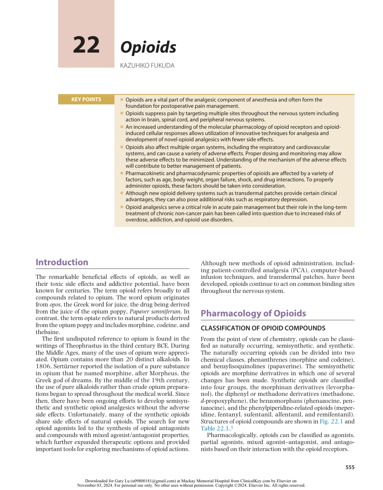

:::

<!-- PDF page 2 -->

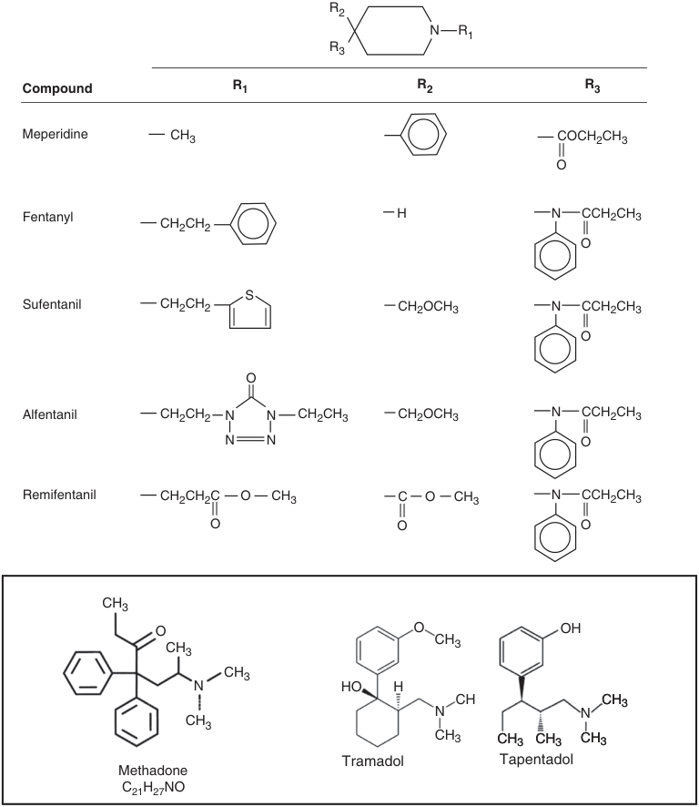

R2 N R1 R3 Compound R1 R2 R3 Meperidine CH3 COCH2CH3 O Fentanyl H N CCH2CH3 CH2CH2 O S Sufentanil CH2CH2 CH2OCH3  N CCH2CH3 O O Alfentanil CH2CH2 N N CH2CH3  CH2OCH3  N CCH2CH3 N N O Remifentanil CH2CH2C O CH3 C O CH3  N CCH2CH3 O O O CH3 O O OH CH3  CH3 CH3 N HO H CH CH3 N N CH3 CH3  CH3  CH3  CH3 Tramadol Tapentadol Methadone C21H27NO — — — — — — — — — — — — — — — — — — 

**Fig. 22.1 Structures of major opioid analgesics chemically unrelated to morphine.** (Redrawn from Yaksh TL, Wallace MS. Opioids, analgesia, and pain management. In: Brunton L, Chabner B, Knollman B eds. _Goodman and Gilman’s the Pharmacological Basis of Therapeutics_ . 12th ed. New York: McGraw- Hill; 2011:481–525.)

### BASIC STUDIES ON OPIOID RECEPTORS

In 1973, three independent teams of investigators described the presence of opioid binding sites in the nervous system from the radioligand binding assays. From pharmacologic experiments, three types of opioid receptors were postulated. They were named μ for the morphine type, κ for the ketocyclazocine type, and σ for the SKF10047 ( _N_ - allylnormetazocine) type. In addition, a high-affinity receptor for enkephalins was found in the mouse vas deferens and was named the δ- receptor. Furthermore, the ε- receptor was proposed as the binding site for β- endorphin in the rat vas deferens.

Since the early 1990s, molecular biologic studies have elucidated the molecular structures and signal transduction mechanisms of the opioid receptors. Four different complementary DNAs (cDNAs) have been isolated as members of the opioid receptor family.2 Investigators demonstrated that three of them correspond to the pharmacologically defined μ- , δ- , and κ- opioid receptors, but the fourth receptor did

not bind with opioid ligands with high affinities. Later, a novel peptide, nociceptin, was identified as an endogenous agonist of the fourth member of the opioid receptor family.3,4 The μ- , δ- and κ- opioid receptors and the nociceptin receptor share approximately 50% amino acid sequence homology with each other. Characteristics of three opioid receptors and the nociceptin receptor are listed in Table 22.2. Hydropathy analysis of the primary structures of the opioid receptors predicted that the opioid receptors possess seven transmembrane domains (Fig. 22.2), which is a characteristic structural feature of G- protein- coupled receptors including the adrenergic receptor and the muscarinic acetylcholine receptor. Crystallographic analysis revealed that the μ- , δ- and κ- opioid receptors and the nociceptin receptor actually possess seven transmembrane domains and the ligand binds deeply within a large pocket5 (Fig. 22.3). Furthermore, analysis of the crystal structure of the opioid receptor revealed agonist- induced conformational changes

<!-- PDF page 3 -->

### Table 22.1 Structures of Opioids and Opioid Antagonists Chemically Related to Morphine

|||Morphine N 2 3 4 12 10 13 5 15 6 7 8 16 17 9 11 14 1 HO HO O|CH3|||
|---|---|---|---|---|---|
|**Nonproprietary name**|**Chemica**|**l radicals and pos**|**ition**&#42;||**Other changes**†|
||**3**|**6**|**17**|||
|Morphine|OH|OH|CH3|||
|Heroin|OCOCH3|OCOCH3|CH3|||
|Hydromorphone|OH|O|CH3||(1)|
|Oxymorphone|OH|O|CH3||(1), (2)|
|Levorphanol|OH|H|CH3||(1), (3)|
|Levallorphan|OH|H|CH2CH|CH2|(1), (3)|
|Codeine|OCH3|OH|CH3|||
|Hydrocodone|OCH3|O|CH3||(1)|
|Oxycodone|OCH3|O|CH3||(1), (2)|
|Nalmefene|OH|CH2|CH2||(1), (2)|
|Nalorphine|OH|OH|CH2CH|CH2||
|Naloxone|OH|O|CH2CH|CH2|(1), (2)|
|Naltrexone|OH|O|CH2||(1), (2)|
|Buprenorphine|OH|OCH3|CH2||(1), (4)|
|Butorphanol|OH|H|CH2||(1), (2), (3)|
|Nalbuphine|OH|OH|CH2||(1), (2)|
|Methylnaltrexone|OH|O (N)|CH2  CH3||(1), (2)|

*The numbers 3, 6, and 17 refer to positions in the morphine molecule, as shown above.

†Other changes in the morphine molecule are:

(1) Single instead of double bond between C7 and C8.

(2) OH added to C14.

(3) No oxygen between C4 and C5.

(4) Endoetheno bridge between C6 and C14; 1- hydroxy- 1,2,2- trimethylpropyl substitution on C7.

From Yaksh TL, Wallace MS. Opioids, analgesia, and pain management. In: Brunton L, Chabner B, Knollman B, eds: _Goodman and Gilman’s the Pharmacological Basis of Therapeutics_ . 12th ed. New York: McGraw- Hill; 2011:481–525.

in detail, providing the basis for the development of new ligands.6

The σ (sigma) receptor, which was previously classified as a member of the opioid receptors, was shown to be an endoplasmic reticulum- resident protein, and has been implicated in many diseases, ranging from cocaine or alcohol addiction to familial adult or juvenile amyotrophic lateral sclerosis. The amino acid sequence of the σ1- receptor does not resemble that of any other mammalian proteins.7

Further pharmacologic classification of the μ- receptor as the μ1, μ2, and μ3 subtypes has been proposed, but the molecular identity of these receptor subtypes has not been clarified. Several possible molecular models of opioid receptor subtypes exist, including alternate splicing of a common gene product, receptor dimerization, and interaction of a

common gene product with other receptor or signaling molecules.8 Multiple μ- opioid receptor species can be produced from a gene product of the single μ- opioid receptor gene by alternate splicing (Fig. 22.4).9,10 Analysis of the alternate splicing products reveals differences in ligand binding and G- protein activation. However, their physiologic, pharmacologic, or clinical implications remain to be elucidated. Interestingly, it was reported that the analgesic action of 3- iodobenzoyl- 6β- naltrexamide, a potent analgesic against thermal, inflammatory, and neuropathic pain, is mediated by its interaction with mMOR- 1G, a truncated splice variant possessing only six transmembrane segments, in mice.11

G- protein- coupled receptors can form dimers – that is, homodimers (same receptor molecules) or heterodimers (different receptor molecules). The existence of these homodimers

::: details 原始表格與符號（PDF 第 3 頁）

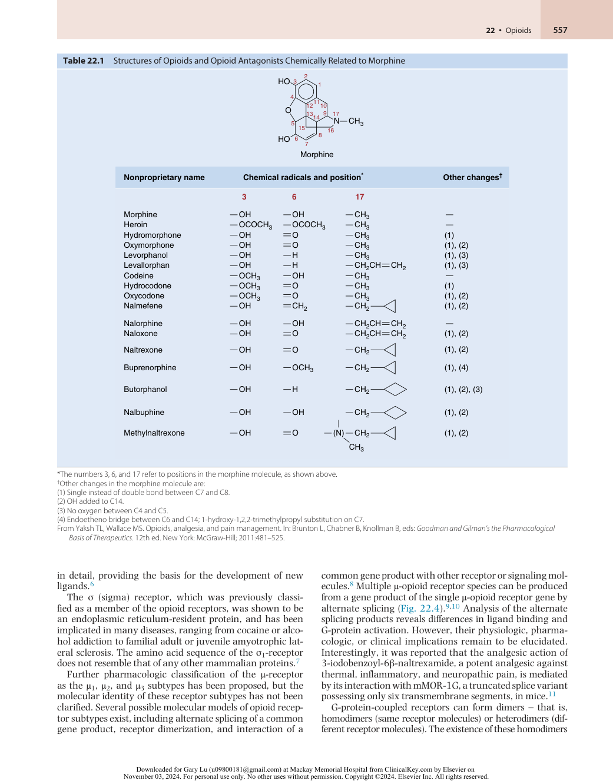

:::

<!-- PDF page 4 -->

**Table 22.2** Characteristics of Opioid Receptors

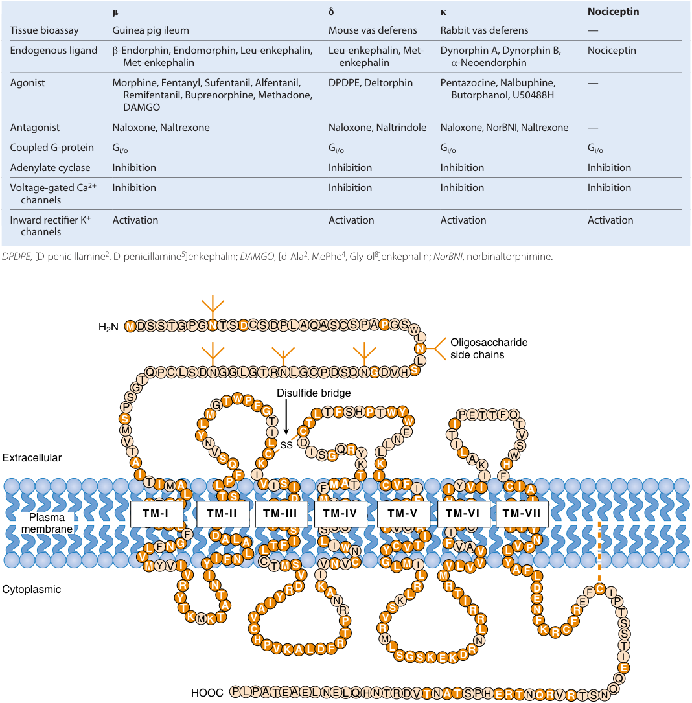

μ δ κ Nociceptin Tissue bioassay Guinea pig ileum Mouse vas deferens Rabbit vas deferens — Endogenous ligand β- Endorphin, Endomorphin, Leu-enkephalin,  Leu- enkephalin, Met-  Dynorphin A, Dynorphin B,   Nociceptin Met-enkephalin enkephalin α- Neoendorphin — Agonist Morphine, Fentanyl, Sufentanil, Alfentanil,  DPDPE, Deltorphin Pentazocine, Nalbuphine, Remifentanil, Buprenorphine, Methadone,  Butorphanol, U50488H DAMGO Antagonist Naloxone, Naltrexone Naloxone, Naltrindole Naloxone, NorBNI, Naltrexone — Coupled G- protein Gi/o Gi/o Gi/o Gi/o Adenylate cyclase Inhibition Inhibition Inhibition Inhibition Voltage- gated Ca 2+ Inhibition Inhibition Inhibition Inhibition channels Inward rectifier K + Activation Activation Activation Activation channels DPDPE , [D- penicillamine 2 , D- penicillamine 5 ]enkephalin;  DAMGO , [d- Ala 2 , MePhe 4 , Gly- ol 8 ]enkephalin;  NorBNI , norbinaltorphimine. H2N M D S S T G P G N T S D C S D P L A Q A S C S P A P G S W L N Oligosaccharide side chains L Q P C L S D N G G L G T R N L G C P D SQ N G D V H S T G S PS LM G T W P F G T Disulfide bridge T L T F S H P T W YW I P E T T F QT Extracellular MVT A Y NV S Q KCL I SS C D I S G Q R KY K L L N E TI L A K H WSV I F I T I I F T I M A L P V I S I F M A T C V F I I Y V I C I A Y T F YL T SD K K K D M V R W I F A F H L R R Y C I Plasma TM-I TM-II TM-III TM-IV F TM-V TM-VI TM-VII membrane V T ML V YF GN V GLI V F YI DDI AF LNAL C L T T I FMI SSI V IVS L N S I W S V C N GYF C V L MV G TA I LI MFV I V TL A V  C V V YLYAVYFPYNL Cytoplasmic YRTK M KNTTA VA I Y R D K A NR P VS K LR R T I RR DNEF FR EF C I PTS CH P V K A L D F RT R M L R N L K R C TS S G S K E K D I E Q HOOC P L P A T E A E L N E L Q H N T R D V T N A T S P H E R T N Q R V R T S N Q 

**Fig. 22.2 Proposed structure of the μ- opioid receptor.** Amino acid residues symbolized as _circles_ are depicted by one- letter code. _White letters_ indicate amino acid residues identical in the μ- and δ- opioid receptors. _TM- I_ to _TM-VII_ show putative transmembrane segments composed of hydrophobic amino acid residues.

and heterodimers has been shown in cultured cells and _in vivo._ Among opioid receptors (μ, δ, κ, and nociception receptors), various combinations of the molecules have been shown to form dimers, and the dimer formation has been shown to affect the ligand-binding properties and signal transduction mechanisms.12 Physiologic and clinical implications of dimer formation of opioid receptors has been analyzed. For example, it is interesting that a bivalent ligand containing μ- agonist and δ- antagonist pharmacophores effectively bridges μ- δ opioid receptor heterodimers and exhibits enhanced efficacy and

a reduced tendency for tolerance in mice.13 However, in the peripheral nervous system, μ- and δ- receptors are apparently expressed in different sensory neuronal subpopulations and do not form heterodimers.14,15

### GENETIC VARIATIONS WHICH INFLUENCE OPIOID EFFECTS

A lot of single nucleotide polymorphisms (SNPs) have been identified in the human μ- opioid receptor gene16 (Fig. 22.5).

<!-- PDF page 5 -->

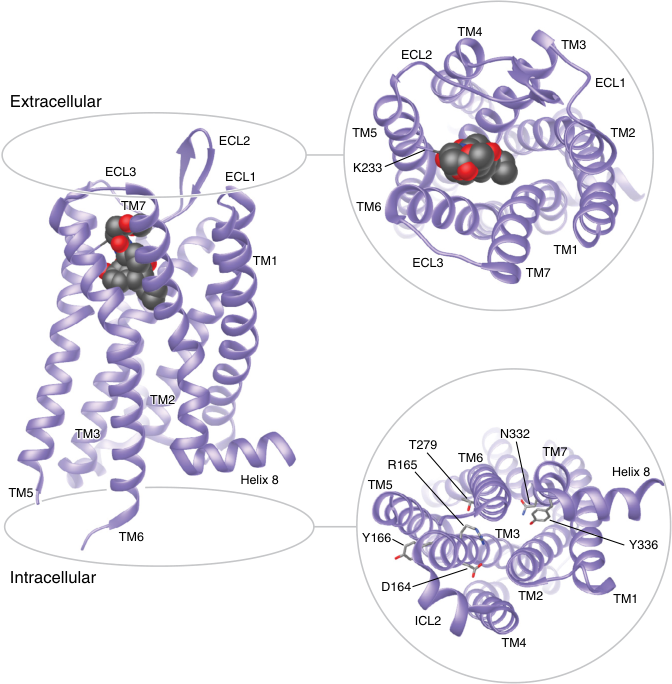

TM4 TM3 ECL2 ECL1 Extracellular TM5 TM2 ECL2 ECL3 ECL1 K233 TM7TM7 TM6 TM1 TM1 ECL3 TM7 TM2TM2 TM3TM3 N332 T279 TM6 TM7 R165 Helix 8 Helix 8 TM5 TM5 TM6 Y166 TM3 Y336 Intracellular D164 TM2 TM1 ICL2 TM4 

**Fig. 22.3 Overall view of the μ- opioid receptor structure.** Views from within the membrane plane ( _left_ ), extracellular side ( _top_ ) and intracellular side ( _bottom_ ) show the typical seven- transmembrane G- protein- coupled receptor architecture of the μ- opioid receptor. β- FNA, a semisynthetic opioid antagonist derived from morphine, is shown in _black spheres_ . (From Manglik A, Kruse AC, Kobilka TS, et al. Crystal structure of the μ- opioid receptor bound to a morphinan antagonist. _Nature._ 2012;485:321–326.)

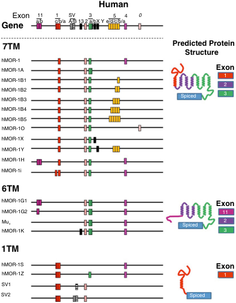

Human Exon 11 1 SV 3 5 4 0 Gene a/b c/b/a A/B 13 2 a/bX Y e/d/c/b/a 7TM Predicted Protein       Structure hMOR-1 hMOR-1A Exon 1 hMOR-1B1 2 hMOR-1B2 hMOR-1B3 Spiced 3 hMOR-1B4 hMOR-1B5 hMOR-1O hMOR-1X hMOR-1Y hMOR-1H hMOR-1i 6TM hMOR-1G1 Exon hMOR-1G2 11 Mu Spiced 2 hMOR-1K 3 1TM hMOR-1S Exon hMOR-1Z 1 SV1 Spiced SV2 Spiced 

**Fig. 22.4 μ- Opioid receptor splicing in humans.** Variants are grouped as 7- transmembrane (7TM), 6- transmembrane (6TM), and 1- transmebrane (1TM) with the predicted structure shown to the right and the exons color- coded to match the splicing schematic. (From Pasternak GW, Pan YX. Mu opioids and their receptors: evolution of a concept. _Pharmacol Rev._ 2013;65:1257–1317.)

The A118G mutation, the most common of these SNPs, leads to a change in the gene product in the human μ- opioid receptor molecule, which is an A- to- G substitution in exon 1 that results in an amino acid exchange at position 40 from asparagine to aspartate (N40D). Various clinical impacts of the A118G mutation have been reported. Patients with cancer who are homozygous for the A118G variant required higher doses of oral morphine for long- term treatment of their pain.17 A118G mutation of the human μ- opioid receptor gene reduces analgesic responses to morphine- 6- glucuronide (M6G), but it does not significantly affect the respiratory depression induced by M6G.18 Furthermore, morphine consumption with intravenous PCA after total abdominal hysterectomy is significantly greater in women homozygous for the A118G variant than in other patients.19 In a meta- analysis involving 18 studies and more than 4600 patients, carriers of A118G were observed to exhibit higher opioid analgesic requirements.20 Another metaanalysis showed significant association between A118G polymorphism and susceptibility to opioid dependence or addiction in Asian populations.21

_In vitro_ experiments show that the variant receptors with A118G mutation are associated with higher binding affinity to and potency of β- endorphin, but lower potency of morphine.22 Studies in mouse models with analogous substitution of human A118G showed reduced analgesic response to morphine in some regions of the mouse brain with the GG genotype when compared with the AA

<!-- PDF page 6 -->

genotype.23 A study also showed that 118A messenger RNA was 1.5- to 2.5- fold more abundant than the 118G messenger RNA in heterozygous human brain autopsy tissues.24

Overall, these findings suggest that the 118G allele may result in changes in abundance and/or function of the μ- opioid receptor, leading to differences in antinociceptive potency of opioid analgesics. The genetic difference may affect the dose of opioids necessary for analgesia, and in turn could misdirect health care providers in providing the most effective and safe opioid- based analgesic plan. The C17T mutation of the human μ- opioid receptor, located in exon 1, causes an amino acid exchange from alanine to valine at receptor protein position 6 of the extracellular receptor terminal. This mutation has been reported to occur in a higher overall proportion of opioid- dependent persons, but the effects of the C17T polymorphism on analgesic responses are unknown. A study using cultured cells reported that adenylate inhibition via the C17T mutant receptor was decreased for many opioids, including the clinically significant drugs morphine, buprenorphine, and

fentanyl, as well endogenous opioids,25 suggesting that this polymorphism may affect individual responses to opioid therapy.

It is known that genetic variation of genes other than opioid receptor genes can affect sensitivity to opioids. It has been demonstrated that the Val158Met polymorphism of the human catechol- _O_ - methyltransferase (COMT) gene has contributed to differences in opioid consumption in patients treated for chronic cancer pain,26 and is associated with variability in opioid consumption in postoperative nephrectomy patients.27 COMT metabolizes biogenic amines including catecholamines such as dopamine, epinephrine, and norepinephrine (NE), thereby acting as a key modulator of dopaminergic and adrenergic neurotransmission, and can affect the pharmacologic effects of opioids. It was shown that the polymorphism of COMT can affect the phenotype of the polymorphism of the μ- opioid receptor. Kolesnikov and associates have demonstrated that the heterozygous patients with μ- opioid receptor A118G and COMT G1974A mutation consumed significantly less morphine for postoperative analgesia compared with homozygous patients of A118.28

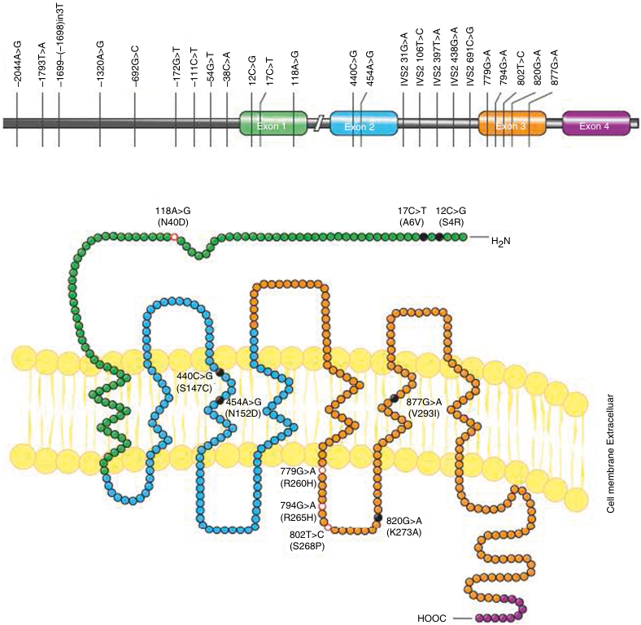

Exon 1 Exon 2 Exon 3 Exon 4 118A>G 17C>T 12C>G (N40D) (A6V) (S4R) H2N 440C>G (S147C) 454A>G 877G>A (N152D) (V293I) 779G>A (R260H) 794G>A (R265H) 820G>A 802T>C (K273A) (S268P) HOOC –2044A>G –1793T>A –1699–(–1698)in3T –1320A>G –692G>C –172G>T –111C>T –54G>T –38C>A 12C>G 17C>T 118A>G 440C>G 454A>G IVS2 31G>A IVS2 106T>C IVS2 397T>A IVS2 438G>A IVS2 691C>G 779G>A 794G>A 802T>C 820G>A 877G>A Cell membrane Extracelluar 

**Fig. 22.5 Reported mutations in the μ- opioid receptor related to the exonic organization of the gene.** Mutations in the exons that produce amino acid exchanges and mutations in the non- coding regions that can induce functional consequences are indicated in the diagram of the gene ( _top_ ). Amino acid changes are shown in the diagram of the 7- transmembrane receptor ( _bottom_ ). Amino acids are symbolized as _circles_ , colored according to the exons by which they are coded. Six _black circles_ represent naturally occurring mutations at the respective position, and four _red circles_ are mutations whose functional consequences are shown at molecular level. Mutations are indicated by the nucleotide exchange and the resulting amino acid exchange shown in the parentheses. (From Lötsch J, Geisslinger G. Are μ- opioid receptor polymorphisms important for clinical opioid therapy? _Trends Mol Med._ 2005;11:82–89.)

<!-- PDF page 7 -->

### ENDOGENOUS OPIOID PEPTIDES

Enkephalin, β- endorphin, and dynorphin were identified as endogenous agonists for the δ- , μ- , and κ- opioid receptors, respectively. Following purification of these peptides from mammalian tissues, cDNAs for the precursors of these peptides were cloned and their primary structures were elucidated (Fig. 22.6).29 It was suggested that the cleavage of preproopiomelanocortin produces not only β- endorphin but also several other neuropeptides including methionineenkephalin, adrenocorticotropic hormone (ACTH), and α- melanocyte stimulating hormone. Amino acid sequence of preproenkephalin indicates that six methionine- enkephalins and one leucine- enkephalin are cleaved from this precursor molecule. Furthermore, the primary structure of preprodynorphin, the precursor of dynorphin, gives rise to dynorphins and neoendorphins, which are ligands for the κ- opioid receptor.

Nociceptin, a novel endogenous opioid peptide with a significant sequence homology to dynorphin, was isolated in 19953,4 and so named because it lowered the pain threshold under certain conditions in contrast to other endogenous opioid peptides. Pharmacologic and physiologic studies have demonstrated that nociceptin has behavioral and pain modulatory properties distinct from those of the three classic opioid peptides.30 Prepronociceptin, the precursor of nociceptin, was cloned, and its amino acid sequence suggested the existence of prepronociceptin- derived neuropeptides other than nociceptin.31

The search for endogenous ligand binding with the μ- receptor with high affinity and high selectivity led to the discovery of a class of novel endogenous opioids termed endomorphin- 1 and endomorphin- 2.32 These peptides are tetrapeptides with the sequence Tyr- Pro- Trp- Phe and Tyr- ProPhe- Phe, respectively. The endomorphin gene has yet to be cloned, and much remains to be learned about the anatomic distribution, mode of interaction with the opioid receptors, function _in vivo_ , and potential existence of other related peptides that are highly selective for each of the opioid receptors. It was recently demonstrated that both endomorphin- 1 and endomorphin- 2 given centrally and peripherally produced potent antiallodynic activities in a mouse model of neuropathic pain,33 and downregulation of endomorphin- 2 correlates with mechanical allodynia in a rat bone cancer pain model,34 suggesting the analgesic function of these peptides _in vivo_ .

### INTRACELLULAR SIGNAL TRANSDUCTION MECHANISM OF OPIOID RECEPTORS

The opioid receptors belong to the G- protein- coupled receptor family. It has been demonstrated that activation of the opioid receptors leads to activation of the pertussis toxinsensitive G proteins (Gi or Go or both). Expression of the cloned opioid receptors in cultured cells by transfection of the cloned cDNAs has facilitated analysis of the intracellular signal transduction mechanisms activated by the opioid receptors2 (Fig. 22.7). Adenylate cyclase is inhibited

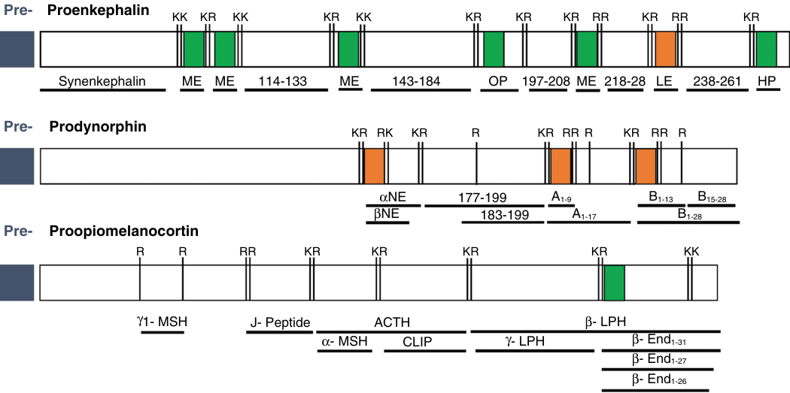

Pre- Proenkephalin KK KR KK KR KK KR KR KR RR KR RR KR Synenkephalin ME ME 114-133 ME 143-184 OP 197-208 ME 218-28 LE 238-261 HP Pre- Prodynorphin KR RK KR R KR RR R KR RR R αNE 177-199 A1-9 B1-13 B15-28 βNE 183-199 A1-17 B1-28 Pre- Proopiomelanocortin R R RR KR KR KR KR KK γ1- MSH J- Peptide ACTH β- LPH α- MSH CLIP γ- LPH β- End1-31 β- End1-27 β- End1-26 

**Fig. 22.6 Endogenous opioid peptides are generated from precursor proteins.** Schematic illustration of the three major opioid peptide precursor proteins: preproenkephalin ( _top_ ), preprodynorphin ( _middle_ ), and preproopiomelanocortin ( _bottom_ ). Major cleavage sites consisting of lysine (K) and arginine (R) residues are indicated. The two core opioid motifs are highlighted in _green_ (Tyr- Gly- Gly- Phe- Met) and _orange_ (Tyr- Gly- Gly- Phe- Leu), respectively. Post- translational processing of each precursor generates a variety of different hormones and peptides, some of which have not been named (referred to as _numbers_ in the figure). _Lower case numbers_ reflect different isoforms of the same peptide that vary in their length and biologic activity. Note that cleavage of preproopiomelanocortin also generates nonopioid mediators, such as adrenocorticotropic hormone (ACTH) and melanocyte stimulating hormone (MSH). _αNE_ , α- neoendorphin; _Ax–y_ , dynorphin A variants; _β- Endx–y_ , β- endorphin variants; _β- /γ- LPH_ , β/γ-lipotropin; _βNE_ , β- neoendorphin; _Bx–y_ , dynorphin B variants; _CLIP_ , corticotropin- like intermediate lobe peptide; _γ1- /α- MSH_ , γ1/α-melanocyte stimulating hormone; _HP_ , heptapeptide; _J- Peptide_ , joining peptide; _LE_ , leucine- enkephalin; _ME_ , methionine- enkephalin; _OP_ , octapeptide. (From Jaschke N, Pahlig S, Pan YX, et al. From pharmacology to physiology: endocrine functions of mu- opioid receptor networks. _Trends Endocrinol Metab._ 2021;32:306–319.)

<!-- PDF page 8 -->

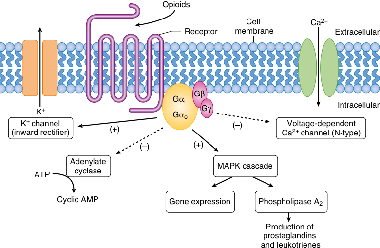

Opioids Cell  Ca 2+ Receptor membrane Extracellular Gβ Gαi Intracellular K + Gαo Gγ K +  channel (–) Voltage-dependent (+) (inward rectifier) Ca 2+  channel (N-type) (–) (+) Adenylate MAPK cascade ATP cyclase Cyclic AMP Gene expression Phospholipase A2 Production of prostaglandins and leukotrienes 

**Fig. 22.7 Intracellular signal transduction mechanisms linked with the opioid receptors.** Opioid agonists bind with the opioid receptors, leading to activation of the G protein. Activity of adenylate cyclase and the voltage- dependent calcium (Ca2+ ) channels is suppressed. On the other hand, inward rectifier potassium (K+ ) channels and mitogen- activated protein kinase (MAPK) cascade are activated. _AMP_ , adenosine monophosphate; _ATP_ , adenosine triphosphate.

by opioid receptor activation, with a resulting reduction of the cellular cyclic adenosine monophosphate (AMP) content. Long- term tolerance to opioids has been thought to be associated with superactivation of adenylyl cyclase activity, which is a counterregulatory response to the decrease in cyclic AMP levels seen after acute opioid administration. Electrophysiologically, the voltage-dependent Ca2+ channel is inhibited and the inwardly rectifying potassium (K+ ) channels are activated by the opioid receptors. As a result, neuronal excitability is reduced by activation of the opioid receptors. The other regulatory components also participate in the coupling of opioid receptor binding and the cellular response. It was shown that extracellular signal- related kinase, a class of mitogen- activated protein kinases, is activated by the opioid receptors.35 Opioid- induced activation of extracellular signal- related kinase can lead to increase in arachidonate release35 and expression of immediate early genes, c- fos and junB.36

Chronic exposure of the opioid receptors to agonists induces cellular adaptation mechanisms, which may be involved in opioid tolerance, dependence, and withdrawal symptoms. A number of kinases, including protein kinase A and β- adrenergic receptor kinase (BARK), a member of the G- protein- coupled receptor kinase (GRK), have been shown to affect the function of the opioid receptors after activation by the agonist.37 BARKs selectively phosphorylate agonist- bound opioid receptors and thereby promote interactions with β- arrestins, which interfere with G- protein coupling and promote receptor internalization. β- Arrestin 2 functions as a scaffolding protein that interacts with signal transducers, and the recruitment of β- arrestin 2 induced by opioid receptor activation is involved in the regulation of activity of c- Src, Akt, and mitogen- activated protein kinases38 (Fig. 22.8). The c- Src inhibitor, dasatinib,

attenuated and reversed morphine- induced tolerance in mice, suggesting that c- Src recruited by β- arrestin 2 is involved in the morphine- induced tolerance.39 Acute morphine- induced analgesia was enhanced in mice lacking β- arrestin 2, suggesting that this protein contributes to regulation of responsivity to opioids _in vivo._40 Therefore, recruitment of β- arrestin serves a critical role in the regulation of the coupling between agonist binding to opioid receptors and their ability to develop and sustain an analgesic response. Like other G- protein- coupled receptors, the opioid receptors can undergo rapid agonist- mediated internalization by a classic endocytic pathway.41,42 These processes may be induced differentially as a function of the class of the ligand. For example, certain agonists, such as etorphine and enkephalins, cause rapid internalization of the μ- receptor, whereas morphine, which decreases adenylyl cyclase activity equally well, does not cause μ- receptor internalization in all cell types such as HEK293 cells.43 These findings may suggest that different ligands induce different conformational changes in the receptor molecule that lead to divergent intracellular events, and may provide an explanation for differences in the efficacy and abuse potential of various opioids.44

### BIASED AGONISM

Chemically distinct ligands binding to the same G- proteincoupled receptor can stabilize the receptor in multiple active conformations. In this way, differential activation of G- protein- coupled cell signaling pathways may produce divergent physiologic outcomes, a phenomenon known as biased agonism. Biased agonism can be exploited to design drugs that selectively activate desired signaling pathways, while minimizing other signaling pathways

<!-- PDF page 9 -->

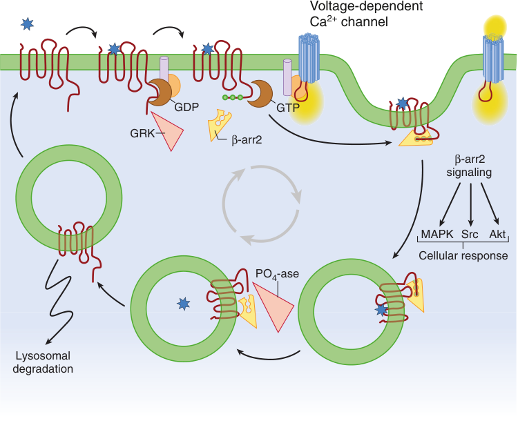

Voltage-dependent Ca 2+ channel GDP GTP GRK β-arr2 β-arr2 signaling MAPK Src Akt Cellular response PO4-ase Lysosomal degradation 

**Fig. 22.8 β- Arrestin 2 and G protein in μ- opioid receptor recycling, signaling, and degradation.** The _blue star_ represents an opioid agonist, and the trimeric membrane- associated complex in _brown_ , _orange,_ and _purple_ represents G protein α, β, and γ subunits, respectively. The α subunit is shown associated with guanosine diphosphate (GDP; resting state) or guanosine triphosphate (GTP; activated state). The βγ dimer interacts directly with the voltage-dependent Ca2+ channel to inhibit calcium (Ca2+ ) influx (indicated in _yellow_ ). _GRK_ , G- protein- coupled receptor kinase; _β- arr2_ , β- arrestin 2; _PO4ase_ , phosphatase. (From Hales TG. Arresting the development of morphine tolerance and dependence. _Br J Anaesth._ 2011;107:653–655.)

via the same receptor subtype and associated side effects. Morphine binds to the μ- opioid receptor protein to form an active complex with signaling proteins, including Gi/o and β- arrestin. The Gi/o signaling pathway was thought to mediate analgesic action of morphine, whereas β- arrestin signaling results in unwanted side effects including euphoria, which can lead to addiction, respiratory depression, and gastrointestinal effects (Fig. 22.9). Consistently, it was reported that the analgesic properties of morphine were enhanced but morphine- induced respiratory depression and constipation were attenuated in β- arrestin 2 knockout mice.45 TRV130, a “G-protein- biased” μ- opioid ligand with G- protein- coupling efficacy similar to that of morphine, but markedly reduced receptor phosphorylation, recruitment of β- arrestin 2 and internalization, was tested in a randomized, double- blind, placebo- controlled crossover study in healthy volunteers.46 As expected, TRV130 produced greater analgesia than morphine, but less respiratory depression and less severe nausea. Manglik and associates computationally screened 3 million molecules, and found that the compound PZM21 with high Gi/o- biased signaling suppressed pain in mice without constipation, respiratory depression, hyperlocomotion, and addiction- related behaviors.47 However, Hill _et al._ reported that the adverse-effect profile was not significantly different between morphine and PZM21 in mice.48 Furthermore, contrary to the previous report,45 it was recently reported that the morphine- induced

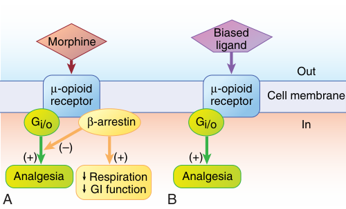

Biased Morphine ligand Out µ-opioid µ-opioid Cell membrane receptor receptor Gi/o β-arrestin Gi/o In (–) (+) (+) (+) Analgesia Respiration Analgesia GI function A B 

**Fig. 22.9 Biased agonism of the μ- opioid receptor.** (A) Morphine binding to the μ- opioid receptor not only activates the G protein (Gi/o) to produce analgesic effect, but also recruits the β- arrestin, which inhibits G-protein coupling and promotes adverse effects including hypoventilation and gastrointestinal (GI) dysfunction. (B) TRV130, a G- protein- biased agonist, engages G- protein coupling similarly to morphine but with less β- arrestin recruitment, and was expected to show analgesic effect similar to morphine and less adverse effects on respiratory and gastrointestinal function.

respiratory depression in β- arrestin 2- deficient mice was not significantly different from that observed in wild- type mice.49 Thus, there remains controversy over whether the G- protein- biased μ- opioid agonist is promising as an analgesic drug with side effects smaller than conventional opioids.

<!-- PDF page 10 -->

### MECHANISM OF OPIOID ANALGESIA

Opioid receptors are widely expressed in the central nervous system (CNS), including medulla, locus coeruleus, periaqueductal gray (PAG), limbic system, cerebral cortex, and spinal cord. They are also distributed in the peripheral tissues. Mechanism of opioid analgesia can be classified into brain, spinal cord, and peripheral mechanisms50 (Fig. 22.10).

### Brain

Pain control by opioids needs to be considered in the context of brain circuits modulating analgesia and the functions of the various types of receptors in these circuits.51 Nociceptive information ascending from the spinal cord activates a large interconnected neural network in the brain, and induces a variety of responses including pain perception, pain modulation, and affective response. Opioid receptors and peptides are expressed in these neural networks and affect these various aspects of pain responses.51 It is well established that the analgesic effects of opioids arise from their ability to directly inhibit the ascending transmission of nociceptive information from the spinal cord dorsal horn and to activate pain control circuits. Opioid actions at PAG block release of the inhibitory transmitter γ-aminobutyric acid (GABA) from tonically active PAG system that regulate activity in projections to the medulla, which in turn releases

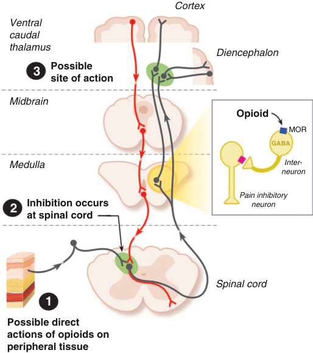

Cortex Ventral caudal thalamus Diencephalon Possible 3 site of action Midbrain Opioid MOR GABA Medulla Inter- neuron Pain inhibitory 2 Inhibition occurs neuron at spinal cord Spinal cord 1 Possible direct actions of opioids on peripheral tissue 

**Fig. 22.10 Sites of action of opioid analgesics.** The _gray_ pathway shows the sites of action on the pain transmission pathway from periphery to central nervous system. The _red_ pathway shows the actions on pain- modulating neurons in the midbrain and medulla. Sites of action of opioid analgesics are classified into (1) peripheral tissue, (2) spinal cord, and (3) brain. Activation of the μ- opioid receptor expressed on the GABA interneuron results in reduction of GABA release, leading to activation of the pain inhibitory neuron in the medulla. _GABA_ , γ- aminobutyric acid; _MOR_ , μ- opioid receptor. (From Al- Hasani R, Bruchas MR. Molecular mechanisms of opioid receptor- dependent signaling and behavior. _Anesthesiology._ 2011;115:1363–1381.)

norepinephrine and serotonin and modulates nociceptive transmission at the dorsal horn of the spinal cord through the action of the descending inhibition pathway.

Petrovic and colleagues used an experimental pain model and positron emission tomography (PET) to study mechanisms of action of the short- acting μ- opioid agonist remifentanil and found drug- induced activation of the rostral anterior cingulate cortex, insula, orbitofrontal cortex, and brainstem areas.52 The brainstem activated by the opioid overlapped with brain areas that have been implicated in pain modulation, such as PAG. Interestingly, placebo analgesia acts similarly on the activity of these brain areas, presumably by endogenous opioid release.53

It is well known that opioid actions in the forebrain contribute to analgesia, because decerebration prevents analgesia when rats are tested for pain sensitivity using the formalin test,54 and microinjection of opioids into several forebrain regions are analgesic.55 Analgesia induced by systemic administration of morphine in the formalin test was disrupted either by lesioning or reversibly inactivating the central nucleus of the amygdala, thereby demonstrating that the opioid action in the central nucleus of the amygdala contributes to analgesia after tissue damage.56

### Spinal Cord

Analgesic actions of systemic morphine are in part mediated by a net inhibitory effect of the descending inhibition pathway on nociceptive processing in the spinal dorsal horn. It was demonstrated that morphine increased 5-hydroxytryptamine (5-HT; serotonin) and NE release in the spinal dorsal horn by activation of serotonergic and noradrenergic neurons in the medulla. Intrathecal pretreatment with ondansetron attenuated the analgesic effect of morphine in normal rats, suggesting the involvement of the 5- HT3 serotonergic receptor in morphine analgesia.57 It was also reported that the acute analgesic effect of morphine in the tail- flick test of rats was reduced significantly by pretreatment with a single dose of yohimbine, an α2- adrenergic antagonist, suggesting the involvement of α2- adrenergic receptor in the analgesic effect of morphine.58 Furthermore, it was reported that an adenosine receptor antagonist blocks the analgesic effect of intrathecally administered morphine,59 suggesting the involvement of the adenosine receptor in the analgesic action of opioids,60 and was postulated that endogenous opioid peptide released by the descending inhibitory system directly stimulates the opioid receptor or indirectly stimulates adenosine release in the spinal cord to produce an analgesic effect.61

Local spinal mechanisms, in addition to descending inhibition, also underlie the analgesic action of opioids. Opioid receptors are abundantly expressed in the substantia gelatinosa, where glutamate and substance P released from the primary sensory neuron is inhibited by opioids. In the spinal cord, opioids are known to act at synapses either presynaptically or postsynaptically. The presynaptic action corresponds to the inhibitory effect of opioids on the voltage-dependent Ca2+ channel, leading to reduction in the neurotransmitter release. The postsynaptic action is mediated by opioid- induced K+ channel activation and hyperpolarization, which inhibits excitation of the dorsal horn projection neuron by glutamate.

Histamine receptors are known to participate in spinal cord nociceptive transmission, and previous studies have

<!-- PDF page 11 -->

reported that the antinociceptive effects of morphine and β- endorphin injected intracerebroventricularly were dosedependently suppressed by intrathecally injected histamine H1 and H3 antagonists, and suggested the involvement of spinal H1 and H3 histaminergic receptors in the analgesic effects of opioids.62

### Peripheral Mechanism

Opioids may also produce analgesia through the peripheral mechanism. Cell bodies of the dorsal root ganglion neurons express mRNA and proteins of the μ- , κ- and δ- opioid receptors which are subsequently transported to peripheral terminals.63 Immune cells infiltrating the inflammation site may release endogenous opioid- like substances, which act on the opioid receptors located on the primary sensory neuron.64 Experimental and clinical studies have reported analgesic effects of peripherally administered opioids in pathologic pain.63 Interestingly, in cannabinoid receptor type 1 and type 2 knockout mice, the antinociceptive effect of morphine injected into the paw in the inflammatory phase of the formalin test was decreased by 87% and 76%, respectively.65 This finding may suggest the possibility that the release of endogenous cannabinoids in structures along the pain pathway is involved in opioid analgesia by the peripheral mechanism.

### Acupuncture

Acupuncture and electroacupuncture have been shown to block pain by activating a variety of bioactive chemicals through peripheral, spinal, and supraspinal mechanisms. Mechanistically, endogenous opioids and opioid receptors have been shown to be involved in acupuncture- and electroacupuncture- induced analgesia in various pain models.66 Studies in carrageenan- induced inflammatory rat pain models show that an intraplantar injection of naloxone or selective antagonists against μ- , δ- , or κ- opioid receptors 1 hour before electroacupuncture treatment at acupoint _Zusanli_ (ST36) dose- dependently blocked electroacupuncture- produced inhibition of mechanical hyperalgesia assessed through paw- pressure threshold.67 In a capsaicin- induced inflammatory hind paw pain model, stimulation by 2 Hz of four- train pulses with 100 Hz of intratrain frequency at _Houxi_ (SI3) and _San- yangluo_ (TE8) on the forelimb significantly raised the mechanical pain threshold of the injected paw. This analgesic effect was blocked by intrathecal μ- or δ- opioid receptor antagonists but not by a κ- opioid receptor antagonist.68 Precise mechanisms for acupuncture and electroacupuncture, including the involvement of physiologic systems other than the opioid receptors, remain to be elucidated.

### MECHANISM OF MOOD ALTERATIONS AND REWARDING PROPERTIES

Selective μ- and δ- receptor agonists are rewarding when defined by place preference and intracranial selfadministration paradigms in rodents, whereas selective κ- receptor agonists produce aversive effects. The mechanisms by which opioids produce euphoria, tranquility, and other alterations of mood (including rewarding properties) remain an area of active investigation, especially given the expanding scope of opioid diversion and misuse. Behavioral

and pharmacologic evidence points to the role of the mesolimbic dopamine system, which originates in the ventral tegmental area (VTA) and projects to the nucleus accumbens (NAc) in the forebrain, in drug- induced reward. Functional magnetic resonance imaging studies demonstrated that a small intravenous dose (4 mg) of morphine induces positive signal changes in reward structures, including NAc, sublenticular extended amygdala, orbitofrontal cortex, and hippocampus, and decreases signal in cortical areas similar to the action of sedative–hypnotics such as propofol and midazolam.69 These observations are consistent with results of pharmacologic studies. Dopaminergic and glutaminergic fibers originating from VTA and prefrontal cortex (PFC), respectively, terminate on NAc GABA- ergic neurons, which projects to the ventral pallidum (VP). In NAc, glutamate and dopamine activate and inhibit the GABAergic neuron, respectively. Drugs that suppress the NAc- VP GABA pathway leading to increased dopamine release are considered positively rewarding. Opioids activate the opioid receptors in VTA and NAc, leading to the increase in dopamine release in NAc1 (Fig. 22.11).

The locus coeruleus contains both noradrenergic neurons and opioid receptors and is postulated to play a critical role in feelings of alarm, panic, fear, and anxiety. Neural activity in the locus coeruleus is inhibited by both exogenous opioids and endogenous opioid peptides.

### ANALYSIS OF KNOCKOUT MICE

The physiologic roles of the opioid receptors and endogenous opioid peptides have been investigated mainly by pharmacologic and physiologic methods. However, it has been difficult to separately analyze functional roles of these proteins. With analysis of knockout mice, in which a specific gene is inactivated by molecular biologic methods, additional insights into the physiologic role of the respective opioid receptors and/or endogenous opioid peptide precursors can be obtained.70

In the μ- receptor knockout mice analgesia, the reward effect, and the withdrawal effect of morphine were lost.71 Morphine- induced respiratory depression was not observed in the μ- receptor knockout mice.72 Therefore, the μ- receptor is a mandatory component of the opioid system for morphine action. In the μ- receptor knockout mice, ketamineinduced respiratory depression and antinociception are diminished,73 a finding suggesting that ketamine directly or indirectly interacts with the μ- receptor to produce these pharmacologic effects. Furthermore, minimum alveolar concentration (MAC) of sevoflurane was significantly higher in the μ- receptor knockout mice than wild- type mice, an observation suggesting the involvement of the μ- receptor in the anesthetic potency of sevoflurane.72 The δ- receptor knockout mice displayed a markedly reduced analgesic effect of opioids selective for δ- receptors at the spinal cord level.74 However, at the supraspinal level, analgesia could be induced by δ- receptor agonists in δ- receptor knockout mice, a finding suggesting the existence of a second δ- like analgesic system. Disruption of the κ- receptor abolished the analgesic, hypolocomotor, and aversive actions of the κ- receptor agonists and induced hyperreactivity in the abdominal constriction test; this finding indicates that the κ- receptor is involved in the perception of visceral chemical

<!-- PDF page 12 -->

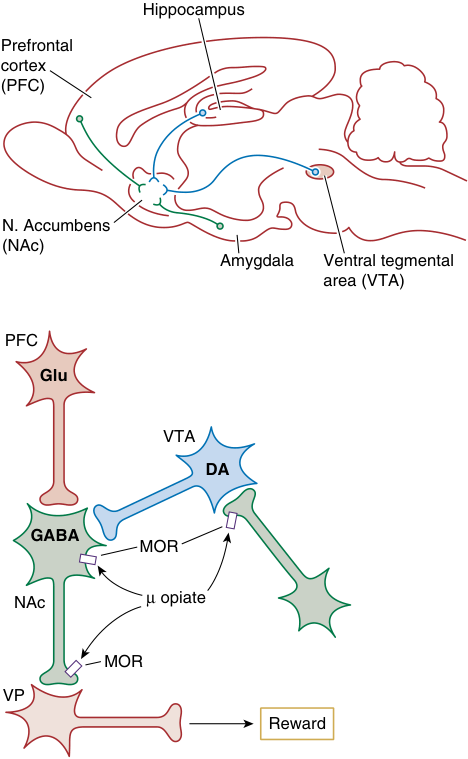

Hippocampus Prefrontal cortex (PFC) N. Accumbens (NAc) Amygdala Ventral tegmental area (VTA) PFC Glu VTA DA GABA MOR NAc µ opiate MOR VP Reward 

**Fig. 22.11 Pathways underlying rewarding properties of opiates.** The sagittal section of rat brain ( _top_ ) displays simplified dopamine (DA) ( _blue_ ) and γ- aminobutyric acid (GABA) ( _green_ ) inputs from the ventral tegmental area (VTA) and prefrontal cortex (PFC), respectively, into the nucleus accumbens (NAc). In the diagram of the neural circuit ( _bottom_ ), neurons are labeled with their primary neurotransmitters, glutamate (Glu), DA, and GABA. Opioid- induced inhibition on the GABA- ergic neuron in VTA and NAc reduces GABA- mediated inhibition and increases outflow from the ventral pallidum (VP), which appears to correlate with a positive reinforcing state (enhanced reward). _MOR_ , μ-opioid receptor. (From Yaksh TL, Wallace MS. Opioids, analgesia, and pain management. In: Brunton L, Chabner B, Knollman B eds. _Goodman and Gilman’s the Pharmacological Basis of Therapeutics_ . 12th ed. New York: McGraw- Hill; 2011:481–525.)

in affective behaviors and modulate responses to painful stimuli.79

Thus, the functional roles of individual components of the opioid system have been elucidated by analysis of knockout mice. The μ- opioid receptor continues to be recognized as a predominant signaling receptor for both the affective and antinociceptive action of opioid agonists.

### ACTIONS OF OPIOIDS ON TARGETS OTHER THAN OPIOID RECEPTORS

Pharmacologic analyses have shown that opioids can interact with molecules other than the opioid receptors. Buprenorphine, a partial μ- opioid receptor agonist, has a local anesthetic property and blocks voltage-dependent Na+ channels through the local anesthetic binding site.80 It was shown that meperidine exerts agonist activity at the α2B- adrenoreceptor in cultured cells, and was suggested that activation of the α2B- adrenoreceptor may be involved in the antishivering action of meperidine.81 Methadone is clinically used as a racemic mixture of the _l_ and _d_ isomers. The opioid- like activity of the racemate seems to be almost entirely the result of _l_ - methadone, whereas _d_ - methadone acts as a _N_ -methyl-d-aspartate (NMDA) antagonist.82 The serotonin type 3A (5- HT3A) receptor, which is directly and indirectly linked to gastrointestinal motility, visceral pain, nausea, and vomiting, is competitively inhibited by morphine and hydromorphone, as well as naloxone; however, fentanyllike opioids did not significantly affect activity of the 5- HT3A receptor, suggesting that the 5- HT3A- mediated effects are affected by morphine, hydromorphone, and naloxone through a mechanism not involving the opioid receptor.83,84 The mechanism for tramadol analgesia is complex and appears to be composed of reuptake inhibition of noradrenaline and serotonin, and activation of the μ- opioid receptor. The analgesic effect of tramadol is only partially reversed by the μ- opioid receptor antagonist, naloxone. Furthermore, tramadol also acts as an agonist of transient receptor potential vanilloid- 1 (TRPV1) heterologously expressed in cultured cells.85 Thus, a variety of pharmacologic effects of opioids that are not mediated by the opioid receptors are reported, but it remains to be clarified which of these “off- target” actions of opioids have physiologic or clinical implications.

### PHYSIOLOGIC ROLES OF NOCICEPTIN

pain.75 Using gene knockout mice, a pharmacologic study demonstrated that the antinociceptive effect of N2O may not be mediated by μ- receptor76 ; rather, N2O exerts its antinociceptive action and reduces MAC of volatile anesthetics in mice through complex mechanisms including activation of the κ- receptor and the descending inhibitory pathway in the spinal cord, whereas its hypnotic potency is not dependent on κ- receptor activation.77

In the mice lacking β- endorphin, morphine induced normal analgesia, but naloxone- reversible stress- induced analgesia could not be observed.78 The preproenkephalin knockout mice were more anxious than wild- type mice, and males displayed increased offensive aggressiveness. The mutant mice showed marked difference from controls in supraspinal, but not in spinal, responses to painful stimuli. These results suggest that enkephalins play roles

Nociceptin is a 17- amino- acid peptide, the sequence of which resembles those of opioid peptides. Nociceptin precursor mRNA and peptide are present throughout the descending pain control circuits. In the spinal cord, nociceptin- receptor mRNA expression is stronger in the ventral horn than in the dorsal horn, while higher levels of ligand binding occur in the dorsal horn. Targeted disruption of the nociceptin receptor in mice had little effect on basal pain sensitivity in several measures, whereas targeted disruption of the nociceptin precursor consistently elevated basal responses in the tail- flick test, findings suggesting an important role of nociceptin in regulating basal pain sensitivity.86,87 Furthermore, it was demonstrated that nociceptin inhibits both pain- facilitating and analgesia- facilitating neurons in the rostral ventromedial medulla (RVM).88 Thus, the involvement of the nociceptin system in pain control is complex,

<!-- PDF page 13 -->

and appears to depend on the preexisting state of pain in the animal. Involvement of nociceptin and its receptor in physiologic functions such as regulation of feeding, body weight homeostasis, and stress response and in psychiatric disorders such as depression, anxiety, and drug or alcohol dependence has also been reported.89

Systemic administration of nonpeptide nociceptin receptor agonists revealed that such compounds were effective analgesics in animal pain models. It was reported that a nociceptin receptor agonist, Ro64- 6198, shows antinociceptive and antiallodynic effects without side effects of opioids such as itching, respiratory depression, and addiction in monkeys.90 As nociceptin and opioid receptor agonists modulate pain by different targets, combining both mechanisms may constitute a novel approach for the development of innovative analgesics. Cebranopadol, a newly synthesized compound possessing agonist activity for both the nociceptin and opioid receptors, exhibits highly potent and efficacious antinociceptive and antihyperalgesic effects in several rat models of acute and chronic pain (tail- flick, rheumatoid arthritis, bone cancer, spinal nerve ligation, diabetic neuropathy).91 In a phase 1 clinical trial, it was shown that cebranopadol produced respiratory depression with a ceiling effect, in contrast to apnea produced by full μ- opioid receptor agonists.92

Expression of opioid receptors on peripheral blood mononuclear cells is controversial. Williams and associates reported that human peripheral blood mononuclear cells express the nociceptin receptor, but not μ- , δ- , or κ- opioid receptors.93 Nociceptin, produced by the peripheral blood mononuclear cells, might be involved in the control of immune functions.

## Neurophysiologic Effects of Opioids

### CHARACTERISTICS OF THE ANALGESIC ACTION OF OPIOIDS

In human beings, morphine- like drugs produce analgesia, drowsiness, changes in mood, and mental clouding. A significant feature of opioid analgesia is that it is not typically associated with loss of consciousness. When morphine in the same dose is given to a normal, pain- free individual, the experience may be unpleasant. The relief of pain by morphine- like opioids is relatively selective, in that other sensory modalities are not affected. Patients frequently report that the pain is still present, but that they feel more comfortable. It is also important to distinguish between pain caused by stimulation of nociceptive receptors and transmitted over intact neural pathways (nociceptive pain) and pain that is caused by damage to neural structures, often involving neural supersensitivity (neuropathic pain). Although nociceptive pain is usually responsive to opioid analgesics, neuropathic pain may respond poorly to opioid analgesics and require higher doses of drug. Opioid and neuropathic pain share neuropathologic mechanisms that can modulate each other, which may account for the low opioid analgesic efficacy in neuropathic pain. Pain hypersensitivity, resulting from potentiated C- fiber transmission and descending facilitation, and neuroinflammation including induction of

glial reactivity can be caused by both opioid administration and neuropathic pain, and may explain the absence of opioid treatment effectiveness in neuropathic pain.94 The analgesic effects, as well as side effects, of opioids greatly vary among individuals. A pharmacogenomic twin study has shown that the interindividual variations in opioid effects are likely the result of genetic and environmental factors.95,96 Animal and human studies indicate the existence of sex- related differences in opioid- mediated behavior.97 Sarton and associates examined the influence of morphine on experimentally induced pain in healthy volunteers, and demonstrated the gender differences in morphine analgesia, with greater morphine potency but slower speed of onset and offset in women.98 In contrast, in a study examining interindividual variability in alfentanil analgesic sensitivity in experimental pain models in humans, no gender differences were detected.99 In a study examining the effects of genetic factors on pain sensitivity, it was shown that males had higher pain thresholds in both thermal skin pain and muscle pressure pain than females.100 Therefore, the mechanism of gender difference in pain sensitivity and opioid effects remains to be clarified.

The pharmacokinetic and pharmacodynamic characteristics of opioids can vary throughout the day. The duration of intrathecal sufentanil analgesia exhibited a temporal pattern, with 30% variation throughout the day in women in the first stage of labor.101 In contrast, Scavone and colleagues reported that the time of day of administration does not seem to influence duration of labor analgesia with spinal- epidural administration of fentanyl or with systemic hydromorphone administration.102 The potential impact of chronobiology on clinical practice is not clear, and research on the influence of circadian rhythms on the actions of opioids is warranted.

Some controversy remains regarding analgesia produced by peripheral actions of opioids. One review concluded from meta- analysis that intra- articularly administered morphine has a definite but mild analgesic effect.103 The analgesic effect may be dose- dependent, and a systemic distribution of locally administered opioids cannot be completely excluded. The addition of opioids in brachial plexus block improves the success rate and postoperative analgesia.104 In contrast, it was reported that the addition of sufentanil may not prolong the duration of brachial plexus block.105

Despite variations in effect ascribed to the type of pain stimuli, genetics, gender, time of administration, or site of action (central versus peripheral), opioids remain one of the most potent classes of analgesic drugs.

### Assessment of Opioid Analgesia

Because objective and direct assessment of the patient’s pain is almost impossible to perform, to guide the administration of opioids in anesthetized patients, indirect parameters that reflect the patient’s physiologic reaction to nociception like sweating, movement, heart rate, and blood pressure should be monitored. However, the low specificity of these signs can cause underdosage or overdosage of intraoperative analgesia. The Analgesia Nociception Index (ANI), derived from an electrocardiogram trace, has been proposed as a noninvasive guide to analgesia.106 The ANI monitor calculates heart rate variation with respiration, a response mediated primarily by changes in the parasympathetic nervous

<!-- PDF page 14 -->

system stimulation to the sinoatrial node of the heart. Patients receiving intraoperative ANI- guided fentanyl administration during sevoflurane anesthesia for lumbar discectomy and laminectomy demonstrated decreased pain in the recovery room, likely as a result of intraoperative fentanyl administration based on more objective assessment of the opioid analgesia.107 The nociception level (NoL) index, an index of nociception based on nonlinear combination of heart rate, heart rate variability, photoplethysmograph wave amplitude, skin conductance, skin conductance fluctuations and their time derivatives, was reported to be superior to other compared measures and appears to accurately characterize nociception during general anesthesia using propofol and remifentanil.108,109

### EFFECTS OF OPIOIDS ON CONSCIOUSNESS, ANESTHESIA, AND SLEEP

Unconsciousness in humans could be produced with fentanyl infused at a rate of 150 mcg/min until a total of 15 mcg/kg.110 Cortical acetylcholine originates in the basal forebrain and is essential for maintaining normal cognition and arousal. Injection of morphine to the substantia innominata or intravenous morphine administration significantly decreased acetylcholine release within the prefrontal cortex in the rat, and this effect may be the neurochemical basis of opioid- induced change in consciousness.111

Fentanyl can reduce the MAC of isoflurane at skin incision in patients, and 50% decrease in MAC was produced by a fentanyl concentration of 1.67 ng/mL.112 The relationship between the plasma fentanyl concentration and reduction in MAC was not linear, and fentanyl had a ceiling effect on reduction of the MAC of isoflurane. Reduction of volatile anesthetic MAC for most opioids including sufentanil, fentanyl, remifentanil, and alfentanil has been shown,112–115 but the MAC- reducing capabilities of the opioids are not complete; that is, these are not complete anesthetics. Therefore, opioids must be combined with other anesthetics to produce a “complete anesthetic.”

Postoperative patients are often sleep deprived, and opioids, commonly administered for postoperative pain control, are often mistakenly considered inducers of naturally occurring sleep. However, there have been many reports demonstrating opioid- induced sleep disorders. It was demonstrated that an overnight constant infusion of a small dose of remifentanil (0.01–0.04 mcg/kg/min) inhibited rapid eye movement sleep without suppressing the nocturnal melatonin surge in healthy volunteers, and melatonin administration did not prevent remifentanil- induced sleep disturbance, suggesting that opioids actually affected sleep but produced a minimal effect on the circadian pacemaker.116 In a double- blind multiple crossover study comparing the effects of placebo, sustained- release morphine sulfate (15 mg), and methadone (5 mg) on sleep with polysomnography in healthy subjects, both opioid drugs significantly reduced deep sleep and increased stage 2 sleep, but neither had an effect on sleep efficiency, wake after sleep onset, or total sleep time.117

A clear link between opioid use and sleep- disordered breathing has been established. A systematic review which examined the prevalence of sleep- disordered breathing associated with chronic opioid therapy found that the dose

of opioids was strongly associated with the severity of sleep- disordered breathing, and the overall prevalence of central sleep apnea was 24% in patients with chronic opioid use.118

### HALLUCINATION

Opioid- induced hallucination is an uncommon but significant adverse effect of opioid treatment, frequently attributed to underlying psychiatric disease or personality disorder rather than a direct neurobiologic effect of opioids.119 Hallucinations attributed to opioids have been typically described as auditory, visual, or, rarely, tactile hallucinations. Although many reports have cited morphine as the causative agent, there is no evidence that across a population, one particular class of opioid is associated with a lower incidence of hallucinations. There are reports of hallucinations and/or changes in mental status associated with fentanyl, methadone, tramadol, hydromorphone, buprenorphine, pentazocine, and oxycodone. Many hypotheses have been proposed to explain the etiology of opioid- induced hallucinations. Opioid- induced dopamine dysregulation in the mesolimbic dopaminergic system might be involved in hallucination. Accumulation of morphine metabolites, particularly morphine- 3- glucoronide, has been linked to the development of neurologic phenomena.120 The simplest treatment for opioid- induced hallucination is discontinuing opioid therapy or changing to the other opioid, that is, opioid rotation, if practical.

### ELECTROENCEPHALOGRAPHY

Although the potency and rate of equilibrium between plasma and brain are different among opioids, the effects of fentanyl, alfentanil, sufentanil, and remifentanil on electroencephalography (EEG) are consistent.121 Small doses of fentanyl (2–5 mcg/kg) produce minimal EEG changes, whereas higher doses (30–70 mcg/kg) result in high- voltage slow (δ) waves suggesting a state consistent with anesthesia. Overall, opioids produce dose- dependent changes in the EEG that can mimic those of volatile anesthetics, however opioids show a ceiling effect at higher doses. Although transient isolated (usually frontotemporal) sharp wave activity can be observed after large doses of fentanyl and other opioids, it is not generalized. In a study examining the effect of morphine (3–10 mg) on EEG in patients (14.8 ± 2.8 years) who stayed overnight for pain relief after otologic surgery, it was demonstrated that morphine reduced high- frequency β1 (13.5 to 20 Hz) and β2 (20 to 30 Hz) EEG powers and decreased coherence between frontal and occipital β2 EEG activities compared to wakefulness and non- rapid eye movement sleep, indicating that morphine induced a deep sedative state (Fig. 22.12).122 Khodayari- Rostamabad and associates studied the effect of remifentanil administration on resting EEG functional connectivity and its relationship to cognitive function and analgesia in healthy volunteers.123 Remifentanil administration was associated with significant changes in functional cortical connectivity, which seem to disrupt the complex cortical network contributing to normal brain function and can have the potential to be a biomarker for the sedative effects of opioids.

<!-- PDF page 15 -->

### Baseline

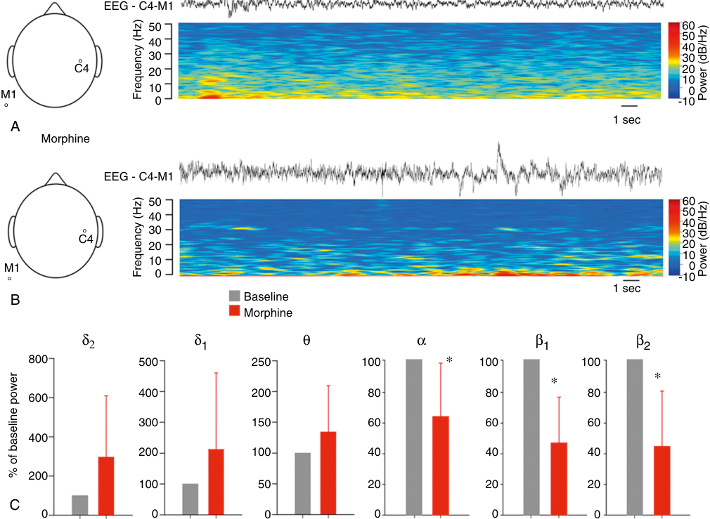

EEG - C4-M1 50 60 50 40 40 ° 30 30 C4 20 20 10 M1 10 0 ° 0 -10 1 sec A Morphine EEG - C4-M1 50 60 50 40 40 °C4 30 30 20 20 10 10 M1 0 ° 0 -10 1 sec B Baseline Morphine δ2 δ1 θ α β1 β2 800 500 250 100 ∗ 100 100 ∗ ∗ 400 200 80 80 80 600 300 150 60 60 60 400 200 100 40 40 40 200 100 50 20 20 20 C 0 0 0 0 0 0 Frequency (Hz) Power (dB/Hz) Frequency (Hz) Power (dB/Hz) % of baseline power 

**Fig. 22.12 Impacts of morphine on electroencephalography (EEG) spectral content.** EEG activity of a representative 30- s epoch and power spectrograms of C4- M1 (C4 = central electrode; M1 = mastoid electrode) derivation at baseline (A) and after morphine administration (B). In analyzed group data (C), high- frequency power (α, β1, and β2) was decreased by morphine. Mean data for 10 patients (4–18 years) showed that morphine (0.157 ± 0.044 mg/kg) decreased α ( _P_ = .039, _n_ = 10), β1 ( _P_ = .003, _n_ = 10), and β2 ( _P_ = .020, _n_ = 10) powers but did not change δ2 ( _P_ = .375, _n_ = 10), δ1 ( _P_ = .922, _n_ = 10), and θ ( _P_ = .331, _n_ = 10) powers. Data are shown as mean ± 95% confidence interval (CI). *Values significantly different from baseline with a _P_ &lt;.05. (From Montandon G, Cushing SL, Campbell F, et al. Distinct cortical signatures associated with sedation and respiratory rate depression by morphine in a pediatric population. _Anesthesiology._ 2016;125:889–903.)

As an effect- site measure, EEG can be employed to assess onset of drug action and drug potency ratios. The spectral edge and serum concentration are closely parallel for remifentanil,124 whereas a significant time lag is found for recovery of the spectral edge for fentanyl and sufentanil125 (Fig. 22.13). In healthy volunteers, approximate entropy derived from a parietal montage showed significant correlation with remifentanil dose (1–8 mcg/kg/min for 15–20 min), and it was shown to be appropriate for the assessment of the remifentanil effect on the EEG.126 Potency ratios based on EEG studies are similar to those obtained from studies determining the plasma drug levels of each opioid necessary to reduce the MAC of isoflurane by 50%.

### EVOKED RESPONSES

Because opioids do not appreciably alter sensory- evoked potentials elicited at the posterior tibial or median nerve, sensory- evoked potentials can be used for spinal cord

function monitoring during anesthesia using opioids.127 Although administration of remifentanil (1 mcg/kg intravenous [IV] and 0.2 mcg/kg/min infusion; 2.5 mcg/kg IV and 0.5 mcg/kg/min infusion; and 5 mcg/kg IV and 1 mcg/ kg/min infusion) produced dose- dependent reduction in auditory- evoked potentials in patients under isoflurane anesthesia,128 it was also reported that remifentanil infusion (target plasma concentrations of 1, 2, and 3 ng/mL) did not affect auditory- evoked potential amplitudes and latencies in volunteers with propofol sedation.129 In healthy human volunteers receiving 3 mcg/kg fentanyl, amplitude and latency of motor- evoked responses to transcranial stimulation were not significantly affected.130

Middle latency auditory- evoked potentials (MLAEPs) have been shown to be depressed by increasing concentrations of inhaled and intravenous anesthetics, and these changes can be reversed by surgical stimuli. Thus, MLAEPs can be used as a surrogate measure of the level of anesthesia. Wright and associates examined the effect of remifentanil

<!-- PDF page 16 -->

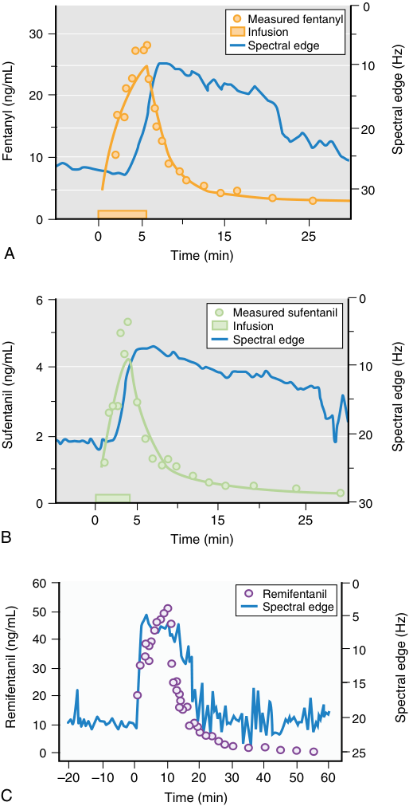

0 Measured fentanyl 30 Infusion Spectral edge 10 20 20 10 30 0 0 5 15 25 A Time (min) 6 0 Measured sufentanil Infusion Spectral edge 4 10 2 20 0 30 0 5 15 25 B Time (min) 60 0 Remifentanil 50 Spectral edge 5 40 10 30 15 20 20 10 0 25 –20 –10 0 10 20 30 40 50 60 C Time (min) Spectral edge (Hz) Fentanyl (ng/mL) Sufentanil (ng/mL) Spectral edge (Hz) Spectral edge (Hz) Remifentanil (ng/mL) 

**Fig. 22.13 Time course of spectral edge and serum opioid concentration.** Fentanyl (A) and sufentanil (B) were infused at 150 mcg/min and 18.75 mcg/min, respectively. Remifentanil (C) was administered at 3 mcg/kg/min for 10 min. The spectral edge changes lag behind the serum concentration changes in the case of fentanyl and sufentanil, whereas the spectral edge and serum concentration closely parallel in the case of remifentanil. (From Scott JC, Cooke JE, Stanski DR. Electroencephalographic quantitation of opioid effect: comparative pharmacodynamics of fentanyl and sufentanil. _Anesthesiology._ 1991;74:34–42; and Egan TD, Minto CF, Hermann DJ, et al. Remifentanil versus alfentanil: comparative pharmacokinetics and pharmacodynamics in healthy adult male volunteers. _Anesthesiology._ 1996;84:821–833.)

using target- controlled infusion) on MLAEPs in the absence of sedatives, whereas increasing the concentration of remifentanil significantly suppressed MLAEPs in the presence of propofol, demonstrating a quantitative interaction between remifentanil and propofol for loss of consciousness.132

### CEREBRAL BLOOD FLOW AND CEREBRAL METABOLISM

The effect of opioids on CBF can be influenced by the concomitant administration of other agents and anesthetic drugs, as well as by the patients’ conditions. Any increase in PaCO2 due to opioid- induced ventilatory depression should cause cerebral vasodilatation, thereby leading to increases in cerebral blood flow (CBF).

Opioids can affect cerebral autoregulation and cerebrovascular CO2 reactivity. When remifentanil (0.15– 0.25 mcg/kg/min) was used together with propofol, it induces a dose- dependent low- flow state with preserved cerebral autoregulation, suggesting that the low- flow state induced by propofol–remifentanil and the increase of cerebrovascular reactivity probably widens the autoregulatory plateau.133

A PET study in human volunteers showed that the effect of remifentanil (0.05–0.15 mcg/kg/min) on CBF is dose- and area- dependent, and demonstrated significant CBF increase in areas involved in pain processing, such as the lateral prefrontal cortex, inferior parietal cortex, and supplementary motor area.134 At moderate doses (0.15 mcg/kg/min), regional CBF increases in mediofrontal and anterior cingulate cortices, occipital lobe transition, and caudal periventricular gray matter, while it decreases in the inferior parietal lobes.134 Kofke _et al._ reported that remifentanil (0.05–0.2 mcg/kg/min) dose- dependently increases CBF in all areas without correction for PaCO2, and after normalizing for global CBF to correct for PaCO2 effects, the remifentanil- induced CBF increase in the cingulate persisted, with decreased flow occurring in the hippocampus and amygdala.135 On the other hand, Klimscha _et al._ reported that high doses of remifentanil (2–4 mcg/ kg/min) decrease regional CBF and CBF velocity without impairing cerebrovascular CO2 reactivity in healthy male volunteers.136 However, it was shown that fentanyl infusion (0.75–1.5 mcg/kg/min) was more effective than remifentanil infusion (0.75–1.5 mcg/kg/min) in preventing increases in CBF velocity during, and immediately following, laryngoscopy and tracheal intubation in children under general anesthesia with 2% sevoflurane.137

In general, opioids appear to have little or no effect on cerebral metabolism. However, in humans, high- dose remifentanil (up to 3 mcg/kg/min) has been reported to increase CMRO2 in the temporal lobe from 6.29 to 7.68 mg/100 g/ min.138

### INTRACRANIAL PRESSURE

(1 or 3 mcg/kg/min) on MLAEPs in tracheally intubated and nonintubated patients and showed that remifentanil attenuated the arousal response in MLAEPs induced by tracheal intubation but had no effect in the absence of a stimulus.131 Schraag and associates found no significant effect of remifentanil (3 or 8 ng/mL target concentration

Opioids are generally thought to affect intracranial pressure (ICP) minimally under conditions of controlled ventilation. When given with background anesthesia (isoflurane- N2O), opioids do not cause significant increases in ICP in patients undergoing craniotomy for supratentorial space- occupying lesions.139,140 ICP was similar under light sedation with

<!-- PDF page 17 -->

remifentanil (0.07 ± 0.03 mcg/kg/min) compared with propofol (4.3 ± 2.5 mg/kg/h) in patients undergoing stereotactic brain tumor biopsy, and cerebral perfusion pressure might be better preserved with remifentanil than propofol, because arterial blood pressure was better preserved with remifentanil.141

Opioids may produce increases in ICP in patients undergoing craniotomy for excision of supratentorial spaceoccupying lesions, especially if intracranial compliance is compromised. In a study of patients with severe head injury who have preserved or impaired autoregulation, morphine (0.2 mg/kg) and fentanyl (2 mcg/kg) moderately increased ICP but did not significantly affect cerebral blood flow, a finding suggesting that mechanisms other than vasodilation could be implicated in the opioid- induced ICP elevation.142 It was also reported that no significant change in ICP was observed in hydrocephalic children after administration of alfentanil (40 mcg/kg).143 It is not clear whether these discrepancies of the opioid effects on ICP are due to the pressure assessment method, the preoperative ICP, or the effects of co- administered drugs. If opioids do increase ICP, its mechanism remains to be clarified.

### NEUROPROTECTION

An _in vitro_ study using rat cerebellar brain slices demonstrated that pretreatment with morphine at clinically relevant concentrations induced acute neuroprotection mediated by activation of the δ1- opioid receptors, activation of adenosine triphosphate (ATP)- sensitive K+ channels, and free radical production in mitochondria.144 In the rat focal ischemia model, fentanyl neither increased nor decreased brain injury compared with awake unanesthetized rats.145 It was demonstrated that at a supraclinical concentration remifentanil exerted _ex vivo_ antiapoptotic action on the immature mouse brain slices, by the mechanism involving the opioid and NMDA receptors, and the mitochondrialdependent apoptotic pathway.146 It was reported that κ- opioid receptors were upregulated and played a critical role in brain ischemia and reperfusion in mice, and that κ- opioid receptor activation could potentially protect the brain and improve neurologic outcome via blood–brain barrier protection, apoptosis reduction, and inflammation inhibition.147 Although there is contradicting evidence for a potential neuroprotection in animal models, there is no clear evidence for neuroprotective effects in humans.

### MUSCLE RIGIDITY

Opioids can increase muscle tone and may cause muscle rigidity. The incidence of rigidity noted with opioid anesthetic techniques varies greatly depending on differences in dose and speed of opioid administration, the concomitant use of N2O, the presence or absence of muscle relaxants, and the patient’s age. Opioid- induced rigidity is characterized by increased muscle tone that sometimes progresses to severe stiffness and associated clinical challenges including difficult ventilation leading to hypoxemia and hypercapnea. Clinically significant opioid- induced rigidity usually begins just as, or after, a patient loses consciousness during anesthetic induction. However, opioid- induced rigidity can also be observed during emergence from anesthesia,

and can appear as late as 5 hours after anesthesia.148 Mild manifestations of rigidity, such as hoarseness, can occur in conscious patients. Vocal cord closure is primarily responsible for the difficult ventilation with bag and mask that follows the administration of opioids. Lower doses of opioids have also been documented to cause muscle rigidity in patients with particular risk factors: extremes of age (newborns, elderly), critical illness with neurologic or metabolic diseases, and use of medications that modify dopamine levels.148

The precise mechanism by which opioids cause muscle rigidity is not clearly understood. Muscle rigidity is not the result of a direct action on muscle fibers because it can be decreased or prevented by pretreatment with muscle relaxants. Mechanisms of opioid- induced muscle rigidity involving the CNS have been postulated. The nucleus raphe pontis within the reticular formation and the caudate nucleus within the basal ganglia have been implicated mechanistically.149 Rigidity is also likely induced by activation of spinal motor neurons through the action of fentanyl at the locus coeruleus.150 Some characteristics of opioid- induced catatonia and rigidity, increased incidence with age and muscle movements resembling extrapyramidal side effects, are similar to those of Parkinson disease and may suggest similarities in neurochemical mechanisms.

Pretreatment with or concomitant use of nondepolarizing muscle relaxants can decrease the incidence and severity of rigidity. Opioid- induced muscle rigidity can also be reversed with the μ- receptor antagonist naloxone. Induction doses of sodium thiopental and subanesthetic doses of diazepam and midazolam can prevent, attenuate, or successfully treat rigidity.

### NEUROEXCITATORY PHENOMENA

Although fentanyl causes seizure activity seen on the EEG in animals, EEG evidence of seizure activity after administration of opioids is generally lacking in humans. However, there have been several reports on opioid- induced seizures. Remifentanil infusion (1.0 mcg/kg/min for 3 min) induced generalized tonic– clonic seizure- like activity in an otherwise healthy adult.151 It was reported that the seizure duration was prolonged in patients undergoing electroconvulsive therapy after administration of remifentanil (1 mcg/kg) and methohexital (0.625 mg/kg), compared with methohexital alone (1.25 mg/kg).152

The mechanisms underlying opioid- induced neuroexcitatory phenomena are not completely clear. Experimental study using excised mouse hippocampus showed that the proseizure effect of morphine is mediated by selective stimulation of the μ- and κ- opioid receptors but not the activation of the δ- opioid receptor.153 In rats, midazolam, naloxone, and phenytoin prevented EEG seizure activity and histologically evident brain damage induced by large doses of fentanyl.154

Measurement of CBF by magnetic resonance imaging in human volunteers indicated that the cingulate cortex is the most susceptible to activation by remifentanil (0.05 to 0.2 mcg/kg/min), and the susceptibility is affected by the apolipoprotein E genotype.135 This finding may support the notion that neuroactivation of limbic areas by the perioperative use of opioids plays a role in the genesis of postoperative cognitive dysfunction.

<!-- PDF page 18 -->

### PUPIL SIZE

Morphine and most μ- and κ- agonists cause constriction of the pupil by their excitatory action on the parasympathetic nerve innervating the pupil. Light induces excitation of the Edinger–Westphal nucleus, leading to pupillary constriction that is inhibited by hypercarbia, hypoxia, and nociception. Opioids release the effect of inhibitory neurons on the Edinger–Westphal nucleus, resulting in papillary constriction155 (Fig. 22.14). It was reported that after intravenous administration of morphine (0.125 mg/kg) a 26% decrease in pupil diameter occurred after 1 hour, and more than 6 hours was necessary for complete recovery of pupil diameter.156 The pupillary dilatation reflex has been successfully used to assess the analgesic component of a balanced anesthetic regimen. The pupillometer may be a valuable tool to guide morphine administration in the immediate postoperative period.157 A prospective randomized study evaluated the impact of intraoperative pupillometry monitoring on perioperative opioid consumption in major gynecologic surgery. It was demonstrated that the use of pupillometry to guide intraoperative analgesia reduced intraoperative remifentanil consumption and postoperative morphine requirements.158

Pupillary unrest is the fluctuation in pupil diameter, caused by the oscillating activity of the Edinger–Westphal nucleus, and pupillary unrest under ambient light (PUAL) is present even in well- rested individuals. Although the underlying mechanisms were not clarified, it was shown that administration of fentanyl (1 mcg/kg) to healthy volunteers diminished PUAL.159 The pretreatment magnitude of PUAL is correlated with the analgesic response to opioid

therapy, and patients who exhibit higher levels of PUAL change after opioid administration have a more beneficial analgesic effect from opioids.160 This finding may suggest that assessment of PUAL might be clinically useful for adjustment of the opioid doses.

### THERMOREGULATION AND SHIVERING

Opioid- based anesthesia induces a slight increase in the sweating threshold, and reduces vasoconstriction and shivering thresholds to a degree similar to that of the potent inhaled anesthetics.161 However, meperidine is unique among opioids in its ability to effectively terminate or attenuate shivering by disproportionate reduction of the shivering threshold compared with alfentanil.162 The antishivering effect of meperidine was thought to be mediated by meperidine’s activity on the κ- receptor, but the involvement of the κ- receptor was denied, because the relatively specific κ- receptor agonist nalbuphine did not show significant antishivering activity in volunteers.163 It was shown that meperidine exerts agonist activity at the α2B- adrenoreceptor in cultured cells, and was suggested that activation of the α2B- adrenoreceptor may be involved in the antishivering action of meperidine.81 Tramadol (0.5 mg/kg) suppressed shivering after epidural anesthesia in parturients as effectively as meperidine (0.5 mg/kg).164 A quantitative systematic review of randomized controlled trials found that meperidine 12.5 to 35 mg and tramadol 35 to 220 mg were effective for parenteral pharmacologic prevention of postoperative shivering.165

Remifentanil is associated with an increased incidence of postanesthetic shivering, which is not related with

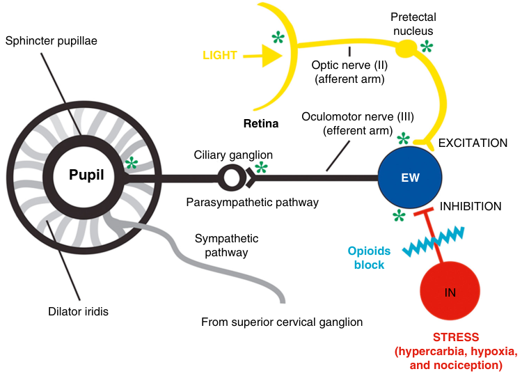

Pretectal nucleus Sphincter pupillae LIGHT Optic nerve (II) (afferent arm) Oculomotor nerve (III) Retina (efferent arm) EXCITATION Ciliary ganglion Pupil EW Parasympathetic pathway INHIBITION Sympathetic pathway Opioids block IN Dilator iridis From superior cervical ganglion STRESS (hypercarbia, hypoxia, and nociception) 

**Fig. 22.14 Pathways and nerve centers that control pupil size and the pupillary light reflex in humans.** Edinger–Westphal (EW) nucleus neurons are pacemaker cells that are modified by excitatory and inhibitory inputs. Opioids block the inhibition on the EW nucleus. *Locations where hypercarbia, hypoxia, and opioids might potentially interfere with the light reflex. _IN_ , inhibitory neuron. (From Rollins MD, Feiner JR, Lee JM, et al. Pupillary effects of high- dose opioid quantified with infrared pupillometry. _Anesthesiology._ 2014;121:1037–1044.)

<!-- PDF page 19 -->

intraoperative hypothermia. A meta- analysis showed that remifentanil induced dose- dependent postoperative shivering more often than fentanyl, and the incidence was not dependent on whether inhaled anesthetics or propofol was used concomitantly.166 The higher incidence of postanesthetic shivering with higher doses of remifentanil probably reflects acute opioid tolerance and stimulation of the NMDA receptors.167 A small dose of ketamine, 0.5 mg/kg at induction of anesthesia followed by infusion at 0.3 mg/kg/h, can prevent remifentanil- induced postanesthetic shivering.

### PRURITUS

Opioid- induced pruritis is one of several perpetual challenges associated with opioid- based analgesia. Although pruritus is occasionally observed with parenteral opioid use, it is more common side effect of neuraxial opioids, with an incidence ranging from 30% to 85%, depending on the dose and lipophilicity of the opioid administered (Table 22.3).168 Parenteral morphine can cause pruritus through histamine release from mast cells, whereas neuraxial opioid- induced pruritus occurs through a mechanism of neuronal disinhibition in the spinal cord dorsal horn. It was shown that dynorphin, an endogenous opioid peptide activating the κ- opioid receptor, acts as a neuromodulator to inhibit itch in the dorsal horn of the spinal cord in mice.169 Nguyen _et al._ found that spinal dynorphin neurons are both necessary and sufficient for itch induced by neuraxial morphine in mice, and that agonism of the κ- opioid receptor alleviated morphine- induced itch in mice and nonhuman primates.170 Activation of a μ- opioid receptor isoform MOR1D10 by spinal morphine induced activation of the gastrin- releasing peptide receptor that heterodimerized with MOR1D, resulting in activation of phospholipase Cβ3 and intracellular Ca2+ increase in neurons leading to itch sensation in mice.171 However, contribution of this mechanism to opioid- induced pruritus has not been shown in humans.

Current strategies to suppress opioid- induced pruritus have shifted away from antihistamines against consequences of morphine- induced histamine release and are focused on exploiting partial blockade of the μ- opioid receptor, activation of the κ- receptor, and modulation of nonopioid receptor pathways. Naloxone reverses opioid- induced itching, but opioid antagonists are not ideal therapeutic agents against pruritus, because opioid analgesia is often reversed by these agents. A subcutaneous administration (12 mg) of methylnaltrexone bromide, a peripherally acting μ- opioid antagonist, did not reduce the overall severity or incidence of pruritus in women having elective cesarean

section under spinal anesthesia with intrathecal morphine 100 mcg, suggesting that peripheral mechanisms do not significantly contribute to spinal opioid- induced pruritus.172 Ondansetron, a serotonin 5- HT3 receptor antagonist has been proposed to treat spinal or epidural morphineinduced pruritus,173 and a meta- analysis has demonstrated that prophylactic use of 5- HT3 antagonists significantly reduced the severity and the need for treatment of pruritus.174 However, another meta- analysis showed that prophylactic intravenous administration of 8 mg ondansetron did not decrease the incidence of fentanyl- or sufentanilinduced pruritus but might decrease the need for pruritus rescue medication.175

Involvement of the κ- opioid receptor in the itch modulation has been demonstrated, and selective κ- opioid receptor agonists have been shown to suppress itch in preclinical models. A κ- agonist nalfurafine have been approved to treat chronic pruritus in Japan.176 Pentazocine (15 mg), an agonist of the κ- opioid receptor and partial agonist of the μ- opioid receptor, was also tried to treat opioid- induced pruritus, and has been found to be superior to 4 mg of ondansetron for the treatment of pruritus induced by intrathecal morphine in parturients undergoing cesarean delivery.177

Other approaches include intravenous administration of droperidol (1.25 mg), propofol (20 mg), or alizapride (100 mg), which reduced the incidence of pruritus induced by the use of morphine 0.2 mg intrathecally in patients undergoing cesarean section under spinal anesthesia.178 Preoperative gabapentin prevents pruritus induced by intrathecal morphine in patients undergoing lower limb surgery with spinal anesthesia.179

### OPIOID- INDUCED HYPERALGESIA

There is growing evidence that opioid- induced hyperalgesia (OIH) can represent a major adverse effect of opioid administration, especially when driven by potent formulations and escalating dosages. Both OIH and acute opioid tolerance develop by administration of high- dose opioids, and can cause the opioid dose necessary for analgesia to increase, but these two concepts are different (Fig. 22.15).180 OIH means a paradoxical increased sensitivity to pain, whereas, in tolerance, increasing doses are required to maintain analgesia because of the patient’s reduced sensitivity to opioid action. Experimentally, opioids have elicited hyperalgesia in animal models after repeated opioid administration or continuous delivery.181 A systematic review to evaluate the clinical implication of OIH demonstrated that high intraoperative doses of remifentanil are associated with

**Table 22.3** Incidence of Parenteral and Neuraxial Opioid- Induced Pruritus

|**Route**|**Opioid**|**Incidence of Pruritus (%)**|**Onset**|**Mechanism**|
|---|---|---|---|---|
|Parenteral|Morphine (0.05 mg/kg/h intravenous)|&lt;10|Apparent with chronic use|Peripheral (histamine- dependent)|
|Neuraxial|Morphine (1.5 to 5 mg epidural; 50 to 200 mcg intrathecal)|60 to 85|Hours to days|Central/spinal|
|Neuraxial|Lipid- soluble (fentanyl and sufentanil; 20 to 100 mcg epidural; 10 to 20 mcg intrathecal)|60 to 90|Rapid (within minutes to 4 h)|Central/spinal|

From Nguyen E, Lim G, Ross SE. Evaluation of therapies for peripheral and neuraxial opioid- induced pruritus based on molecular and cellular discoveries. _Anesthesiology_ . 2021;135:350–365.

::: details 原始表格與符號（PDF 第 19 頁）

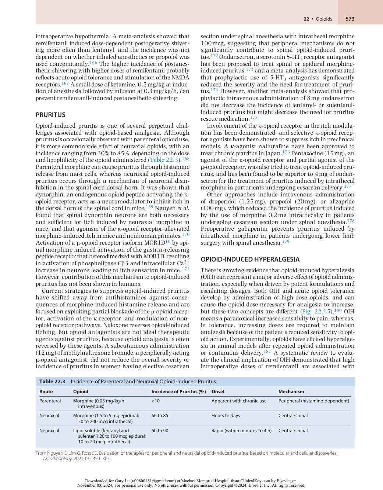

:::

<!-- PDF page 20 -->

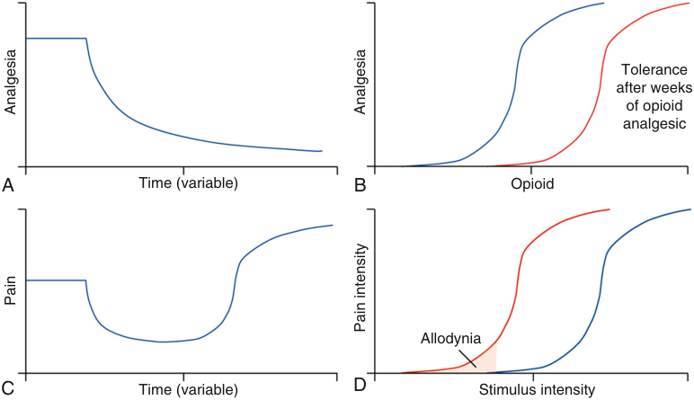

Tolerance after weeks of opioid analgesic A Time (variable) B Opioid Allodynia C Time (variable) D Stimulus intensity Analgesia Analgesia Pain Pain intensity 

**Fig. 22.15 Changes in opioid analgesia and pain during tolerance and hyperalgesia.** (A) Tolerance to opioid analgesia develops after ongoing exposure to the drug. The same dose of drug administered over time produces less analgesic effect. The rate of onset and extent of tolerance development is variable depending on the individual drug and patient characteristics. (B) Opioid analgesic tolerance produces a rightward shift in the dose–response relationship ( _red curve_ ). (C) Opioid- induced hyperalgesia describes a paradoxical increase in pain sensitivity during ongoing exposure to opioid drugs. Although the timeline in the graph is not specified, and will vary between different opioids, in the case of remifentanil (0.1 mcg/kg/ min), infusion for 30 minutes is sufficient to cause opioid- induced hyperalgesia. (D) In opioid- induced hyperalgesia, pain can be induced by stimuli of lower intensity ( _red curve_ ), and allodynia can occur (i.e., pain in response to stimuli that were of intensities [ _shaded red_ ] below threshold of pain before drug administration). (From Colvin LA, Bull F, Hales TG. Perioperative opioid analgesia – when is enough too much? A review of opioid- induced tolerance and hyperalgesia. _Lancet._ 2019;393:1558–1568.)

small but significant increases in acute pain after surgery as assessed by pain intensity at rest 24 hours after surgery, 24- hour morphine use, pain intensity on movement, and hyperalgesia measured after an operation.182 In a randomized, double- blind, crossover study with 24 healthy male volunteers, it was demonstrated that when compared with low- dose (1 mcg/kg) fentanyl, high- dose fentanyl (10 mcg/ kg) increased the area of hyperalgesia 4.5–6.5 hours after fentanyl administration. This result suggests that fentanyl as well as remifentanil can produce OIH in humans.183 In animal experiments, mechanisms for OIH have been shown to involve spinal sensitization to glutamate and substance P,184 NMDA receptor plasticity in the spinal dorsal horn,185 and α- amino- 3- hydroxy- 5- methyl- 4- isoxazolepropionic acid receptor (AMPAR) expression in the spinal dorsal horn.186

A variety of approaches for OIH have been suggested. There have been reports that OIH and subsequent acute opioid tolerance can be prevented by ketamine (10 mg/kg) in rats, suggesting the involvement of the NMDA receptor.187,188 Low- dose buprenorphine (25 mcg/h for 24 hours), an opioid with NMDA antagonist activity, prevented postoperative secondary hyperalgesia in patients who received remifentanil infusion (effect- site concentration of 4 ng/mL) during major lung surgery.189 Butorphanol (0.2 mcg/kg) was also effective for prevention of postoperative hyperalgesia after laparoscopic cholecystectomy performed with remifentanil (0.3 mcg/kg/min).190 N2O (70%), an inhaled anesthetic, is an effective NMDA antagonist, and significantly reduced postoperative opioid- induced hyperalgesia in patients receiving propofol and remifentanil (0.3 mcg/ kg/min).191 A randomized, double- blind, prospective study

showed that remifentanil (0.2 mcg/kg/min) enhances periincisional hyperalgesia in patients undergoing thyroidectomy, and intraoperative magnesium sulfate (30 mg/ kg at induction followed by 10 mg/kg/h) can prevent remifentanil- induced hyperalgesia.192 Hyperalgesia after a 30- minute intravenous infusion of remifentanil (0.1 mcg/ kg/min) could be prevented by administration of parecoxib, a COX- 2 inhibitor,193 suggesting the involvement of COX- 2 in OIH. In patients undergoing elective thyroid surgery, intraoperative use of small- dose naloxone (0.05 mcg/kg/h) reduced postoperative hyperalgesia after remifentanil infusion of 4 ng/mL.194

Interestingly, the occurrence of OIH might be affected by general anesthetics co- administered with opioids. When women undergoing breast cancer surgery were anesthetized with sevoflurane or propofol to keep BIS value at 40 to 50, postoperative hyperalgesia induced by intraoperative remifentanil infusion (effect- site concentration of 4 ng/mL) was significant with sevoflurane anesthesia, but not apparent with propofol anesthesia.195

A follow- up study on the postoperative course of cardiac surgery demonstrated that intraoperative remifentanil was predictive for chronic thoracic pain 1 year after surgery in a dose- dependent manner.196 It can be anticipated that hyperalgesia during the perioperative period is linked to peripheral and central pain sensitization and thereby correlates with the development of postoperative chronic pain.197 This suggests that hyperalgesia induced by remifentanil in the early postoperative period may predict the higher incidence of chronic pain.

Overall, human data generally support the existence of OIH in a few specific settings. Probably all potent opioids

<!-- PDF page 21 -->

such as fentanyl and remifentanil are apparently capable of inducing OIH, which may pose risks for development of postoperative chronic pain. Clinical significance of OIH should be further elucidated, and effective approach to OIH should be developed.

### OPIOID TOLERANCE

The precise mechanism for opioid dependence and tolerance is not completely understood. However, it is probable that the multiple mechanisms are involved in the development of opioid tolerance; from uncoupling of the opioid receptors from their second messengers to the adaptive changes in parallel antagonistic or facilitatory pain transmission systems. For example, in the locus coeruleus, the major noradrenergic nucleus in the brain, long- term opioid exposure results in inhibition of adenylyl cyclase, reduced activity of protein kinase A, and upregulation or supersensitization of the cyclic AMP pathway,198 and these phenomena are thought to participate in opioid- induced tolerance or addiction. On the other hand, changes in μ- receptor density in brain that occur prior to or during the development of tolerance do not appear to be essential for development of opioid tolerance.199

Central glucocorticoid receptors (GRs) have been implicated in the cellular mechanism of neuronal plasticity that has many cellular steps in common with the mechanism of opioid tolerance. It was shown that the development of tolerance to the antinociceptive effect of spinal morphine was substantially attenuated when the GR antagonist was coadministered with morphine but the GR agonist dexamethasone facilitated the development of morphine tolerance, suggesting an important role of spinal GRs in the cellular mechanisms of morphine tolerance in rats.200 Ketamine, an NMDA receptor antagonist, administered intraoperatively in small doses reduces postoperative opioid consumption in rats, and this effect was considered to be the result of attenuation of acute tolerance to the analgesic effect of opioids,188 suggesting the involvement of the NMDA- nitric oxide (NO) system in development of acute tolerance to opioids. Neuroinflammation involving astrocytes and microglia, driven by chemokines may represent one of the major mechanisms underlying opioid tolerance as well as pathologic pain. A chemokine, CXCL1, was upregulated in both opioidtolerant patients and rodents, and the onset and extent of opioid tolerance was affected by antagonizing intrathecal CXCL1/CXCR2 signaling.201 A chemokine, CXCL12, was significantly upregulated in the cerebrospinal fluid of opioid- tolerant patients, and CXCL12 neutralizing antibody and antagonist for CXCR4, a receptor which interacts with CXCL12, attenuated morphine tolerance in rats.202

Acute tolerance developed rapidly after acute opioid exposure and may be responsible for postoperative pain or increase in postoperative morphine consumption.203,204 Intraoperative remifentanil infusion (0.3 mcg/kg/min) in patients undergoing major abdominal surgery under desflurane anesthesia increased postoperative pain and morphine requirement compared with low- dose remifentanil (0.1 mcg/kg/min), suggesting the development of acute remifentanil tolerance.205 In contrast, there was a report that target- controlled infusion of alfentanil (target plasma concentration of 60–100 ng/mL) and remifentanil (target

plasma concentration of approximately 2 ng/mL) for postoperative analgesia for 6 hours did not lead to opioid tolerance.206 Intraoperative use of 0.3 mcg **/** kg/min remifentanil for approximately 3 hours did not induce acute tolerance, but the administration of 0.6 and 0.9 mcg **/** kg/min remifentanil to young children resulted in acute tolerance for 24 hours after surgery revealed by increased use of postoperative fentanyl in an apparently dose- related manner.207 Various reports on acute opioid tolerance in clinical settings may reflect divergent methodologies, difference in patient background, and limited sample size.

Differential opioid tolerance, an important phenomenon in clinical opioid pharmacology, proposes that different targets of opioid drugs do not develop tolerance at the same rate and to the same degree.208 In a study using rhesus monkeys, acute morphine administration predictably induced dose- dependent analgesia, and chronic morphine administration induced dose- dependent tolerance to the analgesic effect, while no tolerance development to the respiratory depressive effect could be demonstrated in the chronically opioid- treated animals (Fig. 22.16).209 This finding suggests that increasing the dose of opioids to overcome acute opioid tolerance may induce respiratory depression. There are few data to help predict the magnitude of an individual’s loss of opioid- induced analgesia and their resistance or vulnerability to the opioid- induced respiratory depression.

### OPIOID USE DISORDER

Opioid use disorder (OUD), defined as a pattern of opioid use associated with a range of physical, mental, social, and legal problems, and with increased mortality leading to clinically significant impairment or distress, is a chronic relapsing brain disorder with clinical symptoms of physical dependence, protracted physical symptoms, psychological dependence, and relapse.210 In the 1980s, opioid pain medications began to play a role in the management of non-cancer chronic pain, and the opioid pain medications sales increased fourfold between 1990 and 2010 with a parallel increase in overdose death rates and admissions for the treatment of OUD. From 1999 to 2016, more than 200,000 people died in the United States from overdoses related to prescription opioids, and opioid- related overdose deaths have reached epidemic levels.211

A variety of problems should be taken into consideration for anesthetic management of opioid- dependent patients or patients suffering from OUD.212 Complications in opioidaddicted patients include cardiopulmonary problems, renal problems and anemia, and long- term morphine administration causes adrenal hypertrophy and impairs corticosteroid secretion. Furthermore, viral and nonviral hepatitis, acquired immunodeficiency syndrome, osteomyelitis, muscle weakness, and neurologic complications may be found in patients suffering from OUD or poly- substance use disorder. As it is common to underestimate and undertreat pain in opioid- dependent patients, it is important to identify the goals in their acute pain management (Box 22.1).213 Anesthetic management for the opioid- dependent or patient with OUD should include adequate premedication with opioids, administration of supplemental intraoperative and postoperative opioids, and providing nonopioid analgesics and neural blockade213 (Fig. 22.17). There is no ideal anesthetic

<!-- PDF page 22 -->

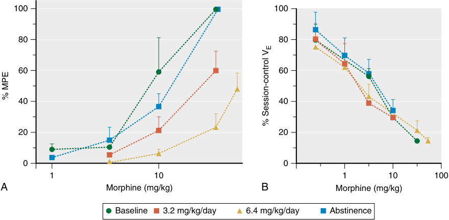

100 100 80 80 60 60 40 40 20 20 0 0 1 10 1 10 100 A Morphine (mg/kg) B Morphine (mg/kg) Baseline 3.2 mg/kg/day 6.4 mg/kg/day Abstinence % MPE % Session-control VE 

**Fig. 22.16 The effects of chronic opioid administration on analgesia and respiratory response in rhesus monkeys.** The animals were studied under baseline conditions, after receiving morphine (3.2 or 6.4 mg/kg/day for 4 weeks), and after abstinence. After each treatment course, they were challenged with various doses of morphine, and analgesic and respiratory responses were assessed. Analgesic effects were assessed by tail withdrawal latency and shown as percentage of maximum possible effect (MPE); respiratory depression was shown as decrease in minute ventilation (VE). The results show development of reversible tolerance to the analgesic effects of opioids (A), but no tolerance development to the respiratory depression (B). (From Paronis CA, Woods JH. Ventilation in morphine- maintained rhesus monkeys. II: tolerance to the antinociceptive but not the ventilatory effects of morphine. _J Pharmacol Exp Ther._ 1997;282:355–362.)

### Box 22.1 Goals of Acute Pain Management in Opioid- Dependent Patients

1.  Identification of the population of at- risk patients receiving long- term opioid therapy for various chronic pain situations (musculoskeletal disease, neuropathic conditions, sickle cell disease, HIV- related disease, palliative care), drug abusers, recovering addicts in opioid maintenance programs

2.  Prevention of withdrawal symptoms and complications

3.  Symptomatic treatment of psychological affective disorders such as anxiety

4.  Effective analgesic treatment in the acute phase

5.  Rehabilitation to an acceptable and suitable maintenance opioid therapy

_HIV_ , human immunodeficiency virus.

of countries.214 Other treatment approaches have emerged including rapid opioid detoxification with high-dose naloxone or naltrexone. For this treatment, general anesthesia is induced before the start of opioid antagonization and maintained for several hours to prevent perception of withdrawal symptoms by the patient.215,216 Blockade of μ- opioid receptors by naloxone (total dose of 12.4 mg) in opioid-addicted patients induces sympathetic neural activation, including increase in plasma catecholamine concentration and cardiovascular stimulation, which can be managed in part by α2- agonists.217 Long- term opioid abstinence is not guaranteed even with an ongoing program including OMT, given the neurobiology and societal factors involved in addiction, and potential for repetitive exposure (often medically) in the perioperative period.218

agent or technique to employ in the patient with OUD or in the patient with an acute opioid overdose except for judicious use of an opioid antagonist as indicated. Combined techniques utilizing regional anesthetic approaches, as well as concurrent use of low- dose ketamine or α2- agonists, have been successful. Support of the circulatory system with fluids and monitoring of arterial blood gases and pulmonary function are essential.

Owing to the high risk of relapse and overdose in opioiddependent individuals, the most commonly prescribed treatment is opioid medication treatment (OMT), in which opioids with longer absorption times and half- lives are prescribed, such as the full opioid agonist methadone or partial agonist buprenorphine hydrochloride. Because of the injection- deterring potential of naloxone hydrochloride and a better safety profile compared with methadone, daily oral administration of combined buprenorphine and naloxone is becoming a first line choice for OMT in a number

## Respiratory Effects of Opioids

Opioids can affect respiration through multiple mechanisms, and opioid overdose can lead to fatal hypoxia caused by prolonged apnea (Fig. 22.18).219 Opioid- induced respiratory depression is caused by its suppressive effect on the pontomedullary respiratory center, and characterized by slow, shallow, and irregular breathing, which in severe cases leads to respiratory arrest. Opioids also impair chemoreflexes and upper airway patency and induce muscle rigidity, sedation, and sleep- disordered breathing, all of which compromise patient outcomes.

### EFFECTS ON AIRWAYS

The antitussive actions of opioids are well known and central in origin. Opioids blunt or eliminate somatic and autonomic responses to tracheal intubation and allow

<!-- PDF page 23 -->

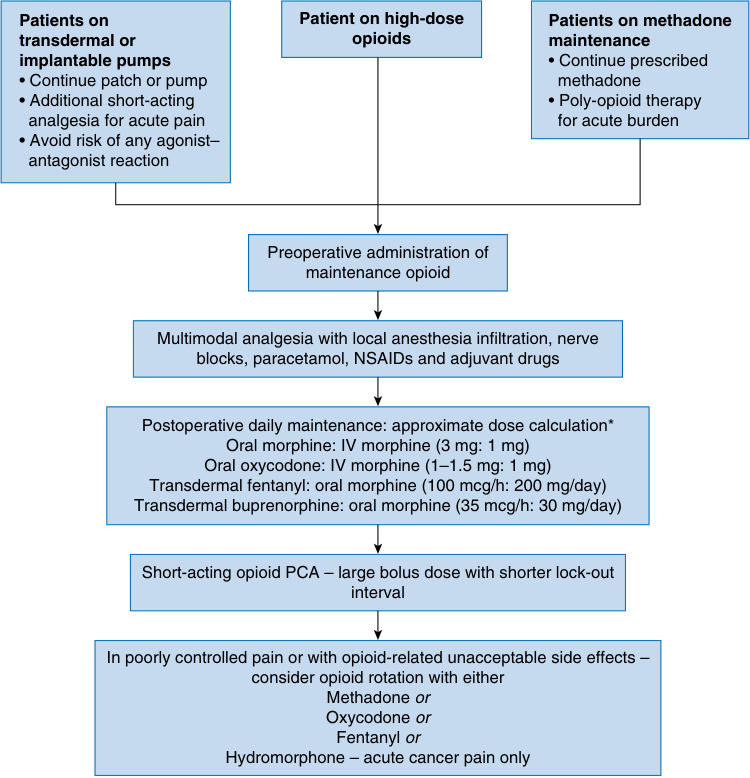

Patients on Patient on high-dose Patients on methadone transdermal or opioids maintenance implantable pumps • Continue prescribed • Continue patch or pump   methadone • Additional short-acting • Poly-opioid therapy   analgesia for acute pain   for acute burden • Avoid risk of any agonist–   antagonist reaction Preoperative administration of maintenance opioid Multimodal analgesia with local anesthesia infiltration, nerve blocks, paracetamol, NSAIDs and adjuvant drugs Postoperative daily maintenance: approximate dose calculation* Oral morphine: IV morphine (3 mg: 1 mg) Oral oxycodone: IV morphine (1–1.5 mg: 1 mg) Transdermal fentanyl: oral morphine (100 mcg/h: 200 mg/day) Transdermal buprenorphine: oral morphine (35 mcg/h: 30 mg/day) Short-acting opioid PCA – large bolus dose with shorter lock-out interval In poorly controlled pain or with opioid-related unacceptable side effects – consider opioid rotation with either Methadone  or Oxycodone  or Fentanyl  or Hydromorphone – acute cancer pain only 

*It is advisable to reduce the calculated dose due to incomplete cross-tolerance among different opioid groups.

**Fig. 22.17 Guideline for acute pain management in patients on long- term opioids.** _IV_ , intravenous; _NSAIDs_ , nonsteroidal anti-inflammatory drugs; _PCA_ , patient-controlled analgesia. (Redrawn from Mehta V, Langford RM. Acute pain management for opioid dependent patients. _Anaesthesia._ 2006;61:269–276.)

patients to tolerate endotracheal tube placement without coughing or bucking. Remifentanil (effect- site concentration of 2 ng/mL) can suppress coughing induced by extubation after propofol or sevoflurane anesthesia.220 Conversely, two successive doses of 1.5 mcg/kg fentanyl did not effectively prevent laryngospasm in children, aged 2 to 6 years old, who were anesthetized with sevoflurane.221

Several studies have reported a depressant effect of morphine on respiratory mucus secretion in human bronchi, which is one of the most important defenses against respiratory tract infections. However, morphine had no effect on the beating frequency of nasal cilia _in vitro_ .222 Opioids can affect pharyngeal function, airway protection, and coordination of breathing and swallowing. A sedative dose of morphine (0.1 mg/kg) was associated with increased incidence of pharyngeal dysfunction and discoordinated breathing and swallowing, a combination impairing airway protection and potentially increasing the risk for pulmonary aspirations.223

It is well known that opioids can induce cough, contrasting with their antitussive action. Equipotent boluses of sufentanil 0.3 mcg/kg and fentanyl 3 mcg/kg increase the

incidence of cough, although the incidence and severity of coughing with sufentanil are less than those with fentanyl.224 The incidence of cough induced by fentanyl (100 or 150 mcg) administered through a peripheral intravenous cannula decreased from 18% to 1.3% as the injection time was increased from 2 seconds to 30 seconds,225 as well as by the administration of 1.5 mg/kg lidocaine 1 minute before fentanyl administration.226 A meta- analysis showed that the lowest effective dose of lidocaine on the risk of opioidinduced cough was 0.5 mg/kg.227 It was also reported that preemptive use of fentanyl 25 mcg, administered 1 minute before bolus injection of fentanyl (125 or 150 mcg), can effectively suppress fentanyl- induced cough.228 Propofol, α2- agonists (clonidine, dexmedetomidine), inhalation of β2- agonists (terbutaline, salbutamol), and NMDA- receptor antagonists (ketamine, dextromethorphan) were also effective for suppression of fentanyl- induced cough.229 A prospective randomized controlled study demonstrated that a huffing maneuver, consisting of a forced expiration against open glottis, just before intravenous fentanyl administration, significantly reduced the incidence and severity of fentanylinduced coughing in the majority of the patients.230 Li and associates reported that nonsmoking women undergoing

<!-- PDF page 24 -->

gynecologic surgery who develop fentanyl- induced cough during induction of anesthesia have a higher incidence of postoperative nausea and vomiting (PONV).231

In summary, opioids engender potent antitussive properties that can help blunt airway responsiveness to endotracheal intubation. However, depending on the class of opioid and rate of administration, they may evoke a brief cough that can be subverted by using preadministered agents such as lidocaine. Ultimately, caution should be exercised in the administration of opioids as they can also interfere with protective aspects of airway physiology.

### RESPIRATORY DEPRESSION

The respiratory- depressant actions of opioids represent their most serious adverse effect. Activation of the μ- opioid receptor in the caudal medullary raphe region, which is important for regulating pain and respiration, inhibits the ventilatory response to hypercapnia in anesthetized rats.232 Consistently, administration of morphine or M6G did not produce significant respiratory depression in the μ- opioid receptor knockout mice.233 Polymorphism of the μ- opioid receptor at nucleotide position 118, which is known to affect M6G- induced analgesia, does not significantly change the susceptibility of respiratory depressive effect of M6G (0.4 or 0.6 mg/kg) in humans.18 This result suggests that analgesia and respiratory depression may be mediated by different signal transduction mechanisms activated by the μ- opioid receptor.

The lack of adequate postoperative pain relief in the thoracoabdominal region can inhibit deep breath and cause shallow respiration leading to postoperative respiratory dysfunction including atelectasis, and therefore opioids can prevent or correct respiratory impairment as a basic component of postoperative analgesia. However, opioids can also dose- dependently depress respiration, representing the most feared adverse effect, and can be a significant cause of death and brain damage in the perioperative period. The incidence of postoperative opioid- induced respiratory depression was reported to be 0.1%–37%, depending on the route of opioid administration, the type of opioid, the definition and method of monitoring opioid- induced respiratory depression, and the prospective versus retrospective nature of the study.234

Opioids activating the μ- receptor cause dose- dependent depression of respiration, primarily through a direct action on brainstem respiratory centers.235 Although the preBötzinger complex (PreBötC), the main region of respiratory rhythm–pattern generation, has been known to be the main target of opioid- induced respiratory depression, it was demonstrated that preBötC partially mediates opioid effects on respiratory phase timing, but does not mediate the opioid- induced depression of respiratory rate.236 The stimulatory effect of CO2 on ventilation is significantly reduced by opioids, and the pressure of end- tidal carbon dioxide (PETCO2) is increased by opioids237 (Fig. 22.19). Opioids also decrease hypoxic ventilatory drive and induce characteristic changes in respiratory pattern. Respiratory rate is usually drastically decreased in opioid overdose, although

### Breathing-related opioid effects

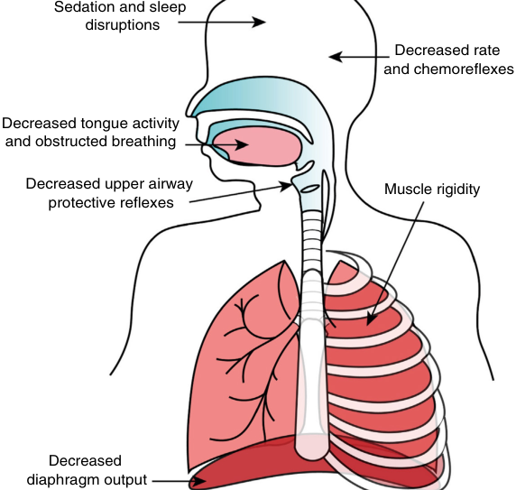

Sedation and sleep disruptions Decreased rate and chemoreflexes Decreased tongue activity and obstructed breathing Decreased upper airway Muscle rigidity protective reflexes Decreased diaphragm output 

**Fig. 22.18 Summary diagram of breathing- related effects of opioids observed in humans.** Opioids can affect breathing by multiple mechanisms in humans. Opioids cause sedation, sleep disruption, sleep- disordered breathing, obstructed breathing, and muscle rigidity. Opioids decrease respiratory rate, chemoreflexes, and diaphragm activity. (From Bateman JT, Saunders SE, Levitt ES. Understanding and countering opioid- induced respiratory depression. _Br J Pharmacol._ 2023;180:813–828.)

<!-- PDF page 25 -->

hypoxic CNS insult can counter this effect. The prolonged expiratory time in the respiratory cycle induced by opioids frequently results in greater reductions in respiratory rate than in tidal volume. Monitoring of breath intervals in spontaneously breathing patients can sensitively detect fentanyl- induced respiratory depression and can be used as a measure of dynamic opioid effect.238 High doses of opioids usually eliminate spontaneous respirations without necessarily producing unconsciousness, and patients receiving high doses of opioids may still be responsive to verbal command and often breathe when they are directed to do so.

Plasma fentanyl concentrations of 1.5 to 3.0 ng/mL are associated with significant decreases in CO2 responsiveness, and when moderately large doses (20 to 50 mcg/kg or greater) of fentanyl are used, the potential need for postoperative mechanical ventilation should be anticipated. In healthy humans, the EC50 for depression of minute ventilation with remifentanil and alfentanil was 1.17 ng/mL and 49.4 ng/mL, respectively.239 In healthy volunteers, fentanyl 1 mcg/kg and remifentanil 0.5 mcg/kg had similar maximum decreases in minute ventilation (∼50%), but the onset of and recovery from ventilatory depression were faster with remifentanil.240 Naloxone has been accepted as a standard therapy for opioid- induced respiratory depression. However, reports have noted naloxoneresistant respiratory depression after intrathecal morphine administration.241

The mechanism of opioid- induced respiratory depression has been explored, and pharmacologic therapies based on

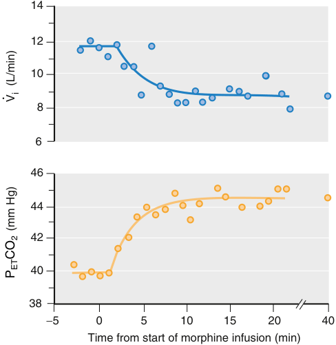

14 12 10 · 8 6 46 44 42 40 38 −5 0 5 10 15 20 40 Time from start of morphine infusion (min)   (L/min)Vi  (mm Hg) COPET2 

**Fig. 22.19 Effects of morphine on spontaneous ventilation in humans.** Morphine administration (bolus dose of 100 mcg/kg given at the start of the infusion [0 min], followed by a continuous infusion of 30 mcg/kg/h) suppressed resting inspired minute ventilation (V&#95;.&#95; i), and increased resting pressure of end- tidal carbon dioxide (PETCO2) in a single subject. A one- component exponential was fitted to the data. The estimated time constant for the V˙ i data is 3.0 min and for PETCO2 data is 2.6 min. The time delays are between 1 and 2 min. (From Sarton E, Teppema L, Dahan A. Sex differences in morphine- induced ventilatory depression reside within the peripheral chemoreflex loop. _Anesthesiology._ 1999;90:1329–1338.)

the research have been tried. By the use of knockout mice and pharmacologic approaches, G- protein- gated inwardly rectifying K channels were shown to contribute to respiratory depression by μ- opioid receptors and opioids.242 A major component of the excitatory synaptic drive necessary for respiratory rhythmogenesis and activation of respiratory motoneurons is mediated by the amino- 3- hydroxy- 5- methyl- 4- isoxazolepropionate (AMPA) type of glutamate receptors.243 This finding has led to investigations of ampakine (positive modulators of AMPA receptors) therapy to alleviate opioid- induced respiratory depression.244 5- HT released from the raphe nuclei potently alters the excitability of respiratory motoneurons in preBötC and other brainstem respiratory nuclei, and the activation of 5- HT1A receptors with befiradol alleviated fentanyl- induced respiratory depression in rats.245 In healthy humans, GAL021, a calcium- activated potassium (BKCa) channel blocker possessing a stimulatory effect on ventilation at the carotid bodies, was preliminarily shown to reverse alfentanilinduced respiratory depression.246 It was recently reported that esketamine effectively countered remifentanil- induced respiratory depression in healthy volunteers. Esketamine seems to increase the ventilatory CO2 chemosensitivity, which was reduced by remifentanil.247

### Factors Affecting Opioid- Induced Respiratory Depression

Many factors affect the magnitude and duration of opioidinduced respiratory depression (Box 22.2). Opioids should be carefully administered to older patients, because they are more sensitive to the respiratory- depressant effect of opioids and experience higher plasma concentrations of opioids administered on a weight basis, compared with young patients. In addition, morphine can produce greater respiratory depression on a weight basis in neonates than adults, because morphine easily penetrates the brain of neonates and infants through incomplete blood– brain barriers.

The respiratory- depressant effects of opioids are increased and/or prolonged when these drugs are administered with other CNS depressants, including potent inhaled anesthetics, alcohol, barbiturates, benzodiazepines, most intravenous sedatives, and hypnotics. However, droperidol, scopolamine, and

### Box 22.2 Factors Increasing the Magnitude and/or Duration of Opioid- Induced Respiratory Depression

High dose Sleep Neonate Old age Central nervous system depressant Inhaled anesthetics, alcohol, barbiturates, benzodiazepines Hyperventilation, hypocapnia Respiratory acidosis Hyperoxia Decreased clearance Reduction of hepatic blood flow Renal insufficiency Pain

<!-- PDF page 26 -->

clonidine do not enhance the respiratory-depressant effects of fentanyl or other opioids. Curiously, Setnik and associates observed a decrease in PETCO2 when 0.7 g/kg ethanol was administered in addition to 80 mg oral morphine in healthy males, suggesting a stimulatory effect of ethanol on opioidinduced respiratory depression.248 In contrast, it was reported that ethanol (1 g/L of breath ethanol concentration) caused a significant increase in the apneic events and potentiation of PETCO2 increase, which were induced by 20 mg oxycodone orally administered in opioid- naive healthy volunteers.249

Although the opioid action is usually dissipated by redistribution and hepatic metabolism, rather than by urinary excretion, the adequacy of renal function may influence the duration of opioid activity and respiratory depression by opioids. In renal insufficiency, the respiratory depressant properties of morphine and hydromorphone, as well as of the morphine metabolite M6G, become evident as these substances accumulate.

Opioid- induced respiratory depression can be affected by the patient’s original respiratory status. Hypocapnic hyperventilation enhances and prolongs postoperative respiratory depression after fentanyl (10 and 25 mcg/kg). Possible explanations for these findings include increased brain opioid penetration (increased un- ionized fentanyl with hypocarbia) and decreased removal (decreased cerebral blood flow with hypocarbia). Thus, in patients who hyperventilate because of anxiety or pain, even small doses of intravenous opioids can result in transient apnea because of acute shifts in apneic thresholds. Intraoperative hypercarbia can produce the opposite effects. Respiratory depression by remifentanil (50 mcg infused over 60 seconds) was more pronounced in hyperoxia (inhaling 50% O2) than normoxia as determined by minute ventilation, PETCO2, and respiratory rate.250 During hyperoxia, respiratory depression may be masked when measuring oxygen saturation (SpO2), as pulse oximetry remains in normal values during the first minutes of respiratory depression.

All opioid agonists with a longer plasma half- life than naloxone have a hypothetical potential to show renarcotization with time, especially when a bolus dose of naloxone is used to treat opioid- induced respiratory depression.

Overall, opioids exert their primary respiratory depressant effects through μ- receptor activation in the brainstem respiratory center, although other pathways may be involved. Dose- dependent opioid respiratory depression increases the apneic threshold and reduces the respiratory stimulatory drive of CO2 and hypoxia. Research efforts to block or reverse opioid- induced respiratory depression are ongoing and include a focus on AMPA, 5- HT1A, and calcium- activated potassium channels. The μ- receptor antagonist naloxone continues to be the most commonly used clinical intervention to reverse opioid- induced respiratory depression; however, its effectiveness may be limited if the administered opioid has a greater binding affinity and/ or longer half- life than naloxone, and naloxone can induce severe pain by blocking the analgesic effect of opioid.

## Cardiovascular Effects of Opioids

Numerous reports have demonstrated that large doses of opioid, administered as the sole or primary anesthetic, result in hemodynamic stability throughout the operative period.

Multiple mechanisms are involved in the ability of opioids to provide perioperative cardiovascular stability: reduce sympathetic tone and enhance parasympathetic activity, often producing bradycardia but not tachycardia; minimally change cardiac contractility; function generally as an antiarrhythmic; potentially function as cardioprotective agents to reduce the effect of ischemia by mimicking preconditioning pathway; have no significant effect on the coronary circulation; produce modest vascular smooth muscle relaxation with the exception of a morphine- induced hypotension mediated by histamine release; reduce the surgical stress response through the nervous system and adrenal– pituitary axis – depending on the opioid class.

### NEUROLOGIC MECHANISMS

Key areas of the brainstem that integrate cardiovascular responses and maintain cardiovascular homeostasis are the nucleus solitarius, the dorsal vagal nucleus, the nucleus ambiguous, and the parabrachial nucleus. The nucleus solitarius and parabrachial nucleus, where enkephalincontaining neurons and opioid receptors are distributed, play an important role in the hemodynamic control of vasopressin secretion. The ventrolateral PAG region, a key central site mediating opioid analgesia, also affects hemodynamic control.251 Direct administration of μ- agonists into the CNS of rats most commonly, but not always, produces hypotension and bradycardia.252 In addition, opioids can modulate the stress response through opioid receptormediated actions on the hypothalamic–pituitary–adrenal axis. As a result, most systemically administered opioids reduce sympathetic and enhance vagal and parasympathetic tone. Accordingly, patients who are volume depleted, or individuals depending on high sympathetic tone or exogenous catecholamines to maintain cardiovascular function, are predisposed to hypotension after opioid administration. The predominant and usual effect of opioids on heart rate is bradycardia resulting from stimulation of the central vagal nucleus. Blockade of sympathetic actions may also play a role in opioid- induced bradycardia.

### CARDIAC MECHANISMS

The direct cardiac actions of opioids, in particular the effects on myocardial contractile mechanisms, are significantly less pronounced than those of many other intravenous and inhaled anesthetics. However, it is clearly shown that opioid receptors actually exist in cardiac myocytes of several species.253

### Contractility

Opioids have experimentally been shown to affect myocardial contractility, but clinical reports on their effects on contractility are scarce. Morphine decreases Ca2+ transients and enhances myofilament Ca2+ sensitivity through the action on the δ1- opioid receptor expressed in the guinea pig heart.254 In rabbit ventricular myocytes, morphine prolonged action potential duration by increasing L- type Ca2+ current, an effect mediated by δ- and κ- opioid receptors, and hyperpolarized cardiac resting membrane potential by increasing the inwardly rectifiying K+ current, which is not mediated by opioid receptors.255 Regarding the effect of

<!-- PDF page 27 -->

morphine on the contractility, investigators demonstrated that morphine decreased the isometric force of contraction in atrial muscles from nonfailing and failing human hearts through a naloxone- insensitive mechanism.256 Fentanyl produces little or no change in myocardial contractility in dogs,257 and most hemodynamic variables usually remain unchanged after large doses of fentanyl. Alfentanil, at concentrations achieved in clinical practice, increases contraction in ventricular cells by a mechanism involving an increase in the sensitivity of the contractile apparatus to Ca2+ .258 The negative inotropic effect of tumor necrosis factor- α (TNF- α) and interleukin- 1β (IL- 1β) on rat ventricular myocytes caused by disruption of sarcoplasmic reticulum Ca2+ handling and Ca2+ transient was reported to be ameliorated by alfentanil, but this response may not be mediated by opioid receptors.259 A study using transthoraic echocardiography demonstrated that continuous targetcontrolled infusion of remifentanil (target effect- site concentration 2 ng/mL, infusion rate 0.08–0.09 mcg/kg/min) did not affect systolic and diastolic left ventricular function in young healthy subjects during spontaneous breathing.260 A prospective observational study of 30 patients with ischemic heart disease undergoing echocardiographic imaging before and after bolus sufentanil 1.5–2.0 mcg/kg demonstrated that sufentanil preserves hemodynamic parameters as well as echocardiographic indices of left ventricular systolic and diastolic function.261

### Cardiac Rhythm Conduction

Opioid- induced bradycardia is primarily mediated by the CNS. However, there have been reports on direct effects of opioids on cardiac rhythm conduction. A recent review reported that many of the commonly prescribed opioid medications can uniquely affect ECG, and can lead to the development of various cardiac arrhythmias.262 One of the most significant side effects of these drugs is QTc interval prolongation in ECG, especially when administered to patients with a baseline risk for QTc prolongation. A prolonged QTc interval can cause lethal torsades de pointes and ventricular fibrillation. It has been reported that methadone can increase the risk of prolongation of the QTc interval.263 During induction of anesthesia in patients undergoing coronary artery bypass graft surgery, the QT interval increased significantly after the injection of fentanyl.264 However, pretreatment with fentanyl 2 mcg/kg or remifentanil 1 mcg/kg significantly attenuated QTc prolongation associated with laryngoscopy and tracheal intubation during propofol or sevoflurane induction.265,266 Both sufentanil and alfentanil have been demonstrated to be devoid of electrophysiologic effects on the normal or accessory pathways in patients with Wolff–Parkinson– White syndrome.267,268 Clinically, cardiac conduction disturbances attributable to opioids are not frequently observed, but may be more likely to occur in the presence of Ca2+ channel or β- adrenergic blockers.

### Coronary Circulation and Myocardial Ischemia

Opioids appear to have no significant effect on coronary vasomotion or myocardial metabolism, do not produce steal phenomena, nor diminish the ability of large coronary arterioles to respond to vasoactive agents.269 Coronary conductance is regulated by arterial baroreflex control, and

vasodilator response is induced by a rise in aortic pressure. In dogs, the baroreflex control of coronary artery conductance was enhanced by low plasma concentration of fentanyl (1–2 ng/mL), but appears to be depressed at increased concentrations of fentanyl.270

Determining the effects and consequences of opioid action on myocardial ischemia is complex, because results can depend on a variety of factors including the species studied and experimental design. Opioids can mimic ischemic preconditioning, and opioid receptor stimulation results in a reduction in infarct size similar to that produced by ischemic preconditioning in rats.271 Although the preconditioning effect of opioids is mediated mainly by the cardiac κ- and δ- opioid receptors in rats,272 part of the protective effect of remifentanil may be produced by μ- agonist activity outside the heart.273 Preconditioning with small doses of intrathecal morphine can provide comparable cardioprotection to myocardial ischemic preconditioning and preconditioning with intravenous morphine in rats, and the effect seems to involve μ- , δ- and κ- opioid receptors.274 Late preconditioning, in which cardioprotective effects can be observed 24 hours after drug administration, was also produced by morphine- induced activation of the opioid receptor in rat hearts.275

Remote preconditioning by brief ischemia of other distant organs, such as intestine, kidney, and limb, similarly provides cardioprotection that is as effective as classic ischemic preconditioning. The myocardial κ- opioid receptors were demonstrated to mediate remote preconditioning by femoral artery occlusion.276 Brief cycles of myocardial ischemia and reperfusion during the early phase of reperfusion protect the heart from infarction. This phenomenon, termed postconditioning, was shown to be induced by activation of the δ- opioid receptor in rat heart.277 Volatile anesthetics may also be capable of producing protection against ischemic injury when administered solely on reperfusion. This isofluraneinduced postconditioning in rabbits can be enhanced by morphine through the activation of phosphatidyl- 3- kinase and opioid receptors.278 It has been shown that brief exposure to exercise (1 to 3 days of moderate- intensity exercise) preconditions the heart against tissue injury and death resulting from myocardial ischemia–reperfusion. It was demonstrated that endogenous opioids produced in the heart mediate exercise- induced cardioprotection against ischemia–reperfusion injury through its action on the δ- opioid receptor in rats.279 Involvement of adenosine A1 receptor and protein kinase C in the cardioprotective effect of opioids was also suggested.280,281

Whether the experimental results showing protective effects of opioid against myocardial ischemia can translate into reductions in morbidity and mortality in patients with coronary artery disease has yet to be established by clinical trials. Clinically, opioid- based anesthesia might be beneficial for coronary artery bypass graft surgery because high doses of opioids can maintain myocardial perfusion and the O2 supply–demand ratio as well or better than can inhalation- based techniques. While there have been relatively few clinical trials of cardioprotection using opioid receptor agonists, pretreatment with morphine and remifentanil showed beneficial effects in postoperative cardiac troponin release after surgical ischemia–reperfusion and angioplasty.282

<!-- PDF page 28 -->

### Circulatory Reflexes

In an experiment examining baroreceptor reflex responses induced by perfusion of the carotid sinus in cats, baroreceptor reflexes were well preserved by moderate doses of fentanyl while high doses of fentanyl depressed baroreceptor reflexes.283 The oculocardiac reflex, which is caused by traction of extraocular muscles during strabismus surgery, was significantly augmented by fentanyl, sufentanil, and remifentanil.284

### VASCULAR MECHANISMS

Pharmacologic studies demonstrated direct peripheral vessel smooth muscle relaxation by alfentanil, fentanyl, and sufentanil in the dog, but a precise mechanism was not clarified.285,286 A supraclinical dose of alfentanil attenuated the phenylephrine- induced contraction via an inhibitory effect on Ca2+ influx by blocking the voltage- dependent L- type Ca2+ channels in the rat aortic vascular smooth muscle.287 Measurement of forearm blood flow after infusion of sufentanil (0.083–0.833 mcg/min) into the brachial artery in healthy volunteers indicated that sufentanil has a direct vasodilatory effect on human vascular tissue that is likely independent of a neurogenic or systemic mechanism.288

Remifentanil can cause transient instability in hemodynamic variables in the clinical setting, but this hemodynamic change may not be solely the result of autonomic or central nervous system inhibition or of centrally mediated vagal stimulation. A pharmacologic study using rat thoracic aortic rings indicated that remifentanil vasodilates by an endothelium- dependent mechanism, involving prostacyclin and nitric oxide released from the endothelium and an endothelium- independent mechanism probably mediated by the suppression of voltage- dependent Ca2+ channels.289 It was also reported that remifentanil dose- dependently inhibits L- type Ca2+ channels in human mesenteric arterial smooth muscle cells.290 In patients with a total artificial heart in which cardiac output is preload- independent, remifentanil (0.25 mcg/kg/min) induces dose- dependent and significant systemic vasodilation without significant effects on capacitance vessels,291 suggesting the presence of direct vascular effect of remifentanil in humans.

Opioids may affect the pulmonary vasculature as well as systemic circulation. It was shown that phenylephrineinduced contraction of canine pulmonary artery was primarily mediated by α1B- adrenergic receptor activation, and was attenuated by binding of fentanyl to the α1B- adrenergic receptor.292 Pharmacologic studies in cats demonstrated that sufentanil and remifentanil have potent vasodepressor activity in pulmonary vascular bed and these responses are mediated by histamine and blocked by naloxone.293,294

### OPIOIDS IN SHOCK

Opioids are often administered for patients requiring surgical intervention for the control of hemorrhage. An animal study demonstrated that pretreatment with morphine before inducing hemorrhagic shock decreased leukocyte adhesion and vascular permeability in the microcirculation of the mesenteric venule, suggesting that morphine can prevent shock- induced damages in microvasculature.295 In contrast, it has been shown that endogenous opioids

contribute to the pathophysiology of hypovolemic shock through central and peripheral sympathetic inhibition and contribute to hypotension during severe hemorrhage. Liu _et al._ reported that the selective δ- opioid receptor antagonist ICI 174,864 may be beneficial for the early management of traumatic hemorrhagic shock in rats, suggesting a pathophysiologic role of the δ- opioid receptor in hemorrhagic shock.296 A meta- analysis showed that naloxone therapy for shock was associated with statistically significant hemodynamic improvement in humans, but clinical effectiveness of naloxone in shock still remains controversial.297

## Endocrinologic Effects of Opioids and Stress Responses

Opioids can induce a variety of endocrinologic responses (Table 22.4).298 In humans, opioids generally increase growth hormone, thyroid stimulating hormone, and prolactin, and decrease luteinizing hormone, testosterone, estradiol, and oxytocin. The effects of opioids on arginine vasopressin and ACTH are conflicting. The primary endocrine disorder that results from opioid misuse is hypogonadism, particularly in males.

Hormonal and metabolic responses to the surgical invasion are often extreme and are thought to contribute to operative mortality. Opioids can reduce the stress response by modulating nociception at several levels of the neuraxis, as well as by influencing centrally mediated neuroendocrine responses. The main components of the neuroendocrine stress response are the corticotropin- releasing hormone brain centers (e.g., paraventricular hypothalamic nucleus) and the locus coeruleus– norepinephrine/autonomic nervous system. Excessively high levels of stress hormones are considered undesirable because they can promote hemodynamic instability and intraoperative and postoperative metabolic catabolism. Endogenous opioid

**Table 22.4** Summary of the Effects of Acute and Chronic Opioids on the Endocrine Systems of Animals and Humans

||**AC**|**UTE**|**CH**|**RONIC**|
|---|---|---|---|---|
|**Hormone**|**Animals**|**Humans**|**Animals**|**Humans**|
|GH|↑|↑|=|?|
|PRL|↑|↑|↑|↑/=|
|TSH|↓|↑|?|?/=|
|ACTH|↑|↓|↑/↓|↓/=|
|LH|↓|↓↓|↓|↓↓|
|FSH|=|=|=|=|
|Estradiol|↓|↓↓|=|↓=|
|Testosterone|↓|↓↓|↓|↓↓|
|AVP|↑/↓|↑/↓|↑/↓|↑/↓|
|OT|↓|↓|↓/=|↓/=|

↑, Stimulation; ↓, inhibition; ↑/↓, conflicting; ＝, no change; ?, not studied. _GH_ , growth hormone; _PRL_ , prolactin; _TSH_ , thyroid stimulating hormone; _ACTH_ , adrenocorticotropic hormone; _LH_ , luteinizing hormone; _FSH_ , follicle stimulating hormone; _AVP_ , arginine vasopressin; _OT_ , oxytocin.

From Vuong C, Van Uum SH, O’Dell LE, et al. The effects of opioids and opioid analogs on animal and human endocrine systems. _Endocr Rev_ . 2010;31:98–132.

::: details 原始表格與符號（PDF 第 28 頁）

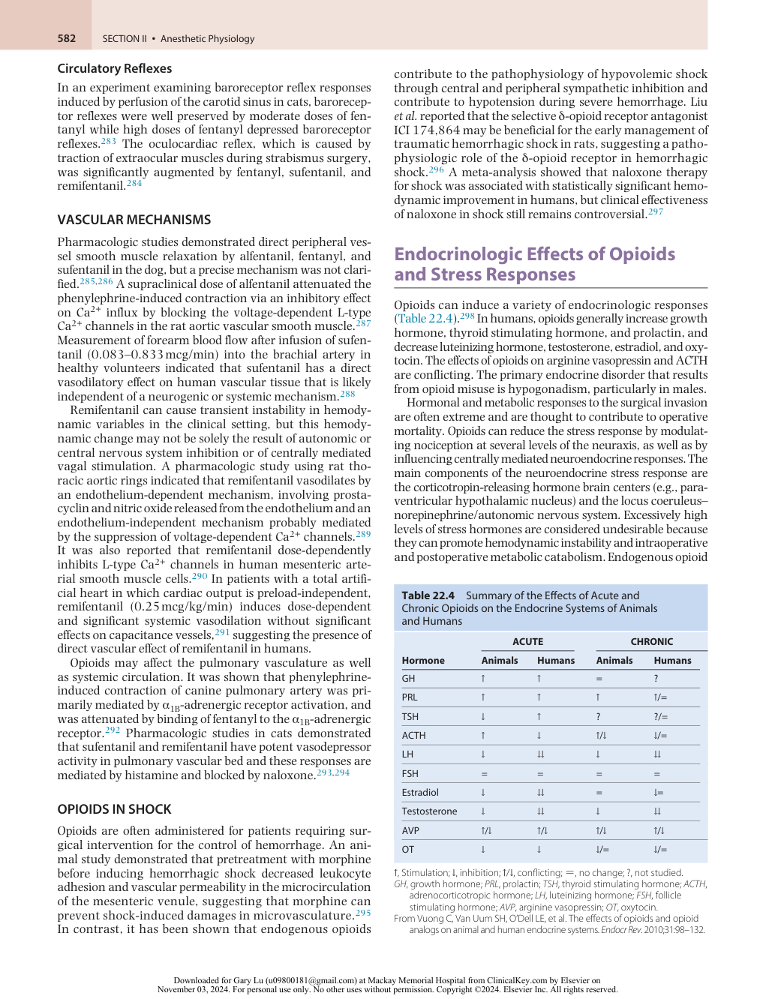

:::

<!-- PDF page 29 -->

peptides may serve as stress hormones themselves and not just as modulators of secretion of other hormones. This notion is consistent with the finding that β- endorphin, a representative opioid peptide, and ACTH, an essential stress hormone, are derived from the same precursor preproopiomelanocortin and co-secreted in response to stress.

Opioid agonists can modify hormonal responses to surgical trauma in a dose- related fashion through blockade of ACTH release, suppression of surgically induced increases in plasma cortisol, and attenuation of the pituitary–adrenal response to surgical stress. Morphine can increase some stressresponding hormones by evoking histamine release from mast cells, which can induce catecholamine release from sympathetic nerve endings and adrenal medulla. Fentanyl and its congeners are more effective than morphine in modifying hormonal responses to surgery. A randomized controlled trial showed that remifentanil (0.83 mcg/kg/min), when compared with fentanyl (total doses of 12 and 24 mcg/kg), blunts the hypertensive responses and cortisol excretion associated with cardiac surgery but is associated with more hypotension.299 It was demonstrated in coronary artery bypass grafting that remifentanil (0.25 mcg/kg/min) could attenuate increase in stress hormones (ACTH, vasopressin, epinephrine, and norepinephrine) and inflammatory mediators (IL- 6, IL- 8 and TNF- α) as compared to intermittent fentanyl (total dose 2.6 ± 0.3 mg).300 These reports indicate that opioids can efficiently control surgery- induced stress responses, which may affect patient outcomes including morbidity and mortality. It was shown that large- dose opioids (remifentanil 0.83 mcg/ kg/min or fentanyl 24 mcg/kg) were associated with lower level of cortisol secretion and a decreased rate of myocardial infarction after cardiac surgery compared with small-dose fentanyl (12 mcg/kg).299

## Effects of Opioids on Digestive Organs

### EFFECTS ON GASTROINTESTINAL TRACT

Gastrointestinal side effects still constitute a major drawback in both acute and chronic use of opioids. The adverse gastrointestinal effects of opioids include nausea, vomiting, altered fluid dynamics, inhibited gastric emptying, inhibited intestinal coordinated propulsive activity, and increased transit time, all of which may contribute to postoperative ileus (Table 22.5).301 Opioid- dependent mechanisms driving these effects are complex, and effects on gastrointestinal motility are believed to involve opioid receptors expressed throughout the myenteric plexus. Several opioid receptor types can be demonstrated on myenteric neurons, and both κ- and μ- receptor agonists regulate cholinergic transmission in the myenteric plexus. κ- Agonists appear to modulate acetylcholine release more potently than μ- agonists by inhibition of N- type voltage- dependent Ca2+ channels via a pertussis toxin- sensitive G protein in guinea pig ileum.302 In healthy volunteers, morphine (100 mcg/kg) increased the velocity but did not alter the amplitude or duration of primary peristalsis of the esophagus, and decreased the duration and magnitude of swallowing- induced lower esophageal sphincter relaxation.303 Gastric emptying is delayed by opioids, via supraspinal (vagus nerve- mediated)

and spinal, as well as peripheral, mechanisms. Intrathecal morphine (0.4 mg) significantly decreased the gastroduodenal propagation velocity and acetaminophen absorption, and intramuscular morphine (4 mg) gave additional effects.304 Tramadol (1.25 mg/kg IV) has a measurable but smaller inhibitory effect on gastric emptying compared with codeine (1 mg/kg IV) or morphine (0.125 mg/kg IV).305 Opioids administered epidurally as well as intrathecally reduce gastrointestinal motility.304 Propofol (0.3 mg/ kg bolus and 1.0 mg/kg/h) abolished the decrease of gastric tone induced by morphine (0.1 mg/kg IV), but did not abolish morphine- induced delay of gastric emptying.306 Naloxone, an opioid antagonist, reverses opioid- induced delays in gastric emptying. Methylnaltrexone (0.3 mg/kg), a quaternary naloxone derivative that does not cross the blood–brain barrier, can attenuate morphine (0.09 mg/kg)induced delays in gastric emptying in healthy volunteers, suggesting that a peripheral mechanism is involved in the opioid effect on gastrointestinal tract.307 Intravenous, but not intramuscular, metoclopramide (10 mg) also can reverse delays in gastric emptying induced by morphine (10 mg).308

### OPIOID- INDUCED CONSTIPATION

Opioid- induced constipation (OIC) is the frequent side effect in patients who are administered with opioids. OIC is common in advanced cancer patients, associated with severe distress, work productivity reduction, poor quality of life, and increased health care utilization. OIC has a complex pathophysiology that involves propulsive and peristalsis impairment, intestinal mucosal secretion inhibition, intestinal fluid absorption enhancement, and impairment of anal sphincter function.309 Naloxone methiodide suppressed the oxycodone- induced inhibition of gastrointestinal transit more potently than the inhibition induced by morphine.310 Different classes of agents for treatment of OIC, including peripherally acting μ- opioid receptor antagonists, naldemedine, naloxegol, and methylnaltrexone, have been recommended.311

**Table 22.5** Effects of Opioids on the Gastrointestinal Tract

|**Pharmacologic Action**|**Clinical Effect**|
|---|---|
|Decreased gastric motility and emptying|Decreased appetite; increased gastroesophageal reflux|
|Decreased pyloric tone|Nausea and vomiting|
|Decreased enzymatic secretion|Delayed digestion; hard, dry stools|
|Inhibition of small and large bowel propulsion|Delayed absorption of medication; straining; incomplete evacuation; bloating; abdominal distention; constipation|
|Increased fluid and electrolyte absorption|Hard, dry stools|
|Increased nonpropulsive segmental contractions|Spasms; abdominal cramps; pain|
|Increased anal sphincter tone|Incomplete evacuation|

From Viscusi ER, Gan TJ, Leslie JB, et al: Peripherally acting mu- opioid receptor antagonists and postoperative ileus: mechanisms of action and clinical applicability. _Anesth Analg_ . 2009;108:1811–1822.

::: details 原始表格與符號（PDF 第 29 頁）

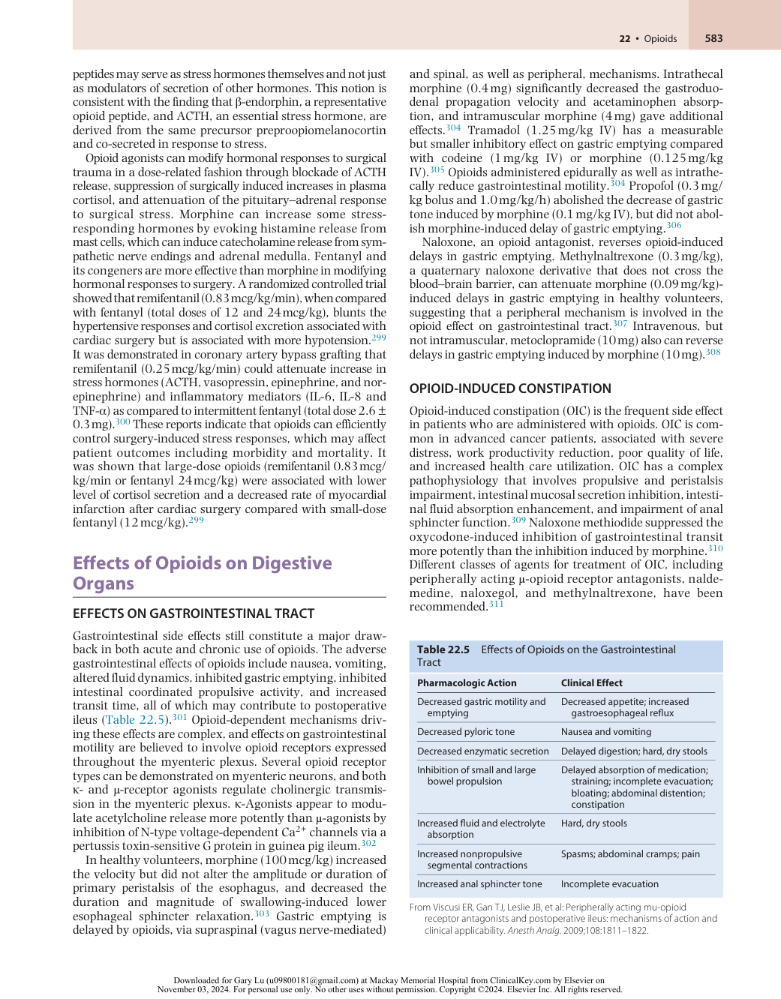

:::

<!-- PDF page 30 -->

### BILIARY AND HEPATIC EFFECTS

Opioid agonists increase biliary duct pressure and sphincter of Oddi (choledochoduodenal sphincter) tone in a dose- and drug- dependent manner through opioid receptor- mediated mechanisms. However, the clinical consequences of opioidinduced biliary tract actions are usually minimal. Although traditional teaching dictates that morphine induces “spasm” in the sphincter of Oddi and should not be used in acute pancreatitis, no studies or evidence exist to indicate morphine is contraindicated for use in acute pancreatitis.312 Increases in biliary pressure caused by opioids are reversible with naloxone. Oddi’s sphincter manometry via choledochoscope demonstrated that the regular dose of morphine could increase common bile duct pressure, whereas meperidine had no effect on Oddi’s sphincter motility and tramadol inhibited motility of the sphincter of Oddi.313 Fragen _et al._ studied the effect of remifentanil (0.1 mcg/kg/min) on the flow of dye from the gall bladder into the duodenum in healthy volunteers, and showed that remifentanil delays the drainage of dye from the gall bladder into the duodenum, but the delay is shorter than that reported after morphine or meperidine.314

Opioids produce minimal effects on liver function during anesthesia and surgery but can affect ischemia–reperfusion injury in animal experiments. Remifentanil pretreatment can attenuate liver injury induced by ischemia–reperfusion in rats, which was shown to be mediated by inducible nitric oxide synthase expression and exhausting reactive oxygen species by a mechanism independent from opioid receptors.315 Morphine administered either intravenously or intrathecally 10 minutes before 1 hour of ischemia protects against ischemia–reperfusion injury after 6 hours of reperfusion in both normal and cirrhotic rat liver by a mechanism involving the opioid receptor.316 Remifentanil significantly attenuated increases in serum aminotransferase levels and the liver histologic changes induced by ischemia–reperfusion injury of the liver in rats, by a mechanism possibly involving hepatic interleukin- 18.317 These reports might suggest the beneficial effects of opioids in anesthetic management of liver surgery, but it has not been clarified whether opioids are beneficial for the ischemia–reperfusion injury of the liver in clinical settings.

### NAUSEA AND VOMITING

Postoperative nausea and vomiting (PONV) are serious problems that severely affect patients’ well- being. Etiology, treatment, and prevention of postoperative nausea and vomiting have been extensively investigated (Fig. 22.20).318 Intraoperative use of opioids is a well- known risk factor for PONV.319 Opioids stimulate the chemoreceptor trigger zone in the area postrema of the medulla possibly through δ- receptors, leading to nausea and vomiting. Irrespective of the specific opioid administered, opioids increase the risk for PONV in a dose- dependent manner, and the effect appears to last for as long as opioids are used in the postoperative period.320

The use of propofol in balanced or total intravenous anesthesia significantly reduces the incidence of opioid- induced nausea and vomiting. When opioids are employed, antiemetic prophylaxis should be considered, which includes

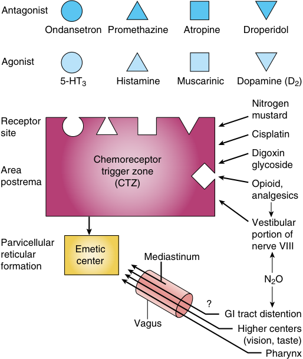

Antagonist Ondansetron Promethazine Atropine Droperidol Agonist 5-HT3 Histamine Muscarinic Dopamine (D2) Nitrogen mustard Receptor site Cisplatin Digoxin Chemoreceptor Area trigger zone glycoside postrema (CTZ) Opioid, analgesics Vestibular portion of Parvicellular Emetic nerve VIII reticular Mediastinum center formation N2O ? GI tract distention Vagus Higher centers (vision, taste) Pharynx 

**Fig. 22.20 Mechanism of nausea and vomiting induced by various anesthetic- related agents and stimuli.** Vomiting is caused by noxious stimulation of one or more of four sites: the gastrointestinal (GI) tract, the vestibular system, the chemoreceptor trigger zone (CTZ) in the area postrema of the floor of the fourth ventricle, and higher centers in the central nervous system. The CTZ lacks the blood–brain barrier, so that its chemoreceptors are stimulated by various anesthetic- related agents, including opioids. (From Watcha MF, White PF. Postoperative nausea and vomiting: its etiology, treatment, and prevention. _Anesthesiology._ 1992;77:162–184.)

anticholinergics, butyrophenones, dopamine antagonists, serotonin antagonists, and acupressure. Ondansetron, a serotonin type 3 (5- HT3) receptor antagonist, was proved to be effective for opioid- induced PONV.321 A meta- analysis concluded that prophylactic use of 5- HT3 receptor antagonists significantly reduced the incidence of PONV and the need of rescue antiemetic therapy in parturients who received intrathecal morphine for cesarean delivery.174 Nausea and vomiting after epidural morphine (3 mg) for post–cesarean section analgesia could be prevented by dexamethasone (8 mg IV) as efficiently as by droperidol (1.25 mg IV).322 Cannabinoid receptor agonists have been demonstrated to be effective antiemetics in some clinical settings. Animal experiments have shown that the cannabinoid agonist suppresses opioid- induced retching and vomiting by activation of the cannabinoid CB1 receptor,323 and the cannabinoid CB1 receptor agonist has been shown to be useful for chemotherapy- related nausea and vomiting,324 but the effectiveness of nabilone, a CB1 receptor agonist, for prevention of PONV was not demonstrated.325 Nonpeptide neurokinin NK1 receptor antagonists have demonstrated activity against both peripheral and central emetic stimuli in animal models, and rolapitant, a potent, selective NK1 receptor antagonist, was shown to be effective in reducing emetic episodes after surgery and reduces the incidence of

<!-- PDF page 31 -->

vomiting in a dose- dependent manner.326 A continuous low- dose naloxone infusion (0.25 mcg/kg/h) ameliorated some of the opioid- induced side effects, including nausea, vomiting and pruritus, in many but not all patients without adversely affecting analgesia.327 Transdermal scopolamine was shown to be effective for prophylactic use for nausea and vomiting in parturients receiving intrathecal morphine while undergoing cesarean delivery, but was associated with higher incidence of side effects such as dry mouth and blurry vision.328 Taken together, the prevention and/ or treatment of opioid- induced nausea and vomiting continues to be a clinical challenge. Strategies that include the administration of 5- HT3 receptor antagonists and/or the steroid dexamethasone show efficacy in well- controlled trials. However, such approaches require exposure to additional medications that, in themselves, may carry additional risks of side effects.

## Other Opioid Effects

### RENAL AND URODYNAMIC EFFECTS OF OPIOIDS

Opioids can significantly affect renal function by their effects on the central nervous system. Studies in different experimental animal species and in humans indicate that κ- opioid receptor agonists decrease vasopressin secretion and release from the hypothalamus and posterior pituitary, and decrease response to vasopressin in kidneys.329 However, the absence of increases in plasma vasopressin, renin, and aldosterone indicate that systemically administered fentanyl, sufentanil, alfentanil, and probably remifentanil most likely indicate that these opioids preserve or minimally affect renal function in humans. If renal function does change during opioid anesthesia and surgery, it is probably due to secondary changes in systemic and renal hemodynamics.

Opioid effects on the lower urinary tract include disturbances of micturition characterized by urinary retention, especially after intrathecal opioid administration. Intrathecal administration of morphine and sufentanil in healthy male volunteers caused dose- dependent suppression of detrusor contractility and decreased sensation of urge.330 Mean times to recovery of normal lower urinary tract function were 5 and 8 hours after 10 or 30 mcg sufentanil and 14 and 20 hours after 0.1 or 0.3 mg morphine, respectively, indicating that the recovery time is also dose dependent. Malinovsky _et al._ compared urodynamic effects of intravenously administered morphine (10 mg), buprenorphine (0.3 mg), fentanyl (0.35 mg), and nalbuphine (20 mg) before anesthesia for endoscopic extraction of a ureteral stone.331 It was shown that all of the opioids altered bladder sensations, but that detrusor contraction decreased only after administration of fentanyl and buprenorphine, suggesting that not all opioid agonists behave similarly. Urinary retention induced by intravenous infusion of remifentanil (0.15 mcg/kg/min) could be reversed by a single intravenous dose of methylnaltrexone 0.3 mg/kg or naloxone 0.01 mg/kg.332 Reversal of urinary retention by methylnaltrexone indicates that peripheral mechanisms may play a role in opioid- induced bladder dysfunction.

A retrospective study for adult patients with chronic kidney disease undergoing orthopedic surgery showed that

glomerular filtration rate during the postoperative period was significantly higher in the group in which remifentanil was used (average infusion dose 0.17 ± 0.08 mcg/kg/ min) for anesthesia management than the group in which remifentanil was not used. This finding may suggest that anesthesia management using remifentanil may have a renal protective effect in adult patients with chronic kidney disease.333

### PERINATAL OPIOID EFFECTS AND OBSTETRICS

Opioid use by women during pregnancy has risen dramatically since 2004. Newborns of mothers with opioid use disorder (OUD) or taking prescription opioids can exhibit opioid withdrawal. This is often referred to as neonatal abstinence syndrome (NAS) and requires appropriate treatment and observation,334,335 and opioid- induced birth defects are a concern.

Teratogenic actions of opioids, at least in animal models, appear to be minimal,336 but the impact of prenatal opioid exposure on fetal neurodevelopment are largely unknown. In a study of buprenorphine- maintained OUD women, maternal buprenorphine administration has acute suppressive effects on fetal heart rate and movement, and the magnitude of these effects increases as gestation progresses.337 In an animal experiment, when female mice were treated with oxycodone before mating and switched to buprenorphine to mimic OUD in humans,338 reduced cortical thickness, altered corticogenesis, and ventriculomegaly were found in fetal brain, and adolescent offspring exposed to maternal opioid use during pregnancy exhibited hyperactivity in late adolescence, providing critical evidence of effects of opioid use during pregnancy on neurodevelopment of the offspring. Thus, the possibility of impact of prenatal exposure to high- dose opioids on fetal neurodevelopment cannot be excluded.

Opioids are commonly used for analgesia in vaginal and cesarean delivery, but should be carefully administered. Nociception due to uterine cervical distention could be suppressed by μ- and κ- agonists in rats,339 but the analgesic effect of μ- agonist but not κ- agonist was reduced by estrogen.340 To minimize transfer of opioids to fetus and neonatal adverse effects, fetal acidosis should be avoided, because fetal acidosis can increase opioid transfer from the mother, and opioid administration during the first stage of labor should be restricted. The short- acting opioid alfentanil administered before cesarean delivery attenuated the maternal stress response, but led to slightly reduced Apgar score.341 In a randomized, double- blind, controlled study, it was shown that a single bolus of 1 mcg/kg remifentanil administered to patients undergoing elective cesarean delivery effectively attenuated hemodynamic changes after induction and tracheal intubation, but remifentanil crosses the placenta and may cause mild neonatal depression.342

Because the fetus is capable of pain perception after the 26th week of gestation, adequate postoperative fetal pain management is essential after fetal surgery. It was shown that the sheep fetus absorbs sufentanil after intra- amniotic instillation, and that significantly greater plasma concentrations were obtained in the fetal lamb as compared with the mother sheep,343 suggesting that investigation of intraamniotic opioids for fetal analgesia might be promising.

<!-- PDF page 32 -->

Breastfeeding can expose the infant to opioids administered to the mother through milk. Exposure of the infant to the drug administered to the mother can be estimated by relative infant dose (RID), a weight- adjusted time- averaged (e.g., daily) dose of drug in milk ingested by the infant, expressed as a percentage of the time- averaged maternal therapeutic dose on a body weight basis. RID of opioids are reported to be 0.4%–3%, implying that opioid use for pain management during labor and delivery are almost compatible with breastfeeding.344 However, variations in pharmacokinetics in mother and infant can cause serious risks to the infant. Thus, opioid use by the mother during breastfeeding should be limited to 2–3 days for acute pain management.

### HISTAMINE RELEASE AND ANAPHYLACTOID REACTIONS

It is well known that morphine causes histamine release in an opioid receptor- independent mechanism leading to sympathoadrenal activation. It was recently demonstrated that morphine activates a G- protein- coupled receptor, MRGPRX- 2, expressed in mast cells, resulting in mast cell degranulation and histamine release.345 Increases in plasma histamine after morphine cause dilation of terminal arterioles and direct positive cardiac chronotropic and inotropic actions. In patients pretreated with both H1- and H2- antagonists, the cardiovascular responses are significantly attenuated despite comparable increases in plasma histamine concentrations. Codeine and meperidine are examples of other opioids that can induce mast cell activation with the release of histamine and tryptase probably by a mechanism other than the μ- opioid receptors.346 Unlike morphine or meperidine, fentanyl, alfentanil, sufentanil, and remifentanil do not produce increases in plasma histamine, and subsequent hypotension is less frequent with their administration.

True allergic reactions and systemic anaphylactoid reactions to opioids are rare.347 More commonly, local reactions caused by preservatives may occur. In 32% of heroin addicts dying suddenly after injection, the concentration of tryptase was elevated (>10 mcg/L), but no correlation was found between the immunoglobulin E (IgE) levels and tryptase, supporting the hypothesis that mast cell degranulation was not mediated by allergic reaction.348 This report suggests that heroin fatalities may be in part driven by anaphylactoid reaction.

### OCULAR EFFECTS

The use of opioids during induction of anesthesia can help to prevent increases in intraocular pressure. Remifentanil (1 mcg/kg) combined with propofol (2 mg/kg) or thiopental (5 mg/kg) was reported to be effective for prevention of intraocular pressure change after succinylcholine and tracheal intubation.349,350 In patients undergoing elective non- ophthalmic surgery, the intraocular pressure decreased from 13.6 ± 2.6 to 7.1 ± 3.1 mm Hg in the remifentanil group (0.25–0.5 mcg/kg/min) and from 13.7 ± 2.2 to 9.7 ± 3.4 mm Hg in the fentanyl group (2–5 mcg/ kg).351 Thus, opioids can be used to perioperatively control intraocular pressure, and can be used in patients with glaucoma.

### IMMUNE EFFECTS

Opioids can affect immune function through adaptive immunity, innate immunity, and the neuroendocrine system (Box 22.3).352 Studies on the function of opioid receptors (μ, δ, and κ) present on immune cells suggest a complex relationship between clinically used opioids and immune function, including through indirect mechanisms. However, because the μ- opioid receptor knockout mice showed no immune modulatory effects after systemic administration of morphine, the immune modulatory effect of morphine is mediated by μ- opioid receptors.353

Many reports have been published on the effects of opioids on immune functions and inflammatory responses in animal experiments and clinical cases with some controversial results. It was shown that the maximal suppression

### Box 22.3 Opioid Effects on Immunity

### Adaptive immunity

- ↓  Splenic and thymic weight (rodents)

- ↓  T- cell viability and proliferative response

- ↓  T- helper cell function

- ↓  CD4/CD8 population _in vivo_

- ↓  IL1β, IL- 2, TNF- α and IFN- γ (mouse splenocytes)

- ↓  Th1/Th2 ratio of T- helper cell population (PBMCs)

- ↓  NK-cell activity

- ↓  Primary antibody response (B- cells)

- ↓  B- cell mitogenic response to bacterial LPS

- ↓  Macrophage activity

- ↓  TGF- β1 and IL- 10 (anti- inflammatory cytokines)

- ↑  T- cell apoptosis (NF- κB and AP- 1/NFAT pathways) Inhibition of CD3/28 mAb induced IL- 2 transcripts

### Innate immunity

- ↓  Number of macrophages available to fight infections

- ↓  Leukocyte migration

- ↓  Peritoneal macrophages phagocytosis

- ↓  Respiratory burst activity and chemotaxis Inhibition of Fcγ receptor mediated phagocytosis

- ↓  Superoxide production from neutrophils and macrophages Alteration of IL- 8 induced neutrophil chemotaxis

- ↓  Neutrophil cytokines involved in wound healing

- ↑  Apoptosis of macrophages impairing host defense barrier

- ↓  Leukocytes endothelial adhesion (intracellular adhesion molecules expression)

### Neuroendocrine system

- ↑  Growth hormone, prolactin, and thyroid stimulating hormone secretion in humans

- May affect the function of the HPA axis (ACTH and CRH) with risk of adrenal insufficiency

- ↓  Sex hormones [LH and testosterone (hypogonadism)], oxytocin, and estradiol

- _ACTH_ , adrenocorticotropic hormone; _AP- 1_ , activator protein 1; _CRH_ , corticotropin releasing hormone; _Fc_ , fragment crystallizable region; _HPA_ , hypothalamic–pituitary–adrenal axis; _IFN- γ_ , interferon- gamma; _IL_ , interleukin; _LH_ , luteinizing hormone; _LPS_ , lipopolysaccharides; _NF- κB_ , nuclear factor κB; _NFAT_ , nuclear factor of activated T- cells; _NK_ , natural killer; _PBMC_ , peripheral blood mononuclear cell; _TGF- β_ , transforming growth factor-β; _TNF- α_ , tumour necrosis factor- α.

- From Al- Hashimi M, Scott SW, Thompson JP, et al. Opioids and immune modulation: more questions than answers. _Br J Anaesth._ 2013;111:80–88.

<!-- PDF page 33 -->

of natural killer (NK)- cell activity, proliferation of splenic T- and B- cells and interferon- γ production are observed 0.5–1 hour after 15 mg/kg morphine injection in rats.354 Postoperative administration of morphine (10 mg intramuscular [IM]) did not significantly affect the NK- cell activity, while tramadol (100 mg IM) enhanced NK- cell activity.355 Narahara reported that the long- term postoperative administration of fentanyl (total dose 4.0 mg) in the intensive care unit suppressed natural killer cell cytotoxicity, but lymphocyte subsets and plasma levels of TNF- α, IL- 1β, IL- 6, and IL- 10 were not significantly affected.356 In contrast, It was reported that intravenously administered fentanyl (initial dose of 3 mcg/kg followed by a 2- h IV infusion of 0.02 mcg/kg/min) causes a rapid increase in NK- cell cytotoxicity, which was coincident with an increase in the percentage of CD16+ and CD8+ cells in peripheral blood.357 Compared with fentanyl (1000 mcg), administration of morphine (40 mg) as part of balanced anesthetic technique suppressed several components of the inflammatory response (IL- 6, CD11b, CD18, postoperative hyperthermia) to cardiac surgery and cardiopulmonary bypass.358 Several reports showed features of remifentanil in the effects on inflammatory or immune responses. With respect to the effects on neutrophils, it was reported that remifentanil, but not sufentanil, alfentanil, or fentanyl, could attenuate activation of human neutrophils exposed to lipopolysaccharides, and decreased activation of intracellular signaling pathways, including p38 and ERK1/2, and expression of proinflammatory cytokines, including TNF- α, IL- 6, and IL- 8, through a mechanism involving the κ- opioid receptor.359 It was also reported that remifentanil attenuates lipopolysaccharide- induced acute lung injury in rats by inhibition of proinflammatory cytokine production by downregulating the nuclear factor  κB (NF- κB) pathway, suggesting a beneficial effect of remifentanil in acute lung injury or acute respiratory distress syndrome in sepsis.360 A prospective study for adult patients who underwent elective colorectal surgery demonstrates that the number of patients who developed surgical site infection was higher after remifentanil- based anesthesia (11.6%) compared with fentanyl- based anesthesia (3.4%).361 A possible reason for the difference in the incidence of surgical site infection may be due to the difference in immunosuppression between fentanyl and remifentanil, but the significance of the finding remains to be explored.

### CANCER PROGRESSION

Epidemiologic studies have suggested that patients who receive general anesthesia with opioids have a greater rate of cancer recurrence than patients who receive local anesthetics.362 A recent study compared cancer incidence between patients with chronic pain with and without opioid use, and reported that multivariate regression of more than 63,000 propensity score- matched patients with chronic pain showed an adjusted hazard ratio of 2.66 for cancer occurrence in the long- term opioid use group.363

Opioids may directly stimulate proliferation and invasion of tumor cells and inhibit apoptosis of tumor cells, or indirectly affect cancer recurrence by immunosuppression.364 Overexpression of the μ- opioid receptor in human non–small cell lung cancer was suggested to promote

tumor growth and progression.365 Furthermore, it was reported that women possessing the μ- opioid receptor of A118G genotyope, with reduced function compared to the wild- type μ- opioid receptor, have decreased breast cancer– specific mortality, suggesting that opioid pathways may be involved in promoting tumor growth.366 Opioids may promote tumor growth and metastasis through multiple mechanisms, whereas it is also reported that opioids can direct various anticarcinogenic pathways (Fig. 22.21).367 Preclinical data have suggested that μ- opioid receptor inhibition can reverse the stimulatory effect of μ- opioid receptor on cancer progression, and it was hypothesized that a combination of methylnaltrexone, which blocks peripheral μ- opioid receptor, and chemotherapy may be useful for cancer therapy while maintaining CNS- mediated analgesic effect of opioids.368

One of the mechanisms involved in the effects of opioids on cancer prognosis is their effects on angiogenesis. Morphine can stimulate angiogenesis by a variety of mechanisms involving nitric oxide, mitogen-activated protein kinase (MAPK), vascular endothelial growth factor (VEGF), and Rho/Rho kinase.369 In contrast, Blebea _et al._ reported that activation of opioid receptors inhibited angiogenesis, via endogenous opioid ligands.370 Although both pro- and antiangiogenic actions of opioids have been reported, it is generally believed that the proangiogenic (or neovasculogenic) effects predominate.

### WOUND HEALING

It was shown that the μ- and δ- opioid receptors expressed in keratinocytes participate in skin homeostasis, wound healing is delayed in δ- receptor knockout mice, and overstimulation of μ- , δ- and κ- opioid receptors can trigger the formation of hypertrophic scars.371 The opioid receptors in the peripheral nervous system can also affect cell differentiation, migration, and adhesion in the skin. Activation of peripheral opioid receptors on primary afferent neurons reduces the excitability of these neurons and suppresses the antidromic release of substance P and calcitonin generelated peptide, which play an essential role in wound repair.

Considering the roles played by the opioid receptors in the skin, it might be possible to control wound healing as well as pain by topical administration of opioids. It was shown that topical morphine application significantly reduced the number of myofibroblasts and macrophages in the closing wound, resulting in decreases in skin thickness and an increase in residual scar tissue in healed skin in rats.372 These findings might limit the topical application of opioids as an analgesic therapeutic strategy in the treatment of painful cutaneous wounds. In contrast, it was shown that activation of the δ- opioid receptors destabilizes intercellular adhesion and promotes the migratory keratinocyte phenotype, which is required for fast wound closure.373 If these divergent findings can be resolved in favor of wound healing and enhanced localized analgesia, there is great potential for topical opioid applications in wound healing. Most clinical studies have not focused on opioid effects on the wound healing process, but it has been reported that topical application of opioids can produce substantial analgesic effects with facilitation of wound healing.374

<!-- PDF page 34 -->

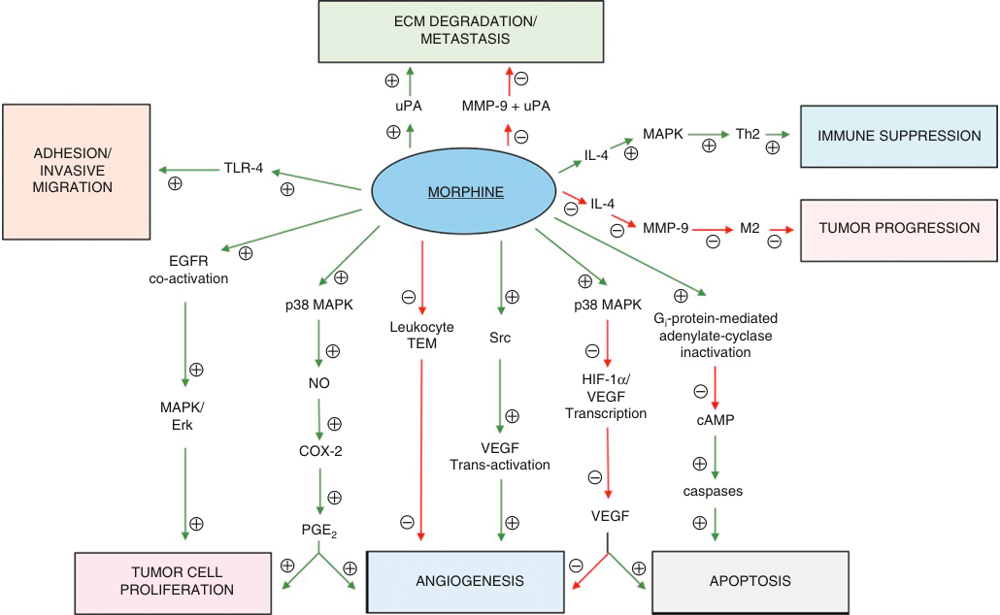

ECM DEGRADATION/ METASTASIS ⊕ – uPA MMP-9 + uPA ⊕ – MAPK Th2 IMMUNE SUPPRESSION ADHESION/ IL-4 ⊕ ⊕ ⊕ INVASIVE TLR-4 MIGRATION ⊕ ⊕ MORPHINE – IL-4 – MMP-9 M2 TUMOR PROGRESSION EGFR ⊕ – – co-activation ⊕ ⊕ – ⊕ ⊕ p38 MAPK p38 MAPK Gi-protein-mediated Leukocyte ⊕ TEM Src – adenylate-cyclaseinactivation ⊕ NO HIF-1VEGFα/ – MAPK/ Erk ⊕ ⊕ Transcription cAMP COX-2 VEGF Trans-activation ⊕ – ⊕ caspases – VEGF ⊕ ⊕ ⊕ PGE2 – TUMOR CELL ⊕ ⊕ ⊕ ANGIOGENESIS APOPTOSIS PROLIFERATION 

**Fig. 22.21 Effects of morphine on cancer cells.** It is important to note that the same pathway can have opposing end results, depending on the morphine doses, mode of administration, and animal models used. _COX- 2_ , cyclooxygenase- 2; _ECM_ , extracellular matrix; _EGFR_ , epidermal growth factor receptor; _Erk_ , extracellular- regulated kinase; _IL_ , interleukin; _MAPK_ , mitogen- activated protein kinase; _MMPs_ , matrix metalloproteinases; _NO_ , nitric oxide; _PGE2_ , prostaglandin E2; _Src_ , non- receptor tyrosine kinase; _uPA_ , urokinase plasminogen activator; _VEGF_ , vascular endothelial growth factor; _Th2_ , T helper 2 cells; _M2_ , “alternative” activation of macrophages; _cAMP_ , cyclic adenosine monophosphate; _HIF- 1α_ , hypoxia inducible factor 1 alpha; _TLR- 4_ , toll- like receptor 4. (From Sekandarzad MW, van Zundert AAJ, Lirk PB, et al. Perioperative anesthesia care and tumor progression. _Anesth Analg_ 2017;124:1697–1708.)

## Pharmacokinetics and

## Pharmacodynamics of Opioids

With the advent of modern drug assay technology and the widespread availability of computers, it is now possible to analyze and model pharmacologic data which separates drug response into pharmacokinetic and pharmacodynamic components. Pharmacokinetic parameters govern the relationship between opioid dose and the opioid concentrations in the blood (or other body fluids). Pharmacodynamic parameters describe the relationship between opioid concentration in blood (or other fluids) and opioid effect.

Computer simulation techniques predict “contextsensitive half- times,” the time necessary to achieve a 50% decrease in drug concentration after termination of a variable- length continuous infusion to a steady- state drug level (see Chapter 23). Such simulations are intended to provide more clinically relevant meaning to pharmacokinetic parameters. The context- sensitive half- time and computer simulations have helped clinicians to select opioids and arrange their administration in a more rational fashion. After 1- hour continuous infusion, the context- sensitive half- time of fentanyl is nearly 6 times that of alfentanil or sufentanil. Remifentanil’s context- sensitive half- time is independent of infusion duration.

### PHYSICOCHEMICAL PROPERTIES

Table 22.6 depicts physicochemical properties of commonly used opioid agonists. Opioids are weak bases, and when dissolved in solution, they are dissociated into protonated and free- base fractions, with the relative proportions depending on the pH and p _K_ a. The free base fraction is more lipid- soluble than the protonated fraction. High lipid solubility facilitates opioid transport into the biophase or site of action. Therefore, highly lipid- soluble opioids have a more rapid onset of action. However, because the opioid receptor recognizes an opioid molecule in the protonated form, the intensity of opioid effects is closely related to the ionized concentration of drug in the biophase.

All opioids are to some extent bound to plasma proteins, including albumin and α1- acid glycoprotein. It is only the un- ionized, unbound fraction that constitutes the diffusible fraction and provides the concentration gradient that promotes diffusion of opioid from the blood to the tissue of interest. Thus the speed of onset of opioid effect is affected by both the lipid solubility and the protein binding.

### PHARMACOKINETIC FEATURES OF INDIVIDUAL DRUGS

Representative pharmacokinetic parameters for the opioids commonly used in anesthesia are displayed in Table 22.6.

<!-- PDF page 35 -->

**Table 22.6** Physicochemical and Pharmacokinetic Data of Commonly Used Opioid Agonists

||**Morphine**|**Fentanyl**|**Sufentanil**|**Alfentanil**|**Remifentanil**|
|---|---|---|---|---|---|
|p_K_a|8.0|8.4|8.0|6.5|7.1|
|% Un- ionized at pH 7.4|23|&lt;10|20|90|67?|
|Octanol/H2O partition coefficient|1.4|813|1778|145|17.9|
|% Bound to plasma protein|20–40|84|93|92|80?|
|Diffusible fraction (%)|16.8|1.5|1.6|8.0|13.3?|
|t1/2α(min)|1–2.5|1–2|1–2|1–3|0.5–1.5|
|t1/2β(min)|10–20|10–30|15–20|4–17|5–8|
|t1/2γ(h)|2–4|2–4|2–3|1–2|0.7–1.2|
|Vdc(L/kg)|0.1–0.4|0.4–1.0|0.2|0.1–0.3|0.06–0.08|
|Vdss(L/kg)|3–5|3–5|2.5–3.0|0.4–1.0|0.2–0.3|
|Clearance (mL/min/kg)|15–30|10–20|10–15|4–9|30–40|
|Hepatic extraction ratio|0.6–0.8|0.8–1.0|0.7–0.9|0.3–0.5|NA|

_NA_ , not applicable; p _K_ a, ion dissociation constant; _t1/2α, - β, - γ_ , half- lives of a three- compartment model; _Vdc_ , volume of distribution of the central compartment; _Vdss_ , volume of distribution at steady state. From Bailey PL, Egan TD, Stanley TH. Intravenous opioid anesthetics. In: Miller RD, ed. _Anesthesia_ . 5th ed. New York: Churchill Livingstone; 2000:312.

### Morphine

Pharmacokinetics of morphine is notably different from that of the fentanyl congeners. This difference is in large part due to morphine’s comparatively low lipid solubility. There is relatively little transient first- pass uptake of morphine by the lung. Because the p _K_ a of morphine (8.0) is greater than physiologic pH, and thus after intravenous injection only a small fraction (10%–20%) of morphine is un- ionized, penetration of morphine into and out of the brain is presumably slower compared with that of the other opioids. Approximately 20%–40% of morphine is bound to plasma proteins, mostly albumin. Because hepatic extraction ratio of morphine is high, the bioavailability of orally administered morphine is significantly lower (20%–30%) than after intramuscular or subcutaneous injection. Morphine is principally metabolized by conjugation in the liver, and the water- soluble glucuronides, morphine- 3- glucuronide (M3G) and morphine- 6- glucuronide (M6G), are excreted via kidney. The kidney also plays a role in the conjugation of morphine, accounting for nearly 40% of its metabolism.375 M3G is the major metabolite of morphine, but does not bind to opioid receptors and possesses little or no analgesic activity. M3G may actually antagonize morphine, and this effect may contribute to both variability in response and resistance to morphine analgesic therapy. M3G was reported to produce seizures in animals and cause allodynia in children.376 M6G accounts for nearly 10% of morphine metabolite and is a more potent μ- receptor agonist than morphine, with a similar duration of action. It was reported that based on area under the concentration–time curve there was a major contribution of M6G to the overall analgesic effect; the mean contributions being estimated as 96.6%, 85.6%, 85.4%, and 91.3% after oral, subcutaneous, intravenous, and rectal administration of morphine, respectively.377 In patients with renal insufficiency, 97.6% of the analgesic effect was caused by M6G when morphine was given orally. It appears that M6G is in fact the primary active compound when morphine is administered orally

(Fig. 22.22).378 In contrast to the reports suggesting the high potency of M6G, there have been reports showing that short- term intravenous administration of M6G does not provide effective analgesia.379

Especially in patients with renal dysfunction, the accumulation of M6G can lead to an increased incidence of adverse effects, including respiratory depression. M6G can induce respiratory depression similar to morphine, but the site of action in the ventilatory control system might be different between M6G and morphine.380 It was suggested that single nucleotide polymorphism A118G at the μ- opioid receptor affects the susceptibility to M6G- related opioid toxicity in patients with renal failure.381 In addition to renal function, M6G accumulation increases by probenecid, implying that M6G are transported by the probenecidsensitive transmembrane transporters, including organic anion transporter peptide, multidrug resistance- related protein, and organic anion transporter families.382

### Fentanyl

A three- compartment model is typically used to describe plasma fentanyl concentration decay. The lungs exert a significant first- pass effect and approximately 75% of injected fentanyl is transiently taken up by pulmonary endothelial cells.383 Approximately 80% of fentanyl is bound to plasma proteins, and significant amounts (40%) are taken up by red blood cells. Fentanyl is relatively long acting, and its context- sensitive half-time is longer than that of alfentanil and sufentanil, in large part because of this widespread distribution in body tissues. Opioids belonging to the phenylpiperidine class, including meperidine, fentanyl, sufentanil, alfentanil, are subject to oxidative metabolism by the CYP450 enzyme system in the liver.384 Fentanyl, in particular, is metabolized by CYP3A4/5 and its pharmacokinetics is affected by polymorphism of CYP3A4/5. Norfentanyl, which is formed by _N_ - dealkylation of fentanyl, begins to appear in the plasma as early as 1.5 minutes after injection, and is detectable in the urine for up to 48 hours in humans.

::: details 原始表格與符號（PDF 第 35 頁）

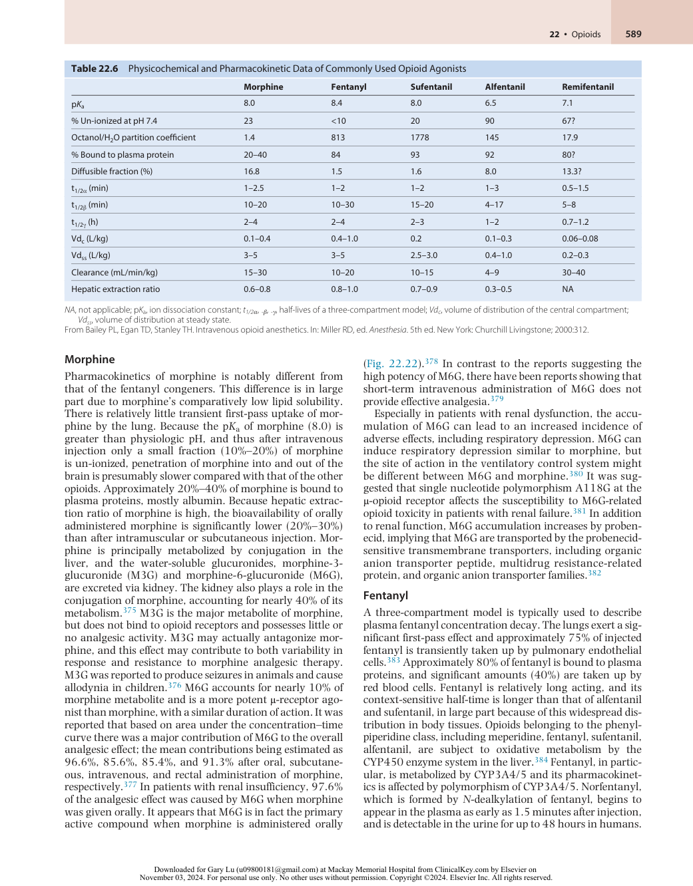

:::

<!-- PDF page 36 -->

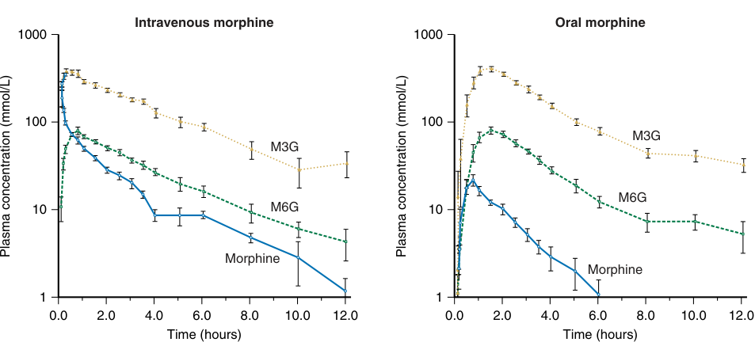

Intravenous morphine Oral morphine 1000 1000 100 100 M3G M3G M6G 10 M6G 10 Morphine Morphine 1 1 0.0 2.0 4.0 6.0 8.0 10.0 12.0 0.0 2.0 4.0 6.0 8.0 10.0 12.0 Time (hours) Time (hours) Plasma concentration (mmol/L) Plasma concentration (mmol/L) 

**Fig. 22.22 Time- dependent changes of plasma concentrations of morphine and its metabolites.** Mean plasma concentrations (± standard error of means) of morphine, morphine- 6- glucuronide (M6G), and morphine- 3- glucuronide (M3G) after intravenous (5 mg) and oral (11.7 mg) administration of morphine are plotted. (Modified from Osborne R, Joel S, Trew D, et al. Morphine and metabolite behavior after different routes of morphine administration: demonstration of the importance of the active metabolite morphine- 6- glucuronide. _Clin Pharmacol Ther._ 1990;47:12–19.)

### Alfentanil

Following IV injection, alfentanil plasma concentrations are described by either two- compartment or threecompartment models. After intravenous injection, first- pass pulmonary extraction is significantly less than that of fentanyl.383 Alfentanil is bound to plasma proteins (mostly glycoproteins) in higher proportions (92%) than fentanyl. At physiologic pH, it is mostly (90%) un- ionized because of its relatively low p _K_ a (6.5). Thus, despite more intense protein binding, the diffusible fraction of alfentanil is higher than fentanyl. This explains, in part, its short latency to peak effect after intravenous injection.

The main metabolic pathway of alfentanil is similar to those of fentanyl and includes CYP3A4/5- mediated oxidative _N_ - dealkylation.385 The degradation products of alfentanil have little, if any, opioid activity. It was reported that alfentanil is metabolized by human liver microsomal CYP3A4 as well as CYP3A5, and that CYP3A5 shows more than 20- fold pharmacogenetic variability in expression level leading to significant differences in human liver alfentanil metabolism.386 _In vitro_ study demonstrated that propofol in clinically relevant concentrations interferes with oxidative metabolic degradation of alfentanil and sufentanil in the microsomal fraction of pig and human liver.387

### Sufentanil

The pharmacokinetic property of sufentanil is adequately described by a three- compartment model. After intravenous injection, first- pass pulmonary extraction, retention, and release are similar to those of fentanyl.388 The p _K_ a of sufentanil at physiologic pH is the same as that of morphine (8.0), and, therefore, only a small amount (20%) exists in the un- ionized form. Sufentanil is twice as lipid- soluble as fentanyl and is highly bound (93%) to plasma proteins including α1- acid glycoprotein.

The major metabolic pathways of sufentanil include CYP3A4/5- mediated oxidative _N_ - dealkylation.384 It was reported that CYP3A4 genetic polymorphism correlated

with sufentanil consumption in parturients undergoing cesarean delivery.389

### Remifentanil

Remifentanil constitutes the first ultra- short- acting opioid for use as a supplement to general anesthesia due to its rapid degradation. Although chemically related to the fentanyl congeners, remifentanil is structurally unique because of its ester linkages. Remifentanil’s ester structure renders it susceptible to hydrolysis by blood- and tissue- nonspecific esterases, resulting in rapid metabolism and rapid reduction of blood concentration after the infusion has stopped390 (Fig. 22.23). Because remifentanil is not a good substrate for pseudocholinesterase, metabolism of remifentanil is not influenced by pseudocholinesterase deficiency.391

Pharmacokinetic property of remifentanil is best described by a three- compartment model. Its clearance is several times greater than normal hepatic blood flow, consistent with widespread extrahepatic metabolism, but remifentanil is not significantly metabolized or sequestered in the lungs.392 It is a weak base with a p _K_ a of 7.07. It is highly lipid- soluble with an octanol/water partition coefficient of 17.9 at pH 7.4. Remifentanil is highly bound (=70%) to plasma proteins (mostly α1- acid glycoprotein). The remifentanil free base is formulated with glycine. Because glycine has been shown to act as an inhibitory neurotransmitter that causes a reversible motor weakness when injected intrathecally in rodents, remifentanil is not approved for spinal or epidural use.393

The primary metabolic pathway of remifentanil is de- esterification to form a carboxylic acid metabolite, GI90291 (Fig. 22.24),394 which is 0.001 to 0.003 times as potent as remifentanil. The low _in vivo_ potency of GI90291 (GR90291) can be explained by its low affinity to the μ- receptor in combination with a poor penetration to the brain.395 Excretion of GI90291 is dependent on renal clearance mechanisms. However, pharmacokinetics of remifentanil is not appreciably influenced by renal or hepatic failure.

<!-- PDF page 37 -->

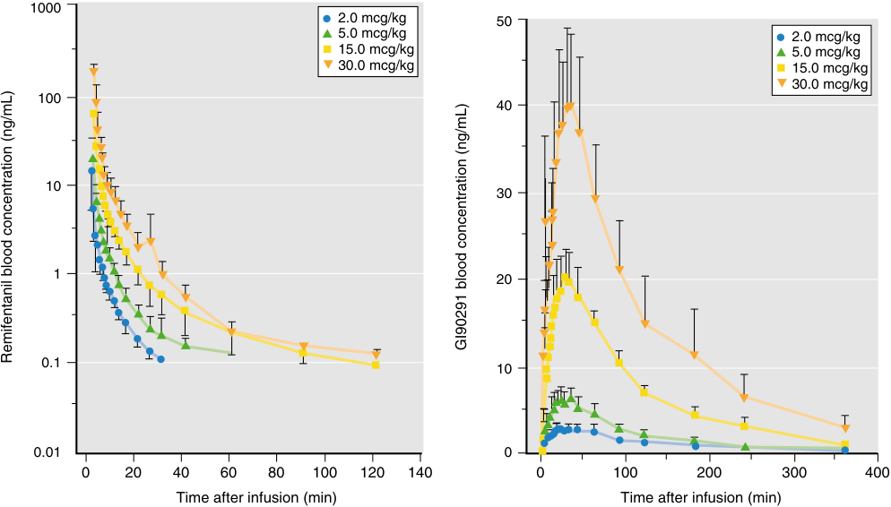

1000 2.0 mcg/kg 50 5.0 mcg/kg 2.0 mcg/kg 15.0 mcg/kg 5.0 mcg/kg 30.0 mcg/kg 15.0 mcg/kg 30.0 mcg/kg 100 40 10 30 1 20 0.1 10 0.01 0 0 20 40 60 80 100 120 140 0 100 200 300 400 Time after infusion (min) Time after infusion (min) GI90291 blood concentration (ng/mL) Remifentanil blood concentration (ng/mL) 

**Fig. 22.23 Time- dependent changes of blood concentrations of remifentanil and its metabolite.** Mean (± standard deviation) blood concentration–time curves of remifentanil and its metabolite GI90291 after a 1- minute transfusion of remifentanil of 2, 5, 15, and 30 mcg/kg ( _n_ = 6 for each dose) are plotted. (From Westmoreland CL, Hoke JF, Sebel PS, et al. Pharmacokinetics of remifentanil (GI87084B) and its major metabolite (GI90291) in patients undergoing elective inpatient surgery. _Anesthesiology._ 1993;79:893–903.)

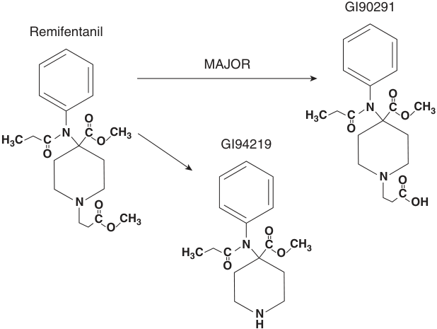

GI90291 Remifentanil MAJOR O N C CH3 O H3C C O N C CH3 O H3C C O GI94219 O N O C N O OH C CH3 O O N C CH3 H3C C O O N H 

**Fig. 22.24 Metabolic pathway of remifentanil.** De- esterification by nonspecific plasma and tissue esterases to form a carboxylic acid metabolite (GI90291) that has only 1/1000 to 1/300 the potency of the parent compound is the primary metabolic pathway. _N_ - dealkylation of remifentanil to GI94219 is a minor metabolic pathway. (From Egan TD, Lemmens HJ, Fiset P, et al. The pharmacokinetics of the new short- acting opioid remifentanil (GI87084B) in healthy adult male volunteers. _Anesthesiology._ 1993;79:881–892.)

### FACTORS AFFECTING PHARMACOKINETICS AND PHARMACODYNAMICS OF OPIOIDS

### Age

Pharmacokinetics and pharmacodynamics of opioids can be influenced by age. It is clear that neonates and infants exhibit

a reduced rate of elimination of essentially all opioids.396,397 This is presumably due to immature metabolic mechanisms, including the cytochrome P450 system. The prolonged elimination and reduced clearance of opioids observed in premature and infant populations quickly normalizes toward adult values within the first year of life.396–398

<!-- PDF page 38 -->

Intraoperative requirements of opioids are affected by age. The infusion rate of remifentanil to block somatic and autonomic response to skin incision was almost twofold higher in children (2–11 years) than adults (20–60 years).399,400 With advanced age, although pharmacokinetic changes may play a minor role, pharmacodynamic differences are primarily responsible for the decreased dose requirement in the elderly. Age was inversely correlated with central volume of distribution, clearance, and potency of remifentanil401 (Fig. 22.25). These combined pharmacokinetic and pharmacodynamic changes result in a reduction in remifentanil dosage by at least 50% or more in the elderly. Pharmacokinetic studies have shown increases in the sensitivity of the central nervous system to alfentanil, fentanyl, and sufentanil at the extremes of age, and increases in the percentage of body fat, and decreases in plasma protein content, liver blood flow, and enzyme function have been demonstrated to be responsible for the agerelated effects.402

### Body Weight

Many opioid pharmacokinetic parameters, especially clearance, appear to be more closely related to lean body mass. Total body weight–based dosing in an obese patient results in much higher remifentanil effect- site concentrations than does lean body mass- based dosing.403 In contrast, for lean patients, the concentrations that result from total body weight–based dosing are not much greater than those based on lean body mass (Fig. 22.26). Clinically, context- sensitive half- times are not significantly different between obese and

lean subjects (Fig. 22.27). There is mounting evidence to suggest that lean body mass is a better predictor of metabolic capacity than total body weight. Ideal body weight, a parameter closely related to lean body mass and one that is perhaps more easily estimated by the clinician, is probably an acceptable alternative to lean body mass. Because obesity and obesity- associated disease have increased and continue to do so, obese patients will frequently present for anesthesia and operations. Understanding the influence of obesity on the disposition of opioids is important in contemporary anesthesia practice, and new pharmacokinetic models incorporating the influence of body mass have been recently reported.404,405

### Renal Failure

Renal failure has important implications with respect to clinical pharmacology of morphine, hydromorphone, and meperidine. For the fentanyl congeners, the clinical importance of renal failure is less marked.

As mentioned above, active metabolites of morphine, M3G and M6G, are dependent on renal clearance mechanisms for elimination. A simulation study demonstrated that even small doses of morphine can produce high plasma concentration of morphine and M6G in patients with renal dysfunction depending on the remaining renal function (Fig. 22.28),406 which can cause life- threatening respiratory depression. In view of these changes induced by renal failure, morphine is not considered a good choice in patients with severely altered renal clearance mechanisms. There are similar concerns for the use of hydromorphone

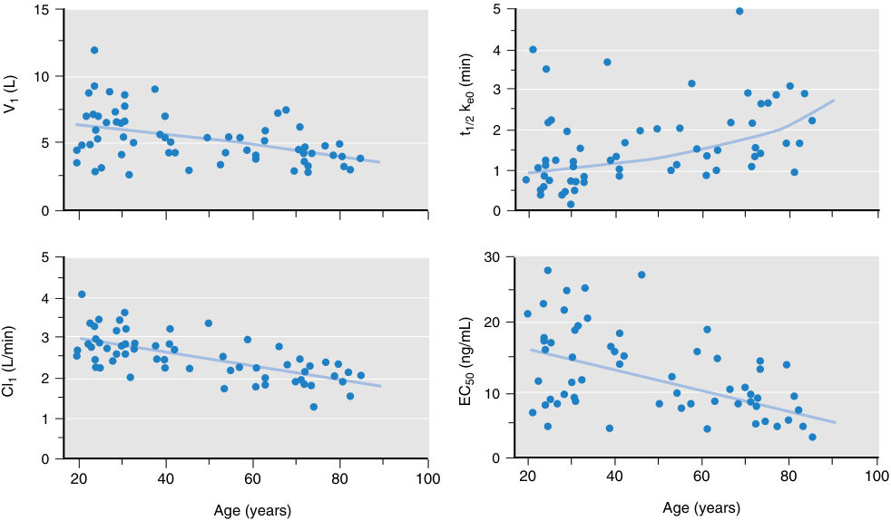

15 5 4 10 3 2 5 1 0 0 5 30 4 20 3 2 10 1 0 0 20 40 60 80 100 20 40 60 80 100 Age (years) Age (years)  (L)V1  (min) kt1/2e0 Cl (L/min)1 EC (ng/mL)50 

**Fig. 22.25 Relationship between pharmacokinetic and pharmacodynamic parameters and age for remifentanil.** Volume of distribution (V1) and clearance (Cl1) are estimated using a three- compartment model. _t1/2ke0_ is a half- life corresponding to ke0, a first- order rate constant for elimination of drug from the effect compartment. _EC50_ is the blood concentration of remifentanil that causes 50% of the maximum effect assessed by spectral edge of the electroencephalography. (From Minto CF, Schnider TW, Shafer SL. Pharmacokinetics and pharmacodynamics of remifentanil. II. Model application. _Anesthesiology._ 1997;86:24–33.)

<!-- PDF page 39 -->

and meperidine in the setting of renal dysfunction. Because normeperidine, the main metabolite of meperidine with analgesic and CNS excitatory effect, is subject to renal excretion, the potential CNS toxicity secondary to normeperidine accumulation is especially a concern in patients in renal failure.

In contrast, the clinical pharmacology of the fentanyl congeners is not grossly altered by renal failure, although a decrease in plasma protein binding may potentially alter the free fraction of the fentanyl class of opioids. In the presence of renal impairment, none of fentanyl, alfentanil, sufentanil, and remifentanil deliver a highly active metabolite load, or suffer from significantly prolonged clearance.407 Neither the pharmacokinetics nor the pharmacodynamics of remifentanil is altered by impaired renal function. Levels

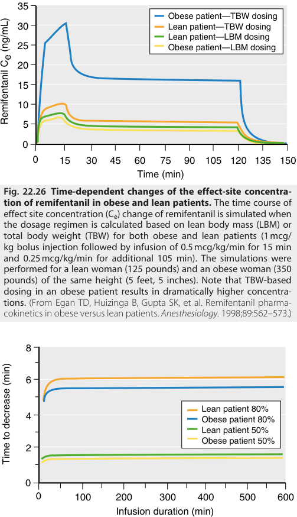

35 Obese patient—TBW dosing 30 Lean patient—TBW dosing Lean patient—LBM dosing 25 Obese patient—LBM dosing 20 15 10 5 0 0 15 30 45 60 75 90 105 120 135 150 Time (min) Fig. 22.26 Time- dependent changes of the effect- site concentra- tion of remifentanil in obese and lean patients.  The time course of effect site concentration (Ce) change of remifentanil is simulated when the dosage regimen is calculated based on lean body mass (LBM) or total body weight (TBW) for both obese and lean patients (1 mcg/ kg bolus injection followed by infusion of 0.5 mcg/kg/min for 15 min and 0.25 mcg/kg/min for additional 105 min). The simulations were performed for a lean woman (125 pounds) and an obese woman (350 pounds) of the same height (5 feet, 5 inches). Note that TBW- based dosing in an obese patient results in dramatically higher concentra- tions. (From Egan TD, Huizinga B, Gupta SK, et al. Remifentanil pharma- cokinetics in obese versus lean patients.  Anesthesiology.  1998;89:562–573.) 8 6 Lean patient 80% 4 Obese patient 80% Lean patient 50% Obese patient 50% 2 0 0 100 200 300 400 500 600 Infusion duration (min) Remifentanil Ce (ng/mL) Time to decrease (min) 

**Fig. 22.27 A computer simulation of the context- sensitive halftimes (50% decrement times) and 80% decrement times of remifentanil in obese vs. lean subjects.** In clinical terms, the curves are not grossly different in obese and lean subjects. The simulations were performed for a lean woman (125 pounds) and an obese woman (350 pounds) of the same height (5 feet, 5 inches). (From Egan TD, Huizinga B, Gupta SK, et al. Remifentanil pharmacokinetics in obese versus lean patients. _Anesthesiology._ 1998;89:562–573.)

of GI90291 that develop during a remifentanil infusion in patients in renal failure are not likely to produce any clinically significant effects.

In summary, a reduction in renal function may have the greatest effects on morphine due to a decrease in capacity for extrahepatic glucuronidation and clearance. Therefore, fentanyl, alfentanil, sufentanil, and remifentanil may be safer choices in renal failure patients due to their lack of active metabolites.

### Hepatic Failure

Even though the liver is the metabolic organ primarily responsible for opioid biotransformation, the degree of liver failure typically observed in perioperative patients, except for patients undergoing liver transplantation, does not have a major impact on the pharmacokinetics of most opioids. In addition to reduced metabolic capacity (i.e., cytochrome P450 system and conjugation), liver disease may also lead to reductions in hepatic blood flow, hepatocellular mass, and plasma protein binding. The increase in total body water and the edema of advanced liver disease may alter the distribution characteristics of a drug. Enzyme induction such as observed in early alcoholism can actually increase metabolic capacity of the liver.

Morphine pharmacokinetics is relatively unchanged by developing liver disease, such as liver cirrhosis and hepatic carcinoma, because of the substantial compensatory extrahepatic metabolism of morphine. A reduction in hepatic blood flow would be expected to slow the decline of morphine plasma concentrations. After liver resection, M6G/morphine and M3G/morphine ratios were significantly reduced and circulating morphine concentration was increased mainly due to a lower morphine clearance.408 In patients with cirrhosis, the metabolism of meperidine is decreased, leading to accumulation of the parent drug and possible CNS depressive effects similar to hepatic encephalopathy. The disposition of fentanyl and sufentanil appears to be unaffected in liver diseases.409 Reductions in liver blood flow that result from either liver disease or some other disorder (e.g., shock) can affect the pharmacokinetic parameters of alfentanil, fentanyl, and sufentanil. It was demonstrated that there was a significant decrease in clearance of alfentanil in patients with mild to moderate cirrhosis compared with volunteers from the historical control group.410

Remifentanil is an opioid whose phamacokinetics is not significantly changed by liver disease (Fig. 22.29).411 Its kinetics does not change during the anhepatic phase of orthotopic liver transplantation.412 It was reported that 0.25–0.5 mcg/kg/min remifentanil could provide perioperative analgesia without neurologic deterioration in a patient suffering from chronic hepatic failure with mild encephalopathy.413 However, in adult patients undergoing liver transplantation, the remifentanil requirement was lower in the group with high Model for End- Stage Liver Disease (MELD) score during the dissection and anhepatic phases (0.105 ± 0.067 vs. 0.064 ± 0.055 mcg/kg/min; and 0.167 ± 0.096 vs. 0.108 ± 0.079 mcg/kg/min, respectively; low MELD group vs. high MELD group).414 This finding may suggest that remifentanil dose should be reduced in patients with severe liver cirrhosis, considering individual patient characteristics.

<!-- PDF page 40 -->

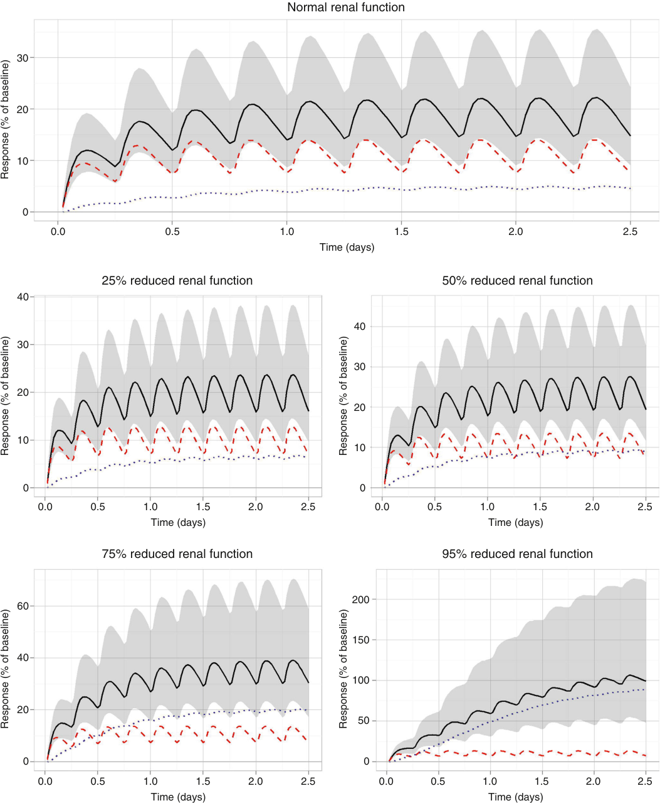

Normal renal function 30 20 10 0 0.0 0.5 1.0 1.5 2.0 2.5 Time (days) 25% reduced renal function 50% reduced renal function 40 40 30 30 20 20 10 10 0 0 0.0 0.5 1.0 1.5 2.0 2.5 0.0 0.5 1.0 1.5 2.0 2.5 Time (days) Time (days) 75% reduced renal function 95% reduced renal function 200 60 150 40 100 20 50 0 0 0.0 0.5 1.0 1.5 2.0 2.5 0.0 0.5 1.0 1.5 2.0 2.5 Time (days) Time (days) Response (% of baseline) Response (% of baseline) Response (% of baseline) Response (% of baseline) Response (% of baseline) 

**Fig. 22.28 Pharmacokinetics and pharmacodynamics of morphine and morphine-6-glucuronide (M6G) are affected by renal insufficiency.** The impact of renal insufficiency on M6G response and combined morphine and M6G response after four daily doses of 30 mg oral morphine with normal morphine clearance, 25% reduced, 50% reduced, 75% reduced, and 95% reduced M6G clearance is simulated. As renal function declines, contribution of M6G to analgesia increases. Note that the analgesic effect obtained by oral administration of 5 mg morphine (4 times/day for 4 days) in a patient with 95% reduced M6G clearance might be similar as that obtained by oral administration of 30 mg morphine in a healthy subject. _Black, full lines,_ combined morphine and M6G response; _red, dashed lines_ , morphine response; _blue, dotted lines_ , M6G response. The _gray area_ illustrates the 50% prediction interval of the combined morphine and M6G response. (From Sverrisdottir E, Lund TM, Olesen AE, et al. A review of morphine and morphine- 6- glucuronide’s pharmacokinetic- pharmacodynamic relationships in experimental and clinical pain. _Eur J Pharm Sci._ 2015;74:45–62.)

<!-- PDF page 41 -->

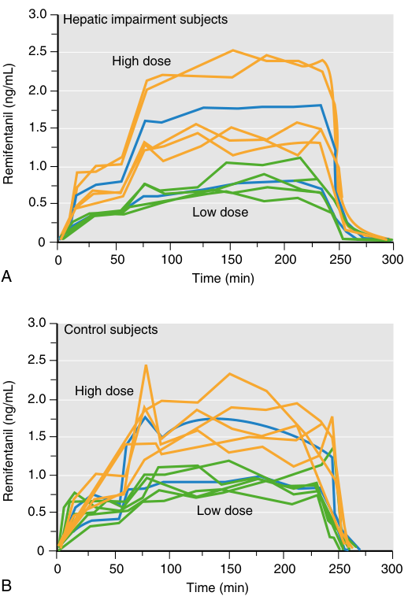

3.0 Hepatic impairment subjects 2.5 High dose 2.0 1.5 1.0 0.5 Low dose 0 0 50 100 150 200 250 300 A Time (min) 3.0 Control subjects 2.5 2.0 High dose 1.5 1.0 0.5 Low dose 0 0 50 100 150 200 250 300 B Time (min) Remifentanil (ng/mL) Remifentanil (ng/mL) 

**Fig. 22.29 Time- dependent changes of blood concentration of remifentanil in patients with liver disease (A) and in control subjects (B).** Each subject with liver disease had a history of chronic, stable hepatic disease, and all were waiting for liver transplantation. In the low- dose group ( _green line_ ), remifentanil was infused at 0.0125 mcg/kg/ min for 1 hour and then 0.025 mcg/kg/min for 3 hours. In the high- dose group ( _orange line_ ), the infusion rate of remifentanil was 0.025 mcg/kg/ min for 1 hour and then 0.05 mcg/kg/min for 3 hours. The _blue lines_ are mean values. (From Dershwitz M, Hoke JF, Rosow CE, et al. Pharmacokinetics and pharmacodynamics of remifentanil in volunteer subjects with severe liver disease. _Anesthesiology._ 1996;84:812–820.)

### Cardiopulmonary Bypass

Cardiopulmonary bypass (CPB) produces significant alterations in the pharmacokinetics of most opioids. These alterations are results of CPB- induced modifications in distribution volumes (secondary to priming), changes in acid–base balance, organ blood flow, plasma protein concentrations, and body temperature. The binding of drugs to components of the bypass circuit can also alter opioid pharmacokinetics.

Miller _et al._ examined the effect of CPB on plasma fentanyl concentration and showed that total concentration of fentanyl in plasma was significantly decreased and the unbound fraction of fentanyl rose on initiation of CPB. The total fentanyl concentration remained relatively stable during bypass until near the end of CPB when the mean total concentration increased, coinciding with rewarming.415 Population pharmacokinetic modeling applied to concentration- versus- time data from patients undergoing coronary artery bypass grafting using CPB demonstrated

that the effect of CPB on fentanyl pharmacokinetics is clinically insignificant, and that a simple three- compartment model accurately predicts fentanyl concentrations throughout surgery using CPB.416

Elimination of alfentanil is prolonged by CPB primarily because of increased distribution. It was reported that the volume of distribution in steady state (Vdss) and the volume of central compartment for alfentanil were significantly greater in the CPB groups, compared to the non- bypass group.417 However, the elimination half- life (t1/2β) of alfentanil did not differ significantly between the normothermic CPB, hypothermic CPB, and non- bypass groups. The free fraction of alfentanil during CPB remains constant despite complex changes in binding protein concentrations.418

In adult patients undergoing elective myocardial revascularization with hypothermic CPB who received continuous infusions of remifentanil 1.0–2.0 mcg/kg/min, no evidence of accumulation or sequestration was found.392 Russell _et al._ reported that normothermic CPB did not significantly affect the clearance of remifentanil, but hypothermic CPB reduced it by an average of 20%, and this was attributed to the effect of temperature on blood and tissue esterase activity.419 In pediatric patients undergoing CPB for repair of atrial septal defect, there was no change in the Vdss, the volume of the central compartment, t1/2α and t1/2β, but clearance values of remifentanil increased 20% in the postbypass period.420 In patients undergoing coronary artery bypass graft surgery with hypothermic CPB receiving continuous infusion of remifentanil, the volume of distribution increased by 86% with institution of CPB and remained increased after CPB, elimination clearance decreased by 6.37% for each degree from 37°C.421 Thus, although clearance of remifentanil may reduce during CPB, remifentanil remains a very short- acting drug even during CPB.

### Hemorrhagic Shock

It is a common practice to administer reduced doses of opioids to patients suffering from hemorrhagic shock to minimize adverse hemodynamic consequences and to prevent prolonged opioid effect. This is at least partially attributable to pharmacokinetic mechanisms. Analysis with pigs receiving fentanyl suggested that central clearance and central- and second- compartment distribution volumes were significantly reduced in hemorrhagic shock, resulting in higher fentanyl concentrations for any given dosages and prolonged context- sensitive half- time (Fig. 22.30).422

Hemorrhagic shock also altered pharmacokinetics of remifentanil, suggesting that less remifentanil would be required to maintain a target plasma concentration.423 However, because of its rapid metabolism, changes in context- sensitive half- time of remifentanil in hemorrhagic shock are small. In a stepwise hemorrhage model of pigs receiving total intravenous anesthesia with remifentanil (0.5 mcg/kg/min) and propofol (6 mg/kg/h after 2 mg/kg bolus), the plasma remifentanil concentration showed a threefold greater increase than that of propofol.424 Thus, the remifentanil dose should be reduced substantially compared with propofol during total intravenous anesthesia for patients with significant blood loss.

### Genetic Variations in Opioid Metabolism

All opioid drugs are substantially metabolized mainly by cytochrome P450 (CYP) and to a lesser extent by

<!-- PDF page 42 -->

UDP- glucuronosyltransferases (UGTs). Although CYP3A4 is involved in the metabolism of many of the opioids, it is the role of CYP2D6 that is of greater clinical interest with respect to the weaker opioids, codeine, dihydrocodeine, oxycodone, hydrocodone and tramadol, because of the formation of their more potent hydroxyl metabolites (morphine, dihydromorphine, oxymorphone, hydromorphone and _O_ - desmethyltramadol [M1], respectively), which have about a 30- fold higher affinity for the μ- receptor. The CYP2D6 gene is highly polymorphic, with 100 allelic variants identified, and enzymatic activity of some alleles may be either significantly higher or lower than other alleles. In the case of a variant more rapidly producing metabolites of higher affinity there exists the possibility of administering an unintended opioid overdose. Alternately, variants leading to low production of potent metabolites may result in subtherapeutic outcomes.425 Therapeutic recommendations for the use of CYP2D6 genotype results for prescribing codeine and tramadol have been published.426

UGTs mediate mainly the formation of glucuronides from buprenorphine, codeine, dihydrocodeine, dihydromorphine, hydromorphone, morphine, naloxone, naltrexone, and oxymorphone. UGT2B7 is believed to be the major UGT isozyme involved, and although variation in the UGT2B7 gene is suggested to influence morphine glucuronidation, the results presented so far are inconsistent. It is possible that differences in metabolic activity among UGT alleles affect pharmacokinetics of opioids.425 It was reported that

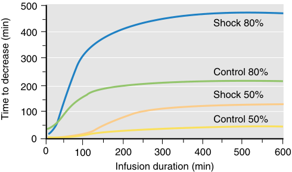

500 Shock 80% 400 300 Control 80% 200 Shock 50% 100 Control 50% 0 0 100 200 300 400 500 600 Infusion duration (min) Time to decrease (min) 

**Fig. 22.30 The context- sensitive half- time of fentanyl is affected by hemorrhagic shock.** A computer simulation of the context- sensitive halftimes (50% decrement times) and 80% decrement times of fentanyl in shock versus control pigs. All animals were 5–10 months of age and weighed 72.2 ± 8.2 kg. In the hemorrhagic shock group, 1906 ± 459 mL blood was removed to achieve the targeted mean arterial pressure (MAP) (40–45 mm Hg). (From Egan TD, Kuramkote S, Gong G, et al. Fentanyl pharmacokinetics in hemorrhagic shock: a porcine model. _Anesthesiology._ 1999;91:156–166.)

variability in the UGT2B7, UGT1A8, and UGT1A1 genes contributes to variability in morphine glucuronide (M6G and M3G) to morphine serum concentration ratios in patients with advanced cancer receiving chronic morphine therapy.427

## Anesthetic Techniques Using Opioids

### ANALGESIA

Opioids are administered during monitored anesthesia care (MAC) to provide analgesia for procedures in which local anesthesia may be ineffective or inappropriate, for local anesthetic infiltration or block placement, for uncomfortable positioning. Opioids with rapid onset and short duration of action are generally preferred for MAC, and the most commonly used opioids for MAC are fentanyl and remifentanil. For MAC, fentanyl is often administered in intermittent IV boluses of 25 to 50 mcg, with reduced doses in older adults or when administered in combination with other sedatives/hypnotics. Remifentanil is administered as infusion of 0.025–0.1  mcg/kg/min. For short- lasting analgesia, single- bolus IV administration of opioids can be used: for example, fentanyl (1–3 mcg/kg), alfentanil (5–10 mcg/kg), or sufentanil (0.1–0.3 mcg/kg).428 Plasma concentrations of opioids necessary for various purposes, reflecting the difference in potency of these opioids, are listed in Table 22.7. Patient-controlled analgesia (PCA) with opioids has become a widely accepted technique in which to provide postoperative analgesia, but pharmacokinetic optimization of opioid treatment in acute pain is a complex matter. Without considering effect- site drug concentrations over time, the choice of opioid and the amount, method, and frequency of its administration cannot be optimal. Morphine and fentanyl are often used for PCA therapy, and piritramide is also frequently used for PCA in European countries. A double- blind randomized study demonstrated that effectsite target- controlled remifentanil PCA with a slow and progressive adapted algorithm is feasible in young women undergoing uterine artery embolization.429 As a metaanalysis of randomized trials showed no significant differences in maternal satisfaction or most clinical outcomes between remifentanil PCA and conventional epidural analgesia (EA), for obstetric patients who are not candidates for epidural analgesia, remifentanil PCA may provide an alternative for analgesia in the peripartum period, but caution is warranted particularly regarding hypoxemia.430

**Table 22.7** Range of Approximate Plasma (or Whole Blood for Remifentanil) Opioid Concentration

||**Fentanyl (ng/mL)**|**Sufentanil (ng/mL)**|**Alfentanil (ng/mL)**|**Remifentanil (ng/mL)**|
|---|---|---|---|---|
|Predominant agent|15–30|5–10|400–800|—|
|Major surgery|4–10|1–3|200–400|2–4|
|Minor surgery|3–6|0.25–1|50–200|1–3|
|Spontaneous ventilation|1–3|&lt;0.4|&lt;200|0.3–0.6|
|Analgesia|1–2|0.2–0.4|50–150|0.2–0.4|

From Bailey PL, Egan TD, Stanley TH. Intravenous opioid anesthetics. In: Miller RD, ed. _Anesthesia_ . 5th ed. New York: Churchill Livingstone; 2000:300.

::: details 原始表格與符號（PDF 第 42 頁）

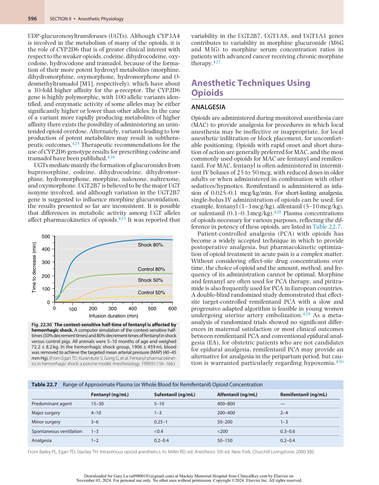

:::

<!-- PDF page 43 -->

Combination of opioids with other drugs might be a method for improvement of PCA. For thoracic surgery, addition of ketamine to opioid for intravenous PCA was superior to intravenous PCA opioid alone, whereas the effect of added ketamine was not significant for orthopedic or abdominal surgery.431 Despite the utility of an opioid- based PCA, patients should be strictly monitored for opioid- induced respiratory depression.

### SEDATION

Critically ill subjects in the intensive care unit (ICU) often experience anxiety and agitation while being exposed to numerous stressful or noxious stimuli. ICU patients generally require a combination of analgesia and sedation to relieve their state of anxiety, improve adaptation to the endotracheal tube, and aid compliance with mechanical ventilation. Morphine, fentanyl, and sufentanil are frequently used intravenous analgesic agents in the ICU. However, there is a debate over pros and cons of ICU sedation strategies with opioids, and it was demonstrated that fentanyldominant sedation was associated with an increased risk of delirium, a composite outcome of delirium or death, duration of mechanical ventilation, and ICU and hospital length of stay, compared with propofol- or midazolam- dominant sedation.432

The rapid onset and offset of action of remifentanil could make it quickly adjustable to the required level of sedation in critically ill patients. A randomized double- blind study indicated that remifentanil (0.15 mcg/kg/min) and morphine (0.75 mcg/kg/min) could provide comparable level of sedation, and the remifentanil- based regimen allowed a more rapid emergence from sedation and facilitated earlier extubation.433 However, as discussed previously, use of ultrapotent opioid agents such as remifentanil may also drive tolerance development and opioid- induced hyperalgesia.

### BALANCED ANESTHESIA

Anesthesia with a single agent can often require doses that produce excessive hemodynamic depression. Alternately, “balanced anesthesia” with a balance of agents and techniques can be used to more selectively direct different components of anesthesia (i.e., analgesia, amnesia, muscle relaxation, and abolition of autonomic reflexes with maintenance of homeostasis).434 Inclusion of an opioid as a component of balanced anesthesia can reduce preoperative pain and anxiety, decrease somatic and autonomic responses to airway manipulations, improve hemodynamic stability, lower requirements for inhaled anesthetics or intravenous anesthetics, and provide immediate postoperative analgesia.

The timing, rate of administration, and dose of supplemental opioids should be tailored to the specific condition of the patient and the expected duration of the operation to avoid various problems. The opioid ideal for balanced anesthesia would permit rapid titration, prevent unwanted responses to noxious stimuli, require little supplementation, not depress cardiovascular function, permit the return of adequate spontaneous ventilation in a timely manner, and produce effective postoperative analgesia with minimal side effects. Alfentanil and remifentanil provide the greatest

ability to titrate opioids rapidly because of their extremely rapid time to onset (1–2 min) of peak effect.

### Balanced Anesthesia with Volatile Anesthetics and Opioids

Anesthetic induction for balanced anesthesia can be achieved by combining an opioid, fentanyl, alfentanil, sufentanil or remifentanil, with a sedative–hypnotic, most commonly thiopental or propofol, and a muscle relaxant. And then, anesthesia is generally maintained by administration of volatile anesthetics, opioids, and muscle relaxants.

Numerous studies have examined the interactions of opioids including morphine, fentanyl, alfentanil, sufentanil, and remifentanil with volatile anesthetics to obtain immobility and hypnosis, assessed by MAC and MACawake, respectively, and showed synergistic interaction between opioids and volatile anesthetics regarding immobility.435 A clinical research demonstrated that MACawake of sevoflurane was little affected by 1–2 ng/mL fentanyl but reduced by approximately 24% at a plasma concentration of 3 ng/mL.436

**Fentanyl.** Anesthetic induction is usually achieved by combining a loading dose of fentanyl (2–10 mcg/kg) with thiopental or propofol and a muscle relaxant. Maintenance of anesthesia can be achieved with low concentrations of potent inhaled anesthetics, and additional fentanyl (intermittent boluses of 0.5–1.0 mcg/kg every 15 to 30 min or a constant infusion of 0.02–0.2 mcg/kg/min).

The MAC of sevoflurane was dose- dependently reduced by fentanyl, with 3 ng/mL resulting in a 61% reduction in MAC (Fig. 22.31).437 A ceiling effect was observed for MAC; 6 ng/mL fentanyl provided only an additional 13% reduction in the MAC of sevoflurane. The volatile anesthetic concentration that prevents movement in response to laryngoscopy and tracheal intubation in 50% of patients (MAC- TI) is higher than the MAC that prevents movement in response to surgical incision (MAC). The MAC- TI of sevoflurane was 3.55% and was reduced markedly to 2.07%, 1.45%, and 1.37% by the addition of fentanyl 1, 2, and 4 mcg/kg, respectively, with no significant difference in the reduction between 2 and 4 mcg/kg, thus showing a ceiling effect.438 The volatile anesthetic concentration that prevents sympathetic responses to surgical incision in 50% of patients (MAC- BAR) also decreased with increasing concentrations of fentanyl in plasma, and the initial steep reduction followed by a ceiling effect (see Fig. 22.31).437 The plasma concentration of fentanyl required for postoperative analgesia after abdominal surgery performed under balanced anesthesia with sevoflurane and fentanyl in adult patients was approximately 1.5 ng/mL.439

Opioid pharmacokinetics and pharmacodynamics vary considerably among patients. It was reported that the relationship between postoperative analgesic dosing requirements for fentanyl and total body weight is nonlinear, and the fentanyl dose based on total body weight may cause overdosing in obese patients.439 As discussed previously, considerations for dosing based on lean body weight and/or ideal body weight may have merit in this context. Repeated doses or continuous infusions of fentanyl, especially in the case that the fentanyl dose is determined based on the total body weight, are likely to result in significant depression of

<!-- PDF page 44 -->

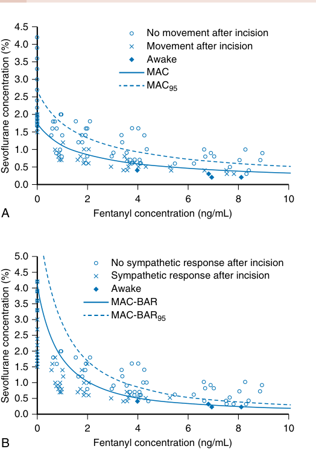

4.5 No movement after incision 4.0 Movement after incision 3.5 Awake MAC 3.0 MAC95 2.5 2.0 1.5 1.0 0.5 0.0 0 2 4 6 8 10 A Fentanyl concentration (ng/mL) 5.0 No sympathetic response after incision 4.5 Sympathetic response after incision 4.0 Awake 3.5 MAC-BAR 3.0 MAC-BAR95 2.5 2.0 1.5 1.0 0.5 0.0 0 2 4 6 8 10 B Fentanyl concentration (ng/mL) Sevoflurane concentration (%) Sevoflurane concentration (%) 

**Fig. 22.31 Effects of fentanyl on the sevoflurane action.** (A) Reduction of the sevoflurane concentration at which 50% or 95% of patients did not move at skin incision (MAC or MAC95, respectively) by increasing concentrations of fentanyl. (B) Reduction of the sevoflurane concentration at which 50% or 95% of patients did not show sympathetic response (an increase in heart rate or mean arterial pressure >15%) at skin incision (MAC- BAR or MAC- BAR95, respectively) by increasing concentrations of fentanyl. (Redrawn from Katoh T, Kobayashi S, Suzuki A, et al. The effect of fentanyl on sevoflurane requirements for somatic and sympathetic responses to surgical incision. _Anesthesiology._ 1999;90:398–405.)

spontaneous ventilation and may make it difficult to extubate when the operation is finished.

**Alfentanil.** Because alfentanil penetrates the brain so rapidly, equilibration of alfentanil between plasma and CNS can be achieved while plasma alfentanil levels are relatively low compared with sufentanil and fentanyl. This property explains the reason why low doses (10–30 mcg/kg) of alfentanil, administered just before or simultaneously with a sedative–hypnotic, are effective for tracheal intubation. Bolus administration of alfentanil should be carefully performed because of the possibility of hypoventilation due to thoracic muscle rigidity.

Alfentanil (25–50 mcg/kg IV), followed by small, titrated sleep doses of any sedative–hypnotic (e.g., 50–100 mg sodium thiopental), is usually successful in preventing significant hemodynamic stimulation from laryngoscopy and intubation. In a previous report, the optimum dose of alfentanil, co- administered with 2.5 mg/kg propofol, when inserting a classic laryngeal mask airway was 10 mcg/kg,

and afterwards anesthesia was maintained with 1.5% isoflurane and 70% nitrous oxide in oxygen.440 Further opioid supplementation can be achieved with an alfentanil infusion (0.5–2.0 mcg/kg/min) or intermittent boluses of alfentanil (5–10 mcg/kg) for short procedures.

In balanced anesthetic techniques in which potent inhaled anesthetics are employed, relatively low plasma alfentanil concentrations (e.g., 29 ng/mL) can reduce the MAC of isoflurane by approximately 50%.113 In patients aged 18–67 years, the MAC of isoflurane was 1.28 ± 0.13%, and was significantly decreased by alfentanil (effectsite target of 50 ng/mL) to 0.96 ± 0.09%.441

**Sufentanil.** In combination with propofol for induction of anesthesia in children, bolus administration of sufentanil 0.3 mcg/kg can completely abolish the cardiovascular response to tracheal intubation.442 In healthy normotensive adult patients, a bolus sufentanil 0.1 mcg/kg followed by a continuous infusion at 0.08 mcg/kg/min for at least 5 minutes proved to be effective for blunting the cardiovascular response to intubation.443 Maintenance of anesthesia can be achieved with sufentanil (intermittent boluses, 0.05–0.3 mcg/kg, or constant infusion, 0.005–0.03 mcg/ kg/min) and volatile anesthetics. The Cp50 for sufentanil during skin incision in the presence of 70% nitrous oxide was reported to be 2.08 ± 0.62 ng/mL in unpremedicated patients.444 In patients undergoing coronary artery bypass grafting, sufentanil greater than 1.25 ± 0.21 ng/mL reduced isoflurane requirements to less than 0.5% through the operation.445

**Remifentanil.** Very short duration of action of remifentanil necessitates infusion (0.1–1.0 mcg/kg/min) to maintain adequate opioid effect for balanced anesthesia. Remifentanil can reliably suppress automatic, hemodynamic, and somatic responses to noxious stimulation and allows the most predictable and rapid trouble- free emergence from anesthesia without postoperative respiratory depression. Infusion rates of 0.1 ± 0.05 mcg/kg/min should permit the return of spontaneous ventilation and responsiveness with maintenance of analgesia.

The synergistic effect of remifentanil and sevoflurane regarding MAC and MAC-BAR has been reported. In female patients, aged 20–50 years, undergoing balanced anesthesia for elective abdominal surgery, the MAC of sevoflurane with remifentanil (target concentration 1 ng/mL and 3 ng/mL) was 3.96% (3.69%–4.23%) and 0.36% (0.24%– 0.47%), respectively.446 In 3- to 7- year- old child patients, the MAC-BAR of sevoflurane during laparoscopic surgery was 3.29 ± 0.17%, 2.12 ± 0.10%, and 1.29 ± 0.11%, in the presence of remifentanil plasma target concentration (0, 1, and 2 ng/mL), respectively, indicating that remifentanil can effectively reduce the required concentration of sevoflurane in balanced anesthesia.447

Associated with emergence from remifentanil anesthesia, the need for alternative analgesic therapies should be anticipated and administered in a timely fashion. Exposure to high doses of remifentanil may paradoxically reduce the pain threshold after its discontinuation, resulting in postoperative hyperalgesia, which is known to be associated with acute and persistent pain. In children undergoing strabismus surgery, combination of sevoflurane (2.5%) and remifentanil

<!-- PDF page 45 -->

(1 mcg/kg followed by 0.1–0.2 mcg/kg/min) showed less frequent postoperative vomiting but higher postoperative pain scores, compared with fentanyl (2 mcg/kg followed by 1 mcg/kg every 45 min).448 It was reported that perioperative administration of morphine (0.15 or 0.25 mg/kg IV) or fentanyl (150 mcg) did not provide entirely adequate immediate postoperative pain control after general anesthesia with remifentanil and isoflurane in major abdominal surgery.449,450 On the other hand, administration of ketamine (0.15 mg/kg followed by 2 mcg/kg/min) decreased intraoperative remifentanil requirement during abdominal surgery with isoflurane and postoperative morphine consumption without increasing the incidence of side effects.451

### Total Intravenous Anesthesia with Propofol and Opioids

When delivery of inhaled agents is compromised, total intravenous anesthesia (TIVA) techniques are especially useful as balanced anesthesia. By keeping the goals of balanced anesthesia in mind, combining intravenous analgesics and intravenous anesthetics, utilizing infusion pumps, and understanding of pharmacokinetics, clinicians can successfully perform TIVA techniques. Many different IV anesthetic and analgesic compounds can be employed to perform TIVA, but most commonly, one of the opioids is combined with another drug which provide hypnosis and amnesia. Approximate opioid doses and infusion rates for TIVA are listed in Table 22.8.

The pharmacodynamic synergism between opioids and sedative–hypnotics such as propofol is profound. Choosing an opioid with a short context- sensitive half- time allows greater doses of the opioid to be administered, along with reduced doses of propofol, without compromising the time for recovery from anesthesia. Drug dosing regimens as well as assessment of plasma concentrations of opioids and sedative–hypnotics are necessary to provide optimal antinociceptive, hypnotic, and hemodynamic control during TIVA.

Fentanyl interacts synergistically and markedly reduces the dose of propofol required for loss of consciousness and during noxious stimulation such as skin incision452,453 (Fig. 22.32). Kazama _et al._ characterized the pharmacodynamic interaction between propofol and fentanyl by comparing the propofol Cp50 at which 50% of the patients did not respond to the stimulation including skin incision, peritoneum incision, and abdominal wall retraction, and showed that increasing the fentanyl concentration markedly reduced propofol Cp50 for somatic response, indicating the potential synergistic interaction of both drugs.454

**Table 22.8** Approximate Opioid Loading (Bolus) Doses, Maintenance Infusion Rates, and Additional Bolus Doses for Total Intravenous Anesthesia

||**Loading Dose** **(mcg/kg)**|**Maintenance** **Infusion Rate** **(mcg/kg/min)**|**Additional Bolus** **Dose (mcg/kg)**|
|---|---|---|---|
|Alfentanil|10–50|0.5–2|5–10|
|Sufentanil|0.1–0.5|0.005–0.03|0.05–0.3|
|Fentanyl|2–10|0.02–0.2|0.5–3|
|Remifentanil|1–2|0.1–1.0|0.1–1.0|

Anesthetic induction with alfentanil (25–50 mcg/kg) and propofol (0.5–1.5 mg/kg) followed by infusions of 0.5– 1.5 mcg/kg/min of alfentanil and 80–120 mcg/kg/min of propofol will produce complete anesthesia for a variety of procedures. It was proposed that alfentanil concentrations as low as 85 ng/mL, when combined with a blood propofol concentration of 3.5 mcg/mL, can produce both optimal anesthetic conditions and speed of recovery.455

It was reported that hemodynamic changes induced by propofol might have an important influence on the pharmacokinetics of alfentanil. In healthy volunteers, propofol (target concentration, 1.5 mcg/mL) decreased the elimination clearance of alfentanil by 15%, rapid distribution clearance by 68%, slow distribution clearance by 51%, and lag time by 62%.456 TIVA using remifentanil and propofol has become popular. In patients undergoing ear- nose- throat surgery, TIVA with remifentanil and propofol provided a more rapid respiratory recovery after brief surgical procedures, compared with TIVA with alfentanil and propofol.457 In a study testing the pharmacodynamic interaction between remifentanil and propofol, remifentanil alone had no appreciable effect on the response to shaking and shouting or response to laryngoscopy, propofol could ablate both responses, and modest remifentanil concentrations dramatically reduced the concentrations of propofol required to ablate both responses.458 Response surface analysis showed considerable synergy between propofol and remifentanil for sedation and suppression of responses to various noxious stimuli.459

The need for alternative analgesic therapies should be considered after TIVA with remifentanil as well as after balanced anesthesia using remifentanil and volatile anesthetics. In a study examining adolescent patients undergoing surgery for idiopathic scoliosis performed under propofolbased anesthesia with multimodal analgesia including morphine, sufentanil, ketamine, and dexmedetomidine, no association was found between the total dose of intraoperative remifentanil (0.08–0.16 mg/kg) and postoperative opioid consumption,460 suggesting that, if administered as part of a multimodal analgesia approach, clinically used dose ranges of remifentanil do not necessarily induce hyperalgesia or opioid tolerance in pediatric scoliosis patients. Postoperative pain relief with low- dose remifentanil infusion was also reported. After general anesthesia with propofol (75 mcg/kg/min) and remifentanil (0.5–1.0 mcg/kg/min) for abdominal or thoracic surgery, continuous infusion of remifentanil (0.05 or 0.1 mcg/kg/min) provided adequate postoperative analgesia.461

### OPIOID- BASED (HIGH- DOSE OPIOID) ANESTHESIA FOR CARDIAC SURGERY

Opioids can be administered as the primary anesthetic in opioid- based anesthetic techniques. High- dose opioid anesthesia was introduced as a stress- free anesthetic method for cardiac surgery. High- dose opioid anesthesia was first performed using morphine, and fentanyl and sufentanil have been recommended later. However, several factors have diminished the popularity of high- dose opioid anesthesia, even in cardiac anesthesia. These include the lack of evidence substantiating any significant outcome benefit associated with the use of large doses of opioids, the added

::: details 原始表格與符號（PDF 第 45 頁）

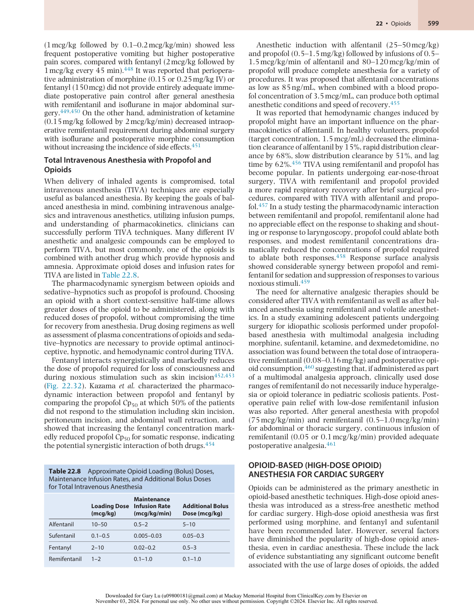

:::

<!-- PDF page 46 -->

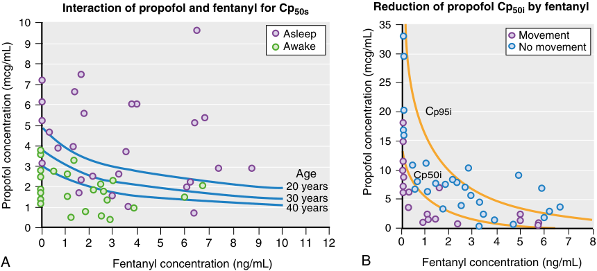

Interaction of propofol and fentanyl for Cp50s Reduction of propofol Cp50i by fentanyl 10 35 Asleep Movement 9 Awake No movement 30 8 7 25 6 20 Cp95i 5 15 4 3 10 Age Cp50i 2 20 years 30 years 5 1 40 years 0 0 0 1 2 3 4 5 6 7 8 9 10 11 12 0 1 2 3 4 5 6 7 8 A Fentanyl concentration (ng/mL) B Fentanyl concentration (ng/mL) Propofol concentration (mcg/mL) Propofol concentration (mcg/mL) 

**Fig. 22.32 The effect of fentanyl on the Cp50 of propofol for loss of consciousness and loss of motion response to skin incision.** (A) Measured blood propofol and fentanyl concentrations at which patients did and did not respond to a verbal command at 10 minutes after the initiation of the infusion of these drugs are plotted. The _solid lines_ represent the modeled concentration of propofol, according to decade of age when combined with the measured fentanyl concentrations, at which 50% of patients did not respond to verbal command (Cp50s). (B) Increasing concentration of fentanyl reduces propofol concentration at which 50% or 95% of patients did not move at skin incision (Cp50i and Cp95i, respectively). The _solid lines_ represent logistic regression solution. (From Smith C, McEwan AI, Jhaveri R, et al. The interaction of fentanyl on the Cp50 of propofol for loss of consciousness and skin incision. _Anesthesiology._ 1994;81:820–828.)

drug costs, and the trend toward “fast track” approaches to the cardiac patient that can be impeded by large doses of opioids. However, opioids, particularly when administered by continuous infusion, are still among the most effective anesthetics for patients undergoing cardiac or other extensive operations.

In an attempt to decrease the costs of cardiac surgery, fast- track programs have become popular. Engoren _et al._ reported that the more expensive but shorter- acting opioids, sufentanil and remifentanil, produced equally rapid extubation, similar length of intensive care units stays, and similar costs compared with fentanyl, indicating that any of these opioids can be chosen for fast- track cardiac surgery to conserve resources for cardiac surgery.462 A meta- analysis has demonstrated that there was no difference between anesthesia using high- and low- dose opioids, including morphine, fentanyl, sufentanil, or remifentanil, in ICU and hospital length of stay, ventilation time, use of vasopressors, myocardial infarction **_,_** and stroke in adult cardiac surgery patients.463

### Fentanyl

Many different techniques have been used to achieve anesthesia with high- dose fentanyl. Rapid or slow bolus injections of high- dose fentanyl (5–75 mcg/kg) will establish plasma fentanyl concentrations (10–30 ng/mL) that are often sufficient to provide stable hemodynamics throughout the induction/intubation sequence. Continuous infusions of high- dose fentanyl for cardiac surgery range from 0.1 to 1.0 mcg/kg/min up to or continuing through CPB. High- dose fentanyl anesthesia has also proved effective and safe for pediatric heart surgery. It was indicated that fentanyl 25–50 mcg/kg combined with isoflurane 0.2%–0.4% was sufficient to obtund hemodynamic and stress responses in the pre- CPB phase of open heart surgery in infants and young children464 (Fig. 22.33). It was shown that

high- dose fentanyl (50 mcg/kg) is not associated with a difference in the incidence of postoperative cognitive dysfunction at 3 or 12 months after coronary artery bypass surgery in the elderly, whereas low- dose fentanyl (10 mcg/kg) leads to shorter postoperative ventilation times and may be associated with a greater incidence of postoperative cognitive dysfunction 1 week after surgery.465 It is not clear why the high- dose fentanyl group showed less cognitive dysfunction 1 week after surgery, but it may be possible that high- dose fentanyl can obtund the stress response more effectively than low- dose fentanyl. This finding may present an advantage of high- dose fentanyl anesthesia.

### Remifentanil

Remifentanil has been widely employed in cardiac anesthesia. It was shown that induction with remifentanil 2 mcg/kg with propofol and maintenance with remifentanil at 0.25 or 0.5 mcg/kg/min provided appropriate anesthesia for minimally invasive coronary artery bypass surgery with rapid awakening and tracheal extubation.468 Kazmaier _et al._ anesthetized patients undergoing elective coronary artery bypass grafting with high- dose remifentanil (2.0 mcg/kg/ min) alone or with remifentanil 0.5 mcg/kg/min combined with propofol (target plasma concentration of 2.0 mcg/ mL).469 It was demonstrated that high- dose remifentanil reduces stroke volume index, heart rate, mean arterial pressure, myocardial blood flow, and myocardial oxygen uptake and its effects do not differ from those of remifentanil/propofol anesthesia. Geisler et al. examined efficacy and safety of high- dose remifentanil anesthesia in patients undergoing coronary artery bypass graft surgery.470 It was demonstrated that continuous infusions of remifentanil 1.0–2.0 mcg/kg/min in combination with propofol 3 mg/ kg/h provided profound suppression of responses to surgical stimuli in the majority of patients, but there was a high incidence of muscle rigidity when remifentanil was used

<!-- PDF page 47 -->

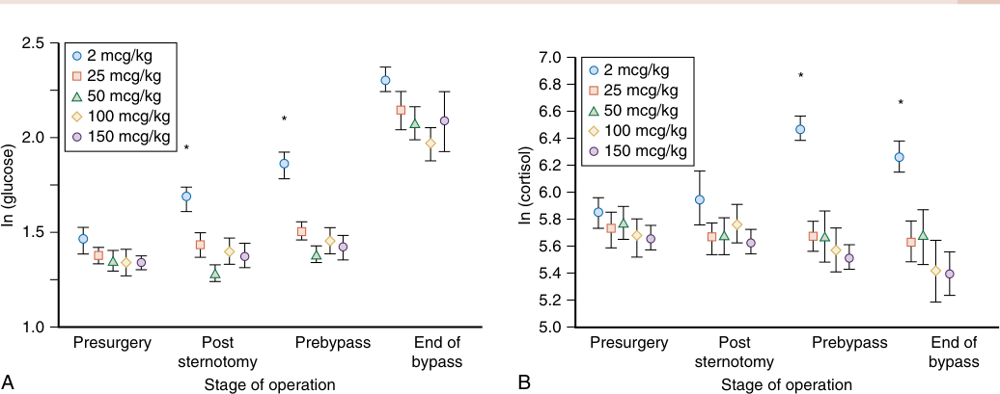

2.5 2 mcg/kg 7.0 25 mcg/kg50 mcg/kg 6.8 2 mcg/kg25 mcg/kg * * 100 mcg/kg * 6.6 50 mcg/kg 2.0 150 mcg/kg * 6.4 100 mcg/kg150 mcg/kg 6.2 6.0 5.8 1.5 5.6 5.4 5.2 1.0 5.0 Presurgery Post Prebypass End of Presurgery Post Prebypass End of sternotomy bypass sternotomy bypass A Stage of operation B Stage of operation In (glucose) In (cortisol) 

**Fig. 22.33 Suppression of stress responses in the prebypass phase of open heart surgery in infants and young children by fentanyl combined with low concentration (0.2%–0.4%) of isoflurane.** Mean (± SE) natural logarithm (ln) for blood glucose concentration (A) or ln for plasma cortisol concentration (B) versus stage of surgery for each dose of fentanyl. The values for the 2 mcg/kg group indicated by _asterisks_ were significantly higher (P &lt;.01) than in the other dose groups. (Redrawn from Duncan HP, Cloote A, Weir PM, et al. Reducing stress responses in the pre- bypass phase of open heart surgery in infants and young children: a comparison of different fentanyl doses. _Br J Anaesth_ . 2000;84:556–564.)

to induce anesthesia. They concluded that there was no apparent advantage in starting the remifentanil infusion rate above 1.0 mcg/kg/min and remifentanil is not suitable for use as a sole induction agent.

### OTHER APPLICATIONS OF OPIOIDS

Other than intravenous, intramuscular, and oral administration, specific pharmaceutical formulations of opioids can be systemically administered via several routes. Selection of the administration method depends on physicochemical and pharmacologic characteristics of opioids.

### Transdermal Therapeutic System

Transdermal drug delivery generally requires high solubility in both water and oil, low molecular weight, high potency, and little or no skin irritation. Fentanyl is available in a transdermal therapeutic system (TTS) for chronic pain treatment. Potential advantages of delivering fentanyl transdermally include no first- pass drug metabolism by the liver, improved patient compliance, convenience and comfort, and consistent analgesia. Transdermal fentanyl patches constantly deliver 12.5, 25, 50, 75 or 100 mcg/h over 72 hours and fentanyl is detected in plasma after 1–2 hours, but the onset of the full analgesic effect was obtained between 12 and 24 hours after patch application. The mean maximal plasma concentrations of fentanyl are proportional to the delivery rate provided by the patch, i.e., 0.3, 0.6, 1.4, 1.7, and 2.5 ng/mL, respectively, and are maintained during steady state after repeated patch applications.471 The absorption rate is subject to changes in local conditions such as raised skin temperature, for instance during fever, with estimated increases in fentanyl plasma concentrations by approximately 33% at body temperature of 40°C, with the risk of acute opioid overdose.472 In chronic and cancer pain, TTS fentanyl offers an interesting alternative to oral morphine, and its effectiveness and tolerability in this indication has been demonstrated by a number of trials.473 Investigations about the efficacy of fentanyl

TTS for acute postoperative pain management have also been reported. In a clinical trial for patients undergoing laparoscopic cholecystectomy, the fentanyl TTS (25 mcg/h) affixed 14 hours before surgery reached a higher constant concentration than the same dose setting of a constant IV infusion of fentanyl after surgery, and reduced pain score and the use of rescue analgesics similar to IV fentanyl infusion.474 However, some patients suffered severe nausea before surgery, and even removing the patch did not eliminate the symptoms immediately.

In general, TTS fentanyl produces the same adverse effects as other opioids, mainly sedation, nausea, vomiting, and constipation, but TTS fentanyl causes fewer gastrointestinal adverse events in comparison with oral morphine. Death related to TTS fentanyl is a serious problem. In Australia, TTS fentanyl utilization increased 5.1- fold between 2003 and 2015, and a total of 291 fatal fentanyl overdoses were recorded, increasing from no recorded deaths in 2003 to 2.23 deaths/1,000,000 population in 2015.475

Buprenorphine is suitable for transdermal application because of its properties that facilitate transdermal absorption such as low molecular weight, high lipophilicity, and high potency. The transdermal formulation of buprenorphine in the United States is currently available in 5 dosage strengths: 5, 7.5, 10, 15, and 20 mcg/h, and the bioavailability decreases to 15% after a 7- day application. Beyond its application in the management of opioid use disorder (OUD), TTS buprenorphine may be effective for moderate and possibly severe cancer pain.476 Poulain _et al._ studied the effect of TTS buprenorphine in patients with cancer pain, and demonstrated a reduction in mild to moderate pain scores (from 3.5 ± 2.2 to 1.5 ± 1.5) in the group that received TTS buprenorphine, with worsening of pain scores (from 1.5 ± 1.5 to 2.7 ± 1.9) in the placebo group.477 TTS buprenorphine has been used for perioperative analgesia.478 When the patch was applied prior to surgery and left in place for the prescribed seven days, it was associated with reduced postoperative pain, lower consumption

<!-- PDF page 48 -->

of other analgesics, and patient satisfaction in gynecologic and orthopedic surgery.

### Transmucosal Drug Delivery

Similar to transdermal drug delivery, transmucosal delivery through the oropharynx and nasopharynx eliminates hepatic first- pass metabolism (drugs are absorbed directly into the systemic circulation) and improves patient comfort, convenience, and compliance. The other mucosa, including airway and rectum, can also be used to deliver opioids.

**Oral Mucosal.** Low lipid solubility of morphine makes it an unlikely candidate for effective transmucosal absorption. In fact, in female patients undergoing lower abdominal surgical procedures, buccal morphine did not reduce significantly postoperative meperidine consumption, compared with placebo, and all patients receiving buccal morphine reported a taste which reduced its acceptability.479 Opioids with high lipid solubility, such as buprenorphine, fentanyl and methadone, are more effectively absorbed sublingually than morphine.

Buprenorphine is readily absorbed from sublingual mucosal tissues. Because the portion of the drug that is swallowed is almost completely metabolized by the liver, only a small fraction can reach the systemic circulation when swallowed. Systemic bioavailability after sublingual buprenorphine is approximately 50% of that following intravenous administration. Sublingual buprenorphine (0.3 mg) was compared with transdermal buprenorphine (5, 10, and 20 mcg/h) for osteoarthritis pain in the hips and/or knees and found to provide comparable analgesia.480 Buccal buprenorphine has been introduced and approved by the Food and Drug Administration (FDA) in 2015 for the management of chronic pain. It is composed of flexible, water- soluble polymeric films that stick to the buccal mucosa and dissolve within a few minutes. The bioavailability of this formulation is 46%–65%, and it is useful in patients who are taking over 80 mg oral morphine sulfate equivalent per day for pain management.481

Oral transmucosal fentanyl citrate (OTFC) is a solid dosage form of fentanyl that consists of fentanyl incorporated into a sweetened lozenge on a stick. A portion of fentanyl is absorbed through the oral mucosa, and the rest is swallowed and absorbed through the gastrointestinal tract. The recommended doses range from 5 to 20 mcg/kg.482 OTFC should be administered approximately 30 min before surgery (or painful procedure) to obtain peak effect. Plasma concentrations after OTFC (15 mcg/kg) administration in volunteers peak at 2.0 ± 0.5 ng/mL, 15 to 30 minutes after OTFC administration, then decline to less than 1 ng/mL an hour later.483 Unlike transdermal fentanyl, OTFC leaves no significant depot in the mucosal tissues after it is removed. The systemic bioavailability of OTFC is 50% and reflects both buccal and gastrointestinal absorption. OTFC bioavailability is similar to that of buprenorphine (55%), but much greater than buccal morphine and other opioids with low lipid solubility. Egan _et al._ demonstrated that the pharmacokinetics of OTFC did not change with repeated dosing and the decline of plasma concentration was as rapid as when administered intravenously484 (Fig. 22.34). Furthermore, Kharasch _et al._ reported that the pharmacokinetics of OTFC

were not altered in older volunteers (67 ± 6 years), and no change in OTFC dosing in the elderly would appear necessary.485 Peak fentanyl concentration and clinical effects after OTFC were minimally affected by hepatic/intestinal CYP3A induction by rifampicin and intestinal CYP3A inhibition by grapefruit juice, suggesting that first- pass metabolism minimally influences OTFC bioavailability.486 Preoperative OTFC was reported to be effective for postoperative analgesia in pediatric tonsillectomy patients.487 However, OTFC can induce perioperative emesis and respiratory depression. OTFC has been also introduced for treatment of breakthrough cancer pain.488 OTFC may be ideally suited to treat breakthrough cancer pain, because fentanyl is rapidly absorbed from OTFC and patients can easily selfadminister OTFC. OTFC has been also reported to be useful for prehospital pain management for traumatic patients.489

**Nasal Mucosal.** Delivery of opioids through the nasal mucosa has also been investigated. Pharmacokinetic studies in volunteers were performed for nasal administration of fentanyl, alfentanil, sufentanil, butorphanol, oxycodone, and buprenorphine,490 and demonstrated that mean times for achieving maximum serum concentrations vary from 5 to 50 min, while bioavailability varies from 46% to 71%. Nasal administration of fentanyl, meperidine, and butorphanol have been studied for postoperative pain, and mean onset times were shown to vary from 12 to 22 minutes and times to peak effect from 24 to 60 min. PCA with intranasal fentanyl was demonstrated to be as effective as IV PCA for postoperative pain management.491 There was no difference in the efficacy of intranasal fentanyl (2 mcg/kg), intramuscular morphine (0.1 mg/kg), and intravenous morphine (0.1 mg/ kg) in controlling postoperative pain and emergence delirium in children undergoing bilateral myringotomy and placement of ventilating tubes.492 A novel intranasal morphine formulation composed of morphine monohydrate and chitosan, a nontoxic naturally occurring mucoadherent derived

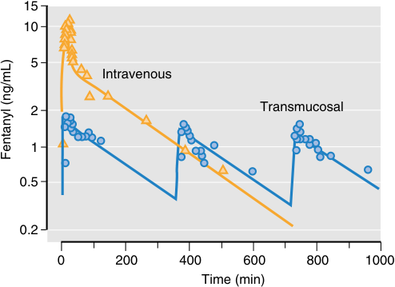

15 10 5 Intravenous 2 Transmucosal 1 0.5 0.2 0 200 400 600 800 1000 Time (min) Fentanyl (ng/mL) 

**Fig. 22.34 Time- dependent change in plasma concentration of fentanyl after oral transmucosal fentanyl citrate (OTFC) application and intravenous administration.** Three 800- mcg doses of OTFC were administered with 6- hour intervals between doses, and fentanyl was infused at a constant rate of 50 mcg/min to a total of 15 mcg/kg. (From Egan TD, Sharma A, Ashburn MA, et al. Multiple dose pharmacokinetics of oral transmucosal fentanyl citrate in healthy volunteers. _Anesthesiology._ 2000;92:665–673.)

<!-- PDF page 49 -->

from shellfish, was shown to offer a noninvasive alternative to intravenous morphine for postoperative analgesia in patients after third molar extraction.493 Intranasal administration of remifentanil (4 mcg/kg) produces good intubating conditions in 2–3 minutes after induction of anesthesia with sevoflurane in children.494

**Inhalational.** Fentanyl (300 mcg) inhalation produces low plasma drug level (0.1 ng/mL) after 15 minutes and analgesia that may be disproportionately greater than expected.495 Inhaled liposome- encapsulated fentanyl was also demonstrated to be a noninvasive route of administration with a rapid increase and prolonged maintenance of plasma fentanyl concentration.496 Inhalation of nebulized fentanyl citrate significantly improved patient perception of breathing, respiratory rate, and oxygen saturation in terminally ill cancer patients,497 suggesting that this inexpensive and readily available treatment may offer substantial relief of end- of- life dyspnea. The advent of specialized and efficient pulmonary drug delivery systems by the use of air- jet nebulization has facilitated the evaluation of inhaled opioids, such as morphine and fentanyl, for management of severe pain associated with surgery or malignant disease.498 It was shown that remifentanil delivered by inhalation is rapidly absorbed, pharmacologically active, rapidly cleared, and noninjurious to respiratory tissues in rodents.499

**Rectal Transmucosal.** The rectal mucosa is another site for transmucosal drug delivery. The bioavailability of 30mg morphine sulfate controlled- release suppository formulation was significantly greater than that of 30- mg oral controlled- release morphine sulfate tablets, which may be the result of partial avoidance of hepatic biotransformation with rectal administration.500 The hydrogel formulation of rectal morphine may also be useful for premedication and analgesia in pediatric patients.501 A pharmacokinetic study in volunteers, in which three escalating doses of morphine hydrochloride (10 mg, 15 mg, and 20 mg) were administered 20 cm from the anal verge, showed that the mean morphine absorption transit time was 0.6 h, clearance 78 L/h, and absolute bioavailability 24%, and suggested that a single dose of 35 mg will provide sufficient peak serum concentration levels and a 46- mg dose four times daily is suggested to maintain clinically relevant steadystate concentrations.502

### Oral Controlled- Release Medications

Controlled- release or sustained- release dosage forms are designed to release a drug at a predetermined rate in order to maintain a constant drug concentration for a specific period of time with minimum side effects. This can be achieved through a variety of formulations, including liposomes and drug–polymer conjugates. Despite its high first- pass metabolism, morphine has been formulated into an oral, sustained- release tablet (MST) and has been evaluated for premedication, postoperative analgesia, and as an analgesic for chronic cancer pain. MST provides unreliable preoperative anxiolysis and postoperative pain relief, possibly because of delayed time to onset of peak effects (3–5 hours), which can be increased by impaired gastric emptying and absorption from the small intestine. However, in a

study comparing effects of MST (20 mg, 12 hourly) and intramuscular morphine (10 mg, 6 hourly) in patients undergoing total hip arthroplasty under lumbar spinal anesthesia, MST and intramuscular morphine gave similar levels of postoperative analgesia, suggesting that MST is a suitable alternative to the IM route in this population undergoing surgery under spinal anesthesia.503 As an analgesic for chronic cancer pain, MST was shown to be an excellent formula.504

The relative analgesic potency of single doses of oral controlled- release oxycodone (20 or 40 mg) and oral controlled- release morphine (45 or 90 mg) was compared in a randomized, double- blind trial in women with moderate to severe pain following abdominal hysterectomy.505 Controlled- release oxycodone at doses of 20 mg or 40 mg was comparable with controlled- release morphine at doses of 45 mg or 90 mg, respectively, for total and peak analgesic effects, indicating that oral controlled- release oxycodone was at least twice as potent as oral controlled- release morphine. A randomized, double- blind, cross- over trial indicated that controlled- release oxycodone was as safe and effective as controlled- release morphine in the treatment of cancer pain.506 Growing evidence has associated chronic use of sustained-release formulation of opioids for non- cancer pain to increased risk of fatal overdose without significant benefit over other nonopioid modalities of analgesia.

### Extended- Release Epidural Morphine (DepoDur)

DepoDur is a drug that delivers morphine by using DepoFoam technology, a drug- delivery system composed of multivesicular lipid particles containing nonconcentric aqueous chambers that encapsulate the active drug. When the plasma morphine concentration after epidural administration of 5 mg of standard morphine was compared with those of 5 mg of DepoDur, the terminal half- life was comparable, but the peak concentration was significantly smaller, and the peak systemic absorption occurs later with DepoDur. Randomized controlled studies demonstrated that 5–15 mg of DepoDur can be a potentially beneficial analgesic after elective cesarean delivery with no significant increases in adverse events for the period from 24 to 48 hours after surgery.507,508 When compared to singleshot plain epidural morphine, DepoDur has been shown to provide a longer duration of postoperative pain control, and decrease the use of postoperative opioid in lower abdominal surgery,509 total hip arthroplasty,510 and total knee arthroplasty.511 The adverse-effect profile of DepoDur is similar to plain epidural morphine and includes nausea, vomiting, pruritus, and hypotension. It was reported that a large dose of epidural lidocaine before DepoDur administration alters the pharmacokinetics and drug effects of DepoDur.512

## Other Opioid Agonists

Many opioid analgesics can be used to treat pain. To achieve the balance between adequate pain control and adverse effects, the selection and dosage of opioids need to be taken into consideration. Opioid rotation refers to a switch from one opioid to another to improve the response to analgesic

<!-- PDF page 50 -->

therapy or reduce adverse effects, and the analgesic potency and the pharmacokinetic properties should be considered to plan adequate opioid rotation. Equianalgesic tables have been utilized historically to guide dose of analgesic therapy, but there is no widely accepted guideline for opioid equianalgesic conversions. Table 22.9 shows an example of opioid equianalgesic conversion based on equianalgesia tables from 32 institutions.513

### CODEINE

Codeine (methylmorphine) is approximately one- half as potent as morphine, has a high oral–parenteral potency ratio (2:3) and a plasma half- life of 2 to 3 hours. Codeine has mild to moderate analgesic but strong cough- suppressant properties after oral administration. Cytochrome P450 2D6 (CYP2D6) was identified as the enzyme responsible for _O_ - demethylation of codeine to morphine, whereas CYP3A4 was shown to be involved in _N_ - demethylation of codeine to norcodeine. Therefore, co- administration of codeine with selective inhibitors of CYP3A4 – for example, cimetidine, erythromycin, and grapefruit juice – may result in increased morphine production and enhanced pharmacodynamic effects due to shunting down the CYP2D6 pathway.514 IV codeine produces profound hypotension and is neither approved nor recommended.

### OXYCODONE

In humans, oxycodone is converted into several metabolites by CYP2D6 and CYP3A4 (Fig. 22.35). The CYP2D6 enzyme is principally responsible for the conversion of oxycodone to oxymorphone, an active metabolite with potent opioid receptor agonist activity. The CYP2D6 gene is highly polymorphic with encoded protein activities, ranging from non- functioning to high- functioning enzymes, and several pharmacogenetic studies have shown the importance of

**Table 22.9** Consensus Opioid Equianalgesia Based on the Median Conversion Factors from 32 Institutions’ Equianalgesia Tables

||**PO (mg)**|**IV (mg)**|
|---|---|---|
|Codeine|200|–|
|Fentanyl|–|0.135|
|Hydrocodone|30|–|
|Hydromorphone|8|2|
|Levorphanol|4|2|
|Meperidine|300|100|
|Morphine|30|10|
|Oxycodone|20|–|
|Oxymorphone|10|–|
|Tapentadol|90|–|
|Tramadol|140|–|

CYP2D6- mediated conversion of oxycodone to oxymorphone for analgesic efficacy.515 Rifampin, a strong inducer of several drug- metabolizing enzymes, induces CYP3A, reduces the plasma concentration of intravenous and oral oxycodone, and modestly attenuates pharmacologic effects of oxycodone.516 Oxycodone is a potent analgesic after systemic administration, but its analgesic potency is poor after intrathecal administration.517 It was shown that oxycodone is more potent than morphine for visceral pain relief in intravenous patient- controlled postoperative analgesia after laparoscopic hysterectomy.518 With respect to pharmacologic effects other than analgesic effects, it was reported that the extent and speed of onset of oxycodoneinduced respiratory depression was dose- dependent and greater than an equivalent dose of morphine.519 It should be noted that misuse of oxycodone, high abuse liability of which may be based on its unique pharmacologic profile different from morphine, greatly contributed to the opioid crisis.520

### MEPERIDINE (PETHIDINE)

Meperidine is predominantly a μ- opioid receptor agonist that produces pharmacologic effects similar but not identical to those of morphine. Meperidine sometimes causes excitation of the CNS, characterized by tremors, muscle twitches and seizures, that are largely due to accumulation of a metabolite, normeperidine. Meperidine has well- known local anesthetic properties.

Unlike morphine, after intravenous injection, first- pass uptake of meperidine by the lungs is approximately 65%. Meperidine is more highly bound to plasma proteins than is morphine, principally (70%) to α1- acid glycoprotein. As with morphine, a relatively high hepatic extraction ratio results in biotransformation that depends on hepatic blood flow. The major metabolite normeperidine has analgesic activity and is roughly twice as potent as meperidine in producing seizures in animals. The elimination half- life of normeperidine is considerably greater than that of meperidine, and thus repeated doses can easily produce accumulation of this toxic metabolite in patients with renal disease, with the potential for inducing seizures.

Meperidine is frequently used for postoperative pain management, but meperidine (50–100 mg IV) produces variable degrees of pain relief and is not always effective in patients with severe pain. A comparative study demonstrated that morphine, meperidine, and tramadol resulted in equivalent pain scores in intravenous PCA after abdominal hysterectomy.521 Meperidine is also used to relieve pain and distress in women in labor.522 Intravenous meperidine (50 mg) and butorphanol (1 mg) significantly reduced pain intensity 15 minutes after injection in women with moderate to severe labor pain, but the analgesia was often inadequate.523 Meperidine (12.5 to 35 mg) is effective for prevention and treatment of postoperative shivering.165,524

### HYDROMORPHONE

_PO_ , _per os_ (by mouth); _IV_ , intravenous. From Wen RY, Atayee RS, Edmonds KP. A comparison of institutional opioid equianalgesia tools: a national study. _J Palliat Med_ . 2022;25:1686.

Hydromorphone is structurally related to morphine but is approximately five to ten times as potent. Because

::: details 原始表格與符號（PDF 第 50 頁）

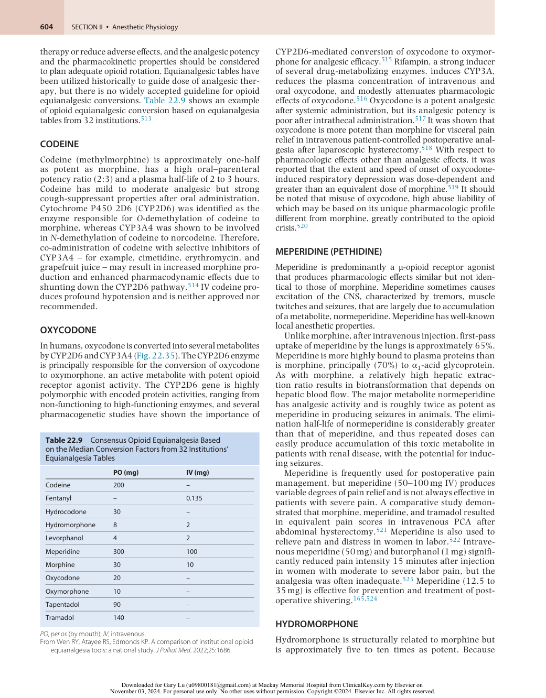

:::

<!-- PDF page 51 -->

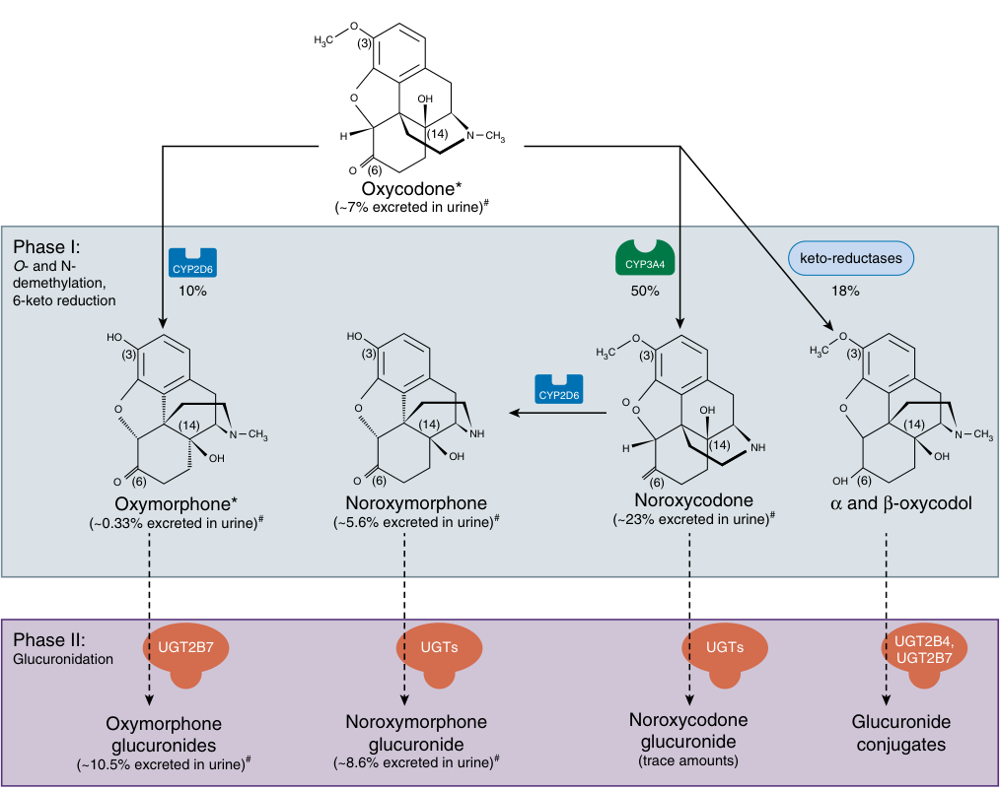

O H3C (3) O OH H (14) N CH3 O (6) Oxycodone* (~7% excreted in urine) # Phase I: O - and N- CYP2D6 CYP3A4 keto-reductases demethylation,  10% 50% 18% 6-keto reduction HO HO O O (3) (3) H3C (3) H3C (3) CYP2D6 O O O O OH O (14) N CH3 (14) NH (14) N CH3 H (14) NH OH OH OH O (6) O (6) (6) OH (6) Oxymorphone* Noroxymorphone Noroxycodone α and β-oxycodol (~0.33% excreted in urine) # (~5.6% excreted in urine) # (~23% excreted in urine) # Phase II: UGT2B7 UGTs UGTs UGT2B4, Glucuronidation UGT2B7 Oxymorphone Noroxymorphone Noroxycodone Glucuronide glucuronides glucuronide glucuronide conjugates (~10.5% excreted in urine) # (~8.6% excreted in urine) # (trace amounts) 

* represents the compounds active at µ-opioid receptors and implicated in the analgesic action of oxycodone # represents the % of total dose excreted in urine

() numbers in brackets represent carbon number CYP: cytochrome P450 UGT: UDP-glucuronosyltransferase Phase I metabolism Phase II metabolism

**Fig. 22.35 Elimination pathways of oxycodone.** The active compound oxymorphone is formed by metabolism of oxycodone by the CYP2D6 isoform of cytochrome P450. (From Deodhar M, Turgeon J, Michaud V. Contribution of CYP2D6 functional activity to oxycodone efficacy in pain management: genetic polymorphisms, phenoconversion, and tissue- selective metabolism. _Pharmaceutics._ 2021;13:1466.)

hydromorphone contains a keto- group in position 6 of the benzol ring, an active 6- glucuronate metabolite is not formed like morphine.525 However, hydromorphone continues to represent an increased risk under conditions of renal insufficiency and failure due to a reduction in clearance and potential accumulation of hydromorphone 3- glucuronate. A bolus administration of hydromorphone reaches its peak effect in approximately 20 min, whereas an equivalent morphine bolus will require 94 minutes to reach peak. Analgesia after hydromorphone lasts 4 to 5 hours. Hydromorphone has been used for both acute and chronic pain conditions in adults and children.526 It was reported that hydromorphone PCA provided adequate postoperative analgesia in gynecologic surgery patients and there was no systematic difference between morphine and hydromorphone in opioid- related side effects.527

### LEVORPHANOL

Levorphanol is the only available semisynthetic opioid agonist of the morphinan series with a long halflife. It is five times as potent as morphine with an IM/ oral potency ratio of 1:2. Levorphanol may have utility in patients with chronic pain and who demonstrate morphine tolerance, perhaps because of differences in opioid receptor activity. Analgesia produced by levorphanol is mediated via its interactions with μ- , δ- , and κ- opioid receptors. Levorphanol has many similarities to methadone,528 and is an NMDA receptor antagonist. The long half- life of the drug increases the potential for drug accumulation.529 Methadone

Methadone is a potent μ- opioid receptor agonist, with the longest half- life among the clinically used opioids. By virtue of one of methadone’s isomers, it also exerts an

<!-- PDF page 52 -->

inhibitory effect on NMDA receptors, which are implicated in the development of opioid tolerance, hyperalgesia, and chronic pain. Furthermore, methadone inhibits the reuptake of serotonin and norepinephrine, which may play a role in antinociception and mood elevation. Its unique pharmacology and cellular effects make it a valuable agent in the treatment of both acute and chronic pain of various etiologies. Methadone itself is associated with less abuse potential than either morphine or heroin, and because of its long half- life and high oral bioavailability, methadone has had a primary role in the outpatient treatment of patients with a history of opioid abuse or addiction.530 Thus, treatment with methadone has been considered to be the “gold standard” for medicationassisted treatment (MAT), a comprehensive treatment program for OUD.

Methadone has an equivalent potency (IV) but longer duration of action than morphine. The plasma half- life of methadone is very long and variable (13–100 hours), but many patients require dosing every 4 to 8 hours to maintain analgesic effects. Its major clinical applications are in the prevention of opioid withdrawal symptoms and in the treatment of chronic pain. It was shown that the same dose of IV methadone (20 mg) that is effective for postoperative pain was also suitable for the induction of anesthesia in combination with etomidate, and that substantial increases in plasma histamine occurred in 2 of 23 patients who received methadone.531 In patients undergoing posterior spinal fusion surgery, methadone 0.2 mg/kg at the start of surgery reduced postoperative opioid requirements, decreased pain scores, and improved patient satisfaction.532 However, perioperative use of methadone represents a major clinical challenge, given the tremendous interpatient half- life variability which could contribute to unexpected postoperative respiratory depression. Methadone can increase the risk of prolongation of the corrected QT (QTc) interval in electrocardiography and subsequent development of torsades de pointes, a life- threatening cardiac arrhythmia.263

### OXYMORPHONE

Oxymorphone is a semisynthetic opioid agonist that is specific for the μ- opioid receptor and approved to treat both acute and chronic pain. Due to extensive liver metabolism, oral oxymorphone is contraindicated in patients with moderate to severe hepatic impairment.533 Oxymorphone, structurally related to morphine, is almost ten times as potent, but has a similar duration of action. It was shown that in patients with acute moderate to severe postsurgical pain, oral immediate- release oxymorphone 10, 20, or 30 mg provided significant dose- related pain relief compared with placebo, and this relief was maintained over several days with a safety profile comparable to that of immediate- release oxycodone.534

### PIRITRAMIDE

Piritramide, a synthetic opioid structurally related to meperidine, acting on the μ- opioid receptor is often used for postoperative analgesia in several European countries.535 Lack of hemodynamic effects and less side effects

reported in early work made piritramide more suitable for postoperative pain control compared with other potent opioids. Its relative analgesic potency compared with morphine is approximately 0.7. Intramuscular bolus injections of 7.5–15 mg were considered to be adequate for approximately 4–6 hours.535 Pharmacokinetic analysis showed that piritramide is distributed extensively and eliminated slowly, and recommended for intermittent bolus administration.536 A randomized controlled trial showed that intravenous PCA with piritramide can produce pain management as satisfactory as oral oxycodone after cesarean section.537 It was also demonstrated that piritramide is at least as effective and as well tolerated as morphine for postoperative analgesia via a PCA system after hysterectomy.538

### TRAMADOL

Tramadol is a prodrug that is metabolized by CYP2D6 to its more potent opioid analgesic metabolites, particularly the _O_ - demethylation product M1. Because there is a significant variability in the efficiency and amount of CYP2D6 enzymes among individuals, the large phenotypic variation affects the speed of metabolism and the rate of accumulation or elimination of tramadol.539

The action of tramadol to induce analgesia represents the combination of two predominant mechanisms, reuptake inhibition of norepinephrine and serotonin, and activation of the μ- opioid receptor and to a lesser extent the δ- and κ- opioid receptors.540 Tramadol is a unique racemic mixture, and each of the two racemic isomers inhibits norepinephrine and serotonin reuptake, respectively.541 It was suggested that tramadol may also have a direct serotoninreleasing action.542 Given the analgesic effect of tramadol is only partially reversed by naloxone, its serotonergic and noradrenergic effects likely represent its predominant analgesic action.

Tramadol is one- fifth to one- tenth as potent as morphine. In rats, tramadol could reduce MAC of isoflurane in a naloxone- sensitive manner.543 It was shown that intravenously administered tramadol was effective for postthoracotomy pain relief.544 Analgesic doses of tramadol may produce less respiratory depression than the other opioids in part because of its nonopioid receptor–mediated analgesic actions, and have minimal effects on gastrointestinal motor function.545 Nevertheless, tramadol used as a sole drug cannot be considered the drug of choice after moderately to severe painful surgery because of a significant variability in the efficiency. The dose of tramadol needed to relieve pain in 80% of patients (ED80) was 260 mg, and much larger than the usual dose of 50–100 mg.546

Tramadol is also used as an adjunct to regional anesthesia. Tramadol added to lidocaine for intravenous regional anesthesia provided a shorter onset time of sensory block.547 Tramadol added to 1.5% mepivacaine for brachial plexus block enhances the duration of analgesia in a dose- dependent manner with acceptable side effects.548 Intra- articular tramadol was also used for management and prevention of pain after arthroscopic knee surgery. It was shown that the intra- articular admixture of tramadol 100 mg with 0.25% bupivacaine provides a pronounced prolongation of analgesia

<!-- PDF page 53 -->

compared with either drug alone in patients undergoing arthroscopic knee surgery.549

Tramadol has dose- and time- dependent bactericidal activity against _Escherichia coli_ and _Staphylococcus epidermidis_ , as well as antibacterial activity against _Staphylococcus aureus_ and _Pseudomonas aeruginosa_ . The antibacterial properties of tramadol might be useful for reduction of bacterial infection after regional anesthesia.550

Co- administration of tramadol with proserotonergic medications can result in a hyperserotonergic state, serotonin syndrome, which can be subacute or chronic and range from mild to severe.551 In mild cases, patients are afebrile and may report symptoms of diarrhea, tremor, tachycardia, shivering, diaphoresis, or mydriasis.552 In severe cases, neuromuscular hyperactivity, autonomic hyperactivity, altered mental state, gastrointestinal symptoms, and even death have been reported. Serotonergic medications that can interact with tramadol include selective serotonin reuptake inhibitors, serotonin–norepinephrine reuptake inhibitors, tricyclic antidepressants, triptans (e.g., sumatriptan), antipsychotics, anticonvulsants, antiparkinsonian agents, cough and cold medications containing dextromethorphan, herbal products containing St. John’s wort, and medications that inhibit the metabolism of serotonin, such as monoamine oxidase inhibitors.551 Because symptoms of serotonin and norepinephrine withdrawal are possible upon abrupt cessation of tramadol, gradual tapering or symptomatic support are necessary when tramadol administration is stopped.539

### TAPENTADOL

Analgesic effect of tapentadol is mediated by μ- opioid receptor activation, with potency between morphine and tramadol, and inhibition of norepinephrine reuptake into nerve endings. Distinct from tramadol, the analgesic effect of tapentadol does not depend on metabolism mediated by CYP2D6 and inhibition of serotonin reuptake.541 It was also reported that tapentadol does not appear to cause the confusional states sometimes associated with tramadol. In various studies, tapentadol has been found to be effective even for severe postoperative pain.553 Tapentadol consistently demonstrated superior gastrointestinal tolerability, including nausea, vomiting, and constipation at doses that provide comparable efficacy with oxycodone.554

### MORPHINE- 6- GLUCURONIDE

Morphine- 6- glucuronide (M6G) is a potent metabolite of morphine, and its affinity for the μ- opioid receptor is higher than morphine itself.377 In contrast to morphine, M6G is not metabolized but excreted via the kidneys and exhibits enterohepatic cycling, as it is a substrate for multidrug resistance transporter proteins in the liver and intestines.555 M6G exhibits a delay in its analgesic effect (blood effectsite equilibration half- life 4–8 h), which is partly related to slow passage through the blood–brain barrier and distribution within the brain compartment. M6G can be used as an analgesic in humans. Osborne _et al._ reported that 0.5–4 mg IV of M6G was effective for cancer pain for 2–24 hours without nausea and vomiting.556 M6G 100 mcg and 125 mcg given intrathecally provided excellent analgesia

after total hip replacement, as did intrathecal morphine sulfate 500 mcg.557 In a randomized double- blind study it was shown that M6G has an analgesic effect similar to that of morphine over the first 24 hours postoperatively. However, initial onset of M6G effect may be slower than morphine.558 M6G has also paradoxically been observed to increase pain sensitivity in mice and humans. The pronociceptive effect of M6G can be shown in knockout mice lacking μ- , κ- , and δ- opioid receptors, and might be due to activation of the NMDA receptors.559

## Agonist–Antagonist Opioid Compounds

Nalorphine, the first agonist–antagonist opioid, was successfully synthesized by Weijland and Erickson in 1942 and was found to be strongly antagonistic to almost all the properties of morphine. Although nalorphine was found to possess strong analgesic actions, it was unsuitable for clinical uses because of its psychotomimetic effects. Nalorphine was used in lower doses as an opioid antagonist.

Agonist–antagonist opioids are usually produced by alkylation of the piperidine nitrogen of the morphine molecule. Buprenorphine is a partial agonist at the μ- receptor and an antagonist at the κ- receptor. The other compounds are μ- antagonists and full or partial agonists at the κ- receptors. Agonist–antagonist opioids are less prone (but not immune) to abuse because they have analgesic ceiling effects, cause less euphoria, and are associated with less drug- seeking behavior and physical dependence.

Dosing data of these compounds are shown in Table 22.10. The agonist–antagonists compounds depress respiration similarly to morphine, but ceiling effects exist560 (Table 22.11). Effects on the cardiovascular system differ among these compounds560 (Table 22.12).

### PENTAZOCINE

Pentazocine is one- half to one- fourth as potent as morphine as an analgesic, and analgesia by pentazocine is primarily related to κ- receptor stimulation. Ceilings to both analgesia and respiratory depression were suggested, but the ceiling doses were not clearly reported, probably because the psychotomimetic effects of pentazocine can make it difficult to study the dose–response relationship in humans. Although the potential for abuse is less than with morphine, prolonged use of

**Table 22.10** Dosing Data for Agonist–Antagonist Opioids and Morphine

||**Equianalgesic** **IM Dose (mg)**|**Duration of** **Analgesia (h)**|**Oral: IM** **Efficacy Ratio**|
|---|---|---|---|
|Morphine|10|4–5|1:6|
|Buprenorphine|0.3–0.4|>6|1:2*|
|Butorphanol|2|3–4|—|
|Nalbuphine|10|3–6|1:4–5|
|Pentazocine|40|3|1:3|

*Sublingual: IM ratio. _IM_ , intramuscular.

::: details 原始表格與符號（PDF 第 53 頁）

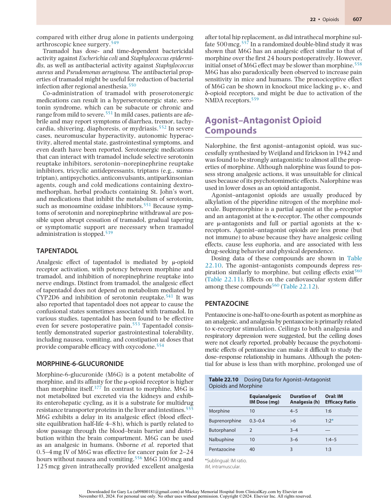

:::

<!-- PDF page 54 -->

**Table 22.11** Respiratory Depressant Effects of Agonist–Antagonists Compared with Morphine*

|**Drug**|**Correlation of Respiratory Depression with Dose**|
|---|---|
|Morphine|Increases proportionally with dose|
|Buprenorphine|Ceiling effect at 0.15–1.2 mg in adults|
|Butorphanol|Ceiling effect at 30–60 mcg/kg|
|Nalbuphine|Ceiling effect at 30 mg in adults|
|Pentazocine|Ceiling effect suggested, but difficult to study because of psychotomimetic effects|

*Low or moderate naloxone doses readily reverse the respiratory depressant effects produced by therapeutic doses of all drugs listed, except buprenorphine.

From Zola EM, McLeod DC. Comparative effects and analgesic efficacy of the agonist- antagonist opioids. _Drug Intell Clin Pharm_ . 1983;17:411.

|**Table 22.12**  Agonist–Anta|Hemodyna gonist Comp|mic Effects ounds Co|of mpared|with Morphine|
|---|---|---|---|---|
|**Drug**|**Cardiac** **Workload**|**Blood** **Pressure**|**Heart** **Rate**|**Pulmonary** **Artery Pressure**|
|Morphine|↓|↓|=↓|=↓|
|Buprenorphine|↓|↓|=↓|?|
|Butorphanol|↑|=↑|=|↑|
|Nalbuphine|↓|=|=↓|=|
|Pentazocine|↑|↑|↑|↑|

From Zola EM, McLeod DC. Comparative effects of analgesic efficacy of the agonist- antagonist opioids. _Drug Intell Clin Pharm_ . 1983;17:411.

pentazocine can lead to physical dependence. Nalorphine- like dysphoric side effects are common, especially after high doses (>60 mg) of pentazocine in the elderly. The dysphoric effects of pentazocine can be reversed with naloxone. Pentazocine depresses myocardial contractility and increases arterial blood pressure, heart rate, systemic vascular resistance, pulmonary artery pressure, and left ventricular work index. Pentazocine also increases blood catecholamine levels. Pentazocine inhibits gastric emptying and gastrointestinal transit in rats, whereas U50488H, a pure κ- agonist, did not significantly inhibit either.561 Therefore, it might be speculated that pentazocine affects gastrointestinal function through a mechanism other than the opioid receptors.

Pentazocine has been shown to be an effective treatment for pruritus after cesarean delivery under spinal anesthesia with opioids, the incidence of which ranges from 50% to 100%. A single 15- mg dose of IV pentazocine after delivery was shown to reduce both the incidence and severity of pruritus in women who have received subarachnoid opioids during cesarean delivery.562 Pentazocine has limited application, because it is associated with a high incidence of postoperative nausea and vomiting, it provides limited analgesia, it partially antagonizes other opioids, and it can produce undesirable cardiovascular and psychotomimetic effects.

### BUTORPHANOL

Butorphanol is an agonist at κ- receptors. Its activity at μ- receptors is either antagonistic or partially agonistic. It is five to eight times as potent as morphine and is only available in

parenteral form. After IM injection, onset of effect is rapid, and peak analgesia occurs within 1 hour. Whereas duration of action of butorphanol is similar to that of morphine, its plasma half- life is only 2 to 3 hours. Although butorphanol (10 mg IM) causes as much respiratory depression as the same dose of morphine, higher doses reach a ceiling. Side effects after butorphanol include drowsiness, sweating, nausea, and CNS stimulation. In healthy volunteers, butorphanol (0.03 or 0.06 mg/kg IV) produces no or minimal cardiovascular changes. However, in patients with cardiac disease, butorphanol causes significant increases in cardiac index, left ventricular end- diastolic pressure, and pulmonary artery pressure.

Because butorphanol decreases the MAC for enflurane by only a small fraction, it cannot serve like the fentanyl congeners as a component of balanced anesthesia. Butorphanol is subject to less abuse and has less addictive potential than morphine or fentanyl. Acute biliary spasm can occur after butorphanol but increases in biliary pressure are less than after equipotent doses of fentanyl or morphine. Transnasal butorphanol is effective in relieving migraine and postoperative pain.563

### BUPRENORPHINE

######

Buprenorphine is a thebaine derivative with μ- receptor partial agonist activity approximately 33 times more potent than morphine and is also a κ- receptor antagonist. Whereas fentanyl dissociates rapidly from μ- receptors (half- life of 6.8 minutes), buprenorphine has a higher affinity and takes much longer (half- life of 166 minutes) to dissociate. Onset of action of buprenorphine is slow, its peak effect may not occur until 3 hours, and the duration of effect is prolonged (&lt;10 h). Volume of distribution of buprenorphine is 2.8 L/kg and its clearance is 20 mL/kg/min. Plasma concentrations of the metabolites of buprenorphine, norbuprenorphine, buprenorphine- 3- glucuronide, and norbuprenorphine- 3- glucuronide may approximate or exceed those of the parent drug. Both glucuronide metabolites are biologically active and may contribute to the overall pharmacology of buprenorphine.564

Subjective effects (e.g., euphoria) of buprenorphine are similar to morphine. Buprenorphine produces depression of minute ventilation which leveled off at doses higher than 3.0 mcg/kg to about 50% of baseline, in contrast to the case of fentanyl, in which dose- dependent respiratory depression results in apnea at doses higher than 2.9 mcg/kg565 (Fig. 22.36). Buprenorphine has been successfully used for premedication (0.3 mg IM), as the analgesic component in balanced anesthesia (4.5 to 12 mcg/kg), and for postoperative pain control (0.3 mg IM). Buprenorphine, like the other agonist–antagonist compounds, is not acceptable as a sole anesthetic, and its receptor kinetic profile restricts its usefulness if other μ- agonists are used. Opioid withdrawal symptoms develop slowly (5–10 days) after buprenorphine is discontinued following long- term use. A recent systematic review reported that, while a theoretical ceiling effect may exist with respect to respiratory depression by buprenorphine, in a clinical setting, it can still cause significant adverse effects on respiratory function.566 However, given that buprenorphine is an equally efficacious analgesic agent, it is a useful alternative opioid because of its ease of administration and reduced incidence of pruritus.

::: details 原始表格與符號（PDF 第 54 頁）

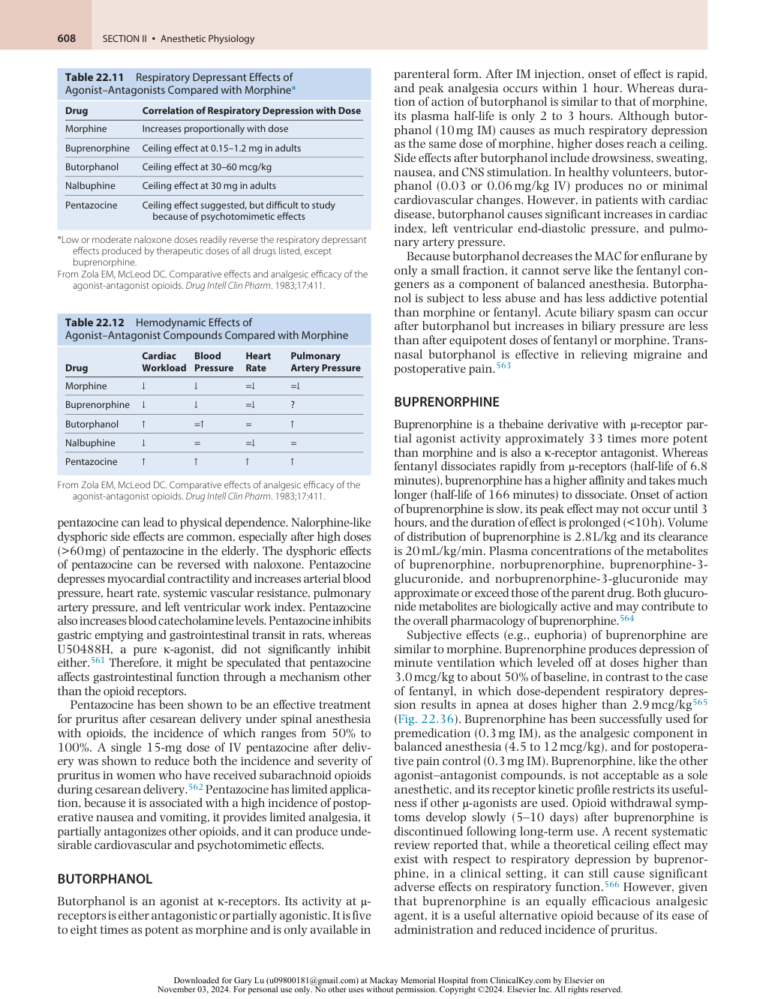

:::

<!-- PDF page 55 -->

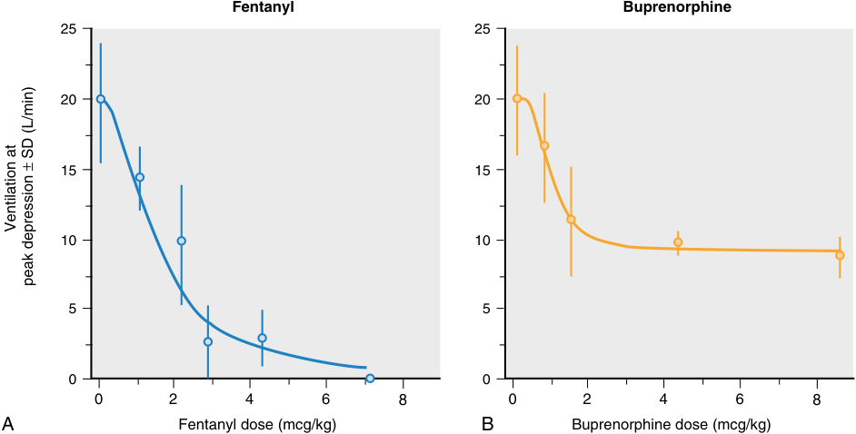

Fentanyl Buprenorphine 25 25 20 20 15 15 10 10 5 5 0 0 0 2 4 6 8 0 2 4 6 8 A Fentanyl dose (mcg/kg) B Buprenorphine dose (mcg/kg) Ventilation at SD (L/min)peak depression ± 

**Fig. 22.36 Dose–response relationships for reduction of minute ventilation induced by fentanyl (A) and buprenorphine (B) in healthy volunteers.** The response is the peak ventilatory depression at each dose. The _line through the data_ is the fit to the Hill equation. Placebo is 0 mcg/kg. Data are mean ± standard deviation. (From Dahan A, Yassen A, Bijl H, et al. Comparison of the respiratory effects of intravenous buprenorphine and fentanyl in humans and rats. _Br J Anaesth._ 2005;94:825–834.)

A sublingual combination tablet composed of buprenorphine and naloxone in a fixed 4:1 ratio may provide pain relief in patients with chronic pain with OUD, and is one of the FDA- approved medications for OUD.567 However, the unique pharmacologic profile of buprenorphine/ naloxone confers it to be a weak analgesic relative to full μ- receptor agonists. Possible mechanisms of pain relief by buprenorphine/naloxone therapy in opioid- dependent patients with chronic pain may include reversal of opioidinduced hyperalgesia and improvement in opioid tolerance and addiction.568

Acute administration of κ- opioid receptor agonists and antagonists has been shown to produce effects characterized as prodepressive or antidepressive, respectively, in rodent behavioral tests, encouraging further investigation of κ- opioid receptor antagonists as potential antidepressive treatments in humans.569 In a preliminary clinical study, low doses of buprenorphine, which possess κ- receptor antagonist activity, produced impressive alleviation of depressive symptoms within 1 week of initiating administration in patients that were considered treatment- resistant.570 The potential of using buprenorphine for treating major depressive disorder, treatment- resistant depression, and posttraumatic stress disorder has been reported.571

### NALBUPHINE

Nalbuphine is an agonist–antagonist opioid that is structurally related to oxymorphone and naloxone and binds to μ- receptors as well as to κ- and δ- receptors. Nalbuphine acts as an antagonist at the μ- receptor and an agonist at the κ- receptor. Nalbuphine, like other agonist–antagonist compounds, interferes with the analgesia produced by pure μ- agonists. The most common adverse effects following nalbuphine administration are sedation, sweating,

nausea, vomiting, dizziness, vertigo, dry mouth, or headache. Nalbuphine is only available for parenteral use. The recommended single maximum dose is 20 mg in an opioid-nontolerant individual with a maximum daily dose of 160 mg. In opioid- dependent patients, the dose should be reduced by 25%, and the patient should be observed for signs of opioid withdrawal. Onset of effects is rapid (5 to 10 minutes), and duration is long (3 to 6 hours) because of a long plasma elimination half- life (5 hours).

Nalbuphine has been administered as an analgesic supplement for conscious sedation or balanced anesthesia and as an analgesic for postoperative and chronic pain problems. In patients undergoing myocardial revascularization, continuous infusion of nalbuphine (0.05–0.1 mg/kg/min) and fentanyl (0.15–0.3 mcg/kg/min) was compared.572 It was shown that nalbuphine lacks the ability to attenuate cardiovascular and hormonal responses to tracheal intubation and surgical procedures, and was concluded that continuous infusion of nalbuphine cannot be recommended for anesthesia in patients undergoing myocardial revascularization. For postoperative patient- controlled epidural analgesia, the combination of hydromorphone 0.075 mg/mL and nalbuphine 0.04 mg/mL resulted in lower incidence of nausea and decreased need of bladder catheterization compared with hydromorphone alone.573 A randomized double- blind controlled study in patients undergoing gynecologic operations demonstrated that interaction between morphine and nalbuphine in intravenous PCA admixture is additive, and combination of the two drugs can decrease the incidence of pruritus.574

A prospective randomized double- blinded study demonstrated that nalbuphine (4 mg IV) was as effective as ondansetron (4–8 mg IV) for prevention of intrathecal morphine- induced pruritus after cesarean delivery.575 Some reports showed that nalbuphine provides a rapid and

<!-- PDF page 56 -->

potent antishivering effect similar to meperidine.576 However, a quantitative systematic review of randomized controlled trials did not support the conclusion.165

### DEZOCINE

Dezocine is slightly more potent and acts faster than morphine, with a similar duration. Although no longer used clinically in Western countries, dezocine is gaining popularity in China as an alternative medication for perioperative pain management. A pharmacologic study showed the unique molecular pharmacologic profile of dezocine as a partial μ- receptor agonist, a κ- receptor antagonist, and a norepinephrine and serotonin reuptake inhibitor ( _via_ norepinephrine transporter and serotonin transporter).317 Although dezocine was shown to be an effective alternative to fentanyl when administered during outpatient laparoscopy with propofol and nitrous oxide, dezocine was associated with a high incidence of postoperative nausea and a delayed discharge time.577 In adult patients who had arthroscopic surgery under general anesthesia, dezocine (5 mg IV) and morphine (5 mg IV) were similarly effective for postoperative analgesia and showed similar side effects.578 A recent meta- analysis showed that dezocine significantly reduced the incidence and severity of opioidinduced cough in the induction of general anesthesia, but had no significant effect on vital signs.579

## Opioid Antagonists

### NALOXONE

Clinically, opioid antagonists are used to restore spontaneous ventilation in patients who breathe inadequately after opioid overdoses or opioid anesthesia. In addition, opioid antagonists can reduce or reverse opioid- induced nausea and vomiting, pruritus, urinary retention, rigidity, and biliary spasm associated with numerous therapies employing opioids.

Although naloxone is generally considered to be a pure opioid receptor antagonist, there have been reports on the effect of naloxone which cannot be explained by opioid antagonistic activity of naloxone. For example, in postoperative patients on morphine patient- controlled analgesia, low- dose naloxone (0.25 mcg/kg/h) caused the morphine consumption to reduce by 30%.580 This apparent paradoxical antinociceptive effect of naloxone might involve release of endogenous opioids enhanced by inhibition of presynaptic autoinhibition by naloxone. There are no studies that describe the transition from low analgesia-promoting doses of naloxone to higher doses that antagonize analgesia, but it was suggested that naloxone doses &lt;25 mcg (administered in 1 minute) will enhance analgesia, whereas higher doses will counteract analgesia.581 Regarding the opioid agonistic activity of naloxone, there have been several reports. High- dose naloxone possesses partial agonistic activity on the μ- and κ- opioid receptors in the cultured cells.582

### Reversal of Respiratory Depression by Naloxone

In the early 1950s, nalorphine and levallorphan were evaluated as opioid antagonists. They were often found

unacceptable because of a high incidence of side effects, as well as incomplete reversal of respiratory depression. Naloxone was introduced into clinical practice in the late 1960s. There have been reports of side effects (increases in heart rate and blood pressure) and more serious complications (e.g., pulmonary edema). Initial naloxone dose recommendations range from 0.4 to 0.8 mg. Onset of action of IV naloxone is rapid (1–2 minutes), and half- life and duration of effect are short, approximately 30 to 60 minutes. If IV access is not available, naloxone, in doses similar to those given IV, is effectively absorbed after intratracheal administration. Effect of antagonism with naloxone on opioidinduced respiratory depression under different conditions were simulated by the use of the pharmacokinetic and pharmacodynamic model.581 When naloxone is administered for reversal of respiratory depression by buprenorphine, the effect of naloxone is limited by high affinity for and slow dissociation from the μ- opioid receptor of buprenorphine, and depends on the buprenorphine dose and the correct naloxone dose window583 (Fig. 22.37). Because respiratory depression from buprenorphine may outlast the effects of naloxone boluses or short infusions, a continuous infusion of naloxone may be required to maintain reversal of respiratory depression.583

Several mechanisms produce increases in arterial blood pressure, heart rate, and other significant hemodynamic alterations after naloxone reversal of opioids. These include pain, rapid awakening, and sympathetic activation not necessarily due to pain. When patients receiving naloxone for opioid agonist reversal are hypothermic due to intraoperative heat loss, O2 consumption and minute ventilation can increase two- to threefold.584 Such metabolic demands also stress the cardiovascular system, increasing cardiac output. In addition, greater degrees of hypercapnia at the time of opioid antagonism will result in greater degrees of cardiovascular stimulation because of associated sympathetic stimulation. Opioid reversal may be particularly hazardous in patients with pheochromocytoma or chromaffin tissue tumors. It was proposed that naloxone triggers a centrally mediated catecholamine surge, which results in an adrenergic crisis, leading to shifts in blood volume from the systemic to the pulmonary vascular bed, which increases permeability and, subsequently, pulmonary edema.585 However, it was also reported that IV administration of 10 mg naloxone did not significantly change plasma catecholamine concentration and blood pressure in pheochromocytoma patients.586

Recurrence of respiratory depression after naloxone is due to the short half- life of naloxone. “Renarcotization” occurs more frequently after the use of naloxone to reverse longeracting opioids such as morphine. This is commonly not seen in clinical practice because opioid concentrations are often just above the threshold for respiratory depression, and treatment with a single or just a few effective bolus doses of naloxone is sufficient to reverse the respiratory depression induced by most opioids for the short time that the agonist concentration exceeds the respiratory depression threshold.235 Short- acting opioids such as alfentanil rarely pose a danger of renarcotization, because of a rapid plasma decay curve and weak opioid receptor binding compared with fentanyl and sufentanil. Naloxone, although active at μ- , δ- , and κ- receptors, has greatest affinity for μ- receptors, which

<!-- PDF page 57 -->

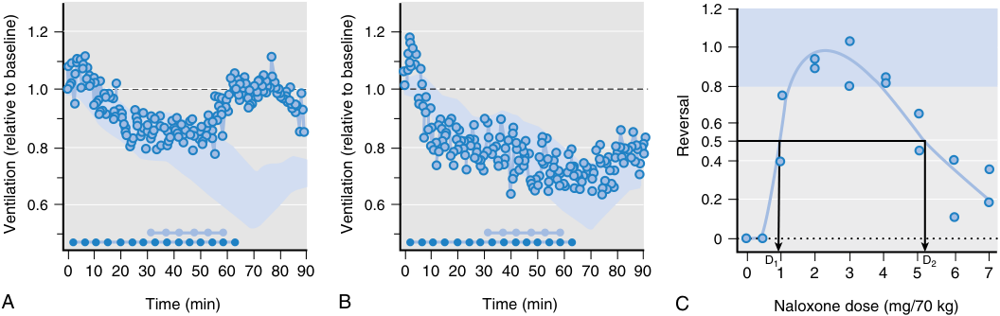

1.2 1.2 1.2 1.0 1.0 1.0 0.8 0.6 0.5 0.8 0.8 0.4 0.6 0.6 0.2 0 D1 D2 0 10 20 30 40 50 60 70 80 90 0 10 20 30 40 50 60 70 80 90 0 1 2 3 4 5 6 7 A Time (min) B Time (min) C Naloxone dose (mg/70 kg) Reversal Ventilation (relative to baseline) Ventilation (relative to baseline) 

**Fig. 22.37 Reversal of buprenorphine- induced respiratory depression with naloxone depends on the correct naloxone dose window.** Respiratory depression induced by 0.2 mg buprenorphine was reversed by naloxone 2 mg (A) and 6 mg (B) given over 30 minutes in one subject. _Light blue field_ in the background is the result of the placebo group in which saline was infused instead of naloxone. _Dark blue dots_ and _light blue dots_ represent buprenorphine and naloxone infusion, respectively. (C) Influence of 0 (placebo) and 0.5–7 mg naloxone on 0.2 mg intravenous buprenorphine- induced respiratory depression. Reversal was calculated from the naloxone- induced change in ventilation, and it ranges from 0 (effect not different from placebo) to 1 (reversal to predrug baseline level). _D1_ (0.95 ± 0.09 mg) is the naloxone dose causing 50% reversal, and _D2_ (5.20 ± 0.94 mg) is the naloxone dose causing the return to 50% depression. (From van Dorp E, Yassen A, Sarton E, et al. Naloxone reversal of buprenorphine- induced respiratory depression. _Anesthesiology._ 2006;105:51–57.)

mediate most potent opioid effects, including respiratory depression and analgesia. Careful titration of naloxone can often restore adequate spontaneous ventilation without reversal of adequate analgesia.

### Treatment of Opioid Overdose with Naloxone

The opioid crisis came in three waves: increased prescription, usage, and opioid overdose deaths from 1999 to 2010; increased overdose deaths from heroin started in 2010; and the rise in the use of fentanyl and other synthetic opioids started in 2013.587 Opioid overdose is frequently treated with naloxone in out- of- hospital settings by emergency medical services (EMS) personnel and laypersons. The Substance Abuse and Mental Health Services Administration recommended coprescription of naloxone in patients with history of opioid or substance use disorder, those who took benzodiazepine with the opioid, and those who are no longer tolerant (after incarceration or after detoxification program). Naloxone prescribing was also emphasized in the 2016 CDC Guideline for Prescribing Opioids for Chronic Pain, which specifically recommends considering offering naloxone when factors that increase risk for opioid overdose, such as history of overdose, history of substance use disorder, opioid dosages ≥50 morphine milligram equivalents (MME)/day, or concurrent benzodiazepine use are present.588 Naloxone is available as an injectable formulation and a nasal spray. Compared to the injectable formulation, the nasal spray is easier to use, and there is no risk of a needle stick, and a preparation capable of delivering a higher concentration is available. The 2- mg/mL intranasal naloxone appears to have efficacy similar to the 2- mg intramuscular naloxone for reversal of opioid overdose.589

### Other Applications of Naloxone

Low- dose naloxone not only has been shown to ameliorate undesired opioid- induced side effects but also to block the development of acute opioid tolerance. Naloxone infusion 0.25 mcg/kg/h prevented the acute opioid tolerance induced by large doses of remifentanil (0.30 mcg/kg/min)

in patients undergoing open colorectal surgery, and cumulative morphine consumption at 24 hours after surgery was significantly reduced. Furthermore, ultra- low- dose naloxone infusion provided a quicker recovery of bowel function, and reduced the length of hospital stay.590

Reversal of effects of nonopioid drugs such as alcohol, barbiturates, and benzodiazepines by naloxone has been reported. However, it was also reported that naloxone potentiates anxiolytic- like action of benzodiazepines and barbiturates in the rat.591 Although it was suggested that the μ- opioid receptor is involved in the antinociceptive action of ketamine in mice,73 naloxone did not affect the action of ketamine on secondary hyperalgesia induced by burn injury in humans.592 Thus, it is not advisable to try to reverse the effects of overdose of nonopioid drugs by naloxone.

Evidence indicates that endogenous opioid peptides participate in the control of cardiovascular regulation during hemorrhagic shock. In patients with documented septic shock and resistance to a one- liter fluid challenge, administration of naloxone by initial bolus of 0.03 mg/kg followed by infusion at a rate of 0.2 mg/kg/h significantly increased mean arterial pressure, but did not affect survival.593 This effect may be due to centrally mediated increases in sympathetic tone and decreases in parasympathetic output and/or antagonism of endogenous opioids. A meta- analysis involving 126 patients with septic, cardiogenic, hemorrhagic, or spinal shock showed that naloxone therapy was associated with statistically significant hemodynamic improvement in mean arterial pressure (weighted mean difference +9.33 mm Hg), but the effect of naloxone on the mortality was not clear.297

One study indicated that opioids can elicit excitatory as well as inhibitory modulation of the action potentials of sensory neurons, and ultra- low doses of naloxone could selectively block the excitatory effect of opioids in mice.594 A prospective randomized double- blind study demonstrated that addition of an ultra- low dose of naloxone (100 ng) to 34 mL of 1.5% lidocaine solution with or without fentanyl

<!-- PDF page 58 -->

in an axillary brachial plexus block for forearm surgery lengthens the onset time of motor and sensory blockade, delays the first postoperative pain, and prolongs motor blockade.595 This finding may suggest that the excitatory effect of endogenous opioid is involved in the postoperative pain that was blocked by the low dose of naloxone.

It was previously reported that combined use of cerebrospinal fluid drainage and naloxone reduces the risk of paraplegia in thoracoabdominal aneurysm repair.596 Currently, naloxone infusion is often used as a component of multimodal therapy to treat symptomatic spinal cord ischemia after thoracic endovascular aortic repair,597 but effectiveness of naloxone is not clearly shown. Naloxone may also be used as an antipruritic drug in the case of pruritus induced by causes other than opioid drugs.598 Several randomized controlled studies have reported significant improvement of pruritus in cholestasis, chronic urticaria, and atopic dermatitis by opioid antagonists including naloxone, naltrexone, and nalmefene, but, in view of the side effects and costs, opioid antagonists can only be recommended as second- line treatment in these conditions.599

### NALTREXONE

Naltrexone is a μ- , δ- , and κ- opioid receptor antagonist. It is longer acting than naloxone (plasma half- life of 8–12 versus 0.5–1.5 hours) and can be administered orally. A double- blind, placebo- controlled study for patients undergoing cesarean section indicated that naltrexone (6 mg) was an effective oral prophylactic against the pruritus and vomiting associated with intrathecal morphine, but was associated with shorter duration of analgesia.600

As a prescribed treatment for opioid dependence, extended- release naltrexone hydrochloride was compared directly with opioid medication treatment, which includes daily buprenorphine hydrochloride with naloxone hydrochloride. It was shown that extended- release naltrexone, administered 380 mg as monthly intramuscular injections, was as effective as buprenorphine–naloxone in maintaining short- term abstinence from heroin and other illicit substances and should be considered as a treatment option for opioid- dependent individuals.214 Importantly, naltrexone induction requires individuals to be completely off opioids due to the likelihood of severe opioid withdrawal. Randomized, placebo- controlled clinical trials that investigated the oral or intramuscular long- acting formulation of naltrexone in substance use disorders or behavioral addictions such as pathologic gambling, kleptomania, and trichotillomania showed efficacy and safety of naltrexone in treating these addictions.601 Broad anti- addiction efficacy of naltrexone might suggest a shared role of the endogenous opioid system in the pathophysiology of a number of addictive disorders.

### NALMEFENE

Nalmefene has a greater preference for μ- than δ- or κ- receptors and is equipotent to naloxone. Nalmefene is long acting after oral (0.5–3.0 mg/kg) and parenteral (0.2– 2.0 mg/kg) administration. Bioavailability after oral administration is 40% to 50%, and peak plasma concentrations

are reached in 1 to 2 hours. The mean terminal elimination half- life of nalmefene is 8.5 hours, compared with 1 hour for naloxone. Prophylactic administration of lowdose nalmefene (15 or 25 mg IV) significantly decreased the need for antiemetics and antipruritic medications in patients receiving intravenous patient- controlled analgesia with morphine.602 Similarly to naloxone and naltrexone, several studies have evaluated the efficacy of nalmefene as an antipruritic agent.599

### PERIPHERALLY ACTING μ- OPIOID RECEPTOR ANTAGONISTS

The American Gastroenterological Association (AGA) recommended the use of laxatives as the first line in patients with opioid- induced constipation (OIC). In cases of inadequate responses to laxatives, peripherally acting μ- opioid receptor antagonists (PAMORAs) are recommended.309

### Methylnaltrexone

Methylnaltrexone is the first quaternary ammonium opioid receptor antagonist that does not cross the blood–brain barrier.301 It can reverse adverse effects of opioid medications mediated by peripheral opioid receptors, while the opioid effects mediated by opioid receptors in the central nervous system, such as analgesia, are not affected. Delayed gastric emptying induced by 0.09 mg/kg morphine could be attenuated by 0.3 mg/kg methylnaltrexone in healthy volunteers.307

Methylnaltrexone is subcutaneously or orally administered for treatment of OIC in patients with advanced medical illness.603 It was reported that subcutaneous methylnaltrexone (0.15 mg/kg) rapidly induced laxation in patients who had received opioids for two or more weeks and who had received stable doses of opioids and laxatives for three or more days without relief of OIC.604 On the other hand, methylnaltrexone (12 mg once daily) did not affect opioidmediated analgesia in patients with chronic non-cancer pain suffering from OIC who received more than 50 mg of oral morphine equivalents daily.605 Randomized doubleblind placebo- controlled studies have shown effectiveness of methylnaltrexone and alvimopan, another peripherally acting opioid receptor antagonist, in management of postoperative ileus, a transient cessation of coordinate bowel function after surgery, in patients who received opioidbased IV PCA.301

### Naloxegol

Naloxegol, a PEGylated derivative of naloxone, is a peripherally acting μ- opioid antagonist which can be orally administered. PEGylation confers substrate properties for P- glycoprotein transporter and thus limits the ability of naloxegol to cross the blood–brain barrier. A double- blind study in outpatients with non-cancer pain and OIC demonstrated that daily dose of 12.5 mg or 25 mg naloxegol improved bowel movement, as compared with placebo, without changing pain scores and daily opioid dose.606 A randomized trial evaluated the effect of naloxegol on opioidinduced postoperative bladder dysfunction by measurement of residual urine volume, but no significant effect was found, and did not support use of naloxegol for postoperative urinary retention.607

<!-- PDF page 59 -->

### Naldemedine

Naldemedine is structurally related to naltrexone, and, at an oral dose of 0.2 mg, appeared to benefit patients with OIC and cancer irrespective of baseline characteristics.608 It was also reported that naldemedine, at a dose of 0.2 mg, did not appear to affect analgesia or withdrawal. P- glycoprotein inhibitors (e.g., amiodarone, carvedilol, and cyclosporine) and strong and moderate CYP3A4 inhibitors (e.g., cimetidine, erythromycin, and verapamil) might raise plasma concentration of naldemedine.609

opioid- induced antinociception at the spinal level but inhibited at the supraspinal level.614 Many studies in humans revealed benzodiazepine–opioid interactions to be synergistic (supra- additive). Fentanyl was found to synergize with midazolam in a dose- dependent fashion, in which combination of 25% of the fentanyl ED50 and 23% of the midazolam ED50 yielded ED50 of the combination to obtain inability to open eyes upon command in healthy women.615 Response surface analysis realized that hypnotic interaction between alfentanil and midazolam was significantly synergistic.616

### Thiopental

## Drug Interactions with Opioids

### GENERAL PRINCIPLES

Opioids can interact with other drugs concomitantly administered for anesthesia. Although some of these interactions are intentionally sought, others are unwanted and adverse. There are three general types of mechanisms of drug interactions: pharmaceutical, pharmacokinetic, and pharmacodynamic.610

First, pharmaceutical interactions are chemical in nature, as illustrated when an alkaline solution of thiopental and an acidic solution of nondepolarizing muscle relaxants precipitate when simultaneously administered IV.

Second, pharmacokinetic interactions occur when the administration of one agent alters the pharmacokinetics or disposition of another agent. Hemodynamic changes induced by one agent can affect pharmacokinetic behavior of the other agent. Sufentanil, which has a greater hepatic extraction ratio than alfentanil, is more likely to be affected by decreases in hepatic blood flow. Cimetidine can prolong opioid effects by decreasing hepatic blood flow and/or diminishing hepatic metabolism. The CYP3A4 and CYP2D6 isoforms of the cytochrome P450 enzyme are responsible for the oxidative metabolism of opioids. Thus, drugs and foods that can interact with the cytochrome P450 system and cause either an increased activity (enzyme induction) or enzyme inhibition may affect pharmacokinetics of opioids611 (Table 22.13). For example, it was reported that, in patients undergoing methadone maintenance treatment, drinking grapefruit juice resulted in reduction of CYP3A activity with a modest increase in peak level and decrease in clearance of methadone.612

Third, pharmacodynamic interaction occurs when the pharmacologic effect of one drug is altered by that of another drug, and is classified as synergistic, additive, or antagonistic in nature. The mechanism of interaction may occur at the same target or through alternate pathways. Pharmacodynamic interaction between opioids and inhaled anesthetics or propofol is important in performing balanced anesthesia or total intravenous anesthesia.

### SEDATIVE–HYPNOTICS

### Midazolam

Interactions between midazolam and opioids regarding hypnotic and antinociceptive effects have been analyzed. In dogs, concerning the antinociceptive effect, interaction between midazolam and fentanyl was reported to be less than additive.613 In rats, midazolam enhanced

Thiopental and opioids are commonly administered together for induction of anesthesia. The Cp50 (asleep) of thiopental was 7.32 mcg/mL in the absence of fentanyl and 7.22 mcg/mL in the presence of fentanyl (1.27 ± 0.5 ng/mL), indicating that fentanyl, at an analgesic concentration, has no effect on the hypnotic concentration of thiopental.617 Administration of alfentanil 10 mcg/kg decreased the thiopental ED50 from 2.6 mg/kg to 1.9 mg/kg for eye opening to voice command, but the mode of interaction was not examined.618 Thus, it has not been clear whether the hypnotic interaction between thiopental and opioids is synergistic or not. Barbiturates can potentiate or produce hypotension if a large dose is administered with opioids. Hypotension after barbiturate–opioid combination is due to venodilatation, decreased cardiac filling, myocardial depression, and decreased sympathetic nervous system activity. Reducing induction doses of barbiturates administered concomitantly with opioids is recommended.

### Etomidate

Etomidate can be combined in low doses with opioids with little loss of cardiovascular stability. In patients scheduled for coronary artery bypass grafting, etomidate (0.25 mg/ kg) plus fentanyl (6 mcg/kg) resulted in less hypotension after induction and intubation than propofol (1 mg/kg) plus fentanyl (6 mcg/kg).619 It was reported that myoclonic movements, a common problem during the induction of general anesthesia with etomidate, can be suppressed by sufentanil (0.3 mcg/kg).620 A meta- analysis showed that pretreatment with remifentanil (1–2 mcg/kg) could be one operative option to reduce both incidence and severity of etomidate- induced myoclonus.621

### Ketamine

Many studies on combinations of opioids and ketamine, an NMDA receptor antagonist, have been reported to optimize analgesic therapy to a variety of painful conditions. Opioidinduced hyperalgesia and opioid tolerance can be prevented by ketamine in rats, suggesting the usefulness of combination of ketamine and opioids for postoperative analgesia. A pharmacologic study in mice suggested that endogenous opioids and μ- and δ- opioid receptors are also involved in ketamine- induced central antinociception but the κ- opioid receptor is not involved in this effect.622 In a study examining the interaction of ketamine and remifentanil on the MAC of sevoflurane in rats, ketamine and remifentanil dose- dependently reduced the MAC, but adding the low dose of remifentanil to ketamine did not improve the MAC reduction, whereas the high dose of remifentanil enhanced MAC reduction by ketamine in a subadditive fashion.623

<!-- PDF page 60 -->

### Table 22.13 Substrates, Inducers, and Inhibitors of Cytochrome P450 Isozymes CYP3A4 and CYP2D6

||**Substrate**||**Inducer**|**Inhibitor**|
|---|---|---|---|---|
|**CYP3A4**|**OPIOID**||**BARBITURATE**|**H2 BLOCKER**|
||fentanyl|sufentanil|phenobarbital|cimetidine|
||alfentanil|meperidine|thiopental|**MACROLIDE**|
||dextromethorphan|codeine|**ANTIEPILEPTICS**|erythromycin|
||buprenorphine|methadone|carbamazepine|clarithromycin|
||**BENZODIAZEPINE**||phenytoin|**ANTIMYCOTIC**|
||midazolam|diazepam|**GLUCOCORTICOID**|ketoconazaole|
||alprazolam|triazolam|**RIFAMPICIN**|fluconazole|
||**LOCAL ANESTHETICS**|||itraconazole|
||lidocaine|ropivacaine||**Ca CHANNEL BLOCKER**|
||**ANTIARRHYTHMICS**|||verapamil|
||amiodarone|propafenone||diltiazem|
||quinidine|||**SSRI**|
||**Ca CHANNEL BLOCKER**|||fluvoxamine|
||verapamil|nifedipine||fluoxetine|
||diltiazem|nisoldipine||**HIV PROTEASE INHIBITOR**|
||amlodipine|nitrendipine||indinavir|
||felodipine|||nelfinavir|
||**ANTIEPILEPTIC**|||saquinavir|
||carbamazepine|phenytoin||ritonavir|
||**MACROLIDE**|||**GRAPEFRUIT JUICE**|
||erythromycin|clarithromycin|||
||**TCA**||||
||amitriptyline|imipramine|||
||**H1 BLOCKER**||||
||astemizole|terfenadine|||
||**5- HT3 ANTAGONIST**||||
||ondansetron|tropisetron|||
||granisetron||||
||**STATIN**||||
||lovastatin|simvastatin|||
||atorvastatin||||
||**HIV PROTEASE INHIBITOR**||||
||indinavir|nelfinavir|||
||saquinavir|ritonavir|||
||**ACETAMINOPHEN**||||
||**CYCLOSPORINE**||||

::: details 原始表格與符號（PDF 第 60 頁）

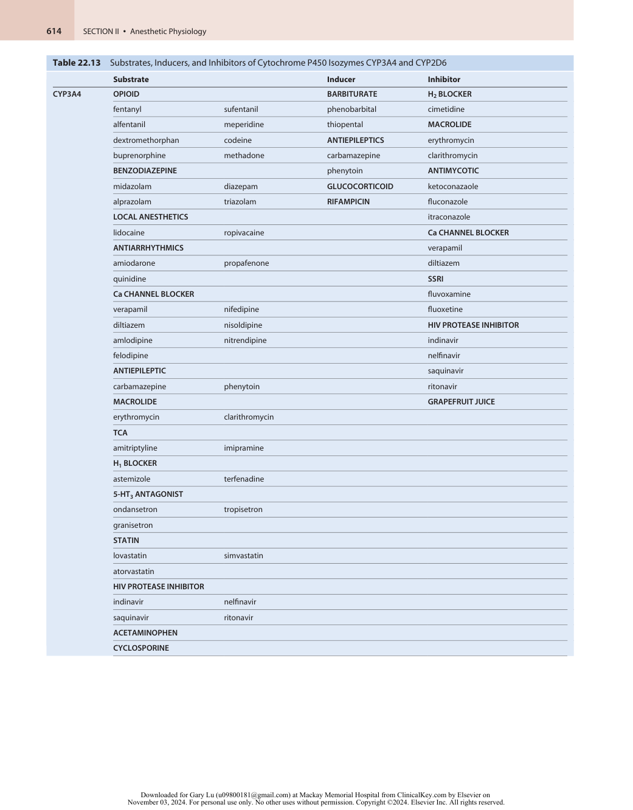

:::

<!-- PDF page 61 -->

**Table 22.13** Substrates, Inducers, and Inhibitors of Cytochrome P450 Isozymes CYP3A4 and CYP2D6 – cont’d

||**Substrate**||**Inducer**|**Inhibitor**|
|---|---|---|---|---|
|**CYP2D6**|**OPIOID**||**PREGNANCY**|**H2 BLOCKER**|
||tramadol|codeine||cimetidine|
||dextromethorphan|||**ANTIARRHYTHMICS**|
||**BETA BLOCKER**|||quinidine|
||carvedilol|metoprolol||amiodarone|
||timolol|||**SSRI**|
||**ANTIARRHYTHMICS**|||fluoxetine|
||propafenone|flecainide||paroxetine|
||ajmaline|mexiletine||**OPIOID**|
||**TCA**|||methadone|
||amitriptyline|clomipramine|||
||imipramine|desipramine|||
||**SSRI**||||
||fluvoxamine|fluoxetine|||
||citalopram|paroxetine|||
||**NEUROLEPTICS**||||
||haloperidol|droperidol|||
||thioridazine|risperidone|||
||**5- HT3 ANTAGONIST**||||
||ondansetron|tropisetron|||

_TCA_ , tricyclic antidepressant; _HIV_ , human immunodeficiency virus; _SSRI_ , selective serotonin reuptake inhibitor. From Papp- Jambor C, Jaschinski U, Forst H. Cytochrome P450 enzymes and their role in drug interactions. _Anaesthesist_ . 2002;51:2–15.

In the acute perioperative setting, results on interaction between opioids and ketamine vary depending on the clinical context. Combination of ketamine (2.5 or 10 mg IV) and alfentanil (0.25 or 1 mg IV) provided no advantage over a larger dose of either drug alone in relieving pain caused by intradermal capsaicin injection in healthy volunteers.624 Furthermore, combination of ketamine 1 mg/mL and morphine 1 mg/mL for PCA did not provide benefit to patients undergoing major abdominal surgery.625 In contrast, Lauretti reported that oral ketamine and transdermal nitroglycerin effectively reduced daily consumption of oral morphine in patients with cancer pain.626 A prospective randomized double- blind controlled study demonstrated that intraoperative and postoperative administration of ketamine for the first 48 hours after surgery (2 mcg/kg/min after a 0.5 mg/kg bolus) improved postoperative analgesia with a significant decrease of morphine consumption.627 Webb _et al._ reported that small- dose ketamine could be a useful addition to perioperative tramadol administration in patients undergoing abdominal surgery.628 Methadone and ketamine, which are NMDA receptor antagonists, have been documented to facilitate postoperative pain control. Intraoperative methadone (0.2 mg/kg) and ketamine infusion (0.3 mg/kg/h intraoperatively and then 0.1 mg/kg/h for 48 hours postoperatively) significantly reduced postoperative pain and use of opioid.629

### Dexmedetomidine

Dexmedetomidine is a sedative with anxiolytic and amnestic effects that acts through binding to the α2- adrenoceptor. Dexmedetomidine provides significant sedation without cardiorespiratory compromise, and patients sedated with dexmedetomidine can be readily aroused. These features make dexmedetomidine useful in many procedures in combination with opioids. Previously, premedication with dexmedetomidine was shown to reduce requirement of fentanyl in abdominal hysterectomy, cholecystectomy, and intraocular surgery under general anesthesia.630 In contrast, it was recently reported that, although addition of remifentanil slightly increased the depth of sedation by dexmedetomidine, it did not increase the probability of no response to name called, tolerance of shake and shout, tolerance of trapezius squeeze, and tolerance of laryngoscopy, suggesting the absence of significant synergistic interaction regarding hypnotic effect between dexmedetomidine and remifentanil.631

### MUSCLE RELAXANTS

Many factors alter the impact of muscle relaxants on hemodynamics when combined with opioids: the dose, timing, and rate of administration of each relaxant as well as the premedication, intravascular volume, left ventricular function, and presence of other drugs with autonomic nervous system actions.

::: details 原始表格與符號（PDF 第 61 頁）

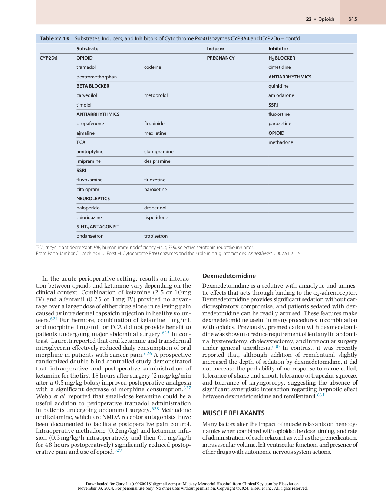

:::

<!-- PDF page 62 -->

Pancuronium bromide has been frequently used for muscle relaxation during high- dose opioid anesthesia. The vagolytic action of pancuronium can attenuate opioidinduced bradycardia and support blood pressure. In patients undergoing coronary artery bypass grafting administered with sufentanil (3–8 mcg/kg), pancuronium (0.12 mg/kg) caused significant increase in mean arterial pressure, heart rate, and cardiac output but did not induce myocardial ischemia.632 In patients scheduled for coronary artery bypass grafting administered with high- dose fentanyl (100 mcg/kg) and pancuronium (0.10 mg/kg), increase in heart rate and cardiac index occurred after induction of anesthesia and tracheal intubation, whereas patients administered with vecuronium (0.09 mg/kg) instead of pancuronium did not show increase in heart rate and cardiac index.633

Combinations of vecuronium and high doses of opioids may produce negative chronotropic and inotropic effects resulting in decreases in heart rate, cardiac output, and blood pressure and increases in the need for vasopressor support. In patients scheduled for coronary artery surgery administered with 40 mcg/kg sufentanil in combination with vecuronium (0.1 mg/kg), heart rate, mean arterial pressure, and systemic vascular resistance decreased from baseline values after tracheal intubation with neither significant change in cardiac output nor evidence of new myocardial ischemia.634

In patients anesthetized with fentanyl 50 mcg/kg and scheduled to undergo elective coronary artery bypass grafting, rocuronium 0.6 mg/kg (approximately equivalent to 2 × ED95 doses) was associated with changes of only small magnitude in hemodynamic variables, including increases in stroke volume index (+15%) and cardiac index (+11%), and a decrease in pulmonary capillary wedge pressure (−25%).635 In patients undergoing coronary artery bypass surgery under fentanyl anesthesia, mivacurium 0.15 or 0.2 mg/kg produced decreases in mean arterial pressure and systemic vascular resistance index possibly mediated by histamine release, whereas atracurium (0.5 mg/kg) produced no significant hemodynamic changes.636

### MONOAMINE OXIDASE INHIBITORS

Monoamine oxidase inhibitors (MAOIs) can underlie the most serious and potentially fatal drug interaction with opioids. Combination of meperidine and MAOI can induce the serotonin syndrome, which is caused by excess serotonin availability in the CNS at the 5- HT1A receptor and characterized by confusion, fever, shivering, diaphoresis, ataxia, hyperreflexia, myoclonus, or diarrhea. The phenylpiperidine series opioids, including meperidine, tramadol, and methadone, appear to be weak serotonin reuptake inhibitors and have all been involved in serotonin toxicity reactions with MAOIs, whereas morphine, codeine, oxycodone, and buprenorphine are known not to be serotonin reuptake inhibitors, and do not precipitate serotonin toxicity with MAOIs.637 Alfentanil and remifentanil could be used with MAOIs without complications.638,639

### CALCIUM CHANNEL BLOCKERS

Because opioids can inhibit voltage- dependent Ca2+ channel activity through the activation of G proteins, it may be possible that opioid action is potentiated by Ca2+ channel

blockers. Numerous animal studies and a few clinical studies have documented that opioid- induced analgesia is potentiated by L- type Ca2+ channel blockers.640 However, there is also a report that L- type Ca2+ channel blockers, diltiazem, nimodipine, and verapamil do not potentiate morphine analgesia at clinically relevant doses in healthy volunteers.641 N- type Ca2+ channels are involved in the release of neurotransmitters from sensory neurons in the spinal cord. It was reported that intrathecal administration of a blocker of this channel, ω- conotoxin GVIA, produced antinociception, and interacts synergistically with opioids at the spinal cord level.642

Because both Ca2+ channel blockers and various opioids are substrates of cytochrome CYP3A4, metabolism of these drugs can affect each other and their action can be prolonged in the case of coadministration.611

### MAGNESIUM

Magnesium has been shown to have antinociceptive effects probably due to its antagonistic action on the NMDA receptor. Intravenous administration of magnesium sulfate 50 mg/kg preoperatively and 8 mg/kg/h intraoperatively significantly reduced intra- and postoperative fentanyl requirement.643 Because passage of magnesium across the blood–brain barrier is limited, intrathecal administration of magnesium was also tested. Intrathecal administration of fentanyl 25 mcg plus magnesium sulfate 50 mg provided significantly prolonged analgesia compared with fentanyl alone, in patients requesting analgesia for labor.644

Effectiveness of magnesium for prevention of opioidinduced hyperalgesia has been tested. A randomized, double- blind, prospective study showed that a relatively high dose of remifentanil (0.2 mcg/kg/min) enhances periincisional hyperalgesia in patients undergoing thyroidectomy, and intraoperative magnesium sulfate (30 mg/ kg at induction followed by 10 mg/kg/h) can prevent remifentanil- induced hyperalgesia.192

### NONSTEROIDAL ANTI- INFLAMMATORY DRUGS

Nonsteroidal anti- inflammatory drugs (NSAIDs), such as ibuprofen, diclofenac, or ketorolac, have been perioperatively administered to reduce opioid requirement and prevent opioid- induced hyperalgesia and/or acute opioid tolerance. A randomized double- blind placebo- controlled study has shown that 8 mg of lornoxicam prevented increase in postoperative morphine consumption induced by intraoperative three bolus administrations of 1 mcg/kg fentanyl in female patients undergoing abdominal hysterectomy with spinal anesthesia.645 It was reported that perioperative administration of diclofenac (75 mg twice daily) reduced morphine consumption and the incidence of adverse effects such as sedation and nausea after total abdominal hysterectomy.646 In a randomized double- blind trial, 0.1 mg/kg morphine was shown to be superior to 30 mg ketorolac as postoperative pain relief, but adding ketorolac to morphine reduces postoperative opioid requirement and opioid- related side effects in the early postoperative period.647 Through the reduction of opioid requirements, NSAIDs are thought to help prevent opioid- induced hyperalgesia and/or the development of acute opioid tolerance, although the possibility

<!-- PDF page 63 -->

that NSAIDs directly suppress opioid- induced hyperalgesia and acute opioid tolerance cannot be excluded.

### ACETAMINOPHEN (PARACETAMOL)

Acetaminophen has central analgesic and antipyretic effects that share similarity to those of NSAIDs but has weak peripheral anti- inflammatory action. Acetaminophen (basal infusion rate of 1.5 mg/kg/h) has been shown to have significant fentanyl- sparing effects and reduces side effects when combined with fentanyl (basal infusion rate of 0.25 mcg/kg/h) in intravenous parent- or nurse- controlled analgesia for postoperative pediatric pain management.648 On the other hand, a randomized, placebo- controlled, double- blind study in children who received standard propofol–remifentanil anesthesia undergoing spine surgery showed that intravenously administered acetaminophen 90 mg/kg/day did improve analgesia, but did not diminish oxycodone consumption during 24 hours.649 Because both acetaminophen and fentanyl are substrates of CYP3A4, their metabolism can affect each other.611 However, an _in vitro_ study using human and rat liver microsome showed that therapeutic concentration of acetaminophen did not inhibit fentanyl metabolism, suggesting that harmful pharmacokinetic interaction between acetaminophen and fentanyl is unlikely.650

was demonstrated that perioperative administration of two doses of oral duloxetine 60 mg (2 hours before surgery and on the first postoperative day), a potent selective serotonin and norepinephrine reuptake inhibitor, could reduce morphine requirement after knee replacement surgery.656

### LOCAL ANESTHETICS

Systemic administration of local anesthetics can significantly reduce pain and perioperative systemic lidocaine can significantly reduce opioid requirements.657 A meta- analysis demonstrated that the use of intravenous lidocaine was associated with a significant reduction in intraoperative remifentanil consumption compared with that in the placebo group.658 On the other hand, a previous study showed that the duration of spinal block by 100 mg hyperbaric preservative- free 5% lidocaine was much shorter in the opium abusers (60 ± 7 min) than in the nonabusers (83 ± 10 min).659 In a study examining the effect of systemic morphine (seven daily subcutaneous injections of morphine 10 mg/kg) on the potency of lidocaine- induced block of the compound action potential in isolated rat sciatic nerves, it was shown that lidocaine potency was decreased due to the intrinsic changes in the peripheral nerve, and the loss of lidocaine potency remained 35 days after the last morphine injection.660 Thus, there may be a decrease in potency of local anesthetics in patients on opioids.

### GABAPENTINOIDS

Gabapentinoids, such as gabapentin and pregabalin, structural analogues of γ- aminobutyric acid, bind to the α2δ subunit of spinal voltage- gated Ca2+ channel, and produce antihyperalgesic effects in neuropathic and other painful conditions. A volunteer study demonstrated that gabapentin (600 mg) enhanced the acute analgesic effect of morphine (60 mg, controlled release), and that the plasma concentration of gabapentin was increased when morphine was administered concomitantly.651 This result suggested that both pharmacodynamic and pharmacokinetic interaction between morphine and gabapentin leads to increased analgesic effects. In rodents, it was shown that systemic and intrathecal application of gabapentin prevents the development of opioid- induced hyperalgesia.652 Preoperative administration of pregabalin is proposed as a promising way of enhancing postoperative pain control. A randomized, triple- blinded, placebo- controlled study demonstrated that preoperative administration of 300 mg pregabalin in patients undergoing transperitoneal nephrectomy reduces postoperative opioid consumption and decreases the area of mechanical hyperalgesia.653

### β - ADRENORECEPTOR ANTAGONISTS

Previous studies suggested that esmolol may modulate the perioperative pain response and reduce anesthetic requirements. A recent meta- analysis demonstrates that intraoperative administration of esmolol (0.5 mg/kg, then 0.05–30 mcg/ kg/min) reduces both intraoperative and postoperative opioid consumption, with no change in postoperative pain scores.661 The mechanism by which esmolol modulates the pain response and opioid consumption is not clear.

### Complete references available online at expertconsult.com.

### References

1.  Yaksh TL, Wallace MS. In: Brunton L, ed. _Goodman and Gilman’s The Pharmacological Basis of Therapeutics_ . 12th ed. McGraw- Hill; 2011:481.

2.  Minami M, Satoh M. _Neurosci Res_ . 1995;23:121.

3.  Reinscheid RK, et al. _Science_ . 1995;270:792.

4.  Meunier JC, et al. _Nature_ . 1995;377:532.

5.  Manglik A, et al. _Nature_ . 2012;485:321.

### ANTIDEPRESSANTS

Antidepressants are widely used to treat various chronic inflammatory and neuropathic pain conditions. Animal studies have suggested the presence of interaction between antidepressants and opioids. An isobolographic analysis demonstrated that systemic amitriptyline and morphine synergistically inhibit cutaneous orofacial inflammatory pain in rats.654 Pretreatment with amitriptyline increases morphine- induced hypercarbia through pharmacodynamic processes in rabbits, suggesting that morphine doses should be reduced with careful titration, if patients are receiving concomitant treatment with tricyclic antidepressants.655 It

6.  Huang W, et al. _Nature_ . 2015;524:315.

7.  Kourrich S, et al. _Trends Neurosci_ . 2012;35:762.

8.  Dietis N, et al. _Br J Anaesth_ . 2011;107:8.

9.  Pasternak GW, Pan YX. _Pharmacol Rev_ . 2013;65:1257.

10.  Pasternak GW. _Clin J Pain_ . 2010;26(suppl 10):S3.

11.  Lu Z, et al. _J Clin Invest_ . 2015;125:2626.

12.  Gomes I, et al. _Annu Rev Pharmacol Toxicol_ . 2016;56:403.

13.  Daniels DJ, et al. _Proc Natl Acad Sci U S A_ . 2005;102:19208.

14.  Scherrer G, et al. _Cell_ . 2009;137:1148.

15.  Woolf CJ. _Cell_ . 2009;137:987.

16.  Lotsch J, Geisslinger G. _Trends Mol Med_ . 2005;11:82.

17.  Klepstad P, et al. _Acta Anaesthesiol Scand_ . 2004;48:1232.

18.  Romberg RR, et al. _Anesthesiology_ . 2005;102:522.

19.  Chou WY, et al. _Anesthesiology_ . 2006;105:334.

20.  Hwang IC, et al. _Anesthesiology_ . 2014;121:825.

21.  Haerian BS, Haerian MS. _Pharmacogenomics_ . 2013;14:813.

<!-- PDF page 64 -->

22.  Kroslak T, et al. _J Neurochem_ . 2007;103:77.

23.  Mague SD, et al. _Proc Natl Acad Sci U S A_ . 2009;106:10847.

24.  Zhang Y, et al. _J Biol Chem_ . 2005;280:32618.

25.  Knapman A, et al. _Br J Pharmacol_ . 2015;172:2258.

26.  Rakvag TT, et al. _Mol Pain_ . 2008;4:64.

27.  Candiotti KA, et al. _Anesth Analg_ . 2014;119:1194.

28.  Kolesnikov Y, et al. _Anesth Analg_ . 2011;112:448.

29.  Jaschke N, et al. _Trends Endocrinol Metabol_ . 2021;32:306.

30.  Mogil JS, Pasternak GW. _Pharmacol Rev_ . 2001;53:381.

31.  Nothacker HP, et al. _Proc Natl Acad Sci U S A_ . 1996;93:86772.

32.  Zadina JE, et al. _Nature_ . 1997;386:499.

33.  Wang CL, et al. _Anesth Analg_ . 2017;125:2123.

34.  Chen L, et al. _Neuroscience_ . 2015;286:151.

35.  Fukuda K, et al. _J Neurochem_ . 1996;67:1309.

36.  Shoda T, et al. _Anesthesiology_ . 2001;95:983.

37.  Pei G, et al. _Mol Pharmacol_ . 1995;48:173.

38.  Hales TG. _Br J Anaesth_ . 2011;107:653.

39.  Bull FA, et al. _Anesthesiology_ . 2017;127:878.

40.  Bohn LM, et al. _Science_ . 1999;286:2495.

41.  Trapaidze N, et al. _J Biol Chem_ . 1996;271:29279.

42.  Gaudriault G, et al. _J Biol Chem_ . 1997;272:2880.

43.  Keith DE, et al. _J Biol Chem_ . 1996;271:19021.

44.  Hashimoto T, et al. _Anesthesiology_ . 2006;105:574.

45.  Raehal KM, et al. _J Pharmacol Exp Ther_ . 2005;314:1195.

46.  Soergel DG, et al. _Pain_ . 2014;155:1829.

47.  Manglik A, et al. _Nature_ . 2016;537:185.

48.  Hill R, et al. _Br J Pharmacol_ . 2018;175:2653.

49.  Bachmutsky I, et al. _Elife_ . 2021:10.

50.  Al- Hasani R, Bruchas MR. _Anesthesiology_ . 2011;115:1363.

51.  Corder G, et al. _Annu Rev Neurosci_ . 2018;41:453.

52.  Petrovic P, et al. _Science_ . 2002;295:1737.

53.  Wager TD, et al. _Science_ . 2004;303:1162.

54.  Matthies BK, Franklin KB. _Pain_ . 1992;51:199.

55.  Manning BH, et al. _Neuroscience_ . 1994;63:289.

56.  Manning BH, Mayer DJ. _Pain_ . 1995;63:141.

57.  Kimura M, et al. _Anesthesiology_ . 2014;121:362.

58.  Iglesias V, et al. _Eur J Pharmacol_ . 1992;211:35.

59.  Sweeney MI, et al. _J Pharmacol Exp Ther_ . 1987;243:657.

60.  Sandner- Kiesling A, et al. _Anesthesiology_ . 2001;95:1455. 61.  Eisenach JC. _Anesthesiology_ . 2022;136:888.

62.  Suh HW, et al. _Neuropeptides_ . 1999;33:121.

63.  Stein C, et al. _Nat Med_ . 2003;9:1003.

64.  Stein C. _N Engl J Med_ . 1995;332:1685.

65.  Desroches J, et al. _Neuroscience_ . 2014;261:23.

66.  Zhang R, et al. _Anesthesiology_ . 2014;120:482.

67.  Taguchi R, et al. _Brain Res_ . 2010;1355:97.

68.  Kim HY, et al. _Pain_ . 2009;145:332.

69.  Becerra L, et al. _Anesth Analg_ . 2006;103:208.

70.  Kieffer BL. _Trends Pharmacol Sci_ . 1999;20:19.

71.  Sora I, et al. _Proc Natl Acad Sci U S A_ . 1997;94:1544.

72.  Dahan A, et al. _Anesthesiology_ . 2001;94:824.

73.  Sarton E, et al. _Anesth Analg_ . 2001;93:1495.

74.  Zhu Y, et al. _Neuron_ . 1999;24:243.

75.  Simonin F, et al. _EMBO J_ . 1998;17:886.

76.  Koyama T, et al. _Br J Anaesth_ . 2009;103:744.

77.  Fukagawa H, et al. _Br J Anaesth_ . 2014;113:1032.

78.  Rubinstein M, et al. _Proc Natl Acad Sci U S A_ . 1996;93:3995.

79.  Konig M, et al. _Nature_ . 1996;383:535.

80.  Leffler A, et al. _Anesthesiology_ . 2012;116:1335.

81.  Takada K, et al. _Anesthesiology_ . 2002;96:1420.

82.  Davis AM, Inturrisi CE. _J Pharmacol Exp Ther_ . 1999;289:1048.

83.  Wittmann M, et al. _Anesth Analg_ . 2006;103:747.

84.  Wittmann M, et al. _Anesth Analg_ . 2008;107:107.

85.  Marincsak R, et al. _Anesth Analg_ . 2008;106:1890.

86.  Nishi M, et al. _EMBO J_ . 1997;16:1858.

87.  Koster A, et al. _Proc Natl Acad Sci U S A_ . 1999;96:10444.

88.  Pan Z, et al. _Neuron_ . 2000;26:515.

89.  Witkin JM, et al. _Pharmacol Ther_ . 2014;141:283.

90.  Ko MC, et al. _Neuropsychopharmacology_ . 2009;34:2088.

91.  Linz K, et al. _J Pharmacol Exp Ther_ . 2014;349:535.

92.  Dahan A, et al. _Anesthesiology_ . 2017;126:697.

93.  Williams JP, et al. _Anesth Analg_ . 2007;105:998.

94.  Martinez- Navarro M, et al. _Eur J Pain_ . 2019;23:435.

95.  Angst MS, et al. _Anesthesiology_ . 2012;117:22.

96.  Angst MS, et al. _Pain_ . 2012;153:1397.

97.  Kest B, et al. _Anesthesiology_ . 2000;93:539.

98.  Sarton E, et al. _Anesthesiology_ . 2000;93:1245.

99.  Olofsen E, et al. _Anesthesiology_ . 2005;103:130.

100.  Sato H, et al. _Mol Pain_ . 2013;9:20.

101.  Debon R, et al. _Anesthesiology_ . 2004;101:978. 102.  Scavone BM, et al. _Anesth Analg_ . 2010;111:986. 103.  Gupta A, et al. _Anesth Analg_ . 2001;93:761. 104.  Kapral S, et al. _Anesth Analg_ . 1999;88:853. 105.  Bouaziz H, et al. _Anesth Analg_ . 2000;90:383. 106.  Ledowski T, et al. _Acta Anaesthesiol Scand_ . 2014;58:74. 107.  Upton HD, et al. _Anesth Analg_ . 2017;125:81. 108.  Martini CH, et al. _Anesthesiology_ . 2015;123:524. 109.  Edry R, et al. _Anesthesiology_ . 2016;125:193. 110.  Streisand JB, et al. _Anesthesiology_ . 1993;78:629. 111.  Osman NI, et al. _Anesthesiology_ . 2005;103:779. 112.  McEwan AI, et al. _Anesthesiology_ . 1993;78:864. 113.  Westmoreland CL, et al. _Anesth Analg_ . 1994;78:23. 114.  Brunner MD, et al. _Br J Anaesth_ . 1994;72:42. 115.  Lang E, et al. _Anesthesiology_ . 1996;85:721. 116.  Bonafide CP, et al. _Anesthesiology_ . 2008;108:627. 117.  Dimsdale JE, et al. _J Clin Sleep Med_ . 2007;3:33. 118.  Van Ryswyk E. Antic NA. _Chest_ . 2016;150:934. 119.  Sivanesan E, et al. _Anesth Analg_ . 2016;123:836. 120.  Smith MT. _Clin Exp Pharmacol Physiol_ . 2000;27:524. 121.  Gambus PL, et al. _Anesthesiology_ . 1995;83:747. 122.  Montandon G, et al. _Anesthesiology_ . 2016;125:889. 123.  Khodayari- Rostamabad A, et al. _Anesthesiology_ . 2015;122:140. 124.  Egan TD, et al. _Anesthesiology_ . 1996;84:821. 125.  Scott JC, et al. _Anesthesiology_ . 1991;74:34. 126.  Noh GJ, et al. _Anesthesiology_ . 2006;104:921. 127.  Langeron O, et al. _Br J Anaesth_ . 1997;78:701. 128.  Crabb I, et al. _Br J Anaesth_ . 1996;76:795. 129.  Haenggi M, et al. _Anesth Analg_ . 2004;99:1728. 130.  Kalkman CJ, et al. _Anesthesiology_ . 1992;76:502. 131.  Wright DR, et al. _Eur J Anaesthesiol_ . 2004;21:509. 132.  Schraag S, et al. _Anesth Analg_ . 2006;103:902. 133.  Conti A, et al. _Br J Anaesth_ . 2006;97:333. 134.  Wagner KJ, et al. _Anesthesiology_ . 2001;94:732. 135.  Kofke WA, et al. _Anesth Analg_ . 2007;105:167. 136.  Klimscha W, et al. _Anesthesiology_ . 2003;99:834. 137.  Abdallah C, et al. _Can J Anaesth_ . 2002;49:1070. 138.  Kofke WA, et al. _Anesth Analg_ . 2002;94:1229. 139.  Warner DS, et al. _Anesth Analg_ . 1996;83:348. 140.  Jamali S, et al. _Anesth Analg_ . 1996;82:600. 141.  Girard F, et al. _Anesth Analg_ . 2009;109:194. 142.  de Nadal M, et al. _Anesthesiology_ . 2000;92:11. 143.  Markovitz BP, et al. _Anesthesiology_ . 1992;76:71. 144.  Lim YJ, et al. _Anesthesiology_ . 2004;100:562. 145.  Soonthon Brant V, et al. _Anesth Analg_ . 1999;88:49. 146.  Tourrel F, et al. _Anesth Analg_ . 2014;118:1041. 147.  Chen C, et al. _Crit Care Med_ . 2016;44:e1219. 148.  Roy S, Fortier LP. _Can J Anaesth_ . 2003;50:32. 149.  Coruh B, et al. _Chest_ . 2013;143:1145. 150.  Tammen AJ, et al. _J Intensive Care Med_ . 2023;38:196. 151.  Haber GW, Litman RS. _Anesth Analg_ . 2001;93:1532. 152.  Smith DL, et al. _Acta Anaesthesiol Scand_ . 2003;47:1064. 153.  Saboory E, et al. _Anesth Analg_ . 2007;105:1729. 154.  Sinz EH, Kofke WA. _Anesth Analg_ . 2000;91:1443. 155.  Rollins MD, et al. _Anesthesiology_ . 2014;121:1037. 156.  Knaggs RD, et al. _Anesth Analg_ . 2004;99:108. 157.  Aissou M, et al. _Anesthesiology_ . 2012;116:1006. 158.  Sabourdin N, et al. _Anesthesiology_ . 2017;127:284. 159.  Bokoch MP, et al. _Auton Neurosci_ . 2015;189:68. 160.  Neice AE, et al. _Anesth Analg_ . 2017;124:915. 161.  Kurz A, et al. _Anesthesiology_ . 1995;83:293. 162.  Ikeda T, et al. _Anesthesiology_ . 1998;88:858. 163.  Greif R, et al. _Anesth Analg_ . 2001;93:620. 164.  Tsai YC, Chu KS. _Anesth Analg_ . 2001;93:1288. 165.  Kranke P, et al. _Anesth Analg_ . 2002;94:453. 166.  Hoshijima H, et al. _J Clin Anesth_ . 2016;32:300. 167.  Nakasuji M, et al. _Br J Anaesth_ . 2010;105:162. 168.  Nguyen E, et al. _Anesthesiology_ . 2021;135:350. 169.  Kardon AP, et al. _Neuron_ . 2014;82:573. 170.  Nguyen E, et al. _Sci Transl Med_ . 2021;13:eabc3774. 171.  Liu XY, et al. _Cell_ . 2011;147:447.

<!-- PDF page 65 -->

172.  Paech M, et al. _Br J Anaesth_ . 2015;114:469. 173.  Borgeat A, Stirnemann HR. _Anesthesiology_ . 1999;90:432.

174.  George RB, et al. _Anesth Analg_ . 2009;109:174.

175.  Prin M, et al. _Anesth Analg_ . 2016;122:402.

176.  Cowan A, et al. _Handb Exp Pharmacol_ . 2015;226:291.

177.  Tamdee D, et al. _Anesth Analg_ . 2009;109:1606.

178.  Horta ML, et al. _Br J Anaesth_ . 2006;96:796.

179.  Sheen MJ, et al. _Anesth Analg_ . 2008;106:1868.

180.  Colvin LA, et al. _Lancet_ . 2019;393:1558.

181.  Celerier E, et al. _Anesthesiology_ . 2000;92:465.

182.  Fletcher D, Martinez V. _Br J Anaesth_ . 2014;112:991.

183.  Mauermann E, et al. _Anesthesiology_ . 2016;124:453.

184.  Li X, Clark JD. _Anesth Analg_ . 2002;95:979.

185.  Yuan Y, et al. _Anesth Analg_ . 2013;116:473.

186.  Li YZ, et al. _Anesth Analg_ . 2014;119:978. 187.  Laulin JP, et al. _Anesth Analg_ . 2002;94:1263. 188.  Kissin I, et al. _Anesth Analg_ . 2000;91:1483. 189.  Mercieri M, et al. _Br J Anaesth_ . 2017;119:792.

190.  Kong M, et al. _J Clin Anesth_ . 2016;34:41.

191.  Echevarria G, et al. _Br J Anaesth_ . 2011;107:959.

192.  Song JW, et al. _Anesth Analg_ . 2011;113:390.

193.  Troster A, et al. _Anesthesiology_ . 2006;105:1016.

194.  Koo CH, et al. _Br J Anaesth_ . 2017;119:1161.

195.  Shin SW, et al. _Br J Anaesth_ . 2010;105:661.

196.  van Gulik L, et al. _Br J Anaesth_ . 2012;109:616.

197.  Voscopoulos C, Lema M. _Br J Anaesth_ . 2010;105(suppl 1):i69.

198.  Nestler EJ, Aghajanian GK. _Science_ . 1997;278:58.

199.  Chan KW, et al. _Eur J Pharmacol_ . 1997;319:225.

200.  Lim G, et al. _Anesthesiology_ . 2005;102:832.

201.  Lin CP, et al. _Anesthesiology_ . 2015;122:666.

202.  Lin CP, et al. _Anesth Analg_ . 2017;124:972.

203.  Chia YY, et al. _Can J Anaesth_ . 1999;46:872.

204.  Vinik HR, Kissin I. _Anesth Analg_ . 1998;86:1307.

205.  Guignard B, et al. _Anesthesiology_ . 2000;93:409.

206.  Schraag S, et al. _Anesth Analg_ . 1999;89:753.

207.  Kim SH, et al. _Anesthesiology_ . 2013;118:337.

208.  Hayhurst CJ, Durieux ME. _Anesthesiology_ . 2016;124:483.

209.  Paronis CA, Woods JH. _J Pharmacol Exp Ther_ . 1997;282:355.

210.  Cao DN, et al. _Br J Pharmacol_ . 2023;180:862.

211.  Ward EN, et al. _Anesth Analg_ . 2018;127:539.

212.  Mitra S, Sinatra RS. _Anesthesiology_ . 2004;101:212.

213.  Mehta V, Langford RM. _Anaesthesia_ . 2006;61:269. 214.  Tanum L, et al. _JAMA Psychiatr_ . 2017;74:1197.

215.  Kienbaum P, et al. _Anesthesiology_ . 1998;88:1154.

216.  Hensel M, et al. _Br J Anaesth_ . 2000;84:236.

217.  Kienbaum P, et al. _Anesthesiology_ . 2002;96:346.

218.  Clark DJ, Schumacher MA. _Anesth Analg_ . 2017;125:1667. 219.  Bateman JT, et al. _Br J Pharmacol_ . 2023;180:813. 220.  Kim H, et al. _Anaesthesia_ . 2012;67:765.

221.  Erb TO, et al. _Anesthesiology_ . 2010;113:41.

222.  Selwyn DA, et al. _Br J Anaesth_ . 1996;76:274.

223.  Hardemark Cedborg AI, et al. _Anesthesiology_ . 2015;122:1253. 224.  Agarwal A, et al. _Anaesthesia_ . 2007;62:1230. 225.  Lin JA, et al. _Anesth Analg_ . 2005;101:670. 226.  Pandey CK, et al. _Anesth Analg_ . 2004;99:1696. 227.  Sun L, et al. _J Anesth_ . 2014;28:325. 228.  Hung KC, et al. _Anaesthesia_ . 2010;65:4. 229.  Kim JE, et al. _J Anesth_ . 2014;28:257. 230.  Ambesh SP, et al. _Br J Anaesth_ . 2010;104:40. 231.  Li CC, et al. _Br J Anaesth_ . 2015;115:444. 232.  Zhang Z, et al. _Anesthesiology_ . 2007;107:288. 233.  Romberg R, et al. _Br J Anaesth_ . 2003;91:862. 234.  Lee LA, et al. _Anesthesiology_ . 2015;122:659. 235.  Dahan A, et al. _Anesthesiology_ . 2010;112:226. 236.  Stucke AG, et al. _Anesthesiology_ . 2015;122:1288. 237.  Sarton E, et al. _Anesthesiology_ . 1999;90:1329. 238.  Smart JA, et al. _Br J Anaesth_ . 2000;84:735. 239.  Glass PS, et al. _Anesthesiology_ . 1999;90:1556. 240.  Gelberg J, et al. _Br J Anaesth_ . 2012;108:1028. 241.  Krenn H, et al. _Anesth Analg_ . 2000;91:432.

242.  Montandon G, et al. _Anesthesiology_ . 2016;124:641. 243.  Funk GD, et al. _J Neurophysiol_ . 1993;70:1497. 244.  Ren J, et al. _Anesthesiology_ . 2009;110:1364. 245.  Ren J, et al. _Anesthesiology_ . 2015;122:424.

246.  Roozekrans M, et al. _Anesthesiology_ . 2014;121:459.

247.  Jonkman K, et al. _Br J Anaesth_ . 2018;120:1117.

248.  Setnik B, et al. _Hum Psychopharmacol_ . 2014;29:251.

249.  van der Schrier R, et al. _Anesthesiology_ . 2017;126:534.

250.  Niesters M, et al. _Br J Anaesth_ . 2013;110:837.

251.  Keay KA, et al. _Brain Res_ . 1997;762:61.

252.  Feldman PD, et al. _Brain Res_ . 1996;709:331.

253.  McDonald J, et al. _Br J Anaesth_ . 2010;104:698.

254.  Nakae Y, et al. _Anesth Analg_ . 2001;92:602.

255.  Xiao GS, et al. _Anesthesiology_ . 2005;103:280. 256.  Llobel F, Laorden ML. _Br J Anaesth_ . 1996;76:106.

257.  Kawakubo A, et al. _J Anesth_ . 1999;13:77.

258.  Graham MD, et al. _Anesth Analg_ . 2004;98:1013. 259.  Duncan DJ, et al. _Br J Pharmacol_ . 2007;150:720. 260.  Bolliger D, et al. _Br J Anaesth_ . 2011;106:573.

261.  Bhavsar R, et al. _Acta Anaesthesiol Scand_ . 2011;55:1002.

262.  Etaee F, et al. _J Intervent Card Electrophysiol_ . 2022;63:471.

263.  Madden K, et al. _J Pain Symptom Manage_ . 2019;58:678. 264.  Lischke V, et al. _Acta Anaesthesiol Scand_ . 1994;38:144.

265.  Chang DJ, et al. _Anaesthesia_ . 2008;63:1056.

266.  Kweon TD, et al. _Anaesthesia_ . 2008;63:347.

267.  Sharpe MD, et al. _Can J Anaesth_ . 1992;39:816. 268.  Sharpe MD, et al. _Anesthesiology_ . 1994;80:63.

269.  Blaise GA, et al. _Anesthesiology_ . 1990;72:535.

270.  Moore PG, et al. _Clin Exp Pharmacol Physiol_ . 2000;27:1028. 271.  Schultz JE, et al. _Circ Res_ . 1996;78:1100.

272.  Zhang Y, et al. _Anesthesiology_ . 2005;102:371.

273.  Zhang Y, et al. _Anesthesiology_ . 2004;101:918.

274.  Li R, et al. _Anesth Analg_ . 2009;108:23.

275.  Frassdorf J, et al. _Anesth Analg_ . 2005;101:934.

276.  Zhang SZ, et al. _Anesthesiology_ . 2006;105:550.

277.  Jang Y, et al. _Anesthesiology_ . 2008;108:243.

278.  Weihrauch D, et al. _Anesth Analg_ . 2005;101:942.

279.  Miller LE, et al. _Exp Physiol_ . 2015;100:410.

280.  Kato R, Foex P. _Br J Anaesth_ . 2000;84:608.

281.  Kato R, et al. _Br J Anaesth_ . 2000;84:204.

282.  Headrick JP, et al. _Br J Pharmacol_ . 2015;172:2026.

283.  Lennander O, et al. _Br J Anaesth_ . 1996;77:399.

284.  Arnold RW, et al. _Binocul Vis Strabismus Q_ . 2004;19:215. 285.  White DA, et al. _Anesth Analg_ . 1990;71:29.

286.  Sohn JT, et al. _Anesthesiology_ . 2004;101:89.

287.  Sohn JT, et al. _Eur J Anaesthesiol_ . 2007;24:276.

288.  Ebert TJ, et al. _Anesth Analg_ . 2005;101:1677.

289.  Unlugenc H, et al. _Acta Anaesthesiol Scand_ . 2003;47:65.

290.  Hu ZY, et al. _Can J Anaesth_ . 2008;55:238.

291.  Ouattara A, et al. _Anesthesiology_ . 2004;100:602.

292.  Sohn JT, et al. _Anesthesiology_ . 2005;103:327.

293.  Kaye AD, et al. _Anesth Analg_ . 2006;102:118.

294.  Kaye AD, et al. _Eur J Pharmacol_ . 2006;534:159.

295.  Charleston C, et al. _Anesth Analg_ . 2006;103:156.

296.  Liu L, et al. _Anesthesiology_ . 2013;119:379.

297.  Boeuf B, et al. _Cochrane Database Syst Rev_ . 2003:CD004443. 298.  Vuong C, et al. _Endocr Rev_ . 2010;31:98–132. 299.  Myles PS, et al. _Anesth Analg_ . 2002;95:805. 300.  Winterhalter M, et al. _Eur J Anaesthesiol_ . 2008;25:326. 301.  Viscusi ER, et al. _Anesth Analg_ . 2009;108:1811. 302.  Kojima Y, et al. _J Pharmacol Exp Ther_ . 1994;268:965. 303.  Penagini R, et al. _Am J Physiol_ . 1996;271:G675. 304.  Thorn SE, et al. _Acta Anaesthesiol Scand_ . 1996;40:177. 305.  Crighton IM, et al. _Anesth Analg_ . 1998;87:445.

306.  Hammas B, et al. _Acta Anaesthesiol Scand_ . 2001;45:1023. 307.  Murphy DB, et al. _Anesthesiology_ . 1997;87:765. 308.  McNeill MJ, et al. _Br J Anaesth_ . 1990;64:450. 309.  ALMouaalamy N. _Cureus_ . 2021;13:e14386. 310.  Mori T, et al. _J Pharmacol Exp Ther_ . 2013;347:91. 311.  Crockett SD, et al. _Gastroenterology_ . 2019;156:218. 312.  Thompson DR. _Am J Gastroenterol_ . 2001;96:1266. 313.  Wu SD, et al. _World J Gastroenterol_ . 2004;10:2901. 314.  Fragen RJ, et al. _Anesth Analg_ . 1999;89:1561.

315.  Yang LQ, et al. _Anesthesiology_ . 2011;114:1036.

316.  Wang Y, et al. _Br J Anaesth_ . 2012;109:529.

317.  Liu R, et al. _Anesthesiology_ . 2014;120:714.

318.  Watcha MF, White PF. _Anesthesiology_ . 1992;77:162.

319.  Gan TJ. _Anesth Analg_ . 2006;102:1884.

320.  Gan TJ, et al. _Anesth Analg_ . 2020;131:411.

321.  Rung GW, et al. _Anesth Analg_ . 1997;84:832.

<!-- PDF page 66 -->

322.  Tzeng JI, et al. _Br J Anaesth_ . 2000;85:865.

323.  Simoneau II, et al. _Anesthesiology_ . 2001;94:882. 324.  Ware MA, et al. _Ther Clin Risk Manag_ . 2008;4:99. 325.  Levin DN, et al. _Can J Anaesth_ . 2017;64:385. 326.  Gan TJ, et al. _Anesth Analg_ . 2011;112:804. 327.  Monitto CL, et al. _Anesth Analg_ . 2011;113:834. 328.  Harnett MJ, et al. _Anesth Analg_ . 2007;105:764. 329.  Inan S. _Handb Exp Pharmacol_ . 2022;271:401. 330.  Kuipers PW, et al. _Anesthesiology_ . 2004;100:1497. 331.  Malinovsky JM, et al. _Anesth Analg_ . 1998;87:456. 332.  Rosow CE, et al. _Clin Pharmacol Ther_ . 2007;82:48. 333.  Terashi T, et al. _J Anesth_ . 2013;27:340. 334.  Doberczak TM, et al. _J Pediatr_ . 1991;118:933.

335.  McQueen K, Murphy- Oikonen J. _N Engl J Med_ . 2016;375:2468. 336.  Fujinaga M, et al. _Anesth Analg_ . 1988;67:166. 337.  Jansson LM, et al. _Am J Obstet Gynecol_ . 2017;216:529. 338.  Schlagal CR, et al. _Neuroscience_ . 2021;463:272.

339.  Sandner- Kiesling A, Eisenach JC. _Anesthesiology_ . 2002;97:966. 340.  Sandner- Kiesling A, Eisenach JC. _Anesthesiology_ . 2002;96:375. 341.  Gin T, et al. _Anesth Analg_ . 2000;90:1167. 342.  Ngan Kee WD, et al. _Anesthesiology_ . 2006;104:14. 343.  Strumper D, et al. _Anesthesiology_ . 2003;98:1400. 344.  Ito S. _J Clin Pharmacol_ . 2018;58(suppl 10):S151. 345.  Navines- Ferrer A, et al. _Sci Rep_ . 2018;8:11628. 346.  Blunk JA, et al. _Anesth Analg_ . 2004;98:364. 347.  Baldo BA, Pham NH. _Anaesth Intensive Care_ . 2012;40:216. 348.  Edston E, van Hage- Hamsten M. _Allergy_ . 1997;52:950. 349.  Alexander R, et al. _Br J Anaesth_ . 1998;81:606. 350.  Ng HP, et al. _Br J Anaesth_ . 2000;85:785. 351.  Sator- Katzenschlager SM, et al. _Eur J Anaesthesiol_ . 2004;21:95. 352.  Al- Hashimi M, et al. _Br J Anaesth_ . 2013;111:80. 353.  Gaveriaux- Ruff C, et al. _Proc Natl Acad Sci U S A_ . 1998;95:6326. 354.  Nelson CJ, et al. _Anesth Analg_ . 1997;85:620. 355.  Sacerdote P, et al. _Anesth Analg_ . 2000;90:1411. 356.  Narahara H, et al. _J Anesth_ . 2013;27:676. 357.  Yeager MP, et al. _Anesth Analg_ . 2002;94:94.

358.  Murphy GS, et al. _Anesth Analg_ . 2007;104:1334. 359.  Hyejin J, et al. _Immunopharmacol Immunotoxicol_ . 2013;35:264. 360.  Zhang Y, et al. _Inflammation_ . 2014;37:1654. 361.  Inagi T, et al. _J Hosp Infect_ . 2015;89:61. 362.  Bovill JG. _Anesth Analg_ . 2010;110:1524. 363.  Sun M, et al. _Br J Anaesth_ . 2022;129:84. 364.  Lennon FE, et al. _Anesthesiology_ . 2012;116:940. 365.  Lennon FE, et al. _Anesthesiology_ . 2012;116:857. 366.  Bortsov AV, et al. _Anesthesiology_ . 2012;116:896. 367.  Sekandarzad MW, et al. _Anesth Analg_ . 2017;124:1697. 368.  Singleton PA, et al. _Cancer_ . 2015;121:2681.

369.  Mahbuba W, Lambert DG. _Br J Anaesth_ . 2015;115:821. 370.  Blebea J, et al. _J Vasc Surg_ . 2000;32:364. 371.  Bigliardi PL, et al. _Exp Dermatol_ . 2009;18:424. 372.  Rook JM, et al. _Anesthesiology_ . 2008;109:130. 373.  Bigliardi PL, et al. _Br J Pharmacol_ . 2015;172:501. 374.  Stein C, Kuchler S. _Trends Pharmacol Sci_ . 2013;34:303. 375.  Mazoit JX, et al. _Clin Pharmacol Ther_ . 1990;48:613. 376.  Lotsch J. _Anesthesiology_ . 2009;110:1209. 377.  Klimas R, Mikus G. _Br J Anaesth_ . 2014;113:935. 378.  Osborne R, et al. _Clin Pharmacol Ther_ . 1990;47:12. 379.  Motamed C, et al. _Anesthesiology_ . 2000;92:355. 380.  Teppema LJ, et al. _Anesthesiology_ . 2008;109:689. 381.  Lotsch J, et al. _Anesthesiology_ . 2002;97:814. 382.  Skarke C, et al. _Anesthesiology_ . 2004;101:1394. 383.  Waters CM, et al. _Anesthesiology_ . 2000;93:825. 384.  MacKenzie M, Hall R. _Can J Anaesth_ . 2017;64:45. 385.  Kharasch ED, Thummel KE. _Anesth Analg_ . 1993;76:1033. 386.  Klees TM, et al. _Anesthesiology_ . 2005;102:550. 387.  Janicki PK, et al. _Br J Anaesth_ . 1992;68:311. 388.  Boer F, et al. _Br J Anaesth_ . 1992;68:370.

389.  Lv J, et al. _Acta Anaesthesiol Scand_ . 2018;62:1367.

390.  Westmoreland CL, et al. _Anesthesiology_ . 1993;79:893. 391.  Stiller RL, et al. _Anesthesiology_ . 1995;83:A381. 392.  Duthie DJ, et al. _Anesth Analg_ . 1997;84:740.

393.  Buerkle H, Yaksh TL. _Anesthesiology_ . 1996;84:926. 394.  Egan TD. _Clin Pharmacokinet_ . 1995;29:80. 395.  Cox EH, et al. _Anesthesiology_ . 1999;90:535. 396.  Thigpen JC, et al. _Eur J Drug Metab Pharmacokinet_ . 2019;44:591.

397.  Olkkola KT, et al. _Clin Pharmacokinet_ . 1995;28:385.

398.  Anand KJ, et al. _Br J Anaesth_ . 2008;101:680.

399.  Munoz HR, et al. _Anesth Analg_ . 2007;104:77.

400.  Munoz HR, et al. _Anesthesiology_ . 2002;97:1142.

401.  Minto CF, et al. _Anesthesiology_ . 1997;86:10. 402.  Scholz J, et al. _Clin Pharmacokinet_ . 1996;31:275. 403.  Egan TD, et al. _Anesthesiology_ . 1998;89:562. 404.  Eleveld DJ, et al. _Anesthesiology_ . 2017;126:1005. 405.  Kim TK, et al. _Anesthesiology_ . 2017;126:1019. 406.  Sverrisdottir E, et al. _Eur J Pharm Sci_ . 2015;74:45. 407.  Murphy EJ. _Anaesth Intensive Care_ . 2005;33:311. 408.  Rudin A, et al. _Anesth Analg_ . 2007;104:1409. 409.  Tegeder I, et al. _Clin Pharmacokinet_ . 1999;37:17. 410.  Baririan N, et al. _Clin Pharmacokinet_ . 2007;46:261. 411.  Dershwitz M, et al. _Anesthesiology_ . 1996;84:812. 412.  Navapurkar VU, et al. _Anesthesiology_ . 1995;83:A382. 413.  Dumont L, et al. _Br J Anaesth_ . 1998;81:265. 414.  Park M, et al. _Transplant Proc_ . 2022;54:726. 415.  Miller RS, et al. _J Clin Pharm Ther_ . 1997;22:197. 416.  Hudson RJ, et al. _Anesthesiology_ . 2003;99:847. 417.  Petros A, et al. _Anesth Analg_ . 1995;81:458. 418.  Hynynen M, et al. _Br J Anaesth_ . 1994;72:571. 419.  Russell D, et al. _Br J Anaesth_ . 1997;79:456. 420.  Davis PJ, et al. _Anesth Analg_ . 1999;89:904. 421.  Michelsen LG, et al. _Anesth Analg_ . 2001;93:1100. 422.  Egan TD, et al. _Anesthesiology_ . 1999;91:156. 423.  Johnson KB, et al. _Anesthesiology_ . 2001;94:322. 424.  Kurita T, et al. _Br J Anaesth_ . 2011;107:719. 425.  Somogyi AA, et al. _Clin Pharmacol Ther_ . 2007;81:429. 426.  Crews KR, et al. _Clin Pharmacol Ther_ . 2021;110:888. 427.  Fladvad T, et al. _Pharmacogenet Genomics_ . 2013;23:117. 428.  Avramov MN, et al. _Anesthesiology_ . 1996;85:1283. 429.  Lipszyc M, et al. _Br J Anaesth_ . 2011;106:724. 430.  Lee M, et al. _J Clin Anesth_ . 2017;39:57. 431.  Carstensen M, Moller AM. _Br J Anaesth_ . 2010;104:401. 432.  Casault C, et al. _BMJ Open_ . 2021;11:e045087. 433.  Dahaba AA, et al. _Anesthesiology_ . 2004;101:640. 434.  Egan TD, Svensen CH. _Anesth Analg_ . 2018;127:1104. 435.  Hendrickx JF, et al. _Anesth Analg_ . 2008;107:494. 436.  Katoh T, Ikeda K. _Anesthesiology_ . 1998;88:18. 437.  Katoh T, et al. _Anesthesiology_ . 1999;90:398. 438.  Katoh T, et al. _Br J Anaesth_ . 1999;82:561. 439.  Shibutani K, et al. _Br J Anaesth_ . 2005;95:377. 440.  Yu AL, et al. _Anesthesiology_ . 2006;105:684. 441.  Johansen JW, et al. _Anesth Analg_ . 1998;87:671. 442.  Xue FS, et al. _Br J Anaesth_ . 2008;100:717. 443.  Iannuzzi E, et al. _Minerva Anestesiol_ . 2004;70:109. 444.  Glass PS, et al. _Anesthesiology_ . 1990;73:A378. 445.  Thomson IR, et al. _Anesthesiology_ . 1998;89:852. 446.  Albertin A, et al. _Eur J Anaesthesiol_ . 2005;22:431. 447.  Wang D, et al. _BMC Anesthesiol_ . 2021;21:231. 448.  Eltzschig HK, et al. _Anesth Analg_ . 2002;94:1173. 449.  Fletcher D, et al. _Anesth Analg_ . 2000;90:666. 450.  Kochs E, et al. _Br J Anaesth_ . 2000;84:169. 451.  Guignard B, et al. _Anesth Analg_ . 2002;95:103. 452.  Smith C, et al. _Anesthesiology_ . 1994;81:820. 453.  Han T, et al. _Anesth Analg_ . 2000;90:1365. 454.  Kazama T, et al. _Anesthesiology_ . 1998;89:894. 455.  Vuyk J, et al. _Anesthesiology_ . 1995;83:8. 456.  Mertens MJ, et al. _Anesthesiology_ . 2001;94:949. 457.  Wuesten R, et al. _Anesthesiology_ . 2001;94:211. 458.  Bouillon TW, et al. _Anesthesiology_ . 2004;100:1353. 459.  Kern SE, et al. _Anesthesiology_ . 2004;100:1373. 460.  Lo C, et al. _Anesth Analg_ . 2021;133:984. 461.  Calderon E, et al. _Anesth Analg_ . 2001;92:715. 462.  Engoren M, et al. _Anesth Analg_ . 2001;93:859. 463.  Rong LQ, et al. _J Clin Anesth_ . 2019;57:57. 464.  Duncan HP, et al. _Br J Anaesth_ . 2000;84:556. 465.  Silbert BS, et al. _Anesthesiology_ . 2006;104:1137. 466.  Deleted in review.

467.  Deleted in review.

468.  Ahonen J, et al. _Anesth Analg_ . 2000;90:1269.

469.  Kazmaier S, et al. _Br J Anaesth_ . 2000;84:578.

470.  Geisler FE, et al. _J Cardiothorac Vasc Anesth_ . 2003;17:60. 471.  Lotsch J, et al. _Clin Pharmacokinet_ . 2013;52:23.

<!-- PDF page 67 -->

472.  Carter KA. _Am J Health Syst Pharm_ . 2003;60:191.

473.  Wiffen PJ, et al. _Cochrane Database Syst Rev_ . 2017;7:CD012592.

474.  Jang JS, et al. _Medicine (Baltimore)_ . 2018;97:e13768.

475.  Rahman S, et al. _Drug Alcohol Rev_ . 2022;41:435.

476.  Schmidt- Hansen M, et al. _Cochrane Database Syst Rev_ . 2015: CD009596.

477.  Poulain P, et al. _J Pain Symptom Manage_ . 2008;36:117.

478.  Pergolizzi Jr JV, et al. _J Pain Res_ . 2021;14:871.

479.  Manara AR, et al. _Br J Anaesth_ . 1990;64:551.

480.  James IG, et al. _J Pain Symptom Manage_ . 2010;40:266.

481.  Aiyer R, et al. _Anesth Analg_ . 2018;127:529.

482.  Friesen RH, Lockhart CH. _Anesthesiology_ . 1992;76:46.

483.  Streisand JB, et al. _Anesthesiology_ . 1991;75:223.

484.  Egan TD, et al. _Anesthesiology_ . 2000;92:665.

485.  Kharasch ED, et al. _Anesthesiology_ . 2004;101:738.

486.  Kharasch ED, et al. _Anesthesiology_ . 2004;101:729.

487.  Dsida RM, et al. _Anesth Analg_ . 1998;86:66.

488.  Mystakidou K, et al. _Drug Deliv_ . 2006;13:269.

489.  Vysokovsky M, et al. _J Trauma Acute Care Surg_ . 2021;91:S206.

490.  Dale O, et al. _Acta Anaesthesiol Scand_ . 2002;46:759.

491.  Striebel HW, et al. _Anesth Analg_ . 1996;83:548.

492.  Hippard HK, et al. _Anesth Analg_ . 2012;115:356.

493.  Christensen KS, et al. _Anesth Analg_ . 2008;107:2018.

494.  Verghese ST, et al. _Anesth Analg_ . 2008;107:1176.

495.  Worsley MH, et al. _Anaesthesia_ . 1990;45:449.

496.  Hung OR, et al. _Anesthesiology_ . 1995;83:277.

497.  Coyne PJ, et al. _J Pain Symptom Manage_ . 2002;23:157.

498.  Farr SJ, Otulana BA. _Adv Drug Deliv Rev_ . 2006;58:1076.

499.  Bevans T, et al. _Anesth Analg_ . 2016;122:1831.

500.  Babul N, et al. _J Pain Symptom Manage_ . 1992;7:400.

501.  Lundeberg S, et al. _Acta Anaesthesiol Scand_ . 1996;40:445.

502.  Brokjaer A, et al. _Eur J Pharm Sci_ . 2015;68:78.

503.  Bourke M, et al. _Anesth Analg_ . 2000;90:427.

504.  Klepstad P, et al. _Pain_ . 2003;101:193.

505.  Curtis GB, et al. _Eur J Clin Pharmacol_ . 1999;55:425.

506.  Bruera E, et al. _J Clin Oncol_ . 1998;16:3222.

507.  Carvalho B, et al. _Anesth Analg_ . 2005;100:1150.

508.  Carvalho B, et al. _Anesth Analg_ . 2007;105:176.

509.  Gambling D, et al. _Anesth Analg_ . 2005;100:1065.

510.  Viscusi ER, et al. _Anesthesiology_ . 2005;102:1014.

511.  Hartrick CT, et al. _J Bone Joint Surg Am_ . 2006;88:273.

512.  Atkinson Ralls L, et al. _Anesth Analg_ . 2011;113:251.

513.  Wen RY, et al. _J Palliat Med_ . 2022;25:1686.

514.  Caraco Y, et al. _Drug Metab Dispos_ . 1996;24:761.

515.  Deodhar M, et al. _Pharmaceutics_ . 2021;13:1466.

516.  Nieminen TH, et al. _Anesthesiology_ . 2009;110:1371.

517.  Lemberg KK, et al. _Anesthesiology_ . 2006;105:801.

518.  Lenz H, et al. _Anesth Analg_ . 2009;109:1279.

519.  Chang SH, et al. _Anaesthesia_ . 2010;65:1007.

520.  Kibaly C, et al. _Cell Mol Neurobiol_ . 2021;41:899.

521.  Unlugenc H, et al. _Anesth Analg_ . 2008;106:309.

522.  Douma MR, et al. _Br J Anaesth_ . 2010;104:209.

523.  Nelson KE, Eisenach JC. _Anesthesiology_ . 2005;102:1008.

524.  Kranke P, et al. _Anesth Analg_ . 2004;99:718.

525.  Felden L, et al. _Br J Anaesth_ . 2011;107:319.

526.  Quigley C, Wiffen P. _J Pain Symptom Manage_ . 2003;25:169.

527.  Hong D, et al. _Anesth Analg_ . 2008;107:1384.

528.  Prommer E. _Palliat Care_ . 2014;8:7.

529.  Prommer E. _Support Care Cancer_ . 2007;15:259.

530.  Tobias JD. _J Anesth_ . 2021;35:130.

531.  Bowdle TA, et al. _Anesth Analg_ . 2004;98:1692.

532.  Murphy GS, et al. _Anesthesiology_ . 2017;126:822.

533.  Chamberlin KW, et al. _Ann Pharmacother_ . 2007;41:1144.

534.  Gimbel J, Ahdieh H. _Anesth Analg_ . 2004;99:1472.

535.  Morlion B, et al. _Br J Anaesth_ . 1999;82:52.

536.  Bouillon T, et al. _Anesthesiology_ . 1999;90:7.

537.  Dieterich M, et al. _Arch Gynecol Obstet_ . 2012;286:859.

538.  Dopfmer UR, et al. _Eur J Anaesthesiol_ . 2001;18:389.

539.  Miotto K, et al. _Anesth Analg_ . 2017;124:44.

540.  Halfpenny DM, et al. _Br J Anaesth_ . 1999;83:909.

541.  Power I. _Br J Anaesth_ . 2011;107:19.

542.  Bamigbade TA, et al. _Br J Anaesth_ . 1997;79:352.

543.  de Wolff MH, et al. _Br J Anaesth_ . 1999;83:780.

544.  James MF, et al. _Anesth Analg_ . 1996;83:87.

545.  Wilder Smith CH, Bettiga A. _Br J Clin Pharmacol_ . 1997;43:71.

546.  Thevenin A, et al. _Anesth Analg_ . 2008;106:622.

547.  Acalovschi I, et al. _Anesth Analg_ . 2001;92:209.

548.  Robaux S, et al. _Anesth Analg_ . 2004;98:1172.

549.  Zeidan A, et al. _Anesth Analg_ . 2008;107:292.

550.  Tamanai- Shacoori Z, et al. _Anesth Analg_ . 2007;105:524.

551.  Bartakke A, et al. _BJA Educ_ . 2020;20:10.

552.  Boyer EW, Shannon M. _N Engl J Med_ . 2005;352:1112.

553.  Kleinert R, et al. _Anesth Analg_ . 2008;107:2048.

554.  Etropolski M, et al. _Adv Ther_ . 2011;28:401.

555.  van Dorp EL, et al. _Anesth Analg_ . 2006;102:1789.

556.  Osborne R, et al. _Br J Clin Pharmacol_ . 1992;34:130.

557.  Grace D, Fee JP. _Anesth Analg_ . 1996;83:1055.

558.  Hanna MH, et al. _Anesthesiology_ . 2005;102:815.

559.  van Dorp EL, et al. _Anesthesiology_ . 2009;110:1356.

560.  Zola EM, McLeod DC. _Drug Intell Clin Pharm_ . 1983;17:411.

561.  Asai T, et al. _Br J Anaesth_ . 1998;80:814.

562.  Hirabayashi M, et al. _Anesth Analg_ . 2017;124:1930.

563.  Zacny JP, et al. _Anesth Analg_ . 1996;82:931.

564.  Brown SM, et al. _Anesthesiology_ . 2011;115:1251.

565.  Dahan A, et al. _Br J Anaesth_ . 2005;94:825.

566.  White LD, et al. _Br J Anaesth_ . 2018;120:668.

567.  Kreek MJ, et al. _Sci Adv_ . 2019;5:eaax9140.

568.  Chen KY, et al. _Anesthesiology_ . 2014;120:1262.

569.  Falcon E, et al. _Neuropsychopharmacology_ . 2016;41:2344.

570.  Nyhuis PW, et al. _J Clin Psychopharmacol_ . 2008;28:593.

571.  Madison CA, Eitan S. _Psychol Med_ . 2020;50:881.

572.  Weiss BM, et al. _Anesth Analg_ . 1991;73:521.

573.  Parker RK, et al. _Anesth Analg_ . 1997;84:757.

574.  Yeh YC, et al. _Br J Anaesth_ . 2008;101:542.

575.  Charuluxananan S, et al. _Anesth Analg_ . 2003;96:1789.

576.  Wang JJ, et al. _Anesth Analg_ . 1999;88:686.

577.  Ding Y, White PF. _Anesth Analg_ . 1992;75:566.

578.  Cohen RI, et al. _Anesth Analg_ . 1993;77:533.

579.  Xiong Z, et al. _BMC Anesthesiol_ . 2020;20:154.

580.  Gan TJ, et al. _Anesthesiology_ . 1997;87:1075.

581.  Algera MH, et al. _Br J Anaesth_ . 2019;122:e168.

582.  Fukuda K, et al. _Anesth Analg_ . 1998;87:450.

583.  van Dorp E, et al. _Anesthesiology_ . 2006;105:51.

584.  Just B, et al. _Anesthesiology_ . 1992;76:60.

585.  Elkattawy S, et al. _J Community Hosp Intern Med Perspect_ . 2021; 11:139.

586.  Staessen J, et al. _J Cardiovasc Pharmacol_ . 1990;15:386.

587.  Centers for Disease Control and Prevention. _Understanding the Epidemic_ ; 2021. https://www.cdc.gov/drugoverdose/epidemic/index.html.

588.  Dowell D, et al. _JAMA_ . 2016;315:1624.

589.  Chou R, et al. _Ann Intern Med_ . 2017;167:867.

590.  Xiao Y, et al. _Acta Anaesthesiol Scand_ . 2015;59:1194.

591.  Belzung C, et al. _Eur J Pharmacol_ . 2000;394:289.

592.  Mikkelsen S, et al. _Anesthesiology_ . 1999;90:1539.

593.  Hackshaw KV, et al. _Crit Care Med_ . 1990;18:47.

594.  Crain SM, Shen KF. _Pain_ . 2000;84:121.

595.  Movafegh A, et al. _Anesth Analg_ . 2009;109:1679.

596.  Acher CW, et al. _J Vasc Surg_ . 1994;19:236.

597.  Spratt JR, et al. _J Thorac Cardiovasc Surg_ . 2022;S0022–5223(22) 01168- 0.

598.  Bergasa NV. _Curr Treat Options Gastroenterol_ . 2004;7:501.

599.  Phan NQ, et al. _J Am Acad Dermatol_ . 2010;63:680.

600.  Abboud TK, et al. _Anesth Analg_ . 1990;71:367.

601.  Aboujaoude E, Salame WO. _CNS Drugs_ . 2016;30:719.

602.  Joshi GP, et al. _Anesthesiology_ . 1999;90:1007.

603.  Rekatsina M, et al. _Cureus_ . 2021;13:e16201.

604.  Thomas J, et al. _N Engl J Med_ . 2008;358:2332.

605.  Webster LR, et al. _J Pain Res_ . 2015;8:771. 606.  Chey WD, et al. _N Engl J Med_ . 2014;370:2387. 607.  Turan A, et al. _J Clin Med_ . 2022;11:454.

608.  Osaka I, et al. _ESMO Open_ . 2019;4:e000527. 609.  Fukumura K, et al. _Clin Drug Invest_ . 2020;40:529.

610.  Bovill JG. _J Clin Anesth_ . 1997;9:3S.

611.  Papp- Jambor C, et al. _Anaesthesist_ . 2002;51:2.

612.  Benmebarek M, et al. _Clin Pharmacol Ther_ . 2004;76:55. 613.  Schwieger IM, et al. _Anesthesiology_ . 1991;74:1060. 614.  Luger TJ, et al. _Eur J Pharmacol_ . 1995;275:153.

615.  Ben- Shlomo I, et al. _Br J Anaesth_ . 1990;64:45.

616.  Minto CF, et al. _Anesthesiology_ . 2000;92:1603.

617.  Telford RJ, et al. _Anesth Analg_ . 1992;75:523.

<!-- PDF page 68 -->

618.  Mehta D, et al. _J Clin Anesth_ . 1991;3:280.

619.  Haessler R, et al. _J Cardiothorac Vasc Anesth_ . 1992;6:173.

620.  Hueter L, et al. _Acta Anaesthesiol Scand_ . 2003;47:482. 621.  Lang B, et al. _Drug Des Devel Ther_ . 2019;13:1593.

622.  Pacheco Dda F, et al. _Brain Res_ . 2014;1562:69.

623.  Aguado D, et al. _Anesth Analg_ . 2011;113:505. 624.  Sethna NF, et al. _Anesth Analg_ . 1998;86:1250.

625.  Reeves M, et al. _Anesth Analg_ . 2001;93:116.

626.  Lauretti GR, et al. _Anesthesiology_ . 1999;90:1528. 627.  Zakine J, et al. _Anesth Analg_ . 2008;106:1856. 628.  Webb AR, et al. _Anesth Analg_ . 2007;104:912.

629.  Murphy GS, et al. _Anesthesiology_ . 2021;134:697.

630.  Scheinin H, et al. _Anesthesiology_ . 1993;78:1065.

631.  Weerink MAS, et al. _Anesthesiology_ . 2019;131:1004.

632.  Shorten GD, et al. _Can J Anaesth_ . 1995;42:695.

633.  Paulissian R, et al. _J Cardiothorac Vasc Anesth_ . 1991;5:120. 634.  Cote D, et al. _Can J Anaesth_ . 1991;38:324.

635.  McCoy EP, et al. _Can J Anaesth_ . 1993;40:703.

636.  Loan PB, et al. _Br J Anaesth_ . 1995;74:330.

637.  Gillman PK. _Br J Anaesth_ . 2005;95:434. 638.  Ure DS, et al. _Br J Anaesth_ . 2000;84:414. 639.  Beresford BJ, et al. _J ECT_ . 2004;20:120.

640.  Santillan R, et al. _Pain_ . 1994;58:129.

641.  Hasegawa AE, Zacny JP. _Anesth Analg_ . 1997;85:633. 642.  Omote K, et al. _Anesthesiology_ . 1996;84:636.

643.  Koinig H, et al. _Anesth Analg_ . 1998;87:206. 644.  Buvanendran A, et al. _Anesth Analg_ . 2002;95:661. 645.  Xuerong Y, et al. _Anesth Analg_ . 2008;107:2032. 646.  Ng A, et al. _Br J Anaesth_ . 2002;88:714. 647.  Cepeda MS, et al. _Anesthesiology_ . 2005;103:1225. 648.  Hong JY, et al. _Anesthesiology_ . 2010;113:672. 649.  Hiller A, et al. _Spine_ . 2012;37:E1225. 650.  Feierman DE. _Acta Anaesthesiol Scand_ . 2000;44:560.

651.  Eckhardt K, et al. _Anesth Analg_ . 2000;91:185. 652.  Van Elstraete AC, et al. _Anesthesiology_ . 2008;108:484. 653.  Bornemann- Cimenti H, et al. _Br J Anaesth_ . 2012;108:845. 654.  Luccarini P, et al. _Anesthesiology_ . 2004;100:690. 655.  Kozer E, et al. _Anesth Analg_ . 2008;107:1216. 656.  Ho KY, et al. _Br J Anaesth_ . 2010;105:371. 657.  McKay A, et al. _Anesth Analg_ . 2009;109:1805.

658.  Hung KC, et al. _J Clin Anesth_ . 2021;75:110521. 659.  Vosoughian M, et al. _Anesth Analg_ . 2007;105:531.

660.  Liu Q, Gold MS. _Anesthesiology_ . 2016;125:755.

661.  Gelineau AM, et al. _Anesth Analg_ . 2018;126:1035.

<!-- PDF page 69 -->

### References

1.  Yaksh TL, Wallace MS. Opioids, analgesia, and pain management. In: Brunton L, ed. _Goodman and Gilman’s The Pharmacological Basis of Therapeutics_ . 12th ed. McGraw- Hill; 2011:481–525: Ch. 18.

2.  Minami M, Satoh M. Molecular biology of the opioid receptors: structures, functions and distributions. _Neurosci Res_ . 1995;23:121–145.

3.  Reinscheid RK, Nothacker HP, Bourson A, et al. Orphanin FQ: a neuropeptide that activates an opioidlike G protein- coupled receptor. _Science_ . 1995;270:792–794.

4.  Meunier JC, Mollereau C, Toll L, et al. Isolation and structure of the endogenous agonist of opioid receptor- like ORL1 receptor. _Nature_ . 1995;377:532–535.

5.  Manglik A, Kruse AC, Kobilka TS, et al. Crystal structure of the micro- opioid receptor bound to a morphinan antagonist. _Nature_ . 2012;485:321–326.

6.  Huang W, Manglik A, Venkatakrishnan AJ, et al. Structural insights into micro- opioid receptor activation. _Nature_ . 2015;524:315–321.

7.  Kourrich S, Su TP, Fujimoto M, et al. The sigma- 1 receptor: roles in neuronal plasticity and disease. _Trends Neurosci_ . 2012;35:762–771.

8.  Dietis N, Rowbotham DJ, Lambert DG. Opioid receptor subtypes: fact or artifact? _Br J Anaesth_ . 2011;107:8–18.

9.  Pasternak GW, Pan YX. Mu opioids and their receptors: evolution of a concept. _Pharmacol Rev_ . 2013;65:1257–1317.

10.  Pasternak GW. Molecular insights into mu opioid pharmacology: from the clinic to the bench. _Clin J Pain_ . 2010;26(suppl 10):S3–9.

11.  Lu Z, Xu J, Rossi GC, et al. Mediation of opioid analgesia by a truncated 6- transmembrane GPCR. _J Clin Invest_ . 2015;125:2626–2630.

12.  Gomes I, Ayoub MA, Fujita W, et al. G protein- coupled receptor heteromers. _Annu Rev Pharmacol Toxicol_ . 2016;56:403–425.

13.  Daniels DJ, Lenard NR, Etienne CL, et al. Opioid- induced tolerance and dependence in mice is modulated by the distance between pharmacophores in a bivalent ligand series. _Proc Natl Acad Sci U S A_ . 2005;102:19208–19213.

14.  Scherrer G, Imamachi N, Cao YQ, et al. Dissociation of the opioid receptor mechanisms that control mechanical and heat pain. _Cell_ . 2009;137:1148–1159.

15.  Woolf CJ. Mu and delta opioid receptors diverge. _Cell_ . 2009;137:987– 988.

16.  Lotsch J, Geisslinger G. Are mu- opioid receptor polymorphisms important for clinical opioid therapy? _Trends Mol Med_ . 2005;11:82–89.

17.  Klepstad P, Rakvag TT, Kaasa S, et al. The 118 A > G polymorphism in the human mu- opioid receptor gene may increase morphine requirements in patients with pain caused by malignant disease. _Acta Anaesthesiol Scand_ . 2004;48:1232–1239.

18.  Romberg RR, Olofsen E, Bijl H, et al. Polymorphism of mu- opioid receptor gene (OPRM1:c.118A>G) does not protect against opioidinduced respiratory depression despite reduced analgesic response. _Anesthesiology_ . 2005;102:522–530.

19.  Chou WY, Wang CH, Liu PH, et al. Human opioid receptor A118G polymorphism affects intravenous patient- controlled analgesia morphine consumption after total abdominal hysterectomy. _Anesthesiology_ . 2006;105:334–337.

20.  Hwang IC, Park JY, Myung SK, et al. OPRM1 A118G gene variant and postoperative opioid requirement: a systematic review and meta- analysis. _Anesthesiology_ . 2014;121:825–834.

21.  Haerian BS, Haerian MS. OPRM1 rs1799971 polymorphism and opioid dependence: evidence from a meta- analysis. _Pharmacogenomics_ . 2013;14:813–824.

22.  Kroslak T, Laforge KS, Gianotti RJ, et al. The single nucleotide polymorphism A118G alters functional properties of the human mu opioid receptor. _J Neurochem_ . 2007;103:77–87.

23.  Mague SD, Isiegas C, Huang P, et al. Mouse model of OPRM1 (A118G) polymorphism has sex- specific effects on drug- mediated behavior. _Proc Natl Acad Sci U S A_ . 2009;106:10847–10852.

24.  Zhang Y, Wang D, Johnson AD, et al. Allelic expression imbalance of human mu opioid receptor (OPRM1) caused by variant A118G. _J Biol Chem_ . 2005;280:32618–32624.

25.  Knapman A, Santiago M, Connor M. A6V polymorphism of the human mu- opioid receptor decreases signalling of morphine and endogenous opioids in vitro. _Br J Pharmacol_ . 2015;172:2258–2272.

26.  Rakvag TT, Ross JR, Sato H, et al. Genetic variation in the catecholO- methyltransferase (COMT) gene and morphine requirements in cancer patients with pain. _Mol Pain_ . 2008;4:64.

27.  Candiotti KA, Yang Z, Buric D, et al. Catechol- O- methyltransferase polymorphisms predict opioid consumption in postoperative pain. _Anesth Analg_ . 2014;119:1194–1200.

28.  Kolesnikov Y, Gabovits B, Levin A, et al. Combined catechol- O- methyltransferase and mu- opioid receptor gene polymorphisms affect morphine postoperative analgesia and central side effects. _Anesth Analg_ . 2011;112:448–453.

29.  Jaschke N, Pahlig S, Pan YX, et al. From pharmacology to physiology: endocrine functions of mu- opioid receptor networks. _Trends Endocrinol Metabol_ . 2021;32:306–319.

30.  Mogil JS, Pasternak GW. The molecular and behavioral pharmacology of the orphanin FQ/nociceptin peptide and receptor family. _Pharmacol Rev_ . 2001;53:381–415.

31.  Nothacker HP, Reinscheid RK, Mansour A, et al. Primary structure and tissue distribution of the orphanin FQ precursor. _Proc Natl Acad Sci U S A_ . 1996;93:8677–8682.

32.  Zadina JE, Hackler L, Ge LJ, et al. A potent and selective endogenous agonist for the mu- opiate receptor. _Nature_ . 1997;386:499–502.

33.  Wang CL, Yang DJ, Yuan BY, et al. Antiallodynic effects of endomorphin- 1 and endomorphin- 2 in the spared nerve injury model of neuropathic pain in mice. _Anesth Analg_ . 2017;125:2123–2133.

34.  Chen L, Wang K, Yang T, et al. Downregulation of spinal endomorphin- 2 correlates with mechanical allodynia in a rat model of tibia cancer. _Neuroscience_ . 2015;286:151–161.

35.  Fukuda K, Kato S, Morikawa H, et al. Functional coupling of the delta- , mu- , and kappa- opioid receptors to mitogen- activated protein kinase and arachidonate release in Chinese hamster ovary cells. _J Neurochem_ . 1996;67:1309–1316.

36.  Shoda T, Fukuda K, Uga H, et al. Activation of mu- opioid receptor induces expression of c- fos and junB via mitogen- activated protein kinase cascade. _Anesthesiology_ . 2001;95:983–989.

37.  Pei G, Kieffer BL, Lefkowitz RJ, et al. Agonist- dependent phosphorylation of the mouse delta- opioid receptor: involvement of G proteincoupled receptor kinases but not protein kinase C. _Mol Pharmacol_ . 1995;48:173–177.

38.  Hales TG. Arresting the development of morphine tolerance and dependence. _Br J Anaesth_ . 2011;107:653–655.

39.  Bull FA, Baptista- Hon DT, Sneddon C, et al. Src kinase inhibition attenuates morphine tolerance without affecting reinforcement or psychomotor stimulation. _Anesthesiology_ . 2017;127:878–889.

40.  Bohn LM, Lefkowitz RJ, Gainetdinov RR, et al. Enhanced morphine analgesia in mice lacking beta- arrestin 2. _Science_ . 1999;286:2495– 2498.

41.  Trapaidze N, Keith DE, Cvejic S, et al. Sequestration of the delta opioid receptor. Role of the C terminus in agonist- mediated internalization. _J Biol Chem_ . 1996;271:29279–29285.

42.  Gaudriault G, Nouel D, Dal Farra C, et al. Receptor- induced internalization of selective peptidic mu and delta opioid ligands. _J Biol Chem_ . 1997;272:2880–2888.

43.  Keith DE, Murray SR, Zaki PA, et al. Morphine activates opioid receptors without causing their rapid internalization. _J Biol Chem_ . 1996;271:19021–19024.

44.  Hashimoto T, Saito Y, Yamada K, et al. Enhancement of morphine analgesic effect with induction of mu- opioid receptor endocytosis in rats. _Anesthesiology_ . 2006;105:574–580.

45.  Raehal KM, Walker JK, Bohn LM. Morphine side effects in betaarrestin 2 knockout mice. _J Pharmacol Exp Ther_ . 2005;314:1195– 1201.

46.  Soergel DG, Subach RA, Burnham N, et al. Biased agonism of the mu- opioid receptor by TRV130 increases analgesia and reduces ontarget adverse effects versus morphine: a randomized, double- blind, placebo- controlled, crossover study in healthy volunteers. _Pain_ . 2014;155:1829–1835.

47.  Manglik A, Lin H, Aryal DK, et al. Structure- based discovery of opioid analgesics with reduced side effects. _Nature_ . 2016;537:185–190.

48.  Hill R, Disney A, Conibear A, et al. The novel mu- opioid receptor agonist PZM21 depresses respiration and induces tolerance to antinociception. _Br J Pharmacol_ . 2018;175:2653–2661.

49.  Bachmutsky I, Wei XP, Durand A, et al. β- arrestin 2 germline knockout does not attenuate opioid respiratory depression. _Elife_ . 2021:10.

50.  Al- Hasani R, Bruchas MR. Molecular mechanisms of opioid receptordependent signaling and behavior. _Anesthesiology_ . 2011;115:1363– 1381.

<!-- PDF page 70 -->

51.  Corder G, Castro DC, Bruchas MR, et al. Endogenous and exogenous opioids in pain. _Annu Rev Neurosci_ . 2018;41:453–473.

52.  Petrovic P, Kalso E, Petersson KM, et al. Placebo and opioid analgesia – imaging a shared neuronal network. _Science_ . 2002;295:1737– 1740.

53.  Wager TD, Rilling JK, Smith EE, et al. Placebo- induced changes in fMRI in the anticipation and experience of pain. _Science_ . 2004;303:1162–1167.

54.  Matthies BK, Franklin KB. Formalin pain is expressed in decerebrate rats but not attenuated by morphine. _Pain_ . 1992;51:199–206.

55.  Manning BH, Morgan MJ, Franklin KB. Morphine analgesia in the formalin test: evidence for forebrain and midbrain sites of action. _Neuroscience_ . 1994;63:289–294.

56.  Manning BH, Mayer DJ. The central nucleus of the amygdala contributes to the production of morphine antinociception in the formalin test. _Pain_ . 1995;63:141–152.

57.  Kimura M, Obata H, Saito S. Peripheral nerve injury reduces analgesic effects of systemic morphine via spinal 5- hydroxytryptamine 3 receptors. _Anesthesiology_ . 2014;121:362–371.

58.  Iglesias V, Alguacil LF, Alamo C, et al. Effects of yohimbine on morphine analgesia and physical dependence in the rat. _Eur J Pharmacol_ . 1992;211:35–38.

59.  Sweeney MI, White TD, Sawynok J. Involvement of adenosine in the spinal antinociceptive effects of morphine and noradrenaline. _J Pharmacol Exp Ther_ . 1987;243:657–665.

60.  Sandner- Kiesling A, Li X, Eisenach JC. Morphine- induced spinal release of adenosine is reduced in neuropathic rats. _Anesthesiology_ . 2001;95:1455–1459.

61.  Eisenach JC. Gadgeteering for pain relief: the 2021 John W. Severinghaus lecture on translational science. _Anesthesiology_ . 2022;136:888–900.

62.  Suh HW, Chung KM, Kim YH, et al. Effects of histamine receptor antagonists injected intrathecally on antinociception induced by opioids administered intracerebroventricularly in the mouse. _Neuropeptides_ . 1999;33:121–129.

63.  Stein C, Schafer M, Machelska H. Attacking pain at its source: new perspectives on opioids. _Nat Med_ . 2003;9:1003–1008.

64.  Stein C. The control of pain in peripheral tissue by opioids. _N Engl J Med_ . 1995;332:1685–1690.

65.  Desroches J, Bouchard JF, Gendron L, et al. Involvement of cannabinoid receptors in peripheral and spinal morphine analgesia. _Neuroscience_ . 2014;261:23–42.

66.  Zhang R, Lao L, Ren K, et al. Mechanisms of acupunctureelectroacupuncture on persistent pain. _Anesthesiology_ . 2014; 120:482–503.

67.  Taguchi R, Taguchi T, Kitakoji H. Involvement of peripheral opioid receptors in electroacupuncture analgesia for carrageenan- induced hyperalgesia. _Brain Res_ . 2010;1355:97–103.

68.  Kim HY, Wang J, Lee I, et al. Electroacupuncture suppresses capsaicin- induced secondary hyperalgesia through an endogenous spinal opioid mechanism. _Pain_ . 2009;145:332–340.

69.  Becerra L, Harter K, Gonzalez RG, et al. Functional magnetic resonance imaging measures of the effects of morphine on central nervous system circuitry in opioid- naive healthy volunteers. _Anesth Analg_ . 2006;103:208–216.

70.  Kieffer BL. Opioids: first lessons from knockout mice. _Trends Pharmacol Sci_ . 1999;20:19–26.

71.  Sora I, Takahashi N, Funada M, et al. Opiate receptor knockout mice define mu receptor roles in endogenous nociceptive responses and morphine- induced analgesia. _Proc Natl Acad Sci U S A_ . 1997;94:1544–1549.

72.  Dahan A, Sarton E, Teppema L, et al. Anesthetic potency and influence of morphine and sevoflurane on respiration in mu- opioid receptor knockout mice. _Anesthesiology_ . 2001;94:824–832.

73.  Sarton E, Teppema LJ, Olievier C, et al. The involvement of the muopioid receptor in ketamine- induced respiratory depression and antinociception. _Anesth Analg_ . 2001;93:1495–1500.

74.  Zhu Y, King MA, Schuller AG, et al. Retention of supraspinal deltalike analgesia and loss of morphine tolerance in delta opioid receptor knockout mice. _Neuron_ . 1999;24:243–252.

75.  Simonin F, Valverde O, Smadja C, et al. Disruption of the kappaopioid receptor gene in mice enhances sensitivity to chemical visceral pain, impairs pharmacological actions of the selective kappa- agonist U- 50,488H and attenuates morphine withdrawal. _EMBO J_ . 1998;17:886–897.

76.  Koyama T, Mayahara T, Wakamatsu T, et al. Deletion of mu- opioid receptor in mice does not affect the minimum alveolar concentration of volatile anaesthetics and nitrous oxide- induced analgesia. _Br J Anaesth_ . 2009;103:744–749.

77.  Fukagawa H, Koyama T, Fukuda K. κ- Opioid receptor mediates the antinociceptive effect of nitrous oxide in mice. _Br J Anaesth_ . 2014;113:1032–1038.

78.  Rubinstein M, Mogil JS, Japon M, et al. Absence of opioid stressinduced analgesia in mice lacking beta- endorphin by site- directed mutagenesis. _Proc Natl Acad Sci U S A_ . 1996;93:3995–4000.

79.  Konig M, Zimmer AM, Steiner H, et al. Pain responses, anxiety and aggression in mice deficient in pre- proenkephalin. _Nature_ . 1996;383:535–538.

80.  Leffler A, Frank G, Kistner K, et al. Local anesthetic- like inhibition of voltage- gated Na(+) channels by the partial mu- opioid receptor agonist buprenorphine. _Anesthesiology_ . 2012;116:1335–1346.

81.  Takada K, Clark DJ, Davies MF, et al. Meperidine exerts agonist activity at the alpha(2B)- adrenoceptor subtype. _Anesthesiology_ . 2002;96:1420–1426.

82.  Davis AM, Inturrisi CE. d- Methadone blocks morphine tolerance and N- methyl- D- aspartate- induced hyperalgesia. _J Pharmacol Exp Ther_ . 1999;289:1048–1053.

83.  Wittmann M, Peters I, Schaaf T, et al. The effects of morphine on human 5- HT3A receptors. _Anesth Analg_ . 2006;103:747–752.

84.  Wittmann M, Schaaf T, Peters I, et al. The effects of fentanyl- like opioids and hydromorphone on human 5- HT3A receptors. _Anesth Analg_ . 2008;107:107–112.

85.  Marincsak R, Toth BI, Czifra G, et al. The analgesic drug, tramadol, acts as an agonist of the transient receptor potential vanilloid- 1. _Anesth Analg_ . 2008;106:1890–1896.

86.  Nishi M, Houtani T, Noda Y, et al. Unrestrained nociceptive response and disregulation of hearing ability in mice lacking the nociceptin/ orphaninFQ receptor. _EMBO J_ . 1997;16:1858–1864.

87.  Koster A, Montkowski A, Schulz S, et al. Targeted disruption of the orphanin FQ/nociceptin gene increases stress susceptibility and impairs stress adaptation in mice. _Proc Natl Acad Sci U S A_ . 1999;96:10444–10449.

88.  Pan Z, Hirakawa N, Fields HL. A cellular mechanism for the bidirectional pain- modulating actions of orphanin FQ/nociceptin. _Neuron_ . 2000;26:515–522.

89.  Witkin JM, Statnick MA, Rorick- Kehn LM, et al. The biology of Nociceptin/Orphanin FQ (N/OFQ) related to obesity, stress, anxiety, mood, and drug dependence. _Pharmacol Ther_ . 2014;141:283–299.

90.  Ko MC, Woods JH, Fantegrossi WE, et al. Behavioral effects of a synthetic agonist selective for nociceptin/orphanin FQ peptide receptors in monkeys. _Neuropsychopharmacology_ . 2009;34:2088–2096.

91.  Linz K, Christoph T, Tzschentke TM, et al. Cebranopadol: a novel potent analgesic nociceptin/orphanin FQ peptide and opioid receptor agonist. _J Pharmacol Exp Ther_ . 2014;349:535–548.

92.  Dahan A, Boom M, Sarton E, et al. Respiratory effects of the nociceptin/ orphanin FQ peptide and opioid receptor agonist, cebranopadol, in healthy human volunteers. _Anesthesiology_ . 2017;126:697–707.

93.  Williams JP, Thompson JP, McDonald J, et al. Human peripheral blood mononuclear cells express nociceptin/orphanin FQ, but not mu, delta, or kappa opioid receptors. _Anesth Analg_ . 2007;105:998–1005.

94.  Martinez- Navarro M, Maldonado R, Banos JE. Why mu- opioid agonists have less analgesic efficacy in neuropathic pain? _Eur J Pain_ . 2019;23:435–454.

95.  Angst MS, Lazzeroni LC, Phillips NG, et al. Aversive and reinforcing opioid effects: a pharmacogenomic twin study. _Anesthesiology_ . 2012;117:22–37.

96.  Angst MS, Phillips NG, Drover DR, et al. Pain sensitivity and opioid analgesia: a pharmacogenomic twin study. _Pain_ . 2012;153:1397– 1409.

97.  Kest B, Sarton E, Dahan A. Gender differences in opioid- mediated analgesia: animal and human studies. _Anesthesiology_ . 2000;93:539– 547.

98.  Sarton E, Olofsen E, Romberg R, et al. Sex differences in morphine analgesia: an experimental study in healthy volunteers. _Anesthesiology_ . 2000;93:1245–1254; discussion 1246A.

99.  Olofsen E, Romberg R, Bijl H, et al. Alfentanil and placebo analgesia: no sex differences detected in models of experimental pain. _Anesthesiology_ . 2005;103:130–139.

100.  Sato H, Droney J, Ross J, et al. Gender, variation in opioid receptor genes and sensitivity to experimental pain. _Mol Pain_ . 2013;9:20.

<!-- PDF page 71 -->

101.  Debon R, Boselli E, Guyot R, et al. Chronopharmacology of intrathecal sufentanil for labor analgesia: daily variations in duration of action. _Anesthesiology_ . 2004;101:978–982.

102.  Scavone BM, McCarthy RJ, Wong CA, et al. The influence of time of day of administration on duration of opioid labor analgesia. _Anesth Analg_ . 2010;111:986–991.

103.  Gupta A, Bodin L, Holmstrom B, et al. A systematic review of the peripheral analgesic effects of intraarticular morphine. _Anesth Analg_ . 2001;93:761–770.

104.  Kapral S, Gollmann G, Waltl B, et al. Tramadol added to mepivacaine prolongs the duration of an axillary brachial plexus blockade. _Anesth Analg_ . 1999;88:853–856.

105.  Bouaziz H, Kinirons BP, Macalou D, et al. Sufentanil does not prolong the duration of analgesia in a mepivacaine brachial plexus block: a dose response study. _Anesth Analg_ . 2000;90:383–387.

106.  Ledowski T, Averhoff L, Tiong WS, et al. Analgesia Nociception Index (ANI) to predict intraoperative haemodynamic changes: results of a pilot investigation. _Acta Anaesthesiol Scand_ . 2014;58:74–79.

107.  Upton HD, Ludbrook GL, Wing A, et al. Intraoperative “analgesia nociception index”- guided fentanyl administration during sevoflurane anesthesia in lumbar discectomy and laminectomy: a randomized clinical trial. _Anesth Analg_ . 2017;125:81–90.

108.  Martini CH, Boon M, Broens SJ, et al. Ability of the nociception level, a multiparameter composite of autonomic signals, to detect noxious stimuli during propofol- remifentanil anesthesia. _Anesthesiology_ . 2015;123:524–534.

109.  Edry R, Recea V, Dikust Y, et al. Preliminary intraoperative validation of the nociception level index: a noninvasive nociception monitor. _Anesthesiology_ . 2016;125:193–203.

110.  Streisand JB, Bailey PL, LeMaire L, et al. Fentanyl- induced rigidity and unconsciousness in human volunteers. Incidence, duration, and plasma concentrations. _Anesthesiology_ . 1993;78:629–634.

111.  Osman NI, Baghdoyan HA, Lydic R. Morphine inhibits acetylcholine release in rat prefrontal cortex when delivered systemically or by microdialysis to basal forebrain. _Anesthesiology_ . 2005;103:779–787.

112.  McEwan AI, Smith C, Dyar O, et al. Isoflurane minimum alveolar concentration reduction by fentanyl. _Anesthesiology_ . 1993;78:864– 869.

113.  Westmoreland CL, Sebel PS, Gropper A. Fentanyl or alfentanil decreases the minimum alveolar anesthetic concentration of isoflurane in surgical patients. _Anesth Analg_ . 1994;78:23–28.

114.  Brunner MD, Braithwaite P, Jhaveri R, et al. MAC reduction of isoflurane by sufentanil. _Br J Anaesth_ . 1994;72:42–46.

115.  Lang E, Kapila A, Shlugman D, et al. Reduction of isoflurane minimal alveolar concentration by remifentanil. _Anesthesiology_ . 1996;85:721–728.

116.  Bonafide CP, Aucutt- Walter N, Divittore N, et al. Remifentanil inhibits rapid eye movement sleep but not the nocturnal melatonin surge in humans. _Anesthesiology_ . 2008;108:627–633.

117.  Dimsdale JE, Norman D, DeJardin D, et al. The effect of opioids on sleep architecture. _J Clin Sleep Med_ . 2007;3:33–36.

118.  Van Ryswyk E, Antic NA. Opioids and sleep- disordered breathing. _Chest_ . 2016;150:934–944.

119.  Sivanesan E, Gitlin MC, Candiotti KA. Opioid- induced hallucinations: a review of the literature, pathophysiology, diagnosis, and treatment. _Anesth Analg_ . 2016;123:836–843.

120.  Smith MT. Neuroexcitatory effects of morphine and hydromorphone: evidence implicating the 3- glucuronide metabolites. _Clin Exp Pharmacol Physiol_ . 2000;27:524–528.

121.  Gambus PL, Gregg KM, Shafer SL. Validation of the alfentanil canonical univariate parameter as a measure of opioid effect on the electroencephalogram. _Anesthesiology_ . 1995;83:747–756.

122.  Montandon G, Cushing SL, Campbell F, et al. Distinct cortical signatures associated with sedation and respiratory rate depression by morphine in a pediatric population. _Anesthesiology_ . 2016;125:889–903.

123.  Khodayari- Rostamabad A, Olesen SS, Graversen C, et al. Disruption of cortical connectivity during remifentanil administration is associated with cognitive impairment but not with analgesia. _Anesthesiology_ . 2015;122:140–149.

124.  Egan TD, Minto CF, Hermann DJ, et al. Remifentanil versus alfentanil: comparative pharmacokinetics and pharmacodynamics in healthy adult male volunteers. _Anesthesiology_ . 1996;84:821–833.

125.  Scott JC, Cooke JE, Stanski DR. Electroencephalographic quantitation of opioid effect: comparative pharmacodynamics of fentanyl and sufentanil. _Anesthesiology_ . 1991;74:34–42.

126.  Noh GJ, Kim KM, Jeong YB, et al. Electroencephalographic approximate entropy changes in healthy volunteers during remifentanil infusion. _Anesthesiology_ . 2006;104:921–932.

127.  Langeron O, Lille F, Zerhouni O, et al. Comparison of the effects of ketamine- midazolam with those of fentanyl- midazolam on cortical somatosensory evoked potentials during major spine surgery. _Br J Anaesth_ . 1997;78:701–706.

128.  Crabb I, Thornton C, Konieczko KM, et al. Remifentanil reduces auditory and somatosensory evoked responses during isoflurane anaesthesia in a dose- dependent manner. _Br J Anaesth_ . 1996;76:795–801.

129.  Haenggi M, Ypparila H, Takala J, et al. Measuring depth of sedation with auditory evoked potentials during controlled infusion of propofol and remifentanil in healthy volunteers. _Anesth Analg_ . 2004;99:1728–1736.

130.  Kalkman CJ, Drummond JC, Ribberink AA, et al. Effects of propofol, etomidate, midazolam, and fentanyl on motor evoked responses to transcranial electrical or magnetic stimulation in humans. _Anesthesiology_ . 1992;76:502–509.

131.  Wright DR, Thornton C, Hasan K, et al. The effect of remifentanil on the middle latency auditory evoked response and haemodynamic measurements with and without the stimulus of orotracheal intubation. _Eur J Anaesthesiol_ . 2004;21:509–516.

132.  Schraag S, Flaschar J, Schleyer M, et al. The contribution of remifentanil to middle latency auditory evoked potentials during induction of propofol anesthesia. _Anesth Analg_ . 2006;103:902–907.

133.  Conti A, Iacopino DG, Fodale V, et al. Cerebral haemodynamic changes during propofol- remifentanil or sevoflurane anaesthesia: transcranial Doppler study under bispectral index monitoring. _Br J Anaesth_ . 2006;97:333–339.

134.  Wagner KJ, Willoch F, Kochs EF, et al. Dose- dependent regional cerebral blood flow changes during remifentanil infusion in humans: a positron emission tomography study. _Anesthesiology_ . 2001;94:732–739.

135.  Kofke WA, Blissitt PA, Rao H, et al. Remifentanil- induced cerebral blood flow effects in normal humans: dose and ApoE genotype. _Anesth Analg_ . 2007;105:167–175.

136.  Klimscha W, Ullrich R, Nasel C, et al. High- dose remifentanil does not impair cerebrovascular carbon dioxide reactivity in healthy male volunteers. _Anesthesiology_ . 2003;99:834–840.

137.  Abdallah C, Karsli C, Bissonnette B. Fentanyl is more effective than remifentanil at preventing increases in cerebral blood flow velocity during intubation in children. _Can J Anaesth_ . 2002;49:1070–1075.

138.  Kofke WA, Attaallah AF, Kuwabara H, et al. The neuropathologic effects in rats and neurometabolic effects in humans of large- dose remifentanil. _Anesth Analg_ . 2002;94:1229–1236.

139.  Warner DS, Hindman BJ, Todd MM, et al. Intracranial pressure and hemodynamic effects of remifentanil versus alfentanil in patients undergoing supratentorial craniotomy. _Anesth Analg_ . 1996;83:348–353.

140.  Jamali S, Ravussin P, Archer D, et al. The effects of bolus administration of opioids on cerebrospinal fluid pressure in patients with supratentorial lesions. _Anesth Analg_ . 1996;82:600–606.

141.  Girard F, Moumdjian R, Boudreault D, et al. The effect of sedation on intracranial pressure in patients with an intracranial spaceoccupying lesion: remifentanil versus propofol. _Anesth Analg_ . 2009;109:194–198.

142.  de Nadal M, Munar F, Poca MA, et al. Cerebral hemodynamic effects of morphine and fentanyl in patients with severe head injury: absence of correlation to cerebral autoregulation. _Anesthesiology_ . 2000;92:11–19.

143.  Markovitz BP, Duhaime AC, Sutton L, et al. Effects of alfentanil on intracranial pressure in children undergoing ventriculoperitoneal shunt revision. _Anesthesiology_ . 1992;76:71–76.

144.  Lim YJ, Zheng S, Zuo Z. Morphine preconditions Purkinje cells against cell death under in vitro simulated ischemia- reperfusion conditions. _Anesthesiology_ . 2004;100:562–568.

145.  Soonthon Brant V, Patel PM, Drummond JC, et al. Fentanyl does not increase brain injury after focal cerebral ischemia in rats. _Anesth Analg_ . 1999;88:49–55.

146.  Tourrel F, de Lendeu PK, Abily- Donval L, et al. The antiapoptotic effect of remifentanil on the immature mouse brain: an ex vivo study. _Anesth Analg_ . 2014;118:1041–1051.

147.  Chen C, Xi C, Liang X, et al. The role of kappa opioid receptor in brain ischemia. _Crit Care Med_ . 2016;44:e1219–e1225.

148.  Roy S, Fortier LP. Fentanyl- induced rigidity during emergence from general anesthesia potentiated by venlafexine. _Can J Anaesth_ . 2003;50:32–35.

<!-- PDF page 72 -->

149.  Coruh B, Tonelli MR, Park DR. Fentanyl- induced chest wall rigidity. _Chest_ . 2013;143:1145–1146.

150.  Tammen AJ, Brescia D, Jonas D, et al. Fentanyl- induced rigid chest syndrome in critically ill patients. _J Intensive Care Med_ . 2023;38:196– 201.

151.  Haber GW, Litman RS. Generalized tonic- clonic activity after remifentanil administration. _Anesth Analg_ . 2001;93:1532–1533.

152.  Smith DL, Angst MS, Brock- Utne JG, et al. Seizure duration with remifentanil/methohexital vs. methohexital alone in middle- aged patients undergoing electroconvulsive therapy. _Acta Anaesthesiol Scand_ . 2003;47:1064–1066.

153.  Saboory E, Derchansky M, Ismaili M, et al. Mechanisms of morphine enhancement of spontaneous seizure activity. _Anesth Analg_ . 2007;105:1729–1735.

154.  Sinz EH, Kofke WA, Garman RH. Phenytoin, midazolam, and naloxone protect against fentanyl- induced brain damage in rats. _Anesth Analg_ . 2000;91:1443–1449.

155.  Rollins MD, Feiner JR, Lee JM, et al. Pupillary effects of high- dose opioid quantified with infrared pupillometry. _Anesthesiology_ . 2014;121:1037–1044.

156.  Knaggs RD, Crighton IM, Cobby TF, et al. The pupillary effects of intravenous morphine, codeine, and tramadol in volunteers. _Anesth Analg_ . 2004;99:108–112.

157.  Aissou M, Snauwaert A, Dupuis C, et al. Objective assessment of the immediate postoperative analgesia using pupillary reflex measurement: a prospective and observational study. _Anesthesiology_ . 2012;116:1006–1012.

158.  Sabourdin N, Barrois J, Louvet N, et al. Pupillometry- guided intraoperative remifentanil administration versus standard practice influences opioid use: a randomized study. _Anesthesiology_ . 2017;127:284–292.

159.  Bokoch MP, Behrends M, Neice A, et al. Fentanyl, an agonist at the mu opioid receptor, depresses pupillary unrest. _Auton Neurosci_ . 2015;189:68–74.

160.  Neice AE, Behrends M, Bokoch MP, et al. Prediction of opioid analgesic efficacy by measurement of pupillary unrest. _Anesth Analg_ . 2017;124:915–921.

161.  Kurz A, Go JC, Sessler DI, et al. Alfentanil slightly increases the sweating threshold and markedly reduces the vasoconstriction and shivering thresholds. _Anesthesiology_ . 1995;83:293–299.

162.  Ikeda T, Sessler DI, Tayefeh F, et al. Meperidine and alfentanil do not reduce the gain or maximum intensity of shivering. _Anesthesiology_ . 1998;88:858–865.

163.  Greif R, Laciny S, Rajek AM, et al. Neither nalbuphine nor atropine possess special antishivering activity. _Anesth Analg_ . 2001;93:620– 627.

164.  Tsai YC, Chu KS. A comparison of tramadol, amitriptyline, and meperidine for postepidural anesthetic shivering in parturients. _Anesth Analg_ . 2001;93:1288–1292.

165.  Kranke P, Eberhart LH, Roewer N, et al. Pharmacological treatment of postoperative shivering: a quantitative systematic review of randomized controlled trials. _Anesth Analg_ . 2002;94:453–460.

166.  Hoshijima H, Takeuchi R, Kuratani N, et al. Incidence of postoperative shivering comparing remifentanil with other opioids: a metaanalysis. _J Clin Anesth_ . 2016;32:300–312.

167.  Nakasuji M, Nakamura M, Imanaka N, et al. Intraoperative highdose remifentanil increases post- anaesthetic shivering. _Br J Anaesth_ . 2010;105:162–167.

168.  Nguyen E, Lim G, Ross SE. Evaluation of therapies for peripheral and neuraxial opioid- induced pruritus based on molecular and cellular discoveries. _Anesthesiology_ . 2021;135:350–365.

169.  Kardon AP, Polgar E, Hachisuka J, et al. Dynorphin acts as a neuromodulator to inhibit itch in the dorsal horn of the spinal cord. _Neuron_ . 2014;82:573–586.

170.  Nguyen E, Lim G, Ding H, et al. Morphine acts on spinal dynorphin neurons to cause itch through disinhibition. _Sci Transl Med_ . 2021;13:eabc3774.

171.  Liu XY, Liu ZC, Sun YG, et al. Unidirectional cross- activation of GRPR by MOR1D uncouples itch and analgesia induced by opioids. _Cell_ . 2011;147:447–458.

172.  Paech M, Sng B, Ng L, et al. Methylnaltrexone to prevent intrathecal morphine- induced pruritus after Caesarean delivery: a multicentre, randomized clinical trial. _Br J Anaesth_ . 2015;114:469–476.

173.  Borgeat A, Stirnemann HR. Ondansetron is effective to treat spinal or epidural morphine- induced pruritus. _Anesthesiology_ . 1999;90:432–436.

174.  George RB, Allen TK, Habib AS. Serotonin receptor antagonists for the prevention and treatment of pruritus, nausea, and vomiting in women undergoing cesarean delivery with intrathecal morphine: a systematic review and meta- analysis. _Anesth Analg_ . 2009;109:174– 182.

175.  Prin M, Guglielminotti J, Moitra V, et al. Prophylactic ondansetron for the prevention of intrathecal fentanyl- or sufentanil- mediated pruritus: a meta- analysis of randomized trials. _Anesth Analg_ . 2016;122:402–409.

176.  Cowan A, Kehner GB, Inan S. Targeting itch with ligands selective for kappa opioid receptors. _Handb Exp Pharmacol_ . 2015;226:291– 314.

177.  Tamdee D, Charuluxananan S, Punjasawadwong Y, et al. A randomized controlled trial of pentazocine versus ondansetron for the treatment of intrathecal morphine- induced pruritus in patients undergoing cesarean delivery. _Anesth Analg_ . 2009;109:1606– 1611.

178.  Horta ML, Morejon LC, da Cruz AW, et al. Study of the prophylactic effect of droperidol, alizapride, propofol and promethazine on spinal morphine- induced pruritus. _Br J Anaesth_ . 2006;96:796–800.

179.  Sheen MJ, Ho ST, Lee CH, et al. Preoperative gabapentin prevents intrathecal morphine- induced pruritus after orthopedic surgery. _Anesth Analg_ . 2008;106:1868–1872.

180.  Colvin LA, Bull F, Hales TG. Perioperative opioid analgesia – when is enough too much? A review of opioid- induced tolerance and hyperalgesia. _Lancet_ . 2019;393:1558–1568.

181.  Celerier E, Rivat C, Jun Y, et al. Long- lasting hyperalgesia induced by fentanyl in rats: preventive effect of ketamine. _Anesthesiology_ . 2000;92:465–472.

182.  Fletcher D, Martinez V. Opioid- induced hyperalgesia in patients after surgery: a systematic review and a meta- analysis. _Br J Anaesth_ . 2014;112:991–1004.

183.  Mauermann E, Filitz J, Dolder P, et al. Does fentanyl lead to opioidinduced hyperalgesia in healthy volunteers? A double- blind, randomized, crossover trial. _Anesthesiology_ . 2016;124:453–463.

184.  Li X, Clark JD. Hyperalgesia during opioid abstinence: mediation by glutamate and substance p. _Anesth Analg_ . 2002;95:979–984.

185.  Yuan Y, Wang JY, Yuan F, et al. Glycogen synthase kinase- 3beta contributes to remifentanil- induced postoperative hyperalgesia via regulating N- methyl- D- aspartate receptor trafficking. _Anesth Analg_ . 2013;116:473–481.

186.  Li YZ, Tang XH, Wang CY, et al. Glycogen synthase kinase- 3beta inhibition prevents remifentanil- induced postoperative hyperalgesia via regulating the expression and function of AMPA receptors. _Anesth Analg_ . 2014;119:978–987.

187.  Laulin JP, Maurette P, Corcuff JB, et al. The role of ketamine in preventing fentanyl- induced hyperalgesia and subsequent acute morphine tolerance. _Anesth Analg_ . 2002;94:1263–1269.

188.  Kissin I, Bright CA, Bradley Jr EL. The effect of ketamine on opioidinduced acute tolerance: can it explain reduction of opioid consumption with ketamine- opioid analgesic combinations? _Anesth Analg_ . 2000;91:1483–1488.

189.  Mercieri M, Palmisani S, De Blasi RA, et al. Low- dose buprenorphine infusion to prevent postoperative hyperalgesia in patients undergoing major lung surgery and remifentanil infusion: a double- blind, randomized, active- controlled trial. _Br J Anaesth_ . 2017;119:792– 802.

190.  Kong M, Yang L, Li J, et al. Low- dose butorphanol alleviates remifetanil- induced hyperalgesia in patients undergoing laparoscopic cholecystectomy. _J Clin Anesth_ . 2016;34:41–45.

191.  Echevarria G, Elgueta F, Fierro C, et al. Nitrous oxide (N(2)O) reduces postoperative opioid- induced hyperalgesia after remifentanilpropofol anaesthesia in humans. _Br J Anaesth_ . 2011;107:959–965.

192.  Song JW, Lee YW, Yoon KB, et al. Magnesium sulfate prevents remifentanil- induced postoperative hyperalgesia in patients undergoing thyroidectomy. _Anesth Analg_ . 2011;113:390–397.

193.  Troster A, Sittl R, Singler B, et al. Modulation of remifentanil- induced analgesia and postinfusion hyperalgesia by parecoxib in humans. _Anesthesiology_ . 2006;105:1016–1023.

194.  Koo CH, Yoon S, Kim BR, et al. Intraoperative naloxone reduces remifentanil- induced postoperative hyperalgesia but not pain: a randomized controlled trial. _Br J Anaesth_ . 2017;119:1161–1168.

195.  Shin SW, Cho AR, Lee HJ, et al. Maintenance anaesthetics during remifentanil- based anaesthesia might affect postoperative pain control after breast cancer surgery. _Br J Anaesth_ . 2010;105:661–667.

<!-- PDF page 73 -->

196.  van Gulik L, Ahlers SJ, van de Garde EM, et al. Remifentanil during cardiac surgery is associated with chronic thoracic pain 1 yr after sternotomy. _Br J Anaesth_ . 2012;109:616–622.

197.  Voscopoulos C, Lema M. When does acute pain become chronic? _Br J Anaesth_ . 2010;105(suppl 1):i69–85.

198.  Nestler EJ, Aghajanian GK. Molecular and cellular basis of addiction. _Science_ . 1997;278:58–63.

199.  Chan KW, Duttory A, Yoburn BC. Magnitude of tolerance to fentanyl is independent of mu- opioid receptor density. _Eur J Pharmacol_ . 1997;319:225–228.

200.  Lim G, Wang S, Zeng Q, et al. Spinal glucocorticoid receptors contribute to the development of morphine tolerance in rats. _Anesthesiology_ . 2005;102:832–837.

201.  Lin CP, Kang KH, Lin TH, et al. Role of spinal CXCL1 (GROalpha) in opioid tolerance: a human- to- rodent translational study. _Anesthesiology_ . 2015;122:666–676.

202.  Lin CP, Kang KH, Tu HJ, et al. CXCL12/CXCR4 signaling contributes to the pathogenesis of opioid tolerance: a translational study. _Anesth Analg_ . 2017;124:972–979.

203.  Chia YY, Liu K, Wang JJ, et al. Intraoperative high dose fentanyl induces postoperative fentanyl tolerance. _Can J Anaesth_ . 1999;46:872–877.

204.  Vinik HR, Kissin I. Rapid development of tolerance to analgesia during remifentanil infusion in humans. _Anesth Analg_ . 1998;86:1307– 1311.

205.  Guignard B, Bossard AE, Coste C, et al. Acute opioid tolerance: intraoperative remifentanil increases postoperative pain and morphine requirement. _Anesthesiology_ . 2000;93:409–417.

206.  Schraag S, Checketts MR, Kenny GN. Lack of rapid development of opioid tolerance during alfentanil and remifentanil infusions for postoperative pain. _Anesth Analg_ . 1999;89:753–757.

207.  Kim SH, Lee MH, Seo H, et al. Intraoperative infusion of 0.6- 0.9 microg.kg(- 1).min(- 1) remifentanil induces acute tolerance in young children after laparoscopic ureteroneocystostomy. _Anesthesiology_ . 2013;118:337–343.

208.  Hayhurst CJ, Durieux ME. Differential opioid tolerance and opioid- induced hyperalgesia: a clinical reality. _Anesthesiology_ . 2016;124:483–488.

209.  Paronis CA, Woods JH. Ventilation in morphine- maintained rhesus monkeys. II: tolerance to the antinociceptive but not the ventilatory effects of morphine. _J Pharmacol Exp Ther_ . 1997;282:355–362.

210.  Cao DN, Li F, Wu N, et al. Insights into the mechanisms underlying opioid use disorder and potential treatment strategies. _Br J Pharmacol_ . 2023;180:862–878.

211.  Ward EN, Quaye AN, Wilens TE. Opioid use disorders: perioperative management of a special population. _Anesth Analg_ . 2018;127:539–547.

212.  Mitra S, Sinatra RS. Perioperative management of acute pain in the opioid- dependent patient. _Anesthesiology_ . 2004;101:212–227.

213.  Mehta V, Langford RM. Acute pain management for opioid dependent patients. _Anaesthesia_ . 2006;61:269–276.

214.  Tanum L, Solli KK, Latif ZE, et al. Effectiveness of injectable extendedrelease naltrexone vs daily buprenorphine- naloxone for opioid dependence: a randomized clinical noninferiority trial. _JAMA Psychiatr_ . 2017;74:1197–1205.

215.  Kienbaum P, Thurauf N, Michel MC, et al. Profound increase in epinephrine concentration in plasma and cardiovascular stimulation after mu- opioid receptor blockade in opioid- addicted patients during barbiturate- induced anesthesia for acute detoxification. _Anesthesiology_ . 1998;88:1154–1161.

216.  Hensel M, Wolter S, Kox WJ. EEG controlled rapid opioid withdrawal under general anaesthesia. _Br J Anaesth_ . 2000;84:236–238.

217.  Kienbaum P, Heuter T, Michel MC, et al. Sympathetic neural activation evoked by mu- receptor blockade in patients addicted to opioids is abolished by intravenous clonidine. _Anesthesiology_ . 2002;96:346–351.

218.  Clark DJ, Schumacher MA. America’s opioid epidemic: supply and demand considerations. _Anesth Analg_ . 2017;125:1667–1674.

219.  Bateman JT, Saunders SE, Levitt ES. Understanding and countering opioid- induced respiratory depression. _Br J Pharmacol_ . 2023;180:813–828.

220.  Kim H, Choi SH, Choi YS, et al. Comparison of the antitussive effect of remifentanil during recovery from propofol and sevoflurane anaesthesia. _Anaesthesia_ . 2012;67:765–770.

221.  Erb TO, von Ungern- Sternberg BS, Keller K, et al. Fentanyl does not reduce the incidence of laryngospasm in children anesthetized with sevoflurane. _Anesthesiology_ . 2010;113:41–47.

222.  Selwyn DA, Raphael JH, Lambert DG, et al. Effects of morphine on human nasal cilia beat frequency in vitro. _Br J Anaesth_ . 1996;76:274–277.

223.  Hardemark Cedborg AI, Sundman E, Boden K, et al. Effects of morphine and midazolam on pharyngeal function, airway protection, and coordination of breathing and swallowing in healthy adults. _Anesthesiology_ . 2015;122:1253–1267.

224.  Agarwal A, Gautam S, Nath SS, et al. Comparison of the incidence and severity of cough induced by sufentanil and fentanyl: a prospective, randomised, double- blind study. _Anaesthesia_ . 2007;62:1230– 1232.

225.  Lin JA, Yeh CC, Lee MS, et al. Prolonged injection time and light smoking decrease the incidence of fentanyl- induced cough. _Anesth Analg_ . 2005;101:670–674.

226.  Pandey CK, Raza M, Ranjan R, et al. Intravenous lidocaine suppresses fentanyl- induced coughing: a double- blind, prospective, randomized placebo- controlled study. _Anesth Analg_ . 2004;99:1696– 1698.

227.  Sun L, Guo R, Sun L. The impact of prophylactic intravenous lidocaine on opioid- induced cough: a meta- analysis of randomized controlled trials. _J Anesth_ . 2014;28:325–333.

228.  Hung KC, Chen CW, Lin VC, et al. The effect of pre- emptive use of minimal dose fentanyl on fentanyl- induced coughing. _Anaesthesia_ . 2010;65:4–7.

229.  Kim JE, Min SK, Chae YJ, et al. Pharmacological and nonpharmacological prevention of fentanyl- induced cough: a meta- analysis. _J Anesth_ . 2014;28:257–266.

230.  Ambesh SP, Singh N, Gupta D, et al. A huffing manoeuvre, immediately before induction of anaesthesia, prevents fentanyl- induced coughing: a prospective, randomized, and controlled study. _Br J Anaesth_ . 2010;104:40–43.

231.  Li CC, Chen SS, Huang CH, et al. Fentanyl- induced cough is a risk factor for postoperative nausea and vomiting. _Br J Anaesth_ . 2015;115:444–448.

232.  Zhang Z, Xu F, Zhang C, et al. Activation of opioid mu receptors in caudal medullary raphe region inhibits the ventilatory response to hypercapnia in anesthetized rats. _Anesthesiology_ . 2007;107:288–297.

233.  Romberg R, Sarton E, Teppema L, et al. Comparison of morphine- 6- glucuronide and morphine on respiratory depressant and antinociceptive responses in wild type and mu- opioid receptor deficient mice. _Br J Anaesth_ . 2003;91:862–870.

234.  Lee LA, Caplan RA, Stephens LS, et al. Postoperative opioid- induced respiratory depression: a closed claims analysis. _Anesthesiology_ . 2015;122:659–665.

235.  Dahan A, Aarts L, Smith TW. Incidence, reversal, and prevention of opioid- induced respiratory depression. _Anesthesiology_ . 2010;112:226–238.

236.  Stucke AG, Miller JR, Prkic I, et al. Opioid- induced respiratory depression is only partially mediated by the preBotzinger complex in young and adult rabbits in vivo. _Anesthesiology_ . 2015;122:1288–1298.

237.  Sarton E, Teppema L, Dahan A. Sex differences in morphine- induced ventilatory depression reside within the peripheral chemoreflex loop. _Anesthesiology_ . 1999;90:1329–1338.

238.  Smart JA, Pallett EJ, Duthie DJ. Breath interval as a measure of dynamic opioid effect. _Br J Anaesth_ . 2000;84:735–738.

239.  Glass PS, Iselin- Chaves IA, Goodman D, et al. Determination of the potency of remifentanil compared with alfentanil using ventilatory depression as the measure of opioid effect. _Anesthesiology_ . 1999;90:1556–1563.

240.  Gelberg J, Jonmarker C, Stenqvist O, et al. Intravenous boluses of fentanyl, 1 μg kg−1 , and remifentanil, 0.5 μg kg−1 , give similar maximum ventilatory depression in awake volunteers. _Br J Anaesth_ . 2012;108:1028–1034.

241.  Krenn H, Jellinek H, Haumer H, et al. Naloxone- resistant respiratory depression and neurological eye symptoms after intrathecal morphine. _Anesth Analg_ . 2000;91:432–433.

242.  Montandon G, Ren J, Victoria NC, et al. G- protein- gated inwardly rectifying potassium channels modulate respiratory depression by opioids. _Anesthesiology_ . 2016;124:641–650.

243.  Funk GD, Smith JC, Feldman JL. Generation and transmission of respiratory oscillations in medullary slices: role of excitatory amino acids. _J Neurophysiol_ . 1993;70:1497–1515.

244.  Ren J, Ding X, Funk GD, et al. Ampakine CX717 protects against fentanyl- induced respiratory depression and lethal apnea in rats. _Anesthesiology_ . 2009;110:1364–1370.

<!-- PDF page 74 -->

245.  Ren J, Ding X, Greer JJ. 5- HT1A receptor agonist Befiradol reduces fentanyl- induced respiratory depression, analgesia, and sedation in rats. _Anesthesiology_ . 2015;122:424–434.

246.  Roozekrans M, van der Schrier R, Okkerse P, et al. Two studies on reversal of opioid- induced respiratory depression by BKchannel blocker GAL021 in human volunteers. _Anesthesiology_ . 2014;121:459–468.

247.  Jonkman K, van Rijnsoever E, Olofsen E, et al. Esketamine counters opioid- induced respiratory depression. _Br J Anaesth_ . 2018;120:1117–1127.

248.  Setnik B, Sokolowska M, Johnson F, et al. Evaluation of the safety, pharmacodynamic, and pharmacokinetic effects following oral coadministration of immediate- release morphine with ethanol in healthy male participants. _Hum Psychopharmacol_ . 2014;29:251– 265.

249.  van der Schrier R, Roozekrans M, Olofsen E, et al. Influence of ethanol on oxycodone- induced respiratory depression: a doseescalating study in young and elderly individuals. _Anesthesiology_ . 2017;126:534–542.

250.  Niesters M, Mahajan RP, Aarts L, et al. High- inspired oxygen con-

   - centration further impairs opioid- induced respiratory depression. _Br J Anaesth_ . 2013;110:837–841.

251.  Keay KA, Crowfoot LJ, Floyd NS, et al. Cardiovascular effects of microinjections of opioid agonists into the ‘Depressor Region’ of the ventrolateral periaqueductal gray region. _Brain Res_ . 1997;762:61– 71.

252.  Feldman PD, Parveen N, Sezen S. Cardiovascular effects of Leu-

   - enkephalin in the nucleus tractus solitarius of the rat. _Brain Res_ . 1996;709:331–336.

253.  McDonald J, Leonard AD, Serrano- Gomez A, et al. Assessment of nociceptin/orphanin FQ and micro- opioid receptor mRNA in the human right atrium. _Br J Anaesth_ . 2010;104:698–704.

254.  Nakae Y, Fujita S, Namiki A. Morphine enhances myofilament Ca2+ sensitivity in intact guinea pig beating hearts. _Anesth Analg_ . 2001;92:602–608.

255.  Xiao GS, Zhou JJ, Wang GY, et al. In vitro electrophysiologic effects of morphine in rabbit ventricular myocytes. _Anesthesiology_ . 2005;103:280–286.

256.  Llobel F, Laorden ML. Effects of morphine on atrial preparations obtained from nonfailing and failing human hearts. _Br J Anaesth_ . 1996;76:106–110.

257.  Kawakubo A, Fujigaki T, Uresino H, et al. Comparative effects of etomidate, ketamine, propofol, and fentanyl on myocardial contractility in dogs. _J Anesth_ . 1999;13:77–82.

258.  Graham MD, Hopkins PM, Harrison SM. The effects of alfentanil on cytosolic Ca2+ and contraction in rat ventricular myocytes. _Anesth Analg_ . 2004;98:1013–1016.

259.  Duncan DJ, Hopkins PM, Harrison SM. Negative inotropic effects of tumour necrosis factor- alpha and interleukin- 1beta are ameliorated by alfentanil in rat ventricular myocytes. _Br J Pharmacol_ . 2007;150:720–726.

260.  Bolliger D, Seeberger MD, Kasper J, et al. Remifentanil does not impair left ventricular systolic and diastolic function in young healthy patients. _Br J Anaesth_ . 2011;106:573–579.

261.  Bhavsar R, Sloth E, Folkersen L, et al. Sufentanil preserves hemodynamics and left ventricular function in patients with ischemic heart disease. _Acta Anaesthesiol Scand_ . 2011;55:1002–1009.

262.  Etaee F, Tobin M, Vuppala S, et al. Effects of opioid receptor agonist and antagonist medications on electrocardiogram changes and presentation of cardiac arrhythmia: review article. _J Intervent Card Electrophysiol_ . 2022;63:471–500.

263.  Madden K, Jo E, Williams JL, et al. Corrected QT interval prolongation in pediatric and young adult patients on methadone for cancerrelated pain. _J Pain Symptom Manage_ . 2019;58:678–684.

264.  Lischke V, Wilke HJ, Probst S, et al. Prolongation of the QT- interval during induction of anesthesia in patients with coronary artery disease. _Acta Anaesthesiol Scand_ . 1994;38:144–148.

265.  Chang DJ, Kweon TD, Nam SB, et al. Effects of fentanyl pretreatment on the QTc interval during propofol induction. _Anaesthesia_ . 2008;63:1056–1060.

266.  Kweon TD, Nam SB, Chang CH, et al. The effect of bolus administration of remifentanil on QTc interval during induction of sevoflurane anaesthesia. _Anaesthesia_ . 2008;63:347–351.

267.  Sharpe MD, Dobkowski WB, Murkin JM, et al. Alfentanil- midazolam anaesthesia has no electrophysiological effects upon the normal

conduction system or accessory pathways in patients with WolffParkinson- White syndrome. _Can J Anaesth_ . 1992;39:816–821.

268.  Sharpe MD, Dobkowski WB, Murkin JM, et al. The electrophysiologic effects of volatile anesthetics and sufentanil on the normal atrioventricular conduction system and accessory pathways in WolffParkinson- White syndrome. _Anesthesiology_ . 1994;80:63–70.

269.  Blaise GA, Witzeling TM, Sill JC, et al. Fentanyl is devoid of major effects on coronary vasoreactivity and myocardial metabolism in experimental animals. _Anesthesiology_ . 1990;72:535–541.

270.  Moore PG, Quail AW, Cottee DB, et al. Effect of fentanyl on baroreflex control of circumflex coronary conductance. _Clin Exp Pharmacol Physiol_ . 2000;27:1028–1033.

271.  Schultz JE, Hsu AK, Gross GJ. Morphine mimics the cardioprotective effect of ischemic preconditioning via a glibenclamide- sensitive mechanism in the rat heart. _Circ Res_ . 1996;78:1100–1104.

272.  Zhang Y, Irwin MG, Wong TM, et al. Remifentanil preconditioning confers cardioprotection via cardiac kappa- and delta- opioid receptors. _Anesthesiology_ . 2005;102:371–378.

273.  Zhang Y, Irwin MG, Wong TM. Remifentanil preconditioning protects against ischemic injury in the intact rat heart. _Anesthesiology_ . 2004;101:918–923.

274.  Li R, Wong GT, Wong TM, et al. Intrathecal morphine preconditioning induces cardioprotection via activation of delta, kappa, and mu opioid receptors in rats. _Anesth Analg_ . 2009;108:23–29.

275.  Frassdorf J, Weber NC, Obal D, et al. Morphine induces late cardioprotection in rat hearts in vivo: the involvement of opioid receptors and nuclear transcription factor kappaB. _Anesth Analg_ . 2005;101:934–941.

276.  Zhang SZ, Wang NF, Xu J, et al. Kappa- opioid receptors mediate cardioprotection by remote preconditioning. _Anesthesiology_ . 2006;105:550–556.

277.  Jang Y, Xi J, Wang H, et al. Postconditioning prevents reperfusion injury by activating delta- opioid receptors. _Anesthesiology_ . 2008;108:243–250.

278.  Weihrauch D, Krolikowski JG, Bienengraeber M, et al. Morphine enhances isoflurane- induced postconditioning against myocardial infarction: the role of phosphatidylinositol- 3- kinase and opioid receptors in rabbits. _Anesth Analg_ . 2005;101:942–949.

279.  Miller LE, McGinnis GR, Peters BA, et al. Involvement of the deltaopioid receptor in exercise- induced cardioprotection. _Exp Physiol_ . 2015;100:410–421.

280.  Kato R, Foex P. Fentanyl reduces infarction but not stunning via delta- opioid receptors and protein kinase C in rats. _Br J Anaesth_ . 2000;84:608–614.

281.  Kato R, Ross S, Foex P. Fentanyl protects the heart against ischaemic injury via opioid receptors, adenosine A1 receptors and KATP channel linked mechanisms in rats. _Br J Anaesth_ . 2000;84:204–214.

282.  Headrick JP, See Hoe LE, Du Toit EF, et al. Opioid receptors and cardioprotection – ‘opioidergic conditioning’ of the heart. _Br J Pharmacol_ . 2015;172:2026–2050.

283.  Lennander O, Henriksson BA, Martner J, et al. Effects of fentanyl, nitrous oxide, or both, on baroreceptor reflex regulation in the cat. _Br J Anaesth_ . 1996;77:399–403.

284.  Arnold RW, Jensen PA, Kovtoun TA, et al. The profound augmentation of the oculocardiac reflex by fast acting opioids. _Binocul Vis Strabismus Q_ . 2004;19:215–222.

285.  White DA, Reitan JA, Kien ND, et al. Decrease in vascular resistance in the isolated canine hindlimb after graded doses of alfentanil, fentanyl, and sufentanil. _Anesth Analg_ . 1990;71:29–34.

286.  Sohn JT, Ok SH, Kim HJ, et al. Inhibitory effect of fentanyl on acetylcholine- induced relaxation in rat aorta. _Anesthesiology_ . 2004; 101:89–96.

287.  Sohn JT, Park KE, Kim C, et al. Alfentanil attenuates phenylephrineinduced contraction in rat aorta. _Eur J Anaesthesiol_ . 2007;24:276– 282.

288.  Ebert TJ, Ficke DJ, Arain SR, et al. Vasodilation from sufentanil in humans. _Anesth Analg_ . 2005;101:1677–1680.

289.  Unlugenc H, Itegin M, Ocal I, et al. Remifentanil produces vasorelaxation in isolated rat thoracic aorta strips. _Acta Anaesthesiol Scand_ . 2003;47:65–69.

290.  Hu ZY, Lin PT, Liu J, et al. Remifentanil induces L- type Ca2+ channel inhibition in human mesenteric arterial smooth muscle cells. _Can J Anaesth_ . 2008;55:238–244.

291.  Ouattara A, Boccara G, Kockler U, et al. Remifentanil induces systemic arterial vasodilation in humans with a total artificial heart. _Anesthesiology_ . 2004;100:602–607.

<!-- PDF page 75 -->

292.  Sohn JT, Ding X, McCune DF, et al. Fentanyl attenuates alpha1Badrenoceptor- mediated pulmonary artery contraction. _Anesthesiology_ . 2005;103:327–334.

293.  Kaye AD, Baluch A, Phelps J, et al. An analysis of remifentanil in the pulmonary vascular bed of the cat. _Anesth Analg_ . 2006;102:118–123.

294.  Kaye AD, Phelps J, Baluch A, et al. The effects of sufentanil in the feline pulmonary vascular bed. _Eur J Pharmacol_ . 2006;534:159– 164.

295.  Charleston C, Puana R, McAllister RK, et al. Morphine sulfate attenuates hemorrhagic shock- induced hyperpermeability. _Anesth Analg_ . 2006;103:156–161.

296.  Liu L, Tian K, Zhu Y, et al. Delta opioid receptor antagonist, ICI 174,864, is suitable for the early treatment of uncontrolled hemorrhagic shock in rats. _Anesthesiology_ . 2013;119:379–388.

297.  Boeuf B, Poirier V, Gauvin F, et al. Naloxone for shock. _Cochrane Database Syst Rev_ . 2003:CD004443.

298.  Vuong C, Van Uum SH, O’Dell LE, et al. The effects of opioids and opioid analogs on animal and human endocrine systems. _Endocr Rev_ . 2010;31:98–132.

299.  Myles PS, Hunt JO, Fletcher H, et al. Remifentanil, fentanyl, and cardiac surgery: a double- blinded, randomized, controlled trial of costs and outcomes. _Anesth Analg_ . 2002;95:805–812.

300.  Winterhalter M, Brandl K, Rahe- Meyer N, et al. Endocrine stress response and inflammatory activation during CABG surgery. A randomized trial comparing remifentanil infusion to intermittent fentanyl. _Eur J Anaesthesiol_ . 2008;25:326–335.

301.  Viscusi ER, Gan TJ, Leslie JB, et al. Peripherally acting mu- opioid receptor antagonists and postoperative ileus: mechanisms of action and clinical applicability. _Anesth Analg_ . 2009;108:1811–1822.

302.  Kojima Y, Takahashi T, Fujina M, et al. Inhibition of cholinergic transmission by opiates in ileal myenteric plexus is mediated by kappa receptor. Involvement of regulatory inhibitory G protein and calcium N- channels. _J Pharmacol Exp Ther_ . 1994;268:965– 970.

303.  Penagini R, Picone A, Bianchi PA. Effect of morphine and naloxone on motor response of the human esophagus to swallowing and distension. _Am J Physiol_ . 1996;271:G675–680.

304.  Thorn SE, Wattwil M, Lindberg G, et al. Systemic and central effects of morphine on gastroduodenal motility. _Acta Anaesthesiol Scand_ . 1996;40:177–186.

305.  Crighton IM, Martin PH, Hobbs GJ, et al. A comparison of the effects of intravenous tramadol, codeine, and morphine on gastric emptying in human volunteers. _Anesth Analg_ . 1998;87:445–449.

306.  Hammas B, Thorn SE, Wattwil M. Propofol and gastric effects of morphine. _Acta Anaesthesiol Scand_ . 2001;45:1023–1027.

307.  Murphy DB, Sutton JA, Prescott LF, et al. Opioid- induced delay in gastric emptying: a peripheral mechanism in humans. _Anesthesiology_ . 1997;87:765–770.

308.  McNeill MJ, Ho ET, Kenny GN. Effect of i.v. metoclopramide on gastric emptying after opioid premedication. _Br J Anaesth_ . 1990;64:450– 452.

309.  ALMouaalamy N. Opioid- induced constipation in advanced cancer patients. _Cureus_ . 2021;13:e14386.

310.  Mori T, Shibasaki Y, Matsumoto K, et al. Mechanisms that underlie mu- opioid receptor agonist- induced constipation: differential involvement of mu- opioid receptor sites and responsible regions. _J Pharmacol Exp Ther_ . 2013;347:91–99.

311.  Crockett SD, Greer KB, Heidelbaugh JJ, et al. American Gastroenterological Association Institute guideline on the medical management of opioid- induced constipation. _Gastroenterology_ . 2019;156:218–226.

312.  Thompson DR. Narcotic analgesic effects on the sphincter of Oddi: a review of the data and therapeutic implications in treating pancreatitis. _Am J Gastroenterol_ . 2001;96:1266–1272.

313.  Wu SD, Zhang ZH, Jin JZ, et al. Effects of narcotic analgesic drugs on human Oddi’s sphincter motility. _World J Gastroenterol_ . 2004;10:2901–2904.

314.  Fragen RJ, Vilich F, Spies SM, et al. The effect of remifentanil on biliary tract drainage into the duodenum. _Anesth Analg_ . 1999;89:1561–1564.

315.  Yang LQ, Tao KM, Liu YT, et al. Remifentanil preconditioning reduces hepatic ischemia- reperfusion injury in rats via inducible nitric oxide synthase expression. _Anesthesiology_ . 2011;114:1036–1047.

316.  Wang Y, Wong GT, Man K, et al. Pretreatment with intrathecal or intravenous morphine attenuates hepatic ischaemia- reperfusion injury in normal and cirrhotic rat liver. _Br J Anaesth_ . 2012;109:529– 539.

317.  Liu R, Huang XP, Yeliseev A, et al. Novel molecular targets of dezocine and their clinical implications. _Anesthesiology_ . 2014;120:714–723.

318.  Watcha MF, White PF. Postoperative nausea and vomiting. Its etiology, treatment, and prevention. _Anesthesiology_ . 1992;77:162–184.

319.  Gan TJ. Risk factors for postoperative nausea and vomiting. _Anesth Analg_ . 2006;102:1884–1898.

320.  Gan TJ, Belani KG, Bergese S, et al. Fourth consensus guidelines for the management of postoperative nausea and vomiting. _Anesth Analg_ . 2020;131:411–448.

321.  Rung GW, Claybon L, Hord A, et al. Intravenous ondansetron for postsurgical opioid- induced nausea and vomiting. S3A- 255 Study Group. _Anesth Analg_ . 1997;84:832–838.

322.  Tzeng JI, Wang JJ, Ho ST, et al. Dexamethasone for prophylaxis of nausea and vomiting after epidural morphine for post- Caesarean section analgesia: comparison of droperidol and saline. _Br J Anaesth_ . 2000;85:865–868.

323.  Simoneau II , Hamza MS, Mata HP, et al. The cannabinoid agonist WIN55,212- 2 suppresses opioid- induced emesis in ferrets. _Anesthesiology_ . 2001;94:882–887.

324.  Ware MA, Daeninck P, Maida V. A review of nabilone in the treatment of chemotherapy- induced nausea and vomiting. _Ther Clin Risk Manag_ . 2008;4:99–107.

325.  Levin DN, Dulberg Z, Chan AW, et al. A randomized- controlled trial of nabilone for the prevention of acute postoperative nausea and vomiting in elective surgery. _Can J Anaesth_ . 2017;64:385–395.

326.  Gan TJ, Gu J, Singla N, et al. Rolapitant for the prevention of postoperative nausea and vomiting: a prospective, double- blinded, placebocontrolled randomized trial. _Anesth Analg_ . 2011;112:804–812.

327.  Monitto CL, Kost- Byerly S, White E, et al. The optimal dose of prophylactic intravenous naloxone in ameliorating opioid- induced side effects in children receiving intravenous patient- controlled analgesia morphine for moderate to severe pain: a dose finding study. _Anesth Analg_ . 2011;113:834–842.

328.  Harnett MJ, O’Rourke N, Walsh M, et al. Transdermal scopolamine for prevention of intrathecal morphine- induced nausea and vomiting after cesarean delivery. _Anesth Analg_ . 2007;105:764–769.

329.  Inan S. Kappa opioid agonist- induced diuresis: characteristics, mechanisms, and beyond. _Handb Exp Pharmacol_ . 2022;271:401–417.

330.  Kuipers PW, Kamphuis ET, van Venrooij GE, et al. Intrathecal opioids and lower urinary tract function: a urodynamic evaluation. _Anesthesiology_ . 2004;100:1497–1503.

331.  Malinovsky JM, Le Normand L, Lepage JY, et al. The urodynamic effects of intravenous opioids and ketoprofen in humans. _Anesth Analg_ . 1998;87:456–461.

332.  Rosow CE, Gomery P, Chen TY, et al. Reversal of opioid- induced bladder dysfunction by intravenous naloxone and methylnaltrexone. _Clin Pharmacol Ther_ . 2007;82:48–53.

333.  Terashi T, Takehara A, Kuniyoshi T, et al. Remifentanil temporarily improves renal function in adult patients with chronic kidney disease undergoing orthopedic surgery. _J Anesth_ . 2013;27:340–345.

334.  Doberczak TM, Kandall SR, Wilets I. Neonatal opiate abstinence syndrome in term and preterm infants. _J Pediatr_ . 1991;118:933–937.

335.  McQueen K, Murphy- Oikonen J. Neonatal abstinence syndrome. _N Engl J Med_ . 2016;375:2468–2479.

336.  Fujinaga M, Mazze RI, Jackson EC, et al. Reproductive and teratogenic effects of sufentanil and alfentanil in Sprague- Dawley rats. _Anesth Analg_ . 1988;67:166–169.

337.  Jansson LM, Velez M, McConnell K, et al. Maternal buprenorphine treatment and fetal neurobehavioral development. _Am J Obstet Gynecol_ . 2017;216:529.e521–529.

338.  Schlagal CR, Dunn TJ, Xu P, et al. Maternal opioid exposure culminates in perturbed murine neurodevelopment and hyperactive phenotype in adolescence. _Neuroscience_ . 2021;463:272–287.

339.  Sandner- Kiesling A, Eisenach JC. Pharmacology of opioid inhibition to noxious uterine cervical distension. _Anesthesiology_ . 2002;97:966–971.

340.  Sandner- Kiesling A, Eisenach JC. Estrogen reduces efficacy of mubut Not kappa- opioid agonist inhibition in response to uterine cervical distension. _Anesthesiology_ . 2002;96:375–379.

341.  Gin T, Ngan Kee WD, Siu YK, et al. Alfentanil given immediately before the induction of anesthesia for elective cesarean delivery. _Anesth Analg_ . 2000;90:1167–1172.

342.  Ngan Kee WD, Khaw KS, Ma KC, et al. Maternal and neonatal effects of remifentanil at induction of general anesthesia for cesarean delivery: a randomized, double- blind, controlled trial. _Anesthesiology_ . 2006;104:14–20.

<!-- PDF page 76 -->

343.  Strumper D, Durieux ME, Gogarten W, et al. Fetal plasma concentrations after intraamniotic sufentanil in chronically instrumented pregnant sheep. _Anesthesiology_ . 2003;98:1400–1406; discussion 1405A–1406A.

344.  Ito S. Opioids in breast milk: pharmacokinetic principles and clinical implications. _J Clin Pharmacol_ . 2018;58(suppl 10):S151–S163.

345.  Navines- Ferrer A, Serrano- Candelas E, Lafuente A, et al. MRGPRX2mediated mast cell response to drugs used in perioperative procedures and anaesthesia. _Sci Rep_ . 2018;8:11628.

346.  Blunk JA, Schmelz M, Zeck S, et al. Opioid- induced mast cell activation and vascular responses is not mediated by mu- opioid receptors: an in vivo microdialysis study in human skin. _Anesth Analg_ . 2004;98:364–370.

347.  Baldo BA, Pham NH. Histamine- releasing and allergenic properties of opioid analgesic drugs: resolving the two. _Anaesth Intensive Care_ . 2012;40:216–235.

348.  Edston E, van Hage- Hamsten M. Anaphylactoid shock – a common cause of death in heroin addicts? _Allergy_ . 1997;52:950–954.

349.  Alexander R, Hill R, Lipham WJ, et al. Remifentanil prevents an increase in intraocular pressure after succinylcholine and tracheal intubation. _Br J Anaesth_ . 1998;81:606–607.

350.  Ng HP, Chen FG, Yeong SM, et al. Effect of remifentanil compared with fentanyl on intraocular pressure after succinylcholine and tracheal intubation. _Br J Anaesth_ . 2000;85:785–787.

351.  Sator- Katzenschlager SM, Oehmke MJ, Deusch E, et al. Effects of remifentanil and fentanyl on intraocular pressure during the maintenance and recovery of anaesthesia in patients undergoing nonophthalmic surgery. _Eur J Anaesthesiol_ . 2004;21:95–100.

352.  Al- Hashimi M, Scott SW, Thompson JP, et al. Opioids and immune modulation: more questions than answers. _Br J Anaesth_ . 2013;111:80–88.

353.  Gaveriaux- Ruff C, Matthes HW, Peluso J, et al. Abolition of morphine- immunosuppression in mice lacking the mu- opioid receptor gene. _Proc Natl Acad Sci U S A_ . 1998;95:6326–6330.

354.  Nelson CJ, Dykstra LA, Lysle DT. Comparison of the time course of morphine’s analgesic and immunologic effects. _Anesth Analg_ . 1997;85:620–626.

355.  Sacerdote P, Bianchi M, Gaspani L, et al. The effects of tramadol and morphine on immune responses and pain after surgery in cancer patients. _Anesth Analg_ . 2000;90:1411–1414.

356.  Narahara H, Kadoi Y, Hinohara H, et al. Comparative effects of flurbiprofen and fentanyl on natural killer cell cytotoxicity, lymphocyte subsets and cytokine concentrations in post- surgical intensive care unit patients: prospective, randomized study. _J Anesth_ . 2013;27:676–683.

357.  Yeager MP, Procopio MA, DeLeo JA, et al. Intravenous fentanyl increases natural killer cell cytotoxicity and circulating CD16(+) lymphocytes in humans. _Anesth Analg_ . 2002;94:94–99.

358.  Murphy GS, Szokol JW, Marymont JH, et al. The effects of morphine and fentanyl on the inflammatory response to cardiopulmonary bypass in patients undergoing elective coronary artery bypass graft surgery. _Anesth Analg_ . 2007;104:1334–1342.

359.  Hyejin J, Mei L, Seongheon L, et al. Remifentanil attenuates human neutrophils activation induced by lipopolysaccharide. _Immunopharmacol Immunotoxicol_ . 2013;35:264–271.

360.  Zhang Y, Du Z, Zhou Q, et al. Remifentanil attenuates lipopolysaccharide- induced acute lung injury by downregulating the NF- kappaB signaling pathway. _Inflammation_ . 2014;37:1654– 1660.

361.  Inagi T, Suzuki M, Osumi M, et al. Remifentanil- based anaesthesia increases the incidence of postoperative surgical site infection. _J Hosp Infect_ . 2015;89:61–68.

362.  Bovill JG. Surgery for cancer: does anesthesia matter? _Anesth Analg_ . 2010;110:1524–1526.

363.  Sun M, Lin JA, Chang CL, et al. Association between long- term opioid use and cancer risk in patients with chronic pain: a propensity score- matched cohort study. _Br J Anaesth_ . 2022;129:84–91.

364.  Lennon FE, Moss J, Singleton PA. The mu- opioid receptor in cancer progression: is there a direct effect? _Anesthesiology_ . 2012;116:940–945.

365.  Lennon FE, Mirzapoiazova T, Mambetsariev B, et al. Overexpression of the mu- opioid receptor in human non- small cell lung cancer promotes Akt and mTOR activation, tumor growth, and metastasis. _Anesthesiology_ . 2012;116:857–867.

366.  Bortsov AV, Millikan RC, Belfer I, et al. μ- Opioid receptor gene A118G polymorphism predicts survival in patients with breast cancer. _Anesthesiology_ . 2012;116:896–902.

367.  Sekandarzad MW, van Zundert AAJ, Lirk PB, et al. Perioperative anesthesia care and tumor progression. _Anesth Analg_ . 2017;124:1697–1708.

368.  Singleton PA, Moss J, Karp DD, et al. The mu opioid receptor: a new target for cancer therapy? _Cancer_ . 2015;121:2681–2688.

369.  Mahbuba W, Lambert DG. Opioids and neovascularization; pro or anti? _Br J Anaesth_ . 2015;115:821–824.

370.  Blebea J, Mazo JE, Kihara TK, et al. Opioid growth factor modulates angiogenesis. _J Vasc Surg_ . 2000;32:364–373.

371.  Bigliardi PL, Tobin DJ, Gaveriaux- Ruff C, et al. Opioids and the skin – where do we stand? _Exp Dermatol_ . 2009;18:424–430.

372.  Rook JM, Hasan W, McCarson KE. Temporal effects of topical morphine application on cutaneous wound healing. _Anesthesiology_ . 2008;109:130–136.

373.  Bigliardi PL, Neumann C, Teo YL, et al. Activation of the deltaopioid receptor promotes cutaneous wound healing by affecting keratinocyte intercellular adhesion and migration. _Br J Pharmacol_ . 2015;172:501–514.

374.  Stein C, Kuchler S. Targeting inflammation and wound healing by opioids. _Trends Pharmacol Sci_ . 2013;34:303–312.

375.  Mazoit JX, Sandouk P, Scherrmann JM, et al. Extrahepatic metabolism of morphine occurs in humans. _Clin Pharmacol Ther_ . 1990;48:613–618.

376.  Lotsch J. Pleiotropic effects of morphine- 6beta- glucuronide. _Anesthesiology_ . 2009;110:1209–1210.

377.  Klimas R, Mikus G. Morphine- 6- glucuronide is responsible for the analgesic effect after morphine administration: a quantitative review of morphine, morphine- 6- glucuronide, and morphine- 3- glucuronide. _Br J Anaesth_ . 2014;113:935–944.

378.  Osborne R, Joel S, Trew D, et al. Morphine and metabolite behavior after different routes of morphine administration: demonstration of the importance of the active metabolite morphine- 6- glucuronide. _Clin Pharmacol Ther_ . 1990;47:12–19.

379.  Motamed C, Mazoit X, Ghanouchi K, et al. Preemptive intravenous morphine- 6- glucuronide is ineffective for postoperative pain relief. _Anesthesiology_ . 2000;92:355–360.

380.  Teppema LJ, van Dorp E, Mousavi Gourabi B, et al. Differential effect of morphine and morphine- 6- glucuronide on the control of breathing in the anesthetized cat. _Anesthesiology_ . 2008;109:689–697.

381.  Lotsch J, Zimmermann M, Darimont J, et al. Does the A118G polymorphism at the mu- opioid receptor gene protect against morphine6- glucuronide toxicity? _Anesthesiology_ . 2002;97:814–819.

382.  Skarke C, Langer M, Jarrar M, et al. Probenecid interacts with the pharmacokinetics of morphine- 6- glucuronide in humans. _Anesthesiology_ . 2004;101:1394–1399.

383.  Waters CM, Krejcie TC, Avram MJ. Facilitated uptake of fentanyl, but not alfentanil, by human pulmonary endothelial cells. _Anesthesiology_ . 2000;93:825–831.

384.  MacKenzie M, Hall R. Pharmacogenomics and pharmacogenetics for the intensive care unit: a narrative review. _Can J Anaesth_ . 2017;64:45–64.

385.  Kharasch ED, Thummel KE. Human alfentanil metabolism by cytochrome P450 3A3/4. An explanation for the interindividual variability in alfentanil clearance? _Anesth Analg_ . 1993;76:1033–1039.

386.  Klees TM, Sheffels P, Thummel KE, et al. Pharmacogenetic determinants of human liver microsomal alfentanil metabolism and the role of cytochrome P450 3A5. _Anesthesiology_ . 2005;102:550–556.

387.  Janicki PK, James MF, Erskine WA. Propofol inhibits enzymatic degradation of alfentanil and sufentanil by isolated liver microsomes in vitro. _Br J Anaesth_ . 1992;68:311–312.

388.  Boer F, Bovill JG, Burm AG, et al. Uptake of sufentanil, alfentanil and morphine in the lungs of patients about to undergo coronary artery surgery. _Br J Anaesth_ . 1992;68:370–375.

389.  Lv J, Liu F, Feng N, et al. CYP3A4 gene polymorphism is correlated with individual consumption of sufentanil. _Acta Anaesthesiol Scand_ . 2018;62:1367–1373.

390.  Westmoreland CL, Hoke JF, Sebel PS, et al. Pharmacokinetics of remifentanil (GI87084B) and its major metabolite (GI90291) in patients undergoing elective inpatient surgery. _Anesthesiology_ . 1993;79:893–903.

391.  Stiller RL, Davis PJ, McGowan FX, et al. In vitro methabolism of remifentanil: the effects of pseudocholineesterase deficiency. _Anesthesiology_ . 1995;83:A381.

392.  Duthie DJ, Stevens JJ, Doyle AR, et al. Remifentanil and pulmonary extraction during and after cardiac anesthesia. _Anesth Analg_ . 1997;84:740–744.

<!-- PDF page 77 -->

393.  Buerkle H, Yaksh TL. Continuous intrathecal administration of shortlasting mu opioids remifentanil and alfentanil in the rat. _Anesthesiology_ . 1996;84:926–935.

394.  Egan TD. Remifentanil pharmacokinetics and pharmacodynamics. A preliminary appraisal. _Clin Pharmacokinet_ . 1995;29:80–94.

395.  Cox EH, Langemeijer MW, Gubbens- Stibbe JM, et al. The comparative pharmacodynamics of remifentanil and its metabolite, GR90291, in a rat electroencephalographic model. _Anesthesiology_ . 1999;90:535–544.

396.  Thigpen JC, Odle BL, Harirforoosh S. Opioids: a review of pharmacokinetics and pharmacodynamics in neonates, infants, and children. _Eur J Drug Metab Pharmacokinet_ . 2019;44:591–609.

397.  Olkkola KT, Hamunen K, Maunuksela EL. Clinical pharmacokinetics and pharmacodynamics of opioid analgesics in infants and children. _Clin Pharmacokinet_ . 1995;28:385–404.

398.  Anand KJ, Anderson BJ, Holford NH, et al. Morphine pharmacokinetics and pharmacodynamics in preterm and term neonates: secondary results from the NEOPAIN trial. _Br J Anaesth_ . 2008;101:680–689.

399.  Munoz HR, Cortinez LI, Ibacache ME, et al. Remifentanil requirements during propofol administration to block the somatic response to skin incision in children and adults. _Anesth Analg_ . 2007;104:77– 80.

400.  Munoz HR, Cortinez LI, Altermatt FR, et al. Remifentanil requirements during sevoflurane administration to block somatic and cardiovascular responses to skin incision in children and adults. _Anesthesiology_ . 2002;97:1142–1145.

401.  Minto CF, Schnider TW, Egan TD, et al. Influence of age and gender on the pharmacokinetics and pharmacodynamics of remifentanil. I. Model development. _Anesthesiology_ . 1997;86:10–23.

402.  Scholz J, Steinfath M, Schulz M. Clinical pharmacokinetics of alfentanil, fentanyl and sufentanil. An update. _Clin Pharmacokinet_ . 1996;31:275–292.

403.  Egan TD, Huizinga B, Gupta SK, et al. Remifentanil pharmacokinetics in obese versus lean patients. _Anesthesiology_ . 1998;89:562–573.

404.  Eleveld DJ, Proost JH, Vereecke H, et al. An allometric model of remifentanil pharmacokinetics and pharmacodynamics. _Anesthesiology_ . 2017;126:1005–1018.

405.  Kim TK, Obara S, Egan TD, et al. Disposition of remifentanil in obesity: a new pharmacokinetic model incorporating the influence of body mass. _Anesthesiology_ . 2017;126:1019–1032.

406.  Sverrisdottir E, Lund TM, Olesen AE, et al. A review of morphine and morphine- 6- glucuronide’s pharmacokinetic- pharmacodynamic relationships in experimental and clinical pain. _Eur J Pharm Sci_ . 2015;74:45–62.

407.  Murphy EJ. Acute pain management pharmacology for the patient with concurrent renal or hepatic disease. _Anaesth Intensive Care_ . 2005;33:311–322.

408.  Rudin A, Lundberg JF, Hammarlund- Udenaes M, et al. Morphine metabolism after major liver surgery. _Anesth Analg_ . 2007;104:1409– 1414.

409.  Tegeder I, Lotsch J, Geisslinger G. Pharmacokinetics of opioids in liver disease. _Clin Pharmacokinet_ . 1999;37:17–40.

410.  Baririan N, Van Obbergh L, Desager JP, et al. Alfentanil- induced miosis as a surrogate measure of alfentanil pharmacokinetics in patients with mild and moderate liver cirrhosis. _Clin Pharmacokinet_ . 2007;46:261–270.

411.  Dershwitz M, Hoke JF, Rosow CE, et al. Pharmacokinetics and pharmacodynamics of remifentanil in volunteer subjects with severe liver disease. _Anesthesiology_ . 1996;84:812–820.

412.  Navapurkar VU, Archer S, Frazer NM, et al. Pharmacokinetics of remifentanil during hepatic transplantation. _Anesthesiology_ . 1995;83:A382.

413.  Dumont L, Picard V, Marti RA, et al. Use of remifentanil in a patient with chronic hepatic failure. _Br J Anaesth_ . 1998;81:265–267.

414.  Park M, Park IH, Kim GS. The requirement of isoflurane and remifentanil during liver transplantation using bispectral index and surgical pleth index: an observational study. _Transplant Proc_ . 2022;54:726–730.

415.  Miller RS, Peterson GM, McLean S, et al. Effect of cardiopulmonary bypass on the plasma concentrations of fentanyl and alcuronium. _J Clin Pharm Ther_ . 1997;22:197–205.

416.  Hudson RJ, Thomson IR, Jassal R, et al. Cardiopulmonary bypass has minimal effects on the pharmacokinetics of fentanyl in adults. _Anesthesiology_ . 2003;99:847–854.

417.  Petros A, Dunne N, Mehta R, et al. The pharmacokinetics of alfentanil after normothermic and hypothermic cardiopulmonary bypass. _Anesth Analg_ . 1995;81:458–464.

418.  Hynynen M, Hynninen M, Soini H, et al. Plasma concentration and protein binding of alfentanil during high- dose infusion for cardiac surgery. _Br J Anaesth_ . 1994;72:571–576.

419.  Russell D, Royston D, Rees PH, et al. Effect of temperature and cardiopulmonary bypass on the pharmacokinetics of remifentanil. _Br J Anaesth_ . 1997;79:456–459.

420.  Davis PJ, Wilson AS, Siewers RD, et al. The effects of cardiopulmonary bypass on remifentanil kinetics in children undergoing atrial septal defect repair. _Anesth Analg_ . 1999;89:904–908.

421.  Michelsen LG, Holford NH, Lu W, et al. The pharmacokinetics of remifentanil in patients undergoing coronary artery bypass grafting with cardiopulmonary bypass. _Anesth Analg_ . 2001;93:1100–1105.

422.  Egan TD, Kuramkote S, Gong G, et al. Fentanyl pharmacokinetics in hemorrhagic shock: a porcine model. _Anesthesiology_ . 1999;91:156– 166.

423.  Johnson KB, Kern SE, Hamber EA, et al. Influence of hemorrhagic shock on remifentanil: a pharmacokinetic and pharmacodynamic analysis. _Anesthesiology_ . 2001;94:322–332.

424.  Kurita T, Uraoka M, Morita K, et al. Influence of haemorrhage on the pseudo- steady- state remifentanil concentration in a swine model: a comparison with propofol and the effect of haemorrhagic shock stage. _Br J Anaesth_ . 2011;107:719–725.

425.  Somogyi AA, Barratt DT, Coller JK. Pharmacogenetics of opioids. _Clin Pharmacol Ther_ . 2007;81:429–444.

426.  Crews KR, Monte AA, Huddart R, et al. Clinical pharmacogenetics implementation consortium guideline for CYP2D6, OPRM1, and COMT genotypes and select opioid therapy. _Clin Pharmacol Ther_ . 2021;110:888–896.

427.  Fladvad T, Klepstad P, Langaas M, et al. Variability in UDPglucuronosyltransferase genes and morphine metabolism: observations from a cross- sectional multicenter study in advanced cancer patients with pain. _Pharmacogenet Genomics_ . 2013;23:117–126.

428.  Avramov MN, Smith I, White PF. Interactions between midazolam and remifentanil during monitored anesthesia care. _Anesthesiology_ . 1996;85:1283–1289.

429.  Lipszyc M, Winters E, Engelman E, et al. Remifentanil patientcontrolled analgesia effect- site target- controlled infusion compared with morphine patient- controlled analgesia for treatment of acute pain after uterine artery embolization. _Br J Anaesth_ . 2011;106:724– 731.

430.  Lee M, Zhu F, Moodie J, et al. Remifentanil as an alternative to epidural analgesia for vaginal delivery: a meta- analysis of randomized trials. _J Clin Anesth_ . 2017;39:57–63.

431.  Carstensen M, Moller AM. Adding ketamine to morphine for intravenous patient- controlled analgesia for acute postoperative pain: a qualitative review of randomized trials. _Br J Anaesth_ . 2010;104:401–406.

432.  Casault C, Soo A, Lee CH, et al. Sedation strategy and ICU delirium: a multicentre, population- based propensity score- matched cohort study. _BMJ Open_ . 2021;11:e045087.

433.  Dahaba AA, Grabner T, Rehak PH, et al. Remifentanil versus morphine analgesia and sedation for mechanically ventilated critically ill patients: a randomized double blind study. _Anesthesiology_ . 2004;101:640–646.

434.  Egan TD, Svensen CH. Multimodal general anesthesia: a principled approach to producing the drug- induced, reversible coma of anesthesia. _Anesth Analg_ . 2018;127:1104–1106.

435.  Hendrickx JF, Eger 2nd EI, Sonner JM, et al. Is synergy the rule? A review of anesthetic interactions producing hypnosis and immobility. _Anesth Analg_ . 2008;107:494–506.

436.  Katoh T, Ikeda K. The effects of fentanyl on sevoflurane requirements for loss of consciousness and skin incision. _Anesthesiology_ . 1998;88:18–24.

437.  Katoh T, Kobayashi S, Suzuki A, et al. The effect of fentanyl on sevoflurane requirements for somatic and sympathetic responses to surgical incision. _Anesthesiology_ . 1999;90:398–405.

438.  Katoh T, Nakajima Y, Moriwaki G, et al. Sevoflurane requirements for tracheal intubation with and without fentanyl. _Br J Anaesth_ . 1999;82:561–565.

439.  Shibutani K, Inchiosa Jr MA, Sawada K, et al. Pharmacokinetic mass of fentanyl for postoperative analgesia in lean and obese patients. _Br J Anaesth_ . 2005;95:377–383.

440.  Yu AL, Critchley LA, Lee A, et al. Alfentanil dosage when inserting the classic laryngeal mask airway. _Anesthesiology_ . 2006;105:684–688.

441.  Johansen JW, Schneider G, Windsor AM, et al. Esmolol potentiates reduction of minimum alveolar isoflurane concentration by alfentanil. _Anesth Analg_ . 1998;87:671–676.

<!-- PDF page 78 -->

442.  Xue FS, Xu YC, Liu Y, et al. Different small- dose sufentanil blunting cardiovascular responses to laryngoscopy and intubation in children: a randomized, double- blind comparison. _Br J Anaesth_ . 2008;100:717–723.

443.  Iannuzzi E, Iannuzzi M, Cirillo V, et al. Peri- intubation cardiovascular response during low dose remifentanil or sufentanil administration in association with propofol TCI. A double blind comparison. _Minerva Anestesiol_ . 2004;70:109–115.

444.  Glass PS, Doherty M, Jacobs JR, et al. CP50 for sufentanil. _Anesthesiology_ . 1990;73:A378.

445.  Thomson IR, Henderson BT, Singh K, et al. Concentration- response relationships for fentanyl and sufentanil in patients undergoing coronary artery bypass grafting. _Anesthesiology_ . 1998;89:852–861.

446.  Albertin A, Casati A, Bergonzi PC, et al. The effect of adding nitrous oxide on MAC of sevoflurane combined with two target- controlled concentrations of remifentanil in women. _Eur J Anaesthesiol_ . 2005;22:431–437.

447.  Wang D, Xu J, Yang XL, et al. Effects of different plasma target concentrations of remifentanil on the MACBAR of sevoflurane in children with laparoscopic surgery. _BMC Anesthesiol_ . 2021;21:231.

448.  Eltzschig HK, Schroeder TH, Eissler BJ, et al. The effect of remifentanil or fentanyl on postoperative vomiting and pain in children undergoing strabismus surgery. _Anesth Analg_ . 2002;94:1173–1177.

449.  Fletcher D, Pinaud M, Scherpereel P, et al. The efficacy of intravenous 0.15 versus 0.25 mg/kg intraoperative morphine for immediate postoperative analgesia after remifentanil- based anesthesia for major surgery. _Anesth Analg_ . 2000;90:666–671.

450.  Kochs E, Cote D, Deruyck L, et al. Postoperative pain management and recovery after remifentanil- based anaesthesia with isoflurane or propofol for major abdominal surgery. Remifentanil Study Group. _Br J Anaesth_ . 2000;84:169–173.

451.  Guignard B, Coste C, Costes H, et al. Supplementing desfluraneremifentanil anesthesia with small- dose ketamine reduces perioperative opioid analgesic requirements. _Anesth Analg_ . 2002;95:103–108.

452.  Smith C, McEwan AI, Jhaveri R, et al. The interaction of fentanyl on the Cp50 of propofol for loss of consciousness and skin incision. _Anesthesiology_ . 1994;81:820–828.

453.  Han T, Kim D, Kil H, et al. The effects of plasma fentanyl concentrations on propofol requirement, emergence from anesthesia, and postoperative analgesia in propofol- nitrous oxide anesthesia. _Anesth Analg_ . 2000;90:1365–1371.

454.  Kazama T, Ikeda K, Morita K. The pharmacodynamic interaction between propofol and fentanyl with respect to the suppression of somatic or hemodynamic responses to skin incision, peritoneum incision, and abdominal wall retraction. _Anesthesiology_ . 1998;89:894– 906.

455.  Vuyk J, Lim T, Engbers FH, et al. The pharmacodynamic interaction of propofol and alfentanil during lower abdominal surgery in women. _Anesthesiology_ . 1995;83:8–22.

456.  Mertens MJ, Vuyk J, Olofsen E, et al. Propofol alters the pharmacokinetics of alfentanil in healthy male volunteers. _Anesthesiology_ . 2001;94:949–957.

457.  Wuesten R, Van Aken H, Glass PS, et al. Assessment of depth of anesthesia and postoperative respiratory recovery after remifentanilversus alfentanil- based total intravenous anesthesia in patients undergoing ear- nose- throat surgery. _Anesthesiology_ . 2001;94:211–217.

458.  Bouillon TW, Bruhn J, Radulescu L, et al. Pharmacodynamic interaction between propofol and remifentanil regarding hypnosis, tolerance of laryngoscopy, bispectral index, and electroencephalographic approximate entropy. _Anesthesiology_ . 2004;100:1353–1372.

459.  Kern SE, Xie G, White JL, et al. A response surface analysis of propofol- remifentanil pharmacodynamic interaction in volunteers. _Anesthesiology_ . 2004;100:1373–1381.

460.  Lo C, Schwindt S, Sharma R, et al. Association between intraoperative remifentanil dosage and postoperative opioid consumption in adolescent idiopathic spine surgery: a retrospective cohort study. _Anesth Analg_ . 2021;133:984–990.

461.  Calderon E, Pernia A, De Antonio P, et al. A comparison of two constant- dose continuous infusions of remifentanil for severe postoperative pain. _Anesth Analg_ . 2001;92:715–719.

462.  Engoren M, Luther G, Fenn Buderer N. A comparison of fentanyl, sufentanil, and remifentanil for fast- track cardiac anesthesia. _Anesth Analg_ . 2001;93:859–864.

463.  Rong LQ, Kamel MK, Rahouma M, et al. High- dose versus low- dose opioid anesthesia in adult cardiac surgery: a meta- analysis. _J Clin Anesth_ . 2019;57:57–62.

464.  Duncan HP, Cloote A, Weir PM, et al. Reducing stress responses in the pre- bypass phase of open heart surgery in infants and young children: a comparison of different fentanyl doses. _Br J Anaesth_ . 2000;84:556–564.

465.  Silbert BS, Scott DA, Evered LA, et al. A comparison of the effect of high- and low- dose fentanyl on the incidence of postoperative cognitive dysfunction after coronary artery bypass surgery in the elderly. _Anesthesiology_ . 2006;104:1137–1145.

466.  Deleted in review.

467.  Deleted in review.

468.  Ahonen J, Olkkola KT, Verkkala K, et al. A comparison of remifentanil and alfentanil for use with propofol in patients undergoing minimally invasive coronary artery bypass surgery. _Anesth Analg_ . 2000;90:1269–1274.

469.  Kazmaier S, Hanekop GG, Buhre W, et al. Myocardial consequences of remifentanil in patients with coronary artery disease. _Br J Anaesth_ . 2000;84:578–583.

470.  Geisler FE, de Lange S, Royston D, et al. Efficacy and safety of remifentanil in coronary artery bypass graft surgery: a randomized, double- blind dose comparison study. _J Cardiothorac Vasc Anesth_ . 2003;17:60–68.

471.  Lotsch J, Walter C, Parnham MJ, et al. Pharmacokinetics of nonintravenous formulations of fentanyl. _Clin Pharmacokinet_ . 2013;52:23– 36.

472.  Carter KA. Heat- associated increase in transdermal fentanyl absorption. _Am J Health Syst Pharm_ . 2003;60:191–192.

473.  Wiffen PJ, Wee B, Derry S, et al. Opioids for cancer pain – an overview of Cochrane reviews. _Cochrane Database Syst Rev_ . 2017;7: CD012592.

474.  Jang JS, Hwang SM, Kwon Y, et al. Is the transdermal fentanyl patch an efficient way to achieve acute postoperative pain control? A randomized controlled trial. _Medicine (Baltimore)_ . 2018;97:e13768.

475.  Rahman S, Trussell A, Pearson SA, et al. Trends in transdermal fentanyl utilisation and fatal fentanyl overdose across Australia (20032015). _Drug Alcohol Rev_ . 2022;41:435–443.

476.  Schmidt- Hansen M, Bromham N, Taubert M, et al. Buprenorphine for treating cancer pain. _Cochrane Database Syst Rev_ . 2015: CD009596.

477.  Poulain P, Denier W, Douma J, et al. Efficacy and safety of transdermal buprenorphine: a randomized, placebo- controlled trial in 289 patients with severe cancer pain. _J Pain Symptom Manage_ . 2008;36:117–125.

478.  Pergolizzi Jr JV, Magnusson P, LeQuang JA, et al. Transdermal buprenorphine for acute pain in the clinical setting: a narrative review. _J Pain Res_ . 2021;14:871–879.

479.  Manara AR, Bodenham AR, Park GR. Analgesic efficacy of perioperative buccal morphine. _Br J Anaesth_ . 1990;64:551–555.

480.  James IG, O’Brien CM, McDonald CJ. A randomized, double- blind, double- dummy comparison of the efficacy and tolerability of lowdose transdermal buprenorphine (BuTrans seven- day patches) with buprenorphine sublingual tablets (Temgesic) in patients with osteoarthritis pain. _J Pain Symptom Manage_ . 2010;40:266–278.

481.  Aiyer R, Gulati A, Gungor S, et al. Treatment of chronic pain with various buprenorphine formulations: a systematic review of clinical studies. _Anesth Analg_ . 2018;127:529–538.

482.  Friesen RH, Lockhart CH. Oral transmucosal fentanyl citrate for preanesthetic medication of pediatric day surgery patients with and without droperidol as a prophylactic anti- emetic. _Anesthesiology_ . 1992;76:46–51.

483.  Streisand JB, Varvel JR, Stanski DR, et al. Absorption and bioavailability of oral transmucosal fentanyl citrate. _Anesthesiology_ . 1991;75:223–229.

484.  Egan TD, Sharma A, Ashburn MA, et al. Multiple dose pharmacokinetics of oral transmucosal fentanyl citrate in healthy volunteers. _Anesthesiology_ . 2000;92:665–673.

485.  Kharasch ED, Hoffer C, Whittington D. Influence of age on the pharmacokinetics and pharmacodynamics of oral transmucosal fentanyl citrate. _Anesthesiology_ . 2004;101:738–743.

486.  Kharasch ED, Whittington D, Hoffer C. Influence of hepatic and intestinal cytochrome P4503A activity on the acute disposition and effects of oral transmucosal fentanyl citrate. _Anesthesiology_ . 2004;101:729–737.

487.  Dsida RM, Wheeler M, Birmingham PK, et al. Premedication of pediatric tonsillectomy patients with oral transmucosal fentanyl citrate. _Anesth Analg_ . 1998;86:66–70.

488.  Mystakidou K, Katsouda E, Parpa E, et al. Oral transmucosal fentanyl citrate: overview of pharmacological and clinical characteristics. _Drug Deliv_ . 2006;13:269–276.

<!-- PDF page 79 -->

489.  Vysokovsky M, Avital G, Betelman- Mahalo Y, et al. Trends in prehospital pain management following the introduction of new clinical practice guidelines. _J Trauma Acute Care Surg_ . 2021;91:S206–S212.

490.  Dale O, Hjortkjaer R, Kharasch ED. Nasal administration of opioids for pain management in adults. _Acta Anaesthesiol Scand_ . 2002;46:759–770.

491.  Striebel HW, Oelmann T, Spies C, et al. Patient- controlled intranasal analgesia: a method for noninvasive postoperative pain management. _Anesth Analg_ . 1996;83:548–551.

492.  Hippard HK, Govindan K, Friedman EM, et al. Postoperative analgesic and behavioral effects of intranasal fentanyl, intravenous morphine, and intramuscular morphine in pediatric patients undergoing bilateral myringotomy and placement of ventilating tubes. _Anesth Analg_ . 2012;115:356–363.

493.  Christensen KS, Cohen AE, Mermelstein FH, et al. The analgesic efficacy and safety of a novel intranasal morphine formulation (morphine plus chitosan), immediate release oral morphine, intravenous morphine, and placebo in a postsurgical dental pain model. _Anesth Analg_ . 2008;107:2018–2024.

494.  Verghese ST, Hannallah RS, Brennan M, et al. The effect of intranasal administration of remifentanil on intubating conditions and airway response after sevoflurane induction of anesthesia in children. _Anesth Analg_ . 2008;107:1176–1181.

495.  Worsley MH, MacLeod AD, Brodie MJ, et al. Inhaled fentanyl as a method of analgesia. _Anaesthesia_ . 1990;45:449–451.

496.  Hung OR, Whynot SC, Varvel JR, et al. Pharmacokinetics of inhaled liposome- encapsulated fentanyl. _Anesthesiology_ . 1995;83:277–284.

497.  Coyne PJ, Viswanathan R, Smith TJ. Nebulized fentanyl citrate improves patients’ perception of breathing, respiratory rate, and oxygen saturation in dyspnea. _J Pain Symptom Manage_ . 2002;23:157–160.

498.  Farr SJ, Otulana BA. Pulmonary delivery of opioids as pain therapeutics. _Adv Drug Deliv Rev_ . 2006;58:1076–1088.

499.  Bevans T, Deering- Rice C, Stockmann C, et al. Inhaled remifentanil in rodents. _Anesth Analg_ . 2016;122:1831–1838.

500.  Babul N, Darke AC, Anslow JA, et al. Pharmacokinetics of two novel rectal controlled- release morphine formulations. _J Pain Symptom Manage_ . 1992;7:400–405.

501.  Lundeberg S, Beck O, Olsson GL, et al. Rectal administration of morphine in children. Pharmacokinetic evaluation after a single- dose. _Acta Anaesthesiol Scand_ . 1996;40:445–451.

502.  Brokjaer A, Kreilgaard M, Olesen AE, et al. Population pharmacokinetics of morphine and morphine- 6- glucuronide following rectal administration – a dose escalation study. _Eur J Pharm Sci_ . 2015;68:78–86.

503.  Bourke M, Hayes A, Doyle M, et al. A comparison of regularly administered sustained release oral morphine with intramuscular morphine for control of postoperative pain. _Anesth Analg_ . 2000;90:427–430.

504.  Klepstad P, Kaasa S, Jystad A, et al. Immediate- or sustained- release morphine for dose finding during start of morphine to cancer patients: a randomized, double- blind trial. _Pain_ . 2003;101:193–198.

505.  Curtis GB, Johnson GH, Clark P, et al. Relative potency of controlledrelease oxycodone and controlled- release morphine in a postoperative pain model. _Eur J Clin Pharmacol_ . 1999;55:425–429.

506.  Bruera E, Belzile M, Pituskin E, et al. Randomized, double- blind, cross- over trial comparing safety and efficacy of oral controlledrelease oxycodone with controlled- release morphine in patients with cancer pain. _J Clin Oncol_ . 1998;16:3222–3229.

507.  Carvalho B, Riley E, Cohen SE, et al. Single- dose, sustained- release epidural morphine in the management of postoperative pain after elective cesarean delivery: results of a multicenter randomized controlled study. _Anesth Analg_ . 2005;100:1150–1158.

508.  Carvalho B, Roland LM, Chu LF, et al. Single- dose, extended- release epidural morphine (DepoDur) compared to conventional epidural morphine for post- cesarean pain. _Anesth Analg_ . 2007;105:176–183.

509.  Gambling D, Hughes T, Martin G, et al. A comparison of Depodur, a novel, single- dose extended- release epidural morphine, with standard epidural morphine for pain relief after lower abdominal surgery. _Anesth Analg_ . 2005;100:1065–1074.

510.  Viscusi ER, Martin G, Hartrick CT, et al. Forty- eight hours of postoperative pain relief after total hip arthroplasty with a novel, extended- release epidural morphine formulation. _Anesthesiology_ . 2005;102:1014–1022.

511.  Hartrick CT, Martin G, Kantor G, et al. Evaluation of a single- dose, extended- release epidural morphine formulation for pain after knee arthroplasty. _J Bone Joint Surg Am_ . 2006;88:273–281.

512.  Atkinson Ralls L, Drover DR, Clavijo CF, et al. Prior epidural lidocaine alters the pharmacokinetics and drug effects of extended- release epidural morphine (DepoDur(R)) after cesarean delivery. _Anesth Analg_ . 2011;113:251–258.

513.  Wen RY, Atayee RS, Edmonds KP. A comparison of institutional opioid equianalgesia tools: a national study. _J Palliat Med_ . 2022;25:1686–1691.

514.  Caraco Y, Tateishi T, Guengerich FP, et al. Microsomal codeine N- demethylation: cosegregation with cytochrome P4503A4 activity. _Drug Metab Dispos_ . 1996;24:761–764.

515.  Deodhar M, Turgeon J, Michaud V. Contribution of CYP2D6 functional activity to oxycodone efficacy in pain management: genetic polymorphisms, phenoconversion, and tissue- selective metabolism. _Pharmaceutics_ . 2021;13:1466.

516.  Nieminen TH, Hagelberg NM, Saari TI, et al. Rifampin greatly reduces the plasma concentrations of intravenous and oral oxycodone. _Anesthesiology_ . 2009;110:1371–1378.

517.  Lemberg KK, Kontinen VK, Siiskonen AO, et al. Antinociception by spinal and systemic oxycodone: why does the route make a difference? In vitro and in vivo studies in rats. _Anesthesiology_ . 2006;105:801–812.

518.  Lenz H, Sandvik L, Qvigstad E, et al. A comparison of intravenous oxycodone and intravenous morphine in patient- controlled postoperative analgesia after laparoscopic hysterectomy. _Anesth Analg_ . 2009;109:1279–1283.

519.  Chang SH, Maney KM, Phillips JP, et al. A comparison of the respiratory effects of oxycodone versus morphine: a randomised, double- blind, placebo- controlled investigation. _Anaesthesia_ . 2010;65:1007–1012.

520.  Kibaly C, Alderete JA, Liu SH, et al. Oxycodone in the opioid epidemic: high ‘liking’, ‘wanting’, and abuse liability. _Cell Mol Neurobiol_ . 2021;41:899–926.

521.  Unlugenc H, Vardar MA, Tetiker S. A comparative study of the analgesic effect of patient- controlled morphine, pethidine, and tramadol for postoperative pain management after abdominal hysterectomy. _Anesth Analg_ . 2008;106:309–312.

522.  Douma MR, Verwey RA, Kam- Endtz CE, et al. Obstetric analgesia: a comparison of patient- controlled meperidine, remifentanil, and fentanyl in labour. _Br J Anaesth_ . 2010;104:209–215.

523.  Nelson KE, Eisenach JC. Intravenous butorphanol, meperidine, and their combination relieve pain and distress in women in labor. _Anesthesiology_ . 2005;102:1008–1013.

524.  Kranke P, Eberhart LH, Roewer N, et al. Single- dose parenteral pharmacological interventions for the prevention of postoperative shivering: a quantitative systematic review of randomized controlled trials. _Anesth Analg_ . 2004;99:718–727.

525.  Felden L, Walter C, Harder S, et al. Comparative clinical effects of hydromorphone and morphine: a meta- analysis. _Br J Anaesth_ . 2011;107:319–328.

526.  Quigley C, Wiffen P. A systematic review of hydromorphone in acute and chronic pain. _J Pain Symptom Manage_ . 2003;25:169–178.

527.  Hong D, Flood P, Diaz G. The side effects of morphine and hydromorphone patient- controlled analgesia. _Anesth Analg_ . 2008;107:1384–1389.

528.  Prommer E. Levorphanol: revisiting an underutilized analgesic. _Palliat Care_ . 2014;8:7–10.

529.  Prommer E. Levorphanol: the forgotten opioid. _Support Care Cancer_ . 2007;15:259–264.

530.  Tobias JD. Methadone: applications in pediatric anesthesiology and critical care medicine. _J Anesth_ . 2021;35:130–141.

531.  Bowdle TA, Even A, Shen DD, et al. Methadone for the induction of anesthesia: plasma histamine concentration, arterial blood pressure, and heart rate. _Anesth Analg_ . 2004;98:1692–1697.

532.  Murphy GS, Szokol JW, Avram MJ, et al. Clinical effectiveness and safety of intraoperative methadone in patients undergoing posterior spinal fusion surgery: a randomized, double- blinded, controlled trial. _Anesthesiology_ . 2017;126:822–833.

533.  Chamberlin KW, Cottle M, Neville R, et al. Oral oxymorphone for pain management. _Ann Pharmacother_ . 2007;41:1144–1152.

534.  Gimbel J, Ahdieh H. The efficacy and safety of oral immediate- release oxymorphone for postsurgical pain. _Anesth Analg_ . 2004;99:1472– 1477.

535.  Morlion B, Ebner E, Weber A, et al. Influence of bolus size on efficacy of postoperative patient- controlled analgesia with piritramide. _Br J Anaesth_ . 1999;82:52–55.

536.  Bouillon T, Kietzmann D, Port R, et al. Population pharmacokinetics of piritramide in surgical patients. _Anesthesiology_ . 1999;90:7– 15.

<!-- PDF page 80 -->

537.  Dieterich M, Muller- Jordan K, Stubert J, et al. Pain management after cesarean: a randomized controlled trial of oxycodone versus intravenous piritramide. _Arch Gynecol Obstet_ . 2012;286:859–865.

538.  Dopfmer UR, Schenk MR, Kuscic S, et al. A randomized controlled double- blind trial comparing piritramide and morphine for analgesia after hysterectomy. _Eur J Anaesthesiol_ . 2001;18:389–393.

539.  Miotto K, Cho AK, Khalil MA, et al. Trends in tramadol: pharmacology, metabolism, and misuse. _Anesth Analg_ . 2017;124:44–51.

540.  Halfpenny DM, Callado LF, Hopwood SE, et al. Effects of tramadol stereoisomers on norepinephrine efflux and uptake in the rat locus coeruleus measured by real time voltammetry. _Br J Anaesth_ . 1999;83:909–915.

541.  Power I. An update on analgesics. _Br J Anaesth_ . 2011;107:19–24.

542.  Bamigbade TA, Davidson C, Langford RM, et al. Actions of tramadol, its enantiomers and principal metabolite, O- desmethyltramadol, on serotonin (5- HT) efflux and uptake in the rat dorsal raphe nucleus. _Br J Anaesth_ . 1997;79:352–356.

543.  de Wolff MH, Leather HA, Wouters PF. Effects of tramadol on minimum alveolar concentration (MAC) of isoflurane in rats. _Br J Anaesth_ . 1999;83:780–783.

544.  James MF, Heijke SA, Gordon PC. Intravenous tramadol versus epidural morphine for postthoracotomy pain relief: a placebo- controlled double- blind trial. _Anesth Analg_ . 1996;83:87–91.

545.  Wilder Smith CH, Bettiga A. The analgesic tramadol has minimal effect on gastrointestinal motor function. _Br J Clin Pharmacol_ . 1997;43:71–75.

546.  Thevenin A, Beloeil H, Blanie A, et al. The limited efficacy of tramadol in postoperative patients: a study of ED80 using the continual reassessment method. _Anesth Analg_ . 2008;106:622–627.

547.  Acalovschi I, Cristea T, Margarit S, et al. Tramadol added to lidocaine for intravenous regional anesthesia. _Anesth Analg_ . 2001;92:209– 214.

548.  Robaux S, Blunt C, Viel E, et al. Tramadol added to 1.5% mepivacaine for axillary brachial plexus block improves postoperative analgesia dose- dependently. _Anesth Analg_ . 2004;98:1172–1177.

549.  Zeidan A, Kassem R, Nahleh N, et al. Intraarticular tramadolbupivacaine combination prolongs the duration of postoperative analgesia after outpatient arthroscopic knee surgery. _Anesth Analg_ . 2008;107:292–299.

550.  Tamanai- Shacoori Z, Shacoori V, Jolivet- Gougeon A, et al. The antibacterial activity of tramadol against bacteria associated with infectious complications after local or regional anesthesia. _Anesth Analg_ . 2007;105:524–527.

551.  Bartakke A, Corredor C, van Rensburg A. Serotonin syndrome in the perioperative period. _BJA Educ_ . 2020;20:10–17.

552.  Boyer EW, Shannon M. The serotonin syndrome. _N Engl J Med_ . 2005;352:1112–1120.

553.  Kleinert R, Lange C, Steup A, et al. Single dose analgesic efficacy of tapentadol in postsurgical dental pain: the results of a randomized, double- blind, placebo- controlled study. _Anesth Analg_ . 2008;107:2048–2055.

554.  Etropolski M, Kelly K, Okamoto A, et al. Comparable efficacy and superior gastrointestinal tolerability (nausea, vomiting, constipation) of tapentadol compared with oxycodone hydrochloride. _Adv Ther_ . 2011;28:401–417.

555.  van Dorp EL, Romberg R, Sarton E, et al. Morphine- 6- glucuronide: morphine’s successor for postoperative pain relief? _Anesth Analg_ . 2006;102:1789–1797.

556.  Osborne R, Thompson P, Joel S, et al. The analgesic activity of morphine- 6- glucuronide. _Br J Clin Pharmacol_ . 1992;34:130–138.

557.  Grace D, Fee JP. A comparison of intrathecal morphine- 6- glucuronide and intrathecal morphine sulfate as analgesics for total hip replacement. _Anesth Analg_ . 1996;83:1055–1059.

558.  Hanna MH, Elliott KM, Fung M. Randomized, double- blind study of the analgesic efficacy of morphine- 6- glucuronide versus morphine sulfate for postoperative pain in major surgery. _Anesthesiology_ . 2005;102:815–821.

559.  van Dorp EL, Kest B, Kowalczyk WJ, et al. Morphine- 6betaglucuronide rapidly increases pain sensitivity independently of opioid receptor activity in mice and humans. _Anesthesiology_ . 2009;110:1356–1363.

560.  Zola EM, McLeod DC. Comparative effects and analgesic efficacy of the agonist- antagonist opioids. _Drug Intell Clin Pharm_ . 1983;17:411– 417.

561.  Asai T, Mapleson WW, Power I. Effects of nalbuphine, pentazocine and U50488H on gastric emptying and gastrointestinal transit in the rat. _Br J Anaesth_ . 1998;80:814–819.

562.  Hirabayashi M, Doi K, Imamachi N, et al. Prophylactic pentazocine reduces the incidence of pruritus after cesarean delivery under spinal anesthesia with opioids: a prospective randomized clinical trial. _Anesth Analg_ . 2017;124:1930–1934.

563.  Zacny JP, Lichtor JL, Klafta JM, et al. The effects of transnasal butorphanol on mood and psychomotor functioning in healthy volunteers. _Anesth Analg_ . 1996;82:931–935.

564.  Brown SM, Holtzman M, Kim T, et al. Buprenorphine metabolites, buprenorphine- 3- glucuronide and norbuprenorphine- 3- glucuronide, are biologically active. _Anesthesiology_ . 2011;115:1251–1260.

565.  Dahan A, Yassen A, Bijl H, et al. Comparison of the respiratory effects of intravenous buprenorphine and fentanyl in humans and rats. _Br J Anaesth_ . 2005;94:825–834.

566.  White LD, Hodge A, Vlok R, et al. Efficacy and adverse effects of buprenorphine in acute pain management: systematic review and meta- analysis of randomised controlled trials. _Br J Anaesth_ . 2018;120:668–678.

567.  Kreek MJ, Reed B, Butelman ER. Current status of opioid addiction treatment and related preclinical research. _Sci Adv_ . 2019;5:eaax9140.

568.  Chen KY, Chen L, Mao J. Buprenorphine- naloxone therapy in pain management. _Anesthesiology_ . 2014;120:1262–1274.

569.  Falcon E, Browne CA, Leon RM, et al. Antidepressant- like effects of buprenorphine are mediated by kappa opioid receptors. _Neuropsychopharmacology_ . 2016;41:2344–2351.

570.  Nyhuis PW, Gastpar M, Scherbaum N. Opiate treatment in depression refractory to antidepressants and electroconvulsive therapy. _J Clin Psychopharmacol_ . 2008;28:593–595.

571.  Madison CA, Eitan S. Buprenorphine: prospective novel therapy for depression and PTSD. _Psychol Med_ . 2020;50:881–893.

572.  Weiss BM, Schmid ER, Gattiker RI. Comparison of nalbuphine and fentanyl anesthesia for coronary artery bypass surgery. Hemodynamics, hormonal response, and postoperative respiratory depression. _Anesth Analg_ . 1991;73:521–529.

573.  Parker RK, Holtmann B, White PF. Patient- controlled epidural analgesia: interactions between nalbuphine and hydromorphone. _Anesth Analg_ . 1997;84:757–763.

574.  Yeh YC, Lin TF, Lin FS, et al. Combination of opioid agonist and agonist- antagonist: patient- controlled analgesia requirement and adverse events among different- ratio morphine and nalbuphine admixtures for postoperative pain. _Br J Anaesth_ . 2008;101:542–548.

575.  Charuluxananan S, Kyokong O, Somboonviboon W, et al. Nalbuphine versus ondansetron for prevention of intrathecal morphine- induced pruritus after cesarean delivery. _Anesth Analg_ . 2003;96:1789–1793.

576.  Wang JJ, Ho ST, Lee SC, et al. A comparison among nalbuphine, meperidine, and placebo for treating postanesthetic shivering. _Anesth Analg_ . 1999;88:686–689.

577.  Ding Y, White PF. Comparative effects of ketorolac, dezocine, and fentanyl as adjuvants during outpatient anesthesia. _Anesth Analg_ . 1992;75:566–571.

578.  Cohen RI, Edwards WT, Kezer EA, et al. Serial intravenous doses of dezocine, morphine, and nalbuphine in the management of postoperative pain for outpatients. _Anesth Analg_ . 1993;77:533– 539.

579.  Xiong Z, Yi P, Song J, et al. Dezocine prevents sufentanil- induced cough during general anesthesia induction: a meta- analysis of randomised controlled trials. _BMC Anesthesiol_ . 2020;20:154.

580.  Gan TJ, Ginsberg B, Glass PS, et al. Opioid- sparing effects of a lowdose infusion of naloxone in patient- administered morphine sulfate. _Anesthesiology_ . 1997;87:1075–1081.

581.  Algera MH, Kamp J, van der Schrier R, et al. Opioid- induced respiratory depression in humans: a review of pharmacokineticpharmacodynamic modelling of reversal. _Br J Anaesth_ . 2019; 122:e168–e179.

582.  Fukuda K, Kato S, Shoda T, et al. Partial agonistic activity of naloxone on the opioid receptors expressed from complementary deoxyribonucleic acids in Chinese hamster ovary cells. _Anesth Analg_ . 1998;87:450–455.

583.  van Dorp E, Yassen A, Sarton E, et al. Naloxone reversal of buprenorphine- induced respiratory depression. _Anesthesiology_ . 2006;105:51–57.

<!-- PDF page 81 -->

584.  Just B, Delva E, Camus Y, et al. Oxygen uptake during recovery following naloxone. Relationship with intraoperative heat loss. _Anesthesiology_ . 1992;76:60–64.

585.  Elkattawy S, Alyacoub R, Ejikeme C, et al. Naloxone induced pulmonary edema. _J Community Hosp Intern Med Perspect_ . 2021;11:139– 142.

586.  Staessen J, Fagard R, Lijnen P, et al. Influence of opioid antagonism on plasma catecholamines in pheochromocytoma patients. _J Cardiovasc Pharmacol_ . 1990;15:386–391.

587.  Centers for Disease Control and Prevention. _Understanding the Epidemic_ ; 2021. https://www.cdc.gov/drugoverdose/epidemic/index.h tml.

588.  Dowell D, Haegerich TM, Chou R. CDC Guideline for prescribing opioids for chronic pain – United States, 2016. _JAMA_ . 2016;315:1624– 1645.

589.  Chou R, Korthuis PT, McCarty D, et al. Management of suspected opioid overdose with naloxone in out- of- hospital settings: a systematic review. _Ann Intern Med_ . 2017;167:867–875.

590.  Xiao Y, Wu L, Zhou Q, et al. A randomized clinical trial of the effects of ultra- low- dose naloxone infusion on postoperative opioid requirements and recovery. _Acta Anaesthesiol Scand_ . 2015;59:1194–1203.

591.  Belzung C, Barreau S, Agmo A. Naloxone potentiates anxiolytic- like actions of diazepam, pentobarbital and meprobamate but not those of Ro19- 8022 in the rat. _Eur J Pharmacol_ . 2000;394:289–294.

592.  Mikkelsen S, Ilkjaer S, Brennum J, et al. The effect of naloxone on ketamine- induced effects on hyperalgesia and ketamine- induced side effects in humans. _Anesthesiology_ . 1999;90:1539–1545.

593.  Hackshaw KV, Parker GA, Roberts JW. Naloxone in septic shock. _Crit Care Med_ . 1990;18:47–51.

594.  Crain SM, Shen KF. Antagonists of excitatory opioid receptor functions enhance morphine’s analgesic potency and attenuate opioid tolerance/dependence liability. _Pain_ . 2000;84:121–131.

595.  Movafegh A, Nouralishahi B, Sadeghi M, et al. An ultra- low dose of naloxone added to lidocaine or lidocaine- fentanyl mixture prolongs axillary brachial plexus blockade. _Anesth Analg_ . 2009;109:1679– 1683.

596.  Acher CW, Wynn MM, Hoch JR, et al. Combined use of cerebral spinal fluid drainage and naloxone reduces the risk of paraplegia in thoracoabdominal aneurysm repair. _J Vasc Surg_ . 1994;19:236–246; discussion 247–248.

597.  Spratt JR, Walker KL, Neal D, et al. Rescue therapy for symptomatic spinal cord ischemia after thoracic endovascular aortic repair. _J Thorac Cardiovasc Surg_ . 2022;S0022–5223(22)01168- 0.

598.  Bergasa NV. Treatment of the pruritus of cholestasis. _Curr Treat Options Gastroenterol_ . 2004;7:501–508.

599.  Phan NQ, Bernhard JD, Luger TA, et al. Antipruritic treatment with systemic mu- opioid receptor antagonists: a review. _J Am Acad Dermatol_ . 2010;63:680–688.

600.  Abboud TK, Lee K, Zhu J, et al. Prophylactic oral naltrexone with intrathecal morphine for cesarean section: effects on adverse reactions and analgesia. _Anesth Analg_ . 1990;71:367–370.

601.  Aboujaoude E, Salame WO. Naltrexone: a pan- addiction treatment? _CNS Drugs_ . 2016;30:719–733.

602.  Joshi GP, Duffy L, Chehade J, et al. Effects of prophylactic nalmefene on the incidence of morphine- related side effects in patients receiving intravenous patient- controlled analgesia. _Anesthesiology_ . 1999;90:1007–1011.

603.  Rekatsina M, Paladini A, Drewes AM, et al. Efficacy and safety of Peripherally Acting mu- Opioid Receptor Antagonist (PAMORAs) for the management of patients with opioid- induced constipation: a systematic review. _Cureus_ . 2021;13:e16201.

604.  Thomas J, Karver S, Cooney GA, et al. Methylnaltrexone for opioid- induced constipation in advanced illness. _N Engl J Med_ . 2008;358:2332–2343.

605.  Webster LR, Brenner DM, Barrett AC, et al. Analysis of opioidmediated analgesia in Phase III studies of methylnaltrexone for opioid- induced constipation in patients with chronic noncancer pain. _J Pain Res_ . 2015;8:771–780.

606.  Chey WD, Webster L, Sostek M, et al. Naloxegol for opioid- induced constipation in patients with noncancer pain. _N Engl J Med_ . 2014;370:2387–2396.

607.  Turan A, Fang J, Esa WAS, et al. Naloxegol and postoperative urinary retention: a randomized trial. _J Clin Med_ . 2022;11:454.

608.  Osaka I, Ishiki H, Yokota T, et al. Safety and efficacy of naldemedine in cancer patients with opioid- induced constipation: a pooled,

subgroup analysis of two randomised controlled studies. _ESMO Open_ . 2019;4:e000527.

609.  Fukumura K, Kawaguchi N, Ishibashi T, et al. Clinical drug- drug interaction studies to evaluate the effects of a P- glycoprotein inhibitor, CYP3A inhibitors, and a CYP3A inducer on the pharmacokinetics of naldemedine in healthy subjects. _Clin Drug Invest_ . 2020;40:529–540.

610.  Bovill JG. Adverse drug interactions in anesthesia. _J Clin Anesth_ . 1997;9:3S–13S.

611.  Papp- Jambor C, Jaschinski U, Forst H. [Cytochrome P450 enzymes and their role in drug interactions]. _Anaesthesist_ . 2002;51:2–15.

612.  Benmebarek M, Devaud C, Gex- Fabry M, et al. Effects of grapefruit juice on the pharmacokinetics of the enantiomers of methadone. _Clin Pharmacol Ther_ . 2004;76:55–63.

613.  Schwieger IM, Hall RI, Hug Jr CC. Less than additive antinociceptive interaction between midazolam and fentanyl in enfluraneanesthetized dogs. _Anesthesiology_ . 1991;74:1060–1066.

614.  Luger TJ, Hayashi T, Weiss CG, et al. The spinal potentiating effect and the supraspinal inhibitory effect of midazolam on opioid- induced analgesia in rats. _Eur J Pharmacol_ . 1995;275:153–162.

615.  Ben- Shlomo I, abd- el- Khalim H, Ezry J, et al. Midazolam acts synergistically with fentanyl for induction of anaesthesia. _Br J Anaesth_ . 1990;64:45–47.

616.  Minto CF, Schnider TW, Short TG, et al. Response surface model for anesthetic drug interactions. _Anesthesiology_ . 2000;92:1603–1616.

617.  Telford RJ, Glass PS, Goodman D, et al. Fentanyl does not alter the “sleep” plasma concentration of thiopental. _Anesth Analg_ . 1992;75:523–529.

618.  Mehta D, Bradley Jr EL, Kissin I. Effect of alfentanil on hypnotic and antinociceptive components of thiopental sodium anesthesia. _J Clin Anesth_ . 1991;3:280–284.

619.  Haessler R, Madler C, Klasing S, et al. Propofol/fentanyl versus etomidate/fentanyl for the induction of anesthesia in patients with aortic insufficiency and coronary artery disease. _J Cardiothorac Vasc Anesth_ . 1992;6:173–180.

620.  Hueter L, Schwarzkopf K, Simon M, et al. Pretreatment with sufentanil reduces myoclonus after etomidate. _Acta Anaesthesiol Scand_ . 2003;47:482–484.

621.  Lang B, Zhang L, Li F, et al. Comparison of the efficacy and safety of remifentanil versus different pharmacological approaches on prevention of etomidate- induced myoclonus: a meta- analysis of randomized controlled trials. _Drug Des Devel Ther_ . 2019;13:1593–1607.

622.  Pacheco Dda F, Romero TR, Duarte ID. Central antinociception induced by ketamine is mediated by endogenous opioids and muand delta- opioid receptors. _Brain Res_ . 2014;1562:69–75.

623.  Aguado D, Abreu M, Benito J, et al. Ketamine and remifentanil interactions on the sevoflurane minimum alveolar concentration and acute opioid tolerance in the rat. _Anesth Analg_ . 2011;113:505–512.

624.  Sethna NF, Liu M, Gracely R, et al. Analgesic and cognitive effects of intravenous ketamine- alfentanil combinations versus either drug alone after intradermal capsaicin in normal subjects. _Anesth Analg_ . 1998;86:1250–1256.

625.  Reeves M, Lindholm DE, Myles PS, et al. Adding ketamine to morphine for patient- controlled analgesia after major abdominal surgery: a double- blinded, randomized controlled trial. _Anesth Analg_ . 2001;93:116–120.

626.  Lauretti GR, Lima IC, Reis MP, et al. Oral ketamine and transdermal nitroglycerin as analgesic adjuvants to oral morphine therapy for cancer pain management. _Anesthesiology_ . 1999;90:1528–1533.

627.  Zakine J, Samarcq D, Lorne E, et al. Postoperative ketamine administration decreases morphine consumption in major abdominal surgery: a prospective, randomized, double- blind, controlled study. _Anesth Analg_ . 2008;106:1856–1861.

628.  Webb AR, Skinner BS, Leong S, et al. The addition of a small- dose ketamine infusion to tramadol for postoperative analgesia: a doubleblinded, placebo- controlled, randomized trial after abdominal surgery. _Anesth Analg_ . 2007;104:912–917.

629.  Murphy GS, Avram MJ, Greenberg SB, et al. Perioperative methadone and ketamine for postoperative pain control in spinal surgical patients: a randomized, double- blind, placebo- controlled trial. _Anesthesiology_ . 2021;134:697–708.

630.  Scheinin H, Jaakola ML, Sjovall S, et al. Intramuscular dexmedetomidine as premedication for general anesthesia. A comparative multicenter study. _Anesthesiology_ . 1993;78:1065–1075.

631.  Weerink MAS, Barends CRM, Muskiet ERR, et al. Pharmacodynamic interaction of remifentanil and dexmedetomidine on

<!-- PDF page 82 -->

depth of sedation and tolerance of laryngoscopy. _Anesthesiology_ . 2019;131:1004–1017.

632.  Shorten GD, Sieber T, Maslow AD, et al. Left ventricular regional wall motion and haemodynamic changes following bolus administration of pipecuronium or pancuronium to adult patients undergoing coronary artery bypass grafting. _Can J Anaesth_ . 1995;42: 695–700.

633.  Paulissian R, Mahdi M, Joseph NJ, et al. Hemodynamic responses to pancuronium and vecuronium during high- dose fentanyl anesthesia for coronary artery bypass grafting. _J Cardiothorac Vasc Anesth_ . 1991;5:120–125.

634.  Cote D, Martin R, Tetrault JP. Haemodynamic interactions of muscle relaxants and sufentanil in coronary artery surgery. _Can J Anaesth_ . 1991;38:324–329.

635.  McCoy EP, Maddineni VR, Elliott P, et al. Haemodynamic effects of rocuronium during fentanyl anaesthesia: comparison with vecuronium. _Can J Anaesth_ . 1993;40:703–708.

636.  Loan PB, Elliott P, Mirakhur RK, et al. Comparison of the haemodynamic effects of mivacurium and atracurium during fentanyl anaesthesia. _Br J Anaesth_ . 1995;74:330–332.

637.  Gillman PK. Monoamine oxidase inhibitors, opioid analgesics and serotonin toxicity. _Br J Anaesth_ . 2005;95:434–441.

638.  Ure DS, Gillies MA, James KS. Safe use of remifentanil in a patient treated with the monoamine oxidase inhibitor phenelzine. _Br J Anaesth_ . 2000;84:414–416.

639.  Beresford BJ, Glick D, Dinwiddie SH. Combination propofol- alfentanil anesthesia for electroconvulsive therapy in patients receiving monoamine oxidase inhibitors. _J ECT_ . 2004;20:120–122.

640.  Santillan R, Maestre JM, Hurle MA, et al. Enhancement of opiate analgesia by nimodipine in cancer patients chronically treated with morphine: a preliminary report. _Pain_ . 1994;58:129–132.

641.  Hasegawa AE, Zacny JP. The influence of three L- type calcium channel blockers on morphine effects in healthy volunteers. _Anesth Analg_ . 1997;85:633–638.

642.  Omote K, Kawamata M, Satoh O, et al. Spinal antinociceptive action of an N- Type voltage- dependent calcium channel blocker and the synergistic interaction with morphine. _Anesthesiology_ . 1996;84:636–643.

643.  Koinig H, Wallner T, Marhofer P, et al. Magnesium sulfate reduces intra- and postoperative analgesic requirements. _Anesth Analg_ . 1998;87:206–210.

644.  Buvanendran A, McCarthy RJ, Kroin JS, et al. Intrathecal magnesium prolongs fentanyl analgesia: a prospective, randomized, controlled trial. _Anesth Analg_ . 2002;95:661–666.

645.  Xuerong Y, Yuguang H, Xia J, et al. Ketamine and lornoxicam for preventing a fentanyl- induced increase in postoperative morphine requirement. _Anesth Analg_ . 2008;107:2032–2037.

646.  Ng A, Parker J, Toogood L, et al. Does the opioid- sparing effect of rectal diclofenac following total abdominal hysterectomy benefit the patient? _Br J Anaesth_ . 2002;88:714–716.

647.  Cepeda MS, Carr DB, Miranda N, et al. Comparison of morphine, ketorolac, and their combination for postoperative pain: results from a large, randomized, double- blind trial. _Anesthesiology_ . 2005;103:1225– 1232.

648.  Hong JY, Kim WO, Koo BN, et al. Fentanyl- sparing effect of acetaminophen as a mixture of fentanyl in intravenous parent- / nurse- controlled analgesia after pediatric ureteroneocystostomy. _Anesthesiology_ . 2010;113:672–677.

649.  Hiller A, Helenius I, Nurmi E, et al. Acetaminophen improves analgesia but does not reduce opioid requirement after major spine surgery in children and adolescents. _Spine_ . 2012;37:E1225– 1231.

650.  Feierman DE. The effect of paracetamol (acetaminophen) on fentanyl metabolism in vitro. _Acta Anaesthesiol Scand_ . 2000;44:560–563.

651.  Eckhardt K, Ammon S, Hofmann U, et al. Gabapentin enhances the analgesic effect of morphine in healthy volunteers. _Anesth Analg_ . 2000;91:185–191.

652.  Van Elstraete AC, Sitbon P, Mazoit JX, et al. Gabapentin prevents delayed and long- lasting hyperalgesia induced by fentanyl in rats. _Anesthesiology_ . 2008;108:484–494.

653.  Bornemann- Cimenti H, Lederer AJ, Wejbora M, et al. Preoperative pregabalin administration significantly reduces postoperative opioid consumption and mechanical hyperalgesia after transperitoneal nephrectomy. _Br J Anaesth_ . 2012;108:845–849.

654.  Luccarini P, Perrier L, Degoulange C, et al. Synergistic antinociceptive effect of amitriptyline and morphine in the rat orofacial formalin test. _Anesthesiology_ . 2004;100:690–696.

655.  Kozer E, Levichek Z, Hoshino N, et al. The effect of amitriptyline, gabapentin, and carbamazepine on morphine- induced hypercarbia in rabbits. _Anesth Analg_ . 2008;107:1216–1222.

656.  Ho KY, Tay W, Yeo MC, et al. Duloxetine reduces morphine requirements after knee replacement surgery. _Br J Anaesth_ . 2010;105:371– 376.

657.  McKay A, Gottschalk A, Ploppa A, et al. Systemic lidocaine decreased the perioperative opioid analgesic requirements but failed to reduce discharge time after ambulatory surgery. _Anesth Analg_ . 2009;109:1805–1808.

658.  Hung KC, Chu CC, Hsing CH, et al. Association between perioperative intravenous lidocaine and subjective quality of recovery: a meta- analysis of randomized controlled trials. _J Clin Anesth_ . 2021;75:110521.

659.  Vosoughian M, Dabbagh A, Rajaei S, et al. The duration of spinal anesthesia with 5% lidocaine in chronic opium abusers compared with nonabusers. _Anesth Analg_ . 2007;105:531–533.

660.  Liu Q, Gold MS. Opioid- induced loss of local anesthetic potency in the rat sciatic nerve. _Anesthesiology_ . 2016;125:755–764.

661.  Gelineau AM, King MR, Ladha KS, et al. Intraoperative esmolol as an adjunct for perioperative opioid and postoperative pain reduction: a systematic review, meta- analysis, and meta- regression. _Anesth Analg_ . 2018;126:1035–1049.
