# Intravenous Drug Delivery Systems

<!-- PDF page 1 -->

MICHEL M.R.F. STRUYS, DOUGLAS J. ELEVELD, ANTHONY R. ABSALOM, and STEVEN L. SHAFER

|**KEY POINTS**|ᑏThe pharmacokinetics of anesthetic drugs are described by multicompartment models. Accurate intravenous drug delivery requires adjusting the maintenance infusion rates to consider the accumulation of the drug in the peripheral tissues. ᑏ _Biophase_is the site of action of a drug. Initiation, maintenance, and titration of intravenous anesthetics must account for the delay in equilibration between plasma and the site of drug effect.|
|---|---|
||ᑏSome drug effects directly reflect the concentration of the drug in the biophase (direct-effect models). Other drug effects reflect the alteration of feedback systems by anesthetics (indirect- effect models). The influence of opioids on ventilation reflects the dynamic influence of opioids on the feedback between ventilation and carbon dioxide and is thus an example of an indirect drug effect.|
||ᑏThe target concentration in the effect site is the same as the target concentration in plasma at steady state. Effect- site requirements are influenced by patient physiologic characteristics, surgical stimulation, and concurrent drug administration. Ideally, target concentrations should be set for the hypnotic (volatile anesthetic or propofol) and the analgesic (opioid) that properly accounts for the synergy between them.|
||ᑏTo achieve an effective target concentration, the conventional teaching of administering an initial dose as calculated by the product of target concentration and volume of distribution, followed by a maintenance rate as calculated as the product of target concentration and clearance, is inaccurate. The initial dose may be calculated as the product of target concentration and volume of distribution at peak effect. Maintenance rates must initially account for the distribution of drug in peripheral tissues and should only be reduced to the product of target concentration and clearance after equilibration of plasma and peripheral tissue concentrations.|

|ᑏThe terminal half- life does not reflect the clinical time course of drug plasma concentration. The context- sensitive decrement time is the time for a given decrement in drug concentration, as a function of the duration of infusion that maintains a steady plasma concentration. Context- sensitive decrement times properly incorporate the multicompartment behavior of intravenous anesthetics. The context- sensitive half- time is the time for a 50% decrement in concentration.|
|---|
|ᑏAlfentanil, fentanyl, sufentanil, remifentanil, propofol, thiopental, methohexital, etomidate, ketamine, midazolam, dexmedetomidine, and remimazolam can all be administered as a continuous intravenous infusion. Specific caveats, infusion rates, and titration guidelines are presented in this text.|
|ᑏTarget- controlled infusions (TCIs) use pharmacokinetic models to determine intravenous anesthetic administration rates required to achieve specified plasma or effect- site drug concentrations. Various plasma and effect- site targeting TCI systems are commercially available worldwide (except within the United States) to administer hypnotics and opioids.|
|ᑏClosed- loop drug delivery systems have used the median electroencephalographic frequency, bispectral index (BIS), or auditory- evoked potentials to control intravenous anesthetic delivery. Although these systems have generally performed well clinically, they remain under investigation.|

## Introduction

Drugs must reach their site of action to be effective. In 1628, William Harvey proved in _Exercitatio Anatomica de Motu Cordis et Sanguinis in Animalibus_ that venous blood was transported to the arterial circulation and thus to body organs by the heart. That drugs injected into veins could be

rapidly carried to the entire body was rapidly recognized. Consequently, for intravenous drug delivery to be successful, predictable intravenous access is essential.

The development of intravenous methods of anesthetic drug delivery has been made possible by technologic advances. In the middle of the 17th century, Christopher Wren and his Oxford contemporaries applied a feather quill

::: details 原始表格與符號（PDF 第 1 頁）

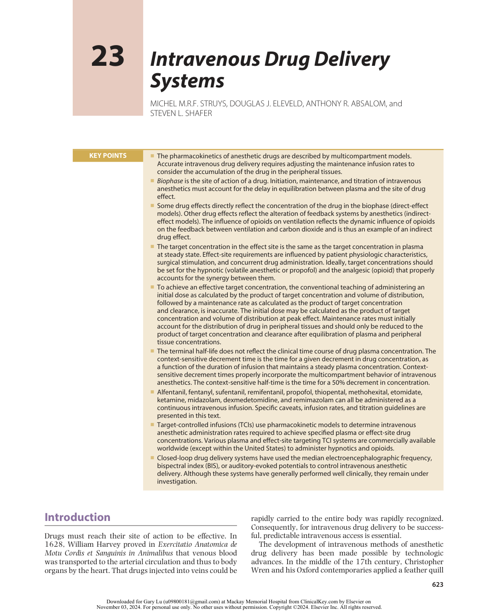

:::

<!-- PDF page 2 -->

and animal bladder to inject drugs into dogs and humans and rendered them unconscious. The hollow hypodermic needle and a functional syringe were developed by Frances Rynd (1801–1861) and Charles Pravaz (1791–1853), respectively. Contemporary needles, catheters, and syringes are descendants of these early devices. In the 20th century, equipment began to be made of plastics, first polyvinyl chloride, then Teflon, and later, polyurethane. In 1950, Massa invented the Rochester needle (Fig. 23.1),1 which led to the revolutionary concept of the “over- the- needle” catheter, which is still the gold standard for intravenous access for nearly all intravenous drug delivery today.2

Although fundamental principles of intravenously administering drugs were known in the 18th century, intravenous induction of anesthesia became common only in the 1930s after the discovery of barbiturates. Maintenance of anesthesia by intravenously administered anesthetics has become practical, safe, and popular in the past two decades. Intravenous drugs such as methohexitone and thiopental, although suitable for intravenous induction of anesthesia, are not suitable for use by infusion for the maintenance of anesthesia. In the case of thiopental, accumulation can lead to cardiovascular instability and delayed recovery, whereas methohexitone is associated with the excitatory phenomenon and epileptiform electroencephalographic (EEG) changes. Although the next generation of intravenous drugs, such as ketamine, althesin, and etomidate, possessed desirable pharmacokinetic characteristics, their use has been limited because of other side effects, including hallucinations, anaphylaxis, and adrenal suppression, respectively. The discovery of propofol in 1977 provided the anesthetic practice an intravenous drug suitable for both induction and maintenance of anesthesia; currently, propofol is still one of the most frequently used drugs for this purpose.3 Other drugs suitable for continuous infusion used today are some of the opioids such as alfentanil and sufentanil and certainly the short- acting opioid remifentanil (also see Chapter 22). In addition, some of the nondepolarizing muscle relaxants are used as continuous infusions in specific situations (also see Chapter 24).

Drugs are still predominantly injected as a bolus or continuous infusion using standard dosing guidelines, thereby ignoring the large interindividual variability in the dose– response relationship.4 In contrast to inhaled anesthetics, for which the inspired and end- tidal concentrations can be continuously measured in real time (“online”), the actual plasma or effect organ concentration of an intravenously administered drug is not immediately measurable in clinical practice. Therefore manually adjusting the intravenous drug injection regimens to maintain an online measured plasma concentration is impossible. It becomes even more complex if a specific effect- site concentration is the target. Optimal patient- individual dosing may be achieved by the application of pharmacokinetic–pharmacodynamic principles. Additionally, recent findings suggest that the pharmacokinetic and pharmacodynamic interactions during intravenous administration of various drugs are important and, as such, should be taken into account when optimizing drug administration.5 Computer technology can be used to assist the clinician in titrating intravenous drug administration by using the therapeutic end point as the feedback signal for dosing (Fig. 23.2).

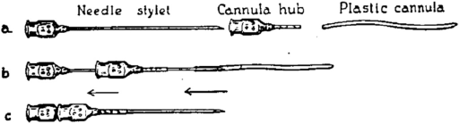

**Fig. 23.1 Details of the assembly of the Massa plastic needle, sold by Rochester Products Company, Rochester, Minnesota.** (From Massa DJ. A plastic needle, _Anesthesiology_ . 1951;12:772–773. Used with permission.)

The development of the first mechanical syringe pumps in the 1950s improved the quality of intravenous drug administration. A more recent technologic development in intravenous anesthesia is the introduction of computerized pharmacokinetic model–driven continuous- infusion devices, enabling the attainment of desired plasma levels of an intravenous anesthetic drug by using a computercontrolled infusion pump operated in accordance with the published pharmacokinetics of the drug.6 These efforts have resulted in the release of the first commercial targetcontrolled infusion (TCI) device in Europe, developed by Zeneca specifically for the administration of propofol. Since that time, several countries (except for the United States) have approved the use of TCI devices for the delivery of anesthetic drugs.7,8

The ultimate development in anesthetic delivery systems will be devices for closed- loop administration of intravenous drugs during anesthesia. Systems have been developed for closed- loop administration of various drugs such as muscle relaxants, hypnotics, and opioids. The control variables for these systems have included various pharmacodynamic measures derived from techniques such as acceleromyography, automated blood pressure measurement, and electroencephalography.

The dose–response relationship can be divided into three parts (see Fig. 23.2): (1) the time course of the relationship between the given dose and the plasma concentration is defined as _pharmacokinetics_ ; (2) the relationship between the plasma concentration and/or effect- organ concentration and the clinical effect is defined as _pharmacodynamics_ ; and (3) the coupling between pharmacokinetics and pharmacodynamics is required when the blood is not the site of drug effect.

Before reviewing delivery techniques and devices for intravenous anesthesia, this chapter presents some pharmacokinetic and pharmacodynamic principles as background for understanding how to administer intravenous drugs to their best advantage. Further discussion of the principles of pharmacokinetics and pharmacodynamics can be found in Chapter 16.

## Pharmacokinetic Considerations

The aim of optimal intravenous drug dosing is to reach and maintain a desired time course of therapeutic drug effect as accurately as possible, thereby preventing doserelated adverse drug effects. To be useful in anesthesia, this time course should include a rapid onset of clinical effects, smooth maintenance, and fast recovery after the termination of drug administration. The pharmacokinetics of

<!-- PDF page 3 -->

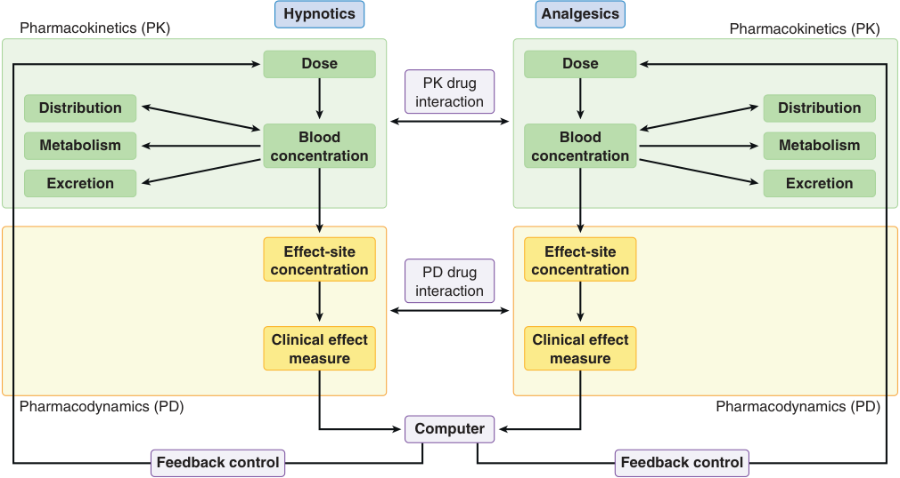

Hypnotics Analgesics Pharmacokinetics (PK) Pharmacokinetics (PK) Dose Dose PK drug interaction Distribution Distribution Blood Blood Metabolism Metabolism concentration concentration Excretion Excretion Effect-site Effect-site concentration PD drug concentration interaction Clinical effect Clinical effect measure measure Pharmacodynamics (PD) Pharmacodynamics (PD) Computer Feedback control Feedback control 

**Fig. 23.2 Schematic representation of the dose–response relationship for both hypnotics and opioids.** The pharmacokinetic (PK) ( _green area_ ) and the pharmacodynamic (PD) ( _yellow area_ ) parts of this relationship are shown. Closed- loop control of drug administration using the clinical measure is indicated as _feedback control_ . Pharmacokinetic and pharmacodynamic drug interactions are indicated. (From Sahinovic MM, Absalom AR, Struys MM. Administration and monitoring of intravenous anesthetics, _Curr Opin Anaesthesiol_ . 2010;23:734. Used with permission.)

many intravenous drugs can be described using mammillary multicompartment pharmacokinetic models. These models assume that the drug is directly given and mixed in the plasma, resulting in an immediate peak in its plasma concentration.

The easiest clinical technique is to administer a single dose, calculated to keep the plasma concentration above the therapeutic target concentration for the required time (Fig. 23.3). A constant concentration cannot be maintained, but it should not decrease to less than the therapeutic concentration. Unfortunately, when one single bolus is used, the initial dose must be large enough to maintain a concentration above the lowest therapeutic concentration even at the end of surgery. However, this sometimes very large dose of drug may cause numerous side effects attributable to the initially high concentrations in the body. It might be less harmful to keep the drug concentration above the lowest therapeutic level without very high initial concentrations by repeatedly injecting smaller doses; even with this technique, however, maintaining a stable plasma concentration is still impossible.

To produce a time course of drug effect that follows the time course of anesthetic requirement, a continuous infusion titrated to the perceived anesthetic requirement should be used. Typically, just enough of the drug is given to achieve the therapeutic blood or plasma drug concentration. Drug administration thereafter should be continuously titrated throughout surgery. Although such a regimen does not overshoot the required concentration (and therefore avoids the risk of concentration- related side effects), yet another difficulty exists. Whereas the large bolus approach produces an effective concentration (EC) from the onset, albeit with an excessive overshoot, a continuous infusion takes a

long time to become effective because of the slow increase in concentration. Reaching steady state (see Fig. 23.3) takes a very long time during which the increase in concentration is rapid at first but then slows down as equilibrium is approached. For example, it will take longer than one hour for the propofol infusion to generate a plasma concentration that is at least 95% of the steady- state concentration. Consequently, although simple infusions are obviously very effective for maintaining constant blood concentrations once steady state is reached and for avoiding overshoot, infusions do not offer a clinically realistic approach. Therefore a combination of an initial bolus followed by a stepwise decreasing continuous infusion is more useful.9,10

Pharmacokinetic models can be used to calculate the required drug- dosing regimen to reach and maintain a therapeutic drug concentration as fast as possible without overshooting or accumulation. This chapter explains how pharmacokinetic models can be used to calculate accurate dosing schemes for use with intravenous drug delivery systems.

Pharmacokinetic models are mathematical descriptions of how the body _disposes_ of drugs. The parameters describing this process are estimated by administering a known dose of the drug and measuring the resulting plasma concentrations. A mathematical model then relates the input over time, I(t), with the concentrations over time, C(t). These models can take many forms. Fig. 23.4 shows concentrations in plasma and effect site over time after a single intravenous bolus of drug at time 0. Drug concentrations continuously decrease after the bolus, and the rate of decrease is approximately proportional to the amount of drug in plasma. Typically, this behavior can be described with the use of exponential models. The curve might have

<!-- PDF page 4 -->

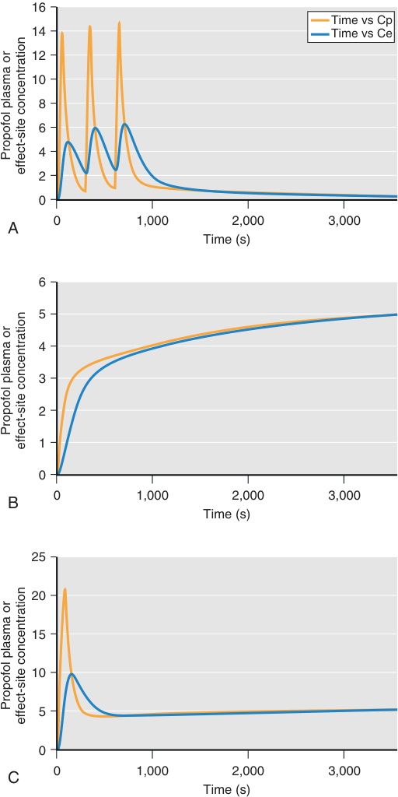

16 Time vs Cp 14 Time vs Ce 12 10 8 6 4 2 0 0 1,000 2,000 3,000 A Time (s) 6 5 4 3 2 1 0 0 1,000 2,000 3,000 B Time (s) 25 20 15 10 5 0 0 1,000 2,000 3,000 C Time (s) Propofol plasma or effect-site concentration Propofol plasma or effect-site concentration Propofol plasma or effect-site concentration 

**Fig. 23.3** Predicted propofol plasma concentration (Cp) and effect- site concentration (Ce) for a repeated bolus dose (1 mg/kg given at time 0 and after 5 and 10 minutes) (A), continuous infusion (10 mg/kg/h) (B), and a bolus (2 mg/kg) followed by a continuous infusion (10 mg/kg/h) (C). Simulated patient is a man, 45 years of age, 80 kg, 175 cm (Schnider model).

a single exponent, in which case the plasma concentrations over time might be described by the function C(t) = Ae−kt , where A is the concentration at time 0 and k is a constant that describes the rate of decrease in concentration. The relationship appears to be a straight line when graphed as the log of concentration versus time. The pharmacokinetics of intravenous anesthetic drugs is more complex because after the bolus, a period of rapid decline is observed before the terminal _log- linear_ portion (i.e., the part that is a straight line when described as log concentration versus time). This

process can be modeled by taking several monoexponential curves and adding them together. The result is a polyexponential curve. For example, the concentrations after an intravenous bolus might be described by an equation with two exponents, C(t) = Ae−αt + Be−βt , or an equation with three exponents, C(t) = Ae−αt + Be−βt + Ce−γt .

The aforementioned is applied to single bolus dosing, which is, of course, only one way of administering intravenous anesthetic drugs. A more general way to think of pharmacokinetics is to decompose the input into a series of small bits (boluses) and consider each bit of drug separately. The general pharmacokinetic model of drug disposition commonly used in anesthesia independently considers each bit of drug and analyzes its contribution by means of polyexponential decay over time. The formal mathematic description of each bit of drug in terms of polyexponential decay over time is the relationship:

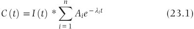

n C  ( t ) =  I  ( t ) * ∑ Aie − λit (23.1) i  = 1 

where C(t) is the plasma concentration at time t and I(t) is drug input (i.e., a bolus or infusion). The summation after the asterisk (described later in this chapter) is the function describing how each bit of drug is disposed (hence the name, _disposition function_ ). Note that this is again a sum of _n_ exponentials, as described in the previous paragraph.

Pharmacokinetic modeling is the process of estimating the parameters within this function. The integer _n_ is the number of exponentials (i.e., compartments) and is usually two or three. Each exponential term is associated with a coefficient Ai and an exponent λi. The λ values are inversely proportional to the half- lives (half- life = ln 2/λ = 0.693/λ), with the smallest λ representing the longest (terminal) half- life. The A values are the relative contribution of each half- life to overall drug disposition. If a drug has a very long terminal half- life but a coefficient that is significantly smaller than the other coefficients, then the long half- life is likely to be clinically meaningless. Conversely, if a drug has a very long half- life with a relatively large coefficient, then the drug will be long lasting even after brief administration. The asterisk (*) operator is the mathematic process called _convolution_ , which is simply the process of breaking the infusion into _bits_ of drug and then adding up the results to observe the overall concentrations resulting from the disposition of the different bits up to a time point t.

The pharmacokinetic model shown has some useful characteristics that account for its enduring popularity in pharmacokinetic analysis. First, and most important, the model describes observations from studies reasonably well, the _sine qua non_ for models. Second, these models have the useful characteristic of _linearity_ . Simply stated, if the dose, I, is doubled (e.g., administering a bolus twice as large or an infusion twice as fast), then the resulting concentrations should be doubled.

More generally, linearity implies that the system (i.e., the body acting to produce a plasma drug concentration output from a drug dosage input) behaves in accordance with the principle of superposition. The superposition principle states that the response of a linear system with multiple inputs can be computed by determining the response to each individual input and then summing the individual responses. In other words, when the body treats each bit of drug by

<!-- PDF page 5 -->

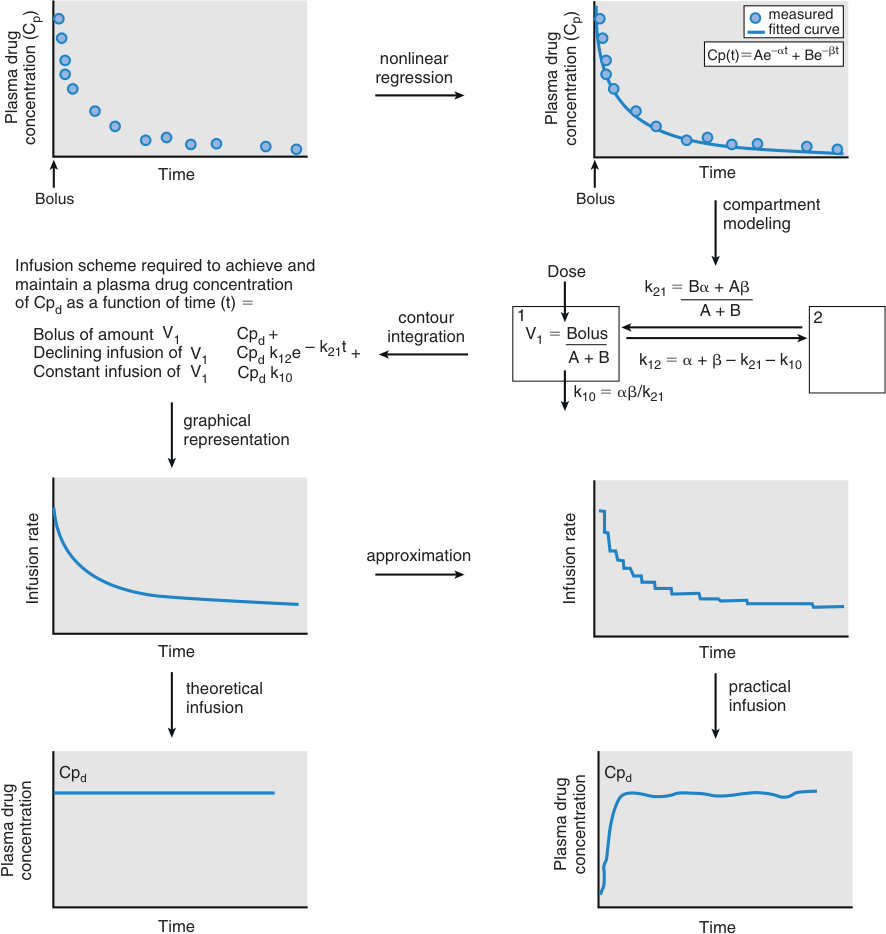

measured fitted curve nonlinear Cp(t) � Ae −�t + Be −�t regression Time Time Bolus Bolus compartment modeling Infusion scheme required to achieve and  Dose maintain a plasma drug concentration  k21 � B� + A� of Cpd as a function of time (t) � contour 1 A + B 2 Bolus of amount V1 Cpd + integration V1 � Bolus Declining infusion of V1 Cpd k12e  – k21t  + A + B k12 � � + � – k21 – k10 Constant infusion of V1 Cpd k10 k10 � ��/k21 graphical representation approximation Time Time theoretical practical infusion infusion Cpd Cpd Time Time Plasma drug Plasma drug concentration (C)p concentration (C)p Infusion rate Infusion rate Plasma drug concentration Plasma drug concentration 

**Fig. 23.4 Steps involved in pharmacokinetic model–driven infusion.** Typically, pharmacokinetic models are derived from experiments in which plasma drug concentrations are measured at intervals after bolus administration of the drug. Nonlinear regression is used to fit a monoexponential, biexponential, or triexponential curve to the resulting concentration- versus- time data. An algebraic relationship exists between the exponential decay curves and a one- , two- , or three- compartment pharmacokinetic model. The bolus- elimination- transfer (BET) infusion scheme is developed and consists of a bolus, a continuous infusion to replace drug eliminated from the body, and an exponentially declining infusion to replace drug transferred out of plasma to other body compartments. BET infusion results in the maintenance of a constant specified plasma drug concentration. Practical implementation of the BET scheme with real infusion pumps and infusion rates that change only at discrete intervals of time results in a plasma drug concentration profile that approximates that resulting from a BET infusion.

polyexponential decay over time, the _disposing_ of each bit of drug does not influence the disposing of other bits of drug.

The third reason for the continuing popularity of these models is that they can be mathematically transformed from the admittedly nonintuitive exponential form shown earlier to a more intuitive compartment form (Fig. 23.5). The fundamental parameters of the compartment model are the volumes of distribution (central, rapidly equilibrating, and slowly equilibrating peripheral volumes) and clearances (systemic, rapid, and slow intercompartment). The central compartment (V1) represents a distribution volume and includes the rapidly mixing portion of the blood and first- pass pulmonary uptake. The peripheral compartments

are made up of tissues and organs that show a time course and extent of drug accumulation (or dissipation) different from that of the central compartment. In the threecompartment model, the two peripheral compartments may roughly correspond to splanchnic and muscle tissues (rapidly equilibrating) and fat stores (slowly equilibrating). The sum of the compartment volumes is the apparent volume of distribution at steady state (Vdss) and is the proportionality constant relating the plasma drug concentration at steady state to the total amount of drug in the body. The intercompartment rate constants (k12, k21, and so on) describe the movement of drug between the central and peripheral compartments. The elimination rate constant

::: warning 符號需核對
此頁有符號無法完整擷取，請展開下方原始頁面核對。
:::

::: details 原始表格與符號（PDF 第 5 頁）

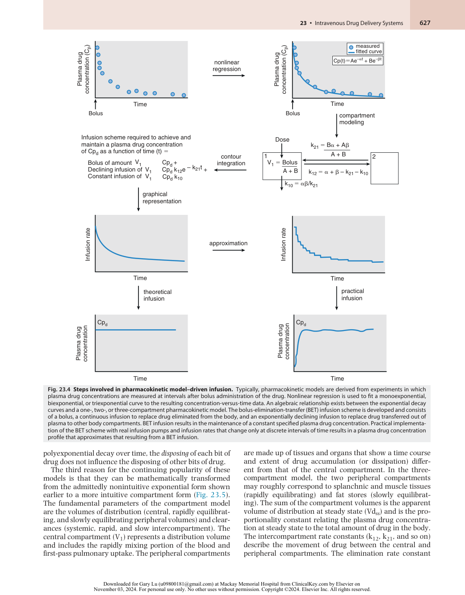

:::

<!-- PDF page 6 -->

Drug administration

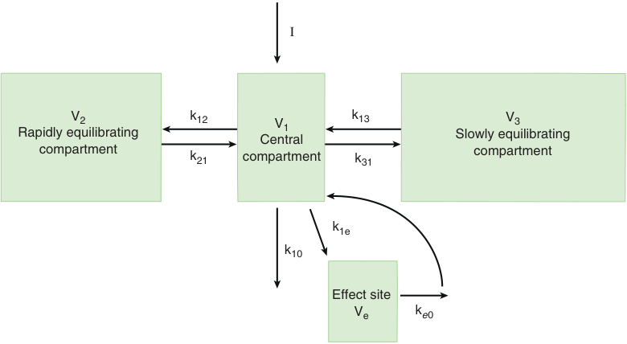

Ι V2 k12 k13 V3 V1 Rapidly equilibrating Central Slowly equilibrating compartment k21 compartment k31 compartment k1e k10 Effect site Ve k e 0 

**Fig. 23.5** Three- compartment model (including the biophase) illustrating the basic pharmacokinetic processes that occur after intravenous drug administration. _I,_ Dosing scheme as a function of time; _k10_ , rate constant reflecting all processes acting to remove drug irreversibly from the central compartment; _k_ , intercompartment rate constants; _V1_ , central compartment volume, usually expressed in liters or liters per kilogram.

(k10) encompasses processes acting through biotransformation or elimination that irreversibly removes drug from the central compartment.

Despite their physiologic flavor, compartment models are simply mathematic transformations of the polyexponential disposition functions computed from observed plasma concentrations. Thus physiologic interpretation of volumes and clearances (apart from systemic clearance and Vdss [the algebraic sum of the volumes]) is entirely speculative.

The last reason behind the popularity of these models is that they can be used to design infusion regimens. If the disposition function:

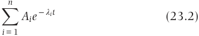

n ∑ Aie − λit (23.2) i  = 1 

is abbreviated as simply D(t), then the relationship among concentration, dose, and the pharmacokinetic model D(t) can be rewritten as:

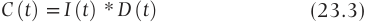

C  ( t ) =  I  ( t ) *  D  ( t ) (23.3) 

where * is the convolution operator, as noted earlier. In the usual pharmacokinetic study, I(t) is known, the dose that is given the patient, and C(t) is measured, the concentrations over time. The goal is to find D(t), the pharmacokinetic disposition function. Pharmacokinetic analysis can be thought of as a simple rearrangement of Eq. 23.3 to solve for D(t):

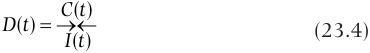

C ( t ) D ( t )  (23.4) I ( t ) 

where the symbol →←ᑏmeans _deconvolution_ , the inverse operation of convolution. Deconvolution is similar to division, but of functions rather than simple numbers. When dosing regimens are designed from known pharmacokinetic models and a desired course for the plasma concentration over time, the known values are D(t) (the pharmacokinetics) and

CT(t) (the desired target concentrations), and the drug dosing scheme is:

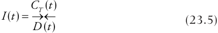

CT ( t ) I ( t )  (23.5) D ( t ) 

Thus the necessary infusion rates, I(t), can be calculated, given the desired target concentrations, CT(t), and the pharmacokinetics, D(t), by applying the same tools used to calculate the original pharmacokinetics. Unfortunately, such a solution might require some negative infusion rates, which are obviously impossible. Because drug cannot be retracted from the body (i.e., give inverse infusions), clinicians must restrict themselves to plasma concentrations over time that can be achieved with noninverse infusion rates.

The standard pharmacokinetic model has one glaring shortcoming. It assumes that after a bolus injection there is complete mixing within the central compartment such that the peak concentration occurs precisely at time 0. It takes approximately 30 to 45 seconds for the drug to make its transit from the venous injection site to the arterial circulation. This model misspecification over the first minute or so may not seem significant, but it can cause problems in attempts to relate the drug effect after a bolus to drug concentrations in the body,11 which becomes even more important when using effect- site TCI.12 The standard polyexponential pharmacokinetic models are being modified to provide more accurate models of plasma drug concentration in the first minute after bolus injection, also taking into account infusion rate. Masui and associates13 found that a pharmacokinetic model consisting of a two- compartment model with a LAG (the time shift of dosing as if the drug were, in fact, administered to the pharmacokinetic model at a later time) and presystemic compartments model accurately described the early pharmacologic phase of propofol during infusion rates between 10 and 160 mg/kg/h. The infusion rate has an influence on kinetics. Age was a covariate for LAG time (Fig. 23.6). More recently, Henthorn and co- workers14 used a unique ketamine data set with simultaneous arterial

<!-- PDF page 7 -->

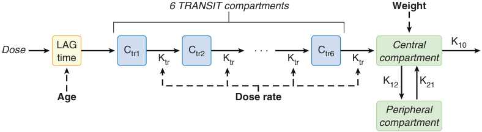

6 TRANSIT compartments Weight Dose LAG Ctr1 Ctr2 . . . Ctr6 Central K10 time Ktr Ktr Ktr Ktr compartment K12 K21 Age Dose rate Peripheral compartment 

**Fig. 23.6** Scheme of the final two- compartment pharmacokinetic model with a LAG time and six TRANSIT compartments (Ctr _n_ ). The equilibration rate constants between the central and peripheral compartments were calculated using the following equations: k12 = Cl2 ÷ V1, k21 = Cl2 ÷ V2. The elimination rate constant was calculated using the following equation: k10 = Cl1 ÷ V1. _Cl1_ , clearance of central compartment; _Cl2_ , clearance of peripheral compartment; _V1_ , distribution volume of central compartment; _V2_ , distribution volume of peripheral compartment. LAG time represents the time shift of dosing as if the drug was, in fact, administered to the pharmacokinetic model later. TRANSIT compartments depict a multiple- step process represented by a chain of presystemic compartments. (From Masui K, Kira M, Kazama T, et al. Early phase pharmacokinetics but not pharmacodynamics are influenced by propofol infusion rate, _Anesthesiology_ . 2009;111:805–817. Used with permission.)

and venous blood sampling, during and after separate S(+) and R(−) ketamine infusions, to develop a simplified recirculatory model of arterial and venous plasma drug concentrations. They found that arterial drug concentrations measured during drug infusion have two kinetically distinct components: partially or lung- mixed drug and fully mixedrecirculated drug. Front- end kinetics suggest the partially mixed concentration is proportional to the ratio of infusion rate and total pharmacokinetic flow. This simplified modeling approach could lead to more generalizable models for target- controlled infusions and improved methods for analyzing pharmacokinetic–pharmacodynamic data.

Besides compartment models, various physiologically based models have been developed to model the pharmacokinetic behavior of anesthetics.15 So far, these models are not superior at predicting the time course of drug concentration.13 None of these models have been used to control intravenous drug delivery devices.

## Pharmacodynamic Considerations

### THE BIOPHASE

The goal of drug titration during anesthesia is to reach and maintain a stable therapeutic drug concentration at the site of drug effect, also defined as the _effect site_ or _biophase_ . For most drugs used in anesthesia, the plasma is not the biophase and thus, even after the drug has reached the arterial circulation, a further delay occurs before a therapeutic effect is observed. The reason is that additional time is required for the drug to be transported to the target organ, penetrate the tissue, bind to a receptor, and induce intercellular processes that ultimately lead to the onset of drug effect. This delay between peak plasma concentration and peak concentration at the effect site is called _hysteresis_ . Fig. 23.7 illustrates an example of hysteresis revealed during an experiment published by Soehle and co- workers.16 Two periods of continuous propofol infusions were given. The time course of the plasma concentration and effect- site concentration are simulated using pharmacokinetic and pharmacodynamic models. The cerebral drug effect was measured using the EEG- derived bispectral index (BIS). A clear delay between the time course of the plasma concentration and that of the BIS can be observed. The plasma concentration versus effect curve forms a counterclockwise hysteresis loop. This loop

represents the plasma concentration which is not the site of drug effect. Using nonlinear mixed-effect modeling, the hysteresis is minimized to reveal the effect- site concentration versus clinical effect relationship. The typical sigmoidal population model is also depicted in Fig. 23.7.

The concentration of drug in the biophase cannot be measured because it is usually inaccessible, at least in human subjects. The time course of drug effect can be calculated by using rapid measures of drug effect. Knowing the time course of drug effect, the rate of drug flow in and out of the biophase (or effect site) can be calculated with the use of mathematic models. As such, the time course of the plasma concentration and the measured effect can be linked using the concept of the _effect compartment_ , developed by Hull and Sheiner.17,18 The effect- site concentration is not a real measurable concentration but rather a virtual concentration in a theoretic compartment without a volume and, as such, also without any significant amount of drug present. For any concentration in this virtual compartment, a corresponding assumed effect is observed. This relationship between the effect- site concentration and effect is usually nonlinear and static (i.e., does not explicitly depend on time). If the plasma concentration is maintained at a constant level, then the model assumes that, at equilibrium, the effect- compartment concentration equals the plasma concentration. The delay between the plasma and the effect compartment is mathematically described by a single parameter, defined as k _e_ 0, the effect- site equilibration rate constant19 (see Fig. 23.5).

Measures of drug effect used to characterize the time course of drug transfer between plasma and the biophase vary with the drug being evaluated. For some drugs, a direct measure of drug effect can be applied. For neuromuscular blocking drugs, the response from peripheral nerve stimulation (i.e., the twitch) is an ideal measure of effect. Various authors have used the T1% (percentage change of the T1 response compared with baseline T1 response during supramaximal stimulus) derived from electromyogram to measure the drug effect of drugs such as rocuronium20 and cisatracurium.21 For other categories of drugs such as opioids and hypnotics, the real clinical effects (e.g., unconsciousness, amnesia, memory loss, antinociception) are not measurable. For these reasons, surrogate measures are used to quantify the time course of clinical drug effects. These surrogate measures can be categorical or continuous. For

<!-- PDF page 8 -->

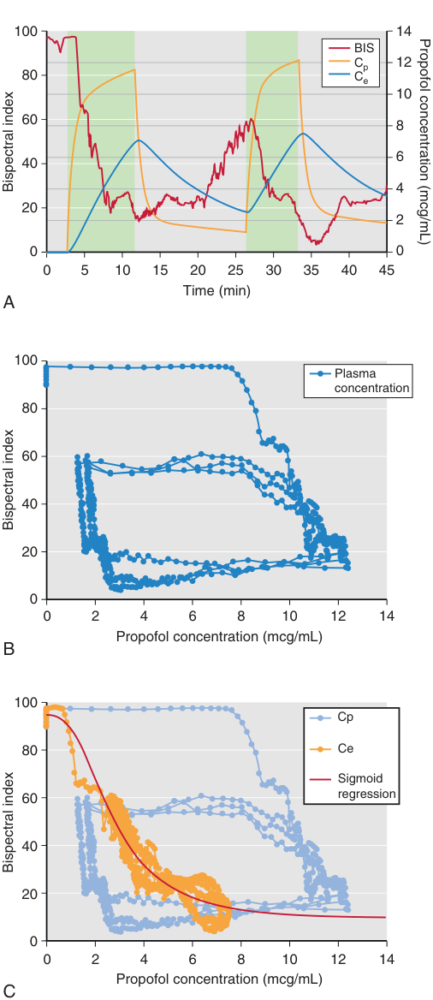

100 14 BIS C p 12 80 C e 10 60 8 6 40 4 20 2 0 0 0 5 10 15 20 25 30 35 40 45 Time (min) A 100 Plasma concentration 80 60 40 20 0 0 2 4 6 8 10 12 14 Propofol concentration (mcg/mL) B 100 Cp 80 Ce Sigmoid 60 regression 40 20 0 0 2 4 6 8 10 12 14 Propofol concentration (mcg/mL) C Bispectral index Propofol concentration (mcg/mL) Bispectral index Bispectral index 

**Fig. 23.7** (A) Time course of an experiment showing the hysteresis between plasma concentration (Cp) and hypnotic effect as measured by the electroencephalographic (EEG)- derived bispectral index (BIS). Propofol was given at a constant rate during the shaded periods, resulting in Cp ( _orange line_ ) and effect- site concentration (Ce) ( _blue line_ ). The corresponding BIS values are shown as a _solid blue line_ . (B) Relation between Cp and BIS using data from the experiment reveals a hysteresis loop. (C) After modeling, this hysteresis is minimized as shown in the relation between the effect- site concentration and BIS. (A, Adapted from Soehle M, Kuech M, Grube M, et al. Patient state index vs bispectral index as measures of the electroencephalographic effects of propofol, _Br J Anaesth_ . 2010;105:172–178. Used with permission; B and C, Courtesy of M. Soehle, Bonn, Germany.)

example, the Observer’s Assessment of Alertness/Sedation (OAA/S) scale is an established categorical score used to measure quantal changes in hypnotic drug effects.22 Kim and co- workers enhanced this score to include truly noxious stimulation.23

Various noxious pain stimuli have been applied to measure the balance between nociception and antinociception. For example, Egan and colleagues24 used an algometer to study the opioid drug effect during remifentanil infusion. Responsiveness or tolerance to layngoscopy or tetanic stimulation have been used to investigate possible drug interactions between opioids and hypnotics.25–30 Various spontaneous and evoked EEG- derived and processed measures were used to measure cerebral drug effects for opioids and hypnotics.16,30–36 Ludbrook and associates measured propofol concentrations in the carotid artery and jugular bulb to establish movement of propofol into and equilibration with the brain. They simultaneously measured the BIS and found a close correlation between brain concentration (calculated by mass balance) and changes in the BIS (also see Chapter 36).37

### DIRECT- EFFECT MODELS

As with plasma pharmacokinetics, the biophase concentration is the convolution of an input function (in this case, the plasma drug concentration over time) and the disposition function of the biophase. This relationship can be expressed as:

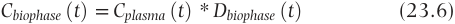

Cbiophase  ( t ) =  Cplasma  ( t ) *  Dbiophase  ( t ) (23.6) 

The disposition function of the biophase is typically modeled as a single exponential decay expressed as:

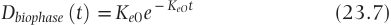

Dbiophase  ( t ) =  Ke 0 e − KeOt (23.7) 

The monoexponential disposition function implies that the effect site is simply an additional compartment in the standard compartment model that is connected to the plasma compartment (see Fig. 23.5). The effect site is the hypothetical compartment that relates the time course of plasma drug concentration to the time course of drug effect, and k _e_ 0 is the rate constant of elimination of drug from the effect site. By convention, the effect compartment is assumed to receive such small amounts of drug from the central compartment that it has no influence on plasma pharmacokinetics.

Neither Cbiophase(t) nor Dbiophase(t) can be directly measured, but the drug effect can be measured. Knowing that the observed drug effect is a function of the drug concentration in the biophase, the drug effect can be predicted as:

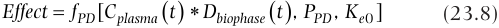

Effect  fPD [ C plasma  t  Dbiophase  t , PPD , Ke 0 ] (23.8) 

where fPD is a pharmacodynamic model (typically sigmoidal in shape), PPD represents the parameters of the pharmacodynamic model, and k _e_ 0 is the rate constant for equilibration between plasma and the biophase. Nonlinear regression programs are used to find values of PPD and k _e_ 0 that best predict the time course of drug effect. This method is called _loop- collapsing_ (see Fig. 23.7). Knowledge of these parameters can then be incorporated into dosing regimens that produce the desired time course of drug effect.38,39

<!-- PDF page 9 -->

If a constant plasma concentration is maintained, then the time required for the biophase concentration to reach 50% of the plasma concentration (t1/2k _e_ 0) can be calculated as 0.693/k _e_ 0. After a bolus dose, the time to peak biophase concentration is a function of both plasma pharmacokinetics and k _e_ 0. For drugs with a very rapid decline in plasma concentration after a bolus (e.g., adenosine with a half- life of several seconds), the effect- site concentration peaks within several seconds of the bolus, regardless of k _e_ 0. For drugs with a rapid k _e_ 0 and a slow decrease in concentration after a bolus injection, the peak effect- site concentration is determined more by k _e_ 0 than by plasma pharmacokinetics. An accurate estimation of k _e_ 0 demands an integrated pharmacokinetic–dynamic study combining rapid blood sampling with frequent measurements of drug effect, yielding an overall model for the dose–response behavior of the drug. Historically, the time constants of pharmacokinetic models and the k _e_ 0 of pharmacodynamic studies were sometimes naively merged, possibly leading to inaccurate predictions of the clinical drug effect. Coppens and colleagues proved that pharmacodynamic models of BIS in children developed by using estimates of plasma propofol concentrations from published pharmacokinetic models and estimating the pharmacodynamic model do not ensure good pharmacokinetic accuracy or provide informative estimates for pharmacodynamic parameters.40 If no integrated pharmacokinetic–dynamic model exists, then the time to peak effect (tpeak) after a bolus injection can be used to recalculate k _e_ 0 using the pharmacokinetic model of interest to yield the correct time to peak effect. Under these circumstances, this alternative approach might lead to a more accurate prediction of the dose–response time course.41,42 However, the correct covariates for tpeak should be estimated in a specific population using specific study conditions.43 A second caveat is that the time course of drug effect is specific for a given effect (e.g., cerebral drug effect as measured by a specific processed EEG). The time course of other side effects (e.g., hemodynamic effect for hypnotics) most frequently follows a different trajectory.44,45 The time to peak effect and the t1/2 k _e_ 0 for several intravenous anesthetics are listed in Table 23.1.

All methods discussed so far incorporate k _e_ 0 values calculated on the assumption that hysteresis between plasma concentration and clinical effect is explained by a delay in drug transfer between plasma and biophase and thus that anesthesia is a smooth, path- and state- independent, symmetric process. Although still commonly used, this assumption might be suboptimal. Although effect- site equilibration models are still commonly used in population pharmacology, simulation studies show that this does not imply that hysteresis is solely attributable to the kinetics of drug equilibration.46 Data from animal experiments suggest that neural processes and pathways involved in anesthesia induction and recovery are different.47,48 In a mice model, Wasilczuk and colleagues showed that while equipotent doses of distinct anesthetics produce comparable population response probabilities, they engage dramatically different dynamics in each individual animal. This manifests as a differential aggregate propensity to exhibit state transitions.49 If these data are confirmed, then a more complex model (e.g., one incorporating a second, serial effect- site

**Table 23.1** Time to Peak Effect and t1/2 k _e_ 0 After a Bolus Dose

|**Drug**|**Time to Peak Drug** **Effect (min)***|**t1/2 k****_e_0 (min)**|
|---|---|---|
|Morphine|19|264|
|Fentanyl|3.6|4.7|
|Alfentanil|1.4|0.9|
|Sufentanil|5.6|3.0|
|Remifentanil|1.8|1.3|
|Ketamine|—|3.5|
|Propofol|1.6|1.7|
|Thiopental|1.6|1.5|
|Midazolam|2.8|4.0|
|Etomidate|2.0|1.5|
|Remimazolam|3†|2.7†|

k _e_ 0 is the rate constant for transfer of drug from the site of drug effect to the environment.

t1/2 k _e_ 0 = 0.693/k _e_ 0.

*Measured by electroencephalography.

†Measured by Modified Observer’s Assessment of Alertness and Sedation score.

model) might be required to depict the time course of drug effect. Several groups have investigated this hypothesis in humans, and so far the published findings are not consistent.50 One clinical study specifically designed to address this topic showed evidence supportive of the concept of neural inertia,51 whereas of two studies involving secondary analyses of existing data, one showed supportive evidence52 and the other showed that neural inertia was not present in all subjects, appeared to only occur with propofol (and not with sevoflurane), and to only be present with certain pharmacodynamic end points.53

### INDIRECT- EFFECT MODELS

Thus far, clinical effects that are an instantaneous function of drug concentration at the site of drug effect have been discussed, as implied by Eq. 23.8. For example, once a hypnotic drug reaches the brain or a neuromuscular blocking drug reaches the muscles, drug action is almost immediately observed. On the other hand, some effects are significantly more complex. For example, consider the effect of opioids on ventilation. Initially, opioids depress ventilation, and carbon dioxide (CO2) gradually accumulates. Yet, the accumulation of CO2 at normal conditions is a strong stimulant for ventilation, thereby partly counteracting the ventilatory depressant effects of opioids. Ventilatory depression is an example in which direct and indirect drug effects are incorporated. The direct effect of the opioid is to depress ventilation, and the indirect effect is to increase arterial tension of CO2. Modeling the time course of opioidinduced ventilatory depression requires consideration of both components. Bouillon and colleagues developed a model of ventilatory depression that incorporates both direct and indirect effects.54–56 As is generally the case with indirect- effect models, characterizing drug- induced ventilatory depression requires a consideration of the entire time

::: details 原始表格與符號（PDF 第 9 頁）

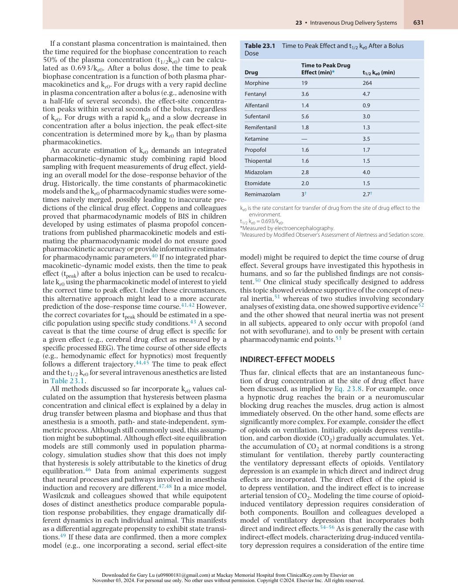

:::

<!-- PDF page 10 -->

course of drug therapy, which is embodied by the following differential equation:

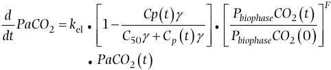

F d PaCO 2  k el .  1  Cp  t   .  PbiophaseCO 2  t  dt  C 50   C p  t    PbiophaseCO 2  0  . PaCO 2  t 

(23.9)

where partial pressure of arterial carbon dioxide (PaCO2) is arterial CO2, PbiophaseCO2 is CO2 in the biophase (i.e., brainstem respiratory control circuits), k _e_ l is the rate constant for the elimination of CO2, C50 is the effect- site opioid concentration associated with a 50% reduction in ventilatory drive, and F is the steepness or _gain_ of the effect of CO2 on ventilatory drive.

### DOSE IMPLICATIONS OF THE BIOPHASE

The delay in onset of clinical effects has important clinical implications. After a bolus, the plasma concentration peaks nearly instantly and then steadily declines. The effect- site concentration starts at zero and increases over time until it equals the descending plasma concentration. The plasma concentration continues to decline. After the moment of identical concentrations, the gradient between plasma and the biophase favors removal of drug from the biophase, and the effect- site concentration decreases. The rate at which the effect- site concentration rises toward the peak after a bolus dictates how much drug must be injected into plasma to produce a given effect. For alfentanil, its rapid plasma effect- site equilibration (large k _e_ 0) causes the effect- site concentration to rise rapidly, with a peak produced in approximately 90 seconds. At the time of the peak, approximately 60% of the alfentanil bolus has been distributed into peripheral tissues or eliminated from the body. For fentanyl, the effect- site concentration rises significantly more slowly and peaks 3 to 4 minutes after the bolus.57 At the time of the peak, more than 80% of the initial bolus of fentanyl has been distributed into tissues or eliminated. As a result of slower equilibration with the biophase, relatively more fentanyl than alfentanil must be injected into plasma, which makes the rate of offset of drug effect after a fentanyl bolus slower than after an alfentanil bolus.

This difference in pharmacokinetics indicates that k _e_ 0 must be incorporated into dosing strategies on which rational drug selection is dependent. For rapid onset of effect, a drug with a large k _e_ 0 (short t1/2 k _e_ 0) should be chosen. For example, for rapid- sequence induction of anesthesia, alfentanil or remifentanil may be the optimal opioid because its peak effect- site concentration coincides with the likely time of endotracheal intubation. However, for a slower induction of anesthesia in which a nondepolarizing neuromuscular blocking drug is used, an opioid with a slower onset of drug effect should be selected to coincide with the peak effect of the neuromuscular blocking drug. In this case, a bolus of fentanyl or sufentanil at the time of induction may be more appropriate. The time to peak effect for the commonly used opioids is shown in Fig. 23.8. Knowing k _e_ 0 (or time to peak effect) also improves titration of the drug by identifying the time at which the clinician should assess drug effect. For example, midazolam has a slow time to peak

effect, and repeat bolus doses should be spaced at least 3 to 5 minutes apart to avoid inadvertent overdosing.

An accurate k _e_ 0 is also crucial during TCI titrating to a specific effect- site concentration because the initial bolus given to reach the targeted effect- site concentration depends on both the pharmacokinetics and the k _e_ 0.12,58

In clinical practice, clinicians can optimize drug titration by using a combination of information from the predicted effect- site concentration for propofol (CePROP) and from clinical effect monitors (e.g., electroencephalographybased monitors). Theoretically, the relation between these sources should be time independent, that is, perfectly synchronized. Various issues corrupt time independency, leading to asynchrony or, in other words, residual hysteresis. Sahinovic and co- workers59 analyzed the pharmacodynamic data from 165 patients undergoing propofol–remifentanil anesthesia for outpatient surgery. Drugs were administered using target- controlled infusion (TCI) pumps. The pumps were programmed with the Schnider model for propofol60,61 and the Minto model for remifentanil62,63 and clinical drug effect was measured using the bispectral index (BIS). They found a significant “propofol effect- site concentration versus EEG measured drug effect” hysteresis. Not accounting for it leads to conflicting PD information and false high estimates of Ce50 for propofol for the BIS. Adding a lag term improved the PD model performance, improved the “pump- monitor” synchrony, and made the estimates of Ce50 for propofol more realistic and less monitor dependent.

### DRUG POTENCY

### Single Drugs

Knowledge about adequate therapeutic drug concentration is crucial to achieve the aim of providing optimal anesthetic conditions. Therefore information on drug potency is essential. Analogous to the concept of minimum alveolar concentration (MAC), the concentration associated with a 50% likelihood of movement in response to skin incision for inhaled anesthetics,64 is the C50 for intravenous drugs, which provides a measure of relative potency between intravenous anesthetics.

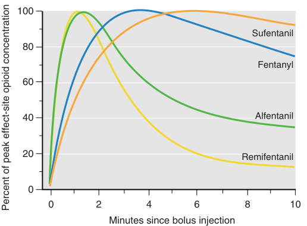

100 Sufentanil 80 Fentanyl 60 40 Alfentanil 20 Remifentanil 0 0 2 4 6 8 10 Minutes since bolus injection Percent of peak effect-site opioid concentration 

**Fig. 23.8** Simulated onset and time to peak effect of commonly used opioids based on their k _e_ 0 and pharmacokinetic parameters. _k_ e _0_ , rate constant for the transfer of drug from the site of drug effect to the environment.

<!-- PDF page 11 -->

There are many ways to look upon C50, taking into consideration whether the clinical effect is a binary or continuous effect. When considering binary effects, the C50 might be the drug concentration that prevents response (e.g., movement, hypertension, release of catecholamines) to a particular stimulus (e.g., surgical incision, endotracheal intubation, spreading of the sternum) in 50% of patients. In this case, each combination of stimulus and response may have a unique C50. When C50 is defined as the drug concentration that produces a given response in 50% of patients, a 50% probability of response is also likely in each patient. Defining C50 as the concentration that produces a given drug effect in 50% of individuals implicitly assumes that the effect can be achieved in all individuals. Some drugs exhibit a ceiling effect. For example, a ceiling effect may exist on the ability of opioids to suppress response to noxious stimulation. When a ceiling in drug effect exists, some patients may not exhibit the drug effect even at infinitely large doses. In this case, C50 is not the concentration that causes the drug effect in 50% of patients but is the concentration associated with the drug effect in one-half of whatever fraction of patients is able to respond.

Several studies have been performed to establish appropriate concentrations of intravenous anesthetics and opioids for various clinical end points and the effect of drug interactions (Table 23.2).3,30,65–73

Another interpretation of C50 is the concentration that produces 50% of the maximum possible physiologic response. For example, the C50 for an EEG response is the drug concentration that provides 50% depression of the maximal EEG effect. The C50 for EEG response has been measured for the opioids alfentanil,74 fentanyl,74 sufentanil,75 and remifentanil.63,76,77 It has also been determined for thiopental,67,78,79 etomidate,72 propofol,30,32 and benzodiazepines74,80 (see Table 23.2). Other measures such as pupillary dilation in response to a noxious stimulus81 and pressure algometry24 were used to measure opioid potency and revealed slightly different values for C50, which

indicates that observation of drug potency also depends on the applied measure of drug effect.

As mentioned, C50 can be used to compare potency among drugs. For example, Kuizenga and colleagues30 compared the pharmacodynamics of propofol and sevoflurane on both population and individual levels using a clinical score and the Patient State Index (Masimo, Irvine, CA, USA). They found that the C50 values for no response to calling the person by name, tolerance to shake and shout, and tolerance to tetanic stimulation for propofol (mcg/mL) and sevoflurane (vol %; relative standard error [%]) were 1.62 (7.00)/0.64 (4.20), 1.85 (6.20)/0.90 (5.00), and 2.82 (15.5)/0.91 (10.0), respectively. The C50 values for Patient State Index- 1 and Patient State Index- 2 were 1.63 mcg/mL (3.7) and 1.22 vol % (3.1) for propofol and sevoflurane. The Patient State Index50 values for propofol and sevoflurane were 46.7 (5.1)/68 (3.0), 41.5 (4.1)/59.2 (3.6), and 29.5 (12.9)/61.1 (8.1), respectively. _Post hoc_ C50 values for propofol and sevoflurane were perfectly correlated (correlation coefficient = 1) for no response to calling the person by name and tolerance to shake and shout. Post hoc C50 and Patient State Index50 values for propofol and sevoflurane for tolerance to tetanic stimulation were independent with an individual (correlation coefficient = 0) (Figs. 23.9 and 23.10).

To be entirely independent of dosing history, C50 must be determined at steady state, which is rarely possible because most anesthetic drugs do not reach steady state during a continuous infusion until many hours have passed. However, if the drug exhibits rapid equilibration between plasma and the effect site and the investigator waits long enough after starting the infusion, then this choice can be reasonably satisfactory. For example, Ausems and colleagues82,83 were among the first to use a continuous infusion of alfentanil in their experiments, which quickly equilibrated. They also recorded their measurements after the effect- site concentration had equilibrated with plasma.

**Table 23.2** Steady- State Concentrations for Predefined Effects

|**Drug**|**C50 for EEG** **Depression***|**C50 for Incision or** **Painful Stimulus**†|**C50 for Loss of** **Consciousness**‡|**C50 for Spontaneous** **Ventilation**§|**C50 for Isoflurane** **MAC Reduction**|**MEAC**|
|---|---|---|---|---|---|---|
|Alfentanil (ng/mL)|500–600|200–300|—|170–230|50|10–30|
|Fentanyl (ng/mL)|6–10|4–6|—|2–3|1.7|0.5–1|
|Sufentanil (ng/mL)|0.5–0.75|(0.3–0.4)|—|(0.15–0.2)|0.15|0.025–0.05|
|Remifentanil (ng/mL)|10–15|4–6|—|2–3|1.2|0.5–1|
|Propofol (mcg/mL)|3–4|4–8|2–3|1.33|—|—|
|Thiopental (mcg/mL)|15–20|35–40|8–16|—|—|—|
|Etomidate (mcg/mL)|0.53|—|0.55|—|—|—|
|Midazolam (ng/mL)|250–350|—|125–250|—|—|—|
|Remimazolam (ng/mL)|—|—|481|—|—|—|

Values in parentheses are estimated by scaling to the alfentanil C50 (see text for details). _EEG,_ electroencephalography; _MAC,_ minimum alveolar concentration; _MEAC,_ minimum effective plasma concentration providing postoperative analgesia. *C50 for depression of the EEG is the steady- state serum concentration that causes a 50% slowing of the maximal EEG, except for midazolam, in which the C50 is associated with 50% activation of the EEG. †C50 for skin incision is the steady- state plasma concentration that prevents a somatic or autonomic response in 50% of patients. ‡C50 for loss of consciousness is the steady- state plasma concentration for absence of a response to a verbal command in 50% of patients. §C50 for spontaneous ventilation is the steady- state plasma concentration associated with adequate spontaneous ventilation in 50% of patients.

::: details 原始表格與符號（PDF 第 11 頁）

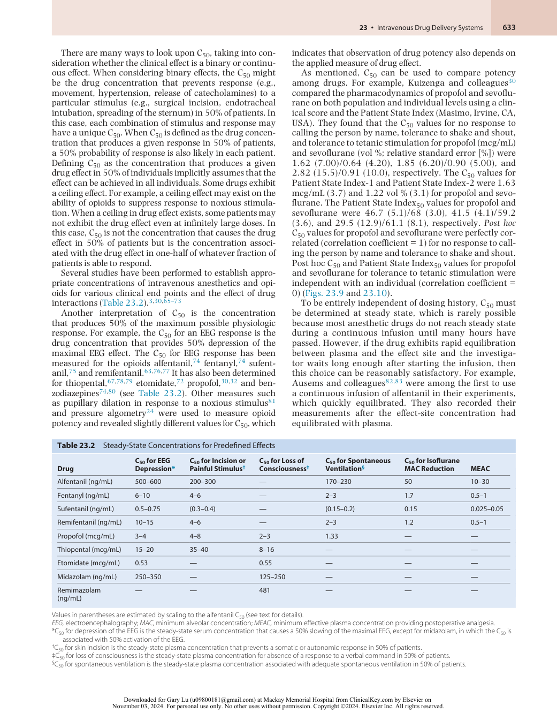

:::

<!-- PDF page 12 -->

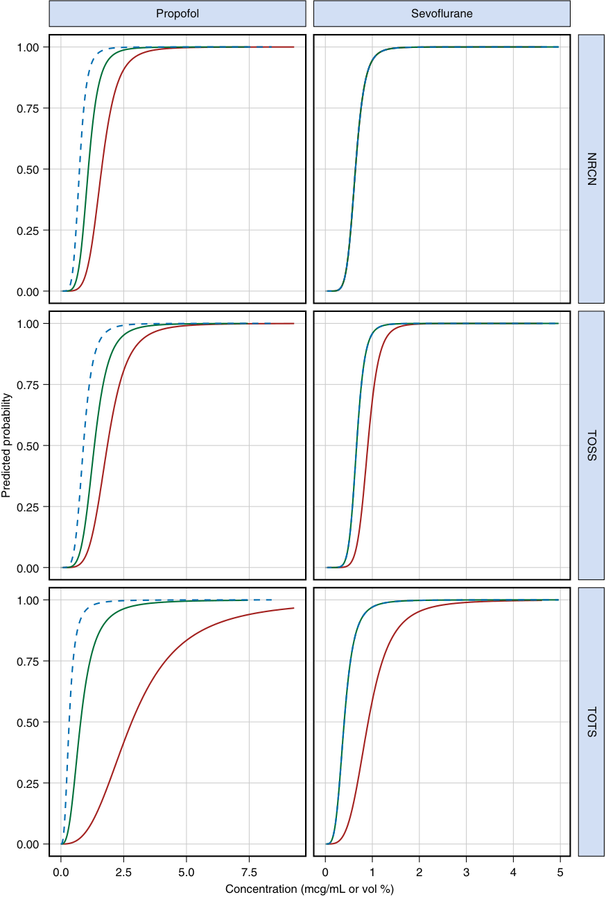

Propofol Sevoflurane 1.00 0.75 0.50 0.25 0.00 1.00 0.75 0.50 0.25 0.00 1.00 0.75 0.50 0.25 0.00 0.0 2.5 5.0 7.5 0 1 2 3 4 5 Concentration (mcg/mL or vol %) NRCN TOSS Predicted probability TOTS 

**Fig. 23.9** Steady- state, measured plasma propofol (mcg/mL) and end- tidal sevoflurane concentration (vol %) versus predicted probabilities for no response to calling the person by name (NRCN), tolerance to shake and shout (TOSS), and tolerance to tetanic stimulation (TOTS). _Solid red, solid green, and dashed blue lines_ are used for the predicted probabilities in the 0, 2, and 4 ng/mL remifentanil groups. (Adapted from Kuizenga MH, Colin PJ, Reyntjens KMEM, et al. Population pharmacodynamics of propofol and sevoflurane in healthy volunteers using a clinical score and the patient state index, _Anesthesiology_ . 2019;131:1223–1238. Used with permission.)

<!-- PDF page 13 -->

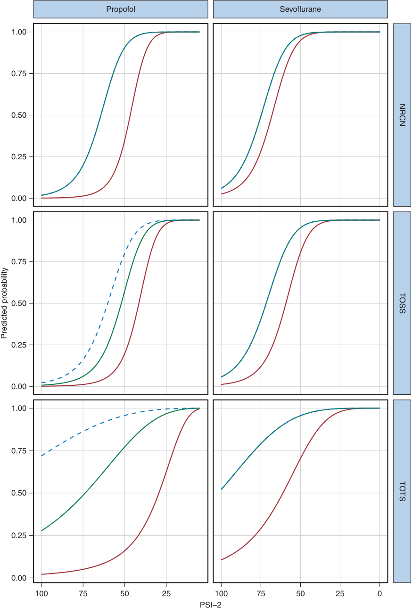

Propofol Sevoflurane 1.00 0.75 0.50 0.25 0.00 1.00 0.75 0.50 0.25 0.00 1.00 0.75 0.50 0.25 0.00 100 75 50 25 100 75 50 25 0 PSI−2 NRCN TOSS Predicted probability TOTS 

**Fig. 23.10** Patient State Index-2 (PSI-2) versus no observed response to calling the person by name (NRCN), tolerance to shake and shout (TOSS), and tolerance to tetanic stimulation (TOTS) during propofol and sevoflurane administration. Box plots are used to show the distribution of the PSI- 2 index in the different remifentanil groups. Individual observations are shown with _circles_ and are scattered and offset against the y- axis to increase visibility. _Red, green, and blue_ are used for the 0, 2, and 4 ng/mL remifentanil groups, respectively. (Adapted from Kuizenga MH, Colin PJ, Reyntjens KMEM, et al. Population pharmacodynamics of propofol and sevoflurane in healthy volunteers using a clinical score and the patient state index, _Anesthesiology_ . 2019;131:1223–1238. Used with permission.)

<!-- PDF page 14 -->

A second alternative to performing a true steady- state experiment is to use mathematic modeling to calculate the effect- site concentrations of drug at the time of measurement, as proposed by Hull and colleagues17 and Sheiner and colleagues.18 The relationship between effect- site and plasma concentrations is graphically represented in Fig. 23.5 and mathematically in Eq. 23.6. Calculating effectsite concentrations is the same as attempting to determine the steady- state plasma concentrations that produce the observed drug effect. When the C50 reflects effect- site concentrations, it is represented as Ce50 to distinguish it from values of C50 that are based on plasma concentrations, which are then termed Cp50. However, the distinction is artificial. In both cases, C50 is intended to represent the steady- state plasma drug concentration associated with a given drug effect.

A third alternative to performing a steady- state experiment is to establish a pseudo–steady state with the use of computer- controlled drug delivery. By this term we mean that a steady state is assumed to exist, because a varying rate drug infusion is being administered with the intent of achieving stable plasma concentrations. This method has become the state  of  the art for determining the C50 for anesthetic drugs, and many of the C50 values referenced earlier were determined at pseudo–steady state with the use of computer- controlled drug delivery. Commonly, two or more measurements of the plasma concentration during pseudo– steady- state conditions are performed to verify whether this is indeed the case.52,53 Typically, maintaining a constant plasma steady- state concentration for four to five plasma effect- site equilibration half- lives (e.g., 10 to 15 minutes for fentanyl) is required.

Thus there are several ways to establish C50 in terms of steady- state concentrations. C50 can be estimated through mathematic effect- site modeling or can be experimentally measured with the use of computer- controlled drug delivery to establish a pseudo–steady state quickly. Either way, when performing studies to define the concentration–effect relationship, equilibrium must exist or be modeled between the biophase (the site of effect) and plasma or blood (where the concentration is measured).

When C50 is defined in terms of the concentration associated with a response in one-half of a population, that same C50 is the concentration associated with a 50% probability of response in a typical individual. However, individual patients are not typical individuals but rather will have their own value for C50. Expressed in clinical terms, different patients have different anesthetic requirements for the same stimulus. For example, the minimal effective analgesic concentration of fentanyl is 0.6 ng/mL, but it varies among patients from 0.2 to 2.0 ng/mL.84 The minimal effective analgesic concentrations of alfentanil85 and sufentanil86 similarly vary among patients by a factor of 5 to 10. This range encompasses both variability in the intensity of the stimulus and variability of the individual patient.

A pharmacokinetic and pharmacodynamic model that is useful for predicting drug concentrations and effects in one individual may not be optimal in another individual. Even sophisticated models fail to capture the biologic variability across individuals. This is a clinical reality that must be accounted for when dosing regimens are designed. Because of this variability, intravenous anesthetics should

be titrated to each patient’s unique anesthetic requirement for the given stimulus at each moment.

Some relationships may be evident between the parameters of the pharmacologic models (volumes, clearances, concentrations, etc.) for each individual and their observable characteristics (age, weight, sex, disease states, etc.), referred to as covariates. Covariate analysis quantifies these relationships to gain information about an individual and gain insight into drug and physiologic mechanisms. There is still considerable diversity in how it is performed in model development.87 Covariate relationships may be simple associations without a clear mechanistic interpretation. They may also have reasonable mechanistic explanations, for example, elimination clearance for renally cleared drugs is likely to decline with advancing age in parallel with glomerular renal filtration rates. Body size is often an important covariate in anesthesia, with larger, heavier individuals requiring greater drug doses (in mass units) for comparable drug concentrations and effects. This underlies the utility of the widespread practice of defining drug dosing on a per kg basis. However, per kg dosing is often inadequate at the extremes of body size, and adjustments are necessary.88,89 Allometric theory addresses the relationship between body size and diverse characteristics. A theoretical analysis appeared in the biologic sciences with the work of West–Brown–Enquist.90 The mathematical derivation relies on a hierarchical space- filling structure, energy efficiency, and an exchange surface limited to the terminal branches, among other assumptions.91 For pharmacologic models, volumes scale to the 1 power and clearances to the 34⁄ power of body size, which is typically taken as the ratio of total body weight to a reference weight. These exponents appear useful for predicting dose and drug clearance for adults and children older than 2 to 5 years.92,93 The theory provides a quantitative explanation consistent with experimental results that children typically require greater doses (per kilogram bodyweight) compared to adults. For young children, maturation of organ function responsible for drug elimination may be incomplete and models should decrease clearance predictions relative to those from a3 4⁄ power.94,95 Pharmacokinetic models developed from data from individuals with a wide range of sizes nearly universally incorporate some form of allometric scaling.96 Data- driven analysis can result in models that deviate from allometric theory.

### Pharmacodynamic Drug Interactions

Drug interactions cause the potency of one drug (for example as measured by the C50) to shift in response to the administration of a second drug. This drug interaction can be additive, supra- additive (synergistic), or infra- additive (antagonistic). As observed in the isobologram (Fig. 23.11), for additive drugs with equal potency, the cumulative effect resulting from doses a and b for substances A and B, respectively, equals the effect obtained with the injection of either drug A or B solely in a dose a + b. If the drugs interact synergistically, then the combination of A and B will generate a more pronounced effect than additive. For antagonistic drug interaction, the combination of A and B will result in a less pronounced effect than additive. In general, additive drug interactions occur when combining drugs acting by the same mechanism and synergistic or antagonistic interaction when combining drugs acting by a different

<!-- PDF page 15 -->

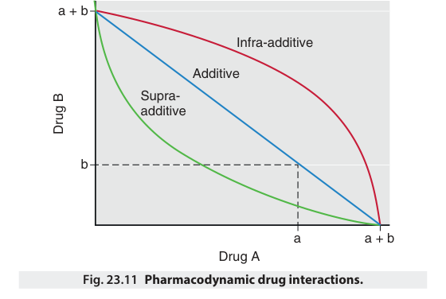

a + b Infra-additive Additive Supra- additive b a a + b Drug A Fig. 23.11 Pharmacodynamic drug interactions. Drug B 

mechanism.97 Hendrickx and co- workers (Fig. 23.12) reviewed the available literature and summarized the available data on drug interactions in humans and animals for hypnosis and immobility.97

Investigating only one isobole of the interaction spectrum (e.g., the 50% probability level of a specific drug response) provides a rudimentary insight into the interaction characteristics but reveals only limited information about other levels of drug effect (e.g., at the clinically more important level of 95% probability of drug response). As drug interactions may vary among drug-effect levels (e.g., additive at the 50% level but synergistic at the 95% level), the aim is to characterize the response surface describing all levels of effect. Pharmacodynamic response surface models generate figures that are three- (or even higher) dimensional structures that have been developed to describe the relationship quantitatively between two or more drug concentrations and their combined clinical effect (Fig. 23.13). Response surface models are powerful representations of drug interactions as they combine information about the full range of isoboles resulting from the concentration response curves of all combinations of the drugs involved.98,99 Using the mathematically defined response surface, the corresponding drug effect for any two or more drug concentrations of the interacting drugs can be predicted.98,100 Various methodologic approaches to response surface models are found in the literature.26

Clinically relevant and unambiguous end points are required to explore pharmacodynamic drug interactions. In anesthesia, clinical end points of responsiveness to a stimulus are frequently applied to observe if a patient is sufficiently anesthetized.97,101 Various verbal, tactile, or noxious stimuli have been proposed for eliciting a motor, hemodynamic, or electro encephalographic response. The first is more dichotomous (i.e., tolerance to a stimulus such as a verbal response to “shake and shout,” a spontaneous movement to a noxious stimulus such as insertion of a laryngeal mask, laryngoscopy, skin incision, or a tetanic electrical stimulus),25 whereas the others are continuous and evaluate an intra- individual, graded change over time. Various monitors measuring anesthetic- induced dynamic changes in the electroencephalogram have been introduced into clinical practice as a surrogate indicator of hypnotic drug effect and allow quantification of the hypnotic

component of anesthesia even when the clinically detectable responses may have dissipated. Mathematical and statistical modeling is applied to the digitized raw EEG data to derive a depth- of- anesthesia measurement. This analysis involves EEG feature extraction and categorization into a final dimensionless index. Some examples (non- inclusive list) of processed EEG monitors used in clinical practice are the Bispectral Index (BIS, Medtronic, Minneapolis, MN, USA), Entropy Module (GE HealthCare Technologies, Helsinki, Finland), Narcotrend Monitor (MonitorTechnik, Bad Bramstedt, Germany), NeuroSENSE Monitor (NeuroWave Systems Inc, Cleveland Heights, OH), SEDline Monitor (Masimo, Irvine, CA), SNAPII Monitor (Stryker, Inc, Kalamazoo, MI), qCON (CONOX, Quantium Medical, Barcelona, Spain), BARM Function Brain Monitor (Cortical Dynamics, North Perth, Australia).102 Although found to be accurate in measuring the hypnotic component of anesthesia, most of these methods are not sensitive and specific enough to measure the balance between nociception and antinociception. For this purpose, other measures monitoring the variability in the EEG103–105 or changes in the autonomic system106 have been proposed.

Although the interactions of an infinite number of drug combinations can be studied, anesthetic literature focused mainly on the interaction between hypnotics and opioids and between various classes of hypnotics. Volatile anesthetics and opioids exhibit strong synergistic interaction. The reduction of the MAC for a given volatile by a given opioid dose can be applied to investigate the potency and efficacy of opioids.107–112 These MAC reduction studies reveal a general pattern, irrespectively of which opioid or volatile anesthetic has been used. Low concentrations of an opioid result in a substantial reduction of MAC (Fig. 23.14). With increasing concentrations of the opioid, MAC continues to decrease until a plateau is reached and, consequently, a further increase of the opioid dose is futile.113 The previously mentioned MAC reduction studies show the effect of a single opioid dose on a single point of a dose–response curve but, nonetheless, form the basis for more detailed surface interaction studies.114

In the interaction between sevoflurane and alfentanil, Dahan and colleagues developed an interaction model for various continuous end points which revealed supraadditivity for heart rate and respiratory control, but independence of the BIS with respect to alfentanil concentration.115 The effect on various processed EEG measures of hypnotic drug effect (BIS, state entropy [SE], and response entropy [RE]) and the balance between nociception and antinociception (Composite Variability Index, and Surgical Pleth Index) was confirmed for sevoflurane–remifentanil anesthesia by Heyse and colleagues. The authors found an additive interaction between sevoflurane and remifentanil on BIS, SE, and RE. For Composite Variability Index, a moderate synergism was found. The comparison of pre- and poststimulation data revealed a shift of C50SEVO for BIS, SE, and RE, with a consistent increase of 0.3 vol %. The Surgical Pleth Index data did not result in plausible parameter estimates, neither before nor after stimulation.36 Manyam and colleagues116 developed a model showing supra- additivity in preventing movement to pain with sevoflurane and remifentanil, which was later enhanced by using a physiologic model for sevoflurane

<!-- PDF page 16 -->

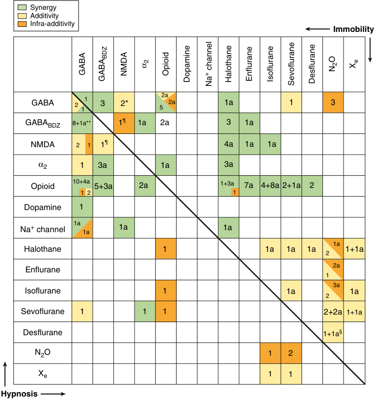

Synergy Additivity Infra-additivity Immobility 2a GABA 2 11 3 2* 5 2a 1a 1 3 GABABDZ 8+1a** 1 ¶ 1a 2a 3 1a NMDA 2 1 1 ¶ 4a 1a 1a α2 1 3a 1a 3a Opioid 10+4a 5+3a 2a 1+3a 7a 4+8a 2+1a 2 1 2 1 Dopamine 1 1a Na +  channel 1a 1a 1a 1a Halothane 1 1a 1a 1a 1+1a 2 2a Enflurane 1 3a Isoflurane 1 1a 1a 2 Sevoflurane 1 1 1 2+2a 1+1a Desflurane 1+1a § N2O 1 2 Xe 1 1 Hypnosis α2 Xe ON2 GABA NMDA Opioid GABABDZ Dopamine +Na channel Halothane Enflurane Isoflurane Sevoflurane Desflurane 

**Fig. 23.12 Interaction grid summarizing the available data on drug interactions in humans and animals for hypnosis and immobility.** Drugs are organized by pharmacologic class: gamma- aminobutyric acid (GABA)–acting drugs (propofol, thiopental, methohexital, and etomidate); GABA agents acting at the benzodiazepine (GABABDZ)- binding site (midazolam, diazepam); _N_ - methyl- d- aspartate (NMDA)- receptor antagonist (ketamine); adrenergic agonists (α2) (dexmedetomidine, clonidine); opioid- acting drugs at opioid receptor (morphine, alfentanil, fentanyl, sufentanil, and remifentanil); dopamine at dopamine antagonists (droperidol, metoclopramide); sodium (Na+ ) channel blockers (lidocaine, bupivacaine); and anesthetic gases. The right upper half of the grid _(above the thick diagonal)_ summarizes the interactions for the end point of immobility; the left lower half _(below the thick diagonal)_ summarizes the interactions for the end point of hypnosis. Synergy is coded as _green,_ additivity as _yellow_ , and infra- additivity as _dark orange_ . The number refers to the number of studies attesting to a particular interaction; if one study documents two interactions (e.g., isoflurane with both fentanyl and alfentanil), then they are counted separately. Animal data carry the suffix _a_ after the number of studies, human data have no suffix. *Reanalysis: propofol–ketamine interaction in humans is infra- additive for immobility. **Reanalysis: thiopental–midazolam interaction in humans is additive for hypnosis.¶ Reanalysis: ketamine–midazolam interaction in humans is infra- additive for hypnosis and additive for immobility.§ Infra- additivity between desflurane and nitrous oxide (N2O) has been suggested in a small subgroup of 18- to 30- year- old patients. (From Hendrickx JF, Eger EI 2nd, Sonner JM, et al. Is synergy the rule? A review of anesthetic interactions producing hypnosis and immobility, _Anesth Analg_ . 2008;107:494–506. Used with permission.)

pharmacokinetics instead of end- tidal concentrations.117 Bi and colleagues118 presented a model of sevoflurane and remifentanil showing that the supra- additive effect on prevention of hemodynamic responses to laryngoscopy is stronger than for the occurrence of circulatory depression. Heyse and colleagues26 aimed to fit multiple interaction models to the data from a sevoflurane–remifentanil anesthesia and multiple stimuli (verbal, tactile, and painful) (Fig. 23.15). They found that the hierarchical model of Bouillon and colleagues fit the data best. Using previously published data,112 the same group27 studied the interaction of 66% nitrous oxide, sevoflurane, and fentanyl using movement and hemodynamic changes in response to a surgical incision as the clinical end point and found that

a simple extension of the hierarchical model integrates the additional effect of nitrous oxide to the interaction of fentanyl and sevoflurane using surface modeling approach. Nitrous oxide has an additive effect corresponding to 0.54vol% sevoflurane and 0.27 ng/mL fentanyl. Finally, using MAC equipotency and opioid equivalencies, it has been shown that previous findings can be extrapolated to other volatile anesthetic–opioid combinations.114 This is supported by a study revealing that 50% of the subjects undergoing fentanyl–isoflurane anesthesia woke within two minutes of the time predicted by extrapolation from a sevoflurane–remifentanil model- predicted wake- up time, on the basis of equivalence.117 Additionally, a study showed accurate predictions for wake- up time from a

<!-- PDF page 17 -->

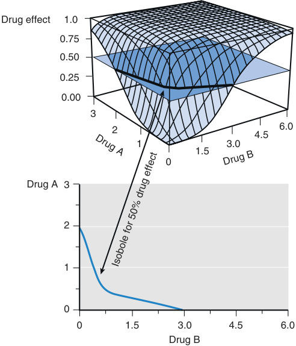

Drug effect 1.0 0.75 0.50 0.25 0.00 3 2 6.0 4.5 1 3.0 1.5 0 Drug A 3 2 1 0 0 1.5 3.0 4.5 6.0 Drug B Drug B Drug A Isobole for 50% drug effect 

**Fig. 23.13 Relationship between a response surface and a standard isobologram.** Conventional isobolographic analysis, whether for doses or concentrations, describes only the concentration of both drugs that yields a 50% drug effect and thus fails to capture the entire response surface. (From Minto CF, Schnider TW, Short TG, et al. Response surface model for anesthetic drug interactions, _Anesthesiology_ . 2000;92:1603–1616. Used with permission.)

sevoflurane–remifentanil interaction model adapted to equipotent sufentanil–desflurane doses that were used.119

For total intravenous anesthesia, interactions associated with various drug combinations and concentrations have been described. The concept of balanced anesthesia assumes that drug combinations will be synergistic in anesthetic effect (however defined) but not in toxicity. Such synergism has been demonstrated for a variety of drug combinations but not for others97,120 (see Fig. 23.12). Zanderigo and colleagues121 developed the _well- being model_ , a new interaction model to describe both positive and negative effects of drug combinations (Fig. 23.16). More profound synergy for specific end points related to analgesia and hypnosis has also been demonstrated for the interaction between propofol and opioids. Thus, when anesthetic regimens are designed that rely on synergy to produce the anesthetic state, defining the desired end point – loss of consciousness or ablation of response to noxious stimulation – is important. Different combinations of drugs may be used to achieve any end point. The isoboles indicting the 50% and 95% probability of loss of consciousness for combinations of fentanyl and propofol reveal a synergistic interaction, albeit the effect of fentanyl is limited because the maximum reduction of 50% probability is reached at a fentanyl concentration of 3 ng/mL.122 Kazama and co- workers studied the pharmacodynamic interaction between propofol and fentanyl with respect to the suppression of somatic and hemodynamic responses to skin incision, peritoneum incision, and abdominal wall retraction and concluded that increasing the fentanyl concentration markedly reduced

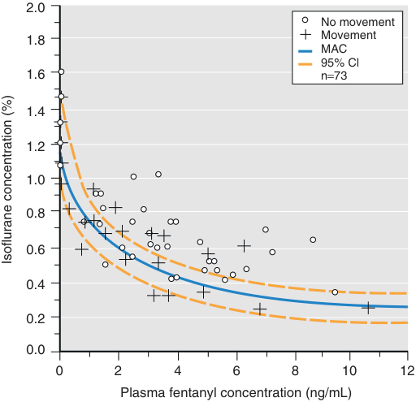

2.0 No movement 1.8 Movement MAC 95% Cl 1.6 n=73 1.4 1.2 1.0 0.8 0.6 0.4 0.2 0.0 0 2 4 6 8 10 12 Plasma fentanyl concentration (ng/mL) Isoflurane concentration (%) 

**Fig. 23.14** Interaction of isoflurane and fentanyl in preventing a somatic response at skin incision (i.e., minimum alveolar concentration [MAC] reduction of isoflurane). The _blue line_ represents the concentrations of isoflurane and fentanyl when administered together that are required to prevent purposeful movement in 50% of patients at skin incision. The _dotted gold lines_ represent the 95% confidence interval (CI) of the MAC at each combination of fentanyl and isoflurane. (From McEwan AI, Smith C, Dyar O, et al. Isoflurane MAC reduction by fentanyl. _Anesthesiology_ . 1993;78:864–869. Used with permission.)

propofol Cp50 for somatic response, indicating the potential synergistic interaction of both drugs. During the prestimulation period, fentanyl did not decrease systolic blood pressure; however, propofol specifically decreased systolic blood pressure. Both drugs had a synergistic drug interaction on the systolic blood pressure increase after various surgical stimulations.123 The interaction between propofol and sufentanil has been investigated in a response surface model describing the probability of loss of consciousness (LOC), and revealed a more additive interaction.124 This was confirmed by a later study by Hentgen and colleagues using fixed sufentanil concentrations whilst changing propofol to keep the BIS within a certain range.125 These authors also found that sufentanil is able to suppress motor and hemodynamic responses to noxious stimuli.125 Others found that combination of propofol 1.2 mcg/mL and sufentanil 0.456 ng/mL could be successfully used for analgo- sedation during burn wound dressing changes, without respiratory depression and with good doctor and patient satisfaction scores.126 Vuyk and colleagues characterized the interaction between propofol and alfentanil for several end points: loss of response to endotracheal intubation, loss of response to incision and retraction of the peritoneum, and emergence from anesthesia (Fig. 23.17).127 The most profound stimulation was tracheal intubation, and when no opioid was used, the abolition of responses to that stimulus required a propofol concentration equal to or more than 12 mcg/mL. More details for optimal drug combinations based on the findings from Vuyk and co- workers127 are provided in Table 23.3. Minto and colleagues published _response surfaces_ for combinations of midazolam–alfentanil, propofol–alfentanil, and midazolam–propofol associated

<!-- PDF page 18 -->

with the loss of response to verbal command (Fig. 23.18).98 They also extended response surface methodology to describe the simultaneous interaction of three drugs. Rendering the full interaction surface for three drugs would require drawing the graph in four dimensions. If the graph is limited to

the interaction at 50% drug effect, then it can be rendered in three dimensions (Fig. 23.19).

The interaction between propofol and remifentanil has been studied extensively and is supra- additive for noxious stimuli and hypnotic end points. Shake and shout,25,128,129

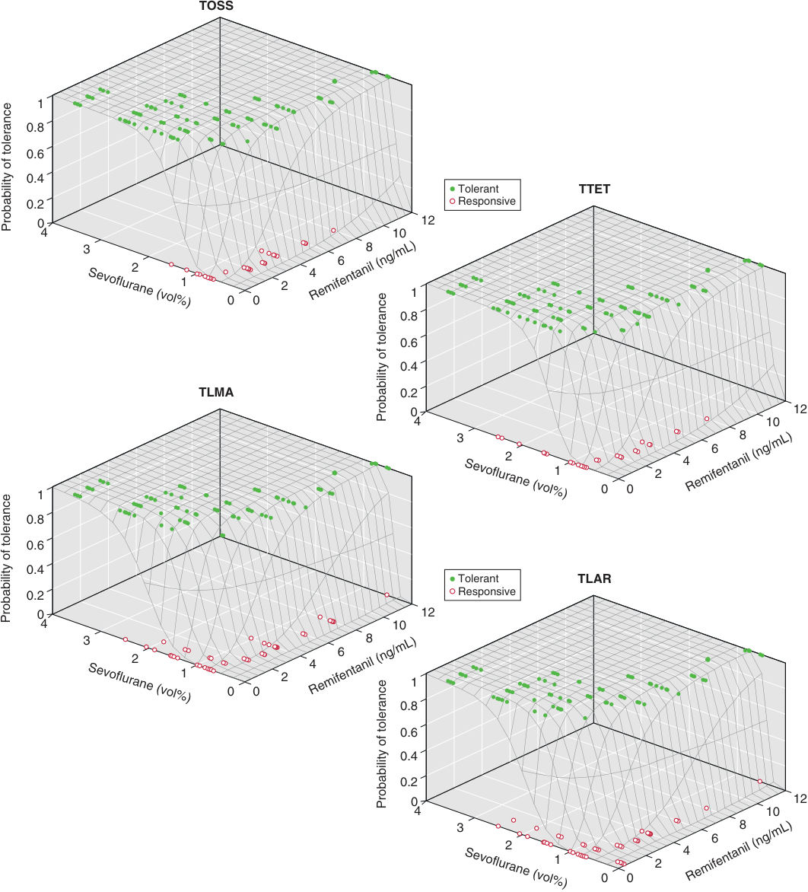

TOSS 1 0.8 0.6 0.4 Tolerant TTET 0.2 Responsive 04 10 12 3 8 6 2 4 1 2 1 0 0 0.8 0.6 0.4 TLMA 0.2 04 10 12 3 8 6 2 4 1 2 0 0 1 0.8 0.6 0.4 Tolerant TLAR 0.2 Responsive 04 10 12 3 8 6 2 4 1 2 1 0 0 0.8 0.6 0.4 0.2 04 10 12 3 8 6 2 4 1 2 0 0 Sevoflurane (vol%) Sevoflurane (vol%) Sevoflurane (vol%) Sevoflurane (vol%) Remifentanil (ng/mL) Remifentanil (ng/mL) Remifentanil (ng/mL) Remifentanil (ng/mL) Probability of tolerance Probability of tolerance Probability of tolerance Probability of tolerance 

**Fig. 23.15** Response surface for probability of tolerance to shaking and shouting (TOSS), tetanic stimulation (TTET), laryngeal mask airway insertion (TLMA), and laryngoscopy (TLAR) for the Fixed C50(O) Hierarchical model. The _solid lines_ at probability 0.5 represent the 50% isoboles. (From Heyse B, Proost JH, Schumacher PM, et al. Sevoflurane remifentanil interaction: comparison of different response surface models. _Anesthesiology_ . 2012;116:311–323. Used with permission.)

<!-- PDF page 19 -->

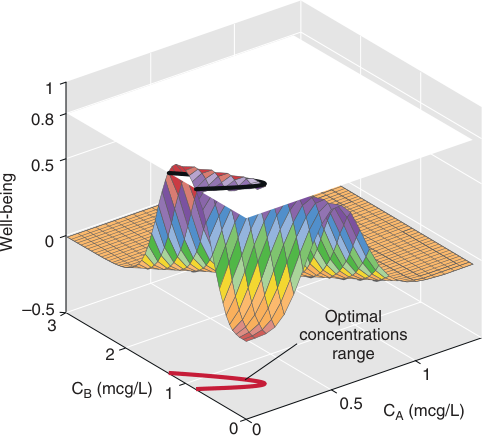

1 0.8 0.5 0 –0.5 Optimal 3 concentrations 2 range 1 CB (mcg/L) 1 0.5 CA (mcg/L) 0 0 Well-being 

**Fig. 23.16** Definition of the optimal concentrations range for the combined administration of drugs A and B, in the case of zero interactions. The optimal concentrations range results from the intersection between the well- being surface and the plane representing a well- being value of 0.8. (From Zanderigo E, Sartori V, Sveticic G, et al. The well- being model: a new drug interaction model for positive and negative effects. _Anesthesiology_ . 2006;104:742–753. Used with permission.)

laryngoscopy,25,128–130 intubation,130 intra- abdominal surgery,130 tibial pressure algometry,128 electrical tetany,128 recovery times,129 and postoperative pain responses129 have all been shown to exhibit supra- additive interactions. For more continuous, EEG- derived parameters, the results for remifentanil are contradictory, showing no synergism (with propofol) for BIS in one study,131 additivity,25,132 and supra- additivity in other studies.133–135

Various studies described the cardiorespiratory interaction between propofol and remifentanil. Nieuwenhuijs and colleagues131 described a supra- additive interaction on cardiorespiratory control. Bouillon and associates and Nieuwenhuijs and associates investigated the effects of hypnotic–opioid combinations on cardiorespiratory control.131,136 These data show dose- dependent effects on respiration at relatively low concentrations of propofol and remifentanil. When combined, their effect on respiration is strikingly synergistic, resulting in severe respiratory depression. More recently, SangMin Choe and colleagues137 published the results of a study on the pharmacodynamic interaction between remifentanil and propofol using various dichotomous end points (muscle rigidity, apnea, and LOC). They found that the response surface revealed infra- additive and synergistic effects for muscle rigidity and apnea, respectively. The effects of the combined drugs on LOC were additive. The C50 estimates of remifentanil (ng/mL) and propofol (mcg/mL) were 9.11 and 130,000 for muscle rigidity (suggesting that propofol does not induce muscle rigidity), 8.99 and 6.26 for apnea, and 13.9 and 3.04 for LOC. The probability of occurrence of muscle rigidity declined when propofol was combined with remifentanil.

Surface models were also used to optimize drug administration in challenging situations such as short- duration procedures in spontaneous breathing patients. LaPierre

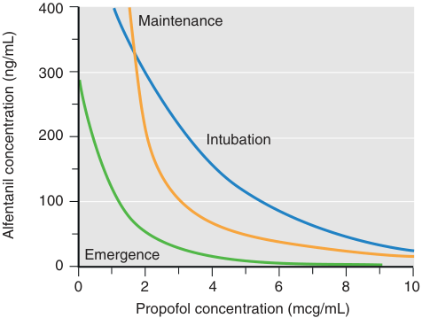

400 Maintenance 300 200 Intubation 100 Emergence 0 0 2 4 6 8 10 Propofol concentration (mcg/mL) Alfentanil concentration (ng/mL) 

**Fig. 23.17** Interaction between alfentanil and propofol on three different end points: response to intubation ( _blue line_ ), maintenance of anesthesia ( _gold line_ ), and concentrations associated with emergence from anesthesia ( _green line_ ). The curve shows the concentrations associated with a 50% probability of the respective end point. (Adapted from Vuyk J, Lim T, Engbers FH, et al. The pharmacodynamic interaction of propofol and alfentanil during lower abdominal surgery in women. _Anesthesiology_ . 1995;83:8–22.)

and co- workers138 explored remifentanil–propofol combinations that led to a loss of response to esophageal instrumentation, a loss of responsiveness, and/or an onset of ventilatory depression requiring intervention. They found that the combinations that allowed esophageal instrumentation and avoided intolerable ventilatory depression and/ or loss of responsiveness primarily clustered around remifentanil–propofol effect- site concentrations ranging from 0.8 to 1.6 ng/mL and 1.5 to 2.7 mcg/mL, respectively. However, blocking the response to esophageal instrumentation and avoiding both intolerable ventilatory depression and/or a loss of responsiveness is difficult. It may be necessary to accept some discomfort and blunt, rather than block, the response to esophageal instrumentation to consistently avoid intolerable ventilatory depression and/or loss of responsiveness. In a previously mentioned study, using response surface modeling, Bouillon and colleagues also determined the interactions between propofol and remifentanil on the probability of responses to laryngoscopy (PTOL).25 Luginbuhl, working with a group that included Bouillon, normalized and calibrated PTOL, to produce an index called the noxious stimulus response index (NSRI).139 The NSRI is a dimensionless integer number between 0 and 100, where 50 corresponds to a PTOL of 50% and 20 to a PTOL of 90%.

The interactions between hypnotics such as propofol and sevoflurane should also be understood because these drugs are frequently used sequentially. Schumacher and colleagues140 used response surface methodology to examine the influence of this interaction on the probability of Tolerance to Shake and Shout (TOSS) and three noxious stimuli: Tolerance to Tetanic Stimulation, Laryngeal Mask Insertion, and Laryngoscopy (TTET, TLMA, and TLAR). They found that for both EEG suppression and tolerance to stimulation, the interaction of propofol and sevoflurane were additive. Others found similar results on the C50 level.141 Hammer and colleagues142 determined the pharmacodynamic interaction of propofol and dexmedetomidine during

<!-- PDF page 20 -->

**Table 23.3** Propofol/Opioid Combinations Associated with the Fastest Recovery from Anesthesia

|**Infusion** **Duration (min)**||**Propofol/Alfentanil** **(mcg/mL; ng/mL)**|**Propofol/Sufentanil** **(mcg/mL; ng/mL)**|**Propofol/Remifentanil** **(mcg/mL; ng/mL)**|
|---|---|---|---|---|
|15|Coptimal|3.25/99.3|3.57/0.17|2.57/4.70|
||Cawakening|1.69/65.0|1.70/0.10|1.83/1.93|
||Time to awakening (min)|8.2|9.4|5.1|
|60|Coptimal|3.38/89.7|3.34/0.14|2.51/4.78|
||Cawakening|1.70/64.9|1.70/0.10|1.83/1.93|
||Time to awakening (min)|12.2|11.9|6.1|
|300|Coptimal|3.40/88.9|3.37/0.14|2.51/4.78|
||Cawakening|1.70/64.9|1.70/0.10|1.86/1.88|
||Time to awakening (min)|16.0|15.6|6.7|

Coptimal represents combinations associated with a 50% probability of a response to surgical stimuli; Cawakening concentrations represent the estimated concentrations at which consciousness will be regained; and Time to awakening represents the estimated time from termination of the infusion to return of consciousness in 50% of patients.

From Vuyk J, Mertens MJ, Olofsen E, et al. Propofol anesthesia and rational opioid selection. Determination of optimal EC50- EC95 propofol- opioid concentrations that assure adequate anesthesia and a rapid return of consciousness. _Anesthesiology_ . 1997;87:1549–1562; and modified from Absalom A, Struys MMRF. _An Overview of TCI and TIVA_ . ed 3. Ghent, Belgium: Academia Press; 2019. Used with permission.

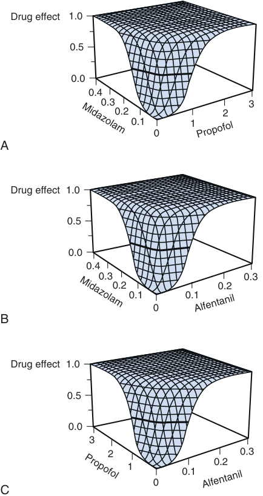

Drug effect 1.0 0.5 0.0 0.4 0.3 3 0.2 2 0.1 1 0 A Drug effect 1.0 0.5 0.0 0.4 0.3 0.3 0.2 0.2 0.1 0.1 0 B Drug effect 1.0 0.5 0.0 3 2 0.3 0.2 1 0.1 0 C Propofol Alfentanil Alfentanil Midazolam Midazolam Propofol 

**Fig. 23.18** Response surface for each of the paired interactions between propofol and midazolam (A), alfentanil and midazolam (B), and alfentanil and propofol (C) on the probability of opening eyes to a verbal command. The isoboles for a 10%, 20%, 30%, 40%, 50%, 60%, 70%, 80%, and 90% response are shown. (From Minto CF, Schnider TW, Short TG, et al. Response surface model for anesthetic drug interactions. _Anesthesiology_ . 2000;92:1603–1616.)

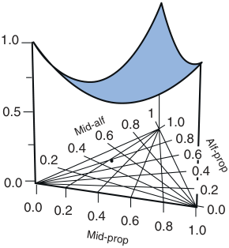

1.0 0.5 1 0.8 1.0 0.6 0.8 0.4 0.6 0.2 0.4 0.0 0.2 0.0 0.2 0.0 0.4 0.6 Mid-prop 0.8 1.0 Mid-alf Alf-prop 

**Fig. 23.19 Interaction at 50% drug effect (C50) among propofol, midazolam, and alfentanil.** Downward deflection of the surface represents synergy, in units of fractional reduction in C50. The three edges represent relative amounts of propofol to midazolam (θMid- prop), alfentanil to midazolam (θMid- alf), and alfentanil to propofol (θAlf- prop). The surface between the edges represents the relative synergy of all three drugs taken together. (From Minto CF, Schnider TW, Short TG, et al. Response surface model for anesthetic drug interactions. _Anesthesiology_ . 2000;92:1603–1616.)

pediatric esophagogastroduodenoscopy and concluded that the concentration of propofol at which 50% of patients are adequately anesthetized (EC50) in children was unaffected by a concomitant intravenous infusion of dexmedetomidine 1 mcg/kg body weight given over 10 minutes. Various studies describing hypnotic–hypnotic interactions show conflicting evidence possibly because of methodologic issues and were therefore not cited in this overview.5

In a three- phase cross- over trial, Weerink and coworkers29 studied the pharmacodynamic interaction between remifentanil and dexmedetomidine on various binary end points: no response to calling the subject by name, tolerance of shaking the patient while shouting the name (“shake and shout”), tolerance of deep trapezius squeeze, and tolerance of laryngoscopy. The binary end points were correlated with dexmedetomidine concentrations, with increasing concentrations required for increasing stimulus intensity. Despite appearing to be asleep, most subjects remained arousable by calling the subject’s name,

::: details 原始表格與符號（PDF 第 20 頁）

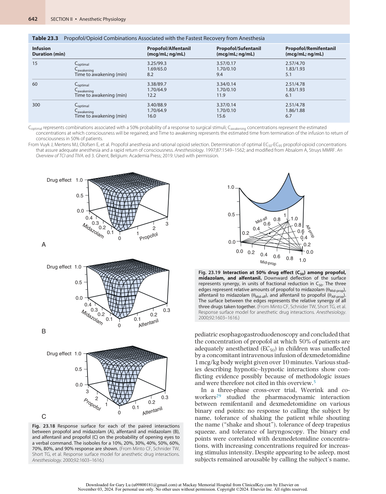

:::

<!-- PDF page 21 -->

“shake and shout,” or a trapezius squeeze, even when reaching supraclinical concentrations. Adding remifentanil did not alter the likelihood of response to graded stimuli.

Intravenous and inhaled anesthetics are commonly used together or sequentially in one patient, mostly in combination with an opioid. Using response surface modelling, Hannivoort and colleagues developed a model that predicts the effect of combinations of sevoflurane, propofol, and remifentanil in terms of PTOL and the NSRI. They showed an additive interaction between sevoflurane and propofol when titrated towards PTOL50 doses. A synergistic effect was found for remifentanil when combined with propofol and sevoflurane.28 Using a within- subject design to compare the effects of remifentanil on propofol head- tohead with sevoflurane, Kuizenga _et al._30 studied how the addition of remifentanil alters the resting state of cortical activity measured by processed EEG and the probability of behavioral response to a graded external stimulus (no response to calling the person by name, tolerance to shake and shout, tolerance to tetanic stimulation) to sevoflurane and propofol. As shown in Figs. 23.9 and 23.10, they found that remifentanil affects the relationship between hypnotic drug concentrations and the probability of quantal behavioral response to stimuli. They also found that the addition of remifentanil has only a small effect on the relationship between the hypnotic drugs and the resting state cortical activity for propofol but rather none for sevoflurane. Lastly, they also found that sevoflurane is clearly better than propofol at blocking responses to sensory inputs. An enlightening analysis of the findings from Kuizenga _et al._ can be found in an accompanying editorial by J.W. Sleigh.143

Although models of the pharmacokinetics and pharmacodynamics of drugs, and models of drug interactions, are essentially just that – models that attempt to provide qualitative and quantitative representations of reality – they are based on many assumptions, and inherently involve many sources of error.144 Nonetheless, they do provide information that is useful to clinicians, to help guide rational practice.145,146 Information on drug interactions, including the NSRI, has been incorporated in commercially available anesthetic display monitors, and is described in a concise summary of current knowledge, and the ways that it has, and can be, incorporated into clinical practice.5

## Designing Dosing Regimens

### BOLUS DOSE CALCULATIONS

The definition of concentration is drug mass per unit of volume. The definition of concentration can be rearranged to find the amount of drug required to produce any desired concentration for a known volume:

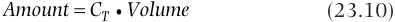

Amount  CT . Volume (23.10) 

where CT is the desired or _target_ concentration. This formula is often used to calculate the initial (loading) bolus dose required to achieve a given concentration. The problem with applying this concept to anesthetic drugs is that there are several volumes of distribution: V1 (central compartment), V2, and V3 (the peripheral compartments), and Vdss (the sum of the individual volumes). V1 is usually significantly smaller than Vdss, and thus saying that the loading

dose should be something between CT × V1 and CT × Vdss is tempting.

Consideration should be given to the dose of fentanyl required to attenuate the hemodynamic response to endotracheal intubation when combined with thiopental. The C50 for fentanyl, combined with thiopental for intubation, is approximately 3 ng/mL. The V1 and Vdss for fentanyl are 13 L and 360 L, respectively. The equations can thus be interpreted as suggesting that an appropriate dose of fentanyl to attenuate the hemodynamic response is between 39 mcg (3 ng/mL × 13 L) and 1080 mcg (3 ng/mL × 360 L). A fentanyl bolus of 39 mcg achieves the desired concentration in plasma for an initial instant, but plasma levels almost instantly decrease below the desired target. Levels at the effect site will never be close to the desired target concentration of 3 ng/mL. A fentanyl bolus of 1080 mcg, not surprisingly, produces a significant overshoot in plasma levels that persists for hours (Fig. 23.20). Additionally, using equations to calculate the fentanyl dose if the resulting recommendation is to “use a fentanyl dose between 39 and 1080 mcg” is absurd.

The usual dosing guidelines for a bolus dose, presented earlier, are designed to produce a specific plasma concentration. Because plasma is not the site of drug effect, calculating the initial bolus based on a desired plasma concentration is irrational. By knowing the k _e_ 0 of an intravenous anesthetic, a dosing regimen can be designed that yields the desired concentration at the site of drug effect. To avoid an overdose for the patient, a bolus should be selected

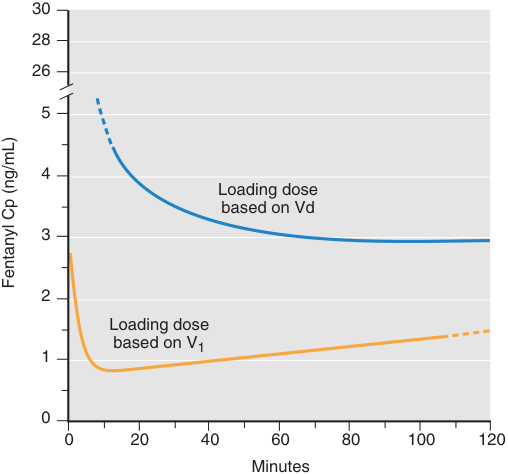

30 28 26 5 4 Loading dose based on Vd 3 2 Loading dose based on V1 1 0 0 20 40 60 80 100 120 Minutes Fentanyl Cp (ng/mL) 

**Fig. 23.20** Pharmacokinetic simulation demonstrating the limitations of infusion regimens based on simple pharmacokinetic parameters with fentanyl used as an example. These infusion schemes were designed to achieve a fentanyl plasma concentration (Cp) of 3 ng/mL. The _upper blue curve_ shows that a regimen using a loading dose based on the volume of distribution followed by a constant infusion based on clearance results in a transient period of very high plasma concentrations. If the same maintenance infusion is given but the loading dose is based on the volume of the central compartment, then the distribution of drug to the peripheral compartments causes the plasma concentration to fall below the desired level until the compartments reach steady- state concentrations as shown in the _lower gold curve_ .

<!-- PDF page 22 -->

that produces the desired peak concentration at the effect site. The decline in plasma concentration between the initial concentration after the bolus (amount/V1) and the concentration at the time of peak effect can be thought of as dilution of the bolus into a larger anatomic volume than the volume of the central compartment. This introduces the concept of Vdpe, the apparent volume of distribution at the time of peak effect,37,147 or pseudoequilibration between plasma and the site of drug effect.134 The size of this volume can be readily calculated from the observation that the plasma and effectsite concentrations are the same at the time of peak effect:

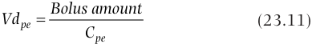

Bolus amount Vd pe  C (23.11) pe 

where Cpe is the plasma concentration at the time of peak effect.

If the clinical goal is to select the dose required to achieve a certain drug effect without producing an overdose, then Eq. 23.11 can be rearranged by substituting CT, the target concentration (which is the same in plasma and the effect site at the moment of peak effect), for Cpe to calculate the size of the initial bolus:

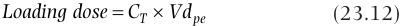

Loading dose  CT  Vd pe (23.12) 

The Vdpe for fentanyl is 75 L. To achieve a peak fentanyl effect- site concentration of 3.0 ng/mL requires 225 mcg, which produces a peak effect in 3.6 minutes. This dosing guideline is more reasonable, compared with the previous recommendation of a dose between 39 and 1080 mcg. Table 23.4 lists V1 and Vdpe for fentanyl, alfentanil, sufentanil, remifentanil, propofol, thiopental, and midazolam. Table 23.1 lists the time to peak effect and the t1/2 k _e_ 0 of the commonly used intravenous anesthetics.

### MAINTENANCE INFUSION RATES

The rate at which active drug exits the body is systemic clearance (ClS) times the plasma concentration. To maintain a given target concentration (CT), drug must be delivered at the same rate that it is exiting the body. Thus:

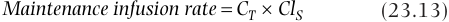

Maintenance infusion rate  CT  ClS (23.13) 

For drugs with multicompartment pharmacokinetics, which includes all the intravenous drugs used in anesthetic practice, drug is distributed into the peripheral tissues, as well as cleared from the body. The rate of distribution into tissues changes over time as the tissues equilibrate with plasma. Eq. 23.13 is correct only after the peripheral tissues have fully equilibrated with plasma, which requires many hours. At all other times, this maintenance infusion rate underestimates the infusion rate necessary to maintain a target concentration.

Yet, in some situations, this simple maintenance rate calculation may be acceptable. For example, if an infusion at this rate is used along with a bolus dose based on Vdpe and the drug has a long delay between the bolus and peak effect, then most of the distribution of drug into tissues may have occurred by the time that the effect- site concentration reaches the target concentration. In this case, the maintenance infusion rate calculated as clearance times

**Table 23.4** Volume of Distribution at the Time of Peak Effect

|**Drug**|**V1 (L)**|**Vdpe (L)**|
|---|---|---|
|Fentanyl|12.7|75|
|Alfentanil|2.19|5.9|
|Sufentanil|17.8|89|
|Remifentanil|5.0|17|
|Propofol|6.7|37|
|Thiopental|5.6|14.6|
|Midazolam|3.4|31|
|Remimazolam|4.7 L/75 kg||

_V1,_ volume of the central compartment; _Vdpe,_ apparent volume of distribution at the time of peak effect.

target concentration may be accurate because Vdpe is sufficiently higher than V1 to account for the distribution of drug into peripheral tissues. Unfortunately, most drugs used in anesthesia achieve sufficiently rapid equilibration between plasma and the effect site that Vdpe does not adequately encompass the distribution process, thus making this approach unsuitable.

As such, approaches need to be used that are mathematically and clinically sound. Because the net flow of drug into peripheral tissues decreases over time, the infusion rate required to maintain any desired concentration must also decrease over time. If the initial bolus has been based on Vdpe, no infusion needs be administered until the effect- site concentration peaks. After the peak in effect- site concentration, the (nearly) correct equation to maintain the desired concentration is:

_Maintenance infusion rate_

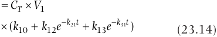

 CT  V 1  ( k 10  k 12 e  k 21 t  k 13 e  k 31 t ) (23.14) 

This equation indicates that a rapid infusion rate is initially required to maintain CT. Over time, the infusion rate gradually decreases (see Fig. 23.4). At equilibrium (t = ∞), the infusion rate decreases to CT × V1 × k10, which is the same as CT × ClS. Few clinicians would choose to solve such an equation during the administration of an anesthetic. Fortunately, simple techniques can be used in place of solving such a complex expression.

Fig. 23.21 is a nomogram in which Eq. 23.14 has been solved; the infusion rates at different times necessary to maintain any desired concentration of fentanyl, alfentanil, sufentanil, and propofol are shown. Because this nomogram is complex, the following review is provided:

The y- axis represents the target concentration CT. The x- axis is the time since the beginning of the anesthetic (i.e., since the initial bolus). The suggested initial target concentrations (shown in gold) are based on the work of Vuyk and colleagues127 with propofol and alfentanil (see Fig. 23.17) and are scaled to fentanyl and sufentanil according to their relative potencies.148 The intersections of the target concentration line and the diagonal lines indicate the infusion rate appropriate at each point in time. For example, to maintain a sufentanil concentration of 0.16 ng/mL, the appropriate rates are approximately: 0.6 mcg/kg/h at 5

::: details 原始表格與符號（PDF 第 22 頁）

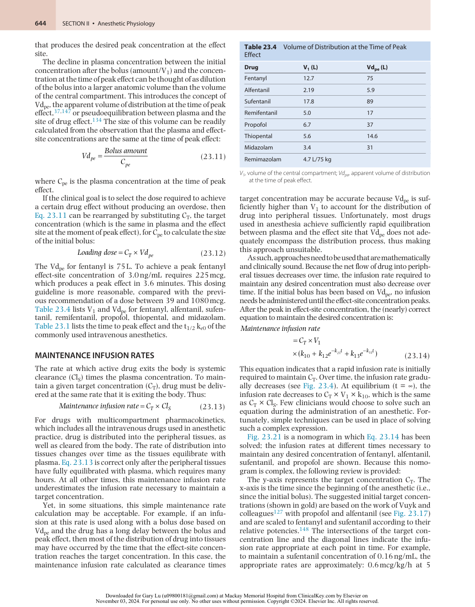

:::

<!-- PDF page 23 -->

### Infusion Rates to Maintain Stable Plasma Concentrations

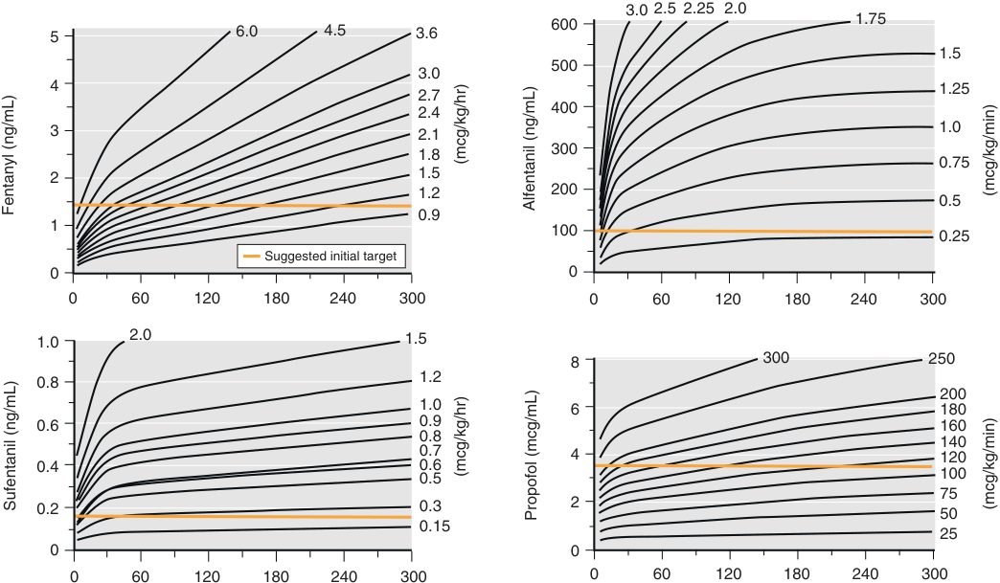

3.0 2.5 2.25 2.0 5 6.0 4.5 3.6 600 1.75 1.5 500 3.0 4 1.25 2.7 2.4 400 3 2.1 1.0 1.8 300 0.75 2 1.5 1.2 200 0.5 0.9 1 100 0.25 Suggested initial target 0 0 0 60 120 180 240 300 0 60 120 180 240 300 1.0 2.0 1.5 8 300 2 50 1.2 0.8 200 1.0 6 180 0.6 0.9 160 0.8 140 0.7 4 120 0.4 0.6 0.5 100 75 0.2 0.3 2 50 0.15 25 0 0 0 60 120 180 240 300 0 60 120 180 240 300 (mcg/kg/hr) (mcg/kg/min) Fentanyl (ng/mL) Alfentanil (ng/mL) (mcg/kg/hr) Sufentanil (ng/mL) (mcg/kg/min) Propofol (mcg/mL) 

Minutes since beginning infusion 

**Fig. 23.21** Nomogram for calculating maintenance infusion rates to maintain a stable concentration of fentanyl, alfentanil, sufentanil, or propofol. The y- axis is the desired concentration. The x- axis is the time relative to the initial bolus. The _diagonal lines_ show the infusion rates at different times required to maintain the desired concentration selected on the y- axis.

minutes, 0.5 mcg/kg/h at 10 minutes, 0.4 mcg/kg/h at 20 minutes, and 0.3 mcg/kg/h at 40 minutes. Of course, selecting target concentrations and different times of rate adjustment is possible, depending on the clinical circumstances and an assessment of how accurately the intravenous drug needs to be titrated.

### RECOVERY FROM ANESTHESIA

Recovery from anesthesia is determined by the pharmacokinetic principles that govern the rate of decrease in drug from the effect compartment once drug administration is terminated, as well as by the pharmacodynamics of the drug. Although the terminal elimination half- life is often interpreted as a measure of how short- or long- lasting a drug is, the rate at which drug plasma concentration decreases is dependent on both elimination and redistribution of the drug from the central compartment. The contribution of redistribution and elimination toward the rate of decrease in drug concentration varies according to the duration for which the drug has been administered148,149 and the time since the infusion has stopped, because these processes have different rate constants.

In 1985, Schwilden150 developed a mathematic model to relate the time course of offset of action of inhaled anesthetics to the duration of anesthetic drug delivery. Similarly, Fisher and Rosen151 demonstrated how the accumulation of muscle relaxants in peripheral volumes of distribution

results in slowed recovery with increasing duration of administration. They introduced two measures of the time course of recovery, the time for twitch tension to recover from 5% to 25% and the time for twitch tension to recover from 25% to 75%.

Since then, the time for the plasma concentration to decrease by 50% from an infusion that maintains a constant concentration (e.g., infusion given by Eq. 23.14) has been termed the _context- sensitive half- time_149 (Fig. 23.22), with the context being the duration of the infusion. The 50% decrease was chosen both for tradition (e.g., half- lives are the time for a 50% decrease with a one- compartment model) and because, very roughly, a 50% reduction in drug concentration appears to be necessary for recovery after the administration of most intravenous hypnotics at the termination of surgery. Depending on circumstances, decreases other than 50% may be clinically relevant. Additionally, sometimes it is the plasma concentration that is of interest, and sometimes it is the effect- site concentration that is of interest. A more general term is the context- sensitive _decrement time_ ,152 in which the decrement in concentration is specifically noted, as is the compartment where the decrease is modeled (plasma or effect site). For example, the relationship between infusion duration and the time required for a 70% decrease in fentanyl effect- site concentration is the _context- sensitive 70% effect- site decrement time_ .

Context- sensitive effect- site decrement times for varying percent decreases in alfentanil, fentanyl, sufentanil, and

<!-- PDF page 24 -->

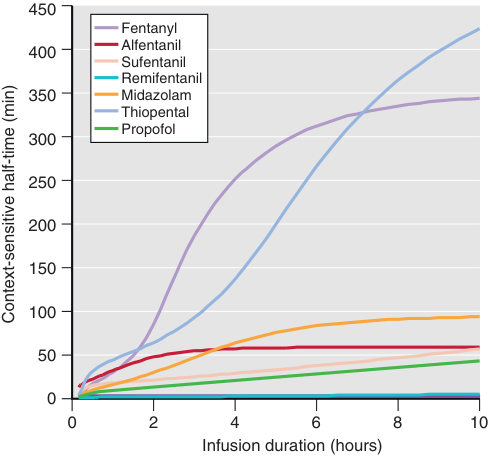

450 Fentanyl Alfentanil 400 Sufentanil Remifentanil 350 Midazolam Thiopental Propofol 300 250 200 150 100 50 0 0 2 4 6 8 10 Infusion duration (hours) Context-sensitive half-time (min) 

**Fig. 23.22** Context- sensitive half- times as a function of infusion duration derived from pharmacokinetic models of fentanyl, sufentanil, alfentanil, remifentanil, propofol, midazolam, and thiopental. (From Hughes MA, Glass PSA, Jacobs JR. Context- sensitive half- time in multicompartment pharmacokinetic models for intravenous anesthetic drugs. _Anesthesiology_ . 1992;76:334–341.)

remifentanil concentration are illustrated in Fig. 23.23. To determine when an infusion should be terminated (to enable awakening of the patient at the end of surgery), the clinician needs to bear in mind the decrease in concentration necessary for recovery, the duration of the infusion (the context), and the context- sensitive effect- site decrement time required for the necessary decrease.

Context- sensitive decrement times are fundamentally different from the elimination half- life. With monoexponential decay, each 50% decrease in concentration requires the same amount of time, and this time is independent of how the drug is given. This is not true for the context- sensitive half- time. First, as the name is intended to imply, the time needed for a 50% decrease is dependent on how long the drug was given, with infusion duration being the context to which the name refers. In addition, small changes in percent decrement can result in surprisingly large increases in the time required. The time required for a 60% decrease in drug concentration can be more than twice the time required for a 50% decrease in some situations (see Fig. 23.23).

Context- sensitive decrement times assume that plasma or the effect site is maintained at a constant concentration. Such is rarely the case clinically, but the maintenance of constant concentrations is a necessary assumption to provide a unique mathematic solution to the time required for a given percent decrement in plasma or effect- site concentration. Because plasma and effect- site concentrations are rarely kept constant, it is important that context- sensitive decrement times are used as general guidelines for interpreting the pharmacokinetics of intravenous drugs and not as absolute predictions for any given case or infusion regimen. Automated drug delivery systems can provide more precise predictions of the time required for the plasma or effect- site concentration to decrease to any desired concentration, based on the actual drug dosing in the individual

patient, which provides the clinician with guidance for the most appropriate time to terminate the infusion.

Context- sensitive decrement times focus on the role of pharmacokinetics in recovery from anesthesia. Pharmacodynamics plays an important role in recovery as well. Bailey153 used integrated pharmacokinetic–pharmacodynamic models to define the _mean effect time_ as the average time to responsiveness after maintenance of anesthesia at the 90% probability of unresponsiveness. The mean effect time demonstrates that when drugs have a very shallow concentration- versus- response relationship, concentrations must decrease by a significant fraction to provide adequate emergence, which delays recovery from anesthesia. In contrast, recovery is hastened by a steep concentration- versus- response relationship, in which emergence from anesthesia occurs after a relatively small fractional decrease in concentration. Most intravenous hypnotics have a moderately steep concentration- versusresponse relationship.

Pharmacodynamic drug interactions also play a role in recovery from anesthesia. Interaction relationships predict that the same anesthetic state can be achieved by different ratios of two drugs. One way of selecting the best ratio might be the combination that offers the most rapid recovery. For example, when an opioid is combined with a hypnotic, the rate of recovery from anesthesia depends on the opioid and hypnotic concentrations, the rate of decrease in both drug concentrations, and the relative synergy between them for loss of response to noxious stimulation (i.e., the state maintained during anesthesia) versus the relative synergy for loss of consciousness. Although the time course of decreases in opioid and hypnotic concentrations can be approximately described by their respective context- sensitive decrement times for both drugs (Fig. 23.24; see Fig. 23.17), the influence of relative synergy for different end points must be captured by separate models of the interaction of the drugs for adequate anesthesia and emergence from anesthesia.

Vuyk and co- workers70 modeled the predicted time to awakening from adequate anesthesia when propofol is combined with fentanyl, sufentanil, alfentanil, or remifentanil. Their calculations considered the interaction between propofol and these opioids to provide adequate anesthesia and the interaction between propofol and opioids on consciousness levels on emergence from anesthesia (Figs. 23.25 and 23.26). Recovery times vary with the choice of opioid and the relative balance of opioid and propofol during maintenance of anesthesia. For example, the upper left of Fig. 23.25 simulates the emergence from a propofol–fentanyl anesthetic of 15- minute duration. The simulations assume a steady concentration of fentanyl and propofol throughout the anesthesia, similar to the underlying assumption of context- sensitive decrement times. The blue curve in the lower plane is the interaction curve between fentanyl and propofol; it ranges from no fentanyl and 12 mcg/mL of propofol on the left to 6 ng/mL of fentanyl and 1.8 mcg/mL of propofol on the right. In theory, any point along this curve would ensure maintenance of equivalent depth of anesthesia. When the infusion is turned off after 15 minutes of anesthesia, the concentrations of both drugs decrease. The decreasing concentrations of propofol and fentanyl when the infusion is turned off can be found by the upward lines drawn from different points on the interaction curve, with

<!-- PDF page 25 -->

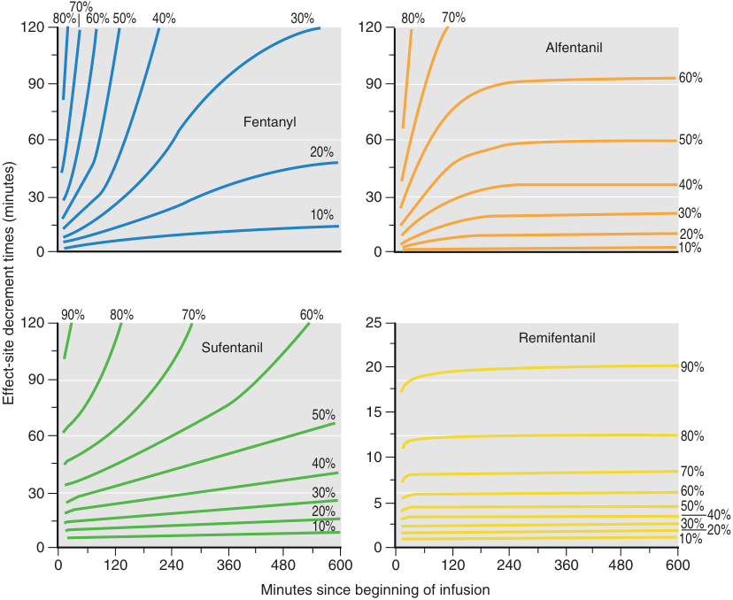

70% 80% 60% 50% 40% 30% 80% 70% 120 120 Alfentanil 60% 90 90 Fentanyl 60 60 50 % 20% 40% 30 30 10% 30% 20% 0 0 10% 90% 80% 70% 60% 120 25 Remifentanil Sufentanil 20 90% 90 50% 15 60 8 0% 10 40% 70% 30 30% 6 0% 20% 5 50% 40% 10% 10%30% 20% 0 0 0 120 240 360 480 600 0 120 240 360 480 600 Minutes since beginning of infusion Effect-site decrement times (minutes) 

**Fig. 23.23** Context- sensitive effect- site decrement times for alfentanil, fentanyl, sufentanil, and remifentanil showing the time required for decreases of a given percentage ( _labeled for each curve)_ from the maintained effect- site concentration after termination of the infusion.

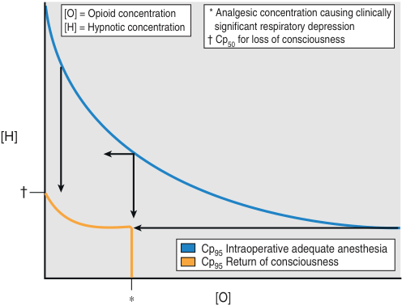

[O] = Opioid concentration * Analgesic concentration causing clinically [H] = Hypnotic concentration   significant respiratory depression † Cp50 for loss of consciousness [H] † Cp95 Intraoperative adequate anesthesia Cp95 Return of consciousness ∗ [O] 

**Fig. 23.24** Interaction between hypnotics and opioids for the prevention of movement after a noxious stimulus and for awakening and adequate spontaneous ventilation at the end of a surgical procedure. The time to recover at the end of a procedure is dependent on the concentration of both drugs used during surgery and the time for both to decrease below that required for consciousness and adequate spontaneous ventilation (i.e., their context- sensitive decrement times).

the distance away from the lower plane representing time. Taken together, these upward lines represent a _recovery surface_ . The blue line drawn on the recovery surface shows the points at which the fentanyl–propofol interaction model predicts emergence.

After 15 minutes of maintaining 1.8 mcg/mL of propofol and 6 ng/mL of fentanyl (right margin of the interaction curve), approximately 12 minutes is needed for the concentrations of both drugs to decrease sufficiently to permit emergence (see Fig. 23.25). However, if one maintains concentrations of 3.5 mcg/mL of propofol and 1.5 ng/mL of fentanyl (toward the middle of the interaction curve), then emergence can be expected only 8 minutes after the infusions are turned off. Examination of the curves for 60, 300, and 600 minutes of propofol–fentanyl anesthesia suggests that the fentanyl target concentration that provides the most rapid emergence is approximately 1.0 to 1.5 ng/mL, which requires a propofol concentration of approximately 3.0 to 3.5 mcg/mL to maintain adequate anesthesia. In similar simulations, Vuyk and colleagues demonstrated that maintaining alfentanil and sufentanil concentrations more than the analgesic range (i.e., approximately 80 ng/ mL for alfentanil and 0.15 ng/mL for sufentanil) is of little clinical benefit and can be expected to delay recovery from anesthesia. A second conclusion from these simulations is that if the patient demonstrates inadequate anesthesia, increasing the hypnotic concentration rather than increasing the opioid concentration beyond the analgesic range is preferable, to prevent prolongation of recovery.

The situation is different for remifentanil because of its unusual pharmacokinetic properties (see Fig. 23.26). When a remifentanil infusion is terminated, the extraordinarily fast clearance of remifentanil results in a very rapid offset of opioid drug effect. The lower plane again shows equivalent

<!-- PDF page 26 -->

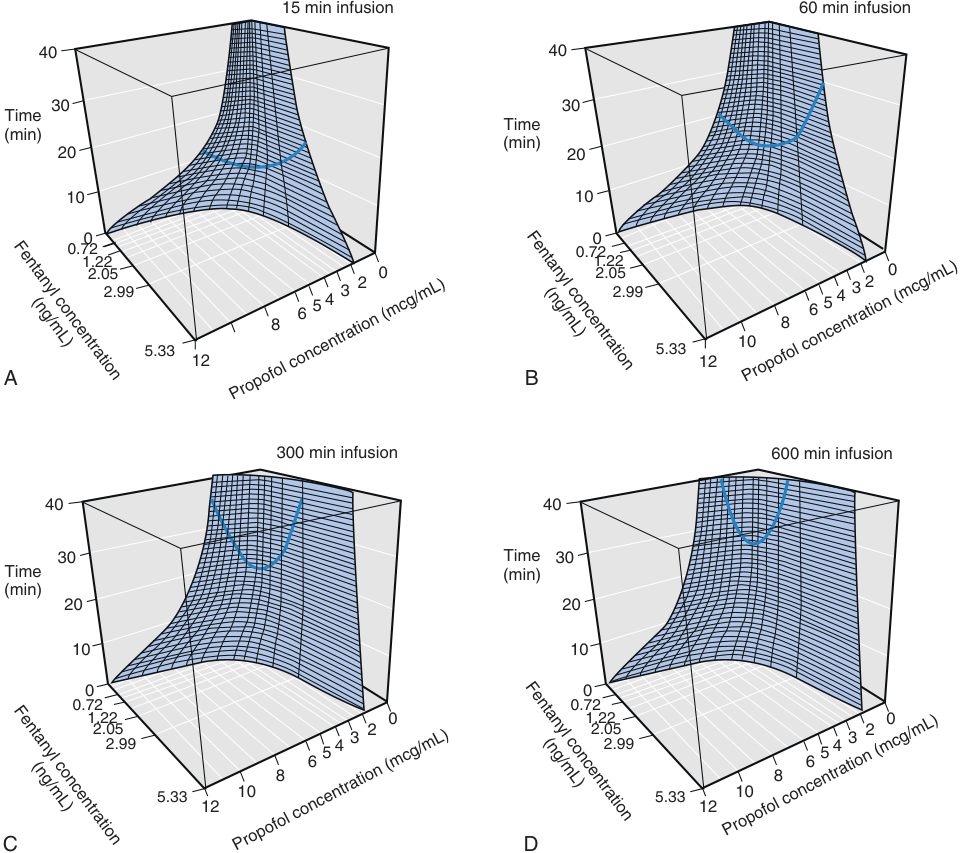

15 min infusion 60 min infusion 40 40 30 30 Time Time (min) (min) 20 20 10 10 0 0 0.72 0.72 1.22 1.22 2.05 2.05 0 2.99 2.99 6 5  4 3 2 0 6 5 4 3 2 8 8 10 5.33 5.33 12 12 A B 300 min infusion 600 min infusion 40 40 30 Time 30 Time (min) (min) 20 20 10 10 0 0 0.72 0.72 1.22 1.22 2.05 2.05 2.99 2.99 5  4 3 2 0 6 6 5 4 3 2 0 8 8 5.33 10 5.33 10 12 12 C D Propofol concentration (mcg/mL) Propofol concentration (mcg/mL) Propofol concentration (mcg/mL) Propofol concentration (mcg/mL) (ng/mL) (ng/mL) Fentanyl concentration Fentanyl concentration (ng/mL) (ng/mL) Fentanyl concentration Fentanyl concentration 

**Fig. 23.25 Simulation of the interaction of propofol and fentanyl in preventing a somatic response at skin incision and time to recovery.** On the x- axis is the fentanyl concentration, and on the y- axis is the propofol concentration. The _blue curve in the lower plane_ shows the propofol–fentanyl interaction required to provide adequate anesthesia. When the infusion is turned off, the concentrations of each drug decrease, as shown on the z- axis. The _blue curve drawn on the recovery surface_ shows the time to emergence from anesthesia for combinations of fentanyl and propofol after an anesthetic of 15 minutes’ (A), 60 minutes’ (B), 300 minutes’ (C), and 600 minutes’ (D) duration. The optimal combination for the most rapid recovery is a propofol concentration of 3.0 to 3.5 mcg/mL, combined with 1.5 ng/mL fentanyl. As the concentration of propofol or fentanyl increases, the time for recovery increases. In addition, the longer the duration of drug infusion, the longer recovery takes, especially if the optimal combination is not used. (Modified from Vuyk J, Mertens MJ, Olofsen E, et al. Propofol anesthesia and rational opioid selection: determination of optimal EC50- EC95 propofol- opioid concentrations that assure adequate anesthesia and a rapid return of consciousness. _Anesthesiology_ . 1997;87:1549–1562.)

anesthetic states during maintenance with remifentanil and propofol (see Fig. 23.26). High doses of remifentanil permit a modest reduction in the dose of propofol needed for adequate anesthesia.154 However, the recovery surfaces show that high doses of remifentanil, with a modest reduction in the propofol dose, permit considerably faster emergence from anesthesia. For example, it takes approximately 12 minutes to awaken from 600 minutes of anesthesia maintained with 3 mcg/mL of propofol and 2.5 ng/ mL of remifentanil (see Fig. 23.26D). On the other hand, if the remifentanil concentration is increased to 5 ng/mL, then the propofol concentration can be reduced to between 2 and 2.5 mcg/mL, and emergence can be anticipated within 6 minutes of discontinuation of the infusions. One might be concerned that such a technique places patients at

increased risk for awareness because a propofol concentration of 2 mcg/mL is below the C50 value for wakefulness.155 Therefore, combining such a technique with intraoperative EEG monitoring to assess anesthetic adequacy is reasonable.155,156

### DISPLAYING PHARMACOLOGIC INFORMATION

Integrating all sources of pharmacologic information including drug interaction together with measurements of patient response to a specific drug dose might offer a powerful advisory tool to depict the complete dose–response relationship of multiple drugs, thereby optimizing drug administration and improving patient care.157,158 For example, Fig. 23.27 shows a drug interaction advisory

<!-- PDF page 27 -->

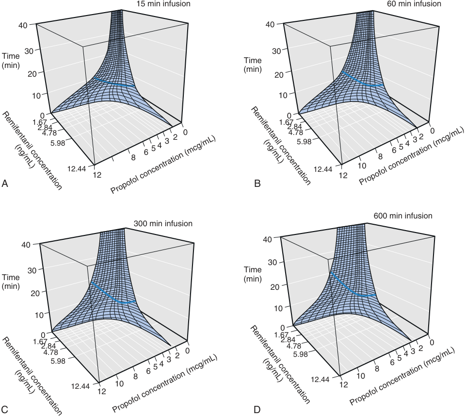

15 min infusion 60 min infusion 40 40 30 30 Time Time (min) (min) 20 20 10 10 0 0 1.67 1.67 2.84 2.84 4.78 4.78 0 5.98 5.98 6 5  4 3 2 0 6 5 4 3 2 8 8 10 12.44 12.44 12 12 A B 600 min infusion 300 min infusion 40 40 30 30 Time Time (min) (min) 20 20 10 10 0 0 1.67 1.67 2.84 0 2.84 4.78 4.78 5.98 5.98 6 5  4 3 2 0 8 6 5 4 3 2 8 12.44 10 12.44 10 12 12 C D Propofol concentration (mcg/mL) Propofol concentration (mcg/mL) Propofol concentration (mcg/mL) Propofol concentration (mcg/mL) (ng/mL) (ng/mL) Remifentanil concentration Remifentanil concentration (ng/mL) (ng/mL) Remifentanil concentration Remifentanil concentration 

**Fig. 23.26 Simulation of the interaction of propofol and remifentanil in preventing a somatic response at skin incision and time to recovery.** The remifentanil concentration is on the x- axis, and the propofol concentration is on the y- axis. The _blue curve in the lower plane_ shows the propofol– remifentanil interaction required to provide adequate anesthesia. When the infusion is turned off, the concentrations of each drug decrease, as shown on the z- axis. The _blue line drawn on the recovery surface_ shows the time to emergence from anesthesia for combinations of remifentanil and propofol after an anesthetic of 15 minutes’ (A), 60 minutes’ (B), 300 minutes’ (C), and 600 minutes’ (D) duration. With remifentanil, the optimal combination is a propofol concentration of 2.5 mcg/mL and, with remifentanil, 5 to 7 ng/mL. In addition, increasing the duration of the infusion has minimal impact on recovery time if the optimal dose of remifentanil is not used. However, if the propofol dose is increased, then recovery is prolonged. (Modified from Vuyk J, Mertens MJ, Olofsen E, et al. Propofol anesthesia and rational opioid selection: determination of optimal EC50- EC95 propofol- opioid concentrations that assure adequate anesthesia and a rapid return of consciousness. _Anesthesiology_ . 1997;87:1549–1562.)

display. Recently, Kuizenga and colleagues159 assessed whether the availability of such an advisory system alters the behavior of anesthetic drug titration of anesthetists and improves the anesthesia quality score (AQS; percentage of time spent with MAP 60–80 mm Hg and bispectral index [BIS] 40–60). They concluded that adding this information to the clinical monitoring during anesthesia did not affect average drug titration behavior. However, small improvements in control of MAP and BIS and early recovery suggest improved titration for some patients without increasing the risk of overdosing or underdosing. Earlier recovery after desflurane- based anesthesia was also found by Morimoto _et al._ using a drug titration advisory display.160

## Intravenous Infusion Devices and

## Technologies

### MANUAL INTRAVENOUS INFUSION

When an infusion of an intravenous anesthetic is administered, the infusion regimen can be controlled by a variety of mechanisms varying from the simple Cair clamp or Dial- a- Flo (Abbott Laboratories) to complex computer- controlled infusion pumps. Simplicity of mechanical design, however, is not necessarily correlated with ease of use, which has prompted ongoing advances in infusion device technology over the past decades.

<!-- PDF page 28 -->

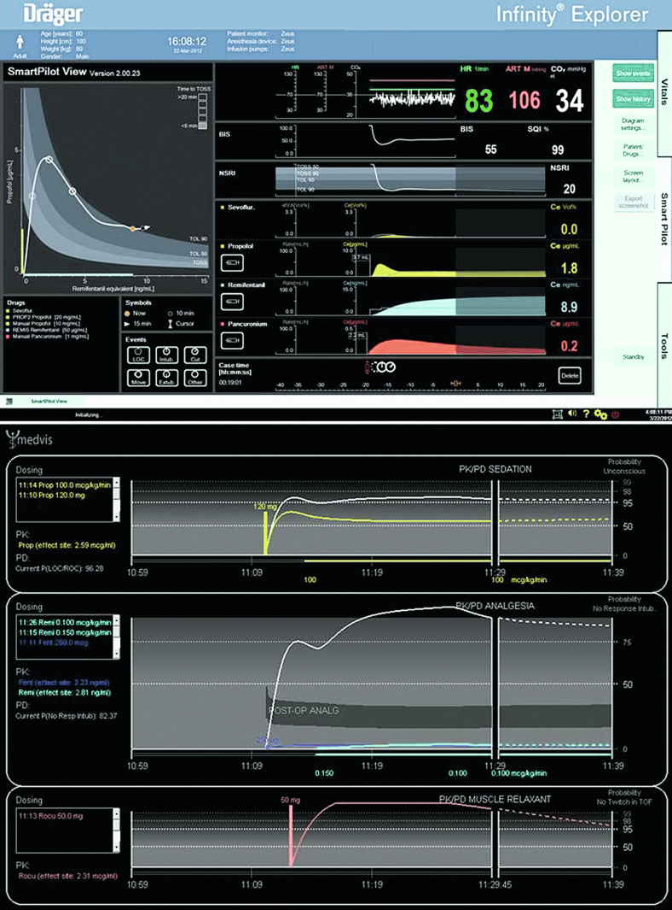

**Fig. 23.27 Online advisory displays including characteristics of drug behavior and interaction.** The SmartPilot (Dräger, Lübeck, Germany) _(upper display)_ is a two- dimensional display that shows the effect- site concentrations of combined drugs (opioids and intravenous or inhalation hypnotics), based on pharmacokinetic models and the resulting anesthetic effect based on pharmacodynamic models. _Gray shaded areas_ indicate different levels of anesthesia. The _orange point_ indicates the current combination of effect- site concentrations; the _white line_ shows the retrospective concentrations; and a 10- and 15- minute prediction is marked by a _black point_ and _arrow_ – already calculated during presetting of delivery. Event markers may be set to show specific states of the patient related to the level of anesthesia: the time- based real- time curves, trends, and prediction of effect- site concentrations of individual drugs; resulting anesthetic effect (noxious stimulus response index [NSRI]) and correlated bispectral index (BIS); vital signs; and event markers as reference for interpretation. The Medvis display (Medvis, Salt Lake City, Utah) _(lower display)_ shows a real- time visualization of anesthetic using pharmacokinetic and pharmacodynamic models to predict drug effect- site concentrations and drug effects in the past, current time, and 10 minutes into the future. Drug doses as boluses and infusions are administered via a separate data interface or user interface. Drugs are categorized according to sedation ( _top plot_ ), analgesia ( _middle plot_ ), and muscle relaxation ( _bottom plot_ ). Effects are depicted as a population- based probability of unconsciousness ( _top plot_ ), no response to tracheal intubation ( _middle plot_ ), and no twitch response to a train- of- four stimulus _(bottom plot)_ . In addition, a second pharmacodynamic end point, POST- OP ANALG, represents a guideline therapeutic window for postoperative pain. Synergistic interactions of sedative– hypnotics and analgesics are shown by the _white curves_ in the plot. For example, the top plot shows that with only propofol, the probability of unconsciousness is between 50% and 95% _(yellow curve)_ , but because propofol interacts with the opioids, the probability of unconsciousness is greater than 95% _(white curve)_ . Similarly, propofol potentiates the effect of the opioids in the middle plot.

<!-- PDF page 29 -->

Infusion devices can be classified as either controllers or positive displacement pumps. Explicit in their title, controllers contain mechanisms that control the rate of flow produced by gravity, whereas positive displacement pumps contain active pumping mechanisms.

The most used pumps for administration of intravenous anesthetics are positive displacement syringe pumps that use a variety of mechanisms. These pumps have acceptable accuracy and have several features that make them particularly suitable for anesthetic delivery. An important advance has been the introduction of a calculator feature within the pump so that the clinician can input the weight of the patient, the drug concentration, and the infusion rate in dose/unit weight/unit time and the pump will then calculate the infusion in volume/unit time. These pumps also permit simple application of a staged infusion scheme by allowing an initial dose and a maintenance infusion rate to be programmed into the pump. Numerous syringe pumps also include automated recognition of syringe size. Further enhancements are drug libraries by class of drug, suggested dosing schemes, and maximal dosing alerts. These modest advances in pump technology and design enable intravenous anesthetics to be conveniently and safely delivered.

In addition to the pumps, the complete intravenous delivery systems’ hardware must perform perfectly,5 which means that the correct amount of drug should be delivered to the venous circulation in each unit of time. When the drug administration set has too large a dead space, the actual delivery rate can be altered, depending on the flow rate of co- administered fluid.161 The use of an antireflux valve is certainly advisable to prevent flow of the medication backward into the intravenous fluid bag rather than into the patient. Other factors include excessive compliance within the administration system (in the syringe plunger or in the administration lines) and the use of syringes with suboptimal lubrication, causing the plunger to advance in small jumps when infusion rates are slow; that is, with small patients, low target concentrations, concentrated drug solutions, or large syringes.162 In 2019, the Association of Anaesthetists and the Society for Intravenous Anaesthesia published guidelines for the safe practice of total intravenous anesthesia.163 The main recommendations can be found in Box 23.1.

Manual intravenous drug delivery consists of a combination of a bolus dosage and a continuous infusion, as explained earlier when discussing the pharmacokinetic considerations. Table 23.5 offers recommendations for delivering intravenous anesthetics via conventional infusion pumps based on integrated pharmacokinetic–pharmacodynamic models. Ultimately, the adequate rate of drug administration is based on observation and examination. Individual patients vary significantly in their response to a given drug dose or concentration; therefore titrating to an adequate drug level for each individual patient is essential. Drug concentrations required to provide adequate anesthesia also vary according to the type of surgery (e.g., surface surgery versus upper abdominal surgery). Drug concentration requirements are often smaller during the end phase of surgery; therefore titration often involves judicious reduction of the infusion rate toward the end of surgery to facilitate rapid recovery.

### Box 23.1 Recommendations for the Safe Practice of Total Intravenous Anesthesia (TIVA)

- All anesthetists should be trained and competent in the delivery of TIVA. Schools of anesthesia and training bodies should provide teaching, training, and practical experience of TIVA to all anesthetic and intensive care medicine trainees. Consultant and staff grade, associate specialist, and specialty doctor (SAS) anesthetists have a responsibility to ensure that they have the knowledge and skills required to deliver TIVA competently and safely.

- When general anesthesia is to be maintained by propofol infusion, use of a target- controlled infusion (TCI) is recommended.

- Starting target concentrations should be chosen depending on the characteristics of the patient, co- administered drugs, and clinical situation. Older, frail, or unwell patients may benefit from setting a low initial target propofol concentration and making repeated small incremental increases.

- Within an anesthetic department, it is preferable to stock only one concentration of propofol and to dilute remifentanil to a single, standard concentration.

- The infusion set through which TIVA is delivered should have a Luer- lock connector at each end, an antisyphon valve on the drug delivery line(s) and an anti- reflux valve on any fluid administration line. Drug and fluid lines should join as close to the patient as possible to minimize dead space. The use of administration sets specifically designed for TIVA is recommended.

- Infusion pumps should be programmed only after the syringe containing the drug to be infused has been placed in the pump.

- The intravenous cannula or central venous catheter through which the infusion is being delivered should, whenever practical, be visible throughout anesthesia.

- Anesthetists should be familiar with the principles, interpretation, and limitations of processed electroencephalogram (EEG) monitoring. Observation of the EEG trace and electromyography activity is likely to improve the clinical utility of the monitoring.

- Use of a processed EEG (pEEG) monitor is recommended when a neuromuscular blocking drug is used with TIVA.

- When TIVA is administered outside the operating room, the same standards of practice and monitoring should apply as for anesthesia in the operating room.

- Modified with permission from Nimmo et al. Guidelines for the safe practice of total intravenous anaesthesia. _Anaesthesia_ . 2019;74: 139–141.

If the infusion rate is insufficient to maintain adequate anesthesia, then both an additional loading (bolus) dose and an increase in infusion are required to increase the plasma (biophase) drug concentration rapidly. Various interventions also require larger drug concentrations, usually for brief periods (e.g., laryngoscopy, endotracheal intubation, skin incision). Therefore, the infusion scheme should be tailored to provide peak concentrations during these brief periods of intense stimulation. An adequate drug level for endotracheal intubation is often achieved with the initial loading dose; however, for procedures such as skin incision, an additional bolus dose may be necessary.

Infusion schemes (see Table 23.5) do not approach the convenience and precision of use associated with the delivery of an inhaled anesthetic via a calibrated vaporizer, particularly when the user is still required to calculate volume

<!-- PDF page 30 -->

**Table 23.5** Manual Infusion Schemes

|||**ANESTHESIA**|**SEDATI**|**ON OR ANALGESIA**|
|---|---|---|---|---|
|**Drug**|**Loading Dose** **(mcg/kg)**|**Maintenance Infusion** **(mcg/kg/min)**|**Loading Dose** **(mcg/kg)**|**Maintenance Infusion** **(mcg/kg/min)**|
|Alfentanil|50–150|0.5–3|10–25|0.25–1|
|Fentanyl|5–15|0.03–0.1|1–3|0.01–0.03|
|Sufentanil|0.5–5|0.01–0.05|0.1–0.5|0.005–0.01|
|Remifentanil|0.5–1.0|0.1–0.4|*|0.025–0.1|
|Ketamine|1500–2500|25–75|500–1000|10–20|
|Propofol|1000–2000|50–150|250–1000|10–50|
|Midazolam|50–150|0.25–1.5|25–100|0.25–1|
|Methohexital|1500–2500|50–150|250–1000|10–50|
|Dexmedetomidine|||0.5–1 over 10 min|0.2–0.7|
|Remimazolam|||5 mg over 1 min|2.5 mg over 15 s ≥2 min between doses|

*For analgesia or during sedation, an initial loading dose of remifentanil should not be given because its very rapid onset may result in apnea or muscle rigidity. After the loading dose, an initially high infusion rate to account for redistribution should be used and then titrated to the lowest infusion rate that will maintain adequate anesthesia or sedation. When using opiates as part of a nitrous–narcotic technique or for cardiac anesthesia, the dosing scheme listed under anesthesia is used. When the opiate is combined as part of balanced anesthesia, dosing listed for analgesia is needed.

infusion rates (mL/h) from the mass- based infusion rates given in the infusion schemes. The use of “calculator” pumps helps to simplify the task of the anesthesiologist. At start- up the user is required to input the weight of the patient, and the drug concentration. Thereafter, the pumps can accept as input mass- based rates, from which they calculate and implement volume infusion rates. The level of convenience and precision of vaporizers can, however, be achieved by using TCI devices, such as the commercially available TCI pumps.

### COMPUTER- CONTROLLED DRUG DELIVERY

As discussed in the introduction of this chapter, optimal patient- individual dosing may be achieved by the application of pharmacokinetic and pharmacodynamic principles. Using the dose–response relationship, drug titration should be performed as close as possible to the drug effect. Titrating to a specific effect or, if not possible, a specific effect- site concentration offers advantages. Because the effect- site or plasma concentrations are not continuously measurable online for most intravenous anesthetics (in contrast to inhaled anesthetics), a drug model using a computer that continuously updates the anesthetic administration rate to maintain an estimated drug effect or drug concentration is required (Fig. 23.28).

If a specific plasma or effect- site concentration is titrated, then this technique is called TCI. TCI is a _closed- loop control_ system. The history of the development of TCI systems has been summarized.8 In these systems the clinician serves as the _human controller_ in the loop and, as a consequence, the control actions are intermittent and irregular in time.164 Control theory is increasingly being applied in the development of computer- controlled drug delivery systems, among others in anesthetic closed- loop control applications. The aim of computer- controlled closed- loop systems is to formalize this process of observation and intervention to provide finer and more accurate control. Such systems use a

near-continuous signal of drug effect, calculate the error between the observed value and the set point value (selected by the user), and use this error figure in an algorithm to make frequent and regular adjustments to drug administration rates. Some computer- controlled drug delivery systems try to predict the future drug effect to make appropriate adjustments well in advance.164

### TARGET- CONTROLLED INFUSION

### Devices

The development of microprocessor- controlled syringe pumps and a better understanding of the dose–response relationship have enabled the development of TCI systems. A TCI is a computer or microprocessor- controlled system that aims to achieve a user- defined estimated drug concentration in a body compartment or tissue. A clinician using a TCI system to administer an anesthetic drug is thus able to set and adjust a desired drug concentration, usually referred to as the _target concentration_ , based on clinical observation of the patient or measurement of drug effect. Multicompartment pharmacokinetic–dynamic models are used by TCI systems to calculate the infusion rates required to achieve the target concentration (see Fig. 23.4). A computer or microprocessor is required to perform the complex calculations and to control the infusion pump. Typically, plasma or effect- site concentrations are targeted.165

TCI systems in use today still apply the theoretical approach described by Kruger- Thiemer166 to achieve and maintain a steady- state blood concentration of a drug whose pharmacokinetics can be described by a multicompartment model. This approach was first clinically implemented by Schwilden and colleagues.6 The infusion schemes used, better known as bolus- elimination- transfer (BET) schemes (see Fig. 23.4), were initially designed for two- compartment models. Briefly, the infusion starts with an initial bolus of drug required to achieve the initial target concentration. Second, an infusion is administered to replace drug lost by

::: details 原始表格與符號（PDF 第 30 頁）

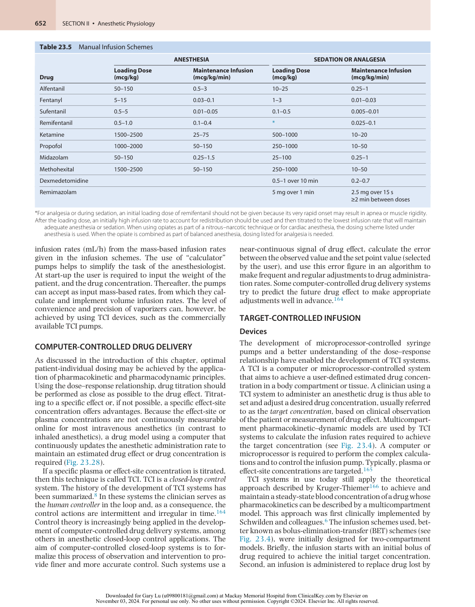

:::

<!-- PDF page 31 -->

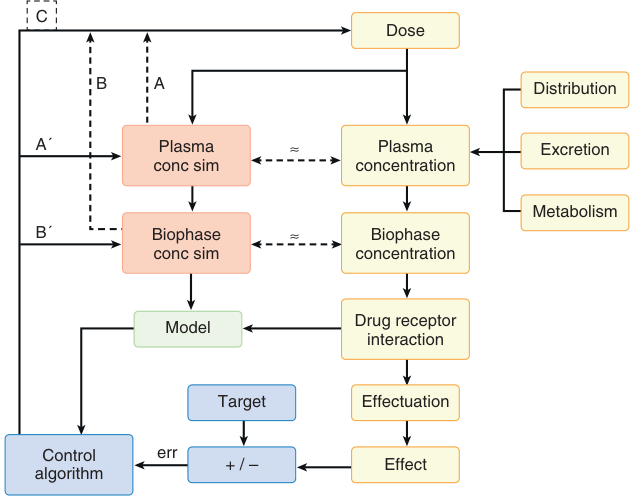

C Dose B A Distribution A´ Plasma ≈ Plasma Excretion conc sim concentration Metabolism B´ Biophase ≈ Biophase conc sim concentration Model Drug receptor interaction Target Effectuation Control err + / – Effect algorithm 

**Fig. 23.28** Schematic representation of the pharmacokinetic and pharmacodynamic processes determining the relationship between administered doses and resulting effect intensity of a drug _(yellow)_ . Pharmacokinetic factors such as distribution, metabolism, and/or excretion determine the relationship between drug dose and drug concentration in the biophase. In the biophase, the drug interacts with the receptor, and the pharmacologic effect is accomplished via effectuation processes. Target- controlled infusion (TCI) will use a model to estimate the plasma or biophase drug concentration _(red)_ and will calculate the dose needed to approach a target concentration in plasma (A) or biophase/effect site (B). Computer- controlled, closedloop feedback measures the error between the effect and the target effect to control the dose administration _(blue)_ . Better closed- loop performance can result if, rather than using the dose as a direct actuator, the _simulated_ variable of a TCI system is used as actuated variable _(A/A′, B/B′)_ . The TCI system then compensates for part of the complexity of the dose–interaction relationship. Advanced control algorithms may consider a continuously updated model of the interaction _(light green)._ (Modified from Struys M, de Smet T. Principles of drug actions: target- controlled infusions and closed- loop administration. In: Evers AS, Maze M, Kharasch ED, eds. _Anesthetic Pharmacology: Basic Principles and Clinical Practice._ Cambridge: Cambridge University Press; 2011:103–122. Used with permission.)

elimination. Since the elimination rate constant is fixed, the amount of drug eliminated in each unit of time is proportional to the plasma concentration; thus, at steady- state plasma concentrations, drug removal by elimination can be compensated for by a constant rate infusion. Third, a second infusion is administered to replace drug distributed or transferred to peripheral tissues. The amount redistributed exponentially declines over time as the gradient between the central compartment and the peripheral compartment decreases. Replacing distributed drug requires an infusion at an exponentially declining rate to replace drug lost from the central compartment by distribution until steady state.4

BET schemes have some disadvantages such as the requirement of a no- drug status before infusion, which disables a change in the target concentration. In addition, more recent research concluded that the pharmacokinetics of most anesthetics is better described using a three- instead of a two- compartment model. Lastly, as previously discussed in this chapter, the plasma is not the site of drug effect. Therefore effect compartment–controlled TCI algorithms were developed.38 During the 1990s, various computer- based TCI prototypes were developed by researchers at Stanford (STANPUMP, California), Stellenbosch (STELPUMP, South Africa), Duke (computer- assisted continuous infusion [CACI], North Carolina), and Ghent (RUGLOOP, Belgium) universities. Groups in Erlangen, Germany and Leiden, the Netherlands, produced software able to simulate pharmacokinetic trajectories (IVA- SIM and TIVA Trainer, respectively). Finally, the Diprifusor (AstraZeneca,

London) became the first commercially available TCI pump. It was based on a prototype from the Kenny group167 and was able to control a set plasma target concentration using specific prefilled syringes from AstraZeneca. Although the technology never became available in the United States,8 this TCI pump was the first breakthrough in an attempt to optimize drug administration in daily clinical practice in many countries. More recently, various companies have commercialized more flexible open TCI pumps capable of administering multiple drugs in both plasma and effect compartment–control mode (Fig. 23.29).7,8

Effect compartment control requires a rate constant that accurately describes the rate of equilibration between plasma (Fig. 23.30A) and effect- site concentrations (Fig. 23.30B). The benefits of effect compartment– controlled TCI were demonstrated for propofol by Wakeling and associates168 and Struys and associates.58 This mode is still commonly used in clinical practice.

A detailed description of the history of the development of TCI, and of the development and availability of TCI devices was published in 2016.7,8

### Evaluation of Target- Controlled Infusion Delivery

Acceptance of target- controlled drug delivery of intravenous anesthetics requires evaluation of accuracy (defined as the difference between predicted and measured concentrations) and outcomes among patients in whom automated drug delivery has been used. The inaccuracies associated with pharmacokinetic model–driven devices are attributed

<!-- PDF page 32 -->

to possible problems with the software and hardware, and more importantly to pharmacokinetic variability.

Inaccuracy in the software results from incorrect mathematic implementation of the pharmacokinetic model. Computer simulations can be used to test the infusion rates as calculated by a software program, and thus software errors are fairly simple to identify and correct.169 Inaccurate drug delivery from the infusion pump (i.e., failure to correctly infuse the amount intended by the system) infrequently occurs with present syringe- pump technology and contributes little to the overall inaccuracy of these devices.170 The above- mentioned safety review identified only two company reports of problems with TCI devices that were attributable to software programming errors, neither of which caused actual patient harm.171 The major cause of inaccuracy is biologic variability, of which there are two sources: (1) the pharmacokinetic model is always wrong,144 and (2) the pharmacokinetics of the individual patient are not as programmed into the model. The pharmacokinetic model is always wrong because individuals are far more complex than implied by simple compartment models,144 and no model can precisely predict the concentrations, even if the pharmacokinetic parameters in the individual were known with absolute precision. However, even if the pharmacokinetic model truly reflected the underlying biologic variables, the parameters of the model would be average parameters for the population and not the exact parameters of the patient. Even if the parameters were modified to reflect the influence of demographic factors such as age, gender, hypovolemia,

and co- administration of other drugs, they would still deviate from the true pharmacokinetic parameters in the individual. Thus, biologic variability fundamentally precludes the possibility of precisely achieving the desired target concentration when automated drug delivery devices are used. Realizing that biologic variability always exists, no matter how drugs are given, and that this same biologic variability affects all methods of drug delivery is important. Nonetheless, the variability with TCI devices will always be less than the variability observed after a single bolus injection.172 The performance of computer- controlled drug administration must be interpreted in terms of the therapeutic expectations of the clinician. Possible goals include accurately producing a desired concentration in plasma, precisely titrating the plasma drug concentration, achieving the desired drug effect, and producing the desired time course of drug effect. Over the past decade, investigators have addressed each of these goals and have refined the performance of automated drug delivery devices accordingly.

The ability of an automated drug delivery system to rapidly achieve and then maintain a selected target concentration is a logical measure of the performance of such a device. The difference between the measured and target concentrations can be expressed in several ways. Classic graphic representations are X- Y plots depicting predicted versus measured blood (plasma) drug concentrations (Fig. 23.31) or the relationship of the measured and predicted drug concentration versus time of administration (Fig. 23.32). Numerically, the primary concern is how far the measured concentration is from the predicted one; this relationship

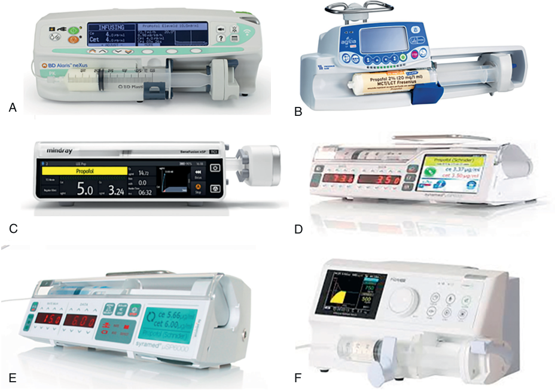

A B C D E F 

**Fig. 23.29 Open target- controlled infusion devices.** (A) BD Alaris NeXus. (B) Agilia SP TIVA. (C) Benefusion nSP TIVA/TCI. (D) Arcomed μSP 6000. (E) Arcomed μVP 7000. (F) PION TCI.

<!-- PDF page 33 -->

G H I 

**Fig. 23.29, cont’d** (G) Perfusor Space. (H) Concert- CL. (I) HP- TCI. (A, Courtesy of Becton Dickinson, Vaud. Switzerland; B, Courtesy of Fresenius Kabi, Oslo, Norway; C, Courtesy of Mindray, Mahwah, NJ, USA; D, E, Courtesy of Arcomed, Zurich, Switzerland; F, Courtesy of Bionet, Tustin, CA, USA; G, Courtesy of B.Braun, Bethlehem, PA, USA; H, Courtesy of Veryark, Hong Kong, People’s Republic of China; I, Courtesy of Medcaptain, Guangdong, People’s Republic of China.)

is now most frequently described in terms of performance error, which is the difference between the measured and the target concentrations as a percentage of the desired target – for example, [(measured − target) ÷ target × 100%].173 The median value of the performance error for a patient or population is referred to as the median performance error (MDPE) and represents the average overshoot or undershoot of the system. The median absolute performance error (MDAPE) is the median of the absolute values of all performance errors. The MDAPE is commonly used as a measure of the inaccuracy of an automated drug delivery device. An MDAPE of zero is perfect performance, and an MDAPE of 20% means that one-half the plasma concentrations will be within 20% of the target and one half will be outside that range. A further assessment of accuracy is whether the system maintains a stable target concentration, which is best measured by the wobble of the system. Varvel and colleagues173 asked a group of clinicians to evaluate the

performance of automated drug delivery devices and demonstrated that the MDAPE best predicted the adequacy of performance of the automated delivery device, as judged by experienced clinicians.

As observed earlier, expecting all performance errors to be zero is not reasonable. However, it would be desirable if positive and negative errors offset each other so that the MDPE of an automated drug delivery device were 0%. The MDPE does not indicate the range of performance errors (because positive and negative performance errors offset each other), but it does indicate whether the plasma concentrations achieved with the device tend to overshoot (+MDPE) or undershoot (−MDPE) the desired target.

Many groups have evaluated the accuracy of many different pharmacokinetic sets for virtually all the intravenous hypnotics and analgesics. Most studies have involved healthy volunteers or lower-risk patients undergoing procedural sedation or anesthesia, and in these settings the

<!-- PDF page 34 -->

8 6 4 TIME vs Cp 2 TIME vs Ce 0 0 200 400 600 Time (s) A 8 6 4 2 TIME vs Cp TIME vs Ce 0 0 200 400 600 Time (s) B concentration (mcg/mL) Propofol plasma or effect-site concentration (mcg/mL) Propofol plasma or effect-site 

**Fig. 23.30** Simulation of propofol plasma (A) versus effect compartment–controlled (B) target- controlled infusion (TCI).

authors have studied adult models for propofol,174–181 midazolam,182 ketamine,165 dexmedetomidine,29,183,184 fentanyl,185–187 alfentanil,82,188–190 sufentanil,182,191,192 and remifentanil.29,193,194 Pediatric models for propofol have also been evaluated.40,195–198 Pharmacokinetic–dynamic models for propofol for broad application in children, adults, obese, and elderly patients have been prospectively validated by Vellinga _et al._199

Few studies have been performed in the intensive care unit (ICU) setting. The performance of the Marsh model for propofol sedation in different adult populations has, however, been studied.200,201

Based on many of these studies, the expected predictive performance of such pharmacokinetic models, at best, tends to be around 20% to 30% MDAPE.

### Model Selection for Target- Controlled Infusion: Adult Propofol Models

For most intravenous drugs, various multicompartment pharmacokinetic–dynamic models have been published. The pharmacokinetics of propofol have been the most frequently tested (see Fig. 23.6) of all anesthetic drugs. Coetzee and co- workers compared the accuracy of some of the models published before 1995 and found that propofol TCI using the model published by Marsh and co- workers resulted in acceptable performance (MDPE −7%; MDAPE 18%).174

The Marsh model was incorporated in the first commercially available TCI system (Diprifusor). Clinical studies using this plasma- controlled TCI system showed that

the technique and model were clinically useful in various clinical situations.202–206 The major drawback of the Marsh model is the lack of effect compartment information and the fact that weight is the only covariate. Later, Schnider and co- workers60,61 evaluated age, height, weight, and lean body mass as covariates in a new combined pharmacokinetic–dynamic three- compartment model. The large variability of the study population (age 18 to 81 years, weight 44 to 123 kg) provides a wide applicability of the model. Several validation studies rated this model accurate under various conditions. For example, Masui and colleagues13 compared the measured propofol plasma concentrations with the predictions of four published models and revealed bias in all three compartment models during the bolus and short infusion regimens (see Figs. 23.31 and 23.32). During long infusions, a worse measured/predicted propofol plasma concentration at higher concentration was observed for the Marsh195 and Schüttler207 models than for the two other models. Less biased measured/predicted propofol plasma concentration was found for all models during TCI. In the bolus group, after one minute, a clear overprediction was observed for all three- compartment models for the entire five- minute period; however, this initial error resolved after four minutes in the Schnider model. During the bolus and short infusion conditions, the Marsh model demonstrated worse MDPE and MDAPE when compared with the other models. During short infusion, MDAPE for the Schnider and Schüttler models was better. All models showed similar MDPE and MDAPE during TCI simulations. During long infusion, the Marsh and the Schüttler models underestimated the higher plasma concentrations. Interestingly, the physiologically based recirculatory model developed by Upton and co- workers15 did not reveal a better description of the pharmacokinetic time course. The Schüttler model has a major practical drawback; it defined the infusion characteristics, being bolus or infusion, as a significant covariate, thereby discouraging TCI applicability.

An additional drawback of the Schnider model is the use of lean body mass as calculated using the equation developed by James.12 The quadratic behavior of the lean body mass function makes it invalid (negative values!) when used in patients who are very obese. Therefore as changing population demographics such as obesity might influence the pharmacokinetics of propofol, models should ideally be applicable to a broad range of population demographics before being used in clinical practice. One potential solution to the problem of scaling for size in obese patients, is the application of allometric scaling. When using allometric scaling, growth and development can be studied using classic covariates (e.g., weight, age, sex). Size is the primary covariate and can be referenced to a 70kg person with allometric scaling using a coefficient of 0.75 for clearance and 1 for volume.96 Anderson and Holford208 promote this approach because the use of these coefficients is supported by fractal geometric concepts and observations from biologically diverse areas.209

Cortinez and co- workers210 derived a population pharmacokinetic model using obese and nonobese data to describe the pharmacokinetics of propofol over a wide range of body weights. A model using allometric scaling of total body weight as the size descriptor of volumes and clearances was better able to characterize propofol pharmacokinetics in obese patients than a model using size descriptors. The

<!-- PDF page 35 -->

Marsh Schnider Schüttler Upton 40 100 80 30 60 Bolus 20 40 10 20 0 0 0 10 20 30 40 0 10 20 30 40 0 10 20 30 40 0 20 40 60 80 100 40 30 Short 20 infusion 10 0 0 0 10 20 30 40 0 10 20 30 40 0 10 20 30 40 0 10 20 30 40 12.5 y = 1.12x – 0.28 y = 1.01x + 0.35 y = 1.16x – 0.43 y = 0.95x + 0.30 10.0 7.5 TCI 5.0 2.5 0.0 0.0 2.5 5.0 7.5 10.0 12.5 0.0 2.5 5.0 7.5 10.0 12.5 0.0 2.5 5.0 7.5 10.0 12.5 0.0 2.5 5.0 7.5 10.0 12.5 12.5 y = 1.33x – 0.33 y = 1.06x – 0.33 y = 1.28x – 0.73 y = 1.12x – 0.40 10.0 Long 7.5 infusion 5.0 2.5 0.0 0.0 2.5 5.0 7.5 10.0 12.5 0.0 2.5 5.0 7.5 10.0 12.5 0.0 2.5 5.0 7.5 10.0 12.5 0.0 2.5 5.0 7.5 10.0 12.5 Predicted Cp (mcg/mL) Predicted Cp (mcg/mL) Predicted Cp (mcg/mL) Predicted Cp (mcg/mL) Measured Cp (mcg/mL) Measured Cp (mcg/mL) 

**Fig. 23.31 Predicted versus measured propofol plasma concentration (Cp) for the four pharmacokinetic models.** Each point represents a single sample. _Thin black line_ represents the line of identity. For target- controlled infusion (TCI) and long infusion conditions, the _bold red line_ shows the regression line, and the _bold dashed green line_ indicates the 95% confidence interval for the regression line. The formula represents the equation from the linear regression. (From Masui K, Upton RN, Doufas AG, et al. The performance of compartmental and physiologically based recirculatory pharmacokinetic models for propofol: a comparison using bolus, continuous, and target- controlled infusion data. _Anesth Analg_ . 2010;111:368–379. Used with permission.)

same model was later used to control TCI propofol administration in a new cohort of obese patients, and the predictive performance of this model was then compared with that of four other models (Marsh, Schnider, Eleveld, and van Kralingen).177 While all models tended to underestimate measured concentrations in this study (i.e., measured concentrations were higher than those estimated), the preliminary Eleveld model211 (published in 2014) provided the most accurate predictions. When, instead of using the total body weight with the Marsh and Schnider models, an adjusted body weight was used (adjusted weight = ideal weight + 40% × [total − ideal weight]), the predictive performance of these two models were then associated with the lowest MDPE and MDAPE of all models.177

Most recently, Cortinez and colleagues used the data from 47 patients enrolled in three previous studies to develop and prospectively evaluate a new PK/PD model for obese patients.212 Interestingly, during the development phase, allometric scaling did not improve the fit of their new model, and thus their newest model uses linear scaling of compartmental volumes and clearances, with total

body weight. When, in the second phase of their study, this newer model was tested prospectively in obese patients, its PK and PD components performed adequately. Regarding the PK component, the predictive performance of the preliminary Eleveld model was better than that of their older and newer models, and that of the Schnider model.

Attention has also been focused recently on the performance of propofol models in underweight patients. Lee and colleagues studied the predictive performance of the Marsh and Schnider model in underweight adults and showed that although predictive performance of both models was within limits considered clinically acceptable, the former tended to overestimate plasma concentrations, whereas the Schnider model tended to underestimate plasma concentrations.181

Interestingly, when the performance of the older Cortinez model, which uses allometric scaling of total body weight, was studied in volunteers of normal weight, the predictive performance was acceptable and similar to that of the Schnider model.213 As mentioned above, the newer Cortinez model scales volumes and clearances linearly with total weight.212 It may not extrapolate that

<!-- PDF page 36 -->

Marsh Schnider Schüttler Upton 10 1.0 Bolus 0.1 0 1 2 3 4 5 0 1 2 3 4 5 0 1 2 3 4 5 0 1 2 3 4 5 10 Short 1.0 infusion 0.1 0 2 4 6 8 10 0 2 4 6 8 10 0 2 4 6 8 10 0 2 4 6 8 10 10 1.0 TCI 0.1 0 60 120 180 240 0 60 120 180 240 0 60 120 180 240 0 60 120 180 240 10 Long 1.0 infusion 0.1 0 60 120 180 240 0 60 120 180 240 0 60 120 180 240 0 60 120 180 240 Time (min) Time (min) Time (min) Time (min) Measured /predicted Cp Measured /predicted Cp Measured /predicted Cp Measured /predicted Cp 

**Fig. 23.32 Time course of the measured/predicted concentration relationship versus time of drug administration.** The _dotted lines_ indicate an acceptable range of measured/predicted plasma drug concentration (Cp). The _red line_ indicates the Friedman Super Smoother curve for the population data. (From Masui K, Upton RN, Doufas AG, et al. The performance of compartmental and physiologically based recirculatory pharmacokinetic models for propofol: a comparison using bolus, continuous, and target- controlled infusion data. _Anesth Analg_ . 2010;111:368–379. Used with permission.)

well to patients of normal weight, and for this reason the authors do not recommend using it in patients of normal weight.

Different PK/PD models for propofol are associated with different k _e_ 0 values, which were sometimes derived in very different ways.12 When effect- site targeting is used, not only is the accuracy of the PK model important for accurate drug administration, the validity of the k _e_ 0 is also important. First, the value of the k _e_ 0 will determine the degree of plasma concentration overshoot when the target concentration is increased, and second, it will determine the estimated values of the effect- site concentrations during periods when the plasma and effect- site are not in equilibrium. If one assumes that there is no hysteresis in the relationship between effectsite drug concentration and clinical effect, then it might be rational to evaluate the overall accuracy of propofol PK/PD models by experiments in which propofol is administered by effect- site TCI, by recording a measure of clinical effect observed over a period of time, and then comparing the time course of the estimated effect- site concentrations and clinical effect.

Barakat and colleagues compared the Marsh and Schnider models by observing BIS and Modified Observer’s Assessment of Alertness and Sedation (MOAA/S) scores after starting an effect- site targeted propofol TCI infusion at a fixed target concentration of 2 mcg/mL.214 Subsequently they compared the shapes of the curves of the time course of the estimated effect- site concentration and of measures of clinical effect (BIS and MOAA/S). They found that the shape of the effect- site concentration curve estimated by the Marsh model (with k _e_ 0 0.26 min−1 ) was more similar to the curves for clinical effect, than the curve of the effect- site concentration estimated by the Schnider model.214

A more objective application of the above rationale is to observe clinical effect over a time period when a TCI system estimates that the effect- site concentration is stable. With this approach, one can reason that if the effect- site (target) concentration is kept constant, and there are no other changes (i.e., no other drugs are administered, and no new stimuli), then the most appropriate model will be the one for which a measure of clinical effect is most stable over time.

<!-- PDF page 37 -->

Using this approach to compare the Schnider and Marsh models, Coppens and co- workers215 administered propofol by a manual infusion until loss of consciousness. They then continued propofol administration in effect- site targeting TCI mode, using as target concentration the estimated effect- site concentration at the moment of loss of consciousness. They found that among 20 patients assigned to effectsite TCI propofol with the Marsh model, BIS values rose, and all patients regained consciousness within the subsequent 20 minutes. On the other hand, among the 40 patients assigned to effect- site TCI propofol with the Schnider model (20 with a fixed k _e_ 0, and 20 in whom an individual- specific k _e_ 0 was calculated using the Schnider PK parameters and a fixed time- to- peak effect of 1.6 minutes), only one regained consciousness and there was a general trend for the BIS to decline during the subsequent 20 minutes.

As mentioned previously, there is no strong consensus on which model is best for propofol administration. Clinician choices concerning which model to use, and the mode of use (plasma versus effect- site targeting, and method of implementation of effect- site targeting) are largely pragmatically made, based on geographical and historical issues, availability of equipment, and the choices made by the supplier of the equipment.7,12 More fundamental research is required to better understand the mechanisms of anesthetic- induced loss of consciousness, to determine whether the above-mentioned hysteresis occurs, and to subsequently fine tune our understanding of the pharmacometric principles governing effect- site modeling.164

At present a variety of different adult and pediatric models for propofol are used in studies, but also in clinical use, having been implemented in commercially available TCI systems. This generates a potential source of confusion and error.

Eleveld and colleagues216 combined data from 30 studies (15,433 propofol concentration measurements), of which 5 had simultaneous bispectral index registrations (28,639 BIS datapoints), derived from 1033 individual patients or volunteers. With an age range between 27 weeks postmenstrual age (PMA) up to 88 years and a weight range between 680 g up to 160 kg, the Eleveld model is expected to be applicable in a broad population of patients.

The structural model is a three- compartmental mammillary model in which classical demographic variables, such as age, weight, height, and sex, were identified as covariates l (Table 23.6). The James equation for lean body mass calculation (used in the Schnider model for propofol and the Minto model for remifentanil) has been replaced by fatfree mass (FFM), calculated using the Al- Sallami formula, which is more widely applicable and produces more realistic predictions in the morbidly obese patient. Volumes of distribution relate to total body weight and predicted FFM, but clearances relate to size to a fixed power of3 4⁄ . Additionally, the elimination constants Cl2 and Cl3 are, respectively, scaled to the size of volumes of distribution V2 and V3. For (premature) neonates, a maturation factor was identified during the modelling process which is based on postmenstrual age (PMA) as input for calculating intercompartmental and elimination clearance. The concomitant use of opioids was also identified as a significant covariate to defining the pharmacokinetic model parameters, namely V3 and Cl1. The pharmacodynamic model of Eleveld used

bispectral index (BIS) as the measure of effect. As such, propofol can now be titrated towards a predicted Ce50 for BIS (= the effect- site concentration that correlates with a BIS of 47 on average in the population) (Fig. 23.33). Interestingly, they found an age- dependent effect- site equilibration constant k _e_ 0 and an improvement of the model by applying allometric scaling to scale the equilibration constant k _e_ 0 to weight in a −0.25 power function.

Vellinga _et al._199 successfully validated the Eleveld model in a prospective study. For PK, the Eleveld model showed a bias &lt; ±20% in children, adults, and obese adults, but a greater bias (−27%) in older subjects. Precision was &lt;30% in all groups. For PD, the bias and wobble were &lt;5 BIS units and the precision was close to 10 BIS units in all groups. Anesthetists were able to achieve intraoperative BIS values of 40–60 using effect- site target concentrations about 85%–140% of the age- adjusted Ce50. Despite this evidence of high- performance results, showing lower MDPEs and MDAPEs compared to other PK/PD models, the added value of a “general purpose” model is not to outperform other models, but rather to provide a solution for reducing model selection errors by clinicians using a TCI pump.

### Model Selection for Target- Controlled Infusion: Pediatric Propofol Models

Two pharmacokinetic models for propofol in children are available in clinical TCI systems. Kataria and colleagues described the time course of propofol plasma concentration in a population of children between the ages of 3 and 11 years using a three- compartment model with weight as the sole significant covariate. Weight- adjusting the volumes and clearances significantly improved the accuracy of the pharmacokinetics. Adjusting the pharmacokinetics for inclusion of additional patient covariates or using a mixedeffects model did not further improve the ability of the pharmacokinetic parameters to describe the observations.217 An alternative propofol TCI model called _Paedfusor_ ,196 developed by the Glasgow research group, incorporated a preliminary model published by Schüttler and co- workers207 and was recently found to be more accurate than the Kataria model. Coppens and associates40 were the first to publish a combined pharmacokinetic–pharmacodynamic model for propofol in children, revealing a k _e_ 0 of 0.79 min−1 and a Ce50 of 3.85 mcg/mL as measured using the BIS (Table 23.6). A recent study compared the predictive performance of 11 different models for propofol in children during longduration anesthesia,218 and found that in this setting, the Short219 pediatric model performed best.

As can be seen, several different models for children are available, and this can lead to errors. This problem, and the potential solution of the Eleveld general purpose model,199,212 has been discussed above.

### Model Selection for Target- Controlled Infusion: Opioids

Table 23.7 shows the clinically used pharmacokinetic– pharmacodynamic models for remifentanil, fentanyl, sufentanil, and alfentanil. For sufentanil, the covariate model developed by Gepts and colleagues220 is accurate with MDPE between −2.3% and 22.3% and MDAPE between 18.5% and 29%, even in patients who are obese182,191,192 (also see Chapter 21). Multiple pharmacokinetic models

<!-- PDF page 38 -->

**Table 23.6** Commonly Applied Pharmacokinetic–Pharmacodynamic Models for Target- Controlled Infusion Systems for Hypnotics

|**Drug/Model**|**Model Parameters**|
|---|---|
|Propofol/Marsh195|Vc= 0.228*weight (L*kg) k10= 0.119/min k12= 0.112/min k13= 0.0419/min k21= 0.055/min k31= 0.0033/min k_e_0= 0.26/min†|
|Propofol/Schnider60,61|V1= 4.27 L V2= 18.9 L − 0.391*(age- 53) V3= 238 L Cl1= 1.89 + 0.0456*(weight- 77) − 0.0681*(lbm- 59) + 0.0264*(height- 177) Cl2= 1.29 − 0.024*(age- 53) Cl3= 0.836 k_e_0determined by Time to Peak Effect = 1.6min|
|Propofol/Eleveld (arterial only)216|V1= 6.28*(Fcentral / Fcentralref) V2= 25.5*Fsize*Fage(−0.0156) V3= 273*(FFM / FFMref)*Fopiates(−0.0138) Cl1= Fsexcl*Fsize**0.75*(Fmatcl / Fmatclref)*Fopiates(−0.00286) Cl2= 1.75*(V2 / V2ref)**0.75*(1 + 1.3*(1 − Fmatq3)) Cl3= 1.11*(V3 / V3ref)**0.75*(Fmatq3 / Fmatq3ref) k_e_0= 0.146*Fsize**- 0.25 E50= 3.08*Fage(−0.00635)|
|Propofol/Paedfusor196|V1= age 1–12: 0.4584*weight age = 13: 0.400*weight age = 14: 0.342*weight age = 15: 0.284*weight age = 16: 0.228*weight k10= age 1- 12: 0.1527*(weight **(−0.3)) age = 13: 0.0678 age = 14: 0.0792 age = 15: 0.0954 age≥16: 0.119 k12= 0.114 k21= 0.055 k13= 0.0419 k31= 0.0033|
|Propofol/Kataria217|V1= 0.41*weight V2= 0.78*weight + 3.1*age − 16 V3= 6.9*weight Cl1= 0.035*weight Cl2= 0.077*weight Cl3= 0.026*weight|
|Ketamine/Domino372|V1= 0.063 L/kg V2= 0.207 L/kg V3= 1.51 L/kg k10= 0.4381 (min−1) k12= 0.5921 (min−1) k13= 0.59 (min−1) k21= 0.2470 (min−1) k31= 0.0146 (min−1)|
|Dexmedetomidine/Hannivoort–Colin183,|228,229 V1= 1.78*(weight / 70) V2= 30.3*(weight / 70) V3= 52.0*(weight / 70) Cl1= 0.686*(weight / 70)**0.75 Cl2= 2.98*(V2 / 30.3)**0.75 Cl3= 0.602*(V3 / 52.0)**0.75 k_e_0(BIS) = 0.120 k_e_0(MOAA/S) = 0.04 28 k_e_0(MAP, hypo) = 0.0529 k_e_0(MAP, hyper) = 0.0902 k_e_0(HR) = 0.396|

> †k _e_ 0 derived independently from the PK model by Schüttler and colleagues

For the Eleveld model : AGE is age in years, PMA is post-menstrual age in weeks, WGT is weight in kg, OPIATES 1 means presence of opiates, OPIATES 0 means absence of opiates, MALE 1 means male otherwise 0, FEMALE 1 means female otherwise 0, FFM = Al-sallami FFM equation, Fsig(x,e50,a) = (x**a)/(x**a+e50**a), Fcentral = Fsig(WGT,33.6,1), Fsize=WGT/70, Fage(x) = exp(x*(AGE-35)), Fopiates(x) = exp(x*(AGE-35)*OPIATES), Fsexcl = 1.79*MALE+2.10*FEMALE, Fmatcl = Fsig(PMA,42.3,9.06), Fmatq3 = Fmat(AGE*52+40,68.3,1). CV1 is concentration of drug in central compartment whereby for CV1 &lt; E50, BIS = 93-Fsig(CV1,E50,1.89) and for CV1 > E50, BIS = 93-Fsig(CV1,E50,1.47). Subscript ref indicates values for a 35-year, 70-kg, 170-cm, male with 40 week gestation. Modified from Absalom A, Struys MMRF. _An Overview of TCI and TIVA_ . ed 3. Ghent, Belgium: Academia Press; 2019. Used with permission.

::: details 原始表格與符號（PDF 第 38 頁）

:::

<!-- PDF page 39 -->

100 5 5 years 50% drug effect (Ce50, BIS 47) 18 years 10% drug effect (Ce10, BIS 84) 80 35 years 4 70 years 60 3 40 2 20 1 0 0 0 1 2 3 4 5 0 20 40 60 80 Effect-site concentration (mcg/mL) Age (years) BIS Effect-site concentration (mcg/mL) 

**Fig. 23.33** Relationships between effect- site concentration and predicted BIS, and the relationship between age and effect- site concentration for 50% and 10% drug effect for the final PK/PD model. _BIS_ , bispectral index. (From Eleveld DJ, Colin P, Abalom AR, Struys MMRF. Pharmacokinetic- pharmacodynamic model for propofol for broad application in anaesthesia and sedation. _Br J Anaesth_ . 2018;120:942–959. Used with permission.)

were developed for alfentanil. A combined analysis of these early study results using a true population analysis was used to develop a new alfentanil model.221 A comparison showed a better performance for the Maitre alfentanil model (MDPE, 35%; MDAPE 36%) than the Scott model (MDPE, 12%; MDAPE, 28%).222 Other studies found contradictory results.223

A compartment fentanyl model without covariates specifically aiming for TCI was developed186 and tested in both lean and obese patients.187 A simulated plasma concentration required a specific correction in patients who were obese.187 Recently, Bae and co- workers224 combined prospective data from an intravenous fentanyl bolus administration and various historical data sets to characterize the population pharmacokinetics of fentanyl in adults and to determine the minimum effective concentration (MEC) and minimum effective analgesic concentration (MEAC) of intravenous fentanyl in patients after major abdominal open surgery (Table 26.7). They describe the time course of the fentanyl plasma concentration by an allometrically scaled three- compartmental model. MEC and MEAC were 0.72 (0.58–1.05) ng/mL, and 0.99 (0.76–1.28) ng/mL, respectively. This model has not been incorporated into commercial TCI pumps.

Because combined pharmacokinetic–pharmacodynamic models are lacking for some of the opioids, the times to peak effect after a bolus administration of alfentanil (1.4 min), fentanyl (3.6 min), and sufentanil (5.6 min) can be applied to calculate the effect- site concentration using the _tpeak algorithm_ .41

For remifentanil, various PK/PD models have been developed, but only the model published by Minto _et al._ has been applied in TCI until recently.62,63 Evaluation of this model showed an acceptable performance, with an MDPE of −15% and an MDAPE of 20%.193 The Minto model is based on a data set of nonobese adults. The mathematical limitation of the LBM calculation, as observed for the Schnider model for propofol, is also an issue for the Minto remifentanil model. Eleveld _et al._89 therefore developed a new model for remifentanil, merging data from several studies including children and nonobese adults. The pharmacokinetic covariates in the final model include total body weight and

fat- free mass (as calculated by Al- Sallami) as metrics for body size. Elimination clearances are allometrically scaled to fat- free mass and the intercompartmental distribution is scaled to the volumes of distribution (see Table 23.7). The model is expanded with an effect- site compartment and is therefore suited to drive an effect- site controlled TCI system. However, the pharmacodynamic effect of remifentanil is derived from the spectral edge frequency measurements in the adult population only and prospective validation of the clinical performance will be required to confirm safe clinical performance of effect- site controlled remifentanil titration, especially in children. Performance was tested by Weerink _et al._29 and found to be clinically acceptable. Independently from Eleveld _et al._ , Kim and colleagues225 developed a new population PK model for remifentanil that would adequately characterize the influence of body weight (among other covariates, e.g., age) on the disposition of remifentanil in the general adult population. Both research groups found a very similar three- compartment structural model, with comparable covariates to fit the data best (see Table 23.7). They both found that the increase in total body mass in the obese patients is mainly attributable to a gain in fatty tissues, whereas the pharmacokinetically active body mass is best quantified by fat- free mass (FFM) using the Janmahasatian equation. As the database for the Kim–Obara– Egan model included obese and morbidly obese patients, the choice for FFM both by Kim _et al._ and Eleveld _et al._ seems to confirm its validity.226

The Kim–Obara–Egan model also applies allometric scaling. However, the power to which the volumes and clearances are scaled differs compared to the Eleveld remifentanil model. The optimal value of the allometric exponent was defined by Kim _et al._ through extraction of the best fitting model on the data set after different options for the power parameter were tested. Whether this data-extracted approach is superior to the fixed constant value of the allometric exponent remains a matter of debate and probably requires further research.226 In a recent simulation study, target ranges for effect-site–controlled TCI with the Minto PK/PD, the Eleveld PK/PD model, and the Kim PK model are proposed for several subcategories of patients to ensure that remifentanil administration is in concordance with the

<!-- PDF page 40 -->

**Table 23.7** Commonly Applied Pharmacokinetic– Pharmacodynamic Models for Target- Controlled Infusion Systems for Analgesics

|**Drug/Model**|**Model Parameters**|
|---|---|
|Fentanyl/ Shafer186|V1= 6.09 L V2= 28.1 L V3= 228 L k10= 0.083 (min−1) k12= 0.4713 (min−1) k13= 0.22496 (min−1) k21= 0.1021 (min−1) k31= 0.00601 (min−1) k_e_0= 0.147 (min−1)†|
|Sufentanil/ Gepts220|V1= 14.3L k10= 0.0645/min k12= 0.1086/min k13= 0.0229/min k21= 0.0245/min k31= 0.0013/min k_e_0determinedby tPeak = 5.6min‡|
|Alfentanil/ Maitre221|V1= male: 0.111*weight, female: 0.111*1.15* weight Cl1= Age≤40: 0.356, else 0.356 − 0.00269*(age - 40) k10= Cl1/V1 k12= 0.104 k13= 0.017 k21= 0.0673 k31= Age≤40: 0.0126, else 0.0126 − 0.000113*(age - 40) k_e_0determined by Tpeak= 1.4 min‡|
|Remifentanil/ Minto62,63|LBM = male: 1.10*weight − 128*(weight/height)**2, female: 1.17*weight − 148*(weight/height)**2 A = (age - 40) L = (LBM - 55) V1= 5.1 − 0.0201*A + 0.072*L V2= 9.82 - 0.0811*A + 0.108*L V3= 5.42 Cl1= 2.6 - 0.0162*A + 0.0191*L Cl2= 2.05 - 0.0301*A Cl3= 0.076- 0.00113*A k_e_0= 0.595- 0.007*A|
|Remifentanil/ Eleveld89|Fsize = weight / 70 Fage(x) = exp(−x*(age - 35)) Fsigmoid(x, e50, gamma) = x**gamma / (x**gamma + e50**gamma) Fcentral = Fsigmoid(weight, 33.6, 1) Fopiates(x) = absence: 1, presence: exp(x*age) Fmatcl = Fsigmoid(post- menstrual age, 42.3 weeks, 9.06) Fsexcl = male: 1.79, female: 2.10 Fmatq3 = Fsigmoid(age + 40 weeks, 68.3 weeks, 1) V1= 6.28*(Fcentral(weight) / Fcentralref) V2= 25.5*Fsize*Fage(−0.0156) V3= 273*(FFM / FFMref)*Fopiates(−0.0138) Cl1= Fsexcl*Fsize**0.75*(Fmatcl / Fmatclref)*Fopiates(- 0.00286) Cl2= 1.75*(V2/ V2ref)**0.75*(1 + 1.3*(1 − Fmatq3)) Cl3= 1.11*(V3/ V3ref)**0.75*(Fmatq3 / Fmatq3ref) k_e_0= 0.146*Fsize**−0.25 E50= 3.08*Fage(−0.00635)|
|Remifentanil/ Kim225|V1= 4.76*(weight / 74.5)**0.658 V2= 8.4*(FFM / 52.3)**0.573 − 0.0936*(age - 37) V3= 4 – 0.0477*(age - 37) Cl1= 2.77*(weight / 74.5)**0.336 – 0.0149*(age - 37) Cl2= 1.94 − 0.0280*(age - 37) Cl3= 0.197|

†k _e_ 0 is derived independently from the PK model by Scott et al. _Anesthesiology_ . 1985;62:234–241.

> ‡ke0 derived from Shafer et al. _Anesthesiology_ . 1991;74:53–63. FFM (weight, height, sex) = Al- Sallami equation (Al- Sallami HS, Goulding A, Grant A, Taylor R, Holford N, Duffull SB. Prediction of fat- free mass in children. _Clin Pharmacokin_ . 2015;54:1169–1178.)

Modified from Absalom A, Struys MMRF. _An Overview of TCI and TIVA_ . ed 3. Ghent, Belgium: Academia Press; 2019. Used with permission.

official dosing advice.226,227 New TCI pumps have become commercially available, incorporating the three remifentanil models.

For dexmedetomidine, the Hannivoort–Colin model has been included into clinical TCI pumps. Hannivoort _et al._183 published an optimized pharmacokinetic model for administration of dexmedetomidine by target- controlled infusion. The model was derived from a study involving 18 adult volunteers, to whom higher concentrations of dexmedetomidine, involving infusion rates above those recommended by the summary of product characteristics, were also administered. The PK model was enlarged by Colin _et al._228,229 to model the various clinical effects of dexmedetomidine in relation to the time course of the plasma concentration as predicted by the Hannivoort pharmacokinetic model: BIS (with and without non- noxious or noxious stimulation), the Modified Observer’s Assessment of Alertness and Sedation (MOAA/S) score, blood pressure, and heart rate (Figs. 23.34 and 23.35). Due to the very slow plasma–effect-site equilibration, only plasma- controlled TCI for dexmedetomidine is clinically available at this moment.

In addition to propofol and the opioids, compartmental models have been published describing the time course of the plasma concentration and clinical effect of benzodiazepines, remimazolam, neuromuscular blocking drugs, and ketamine, although models for these drugs have not yet been included in the commercially available TCI pumps.

### Rational Target Concentration Selection

No single regimen, concentration, or drug combination applies to all patients. While some sources of interindividual pharmacokinetic and dynamic variability are known, much of this variability remains unexplained.

Most of the previously mentioned pharmacokinetic– pharmacodynamic models have been derived from population pharmacologic studies. Interpatient variability limits the accuracy of the estimated drug concentration for the individual but can be counteracted if the model is built while exploring a wide variety of possible covariates using parametric modeling, optionally nonlinear mixed- effects modeling. Consequently, caution is needed when applying these models to patients who are obese, older, very young, diabetic, alcoholic, or unwell if similar participants were not part of the study population. The current commercial implementations of TCI therefore do not function well when used for patients with characteristics beyond the range of the model’s development study population. As illustrated by Absalom and co- workers, the use of specific TCI algorithms outside the original studied population might result in dangerous drug infusion profiles.12 These investigators compared two currently used methods for calculating the effect- site concentration for propofol in patients who were obese, one using a fixed k _e_ 0 and the other using a fixed tpeak (see also Direct- Effect Models, earlier in this chapter).

Growing evidence suggests that gender, ethnic, and racial differences may be important sources of population pharmacokinetic–pharmacodynamic variability and should be considered when designing dosage regimens.230

The influence of different factors is often very complex. Most PK/PD models have gender as a covariate (see Tables 23.6 and 23.7). Another study showed that among women, different phases of the menstrual cycle were associated with

::: details 原始表格與符號（PDF 第 40 頁）

:::

<!-- PDF page 41 -->

100 1 5 80 0.8 4 60 0.6 3 40 0.4 2 20 0.2 1 MOAA/S 5 MOAA/S 4 MOAA/S 3 MOAA/S 2 MOAA/S 1 MOAA/S 0 0 0 0 0.01 0.1 1 10 Ce (ng/mL) BIS Probability Most likely MOAA/S score 

**Fig. 23.34 Relationship between effect- site concentrations and BIS and MOAA/S.** The _continuous green line_ is the predicted BIS, whereas the MOAA/S with the highest probability is shown with a _continuous red line_ . _Stacked bar plots_ illustrate the distribution of MOAA/S probabilities at effectsite concentrations of 0.01, 1.0, 2.5, and 10 ng/mL, corresponding to predicted BIS values of 96, 70, 50, and 20, respectively. _BIS_ , bispectral index; _Ce_ , effect- site concentration; _MOAA/S_ , Modified Observer’s Assessment of Alertness/Sedation . (From Colin PJ, Hannivoort LN, Eleveld DJ, et al. Dexmedetomidine pharmacokinetic- pharmacodynamic modelling in healthy volunteers: 1. Influence of arousal on bispectral index and sedation. _Br J Anaesth_ . 2017;119:200210. Used with permission.)

100 60 90 55 80 50 70 45 0.001 0.01 0.1 1 10 Ce (ng/mL) HR (bpm) MAP (mm Hg) 

**Fig. 23.35** Change in mean arterial pressure ( _continuous blue line_ ) and heart rate ( _dashed green line_ ) for a typical 20-year- old individual, as a function of the respective effect- site concentrations. _Ce_ , effect- site concentration; _HR_ , heart rate; _MAP_ , mean arterial pressure. (From Colin PJ, Hannivoort LN, Eleveld DJ, et al. Dexmedetomidine pharmacokineticpharmacodynamic modelling in healthy volunteers: 2. Haemodynamic profile. _Br J Anaesth_ . 2017;119:211–220. Used with permission.)

significant differences in EC50 of propofol (predicted concentrations).231 Xu and co- workers71 confirmed that race can significantly influence propofol pharmacokinetics and pharmacodynamics. They evaluated the C50 for propofol– remifentanil TCI and the BIS at loss of consciousness and the response to noxious stimulus in patients of Chinese ethnicity and revealed that the predicted blood and effect- site concentrations at loss of consciousness were lower than those in previous publications involving White populations.

An additional caveat is required with the use of different formulations of a drug. For propofol, Calvo and colleagues232 found that pharmacokinetics and pharmacodynamics were not equal for all formulations, which contributed to an increase in variability of the observed effect. Because of the aforementioned factors, no single regimen, concentration, or drug combination applies to all patients. Some guidance can be found in the effective concentrations at specific clinical effects as illustrated in Table 23.3. As with all drug administration in anesthesia, clinical judgment is always required, and the target concentration should be titrated according to the clinical response of the patient.

One of the major sources of variability in the clinical effect of propofol is interaction with concurrently administered drugs (see above). The interacting drugs may cause changes in the pharmacokinetics and/or pharmacodynamics of propofol. In this regard, the (mutual) interactions

<!-- PDF page 42 -->

between hypnotics and opioids are currently best understood, but in fact, a wide array of drugs may interact with the hypnotics, including drugs that have been chronically administered during the preoperative phase.5

Finally, in individual cases, other obvious sources of reduced single- drug model accuracy are errors such as drug spills, excessive blood loss causing shock, or pharmacokinetic drug interaction.133,233,234 The number of factors that can influence drug pharmacokinetics and pharmacodynamics is so large that it would not be practicable to develop models taking all the factors into account, and even less so to have different models to take into account factors such as race. Thus, regardless of the accuracy and complexity of available models, it will probably always be necessary for clinicians to titrate anesthetic drug administration to clinical effect.

### Benefits of Target- Controlled Infusion

The ability of TCI to rapidly achieve and maintain a steady concentration facilitates attainment of a desired drug effect, irrespective of the absolute achieved drug concentration in the target compartment. The application of TCI in most cases even reduces the variability of intersubject drugresponse relationships.172 As a result, clinical outcomes when comparing TCI versus manual infusion were found to be improved in various early studies, although contradictions exist in the literature.

Three decades ago, Ausems and co- workers235 compared pharmacokinetic model–driven administration with intermittent bolus administration of alfentanil. Automated drug delivery produced fewer episodes of muscular rigidity, hypotension, and bradycardia on induction. Automated drug delivery during maintenance resulted in a significantly less frequent incidence of hemodynamic response, which resulted in a larger percentage of anesthesia time within 15% of the desired arterial blood pressure and heart rate. Recovery after TCI was associated with significantly less use of naloxone for adequate ventilation. Pharmacokinetic model–driven infusion of fentanyl during cardiac surgery resulted in better hemodynamic control with fewer additional drug interventions and significantly fewer episodes of either hypotension or hypertension than with bolus dose administration.236

Theil and colleagues237 compared double- blind manual administration of fentanyl–midazolam with pharmacokinetic model–driven infusion of these two drugs in a small group of patients undergoing cardiac surgery. Both systems were simultaneously titrated (one containing placebo), with the aim of maintaining hemodynamics within 20% of baseline values. Both systems were equally effective in providing hemodynamic control as dictated by the protocol. The most significant difference between the two modes of delivery was the greater variability in drug plasma concentrations in the manual group, which suggested that pharmacokinetic model–driven infusion maintained patients within a narrower therapeutic range.

TCI remifentanil provides improved hemodynamic control both intraoperatively and postoperatively with less remifentanil and similar propofol infusion rates.238 Age dramatically influences the pharmacokinetics of remifentanil; consequently, a TCI model that includes age will result in a beneficial drug titration compared with a standard

mcg/kg/min infusion (also see Chapter 21). For deep sedation in spontaneously breathing patients, Moerman and associates239 found that the combination of remifentanil and propofol offered better conditions for colonoscopy than propofol alone; and that TCI remifentanil administration was associated with reduced propofol dosing and a less frequent incidence of apnea and respiratory depression, compared with manually controlled administration. Others have confirmed this finding.235

Using the first commercially available TCI system (Diprifusor), early studies administering propofol by plasmatargeted TCI showed some benefits.203,240,241 These revealed a significant preference of clinicians for the TCI system, although this was their first use of the device.

Passot and co- workers242 compared TCI and manual propofol infusion in high- risk older patients undergoing hip fracture surgery and concluded that TCI improved the time course of propofol- induced hemodynamic effects in these patients. Chen and colleagues found that similar induction and total doses of propofol were used when anesthesia was induced and maintained with either a manual or a TCI system, and the propofol administration was titrated to achieve a specific BIS value.243

Wang and colleagues compared the clinical conditions associated with TCI and manual propofol infusion during asleep–awake–asleep epilepsy surgery. TCI was associated with significantly improved awakening times and higher BIS values after the first asleep phase.244 Chiang _et al._ found similar results when they compared TCI with manually controlled propofol infusions for combined upper and lower endoscopy.245 Patients in the TCI group had better hemodynamic and respiratory stability and recovered more quickly from sedation than patients assigned to the manually controlled infusion group. In a recent letter, Shah and Lacey shared their 10- year experience using TCI for awake fiberoptic intubations and concluded that remifentanil TCI could safely be applied for this indication.246

The Irwin group recently compared TCI and manual propofol administration in children.247 Although they found that in children assigned to TCI propofol administration, higher total propofol doses were given, the amount of time the BIS was in an optimal range was greater, and recovery times were similar. The authors concluded that TCI might facilitate easier titration of propofol to clinical effect.

TCI can theoretically facilitate rational drug administration for patients on the ICU, where drugs are commonly administered for prolonged periods. In this situation, by taking account of drug redistribution, and eventually equilibration between compartments, and thus reducing infusion rates, TCI systems have the potential to assist with maintenance of more stable sedation levels. McMurray and co- workers200 studied TCI propofol in 122 adult ICU patients. Bias and median absolute performance error were within acceptable ranges at 4.3% and 19.6 % respectively. Acceptable sedation levels occurred for 84% of the sedation period. They proposed propofol plasma targets between 0.2 and 2.0 mcg/mL for ICU sedation.

Overall, though, there is little high- quality evidence of improved outcome with the use of TCI as opposed to manual drug administration.248 Nonetheless, the popularity of TCI use has grown significantly since the introduction of the first commercially available devices. The systems

<!-- PDF page 43 -->

are registered for use in at least 93 countries of the world, and we recently estimated that in Europe alone, >2 million patients per year received one or more drugs administered with a TCI system.

### Plasma Versus Effect- Site Targeting

Using experimental systems, Glass168 and Struys58 and their colleagues conducted similar studies in which they targeted either plasma or effect- site concentration of propofol and then observed the time and plasma versus effectsite concentration at loss of consciousness. In both studies, regardless of whether the effect- site or plasma concentration was targeted, loss of consciousness occurred when the appropriate effect- site concentration for loss of consciousness was achieved, thus validating the concept. Two other important observations were made during these studies. First, hemodynamic stability was not different for plasma or the effect- site targeting, although higher plasma concentrations were achieved in the effect- site group. This finding implies, at least for propofol, that the time course for its hemodynamic effects is similar or longer249 to that for its anesthetic effects. Second, k _e_ 0 is dependent on the pharmacokinetic set from which it is derived.41 A k _e_ 0 value cannot be taken from one pharmacokinetic set and used with another pharmacokinetic set.40 Just as various demographics may alter the pharmacokinetics, they may also alter k _e_ 0. Therefore, using the k _e_ 0 best adapted for the clinical milieu is desirable. An ideal test of whether targeting plasma or the effect site is better is to compare their use in a closed- loop system in which a measure of effect (e.g., the BIS) is used as the target of control. In a small study of 10 patients per group, Absalom and Kenny showed that maintenance of the targeted BIS (as measured by MDPE, MDAPE, and wobble) was somewhat improved and induction times were significantly shorter when the pharmacokinetic model was for the effect site rather than for the plasma.250

Effect compartment–controlled TCI systems are currently commercially available in many countries (not the United States).7 They may offer better control of the dose–response relationship.58,251,252

While several studies have investigated the ability of the underlying pharmacokinetic–dynamic models to predict plasma concentrations, there are few data on their performance in predicting drug concentrations in the human brain. Lese _et al._253 assessed the predictive performance of the Marsh propofol model and Minto remifentanil model for plasma and brain tissue concentrations. They confirmed earlier reports demonstrating inaccuracy for commonly used pharmacokinetic–pharmacodynamic models for plasma concentrations and extend these findings to the prediction of effect- site concentrations.

### Safety of Target- Controlled Infusion

In noncomparative studies, pharmacokinetic model–driven infusion has been used to administer most of the potent opioids, as well as the hypnotics. Different anesthetic techniques have also been tested with pharmacokinetic model–driven infusion devices, including nitrous oxide– opioid anesthesia, supplementation of volatile anesthetics, total intravenous anesthesia, sedation for monitored anesthesia care, and intensive care unit (ICU) sedation. In all

these studies, outcome as measured by hemodynamics and recovery has been within the expectations of normal clinical care. Etomidate, methohexital, midazolam, propofol, thiopental, dexmedetomidine, alfentanil, fentanyl, remifentanil, and sufentanil have all been used with TCI. When these drugs were used with target- controlled drug delivery systems for total intravenous anesthesia or to supplement nitrous oxide or volatile anesthetics, hemodynamics were well maintained during induction and intubation, as well as during maintenance. Recovery milestones were reached at times comparable with those achieved with similar drug combinations used in manual infusion schemes. None of these studies have reported adverse outcomes resulting from target- controlled drug delivery.

A recent review shows that the safety and reliability of commercially available TCI systems has been exemplary, suggesting that the systems perform as intended and programmed.171 Despite use of TCI systems in millions of patients around the world, a search of the medical literature, regulatory reports and company safety revealed only a handful of possible problems specific to TCI device use, many of which were the result of user error and none of which resulted in product recalls or patient harm.

### PATIENT-CONTROLLED ANALGESIA AND SEDATION

A particular method of intravenous drug administration is patient- controlled analgesia (PCA; also see Chapter 77), mostly used for the postoperative administration of analgesics or for patient- controlled sedation (PCS) during therapeutic procedures. Although PCA can be considered as a method of computer- controlled or even closed- loop drug administration, most of these pumps currently do not include pharmacokinetic or pharmacodynamic algorithms. In some cases, the PCA or PCS pump is set to deliver a low, constant, or background flow of medication. Additional doses of medication can be self- administered by the patient pressing a button as needed. Most commonly, no background infusion is provided, and the patient controls when he or she receives an analgesic bolus. To avoid overdosing, these pumps have built- in safety mechanisms such as lockout times and limitations of the total amount of drug delivered per time unit. PCA is a common technique for delivery of postoperative pain medication such as morphine, piritramide, fentanyl, tramadol, and other agents.254–258 In an updated Cochrane analysis, McNicol and co- workers evaluated new evidence on the efficacy and safety of PCA with opioids vs. non- patient- controlled opioid analgesia of as- needed opioid analgesia for postoperative pain relief and found moderate- to low-quality evidence that PCA is an efficacious alternative to non- patient- controlled systemic analgesia for postoperative pain control.259 Salicath _et al._ reviewed the efficacy of intravenously administered PCA vs. epidural PCA and concluded that the additional pain reduction at rest associated with the use of epidural rather than intravenous PCA is modest and unlikely to be clinically important. The authors rated the evidence as of moderate quality given study limitations in most of the contributing studies.260 Strict hospital guidelines may help avoid side effects such as oversedation and respiratory depression.261

<!-- PDF page 44 -->

When epidural analgesia is contraindicated during labor, remifentanil PCA has been suggested as an alternative. Pilot trials suggested that this alternative is safe under strict observation.262–266 However, a more recently published randomized controlled trial showed that, in comparison with epidural analgesia, not only was remifentanil PCA associated with lower satisfaction scores but also it was associated with lower maternal oxygen saturation values.267 More recently, Zhang _et al._ found similar results in an updated meta- analysis.268

Although popular, patient- controlled analgesia (PCA) systems are imperfect, as they administer boluses which result in a time course of clinical effect which is unlikely to accurately match the time course of the painful stimulus the patient is suffering. The same applies to patient- controlled sedation systems, except that here the bolus will provide a time course of sedation or anxiolysis that does not match the experience of the patient. TCI technology has thus also been applied to PCA and PCS. With these so- called patientmaintained analgesia and patient- maintained sedation systems, the system administers a target- controlled infusion of analgesic or sedative, usually starting at a fixed low target concentration, and after an initial period the patient can influence the target concentration. In some initial studies the target concentration was increased or decreased by a researcher using an algorithm,85,222,257,269–271 but in others the patient was able to activate target concentration increases by pressing the button of a handset, once a lockout period had passed.272

Van den Nieuwenhuyzen and colleagues demonstrated the advantages of PCA- TCI with alfentanil over routine morphine PCA for postoperative analgesia.85,222,270,271 Analgesia support using effect- site targeted TCI of remifentanil or fentanyl during extracorporeal shock- wave lithotripsy was tested by Cortinez and colleagues.269 Lipszyc and associates257 used remifentanil effect- site PCA- TCI with a slow and progressive adapted algorithm for treatment of acute pain after uterine artery embolization and showed that it provided better care than PCA morphine in the first four hours of administration. Schraag and colleagues studied the efficacy and safety of a remifentanil patient- maintained analgesic system for early analgesia after orthopedic surgery.272 If the patient operated an activating handset then the target concentration was increased by 0.2 ng/mL, otherwise the system gradually reduced the target. The system was found to provide satisfactory analgesia, with little sedation and few respiratory adverse effects.

Jeleazcov _et al._ have developed and studied a TCI- PCA system for hydromorphone.273 With this system the patient is also able to request higher target concentrations by means of a button push. The authors found that patients using this system after cardiac surgery had satisfactory pain control with only moderate adverse effects.

The initial developments of patient PCS systems enabled the patient to request bolus drug administration (propofol or midazolam), or occasionally an increase in drug infusion rate.274–276 Studies on the quality and outcomes after PCS have shown that it reduces discomfort and fear by inducing sedation and amnesia during uncomfortable therapeutic procedures such as colonoscopy. Additionally, PCS facilitates the procedure by increasing the patient’s tolerance. Kreienbühl _et al._ published a review and meta- analysis

comparing patient- controlled vs. clinician- controlled sedation (CCS) with propofol and concluded that PCS with propofol, compared with CCS with propofol, had no impact on the risk of oxygen desaturation, but significantly decreased the risk of rescue interventions for sedation- related adverse events. Nevertheless, they also concluded that further highquality trials are required to assess the risks and benefits of PCS.277

As bolus or even manual infusion regimens might produce fluctuating levels of sedation, Kenny and colleagues in Glasgow combined PCS with TCI of propofol to overcome this problem. Using a so- called patient- maintained sedation system, the patient can set a specific propofol target concentration using an activating handset button. With the system developed in Glasgow, the patient was required to press twice within one second to request a target increase. If no validated presses occurred, the system initially kept the target propofol concentration unchanged, but if after six minutes no further presses occurred, then the target concentration was reduced by the incremental amount. A starting concentration and a lock- out time is set by the clinician (commonly with the default being approximately the equilibration time between plasma and effect- site concentrations). In various applications requiring sedation, their experimental system was shown to be feasible278–281 ; however, even when using an effect- site controlled TCI system, some volunteers rendered themselves unconscious. Whereas the Glaswegian system incorporated the Marsh model, Stonell and colleagues developed and tested a system enabling propofol effect- site targeted patient- maintained sedation with the Schnider model. They compared patientmaintained sedation with anesthetist- administered sedation and found that patient- maintained sedation was associated with fewer adverse events, higher sedation scores and BIS values, but at the cost of slower induction times, while patient and operator satisfaction was similar.282

It is possible that safety can be improved further, particularly if a test or measure of responsiveness to a stimulus is added and if the control algorithm is incorporated to allow the facility to stop the infusion should the response become inadequate.283–286

Doufas and colleagues tested an automatic response test to optimize propofol administration for conscious sedation.287,288 Although volunteers were required to push a delivery button in response to auditory and tactile stimuli, a TCI- like algorithm guided the propofol administration. The study showed that failure to respond to automated responsiveness monitoring precedes potentially serious adverse effects of sedation such as loss of responsiveness, and that the monitor was not susceptible to false- positive responses.289

### Closed- Loop Controlled Intravenous Drug Delivery

The next step in computer- controlled drug delivery is to feed a continuous measure of drug effect directly back to the automated drug delivery device, thus providing a continuous closed- loop system. This system avoids the requirement of a clinician to titrate the target concentration manually, based on intermittent observations of the desired therapeutic effect. With manual control, attempts to achieve tight titration of hypnosis require high clinical expertise and a

<!-- PDF page 45 -->

labor- intensive process and may divert the clinician’s attention from critical actions resulting in a suboptimal therapy or even threatening the patient’s safety. Applying closedloop drug administration techniques could optimize this process of dose titration.4 The application of closed- loop systems for drug administration is complex and requires a perfect balance for all the basic components of such a system: (1) a control variable representative for the targeted therapeutic effect; (2) a clinically relevant set point or target value for this variable; (3) a control actuator which is, in this case, the infusion pump driving the drug; (4) a system, in this case a patient; and (5) an accurate, stable control algorithm.290

Control algorithms are all based on measuring the error between the target and the observed effect. Various control strategies are described in the literature to steer this closed- loop administration. Proportional–integral differential (PID) controllers are frequently used in engineering applications. This controller will adjust the infusion rates in a manner that is proportional to the magnitude of the error, the integral of the error over time, and the derivative of the error over time. The fine- tuning of a PID controller might be difficult in this setting because of the complexity of the system to control and the interindividual pharmacologic variability and because directly counteracting the administration of excessive drug is not possible. A more appropriate approach could be to use a PID control system connected to a TCI system to decrease the order of complexity between dose and response (see Fig. 23.28).291 An alternative control strategy is called _model- based adaptive control_ . This controller has an internal model of the system, typically set up as an integrated pharmacokinetic–pharmacodynamic model that relates dose to concentration (pharmacokinetics) and concentration to drug effect (pharmacodynamics). The model is updated to explain the difference between the measured and predicted drug effect.

A reliable physiologic signal, which is a measure of the clinical drug effect, is the most important component of closed- loop technology. Vital signs such as arterial blood pressure or muscle activity have been used to guide intravenous closed- loop drug administration. For example, Kenny and co- workers292 successfully evaluated closedloop control of arterial blood pressure using a mixture of trimethaphan camsylate and sodium nitroprusside during controlled hypotensive anesthesia for local resection of intraocular melanoma. In the 1980s and the 1990s, various researchers investigated the accuracy of closedloop controlled administration of atracurium293,294 and vecuronium.295 However, since the introduction of the novel reversal drug, sugammadex, interest in closed- loop administration of vecuronium or rocuronium has significantly declined.

The commercialization of various spontaneous and auditory- evoked potential EEG- based depth of anesthesia monitors has renewed the interest of various research groups in closed- loop administration of intravenous hypnotics. Using an early version of the BIS as the control variable, Sakai and colleagues296 concluded that their closed- loop system provided intraoperative hemodynamic stability and a prompt recovery from sedative–hypnotic effects of propofol. A similar propofol closed- loop system using the BIS and PID control of a plasma- controlled TCI

system showed acceptable control during major orthopedic surgery297 and during sedation.298 Although these investigators improved the performance of their control system by switching toward effect- site targeted TCI, they also concluded that the PID controller might still face some stability problems. Similarly, Liu and colleagues used a closed- loop titration of TCI based on a proportional–differential algorithm guided by the BIS, allowing induction and maintenance of general anesthesia, and compared this with manual propofol TCI. They found that closed- loop control resulted in less propofol consumption and longer induction times but with better hemodynamic stability, less excessive anesthetic levels (BIS &lt;40), similar hemodynamic stability, and faster recovery.291,299

Liu and colleagues have developed a more advanced version of their initial system, now using full PID control, for closed- loop co- administration of both propofol and remifentanil, using the BIS as the controlled variable. A rule- based algorithm decides when to change the propofol or remifentanil targets. In a multicenter study, this system showed a better overall performance versus manual administration.300 A similar approach was used with an alternative EEG- derived index, spectral entropy.301 The same group have since used their system in various groups of patients, in a variety of clinical settings (e.g., during sedation, pediatric surgery, and liver transplantation) and in a variety of applications in which it is used to provide an objective evaluation of the influence of pharmacologic (e.g., use of dexmedetomidine) and nonpharmacologic interventions (e.g., hypnosis) on anesthetic drug requirements for general anesthesia.302–306

The group of Puri in India developed a system that incorporates an adaptive PID algorithm to control propofol administration guided by the BIS. It has been extensively tested in a variety of circumstances, for general anesthesia and postoperative sedation, in adults and children, at high altitude, and in patients with pheochromocytoma and heart failure, and found to perform satisfactorily.307–315

A Canadian group lead by Dumont and Ansermino have also developed a PID- based closed- loop controller. For their system, they developed their own monitor (NeuroSense, NeuroWave Systems, Cleveland Heights, OH, USA), which calculates the wavelet- based anesthetic value for central nervous system monitoring (WAVCNS) and the burst suppression ratio.316,317 The WAVCNS, which has a range of 0–100, has also been used for monitoring sedation on the ICU. A study comparing the performance of WAVCNS with BIS and response entropy found that WAVCNS performed well, and was particularly good at capturing rapidly occurring changes.318 The system includes a PID algorithm, and initially this was only used to control a propofol infusion.319 It includes an infusion safety system, to manage infusion rate when no suitable deal with which defines control actions during periods when the feedback variable (WAVCNS) is unavailable or when the drug infusions exceed predefined limits. Later, they developed and tested a so- called MISO (multi- input single output) system, in which the output remained the WAVCNS, but the controller was able to control both a propofol and a remifentanil infusion.319 The authors have showed that their system provides robust, stable, and safe control of anesthetic depth, even under challenging conditions such

<!-- PDF page 46 -->

as significant bleeding,320 and that the addition of automatic control of remifentanil administration improved the quality of control.319 More recently, they have studied the influence of ketamine on their controller performance.321 Another group in Canada have gradually taken their closed- loop system (“McSleepy”) to the next level. Their initial version of McSleepy used a PID algorithm and the BIS to automatically control a propofol infusion and was shown to be able to provide more accurate and stable control of the BIS than an anesthesiologist manually controlling the propofol infusion rate.322 They then developed McSleepy further to enable closed- loop control of three drugs: propofol and remifentanil infusions, and rocuronium boluses.323 For propofol a proportional integral algorithm is used, with the BIS the control variable, whereas for remifentanil a rulebased proportional algorithm is used to control the AnalgoScore (a nociception score based on heart rate and blood pressure), and finally, rocuronium boluses are administered on the basis of a simple rule set, to keep the train- of- four count &lt;25%. This system has been shown to provide accurate control of all variables. The system has been adapted (the AnalgoScore was adapted and the name changed to NociMAP) and used for general anesthesia for cardiac surgery,324 and more recently also adapted to provide propofol sedation,325 and used during transcatheter aortic valve implantation.326

Model- based adaptive control of BIS- guided propofol administration was previously used by Struys and colleagues for sedation during spinal anesthesia and for general anesthesia.327,328 The control algorithm is based on a patient- specific pharmacodynamic profile estimated during induction. Compared with manually titrated

propofol administration, patients in the closed- loop group reached the target BIS at a somewhat slower rate, but this resulted in less BIS overshoot and better hemodynamics after induction. During the maintenance phase, improved control of the BIS and systolic blood pressure was found in the closed- loop group and recovery was faster. Using simulations, these authors compared their model- based control system with a previously published PID controller and found that the model- based controller outperformed, even under extreme control conditions such as low and high BIS levels and abrupt changes in the BIS levels.329 De Smet and Struys later developed the adaptive part of the controller using Bayesian optimization (Fig. 23.36)330 and compared the feasibility and accuracy of this system with manually controlled BIS- guided, effect compartment–controlled propofol TCI during ambulatory gynecologic procedures. They found that the closed- loop control system accurately titrated propofol administration, resulting in BIS values close to the set point. The closed- loop control system was able to induce anesthesia in the patients within clinically accepted time limits and with less overshoot than the manual control group. Automated control resulted in beneficial recovery times. This closedloop control group showed similar acceptable clinical performance specified by similar hemodynamic, respiratory stability, comparable movement rates, and quality scores as the manual control group.331 These investigators also evaluated the influence of remifentanil on the control performance of the system and found an acceptable performance in the CeREMI range of 2.8–7.5 ng/mL during the induction and maintenance of anesthesia. There was no evidence of a strong association between CeREM and

Optimal Bayesian Population variances reference sigmoid Closed-loop BIS for control EMAX model controller using measured BIS and sigmoid Bayesian sigmoid EMAX EMAX model model estimator Effect-site Sigmoid concentration EMAX model Limits and security TCI algorithm Syringe BIS Patient pump + propofol (controlled variable) 

**Fig. 23.36 Flow chart of the closed- loop system.** The _solid lines_ represent the closed- loop control system. At each time the required effect- site concentration is calculated by the controller. This value is sent to an additional algorithm, taking the safety limits into account. The result of these calculations is the required effect- site concentration sent to the target- controlled infusion (TCI) algorithm, which steers a pump injecting propofol to the patient. The measured bispectral index (BIS) is used as the input of the closed- loop controller. The _dotted lines_ represent the Bayesian sigmoid EMAX model estimator. The estimator receives _a priori_ information from the population sigmoid EMAX model, the optimal Bayesian variances for control, and the patient- measured BIS values. (From De Smet T, Struys MM, Greenwald S, et al. Estimation of optimal modelling weights for a Bayesian- based closedloop system for propofol administration using the bispectral index as a controlled variable: a simulation study. _Anesth Analg_ . 2007;105:1629–1638. Used with permission.)

<!-- PDF page 47 -->

the CL performance. This study also shows that when the CeREMI is &lt;2.8 ng/mL, it might be more challenging to prevent arousal during propofol anesthesia.332 Additionally, this controller showed accurate control in postoperative intensive care sedation and outperformed other predictive control systems and manual control.333

Alternative closed- loop systems have been developed for isoflurane administration using a controller with a cascade structure, originally described by Gentilini and associates.334,335 Moore and Doufas designed a closed- loop system using an intelligent system technique called _reinforcement learning_ , known as a mathematically robust method of achieving optimal control in systems challenged with noise, nonlinearity, time delay, and uncertainty.336

So far, closed- loop systems have only been used under strict experimental conditions. The challenge is now to prove their safety and utility when applied in clinical practice.337,338 The group of Liu have shown improved stability of control of depth of anesthesia with their system in a large multicenter study.300 More recently two meta- analyses have evaluated the available data concerning the performance of closed- loop systems for intravenous anesthesia and other applications.339,340 Both found improved accuracy of control with closed- loop technology.

The group of Liu have also been able to show that the use of their system produces several secondary benefits, such as a reduction in the workload of the anesthesiologist.341 Ultimately, clinicians will have to determine whether adaptive, intelligent computer systems with dual, interacting, closedloop systems will facilitate better control and improve patient outcomes.164

Although closed- loop technology and automation are almost ubiquitous in our daily lives, closed- loop anesthesia is still only used within research settings. Recent editorials have discussed the relevance of closed- loop technology to anesthesia, and the likely time course over which applications will become a routine part of our daily work.338,342,343 The theoretical benefits are compelling, and so it is not surprising that the Food and Drug Administration (FDA) recently held a workshop on the regulatory considerations for physiologic closed- loop controlled medical devices for automation in critical care and anesthetic environments, and is currently formulating recommendations and regulatory proposals.344

Aside from anesthetic drug administration, closed- loop technology has been introduced to control goal- directed fluid therapy and vasopressor administration during anesthesia. The group of Cannesson and colleagues developed a closed- loop goal- directed fluid therapy system during surgery. After conducting simulation, engineering, and animal studies, the system has been tested extensively in patients with beneficial results.345–351 In a case–control study with propensity matching, using this closed loop– assisted intraoperative goal- directed fluid therapy during major abdominal surgery resulted in a reduction in intraoperative net fluid balance, which was associated with reduced postoperative complications and shorter hospital length of stay compared to a manually controlled group of patients.352 Closed- loop control of vasopressor drug administration has been studied in various clinical situations. Kee and co- workers353 and Sng and colleagues354 proved more precise blood pressure and heart rate control

when phenylephrine was given with an automated delivery system during cesarean section. A pooled analysis of the two studies showed that the use of the closed- loop systems resulted in an increased number of measurements within the target range compared to manual control.339 Joosten _et al._ tested the feasability of a closed- loop system for correction of hypotension using norepinephrine and found that their system maintained MAP within ±5 mm Hg of the target for 91.6% (85.6%–93.3%) of the intraoperative period.355 In a recent study, the same investigators applied a combined system using a closed- loop system for norepinephrine adjustments and a decision- support system for the infusion of mini- fluid challenges (100 mL) to maximize the SV index and maintain mean arterial blood pressure within 10% of baseline. They found that these systems were able to significantly reduce intraoperative hypotension compared to a manually controlled goaldirected approach.356

## Future Perspectives

For all existing drugs there is broad pharmacokinetic and pharmacodynamic variability. In anesthesia practice, inaccurate dosing can have serious consequences. Whereas overdosing might be associated with hemodynamic compromise and prolonged recovery, underdosing is particularly undesirable since it can result in unintended awareness during general anesthesia, with severe psychological consequences.357 A study involving all hospitals in the United Kingdom and Ireland showed that accidental awareness during general anesthesia was more common with intravenous anesthesia compared with inhalational anesthesia.358 Thus, for intravenous drug delivery, there remains a strong need for methods to ensure accurate and individualized estimation and titration of dosing. Currently there exist several emerging techniques and technologies that might help realize this goal.

Hypnotic drugs used in anesthesia are known to have strong interactions with other commonly used drugs. While pharmacokinetic interactions are common, pharmacodynamic interactions are much larger in magnitude, and are thus highly clinically relevant. In the case of the hypnotics and opioid analgesics, the interactions are mostly strongly synergistic, and so when these drugs are co- administered, dose adjustments are usually necessary to avoid adverse effects. These interactions are very complex, with the magnitude of the interaction effect dependent on the plasma and effect- site concentrations of all the interacting drugs. Interactions between two drugs are best depicted on 3D response surface plots.25,98,136 As mentioned earlier, advisory displays have been developed to provide the anesthesiologist with real- time information on the likely magnitude of clinical effect of drug combinations (see Fig. 23.25). Although seldom used in clinical practice, it is likely that these and similar systems will be more widely used in the future, to help guide anesthesiologists to optimize anesthetic dosing. However, these systems need more research before they can be considered state of the art. Newly developed pharmacokinetic–dynamic models for intravenous drugs must be implemented and technical issues such as general connectivity must be solved.

<!-- PDF page 48 -->

A development that could potentially improve safety and accuracy is the broader implementation and clinical use of the new “universal” PK/PD models that have been developed for propofol212 and remifentanil.89 The models currently used to implement TCI were developed from studies of patients or volunteers with a rather narrow range of age, weight, and height characteristics; and so naturally these models are only really applicable in patients of similar characteristics. On the other hand, the universal models were developed from a combined analysis of the data from many studies involving many patients with different characteristics. The origin of the underlying data, along with the use of allometric scaling, should broaden the applicability of these models. These models have been validated199,227 and, as such, it is hoped that availability of a single, accurate model for propofol and remifentanil will enhance further global introduction into clinical practice.

General purpose models might also help reduce the likelihood of drugs errors (e.g., those resulting from choice of an inappropriate model, or a lack of understanding of the model chosen), and this too might help improve the popularity and broaden the applications of TCI systems.

TCI systems contain population PK models, designed to provide the best estimate of the parameters of drug kinetics in a population, but not necessarily for an individual. Inevitably, there will be at least some degree of error when a PK/PD model is used to guide or determine drug infusion rates. One possible solution to the inevitable problem of any mismatch between the PK behavior of a drug and the PK model used to guide administration is to perform real- time measurements of achieved concentrations, and to individualize the model. Plasma propofol concentrations measured by a point-of-care measurement device were used in a TCI system that used Bayesian methodology to update the PK/ PD model being used for TCI administration of propofol.180 Although the results were somewhat disappointing (after adaptation bias improved, but precision did not), this was a first effort using this system, and future research developments might show better results.

Real- time plasma concentration measurements of intravenous drugs are not routinely available for clinical use. Such measurements may improve drug delivery or might optimize TCI administration for the individual patient.359 Several promising techniques have been described. Takita and colleagues found a strong and linear correlation between exhaled propofol concentrations measured by proton transfer mass spectrometry and estimated and measured arterial propofol concentrations.360 Miekisch and co- workers used headspace solid- phase microextraction coupled with gas chromatography–mass spectrometry to measure alveolar (exhaled), and arterial, central venous, and peripheral blood propofol concentrations, and found a good correlation between exhaled and arterial concentrations. Perl and colleagues361 used an ion mobility spectrometer coupled to a multicapillary column for preseparation (multicapillary column–ion mobility spectrometer; MCCIMS), Hornuss and colleagues used ion molecule reaction mass spectrometry,362,363 and Grossherr and colleagues used gas chromatography–mass spectrometry.364 The latter group also described the difference between blood/gas partition coefficient and pulmonary extraction ratio for

propofol between species, which will be important when studying this technique in an animal setting.365

Varadajan366 and Kreuer and colleagues367 have applied compartmental models to describe the kinetics of exhaled propofol. Colin was able to show that standard compartmental models can easily be extended with an additional lung compartment (with a rate constant to model time delay) and a scaling factor (to convert units), to enable predictions of plasma propofol concentration, and thus also online Bayesian model adaptation.368 With the model it was also possible to estimate BIS values from exhaled propofol measurements.

Nevertheless, a commercially available system using MCC- IMS and able to provide measurements every minute has not been broadly implemented so far in daily clinical practice. Studies with a prototype system used a reference gas generator to confirm accuracy and precision over the clinical range of exhaled propofol measurements.369

Even with a method of online measurement of drug concentrations and/or of perfecting PK models, the clinician still faces the challenge of the broad variability in PD response to any given drug concentration. Automatic closed- loop control systems, which were discussed extensively above, might provide a solution to this problem. A well- designed system with a robust measure of clinical effect, should help to optimize drug administration and titration on an individual level, by accurately titrating drug administration to clinical effect. Before these systems can become widely used in clinical practice, regulatory obstacles must be overcome.

Finally, the use of nonlinear mixed-effects modeling (NONMEM) techniques is currently considered to be state of the art for PK/PD analysis and development of new models. Development of models involves use of infusion rate, measured plasma concentration and measures of clinical effect, to generate mathematical models that are consistent with our knowledge of pharmacology. Thereby, the analysis software will produce the parameters for a structural model comprising two or more compartments, and redistribution clearance and metabolic clearance parameters that involve exponential processes. New artificial intelligence approaches, using neural networks, are providing powerful and effective solutions to modern problems, but without the need to start with models based on current knowledge.370 This “deep learning” approach was recently applied to data from 231 patients, to learn to predict the BIS values associated with differing plasma and effect- site concentrations of propofol and remifentanil.371 Remarkably, the system was able to learn to predict BIS values more accurately than traditional PK/PD model- based approaches. Given the widespread ease of access of almost all anesthesiologists to web- based technology, it is easy to imagine a situation where the data from millions of patients around the world are fed into machine- learning systems that can learn to predict responses to different combinations of drugs, and inversely learn to accurately predict the doses required for given responses, without the need for complex models.

### Acknowledgment

The editors and publisher would like to thank Drs. Peter S.A. Glass and J.G. Reeves for contributing a chapter on this topic to a prior edition of this work. It has served as the foundation for the current chapter.

<!-- PDF page 49 -->

### Complete references available online at expertconsult.com.

69.  Jacobs JR, et al. _Anesth Analg_ . 1995;80(1):143.

70.  Vuyk J, et al. _Anesthesiology_ . 1997;87(6):1549.

71.  Xu Z, et al. _Anesth Analg_ . 2009;108(2):478.

### References

1.  Massa DJ, et al. _Proc Staff Meet Mayo Clin_ . 1950;25(14):413.

2.  Rivera AM, et al. _Acta Anaesthesiol Belg_ . 2005;56(3):271.

3.  Sahinovic MM, et al. _Clin Pharmacokinet_ . 2018;57(12):1539.

4.  Struys M, et al. _Anesthetic Pharmacology: Basic Principles and Clinical Practice_ . Cambridge University Press; 2011:103.

5.  van den Berg JP, et al. _Br J Anaesth_ . 2017;118(1):44.

6.  Schwilden H. _Eur J Clin Pharmacol_ . 1981;20(5):379.

7.  Absalom AR, et al. _Anesth Analg_ . 2016;122(1):70.

8.  Struys MM, et al. _Anesth Analg_ . 2016;122(1):56.

9.  Shafer SL. _J Clin Anesth_ . 1993;5(6 suppl 1):14S.

10.  Shafer SL. _Semin Anesthesia_ . 1993;12:222.

11.  Avram MJ, et al. _Anesthesiology_ . 2003;99(5):1078.

12.  Absalom AR, et al. _Br J Anaesth_ . 2009;103(1):26.

13.  Masui K, et al. _Anesth Analg_ . 2010;111(2):368.

14.  Henthorn TK, et al. _Anesthesiology_ . 2018;129(2):260.

15.  Upton RN, et al. _Anesthesiology_ . 2005;103(2):344.

16.  Soehle M, et al. _Br J Anaesth_ . 2010;105(2):172.

17.  Hull CJ, et al. _Br J Anaesth_ . 1978;50(11):1113.

18.  Sheiner LB, et al. _Clin Pharmacol Ther_ . 1979;25(3):358.

19.  Schnider TW, et al. _Anesthetic Pharmacology: Basic Principles and Clinical Practice_ . Cambridge University Press; 2011:57.

20.  Fernandez- Candil J, et al. _Eur J Clin Pharmacol_ . 2008;64(8):795.

21.  Chen C, et al. _Br J Anaesth_ . 2008;101(6):788.

22.  Chernik DA, et al. _J Clin Psychopharmacol_ . 1990;10(4):244.

23.  Kim TK, et al. _Br J Anaesth_ . 2015;115(4):569.

24.  Egan TD, et al. _Br J Anaesth_ . 2004;92(3):335.

25.  Bouillon TW, et al. _Anesthesiology_ . 2004;100(6):1353.

26.  Heyse B, et al. _Anesthesiology_ . 2012;116(2):311.

27.  Vereecke HE, et al. _Anesthesiology_ . 2013;118(4):894.

28.  Hannivoort LN, et al. _Br J Anaesth_ . 2016;116(5):624.

29.  Weerink MAS, et al. _Anesthesiology_ . 2019;131(5):1004.

30.  Kuizenga MH, et al. _Anesthesiology_ . 2019;131(6):1223.

31.  Glass PS, et al. _Anesth Analg_ . 1993;77(5):1031.

32.  Vanluchene AL, et al. _Anesthesiology_ . 2004;101(1):34.

33.  Vereecke HE, et al. _Anesthesiology_ . 2005;103(3):500.

34.  Bruhn J, et al. _Br J Anaesth_ . 2006;97(1):85.

35.  Jospin M, et al. _IEEE Trans Biomed Eng_ . 2007;54(5):840.

36.  Heyse B, et al. _Anesthesiology_ . 2014;120(6):1390.

37.  Ludbrook GL, et al. _Anesthesiology_ . 2002;97(6):1363.

38.  Shafer SL, et al. _J Pharmacokinet Biopharm_ . 1992;20(2):147.

39.  Jacobs JR, et al. _IEEE Trans Biomed Eng_ . 1993;40(10):993.

40.  Coppens MJ, et al. _Anesthesiology_ . 2011;115(1):83.

41.  Minto CF, et al. _Anesthesiology_ . 2003;99(2):324.

42.  Cortinez LI, et al. _Br J Anaesth_ . 2007;99(5):679.

43.  Schnider T, et al. _Anaesthesia_ . 2008;63(2):206.

44.  Mourisse J, et al. _Br J Anaesth_ . 2007;98(6):746.

45.  Mourisse J, et al. _Br J Anaesth_ . 2007;98(6):737.

46.  Proekt A, et al. _Br J Anaesth_ . 2021;126(1):265.

47.  McKay ID, et al. _Anesth Analg_ . 2006;102(1):91.

48.  Kelz MB, et al. _Proc Natl Acad Sci U S A_ . 2008;105(4):1309.

49.  Wasilczuk AZ, et al. _Br J Anaesth_ . 2020;125(3):308.

50.  Colin PJ, et al. _Anesthesiology_ . 2018;129(2):373.

51.  Sepulveda PO, et al. _Anaesthesia_ . 2018;73(1):40.

52.  Warnaby CE, et al. _Anesthesiology_ . 2017;127(4):645.

53.  Kuizenga MH, et al. _Br J Anaesth_ . 2018;120(3):525.

54.  Bouillon T, et al. _Anesthesiology_ . 2003;99(4):779.

55.  Bouillon T, et al. _Anesthesiology_ . 2004;100(2):240.

56.  Martinoni EP, et al. _Br J Anaesth_ . 2004;92(6):800.

57.  Scott JC, et al. _Anesthesiology_ . 1985;62(3):234.

58.  Struys MM, et al. _Anesthesiology_ . 2000;92(2):399.

59.  Sahinovic MM, et al. _Anesth Analg_ . 2020;131(4):1184.

60.  Schnider TW, et al. _Anesthesiology_ . 1999;90(6):1502.

61.  Schnider TW, et al. _Anesthesiology_ . 1998;88(5):1170.

62.  Minto CF, et al. _Anesthesiology_ . 1997;86(1):24.

63.  Minto CF, et al. _Anesthesiology_ . 1997;86(1):10.

64.  Eger EI, et al. _Anesthesiology_ . 1965;26(6):756.

65.  Telford RJ, et al. _Anesth Analg_ . 1992;75(4):523.

66.  Vuyk J, et al. _Anesthesiology_ . 1992;77(1):3.

67.  Hung OR, et al. _Anesthesiology_ . 1992;77(2):237.

68.  Glass PS, et al. _Anesthesiology_ . 1993;78(5):842.

72.  Kaneda K, et al. _J Clin Pharmacol_ . 2011;51(4):482.

73.  Jang YE, et al. _BMC Anesthesiol_ . 2021;21(1):222.

74.  Scott JC, et al. _J Pharmacol Exp Ther_ . 1987;240(1):159.

75.  Scott JC, et al. _Anesthesiology_ . 1991;74(1):34.

76.  Egan TD, et al. _Anesthesiology_ . 1993;79(5):881.

77.  Egan TD, et al. _Anesthesiology_ . 1996;84(4):821.

78.  Homer TD, et al. _Anesthesiology_ . 1985;62(6):714.

79.  Stanski DR, et al. _Anesthesiology_ . 1990;72(3):412.

80.  Schnider TW, et al. _Anesthesiology_ . 1996;84(3):510.

81.  Barvais L, et al. _Br J Anaesth_ . 2003;91(3):347.

82.  Ausems ME, et al. _Br J Anaesth_ . 1985;57(12):1217.

83.  Ausems ME, et al. _Anesthesiology_ . 1986;65(4):362.

84.  Gourlay GK, et al. _Anesth Analg_ . 1988;67(4):329.

85.  van den Nieuwenhuyzen MC, et al. _Anesth Analg_ . 1995;81(4):671.

86.  Lehmann KA, et al. _Acta Anaesthesiol Scand_ . 1991;35(3):221.

87.  Hutmacher MM, et al. _Br J Clin Pharmacol_ . 2015;79(1):132.

88.  Shafer SL, et al. _Anesthesiology_ . 2017;126(6):993.

89.  Eleveld DJ, et al. _Anesthesiology_ . 2017;126(6):1005.

90.  West GB, et al. _Science_ . 1997;276(5309):122.

91.  Savage VM, et al. _PLoS Comput Biol_ . 2008;4(9):e1000171.

92.  Calvier EA, et al. _Clin Pharmacokinet_ . 2017;56(3):273.

93.  Liu T, et al. _J Clin Pharmacol_ . 2017;57(4):469.

94.  Anderson BJ, et al. _Drug Metab Pharmacokinet_ . 2009;24(1):25.

95.  Germovsek E, et al. _Clin Pharmacokinet_ . 2019;58(1):39.

96.  Eleveld DJ, et al. _Anesthesiology_ . 2022;136(4):609.

97.  Hendrickx JF, et al. _Anesth Analg_ . 2008;107(2):494.

98.  Minto CF, et al. _Anesthesiology_ . 2000;92(6):1603.

99.  Bouillon TW. _Modern Anesthetics, Handbook of Experimental Pharmacology_ . Berlin, Heidelberg: Springer- Verlag; 2008:471.

100.  Short TG, et al. _Anesthesiology_ . 2002;96(2):400.

101.  Struys MM, et al. _Br J Anaesth_ . 2011;107(1):38.

102.  Fahy BG, et al. _Anesth Analg_ . 2018;126(1):111.

103.  Jensen EW, et al. _Acta Anaesthesiol Scand_ . 2014;58(8):933.

104.  Sahinovic MM, et al. _Anesth Analg_ . 2014;119:288.

105.  Shoushtarian M, et al. _Anesth Analg_ . 2016;122(2):382.

106.  Funcke S, et al. _Br J Anaesth_ . 2021;126(2):516.

107.  Sebel PS, et al. _Anesthesiology_ . 1992;76(1):52.

108.  McEwan AI, et al. _Anesthesiology_ . 1993;78(5):864.

109.  Westmoreland CL, et al. _Anesth Analg_ . 1994;78(1):23.

110.  Lang E, et al. _Anesthesiology_ . 1996;85(4):721.

111.  Brunner MD, et al. _Br J Anaesth_ . 1994;72(1):42.

112.  Katoh T, et al. _Anesthesiology_ . 1999;90(2):398.

113.  Egan TD, et al. _Anesthetic Pharmacology_ . Cambridge University Press; 2011:147.

114.  Short TG. _Anesth Analg_ . 2010;111(2):249.

115.  Dahan A, et al. _Anesthesiology_ . 2001;94(6):982.

116.  Manyam SC, et al. _Anesthesiology_ . 2006;105(2):267.

117.  Johnson KB, et al. _Anesth Analg_ . 2010;111(2):387.

118.  Bi SS, et al. _Br J Anaesth_ . 2013;110(5):729.

119.  Ting CK, et al. _Anesth Analg_ . 2014;118(3):546.

120.  Kissin I. _Anesth Analg_ . 1993;76(2):215.

121.  Zanderigo E, et al. _Anesthesiology_ . 2006;104(4):742.

122.  Smith C, et al. _Anesthesiology_ . 1994;81(4):820.

123.  Kazama T, et al. _Anesthesiology_ . 1998;89(4):894. 124.  Schraag S, et al. _J Clin Anesth_ . 1999;11(5):391–396. 125.  Hentgen E, et al. _Anesth Analg_ . 2002;95(3):597. 126.  Chen L, et al. _Burns_ . 2014;40(3):455.

127.  Vuyk J, et al. _Anesthesiology_ . 1995;83(1):8.

128.  Kern SE, et al. _Anesthesiology_ . 2004;100(6):1373. 129.  Johnson KB, et al. _Anesth Analg_ . 2008;106(2):471. 130.  Mertens MJ, et al. _Anesthesiology_ . 2003;99(2):347. 131.  Nieuwenhuijs DJ, et al. _Anesthesiology_ . 2003;98(2):312. 132.  Strachan AN, et al. _Br J Anaesth_ . 2000;84(4):489. 133.  Wietasch JK, et al. _Anesth Analg_ . 2006;102(2):430. 134.  Ropcke H, et al. _J Clin Anesth_ . 2001;13(3):198. 135.  Hoymork SC, et al. _Br J Anaesth_ . 2003;91(6):773.

136.  Bouillon T, et al. _Anesthesiology_ . 1999;91(1):144. 137.  Choe S, et al. _Clin Exp Pharmacol Physiol_ . 2017;44(1):30. 138.  LaPierre CD, et al. _Anesth Analg_ . 2011;113(3):490. 139.  Luginbuhl M, et al. _Anesthesiology_ . 2010;112(4):872. 140.  Schumacher PM, et al. _Anesthesiology_ . 2009;111(4):790. 141.  Sebel LE, et al. _Anesthesiology_ . 2006;104(6):1176.

<!-- PDF page 50 -->

142.  Hammer GB, et al. _Paediatr Anaesth_ . 2009;19(2):138. 143.  Sleigh JW. _Anesthesiology_ . 2019;131(6):1199. 144.  Shafer SL. _Anesthesiology_ . 2012;116(2):240. 145.  Short TG, et al. _Anesth Analg_ . 2016;122(1):90.

146.  van den Berg JP, et al. _J Clin Monit Comput_ . 2021;35(4):815. 147.  Bruhn J, et al. _Anesthesiology_ . 2003;98(3):621. 148.  Shafer SL, et al. _Anesthesiology_ . 1991;74(1):53. 149.  Hughes MA, et al. _Anesthesiology_ . 1992;76(3):334.

150.  Schwilden H. _Anasth Intensivther Notfallmed_ . 1985;20(6):307. 151.  Fisher DM, et al. _Anesthesiology_ . 1986;65(3):286. 152.  Youngs EJ, et al. _Anesthesiology_ . 1994;81(4):833. 153.  Bailey JM. _Anesthesiology_ . 1995;83(5):1095. 154.  Milne SE, et al. _Br J Anaesth_ . 2003;90(5):623. 155.  Struys MM, et al. _Anesthesiology_ . 2002;96(4):803. 156.  Struys MM, et al. _Anesthesiology_ . 2003;99(4):802. 157.  Syroid ND, et al. _Anesthesiology_ . 2002;96(3):565. 158.  Drews FA, et al. _Hum Factors_ . 2006;48(1):85. 159.  Kuizenga MH, et al. _Br J Anaesth_ . 2022;128(6):959. 160.  Morimoto Y, et al. _J Anesth_ . 2021;35(2):239. 161.  Murphy RS, et al. _J Med Eng Technol_ . 2009;33(6):470. 162.  Sahinovic MM, et al. _Curr Opin Anaesthesiol_ . 2010;23(6):734. 163.  Nimmo AF, et al. _Anaesthesia_ . 2019;74(5):677. 164.  Absalom AR, et al. _Anesth Analg_ . 2011;112(3):516. 165.  Absalom AR, et al. _Br J Anaesth_ . 2007;98(5):615. 166.  Kruger- Theimer E. _Eur J Pharmacol_ . 1968;4:317. 167.  White M, et al. _Anaesthesia_ . 1990;45(3):204. 168.  Wakeling HG, et al. _Anesthesiology_ . 1999;90(1):92. 169.  Shafer SL, et al. _Anesthesiology_ . 1988;68(2):261. 170.  Adapa RM, et al. _Anaesthesia_ . 2012;67(1):33. 171.  Schnider TW, et al. _Anesth Analg_ . 2016;122(1):79. 172.  Hu C, et al. _Anesthesiology_ . 2005;102(3):639. 173.  Varvel JR, et al. _J Pharmacokinet Biopharm_ . 1992;20(1):63. 174.  Coetzee JF, et al. _Anesthesiology_ . 1995;82(6):1328. 175.  Cowley NJ, et al. _Eur J Anaesthesiol_ . 2013;30(10):627. 176.  Glen JB, et al. _Anaesthesia_ . 2014;69(6):550.

177.  Cortinez LI, et al. _Anesth Analg_ . 2014;119(2):302.

178.  Tachibana N, et al. _Eur J Anaesthesiol_ . 2014;31(12):701. 179.  Lee AKY, et al. _J Cardiothorac Vasc Anesth_ . 2018;32(2):723. 180.  van den Berg JP, et al. _Br J Anaesth_ . 2017;119(5):918. 181.  Lee YH, et al. _Br J Anaesth_ . 2017;118(6):883. 182.  Barvais L, et al. _J Cardiothorac Vasc Anesth_ . 2000;14(4):402. 183.  Hannivoort LN, et al. _Anesthesiology_ . 2015;123(2):357. 184.  Obara S, et al. _J Anesth_ . 2018;32(1):33. 185.  Glass PS, et al. _Anesthesiology_ . 1990;73(6):1082. 186.  Shafer SL, et al. _Anesthesiology_ . 1990;73(6):1091. 187.  Shibutani K, et al. _Anesthesiology_ . 2004;101(3):603. 188.  Lemmens HJ, et al. _Clin Pharmacokinet_ . 1990;19(5):416. 189.  Crankshaw DP, et al. _Anesth Analg_ . 1993;76(3):556. 190.  Sigmond N, et al. _Br J Anaesth_ . 2013;111(2):197. 191.  Hudson RJ, et al. _J Cardiothorac Vasc Anesth_ . 2001;15(6):693. 192.  Slepchenko G, et al. _Anesthesiology_ . 2003;98(1):65. 193.  Mertens MJ, et al. _Br J Anaesth_ . 2003;90(2):132. 194.  Cho YJ, et al. _Anaesthesia_ . 2017;72(10):1196. 195.  Marsh B, et al. _Br J Anaesth_ . 1991;67(1):41.

196.  Absalom A, et al. _Br J Anaesth_ . 2003;91(4):507.

197.  Sepulveda P, et al. _Br J Anaesth_ . 2011;107(4):593. 198.  Choi BM, et al. _J Pharmacokinet Pharmacodyn_ . 2015;42(2):163. 199.  Vellinga R, et al. _Br J Anaesth_ . 2021;127(1):e3. 200.  McMurray TJ, et al. _Anaesthesia_ . 2004;59(7):636. 201.  Cortegiani A, et al. _J Clin Pharmacol_ . 2018;58(5):606. 202.  Struys M, et al. _Eur J Anaesthesiol Suppl_ . 1995;10:85. 203.  Struys M, et al. _Anaesthesia_ . 1997;52(1):41. 204.  Hoymork SC, et al. _Acta Anaesthesiol Scand_ . 2000;44(9):1138. 205.  Macquaire V, et al. _Acta Anaesthesiol Scand_ . 2002;46(8):1010. 206.  Fabregas N, et al. _Anesthesiology_ . 2002;97(6):1378. 207.  Schuttler J, et al. _Anesthesiology_ . 2000;92(3):727. 208.  Anderson BJ, et al. _Annu Rev Pharmacol Toxicol_ . 2008;48:303. 209.  Anderson BJ, et al. _Paediatr Anaesth_ . 2010;20(1):1. 210.  Cortinez LI, et al. _Br J Anaesth_ . 2010;105(4):448. 211.  Eleveld DJ, et al. _Anesth Analg_ . 2014;118(6):1221. 212.  Cortinez LI, et al. _Anesth Analg_ . 2018;127(4):865.

213.  Frederico Avendano C. _Rev Esp Anestesiol Reanim_ . 2016;63(10):556. 214.  Barakat AR, et al. _Anaesthesia_ . 2007;62(7):661. 215.  Coppens M, et al. _Br J Anaesth_ . 2010;104(4):452. 216.  Eleveld DJ, et al. _Br J Anaesth_ . 2018;120(5):942.

217.  Kataria BK, et al. _Anesthesiology_ . 1994;80(1):104.

218.  Hara M, et al. _Br J Anaesth_ . 2017;118(3):415.

219.  Short TG, et al. _Br J Anaesth_ . 1994;72(3):302.

220.  Gepts E, et al. _Anesthesiology_ . 1995;83(6):1194.

221.  Maitre PO, et al. _Anesthesiology_ . 1987;66(1):3.

222.  van den Nieuwenhuyzen MC, et al. _Anesthesiology_ . 1993;79(3):481.

223.  Raemer DB, et al. _Anesthesiology_ . 1990;73(1):66.

224.  Bae J, et al. _Br J Anaesth_ . 2020;125(6):976.

225.  Kim TK, et al. _Anesthesiology_ . 2017;126(6):1019.

226.  Vandemoortele O, et al. _J Clin Med_ . 2022;11(9).

227.  Eleveld DJ, et al. _Br J Anaesth_ . 2020;125(4):483.

228.  Colin PJ, et al. _Br J Anaesth_ . 2017;119(2):200.

229.  Colin PJ, et al. _Br J Anaesth_ . 2017;119(2):211.

230.  Chen L, et al. _Pediatr Emerg Care_ . 2006;22(7):485.

231.  Fu F, et al. _Br J Anaesth_ . 2014;112(3):506.

232.  Calvo R, et al. _Acta Anaesthesiol Scand_ . 2004;48(8):1038.

233.  Vuyk J, et al. _Anesth Analg_ . 2009;108(5):1522.

234.  Lichtenbelt BJ, et al. _Anesth Analg_ . 2010;110(6):1597. 235.  Ausems ME, et al. _Anesthesiology_ . 1988;68(6):851.

236.  Alvis JM, et al. _Anesthesiology_ . 1985;63(1):41.

237.  Theil DR, et al. _J Cardiothorac Vasc Anesth_ . 1993;7(3):300.

238.  De Castro V, et al. _Anesth Analg_ . 2003;96(1):33.

239.  Moerman AT, et al. _Anesth Analg_ . 2009;108(3):828.

240.  Kenny GN. _Eur J Anaesthesiol Suppl_ . 1997;15:29.

241.  Servin FS. _Anaesthesia_ . 1998;53(suppl 1):82.

242.  Passot S, et al. _Anesth Analg_ . 2005;100(5):1338.

243.  Chen G, et al. _Eur J Anaesthesiol_ . 2009;26(11):928. 244.  Wang X, et al. _J Clin Anesth_ . 2016;32:92. 245.  Chiang MH, et al. _Endoscopy_ . 2013;45(11):907.

246.  Shah SV, et al. _Anaesthesia_ . 2021;76(2):284.

247.  Mu J, et al. _Br J Anaesth_ . 2018;120(5):1049.

248.  Burton FM, et al. _Eur J Emerg Med_ . 2020;27(4):253.

249.  Kazama T, et al. _Anesthesiology_ . 1999;90(6):1517.

250.  Absalom AR, et al. _Br J Anaesth_ . 2003;90(6):737.

251.  Raeder J. _Anesth Analg_ . 2009;108(3):704.

252.  Bejjani G, et al. _J Cardiothorac Vasc Anesth_ . 2009;23(2):175.

253.  Van Hese L, et al. _Anaesthesia_ . 2020;75(12):1626.

254.  Sveticic G, et al. _Anesthesiology_ . 2003;98(5):1195.

255.  Beilin B, et al. _Acta Anaesthesiol Scand_ . 2005;49(1):78.

256.  Ng KF, et al. _J Clin Anesth_ . 2006;18(3):205.

257.  Lipszyc M, et al. _Br J Anaesth_ . 2011;106(5):724.

258.  White I, et al. _Pharmacol Res_ . 2012;66(2):185.

259.  McNicol ED, et al. _Cochrane Database Syst Rev_ . 2015;6:CD003348. 260.  Salicath JH, et al. _Cochrane Database Syst Rev_ . 2018;8:CD010434. 261.  Cronrath P, et al. _Nurs Econ_ . 2011;29(2):79.

262.  Volmanen P, et al. _Acta Anaesthesiol Scand_ . 2008;52(2):249.

263.  Douma MR, et al. _Br J Anaesth_ . 2010;104(2):209.

264.  Volmanen P, et al. _Curr Opin Anaesthesiol_ . 2011;24(3):235.

265.  Volmanen PV, et al. _Acta Anaesthesiol Scand_ . 2011;55(4):486. 266.  Douma MR, et al. _Int J Obstet Anesth_ . 2011;20(2):118. 267.  Freeman LM, et al. _BMJ_ . 2015;350:h846.

268.  Zhang P, et al. _Gynecol Obstet Invest_ . 2021;86(3):231.

269.  Cortinez LI, et al. _Eur J Anaesthesiol_ . 2005;22(1):56.

270.  Van den Nieuwenhuyzen MC, et al. _Br J Anaesth_ . 1997;78(1):17. 271.  van den Nieuwenhuyzen MC, et al. _Br J Anaesth_ . 1999;82(4):580. 272.  Schraag S, et al. _Br J Anaesth_ . 1998;81(3):365.

273.  Jeleazcov C, et al. _Anesthesiology_ . 2016;124(1):56. 274.  Osborne GA, et al. _Anaesthesia_ . 1991;46(7):553. 275.  Rudkin GE, et al. _Anaesthesia_ . 1992;47(5):376.

276.  Osborne GA, et al. _Anaesthesia_ . 1994;49(4):287.

277.  Kreienbuhl L, et al. _Anesth Analg_ . 2018;127(4):873.

278.  Irwin MG, et al. _Anaesthesia_ . 1997;52(6):525.

279.  Murdoch JA, et al. _Br J Anaesth_ . 1999;82(3):429. 280.  Murdoch JA, et al. _Br J Anaesth_ . 2000;85(2):299. 281.  Henderson F, et al. _Anaesthesia_ . 2002;57(4):387. 282.  Stonell CA, et al. _Anaesthesia_ . 2006;61(3):240. 283.  Chapman RM, et al. _Anaesthesia_ . 2006;61(4):345. 284.  O’Brien C, et al. _Anaesthesia_ . 2013;68(7):760. 285.  Anderson KJ, et al. _Anaesthesia_ . 2013;68(2):148.

286.  Allam S, et al. _Anaesthesia_ . 2013;68(2):154.

287.  Doufas AG, et al. _Anesthesiology_ . 2001;94(4):585.

288.  Doufas AG, et al. _Acta Anaesthesiol Scand_ . 2003;47(8):944. 289.  Doufas AG, et al. _Anesth Analg_ . 2009;109(3):778.

290.  O’Hara DA, et al. _Anesthesiology_ . 1992;77(3):563. 291.  Liu N, et al. _Anesthesiology_ . 2006;104(4):686.

<!-- PDF page 51 -->

292.  Chaudhri S, et al. _Br J Anaesth_ . 1992;69(6):607.

293.  O’Hara DA, et al. _Anesthesiology_ . 1991;74(2):258.

294.  Edwards ND, et al. _Anaesthesia_ . 1998;53(2):136.

295.  Olkkola KT, et al. _Eur J Anaesthesiol_ . 1991;8(1):7.

296.  Sakai T, et al. _Acta Anaesthesiol Scand_ . 2000;44(8):1007.

297.  Absalom AR, et al. _Anesthesiology_ . 2002;96(1):67.

298.  Leslie K, et al. _Anaesthesia_ . 2002;57(7):693.

299.  Liu N, et al. _Eur J Anaesthesiol_ . 2006;23(6):465.

300.  Liu N, et al. _Anesth Analg_ . 2011;112(3):546.

301.  Liu N, et al. _Anesthesiology_ . 2012;116(2):286.

302.  Liu N, et al. _Can J Anaesth_ . 2013;60(9):881.

303.  Orliaguet GA, et al. _Anesthesiology_ . 2015;122(4):759.

304.  Le Guen M, et al. _Anesth Analg_ . 2014;118(5):946.

305.  Liu N, et al. _Br J Anaesth_ . 2014;112(5):842.

306.  Squara P, et al. _J Clin Monit Comput_ . 2020;34(4):779.

307.  Puri GD, et al. _Anaesth Intensive Care_ . 2007;35(3):357.

308.  Agarwal J, et al. _Acta Anaesthesiol Scand_ . 2009;53(3):390.

309.  Hegde HV, et al. _J Clin Monit Comput_ . 2009;23(4):189.

310.  Solanki A, et al. _Eur J Anaesthesiol_ . 2010;27(8):708.

311.  Puri GD, et al. _Indian J Anaesth_ . 2012;56(3):238.

312.  Biswas I, et al. _Paediatr Anaesth_ . 2013;23(12):1145.

313.  Mahajan V, et al. _J Clin Anesth_ . 2017;42:106.

314.  Puri GD, et al. _Anesth Analg_ . 2016;122(1):106.

315.  Sethi N, et al. _J Cardiothorac Vasc Anesth_ . 2021;35(4):1089.

316.  Zikov T, et al. _IEEE Trans Biomed Eng_ . 2006;53(4):617.

317.  van Heusden K, et al. _IEEE Trans Biomed Eng_ . 2013;60(9):2521.

318.  Bibian S, et al. _J Clin Monit Comput_ . 2011;25(1):81.

319.  West N, et al. _Anesth Analg_ . 2018;127(4):883.

320.  Brodie SM, et al. _A A Case Rep_ . 2017;9(8):239.

321.  Napoleone G, et al. _Anesth Analg_ . 2021;133(5):1215.

322.  Hemmerling TM, et al. _Can J Anaesth_ . 2010;57(8):725.

323.  Hemmerling TM, et al. _Br J Anaesth_ . 2013;110(6):1031.

324.  Zaouter C, et al. _Anesth Analg_ . 2016;123(4):885. 325.  Zaouter C, et al. _J Clin Monit Comput_ . 2017;31(2):309. 326.  Zaouter C, et al. _Anesth Analg_ . 2017;125(5):1505. 327.  Mortier E, et al. _Anaesthesia_ . 1998;53(8):749.

328.  Struys MM, et al. _Anesthesiology_ . 2001;95(1):6.

329.  Struys MM, et al. _Anesthesiology_ . 2004;100(3):640.

330.  De Smet T, et al. _Anesth Analg_ . 2007;105(6):1629. 331.  De Smet T, et al. _Anesth Analg_ . 2008;107(4):1200. 332.  Neckebroek M, et al. _Anesth Analg_ . 2020;130(6):1661.

333.  Neckebroek M, et al. _J Clin Monit Comput_ . 2019;33(4):675. 334.  Gentilini A, et al. _IEEE Trans Biomed Eng_ . 2002;49(4):289. 335.  Gentilini A, et al. _IEEE Trans Biomed Eng_ . 2001;48(8):874.

336.  Moore BL, et al. _Anesth Analg_ . 2011;112(2):360.

337.  Manberg PJ, et al. _Clin Pharmacol Ther_ . 2008;84(1):166.

338.  Liu N, et al. _Anesth Analg_ . 2016;122(1):4.

339.  Brogi E, et al. _Anesth Analg_ . 2017;124(2):446.

340.  Pasin L, et al. _Anesth Analg_ . 2017;124(2):456.

341.  Dussaussoy C, et al. _J Clin Monit Comput_ . 2014;28(1):35. 342.  Miller TE, et al. _Anesth Analg_ . 2013;117(5):1039. 343.  Loeb RG, et al. _Anesth Analg_ . 2017;124(2):381. 344.  Parvinian B, et al. _Anesth Analg_ . 2018;126(6):1916.

345.  Cannesson M, et al. _J Clin Monit Comput_ . 2014;28(1):1. 346.  Joosten A, et al. _Anaesthesiol Intensive Ther_ . 2015;47(5):517. 347.  Joosten A, et al. _Br J Anaesth_ . 2015;114(6):886. 348.  Rinehart J, et al. _Ann Fr Anesth Reanim_ . 2014;33(3):e35.

349.  Rinehart J, et al. _Anesth Analg_ . 2013;117(5):1119. 350.  Rinehart J, et al. _Anesth Analg_ . 2013;117(5):1110.

351.  Rinehart J, et al. _Crit Care_ . 2015;19(1):94. 352.  Joosten A, et al. _Eur J Anaesthesiol_ . 2018;35(9):650. 353.  Ngan Kee WD, et al. _Anesth Analg_ . 2017;125(1):117. 354.  Sng BL, et al. _Anaesthesia_ . 2014;69(1):37.

355.  Joosten A, et al. _Br J Anaesth_ . 2019;123(4):430.

356.  Joosten A, et al. _Anesthesiology_ . 2021;135(2):258.

357.  Tasbihgou SR, et al. _Anaesthesia_ . 2018;73(1):112.

358.  Pandit JJ, et al. _Br J Anaesth_ . 2014;113(4):549. 359.  Maitre PO, et al. _Anesthesiology_ . 1988;69(5):652. 360.  Takita A, et al. _Anesthesiology_ . 2007;106(4):659. 361.  Perl T, et al. _Br J Anaesth_ . 2009;103(6):822. 362.  Hornuss C, et al. _Anesthesiology_ . 2007;106(4):665. 363.  Hornuss C, et al. _Anal Bioanal Chem_ . 2012;403(2):555. 364.  Grossherr M, et al. _Br J Anaesth_ . 2009;102(5):608. 365.  Grossherr M, et al. _Xenobiotica_ . 2009;39(10):782.

366.  Varadarajan BT. _Doctoral thesis_ . Luebeck University; 2011. 367.  Kreuer S, et al. _Sci Rep_ . 2014;4:5423.

368.  Colin P, et al. _Clin Pharmacokinet_ . 2016;55:849.

369.  Maurer F, et al. _J Pharm Biomed Anal_ . 2017;145:293. 370.  Gambus P, et al. _Anesthesiology_ . 2018;128(3):431. 371.  Lee HC, et al. _Anesthesiology_ . 2018;128(3):492. 372.  Domino EF, et al. _Clin Pharmacol Ther_ . 1984;36(5):645.

<!-- PDF page 52 -->

### References

1.  Massa DJ, Lundy JS, Faulconer Jr A, Ridley RW. A plastic needle. _Proc Staff Meet Mayo Clin_ . 1950;25(14):413–415.

2.  Rivera AM, Strauss KW, van Zundert A, Mortier E. The history of peripheral intravenous catheters: how little plastic tubes revolutionized medicine. _Acta Anaesthesiol Belg_ . 2005;56(3):271–282.

3.  Sahinovic MM, Struys M, Absalom AR. Clinical pharmacokinetics and pharmacodynamics of propofol. _Clin Pharmacokinet_ . 2018;57(12):1539–1558.

4.  Struys M, de Smet T. Principles of drug actions: target- controlled infusions and closed- loop administration. In: Evers AS, Maze M, Kharasch ED, eds. _Anesthetic Pharmacology: Basic Principles and Clinical Practice_ . Cambridge: Cambridge University Press; 2011:103– 122.

5.  van den Berg JP, Vereecke HE, Proost JH, et al. Pharmacokinetic and pharmacodynamic interactions in anaesthesia. A review of current knowledge and how it can be used to optimize anaesthetic drug administration. _Br J Anaesth_ . 2017;118(1):44–57.

6.  Schwilden H. A general method for calculating the dosage scheme in linear pharmacokinetics. _Eur J Clin Pharmacol_ . 1981;20(5):379– 386.

7.  Absalom AR, Glen JI, Zwart GJ, et al. Target- controlled infusion: a mature technology. _Anesth Analg_ . 2016;122(1):70–78.

8.  Struys MM, De Smet T, Glen JI, et al. The history of target- controlled infusion. _Anesth Analg_ . 2016;122(1):56–69.

9.  Shafer SL. Advances in propofol pharmacokinetics and pharmacodynamics. _J Clin Anesth_ . 1993;5(6 suppl 1):14S–21S.

10.  Shafer SL. Towards optimal intravenous dosing strategies. _Semin Anesth_ . 1993;12:222–234.

11.  Avram MJ, Krejcie TC. Using front- end kinetics to optimize targetcontrolled drug infusions. _Anesthesiology_ . 2003;99(5):1078–1086.

12.  Absalom AR, Mani V, De Smet T, Struys MM. Pharmacokinetic models for propofol –  defining and illuminating the devil in the detail. _Br J Anaesth_ . 2009;103(1):26–37.

13.  Masui K, Upton RN, Doufas AG, et al. The performance of compartmental and physiologically based recirculatory pharmacokinetic models for propofol: a comparison using bolus, continuous, and target- controlled infusion data. _Anesth Analg_ . 2010;111(2):368– 379.

14.  Henthorn TK, Avram MJ, Dahan A, et al. Combined recirculatorycompartmental population pharmacokinetic modeling of arterial and venous plasma S(+) and R(- ) ketamine concentrations. _Anesthesiology_ . 2018;129(2):260–270.

15.  Upton RN, Ludbrook G. A physiologically based, recirculatory model of the kinetics and dynamics of propofol in man. _Anesthesiology_ . 2005;103(2):344–352.

16.  Soehle M, Kuech M, Grube M, et al. Patient state index vs bispectral index as measures of the electroencephalographic effects of propofol. _Br J Anaesth_ . 2010;105(2):172–178.

17.  Hull CJ, Van Beem HB, McLeod K, et al. A pharmacodynamic model for pancuronium. _Br J Anaesth_ . 1978;50(11):1113–1123.

18.  Sheiner LB, Stanski DR, Vozeh S, et al. Simultaneous modeling of pharmacokinetics and pharmacodynamics: application to d- tubocurarine. _Clin Pharmacol Ther_ . 1979;25(3):358–371.

19.  Schnider TW, Minto CF. Principles of drug action. Principles of pharmacokinetics. In: Evers AS, Maze M, Kharasch ED, eds. _Anesthetic Pharmacology: Basic Principles and Clinical Practice_ . Cambridge, UK: Cambridge University Press; 2011:57–71.

20.  Fernandez- Candil J, Gambus PL, Troconiz IF, et al. Pharmacokineticpharmacodynamic modeling of the influence of chronic phenytoin therapy on the rocuronium bromide response in patients undergoing brain surgery. _Eur J Clin Pharmacol_ . 2008;64(8):795–806.

21.  Chen C, Yamaguchi N, Varin F. Dose- dependency of pharmacokinetic/pharmacodynamic parameters after intravenous bolus doses of cisatracurium. _Br J Anaesth_ . 2008;101(6):788–797.

22.  Chernik DA, Gillings D, Laine H, et al. Validity and reliability of the Observer’s Assessment of Alertness/Sedation Scale: study with intravenous midazolam. _J Clin Psychopharmacol_ . 1990;10(4):244–251.

23.  Kim TK, Niklewski PJ, Martin JF, et al. Enhancing a sedation score to include truly noxious stimulation: the Extended Observer’s Assessment of Alertness and Sedation (EOAA/S). _Br J Anaesth_ . 2015;115(4):569–577.

24.  Egan TD, Kern SE, Muir KT, White J. Remifentanil by bolus injection: a safety, pharmacokinetic, pharmacodynamic, and

age effect investigation in human volunteers. _Br J Anaesth_ . 2004;92(3):335–343.

25.  Bouillon TW, Bruhn J, Radulescu L, et al. Pharmacodynamic interaction between propofol and remifentanil regarding hypnosis, tolerance of laryngoscopy, bispectral index, and electroencephalographic approximate entropy. _Anesthesiology_ . 2004;100(6):1353–1372.

26.  Heyse B, Proost JH, Schumacher PM, et al. Sevoflurane remifentanil interaction: comparison of different response surface models. _Anesthesiology_ . 2012;116(2):311–323.

27.  Vereecke HE, Proost JH, Heyse B, et al. Interaction between nitrous oxide, sevoflurane, and opioids: a response surface approach. _Anesthesiology_ . 2013;118(4):894–902.

28.  Hannivoort LN, Vereecke HE, Proost JH, et al. Probability to tolerate laryngoscopy and noxious stimulation response index as general indicators of the anaesthetic potency of sevoflurane, propofol, and remifentanil. _Br J Anaesth_ . 2016;116(5):624–631.

29.  Weerink MAS, Barends CRM, Muskiet ERR, et al. Pharmacodynamic interaction of remifentanil and dexmedetomidine on depth of sedation and tolerance of laryngoscopy. _Anesthesiology_ . 2019;131(5):1004–1017.

30.  Kuizenga MH, Colin PJ, Reyntjens K, et al. Population pharmacodynamics of propofol and sevoflurane in healthy volunteers using a clinical score and the patient state index: a crossover study. _Anesthesiology_ . 2019;131(6):1223–1238.

31.  Glass PS, Hardman D, Kamiyama Y, et al. Preliminary pharmacokinetics and pharmacodynamics of an ultra- short- acting opioid: remifentanil (GI87084B). _Anesth Analg_ . 1993;77(5):1031–1040.

32.  Vanluchene AL, Vereecke H, Thas O, et al. Spectral entropy as an electroencephalographic measure of anesthetic drug effect: a comparison with bispectral index and processed midlatency auditory evoked response. _Anesthesiology_ . 2004;101(1):34–42.

33.  Vereecke HE, Vasquez PM, Jensen EW, et al. New composite index based on midlatency auditory evoked potential and electroencephalographic parameters to optimize correlation with propofol effect site concentration: comparison with bispectral index and solitary used fast extracting auditory evoked potential index. _Anesthesiology_ . 2005;103(3):500–507.

34.  Bruhn J, Myles PS, Sneyd R, Struys MM. Depth of anaesthesia monitoring: what’s available, what’s validated and what’s next? _Br J Anaesth_ . 2006;97(1):85–94.

35.  Jospin M, Caminal P, Jensen EW, et al. Detrended fluctuation analysis of EEG as a measure of depth of anesthesia. _IEEE Trans Biomed Eng_ . 2007;54(5):840–846.

36.  Heyse B, Proost JH, Hannivoort LN, et al. A response surface model approach for continuous measures of hypnotic and analgesic effect during sevoflurane- remifentanil interaction: quantifying the pharmacodynamic shift evoked by stimulation. _Anesthesiology_ . 2014;120(6):1390–1399.

37.  Ludbrook GL, Visco E, Lam AM. Propofol: relation between brain concentrations, electroencephalogram, middle cerebral artery blood flow velocity, and cerebral oxygen extraction during induction of anesthesia. _Anesthesiology_ . 2002;97(6):1363–1370.

38.  Shafer SL, Gregg KM. Algorithms to rapidly achieve and maintain stable drug concentrations at the site of drug effect with a computer- controlled infusion pump. _J Pharmacokinet Biopharm_ . 1992;20(2):147–169.

39.  Jacobs JR, Williams EA. Algorithm to control “effect compartment” drug concentrations in pharmacokinetic model- driven drug delivery. _IEEE Trans Biomed Eng_ . 1993;40(10):993–999.

40.  Coppens MJ, Eleveld DJ, Proost JH, et al. An evaluation of using population pharmacokinetic models to estimate pharmacodynamic parameters for propofol and bispectral index in children. _Anesthesiology_ . 2011;115(1):83–93.

41.  Minto CF, Schnider TW, Gregg KM, et al. Using the time of maximum effect site concentration to combine pharmacokinetics and pharmacodynamics. _Anesthesiology_ . 2003;99(2):324–333.

42.  Cortinez LI, Nazar C, Munoz HR. Estimation of the plasma effectsite equilibration rate constant (ke0) of rocuronium by the time of maximum effect: a comparison with non- parametric and parametric approaches. _Br J Anaesth_ . 2007;99(5):679–685.

43.  Schnider T, Minto C. Pharmacokinetic models of propofol for TCI (letter). _Anaesthesia_ . 2008;63(2):206.

44.  Mourisse J, Lerou J, Struys M, et al. Multi- level approach to anaesthetic effects produced by sevoflurane or propofol in humans: 2. BIS and tetanic stimulus- induced withdrawal reflex. _Br J Anaesth_ . 2007;98(6):746–755.

<!-- PDF page 53 -->

45.  Mourisse J, Lerou J, Struys M, et al. Multi- level approach to anaesthetic effects produced by sevoflurane or propofol in humans: 1. BIS and blink reflex. _Br J Anaesth_ . 2007;98(6):737–745.

46.  Proekt A, Kelz MB. Explaining anaesthetic hysteresis with effect- site equilibration. _Br J Anaesth_ . 2021;126(1):265–278.

47.  McKay ID, Voss LJ, Sleigh JW, et al. Pharmacokineticpharmacodynamic modeling the hypnotic effect of sevoflurane using the spectral entropy of the electroencephalogram. _Anesth Analg_ . 2006;102(1):91–97.

48.  Kelz MB, Sun Y, Chen J, et al. An essential role for orexins in

   - emergence from general anesthesia. _Proc Natl Acad Sci U S A_ . 2008;105(4):1309–1314.

49.  Wasilczuk AZ, Harrison BA, Kwasniewska P, et al. Resistance to state transitions in responsiveness is differentially modulated by different volatile anaesthetics in male mice. _Br J Anaesth_ . 2020;125(3):308– 320.

50.  Colin PJ, Kuizenga MH, Vereecke HEM, Struys M. Pharmacokinetic pharmacodynamic perspective on the detection of signs of neural inertia in humans. _Anesthesiology_ . 2018;129(2):373–375.

51.  Sepulveda PO, Carrasco E, Tapia LF, et al. Evidence of hysteresis in propofol pharmacodynamics. _Anaesthesia_ . 2018;73(1):40–48.

52.  Warnaby CE, Sleigh JW, Hight D, et al. Investigation of slow- wave activity saturation during surgical anesthesia reveals a signature of neural inertia in humans. _Anesthesiology_ . 2017;127(4):645–657.

53.  Kuizenga MH, Colin PJ, Reyntjens K, et al. Test of neural inertia in humans during general anaesthesia. _Br J Anaesth_ . 2018;120(3):525– 536.

54.  Bouillon T, Bruhn J, Radu- Radulescu L, et al. A model of the ventilatory depressant potency of remifentanil in the non- steady state. _Anesthesiology_ . 2003;99(4):779–787.

55.  Bouillon T, Bruhn J, Radu- Radulescu L, et al. Mixed- effects modeling of the intrinsic ventilatory depressant potency of propofol in the nonsteady state. _Anesthesiology_ . 2004;100(2):240–250.

56.  Martinoni EP, Pfister CA, Stadler KS, et al. Model- based control of mechanical ventilation: design and clinical validation. _Br J Anaesth_ . 2004;92(6):800–807.

57.  Scott JC, Ponganis KV, Stanski DR. EEG quantitation of narcotic effect: the comparative pharmacodynamics of fentanyl and alfentanil. _Anesthesiology_ . 1985;62(3):234–241.

58.  Struys MM, De Smet T, Depoorter B, et al. Comparison of plasma compartment versus two methods for effect compartment – controlled target- controlled infusion for propofol. _Anesthesiology_ . 2000;92(2):399–406.

59.  Sahinovic MM, van den Berg JP, Colin PJ, et al. Influence of an “electroencephalogram- based” monitor choice on the delay between the predicted propofol effect- site concentration and the measured drug effect. _Anesth Analg_ . 2020;131(4):1184–1192.

60.  Schnider TW, Minto CF, Shafer SL, et al. The influence of age on propofol pharmacodynamics. _Anesthesiology_ . 1999;90(6):1502–1516.

61.  Schnider TW, Minto CF, Gambus PL, et al. The influence of method of administration and covariates on the pharmacokinetics of propofol in adult volunteers. _Anesthesiology_ . 1998;88(5):1170–1182.

62.  Minto CF, Schnider TW, Shafer SL. Pharmacokinetics and pharmacodynamics of remifentanil. II. Model application. _Anesthesiology_ . 1997;86(1):24–33.

63.  Minto CF, Schnider TW, Egan TD, et al. Influence of age and gender on the pharmacokinetics and pharmacodynamics of remifentanil. I. Model development. _Anesthesiology_ . 1997;86(1):10–23.

64.  Eger EI, Saidman LJ, Brandstater B. Minimum alveolar anesthetic concentration: a standard of anesthetic potency. _Anesthesiology_ . 1965;26(6):756–763.

65.  Telford RJ, Glass PS, Goodman D, Jacobs JR. Fentanyl does not alter the “sleep” plasma concentration of thiopental. _Anesth Analg_ . 1992;75(4):523–529.

66.  Vuyk J, Engbers FH, Lemmens HJ, et al. Pharmacodynamics of propofol in female patients. _Anesthesiology_ . 1992;77(1):3–9.

67.  Hung OR, Varvel JR, Shafer SL, Stanski DR. Thiopental pharmacodynamics. II. Quantitation of clinical and electroencephalographic depth of anesthesia. _Anesthesiology_ . 1992;77(2):237–244.

68.  Glass PS, Doherty M, Jacobs JR, et al. Plasma concentration of fentanyl, with 70% nitrous oxide, to prevent movement at skin incision [see comments]. _Anesthesiology_ . 1993;78(5):842–847; discussion 23A.

69.  Jacobs JR, Reves JG, Marty J, et al. Aging increases pharmacodynamic sensitivity to the hypnotic effects of midazolam. _Anesth Analg_ . 1995;80(1):143–148.

70.  Vuyk J, Mertens MJ, Olofsen E, et al. Propofol anesthesia and rational opioid selection: determination of optimal EC50- EC95 propofol- opioid concentrations that assure adequate anesthesia and a rapid return of consciousness. _Anesthesiology_ . 1997;87(6):1549–1562.

71.  Xu Z, Liu F, Yue Y, et al. C50 for propofol- remifentanil targetcontrolled infusion and bispectral index at loss of consciousness and response to painful stimulus in Chinese patients: a multicenter clinical trial. _Anesth Analg_ . 2009;108(2):478–483.

72.  Kaneda K, Yamashita S, Woo S, Han TH. Population pharmacokinetics and pharmacodynamics of brief etomidate infusion in healthy volunteers. _J Clin Pharmacol_ . 2011;51(4):482–491.

73.  Jang YE, Ji SH, Lee JH, et al. The relationship between the effect- site concentration of propofol and sedation scale in children: a pharmacodynamic modeling study. _BMC Anesthesiol_ . 2021;21(1):222.

74.  Scott JC, Stanski DR. Decreased fentanyl and alfentanil dose requirements with age. A simultaneous pharmacokinetic and pharmacodynamic evaluation. _J Pharmacol Exp Ther_ . 1987;240(1):159–166.

75.  Scott JC, Cooke JE, Stanski DR. Electroencephalographic quantitation of opioid effect: comparative pharmacodynamics of fentanyl and sufentanil. _Anesthesiology_ . 1991;74(1):34–42.

76.  Egan TD, Lemmens HJ, Fiset P, et al. The pharmacokinetics of the new short- acting opioid remifentanil (GI87084B) in healthy adult male volunteers. _Anesthesiology_ . 1993;79(5):881–892.

77.  Egan TD, Minto CF, Hermann DJ, et al. Remifentanil versus alfentanil: comparative pharmacokinetics and pharmacodynamics in healthy adult male volunteers. _Anesthesiology_ . 1996;84(4):821– 833.

78.  Homer TD, Stanski DR. The effect of increasing age on thiopental disposition and anesthetic requirement. _Anesthesiology_ . 1985;62(6):714–724.

79.  Stanski DR, Maitre PO. Population pharmacokinetics and pharmacodynamics of thiopental: the effect of age revisited. _Anesthesiology_ . 1990;72(3):412–422.

80.  Schnider TW, Minto CF, Fiset P, et al. Semilinear canonical correlation applied to the measurement of the electroencephalographic effects of midazolam and flumazenil reversal. _Anesthesiology_ . 1996;84(3):510–519.

81.  Barvais L, Engelman E, Eba JM, et al. Effect site concentrations of remifentanil and pupil response to noxious stimulation. _Br J Anaesth_ . 2003;91(3):347–352.

82.  Ausems ME, Stanski DR, Hug CC. An evaluation of the accuracy of pharmacokinetic data for the computer assisted infusion of alfentanil. _Br J Anaesth_ . 1985;57(12):1217–1225.

83.  Ausems ME, Hug Jr CC, Stanski DR, Burm AG. Plasma concentrations of alfentanil required to supplement nitrous oxide anesthesia for general surgery. _Anesthesiology_ . 1986;65(4):362–373.

84.  Gourlay GK, Kowalski SR, Plummer JL, et al. Fentanyl blood concentration- analgesic response relationship in the treatment of postoperative pain. _Anesth Analg_ . 1988;67(4):329–337.

85.  van den Nieuwenhuyzen MC, Engbers FH, Burm AG, et al. Computercontrolled infusion of alfentanil versus patient- controlled administration of morphine for postoperative analgesia: a double- blind randomized trial [see comments]. _Anesth Analg_ . 1995;81(4):671– 679.

86.  Lehmann KA, Gerhard A, Horrichs- Haermeyer G, et al. Postoperative patient- controlled analgesia with sufentanil: analgesic efficacy and minimum effective concentrations. _Acta Anaesthesiol Scand_ . 1991;35(3):221–226.

87.  Hutmacher MM, Kowalski KG. Covariate selection in pharmacometric analyses: a review of methods. _Br J Clin Pharmacol_ . 2015;79(1):132–147.

88.  Shafer SL, Fisher DM. Remifentanil dosing at extremes of body weight. _Anesthesiology_ . 2017;126(6):993–994.

89.  Eleveld DJ, Proost JH, Vereecke H, et al. An allometric model of remifentanil pharmacokinetics and pharmacodynamics. _Anesthesiology_ . 2017;126(6):1005–1018.

90.  West GB, Brown JH, Enquist BJ. A general model for the origin of allometric scaling laws in biology. _Science_ . 1997;276(5309):122– 126.

91.  Savage VM, Deeds EJ, Fontana W. Sizing up allometric scaling theory. _PLoS Comput Biol_ . 2008;4(9):e1000171.

92.  Calvier EA, Krekels EH, Valitalo PA, et al. Allometric scaling of clearance in paediatric patients: when does the magic of 0.75 fade? _Clin Pharmacokinet_ . 2017;56(3):273–285.

<!-- PDF page 54 -->

93.  Liu T, Ghafoori P, Gobburu JV. Allometry is a reasonable choice in pediatric drug development. _J Clin Pharmacol_ . 2017;57(4):469–475.

94.  Anderson BJ, Holford NH. Mechanistic basis of using body size and maturation to predict clearance in humans. _Drug Metab Pharmacokinet_ . 2009;24(1):25–36.

95.  Germovsek E, Barker CIS, Sharland M, Standing JF. Pharmacokineticpharmacodynamic modeling in pediatric drug development, and the importance of standardized scaling of clearance. _Clin Pharmacokinet_ . 2019;58(1):39–52.

96.  Eleveld DJ, Koomen JV, Absalom AR, et al. Allometric scaling in pharmacokinetic studies in anesthesiology. _Anesthesiology_ . 2022;136(4):609–617.

97.  Hendrickx JF, Eger 2nd EI, Sonner JM, Shafer SL. Is synergy the rule? A review of anesthetic interactions producing hypnosis and immobility. _Anesth Analg_ . 2008;107(2):494–506.

98.  Minto CF, Schnider TW, Short TG, et al. Response surface model for anesthetic drug interactions. _Anesthesiology_ . 2000;92(6):1603– 1616.

99.  Bouillon TW. Hypnotic and opioid anesthetic drug interactions on the CNS, focus on response surface modelling. In: Schuttler J, Schwilden H, eds. _Modern Anesthetics, Handbook of Experimental Pharmacology 182_ . Berlin, Heidelberg: Springer- Verlag; 2008:471–487.

100.  Short TG, Ho TY, Minto CF, et al. Efficient trial design for eliciting a pharmacokinetic–pharmacodynamic model- based response surface describing the interaction between two intravenous anesthetic drugs. _Anesthesiology_ . 2002;96(2):400–408.

101.  Struys MM, Sahinovic M, Lichtenbelt BJ, et al. Optimizing intravenous drug administration by applying pharmacokinetic/pharmacodynamic concepts. _Br J Anaesth_ . 2011;107(1):38–47.

102.  Fahy BG, Chau DF. The technology of processed electroencephalogram monitoring devices for assessment of depth of anesthesia. _Anesth Analg_ . 2018;126(1):111–117.

103.  Jensen EW, Valencia JF, Lopez A, et al. Monitoring hypnotic effect and nociception with two EEG- derived indices, qCON and qNOX, during general anaesthesia. _Acta Anaesthesiol Scand_ . 2014;58(8):933–941.

104.  Sahinovic MM, Eleveld DJ, Kalmar AF, et al. Accuracy of the composite variability index as a measure of the balance between nociception and antinociception during anesthesia. _Anesth Analg_ . 2014;119:288–301.

105.  Shoushtarian M, Sahinovic MM, Absalom AR, et al. Comparisons of electroencephalographically derived measures of hypnosis and antinociception in response to standardized stimuli during target- controlled propofol- remifentanil anesthesia. _Anesth Analg_ . 2016;122(2):382–392.

106.  Funcke S, Pinnschmidt HO, Brinkmann C, et al. Nociception levelguided opioid administration in radical retropubic prostatectomy: a randomised controlled trial. _Br J Anaesth_ . 2021;126(2):516–524.

107.  Sebel PS, Glass PS, Fletcher JE, et al. Reduction of the MAC of desflurane with fentanyl. _Anesthesiology_ . 1992;76(1):52–59.

108.  McEwan AI, Smith C, Dyar O, et al. Isoflurane minimum alveolar concentration reduction by fentanyl. _Anesthesiology_ . 1993;78(5):864– 869.

109.  Westmoreland CL, Sebel PS, Gropper A. Fentanyl or alfentanil decreases the minimum alveolar anesthetic concentration of isoflurane in surgical patients. _Anesth Analg_ . 1994;78(1):23–28.

110.  Lang E, Kapila A, Shlugman D, et al. Reduction of isoflurane minimal alveolar concentration by remifentanil. _Anesthesiology_ . 1996;85(4):721–728.

111.  Brunner MD, Braithwaite P, Jhaveri R, et al. MAC reduction of isoflurane by sufentanil. _Br J Anaesth_ . 1994;72(1):42–46.

112.  Katoh T, Kobayashi S, Suzuki A, et al. The effect of fentanyl on sevoflurane requirements for somatic and sympathetic responses to surgical incision. _Anesthesiology_ . 1999;90(2):398–405.

113.  Egan TD, Minto CF. Principles of drug action: pharmacodynamic drug interactions in anesthesia. In: Evers AS, Maze M, Kharasch ED, eds. _Anesthetic Pharmacology_ . Cambridge: Cambridge University Press; 2011:147–165.

114.  Short TG. Using response surfaces to expand the utility of MAC. _Anesth Analg_ . 2010;111(2):249–251.

115.  Dahan A, Nieuwenhuijs D, Olofsen E, et al. Response surface modeling of alfentanil- sevoflurane interaction on cardiorespiratory control and bispectral index. _Anesthesiology_ . 2001;94(6):982–991.

116.  Manyam SC, Gupta DK, Johnson KB, et al. Opioid- volatile anesthetic synergy: a response surface model with remifentanil and sevoflurane as prototypes. _Anesthesiology_ . 2006;105(2):267–278.

117.  Johnson KB, Syroid ND, Gupta DK, et al. An evaluation of remifentanil- sevoflurane response surface models in patients emerging from anesthesia: model improvement using effect- site sevoflurane concentrations. _Anesth Analg_ . 2010;111(2):387–394.

118.  Bi SS, Deng CH, Zhou TY, et al. Remifentanil- sevoflurane interaction models of circulatory response to laryngoscopy and circulatory depression. _Br J Anaesth_ . 2013;110(5):729–740.

119.  Ting CK, Johnson KB, Teng WN, et al. Response surface model predictions of wake- up time during scoliosis surgery. _Anesth Analg_ . 2014;118(3):546–553.

120.  Kissin I. General anesthetic action: an obsolete notion? [editorial]. _Anesth Analg_ . 1993;76(2):215–218.

121.  Zanderigo E, Sartori V, Sveticic G, et al. The well- being model: a new drug interaction model for positive and negative effects. _Anesthesiology_ . 2006;104(4):742–753.

122.  Smith C, McEwan AI, Jhaveri R, et al. The interaction of fentanyl on the Cp50 of propofol for loss of consciousness and skin incision. _Anesthesiology_ . 1994;81(4):820–828.

123.  Kazama T, Ikeda K, Morita K. The pharmacodynamic interaction between propofol and fentanyl with respect to the suppression of somatic or hemodynamic responses to skin incision, peritoneum incision, and abdominal wall retraction. _Anesthesiology_ . 1998;89(4):894–906.

124.  Schraag S, Mohl U, Bothner U, Georgieff M. Interaction modeling of propofol and sufentanil on loss of consciousness. _J Clin Anesth_ . 1999;11(5):391–396.

125.  Hentgen E, Houfani M, Billard V, et al. Propofol- sufentanil anesthesia for thyroid surgery: optimal concentrations for hemodynamic and electroencephalogram stability, and recovery features. _Anesth Analg_ . 2002;95(3):597–605.

126.  Chen L, Wang M, Xiang H, et al. Prediction of effect- site concentration of sufentanil by dose- response target controlled infusion of sufentanil and propofol for analgesic and sedation maintenance in burn dressing changes. _Burns_ . 2014;40(3):455–459.

127.  Vuyk J, Lim T, Engbers FH, et al. The pharmacodynamic interaction of propofol and alfentanil during lower abdominal surgery in women [see comments]. _Anesthesiology_ . 1995;83(1):8–22.

128.  Kern SE, Xie G, White JL, Egan TD. A response surface analysis of propofol- remifentanil pharmacodynamic interaction in volunteers. _Anesthesiology_ . 2004;100(6):1373–1381.

129.  Johnson KB, Syroid ND, Gupta DK, et al. An evaluation of remifentanil propofol response surfaces for loss of responsiveness, loss of response to surrogates of painful stimuli and laryngoscopy in patients undergoing elective surgery. _Anesth Analg_ . 2008;106(2):471–479.

130.  Mertens MJ, Olofsen E, Engbers FH, et al. Propofol reduces perioperative remifentanil requirements in a synergistic manner: response surface modeling of perioperative remifentanil- propofol interactions. _Anesthesiology_ . 2003;99(2):347–359.

131.  Nieuwenhuijs DJ, Olofsen E, Romberg RR, et al. Response surface modeling of remifentanil- propofol interaction on cardiorespiratory control and bispectral index. _Anesthesiology_ . 2003;98(2):312– 322.

132.  Strachan AN, Edwards ND. Randomized placebo- controlled trial to assess the effect of remifentanil and propofol on bispectral index and sedation. _Br J Anaesth_ . 2000;84(4):489–490.

133.  Wietasch JK, Scholz M, Zinserling J, et al. The performance of a target- controlled infusion of propofol in combination with remifentanil: a clinical investigation with two propofol formulations. _Anesth Analg_ . 2006;102(2):430–437.

134.  Ropcke H, Konen- Bergmann M, Cuhls M, et al. Propofol and remifentanil pharmacodynamic interaction during orthopedic surgical procedures as measured by effects on bispectral index. _J Clin Anesth_ . 2001;13(3):198–207.

135.  Hoymork SC, Raeder J, Grimsmo B, Steen PA. Bispectral index, serum drug concentrations and emergence associated with individually adjusted target- controlled infusions of remifentanil and propofol for laparoscopic surgery. _Br J Anaesth_ . 2003;91(6):773–780.

136.  Bouillon T, Schmidt C, Garstka G, et al. Pharmacokineticpharmacodynamic modeling of the respiratory depressant effect of alfentanil. _Anesthesiology_ . 1999;91(1):144–155.

137.  Choe S, Choi BM, Lee YH, et al. Response surface modelling of the pharmacodynamic interaction between propofol and remifentanil in patients undergoing anaesthesia. _Clin Exp Pharmacol Physiol_ . 2017;44(1):30–40.

<!-- PDF page 55 -->

138.  LaPierre CD, Johnson KB, Randall BR, et al. An exploration of remifentanil- propofol combinations that lead to a loss of response to esophageal instrumentation, a loss of responsiveness, and/or onset of intolerable ventilatory depression. _Anesth Analg_ . 2011;113(3):490– 499.

139.  Luginbuhl M, Schumacher PM, Vuilleumier P, et al. Noxious stimulation response index: a novel anesthetic state index based on hypnotic- opioid interaction. _Anesthesiology_ . 2010;112(4):872–880.

140.  Schumacher PM, Dossche J, Mortier EP, et al. Response surface modeling of the interaction between propofol and sevoflurane. _Anesthesiology_ . 2009;111(4):790–804.

141.  Sebel LE, Richardson JE, Singh SP, et al. Additive effects of sevoflurane and propofol on gamma- aminobutyric acid receptor function. _Anesthesiology_ . 2006;104(6):1176–1183.

142.  Hammer GB, Sam WJ, Chen MI, et al. Determination of the pharmacodynamic interaction of propofol and dexmedetomidine during esophagogastroduodenoscopy in children. _Paediatr Anaesth_ . 2009;19(2):138–144.

143.  Sleigh JW. The art of general anesthesia: juggling in a multidimensional space. _Anesthesiology_ . 2019;131(6):1199–1201.

144.  Shafer SL. All models are wrong. _Anesthesiology_ . 2012;116(2):240– 241.

145.  Short TG, Hannam JA, Laurent S, et al. Refining target- controlled infusion: an assessment of pharmacodynamic target- controlled infusion of propofol and remifentanil using a response surface model of their combined effects on bispectral index. _Anesth Analg_ . 2016;122(1):90–97.

146.  van den Berg JP, Absalom AR, Venema AM, et al. Comparison of haemodynamic- and electroencephalographic- monitored effects evoked by four combinations of effect- site concentrations of propofol and remifentanil, yielding a predicted tolerance to laryngoscopy of 90. _J Clin Monit Comput_ . 2021;35(4):815–825.

147.  Bruhn J, Bouillon TW, Radulescu L, et al. Correlation of approximate entropy, bispectral index, and spectral edge frequency 95 (SEF95) with clinical signs of “anesthetic depth” during coadministration of propofol and remifentanil. _Anesthesiology_ . 2003;98(3):621–627.

148.  Shafer SL, Varvel JR. Pharmacokinetics, pharmacodynamics, and rational opioid selection. _Anesthesiology_ . 1991;74(1):53–63.

149.  Hughes MA, Glass PS, Jacobs JR. Context- sensitive half- time in multicompartment pharmacokinetic models for intravenous anesthetic drugs [see comments]. _Anesthesiology_ . 1992;76(3):334–341.

150.  Schwilden H. [Optimization of the dosage of volatile anesthetics based on pharmacokinetic and dynamic models]. _Anasth Intensivther Notfallmed_ . 1985;20(6):307–315.

151.  Fisher DM, Rosen JI. A pharmacokinetic explanation for increasing recovery time following larger or repeated doses of nondepolarizing muscle relaxants. _Anesthesiology_ . 1986;65(3):286–291.

152.  Youngs EJ, Shafer SL. Pharmacokinetic parameters relevant to recovery from opioids. _Anesthesiology_ . 1994;81(4):833–842.

153.  Bailey JM. Technique for quantifying the duration of intravenous anesthetic effect [see comments]. _Anesthesiology_ . 1995;83(5):1095– 1103.

154.  Milne SE, Kenny GN, Schraag S. Propofol sparing effect of remifentanil using closed- loop anaesthesia. _Br J Anaesth_ . 2003;90(5):623– 629.

155.  Struys MM, Jensen EW, Smith W, et al. Performance of the ARX- derived auditory evoked potential index as an indicator of anesthetic depth: a comparison with bispectral index and hemodynamic measures during propofol administration. _Anesthesiology_ . 2002;96(4):803–816.

156.  Struys MM, Vereecke H, Moerman A, et al. Ability of the bispectral index, autoregressive modelling with exogenous input- derived auditory evoked potentials, and predicted propofol concentrations to measure patient responsiveness during anesthesia with propofol and remifentanil. _Anesthesiology_ . 2003;99(4):802–812.

157.  Syroid ND, Agutter J, Drews FA, et al. Development and evaluation of a graphical anesthesia drug display. _Anesthesiology_ . 2002;96(3):565–575.

158.  Drews FA, Syroid N, Agutter J, et al. Drug delivery as control task: improving performance in a common anesthetic task. _Hum Factors_ . 2006;48(1):85–94.

159.  Kuizenga MH, Vereecke HEM, Absalom AR, et al. Utility of the SmartPilot(R) View advisory screen to improve anaesthetic drug titration and postoperative outcomes in clinical practice: a two- centre prospective observational trial. _Br J Anaesth_ . 2022;128(6):959–970.

160.  Morimoto Y, Shiramoto H, Yoshimura M. The usefulness of Smart Pilot View for fast recovery from desflurane general anesthesia. _J Anesth_ . 2021;35(2):239–245.

161.  Murphy RS, Wilcox SJ. High risk infusions – accuracy compromised by changes in patient venous pressure. _J Med Eng Technol_ . 2009;33(6):470–474.

162.  Sahinovic MM, Absalom AR, Struys MM. Administration and monitoring of intravenous anesthetics. _Curr Opin Anaesthesiol_ . 2010;23(6):734–740.

163.  Nimmo AF, Absalom AR, Cook TM, et al. Association of Anaesthetists guidelines for the safe practice of total intravenous anaesthesia. A reply. _Anaesthesia_ . 2019;74(5):677–678.

164.  Absalom AR, De Keyser R, Struys MM. Closed loop anesthesia: are we getting close to finding the holy grail? _Anesth Analg_ . 2011;112(3):516–518.

165.  Absalom AR, Lee M, Menon DK, et al. Predictive performance of the Domino, Hijazi, and Clements models during low- dose targetcontrolled ketamine infusions in healthy volunteers. _Br J Anaesth_ . 2007;98(5):615–623.

166.  Kruger- Theimer E. Continuous intravenous infusion and multicompartment accumulation. _Eur J Pharmacol_ . 1968;4:317–324.

167.  White M, Kenny GN. Intravenous propofol anaesthesia using a computerised infusion system. _Anaesthesia_ . 1990;45(3):204–209.

168.  Wakeling HG, Zimmerman JB, Howell S, Glass PS. Targeting effect compartment or central compartment concentration of propofol: what predicts loss of consciousness? _Anesthesiology_ . 1999;90(1):92– 97.

169.  Shafer SL, Siegel LC, Cooke JE, Scott JC. Testing computer- controlled infusion pumps by simulation. _Anesthesiology_ . 1988;68(2):261– 266.

170.  Adapa RM, Axell RG, Mangat JS, et al. Safety and performance of TCI pumps in a magnetic resonance imaging environment. _Anaesthesia_ . 2012;67(1):33–39.

171.  Schnider TW, Minto CF, Struys MM, Absalom AR. The safety of target- controlled infusions. _Anesth Analg_ . 2016;122(1):79–85.

172.  Hu C, Horstman DJ, Shafer SL. Variability of target- controlled infusion is less than the variability after bolus injection. _Anesthesiology_ . 2005;102(3):639–645.

173.  Varvel JR, Donoho DL, Shafer SL. Measuring the predictive performance of computer- controlled infusion pumps. _J Pharmacokinet Biopharm_ . 1992;20(1):63–94.

174.  Coetzee JF, Glen JB, Wium CA, Boshoff L. Pharmacokinetic model selection for target controlled infusions of propofol. Assessment of three parameter sets. _Anesthesiology_ . 1995;82(6):1328–1345.

175.  Cowley NJ, Hutton P, Clutton- Brock TH. Assessment of the performance of the Marsh model in effect site mode for target controlled infusion of propofol during the maintenance phase of general anaesthesia in an unselected population of neurosurgical patients. _Eur J Anaesthesiol_ . 2013;30(10):627–632.

176.  Glen JB, White M. A comparison of the predictive performance of three pharmacokinetic models for propofol using measured values obtained during target- controlled infusion. _Anaesthesia_ . 2014;69(6):550–557.

177.  Cortinez LI, De la Fuente N, Eleveld DJ, et al. Performance of propofol target- controlled infusion models in the obese: pharmacokinetic and pharmacodynamic analysis. _Anesth Analg_ . 2014;119(2):302–310.

178.  Tachibana N, Niiyama Y, Yamakage M. Evaluation of bias in predicted and measured propofol concentrations during targetcontrolled infusions in obese Japanese patients: an open- label comparative study. _Eur J Anaesthesiol_ . 2014;31(12):701–707.

179.  Lee AKY, Kong AYH, Kong CF. Performance of TCI propofol using the Schnider model for cardiac surgery on cardiopulmonary bypassa pilot study. _J Cardiothorac Vasc Anesth_ . 2018;32(2):723–730.

180.  van den Berg JP, Eleveld DJ, De Smet T, et al. Influence of Bayesian optimization on the performance of propofol target- controlled infusion. _Br J Anaesth_ . 2017;119(5):918–927.

181.  Lee YH, Choi GH, Jung KW, et al. Predictive performance of the modified Marsh and Schnider models for propofol in underweight patients undergoing general anaesthesia using target- controlled infusion. _Br J Anaesth_ . 2017;118(6):883–891.

182.  Barvais L, Heitz D, Schmartz D, et al. Pharmacokinetic model- driven infusion of sufentanil and midazolam during cardiac surgery: assessment of the prospective predictive accuracy and the quality of anesthesia. _J Cardiothorac Vasc Anesth_ . 2000;14(4):402–408.

<!-- PDF page 56 -->

183.  Hannivoort LN, Eleveld DJ, Proost JH, et al. Development of an optimized pharmacokinetic model of dexmedetomidine using target- controlled infusion in healthy volunteers. _Anesthesiology_ . 2015;123(2):357–367.

184.  Obara S, Imaizumi T, Hakozaki T, et al. Evaluation of pharmacokinetic models of intravenous dexmedetomidine in sedated patients under spinal anesthesia. _J Anesth_ . 2018;32(1):33–40.

185.  Glass PS, Jacobs JR, Smith LR, et al. Pharmacokinetic modeldriven infusion of fentanyl: assessment of accuracy. _Anesthesiology_ . 1990;73(6):1082–1090.

186.  Shafer SL, Varvel JR, Aziz N, Scott JC. Pharmacokinetics of fentanyl administered by computer- controlled infusion pump. _Anesthesiology_ . 1990;73(6):1091–1102.

187.  Shibutani K, Inchiosa Jr MA, Sawada K, Bairamian M. Accuracy of pharmacokinetic models for predicting plasma fentanyl concentrations in lean and obese surgical patients: derivation of dosing weight (“pharmacokinetic mass”). _Anesthesiology_ . 2004;101(3):603–613.

188.  Lemmens HJ, Burm AG, Hennis PJ, et al. Influence of age on the pharmacokinetics of alfentanil. Gender dependence [see comments]. _Clin Pharmacokinet_ . 1990;19(5):416–422.

189.  Crankshaw DP, Morgan DJ, Beemer GH, Karasawa F. Preprogrammed infusion of alfentanil to constant arterial plasma concentration. _Anesth Analg_ . 1993;76(3):556–561.

190.  Sigmond N, Baechtold M, Schumacher PM, et al. Pharmacokinetic parameter sets of alfentanil revisited: optimal parameters for use in target controlled infusion and anaesthesia display systems. _Br J Anaesth_ . 2013;111(2):197–208.

191.  Hudson RJ, Henderson BT, Thomson IR, et al. Pharmacokinetics of sufentanil in patients undergoing coronary artery bypass graft surgery. _J Cardiothorac Vasc Anesth_ . 2001;15(6):693–699.

192.  Slepchenko G, Simon N, Goubaux B, et al. Performance of targetcontrolled sufentanil infusion in obese patients. _Anesthesiology_ . 2003;98(1):65–73.

193.  Mertens MJ, Engbers FH, Burm AG, Vuyk J. Predictive performance of computer- controlled infusion of remifentanil during propofol/ remifentanil anaesthesia. _Br J Anaesth_ . 2003;90(2):132–141.

194.  Cho YJ, Jo WY, Oh H, et al. Performance of the Minto model for the target- controlled infusion of remifentanil during cardiopulmonary bypass. _Anaesthesia_ . 2017;72(10):1196–1205.

195.  Marsh B, White M, Morton N, Kenny GN. Pharmacokinetic model driven infusion of propofol in children. _Br J Anaesth_ . 1991;67(1):41– 48.

196.  Absalom A, Amutike D, Lal A, et al. Accuracy of the ‘Paedfusor’ in children undergoing cardiac surgery or catheterization. _Br J Anaesth_ . 2003;91(4):507–513.

197.  Sepulveda P, Cortinez LI, Saez C, et al. Performance evaluation of paediatric propofol pharmacokinetic models in healthy young children. _Br J Anaesth_ . 2011;107(4):593–600.

198.  Choi BM, Lee HG, Byon HJ, et al. Population pharmacokinetic and pharmacodynamic model of propofol externally validated in children. _J Pharmacokinet Pharmacodyn_ . 2015;42(2):163–177.

199.  Vellinga R, Hannivoort LN, Koomen JV, et al. Clinical validation of pharmacokinetic/pharmacodynamic models for propofol infusion. Response to _Br J Anaesth_ . 2021:126:e172–e174. _Br J Anaesth_ . 2021;127(1):e3–e5.

200.  McMurray TJ, Johnston JR, Milligan KR, et al. Propofol sedation using Diprifusor target- controlled infusion in adult intensive care unit patients. _Anaesthesia_ . 2004;59(7):636–641.

201.  Cortegiani A, Pavan A, Azzeri F, al A. Precision and bias of target- controlled prolonged propofol infusion for general anesthesia and sedation in neurosurgical patients. _J Clin Pharmacol_ . 2018;58(5):606–612.

202.  Struys M, Versichelen L, Rolly G. Effect of premedication on ‘diprifusor’ TCI. _Eur J Anaesthesiol Suppl_ . 1995;10:85–86.

203.  Struys M, Versichelen L, Thas O, et al. Comparison of computercontrolled administration of propofol with two manually controlled infusion techniques. _Anaesthesia_ . 1997;52(1):41–50.

204.  Hoymork SC, Raeder J, Grimsmo B, Steen PA. Bispectral index, predicted and measured drug levels of target- controlled infusions of remifentanil and propofol during laparoscopic cholecystectomy and emergence. _Acta Anaesthesiol Scand_ . 2000;44(9):1138–1144.

205.  Macquaire V, Cantraine F, Schmartz D, et al. Target- controlled infusion of propofol induction with or without plasma concentration constraint in high- risk adult patients undergoing cardiac surgery. _Acta Anaesthesiol Scand_ . 2002;46(8):1010–1016.

206.  Fabregas N, Rapado J, Gambus PL, et al. Modeling of the sedative and airway obstruction effects of propofol in patients with Parkinson disease undergoing stereotactic surgery. _Anesthesiology_ . 2002;97(6):1378–1386.

207.  Schuttler J, Ihmsen H. Population pharmacokinetics of propofol: a multicenter study. _Anesthesiology_ . 2000;92(3):727–738.

208.  Anderson BJ, Holford NH. Mechanism- based concepts of size and maturity in pharmacokinetics. _Annu Rev Pharmacol Toxicol_ . 2008;48:303–332.

209.  Anderson BJ, Holford NH. Leaving no stone unturned, or extracting blood from stone? _Paediatr Anaesth_ . 2010;20(1):1–6.

210.  Cortinez LI, Anderson BJ, Penna A, et al. Influence of obesity on propofol pharmacokinetics: derivation of a pharmacokinetic model. _Br J Anaesth_ . 2010;105(4):448–456.

211.  Eleveld DJ, Proost JH, Cortinez LI, et al. A general purpose pharmacokinetic model for propofol. _Anesth Analg_ . 2014;118(6):1221–1237.

212.  Cortinez LI, Sepulveda P, Rolle A, et al. Effect- site target- controlled infusion in the obese: model derivation and performance assessment. _Anesth Analg_ . 2018;127(4):865–872.

213.  Frederico Avendano C, Cortinez LI, Ramirez- Paesano CR. Comparison of the Cortinez and the Schnider models with a targeted effectsite TCI of 3 mcg/ml in biophase in healthy volunteers. _Rev Esp Anestesiol Reanim_ . 2016;63(10):556–563.

214.  Barakat AR, Sutcliffe N, Schwab M. Effect site concentration during propofol TCI sedation: a comparison of sedation score with two pharmacokinetic models. _Anaesthesia_ . 2007;62(7):661–666.

215.  Coppens M, Van Limmen JG, Schnider T, et al. Study of the time course of the clinical effect of propofol compared with the time course of the predicted effect- site concentration: performance of three pharmacokineticdynamic models. _Br J Anaesth_ . 2010;104(4):452–458.

216.  Eleveld DJ, Colin P, Absalom AR, Struys M. Pharmacokineticpharmacodynamic model for propofol for broad application in anaesthesia and sedation. _Br J Anaesth_ . 2018;120(5):942–959.

217.  Kataria BK, Ved SA, Nicodemus HF, et al. The pharmacokinetics of propofol in children using three different data analysis approaches. _Anesthesiology_ . 1994;80(1):104–122.

218.  Hara M, Masui K, Eleveld DJ, et al. Predictive performance of eleven pharmacokinetic models for propofol infusion in children for longduration anaesthesia. _Br J Anaesth_ . 2017;118(3):415–423.

219.  Short TG, Aun CS, Tan P, et al. A prospective evaluation of pharmacokinetic model controlled infusion of propofol in paediatric patients. _Br J Anaesth_ . 1994;72(3):302–306.

220.  Gepts E, Shafer SL, Camu F, et al. Linearity of pharmacokinetics and model estimation of sufentanil. _Anesthesiology_ . 1995;83(6):1194– 1204.

221.  Maitre PO, Vozeh S, Heykants J, et al. Population pharmacokinetics of alfentanil: the average dose- plasma concentration relationship and interindividual variability in patients. _Anesthesiology_ . 1987;66(1):3–12.

222.  van den Nieuwenhuyzen MC, Engbers FH, Burm AG, et al. Computercontrolled infusion of alfentanil for postoperative analgesia. A pharmacokinetic and pharmacodynamic evaluation. _Anesthesiology_ . 1993;79(3):481–492; discussion 27A.

223.  Raemer DB, Buschman A, Varvel JR, et al. The prospective use of population pharmacokinetics in a computer- driven infusion system for alfentanil [published erratum appears in _Anesthesiology_ 1990;73(4):798]. _Anesthesiology_ . 1990;73(1):66–72.

224.  Bae J, Kwon M, Lee YH, et al. An allometric pharmacokinetic model and minimum effective analgesic concentration of fentanyl in patients undergoing major abdominal surgery. _Br J Anaesth_ . 2020;125(6):976–985.

225.  Kim TK, Obara S, Egan TD, et al. Disposition of remifentanil in obesity: a new pharmacokinetic model incorporating the influence of body mass. _Anesthesiology_ . 2017;126(6):1019–1032.

226.  Vandemoortele O, Hannivoort LN, Vanhoorebeeck F, et al. General purpose pharmacokinetic- pharmacodynamic models for targetcontrolled infusion of anaesthetic drugs: a narrative review. _J Clin Med_ . 2022;11(9).

227.  Eleveld DJ, Colin P, Absalom AR, Struys M. Target- controlledinfusion models for remifentanil dosing consistent with approved recommendations. _Br J Anaesth_ . 2020;125(4):483–491.

228.  Colin PJ, Hannivoort LN, Eleveld DJ, et al. Dexmedetomidine pharmacokinetic- pharmacodynamic modelling in healthy volunteers: 1. Influence of arousal on bispectral index and sedation. _Br J Anaesth_ . 2017;119(2):200–210.

<!-- PDF page 57 -->

229.  Colin PJ, Hannivoort LN, Eleveld DJ, et al. Dexmedetomidine pharmacodynamics in healthy volunteers: 2. Haemodynamic profile. _Br J Anaesth_ . 2017;119(2):211–220.

230.  Chen L, Baker MD. Racial and ethnic differences in the rates of urinary tract infections in febrile infants in the emergency department. _Pediatr Emerg Care_ . 2006;22(7):485–487.

231.  Fu F, Chen X, Feng Y, et al. Propofol EC50 for inducing loss of consciousness is lower in the luteal phase of the menstrual cycle. _Br J Anaesth_ . 2014;112(3):506–513.

232.  Calvo R, Telletxea S, Leal N, et al. Influence of formulation on propofol pharmacokinetics and pharmacodynamics in anesthetized patients. _Acta Anaesthesiol Scand_ . 2004;48(8):1038–1048.

233.  Vuyk J, Lichtenbelt BJ, Olofsen E, et al. Mixed- effects modeling of the influence of midazolam on propofol pharmacokinetics. _Anesth Analg_ . 2009;108(5):1522–1530.

234.  Lichtenbelt BJ, Olofsen E, Dahan A, et al. Propofol reduces the distribution and clearance of midazolam. _Anesth Analg_ . 2010;110(6):1597– 1606.

235.  Ausems ME, Vuyk J, Hug Jr CC, Stanski DR. Comparison of a computer- assisted infusion versus intermittent bolus administration of alfentanil as a supplement to nitrous oxide for lower abdominal surgery. _Anesthesiology_ . 1988;68(6):851–861.

236.  Alvis JM, Reves JG, Govier AV, et al. Computer- assisted continuous infusions of fentanyl during cardiac anesthesia: comparison with a manual method. _Anesthesiology_ . 1985;63(1):41–49.

237.  Theil DR, Stanley TE, White WD, et al. Midazolam and fentanyl continuous infusion anesthesia for cardiac surgery: a comparison of computer- assisted versus manual infusion systems. _J Cardiothorac Vasc Anesth_ . 1993;7(3):300–306.

238.  De Castro V, Godet G, Mencia G, et al. Target- controlled infusion for remifentanil in vascular patients improves hemodynamics and decreases remifentanil requirement. _Anesth Analg_ . 2003;96(1):33– 38.

239.  Moerman AT, Herregods LL, De Vos MM, et al. Manual versus targetcontrolled infusion remifentanil administration in spontaneously breathing patients. _Anesth Analg_ . 2009;108(3):828–834.

240.  Kenny GN. Target- controlled anaesthesia: concepts and first clinical experiences. _Eur J Anaesthesiol Suppl_ . 1997;15:29–31.

241.  Servin FS. TCI compared with manually controlled infusion of propofol: a multicentre study. _Anaesthesia_ . 1998;53(suppl 1):82–86.

242.  Passot S, Servin F, Pascal J, et al. A comparison of target- and manually controlled infusion propofol and etomidate/desflurane anesthesia in elderly patients undergoing hip fracture surgery. _Anesth Analg_ . 2005;100(5):1338–1342.

243.  Chen G, Buell O, Gruenewald M, et al. A comparison between target- controlled and manually controlled propofol infusions in patients undergoing routine surgical procedures. _Eur J Anaesthesiol_ . 2009;26(11):928–935.

244.  Wang X, Wang T, Tian Z, et al. Asleep- awake- asleep regimen for epilepsy surgery: a prospective study of target- controlled infusion versus manually controlled infusion technique. _J Clin Anesth_ . 2016;32:92–100.

245.  Chiang MH, Wu SC, You CH, et al. Target- controlled infusion vs. manually controlled infusion of propofol with alfentanil for bidirectional endoscopy: a randomized controlled trial. _Endoscopy_ . 2013;45(11):907–914.

246.  Shah SV, Lacey O. A decade of using a remifentanil target- controlled infusion technique for awake fibreoptic intubations. _Anaesthesia_ . 2021;76(2):284–285.

247.  Mu J, Jiang T, Xu XB, et al. Comparison of target- controlled infusion and manual infusion for propofol anaesthesia in children. _Br J Anaesth_ . 2018;120(5):1049–1055.

248.  Burton FM, Lowe DJ, Millar JE, et al. Effect of target- controlled propofol infusion to reduce the incidence of adverse events for procedural sedation in the emergency department: a systematic review. _Eur J Emerg Med_ . 2020;27(4):253–259.

249.  Kazama T, Ikeda K, Morita K, et al. Comparison of the effect- site ke0 of propofol for blood pressure and EEG bispectral index in elderly and younger patients. _Anesthesiology_ . 1999;90(6):1517–1527.

250.  Absalom AR, Kenny GN. Closed- loop control of propofol anaesthesia using bispectral index: performance assessment in patients receiving computer- controlled propofol and manually controlled remifentanil infusions for minor surgery. _Br J Anaesth_ . 2003;90(6):737–741.

251.  Raeder J. Opioid or propofol: what kind of drug for what kind of sedation? Manual dosing or target- controlled infusion? _Anesth Analg_ . 2009;108(3):704–706.

252.  Bejjani G, Lequeux PY, Schmartz D, et al. No evidence of memory processing during propofol- remifentanil target- controlled infusion anesthesia with bispectral index monitoring in cardiac surgery. _J Cardiothorac Vasc Anesth_ . 2009;23(2):175–181.

253.  Van Hese L, Theys T, Absalom AR, et al. Comparison of predicted and real propofol and remifentanil concentrations in plasma and brain tissue during target- controlled infusion: a prospective observational study. _Anaesthesia_ . 2020;75(12):1626–1634.

254.  Sveticic G, Gentilini A, Eichenberger U, et al. Combinations of morphine with ketamine for patient- controlled analgesia: a new optimization method. _Anesthesiology_ . 2003;98(5):1195–1205.

255.  Beilin B, Bessler H, Papismedov L, et al. Continuous physostigmine combined with morphine- based patient- controlled analgesia in the postoperative period. _Acta Anaesthesiol Scand_ . 2005;49(1):78–84.

256.  Ng KF, Yuen TS, Ng VM. A comparison of postoperative cognitive function and pain relief with fentanyl or tramadol patient- controlled analgesia. _J Clin Anesth_ . 2006;18(3):205–210.

257.  Lipszyc M, Winters E, Engelman E, et al. Remifentanil patientcontrolled analgesia effect- site target- controlled infusion compared with morphine patient- controlled analgesia for treatment of acute pain after uterine artery embolization. _Br J Anaesth_ . 2011;106(5):724–731.

258.  White I, Ghinea R, Avital S, et al. Morphine at “sub- analgesic” background infusion rate plus low- dose PCA bolus control pain better and is as safe as twice a bolus- only PCA regimen: a randomized, double blind study. _Pharmacol Res_ . 2012;66(2):185–191.

259.  McNicol ED, Ferguson MC, Hudcova J. Patient controlled opioid analgesia versus non- patient controlled opioid analgesia for postoperative pain. _Cochrane Database Syst Rev_ . 2015(6):CD003348.

260.  Salicath JH, Yeoh EC, Bennett MH. Epidural analgesia versus patientcontrolled intravenous analgesia for pain following intra- abdominal surgery in adults. _Cochrane Database Syst Rev_ . 2018;8:CD010434.

261.  Cronrath P, Lynch TW, Gilson LJ, et al. PCA oversedation: application of Healthcare Failure Mode Effect (HFMEA) Analysis. _Nurs Econ_ . 2011;29(2):79–87.

262.  Volmanen P, Sarvela J, Akural EI, et al. Intravenous remifentanil vs. epidural levobupivacaine with fentanyl for pain relief in early labour: a randomised, controlled, double- blinded study. _Acta Anaesthesiol Scand_ . 2008;52(2):249–255.

263.  Douma MR, Verwey RA, Kam- Endtz CE, et al. Obstetric analgesia: a comparison of patient- controlled meperidine, remifentanil, and fentanyl in labour. _Br J Anaesth_ . 2010;104(2):209–215.

264.  Volmanen P, Palomaki O, Ahonen J. Alternatives to neuraxial analgesia for labor. _Curr Opin Anaesthesiol_ . 2011;24(3):235–241.

265.  Volmanen PV, Akural EI, Raudaskoski T, et al. Timing of intravenous patient- controlled remifentanil bolus during early labour. _Acta Anaesthesiol Scand_ . 2011;55(4):486–494.

266.  Douma MR, Middeldorp JM, Verwey RA, et al. A randomised comparison of intravenous remifentanil patient- controlled analgesia with epidural ropivacaine/sufentanil during labour. _Int J Obstet Anesth_ . 2011;20(2):118–123.

267.  Freeman LM, Bloemenkamp KW, Franssen MT, et al. Patient controlled analgesia with remifentanil versus epidural analgesia in labour: randomised multicentre equivalence trial. _BMJ_ . 2015;350:h846.

268.  Zhang P, Yu Z, Zhai M, et al. Effect and safety of remifentanil patientcontrolled analgesia compared with epidural analgesia in labor: an updated meta- analysis of randomized controlled trials. _Gynecol Obstet Invest_ . 2021;86(3):231–238.

269.  Cortinez LI, Munoz HR, De la Fuente R, et al. Target- controlled infusion of remifentanil or fentanyl during extra- corporeal shock- wave lithotripsy. _Eur J Anaesthesiol_ . 2005;22(1):56–61.

270.  Van den Nieuwenhuyzen MC, Engbers FH, Burm AG, et al. Targetcontrolled infusion of alfentanil for postoperative analgesia: a feasibility study and pharmacodynamic evaluation in the early postoperative period. _Br J Anaesth_ . 1997;78(1):17–23.

271.  van den Nieuwenhuyzen MC, Engbers FH, Burm AG, et al. Targetcontrolled infusion of alfentanil for postoperative analgesia: contribution of plasma protein binding to intra- patient and inter- patient variability. _Br J Anaesth_ . 1999;82(4):580–585.

272.  Schraag S, Kenny GN, Mohl U, Georgieff M. Patient- maintained remifentanil target- controlled infusion for the transition to early postoperative analgesia. _Br J Anaesth_ . 1998;81(3):365–368.

273.  Jeleazcov C, Ihmsen H, Saari TI, et al. Patient- controlled analgesia with target- controlled infusion of hydromorphone in postoperative pain therapy. _Anesthesiology_ . 2016;124(1):56–68.

<!-- PDF page 58 -->

274.  Osborne GA, Rudkin GE, Curtis NJ, et al. Intra- operative patientcontrolled sedation. Comparison of patient- controlled propofol with anaesthetist- administered midazolam and fentanyl. _Anaesthesia_ . 1991;46(7):553–556.

275.  Rudkin GE, Osborne GA, Finn BP, et al. Intra- operative patientcontrolled sedation. Comparison of patient- controlled propofol with patient- controlled midazolam. _Anaesthesia_ . 1992;47(5):376–381.

276.  Osborne GA, Rudkin GE, Jarvis DA, et al. Intra- operative patientcontrolled sedation and patient attitude to control. A crossover comparison of patient preference for patient- controlled propofol and propofol by continuous infusion. _Anaesthesia_ . 1994;49(4):287–292.

277.  Kreienbuhl L, Elia N, Pfeil- Beun E, et al. Patient- controlled versus clinician- controlled sedation with propofol: systematic review and meta- analysis with trial sequential analyses. _Anesth Analg_ . 2018;127(4):873–880.

278.  Irwin MG, Thompson N, Kenny GN. Patient- maintained propofol sedation. Assessment of a target- controlled infusion system. _Anaesthesia_ . 1997;52(6):525–530.

279.  Murdoch JA, Kenny GN. Patient- maintained propofol sedation as premedication in day- case surgery: assessment of a target- controlled system. _Br J Anaesth_ . 1999;82(3):429–431.

280.  Murdoch JA, Grant SA, Kenny GN. Safety of patient- maintained propofol sedation using a target- controlled system in healthy volunteers. _Br J Anaesth_ . 2000;85(2):299–301.

281.  Henderson F, Absalom AR, Kenny GN. Patient- maintained propofol sedation: a follow up safety study using a modified system in volunteers. _Anaesthesia_ . 2002;57(4):387–390.

282.  Stonell CA, Leslie K, Absalom AR. Effect- site targeted patientcontrolled sedation with propofol: comparison with anaesthetist administration for colonoscopy. _Anaesthesia_ . 2006;61(3):240–247.

283.  Chapman RM, Anderson K, Green J, et al. Evaluation of a new effect- site controlled, patient- maintained sedation system in dental patients. _Anaesthesia_ . 2006;61(4):345–349.

284.  O’Brien C, Urquhart CS, Allam S, et al. Reaction time- monitored patient- maintained propofol sedation: a pilot study in oral surgery patients. _Anaesthesia_ . 2013;68(7):760–764.

285.  Anderson KJ, Allam S, Chapman R, Kenny GN. The effect of propofol on patient reaction time and its relationship with loss of verbal contact before induction of anaesthesia. _Anaesthesia_ . 2013;68(2):148– 153.

286.  Allam S, Anderson KJ, O’Brien C, et al. Patient- maintained propofol sedation using reaction time monitoring: a volunteer safety study. _Anaesthesia_ . 2013;68(2):154–158.

287.  Doufas AG, Bakhshandeh M, Bjorksten AR, et al. Automated responsiveness test (ART) predicts loss of consciousness and adverse physiologic responses during propofol conscious sedation. _Anesthesiology_ . 2001;94(4):585–592.

288.  Doufas AG, Bakhshandeh M, Bjorksten AR, et al. A new system to target the effect- site during propofol sedation. _Acta Anaesthesiol Scand_ . 2003;47(8):944–950.

289.  Doufas AG, Morioka N, Mahgoub AN, et al. Automated responsiveness monitor to titrate propofol sedation. _Anesth Analg_ . 2009;109(3):778–786.

290.  O’Hara DA, Bogen DK, Noordergraaf A. The use of computers for controlling the delivery of anesthesia. _Anesthesiology_ . 1992;77(3):563– 581.

291.  Liu N, Chazot T, Genty A, et al. Titration of propofol for anesthetic induction and maintenance guided by the bispectral index: closedloop versus manual control: a prospective, randomized, multicenter study. _Anesthesiology_ . 2006;104(4):686–695.

292.  Chaudhri S, Colvin JR, Todd JG, Kenny GN. Evaluation of closed loop control of arterial pressure during hypotensive anaesthesia for local resection of intraocular melanoma [see comments]. _Br J Anaesth_ . 1992;69(6):607–610.

293.  O’Hara DA, Derbyshire GJ, Overdyk FJ, et al. Closed- loop infusion of atracurium with four different anesthetic techniques. _Anesthesiology_ . 1991;74(2):258–263.

294.  Edwards ND, Mason DG, Ross JJ. A portable self- learning fuzzy logic control system for muscle relaxation. _Anaesthesia_ . 1998;53(2):136–139.

295.  Olkkola KT, Schwilden H. Adaptive closed- loop feedback control of vecuronium- induced neuromuscular relaxation. _Eur J Anaesthesiol_ . 1991;8(1):7–12.

296.  Sakai T, Matsuki A, White PF, Giesecke AH. Use of an EEG- bispectral closed- loop delivery system for administering propofol. _Acta Anaesthesiol Scand_ . 2000;44(8):1007–1010.

297.  Absalom AR, Sutcliffe N, Kenny GN. Closed- loop control of anesthesia using Bispectral index: performance assessment in patients undergoing major orthopedic surgery under combined general and regional anesthesia. _Anesthesiology_ . 2002;96(1):67–73.

298.  Leslie K, Absalom A, Kenny GN. Closed loop control of sedation for colonoscopy using the Bispectral Index. _Anaesthesia_ . 2002;57(7):693–697.

299.  Liu N, Chazot T, Trillat B, et al. Feasibility of closed- loop titration of propofol guided by the Bispectral Index for general anaesthesia induction: a prospective randomized study. _Eur J Anaesthesiol_ . 2006;23(6):465–469.

300.  Liu N, Chazot T, Hamada S, et al. Closed- loop coadministration of propofol and remifentanil guided by bispectral index: a randomized multicenter study. _Anesth Analg_ . 2011;112(3):546–557.

301.  Liu N, Le Guen M, Benabbes- Lambert F, et al. Feasibility of closedloop titration of propofol and remifentanil guided by the spectral M- Entropy monitor. _Anesthesiology_ . 2012;116(2):286–295.

302.  Liu N, Pruszkowski O, Leroy JE, et al. Automatic administration of propofol and remifentanil guided by the bispectral index during rigid bronchoscopic procedures: a randomized trial. _Can J Anaesth_ . 2013;60(9):881–887.

303.  Orliaguet GA, Benabbes Lambert F, Chazot T, et al. Feasibility of closed- loop titration of propofol and remifentanil guided by the bispectral monitor in pediatric and adolescent patients: a prospective randomized study. _Anesthesiology_ . 2015;122(4):759–767.

304.  Le Guen M, Liu N, Tounou F, et al. Dexmedetomidine reduces propofol and remifentanil requirements during bispectral index- guided closed- loop anesthesia: a double- blind, placebo- controlled trial. _Anesth Analg_ . 2014;118(5):946–955.

305.  Liu N, Le Guen M, Boichut N, et al. Nitrous oxide does not produce a clinically important sparing effect during closed- loop delivered propofol- remifentanil anaesthesia guided by the bispectral index: a randomized multicentre study. _Br J Anaesth_ . 2014;112(5):842–851.

306.  Squara P, Chazot T, Auboin G, et al. Behavior of a dual closed- loop controller of propofol and remifentanil guided by the bispectral index for postoperative sedation of adult cardiac surgery patients: a preliminary open study. _J Clin Monit Comput_ . 2020;34(4):779–786.

307.  Puri GD, Kumar B, Aveek J. Closed- loop anaesthesia delivery system (CLADS) using bispectral index: a performance assessment study. _Anaesth Intensive Care_ . 2007;35(3):357–362.

308.  Agarwal J, Puri GD, Mathew PJ. Comparison of closed loop vs. manual administration of propofol using the Bispectral index in cardiac surgery. _Acta Anaesthesiol Scand_ . 2009;53(3):390–397.

309.  Hegde HV, Puri GD, Kumar B, Behera A. Bi- spectral index guided closed- loop anaesthesia delivery system (CLADS) in pheochromocytoma. _J Clin Monit Comput_ . 2009;23(4):189–196.

310.  Solanki A, Puri GD, Mathew PJ. Bispectral index- controlled postoperative sedation in cardiac surgery patients: a comparative trial between closed loop and manual administration of propofol. _Eur J Anaesthesiol_ . 2010;27(8):708–713.

311.  Puri GD, Jayant A, Tsering M, et al. Closed loop anaesthesia at high altitude (3505 m above sea level): performance characteristics of an indigenously developed closed loop anaesthesia delivery system. _Indian J Anaesth_ . 2012;56(3):238–242.

312.  Biswas I, Mathew PJ, Singh RS, Puri GD. Evaluation of closed- loop anesthesia delivery for propofol anesthesia in pediatric cardiac surgery. _Paediatr Anaesth_ . 2013;23(12):1145–1152.

313.  Mahajan V, Samra T, Puri GD; Head of Department of Anesthesia. Anaesthetic depth control using closed loop anaesthesia delivery system vs. target controlled infusion in patients with moderate to severe left ventricular systolic dysfunction. _J Clin Anesth_ . 2017;42:106– 113.

314.  Puri GD, Mathew PJ, Biswas I, et al. A multicenter evaluation of a closed- loop anesthesia delivery system: a randomized controlled trial. _Anesth Analg_ . 2016;122(1):106–114.

315.  Sethi N, Dutta A, Puri GD, et al. Evaluation of automated delivery of propofol using a closed- loop anesthesia delivery system in patients undergoing thoracic surgery: a randomized controlled study. _J Cardiothorac Vasc Anesth_ . 2021;35(4):1089–1095.

316.  Zikov T, Bibian S, Dumont GA, et al. Quantifying cortical activity during general anesthesia using wavelet analysis. _IEEE Trans Biomed Eng_ . 2006;53(4):617–632.

317.  van Heusden K, Ansermino JM, Soltesz K, et al. Quantification of the variability in response to propofol administration in children. _IEEE Trans Biomed Eng_ . 2013;60(9):2521–2529.

<!-- PDF page 59 -->

318.  Bibian S, Dumont GA, Zikov T. Dynamic behavior of BIS, M- entropy and neuroSENSE brain function monitors. _J Clin Monit Comput_ . 2011;25(1):81–87.

319.  West N, van Heusden K, Gorges M, et al. Design and evaluation of a closed- loop anesthesia system with robust control and safety system. _Anesth Analg_ . 2018;127(4):883–894.

320.  Brodie SM, Gorges M, Ansermino JM, et al. Closed- loop control of total intravenous anesthesia during significant intraoperative blood loss: a case report. _A A Case Rep_ . 2017;9(8):239–243.

321.  Napoleone G, van Heusden K, Cooke E, et al. The effect of low- dose intraoperative ketamine on closed- loop- controlled general anesthesia: a randomized controlled equivalence trial. _Anesth Analg_ . 2021;133(5):1215–1224.

322.  Hemmerling TM, Charabati S, Zaouter C, et al. A randomized controlled trial demonstrates that a novel closed- loop propofol system performs better hypnosis control than manual administration. _Can J Anaesth_ . 2010;57(8):725–735.

323.  Hemmerling TM, Arbeid E, Wehbe M, et al. Evaluation of a novel closed- loop total intravenous anaesthesia drug delivery system: a randomized controlled trial. _Br J Anaesth_ . 2013;110(6):1031–1039.

324.  Zaouter C, Hemmerling TM, Lanchon R, et al. The feasibility of a completely automated total IV anesthesia drug delivery system for cardiac surgery. _Anesth Analg_ . 2016;123(4):885–893.

325.  Zaouter C, Taddei R, Wehbe M, et al. A novel system for automated propofol sedation: hybrid sedation system (HSS). _J Clin Monit Comput_ . 2017;31(2):309–317.

326.  Zaouter C, Hemmerling TM, Mion S, et al. Feasibility of automated propofol sedation for transcatheter aortic valve implantation: a pilot study. _Anesth Analg_ . 2017;125(5):1505–1512.

327.  Mortier E, Struys M, De Smet T, et al. Closed- loop controlled administration of propofol using bispectral analysis. _Anaesthesia_ . 1998;53(8):749–754.

328.  Struys MM, De Smet T, Versichelen LF, et al. Comparison of closedloop controlled administration of propofol using Bispectral Index as the controlled variable versus “standard practice” controlled administration. _Anesthesiology_ . 2001;95(1):6–17.

329.  Struys MM, De Smet T, Greenwald S, Absalom AR, Binge S, Mortier EP. Performance evaluation of two published closed- loop control systems using bispectral index monitoring: a simulation study. _Anesthesiology_ . 2004;100(3):640–647.

330.  De Smet T, Struys MM, Greenwald S, et al. Estimation of optimal modeling weights for a Bayesian- based closed- loop system for propofol administration using the bispectral index as a controlled variable: a simulation study. _Anesth Analg_ . 2007;105(6):1629–1638.

331.  De Smet T, Struys MM, Neckebroek MM, et al. The accuracy and clinical feasibility of a new Bayesian- based closed- loop control system for propofol administration using the bispectral index as a controlled variable. _Anesth Analg_ . 2008;107(4):1200–1210.

332.  Neckebroek M, Boldingh JHL, De Smet T, Struys M. Influence of remifentanil on the control performance of the bispectral index controlled Bayesian- based closed- loop system for propofol administration. _Anesth Analg_ . 2020;130(6):1661–1669.

333.  Neckebroek M, Ionescu CM, van Amsterdam K, et al. A comparison of propofol- to- BIS post- operative intensive care sedation by means of target controlled infusion, Bayesian- based and predictive control methods: an observational, open- label pilot study. _J Clin Monit Comput_ . 2019;33(4):675–686.

334.  Gentilini A, Schaniel C, Morari M, et al. A new paradigm for the closed- loop intraoperative administration of analgesics in humans. _IEEE Trans Biomed Eng_ . 2002;49(4):289–299.

335.  Gentilini A, Rossoni- Gerosa M, Frei CW, et al. Modeling and closedloop control of hypnosis by means of bispectral index (BIS) with isoflurane. _IEEE Trans Biomed Eng_ . 2001;48(8):874–889.

336.  Moore BL, Doufas AG, Pyeatt LD. Reinforcement learning: a novel method for optimal control of propofol- induced hypnosis. _Anesth Analg_ . 2011;112(2):360–367.

337.  Manberg PJ, Vozella CM, Kelley SD. Regulatory challenges facing closed- loop anesthetic drug infusion devices. _Clin Pharmacol Ther_ . 2008;84(1):166–169.

338.  Liu N, Rinehart J. Closed- loop propofol administration: routine care or a research tool? What impact in the future? _Anesth Analg_ . 2016;122(1):4–6.

339.  Brogi E, Cyr S, Kazan R, et al. Clinical performance and safety of closed- loop systems: a systematic review and meta- analysis of randomized controlled trials. _Anesth Analg_ . 2017;124(2):446–455.

340.  Pasin L, Nardelli P, Pintaudi M, et al. Closed- loop delivery systems versus manually controlled administration of total intravenous anesthesia: a meta- analysis of randomized clinical trials. _Anesth Analg_ . 2017;124(2):456–464.

341.  Dussaussoy C, Peres M, Jaoul V, et al. Automated titration of propofol and remifentanil decreases the anesthesiologist’s workload during vascular or thoracic surgery: a randomized prospective study. _J Clin Monit Comput_ . 2014;28(1):35–40.

342.  Miller TE, Gan TJ. Closed- loop systems in anesthesia: reality or fantasy? _Anesth Analg_ . 2013;117(5):1039–1041.

343.  Loeb RG, Cannesson M. Closed- loop anesthesia: ready for prime time? _Anesth Analg_ . 2017;124(2):381–382.

344.  Parvinian B, Scully C, Wiyor H, et al. Regulatory considerations for physiological closed- loop controlled medical devices used for automated critical care: Food and Drug Administration workshop discussion topics. _Anesth Analg_ . 2018;126(6):1916–1925.

345.  Cannesson M, Rinehart J. Closed- loop systems and automation in the era of patients safety and perioperative medicine. _J Clin Monit Comput_ . 2014;28(1):1–3.

346.  Joosten A, Alexander B, Delaporte A, et al. Perioperative goal directed therapy using automated closed- loop fluid management: the future? _Anaesthesiol Intensive Ther_ . 2015;47(5):517–523.

347.  Joosten A, Huynh T, Suehiro K, et al. Goal- directed fluid therapy with closed- loop assistance during moderate risk surgery using noninvasive cardiac output monitoring: a pilot study. _Br J Anaesth_ . 2015;114(6):886–892.

348.  Rinehart J, Le Manach Y, Douiri H, et al. First closed- loop goal directed fluid therapy during surgery: a pilot study. _Ann Fr Anesth Reanim_ . 2014;33(3):e35–41.

349.  Rinehart J, Lee C, Canales C, et al. Closed- loop fluid administration compared to anesthesiologist management for hemodynamic optimization and resuscitation during surgery: an in vivo study. _Anesth Analg_ . 2013;117(5):1119–1129.

350.  Rinehart J, Lee C, Cannesson M, Dumont G. Closed- loop fluid resuscitation: robustness against weight and cardiac contractility variations. _Anesth Analg_ . 2013;117(5):1110–1118.

351.  Rinehart J, Lilot M, Lee C, et al. Closed- loop assisted versus manual goal- directed fluid therapy during high- risk abdominal surgery: a case- control study with propensity matching. _Crit Care_ . 2015;19(1):94.

352.  Joosten A, Coeckelenbergh S, Delaporte A, et al. Implementation of closed- loop- assisted intra- operative goal- directed fluid therapy during major abdominal surgery: a case- control study with propensity matching. _Eur J Anaesthesiol_ . 2018;35(9):650–658.

353.  Ngan Kee WD, Tam YH, Khaw KS, et al. Closed- loop feedback computer- controlled phenylephrine for maintenance of blood pressure during spinal anesthesia for cesarean delivery: a randomized trial comparing automated boluses versus infusion. _Anesth Analg_ . 2017;125(1):117–123.

354.  Sng BL, Tan HS, Sia AT. Closed- loop double- vasopressor automated system vs manual bolus vasopressor to treat hypotension during spinal anaesthesia for caesarean section: a randomised controlled trial. _Anaesthesia_ . 2014;69(1):37–45.

355.  Joosten A, Alexander B, Duranteau J, et al. Feasibility of closed- loop titration of norepinephrine infusion in patients undergoing moderate- and high- risk surgery. _Br J Anaesth_ . 2019;123(4):430–438.

356.  Joosten A, Rinehart J, Van der Linden P, et al. Computer- assisted individualized hemodynamic management reduces intraoperative hypotension in intermediate- and high- risk surgery: a randomized controlled trial. _Anesthesiology_ . 2021;135(2):258–272.

357.  Tasbihgou SR, Vogels MF, Absalom AR. Accidental awareness during general anaesthesia – a narrative review. _Anaesthesia_ . 2018;73(1):112–122.

358.  Pandit JJ, Andrade J, Bogod DG, et al. 5th National Audit Project (NAP5) on accidental awareness during general anaesthesia: summary of main findings and risk factors. _Br J Anaesth_ . 2014;113(4):549–559.

359.  Maitre PO, Stanski DR. Bayesian forecasting improves the prediction of intraoperative plasma concentrations of alfentanil. _Anesthesiology_ . 1988;69(5):652–659.

360.  Takita A, Masui K, Kazama T. On- line monitoring of end- tidal propofol concentration in anesthetized patients. _Anesthesiology_ . 2007;106(4):659–664.

361.  Perl T, Carstens E, Hirn A, et al. Determination of serum propofol concentrations by breath analysis using ion mobility spectrometry. _Br J Anaesth_ . 2009;103(6):822–827.

<!-- PDF page 60 -->

362.  Hornuss C, Praun S, Villinger J, et al. Real- time monitoring of propofol in expired air in humans undergoing total intravenous anesthesia. _Anesthesiology_ . 2007;106(4):665–674.

363.  Hornuss C, Wiepcke D, Praun S, et al. Time course of expiratory propofol after bolus injection as measured by ion molecule reaction mass spectrometry. _Anal Bioanal Chem_ . 2012;403(2):555– 561.

364.  Grossherr M, Hengstenberg A, Meier T, et al. Propofol concentration in exhaled air and arterial plasma in mechanically ventilated patients undergoing cardiac surgery. _Br J Anaesth_ . 2009;102(5):608–613.

365.  Grossherr M, Hengstenberg A, Dibbelt L, et al. Blood gas partition coefficient and pulmonary extraction ratio for propofol in goats and pigs. _Xenobiotica_ . 2009;39(10):782–787.

366.  Varadarajan BT. _Monitoring of Propofol in Breath; Pharmacokinetic Modeling and Design of a Control System_ . Doctoral thesis. Luebeck University; 2011.

367.  Kreuer S, Hauschild A, Fink T, et al. Two different approaches for pharmacokinetic modeling of exhaled drug concentrations. _Sci Rep_ . 2014;4:5423.

368.  Colin P, Eleveld DJ, van den Berg JP, et al. Propofol breath monitoring as a potential tool to improve the prediction of intraoperative plasma concentrations. _Clin Pharmacokinet_ . 2016;55:849–859.

369.  Maurer F, Walter L, Geiger M, et al. Calibration and validation of a MCC/IMS prototype for exhaled propofol online measurement. _J Pharm Biomed Anal_ . 2017;145:293–297.

370.  Gambus P, Shafer SL. Artificial intelligence for everyone. _Anesthesiology_ . 2018;128(3):431–433.

371.  Lee HC, Ryu HG, Chung EJ, Jung CW. Prediction of bispectral index during target- controlled infusion of propofol and remifentanil: a deep learning approach. _Anesthesiology_ . 2018;128(3):492–501.

372.  Domino EF, Domino SE, Smith RE, et al. Ketamine kinetics in unmedicated and diazepam- premedicated subjects. _Clin Pharmacol Ther_ . 1984;36(5):645–653.
