# Local Anesthetics

<!-- PDF page 1 -->

PHILIPP LIRK and CHARLES B. BERDE

|**KEY POINTS**|ᑏLocal anesthetics block voltage- gated sodium channels and thereby interrupt initiation and propagation of impulses in axons, but they have a wide variety of other biologic actions, desirable and undesirable. ᑏCurrently available local anesthetics are of two chemical classes: aminoesters and aminoamides. ᑏThe low potency and lack of specificity of available local anesthetics are due in part to the very weak structural constraints at their binding site on the sodium channel. Most of their features derive from the requirement for high solubility, rapidly reversible protonation, and rapid diffusion in both aqueous environments and in the lipid phases of biologic membranes. ᑏReversible protonation of the tertiary amine group tends to make local anesthetics less charged at more basic pH and more charged at neutral or acidic pH; the neutral base forms are more soluble in lipid environments, whereas the charged acid forms, the more potent species, are more soluble in aqueous environments. ᑏAminoesters are metabolized primarily by plasma esterases, and aminoamides are metabolized primarily by hepatic cytochrome P450- linked enzymes. ᑏThe principal systemic toxicities of local anesthetics involve the heart (including atrioventricular conduction block, arrhythmias, myocardial depression, and cardiac arrest) and the brain (including agitation, lethargy, seizures, and generalized central nervous system depression). Hypoxemia and acidosis exacerbate these toxicities. Resuscitation after bupivacaine overdose is particularly difficult. Therefore, prevention of intravascular injection or overdose is crucial, and major nerve blockade should involve incremental, fractionated dosing. Ultrasound can reduce the incidence of systemic toxicity and Intralipid can help in the resuscitation. ᑏLocal anesthetics are directly toxic to nerve at the concentrations supplied in commercial solutions. Intraneural concentrations during regional anesthesia are generally (but not always) below a threshold for toxicity because of spread of solutions through tissues and diffusion gradients from extraneural injection sites into nerve. Injection into a constrained tissue space increases the risk for local toxicity. ᑏOptimal use of local anesthetics in regional anesthesia requires an understanding of: (1) the individual patient’s clinical situation; (2) the location, intensity, and duration of regional anesthesia and analgesia required; (3) anatomic factors affecting deposition of drug near nerves; (4) proper drug selection and dosing; and (5) ongoing assessment of clinical effects after administration of a local anesthetic. ᑏSingle- stereoisomer formulations (as opposed to a racemic mixtures) have been developed in an effort to reduce systemic toxicity and improve sensory selectivity but true sensory selectivity has not been achieved with drugs currently available. ᑏThe most important research avenues to improve local anesthetic action are slow-release formulations, targeting of specific sodium channel subtypes, and targeting of nociceptive fibers.|
|---|---|

Local anesthesia results from the blockade of nerve impulses to abolish sensation. All currently available, clinically useful agents are either aminoesters or aminoamides. These drugs, when applied in sufficient concentration at the site of action, prevent conduction of electrical impulses by the membranes of nerve and muscle. In addition to blockade of impulses, local anesthetics can inhibit various receptors, modulate both release and downstream effects of glutamate, and depress the activity of certain intracellular signaling pathways. When local anesthetic agents are given

systemically, the functions of cardiac, skeletal, and smooth muscle, as well as transmission of impulses in the central and peripheral nervous systems and within the specialized conducting system of the heart, may all be altered. Local anesthetics may abolish sensation in various parts of the body by topical application, injection near peripheral nerve endings and major nerve trunks, or instillation within the epidural or subarachnoid spaces. Toxicity may be local or systemic. The central nervous and cardiovascular systems are most involved in acute clinical toxicity.

::: details 原始表格與符號（PDF 第 1 頁）

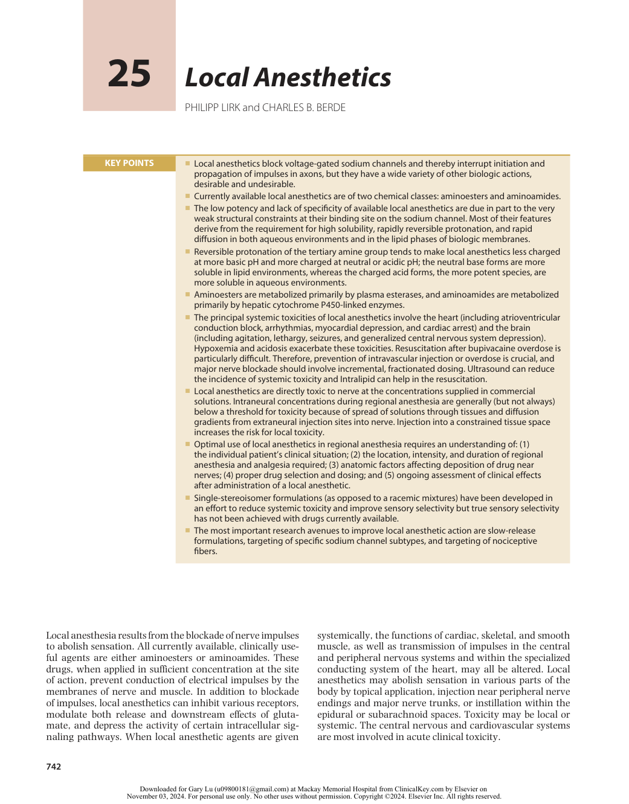

:::

<!-- PDF page 2 -->

## Basic Pharmacology

### CHEMISTRY

### The Local Anesthetic Molecule

The typical local anesthetic molecule, exemplified by lidocaine and procaine (Fig. 25.1), contains a tertiary amine attached to a substituted aromatic ring by an intermediate chain that almost always contains either an ester O O

( C O) or an amide linkage ~~(~~ NHC ~~)~~ ; local anesthetics may therefore be classified as aminoester or aminoamide compounds. The aromatic ring system gives a lipophilic (membrane- liking) character to its portion of the molecule, whereas the tertiary amine end is relatively hydrophilic, particularly since it is partially protonated and thus bears some positive charge in the physiologic pH range (Fig. 25.2).

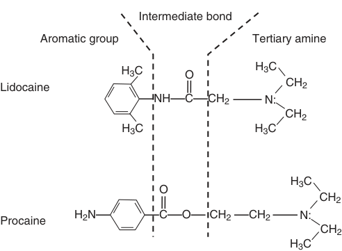

Intermediate bond Aromatic group Tertiary amine H3C H3C O Lidocaine CH2 —NH—C—CH2 — N: CH2 H3C H3C H3C O CH2 Procaine H2N— —C—O— CH2 —CH2 — N: CH2 H3C — — — — — — — — — — = = 

**Fig. 25.1 Structures of two local anesthetics: the aminoamide lidocaine and the aminoester procaine.** In both drugs, a hydrophobic aromatic group is joined to a more hydrophilic base, the tertiary amine, by an intermediate amide or ester bond.

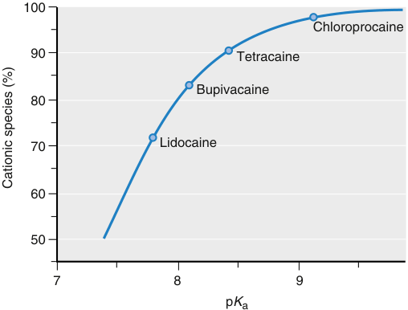

100 Chloroprocaine 90 Tetracaine Bupivacaine 80 70 Lidocaine 60 50 7 8 9 p K a Cationic species (%) 

**Fig. 25.2 Fraction of local anesthetic in the protonated, cationic form of an aqueous solution at physiologic pH (7.4) as a function of the p** **_K_ a of the drug.** Lidocaine, the drug with the lowest p _K_ a, has the smallest fraction of its molecules protonated, the largest in the neutral form, and vice versa for chloroprocaine, the local anesthetic with the highest p _K_ a. Individual drug molecules become protonated and deprotonated in thousandths of a second in solution.

The structures of commonly administered local anesthetics are given in Table 25.1 and their physicochemical properties in Table 25.2.

### STRUCTURE- ACTIVITY RELATIONSHIPS AND PHYSICOCHEMICAL PROPERTIES

The intrinsic potency and duration of action of local anesthetics are clearly dependent on certain features of the molecule.

### Lipophilic–Hydrophilic Balance

The lipophilic versus hydrophilic character of a local anesthetic depends on the size of alkyl substituents on or near the tertiary amine and on the aromatic ring. “Lipophilicity” expresses the tendency of a compound to associate with membrane lipids, a property usually approximated by equilibrium partitioning into a hydrophobic solvent such as octanol.1 Although octanol- buffer partition coefficients are comparable to membrane- buffer partition coefficients for the uncharged species of local anesthetics, they severely underestimate membrane partitioning for the charged, protonated species, octanol being a poor model for the polar regions near the membrane surface where local anesthetics are concentrated.2 Here we use the term “hydrophobicity,” expressed as octanol- buffer partitioning, to describe a physicochemical property of local anesthetics.

Compounds with a more hydrophobic nature are obtained by increasing the size of the alkyl substituents. These agents are more potent and produce longer- lasting blocks than their less hydrophobic congeners.3–5 For example, etidocaine, which has three more carbon atoms in the amine end of the molecule than lidocaine, is four times as potent and five times as long lasting when compared in the isolated sciatic nerve.

### Hydrogen Ion Concentration

Local anesthetics in solution are weak bases, which exist in a very rapid chemical equilibrium between the basic uncharged form (B) and the charged cationic form (BH+ ). At a certain hydrogen ion concentration (log10−1 [−pH]) specific for each drug, the concentration of local anesthetic base in solution is equal to the concentration of charged cation. The logarithm of this hydrogen ion concentration is called p _K_ a. The relationship is defined by the Henderson– Hasselbalch equation, which states that for a weak base,

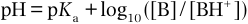

pH = p K a +log10([B]/[BH  ]) 

p _K_ a values of local anesthetic agents in aqueous solution are listed in Table 25.2. The tendency to be protonated also depends on environmental factors, such as temperature and ionic strength, and on the medium surrounding the drug. In the relatively apolar milieu of a membrane, the average p _K_ a of local anesthetics is lower than in solution. This is chemically equivalent to saying that the membrane concentrates the base form of the local anesthetic more than it concentrates the protonated cation form. The pH of the medium containing the local anesthetic influences drug activity by altering the relative percentage of the base and protonated forms. For example, in inflamed tissues the pH is lower than normal, and local anesthetics are more protonated than

<!-- PDF page 3 -->

**Table 25.1** Representative Local Anesthetics in Common Clinical Use

|**Generic* and** **Common** **Proprietary Names**|**Chemical Structure**|**Approximate** **Year of Initial** **Clinical Use**|**Main Anesthetic** **Use**|**Representative** **Commercial** **Preparation**|
|---|---|---|---|---|
|Cocaine|CH2 CH2 CH2 CHCOOCH3 CHOOC6H5 NCH3 CH CH|1884|Topical|40- mg/mL solution|
|Benzocaine (Americaine)|H2N OC2H5 O C|1900|Topical|200 mg/mL|
|Procaine (Novocain)|H2N COOCH2CH2N C2H5 C2H5|1905|Topical Infiltration Spinal|200 mg/mL 10- and 20- mg/mL solutions 100- mg/mL solution|
|Dibucaine (Nupercaine)|OC4H9 CONHCH2CH2N(C2H5)2 N|1929|Spinal|0.667- , 2.5- , and 5- mg/mL solutions|
|Tetracaine (Pontocaine)|H9C4 H N COOCH2CH2N CH3 CH3|1930|Spinal|Niphanoid crystals –20- and 10- mg/mL solutions|
|Lidocaine (Xylocaine)|NHCOCH2N C2H5 C2H5 CH3 CH3|1948|Infiltration Peripheral nerve blockade Epidural Spinal Topical Topical|5- and 10- mg/mL solutions 10- , 15- , and 20- mg/mL solutions 10- , 15- , and 20- mg/mL solutions 50- mg/mL solution 20- mg/mL jelly, viscous 25- and 50- mg/mL ointment|
|Chloroprocaine (Nesacaine)|H2N Cl COOCH2CH2N C2H5 C2H5|1955|Infiltration Peripheral nerve blockade Epidural|10- mg/mL solution 10- and 20- mg/mL solutions 20- and 30- mg/mL solutions|
|Mepivacaine (Carbocaine)|CH3 CH3 CH3 NHCO N|1957|Infiltration Peripheral nerve blockade Epidural|10- mg/mL solution 10- and 20- mg/mL solutions 10- , 15- , and 20- mg/mL solutions|
|Prilocaine (Citanest)|CH3 CH3 C3H7 NHCOCH NH|1960|Infiltration Peripheral nerve blockade Epidural|10- and 20- mg/mL solutions 10- , 20- , and 30- mg/mL solutions 10- , 20- , and 30- mg/mL solutions|
|Bupivacaine (Marcaine)|CH3 C4H9 CH3 NHCO N|1963|Infiltration Peripheral nerve blockade Epidural Spinal|2.5- mg/mL solution 2.5- and 5- mg/mL solutions 2.5- , 5- , and 7.5- mg/mL solutions 5- and 7.5- mg/mL solutions|
|Ropivacaine (Naropin)|CH3 C3H7 CH3 NHCO N|1992|Infiltration Peripheral nerve blockade Epidural|2.5- and 5- mg/mL solutions 5- and 10- mg/mL solutions 5- and 7.5- mg/mL solutions|

*United States Pharmacopeia nomenclature. From Covino B, Vassallo H. _Local Anesthetics: Mechanisms of Action and Clinical Use_ . Orlando, FL: Grune and Stratton; 1976.

::: details 原始表格與符號（PDF 第 3 頁）

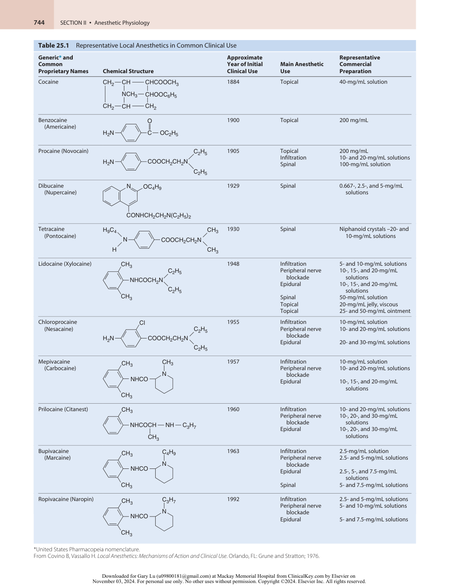

:::

<!-- PDF page 4 -->

**Table 25.2** Relative _In Vitro_ Conduction- Blocking Potency and Physicochemical Properties of Local Anesthetic Drugs

|**Drug**|**Relative** **conduction** **blocking** **potency***| **Physicochemical** **properties – p****_K_a**†|**Physicochemical** **properties –** **hydrophobicity**†|
|---|---|---|---|
|**LOW POTENCY**||||
|Procaine|1|8.9|100|
|**INTERMEDIATE P**|**OTENCY**|||
|Mepivacaine|1.5|7.7|136|
|Prilocaine|1.8|8.0‡|129|
|Chloroprocaine|3|9.1|810|
|Lidocaine|2|7.8|366|
|**HIGH POTENCY**||||
|Tetracaine|8|8.4|5822|
|Bupivacaine|8|8.1|3420|
|Etidocaine|8|7.9|7320|
|Ropivacaine|5.5|8.1|775|

*Data derived from C fibers of isolated rabbit vagus and sciatic nerve. †p _K_ a and hydrophobicity at 36°C, hydrophobicity equals the octanol/buffer partition coefficient of the base. Values are ratios of concentrations. ‡Values at 25°C. From Strichartz GR, Sanchez V, Arthur GR, et al. Fundamental properties of local anesthetics. II. Measured octanol: buffer partition coefficients and p _K_ a values of clinically used drugs. _Anesth Analg_ 1990; 71:158–170, has been updated to add Ropivacaine.

in normal tissue and thus penetrate the neuron relatively poorly (see later). The relationship between p _K_ a and the percentage of local anesthetic present in the cationic form is shown in Fig. 25.2. As described later, there are dual effects of pH on clinical effectiveness, depending on where the local anesthetic is injected and the importance of the base form for tissue penetration.

## Anatomy of the Peripheral Nerve

Each peripheral nerve axon possesses its own cell membrane, the axolemma. Nonmyelinated nerves, such as autonomic postganglionic efferent and nociceptive afferent C fibers, contain many axons encased in a single Schwann cell sheath. In contrast, all large motor and sensory fibers are enclosed in many layers of myelin, which consists of the plasma membranes of specialized Schwann cells that wrap themselves around the axon during axonal outgrowth. Myelin greatly increases the speed of nerve conduction by insulating the axolemma from the surrounding conducting salt medium and forcing the “action current” generated by an impulse to flow through the axoplasm to the nodes of Ranvier, which are periodic interruptions in the myelin sheath where the active impulse is regenerated (Fig. 25.3). The Na+ channels that serve generation and propagation of impulses are highly concentrated at the nodes of Ranvier of myelinated fibers6 but are distributed all along the axon of nonmyelinated fibers (Fig. 25.3). A classification of peripheral nerves according to fiber size and physiologic properties is presented in Table 25.3. It is important to

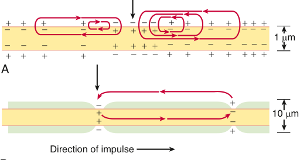

� � � � � � � � � � � ��� � � � � � � � � � � � � � � � � � � � � � ��� � � � � ��� 1  � m � � � � � � � � � � � � � �� A � � � � � � 10  � m � � Direction of impulse 

B 

**Fig. 25.3** Pattern of local circuit currents flowing during propagation of an impulse in a nonmyelinated C fiber’s axon (A) and a myelinated axon (B). During propagation of impulses, from left to right, current entering the axon at the initial rising phase of the impulse ( _large vertical arrows_ ) passes through the axoplasm (local circuit current) and depolarizes the adjacent membrane. _Plus_ and _minus signs_ adjacent to the axon membrane indicate the polarization state of the axon membrane: negative inside at rest, positive inside during active depolarization under the action potential, and less negative in regions where local circuit currents flow. This ionic current passes relatively uniformly across the nonmyelinated axon, but it is restricted in the myelinated axon to entry at the nodes of Ranvier, several of which are simultaneously depolarized during a single action potential.

note that different fiber classes are not only distinguished by diameter and myelin thickness, but also by functional aspects, including the structure of the neuronal membrane and ion channel composition.7 Moreover, moving beyond conventional designations of neurons, current functional understanding groups sensory neurons into several distinct groups, among which three types of cold- sensing, five mechano- heat- sensitive, four low- threshold A- type, five itch- mechano- heat- sensitive, and one low- threshold C- type neuron. Interestingly, most neurons are involved in multiple modalities to varying degrees.8 This fascinating area of research can be expected to redefine the way we look at local anesthetic targets in the future.

Each axon has its own connective tissue covering, the _endoneurium_ . A typical peripheral nerve consists of several axon bundles, or fascicles. Each fascicle of many axons is encased by a second connective tissue layer, the epitheliallike _perineurium_ , and the entire nerve is wrapped in a loose outer sheath called the _epineurium_ (Fig. 25.4). To reach the nerve axon, a local anesthetic molecule must traverse any structures surrounding the nerve, such as the paraneurium (in the case of the distal sciatic nerve), the epineurium, the perineurium, and the endoneurium, as well as the neuronal plasma membrane. The main barrier to diffusion is the perineurium.9 Furthermore, nerves contain both neuronal tissues and non- neuronal tissues, such as connective or fatty tissues, and blood vessels. When performing a popliteal sciatic nerve block for example, it should be kept in mind that here, approximately 60% of the nerve cross- section is nonneuronal tissue,10 with functional implications for local anesthetic diffusion and onset of blockade.

### STRUCTURE OF THE AXONAL MEMBRANE

Biologic membranes consist of a molecular lipid bilayer containing proteins adsorbed on the surfaces, as well as

::: warning 符號需核對
此頁有符號無法完整擷取，請展開下方原始頁面核對。
:::

::: details 原始表格與符號（PDF 第 4 頁）

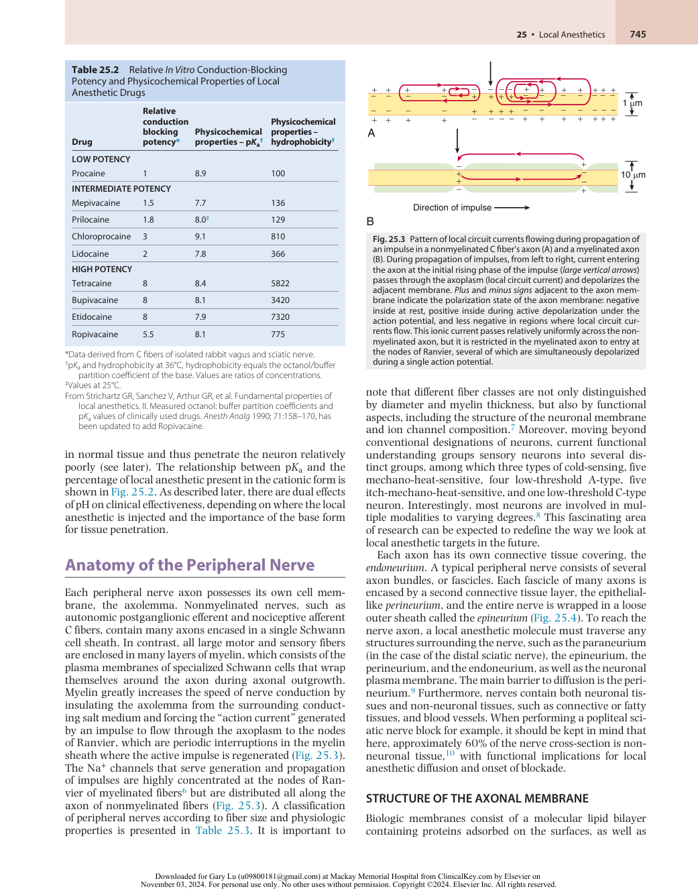

:::

<!-- PDF page 5 -->

**Table 25.3** Classification of Peripheral Nerves According to Anatomy, Physiology, and Function

|**Fiber** **Class**|**Subclass**|**Myelin**|**Diameter** **(μm)**|**Conduction** **Velocity (m/sec)** **Location**|**Function**|**Susceptibility to Local** **Anesthetic Block**|
|---|---|---|---|---|---|---|
|A|α β δ|++++|6–22 6–22 3–6 1–4|30–120 30–120 15–35 5–25 Efferent to muscles Afferent from skin and joints Efferent to muscle spindles Afferent sensory nerves|Motor Tactile, proprioception Muscle tone Pain, cold temperature, touch|++ ++ ++++ +++|
|B||+|&lt;3|3–15 Preganglionic sympathetic|Various autonomic functions|++|
|C|sC|–|0.3–1.3|0.7–1.3 Postganglionic sympathetic|Various autonomic functions|++|
||dC|–|0.4–1.2|0.1–2.0 Afferent sensory nerves|Various autonomic functions Pain, warm temperature, touch|+|
|om Bo|nica JJ._Principl_|_es and Practi_|_ce of Obstetric_|_Anesthesia and Analgesia_. Philadelphia: FA Davis; 1967. Epineuri Endoneu Perineur A|um rium ium||
|||Nu Schw Ne Myelin|cleus of ann cell rve fiber sheath B|C|Nucleus of Schwann cell Schwann cell sheath Nerve fiber| |

From Bonica JJ. _Principles and Practice of Obstetric Anesthesia and Analgesia_ . Philadelphia: FA Davis; 1967.

**Fig. 25.4** (A) Transverse sections of a peripheral nerve showing the outermost epineurium; the inner perineurium, which collects nerve axons in fascicles; and the endoneurium, which surrounds each myelinated fiber. (B) Each myelinated axon is encased in the multiple membranous wrappings of myelin formed by one Schwann cell, each of which stretches longitudinally more than approximately 100 times the diameter of the axon. The narrow span of axon between these myelinated segments, the node of Ranvier, contains the ion channels that support action potentials. (C) Nonmyelinated fibers are enclosed in bundles of 5 to 10 axons by a chain of Schwann cells that tightly embrace each axon with but one layer of membrane.

embedded in or spanning the hydrocarbon core (Fig. 25.5). The character of the bilayer is determined by the phospholipids, which have long hydrophobic fatty acyl tails that lie in the center of the membrane, as well as by the polar hydrophilic head groups, which are usually composed of zwitterionic portions (containing positive and negative charges) that project into the cytoplasm or the extracellular fluid. Within the membrane there is both lateral and rotational diffusion, which allows lipids and certain proteins to migrate in a fluid mosaic, but most membrane proteins are fixed within specific regions of a membrane, anchored by connections to specific proteins of the cell’s cytoskeleton.11 A dynamic interaction exists between the cell’s membrane and the cytoplasm. Although we focus here on the channelblocking actions of local anesthetics, it is noteworthy that many other cellular activities, including both metabolic and signal transduction pathways, are modulated by these drugs.

### PHYSIOLOGY OF NERVE CONDUCTION

The neural membrane can maintain a voltage difference of −60 to −90 mV between the intracellular medium and the cell’s outside, because at rest it is relatively impermeable to sodium ions but selectively permeable to potassium ions. The Na+ /K+ pump, an active, energydependent mechanism, sustains the ion gradients that drive this potential difference by constant extrusion of sodium from within the cell in exchange for a net uptake of potassium, with adenosine triphosphate used as an energy source. Although the membrane is relatively permeable to potassium ions, an intracellular- toextracellular potassium ratio of 150 to 5 mM, or 30:1, is maintained by active removal of potassium as it leaks passively across the plasma membrane into the cell. The nerve at rest behaves largely as a “potassium electrode,” according to the Nernst equation.

::: details 原始表格與符號（PDF 第 5 頁）

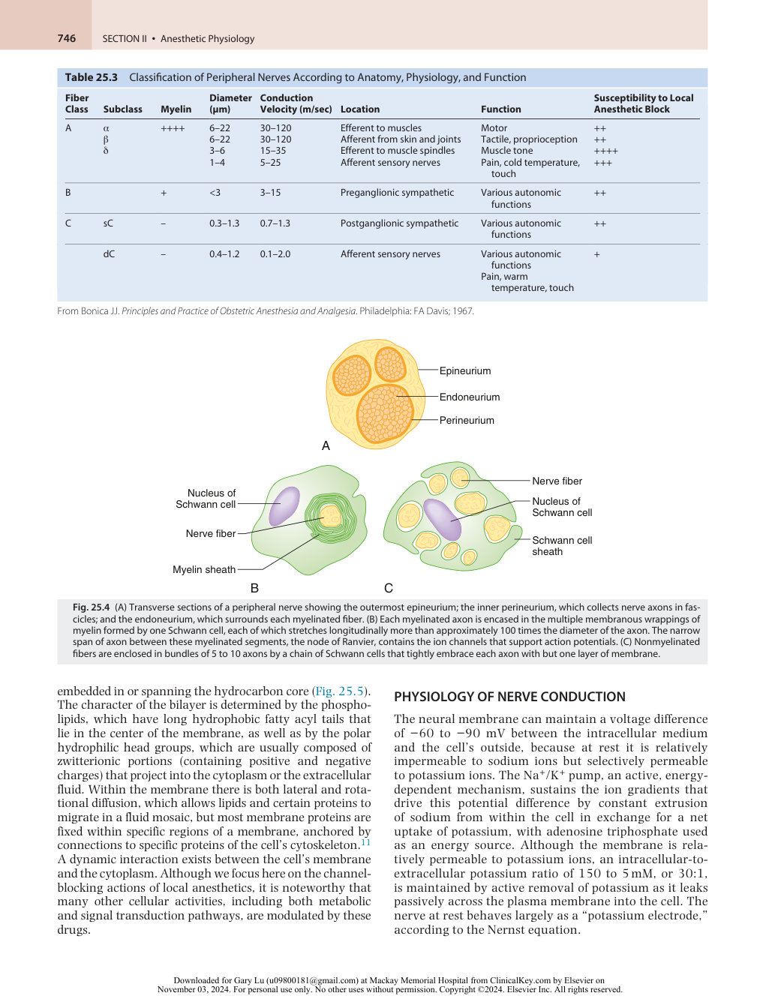

:::

<!-- PDF page 6 -->

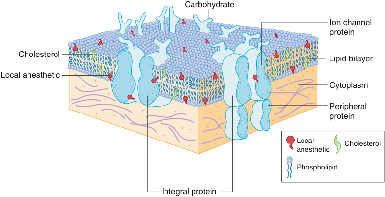

Carbohydrate Ion channel protein Cholesterol Lipid bilayer Local anesthetic Cytoplasm Peripheral protein Local Cholesterol anesthetic Phospholipid Integral protein 

**Fig. 25.5** A typical plasma membrane has at its core the lipid bilayer, composed of phospholipids and cholesterol molecules (in an approximately 5:1 ratio) embedding the membrane integral proteins, which are most often glycosylated by extracellular carbohydrates and include receptors and ion channels essential for intercellular communication. “Peripheral proteins” regulate the functions of membrane proteins, chaperon them to the plasma membrane, and stabilize them in the cell through interactions with both the cytoskeleton and the extracellular matrix. Probable membrane locations and protein sites for local anesthetics are also shown.

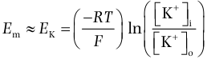

   RT    K  i  E m  E K  F  ln   K       o  

where _E_ m is the membrane potential, _E_ K is the potassium equilibrium potential, _R_ is the gas constant, _T_ is temperature (Kelvin), _F_ is Faraday’s constant, and [K+ ] is the potassium ion concentration inside (i) and outside (o) the cell.

For potassium, therefore,

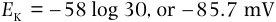

E K =  58 log 30, or  85.7 mV 

An opposite situation exists for Na+ , which is at higher concentration outside the cell and has a Nernst potential, _E_ Na, of about +60 mV. During an action potential, the nerve membrane transiently switches its higher permeability from K+ to Na+ , thereby changing the membrane potential from negative to positive, and back again. The progress of this potential change and the underlying events are graphed in Fig. 25.6. They provide a basis for understanding local anesthetic conduction block.

Permeation of ions through membranes occurs via specialized proteins called ion channels.12 The conformation of these channels is often sensitive to the membrane potential; both Na+ and K+ channels in nerve membranes are activated to an “open” conformation by membrane depolarization. Sodium channels, in addition, close to an “inactivated” conformation after their initial activation. A small membrane depolarization extending along an axon from a region of excited membrane will begin to open both Na+ and K+ channels. The Na+ channels open faster, and the inwardly directed Na+ current (see Fig. 25.6) depolarizes the membrane further, thereby leading to opening of more Na+ channels and increasing the inward Na+ current even further (Fig. 25.7). This sequence of events continues during the _depolarizing phase_ until some of the Na+ channels have become inactivated and enough of the K+ channels have opened to change the balance of current and result in a net outward current that produces membrane

_repolarization_ (see Fig. 25.7). After one action potential, the concentrations of Na+ and K+ have changed little for the large myelinated fibers but by as much as 10% for the small, nonmyelinated axons. The Na+ ions entering and K+ ions leaving the cell because of this process are restored by the Na+ /K+ pump.

Depolarizations too weak to activate enough Na+ channels to produce a net inward current are below the membrane’s excitability threshold. The precise value of the threshold varies in different regions of the cell and can change with time. Directly after an impulse, when some Na+ channels are still inactivated and some K+ channels are still activated, the threshold is above its “resting” value and the membrane is “refractory” to stimulation. Over time, as Na+ inactivation decays and K+ channels return to their closed conformation, the original resting threshold value is restored. The action potential is a wave of depolarization that is propagated along the axon by continuous coupling between excited and nonexcited regions of membrane. Ionic current (the action current) enters the axon in the excited, depolarized region and then flows down the axoplasm and exits through the surrounding membrane, thereby passively depolarizing this adjacent region (see Fig. 25.3).

Although this _local circuit current_ spreads away from the excited zone in both directions, the region behind the impulse, having just been depolarized, is absolutely refractory and propagation of impulses is thus unidirectional. The local circuit current spreads rapidly along a length of insulated internode in a myelinated axon (see Fig. 25.3), and many nodes of Ranvier in sequence are depolarized to threshold with little intervening delay. Single impulses do not jump from node to node as separate, discrete events; instead, active depolarization occurs simultaneously along several centimeters of the largest axons (see Fig. 25.3). Indeed, the local circuit current is so robust that it can skip past two completely nonexcitable nodes (e.g., blocked by local anesthetic) and successfully stimulate a third node. If excitability is partially reduced, such as by inhibition of some

<!-- PDF page 7 -->

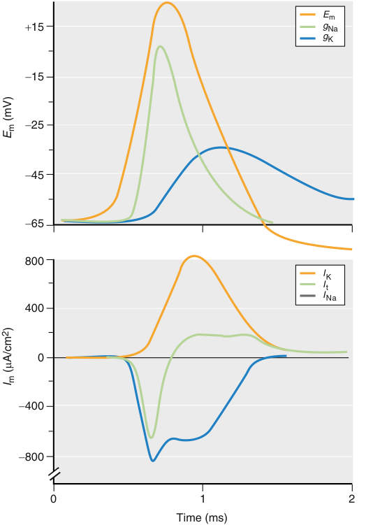

E m � 15 g Na g K � 15 � 25 � 45 � 65 800 I K I t I Na 400 0 � 400 � 800 0 1 2 Time (ms)  (mV) E m 2A/cm () I � m 

**Fig. 25.6** Membrane potential ( _E_ m) and the voltage- gated ionic conductance of sodium ( _g_ Na) and potassium ( _g_ K), which determine the corresponding membrane currents _I_ m ( _I_ Na and _I_ K) during a propagated action potential. Modeled from the original studies of Hodgkin and Huxley on the squid giant axon,6 these relationships hold for almost all invertebrate and vertebrate nerve fibers. The direction of the total ionic current ( _I_ t), which is the sum of _I_ Na and _I_ K, is inward (negative values) for the depolarizing phase of the action potential and outward (positive values) for the repolarizing phase. (From Hodgkin A. _The Conduction of the Nervous Impulse_ . Springfield, IL: Charles C. Thomas; 1964.)

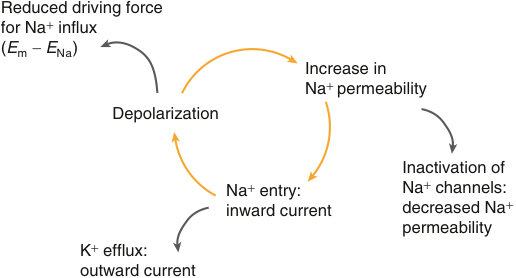

Reduced driving force for Na �  influx ( E m �� E Na) Increase in Na �� permeability Depolarization Inactivation of Na �  entry: Na �  channels: inward current decreased Na � permeability K �  efflux: outward current 

**Fig. 25.7** The action potential can be understood in terms of the cyclic relationships between factors contributing to the regenerative, depolarizing phase and the passive, repolarizing phase. Positive factors ( _yellow arrows_ ) increase the rate of depolarization in a positive- feedback loop, with each element in the cycle favoring the subsequent one. Negative factors ( _gray arrows_ ) decrease the depolarization rate by reducing or opposing the related positive factor, with efflux of K+ eventually dominating the ionic flow and repolarizing the membrane.

of the Na+ channels, the amplitude of impulses in successive nodes falls decrementally, a process that can continue for many centimeters.13 This situation probably occurs during certain phases of local anesthesia, as discussed later. When enough of the Na+ channels are blocked, local circuit current fails to bring the adjacent resting region to threshold, and the impulse is fully extinguished. One of the most important take- home messages is that the blockade of nerve impulses using local anesthetics is not an all- ornothing phenomenon, similar to a door being locked shut; but rather a dynamic process depending on the interplay between the strength of the stimulus and the concentration of local anesthetics, having been likened by G. Strichartz to a car (impulse) getting stuck in a street (nerve) interrupted by a puddle of mud (collection of local anesthetic).

## Mechanism of Action of Local Anesthetics (Pharmacodynamics)

### ACTIVE FORM

Local anesthetic bases are poorly to sparingly soluble in water but are quite soluble in relatively hydrophobic organic solvents. Therefore, as a matter of chemistry (and to optimize shelf life), most of these drugs are formulated as hydrochloride salts. The p _K_ a of the drug and the tissue pH determine the amount of drug that exists in solution as free base or as positively charged cation when injected into living tissue (see earlier). Furthermore, uptake of the drug by tissue, largely via lipophilic adsorption, will also alter its activity, both by shifting the effective p _K_ a downward, thereby favoring the neutral base form, and by limiting diffusion of the anesthetic away from the site of injection. Moderately hydrophobic local anesthetics block faster than either hydrophilic or highly hydrophobic ones, delivered at the same concentration, for the following reasons. Moderately hydrophilic molecules, such as lidocaine, are less bound to tissues than very hydrophobic drugs are (e.g., tetracaine) but are still more membrane permeant than very hydrophilic ones (e.g., 2- chloroprocaine). The highly hydrophobic local anesthetics, having higher intrinsic potencies (see Table 25.2), are therefore used in lower concentrations and their diffusion- controlled rate of onset is correspondingly reduced.

Which form of the local anesthetic, charged cation, or neutral base, is responsible for blockade of impulses? More alkaline solutions of local anesthetics block nerve conduction more effectively. On sheath- free nerves, the rate of inhibition by tertiary amine anesthetics is greater at alkaline than at neutral external pH14 because membrane permeation, favored by the base over the cationic species, determines the rate of access to the binding site. Direct control of axoplasmic pH (or internal perfusion with permanently charged quaternary amine homologues) shows that the dominant potency derives from the cationic species acting from the cytoplasmic surface.15,16 The uncharged base also has intrinsic pharmacologic activity, however, which explains the effectiveness of benzocaine as a topical local anesthetic. The local anesthetic attaches to the binding site with its aromatic moiety, while the charged portion protrudes into the sodium channel’s lumen.17

::: warning 符號需核對
此頁有符號無法完整擷取，請展開下方原始頁面核對。
:::

::: details 原始表格與符號（PDF 第 7 頁）

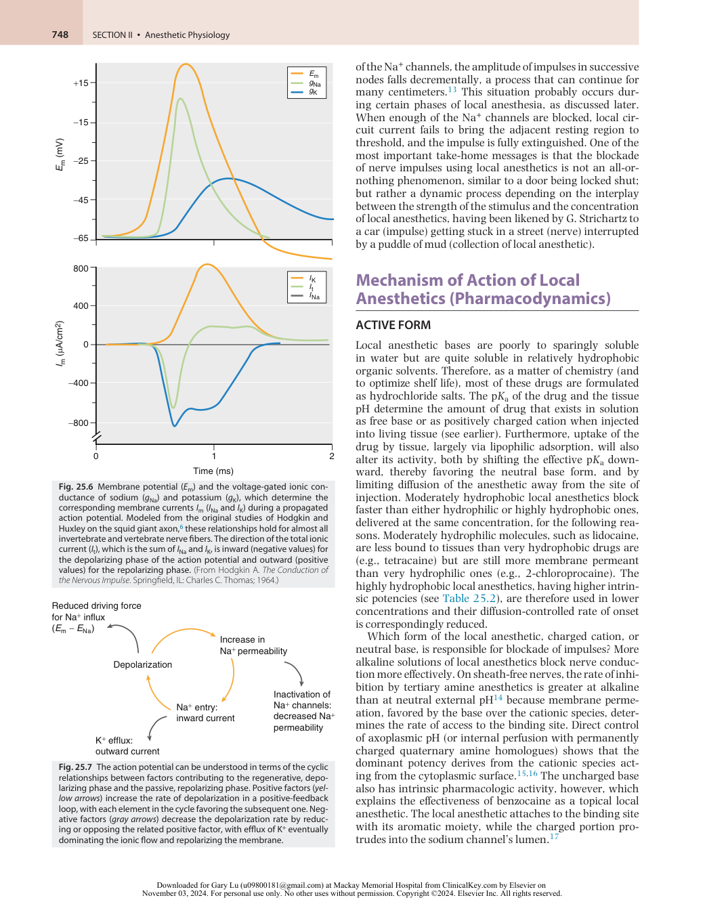

:::

<!-- PDF page 8 -->

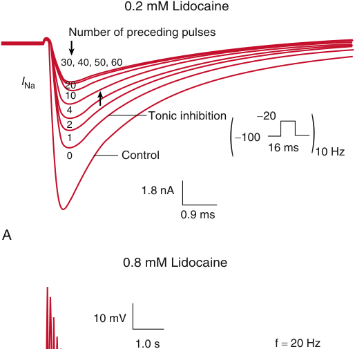

0.2 mM Lidocaine Number of preceding pulses 30, 40, 50, 60 I Na 20 10 4 Tonic inhibition � 20 2 1 � 100 0 Control ( 16 ms )10 Hz 1.8 nA 0.9 ms A 0.8 mM Lidocaine 10 mV 1.0 s f  �� 20 Hz 

B

**Fig. 25.8 Use- dependent actions of local anesthetics on excitable membrane properties.** (A) Ionic Na+ currents measured by a voltageclamping technique are transiently activated by brief steps of depolarization applied infrequently (tonic test) or in a train at 10 times per second (phasic test, see _E_ m pattern in parentheses). After equilibration with 0.2 mM (0.005%) lidocaine, the currents measured tonically are reduced by approximately 30% from the control currents. Application of the phasic train of depolarizations results in a dynamic reduction of currents after each depolarization, with a steady- state value of phasic inhibition reached during the train of 75% of control currents. Recovery of currents to the tonic value occurs within a few seconds when phasic testing stops (not shown). (B) Action potentials are also inhibited in a phasic manner by local anesthetics. After equilibration with 0.8 mM lidocaine (0.02%), the action potential is tonically reduced by approximately 20% from its amplitude in drug- free solution (not shown). Stimulation by a train at 20 stimuli per second induces a phasic inhibition that further reduces the amplitude by about 70% from the control value. As with the ionic currents (A), phasic inhibition of the action potential recovers rapidly when high- frequency stimulation stops.

depolarization is applied repeatedly, at frequencies higher than 5 Hz (five pulses per second), the partially depressed ( _tonically_ inhibited) Na+ current is further reduced incrementally for each pulse until a new steady- state level of inhibition is reached.15,18 This frequency- dependent inhibition, also called _phasic inhibition_ , is reversed when stimulation is slowed or stopped, and currents return to the level of tonic inhibition observed in the resting nerve. Paralleling the phasic inhibition of Na+ currents in voltage- clamped membranes is a “use- dependent” blockade of action potentials during normal physiologic function (Fig. 25.8B).

Phasic actions are a manifestation of the selective affinity of local anesthetics for conformations of the Na+ channel that result from depolarization. Both “open” and “inactivated” states of the channel bind local anesthetics more avidly than the resting state does. Repeated depolarization thus increases the fraction of drug- bound channels; dissociation of these bound drug molecules is usually a slower process than the normal recovery from inactivation (see earlier) and results in the use- dependent accumulation of channels in the blocked condition and the phenomenon of phasic block.

By its selective binding to a channel state, the local anesthetic stabilizes that state. During phasic block, therefore, more inactivated channels become drug bound, and reciprocally, less activation can occur. This relationship between state- dependent affinities and modification of transitions among states through drug binding is known as the “modulated receptor” model.19 Overall binding of anesthetic is increased by membrane depolarization for two reasons: more binding sites become accessible during activation (the guarded receptor model) and drug dissociation from inactivated channels is slower than from resting channels (the modulated receptor model).

The potency of local anesthetics to produce tonic and phasic inhibition is similarly dependent on their structure, hydrophobicity, and p _K_ a. There appears to be a single, albeit complex, binding site for local anesthetics on the Na+ channel, with a “tonic” affinity at rest and increased “phasic” affinity occurring as a result of depolarization. The sodium channel can be influenced by a number of drugs or toxins/ venoms, and the different sites are numbered. The binding site for local anesthetics is referred to as Site 9, while the outer channel pore, binding site for tetrodotoxin (TTX) or saxitoxin (STX), is referred to as Site 1.

### THE NATURE OF THE LOCAL ANESTHETIC

### ELECTROPHYSIOLOGIC EFFECT OF LOCAL ANESTHETICS

The resting membrane potential of nerve is little affected by local anesthetics. As the concentration of local anesthetic applied to the nerve is increased, a decrease in the rate of depolarization and in the peak amplitude of the action potential occurs until the impulse is abolished. By using a “voltage- clamp” procedure, Na+ currents and their inhibition by local anesthetics can be directly assayed (Fig. 25.8A). When the membrane of isolated neurons is rapidly depolarized to a constant value, the time course of ionic currents is observed. Sodium currents during one initial depolarization are reduced by subclinical doses of local anesthetic (e.g., 0.2 mM lidocaine) and totally abolished by clinical doses (e.g., 1% lidocaine ≈ 40 mM). If the test

### Binding Site

Intentional mutation of specific amino acids of the Na+ channel has allowed definition of regions that interact directly with local anesthetics. The major functional protein of the Na+ channel (the α subunit) is composed of four homologous “domains” (D- 1 to D- 4), each of which contains six helical regions (S1 to S6) that span the core of the membrane (Fig. 25.9A). Each domain also has a loop, termed the “P region,” that links the extracellular ends of its S5 and S6 transmembrane segments; the P regions extend inward between the transmembrane regions such that when the α subunit folds together, each P loop contributes a quarter of the cylindrical ion “selectivity pore,” the narrowest passage of an open channel (Fig. 25.9B). Voltage sensitivity derives from the positive charges located on S4 segments, which slide or swing

::: warning 符號需核對
此頁有符號無法完整擷取，請展開下方原始頁面核對。
:::

::: details 原始表格與符號（PDF 第 8 頁）

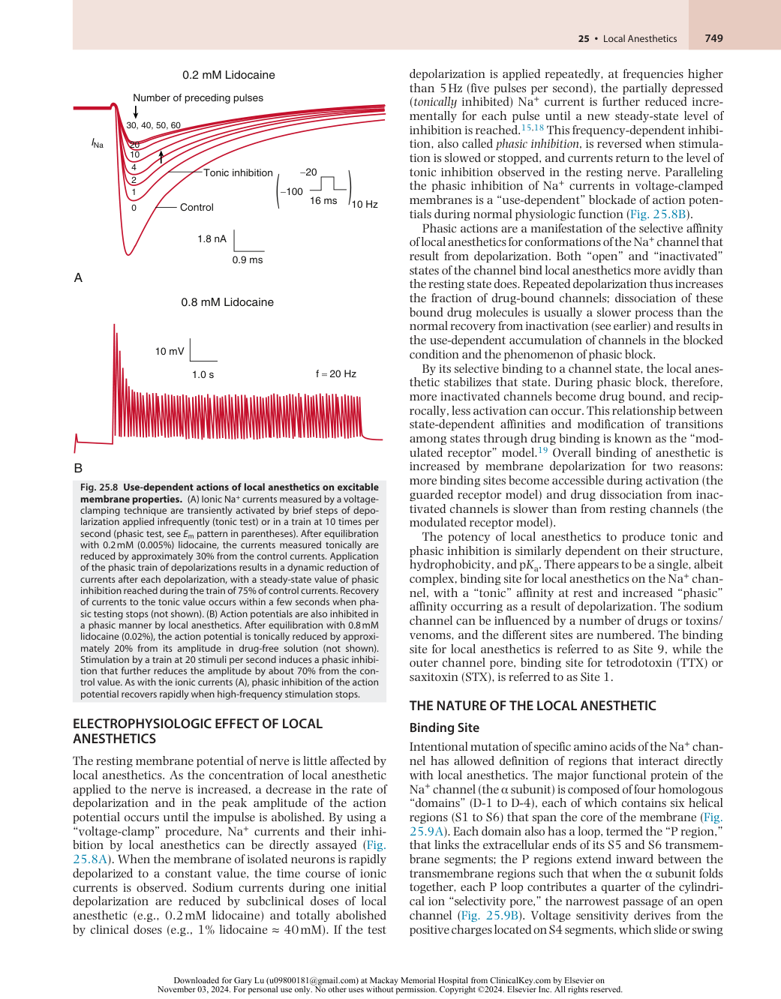

:::

<!-- PDF page 9 -->

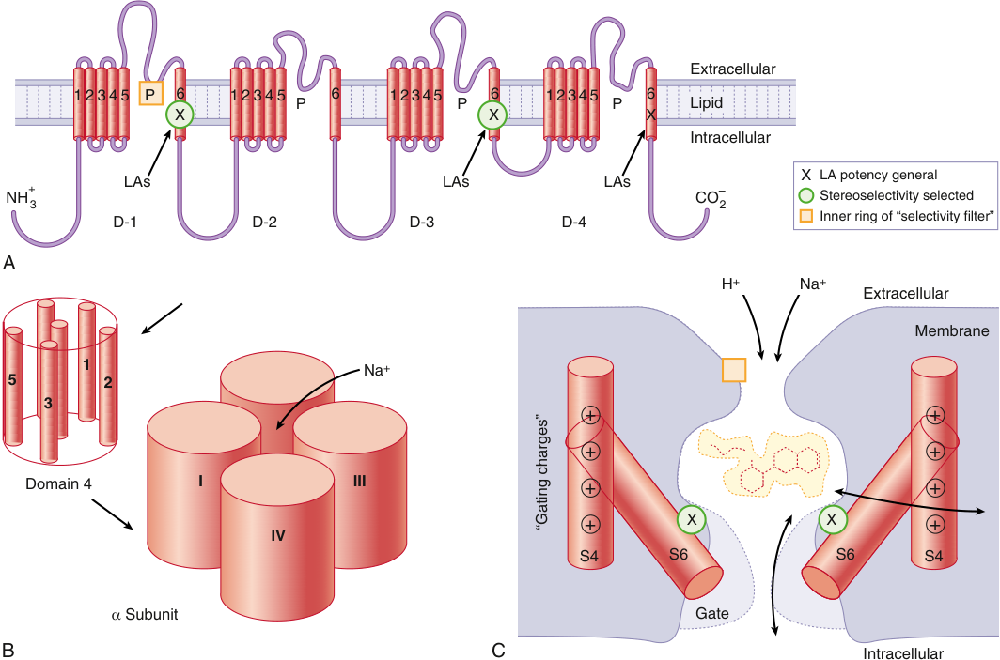

Extracellular 1 2 3 4 5 P 6 1 2 3 4 5 6 1 2 3 4 5 6 1 2 3 4 5 6 P P P Lipid X X X Intracellular NH+3 LAs LAs LAs CO – 2 X Stereoselectivity selectedLA potency general D-1 D-2 D-3 D-4 Inner ring of “selectivity filter” A H + Na + Extracellular Membrane 1 Na + 5 2 3 + + + + Domain 4 I III + + + X X + IV S4 S6 S6 S4 �� Subunit Gate B C Intracellular “Gating charges” 

**Fig. 25.9 Structural features of the Na**+ **channel that determine local anesthetic (LA) interactions.** (A) Consensus arrangement of the single peptide of the Na+ channel α subunit in a plasma membrane. Four domains with homologous sequences (D- 1 through D- 4) each contain six α- helical segments that span the membrane (S1 to S6). Each domain folds within itself to form one cylindrical bundle of segments, and these bundles converge to form the functional channel’s quaternary structure (B). Activation gating leading to channel opening results from primary movement of the positively charged S4 segments in response to membrane depolarization (see panel C). Fast inactivation of the channel follows binding to the cytoplasmic end of the channel of part of the small loop that connects D- 3 to D- 4. Ions travel through an open channel along a pore defined at its narrowest dimension by the P region formed by partial membrane penetration of the four extracellular loops of protein connecting S5 and S6 in each domain. Intentional, directed mutations of different amino acids on the channel indicate residues that are involved in LA binding in the inner vestibule of the channel (X on S6 segments), at the interior regions of the ion- discriminating “selectivity filter” ( _square_ on the P region), and which are also known to influence stereoselectivity for phasic inhibition ( _circle_ , also on S6 segments). (C) Schematic cross  section of the channel speculating on the manner in which S6 segments, forming a “gate,” may realign during activation to open the channel and allow entry and departure of a bupivacaine molecule by the “hydrophilic” pathway. The closed (inactivated) channel has a more intimate association with the LA molecule, whose favored pathway for dissociation is no longer between S6 segments (the former pore) but now, much more slowly, laterally between segments and then through the membrane, the “hydrophobic” pathway. Na+ ions entering the pore will compete with the LA for a site in the channel, and H+ ions, which pass very slowly through the pore, can enter and leave from the extracellular opening, thereby protonating and deprotonating a bound LA molecule and thus regulating its rate of dissociation from the channel.

“outward” in response to membrane depolarization. By linkages still unknown, this movement of S4 results in a conformational rearrangement of the S6 segments, which form the inner, cytoplasmic entry to the channel. Closed- to- open channel gating results from movement of the S6 segments, whereas inactivation gating results from binding of the cytoplasmic loop located between D- 3 and D- 4 to the cytoplasmic opening of the channel.

Local anesthetics bind in the “inner vestibule” of the closed Na+ channel (see Fig. 25.9C). Amino acid mutations in the S6 segments of D- 1, D- 3, and D- 4 all modify local anesthetic action, thus suggesting either that these regions form a “pharmocophore” small enough to simultaneously contact the drug at three surfaces or that the local anesthetic molecule moves rapidly among these three segments. The rate constant for binding of local anesthetic to

the closed Na+ channel is larger for the more hydrophobic molecules, which suggests that drug molecules can reach the binding site (and depart from it) through a “hydrophobic” pathway. The charged species of local anesthetics dissociates much more slowly from closed and inactivated Na+ channels than the neutral form does, which suggests that an ionic bond may be involved in drug binding or that the charged molecule moves only slowly along the hydrophobic pathway. In brief, hydrophobicity delivers the drug to the receptor and charge keeps it there.

### NEUROPHYSIOLOGIC ASPECTS OF PHASIC INHIBITION

Different fiber types in the nerve are affected differently during local anesthesia. At least part of this difference arises

::: warning 符號需核對
此頁有符號無法完整擷取，請展開下方原始頁面核對。
:::

::: details 原始表格與符號（PDF 第 9 頁）

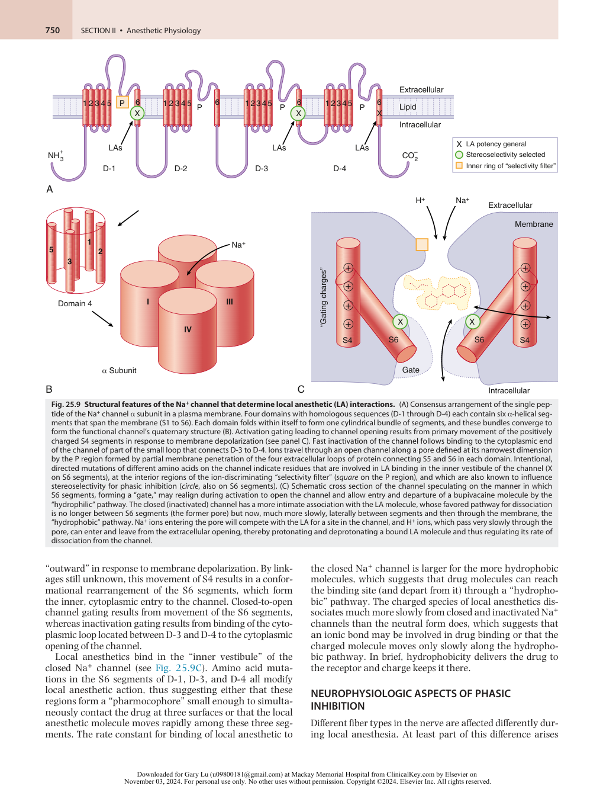

:::

<!-- PDF page 10 -->

from pharmacokinetic factors. At the onset of and during recovery from clinical block, longitudinal and radial diffusion of drug will produce concentration variations within and along the nerve. This variation is superimposed on the dynamic use- dependent inhibition to provide variable propagation, which depends on a fiber’s geometry, position within the nerve, and functional as well as electrophysiologic properties.

Different fiber types are also differentially sensitive to local anesthetic blockade. _In vivo_ experiments in which continuous superperfusion of peripheral nerve allows equilibration with drug and experiments in which a drug bolus is delivered by percutaneous injection,20 analogous to clinical peripheral nerve block, show that small myelinated axons (Aγ motor and Aδ sensory fibers) are the most susceptible to impulse suppression. Next in order of block are the large myelinated (Aα and Aβ) fibers, and the least susceptible are the small, nonmyelinated C fibers. In fact, in this last group, impulses in the slowest conducting population (conduction velocity of 0.5 to 0.8 msec) are the most resistant to local anesthetic.20 Clinically, testing of block efficacy is often performed using methods that target Aδ sensory fibers, so these findings suggest that loss of temperature or pin- prick discrimination does not guarantee complete and reliable block of all sensory modalities.

### Selective Block of Na+ Channel Isoforms

Nine different mammalian Na+ channels have been physiologically identified and their genes have been sequenced. At least four of them are found in peripheral neurons, some exclusively associated with nociceptive afferents. Obviously, it would be clinically advantageous to selectively inhibit these channels and thus prevent or reduce pain while sparing other functions. Although selective channel blockade has been attained with naturally occurring small peptide toxins,21 relatively little selective blockade by local anesthetics has been reported,22 probably because the local anesthetic pharmacophore is too similar among the different channel isoforms and the local anesthetic molecules themselves have several rotational axes, which makes them poor structural templates for selecting among static binding pockets. Selectively blocking different sodium channel isoforms can lead to distinct effects because they are not evenly distributed across the nerve and react differently to activation. Specifically, one of the main functions of the Nav1.7 isoform is to act as an amplifier in the terminals of primary sensory neurons, while Nav1.8 is vital to the repetitive firing in these neurons, and Nav1.9 are able to generate persistent currents which can increase membrane excitability.23 Some recent advances which hold promise to improve nerve block properties of local anesthetics are summarized towards the end of this chapter.

### Sodium Channel Isoforms and Their Contribution to Human Diseases Characterized by Pain or Pain Insensitivity

We now know several mutations in the prototypical neuronal sodium channels (Nav1.7, 1.8. and 1.9) which can lead to states of either spontaneous pain24,25 or profound and selective impairment of pain sensitivity.26 This depends on type of mutation and mode of inheritance. For example, mutations in Nav1.7 may lead to loss of channel function

and, in the most extreme form, congenital insensitivity to pain. In contrast, activating mutations in the same channel can trigger erythromelalgia or paroxysmal extreme pain disorder.23 Molecular studies reveal that these disorders involve several distinct types of mutations in Nav1.7 sodium channels.24,25 When these channels are inserted into cells that lack sodium channels, they generate spontaneous, temperature- sensitive inward currents.23 Another recent finding was that certain preclinical models of visceral pain (e.g., cystitis) are not responsive to therapies specifically targeting the Nav1.7 channels, while block of Nav1.9 channels was effective.27 Lastly, it is important to note that mutations in non- neuronal sodium channelopathies can have profound clinical consequences as well. For example, mutations of the Nav1.4 sodium channel isoform in skeletal muscle can produce myotonia, periodic paralysis, and congenital myasthenia.28

Aberrant impulses, which are often considered the hallmarks of various diseases of excitable membranes, such as abnormal repetitive firing in neuropathic pain or in certain types of inherited skeletal myotonia, are abolished by systemic lidocaine in doses that do not block normal propagating impulses. Conditions for the sensitivity of such impulses to local anesthetics, such as lidocaine, appear to result from the patterns of impulse spikes superimposed on slow membrane depolarizations caused by abnormal expression of Na+ channels rather than from selective sensitivity of certain subtypes of channels to these drugs.29

### SUMMARY OF LOCAL ANESTHETIC MECHANISMS

Impulse blockade by local anesthetics may be summarized by the following chronology:

1. Solutions of local anesthetic are deposited near the nerve. Removal of free drug molecules away from this locus is a function of tissue binding, removal by the circulation, and local hydrolysis of aminoester anesthetics. The net result is penetration of the nerve sheath by the remaining free drug molecules.

2. Local anesthetic molecules then permeate the nerve’s axon membranes and reside there and in the axoplasm. The speed and extent of these processes depend on a particular drug’s p _K_ a and on the lipophilicity of its base and cation species.

3. Binding of local anesthetic to sites on voltage- gated Na+ channels prevents opening of the channels by inhibiting the conformational changes that underlie channel activation.

4. During onset of and recovery from local anesthesia, impulse blockade is incomplete and partially blocked fibers are further inhibited by repetitive stimulation, which produces an additional, use- dependent binding to Na+ channels.

5. One local anesthetic binding site on the Na+ channel may be sufficient to account for the drug’s resting (tonic) and use- dependent (phasic) actions.

6. The clinically observed rates of onset and recovery from blockade are governed by the relatively slow diffusion of local anesthetic molecules into and out of the whole nerve, not by their much faster binding and dissociation from ion channels. A clinically effective block that may

<!-- PDF page 11 -->

last for hours can be accomplished with local anesthetic drugs that dissociate from Na+ channels in a few seconds.

## Clinical Pharmacology

Successful use of regional anesthesia requires knowledge of the pharmacologic properties of the various local anesthetic drugs, as well as technical skill in performance of the nerve block. Local anesthetic requirements vary considerably, depending on factors such as the type of block, surgical procedure, and physiologic status of the patient.

Commonly used aminoester local anesthetics include procaine, chloroprocaine, tetracaine, and the first true local anesthetic, cocaine. Commonly used aminoamides include lidocaine, mepivacaine, prilocaine, bupivacaine (the racemic form and its levo- enantiomer), ropivacaine, and etidocaine. The traditional mnemonic holds that the name of amide local anesthetics contains two “i’s.” Ester and amide local anesthetics differ in their chemical stability, locus of biotransformation, and allergic potential. Amides are extremely stable, whereas esters are relatively unstable in solution. Aminoesters are hydrolyzed in plasma by cholinesterase enzymes, but the amides undergo enzymatic degradation in the liver. Two exceptions to this trend are cocaine, an ester that is metabolized predominantly by hepatic carboxylesterase, and articaine, an amide local anesthetic widely used in dentistry that is inactivated by plasma carboxylesterase- induced cleavage of a methyl ester on the aromatic ring.

_p_ - Aminobenzoic acid is one of the metabolites of ester- type compounds that can induce allergic- type reactions in a small percentage of patients. The aminoamides are not metabolized to _p_ - aminobenzoic acid, and reports of allergic reactions to these agents are extremely rare. Allergy to preservatives should be considered if a potential reaction is observed.

### GENERAL CONSIDERATIONS

Clinically important properties of the various local anesthetics include potency, speed of onset, duration of anesthetic action, and differential sensory/motor blockade. As previously indicated, the profile of individual drugs is determined by their physicochemical characteristics (see Table 25.2).

### Anesthetic Potency

Hydrophobicity appears to be a primary determinant of intrinsic anesthetic potency5 because the anesthetic molecule must penetrate into the nerve membrane and bind at a partially hydrophobic site on the Na+ channel. Clinically, however, the correlation between hydrophobicity and anesthetic potency is not as precise as in an isolated nerve. Differences between _in vit_ ro and _in vivo_ potency may be related to several factors, including local anesthetic charge and hydrophobicity (which influence partitioning into and transverse diffusion across biologic membranes) and vasodilator or vasoconstrictor properties (which influence the initial rate of vascular uptake from injection sites into the central circulation).

### Onset of Action

The onset of conduction block in isolated nerves is related to the physicochemical properties of the individual agents.

_In vivo_ latency is also dependent on the dose or concentration of local anesthetic used. For example, 0.75% bupivacaine has more rapid onset than 0.25%. Chloroprocaine demonstrates a rapid onset of action in humans because its low systemic toxicity permits its use in high concentrations (3%).

### Duration of Action

The duration of action of the various local anesthetics differs markedly. Procaine and chloroprocaine have a short duration of action. Lidocaine, mepivacaine, and prilocaine produce a moderate duration of anesthesia, whereas tetracaine, bupivacaine, ropivacaine, and etidocaine have the longest durations.

In humans, the duration of anesthesia is markedly influenced by the peripheral vascular effects of the local anesthetic drugs. Many local anesthetics have a biphasic effect on vascular smooth muscle; at low concentrations these agents tend to cause vasoconstriction, whereas at higher, clinically administered concentrations, they cause vasodilation.30 However, differences exist in the degree of vasodilator activity of the various drugs. The effects of local anesthetics on vascular tone and regional blood flow are complex and vary according to concentration, time, and the vascular bed near the site of applications. As a practical example, the topical local anesthetic formulation EMLA (eutectic mixture of the local anesthetics lidocaine and prilocaine) vasoconstricts cutaneous vessels initially and through most of the first hour of application, but vasodilation is observed after 2 or more hours of application.

### Differential Sensory/Motor Blockade

Another important clinical consideration is the ability of local anesthetic agents to cause differential inhibition of sensory and motor activity. Bupivacaine became popular in the 1980s for epidural blocks because it was better than the previously available long- acting agents (e.g., etidocaine) in producing adequate antinociception without profound inhibition of motor activity, particularly when dilute solutions are used. Bupivacaine is widely used epidurally for obstetric analgesia and postoperative pain management because it can provide acceptable analgesia with only mild muscle weakness (also see Chapters 25, 41, and 58). Additional observations on the sensory selectivity of newer local anesthetics are detailed later in the section on chiral local anesthetics.

Traditional texts often state that small- diameter axons, such as C fibers, are more susceptible to local anesthetic block than larger- diameter fibers are. However, when careful measurements are made of single- impulse annihilation in individual nerve fibers, exactly the opposite differential susceptibility is noted (see earlier).31,32 Repetitive stimulation, such as occurs during propagation of trains of impulses, produces a further, phasic inhibition of excitability, but it is unclear how this will affect a functionally selective failure of impulses. The length of drug- exposed nerve in the intrathecal space, imposed by anatomic restrictions, can perhaps explain clinically documented differential spinal or epidural blockade, with longer drug- exposed regions yielding block by lower concentrations of local anesthetic.33 However, this reasoning does not explain the functionally differential loss from peripheral nerve block. Other factors

<!-- PDF page 12 -->

may include actual spread of the drug along the nerve or its selective ability to inhibit Na+ channels over K+ channels,34 which in itself can produce a differential block because these channels are present in very different proportions in different types of nerves. As a result of these confounding factors, clinicians should be discouraged from making conclusions about fiber- type involvement in chronic pain syndromes based on the dose or concentration requirement for pain relief in diagnostic nerve blockade.35

### FACTORS INFLUENCING ANESTHETIC ACTIVITY IN HUMANS

### Dosage of Local Anesthetic

As the dosage of local anesthetic is increased, the probability and duration of satisfactory anesthesia increases and the time to onset of block is shortened. The dosage of local anesthetic can be increased by administering either a larger volume or a more concentrated solution. For example, increasing the concentration of epidurally administered bupivacaine from 0.125% to 0.5% while maintaining the same volume of injectate (10 mL) resulted in shorter latency, an improved incidence of satisfactory analgesia, and a longer duration of sensory analgesia.36 The volume _per se_ of anesthetic solution probably influences the spread of anesthesia in peripheral and epidural blocks. For example, 30 mL of 1% lidocaine administered into the epidural space produced a level of anesthesia that was more than 4 dermatomes higher than that achieved when 10 mL of 3% lidocaine was given.37

In selecting the volume and concentration for a specific block in a particular patient, clinicians must balance the risk of adverse effects from excessive dosing (systemic toxicity, excessive motor, or autonomic blockade, etc.) against the increased risk of block failure if an inadequate volume or concentration is chosen. The degree to which additional volume can compensate for imprecise needle placement varies among different blocks. With the advent of very precise needle placement using ultrasound- guided blockade, it has become clear that the median effective volume for obtaining successful blockade can be achieved with smaller volumes than have been recommended from some previous clinical series based on traditional methods of needle localization. For example, in a dose- finding randomized trial for femoral nerve blockade, the median volumes for 50% or 95% success in obtaining dense sensory and motor block at 30 minutes under ultrasound guidance were 57% and 54% of the corresponding volumes with the use of nerve stimulation.38 Interested readers will note the very wide confidence intervals found in this study and are encouraged to read recent work on some statistical design issues for dose- response studies involving all types of anesthetics.39 As limited by toxicity considerations, the aim in most clinical situations should be to choose doses that provide high success rates; that is, a dose effective in 95% of patients (ED95) is generally a more relevant guide to dose selection than an ED50 dose. These considerations are especially salient when performing regional anesthesia for patients with chronic pain, hyperalgesia, or a history of previous failed regional anesthesia. Another way in which ultrasound has contributed to the advancement of regional anesthesia was the opportunity to study the minimum local anesthetic volume (MLAV)

necessary to block peripheral nerves. Normalized to nerve size, the volume has been estimated at 0.1–0.15 mL/mm2 of nerve diameter.40,41 It should be considered, though, that decreasing the dose such as has become possible under ultrasound guidance may provide a satisfactory block after 30 minutes (a common end point for clinical studies), but at the same time, the block may have a decreased duration of action. Duration of action is important such that the block will cover the intensely painful period after surgery, and if this period is longer than could be achieved using plain local anesthetics, and in cases where continuous techniques are not feasible, adjuvants/additives may help in prolonging the block.

### Addition of Additives

**Epinephrine.** Vasoconstrictors, usually epinephrine, are frequently included in local anesthetic solutions to decrease the rate of vascular absorption, thereby allowing more anesthetic molecules to reach the nerve membrane and thus improve the depth and duration of anesthesia. The use of epinephrine as a marker for inadvertent intravascular injection continues to be sensible, even though false negatives and false positives can occur, and difficulty in interpretation in parturients and patients under anesthesia or on beta blockers.42 Clinically used solutions typically contain 5 µg/mL or 1:200,000 of epinephrine, reflecting a balance between efficacy and vasoconstriction versus systemic side effects of epinephrine. The extent to which epinephrine prolongs the duration of anesthesia depends on the specific local anesthetic used and the site of injection. Epinephrine will extend the duration of both infiltration anesthesia and peripheral nerve blockade with shorter- duration agents (e.g., lidocaine and mepivacaine)43 ; epinephrine produces mild intensification of blockade but only most modest prolongation of epidural or peripheral blocks with bupivacaine.44 Activation of α2- adrenergic receptors in the spinal cord may contribute to the beneficial effect of epidural epinephrine.

**Clonidine and Dexmedetomidine.** The α2 agonist clonidine will prolong action of local anesthetics by about 2 hours with wide variation between studies45 and its conjectured mechanisms of action include actions on α2 receptors and on hyperpolarization- induced currents.46 However, there is a large number of negative studies, and adverse systemic events are of concern, including hypotension, bradycardia, and sedation, such that limiting the clonidine dose to 0.5–1 µg/kg ideal body weight has been proposed. Dexmedetomidine is a much more specific α2 agonist, and prolongs both motor and sensory block by long- acting local anesthetics by approximately four hours.47 Similar to clonidine, dexmedetomidine blocks the hyperpolarizationinduced current.48 Nevertheless, risk of systemic adverse effects remains high, and optimal doses have not been determined. There seems to be no increased risk of neurotoxicity when clonidine or dexmedetomidine are used as nerve block adjuvants.

**Buprenorphine.** The partial μ- opiate receptor agonist, buprenorphine, intensifies blockade by two mechanisms, namely blockade of κ- and δ- opioid receptors, and blockade of voltage- gated sodium channel- blocking properties.49

<!-- PDF page 13 -->

Blockade by long- acting local anesthetics is prolonged by about 6 hours, but at the price of a higher incidence of nausea and vomiting.43 Buprenorphine is considered safe in terms of neurotoxicity.

**Dexamethasone.** Dexamethasone is a complex drug with a complicated history. Clinical trials suggest that dexamethasone can prolong perioperative nerve blockade, with early systematic reviews reporting analgesic effects that were 2–3 hours longer with medium- acting local anesthetics, and up to 10 hours longer with long- acting local anesthetics.50 More recent systematic reviews put the prolongation of nerve blocks for, e.g., bupivacaine at about 4 hours.51 Blocks can be prolonged by intravenous or perineural administration of dexamethasone. Despite the fact that perineural administration of dexamethasone seems to be more effective than systemic use, many providers use systemic dexamethasone to avoid mixing drugs which were not designed to be administered together, circumvent the problem of off- label perineural use, and profit from the anti- emetic effects of systemic dexamethasone. Doses between 4 and 10 mg have typically been used in adults.52 Two further important caveats should be noted: the precise mechanism of action of dexamethasone is not understood and the potential for neurotoxic side effects has not been adequately studied. In an interesting study in volunteers, Marhofer and colleagues failed to detect an adjuvant effect of dexamethasone when used for nerve blockade in healthy volunteers,53 suggesting a systemic or anti- inflammatory mode of action for the perioperative use of dexamethasone.

### Site of Injection

The most rapid onset but the shortest duration of action occurs after intrathecal or subcutaneous administration of local anesthetics. The longest latencies and durations are observed after conventional non- ultrasound- guided large- volume brachial plexus blocks. For example, intrathecal bupivacaine will usually produce anesthesia within 5 minutes that will persist for 3 to 4 hours. However, when bupivacaine is administered for brachial plexus blockade, the onset time is approximately 20 to 30 minutes, and the duration of anesthesia (or at least analgesia) averages 10 hours.54 These differences in the onset and duration of anesthesia and analgesia are due in part to the particular anatomy of the area of injection, which will influence the rate of diffusion and vascular absorption and, in turn, affect the amount of drug used for various types of regional anesthesia. In the subarachnoid space, for example, the lack of a nerve sheath around the spinal cord and deposition of the local anesthetic solution in the immediate vicinity of the spinal cord are responsible for the rapid onset of action, whereas the relatively small amount of drug used for spinal anesthesia probably accounts for the short duration of conduction block.

In contrast, the onset of brachial plexus blockade is slow because the anesthetic agent is usually deposited at some distance from the nerve and must diffuse through various tissue barriers before reaching the nerve membrane. The prolonged block with brachial plexus blockade may be related to several factors, including comparatively slow rates of vascular absorption from the brachial plexus

sheath, larger doses of drug required for this regional anesthetic technique, and comparatively long segments of nerves exposed to local anesthetic.

### Carbonation and pH Adjustment of Local Anesthetics

The addition of sodium bicarbonate to a solution of local anesthetic applied to an isolated nerve accelerates the onset and decreases the minimum concentration (Cm) required for conduction blockade by increasing pH and increasing the share of uncharged local anesthetic molecules which can more easily diffuse into the nerve cell.55 Although the effect of carbon dioxide on local anesthetic activity is easily demonstrable in isolated nerve, controversy exists concerning the clinical utility of carbonated local anesthetic solutions56 and the widespread introduction of ultrasoundguided nerve blockade with faster and more reliable block onset has decreased the relevance of carbonation, at least for peripheral nerve blockade. In addition, carbonation can lead to precipitation, especially when used with long- acting local anesthetics.

### Mixtures of Local Anesthetics

Mixtures of local anesthetics for regional anesthesia are sometimes used to compensate for the short duration of action of certain rapidly acting agents such as chloroprocaine and lidocaine and the long latency of longer- acting agents such as tetracaine and bupivacaine. Mixtures of chloroprocaine and bupivacaine theoretically offer significant clinical advantages because of the rapid onset and low systemic toxicity of chloroprocaine and the long duration of action of bupivacaine; however, clinical results in studies of combinations have been mixed.57 The use of catheter techniques for many forms of regional anesthesia makes it possible to initiate blockade with a rapid- onset local anesthetic such as lidocaine, mepivacaine, or chloroprocaine, and then follow with an infusion of longer- acting local anesthetic thereafter. Clinicians should be cautioned to not use maximum doses of two local anesthetics in combination in the mistaken belief that their toxicities are independent.58 Toxicity, in fact, is additive. Moreover, the use of ultrasound- guided nerve blockade has generally led to a decreased onset time and has made mixing local anesthetics less clinically relevant. Nevertheless, when blocks have to be performed with little time until the start of surgery, mixing medium- and long- acting local anesthetics remains a viable technique.

### Pregnancy

The spread and depth of epidural and spinal anesthesia are greater in pregnant than in nonpregnant patients (also see Chapter 58). The effects of pregnancy on local anesthetic potency may reflect a combined effect of mechanical factors associated with pregnancy (i.e., dilated epidural veins decrease the volume of the epidural and subarachnoid spaces) and direct effects of hormones, especially progesterone, on the susceptibility of nerves to conduction blockade by local anesthetics.59 Hormonal alterations are probably the more important of these two factors because greater spread of epidural anesthesia is already observed during the first trimester of pregnancy,60 before any gross change in vascular dimensions within the epidural or subarachnoid

<!-- PDF page 14 -->

spaces. The dosage of local anesthetics should probably be reduced in patients in all stages of pregnancy.

## Choice of Local Anesthetic for Various Regional Anesthetic Procedures

On the basis of anatomic considerations, regional anesthesia may be divided into infiltration anesthesia, intravenous regional anesthesia, peripheral nerve blockade (including plexus blockade), central neural blockade, and topical anesthesia (also see Chapters 41, 42, and 74). An additional method of local anesthetic injection, tumescent anesthesia, is included because it is widely used in office- based plastic surgery.

Patients frequently experience pain immediately after subcutaneous injection of local anesthetic solutions, in part because of the acidic nature of these solutions, and in part because lidocaine briefly activates transient receptor potential vanilloid- 1 (TRPV- 1) and transient receptor potential ankyrin- 1 (TRPA- 1) channels, causing pain, before sodium channel block subsequently silences the neuron.61 Alkalinization of lidocaine solutions by the addition of sodium bicarbonate immediately before injection reduces pain on skin infiltration62 and may improve onset (see earlier).

Infiltration analgesia and, as a related technique, indwelling wound infiltration catheters are used increasingly as components of multimodal postoperative analgesia.63 Sustained- release formulations such as liposomal bupivacaine have been introduced into clinical practice, but the clinical evidence remains ambiguous.64

### INTRAVENOUS REGIONAL ANESTHESIA

### INFILTRATION ANESTHESIA

Any local anesthetic may be used for infiltration anesthesia. Onset of action is almost immediate for all agents after intradermal or subcutaneous administration; however, the duration of anesthesia varies (Table 25.4). Epinephrine will prolong the duration of infiltration anesthesia by all local anesthetic drugs, although this effect is most pronounced when epinephrine is added to lidocaine. The choice of a specific drug for infiltration anesthesia largely depends on the desired duration of action.

The dosage of local anesthetic required for adequate infiltration anesthesia depends on the extent of the area to be anesthetized and the expected duration of the surgical procedure. When large surface areas must be anesthetized, large volumes of dilute anesthetic solutions should be used. These considerations are particularly important when performing infiltration anesthesia in infants and smaller children. As an example, consider a 4- kg infant receiving infiltration anesthesia with the maximum safe dose of lidocaine, 5 mg/kg. Dosing to 5 mg/kg permits 20 mg/4 kg, which is 1 mL of a 2% solution or 4 mL of a 0.5% solution. Lidocaine is effective for infiltration in concentrations as dilute as 0.3% to 0.5%, so the more dilute solution can be used more safely to anesthetize a larger area.

Intravenous regional anesthesia (IVRA, Bier’s block) involves the intravenous administration of a local anesthetic into a tourniquet- occluded limb (see Chapter 42). The local anesthetic diffuses from the peripheral vascular bed to nonvascular tissue such as axons and nerve endings. Both the safety and the efficacy of this regional anesthetic procedure depend on interruption of blood flow to the involved limb and gradual release of the occluding tourniquet.

Lidocaine and prilocaine have been the drugs used most frequently for intravenous regional anesthesia. Drugs with a high cardiotoxic potential such as bupivacaine should not be used for IVRA. One might suppose a safety advantage with the aminoester- linked compounds because of their hydrolysis in blood; however, thrombophlebitis has been reported with chloroprocaine. In general, approximately 3 mg/kg (40 mL of a 0.5% solution for a patient with 65–70-kg ideal body weight) of preservative- free lidocaine without epinephrine is used for upper extremity procedures. For surgical procedures on the lower limbs, 50 to 100 mL of a 0.25% lidocaine solution have been used. Even though the safety profile of IVRA is considered very good, seizures have been reported with lidocaine doses as low as 1.4 mg/kg of lidocaine, and cardiovascular collapse can occur.65

**Table 25.4** Infiltration Anesthesia

|||**PLAIN SOLUTION**||**EPINEPHRINE- CONT**|**AINING SOLUTION**|
|---|---|---|---|---|---|
|**Drug**|**Concentration (%)**|**Maximum Dose (mg)**|**Duration (min)**|**Maximum Dose (mg)**|**Duration (min)**|
|**SHORT DURATION**||||||
|Procaine|1–2|500|20–30|600|30–45|
|Chloroprocaine|1–2|800|15–30|1000|30|
|**MODERATE DURATION** Lidocaine|0.5–1|300|30–60|500|120|
|Mepivacaine|0.5–1|300|45–90|500|120|
|Prilocaine|0.5–1|350|30–90|550|120|
|**LONG DURATION**||||||
|Bupivacaine|0.25–0.5|175|120–240|200|180–240|
|Ropivacaine|0.2–0.5|200|120–240|250|180–240|

::: details 原始表格與符號（PDF 第 14 頁）

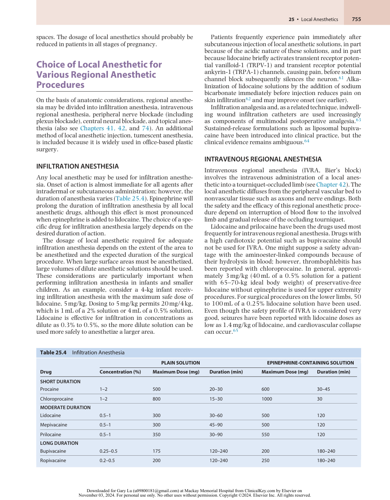

:::

<!-- PDF page 15 -->

### PERIPHERAL AND TRUNCAL NERVE BLOCKADE

Regional anesthetic procedures that inhibit conduction in fibers of the peripheral nervous system can be classified together under the general category of peripheral nerve blockade (see also Chapter 42). This form of regional anesthesia has been arbitrarily subdivided into minor and major nerve blocks. Minor nerve blocks are defined as procedures involving single nerve entities such as the ulnar or radial nerve, whereas major nerve blocks involve the blockade of two or more distinct nerves or a nerve plexus or the blockade of very large nerves at more proximal sites (i.e., the femoral and sciatic nerves).

Most local anesthetic drugs can be used for minor nerve blocks. The onset of blockade is rapid with most drugs, and the choice of drug is determined primarily by the required duration of anesthesia. A classification of the various drugs according to their duration of action is shown in Table 25.5. It has become possible to define the minimum local anesthetic volume for ultrasound- guided peripheral nerve blockade and across several nerves, the volume was approximately 0.1–0.15 mL per mm2 of nerve crosssectional area.40,41,66 However, as mentioned above, minimal volume to achieve sensory blockade 30 minutes after block may also mean decreased duration of the block as compared to “traditional” high volumes clinicians were accustomed to using during stimulator- guided regional anesthesia.

Brachial plexus blockade for upper limb surgery is the most common major peripheral nerve block technique, but many lower extremity procedures are now carried out under peripheral nerve blocks for anesthesia or postoperative analgesia. A significant difference exists between the onset times of various agents when these blocks are used (Table 25.6). In general, agents of intermediate potency exhibit a more rapid onset than the more potent compounds do.

Next to surgeries on the upper and lower extremities, peripheral nerve blocks have become popular for treating pain after thoracic and abdominal procedures. In the case of superficial thoracic surgery such as breast surgery, field blocks such as the PECS- 1 and PECS- 2 and serratus plane block have been described. Proximal intercostal nerve blocks and paravertebral blocks are also used for mastectomies and reconstructions by some institutions, but more research is needed to define efficacy, precise indications, and procedure- specific details of technique.67 Paravertebral blocks are non- inferior to epidural analgesia in treating pain after video- assisted thoracoscopic surgery (VATS) and thoracotomy while having fewer side effects.68

### PERINEURAL AND PLEXUS INFUSIONS

Local anesthetics can be administered by continuous infusion for several days after surgery69,70 or for periods of weeks to months for the treatment of chronic malignant and

**Table 25.5** Minor Nerve Blocks

|||||**AVERAGE D**|**URATION (MIN)**|
|---|---|---|---|---|---|
|**Drug**|**Usual Concentration** **(%)**|**Usual Volume (mL)**|**Dose* (mg)**|**Plain Solutions**|**Epinephrine-** **Containing Solutions**|
|Procaine|2|5–20|100–400|15–30|30–60|
|Chloroprocaine|2|5–20|100–400|15–30|30–60|
|Lidocaine|1|5–20|50–200|60–120|120–180|
|Mepivacaine|1|5–20|50–200|60–120|120–180|
|Prilocaine|1|5–20|50–200|60–120|120–180|
|Bupivacaine|0.25–0.5|5–20|12.5–100|180–360|240–420|
|Ropivacaine|0.2–0.5|5–20|10–100|180–360|240–420|

*Doses are for a 70- kg adult. For pediatric doses, see Chapter 74.

**Table 25.6** Major Nerve Blocks

|**Drug**|**Usual Concentration** **(%)**|**Usual Volume (mL)**|**Maximum Dose** **(mg) Without/With** **Epinephrine**|**Onset (min)**|**Duration (min)**|
|---|---|---|---|---|---|
|Lidocaine|1–2|30–50|350/500|10–20|120–240|
|Mepivacaine|1–1.5|30–50|350/500|10–20|180–300|
|Prilocaine|1–2|30–50|400/600|10–20|180–300|
|Bupivacaine|0.25–0.5|30–50|175/225|20–30|360–720|
|Levobupivacaine|0.25–0.5|30–50|200/225|20–30|360–720|
|Ropivacaine|0.2–0.5|30–50|200/250|20–30|360–720|

See also Chapter 74. Doses are for a 70- kg adult receiving epinephrine- containing solutions. Doses should be reduced for children, for patients with specific risk factors, and for blocks in specific locations (e.g., interscalene). When two or more blocks are performed together, the sum of the doses for each of the individual blocks should not exceed the max dose listed here.

::: details 原始表格與符號（PDF 第 15 頁）

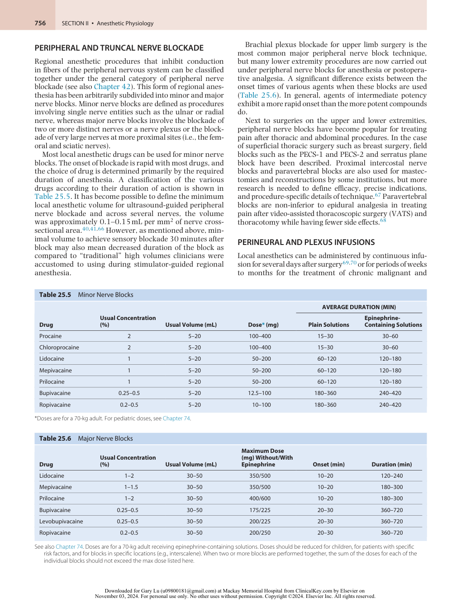

:::

<!-- PDF page 16 -->

**Table 25.7** Epidural Anesthesia

|**Drug with** **Epinephrine** **(1:200,000)**|**Usual Concentration** **(%)**|**Usual Volume (mL)**|**Maximum Dose** **(mg) without/with** **Epinephrine**|**Usual Onset (min)**|**Usual Duration (min)**|
|---|---|---|---|---|---|
|Chloroprocaine|2–3|15–30|700/900|5–15|30–90|
|Lidocaine|1–2|15–30|350/500|5–15||
|Mepivacaine|1–2|15–30|350/500|5–15|60–180|
|Prilocaine|1–3|15–30|350/500|5–15||
|Bupivacaine|0.25–0.5|15–30|175/225|15–20|180–350|
|Levobupivacaine|0.25–0.75|15–30|200/250|15–20|180–350|
|Ropivacaine|0.2–0.75|15–30|200/250|15–20|180–350|

See also Chapter 41. Doses are for a 70- kg adult receiving epinephrine- containing solutions. Doses should be reduced for children, for patients with specific risk factors, and for specific catheter tip locations (e.g., upper thoracic).

nonmalignant pain (see also Chapter 47). However, due to the poor sensory selectivity of contemporary local anesthetics, prolonged use of catheters at times conflicts with the paradigm of fast mobilization, especially as neuraxial and lower extremity techniques are concerned. With prolonged infusions, there is a theoretical potential for delayed systemic accumulation and toxicity. However, the activation of the acute-phase response after trauma or surgery also leads to an increase in α1- acidic glycoprotein, which is potent at binding free local anesthetics and decreases the risk of cumulation of free local anesthetic.71

### CENTRAL NEURAL BLOCKADE

Any of the local anesthetic drugs may be used for epidural anesthesia (Table 25.7), although procaine and tetracaine are rarely used because of their long onset times (also see Chapter 41). Drugs of intermediate potency produce surgical anesthesia of 1 to 2 hours’ duration, whereas long- acting drugs usually produce 3 to 4 hours of anesthesia. The duration of short- and intermediate- acting drugs is significantly prolonged by the addition of epinephrine (1:200,000), but the duration of long- acting drugs is only minimally affected by epinephrine. The onset of lumbar epidural anesthesia occurs within 5 to 15 minutes after the administration of chloroprocaine, lidocaine, mepivacaine, and prilocaine. Bupivacaine has a slower onset of action.

Bupivacaine epidural bolus doses at a concentration of 0.125% produce adequate postoperative analgesia in many clinical settings with only mild motor deficits.72 Continuous epidural infusions of bupivacaine as dilute as 0.0625% to 0.1% are useful for labor epidural analgesia, especially when administered in combination with opioids and epinephrine. Bupivacaine 0.25% may be used for more intense analgesia (particularly during combined epidural–general anesthesia cases) with moderate degrees of motor block, but clinicians continue to observe high interindividual variability regarding sensitivity to motor block by local anesthetics. Bupivacaine at concentrations of 0.5% to 0.75% is associated with a more profound degree of motor block, and surgical anesthesia. It should be emphasized that although higher concentrations of local anesthetics may be appropriate for episodic bolus dosing for surgery, these concentrations (i.e., 0.25% for bupivacaine) should not be first choice

for continuous epidural infusions. In some patients, increasing the local anesthetic dose or addition of adjuvants such as epinephrine and lipophilic opioids is necessary to achieve adequate block intensity. Bolus injections produce much more cephalocaudad spread than continuous infusions do. When concentrated bupivacaine solutions are used for infusions, they have the potential for excessive local effect with an associated risk for unwanted and very prolonged motor blockade.

Drugs available for subarachnoid administration are shown in Table 25.8. Bupivacaine is widely used as a spinal anesthetic, either as a hyperbaric solution at a concentration of 0.75% with 8.25% dextrose or by using the nearly isobaric (though slightly hypobaric) solution. Intrathecal bupivacaine possesses an anesthetic profile similar to that of tetracaine.73 The addition of vasoconstrictors may prolong the duration of spinal anesthesia; early studies used addition of 0.2 to 0.3 mg of epinephrine to lidocaine, tetracaine, or bupivacaine to achieve up to a 50% increase in block duration,74 but these high concentrations are not used in neuraxial practice today. The addition of epinephrine to bupivacaine or lidocaine may be more effective in prolonging the duration of spinal anesthesia in lumbosacral segments than in thoracic segments.

### TOPICAL ANESTHESIA

Several local anesthetic formulations are available for topical anesthesia (Table 25.9), lidocaine, dibucaine, tetracaine, and benzocaine being the drugs used most. In general, these preparations provide effective but relatively short durations of analgesia when applied to mucous membranes or abraded skin. Their efficacy is determined by drug form, melting point, concentration, and skin permeability.75 Lidocaine and tetracaine sprays are commonly used for endotracheal anesthesia before intubation or for mucosal analgesia for bronchoscopy or esophagoscopy.

A variety of topical local anesthetic formulations have been developed to penetrate intact skin. EMLA, which is a eutectic mixture of 2.5% lidocaine base and 2.5% prilocaine base, is widely used for venipuncture, intravenous cannulation, skin grafting, and a range of other uses, including circumcision.76 This preparation must be applied under an occlusive bandage for 45 to 60 minutes to obtain effective

::: details 原始表格與符號（PDF 第 16 頁）

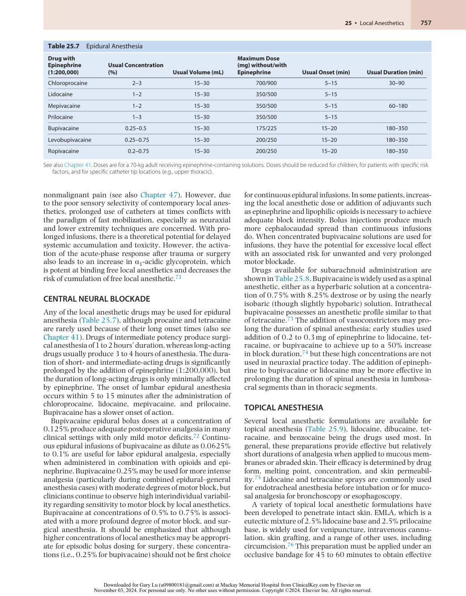

:::

<!-- PDF page 17 -->

**Table 25.8** Spinal Anesthesia

|**Drug**|**Usual Concentra** **(%)**|**tion** **Usual Volume (mL)**|**Total Dose (mg)**|**Baricity**|**Glucose** **Concentration (%)**|**Usual Duration** **(min)**|
|---|---|---|---|---|---|---|
|Procaine|10.0|1–2|100–200|Hyperbaric|5.0|30–60|
|Lidocaine|1.5, 5.0|1–2|30–100|Hyperbaric|7.5|30–90|
|Mepivacaine|4.0|1–2|40–80|Hyperbaric|9.0|30–90|
|Tetracaine|0.25–1.0|1–4|5–20|Hyperbaric|5.0|90–200|
||0.25|2–6|5–20|Hypobaric||90–200|
||1.0|1–2|5–20|Isobaric||90–200|
|Dibucaine|0.25|1–2|2.5–5.0|Hyperbaric|5.0|90–200|
||0.5|1–2|5–10|Isobaric||90–200|
||0.06|5–20|3–12|Hypobaric||90–200|
|Bupivacaine|0.5|3–4|15–20|Isobaric|8.25|90–200|
||0.75|2–3|15–20|Hyperbaric||90–200|
|Levobupivacaine|0.5|3–4|15–20|Isobaric||90–200|
||0.75|2–3|15–20|Hyperbaric||90–200|
|Ropivacaine|0.5|3–4|15–20|Isobaric||90–200|
||0.75|2–3|15–20|Hyperbaric||90–200|

Doses are for a 70- kg adult. Dosing may be reduced during pregnancy and with advancing age. Pediatric dosing is detailed in Chapter 74.

**Table 25.9** Various Preparations Intended for Topical Anesthesia

|**Anesthetic Ingredient**|**Concentration (%)**|**Pharmaceutical Application Form**|**Intended Area of Use**|
|---|---|---|---|
|Benzocaine|1–5|Cream|Skin and mucous membrane|
||20|Ointment|Skin and mucous membrane|
||20|Aerosol|Skin and mucous membrane|
|Cocaine|4|Solution|Ear, nose, throat|
|Dibucaine|0.25–1|Cream|Skin|
||0.25–1|Ointment|Skin|
||0.25–1|Aerosol|Skin|
||0.25|Solution|Ear|
||2.5|Suppositories|Rectum|
|Cyclomine|0.5–1|Solution|Skin, oropharynx, tracheobronchial tree, urethra, rectum|
|Lidocaine|2–4|Solution|Oropharynx, tracheobronchial tree, nose|
||2|Jelly|Urethra|
||2.5–5|Ointment|Skin, mucous membrane, rectum|
||2|Viscous|Oropharynx|
||10|Suppositories|Rectum|
||10|Aerosol|Gingival mucosa|
|Tetracaine|0.5–1|Ointment|Skin, rectum, mucous membrane|
||0.5–1|Cream|Skin, rectum, mucous membrane|
||0.25–1|Solution|Nose, tracheobronchial tree|
|EMLA|Lidocaine, 2.5 Prilocaine, 2.5|Cream|Intact skin|
|TAC|Tetracaine, 0.5 Epinephrine, 1:200,000 Cocaine, 11.8|Solution|Cut skin|
|LET|Lidocaine, 4% Epinephrine, 1:20,000 Tetracaine, 0.5%|Solution|Cut skin|

_EMLA,_ eutectic mixture of lidocaine and prilocaine; _LET,_ lidocaine–epinephrine–tetracaine; _TAC,_ tetracaine–epinephrine–cocaine. From Covino B, Vassallo H. _Local Anesthetics: Mechanisms of Action and Clinical Use_ . Orlando, FL: Grune and Stratton; 1976.

cutaneous anesthesia; longer application times increase the depth and reliability of skin analgesia. EMLA appears to be quite safe in neonates, and methemoglobinemia with the use of prilocaine is exceedingly uncommon. EMLA is

more effective for newborn circumcision than placebo is but less effective than dorsal penile nerve block.76,77 Several alternative topical local anesthetic formulations also are in use, including tetracaine gel78 and liposomal lidocaine.79

::: details 原始表格與符號（PDF 第 17 頁）

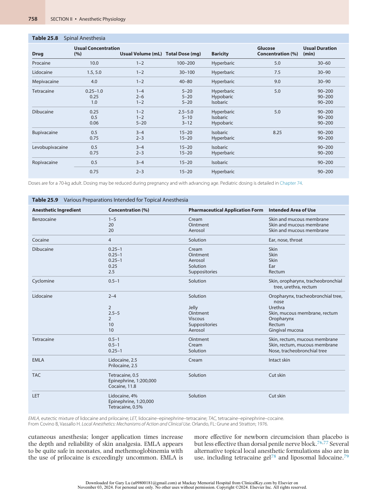

:::

<!-- PDF page 18 -->

Physical methods to accelerate local anesthetic transit across skin, including iontophoresis, local heating, electroporation, and a variety of forms of needle- less pressure injection, may lead to more rapid onset of cutaneous analgesia.80 Synera (originally studied as S- Caine) is a formulation of lidocaine and tetracaine that was developed with a heating element (activated by opening the package to initiate an oxygen- dependent exothermic reaction). This formulation has a rapid onset and evokes vasodilatation.81

Topical anesthesia through cut skin is commonly used in pediatric emergency departments for liquid application into lacerations that require suturing. Historically, this had been provided by a mixture of tetracaine, epinephrine (adrenaline), and cocaine, known as TAC. TAC is ineffective through intact skin; in contrast, its rapid absorption from mucosal surfaces can lead to toxic, even fatal reactions. Another potential substance is ELA- max, a liposomal formulation of lidocaine which is useful for cuts or abrasions.82 Lastly, lidoderm patches have been in use for the topical treatment of, for example, postherpetic neuralgia.83

Because of concerns regarding cocaine toxicity and the potential for diversion and abuse, cocaine- free topical preparations are strongly recommended, and alternatives such as the combination of an α1- adrenergic agonist (oxymetazoline or phenylephrine) and a local anesthetic such as 2% to 4% lidocaine should be used, with more dilute solutions being recommended for infants and children (see Chapter 72).

### TUMESCENT ANESTHESIA

A technique of local anesthesia most commonly used by plastic surgeons during liposuction procedures involves the subcutaneous injection of large volumes of dilute local anesthetic in combination with epinephrine and other agents. Depending on the procedure, total doses of lidocaine up to 45 mg/kg have been reported to produce safe plasma concentrations around or below 5 µg/mL, but notably, these may only peak up to 20 hours after infusion, depending on the site of infiltration.84 Despite these seemingly huge doses, very good safety outcomes have been reported in several case series.85 Conversely, there have been several case series of cardiac arrest and death during plastic surgical procedures in patients with multiple risk factors. Here high local anesthetic concentrations and concomitant use of sedatives may have contributed to the patients’ instability and deterioration.86 Factors governing uptake and clearance from this method of local anesthetic delivery deserve further study.

### SYSTEMIC LOCAL ANESTHETICS FOR POSTOPERATIVE PAIN AND NEUROPATHIC PAIN

Systemic lidocaine has been extensively investigated over the past 10 years for its potential to inhibit G protein- coupled receptors, especially those of the Gαq11 subfamily. Systemic local anesthetics have a strong anti- inflammatory effect,87 but questions remain about the correct indication, with one Cochrane meta- analysis suggesting that a significant clinical effect could only be observed in visceral surgery,88 whereas the most recent meta- analysis indicated that the clinical effect was smaller than previously assumed.89

A broad variety of local anesthetics, antiarrhythmics, anticonvulsants, and other Na+ channel blockers are administered intravenously, orally, or both to relieve a number of forms of chronic neuropathic pain (see Chapter 47).90 Clinical results are variable.91 Although successful responses from intravenous lidocaine are often taken as a positive indication to initiate treatment with oral mexiletine, some patients find mexiletine difficult to tolerate. When the signs of neuropathic pain are reversed by lidocaine infusion, normal nociception and other sensory modalities are unaffected, suggesting that the neurophysiologic correlate of the disease has an unusually high susceptibility to these drugs, present in plasma at concentrations 50 to 100 times lower than that required to block normal impulses in peripheral fibers. Laboratory studies suggest that ectopic impulse activity arising at a site of injury or elsewhere, such as the dorsal root ganglion, contributes to the neuropathic pain and that such impulses are particularly sensitive to use- dependent Na+ channel blockers. It is noteworthy that relief of preexisting neuropathic pain, both clinically and in animal models,92 can in some cases persist for days, weeks, or months after a single intravenous infusion of drug (e.g., lidocaine), far beyond the lifetime of the drug _in vivo_ or any nerve block that it might affect. The mechanism of this remarkable action remains a mystery. Intuitively, this should be especially true for hereditary syndromes featuring gain- of- function mutations at the sodium channel, such as primary erythromelalgia. Indeed, recent clinical experience and translational experiments have confirmed that mexiletine has the potential to normalize sodium currents in one specific mutation associated with erythromelalgia.93

## Pharmacokinetics

The concentration of local anesthetics in blood is determined by the amount injected, the rate of absorption from the site of injection, the rate of tissue distribution, and the rate of biotransformation and excretion of the specific drug.94,95 Patient- related factors such as age, cardiovascular status, and hepatic function influence the physiologic disposition and resultant blood concentration of local anesthetics.

### ABSORPTION

The systemic absorption of local anesthetics is determined by the site of injection, dosage and volume, addition of a vasoconstrictor agent, and the pharmacologic profile of the agent itself.94,95 Comparison of the blood concentration of local anesthetics after various routes of administration reveals that the anesthetic drug level is highest after intercostal nerve blockade, followed in order of decreasing concentration by injection into the caudal epidural space, lumbar epidural space, brachial plexus, and subcutaneous tissue. When a local anesthetic solution is exposed to an area of greater vascularity, a greater rate and degree of absorption occur. This relationship is of clinical significance because use of a fixed dose of a local anesthetic agent may be potentially toxic in one area of administration but not in others, and in one patient with specific physiology, but not in others. For example, the use of 400 mg of lidocaine without epinephrine for an intercostal nerve block

<!-- PDF page 19 -->

results in an average peak venous plasma level of approximately 7 µg/mL, which is sufficiently high to cause symptoms of central nervous system (CNS) toxicity in some patients. By comparison, this same dose of lidocaine used for a brachial plexus block yields a mean maximum blood level of approximately 3 µg/mL, which is rarely associated with signs of toxicity.

The maximum blood concentration of local anesthetic drugs is related to the total dose of drug administered for any particular site of administration. For most drugs there is a proportionality between the amount of drug administered and the resultant peak anesthetic blood concentration. Epinephrine decreases the rate of vascular absorption of certain agents from various sites of administration and thus lowers their potential systemic toxicity. A 5- µg/mL concentration of epinephrine (1:200,000) significantly reduces the peak blood levels of lidocaine and mepivacaine irrespective of the site of administration. Resorption of local anesthetics follows a biphasic pattern, with an initial fast peak reflecting the fluid phase and later a slower second peak corresponding to resorption from the lipid compartment.96 The addition of epinephrine to local anesthetic solutions slows the first phase.97 The net clinical effect is a more profound block, and lower systemic levels.98

### DISTRIBUTION

The systemic distribution of local anesthetics in many settings can be described sufficiently by a two- compartment model.99 The rapid disappearance phase is believed to be related to uptake by rapidly equilibrating tissues (i.e., tissues that have high vascular perfusion). The slower phase of disappearance from blood is mainly a function of the particular compound.94 Local anesthetic drugs are distributed throughout all body tissues, but the relative concentration in different tissues varies. In general, more highly perfused organs show higher concentrations of local anesthetic drug than less well- perfused organs do. The primary extraction takes place in the liver, but local anesthetics are also rapidly extracted by lung tissue.100,101

### BIOTRANSFORMATION AND EXCRETION

The pattern of metabolism of local anesthetic agents varies according to their chemical classification. The esters, or procaine- like, drugs, undergo hydrolysis in plasma by the pseudocholinesterase enzymes; clearance of chloroprocaine is especially rapid.102,103 The aminoamide drugs undergo enzymatic degradation primarily in the liver. Lidocaine is metabolized somewhat more rapidly than mepivacaine, which in turn is more rapidly metabolized than bupivacaine.77,104,105 Excretion of the metabolites of amide- type local anesthetics occurs via the kidney. Less than 5% of the unchanged drug is excreted via the kidney into urine.

### PHARMACOKINETIC ALTERATIONS BY PATIENT STATUS

Patient age may influence the physiologic disposition of local anesthetics. The half- life of lidocaine after intravenous administration averaged 80 minutes in human volunteers varying in age from 22 to 26 years, whereas volunteers 61

to 71 years of age demonstrated a significantly prolonged lidocaine half- life that averaged 138 minutes.106

Newborn infants have immature hepatic enzyme systems and hence prolonged elimination of lidocaine, bupivacaine, and ropivacaine.107 Bupivacaine, for example, has a terminal elimination half- life in adults that averages around 3.5 hours. In neonates and some younger infants, terminal elimination half- lives may be as long as 8 to 12 hours. Prolonged elimination is particularly an issue for continuous infusions of local anesthetics in infants, and seizures have been associated with high bupivacaine infusion rates.108 Based on analysis of these cases, a maximum infusion rate of 0.4 mg/kg/h for prolonged epidural bupivacaine infusions has been proposed for children and adults, whereas prolonged infusion rates for neonates and young infants should not exceed 0.2 mg/kg/h.109 Even at 0.2 mg/kg/h, plasma bupivacaine concentrations were found to be rising toward a toxic range in some younger infants after 48 hours.110 Similarly, prolonged lidocaine infusions in neonates should not exceed 0.8 mg/kg/h. The potential for toxicity with lidocaine infusions in neonates is also increased by the accumulation of its principal metabolite, monoethylglycinexylidide (MEGX), which can cause seizures. Chloroprocaine may offer unique advantages for epidural infusion in neonates in that it is rapidly cleared from plasma, even in preterm neonates.111

Decreased hepatic blood flow or impaired hepatic enzyme function can produce a substantial elevation of blood levels of the aminoamide local anesthetics. An average lidocaine half- life of 1.5 hours was reported in volunteers with normal hepatic function, whereas patients with liver disease demonstrated an average half- life of 5.0 hours. The rate of disappearance of lidocaine from blood has also been shown to be markedly prolonged in patients with congestive heart failure.112

In some patients, CNS depression is seen without a preceding excitatory phase, particularly if other CNS depressant drugs had been administered.

## Toxicity

Local anesthetic drugs are relatively safe if administered in an appropriate dosage and in the correct anatomic location. However, systemic and localized toxic reactions can occur, usually as a result of accidental intravascular or intrathecal injection or administration of an excessive dose. In addition, specific adverse effects are associated with the use of certain drugs, such as allergic reactions to the aminoester drugs and methemoglobinemia after the use of prilocaine.

### SYSTEMIC TOXICITY

Systemic reactions to local anesthetics primarily involve the CNS and the cardiovascular system (also see Chapter 51). In general, the CNS is more susceptible to the actions of systemic local anesthetics than the cardiovascular system is, and thus the dose or blood level of local anesthetic required to produce CNS toxicity is usually lower than that resulting in circulatory collapse. However, a review of 93 cases showed that the symptoms encountered initially vary widely; and only 60% of patients actually exhibit the classic

<!-- PDF page 20 -->

sequence of toxic events from minor central nervous system symptoms (e.g., perioral tingling, metallic taste, tinnitus), followed by major central nervous system symptoms (seizures) and cardiovascular collapse.113 Overall, the incidence of systemic toxicity following regional block is estimated at 1:1,000 for nerve stimulator- guided blockade, and 1:1,600 for ultrasound- guided regional anesthesia.114

### Central Nervous System Toxicity

The initial symptoms of local anesthetic- induced CNS toxicity are feelings of lightheadedness and dizziness followed frequently by visual and auditory disturbances such as difficulty focusing and tinnitus. Other subjective CNS symptoms include disorientation and occasional feelings of drowsiness. Objective signs of initial CNS toxicity are usually excitatory in nature and include shivering, muscular twitching, and tremors initially involving muscles of the face and distal parts of the extremities. Ultimately, generalized convulsions of a tonic–clonic nature occur. If a sufficiently large dose or rapid intravenous injection of a local anesthetic is administered, the initial signs of CNS excitation are rapidly followed by a state of generalized CNS depression. Seizure activity ceases, and respiratory depression and ultimately respiratory arrest may occur. CNS excitation may be the result of an initial blockade of inhibitory pathways in the cerebral cortex by local anesthetic drugs but may also, in part, result from the complex interactions of local anesthetics with pathways involving the excitatory amino acid neurotransmitter glutamate.115 Blockade of inhibitory pathways allows facilitatory neurons to function in an unopposed fashion, which results in an increase in excitatory activity leading to convulsions. A further increase in the dose of local anesthetic leads to inhibition of activity of both the inhibitory and facilitatory circuits, which results in a generalized state of CNS depression.

In general, a correlation exists between potency of the local anesthetic and intravenous CNS toxicity.116 Convulsions caused by an inadvertent intravenous bolus of local anesthetic can generally be terminated by small intravenous doses of a benzodiazepine, such as midazolam, or by small intravenous doses of propofol. While propofol is fasteracting, large doses should be avoided, especially in patients with hemodynamic instability.117 Respiratory or metabolic acidosis increases the risks for CNS toxicity from local anesthetics.118 Elevated PaCO2 enhances cerebral blood flow and thus the anesthetic is delivered more rapidly to the brain. In addition, diffusion of carbon dioxide into neuronal cells decreases intracellular pH, which facilitates conversion of the base form of the drugs to the cationic form. The cationic form does not diffuse well across the nerve membrane, so ion trapping will occur, which will increase the apparent CNS toxicity of local anesthetics. Hypercapnia and acidosis also decrease the plasma protein binding of local anesthetic agents.119 Accordingly, normocapnia should be targeted during episodes of local anesthetic systemic toxicity.

The clinical implication of this effect of hypercapnia and acidosis on toxicity deserves emphasis. Seizures produce hypoventilation and a combined respiratory and metabolic acidosis, which further exacerbates the CNS toxicity. In the setting of local anesthetic toxic reactions, it is essential to provide prompt assisted ventilation and circulatory support as needed to prevent or correct hypercapnia and acidosis

and to prevent or correct hypoxemia, which also exacerbates CNS toxicity. Based on the preceding discussion, it should be apparent that clinicians performing major conduction blockade should make a routine practice of having the following ready at hand: monitoring equipment; an oxygen tank or wall oxygen outlet; rescue airway equipment; and drugs to terminate convulsions, such as midazolam, thiopental, or propofol.

### Cardiovascular System Toxicity

Local anesthetics can exert direct actions on both the heart and peripheral blood vessels, as well as indirect actions on the circulation by blockade of sympathetic or parasympathetic efferent activity.

**Direct Cardiac Effects.** The main mechanisms of local anesthetic toxicity are block of cardiac sodium channels leading to negative inotropy and arrhythmia. Local anesthetics act directly by decreasing the conduction in Purkinje fibers and cardiomyocytes by prolonging the recovery time. Other facets of local anesthetic toxicity include inhibition of fatty acid metabolism, interference with calcium homoeostasis, and disruption of the mitochondrial respiratory chain.111 The primary cardiac electrophysiologic effect of local anesthetics is a decrease in the rate of depolarization in the fast conducting tissues of Purkinje fibers and ventricular muscle.112 This reduction in rate is believed to be due to a decrease in the availability of fast sodium channels in cardiac membranes. Action potential duration and the effective refractory period are also decreased by local anesthetics. However, this effect is dose- dependent and substance- specific. Specifically, electrophysiologic studies have shown that high blood levels of local anesthetics will prolong conduction time through various parts of the heart, as indicated on the electrocardiogram (ECG) by an increase in the PR interval and duration of the QRS complex. Extremely high concentrations of local anesthetics depress spontaneous pacemaker activity in the sinus node, thereby resulting in sinus bradycardia and sinus arrest. Also, the electrophysiologic effects of various agents differ qualitatively. Bupivacaine depresses the rapid phase of depolarization ( _V_ max) in Purkinje fibers and ventricular muscle to a greater extent than lidocaine. In addition, the rate of recovery from a use- dependent block is slower in bupivacaine- treated papillary muscles than in lidocaine- treated muscles. This slow rate of recovery results in incomplete restoration of Na+ channel availability between action potentials, particularly at high heart rates. These differential effects of lidocaine and bupivacaine have been advanced as explanations of the antiarrhythmic properties of lidocaine versus the arrhythmogenic potential of bupivacaine. All local anesthetics exert dose- dependent negative inotropic action on cardiac muscle; the depression of cardiac contractility is roughly proportional to conduction blocking potency. Thus bupivacaine and tetracaine are more potent cardiodepressants than lidocaine. Local anesthetics may depress myocardial contractility by affecting calcium influx and triggered release from the sarcoplasmic reticulum,113 as well as by inhibiting cardiac sarcolemmal Ca2+ currents and Na+ currents. Lastly, mitochondrial metabolism is inhibited by bupivacaine, and, to a lesser extent, other long- acting

<!-- PDF page 21 -->

local anesthetics such as ropivacaine,114 while the effect of lidocaine is smaller.

**Direct Peripheral Vascular Effects.** Local anesthetics exert biphasic effects on peripheral vascular smooth muscle.30 Low concentrations of lidocaine and bupivacaine produced vasoconstriction in the cremaster muscle of rats, whereas high concentrations produced vasodilation in both isolated tissue models and _in vivo_ . Cocaine is the only local anesthetic that consistently causes vasoconstriction at all concentrations because of its ability to inhibit the uptake of norepinephrine by premotor neurons and thus to potentiate neurogenic vasoconstriction.

### COMPARATIVE CARDIOVASCULAR TOXICITY

All local anesthetics, but especially bupivacaine, can cause rapid and profound cardiovascular depression (see also Chapter 51). The cardiotoxicity of bupivacaine appears to differ from that of lidocaine in the following manner:

1. The ratio of the dosage required for irreversible cardiovascular collapse (CC) and the dosage that will produce CNS toxicity (convulsions) (i.e., the CC/CNS ratio) is lower for bupivacaine and etidocaine than for lidocaine.120

2. Ventricular arrhythmias and fatal ventricular fibrillation may occur more often after the rapid intravenous administration of a large dose of bupivacaine but far less frequently with lidocaine. The CNS effects of local anesthetics may contribute to the generation of arrhythmias (see Chapter 51).

3. Based on animal data, we have to assume that a pregnant patient may be more sensitive to the cardiotoxic effects of bupivacaine than a nonpregnant patient121 (see also Chapters 41 and 58).

4. Cardiac resuscitation is more difficult after bupivacaineinduced cardiovascular collapse, and acidosis and hypoxia markedly potentiate the cardiotoxicity of bupivacaine.122 Conversely, Intralipid is believed to be most effective in bupivacaine- induced toxicity. Despite the experimental or clinical anecdotal use of many different resuscitation drugs in the setting of bupivacaine overdose, current guidelines focus on standard cardiopulmonary resuscitation, albeit with titration rather than fixed doses of epinephrine, early administration of lipid emulsion, and avoidance of propofol in settings of hemodynamic instability.123 Bupivacaine- induced ventricular arrhythmias should not be treated with vasopressin, calcium channel blockers, beta blockers, or other local anesthetics with antiarrythmic potential (such as lidocaine).123

Pharmacokinetic studies have estimated that Intralipid decreases cardiac bupivacaine concentration by 11% within 3 minutes of administration, and cerebral bupivacaine content by 18% within 15 minutes.124 Even though these findings are theoretical, they underline the notion that Intralipid should not be considered an antidote with full antagonistic properties. This cautious stance is underlined by an _in vivo_ study failing to detect a significant lipid sink effect in human volunteers.125 As a counterargument, one should consider that Intralipid has a whole host of effects,126 such that the lipid sink effect may only be a part of

the overall picture. Rather, limited evidence suggests that it will considerably reduce the bupivacaine concentration in target organs, most likely improve metabolism, and potentially have direct beneficial effects at the sodium channel. Intralipid is a valuable contribution to, but not a substitute for, careful and meticulous conduct of regional anesthesia.

The clinical implications for cardiac resuscitation after intravascular injection or overdose of local anesthetic are the following:

1. No medications are uniformly effective in facilitating resuscitation from bupivacaine- induced cardiac arrest or severe ventricular tachycardia (despite our recommendations regarding Intralipid later). Basic principles of cardiopulmonary resuscitation should be emphasized first, including attention to securing the airway, providing oxygenation and ventilation, and performing chest compressions if needed.

2. Because resuscitation after local anesthetic–induced circulatory collapse is so difficult, prevention of massive intravascular injection or excessive dosing is crucial.

3. Negative aspiration of the syringe does not always exclude intravascular placement. Incremental, fractionated dosing should be the rule for all patients undergoing major conduction blockade. Although changes on the ECG are not always present before circulatory collapse, they often are, and continuous attention to the ECG (including changes in QRS and T- wave morphology, rate, rhythm, or ectopy) may be lifesaving by terminating injection before a lethal dose is administered.

4. Based on animal studies127 and a growing number of human case reports, hospitals and clinics that perform major conduction blockade or large-volume infiltration blockade should keep available for emergency use a supply of lipid emulsion such as Intralipid 20%. If a patient experiences profound cardiovascular depression or circulatory arrest after the administration of bupivacaine, ropivacaine, or by extrapolation, other local anesthetics, then along with initiation of basic life support and the Advanced Cardiac Life Support (ACLS) protocol, a rapid bolus of Intralipid 20%, 1.5 mL/kg ideal body weight (up to a dose of 100 mL in adults) is recommended, followed by an infusion of 0.25 mL/kg/min, up to a volume of 200–250 mL. Clinical assessment should guide further redosing. Infusions should be continued for 10 minutes after circulatory stability is re- established.123

### Chiral Local Anesthetics: Ropivacaine and Levobupivacaine

Commercial bupivacaine is a racemic mixture of ( _R_ )- and (S)- stereoisomers. In response to the problem of cardiovascular toxicity because of accidental intravenous injection of bupivacaine, single enantiomers were developed in the hope that they would be potentially safer local anesthetics. Ropivacaine (Naropin)128 and levo- (S)- bupivacaine (Chirocaine)129 were formulated to exploit this stereoselectivity. Ropivacaine is a single (S)- stereoisomer that differs from levobupivacaine in the substitution of a propyl for the butyl group on the piperidine ring (see Fig. 25.2). With these designed changes in molecular structure, it was hoped that ropivacaine and levobupivacaine would be less intrinsically cardiotoxic. Conversely, it appears that the (S)- enantiomers

<!-- PDF page 22 -->

of mepivacaine and bupivacaine are metabolized by the liver more slowly than the corresponding ( _R_ )- enantiomers, which would lead to somewhat greater systemic accumulation with prolonged infusions.

The very slow reversal of Na+ channel blockade after a cardiac action potential, which is a hallmark of bupivacaine, is considerably faster with ropivacaine. In addition to these electrical differences, the negative inotropic potency of ropivacaine on isolated cardiac tissue appears to be considerably less than that of bupivacaine. Both electrical and mechanical differences in the toxic profiles may arise from the selective inhibition of Ca2+ currents by bupivacaine.

Do the data support the claim of a greater therapeutic index for ropivacaine than bupivacaine, particularly regarding cardiotoxicity? In clinical studies comparing potencies of ropivacaine and bupivacaine administered for brachial plexus130 or lumbar epidural block,131 the anesthetic profiles of the drugs were almost identical. A third exemplary study comparing lumbar epidural 0.5% bupivacaine with 0.75% ropivacaine also found no significant differences in motor or sensory effects between the drugs at these different concentrations.132 Overall, it appears that ropivacaine is slightly less potent (1:1.3 to 1:1.5) than bupivacaine for regional anesthesia. In some laboratory animal studies and in some human studies, ropivacaine also produced blocks of shorter duration than those induced by bupivacaine. Other studies in animals and humans have found equal durations of sensory and motor block for the two drugs.

At the projected equipotent doses for nerve block, are the drugs equally toxic? The overall impression is that ropivacaine is less cardiotoxic than bupivacaine. Studies in animals have generally found that bupivacaine more readily produces conduction disturbances, cardiac collapse, or ventricular fibrillation than ropivacaine does and that aggressive cardiac resuscitation after an intentional intravenous bolus in dogs leads to effective reversal of the toxic effects far more frequently with ropivacaine than with bupivacaine.133

The greater safety of ropivacaine than bupivacaine may be related both to the reduced toxicity of the single (S)isomer and to the difference between the propyl- and butyl- _N_ - piperidine substituent. In contrast to bupivacaine, the cardiotoxic profile of ropivacaine in pregnant ewes is the same as the corresponding profile in nonpregnant ewes.134

Levobupivacaine has been studied in a range of clinical settings and sites of administration. Although a number of publications have compared levobupivacaine with racemic bupivacaine and ropivacaine,135,136 conclusions differ among studies regarding the relative potency and duration of block of these three drugs at different sites of administration with respect to sensory and motor end points. Clinicians should note that levobupivacaine is formulated as a weight percentage with regard to its free base content, whereas the weight percentage of most other local anesthetics is calculated on the basis of the hydrochloride salt.137

### Acidosis and Hypoxia

As with CNS toxicity, hypercapnia, acidosis, and hypoxia potentiate the negative chronotropic and inotropic actions of lidocaine and bupivacaine in isolated cardiac tissue, and the combination of hypoxia and acidosis markedly potentiates the cardiodepressant effects of bupivacaine.138 Hypoxia and acidosis also increased the frequency of

cardiac arrhythmias and the mortality rate in sheep after the intravenous administration of bupivacaine. Hypercapnia, acidosis, and hypoxia occur very rapidly in some patients after seizure activity caused by the rapid accidental intravascular injection of local anesthetic agents.139 Thus, the cardiovascular depression observed in some patients after the accidental intravenous injection of bupivacaine may be related in part to the effect of seizures producing acidosis and hypoxia and thereby leading to an exacerbation of bupivacaine’s intrinsic cardiotoxicity.

### Indirect Cardiovascular Effects

High levels of spinal or epidural blockade can produce severe hypotension. A follow- up study of closed claims of patients who suffered perioperative cardiac arrest confirmed previous reports of a series of cardiac arrests involving generally healthy patients undergoing spinal or epidural anesthesia.140 These events frequently occurred in conjunction with high dermatomal levels of blockade, liberal use of sedatives, and progression to cardiac arrest after a period of hypotension accompanied by bradycardia, often involving delays in recognition of the problem, delays in instituting airway support (particularly in sedated patients), and delays in administration of direct- acting combined α- and β- adrenergic agonists, such as epinephrine. Whereas mild to moderate degrees of hypotension generally respond well to indirect- acting sympathomimetics such as ephedrine or incremental dosing of phenylephrine, the combination of severe hypotension and severe bradycardia under spinal anesthesia should in most clinical settings be treated promptly with incremental dosing of epinephrine, initially at doses of 0.1 to 1 µg/kg, or roughly 20- to 200- fold below those used in the ACLS cardiac arrest algorithm.

### METHEMOGLOBINEMIA

A unique systemic side effect associated with a specific local anesthetic is the development of methemoglobinemia after the administration of large doses of prilocaine.141 In general, 600- mg doses are required for the development of clinically significant levels of methemoglobinemia in adults. Hepatic metabolism of prilocaine generates _O_ - toluidine, which oxidizes hemoglobin to methemoglobin. Methemoglobinemia, if severe, may be treated by the intravenous administration of methylene blue. Standard dosing of the topical local anesthetic EMLA (a mixture of lidocaine and prilocaine) in term newborns produced minimal amounts of methemoglobin, and EMLA, if dosed appropriately, should be regarded as very safe in the great majority of newborns. Risk may be increased in newborns with rare metabolic disorders or after the concomitant administration of other drugs that impair reduction of methemoglobin.

### ALLERGIES

Even though patients receiving local anesthetics may experience a range of local and systemic symptoms, prospective studies indicate that very few of these reactions are truly confirmed as allergic reactions.142,143 Aminoester drugs such as procaine may produce allergic- type reactions more commonly than the aminoamides, although even with aminoesters, the vast majority of reactions are not

<!-- PDF page 23 -->

allergic. Aminoesters, unlike aminoamides, are derivatives of _p_ - aminobenzoic acid, which is known to be allergenic. Some aminoamide solutions may contain a preservative, methylparaben, whose chemical structure is similar to that of _p_ - aminobenzoic acid, but for most aminoamides, preservative- free solutions are available.144 Contamination of vials with latex antigen has been suspected in some allergic reactions, although it has been difficult to confirm. In the very rare patient for whom confirmed allergy to both aminoamides and aminoesters precludes their use for spinal anesthesia, meperidine can be considered as an alternative.145

### LOCAL TISSUE TOXICITY

All the clinically used aminoamide and aminoester local anesthetics can produce direct toxicity to nerves if they achieve sufficiently high intraneural concentrations.146 Conversely, in the great majority of clinical applications, no damage to nerves occurs. Although local anesthetics are usually packaged and injected at concentrations well above their physiologically effective range, in the process of delivery they are generally diluted sufficiently that no harm is done. If such dilution does not occur, however, long- term or permanent neural deficits do result. Thus, the application of 5% (200 mM) lidocaine in viscous, dense solutions through narrow intrathecal catheters had been associated with a high frequency of transient or longer- term radicular symptoms or even cauda equina syndrome.147 Laboratory investigations have shown that such high concentrations of local anesthetics alone applied directly to bare nerve fibers produce an irreversible conduction block in less than 5 minutes.148 Clinicians should be aware that the concentrations of formulated local anesthetic solutions are neurotoxic _per se_ and that their “natural” dilution, which occurs _in situ_ or in tissue, is essential for safe use.

If cauda equine syndrome was considered one catastrophic end of the spectrum, the opposite side would be transient neurological syndrome, a temporary radicular irritation thought to be caused by local anesthetic application and influenced by patient positioning.149 Single- shot spinal anesthesia with commonly recommended doses and concentrations of many different local anesthetics can produce more limited and transient neurologic symptoms (back pain, paresthesias, radicular pain, or hypesthesia).150 Some studies and systematic reviews have found that mepivacaine and lidocaine at a range of dilutions cause more frequent symptoms than bupivacaine and prilocaine.151 The risk of transient neurologic symptoms after spinal anesthesia was not diminished by dilution of lidocaine from 5% to 1%–2%. Differences in study design, method of questioning, and criteria for inclusion may be partially responsible for differences in the prevalence of radicular sequelae in various studies. Despite these differences in study design, a metaanalysis concluded that the pooled relative risk for transient neurologic symptoms after spinal anesthesia with lidocaine was 6.7- fold higher than with bupivacaine and 5.5- fold higher than with prilocaine.151 The addition of vasoconstrictors to local anesthetic solutions has been reported to potentially increase risk,152 but within the limits of current dosing, neuraxial administration of vasoconstrictors as an adjuvant seems to be safe.153 Neurotoxicity appears to be

unrelated to conduction block _per se_ , because saxitoxin, neosaxitoxin, and tetrodotoxin, highly potent blockers of sodium channels, can produce intense conduction blockade without histologic or behavioral signs of nerve injury.154

Skeletal muscle changes have been observed after the injection of local anesthetic agents such as lidocaine, mepivacaine, prilocaine, bupivacaine, and etidocaine.155 In general, the more potent, longer- acting agents bupivacaine and etidocaine appear to cause more localized skeletal muscle damage than the less potent, shorter- acting agents lidocaine and prilocaine. This effect on skeletal muscle, to the best of our current knowledge, is reversible due to the regenerative potential of skeletal muscle and the comparatively small area of the muscle affected, which is why it is often clinically inapparent.

## Development of ProlongedDuration and Sensory- or Nociceptive- Selective Local Anesthetics

Several methods for producing long- duration nerve blockade are under investigation. First, there have been efforts to use readily available drugs such as tricyclic antidepressants156,157 or quaternary local anesthetic derivatives as novel local anesthetics,158 but these efforts have consistently been hampered by concerns over neurotoxicity.

### SLOW- RELEASE FORMULATIONS

Liposomal encapsulation can prolong nerve blockade, depending on the dose and the physical properties of the liposome (surface charge, size, lamellar structure).159–161 This mode of action has been investigated for decades but the clinical introduction has only been recent. Liposomal bupivacaine (Exparel® ) has been licensed for infiltration analgesia162 but its dose- response for blockade of peripheral nerves is less clear.163 A recent study showed potential benefits when combining Exparel with bupivacaine for interscalene block,164 and the Food and Drug Administration has moved to expand Exparel® licensing to select nerve block indications. Despite strong basic science data, the clinical benefit of these formulations, especially for nerve blockade, and when compared to plain long- acting local anesthetics, is not as convincing as one would hope. Recent systematic reviews have questioned whether liposomal bupivacaine is as superior to plain bupivacaine both for infiltration and nerve blockade,64,165 as early studies had suggested. Other modes of slow release are embedding in bone wax, polylactic acid, polyglycolic acid, fatty- acid- based biodegradable polymers, and proliposomal formulations,9 as well as different on- demand release formulations.

### SITE 1 BLOCKERS

Prolonged- duration local anesthesia also appears to be feasible with the use of site 1 sodium channel blockers.166 The site 1 blocker neosaxitoxin has been used in humans in phase 1 and phase 2 clinical trials.167,168 A combination of site 1 toxins with either local anesthetics or adrenergics

<!-- PDF page 24 -->

results in prolongation of blockade and improvement in the therapeutic index.169 Theoretically attractive features of site 1 toxins include their apparent lack of local tissue toxicity on nerves154 or muscles170 and their minimal cardiotoxicity.171

### TARGETING OF SPECIFIC SODIUM CHANNEL ISOFORMS

Coming back to the nine different subtypes of sodium channels, research efforts have been directed at blocking specific isoforms thought to be of particular relevance for defined pain conditions. The Nav1.7 subtype, for example, has been linked to somatic pain, and to hereditary syndromes of hyperalgesia172 or insensitivity to pain.173 A monoclonal antibody has been described which is 1000 times more potent at blocking sodium currents through Nav1.7 than those of other isoforms.174 Importantly, animal models of visceral pain suggest a substantial role of Nav1.9 in these syndromes.27

### TARGETING OF NOCICEPTIVE FIBERS

High hopes had been raised by reports of sensory- selective blockade of peripheral nerves when a quaternary derivative of lidocaine was targeted into nociceptors using activation of TRPV- 1 channels by lidocaine or capsaicin. TRPV channels are preferentially located in small sensory fibers.175 After several promising studies, concerns over neurotoxicity158 prevented this combination from entering clinical practice. Yet the concept of targeting specific variants of local anesthetic drugs into specific fibers has been confirmed, and if a combination of drugs is found which can provide these effects with decreased neurotoxicity, the strategy as such may hold promise. Whether any quaternary derivatives of local anesthetics have less neurotoxicity than their parent compounds remains unanswered.

To summarize, several avenues of research may lead to new local anesthetics or new modes of application, but only liposomal bupivacaine has been introduced into clinical practice. Potentially, these new strategies may move us closer to the holy grail of regional anesthesia, to have a tailored surgical block followed by prolonged periods of reliable sensory (or even nociceptive) block without impairment in motor function.

## Biologic Mechanisms of Local Anesthetic Failure: Inflammation, Hyperalgesia, Tachyphylaxis, and Genetic Variants

Failure of local anesthesia is commonly ascribed to technical failure of delivery, insufficient volume or concentration of drug, or erroneous clinical decisions in selection of techniques. However, there are several clinical situations in which biologic processes contribute to failed local anesthesia, even with proper technique and drug selection.

For example, in patients seen by a dentist with infections such as a tooth abscess or severe pulpitis, failure rates of standard doses of local anesthetic have been reported to be

as high as 70%. Local anesthetic failure at a site of inflammation appears to reflect a combination of pharmacokinetic factors and pharmacodynamic factors. Pharmacokinetic factors include: (1) increased local blood flow leading to accelerated removal of drug from perineural injection compartments; (2) local tissue acidosis leading to a greater proportion of the drug in the hydrochloride form, which diffuses more poorly across biologic membranes; and (3) local tissue edema, which increases diffusion distances for drug into nerves. Pharmacodynamic factors include the effects of inflammation on both peripheral sensitization of nerves and central sensitization.176,177 It is noteworthy that in the setting of an infected mandibular tooth, inferior alveolar nerve block (performed proximally at a site presumably remote from the infected area) also has an unexpectedly high failure rate. Increasing the concentration of local anesthetic can still result in satisfactory, albeit shorter, blockade. In clinical practice, these patients require a higher local anesthetic dose to achieve sufficient analgesia. Inflamed tissue is more difficult, but not impossible to anesthetize.178,179

Apparent reductions in the effectiveness of local anesthetic infusions over time, tachyphylaxis, may be due to several causes unrelated to tolerance _per se_ , including dislodgement of catheters and changes in the dermatomal origin or intensity of nociceptive input. In obstetric patients receiving epidural bolus injections, recurrence of pain before the next injection resulted in a reduction in the intensity and duration of blockade, whereas repeat injection before the return of pain prevented this rapidly occurring form of tolerance, or tachyphylaxis.180 In postoperative patients, coadministration of systemic opioids prevented regression of segmental block in patients receiving thoracic epidural bupivacaine infusions.181 Studies in rats suggest that both pharmacokinetic and pharmacodynamic mechanisms are involved. In a rat model, tachyphylaxis was linked to the development of hyperalgesia,182 and drugs that inhibit hyperalgesia, including _N_ -methyl-d-aspartate receptor antagonists and nitric oxide synthase inhibitors,183 also prevented tachyphylaxis. Conversely, repeated sciatic injections of lidocaine resulted in reduced intraneural lidocaine content along with reduced duration of block.184 The exact mechanism, however, has not been determined, and the clinical relevance with continuous use of long- acting local anesthetics is unclear.185

Occasional patients report that “local anesthetics don’t work for me.” Although this claim may reflect previous technical failures or a variety of other processes and patientor procedure- specific factors, it is possible that in some cases these failures may involve genetic or acquired variation in local anesthetic responsiveness. Several mutations in the transmembrane segment IIIS6 of the rat brain α subunit have been shown to decrease the affinity between sodium channels and local anesthetics and anticonvulsants186 and similar investigations have also been carried out in sodium channel subtypes Nav1.7187 or Nav1.5.188 Of note, different mutations at specific points in the local anesthetic binding site led to differential response of these channels to sodium channel blockers, suggesting that the binding of local anesthetics to the “receptor” is a more dynamic, fluid, and structure- dependent process than commonly assumed. This is supported by a clinical study which showed that some percent of persons reporting inefficient regional anesthesia

<!-- PDF page 25 -->

really did demonstrate partial resistance when tested in standardized manner, and some patients had selective resistance against specific local anesthetics.168 While Clendenen and colleagues published the genetic workup of a family with inherited local anesthetic resistance,188 there are preliminary hints that local anesthetic resistance may also be acquired. Interesting case reports suggest that repeated exposure to scorpion bites can elicit acquired resistance to local anesthetics.189 Elements of scorpion toxin are known to interact with sodium channels, albeit at other sites (site 3 and 4) than local anesthetics (which bind to site 9),190 and therefore, the sustained modulation of sodium channel function by toxins is yet another fascinating potential facet of sodium channel and local anesthetic pharmacology.

Local anesthetics have been a central pillar in perioperative management of patients for more than a century, and continued research will assure that we know as much as possible about these drugs, and how we can use them as optimally as possible for the benefit of the patients whose care has been entrusted to us.

43.  Kirksey MA, et al. _PLoS One_ . 2015;10:e0137312.

44.  Eisenach JC, et al. _Anesth Analg_ . 1987;66:447.

45.  Popping DM, et al. _Anesthesiology_ . 2009;111:406.

46.  Kroin JS, et al. _Anesthesiology_ . 2004;101:488.

47.  Ping Y, et al. _Medicine (Baltim)_ . 2017;96:e5846.

48.  Brummett CM, et al. _Anesthesiology_ . 2011;115:836.

49.  Kosel J, et al. _Expert Rev Clin Pharmacol_ . 2016;9:375.

50.  Choi S, et al. _Br J Anaesth_ . 2014;112:427.

51.  Baeriswyl M, et al. _Br J Anaesth_ . 2017;119:183.

52.  Chong MA, et al. _Reg Anesth Pain Med_ . 2017;42:319.

53.  Marhofer P, et al. _Br J Anaesth_ . 2019;122:525.

54.  Klein SM, et al. _Anesth Analg_ . 1998;87:1316.

55.  Wong K, et al. _Anesth Analg_ . 1993;76:131.

56.  DiFazio CA, et al. _Anesth Analg_ . 1986;65:760.

57.  Cohen SE, et al. _Anesthesiology_ . 1979;51:288.

58.  Kytta J, et al. _Reg Anesth_ . 1991;16:89.

59.  Popitz- Bergez FA, et al. _Reg Anesth_ . 1997;22:363.

60.  Fagraeus L, et al. _Anesthesiology_ . 1983;58:184.

61.  Leffler A, et al. _J Clin Invest_ . 2008;118:763.

62.  McKay W, et al. _Anesth Analg_ . 1987;66:572.

63.  Mungroop TH, et al. _Lancet Gastroenterol Hepatol_ . 2016;1:105.

64.  Ilfeld BM, et al. _Anesthesiology_ . 2021;134:283.

65.  Guay J. _J Clin Anesth_ . 2009;21:585.

66.  Latzke D, et al. _Br J Anaesth_ . 2010;104:239.

67.  Abrahams M, et al. _Reg Anesth Pain Med_ . 2016;41:275.

68.  D’Ercole F, et al. _J Cardiothorac Vasc Anesth_ . 2018;32:915.

### Complete references available online at expertconsult.com.

69.  Gupta A, et al. _Acta Anaesthesiol Scand_ . 2011;55:785.

70.  Ilfeld BM. _Anesth Analg_ . 2011;113:904.

71.  Veering BT, et al. _Anesthesiology_ . 2002;96:1062.

### References

1.  Sanchez V, et al. _Anesth Analg_ . 1987;66:159.

2.  Zhang J, et al. _Biophys J_ . 2007;92:3988.

3.  Courtney KR. _J Pharmacol Exp Ther_ . 1980;213:114.

4.  Gissen AJ, et al. _Anesthesiology_ . 1980;53:467.

5.  Docherty RJ, et al. _Handb Exp Pharmacol_ . 2009:519.

6.  Hodgkin AL. _Conduction of the Nervous Impulse_ . Liverpool University Press; 1971.

7.  Lawson SN. _Exp Physiol_ . 2002;87:239.

8.  Emery EC, et al. In: Wood JN, ed. _The Oxford Handbook of the Neurobiology of Pain_ . Oxford University Press; 2018.

9.  Lirk P, et al. _Anesth Analg_ . 2018;126:1381.

10.  Moayeri N, et al. _Anesthesiology_ . 2009;111:1128.

11.  Ritchie JM, et al. _Proc Natl Acad Sci U S A_ . 1977;74:211.

12.  Savio- Galimberti E, et al. _Front Pharmacol_ . 2012;3:124.

13.  Ritchie JM, et al. _J Pharmacol Exp Ther_ . 1965;150:160.

14.  Hille B. _J Gen Physiol_ . 1977;69:475.

15.  Narahashi T, et al. _J Pharmacol Exp Ther_ . 1970;171:32.

16.  Strichartz GR. _J Gen Physiol_ . 1973;62:37.

17.  Haeseler G, et al. _Br J Pharmacol_ . 2002;137:285.

18.  Courtney KR, et al. _Anesthesiology_ . 1978;48:111.

19.  Hille B. _J Gen Physiol_ . 1977;69:497.

20.  Gokin AP, et al. _Anesthesiology_ . 2001;95:1441.

21.  Ekberg J, et al. _Proc Natl Acad Sci U S A_ . 2006;103:17030.

22.  Chevrier P, et al. _Br J Pharmacol_ . 2004;142:576.

23.  Bennett DL, et al. _Lancet Neurol_ . 2014;13:587.

24.  Fertleman CR, et al. _Neuron_ . 2006;52:767.

25.  Sheets PL, et al. _J Physiol_ . 2007;581:1019.

26.  Cox JJ, et al. _Nature_ . 2006;444:894.

27.  Hockley JR, et al. _J Physiol_ . 2017;595:2661.

28.  Cannon SC. _Handb Exp Pharmacol_ . 2018;246:309.

29.  Persaud N, et al. _Pain_ . 2002;99:333.

30.  Johns RA, et al. _Anesthesiology_ . 1985;62:141.

31.  Fink BR, et al. _Anesthesiology_ . 1984;60:111.

32.  Fink BR, et al. _Anesth Analg_ . 1987;66:948.

33.  Raymond SA, et al. _Anesth Analg_ . 1989;68:563.

34.  Drachman D, et al. _Anesthesiology_ . 1991;75:1051.

35.  Hogan QH, et al. _Anesthesiology_ . 1997;86:216.

36.  Littlewood DG, et al. _Br J Anaesth_ . 1977;49:75.

37.  Erdemir HA, et al. _Anesth Analg_ . 1965;44:400.

38.  Casati A, et al. _Br J Anaesth_ . 2007;98:823.

39.  Pace NL, et al. _Anesthesiology_ . 2007;107:144.

40.  Eichenberger U, et al. _Reg Anesth Pain Med_ . 2009;34:242.

41.  Keplinger M, et al. _Anaesthesia_ . 2015;70:585.

42.  Tobias JD. _Anesth Analg_ . 2001;93:1156.

72.  Cohen SE, et al. _Anesthesiology_ . 2000;92:387.

73.  Brull SJ, et al. _Anesth Analg_ . 1989;69:342.

74.  Chambers WA, et al. _Anesth Analg_ . 1981;60:417.

75.  Kumar M, et al. _J Anaesthesiol Clin Pharmacol_ . 2015;31:450.

76.  Butler- O’Hara M, et al. _Pediatrics_ . 1998;101:E5.

77.  Arthur GR, et al. _Br J Anaesth_ . 1979;51:481.

78.  Browne J, et al. _Can J Anaesth_ . 1999;46:1014.

79.  Eichenfield LF, et al. _Pediatrics_ . 2002;109:1093.

80.  Galinkin JL, et al. _Anesth Analg_ . 2002;94:1484.

81.  Sethna NF, et al. _Anesthesiology_ . 2005;102:403.

82.  Friedman PM, et al. _Dermatol Surg_ . 2001;27:1019.

83.  Davies PS, et al. _Drugs_ . 2004;64:937.

84.  Klein JA, et al. _Anesth Analg_ . 2016;122:1350.

85.  Housman TS, et al. _Dermatol Surg_ . 2002;28:971.

86.  Grazer FM, et al. _Plast Reconstr Surg_ . 2000;105:436.

87.  Kuo CP, et al. _Br J Anaesth_ . 2006;97:640.

88.  Kranke P, et al. _Cochrane Database Syst Rev_ . 2015;7:CD009642.

89.  Weibel S, et al. _Cochrane Database Syst Rev_ . 2018;6:CD009642.

90.  Tremont- Lukats IW, et al. _Anesth Analg_ . 2005;101:1738.

91.  Carroll I, et al. _Clin J Pain_ . 2007;23:702.

92.  Araujo MC, et al. _Pain_ . 2003;103:21.

93.  Cregg R, et al. _Br J Pharmacol_ . 2014;171:4455.

94.  Tucker GT. _Br J Anaesth_ . 1986;58:717.

95.  Rosenberg PH, et al. _Reg Anesth Pain Med_ . 2004;29:564.

96.  Thomas JM, et al. _Clin Pharmacokinet_ . 1999;36:67.

97.  Lee BB, et al. _Anesth Analg_ . 2002;95:1402.

98.  Hermanides J, et al. _Br J Anaesth_ . 2012;109:144.

99.  McCann ME, et al. _Anesth Analg_ . 2001;93:893. 100.  Lofstrom JB. _Int Anesthesiol Clin_ . 1978;16:53.

101.  Aoki M, et al. _Drug Metab Dispos_ . 2010;38:1183. 102.  Kuhnert BR, et al. _Anesth Analg_ . 1986;65:273. 103.  Kuhnert BR, et al. _Anesthesiology_ . 1980;53:21. 104.  Scott DB, et al. _Br J Anaesth_ . 1973;45:1010. 105.  Katz JA, et al. _Anesth Analg_ . 1990;70:16. 106.  Nation RL, et al. _Br J Clin Pharmacol_ . 1977;4:439. 107.  Bosenberg AT, et al. _Paediatr Anaesth_ . 2005;15:739. 108.  Lonnqvist PA. _Paediatr Anaesth_ . 2012;22:39. 109.  Berde CB. _Anesth Analg_ . 1992;75:164.

110.  Larsson BA, et al. _Anesth Analg_ . 1997;84:501.

111.  Henderson K, et al. _J Clin Anesth_ . 1993;5:129.

112.  Thomson PD, et al. _Ann Intern Med_ . 1973;78:499.

113.  Di Gregorio G, et al. _Reg Anesth Pain Med_ . 2010;35:181. 114.  Barrington MJ, et al. _Reg Anesth Pain Med_ . 2013;38:289. 115.  Oda Y. _J Anesth_ . 2019;33:569.

116.  Scott DB. _Br J Anaesth_ . 1975;47(suppl):328.

117.  Neal JM, et al. _Reg Anesth Pain Med_ . 2018;43:150.

<!-- PDF page 26 -->

118.  Englesson S. _Acta Anaesthesiol Scand_ . 1974;18:79. 119.  Burney RG, et al. _Anesth Analg_ . 1978;57:478.

120. de Jong RH, et al. _Anesth Analg_ . 1982;61:3.

121.  Morishima HO, et al. _Anesthesiology_ . 1985;63:134.

122.  Rosen MA, et al. _Anesth Analg_ . 1985;64:1089.

123.  Neal JM, et al. _Reg Anesth Pain Med_ . 2018;43:113.

124.  Kuo I, et al. _Anesthesiology_ . 2013;118:1350.

125.  Litonius E, et al. _Anaesthesia_ . 2012;67:600.

126.  Weinberg GL. _Anesthesiology_ . 2012;117:180.

127.  Weinberg GL, et al. _Anesthesiology_ . 1998;88:1071.

128.  Moller R, et al. _Anesthesiology_ . 1990;72:322.

129.  Rutten AJ, et al. _Br J Anaesth_ . 1991;67:247.

130.  Hickey R, et al. _Anesthesiology_ . 1991;74:639.

131.  Brown DL, et al. _Anesthesiology_ . 1990;72:633.

132.  Katz JA, et al. _Reg Anesth_ . 1990;15:250.

133.  Feldman HS, et al. _Anesth Analg_ . 1991;73:373.

134.  Santos AC, et al. _Anesthesiology_ . 1989;70:991.

135.  Camorcia M, et al. _Anesthesiology_ . 2005;102:646.

136.  Benhamou D, et al. _Anesthesiology_ . 2003;99:1383.

137.  Rosenberg PH, et al. _Br J Anaesth_ . 2005;94:544.

138.  Sage DJ, et al. _Anesth Analg_ . 1984;63:1.

139.  Moore DC, et al. _Anesthesiology_ . 1980;53:259.

140.  Lee LA, et al. _Anesthesiology_ . 2004;101:143.

141.  Lund PC, et al. _Anesthesiology_ . 1965;26:569.

142.  Ring J, et al. _Chem Immunol Allergy_ . 2010;95:190.

143.  Dewachter P, et al. _Anesthesiology_ . 2009;111:1141.

144.  Eggleston ST, et al. _Ann Pharmacother_ . 1996;30:851.

145.  Norris MC, et al. _Reg Anesth_ . 1996;21:84.

146.  Werdehausen R, et al. _Br J Anaesth_ . 2009;103:711.

147.  Rigler ML, et al. _Anesth Analg_ . 1991;72:275.

148.  Lambert LA, et al. _Anesthesiology_ . 1994;80:1082.

149.  Kouri ME, et al. _Anesth Analg_ . 2004;98:75.

150.  Freedman JM, et al. _Anesthesiology_ . 1998;89:633.

151.  Eberhart LH, et al. _Anaesthesist_ . 2002;51:539.

152.  Sakura S, et al. _Anesthesiology_ . 1997;87:771. 153.  Neal JM. _Reg Anesth Pain Med_ . 2003;28:124. 154.  Sakura S, et al. _Anesth Analg_ . 1995;81:338.

155.  Brun A. _Acta Anaesthesiol Scand_ . 1959;3:59. 156.  Gerner P. _Reg Anesth Pain Med_ . 2004;29:286.

157.  Sudoh Y, et al. _Pain_ . 2003;103:49.

158.  Schwarz SK, et al. _Anesthesiology_ . 2010;113:438.

159.  Boogaerts JG, et al. _Br J Anaesth_ . 1995;75:319.

160.  Soderberg L, et al. _Anesthesiology_ . 2006;104:110.

161.  Mowat JJ, et al. _Anesthesiology_ . 1996;85:635.

162.  Joshi GP, et al. _J Surg Orthop Adv_ . 2015;24:27.

163.  Ilfeld BM, et al. _Anesth Analg_ . 2013;117:1248.

164.  Vandepitte C, et al. _Reg Anesth Pain Med_ . 2017;42:334.

165.  Hussain N, et al. _Anesthesiology_ . 2021;134:147.

166.  Kohane DS, et al. _Anesthesiology_ . 1998;89:119.

167.  Rodriguez- Navarro AJ, et al. _Anesthesiology_ . 2007;106:339.

168.  Rodriguez- Navarro AJ, et al. _Reg Anesth Pain Med_ . 2011;36:103.

169.  Lobo K, et al. _Anesthesiology_ . 2015;123:873.

170.  Padera RF, et al. _Muscle Nerve_ . 2006;34:747.

171.  Wylie MC, et al. _Reg Anesth Pain Med_ . 2012;37:152.

172.  Yang Y, et al. _J Med Genet_ . 2004;41:171.

173.  Goldberg YP, et al. _Clin Genet_ . 2007;71:311.

174.  Lee JH, et al. _Cell_ . 2014;157:1393.

175.  Binshtok AM, et al. _Anesthesiology_ . 2009;111:127.

176.  Rood JP, et al. _Br J Oral Surg_ . 1981;19:67.

177.  Cairns BE, et al. _Anesthesiology_ . 2003;98:521.

178.  Rood JP. _Br J Oral Surg_ . 1977;15:75.

179.  Rood JP. _J Dent_ . 1977;5:128.

180.  Bromage PR, et al. _J Clin Pharmacol J New Drugs_ . 1969;9:30.

181.  Lund C, et al. _Lancet_ . 1985;2:1156.

182.  Lee KC, et al. _Anesthesiology_ . 1994;81:1284.

183.  Wilder RT, et al. _Anesth Analg_ . 1996;83:1251.

184.  Choi RH, et al. _Life Sci_ . 1997;61:177. PL.

185.  Kongsgaard UE, et al. _Acta Anaesthesiol Scand_ . 2016;60:6.

186.  Yarov- Yarovoy V, et al. _J Biol Chem_ . 2001;276:20.

187.  Panigel J, et al. _J Neurogenet_ . 2011;25:134.

188.  Clendenen N, et al. _Minerva Anestesiol_ . 2016;82:1089.

189.  Panditrao MM, et al. _Indian J Anaesth_ . 2013;57:236.

190.  Israel MR, et al. _Adv Pharmacol_ . 2017;79:67.

<!-- PDF page 27 -->

### References

1.  Sanchez V, Arthur GR, Strichartz GR. Fundamental properties of local anesthetics. I. The dependence of lidocaine’s ionization and octanol:buffer partitioning on solvent and temperature. _Anesth Analg_ . 1987;66:159–165.

2.  Zhang J, Hadlock T, Gent A, Strichartz GR. Tetracaine- membrane interactions: effects of lipid composition and phase on drug partitioning, location, and ionization. _Biophys J_ . 2007;92:3988–4001.

3.  Courtney KR. Structure- activity relations for frequency- dependent sodium channel block in nerve by local anesthetics. _J Pharmacol Exp Ther_ . 1980;213:114–119.

4.  Gissen AJ, Covino BG, Gregus J. Differential sensitivities of mammalian nerve fibers to local anesthetic agents. _Anesthesiology_ . 1980;53:467–474.

5.  Docherty RJ, Farmer CE. The pharmacology of voltage- gated sodium channels in sensory neurones. _Handb Exp Pharmacol_ . 2009:519– 561.

6.  Hodgkin AL. _Conduction of the Nervous Impulse_ . Liverpool: Liverpool University Press; 1971.

7.  Lawson SN. Phenotype and function of somatic primary afferent nociceptive neurones with C- , Adelta- or Aalpha/beta- fibres. _Exp Physiol_ . 2002;87:239–244.

8.  Emery EC, Ernfors P. Dorsal root ganglion neuron types and their functional specialization. In: Wood JN, ed. _The Oxford Handbook of the Neurobiology of Pain_ . Oxford, UK: Oxford University Press; 2018.

9.  Lirk P, Hollmann MW, Strichartz G. The science of local anesthesia: basic research, clinical application, and future directions. _Anesth Analg_ . 2018;126:1381–1392.

10.  Moayeri N, Groen GJ. Differences in quantitative architecture of sciatic nerve may explain differences in potential vulnerability to nerve injury, onset time, and minimum effective anesthetic volume. _Anesthesiology_ . 2009;111:1128–1134.

11.  Ritchie JM, Rogart RB. Density of sodium channels in mammalian myelinated nerve fibers and nature of the axonal membrane under the myelin sheath. _Proc Natl Acad Sci U S A_ . 1977;74:211–215.

12.  Savio- Galimberti E, Gollob MH, Darbar D. Voltage- gated sodium channels: biophysics, pharmacology, and related channelopathies. _Front Pharmacol_ . 2012;3:124.

13.  Ritchie JM, Ritchie B, Greengard P. The effect of the nerve sheath on the action of local anesthetics. _J Pharmacol Exp Ther_ . 1965;150:160– 164.

14.  Hille B. The pH- dependent rate of action of local anesthetics on the node of Ranvier. _J Gen Physiol_ . 1977;69:475–496.

15.  Narahashi T, Frazier T, Yamada M. The site of action and active form of local anesthetics. I. Theory and pH experiments with tertiary compounds. _J Pharmacol Exp Ther_ . 1970;171:32–44.

16.  Strichartz GR. The inhibition of sodium currents in myelinated nerve by quaternary derivatives of lidocaine. _J Gen Physiol_ . 1973;62:37– 57.

17.  Haeseler G, Bufler J, Merken S, et al. Block of voltage- operated sodium channels by 2,6- dimethylphenol, a structural analogue of lidocaine’s aromatic tail. _Br J Pharmacol_ . 2002;137:285–293.

18.  Courtney KR, Kendig JJ, Cohen EN. Frequency- dependent conduction block: the role of nerve impulse pattern in local anesthetic potency. _Anesthesiology_ . 1978;48:111–117.

19.  Hille B. Local anesthetics: hydrophilic and hydrophobic pathways for the drug- receptor reaction. _J Gen Physiol_ . 1977;69:497–515.

20.  Gokin AP, Philip B, Strichartz GR. Preferential block of small myelinated sensory and motor fibers by lidocaine: in vivo electrophysiology in the rat sciatic nerve. _Anesthesiology_ . 2001;95:1441–1454.

21.  Ekberg J, Jayamanne A, Vaughan CW, et al. muO- conotoxin MrVIB selectively blocks Nav1.8 sensory neuron specific sodium channels and chronic pain behavior without motor deficits. _Proc Natl Acad Sci U S A_ . 2006;103:17030–17035.

22.  Chevrier P, Vijayaragavan K, Chahine M. Differential modulation of Nav1.7 and Nav1.8 peripheral nerve sodium channels by the local anesthetic lidocaine. _Br J Pharmacol_ . 2004;142:576–584.

23.  Bennett DL, Woods CG. Painful and painless channelopathies. _Lancet Neurol_ . 2014;13:587–599.

24.  Fertleman CR, Baker MD, Parker KA, et al. SCN9A mutations in paroxysmal extreme pain disorder: allelic variants underlie distinct channel defects and phenotypes. _Neuron_ . 2006;52:767–774.

25.  Sheets PL, Jackson 2nd JO, Waxman SG, et al. A Nav1.7 channel mutation associated with hereditary erythromelalgia contributes to

neuronal hyperexcitability and displays reduced lidocaine sensitivity. _J Physiol_ . 2007;581:1019–1031.

26.  Cox JJ, Reimann F, Nicholas AK, et al. An SCN9A channelopathy causes congenital inability to experience pain. _Nature_ . 2006;444:894–898.

27.  Hockley JR, Gonzalez- Cano R, McMurray S, et al. Visceral and somatic pain modalities reveal NaV 1.7- independent visceral nociceptive pathways. _J Physiol_ . 2017;595:2661–2679.

28.  Cannon SC. Sodium channelopathies of skeletal muscle. _Handb Exp Pharmacol_ . 2018;246:309–330.

29.  Persaud N, Strichartz GR. Micromolar lidocaine selectively blocks propagating ectopic impulses at a distance from their site of origin. _Pain_ . 2002;99:333–340.

30.  Johns RA, DiFazio CA, Longnecker DE. Lidocaine constricts or dilates rat arterioles in a dose- dependent manner. _Anesthesiology_ . 1985;62:141–144.

31.  Fink BR, Cairns AM. Differential slowing and block of conduction by lidocaine in individual afferent myelinated and unmyelinated axons. _Anesthesiology_ . 1984;60:111–120.

32.  Fink BR, Cairns AM. Lack of size- related differential sensitivity to equilibrium conduction block among mammalian myelinated axons exposed to lidocaine. _Anesth Analg_ . 1987;66:948–953.

33.  Raymond SA, Steffensen SC, Gugino LD, Strichartz GR. The role of length of nerve exposed to local anesthetics in impulse blocking action. _Anesth Analg_ . 1989;68:563–570.

34.  Drachman D, Strichartz G. Potassium channel blockers potentiate impulse inhibition by local anesthetics. _Anesthesiology_ . 1991;75:1051– 1061.

35.  Hogan QH, Abram SE. Neural blockade for diagnosis and prognosis. A review. _Anesthesiology_ . 1997;86:216–241.

36.  Littlewood DG, Scott DB, Wilson J, Covino BG. Comparative anaesthetic properties of various local anaesthetic agents in extradural block for labour. _Br J Anaesth_ . 1977;49:75–79.

37.  Erdemir HA, Soper LE, Sweet RB. Studies of factors influencing peridural anesthesia. _Anesth Analg_ . 1965;44:400–404.

38.  Casati A, Baciarello M, Di Cianni S, et al. Effects of ultrasound guidance on the minimum effective anaesthetic volume required to block the femoral nerve. _Br J Anaesth_ . 2007;98:823–827.

39.  Pace NL, Stylianou MP. Advances in and limitations of up- and- down methodology: a precis of clinical use, study design, and dose estimation in anesthesia research. _Anesthesiology_ . 2007;107:144–152.

40.  Eichenberger U, Stockli S, Marhofer P, et al. Minimal local anesthetic volume for peripheral nerve block: a new ultrasound- guided, nerve dimension- based method. _Reg Anesth Pain Med_ . 2009;34:242–246.

41.  Keplinger M, Marhofer P, Marhofer D, et al. Effective local anaesthetic volumes for sciatic nerve blockade: a clinical evaluation of the ED99. _Anaesthesia_ . 2015;70:585–590.

42.  Tobias JD. Caudal epidural block: a review of test dosing and recognition of systemic injection in children. _Anesth Analg_ . 2001;93:1156– 1161.

43.  Kirksey MA, Haskins SC, Cheng J, Liu SS. Local anesthetic peripheral nerve block adjuvants for prolongation of analgesia: a systematic qualitative review. _PLoS One_ . 2015;10:e0137312.

44.  Eisenach JC, Grice SC, Dewan DM. Epinephrine enhances analgesia produced by epidural bupivacaine during labor. _Anesth Analg_ . 1987;66:447–451.

45.  Popping DM, Elia N, Marret E, et al. Clonidine as an adjuvant to local anesthetics for peripheral nerve and plexus blocks: a meta- analysis of randomized trials. _Anesthesiology_ . 2009;111:406–415.

46.  Kroin JS, Buvanendran A, Beck DR, et al. Clonidine prolongation of lidocaine analgesia after sciatic nerve block in rats is mediated via the hyperpolarization- activated cation current, not by alphaadrenoreceptors. _Anesthesiology_ . 2004;101:488–494.

47.  Ping Y, Ye Q, Wang W, et al. Dexmedetomidine as an adjuvant to local anesthetics in brachial plexus blocks: a meta- analysis of randomized controlled trials. _Medicine (Baltim)_ . 2017;96:e5846.

48.  Brummett CM, Hong EK, Janda AM, et al. Perineural dexmedetomidine added to ropivacaine for sciatic nerve block in rats prolongs the duration of analgesia by blocking the hyperpolarization- activated cation current. _Anesthesiology_ . 2011;115:836–843.

49.  Kosel J, Bobik P, Tomczyk M. Buprenorphine – the unique opioid adjuvant in regional anesthesia. _Expert Rev Clin Pharmacol_ . 2016;9:375–383.

50.  Choi S, Rodseth R, McCartney CJ. Effects of dexamethasone as a local anaesthetic adjuvant for brachial plexus block: a systematic review

<!-- PDF page 28 -->

and meta- analysis of randomized trials. _Br J Anaesth_ . 2014;112:427– 439.

51.  Baeriswyl M, Kirkham KR, Jacot- Guillarmod A, Albrecht E. Efficacy of perineural vs systemic dexamethasone to prolong analgesia after peripheral nerve block: a systematic review and meta- analysis. _Br J Anaesth_ . 2017;119:183–191.

52.  Chong MA, Berbenetz NM, Lin C, Singh S. Perineural versus intravenous dexamethasone as an adjuvant for peripheral nerve blocks: a systematic review and meta- analysis. _Reg Anesth Pain Med_ . 2017;42:319–326.

53.  Marhofer P, Columb M, Hopkins PM, et al. Dexamethasone as an adjuvant for peripheral nerve blockade: a randomised, triple- blinded crossover study in volunteers. _Br J Anaesth_ . 2019;122:525–531.

54.  Klein SM, Greengrass RA, Steele SM, et al. A comparison of 0.5% bupivacaine, 0.5% ropivacaine, and 0.75% ropivacaine for interscalene brachial plexus block. _Anesth Analg_ . 1998;87:1316–1319.

55.  Wong K, Strichartz GR, Raymond SA. On the mechanisms of potentiation of local anesthetics by bicarbonate buffer: drug structure- activity studies on isolated peripheral nerve. _Anesth Analg_ . 1993;76:131–143.

56.  DiFazio CA, Carron H, Grosslight KR, et al. Comparison of pHadjusted lidocaine solutions for epidural anesthesia. _Anesth Analg_ . 1986;65:760–764.

57.  Cohen SE, Thurlow A. Comparison of a chloroprocaine- - bupivacaine mixture with chloroprocaine and bupivacaine used individually for obstetric epidural analgesia. _Anesthesiology_ . 1979;51:288–292.

58.  Kytta J, Heavner JE, Badgwell JM, Rosenberg PH. Cardiovascular and central nervous system effects of co- administered lidocaine and bupivacaine in piglets. _Reg Anesth_ . 1991;16:89–94.

59.  Popitz- Bergez FA, Leeson S, Thalhammer JG, Strichartz GR. Intraneural lidocaine uptake compared with analgesic differences between pregnant and nonpregnant rats. _Reg Anesth_ . 1997;22:363–371.

60.  Fagraeus L, Urban BJ, Bromage PR. Spread of epidural analgesia in early pregnancy. _Anesthesiology_ . 1983;58:184–187.

61.  Leffler A, Fischer MJ, Rehner D, et al. The vanilloid receptor TRPV1 is activated and sensitized by local anesthetics in rodent sensory neurons. _J Clin Invest_ . 2008;118:763–776.

62.  McKay W, Morris R, Mushlin P. Sodium bicarbonate attenuates pain on skin infiltration with lidocaine, with or without epinephrine. _Anesth Analg_ . 1987;66:572–574.

63.  Mungroop TH, Veelo DP, Busch OR, et al. Continuous wound infiltration versus epidural analgesia after hepato- pancreato- biliary surgery (POP- UP): a randomised controlled, open- label, non- inferiority trial. _Lancet Gastroenterol Hepatol_ . 2016;1:105–113.

64.  Ilfeld BM, Eisenach JC, Gabriel RA. Clinical effectiveness of liposomal bupivacaine administered by infiltration or peripheral nerve block to treat postoperative pain. _Anesthesiology_ . 2021;134:283–344.

65.  Guay J. Adverse events associated with intravenous regional anesthesia (Bier block): a systematic review of complications. _J Clin Anesth_ . 2009;21:585–594.

66.  Latzke D, Marhofer P, Zeitlinger M, et al. Minimal local anaesthetic

   - volumes for sciatic nerve block: evaluation of ED 99 in volunteers. _Br J Anaesth_ . 2010;104:239–244.

67.  Abrahams M, Derby R, Horn JL. Update on ultrasound for truncal blocks: a review of the evidence. _Reg Anesth Pain Med_ . 2016;41:275– 288.

68.  D’Ercole F, Arora H, Kumar PA. Paravertebral block for thoracic surgery. _J Cardiothorac Vasc Anesth_ . 2018;32:915–927.

69.  Gupta A, Favaios S, Perniola A, et al. A meta- analysis of the efficacy of wound catheters for post- operative pain management. _Acta Anaesthesiol Scand_ . 2011;55:785–796.

70.  Ilfeld BM. Continuous peripheral nerve blocks: a review of the published evidence. _Anesth Analg_ . 2011;113:904–925.

71.  Veering BT, Burm AG, Feyen HM, et al. Pharmacokinetics of bupivacaine during postoperative epidural infusion: enantioselectivity and role of protein binding. _Anesthesiology_ . 2002;96:1062–1069.

72.  Cohen SE, Yeh JY, Riley ET, Vogel TM. Walking with labor epidural analgesia: the impact of bupivacaine concentration and a lidocaineepinephrine test dose. _Anesthesiology_ . 2000;92:387–392.

73.  Brull SJ, Greene NM. Time- courses of zones of differential sensory blockade during spinal anesthesia with hyperbaric tetracaine or bupivacaine. _Anesth Analg_ . 1989;69:342–347.

74.  Chambers WA, Littlewood DG, Logan MR, Scott DB. Effect of added epinephrine on spinal anesthesia with lidocaine. _Anesth Analg_ . 1981;60:417–420.

75.  Kumar M, Chawla R, Goyal M. Topical anesthesia. _J Anaesthesiol Clin Pharmacol_ . 2015;31:450–456.

76.  Butler- O’Hara M, LeMoine C, Guillet R. Analgesia for neonatal circumcision: a randomized controlled trial of EMLA cream versus dorsal penile nerve block. _Pediatrics_ . 1998;101:E5.

77.  Arthur GR, Scott DH, Boyes RN, Scott DB. Pharmacokinetic and clinical pharmacological studies with mepivacaine and prilocaine. _Br J Anaesth_ . 1979;51:481–485.

78.  Browne J, Awad I, Plant R, et al. Topical amethocaine (Ametop) is superior to EMLA for intravenous cannulation. Eutectic mixture of local anesthetics. _Can J Anaesth_ . 1999;46:1014–1018.

79.  Eichenfield LF, Funk A, Fallon- Friedlander S, Cunningham BB. A clinical study to evaluate the efficacy of ELA- Max (4% liposomal lidocaine) as compared with eutectic mixture of local anesthetics cream for pain reduction of venipuncture in children. _Pediatrics_ . 2002;109:1093–1099.

80.  Galinkin JL, Rose JB, Harris K, Watcha MF. Lidocaine iontophoresis versus eutectic mixture of local anesthetics (EMLA) for IV placement in children. _Anesth Analg_ . 2002;94:1484–1488.

81.  Sethna NF, Verghese ST, Hannallah RS, et al. A randomized controlled trial to evaluate S- Caine patch for reducing pain associated with vascular access in children. _Anesthesiology_ . 2005;102:403– 408.

82.  Friedman PM, Mafong EA, Friedman ES, Geronemus RG. Topical anesthetics update: EMLA and beyond. _Dermatol Surg_ . 2001;27:1019–1026.

83.  Davies PS, Galer BS. Review of lidocaine patch 5% studies in the treatment of postherpetic neuralgia. _Drugs_ . 2004;64:937–947.

84.  Klein JA, Jeske DR. Estimated maximal safe dosages of tumescent lidocaine. _Anesth Analg_ . 2016;122:1350–1359.

85.  Housman TS, Lawrence N, Mellen BG, et al. The safety of liposuction: results of a national survey. _Dermatol Surg_ . 2002;28:971–978.

86.  Grazer FM, de Jong RH. Fatal outcomes from liposuction: census survey of cosmetic surgeons. _Plast Reconstr Surg_ . 2000;105:436–446; discussion 447–448.

87.  Kuo CP, Jao SW, Chen KM, et al. Comparison of the effects of thoracic epidural analgesia and i.v. infusion with lidocaine on cytokine response, postoperative pain and bowel function in patients undergoing colonic surgery. _Br J Anaesth_ . 2006;97:640–646.

88.  Kranke P, Jokinen J, Pace NL, et al. Continuous intravenous perioperative lidocaine infusion for postoperative pain and recovery. _Cochrane Database Syst Rev_ . 2015;7:CD009642.

89.  Weibel S, Jelting Y, Pace NL, et al. Continuous intravenous perioperative lidocaine infusion for postoperative pain and recovery in adults. _Cochrane Database Syst Rev_ . 2018;6:CD009642.

90.  Tremont- Lukats IW, Challapalli V, McNicol ED, et al. Systemic administration of local anesthetics to relieve neuropathic pain: a systematic review and meta- analysis. _Anesth Analg_ . 2005;101:1738–1749.

91.  Carroll I, Gaeta R, Mackey S. Multivariate analysis of chronic pain patients undergoing lidocaine infusions: increasing pain severity and advancing age predict likelihood of clinically meaningful analgesia. _Clin J Pain_ . 2007;23:702–706.

92.  Araujo MC, Sinnott CJ, Strichartz GR. Multiple phases of relief from experimental mechanical allodynia by systemic lidocaine: responses to early and late infusions. _Pain_ . 2003;103:21–29.

93.  Cregg R, Cox JJ, Bennett DL, et al. Mexiletine as a treatment for primary erythromelalgia: normalization of biophysical properties of mutant L858F NaV 1.7 sodium channels. _Br J Pharmacol_ . 2014;171:4455–4463.

94.  Tucker GT. Pharmacokinetics of local anaesthetics. _Br J Anaesth_ . 1986;58:717–731.

95.  Rosenberg PH, Veering BT, Urmey WF. Maximum recommended doses of local anesthetics: a multifactorial concept. _Reg Anesth Pain Med_ . 2004;29:564–575; discussion 524.

96.  Thomas JM, Schug SA. Recent advances in the pharmacokinetics of local anaesthetics. Long- acting amide enantiomers and continuous infusions. _Clin Pharmacokinet_ . 1999;36:67–83.

97.  Lee BB, Ngan Kee WD, Plummer JL, et al. The effect of the addition of epinephrine on early systemic absorption of epidural ropivacaine in humans. _Anesth Analg_ . 2002;95:1402–1407.

98.  Hermanides J, Hollmann MW, Stevens MF, Lirk P. Failed epidural: causes and management. _Br J Anaesth_ . 2012;109:144–154.

99.  McCann ME, Sethna NF, Mazoit JX, et al. The pharmacokinetics of epidural ropivacaine in infants and young children. _Anesth Analg_ . 2001;93:893–897.

<!-- PDF page 29 -->

100.  Lofstrom JB. Tissue distribution of local anesthetics with special reference to the lung. _Int Anesthesiol Clin_ . 1978;16:53–71.

101.  Aoki M, Okudaira K, Haga M, et al. Contribution of rat pulmonary metabolism to the elimination of lidocaine, midazolam, and nifedipine. _Drug Metab Dispos_ . 2010;38:1183–1188.

102.  Kuhnert BR, Kuhnert PM, Philipson EH, et al. The half- life of 2- chloroprocaine. _Anesth Analg_ . 1986;65:273–278.

103.  Kuhnert BR, Kuhnert PM, Prochaska AL, Gross TL. Plasma levels of 2- chloroprocaine in obstetric patients and their neonates after epidural anesthesia. _Anesthesiology_ . 1980;53:21–25.

104.  Scott DB, Jebson PJ, Boyes RN. Pharmacokinetic study of the local anaesthetics bupivacaine (Marcain) and etidocaine (Duranest) in man. _Br J Anaesth_ . 1973;45:1010–1012.

105.  Katz JA, Bridenbaugh PO, Knarr DC, et al. Pharmacodynamics and pharmacokinetics of epidural ropivacaine in humans. _Anesth Analg_ . 1990;70:16–21.

106.  Nation RL, Triggs EJ, Selig M. Lignocaine kinetics in cardiac patients and aged subjects. _Br J Clin Pharmacol_ . 1977;4:439–448.

107.  Bosenberg AT, Thomas J, Cronje L, et al. Pharmacokinetics and efficacy of ropivacaine for continuous epidural infusion in neonates and infants. _Paediatr Anaesth_ . 2005;15:739–749.

108.  Lonnqvist PA. Toxicity of local anesthetic drugs: a pediatric perspective. _Paediatr Anaesth_ . 2012;22:39–43.

109.  Berde CB. Convulsions associated with pediatric regional anesthesia. _Anesth Analg_ . 1992;75:164–166.

110.  Larsson BA, Lonnqvist PA, Olsson GL. Plasma concentrations of bupivacaine in neonates after continuous epidural infusion. _Anesth Analg_ . 1997;84:501–505.

111.  Henderson K, Sethna NF, Berde CB. Continuous caudal anesthesia for inguinal hernia repair in former preterm infants. _J Clin Anesth_ . 1993;5:129–133.

112.  Thomson PD, Melmon KL, Richardson JA, et al. Lidocaine pharmacokinetics in advanced heart failure, liver disease, and renal failure in humans. _Ann Intern Med_ . 1973;78:499–508.

113.  Di Gregorio G, Neal JM, Rosenquist RW, Weinberg GL. Clinical presentation of local anesthetic systemic toxicity: a review of published cases, 1979 to 2009. _Reg Anesth Pain Med_ . 2010;35:181–187.

114.  Barrington MJ, Kluger R. Ultrasound guidance reduces the risk of local anesthetic systemic toxicity following peripheral nerve blockade. _Reg Anesth Pain Med_ . 2013;38:289–297.

115.  Oda Y. Local anesthetic systemic toxicity: proposed mechanisms for lipid resuscitation and methods of prevention. _J Anesth_ . 2019;33:569–571.

116.  Scott DB. Evaluation of clinical tolerance of local anaesthetic agents. _Br J Anaesth_ . 1975;47(suppl):328–331.

117.  Neal JM, Woodward CM, Harrison TK. The American society of Regional Anesthesia and Pain Medicine checklist for managing local anesthetic systemic toxicity: 2017 version. _Reg Anesth Pain Med_ . 2018;43:150– 153.

118.  Englesson S. The influence of acid- base changes on central nervous system toxicity of local anaesthetic agents. I. An experimental study in cats. _Acta Anaesthesiol Scand_ . 1974;18:79–87.

119.  Burney RG, DiFazio CA, Foster JA. Effects of pH on protein binding of lidocaine. _Anesth Analg_ . 1978;57:478–480.

120.  de Jong RH, Ronfeld RA, DeRosa RA. Cardiovascular effects of convulsant and supraconvulsant doses of amide local anesthetics. _Anesth Analg_ . 1982;61:3–9.

121.  Morishima HO, Pedersen H, Finster M, et al. Bupivacaine toxicity in pregnant and nonpregnant ewes. _Anesthesiology_ . 1985;63:134– 139.

122.  Rosen MA, Thigpen JW, Shnider SM, et al. Bupivacaine- induced cardiotoxicity in hypoxic and acidotic sheep. _Anesth Analg_ . 1985;64:1089–1096.

123.  Neal JM, Barrington MJ, Fettiplace MR, et al. The Third American Society of Regional Anesthesia and Pain Medicine Practice Advisory on local anesthetic systemic toxicity: executive summary 2017. _Reg Anesth Pain Med_ . 2018;43:113–123.

124.  Kuo I, Akpa BS. Validity of the lipid sink as a mechanism for the reversal of local anesthetic systemic toxicity: a physiologically based pharmacokinetic model study. _Anesthesiology_ . 2013;118:1350– 1361.

125.  Litonius E, Tarkkila P, Neuvonen PJ, Rosenberg PH. Effect of intravenous lipid emulsion on bupivacaine plasma concentration in humans. _Anaesthesia_ . 2012;67:600–605.

126.  Weinberg GL. Lipid emulsion infusion: resuscitation for local anesthetic and other drug overdose. _Anesthesiology_ . 2012;117:180–187.

127.  Weinberg GL, VadeBoncouer T, Ramaraju GA, et al. Pretreatment or resuscitation with a lipid infusion shifts the doseresponse to bupivacaine- induced asystole in rats. _Anesthesiology_ . 1998;88:1071–1075.

128.  Moller R, Covino BG. Cardiac electrophysiologic properties of bupivacaine and lidocaine compared with those of ropivacaine, a new amide local anesthetic. _Anesthesiology_ . 1990;72:322–329.

129.  Rutten AJ, Mather LE, McLean CF. Cardiovascular effects and regional clearances of i.v. bupivacaine in sheep: enantiomeric analysis. _Br J Anaesth_ . 1991;67:247–256.

130.  Hickey R, Hoffman J, Ramamurthy S. A comparison of ropivacaine 0.5% and bupivacaine 0.5% for brachial plexus block. _Anesthesiology_ . 1991;74:639–642.

131.  Brown DL, Carpenter RL, Thompson GE. Comparison of 0.5% ropivacaine and 0.5% bupivacaine for epidural anesthesia in patients undergoing lower- extremity surgery. _Anesthesiology_ . 1990;72:633– 636.

132.  Katz JA, Knarr D, Bridenbaugh PO. A double- blind comparison of 0.5% bupivacaine and 0.75% ropivacaine administered epidurally in humans. _Reg Anesth_ . 1990;15:250–252.

133.  Feldman HS, Arthur GR, Pitkanen M, et al. Treatment of acute systemic toxicity after the rapid intravenous injection of ropivacaine and bupivacaine in the conscious dog. _Anesth Analg_ . 1991;73:373– 384.

134.  Santos AC, Pedersen H, Harmon TW, et al. Does pregnancy alter the systemic toxicity of local anesthetics? _Anesthesiology_ . 1989;70:991– 995.

135.  Camorcia M, Capogna G, Columb MO. Minimum local analgesic doses of ropivacaine, levobupivacaine, and bupivacaine for intrathecal labor analgesia. _Anesthesiology_ . 2005;102:646–650.

136.  Benhamou D, Ghosh C, Mercier FJ. A randomized sequential allocation study to determine the minimum effective analgesic concentration of levobupivacaine and ropivacaine in patients receiving epidural analgesia for labor. _Anesthesiology_ . 2003;99:1383–1386.

137.  Rosenberg PH, Schug SA. Levobupivacaine base and levobupivacaine hydrochloride. _Br J Anaesth_ . 2005;94:544.

138.  Sage DJ, Feldman HS, Arthur GR, et al. Influence of lidocaine and bupivacaine on isolated guinea pig atria in the presence of acidosis and hypoxia. _Anesth Analg_ . 1984;63:1–7.

139.  Moore DC, Crawford RD, Scurlock JE. Severe hypoxia and acidosis following local anesthetic- induced convulsions. _Anesthesiology_ . 1980;53:259–260.

140.  Lee LA, Posner KL, Domino KB, et al. Injuries associated with regional anesthesia in the 1980s and 1990s: a closed claims analysis. _Anesthesiology_ . 2004;101:143–152.

141.  Lund PC, Cwik JC. Propitocaine (Citanest) and methemoglobinemia. _Anesthesiology_ . 1965;26:569–571.

142.  Ring J, Franz R, Brockow K. Anaphylactic reactions to local anesthetics. _Chem Immunol Allergy_ . 2010;95:190–200.

143.  Dewachter P, Mouton- Faivre C, Emala CW. Anaphylaxis and anesthesia: controversies and new insights. _Anesthesiology_ . 2009;111:1141–1150.

144.  Eggleston ST, Lush LW. Understanding allergic reactions to local anesthetics. _Ann Pharmacother_ . 1996;30:851–857.

145.  Norris MC, Honet JE, Leighton BL, Arkoosh VA. A comparison of meperidine and lidocaine for spinal anesthesia for postpartum tubal ligation. _Reg Anesth_ . 1996;21:84–88.

146.  Werdehausen R, Fazeli S, Braun S, et al. Apoptosis induction by different local anaesthetics in a neuroblastoma cell line. _Br J Anaesth_ . 2009;103:711–718.

147.  Rigler ML, Drasner K, Krejcie TC, et al. Cauda equina syndrome after continuous spinal anesthesia. _Anesth Analg_ . 1991;72:275–281.

148.  Lambert LA, Lambert DH, Strichartz GR. Irreversible conduction block in isolated nerve by high concentrations of local anesthetics. _Anesthesiology_ . 1994;80:1082–1093.

149.  Kouri ME, Kopacz DJ. Spinal 2- chloroprocaine: a comparison with lidocaine in volunteers. _Anesth Analg_ . 2004;98:75–80.

150.  Freedman JM, Li DK, Drasner K, et al. Transient neurologic symptoms after spinal anesthesia: an epidemiologic study of 1,863 patients. _Anesthesiology_ . 1998;89:633–641.

151.  Eberhart LH, Morin AM, Kranke P, et al. [Transient neurologic symptoms after spinal anesthesia. A quantitative systematic overview (meta- analysis) of randomized controlled studies]. _Anaesthesist_ . 2002;51:539–546.

152.  Sakura S, Sumi M, Sakaguchi Y, et al. The addition of phenylephrine contributes to the development of transient neurologic

<!-- PDF page 30 -->

- symptoms after spinal anesthesia with 0.5% tetracaine. _Anesthesiology_ . 1997;87:771–778.

153.  Neal JM. Effects of epinephrine in local anesthetics on the central and peripheral nervous systems: neurotoxicity and neural blood flow. _Reg Anesth Pain Med_ . 2003;28:124–134.

154.  Sakura S, Bollen AW, Ciriales R, Drasner K. Local anesthetic neurotoxicity does not result from blockade of voltage- gated sodium channels. _Anesth Analg_ . 1995;81:338–346.

155.  Brun A. Effect of procaine, carbocain and xylocaine on cutaneous muscle in rabbits and mice. _Acta Anaesthesiol Scand_ . 1959;3:59–73.

156.  Gerner P. Tricyclic antidepressants and their local anesthetic properties: from bench to bedside and back again. _Reg Anesth Pain Med_ . 2004;29:286–289.

157.  Sudoh Y, Cahoon EE, Gerner P, Wang GK. Tricyclic antidepressants as long- acting local anesthetics. _Pain_ . 2003;103:49–55.

158.  Schwarz SK, Cheung HM, Ries CR, et al. Lumbar intrathecal administration of the quaternary lidocaine derivative, QX- 314, produces irritation and death in mice. _Anesthesiology_ . 2010;113:438–444.

159.  Boogaerts JG, Lafont ND, Carlino S, et al. Biodistribution of liposomeassociated bupivacaine after extradural administration to rabbits. _Br J Anaesth_ . 1995;75:319–325.

160.  Soderberg L, Dyhre H, Roth B, Bjorkman S. Ultralong peripheral nerve block by lidocaine:prilocaine 1:1 mixture in a lipid depot formulation: comparison of in vitro, in vivo, and effect kinetics. _Anesthesiology_ . 2006;104:110–121.

161.  Mowat JJ, Mok MJ, MacLeod BA, Madden TD. Liposomal bupivacaine. Extended duration nerve blockade using large unilamellar vesicles that exhibit a proton gradient. _Anesthesiology_ . 1996;85:635–643.

162.  Joshi GP, Cushner FD, Barrington JW, et al. Techniques for periarticular infiltration with liposomal bupivacaine for the management of pain after hip and knee arthroplasty: a consensus recommendation. _J Surg Orthop Adv_ . 2015;24:27–35.

163.  Ilfeld BM, Malhotra N, Furnish TJ, et al. Liposomal bupivacaine as a single- injection peripheral nerve block: a dose- response study. _Anesth Analg_ . 2013;117:1248–1256.

164.  Vandepitte C, Kuroda M, Witvrouw R, et al. Addition of liposome bupivacaine to bupivacaine HCl versus bupivacaine HCl alone for interscalene brachial plexus block in patients having major shoulder surgery. _Reg Anesth Pain Med_ . 2017;42:334–341.

165.  Hussain N, Brull R, Sheehy B, et al. Perineural liposomal bupivacaine is not superior to nonliposomal bupivacaine for peripheral nerve block analgesia. _Anesthesiology_ . 2021;134:147–164.

166.  Kohane DS, Yieh J, Lu NT, et al. A re- examination of tetrodotoxin for prolonged duration local anesthesia. _Anesthesiology_ . 1998;89:119– 131.

167.  Rodriguez- Navarro AJ, Lagos N, Lagos M, et al. Neosaxitoxin as a local anesthetic: preliminary observations from a first human trial. _Anesthesiology_ . 2007;106:339–345.

168.  Rodriguez- Navarro AJ, Berde CB, Wiedmaier G, et al. Comparison of neosaxitoxin versus bupivacaine via port infiltration for postoperative analgesia following laparoscopic cholecystectomy: a randomized, double- blind trial. _Reg Anesth Pain Med_ . 2011;36:103–109.

169.  Lobo K, Donado C, Cornelissen L, et al. A phase 1, dose- escalation, double- blind, block- randomized, controlled trial of safety and efficacy of neosaxitoxin alone and in combination with 0.2% bupivacaine, with and without epinephrine, for cutaneous anesthesia. _Anesthesiology_ . 2015;123:873–885.

170.  Padera RF, Tse JY, Bellas E, Kohane DS. Tetrodotoxin for prolonged local anesthesia with minimal myotoxicity. _Muscle Nerve_ . 2006;34:747–753.

171.  Wylie MC, Johnson VM, Carpino E, et al. Respiratory, neuromuscular, and cardiovascular effects of neosaxitoxin in isofluraneanesthetized sheep. _Reg Anesth Pain Med_ . 2012;37:152–158.

172.  Yang Y, Wang Y, Li S, et al. Mutations in SCN9A, encoding a sodium channel alpha subunit, in patients with primary erythermalgia. _J Med Genet_ . 2004;41:171–174.

173.  Goldberg YP, MacFarlane J, MacDonald ML, et al. Loss- of- function mutations in the Nav1.7 gene underlie congenital indifference to pain in multiple human populations. _Clin Genet_ . 2007;71:311–319.

174.  Lee JH, Park CK, Chen G, et al. A monoclonal antibody that targets a NaV1.7 channel voltage sensor for pain and itch relief. _Cell_ . 2014;157:1393–1404.

175.  Binshtok AM, Gerner P, Oh SB, et al. Coapplication of lidocaine and the permanently charged sodium channel blocker QX- 314 produces a long- lasting nociceptive blockade in rodents. _Anesthesiology_ . 2009;111:127–137.

176.  Rood JP, Pateromichelakis S. Inflammation and peripheral nerve sensitisation. _Br J Oral Surg_ . 1981;19:67–72.

177.  Cairns BE, Gambarota G, Dunning PS, et al. Activation of peripheral excitatory amino acid receptors decreases the duration of local anesthesia. _Anesthesiology_ . 2003;98:521–529.

178.  Rood JP. Some anatomical and physiological causes of failure to achieve mandibular analgesia. _Br J Oral Surg_ . 1977;15:75–82.

179.  Rood JP. The use of buffered lignocaine solution in the presence of acute inflammation. _J Dent_ . 1977;5:128–130.

180.  Bromage PR, Pettigrew RT, Crowell DE. Tachyphylaxis in epidural analgesia: I. Augmentation and decay of local anesthesia. _J Clin Pharmacol J New Drugs_ . 1969;9:30–38.

181.  Lund C, Mogensen T, Hjortso NC, Kehlet H. Systemic morphine enhances spread of sensory analgesia during postoperative epidural bupivacaine infusion. _Lancet_ . 1985;2:1156–1157.

182.  Lee KC, Wilder RT, Smith RL, Berde CB. Thermal hyperalgesia accelerates and MK- 801 prevents the development of tachyphylaxis to rat sciatic nerve blockade. _Anesthesiology_ . 1994;81:1284–1293.

183.  Wilder RT, Sholas MG, Berde CB. NG- nitro- L- arginine methyl ester (L- NAME) prevents tachyphylaxis to local anesthetics in a dosedependent manner. _Anesth Analg_ . 1996;83:1251–1255.

184.  Choi RH, Birknes JK, Popitz- Bergez FA, et al. Pharmacokinetic nature of tachyphylaxis to lidocaine: peripheral nerve blocks and infiltration anesthesia in rats. _Life Sci_ . 1997;61:177–184. PL.

185.  Kongsgaard UE, Werner MU. Tachyphylaxis to local anaesthetics. What is the clinical evidence? A systematic review. _Acta Anaesthesiol Scand_ . 2016;60:6–14.

186.  Yarov- Yarovoy V, Brown J, Sharp EM, et al. Molecular determinants of voltage- dependent gating and binding of pore- blocking drugs in transmembrane segment IIIS6 of the Na(+) channel alpha subunit. _J Biol Chem_ . 2001;276:20–27.

187.  Panigel J, Cook SP. A point mutation at F1737 of the human Nav1.7 sodium channel decreases inhibition by local anesthetics. _J Neurogenet_ . 2011;25:134–139.

188.  Clendenen N, Cannon AD, Porter S, et al. Whole- exome sequencing of a family with local anesthetic resistance. _Minerva Anestesiol_ . 2016;82:1089–1097.

189.  Panditrao MM, Panditrao MM, Sunilkumar V, Panditrao AM. Effect of previous scorpion bite(s) on the action of intrathecal bupivacaine: a case control study. _Indian J Anaesth_ . 2013;57:236–240.

190.  Israel MR, Tay B, Deuis JR, Vetter I. Sodium channels and venom peptide pharmacology. _Adv Pharmacol_ . 2017;79:67–116.
