# Immune Implications of Anesthesia Care and Practice

<!-- PDF page 1 -->

ARUN PRAKASH and JUDITH HELLMAN

|**KEY POINTS**|ᑏAnesthetic agents and opiates have been reported to have multiple effects on immune cell functions. The specific effects vary widely between studies and between cells and individual agents.|
|---|---|
||ᑏThe available data suggest that, in some cases, the anesthetic approach may affect immune function and outcomes in the operative and perioperative settings. ᑏThere is abundant evidence that surgery and tissue damage have substantially more impact than anesthetic agents on the functional immune outcomes of patients. ᑏEvidence is lacking in integrated systems (e.g., animal models, human studies,_in silico_), to recommend one anesthetic over another to protect or bolster immune function. ᑏFurther advances in artificial intelligence and machine learning are anticipated to deepen the understanding of the relationship between various practices and patient immune outcomes. This may eventually support tailoring anesthetics and using immune- targeted precision medicine to improve outcomes of surgical and critical care patients.|

## Introduction

The fields of immunology and anesthesiology began in similar ways – focusing on observations and phenomenology – but evolved along distinctly different trajectories. Although the topics of anesthesia and immunity may at first glance appear unrelated, anesthetics and analgesics have been attributed with immune effects for well over a century.

While the practicing anesthesiologist may not think of immunology as foundational to their practice, a basic understanding of immune and inflammatory mechanisms across the spectrum of practice, whether in the operating room (OR), intensive care unit (ICU), obstetric suite, or pain clinic can be useful. However, as discussed in this chapter, it can be difficult to separate the effects of surgery from those of anesthesia, with the former being highly inflammatory and known to perturb the immune system.

As a field of study, immunology at its inception sought to explain common observations of infection and inflammation. It benefited from a systematic approach to advance from general observations of the whole body, to investigations of organ and tissue responses, then to cellular cataloging and molecular mechanisms of immune processes, and finally to the integration of big data approaches. This rapid progression from the world of body humors to explain illnesses and infection to molecular immunology has relied on the concurrent technological advances in scientific methodology and capabilities. At times this pace of progress, and the associated increase in knowledge and understanding, seem exponential.

Anesthesiology as a discipline also began firmly rooted in phenomenology. This was based on centuries of traditional therapies and treatments that were used to alleviate pain and which often resulted in altered states of consciousness. As the field of chemistry advanced, and the ability to identify and isolate pure gases emerged in the 17th and 18th centuries, so did the observations that certain gases, such as ether and chloroform, caused individuals to experience what we would now call general anesthesia. Innovative, opportunistic, and visionary individuals realized that these gases could reduce pain and sensation during surgery and could expand the range of surgical options for patients in urgent and non- urgent circumstances. However, this phenomenology seemed to defy the application of the same scientific techniques that the field of immunology used to determine how the immune system functioned. In fact, for nearly 150 years, scientists in various disciplines have struggled to comprehensively explain how the brain and consciousness are functionally organized, resulting in our corresponding imprecise understanding of how unconsciousness and anesthesia work mechanistically.

The purpose of this chapter is to summarize and synthesize the existing knowledge on the immune implications of anesthesia care and practice. This goal was accomplished by searching Google Scholar and PubMed for published reviews on the topic. Specific keywords used for these searches included “anesthesia,” “anesthetic,” and “anesthesiology” (using both the American and British English spellings) in combination with the search terms “immune,” “immuno,” “immunology,” and “immunity.” We combined these

::: details 原始表格與符號（PDF 第 1 頁）

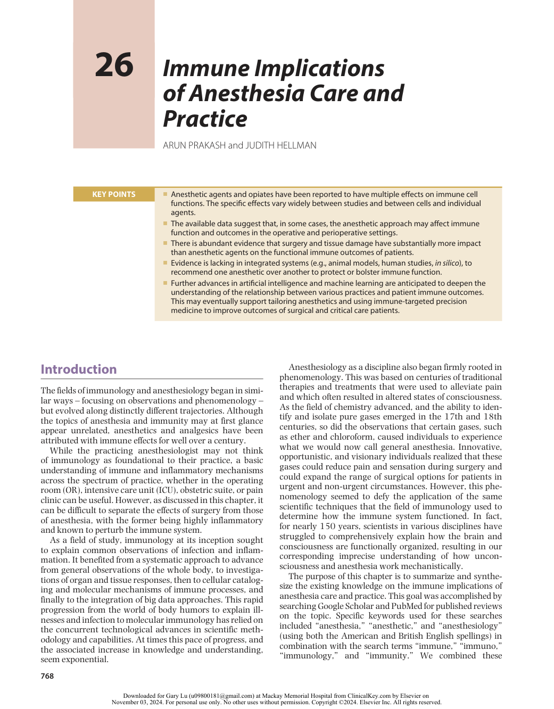

:::

<!-- PDF page 2 -->

searches into one comprehensive search using the Boolean terms: “anesth*” or “anaesth*” and “immun*” to attempt to capture alternative derivatives of the two words when present in review titles. The search was limited to Englishlanguage review articles that were accessible through UCSF’s institutional journal subscriptions. This search yielded over 200 review articles with publication dates ranging from 1971 to 2022. Details of the search results including links to the comprehensive search links and the number of articles retrieved are provided in Table 26.1.

Some articles were excluded for the following reasons: a narrow focus on specific patient populations (e.g., elderly, obese, pediatric) or specific disease/surgery type (e.g., colorectal cancer, HIV, cesarean section, tumorigenesis, tumor metastasis, postoperative cognitive dysfunction [POCD], COVID- 19, allergy/anaphylaxis), or single anesthetic method/agent (e.g., epidural, local anesthetics, single volatile/inhaled anesthetics). This chapter does not provide an overview of the immune system (as most of the reviews on this topic do). Instead, the primary objectives of this chapter are to:

1.  Provide a historical context for the emergence of the fields of anesthesiology and immunology.

2.  Summarize the experimental approach taken by numerous research labs and individual researchers over the past century to understand the immune effects of anesthetics. Rather than providing a comprehensive list of the immune effects of individual anesthetics or an overly exhaustive summary of the literature, we aim to provide instructive examples from the published literature and contextualize them while making broader points on the benefits and limitations of these approaches.

3.  Predict the future of perioperative anesthesia care _vis- à- vis_ important immune considerations and approaches that will possibly alter the way anesthesia care is delivered primarily for elective surgery.

4.  Provide perspectives on the future of anesthesia research focused on the immune system. We expand on the possibilities of tailoring anesthesia for individual patients as a form of personalized medicine, considering the effects of anesthesia on the immune system, and _vice versa._

## The Premise

The central premise of this chapter is that the observed and reported effects of individual anesthetics on immune cells

suggest that exposure to anesthetics (during surgery) can affect the patient’s immune system and therefore impact patient outcomes (Fig. 26.1).

If this premise were correct, the associated assumptions would include:

- Perioperative anesthesia exposure alters a patient’s immune system.

- Perioperative immunosuppression should be avoided.

- Perioperative immunosuppression can be prevented.

- The perioperative immune state can be modulated by choice of anesthetic.

- The perioperative immune state can be harnessed for patient benefit.

## Historical Context

Associations between anesthesia and the immune system have been proposed since the late 1800s to early 1900s. Some of the earliest reports of these conceptual links are shown in Table 26.2.

The rationale for the assumption that anesthetics affected the immune system was that surgery and the inflammation it generated were often complicated by unwanted infections and mortality. Improved surgical techniques, aseptic practices, and the use of antibiotics increased safety and reduced this mortality. Since cells of the immune system appeared to be involved in inflammatory processes, host defense against infection, and wound healing, efforts to enhance or support the immune system seemed desirable. Conversely, medications or activities that weakened or compromised the immune system were naturally considered harmful. In this context, clinicians and researchers of the time wondered whether certain anesthetics might influence (mainly suppress) the immune system. And if anesthetics did suppress immune responses, many reasoned that choosing the least suppressive anesthetic would be important to positively influence surgical outcomes and postoperative recovery.

What followed was a century of intense investigation into the effects of individual agents on various aspects of the immune system. The long- standing dogma within the anesthesiology community was that surgery (and anesthesia) could significantly affect patient immune and inflammatory responses. This belief was largely based on early observations that immunosuppression occurred in the postoperative period. Therefore, it seemed important to investigate

**Table 26.1** Literature Search Strategy for Articles Focused Jointly on the Two Subject Matters of Anesthesiology and Immunology†

|**Topic 1**|**Topic 2**|**Google Scholar link** |**# of Articl**|**es** **PubMed link**|**# of Articles**|
|---|---|---|---|---|---|
|Anesth*|Immun*|https://scholar.google.com/scholar?lr=lang_ en&q=allintitle:+%22anesthesia%22+%22 immune%22&hl=en&as_sdt=0,5|204|https://pubmed.ncbi.nlm.nih.gov/?term=% 28Anesth*%5BTitle%5D%29+AND+%28 Immun*%5BTitle%5D%29&filter=pubt.r eview|76|
|Anaesth*|Immun*|https://scholar.google.com/scholar?hl=en& lr=lang_en&as_sdt=0%2C5&q=allintitle% 3A+%22anaesthesia%22+%22immune% 22&btnG=|65|https://pubmed.ncbi.nlm.nih.gov/?term=% 28Anaesth*%5BTitle%5D%29+AND+%2 8Immun*%5BTitle%5D%29&filter=pubt. review|17|

†Google Scholar and PubMed were both used and the links for the results, and the number of articles retrieved are provided.

::: details 原始表格與符號（PDF 第 2 頁）

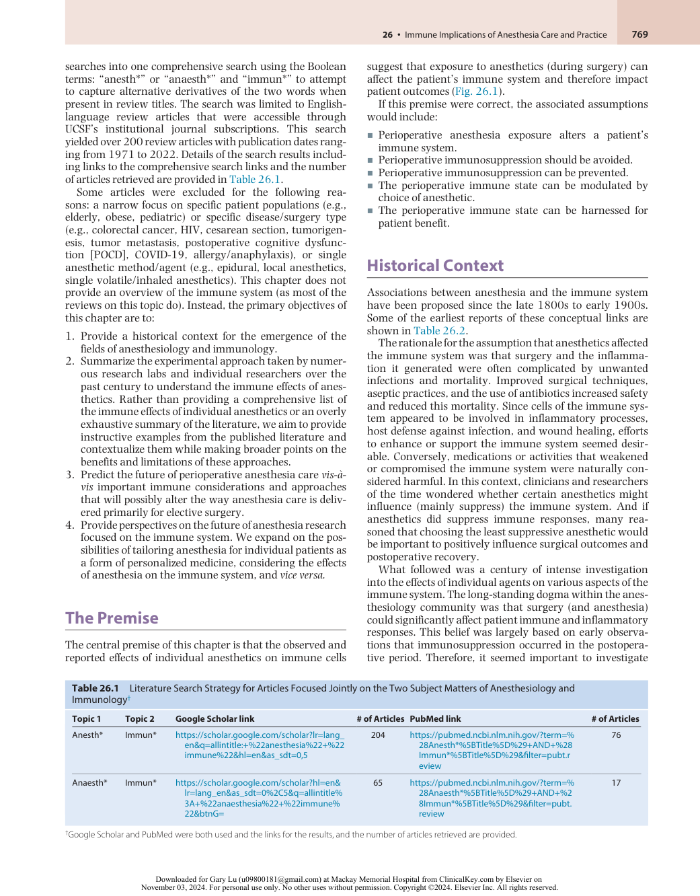

:::

<!-- PDF page 3 -->

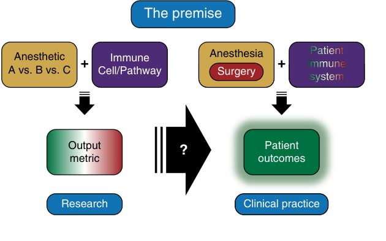

The premise Anesthetic Immune Anesthesia Patient + + immune A vs. B vs. C Cell/Pathway Surgery system Output ? Patient metric outcomes Research Clinical practice 

**Fig. 26.1** Basic premise of this chapter topic: the fact that applying any given anesthetic agent on a specific immune cell or pathway can result in a measurably different output of immune function should eventually translate into clinical practice whereby the anesthetic choice combined with specific surgical procedures and patient’s immune state should result in better patient outcomes.

**Table 26.2** Oldest Historical References and Details for Reports on Immune Effects of Anesthetic Agents

|**Year**|**Author(s)**|**Journal**|**Title**|**Summary**|
|---|---|---|---|---|
|1899|T.L. Chadborne35|_Philadephia Med J_|Ether leukocytosis|Reported postoperative leukocytosis following ether anesthesia.|
|1903|J.J. Snell36|_Berlin Klin Wochenschr_|Immunität und Norkose|Study on guinea pigs receiving ether/ chloroform/chloral hydrate leading to increased mortality from anthrax exposure.|
|1904|G. Rubin37|_J Infect Dis_|The influence of alcohol and chloroform on phagocytosis _in vitro_|Influence of alcohol, ether, and chloroform on natural immunity in its relation to leukocytosis and phagocytosis.|
|1911|E. Graham38|_J Infect Dis_|The influence of ether and ether anesthesia on bacteriolysis, agglutination, and phagocytosis|Studied the effects of ether on bacteriolysis, agglutination, and phagocytosis of streptococci by leukocytes.|
|1916|Gaylord and Simpson39|_J Cancer Res_|Effect of certain anesthetics and loss of blood on growth of transplanted mouse cancer|These researchers found that transplanted mammary carcinoma grew more rapidly under conditions of exposure to ether or chloroform anesthesia.|

which anesthetic agents positively or negatively affected the immune system. This was done by using approaches similar to those used to dissect various aspects of innate and adaptive immunity and host defense.

## Experimental Approaches Taken

More than a century of research into the effects of anesthetics, analgesics, and sedatives on immune function has resulted in numerous published studies. However, there is a lack of clarity regarding the broader implications of these studies. To take a hypothetical example, a typical study might report that anesthetic A has a specific effect on an immune cell type. This was often followed by another group reporting that anesthetic B had the opposite effect or that in a different cell type or measured activity the effects of anesthetic A were different from what the previous study claimed. As a result, these approaches have led to few, if any, significant changes in clinical practice. Even the

concern for myelosuppression and adrenal suppression by nitrous oxide and etomidate, respectively, were driven more by clinical observations and later supported by mechanistic studies. Similarly, there is a general reluctance to perform elective surgery in patients with ongoing or untreated infections. Indeed, this seems to follow a simple logic: do not give the immune system additional work to heal after surgery while it is fighting an active infection. Perhaps the key point is that we do not currently have a comprehensive way to assess the state of the immune system and therefore do not know whether a patient is in the appropriate immune state for surgery, if there is one. Even if we theorize that a period of immunosuppression may follow the strong inflammatory responses to surgery, it is difficult to disentangle the contribution of the surgical process from that of the anesthetic used. We normally do not perform elective surgery on a patient with extreme outlier readings for blood pressure, blood glucose, thyroid hormone levels, and other commonly measured parameters, but we have no such readings for the immune system (other than fever) and, therefore no

::: details 原始表格與符號（PDF 第 3 頁）

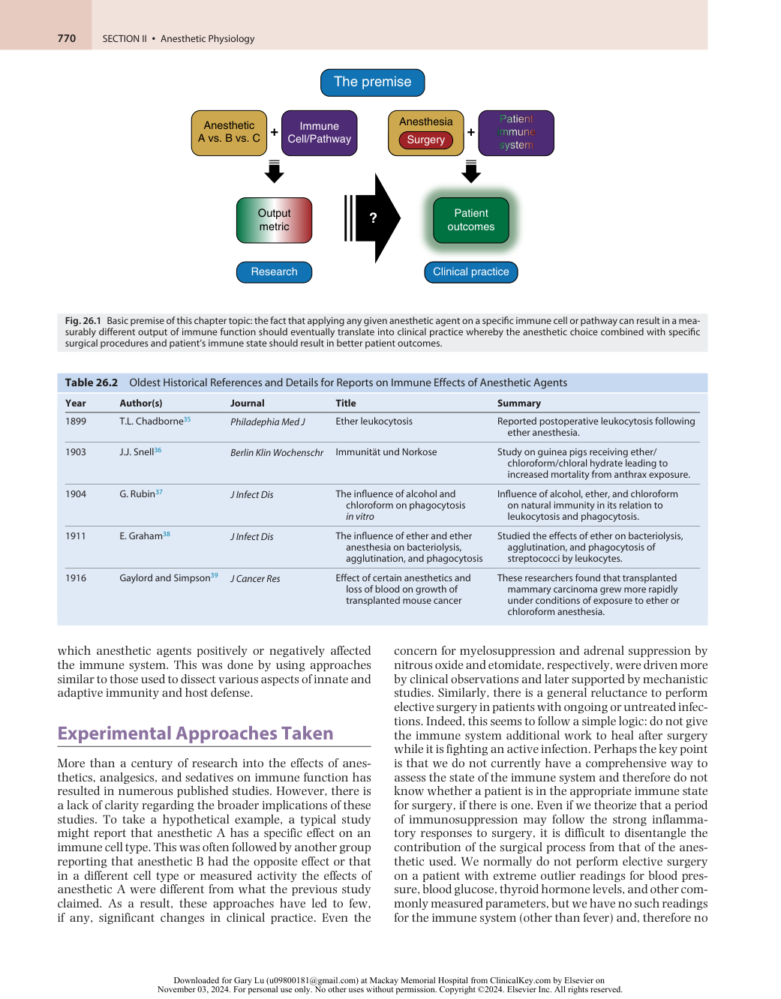

:::

<!-- PDF page 4 -->

current way to assess the impact of anesthetics on immune outcomes.

To illustrate the difficulty of understanding the complex effects of anesthetics on immune function, consider the patient undergoing organ transplantation. In addition to receiving anesthetics and analgesics as part of their care, this patient will also receive immunosuppressive therapies to prevent transplant rejection. Currently, there are no specific immune- based clinical guidelines or protocols for which anesthetics to use in organ transplant surgery. In reality, anesthetic choices are often made based on pharmacokinetic considerations, considering the patient’s renal or hepatic function and, thereby, their ability to metabolize anesthetic and adjuvant perioperative medications. Later in this chapter there is a detailed summary of the effects of various anesthetics on specific immune cell processes and outcomes. Collectively, however, the studies do not provide clear insight into the precise concerns, considerations, or risks associated with the immune effects of anesthetics.

Several factors ( _key topics_ ) likely contribute to immune implications of anesthetics in surgical patients and each with numerous options or considerations (Fig. 26.2). Five _key topics_ are joined together in the form of the central question of this chapter: “How does _anesthesia_ and/or _surgery_ affect the _immune system,_ given specific _patient comorbidities,_ in terms of influencing _patient outcomes_ ?”

As shown in Fig. 26.3A, each of these _key topics_ can be further arbitrarily assigned 12 individual factors. A simple calculation of how just one of the 12 factors from each _key topic_ could interact with or affect any of the other factors from each of the other four _key topics_ quickly leads us to the fact that there are nearly a quarter of a million (125 ) combinations in this hypothetical scenario (Fig. 26.3B). Furthermore, comparing any two factors from one topic (e.g., general vs. regional anesthesia) while holding the other four key topic factors constant could easily result in a statistically random but significant (by _P_ - value) interaction. In fact, by the logic of this argument, assuming a _P_ - value cutoff of .05 should yield tens of thousands of statistically significant interactions by chance alone; even a _P_ - value

cutoff of .001 would yield hundreds of significant interactions, most of which are likely to be of little clinical importance or meaning. Moreover, one must assume that the effect sizes will be small, since any truly large magnitude effect sizes are likely to have already been detected by simple clinical observation. Small effect sizes make conducting and powering randomized clinical trials very difficult and perhaps even theoretically impossible. In summary, much remains unknown about the unintended effects of anesthetics on humans undergoing surgery, and the available data do not provide answers to the following fundamental questions:

1.  Do anesthetics functionally alter the immune response of patients undergoing surgery, either positively or negatively?

2.  Can/should anesthetics be tailored to target the immune system so as to improve surgical outcomes?

## Literature Review

The following is a summarized description of the existing reviews focusing on the immune effects of anesthesia, organized chronologically by decade.

### THE 1970s1–7

Reviews from the 1970s focused on the effects of anesthetics on existing and emerging concepts in innate and adaptive immunity. They largely reflected the prevailing understanding of the immune cell repertoire, focusing on macrophages and T- and B- lymphocytes, and processes, such as phagocytosis, inflammation at sites of injury, humoral and tumor immunity, and hypersensitivity or anaphylactic responses.

These reviews attempted to initiate a broad discussion of the influence of anesthesia on immunity. Notably, the confounding influence of surgical stress, including associated pain and stress hormone (hypothalamic–pituitary–adrenal [HPA] axis) contributions, was considered.

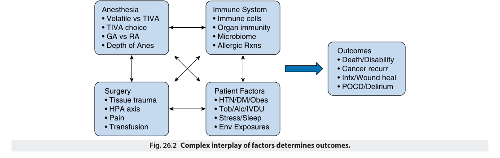

Anesthesia Immune System • Volatile vs TIVA • Immune cells • TIVA choice • Organ immunity • GA vs RA • Microbiome • Depth of Anes • Allergic Rxns Outcomes • Death/Disability • Cancer recurr • Infx/Wound heal • POCD/Delirium Surgery Patient Factors • Tissue trauma • HTN/DM/Obes • HPA axis • Tob/Alc/IVDU • Pain • Stress/Sleep • Transfusion • Env Exposures Fig. 26.2 Complex interplay of factors determines outcomes. 

<!-- PDF page 5 -->

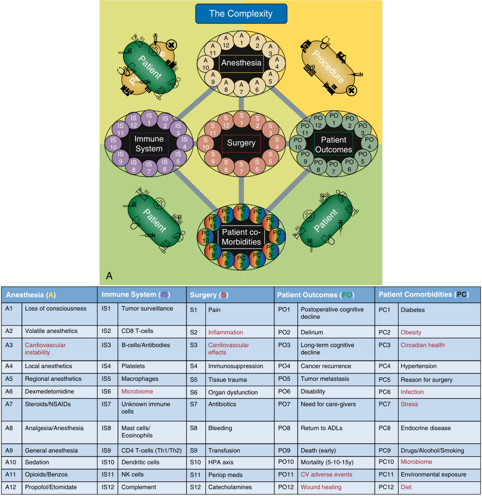

The Complexity A A A A 12 1 2 A 11 3 A Anesthesia A 10 4 A A 9 A A A 5 8 7 6 IS IS IS S S S PO PO PO IS 12 1 2 IS S 12 1 2 S PO 12 1 2 PO 11 3 11 3 11 3 10IS ImmuneSystem IS4 10 S Surgery S4 P10 O Outcomes Patie nt PO4 IS IS S S PO PO 9 IS IS IS 5 9 S S S 5 9 PO PO PO 5 8 7 6 8 7 6 8 7 6 PC PC PC PC 12 1 2 PC 11 3 PC Patient co- PC 10 Morbidities 4 PC PC 9 PC PC PC 5 8 7 6 A Anesthesia (A) Immune System (IS) Surgery (S) Patient Outcomes (PO) Patient Comorbidities (PC) A1 Loss of consciousness IS1 Tumor surveillance S1 Pain PO1 Postoperative cognitive PC1 Diabetes decline A2 Volatile anesthetics IS2 CD8 T-cells S2 Inflammation PO2 Delirium PC2 Obesity A3 Cardiovascular IS3 B-cells/Antibodies S3 Cardiovascular PO3 Long-term cognitive PC3 Circadian health instability effects decline A4 Local anesthetics IS4 Platelets S4 Immunosuppression PO4 Cancer recurrence PC4 Hypertension A5 Regional anesthetics IS5 Macrophages S5 Tissue trauma PO5 Tumor metastasis PC5 Reason for surgery A6 Dexmedetomidine IS6 Microbiome S6 Organ dysfunction PO6 Disability PC6 Infection A7 Steroids/NSAIDs IS7 Unknown immune S7 Antibiotics PO7 Need for care-givers PC7 Stress cells A8 Analgesia/Anesthesia IS8 Mast cells/ S8 Bleeding PO8 Return to ADLs PC8 Endocrine disease Eosinophils A9 General anesthesia IS9 CD4 T-cells (Th1/Th2) S9 Transfusion PO9 Death (early) PC9 Drugs/Alcohol/Smoking A10 Sedation IS10 Dendritic cells S10 HPA axis PO10 Mortality (5-10-15y) PC10 Microbiome A11 Opioids/Benzos IS11 NK cells S11 Periop meds PO11 CV adverse events PC11 Environmental exposure A12 Propofol/Etomidate IS12 Complement S12 Catecholamines PO12 Wound healing PC12 Diet Patient Pro ced ure Procedure Patient Patient 

B 

**Fig. 26.3** (A) The complexity: potential interactions between 12 arbitrary (sample options provided in (B) factors for each of the five main key topics, which combine overlapping patient and procedure parameters - Anesthesia, Surgery, Immune System, Patient Comorbidities, and Patient Outcomes. ∼250,000 combinations of these factors are possible. Factors in red font likely strongly impact more than one key topics.

They described how early 20th century experiments noted changes in immune cell functions or tumors in animals exposed to older anesthetics, such as ether and chloroform, and focused primarily on the effects of specific anesthetics on specific immune phenomena (e.g., infection, anaphylaxis, inflammation, phagocytosis, tumor immunity, organ transplantation/rejection, cell motility, cell division, leukopenia, stress hormones, B- cell/T- cell functions, etc.). They cataloged the effects of many current and past agents (including chloroform, diethyl ether, halothane, enflurane, nitrous oxide,

xenon, cyclopropane, methoxyflurane, methohexital, ethylene, trichloroethylene, acetylene, paraldehyde, tribromoethanol, chloral hydrate, pentobarbitone, pentobarbital, thiopental, amobarbital, ketamine, lignocaine/ lidocaine, thiamylal, morphine). They summarized the published literature that reported immunosuppressive, absent or contradictory effects of the various anesthetics on the immune phenomena and on different cell types.

Taking a slightly different approach, Lee, in a 1977 review, focused on the kinetics of this interaction via the timeline of immune perturbations caused by surgery/

<!-- PDF page 6 -->

anesthesia.4 The author noted that most immune functions returned to normal within a week of surgery and all measures appeared to normalize by 3 weeks. While various anesthetics could interfere with immune responses, Lee suggested that the degree of immunosuppression was primarily a result of “the extent of tissue trauma, the amount of blood loss, duration of operation, and whether thoracic or abdominal cavity was entered.”

Overall, these early reviews concluded that anesthetics may not be harmless with respect to immune effects but suggested that the effects may be subtle and that surgery is likely to play a more important role in postoperative immunosuppression than the anesthesia that accompanies it. Quite appropriately, these authors chose not to provide specific guidance on anesthetic selection based on immune effects (e.g., Duncan and Cullen2 ). Instead, they recommended studies be rigorously designed, that patients be medically and physiologically optimized, and that surgery/anesthesia be performed safely and expeditiously. Separately, theoretical concerns were also raised about the possibility that incidental surgery/anesthesia might reactivate tumors after years of dormancy, but to date these concerns have not been borne out.

### 1970s Summary

After decades of study, the only guidelines that existed in the 1970s included concerns about myelosuppression with chronic use of nitrous oxide, adrenal suppression with etomidate, and a desire to avoid elective surgery in patients with active infections. Other definitive, generalizable, or actionable knowledge that changed clinical practice was lacking but future advances were highly anticipated.

### THE 1980s8,9

The consensus in published reviews continued into the 1980s that surgical stress appeared to be the major contributor to perioperative immunosuppression, along with the lack of clear evidence that different anesthetics had substantially different effects on immunologic parameters. As the incredible complexity of the immune system continued to be revealed in the 1980s, it became more difficult to generalize about the effects of anesthetics on immune function because the immune system could not be codified into one or even 10 key aspects. The metrics used to measure and evaluate the immune system became more granular and less systematic. In addition, multiple interventions were being used to fight infections, promote wound healing, etc., making a simple assessment of the role of anesthetics on the immune system even more elusive.

The putative effects of anesthetics on tumor growth/ spread, as well as anti- tumor immunity, remained hypothetical and unproven.

no new immune- based clinical guidelines for anesthesia were advanced.

### THE 1990s10–12

The 1990s saw a marked increase in knowledge of the molecular basis of the immune system, including the formal discovery of cytokines, chemokines, and receptor- mediated signaling in the immune system. However, this knowledge was not yet accompanied by an increase in treatments that targeted or manipulated the immune system. Immunologic concerns in anesthesia remained mostly theoretical or followed past practices.

In a review of anesthetics and the immune system, Stevenson and colleagues concluded that since immunity is important for controlling postoperative infections and malignancies in general, anesthetic- mediated immunosuppression was a potential concern.12 Focusing on human studies, they emphasized the important methodological difficulties in separating the effects of anesthetics and surgical stress and other perioperative factors such as blood loss, medications used, etc.

McBride and colleagues focused on the immunomodulatory effects of nonanesthetic adjunct medications administered during surgery (e.g., nonsteroidal anti- inflammatory drugs [NSAIDs], phosphodiesterase [PDE] inhibitors, opioids, etc.).10 They proposed using new knowledge about cytokines (then called biological response modifiers or BRMs) to design clinical trials studying how different anesthetic options affect levels of various cytokines and how these affect clinical outcomes.

In a systematic review, Salo reflected on the importance of immunosuppression in trauma and surgery in terms of preventing autoimmune responses while allowing wound healing and antimicrobial defense.11 The author included several thought- provoking and interesting discussion points showing a clear appreciation for the enormous complexity then being uncovered in the immune system. Salo noted that “our current knowledge of immune responses is already helping us avoid many immune- mediated complications” and suggested that “routine interference with these responses is not indicated.” Other provocative questions that remain unanswered three decades later were raised, such as the timing of surgery in relation to vaccination, how to identify patients at risk, whether the choice of anesthetic matters, or whether maintaining normal physiology of the organ and patient is more important than any specific anesthetic. Overall, their conclusions serve as part warning and part guidance: “uncritical interference with separate immune responses may be hazardous since the responses are interdependent and balanced with various effector mechanisms.” This advice is probably as relevant today as when it was written, given the ever- expanding knowledge of the immune system, its incredibly complex interconnectedness, and its self- organizing nature.

### 1990s Summary

### 1980s Summary

Although numerous studies focused on the effects of anesthesia and surgery on immune function, no specific and actionable anesthetic factors were identified, and therefore

The 1990s saw an explosion of knowledge about the molecular and signaling basis of the immune system and the discovery of new immune cell types, but no change in anesthesia practice emerged based on this knowledge.

<!-- PDF page 7 -->

### THE 2000s13–15

The first decade of the 21st century continued to bring advances in the field of immunology. However, this was not matched by any new guidelines reported in reviews incorporating new knowledge about the immune effects of anesthesia. The reviews of the 2000s followed the model of previous decades, summarizing the various effects of anesthetics (e.g., ketamine, propofol, etomidate, dexmedetomidine, fentanyl, etc.) on _in vitro_ immune cell functions. The conclusions were relatively vague, consistent with the prevailing fragmented and rudimentary understanding of the clinical functional effects of anesthesia on the immune system. Examples of general conclusion statements in these reviews included recommendations such as: “Clinical anesthesiologists should select anesthetics and choose anesthetic methods with careful consideration of the clinical situation and immune status of critically ill patients, regarding long- term mortality, morbidity, and clinical prognosis.” While generally sound and benign, these recommendations lacked actual guidance on how to modify clinical anesthesia practice in a meaningful immune- supporting way. Biki and colleagues performed a retrospective analysis of anesthetic choice (general anesthesia [GA] vs. GA+epidural) for cancer recurrence.13 This latter approach demonstrated an emerging appreciation for the need to ask focused questions in order to try to detect clear signals of benefit for one approach (GA+epidural) vs. the other (GA), for one type of surgery (radical prostatectomy), for one disease process (prostate cancer), and for one specific outcome (cancer recurrence). While laudable, this approach, even with its conclusions and recommendations, did not result in a widespread change in clinical practice for even this type of surgery.

### 2000s Summary

There were yet more advances in immunology, both via technical advances and considerations of immunotherapies for cancer treatment and other disease processes, but still no major changes in clinical anesthesia practice incorporating this or the previous decade’s expansion of the immunology knowledge base.

### THE 2010s TO PRESENT16–26

Over the past two decades, tremendous progress has been made in the development and delivery of effective immunotherapies for cancer, and, most recently, novel vaccination strategies (e.g., mRNA vaccines) for infectious diseases. Knowledge of the microbiome and its role in immune system development, host health, and disease has revolutionized the field. In addition, advances in computational sciences including machine learning (ML), the expansion of artificial intelligence (AI), and the emergence of artificial general intelligence (AGI), promise to further revolutionize our ability to integrate the vast amounts of data that can currently be harvested and collected to decipher the true interconnected complexity of the immune system. The application of these paradigm shifts to the exploration of the relationship between anesthetics and the immune system, particularly as it relates

to the short- and long- term outcomes of surgery and anesthesia, are perhaps closer than in the past.

Reflecting this excitement, a multitude of general and specialized reviews have been published since 2010 on the putative and presumed interactions between anesthesia and the immune system. However, it is safe to say that there have been no definitive breakthroughs or paradigm shifts in our understanding of the interplay between the fields of anesthesiology and immunology so far.

Unlike the field of immunology, pharmacokinetics and pharmacodynamics have strongly influenced clinical anesthesia practice and continue to do so as new drugs are developed and introduced into clinical practice: pharmacokinetics in terms of the dosing of new drugs and pharmacodynamics _vis- à- vis_ the effects of drug clearance on liver and kidney function and the knowledge of the clearance and metabolism of specific anesthetics. New approaches to assess the functional relationship between anesthetics and the immune system and the implications for clinical care are still lacking and need to be developed. Nevertheless, the available data and clinical experience from decades of anesthesia practice and outcomes suggest that there are no substantial differences between anesthetics (propofol vs. volatile anes thetic [VA] vs. ketamine vs. etomidate, etc.) on overall immune function in the short term (for wound healing, postoperative infections, etc.) and long term (cancer recurrence, mortality, etc.).

A well- written and clear 2013 review by Colucci and Hernandez- Pando comprehensively summarizes the effects of currently used anesthetics on immune cell functions.17 The review’s tables do an excellent job of cataloging various groups, categories, and effects: anesthetics and sedatives, immune cell types, and adaptive vs. innate immune system (via key cytokine responses). The tables annotate the large number of studies in the literature on this topic and the complexity of the effects are measured. However, despite this impressive effort (reproduced here in part and adapted with the authors’ permission in Table 26.3), it is still impossible to make any generalizable predictions on the effects of anesthetics on global immune system function. Table 26.3A focuses on various immune cell populations and aspects of their individual biology, while Table 26.3B focuses on cytokines.

Colucci _et al._ concluded that anesthetics have apparent effects on immune cells and, furthermore, given the importance of the immune system, these same anesthetics would negatively impact postoperative infections and surgical recovery.17 However, to date, the evidence seems to suggest otherwise, given the lack of robust data or clear differences in important immune outcomes (surgical recovery, postoperative infections, cancer recurrence, transplant rejection) associated with specific anesthetic choices.

Rizzo and Sciorsci reiterated in their 2011 review that “Many of the immune changes seen in surgery patients are primarily the result of surgical trauma and endocrine responses… (plus) drug effects rather than the result of anesthesia exposure itself.”23 They suggested that potentially immunosuppressive anesthetics could be considered when inflammation might be detrimental and _vice versa_ .

Stollings _et al._ focused on the effects of volatile anesthetics and posed the question: Does the immunosuppression from exposure to (volatile) anesthetics have prolonged or

<!-- PDF page 8 -->

**Table 26.3** Summary of Effects of Anesthetics on (A) Immune Cell Subtypes and (B) Cytokine Production ( _circa_ 2013)

||**VOLATIL**|**E ANESTH**|**ETICS**|||||||
|---|---|---|---|---|---|---|---|---|---|
|**H**|**I**|**S**|**D**|**Propofol**|**Ketamine**|**Thiopental**|**Opioids**|**Midazolam**|**LA**|
|**A – EFFECTS OF ANESTHE** Leuokocytes _cell counts_|**TICS ON IMM** ↑|**UNE CELL** ↑|**SUBTYPES** ↑|↑|||||↑|
|Neutrophils _phagocytosis_ _respiratory burst_ _chemotaxis_ _cell counts_|↓ ↓||↑|↓ ↓ ↑||↓|||↓ ↓|
|Monocytes/ Macrophages _cell counts_ _phagocytosis_ _respiratory burst_ ↓ ↑ ↑||↓||↓ ↓||↓ ↓||↓ ↓|↓|
|Lymphocytes _cell counts_ _proliferation_|↓|↓||↓|↓||||↓|
|NK cells||||||||||
|_cell counts_ _cytotoxic activity_ ↓|↓|↑|↑|↑ ↓||||||
|CD4 T- cells _cell counts_ _Th1:Th2 ratio_ ↓|↓|↓ ↓||↑ ↓||||||
|CD8 T- cells _cell counts_ _apoptosis_ ↓|↑ ↑|↓|↑|↓||||||
|CD19 B- cells _cell counts_ _proliferation_ _antibody titres_ _1°/2° immune resp_ ↑|↑|↑|↑||||↓ ↓|||
|**B – EFFECTS OF ANESTHE** IL- 1|**TICS ON CYT**|**OKINE PRO**|**DUCTION**|||||||
|_plasma levels_ _release_|↑|↓|↓|↓|↓|↓|↓||↓|
|IL- 6 _plasma levels_|↑|↑||↑|↓|↓|↑↓||↑|
|IL- 8 _plasma levels_ _release_|↑|||↑ ↓|↓|↓||↓||
|IL- 10 _plasma levels_|↑|↑||↑|↑|↑|↑||↑|
|TNF-α _plasma levels_|↑|↓||↓|↓|↓|↑↓||↑|
|IL- 2 _plasma levels_||||↓|↓||↓|||
|IFN-γ _plasma levels_||||↑||↓|↓|||
|IL- 4 _plasma levels_||||||↓|↓|||
|TGF-β _plasma levels_||↑|||||↑|||

_H_ , halothane; _I_ , isoflurane; _S_ , sevoflurane; _D_ , desflurane.

Adapted with permission from Colucci D, Puig N, Hernandez-Pando R. Influence of anaesthetic drugs on immune response: from inflammation to immunosuppression. _OA Anaesthetics_ . 2013;1(3):21.

::: details 原始表格與符號（PDF 第 8 頁）

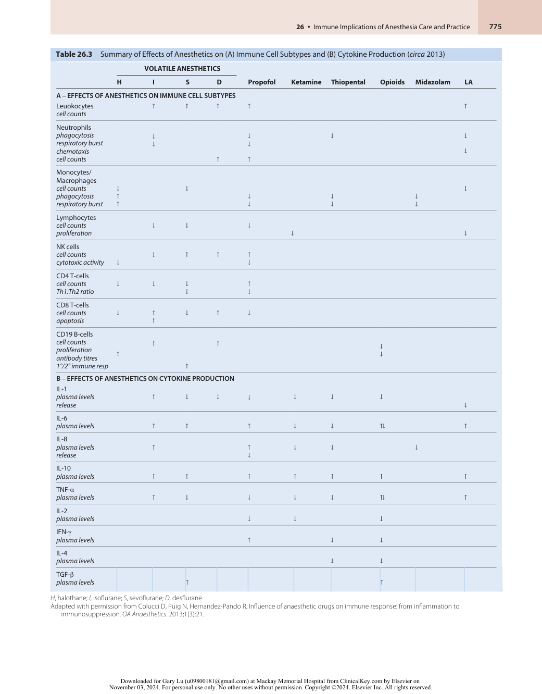

:::

<!-- PDF page 9 -->

important effects on the patient?24 They were unable to reach clear conclusions and instead observed that clinical trials were needed but were ultimately challenging (as will be outlined in the following sections) because of the difficulty in isolating important factors from each other: namely, surgery, anesthesia, drug choices, and other perioperative considerations.

Yuki and Eckenhoff reviewed the effects of VAs on immune cells, including neutrophils, macrophages, natural killer (NK) cells expressing VA receptor targets (GABAA, glycine, nicotinic acetylcholine (ACh), serotonin, _N_ -methyl-daspartate (NMDA), K+ /Na+ channel, etc.).26 They proposed that different anesthetics may result in different immune outcomes for different surgeries (e.g., surgical site infections, cancer surgery outcomes, POCD). However, to date, these findings have not led to widespread changes in clinical practice. There remains a lack of convincing evidence that total intravenous anesthesia (TIVA) leads to improved cancer outcomes compared with the administration of volatile anesthetics, or that any specific type of volatile or intravenous agent reduces surgical site infections.

Cruz and colleagues addressed the issue of the antiinflammatory effects of anesthetic agents and concluded that anesthetic effects were modest compared to general surgical trauma and subsequent immunosuppression.19 They argued that multiple factors (e.g., aging, diabetes, malnutrition, cancer, etc.) created tenuous immune landscapes that anesthetic choices could adversely or beneficially impact. They also revisited the effects of prolonged sedative use in the ICU, describing the previously known bone marrow suppressive effects of nitrous oxide, adrenal suppression induced by etomidate, and the newer delirium and cognitive decline associated with benzodiazepine use.

Two additional reviews by some of the same authors focused broadly on the immunomodulatory effects of anesthetics, particularly on ischemia–reperfusion injury during transplant surgery, cancer growth, diabetes, POCD in the elderly, obesity, and malnutrition.20,21 They theorized that if the immunomodulatory effects of anesthetics could be controlled, their pro- and anti- inflammatory properties could be harnessed for patient benefit. Overall, however, they concluded that although the clinical importance of anesthetics on immune function is inferred, the clinical significance is unclear.

Jafarzadeh _et al._ focused their review on cytokine production as a surrogate for the immune effects of anesthetic induction/maintenance agents, analgesics, sedatives, and even mechanical ventilation.22 These authors summarized that “the effects of GA on the immune system are not considerable in healthy patients and short- term surgeries” and that “changes in the immune system are on the first day mainly due to surgical trauma.”

In a recent narrative review, Ackerman and colleagues brought us up to date on the studies conducted on the effects of currently used anesthetics on immune cell activities.16 Overall, these agents appear to be experimentally suppressive or at best neutral to most cellular immune functions. Reflecting the slow progress in addressing the premise that anesthesia affects perioperative immunity, they cautiously concluded: “The interactions among common anesthetic agents, perioperative adjuncts, and the innate and adaptive immune system are complex and potentially clinically significant.”

Finally, Costa _et al._ reviewed the published evidence for personalized anesthetic choices to slow cancer progression.18 The authors cataloged the conflicting data available regarding the effects of propofol and other anesthetics on cancer development, progression, treatment, and recurrence/metastasis. They correctly concluded that “There is inadequate evidence to support the use of certain anesthetic agents or techniques to lower the risk of cancer recurrence in individuals who undergo cancer surgery.”

### 2010–Present Summary

Our understanding of the immune system in its complexity and importance continues to expand dramatically, yet the overall impact of this additional knowledge on clinical anesthesia practice appears to be negligible. It is hoped that new technological and scientific advances will lead to future breakthroughs.

## Refining the Questions27–30

This section focuses on reviews describing refined avenues of inquiry on the immune implications of anesthesia care. They consider individual aspects, such as specific cancer surgeries, cancer types, cancer recurrence, or the use or avoidance of specific anesthetics/analgesics that also have reported immunomodulatory actions during the perioperative period.

A retrospective observational study by Jun and colleagues concluded that volatile anesthesia worsened esophageal cancer survival when compared to TIVA.28 In relative agreement, Dang _et al._ proposed that, in general, VAs were inferior compared to RA and GA+RA in colorectal cancer patients.27 Kim _et al._ , in turn, focused on cancer recurrence but considered the immunosuppression caused by surgery alone separate from anesthesia.29 Finally, Lisowska _et al._ reviewed opioid vs. opioid-free anesthesia _vis- à- vis_ effects on the immune system directly or through suppressing the HPA axis/sympathetic nervous system (SNS).30 The effects of the opioid alternatives (ketamine, local anesthetics, etc.) on the immune systems were also considered, but yielded no clear conclusions as to which option was better. Overall, it remains unclear if there is a clear benefit for choosing one anesthetic option over others for a given cancer surgery and this is reflected in the current absence of protocols guiding clinical practice.

The refinement of the questions being asked reflects an appreciation for the complexity of the two systems (anesthesia and immunity) being linked. We have observed a trend toward more clinically focused questions, limited to 2–3 anesthetic choices, with specific outcomes/metrics of interest. Somewhat in contrast, systems approaches are also being considered. For example, observing the integrated immune system globally and tracking it over time with better understanding of periods of infection susceptibility or worse wound healing/tissue repair may allow for better insight into the real effects of anesthetics on these key immune processes. This second approach would require vast levels of data collection, data integration, informatics, and modern artificial intelligence (AI) and machine learning (ML) approaches (see section on The Future, later).

<!-- PDF page 10 -->

### Use of Randomized Clinical Trials (RCTs) to Answer the Question: Attempts to Study the Immune Effects of Anesthesia via Clinical Studies/Trials

- 2009 European Society of Anesthesiology (ESA) program to identify the best anesthesia choices for patients with cancer. Results: unknown.

- 2013 MASTER trial (Multicenter Australian Study of Epidural Anesthesia and Analgesia in Major Surgery): major prospective RCT focused on oncology patients getting abdominal surgery: GA + epidural analgesia vs. GA + opioid analgesia. Results: no significant difference in cancer- free survival.

## Other Patient Factors Influencing the Immune System in Perioperative Medicine

In addition to the actions of anesthetics on the immune system, numerous other factors are likely to impact immune function and immune- related patient outcomes in the OR and perioperative settings. Collecting and integrating data on additional topics outside of anesthetics and analgesics will be a challenge for the field but may ultimately help guide clinical care and anesthetic choices for the best possible immune- related patient outcomes.

For example, the role of the microbiome in driving perioperative immune outcomes is thus far underexplored. The gut microbiome is definitely or likely to be influenced by factors such as the preoperative diet, pre- and perioperative antibiotics, preoperative fasting, bowel preparation regimens, and even, potentially, the use of contrast dyes. Similarly, the skin, oral, lung, and other microbiota populations may be affected by perioperative interventions and circumstances.

Separately, there have been guidelines from the American College of Surgeons (ACS) and other groups to “optimize” nutrition prior to surgery.31 The main foundation for these recommendations are negative outcomes post- surgery in patients with poor nutrition; however, some guidelines have implicated immune effects as well (“immunonutrition”) albeit with the focus on gastrointestinal (GI) surgery.32 The cited studies (last updated in 2014) explored supplementing diets with mainly with L- arginine, _n_ - 3 fatty acids, and nucleotides and studied outcomes including immune cell counts and functions, wound healing, infectious complications, hospital length of stay, sepsis scores, and other major complications.31 More recently, the surgical field, spearheaded by the work of Dr. John Alverdy at the University of Chicago, has also begun to delve into the role of the diet and microbiome on surgical outcomes.33,34 Potential future areas of exploration include further determining the role of diet, supplementation with prebiotics, probiotics, and postbiotics, and the impact of fecal microbiota transplant (FMT) on perioperative patient immune outcomes.

In a similar vein and perhaps of equal importance, investigations into the role of _sleep disruption/circadian rhythms_ on the choice of when to perform surgery and the link with postoperative outcomes are in their nascency.

Other emerging (and highly overlapping) perioperative considerations include:

1. _Timing of surgery_ :

   - a.  When to schedule a surgery based on time of day, stress hormone levels, and immune state assessment, or preoperative dietary interventions (see #2 below).

   - b.  When to receive vaccinations _vis- à- vis_ when to have scheduled surgery.

   - c.  Context of cancer detection/diagnosis, treatment course, etc.

   - d.  Unoptimized other conditions such as diabetes, hypertension, stress/cortisol levels, etc.

2. _Test for immune readiness for surgery:_ Integrating newly collectable data with the use of artificial intelligence/ machine learning (AI/ML) approaches may help identify which patients are at the highest risk for operative and postoperative complications (with the caveat that “black box” approaches may preclude mechanistic understanding and should be viewed with great caution as discussed in the following sections). Multiple data sets which could be collected over different time scales and then integrated could include the following:

   - a.  Demographic data: age, sex, medical and social history

   - b.  Dietary habits

   - c.  Sleep and circadian habits – as measured objectively by a wearable device

   - d.  Biometric physiologic data (vital signs) integrated over time

   - e.  Whole genome sequencing, whole exome sequencing, single-cell blood transcriptomics, metabolomics, proteomics, lipidomics

   - f.  Analysis of the gut, skin, and nasopharyngeal/airway microbiomes – including bacterial, viral, fungal, and parasitic communities

      - i.  Identification of present community members

      - ii.  Metagenomic/metatranscriptomic analyses

   - g.  Metabolomic analysis of blood, urine, stool, and exhaled breath samples

   - h.  Blood sample analysis for immune cell census and function

   - i.  Advanced noninvasive organ imaging/pan- scans to study the metabolic, immune, functional state of key organs, including the heart, lungs, brain, kidneys, liver, spleen, pancreas, GI tract, and lymphatic system.

## Artificial Intelligence, Machine Learning, and Precision Medicine Approaches

There is the potential for artificial intelligence (AI) and machine learning (ML) to process large amounts of clinical information to create a predictor for outcomes of interest and identify anesthetic choices that avoid specific negative outcomes. As computational methods evolve, a personalized medicine approach might be taken for each patient that considers a large-scale collection of data and metadata, integrating variables that, in sum, might predict a favorable immune outcome of anesthesia (Fig. 26.4).

<!-- PDF page 11 -->

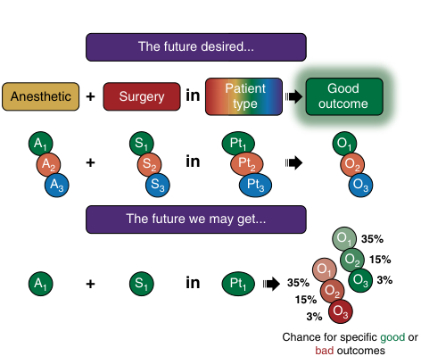

The future desired... Patient Good Anesthetic + Surgery in type outcome A1 S1 Pt1 O1 A2 + S2 in Pt2 O2 A3 S3 Pt3 O3 The future we may get... O1 35% O2 15% O1 A1 + S1 in Pt1 35% O3 3% O2 15% 3% O3 Chance for specific good or bad outcomes 

**Fig. 26.4** The simple future desired, where a best choice anesthetic can be chosen for a particular surgery type for a given patient resulting in a good postoperative outcome vs. the likely future where any combination of anesthetic, surgery, and patient will yield a possibly bewildering likelihood of different outcomes and side effects, making the choice of anesthetic less straightforward and more reliant on a complex discussion between patient and anesthesiologist regarding prioritizing outcomes of interest vs. risk involved.

However, there are some very valid and other theoretical concerns related to using ML/AI approaches to drive anesthetic care. For example, issues may arise with weighing the risks for various postoperative outcomes of interest (postoperative nausea and vomiting [PONV], POCD/delirium, mortality, surgical site infection [SSI], health care–associated infection [HAI]) in making an anesthetic choice for a particular surgery type in a patient from a specific subgroup.

How might a provider decide whether the following hypothetical risk profile: 0.01% mortality, 2% POCD, and 45% PONV was better than 0.02% mortality, 1% POCD, and 25% PONV? Would they outsource this decision to the patient? Would an ASA task force have to create guideline cutoffs for risk considered too high or acceptable for each possible negative outcome/side effect? ML/AI- driven anesthesia might end up inadvertently constraining the available anesthetic choices in a dynamic perioperative environment, potentially leaving the anesthesiologist unable to best respond to unexpected situations.

Additionally, predicting outcomes does not necessarily increase understanding of how the system works. These approaches may limit opportunities for discovery and the mechanistic development of new therapies and treatment strategies. After a time- consuming multi- year project of data collection, model building, and care pathway creation, incentives to update or question these approaches may disappear while unanticipated negative consequences may emerge. How these approaches interface or coexist with the need for clinical trials, the need for developing new approaches or the use of experimental therapies remains to be determined.

These and other critical questions should be considered before the era of big data collection and patient care collide – but in fact, this era is already well underway with few, if any, clear rules written or fundamental principles agreed upon.

## Current Limitations and Future Directions

Many of the reviews discussed earlier in this chapter call for more research on this topic, and research laboratories worldwide continue to pursue familiar and new approaches. Unlike the progress in steadily building a detailed description of the immune system, the effect of anesthetics on the immune system has been a difficult problem to tackle. While the effects of prolonged anesthetic care in the ICU have been associated with adverse outcomes (e.g., nitrous oxide and bone marrow suppression, etomidate and adrenal suppression, propofol and propofol infusion syndrome, benzodiazepines and ICU delirium), the functional and lasting effects of shorter exposures to anesthetics are uncertain.

Several factors contribute to the lack of a clear understanding of the immune implications of anesthetics. Many different anesthetics can be used to achieve the same desired effect on patients undergoing surgery. Additionally, these anesthetics in isolation or in conjunction with surgery can influence individual immune cell activity and function in _ex vivo_ and _in vitro_ assays. Furthermore, there are no good ways to measure a patient’s global immune state. In fact, attempts at individual patient immune cell assessments have been unable to predict infection risk, disease, or readiness for surgery.

Finally, and perhaps most importantly, the most commonly used anesthetics today appear to be broadly safe, and there remains a paucity of strong data pointing to substantial negative effects of anesthetic choices on functional immune outcomes. Overall, regarding the state of surgery and anesthesia today, there is cause to celebrate the safety and success of anesthetic care currently while at the same time appreciating the challenges that exist to tailor anesthetics for the immune system and in general (Table 26.4) There is still much to learn and even more to understand.

The approach of studying single anesthetic agent effects on individual immune cell functional outputs has led to some appreciable but limited insights into the effects of anesthesia on immune cells. The implications of these findings in the context of the whole multicellular and multisystem patient

**Table 26.4** Current Advantages and Challenges*

|**Successes for Surgery and** **Anesthesia**|**Challenges for Personalized** **Medicine in Anesthesia**|
|---|---|
|Noanesthetic currently in common use does the following unequivocally: ᑏincreases mortality ᑏcauses cancer ᑏcauses dementia ᑏcauses infections ᑏprevents wound healing ᑏcauses postoperative complications ᑏcauses anaphylaxis|ᑏA unified theory of how the immune system works is not close at hand. ᑏA unified theory of how anesthesia and consciousness work is not close at hand. ᑏObvious/large patient outcome differences are absent (see “Successes”). ᑏSurgery without anesthesia is not currently a viable option. ᑏMedications that might help a select few but could harm others are problematic_vis- à- vis_ approval.|

*Most anesthetics are safe and current knowledge precludes the establishment of guidelines for best anesthetic choices for best immune outcomes.

::: details 原始表格與符號（PDF 第 11 頁）

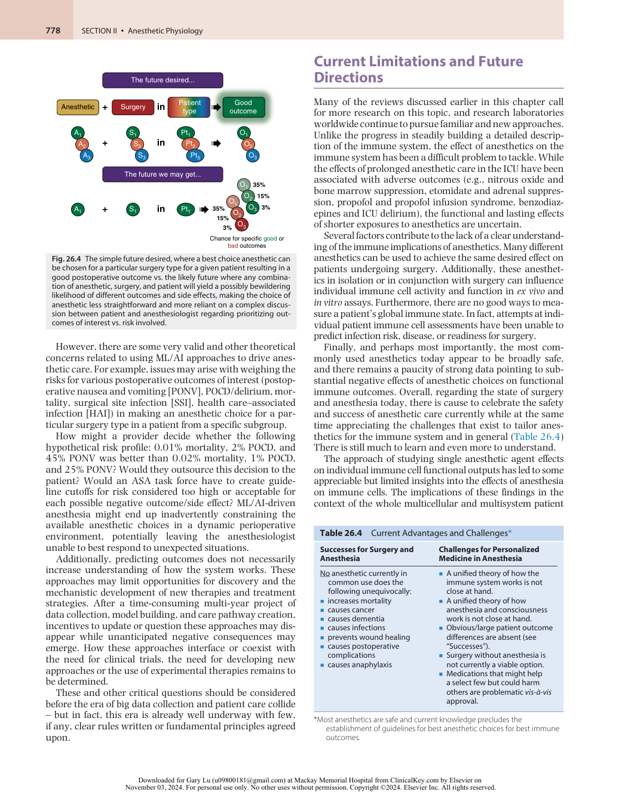

:::

<!-- PDF page 12 -->

are still extremely unclear. Indeed, in the few cases where anesthetic practice has changed, such as etomidate not being used for long- term sedation in the ICU, it emerged from clinical observations and was verified by mechanistic studies.

From one perspective, the key challenge and next frontier may now be to collect as much data as possible on as many individuals undergoing surgery and anesthesia. In addition to including specific data about surgery and anesthesia, intraoperative events, and physiology, data must include information about the immune health of patients before and during their hospital stay, and longitudinal data after their surgery. The effects and outcomes should not be simply binary (e.g., mortality or infection), but instead more detailed and nuanced (e.g., ability to return home, performance of activities of daily living [ADLs], quality of life, and long- term good health). A simple example of this approach is the exploration of the use of dexmedetomidine for ICU sedation based on an understanding of the similarities in electroencephalogram (EEG) patterns with natural sleep.

### THE PRESENT AND NEAR FUTURE

### OR Care As It Is Today and As It Will Likely Continue for the Next 5–10 Years

We predict that clinical anesthesia care will continue in a relatively similar fashion to how it is currently practiced over the next 5 to 10 years (Fig. 26.5). This will be until a breakthrough in integrating/“solving” the immune system and reliable predictive models are developed and validated. Additionally, major advances in understanding how cognition and the brain function may allow us to assess the long- term effects of anesthesia more rigorously (see Chapter 78). It may be of some comfort to current practitioners concerned about the immune state of their patients and the consequences of anesthetic medications and interventions that the approach we recommend is to make the surgical/ anesthesia/hospital experience as safe as possible for their patients while trying to ensure that these patients are as healthy as possible at the time of surgery. This may involve commonsense approaches that perhaps need no formal clinical trial to implement, such as preoperative stress reduction protocols, sleep regimen improvements, dietary interventions, microbiome banking prior to antibiotic administration, exercise programs, etc. Given the present

state of knowledge, it is not possible to make more specific recommendations regarding clinical anesthesia care in the OR based on immune system considerations.

### THE FUTURE

### The OR and Perioperative Care As It May Look in 10+ Years

We believe that key aspects of human biology and physiology will be more comprehensively considered by the perioperative physician of the future. We predict that the perioperative experience a decade from now may include some of the changes to our current practice described in Table 26.5. Additionally, we anticipate massive increases in data collection. It is likely that this process will involve years or decades of data collection in order to build predictive models. Once those models have been built, they may allow for integration of our ever- expanding knowledge and understanding of the totality of the immune system, the brain and nervous system, and how these organ and hostwide systems interface with each other. Further integration of inputs and influences from the microbiome, diet, circadian clock, environmental exposures, etc., will also occur. The hope is that the development of assays and metrics to globally evaluate these systems will follow with technological innovations or novel interrogations of currently obtainable patient samples.

## Final Thoughts and Considerations

The available evidence points to numerous and specific effects of anesthetics on particular immune cell populations. This suggests, in some cases, that anesthetic approaches could affect immune function in the operative and perioperative settings. Barring the discovery of a new paradigms based on revolutionary technologies or scientific breakthroughs, it is unlikely that anesthetic practices will change dramatically based on the currently available data on the immune effects of anesthesia. There is, at present, insufficient evidence in integrated systems (e.g., animal models, human studies, _in silico_ ) to specifically recommend one anesthetic over another to protect or bolster immune function and improve outcomes. The advances in computational sciences (AI/ML) are

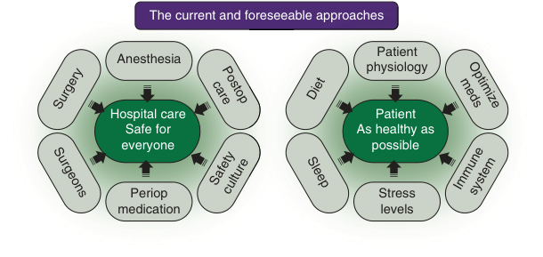

The current and foreseeable approaches Patient Anesthesia physiology Hospital care Patient Safe for As healthy as everyone possible Periop Stress medication levels Surgery carePostop Diet medsOptimize Surgeons Safetyculture Sleep Immunesystem 

**Fig. 26.5 The current and foreseeable approaches.** Make hospital care safe for everyone and aspire for the healthiest patient condition possible prior to undergoing surgery.

<!-- PDF page 13 -->

**Table 26.5** Potential Scenarios, Patient Considerations, and Areas to Focus on in the Near (10+ Years) Future (Categorized by Pre- , Intra- , and Postsurgical Periods)

|**Preoperative Clinic Visit**|**Preoperative Patient Instructions**|**Preoperative Period on DOS**|
|---|---|---|
|ᑏSleep patterns ᑏPhysiologic data: BP, HR, oxygen saturation, ECG rhythm ᑏCell count, hemoglobin levels, WBC inflammatory capacity ᑏMetabolic/dietary/social habits assessment ᑏStress level (cortisol, etc.) measurements ᑏMicrobiome analyses|ᑏSpecific diet prescribed for 1–2 weeks before surgery ᑏSpecific activity/exercise regimens prescribed ᑏSpecific medications, supplements, prebiotics/probiotics/postbiotics prescribed|ᑏBlood sample drawn in preoperative holding area to be assessed for key known outcome markers ᑏPreoperative stress reduction techniques, including focused breathing, meditation, music therapy, virtual reality headsets delivering stress reduction experiences|
|**Pre- induction of Anesthesia**|**Intraoperative Period**|**Emergence from Anesthesia**|
|ᑏSedative and anesthesia choice/regimen tailored for given patient to aid recovery ᑏFurther stress reduction prior to induction of anesthesia, including focused breathing, meditation, music therapy, silence|ᑏAntibiotics may not be required in all patients ᑏMay be required for patients most susceptible to postoperative infection ᑏNot required for those with intact, healthy microbiota ᑏMay be desired for future FMT with “healthy” or “pro- healing” gut bacteria ᑏDepth of anesthesia monitoring to titrate anesthetics for least patient harm (currently in practice)|ᑏDepth of anesthesia monitoring will allow for rapid reversal of anesthesia and rapid emergence ᑏBetter understanding of the arousal centers in the brain will permit the use of future medications that can target arousal and rapid emergence from anesthesia|
|**Postoperative Recovery Period**|**Discharge from Home and POW1**|**POW1–4 (aka POM1)**|
|ᑏLocalized nerve stimulators and targeted nerve blocks will be able to control pain sensation from different regions of the body so as to reduce the need for systemic opioid or other pain medications|ᑏAssessment of vital signs and other measurements during POW1 to ensure return to baseline, including circadian/sleep cycles, monitoring for postoperative infection, monitoring for appropriate wound healing, stress hormone levels, normal RBC and WBC counts ᑏCognitive testing for at- risk populations|ᑏFocus on cognitive functions and return to ADLs for at- risk populations ᑏAppropriate support for individuals who live alone or require additional help with ADLs and/or return to work|

_ADLs_ , activities of daily living; _BP_ , blood pressure; _DOS_ , day of surgery; _ECG_ , electrocardiogram; _FMT_ , fecal microbiota transplant; _HR_ , heart rate; _POW_ , postoperative week; _POM_ , postoperative month; _RBC_ , red blood cell; _WBC_ , white blood cell.

anticipated to provide deeper knowledge of the relationships between various anesthetic practices and outcomes in individual patients, and, hopefully, will support the tailoring of anesthetics to improve immune and downstream functional outcomes in the not- too- distant future. However, a critical approach to adopting these new bioinformatic approaches should be maintained and as always clinical knowledge, expertise, and experience should continue to guide future anesthesia care.

10.  McBride WT, et al. _Anaesthesia_ . 1996;51(5):465.

11.  Salo M. _Acta Anaesthesiol Scand_ . 1992;36:201.

12.  Stevenson G, et al. _Anesthesiology_ . 1990;72:542.

13.  Biki B, et al. _Anesthesiology_ . 2008;109(2):180.

14.  Kelbel I, Weiss M. _Curr Opin Anaesthesiol_ . 2001;14:685.

15.  Kurosawa S, Kato M. _J Anesthesia_ . 2008;22(3):263.

16.  Ackerman RS, et al. _Anesth Analg_ . 2021;133(3):676.

17.  Colucci D, et al. _OA Anaesth_ . 2013;1(3):21.

18.  Costa B, et al. _J Pers Med_ . 2022;12(11):1846.

19.  Cruz FF, et al. _Crit Care_ . 2017;21(1):67.

20.  Cruz FF, et al. _Curr Opin Anaesthesiol_ . 2021;34(3):357.

21.  Heil L, et al. _Minerva Anestesiol_ . 2020;86(2):181.

### Acknowledgments

We apologize to any authors of reviews on this topic whom we have neglected to include in our discussion.

22.  Jafarzadeh A, et al. _Anesthesiol Pain Med_ . 2020;10(4):e103033.

23.  Rizzo A, et al. _Immunopharmacol Immunotoxicol_ . 2011;33(4):581.

24.  Stollings LM, et al. _Anesthesiology_ . 2016;125(2):399.

25.  Wagner F, et al. _Shock_ . 2010;34(4):437.

26.  Yuki K, Eckenhoff RG. _Anesth Analg_ . 2016;123(2):326.

27.  Dang Y, et al. _Can J Gastroenterol Hepatol_ . 2018;2018:7940603.

### Complete references available online at expertconsult.com.

28.  Jun IJ, et al. _Sci Rep_ . 2017;7(1):14020.

29.  Kim R. _J Translat Med_ . 2018;16(1):8.

30.  Lisowska B, et al. _J Inflamm Res_ . 2020;13:859.

### References

1.  Bruce D, Wingard D. _Anesthesiology_ . 1971;34(3):271.

2.  Duncan PG, Cullen BF. _Anesthesiology_ . 1976;45(5):522.

3.  Jubert AV, et al. _J Surg Res_ . 1973;15(6):399.

4.  Lee YN. _J Surg Oncol_ . 1977;9(5):425.

5.  Moudgil GC, Wade AG. _Br J Anaesth_ . 1976;48(1):31.

6.  Walton B. _Anaesthesia_ . 1978;33(4):322.

7.  Walton B. _Br J Anaesth_ . 1979;51(1):37.

8.  Kehlet H, et al. _Regional Anesth_ . 1982;7(4):S68.

9.  Moudgil GC. _Can Anaesth Soc J_ . 1986;33:S54.

31.  American College of Surgeons; 2014. https://www.facs.org/media/b ofbztus/immunonutrition_studies_compendium.pdf.

32.  American College of Surgeons. https://www.facs.org/qualityprograms/strong- for- surgery/clinicians/nutrition/.

33.  Keskey R, et al. _Ann Surg_ . 2022;276(5):e361.

34.  Toni T, Alverdy J. _Ann Surg Open_ . 2021;2(2):e056.

35.  Chadbourne T. _Philadelphia Med J_ . 1899;3:390.

36.  Snell J. _Berlin Klin Wochenschr_ . 1903;40(212).

37.  Rubin G. _J Infect Dis_ . 1904;1(3):425.

38.  Graham EA. _J Infect Dis_ . 1911;8(2):147.

39.  Gaylord H, Simpson B. _J Cancer Res_ . 1916;1:379.

::: details 原始表格與符號（PDF 第 13 頁）

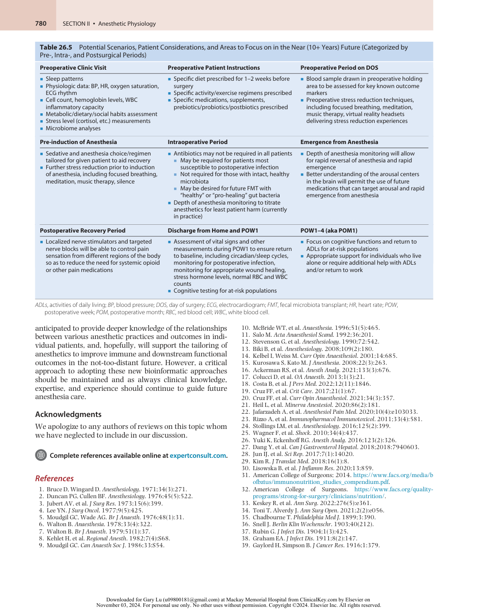

:::

<!-- PDF page 14 -->

### References

1.  Bruce D, Wingard D. Anesthesia and the immune response. _Anesthesiology_ . 1971;34(3):271.

2.  Duncan PG, Cullen BF. Anesthesia and immunology. _Anesthesiology_ . 1976;45(5):522–538.

3.  Jubert AV, Lee ET, Hersh EM, McBride CM. Effects of surgery, anesthesia and intraoperative blood loss on immunocompetence. _J Surg Res_ . 1973;15(6):399–403.

4.  Lee YN. Effect of anesthesia and surgery on immunity. _J Surg Oncol_ . 1977;9(5):425–430.

5.  Moudgil GC, Wade AG. Anaesthesia and immunocompetence. _Br J Anaesth_ . 1976;48(1):31–39.

6.  Walton B. Anaesthesia, surgery and immunology. _Anaesthesia_ . 1978;33(4):322–348.

7.  Walton B. Effects of anaesthesia and surgery on immune status. _Br J Anaesth_ . 1979;51(1):37–43.

8.  Kehlet H, Wandall JH, Hiortsø NC. Influence of anesthesia and surgery on immunocompetence. _Regional Anesth_ . 1982;7(4):S68–S74.

9.  Moudgil GC. Update on anaesthesia and the immune response. _Can Anaesth Soc J_ . 1986;33:S54–S60.

10.  McBride WT, Armstrong MA, McBride SJ. Immunomodulation: an important concept in modern anaesthesia. _Anaesthesia_ . 1996;51(5):465–473.

11.  Salo M. Effects of anaesthesia and surgery on the immune response. _Acta Anaesthesiol Scand_ . 1992;36:201–220.

12.  Stevenson G, Hall S, Rudnick S, et al. The effect of anesthetic agents on the human immune response. _Anesthesiology_ . 1990;72:542–552.

13.  Biki B, Mascha E, Moriarty DC, et al. Anesthetic technique for radical prostatectomy surgery affects cancer recurrence: a retrospective analysis. _Anesthesiology_ . 2008;109(2):180–187.

14.  Kelbel I, Weiss M. Anaesthetics and immune function. _Curr Opin Anaesthesiol_ . 2001;14:685–691.

15.  Kurosawa S, Kato M. Anesthetics, immune cells, and immune responses. _J Anesthesia_ . 2008;22(3):263–277.

16.  Ackerman RS, Luddy KA, Icard BE, et al. The effects of anesthetics and perioperative medications on immune function: a narrative review. _Anesth Analg_ . 2021;133(3):676–689.

17.  Colucci D, Puig N, Hernandez-Pando R. Influence of anaesthetic drugs on immune response: from inflammation to immunosuppression. _OA Anaesth_ . 2013;1(3):21.

18.  Costa B, Mourão J, Vale N. Personalized medicine for classical anesthesia drugs and cancer progression. _J Pers Med_ . 2022;12(11):1846.

19.  Cruz FF, Rocco PRM, Pelosi P. Anti- inflammatory properties of anesthetic agents. _Crit Care_ . 2017;21(1):67.

20.  Cruz FF, Rocco PRM, Pelosi P. Immunomodulators in anesthesia. _Curr Opin Anaesthesiol_ . 2021;34(3):357–363.

21.  Heil L, Silva P, Cruz F, et al. Immunomodulatory effects of anesthetic agents in perioperative medicine. _Minerva Anestesiol_ . 2020;86(2):181–195.

22.  Jafarzadeh A, Hadavi M, Hassanshahi G, et al. General anesthetics on immune system cytokines: a narrative review article. _Anesthesiol Pain Med_ . 2020;10(4):e103033.

23.  Rizzo A, Campanile D, Spedicato M, et al. Update on anesthesia and the immune response in newborns delivered by cesarian section. _Immunopharmacol Immunotoxicol_ . 2011;33(4):581–585.

24.  Stollings LM, Jia LJ, Tang P, et al. Immune modulation by volatile anesthetics. _Anesthesiology_ . 2016;125(2):399–411.

25.  Wagner F, Radermacher P, Stahl W. Editorial comment: anesthesia and the immune response: evidence for an “‘isoflurane paradox’”. _Shock_ . 2010;34(4):437–438.

26.  Yuki K, Eckenhoff RG. Mechanisms of the immunological effects of volatile anesthetics: a review. _Anesth Analg_ . 2016;123(2):326–335.

27.  Dang Y, Shi X, Xu W, Zuo M. The effect of anesthesia on the immune system in colorectal cancer patients. _Can J Gastroenterol Hepatol_ . 2018;2018:7940603.

28.  Jun IJ, Jo JY, Kim JI, et al. Impact of anesthetic agents on overall and recurrence- free survival in patients undergoing esophageal cancer surgery: a retrospective observational study. _Sci Rep_ . 2017;7(1):14020.

29.  Kim R. Effects of surgery and anesthetic choice on immunosuppression and cancer recurrence. _J Translat Med_ . 2018;16(1):8.

30.  Lisowska B, Jakubiak J, Siewruk K, et al. Which idea is better with regard to immune response? Opioid anesthesia or opioid free anesthesia. _J Inflamm Res_ . 2020;13:859–869.

31.  American College of Surgeons. Immunonutrition and head/neck surgery studies compendium. https://www.facs.org/media/bofbztus/im munonutrition_studies_compendium.pdf; 2014.

32.  American College of Surgeons. Strong for surgery: Optimizing nutrition prior to surgery. https://www.facs.org/quality- programs/strongfor- surgery/clinicians/nutrition/.

33.  Keskey R, Papazian E, Lam A, et al. Defining microbiome readiness for surgery: dietary pre- habilitation and stool biomarkers as predictive tools to improve outcome. _Ann Surg_ . 2022;276(5):e361.

34.  Toni T, Alverdy J. Harnessing the microbiome to optimize surgical outcomes in the COVID- 19 era. _Ann Surg Open_ . 2021;2(2):e056.

35.  Chadbourne T. Ether leukocytosis. _Philadelphia Med J_ . 1899;(3):390– 395.

36.  Snell J. Immunität und Narkose. _Berlin Klin Wochenschr_ . 1903;40(212).

37.  Rubin G. The influence of alcohol, ether, and chloroform on natural immunity in its relation to leucocytosis and phagocytosis. _J Infect Dis_ . 1904;1(3):425–444.

38.  Graham EA. The influence of ether and ether anesthesia on bacteriolysis, agglutination, and phagocytosis. _J Infect Dis_ . 1911;8(2):147– 175.

39.  Gaylord H, Simpson B. The effect of certain anesthetics and loss of blood upon the growth of transplanted mouse cancer. _J Cancer Res_ . 1916;1:379.
