# Risk of Anesthesia

<!-- PDF page 1 -->

SARAH COTTER, ALBERT YEN, and LEE A. FLEISHER

|**KEY POINTS**|ᑏPerioperative risk is multifactorial and may occur as a result of anesthesia- , surgery- , and/or patient- specific factors.|
|---|---|
||ᑏAnesthesia- related (and surgery- related) risk is typically defined as morbidity and mortality occurring within 30 days of surgery, although events that occur at later points may still be related to anesthesia and/or surgery. ᑏThe overall risk of anesthesia relates to both specific, organ- based complications and the rapidity with which they are managed (i.e., rescued). ᑏIn the literature on anesthesia- related risk, the rates of morbidity and mortality reported across studies show a substantial variability in part attributable to the wide variety of definitions used in these studies. i|
||ᑏHistorical studies of anesthesia- related risk identified anesthesia- related respiratory depression as the major cause of death and coma totally attributable to anesthesia. This finding prompted the creation of postanesthesia care units (PACUs). ᑏResearch into anesthesia- related cardiac arrest has found it to be attributable to medication administration, airway management, and technical problems of central venous access. ᑏMultivariate modeling can be used to determine specific factors associated with an increased likelihood of adverse postoperative events, and it has been used to define a range of clinical risk indices to predict postoperative outcomes. ᑏSurveys of maternal mortality suggest that although the absolute rate of complications attributable to anesthesia has not decreased over time, the increased use of regional anesthesia may have led to improvements in outcome. ᑏMedication- related and cardiovascular events were the most common causes of cardiac arrest in the Pediatric Perioperative Cardiac Arrest (POCA) Registry. ᑏGrowth in the number and variety of surgical procedures performed in hospital outpatient departments, ambulatory surgery centers, and physician offices creates novel challenges for assessing and managing perioperative risk. ᑏInitiatives established over time by the Anesthesia Patient Safety Foundation, the American Society of Anesthesiologists (ASA), and others have sought to decrease the potential risks of anesthesia through systems- level improvements, standardization of care processes, human- factors engineering, and simulation- based training. ᑏEmerging evidence suggests that the choice of anesthetic drugs, ventilator strategies, or technique may impact patient outcomes.|

## Introduction

Since the beginning of its modern history, the administration of anesthesia has been recognized as a hazardous enterprise,1 with distinct risks to the patient and occupational risks to anesthesia providers. From the perspective of public health, understanding both the nature and the magnitude of these risks is important on multiple levels. For individual patients, receiving accurate information on the probability of specific perioperative complications is a prerequisite for informed decision- making related to anesthesia and surgery. More broadly, understanding the extent to which rates of perioperative morbidity and mortality vary across patients, physicians, and hospitals provides an important opportunity for assessing and improving quality in health care.

Efforts to determine the risks of anesthesia are complicated by many potential perspectives from which such risks

can be defined. The use of alternate periods of observation for morbidity and mortality – the intraoperative period alone, the first 48 hours after surgery, the duration of the hospital stay, or the first 30 days or longer after surgery – complicates simple conclusions about the risks faced by any individual patient undergoing anesthesia and surgery and at what point after surgery the likelihood of further adverse events has returned to baseline (Table 27.1). For example, patients undergoing ambulatory surgery have the lowest risk of death the day of surgery as opposed to 1 month later.2 At the opposite end of the spectrum, asymptomatic release of cardiac enzymes in the perioperative period can have implications for months to years.3–5 Divergent conclusions would also be expected from studies that consider adverse events that are solely attributable to the administration of anesthesia versus those that examine the overall rates of morbidity and mortality after surgery, which

::: details 原始表格與符號（PDF 第 1 頁）

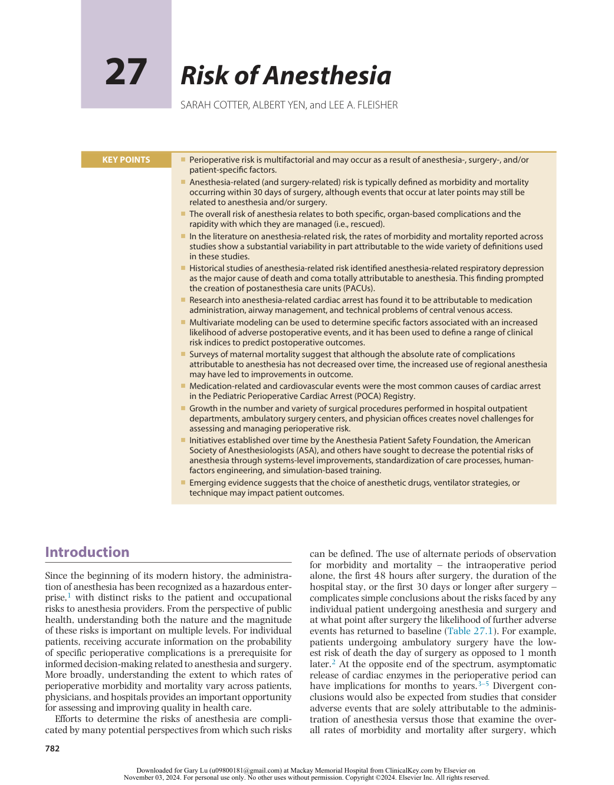

:::

<!-- PDF page 2 -->

**Table 27.1** Time Perspective of Anesthetic Morbidity and Mortality Studies

**Table 27.2** Examples of Common Outcome Measures

|**Outcome**|**Example**|
|---|---|
|Mortality Failure to rescue|Mortality after a postoperative complication|
|Morbidity Major Minor|Myocardial infarction Pneumonia Pulmonary embolism Renal failure or insufficiency Postoperative cognitive dysfunction Nausea Vomiting Readmission|
|Patient satisfaction Quality of life||

|**Study**|**Study Year**|**Time Perspective**|
|---|---|---|
|Beecher and Todd|1954|All deaths on the surgical services|
|Dornette and Orth|1956|Deaths in the surgical unit or after failure to regain consciousness|
|Clifton and Hotten|1963|Any death under or attributable to anesthesia or without return of consciousness after anesthesia|
|Harrison|1978|Death within 24 hours|
|Marx_et al_.|1973|Death within 5 days|
|Hovi- Viander|1980|Death within 3 days|
|Lunn and Mushin|1982|Death within 6 days|
|Tiret and Hatton|1986|Complications within 24 hours|
|Mangano_et al_.|1992|Death within 2 years|
|Monk_et al_.|2005|Death within 1 year|

the patient- , provider- , and facility- level determinants of anesthetic and perioperative risk are reviewed through statistical risk indices, and clinically based approaches to patient classification, and available literature on the determinants of risk unique to the obstetric, pediatric, and geriatric populations are discussed. Finally, future directions in research and clinical care related to anesthetic risk are discussed, with a focus on the health policy implications of changing knowledge regarding the hazards of anesthesia.

Modified from Derrington MC, Smith G. A review of studies of anaesthetic risk, morbidity, and mortality. _Br J Anaesth_ . 1987;59(7):815–833.

anesthesia care may modify. Studies exclusively focusing on the intraoperative period have characterized contemporary anesthesia care as a patient safety “success story” as a result of the low rates of death directly attributable to anesthesia care. As a result, anesthesia has been hailed by the National Academy of Medicine as “an area in which very impressive improvements have been made” in terms of patient safety.6

## Framework of Perioperative Risk

Perioperative risk is multifactorial and depends on the interaction of anesthesia- , patient- , and surgery- specific factors (Fig. 27.1). With respect to anesthesia, the selection and effects of medications, including volatile and intravenous anesthetic drugs, and the skills of the practitioner are important. Similarly, the surgeon’s skills and the surgical procedure itself also affect perioperative risk. Furthermore, practitioners may influence outcomes at multiple points in the postoperative course. Although the incidence of specific local or organ- based complications, such as perioperative myocardial infarction or central line–related bloodstream infection, may be modified by anesthetic or surgical care, variations in the adequacy of care delivered to patients who have already experienced a complication (i.e., failure to rescue) may largely explain hospital- to- hospital differences in surgical outcomes.7–9 Notably, although past investigators have pointed to volume–outcome relationships as potentially mitigating these hospital- to- hospital outcome differences,10,11 more recent data have suggested that local quality- improvement efforts, rather than large- scale efforts, at regionalization of care for elective surgeries hold the greatest potential to yield meaningful improvements in operative outcomes.12

Nonetheless, a broader perspective on perioperative outcomes presents a more complicated story. For example, in the case of a patient with established coronary artery disease who sustains a myocardial infarction after experiencing tachycardia during high- risk surgery, the cause of the patient’s adverse outcome could arguably be attributed to both the patient’s underlying coronary artery disease and to the absence of intraoperative heart rate control. In this situation, the decision to view the perioperative infarction primarily as a consequence of patient disease or as an event that could be prevented by anesthesia care carries vastly different implications for efforts to define and reduce the risks of anesthesia.

Finally, the diverse array of outcomes considered as hazards of anesthesia complicate the interpretation of the literature on the risks of anesthesia. Traditionally, investigators have focused on issues of death and major morbidity such as myocardial infarction, pneumonia, and renal failure. More recently, however, this view has been broadened to include economic outcomes, as well as patient- centered outcomes such as functional independence, quality of life, and satisfaction (Table 27.2). For example, unanticipated rehospitalization after ambulatory surgery or a delay in discharge as a result of postoperative nausea and vomiting are both potentially important from the perspectives of the patient’s quality of life, as well as economics.

The potential for anesthetic care to influence the overall hazard of surgery at multiple time points highlights both the complexity of measuring the risks of anesthesia and surgery, and the range of potential opportunities that may exist to reduce such risks. Given these challenges and opportunities, the goal of the next section is to summarize the current state of knowledge in this area, including the relative strengths and weaknesses of randomized and non- randomized (i.e., observational) study designs used in efforts to understand patterns of outcomes after surgery and anesthesia.

In this chapter, current theories regarding the underlying causes of adverse events in the perioperative period are reviewed, and the historical and contemporary literature regarding the nature and magnitude of risk related to both intraoperative anesthesia care and perioperative care are examined. Next, historical and recent efforts to characterize

::: details 原始表格與符號（PDF 第 2 頁）

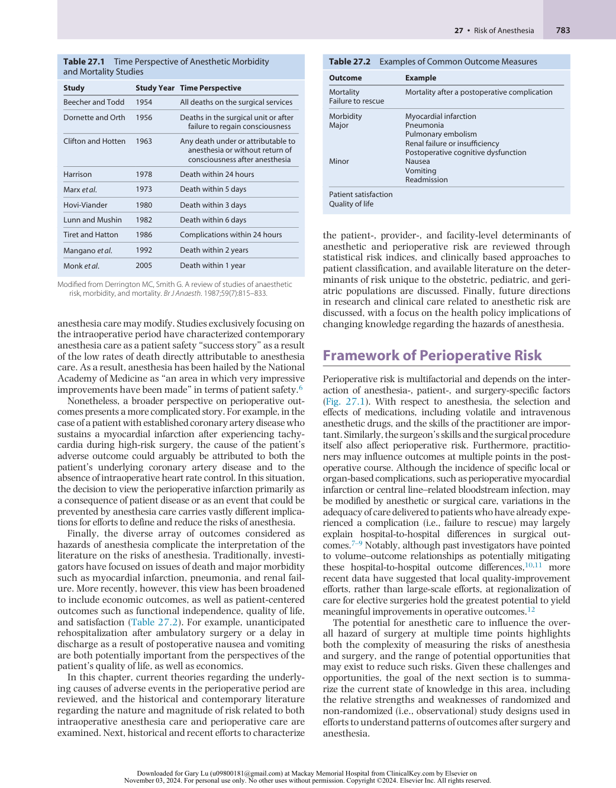

:::

<!-- PDF page 3 -->

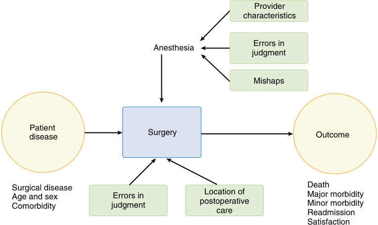

Provider characteristics Errors in Anesthesia judgment Mishaps Patient disease Surgery Outcome Surgical diseaseAge and sex Errors in Location of DeathMajor morbidity Comorbidity judgment postoperativecare Minor morbidityReadmission Satisfaction 

**Fig. 27.1 Representation of the influences of various components on poor perioperative outcomes.** Surgical, anesthetic, and patient characteristics all contribute to outcome. Anesthesia- related contributions can include issues of judgment and mishaps, as well as characteristics of the provider. The surgical procedure itself affects outcome, as does the location of intraoperative and postoperative care.

## Issues Related to Study Design

### TYPES OF STUDIES

To interpret the literature related to anesthetic and perioperative risk, the strengths and limitations of various study designs must be understood. _Prospective cohort studies_ involve the identification of a group of subjects who are monitored over time for the occurrence of an outcome of interest. The goal is to identify patients in whom the outcome develops. For studies of perioperative mortality, individual cases can be reviewed to determine the cause of mortality. Alternatively, data on all patients in the cohort study can be obtained, and discrete factors associated with the development of morbidity or mortality can be determined, often using multivariate regression techniques. An example of a prospective cohort study to identify factors associated with perioperative cardiac morbidity and mortality is that of Goldman and colleagues,13 which led to development of the Cardiac Risk Index.

Although prospective cohort studies have important value in identifying risk factors for perioperative outcomes, they also have significant limitations. The range of patients enrolled in the cohort study, both in terms of baseline characteristics and the care they receive, may impact the generalizability of the study findings. Additional biases may be introduced by loss of patients to follow- up. Failure to anticipate the potential impact of some variables and collect data on them may limit the insights gained from a cohort study. Similarly, the inability to collect data on all potential confounders of the relationship between a putative risk factor and a given outcome limits the extent to which cohort studies can support causal inferences.

_Randomized clinical trials_ offer stronger evidence of causality than do observational cohort studies. In a randomized trial, subjects are assigned by random allocation to one of two or more treatments (potentially including a placebo) and are observed for the development of a particular

outcome. In the context of perioperative risk, randomized trials may be used to determine the efficacy of an intervention or anesthetic regimen intended to improve postoperative outcomes. For example, hypothermia in the perioperative period has been associated with an increased incidence of perioperative ischemia, a surrogate marker for morbidity.14 In a randomized clinical trial, the use of forced- air warming to maintain normothermia was associated with a significantly less frequent incidence of perioperative morbid cardiac events.15 Randomized clinical trials often build on hypotheses generated in cohort studies regarding the determinants of outcomes by testing interventions directed at a specific risk factor associated with adverse outcomes.

Randomized clinical trials derive their strength from their high degree of internal validity; the randomization scheme and the use of placebo (or accepted alternative treatments) provide strong evidence that the results are related to the intervention. Importantly, these trials may have a lower degree of external validity because the intervention tested in a particular trial may not work as well or in the same manner as when it is diffused into a more heterogeneous population. Furthermore, as a result of sample size limitations, clinical trials may often be unable to detect subtle differences in outcomes among study groups or differences in rare events.

_Retrospective studies_ involve the identification of patients who have sustained an outcome and definition of risk factors associated with the outcome. An example of a retrospective design is a case–control study. _Case–control studies_ identify patients with the outcome of interest. Frequently, these patients are included as part of a prospective cohort study. The prevalence of a risk factor in patients with the outcome (i.e., cases) is compared with the prevalence of the risk factor in matched control participants to maximize the efficiency and power of the results. The ratio of cases to control participants can be varied to yield greater power with an increasing number of controls. An alternative retrospective design involves the systematic review of identifiable adverse

<!-- PDF page 4 -->

events for patterns of error. For example, Cheney and colleagues16 developed the American Society of Anesthesiologists’ Closed Claims Project (ASA- CCP) to assess the risks associated with anesthesia care. By obtaining the records of major events that led to legal litigation, they were able to identify factors that contributed to bad outcomes. With this methodology, selected morbidities that led to litigation can be identified. The limitation of this methodology is that the actual rates of complications in the overall population are not known; only the number of closed legal claims is identified. Cases that do not result in litigation are not included in the database.

### PROBLEMS INHERENT IN STUDYING ANESTHESIA- RELATED RISK

Studying anesthesia- related risk involves a range of methodologic challenges. On the most basic level, multiple definitions exist for key outcomes, such as perioperative mortality. In particular, the time frame in which a death can be attributed to the surgery or the delivery of anesthesia or both varies. Notably, many events related to surgery may occur after discharge when monitoring of outcomes becomes more challenging. For this reason, the National Surgical Quality Improvement Program (NSQIP), a large, prospectively collected US registry of surgical care and outcomes, requires 30- day follow- up on all patients to allow for consistent assessments of outcomes for all patients.

A second major challenge in any study of postoperative outcomes is the low observed rate of many key outcomes in the population of interest. Although some recent writers have called into question the safety of contemporary anesthesia care,17 anesthesia- related death remains relatively uncommon in absolute terms. For example, the rate of anesthesia- related mortality described in the Confidential Enquiry into Perioperative Deaths (CEPOD) of 1987 was 1 in 185,000 patients as opposed to the 1 in 2680 cases reported by Beecher and Todd approximately 30 years earlier.18,19 As a result, efforts to identify the range of factors that now contribute to anesthetic mortality are likely to require large patient cohort studies available either from administrative sources or collected over several years from multiple institutions. Several attempts have been made to establish large epidemiologic databases to address this challenge. One example of such an approach has been the work of Dennis Mangano and the Multicenter Study of Perioperative Ischemia Research Group with regard to cardiac surgery. This group used its database to evaluate issues such as the rate and importance of atrial fibrillation after cardiac surgery and the association of perioperative use of aspirin with cardiac surgical outcomes.20,21 Other approaches include the development of cardiac surgery databases by the Society of Thoracic Surgeons, the US Veterans Administration NSQIP, and the Northern New England Cardiovascular Disease Study Group.22–25 These databases are used to define risk factors for poor outcome, to compare local with national complication rates, and as educational tools. In the United States, the Multicenter Perioperative Outcomes Group has undertaken such an enterprise by pooling electronically collected intraoperative and postoperative data.26 Although these databases may provide extremely important information to improve care, the ability to generalize

results to centers that do not have sufficient infrastructure to participate in such projects (e.g., smaller hospitals) is unknown.

Variations in care and outcomes across institutions may further complicate efforts to develop meaningful estimates of perioperative risk for use in clinical decision- making by individual patients. Beyond the impact of patient illness, type of surgery, or anesthetic approach, hospital- level differences in postoperative care may have a profound impact on outcome. For example, the incidence of pulmonary embolism may be related to nursing care and the frequency of patient ambulation after surgery27 ; similarly, the presence of an intensivist who makes daily rounds and higher nurse staffing ratios may also affect outcome.28

Finally, issues of risk adjustment complicate efforts to determine changes in anesthesia risk over time. Common end points, such as mortality, are influenced by patient factors as well as by anesthesia and surgical care; as such, temporal trends in patient acuity may influence the apparent adverse outcomes associated with anesthesia and surgery in a given period.29,30 With appropriate risk adjustment, changes in mortality rates over short periods may provide some indication of changes in the quality of anesthesia or surgical care. When viewed over longer periods, however, it may be more difficult to reach firm conclusions regarding temporal changes in the safety of anesthesia or surgery based on differences in mortality rates over time. For example, if improvements in anesthetic technology have allowed for older and sicker patients to undergo surgery, then the safety of anesthesia may have improved without any apparent change in mortality rates because a sicker patient population is now offered surgery that, in the past, would have been avoided. Similarly, the rapid adoption of new but relatively high- risk procedures complicates simple comparisons of anesthesia- related complications over time.

### STUDIES OF ANESTHESIA- RELATED MORTALITY

Efforts to understand the specific risks imposed by anesthesia care, above and beyond the surgical procedure itself, have represented an important dimension of research in anesthesia since the early 20th century. Although more recent trends in anesthesia research have emphasized a broad view of perioperative outcomes not strictly limited to events primarily caused by anesthesia care,31 the history of efforts to determine the safety of anesthesia management represents an important chapter in the development of modern perioperative medicine. This history also serves as important background for understanding current research and practice.

Research performed before 1980 demonstrated wide variation in reported rates of anesthesia- related mortality (Table 27.3). Beecher and Todd’s 1954 report of anesthesiarelated deaths at 10 institutions represents the earliest published major analysis of anesthesia outcomes.18 Their study included 599,548 anesthesia procedures and found a rate of all- cause mortality of 1 per 75 cases (1.3%). In 1 out of every 2680 procedures, anesthesia represented the primary cause of mortality, and it was a primary or contributory cause of mortality in 1 of 1560 procedures. The work of Dornette and Orth32 investigating perioperative deaths over a 12- year period at their institution corroborated these findings: they reported a mortality rate attributable to anesthesia in 1 in

<!-- PDF page 5 -->

**Table 27.4** Incidence of Complications Partially or Totally Related to Anesthesia

**Table 27.3** Estimates of the Incidence of Mortality Related to Anesthesia Before 1980

|**Complications**|**Partially Related**|**Totally Related**|**Total***|
|---|---|---|---|
|All complications|1:1887|1:1215|1:739|
|Death|1:3810|1:13,207|1:1957|
|Death and coma|1:3415|1:7924|1:2387|

|**Study**|**Year**|**Number of** **Anesthetics**|**Primary** **Cause**|**Primary and** **Associated** **Causes**|
|---|---|---|---|---|
|Beecher and Todd|1954|599,548|1:2680|1:1560|
|Dornette and Orth|1956|63,105|1:2427|1:1343|
|Schapira_et al_.|1960|22,177|1:1232|1:821|
|Phillips_et al_.|1960|—|1:7692|1:2500|
|Dripps_et al_.|1961|33,224|1:852|1:415|
|Clifton and Hotton|1963|205,640|1:6048|1:3955|
|Memery|1965|114,866|1:3145|1:1082|
|Gebbie|1966|129,336|—|1:6158|
|Minuck|1967|121,786|1:6766|1:3291|
|Marx_et al_.|1973|34,145|—|1:1265|
|Bodlander|1975|211,130|1:14,075|1:1703|
|Harrison|1978|240,483|—|1:4537|
|Hovi- Viander|1980|338,934|1:5059|1:1412|

*Total number of anesthetics: 198,103. From Tiret L, Desmonts JM, Hatton F, Vourc’h G. Complications associated with anaesthesia – a prospective survey in France. _Can Anaesth Soc J_ . 1986;33:336–344.

more than five times safer to undergo anesthesia in 1984 than it was in 1960.43

Under the direction of the French Ministry of Health, Tiret and colleagues44 carried out a prospective survey of complications associated with anesthesia in France between 1978 and 1982 from a representative sample of 198,103 anesthesia procedures from hospitals throughout the country. Death was solely related to anesthesia in 1 in 13,207 procedures and partially related in 1 in 3810 (Table 27.4). The French survey confirmed previous findings that major complications occur more frequently in older patients, those undergoing emergency surgical procedures, and those with more extensive comorbid conditions as measured by ASA physical status classification. More notably, the investigators found that postanesthesia respiratory depression was the leading principal cause among cases of death and coma that were solely attributable to anesthesia. Moreover, almost all the patients who had had respiratory depression leading to a major complication had received narcotics, as well as neuromuscular blocking drugs, but they had not received anticholinesterase medications for reversal of the agents.

From Ross AF, Tinker JH. Anesthesia risk. In: Miller RD, ed. _Anesthesia_ , ed 3. New York, NY: Churchill Livingstone; 1990;722.

2427 cases, and totally or partially attributable to anesthesia in 1 in 1343 cases. In contrast, Dripps and colleagues found the anesthesia- attributable mortality rate to be 1 in 852 in a similar single- institution longitudinal study.33 These differences may be partially explained by Dripps’ observation of 30- day, rather than intraoperative or 48- hour mortality, or differences in patient severity across studies.

Multiple additional studies on anesthetic mortality appeared between 1960 and 1980.34 In the United States, these included the Baltimore Anesthesia Study Committee,35 which reviewed 1024 deaths occurring on the day of or the day after a surgical procedure, and several single- institution studies.36,37 Overall, the rate of anesthesia- related mortality in these studies varied widely, ranging from 1 in 1232 cases in a study by Schapira _et al._36 to 1 in 7692 cases in the Baltimore Anesthesia Study Committee report. Results from the international community during that period were similarly heterogeneous in methodology and findings.38–41

Despite these observations, the low rates of anesthesiaattributable mortality documented in the French study offered compelling evidence of improvements in anesthesia safety. Such findings were reinforced by other, concurrent work in Finland45 and in the United Kingdom,46 resulting in the development of the United Kingdom CEPOD, which assessed almost 1 million anesthetics during a 1- year period in 1987 in three large regions of the United Kingdom.

Beyond confirming earlier work, CEPOD’s findings suggested that anesthesia care was far safer than had been found in prior studies. Examining deaths within 30 days of surgery, CEPOD investigators observed 4034 deaths in an estimated 485,850 surgeries for a crude mortality rate of 0.7% to 0.8%. Anesthesia was considered the sole cause of death in only three individuals, for a rate of 1 in 185,000 cases, and anesthesia was contributory in 410 deaths, for a rate of 7 in 10,000 cases (Table 27.5).19 The five most common causes of death in the CEPOD cohort study are shown in Table 27.6. Notably, of the 410 perioperative deaths, gastric aspiration was identified in 9 cases and cardiac arrest in 18 cases. Ultimately, CEPOD researchers concluded that avoidable factors were present in approximately 20% of the perioperative deaths. Contributing factors for anesthesiologists and surgeons tended to be failure to act appropriately with existing knowledge (rather than a lack of knowledge), equipment malfunction, fatigue, and inadequate supervision of trainees, particularly in off- hours shifts (Table 27.7).

Studies of anesthetic risk published before 1980 varied widely in the definitions used for anesthesia- related mortality and in the mortality rates they reported; however, they suggested that death related solely to anesthesia was a relatively uncommon event. Moreover, an overall trend toward lower rates of anesthesia- related mortality across studies over time suggested potential improvements in anesthesia safety.

Studies since 1980 have generally been performed on a regional or national basis with a particular emphasis on documenting changes over time in anesthesia- related mortality. For example, Holland42 reported deaths occurring within 24 hours after anesthesia in New South Wales, Australia. The incidence of anesthesia- attributable deaths decreased from 1 in 5500 procedures performed in 1960 to 1 in 26,000 in 1984. Based on these estimates, the investigators asserted that for all patients receiving surgery, it was

::: details 原始表格與符號（PDF 第 5 頁）

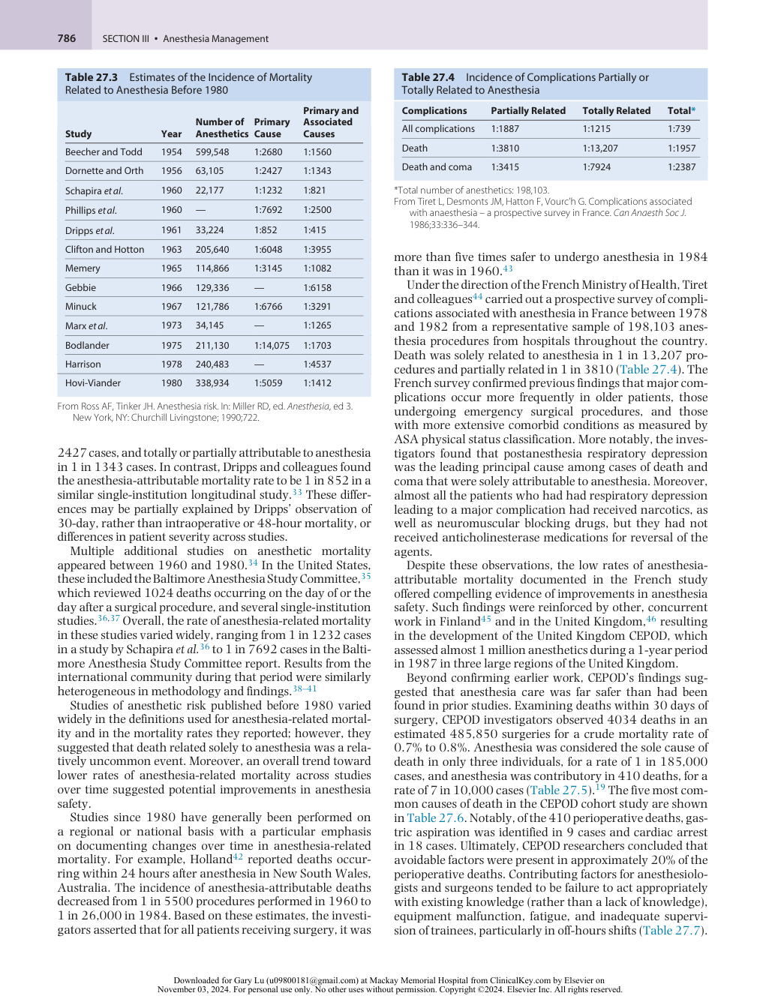

:::

<!-- PDF page 6 -->

**Table 27.8** Selected Cardiac Arrest Series When the Denominator Is Greater Than 40,000 Anesthetics

**Table 27.5** Death Totally Attributable to Each Component of Risk in the Confidential Enquiry into Perioperative Deaths

|**Study**|**Years**|**Total Number** **of Anesthetics**|**Rate of Arrest**|
|---|---|---|---|
|Hanks and Papper|1947–1950|49,728|1:2,162|
|Ehrenhaft_et al_.|1942–1951|71,000|1:2,840|
|Bonica|1945–1952|90,000|1:6,000|
|Blades|1948–1952|42,636|1:21,318|
|Hewlett_et al_.|1950–1954|56,033|1:2,061|
|Briggs_et al_.|1945–1954|103,777|1:1,038|
|Keenan and Boyan|1969–1978|107,257|1:6,704 (P)|
|Cohen_et al_.|1975–1983|112,721|1:1,427 (C)|
|Tiret_et al_.|1978–1982|198,103|1:3,358 (C)|
|Tiret_et al_.|1978–1982|198,103|1:11,653 (P)|
|Keenan and Boyan|1979–1988*|134,677|1:9,620 (P)|
|Newland_et al_.|1989–1999|72,959|1:14,493 (P)|
|Newland_et al_.|1989–1999|72,959|1:7,299 (C)|
|Olsson and Hallen|1967–1984|250,543|1:33,000|
|Biboulet_et al_.|1989–1995|101,769|1:7,828|
|Kawashima_et al_.|1994–1998|2,363,038|1:10,000 (P)|
|Sprung_et al_.|1990–2000|518,294|1:20,000 (P)|
|Braz_et al_.|1996–2005|53,718|1.9:10,000 (P)|

|**Component**|**Mortality Rate Contribution**|
|---|---|
|Patient|1:870|
|Operation|1:2860|
|Anesthetic|1:185,056|

Modified from Buck N, Devlin HB, Lunn JL. Report of a confidential enquiry into perioperative deaths. Nuffield Provincial Hospitals Trust, The King’s Fund Publishing House, London, 1987.

**Table 27.6** Most Common Clinical Causes of Death in the Confidential Enquiry into Perioperative Deaths

|**Cause of Death**|**Percent of Total**|
|---|---|
|Bronchopneumonia|13.5|
|Congestive heart failure|10.8|
|Myocardial infarction|8.4|
|Pulmonary embolism|7.8|
|Respiratory failure|6.5|

Modified from Buck N, Devlin HB, Lunn JL. Report of a confidential enquiry into perioperative deaths, Nuffield Provincial Hospitals Trust, The King’s Fund Publishing House, London, 1987.

**Table 27.7** Grade of Physician According to Time of Surgery in the Confidential Enquiry into Perioperative Deaths

_*_ Since pulse oximetry was introduced in 1984, no preventable respiratory cardiac arrests have occurred.

- C, contributory cause; _P,_ primary cause. Modified from Brown DL. Anesthesia risk: a historical perspective. In: Brown DL, ed. _Risk and Outcome in Anesthesia_ . 2nd ed. Philadelphia, PA: Lippincott; 1992:14.

||**AN**|**ESTHETIST**||**SURGEON**|
|---|---|---|---|---|
|**Grade**|**Day***|**Night**†|**Day***|**Night**†|
|Consultant|50|25|45|34|
|Others|50|75|55|66|

codes themselves in differentiating anesthesia diagnoses, as well as the associated sensitivity and specificity of these codes on cause of death. This complicates the interpretation of Li’s study49 ; however, their findings are in accord with those of the CEPOD report in presenting anesthesiarelated mortality to be an extremely rare cause of death at the population level. The authors found anesthesia to be the underlying cause of death in 34 patients each year in the United States and a contributing factor in another 281 deaths annually, resulting in a 97% decrease in anesthesiarelated death rates since the 1940s.

*Represents Monday through Friday, 9 am to 7 pm. †Represents Monday through Friday, 7 pm to 9 am, and Saturday and Sunday. Modified from Buck N, Devlin HB, Lunn JL. Report of a confidential enquiry into perioperative deaths, Nuffield Provincial Hospitals Trust, The King’s Fund Publishing House, London, 1987.

Large national studies performed since the 1987 CEPOD report vary in the extent to which their findings agree with those of the CEPOD investigators. In a prospective study of 7306 anesthesia procedures in Denmark, Pedersen and colleagues47 found complications attributable to anesthesia in 43 patients (1 in 170) and 3 deaths (1 in 2500), an incidence far higher than that documented by the CEPOD investigators. Complications in the 43 patients, in order of incidence, included cardiovascular collapse in 16 (37%), severe postoperative headache after regional anesthesia in 9 (21%), and awareness under anesthesia in 8 (19%).

Recent European studies have taken a broader focus beyond anesthesia- related events to examine perioperative outcomes more generally, particularly among highrisk patients who Lagasse and others previously observed to account for the majority of postoperative deaths.17 In a 2011 report, NCEPOD investigators prospectively collected data on all patients undergoing inpatient surgery, excluding obstetric, cardiac, transplant, or neurosurgery cases, in United Kingdom National Health Service facilities over a 1- week period.50 In addition to prospectively collected patient- level data on clinical care and outcomes, the authors conducted a detailed institution- level survey of resources and practices. Although the authors observed an overall 30- day mortality rate of 1.6%, a subset of high- risk patients – approximately 20% of the full cohort – experienced a

In the United States, Li and colleagues48 conducted a population- level study to estimate epidemiologic patterns of anesthesia- related deaths, using International Classification of Diseases (ICD) codes listed in the United States multiple- cause- of- death data files for the years 1999 through 2005. The effectiveness of the ICD- 10 codes to account for anesthetic- related mortality is incomplete, relating to both the relative lack of robustness in the ICD- 10

::: details 原始表格與符號（PDF 第 6 頁）

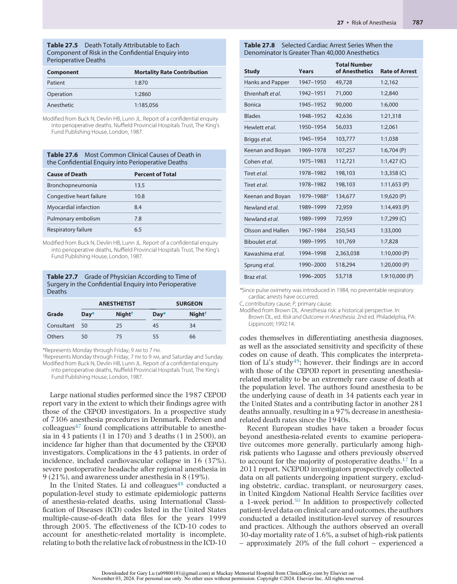

:::

<!-- PDF page 7 -->

disproportionate share of adverse outcomes, accounting for 79% of all perioperative deaths. Notably, the authors identified important gaps in the perioperative management of these patients. A minority of the high- risk patients were monitored using an arterial line, a central line, or cardiac output monitoring; still more concerning was their observation that 48% of all high- risk patients who died were never admitted to a critical care unit for postoperative management. Similar findings were obtained in another study of surgical outcomes conducted across 28 European countries between April 4 and April 11, 2011.51 Such patterns, which the authors describe as a “systematic failure in the process of allocation of critical care resources” in Europe, highlight the potential importance of “rescue” – the prevention of mortality among patients who experience postoperative complications – in determining the outcomes of surgical care. Furthermore, to the extent that critical care use among patients who die after surgery is higher in the United States than in the United Kingdom,52 such differences may offer insight into potential reasons for earlier observations of lower risk- adjusted postoperative mortality among American versus British surgical patients.53

In the United States, Whitlock and colleagues54 retrospectively analyzed 2,948,842 cases logged in the National Anesthesia Clinical Outcomes Registry between 2010 and 2014. They documented a mortality rate of 33 per 100,000. Increasing ASA physical status, emergency case status, time of day, and age less than 1 year or greater than 65 years were independently associated with perioperative mortality. After adjustment for confounding factors, mortality remained greater for cases started after 6 pm, suggesting that certain factors influencing perioperative mortality might be modifiable. The most common concurrent outcomes in patients who died within 48 hours of anesthesia were hemodynamic instability (35.0%) and respiratory complications (8.1%). Notably, due to data limitations, the authors did not comment on the number of deaths that were anesthesia associated.

Similarly, in Brazil, Stefani and colleagues55 retrospectively studied 11,562 anesthetic procedures between December 2011 and January 2012, and found a mortality rate of 0.64% within 48 hours of the procedure, and 2.74% within 30 days following the procedure. They found that the majority of the deaths were classified as inevitable, relating to advanced illnesses and would occur regardless of interventions, and that the second most common cause of death was related to surgical complications at 25% of the cohort. Anesthetic- related deaths were found to be approx. 1.72 per 10,000 cases, and cases where anesthesia was a potential contributor were found to be at 7.78 per 10,000 cases. While most causes of death occurred later, Stefani and colleagues concluded that anesthetic- related mortality likely occurs significantly earlier when compared to causes of death from other etiologies.

There has been some question regarding the depth of anesthesia and the perioperative survival, with some suppositions that increased anesthetic depth leads to increased perioperative mortality. However, a large, multicenter, international trial led by Short and colleagues found that there was no correlation between depth of anesthesia and subsequent mortality at 1 year.56 This team recruited 6644 patients across 73 centers in 7 countries from December

2012 until December 2017. The patients were 60 years or older, had significant comorbidities, a surgery length of greater than 2 hours, and a postoperative course estimated to be greater than 2 days. The patients were randomly assigned to a bispectral index (BIS) score of 35 or 50, reflecting deep vs. light anesthesia, respectively. Short found no difference in all- cause mortality at 1 year postoperatively.

In summary, research on anesthesia- related mortality offers a complex and still incomplete picture regarding the risks of anesthesia. Taken from the perspective of the 1987 CEPOD report or the findings of Li and colleagues, modern operative anesthesia could be characterized as an exceedingly safe enterprise with bad outcomes occurring as truly rare events; however, other studies have disputed these findings. More recent work has sought to go beyond efforts to quantify the contribution of anesthesia _per se_ to overall operative risk to explore how anesthesia providers might be able to improve outcomes among high- risk patients, in essence, asking not “how safe is anesthesia?” but instead “how can anesthesia providers help make surgery safer?” Ultimately, these studies’ differing messages emphasize not only the dynamic nature of anesthesia risk over time, but also highlight important changes in how anesthetic risk has been defined across different periods and how alternate approaches to evaluating, describing, and mitigating such risk may be more or less relevant at a given moment in time.

### ANALYSIS OF INTRAOPERATIVE CARDIAC ARREST

In an alternative approach to evaluating perioperative mortality specific to anesthesia, several studies have evaluated intraoperative fatal and nonfatal cardiac arrest. In contrast to efforts to estimate the mortality attributable to anesthesia _per se_ , studies of intraoperative cardiac arrest may offer a broader picture of the potential hazards of anesthesia by examining an adverse outcome that is far more common than mortality yet remains highly consequential for longterm outcomes.

These studies offer a range of perspectives on the incidence of intraoperative cardiac arrest and the causes of such events (Table 27.8). For example, Keenan and Boyan57 studied the incidence and causes of cardiac arrest related to anesthesia at the Medical College of Virginia between 1969 and 1983. A total of 27 cardiac arrests occurred during 163,240 procedures, for an incidence of 1.7 per 10,000 cases. Fourteen patients died, for an incidence of 0.9 per 10,000 cases. Pediatric patients had a threefold higher risk of cardiac arrest than did adults, and emergency cases had a sixfold greater risk. Importantly, specific errors in anesthesia management could be identified in 75% of the cases; most common among these were inadequate ventilation and overdose of an inhaled anesthetic. Notably, the investigators identified progressive bradycardia preceding all but one arrest, suggesting that early identification and treatment may prevent complications.

Similar findings were reported by Olsson and Hallen,58 who studied the incidence of intraoperative cardiac arrest at the Karolinska Hospital in Stockholm, Sweden, from 1967 to 1984. A total of 170 arrests occurred in 250,543 anesthesia procedures performed. Sixty patients died, for a mortality rate of 2.4 per 10,000 procedures. After eliminating

<!-- PDF page 8 -->

cases of inevitable death (e.g., rupture of a cerebral aneurysm, trauma), the rate of mortality caused by anesthesia was 0.3 per 10,000 procedures. The most common causes of anesthesia- related cardiac arrest were inadequate ventilation (27 patients), asystole after succinylcholine (23 patients), and postinduction hypotension (14 patients). The incidence of cardiac arrest was highest in the patients with significant comorbid disease, as assessed by the ASA physical status classification. Notable is the finding that the incidence of cardiac arrest decreased over the study period. These findings were reproduced in other studies, including that of Biboulet and colleagues59 and Newland and associates.60

Sprung and colleagues61 demonstrated similar findings with regard to incidence and outcome of cardiac arrest during 72,529 procedures between 1989 and 1999 in a teaching hospital in the United States. They also found that the frequency of arrest in patients receiving general anesthesia decreased over time (7.8 per 10,000 during 1990–1992; 3.2 per 10,000 during 1998–2000). The frequency of arrest during regional anesthesia (1.5 per 10,000) and monitored anesthesia care (MAC) (0.7 per 10,000) remained the same during the study period (Fig. 27.2). More recently, Ellis and group62 used an institutional quality improvement database to identify all instances of cardiac arrest occurring within a 24- hour perioperative period between 1999 and 2009. They identified 161 arrests in 217,365 anesthetics, 14 of which were found to be anesthesia- attributable (0.6 per 10,000 anesthetics) and 23 that were anesthesiacontributory (1.1 per 10,000). Of anesthesia- attributable events, the majority (64%) were caused by airway complications during induction or emergence. The mortality associated with these events was 29%.

Kawashima and colleagues identified even lower rates of cardiac arrest attributable to anesthesia in a survey- based study conducted in Japan from 1994 through 1998.63 The average yearly incidence of cardiac arrest during surgery that was totally attributable to anesthesia was 1 per 10,000 cases (95% confidence interval [CI] 0.88–1.12). The average mortality per year in the surgical unit or within seven

postoperative days that was totally attributable to anesthesia was 0.21 (0.15–0.27) per 10,000 cases. The two principal causes of cardiac arrest solely attributable to anesthesia were drug overdose or selection error (15.3%) and serious arrhythmia (13.9%). Preventable human errors caused 53.2% of cardiac arrests and 22.2% of deaths in the surgical unit that were totally attributable to anesthesia. The outcomes of cardiac arrests totally attributable to anesthesia are shown in Table 27.9.

Kheterpal and colleagues at the University of Michigan examined predictors of cardiac adverse events – including cardiac arrest, myocardial infarction, and clinically significant arrhythmia – among 7700 patients undergoing noncardiac surgery. Eighty- three patients (1.1%) experienced an adverse event. The authors identified nine independent predictors of an adverse event: (1) age 68 years or older, (2) body mass index of 30 or greater, (3) emergency surgery, (4) previous coronary intervention or cardiac surgery, (5) active congestive heart failure, (6) cerebrovascular disease, (7) hypertension, (8) operative time of 3.8 hours or longer, and (9) the intraoperative administration of one or more units of packed red blood cells.64

In summary, perioperative cardiac arrest is a relatively rare event whose incidence may be decreasing over time. Furthermore, research in this area has highlighted the role of both patient factors and intraoperative care as contributing to the risk of intraoperative and postoperative cardiac arrest and emphasized the management of ventilation and the selection and dosing of anesthetic medications as key areas of focus for the prevention of such events.

### PERIOPERATIVE MORTALITY AND MORBIDITY IN OUTPATIENT SURGERY

In the United States, an estimated 60% of all surgical procedures are performed on an outpatient basis, and this percentage is increasing annually. The type and extent of surgical procedures performed in an outpatient setting are constantly changing, and more complicated procedures

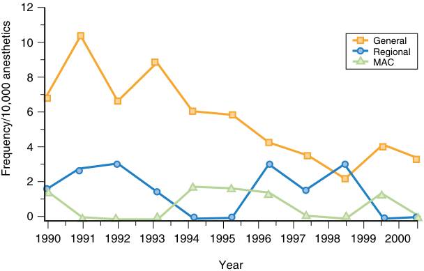

12 10 General Regional MAC 8 6 4 2 0 1990 1991 1992 1993 1994 1995 1996 1997 1998 1999 2000 Year Frequency/10,000 anesthetics 

**Fig. 27.2 Frequency of cardiac arrest by calendar year and type of anesthesia.** _MAC,_ monitored anesthesia care. (From Sprung J, Warner ME, Contreras MG, et al. Predictors of survival following cardiac arrest in patients undergoing noncardiac surgery: a study of 518,294 patients at a tertiary referral center. _Anesthesiology._ 2003;99:259–269.)

<!-- PDF page 9 -->

**Table 27.9** Cardiac Arrest Totally Attributable to Anesthesia During Anesthesia and Surgery and Its Outcomes, 1994 to 1998

**OUTCOMES**

||**Number of Arrests**|**Uneventful Recovery**|**Death in Surgical Unit**|**Death Within 7 Days**|**Vegetative State**|**Others**|
|---|---|---|---|---|---|---|
|5- year total|237|185|13|15|9|15|
|Incidence per 10,000|1.00|0.78|0.05|0.08|0.04|0.06|
|95% CI|0.88–≈1.12|0.66–≈0.89|0.2–≈0.08|0.02–≈0.13|0.03–≈0.05|0.02–≈0.10|
|Ratio|100%|78.1%|5.5%|6.3%|3.8%|6.3%|
|95% CI||55.3–≈100|1.7–≈9.3|3.0–≈9.7|2.5–≈5.3|1.7–≈11.0|

_N_ = 2,363,038. _CI,_ confidence interval. Reproduced with permission from Kawashima Y, Takahashi S, Suzuki M, et al. Anesthesia- related mortality and morbidity over a 5- year period in 2,363,038 patients in Japan. _Acta Anaesthesiol Scand_ . 2003;47:809–817.

associated with greater perioperative risk are increasingly being performed on an outpatient basis.

Notably, early research on the safety of two ambulatory surgical procedures – tonsillectomy and simple mastectomy – presented a negative view of the hazards of surgery in the outpatient setting. One of the first procedures advocated to be performed on an ambulatory basis was tonsillectomy. Although a 1968 case series of 40,000 outpatient tonsillectomies reported no deaths,65 details on patient selection and length of postoperative monitoring were vague. Based on insurance company and state mandates, performance of tonsillectomy on an outpatient basis became routine.66 Beginning in the mid- 1980s and continuing in the 1990s, a number of articles evaluated outcomes with early discharge after tonsillectomy. For example, Carithers and colleagues67 in 1987 at Ohio State University reported on 3000 tonsillectomies and argued that early discharge might be hazardous and economically unwarranted. The rate of readmission for active bleeding between 5 and 24 hours after surgery was reported to be between 0.2% and 0.5%.68–71 More recently, Coté and his co- investigators in the Society for Pediatric Anesthesia72 used a survey instrument as well as analysis of the ASA- CCP to investigate adverse events associated with tonsillectomy in children. They identified a total of 111 events occurring between 1999 and 2010. Death was the most common outcome (66%), followed by neurologic injury (11%) and prolonged hospital stay (10%). Events in children at risk for obstructive sleep apnea (OSA) were more frequently attributed to apnea, whereas children not at risk for OSA were more likely to experience adverse events secondary to hemorrhage. Fifty percent of patients with postoperative events had received postoperative opioids, including 61% of those children who experienced apneic events in the next 24 hours. Events occurred in multiple locations (the operating room, postanesthesia care unit [PACU], and after discharge). In spite of the limitations in the largely selfreported data, these findings clearly suggest that tonsillectomy remains a procedure with significant associated risk, even in the ambulatory setting.

Mastectomy represents a second important case study in the development of surgery as an outpatient procedure. An analysis of Medicare claims demonstrated that the rate of outpatient mastectomy increased from a negligible proportion of all mastectomies in 1986 to 10.8% of all mastectomies performed among Medicare beneficiaries in 1995.73 Within this population, simple mastectomies performed on

an outpatient basis had a significantly higher rate of readmission than did those undergoing a 1- day hospital stay, with an adjusted odds ratio of 1.84. Additionally, rates of readmission after 1- day stays were significantly lower for infection (4.1 vs. 1.8 per 1000 cases), nausea and vomiting (1.1 vs. 0 per 1000 cases), and pulmonary embolism or deep venous thrombosis (1.1 vs. 0 per 1000 cases).

More recent research suggests that, for some procedures, mere exposure to anesthesia in the outpatient setting may present an increased risk for complications. In 2013, Cooper and colleagues74 reviewed outcomes for a sample of cancer- free Medicare beneficiaries in the Surveillance, Epidemiology, and End Results database undergoing outpatient colonoscopy without polypectomy, and compared outcomes including hospitalization and aspiration pneumonia for those undergoing procedures with or without deep sedation (anesthesia services). The researchers identified 35,128 (21.2%) procedures with anesthesia services in a total of 100,359 patients; overall complications were more common in patients who had received anesthesia (0.22% vs. 0.16%, _P_ &lt; .001). Aspiration was also more common in the anesthesia group (0.14% vs. 0.1%, _P_ = .02). Multivariate analysis also demonstrated an increased risk of complications associated with use of anesthesia (odds ratio 1.46, 95% CI 1.09–1.94).

In contrast to these procedure- specific studies, the 1993 publication of Warner and colleagues75 on major morbidity and mortality within 1 month of ambulatory surgery strongly argued for the safety and feasibility of surgery in the outpatient setting. Among the 38,598 patients included in Warner’s study, four died. Of these four deaths, two were due to myocardial infarctions occurring more than 1 week after surgery; the other two deaths occurred in automobile accidents (Fig. 27.3). Partially as a result of these findings, the use of ambulatory surgery has dramatically grown between the early 1990s and the present, with a concurrent increase in the number and type of sites for ambulatory surgery. Such sites now include not only freestanding ambulatory surgery centers (ASCs) and physician’s offices, but they also include interventional radiology units and other diagnostic and therapeutic sites not affiliated with any other health care facility.

In the context of such growth, investigators have sought to examine the relative safety of similar procedures performed across different outpatient settings. Fleisher and coworkers2 performed a claims analysis of patients undergoing

::: details 原始表格與符號（PDF 第 9 頁）

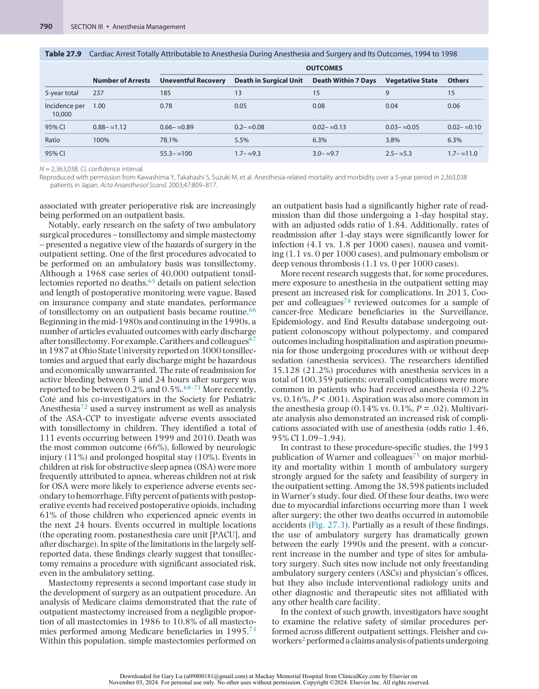

:::

<!-- PDF page 10 -->

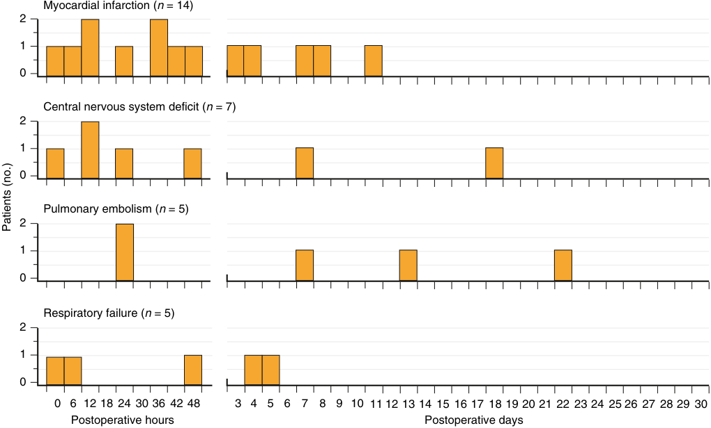

Myocardial infarction ( n  = 14) 2 1 0 Central nervous system deficit ( n  = 7) 2 1 0 Pulmonary embolism ( n  = 5) 2 1 0 Respiratory failure ( n  = 5) 2 1 0 0 6 12 18 24 30 36 42 48 3 4 5 6 7 8 9 10 11 12 13 14 15 16 17 18 19 20 21 22 23 24 25 26 27 28 29 30 Postoperative hours Postoperative days Patients (no.) 

**Fig. 27.3 Timing of perioperative events in patients undergoing ambulatory surgery.** Many of the events occurring within the first 48 hours are probably related to the stress of surgery. A subset of events occurring after this period may be related to background event rates. The overall rate of morbidity was lower than expected for a similar cohort of age- matched nonsurgical patients. (From Warner MA, Shields SE, Chute CG. Major morbidity and mortality within 1 month of ambulatory surgery and anesthesia. _JAMA._ 1993;270(12):1437–1441.)

16 different surgical procedures in a nationally represen-

tative (5%) sample of Medicare beneficiaries for the years 1994 through 1999. A total of 564,267 procedures were studied, with 360,780 in an outpatient hospital, 175,288 in an ASC, and 28,199 in a physician’s office. On the day of surgery, no deaths occurred in the office, but four deaths occurred in the ASC (2.3 per 100,000), and nine deaths occurred in the outpatient hospital (2.5 per 100,000). The 7- day mortality rate was 35 per 100,000 in the office setting, 25 per 100,000 in the ASC, and 50 per 100,000 in the outpatient hospital. The rate of admission to an inpatient hospital within 7 days was 9.08 per 1000 in the office, 8.41 per 1000 in the ASC, and 21 per 1000 in the outpatient hospital. Notably, the inferences of this study are limited by an inability to distinguish fully whether these differences in outcomes are related to the differences in the types of patients selected to have surgery in each setting versus the differences in the care patients received in each setting.

Subsequent work by Chukmaitov and colleagues compared quality outcomes between ASCs and hospital- based outpatient departments in the state of Florida between the years 1997 and 2004.76 Although their conclusions were limited by differences in the data available for patients treated in each setting, they postulated that the difference in outcomes between the two locations may be related to variations in organizational structure, processes, and strategies.

In contrast to the growing literature on the safety of anesthesia and surgery in ASCs, limited information exists to quantify the incidence of complications in office- based

settings. The American Association for Ambulatory Plastic Surgery Facilities mailed a survey to their members to determine the incidence of complications occurring in office facilities.77 The overall response rate was 57%. The findings showed that 0.47% of patients had at least one complication, including bleeding, hypertension, infection, and hypotension, and 1 in 57,000 patients died. Although low in absolute terms, the observation of a rate of mortality after minor outpatient procedures that is three times the current estimate for anesthesia- related complications is concerning in this context.

Vila and colleagues reviewed all adverse incident reports to the Florida Board of Medicine for procedures dated April 1, 2000, to April 1, 2002.78 Adverse incidents occurred at a rate of 66 and 5.3 per 100,000 procedures in offices and ASCs, respectively. The death rate per 100,000 procedures performed was 9.2 in offices and 0.78 in ASCs. The relative risk (RR) for injury and death for procedures performed in offices versus ASCs was 12.4 (95% CI 9.5–16.2) and 11.8 (95% CI 5.8–24.1), respectively. As a result, the authors concluded that if all office procedures had been performed in ASCs, approximately 43 injuries and 6 deaths per year could have been prevented. However, several other groups have also analyzed the Florida data and have been unable to document the increased risk in the office setting.79–81

In summary, although early research on ambulatory surgery placed an emphasis on the undue risks created by premature discharge, more recent analyses confirm that a range of surgeries can be safely performed in properly selected patients. Although some variations in outcomes

<!-- PDF page 11 -->

have been observed across settings (i.e., hospital outpatient department vs. ASC), available literature suggests that, given proper patient selection, outpatient surgeries can be performed with a low rate of adverse events in multiple practice environments. Given the gradual expansion of outpatient surgery over time to include patients with greater burdens of comorbid disease and more extensive procedures, ongoing evaluations will be essential to characterize the dynamic, evolving nature of anesthetic risk in the ambulatory setting.

### USE OF ANESTHESIA INFORMATION MANAGEMENT SYSTEMS

Over the past four decades, the use of computerized databases has enhanced the ability to assess perioperative risk and complications.

In one of the earliest computer analyses of postanesthesia deaths, Marx and associates37 identified 645 individuals who died within 7 days after surgery out of a total cohort of 34,145 consecutive surgical patients. More recently, the growth of electronic anesthesia record systems has allowed for better insights into the causes of anesthesia- related events within the surgical unit, and, when used in combination with other data sources, on postoperative outcomes. An early example of such an analysis was that of Sanborn and colleagues,82 who used a computer anesthesia record to identify intraoperative incidents. They were able to demonstrate that perioperative deaths occurred more frequently in patients who sustained an intraoperative incident of any type than in those who did not. Reich and colleagues similarly used computerized anesthesia records to evaluate hemodynamic variables and their relationship to risk.83 They identified pulmonary hypertension, hypotension during cardiopulmonary bypass, and post–cardiopulmonary bypass pulmonary diastolic hypertension as independent predictors associated with mortality, stroke, and perioperative myocardial infarction over and above the effects of other preoperative risk factors.

More recently, data from the University of Michigan anesthesia information management system have been used to identify predictors of perioperative risk, including that of inadequate mask ventilation and of postoperative acute kidney injury. In the former evaluation of 22,660 patients,84 limited or severely limited mandibular protrusion, abnormal neck anatomy, sleep apnea, snoring, and a body mass index of 30 kg/m2 or greater were independent predictors of grade 3 or 4 mask ventilation and difficult intubation. Review of 15,102 patients who had a normal preoperative creatinine clearance and underwent noncardiac surgery85 demonstrated that acute renal failure developed in 121 patients (0.8%), with 14 requiring renal replacement therapy (0.1%). Seven independent preoperative predictors were identified: age, emergency surgery, liver disease, body mass index, high- risk surgery, peripheral vascular occlusive disease, and chronic obstructive pulmonary disease necessitating chronic bronchodilator therapy. Acute renal failure was associated with increased mortality from any cause at 30 days, 60 days, and 1 year.

In an effort to expand upon the insights gained from single- institution studies, two major efforts have since been initiated to pool electronic data on anesthesia care from

multiple sites as a means of more effectively comparing outcomes and defining risk factors related to outcomes after anesthesia. The first of these, the Multicenter Perioperative Outcomes Group (MPOG), was initiated in 2008 under the leadership of investigators at the University of Michigan. This project currently collects electronic anesthesia data from over 50 participating anesthesia departments in two countries. To date, the group has released a series of observational studies, including a report on the risks and outcomes of epidural hematomas after perioperative and obstetric epidural catheterization.26 This was subsequently supported by Opperer86 reporting similar incidences of epidural hematomas, however, they also found the incidence of work- up and evaluation for epidural hematoma approximately doubled but without increase in hematoma evidence or decompressive laminectomies. The MPOG also presented a subsequent report evaluating the risk of epidural hematoma after neuraxial anesthesia in thrombocytopenic parturients.87 Other projects have evaluated predictors of difficult mask ventilation and intubation via direct laryngoscopy,88 as well as the success of a variety of rescue intubation techniques following direct laryngoscopy.89 The MPOG recently established Initiative for Multicenter Perioperative Clinical Trials, an arm dedicated to clinical and translational research.

The second group, the National Anesthesia Clinical Outcomes Registry, is maintained by the Anesthesia Quality Institute, a nonprofit organization established by the ASA. This large- scale data warehouse collects paper and electronic anesthesia case data used to review anesthesia practices with the intent of optimizing local efforts to assess both the risk and the quality of care, and for research purposes for the specialty as a whole. The Registry has released data related to perioperative mortality (cited earlier).

### OTHER APPROACHES TO DISCERN THE ROOT CAUSE OF MORBIDITY AND MORTALITY

Although mortality directly attributable to anesthesia appears to have declined over time, the exact causes of this decline remain unclear. Numerous factors have been implicated in the improved outcome, including new monitoring modalities, new anesthetic drugs, and changes in the anesthesia workforce. However, relating the reduced risk to any one factor on the basis of available epidemiologic data is difficult. Furthermore, although the use of newer monitoring modalities, particularly pulse oximetry, would be expected to improve outcomes, no randomized trial has been able to document such a conclusion. Indeed, given the ubiquity of most of these monitoring modalities, and medication changes, such a trial would be unlikely to be approved. Therefore, this limitation supports the need for continued monitoring of complications and their root cause through a number of approaches.

Initiated by the Professional Liability Committee of the ASA, the ASA- CCP represents one important approach to understanding the root causes of important complications of anesthesia care. The ASA- CCP constitutes an ongoing, nationwide survey of closed insurance claims for major anesthesia- related adverse events. In an early publication based on data collected by the ASA- CCP, Caplan and colleagues reviewed both fatal and nonfatal outcomes

<!-- PDF page 12 -->

resulting in claims against anesthesia providers. Among the fatal events, unexpected cardiac arrest during spinal anesthesia was observed in 14 healthy patients from the initial 900 claims.90 These cases were analyzed in detail to identify patterns of care that might have led to the event. Two patterns were identified: oversedation leading to respiratory insufficiency and inappropriate resuscitation of high spinal sympathetic blockade.

Tinker and co- workers91 queried the ASA- CCP to determine the role of monitoring devices in the prevention of anesthesia mishaps. They reviewed 1097 anesthesiarelated claims and determined that 31.5% of the negative outcomes could have been prevented by the use of additional monitors, primarily pulse oximetry, and capnography. Injuries that were deemed preventable with additional monitoring resulted in dramatically more severe injury and cost of settlement than did those judged to be nonpreventable with additional monitoring. These findings were reinforced by a subsequent study of intraoperative respiratory events by Caplan and colleagues (Table 27.10).92 These claims represented the single largest class of injury (34%), with death or brain damage occurring in 85% of cases. They identified inadequate ventilation, esophageal intubation, and difficult tracheal intubation as the primary causes of respiratory events. The investigators believed most of the outcomes to be preventable with better monitoring, such as pulse oximetry or capnography (Fig. 27.4).93 In more recent evaluations of MAC using the ASA- CCP, more than 40% of 121 claims associated with MAC involved death or permanent brain damage. Respiratory depression, after an absolute or relative overdose of sedative or opioid drugs, was the most common (21%, _n_ = 25) of the complications.

A similar registry was developed by the Danish Patient Insurance Association.94 For the years of 1996 through 2004, 1256 files were related to anesthesia, and 24 deaths were considered to be a result of the anesthetic procedure: 4 deaths were related to airway management, 2 to ventilation management, 4 to central venous catheter placement, 4 as a result of medication errors, 4 from infusion pump problems, and 4 after complications from regional blockade. Severe hemorrhage caused one death, and the cause was uncertain in one case.

Cooper and colleagues95,96 took an alternate approach to examining perioperative mortality through the study of critical incidents, which were defined as those that were

**Table 27.10** Distribution of Adverse Respiratory Events in the American Society of Anesthesiologists’ Anesthesia Closed Claims Study

|**Event**|**Number of Cases**|**Percent of 522** **Respiratory Claims**|
|---|---|---|
|Inadequate ventilation|196|38|
|Esophageal intubation|94|18|
|Difficult tracheal intubation|87|17|
|Inadequate inspired oxygen concentration|11|2|

From Caplan RA, Ward RJ, Posner K, Cheney FW. Unexpected cardiac arrest during spinal anesthesia: a closed claims analysis of predisposing factors. _Anesthesiology_ . 1998;68(1):5–11.

potentially preventable and could lead to undesirable outcomes. This definition included events that led to no harm or only transient effects. The investigation involved collecting data on anesthesia- related human errors and equipment failures from anesthesiologists, residents, and certified registered nurse anesthetists (CRNAs). In a series of reports, the authors identified frequent incidents, such as disconnections in breathing circuits, and causes of discovery of errors, such as intraoperative relief. They confirmed that equipment failure was a small cause of anesthesia mishaps (4%), whereas human error was a predominant factor. They suggested that future studies of anesthesia- related mortality and morbidity should classify events according to a strategy for prevention rather than outcome alone.

Other countries have developed similar databases, such as the Australian Incident Monitoring Study. Data from this database have been used to evaluate problems with ventilation, with vascular access, and in the PACU.97,98

### ISSUES ASSOCIATED WITH ANESTHESIA- RELATED MORTALITY

The studies detailed in the preceding text focus on intraoperative or in- hospital deaths directly attributable to anesthesia care; nonetheless, perioperative complications may contribute to the risk of mortality beyond the immediate postoperative period. For example, a perioperative stroke or myocardial infarction may lead to death after the period of analysis. Notably, recent research has suggested that even small myocardial infarctions or unstable angina during the perioperative period has been associated with worsened long- term survival.99 Should these _late_ deaths be attributed to anesthesia complications for the purpose of such analyses? The answer depends on the outcome and its relationship to anesthesia management.

The potential effects of anesthesia on long- term survival were suggested by Monk and colleagues.100 Using multivariate Cox proportional hazards models, these investigators identified three variables as significant independent predictors of mortality: patient comorbidity (RR, 16.116), cumulative deep hypnotic time (bispectral index &lt;45) (RR, 1.244/h), and intraoperative systolic hypotension (RR, 1.036/min). Further work is required to determine whether these results reflect a true pathophysiologic link between perioperative (anesthesia) management and long- term outcome or a simple statistical association. This study and others, however, emphasize the importance of evaluating all aspects of anesthesia care and short- and long- term outcomes to try to optimize both long- and short- term patient outcomes.

## Risks Related to Patient Characteristics

Multiple studies have demonstrated that perioperative morbidity and mortality are increased in the presence of coexisting medical diseases. The ASA physical status classification system, originally proposed in 1941,101 represents a widely used method of classifying the severity of coexisting disease among surgical patients. Since its introduction, this classification system has established a standardized terminology

::: details 原始表格與符號（PDF 第 12 頁）

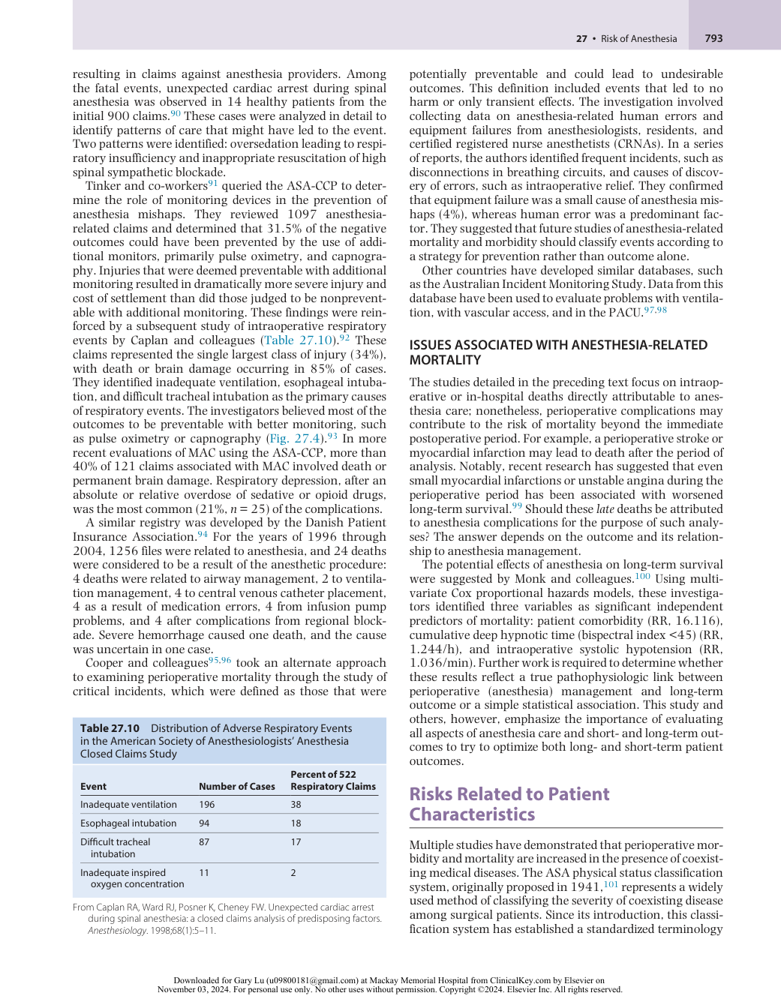

:::

<!-- PDF page 13 -->

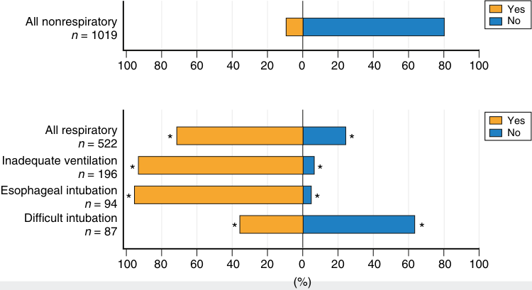

Yes All nonrespiratory No n  = 1019 100 80 60 40 20 0 20 40 60 80 100 Yes All respiratory * * No n  = 522 Inadequate ventilation * * n  = 196 Esophageal intubation * * n  = 94 Difficult intubation * * n  = 87 100 80 60 40 20 0 20 40 60 80 100 (%) 

**Fig. 27.4 Relationship between adverse events in the American Society of Anesthesiologists’ Anesthesia Closed Claims Project and preventable complications.** Preventable events related to respiratory complications were significantly more common than those related to all nonrespiratory complications. Of the respiratory complications, difficult intubation had the least number of preventable complications. (* _P_ &lt; .05 vs. nonrespiratory claims). (From Caplan RA, Posner KL, Ward RJ, Cheney FW. Adverse respiratory events in anesthesia: a closed claims analysis. _Anesthesiology._ 1990;72(5):828–833.)

for anesthesia practice and has aided in developing valid statistical comparisons of outcomes among sites.102

The correlation between ASA physical status and mortality offers a simple illustration of the link between comorbidities and adverse operative outcomes. In 1961, Dripps and co- workers demonstrated that mortality increased as the severity of comorbid disease increased, as assessed by the ASA physical status classification.33 Several investigators have reevaluated the relationship between operative mortality and ASA physical status and demonstrated similar findings.44,47,103

In Canada, Cohen and colleagues104 analyzed 100,000 anesthesia procedures and determined mortality within 7 days of surgery by using governmental vital statistics mortality data between the years 1975 and 1984. For each patient, information was collected on age, preoperative conditions, ASA physical status, anesthetic technique, monitors, and other factors. The overall 7- day mortality rate was 71.04 deaths per 10,000 procedures. Risk markers for mortality are detailed in Table 27.11.

One of the limitations of the ASA physical status classification system is that the ranking is determined by individual anesthesia providers; as such, there may be variance between providers, as demonstrated by Owens and coworkers.105 In light of these limitations, other studies have attempted to define the specific patient characteristics that are most strongly associated with perioperative adverse events related to a particular organ system. In evaluating the risk directly related to the patient’s condition, the limitations of the methodology must be understood. All such studies evaluate the predictive value of a clinical or laboratory risk factor for a defined perioperative complication. In this approach, a cohort of individuals of interest is defined. Ideally, the study is performed prospectively, and the outcome of interest is assessed in a rigorous, blinded fashion. Despite this, many available studies of perioperative risk factors focus on selected patients and include a retrospective design, methods that greatly limit their generalizability

**Table 27.11** Risk Factors Associated With Increased Odds of Dying Within 7 Days For All Cases

|**Variable**|**All Procedures:** **Relative Odds of** **Dying Within 7** **Days**| **95%** **Confidence** **Limits**|
|---|---|---|
|**PATIENT RELATED**|||
|Age (years)|||
|60–79 vs. &lt;60|2.32|1.70–3.17|
|80+ vs. &lt;60|3.29|2.18–4.96|
|Sex (female vs male)|0.77|0.59–1.00|
|ASA physical status classification (3–5 vs. 1–2)|10.65|7.59–14.85|
|**SURGERY RELATED**|||
|Major vs. minor|3.82|2.50–5.93|
|Intermediate vs. minor|1.76|1.24–2.5|
|Length of anesthesia (≤2 hours vs. &lt;2 hours)|1.08|0.77–1.50|
|Emergency vs. elective|4.44|3.38–5.83|
|**OTHER FACTORS**|||
|Year of surgery (1975–1979 vs. 1980–1984)|1.75|1.32–2.31|
|Complication in the surgical or recovery unit (yes vs. no)|1.42|1.06–1.89|
|**ANESTHESIA RELATED***|||
|Experience of the anesthetist|1.06|0.82–1.37|
|( >600 procedures for≥8 years vs. &lt;600 procedures for &lt;8 years)|||
| Inhalation with narcotic vs. inhalation alone|0.76|0.51–1.15|
|Narcotic alone vs. inhalation alone|1.41|1.01–2.00|
|Narcotic with inhalation vs. inhalation alone|0.79|0.47–1.32|
|Spinal vs. inhalation alone|0.53|0.29–0.98|
|Number of anesthetic drugs (1–2 vs. 3)|2.94|2.20–3.84|

*All cases performed with the five most frequently used anesthetic techniques.

Modified from Cohen MM, Duncan PG, Tate RB. Does anesthesia contribute to operative mortality? _JAMA_ . 1988;260(19):2859–2863.

::: details 原始表格與符號（PDF 第 13 頁）

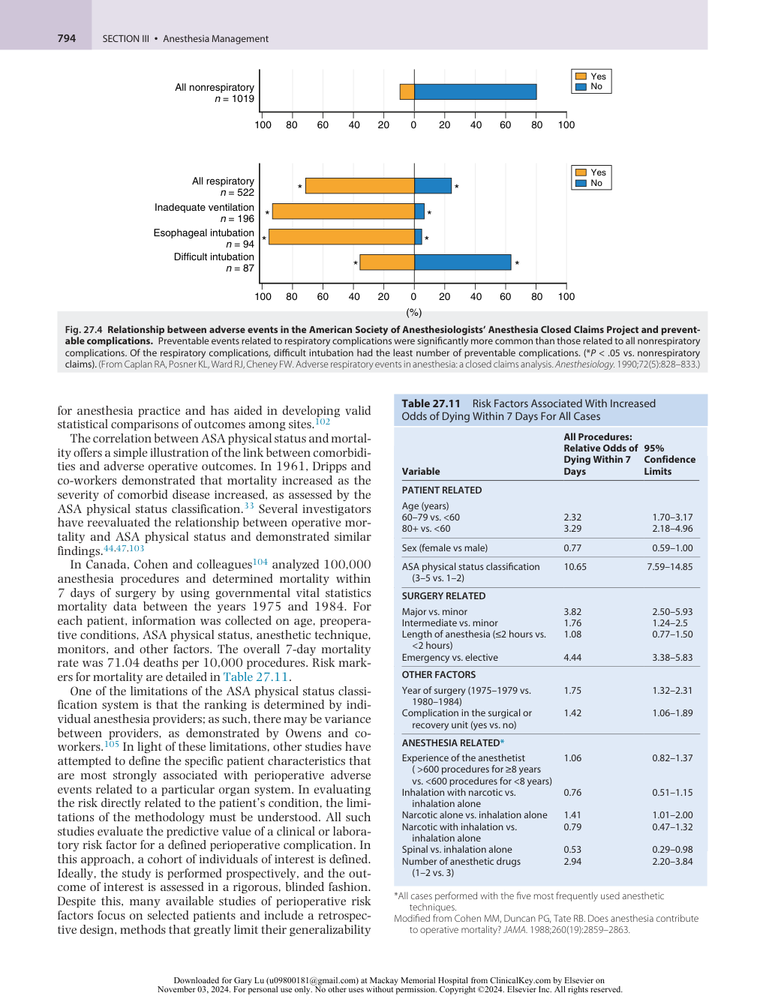

:::

<!-- PDF page 14 -->

and validity. Many studies use multivariate modeling to determine the factors associated with increased risk. A major limitation in the use of multivariate modeling for this purpose is the assumption that the intraoperative period is a _black box_ and that care is not modified by the knowledge of the risk factor (Fig. 27.5). However, anesthesiologists modify intraoperative care of high- risk patients in an attempt to minimize the likelihood of complications. Changes in medical care over time and better knowledge about highrisk patients should result in a reduction of the risk related to specified clinical factors. Such considerations make it difficult to design and complete formal investigations to validate individual management strategies in the context of current practice.

One common approach taken in past efforts to quantify operative risk has been to examine the relationship between a single risk factor and a broad range of adverse perioperative outcomes. For example, numerous studies have evaluated the importance of hypertension on perioperative risk. Goldman and Caldera106 evaluated a cohort of patients undergoing noncardiac surgery under general anesthesia. Hypertension was not associated with increased perioperative risk, although the number of patients with diastolic blood pressure greater than 110 mm Hg was too small to draw any statistically significant conclusions. In contrast, Hollenberg and co- workers107 identified hypertension and the presence of left ventricular hypertrophy as predictors of perioperative ischemia, but they did not consider their independent relationship to perioperative major morbidity. More recently, Baron and colleagues108 analyzed data from a prospective study examining perioperative care across 28 European countries to evaluate the impact of hemoglobin levels on in- hospital mortality. Patients with severe (hemoglobin &lt;8 g/dL) or moderate (8–11 g/dL) levels were found to have higher rates of in- hospital mortality as well as longer length of stay and a higher likelihood of postoperative admission to the intensive care unit (ICU).

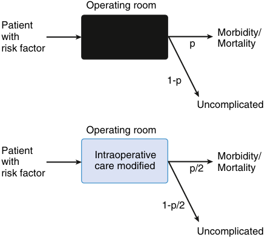

Operating room Patient with Morbidity/ risk factor p Mortality 1-p Uncomplicated Operating room Patient with Intraoperative Morbidity/ risk factor care modified p/2 Mortality 1-p/2 Uncomplicated 

**Fig. 27.5 The concept of the** **_black box_ for risk indices.** In developing a risk index, patients with a specific risk factor enter the operating room and have a complication at a rate _p_ . If the anesthesiologist is aware of the importance of the risk factor and can modify care to reduce such risk ( _p/2_ ), then the risk factor may no longer be significant. If the risk factor is ignored, then complications may again occur in such patients.

An alternative to examining the impact of a single risk factor on perioperative outcomes involves a more general effort to identify multiple risk factors for one or more adverse perioperative outcomes. Multiple researchers have undertaken prospective and retrospective cohort studies with the goal of identifying patients at greatest risk for fatal and nonfatal myocardial infarction. One of the earliest attempts to define cardiac risk was performed by Goldman and colleagues at the Massachusetts General Hospital.13 They studied 1001 patients older than 45 years of age who were undergoing noncardiac surgery. Using multivariate logistic regression, they demonstrated nine clinical factors associated with increased morbidity and mortality. Each risk factor was weighted in the logistic regression equation and converted into points in the index. An increasing number of points was associated with increasing perioperative cardiac morbidity or mortality.

Several attempts have been made to validate the Goldman Cardiac Risk Index in the surgical population.109,110 The validity of the Cardiac Risk Index is more controversial for patients undergoing vascular surgery. Several groups111–113 were able to demonstrate a similar, if not identical, pattern of increasing cardiac complication rate with increasing cardiac risk. Several other studies, however, were unable to demonstrate any relationship between the Cardiac Risk Index and perioperative cardiac complications, with a high incidence of complications found in patients with a Cardiac Risk Index of I or II.114,115 When the ASA physical status classification system was compared with the Goldman Cardiac Risk Index in a cohort of 16,277 patients undergoing noncardiac surgery,115 both indices demonstrated predictive value, although the objective Goldman Cardiac Risk Index provided little additional value over the more subjective ASA physical status classification.

Since the introduction of the Goldman Cardiac Risk Index, other investigators have put forward alternative risk indices for cardiac events after noncardiac surgery, such as the Detsky Modified Risk Index,116 which confirms many of the factors identified by Goldman and allows calculation of a pretest probability of complications based on the type of surgery, after which the Detsky Modified Risk Index is applied with the use of a nomogram. The Detsky Modified Risk Index was advocated as the starting point for risk stratification in the American College of Physicians guidelines on preoperative evaluation.117 Lee and colleagues118 created a Revised Cardiac Risk Index (RCRI) incorporating six additional risk factors identified in a single- institution study: high- risk type of surgery, history of ischemic heart disease, history of congestive heart failure, history of cerebrovascular disease, preoperative treatment with insulin, and preoperative serum creatinine level higher than 2.0 mg/ dL. The rate of major cardiac complications increased with the number of risk factors. The performance of the RCRI was examined in a meta- analysis conducted by Ford and colleagues,119 who found that although the RCRI showed moderate discrimination for patients at low versus high risk for cardiac events after noncardiac surgery, it did not perform well at predicting death or at predicting cardiac events after vascular surgery.

Gupta and colleagues120 used data collected by the NSQIP to evaluate the risk for cardiovascular events after noncardiac surgery. This model, which included

<!-- PDF page 15 -->

five variables – type of surgery, dependent functional status, abnormal creatinine level, ASA physical status, and increasing age – demonstrated improved discrimination over the RCRI, which did not improve with the addition of the RCRI score to the model.

Vascular Events in Noncardiac Surgery Patients Cohort Evaluation Study (VISION) is a multinational cohort group actively investigating major perioperative vascular events and their impact on mortality. In a 2016 study of over 15,000 patients in 12 countries, Berwanger and colleagues121 noted a reduction in risk of a composite outcome of all- cause mortality, myocardial injury after noncardiac surgery (MINS), and stroke at 30 days (RR = 0.83, 95% CI 0.40–0.83, _P_ = .007) associated with preoperative statin use. Perioperative statin use was also associated with a reduction in all- cause mortality, cardiovascular mortality, and MINS; however, there was no statistically significant difference in risk of myocardial infarction or stroke in statin users or non- users.

In a secondary analysis of the same patient cohort, Abbott and group122 investigated the association between elevated heart rate preoperatively and MINS within 30 days of surgery. Preoperative heart rate was stratified by deciles. The results showed that 7.9% of participants had sustained MINS, 2.8% myocardial infarction, and 2.0% died. After adjusting for confounders, the highest heart rate decile (preoperative heart rate more than 96 beats/min) was associated with increased risk of perioperative MINS (odds ratio 1.48, _P_ &lt; .01), MI (odds ratio 1.71, _P_ &lt; .01), and mortality (odds ratio 3.16, _P_ &lt; .01). Heart rates in the lowest decline (&lt;60 beats/min) were independently associated with reduced mortality (odds ratio 0.05, _P_ = .02). In a second subgroup analysis, preoperative hypercoagulability was associated with a higher risk of MINS.123

Beyond the efforts at identifying those patients most at risk of postoperative cardiovascular events, recent research has sought to develop statistical models for a range of other organ- based preoperative outcomes. These have included risk models for acute kidney injury in cardiac124 and noncardiac surgery patients,64 postoperative respiratory failure,125,126 and stroke after cardiac surgery127 and carotid endarterectomy.128

In contrast to the efforts to determine risk factors for specific organ- based complications, other investigators have sought to develop risk- prediction models to identify those patients at risk of death from any cause in the immediate postoperative period. For example, Glance and colleagues from the University of Rochester used data from the NSQIP to derive and validate a predictive score for 30- day all- cause mortality for noncardiac surgery. They identified three factors that were highly predictive of death at 30 days after surgery: (1) ASA physical status, (2) emergency status, and (3) surgery type. Patients with ASA physical status I, II, III, IV, or V were assigned 0, 2, 4, 5, or 6 points, respectively; intermediate- or high- risk procedures were assigned 1 or 2 points, respectively; and emergency procedures were assigned 1 point. Patients with risk scores less than 5 had a predicted risk of mortality less than 0.5%, whereas patients with a risk score of 5 to 6 had a risk of mortality between 1.5% and 4%. Patients with a risk score greater than 6 had risk of mortality more than 10%.129

Beyond their clinical applicability, such risk indices have become important in the context of health policy by

allowing for comparisons of risk- adjusted mortality rates across hospitals and physicians providing cardiac surgery. For example, the state of New York annually publishes data on mortality rates associated with coronary bypass grafting by surgeon and by hospital.130–132 For comparison of rates across institutions, institutional mortality rates are typically risk- adjusted so that high- performing institutions that treat a high percentage of medically complex patients are not spuriously categorized as poor performers simply because of the features of their patient mix.

Beyond identifying clinical indicators of perioperative risk, historic and current research has focused on the role of genetics and genomics on the outcomes of major surgical procedures. Notably, the impact of genotype on perioperative risk has been well known since elucidation of the inheritance pattern of malignant hyperthermia. With malignant hyperthermia, a clear link exists between the autosomal dominant disease and an adverse outcome after administration of an anesthetic.133 Interest in evaluating the impact of genetic polymorphism on overall perioperative outcome is increasing, even if the link to anesthesia is less well defined. For example, apolipoprotein E4 has been shown to modulate neurologic injury and recovery after a variety of acute ischemic insults, including coronary artery bypass grafting.134 Polymorphism of the glycoprotein IIIa constituent of the platelet integrin receptor has also been correlated with postoperative cognitive decline.135,136 Further research will be required to determine specific genetic profiles that will impact anesthetic management strategies, drug selection, and other aspects of care.

## Special Patient Groups

### OBSTETRICS

Anesthesia for the obstetric patient carries unique challenges since both the pregnant patient and the fetus are potentially at risk for complications. Fortunately, maternal mortality is rare, and the anesthesia- related component of maternal delivery represents only a small fraction of all maternal deaths. As a result, studies of peripartum complications require a large number of patients from a diversity of clinical settings.

In parallel to the early efforts to determine the overall risk of anesthesia for surgery, a series of studies were performed between 1974 and 1985 that sought to determine the rate of obstetric complications in the United States and England, and to assess the contribution of anesthesia _per se_ to the risk of adverse events in this group. Kaunitz and coauthors137 reported an anesthesia- related death rate of 0.6 per 100,000 births with data from all 50 states. Endler and co- workers138 studied births in Michigan between 1972 and 1984 and found a rate of 0.82 anesthesia- related deaths per 100,000 live births. Eleven of the 15 deaths were associated with cesarean section. Obesity and emergency surgery were risk factors in many patients. Complications related to regional anesthesia were identified as a problem in the earlier years of the study, whereas failure to secure a patent airway was the primary cause of mortality in the later years. No anesthesia- related maternal deaths occurred in the final 2 years of the study. Rochat and colleagues139

<!-- PDF page 16 -->

studied 19 areas of the United States between 1980 and 1985 and reported 0.98 anesthesia- related deaths per 100,000 live births. They observed that maternal mortality did not decrease over the time of the study.

The Confidential Enquiry into Maternal Deaths in England and Wales has been assessing maternal deaths since 1952.140 Morgan140 reported the maternal deaths from anesthesia between 1952 and 1981 (Table 27.12). The total maternal mortality rate decreased over time, but the percentage of deaths related to anesthesia increased, although the absolute number of deaths associated with anesthesia decreased. Later reports identified technical difficulties with intubation as a major risk factor. The other major finding of this study was that the experience of the anesthesia provider in obstetric anesthesia was the most important factor in anesthesia- related maternal mortality.

More recent investigations have confirmed ongoing decreases over time in the hazards of obstetric anesthesia. Hawkins and associates141 obtained data from the ongoing National Pregnancy Mortality Surveillance System of the Centers for Disease Control and Prevention on births and

**Table 27.12** Maternal Mortality Figures Obtained from the Confidential Enquiry into Maternal Deaths in England and Wales

|**Years**|**Maternal** **Mortality** **Per 1000** **Total Births**|**Number of** **Deaths from** **Anesthesia**|**Percent** **of True** **Maternal** **Deaths from** **Anesthesia**|**Percent** **With** **Avoidable** **Factors**|
|---|---|---|---|---|
|1952–1954|0.53|49|4.5|—|
|1955–1957|0.43|31|3.6|77|
|1958–1960|0.33|30|4.0|80|
|1961–1963|0.26|28|4.0|50|
|1964–1966|0.20|50|8.7|48|
|1967–1969|0.16|50|10.9|68|
|1970–1972|0.13|37|10.4|76|
|1973–1975|0.11|31|13.2|90|
|1976–1978|0.11|30|13.2|93|
|1979–1981|0.11|22|12.2|100|

From Morgan M. Anaesthetic contribution to maternal mortality. _Br J Anaesth_ . 1987;59(7):842–855.

fetal deaths from 1979 through 1990 to determine the possible risk related to anesthesia for obstetrics. They identified a total of 129 women who died of anesthesia- related causes during the study period. Most (82%) of the deaths occurred during cesarean section, and the incidence of anesthesiarelated maternal mortality decreased over time (Table 27.13), possibly the result of a trend toward a greater use of neuraxial techniques. Importantly, among maternal deaths that occurred in the context of general anesthesia for cesarean delivery, 73% were related to airway problems.

In a subsequent study, Panchal and colleagues142 conducted a retrospective case–control study using patients’ records from a state- maintained anonymous database of deliveries between 1984 and 1997. Of the 822,591 hospital admissions for delivery during the 14- year study period,135 maternal deaths occurred. The most common diagnoses associated with mortality during hospital admission for delivery were preeclampsia or eclampsia (22.2%), postpartum hemorrhage or obstetric shock (22.2%), pulmonary complications (14%), blood clot or amniotic embolism or both (8.1%), and anesthesia- related complications (5.2%). Notably, Panchal’s study recorded differences by race in the rate of maternal death per 100,000 live births per year (Fig. 27.6). Although the potential causes of this difference remain to be elucidated, Panchal’s findings also suggested potential improvements over time in both the overall risk of maternal mortality, as well as the degree to which such risk differed by race.

More recent studies have continued to portray maternal mortality related to anesthesia as an important, although exceedingly rare event. Importantly, contemporary analyses of adverse maternal outcomes of anesthesia emphasize the particular risks associated with airway management in this population.143,144 In 2004, the Society for Obstetric Anesthesia and Perinatology established the Serious Complication Repository Project to better capture the incidence of serious complications related to obstetric anesthesia. D’Angelo and colleagues145 collected outcomes of over 257,000 anesthetics at 30 institutions over a 5- year period. They identified a total of 157 serious complications, 85 of which were anesthesiarelated (1 major complication per 3000 anesthetics). Maternal death occurred in 30 cases, but none were determined to be anesthesia related. Complications frequently attributable to anesthesia included high neuraxial block, respiratory arrest, and unrecognized intrathecal catheter (Table 27.14).

In summary, extensive past research has indicated that the risks of major morbidity and mortality attributable to obstetric anesthesia care have decreased over time; nonetheless,

**Table 27.13** Numbers, Case Fatality Rates, and Risk Ratios of Anesthesia- Related Deaths During Cesarean Section Delivery by Type of Anesthesia in the United States, 1979 to 1984 and 1985 to 1990

||**NUMBER O**|**F DEATHS**|**CASE FATALI**|**TY RATE**|**RISK R**|**ATIO**|
|---|---|---|---|---|---|---|
|**Population**|**1979–1984**|**1985–1990**|**1979–1984**|**1985–1990**|**1979–1984**|**1985–1990**|
|General|33|32|20.0*(95% CI, 17.7–22.7)|32.3*(95% CI, 25.9–49.3)|2.3 (95% CI, 1.9–2.9)|16.7 (95% CI, 12.9–21.8)|
|Regional|19|9|8.6†(95% CI, 1.8–9.4)|1.9†(95% CI, 1.8–2)|Referent|Referent|

*Per million general anesthetics for cesarean section. †Per million regional anesthetics for cesarean section. _CI,_ confidence interval. Modified from Hawkins JL, Gibbs CP, Orleans M, et al. Obstetric anesthesia work force survey, 1981 versus 1992. _Anesthesiology_ . 1997;87(1):135–143.

::: details 原始表格與符號（PDF 第 16 頁）

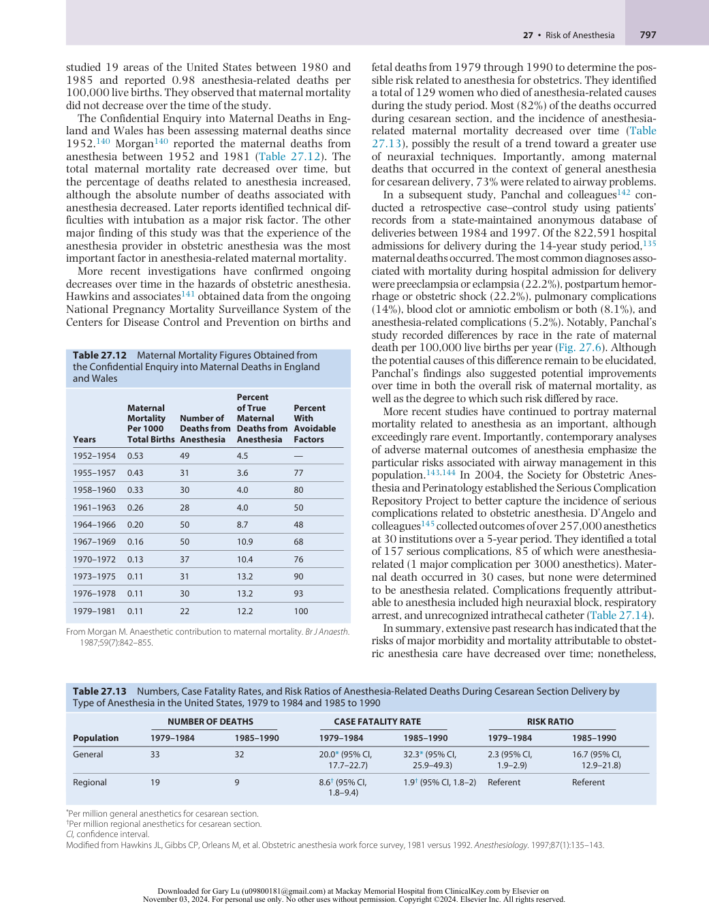

:::

<!-- PDF page 17 -->

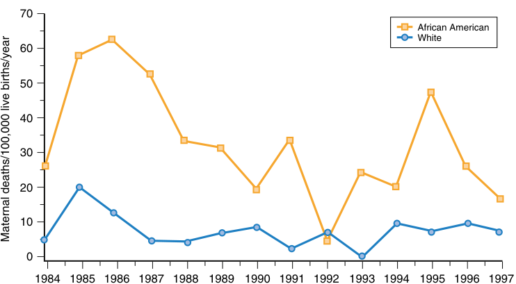

70 African American White 60 50 40 30 20 10 0 1984 1985 1986 1987 1988 1989 1990 1991 1992 1993 1994 1995 1996 1997 Maternal deaths/100,000 live births/year 

**Fig. 27.6 Delivery mortality ratios by race in Maryland, from 1984 to 1997, according to discharge summaries.** (From Panchal S, Arria AM, Labhsetwar SA. Maternal mortality during hospital admission for delivery: a retrospective analysis using a state- maintained database. _Anesth Analg._ 2001;93(1):134–141.)

**Table 27.14** Incidence of Serious Complications Associated With Obstetric Anesthesia

|**Serious Complication**|**Totals**|**Incidence (95% CI)**|**Anesthesia Related**|**Incidence (95% CI)**|
|---|---|---|---|---|
|Maternal death|30|1:10,250 (1:7180–1:15,192)|0||
|Cardiac arrest|43*|1:7151 (1:5319–1:9615)|2|1:128,398 (1:35,544–1:1,060,218)|
|Myocardial infarction|2|1:153,758 (1:42,562–1:1,269,541)|2|1:128,398 (1:35,544–1:1,060,218)|
|Epidural abscess/meningitis|4||4|1:62,866 (1:25,074–1:235,620)|
|Epidural hematoma|1||1|1:251,463 (1:46,090–1:10,142,861)|
|Serious neurologic injury|27|1:11,389 (1:7828–1:17,281)|7|1:35,923 (1:17,805–1:91,244)|
|Aspiration|0||0||
|Failed intubation|10||10|1:533 (1:290–1:971)|
|High neuraxial block|58||58†|1:4366 (1:3356–1:5587)|
|Anaphylaxis|5‡|1:61,499 (1:26,353–1:189,403)|0||
|Respiratory arrest in labor suite|25|1:8455 (1:5714–1:12,500)|16|1:10,042 (1:6172- 1:16,131)|
|Unrecognized spinal catheter|14||14|1:15,435 (1:9176–1:25,634)|
|Total|157§|1:1959 (1:1675–1:2294)|85¶|1:3021 (1:2443–1:3782)|

*Fourteen cardiac arrests did not result in maternal death.

†Also includes high blocks on labor and delivery that resulted in respiratory arrest from local anesthetic administration. ‡The medications associated with anaphylaxis were administered by anesthesia personnel but were not anesthesia medications. §There were 157 total serious complications; however, some complications are listed in more than one category. ¶There were 85 anesthesia- related complications; however, some complications are listed in more than one category. Modified from D’Angelo R, Smiley RM, Riley ET, Segal S. Serious complications related to obstetric anesthesia: the serious complication repository project of the Society for Obstetric Anesthesia and Perinatology. _Anesthesiology_ . 2014;120(6):1505–1512.

recent research indicates that adverse outcomes continue to occur and may be of particular concern for patients receiving general anesthesia for cesarean delivery. As these risks are quantified with increasing precision using large databases, further research will be needed to validate these findings and identify the impact of variable care delivery (including the use of differing anesthetic techniques) and the maternal outcomes across institutions and practice environments.

### PEDIATRICS

There are few studies of anesthesia- related risk in the pediatric population. Several themes emerge from these studies:

very young infants are at increased risk of mortality, and anesthesia- related risk is reduced in centers with specialized pediatric anesthesia facilities. More recently, attempts have been made to define the neurocognitive risks presented by exposure to anesthesia at a young age.

In Beecher and Todd’s classic 1954 study on anesthesia outcomes,18 a “disproportionate number” of anesthesiarelated deaths occurred in children younger than 10 years of age. Similarly, Graff and colleagues146 from the Baltimore Anesthesia Study Committee reported 335 operative deaths in the pediatric age group. Of these, 58 were thought to be primarily or partially attributable to anesthesia. The percentage of operative deaths attributable to anesthesia was

::: details 原始表格與符號（PDF 第 17 頁）

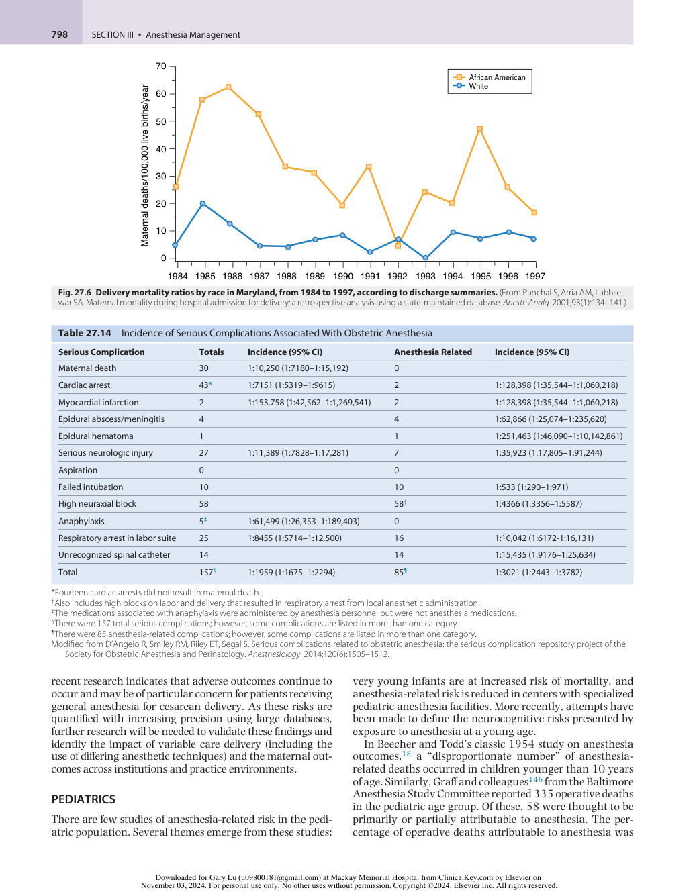

:::

<!-- PDF page 18 -->

relatively constant among age groups at 16.6% to 21.7%. The studies that followed those of Beecher and Todd and the Baltimore Anesthesia Study Committee provided further detail on the risks associated with pediatric anesthesia over time. Tiret and coauthors147 prospectively studied major anesthesia- related complications in pediatric patients in 440 hospitals in France between 1978 and 1982. There were 27 major complications in 40,240 cases, which included 12 cardiac arrests and 1 death. The incidence of major complications and cardiac arrest was significantly higher in infants than in older children. Most complications in infants involved the respiratory system and predominantly consisted of airway problems and aspiration. Older children experienced respiratory and cardiac complications, which occurred most frequently during induction and recovery.

Cohen and colleagues148 studied 29,220 anesthesia procedures at the Winnipeg Children’s Hospital in the 1980s. Data on patients’ coexisting medical conditions and postoperative follow- up were obtained within 72 hours. Complications included death, cardiac arrest, drug reactions, airway obstruction, and minor complications such as nausea and vomiting, arrhythmias, and sore throat. Neonates underwent a higher percentage of major vascular or cardiac and intraabdominal procedures, and older children had a higher incidence of extremity procedures. Intraoperative cardiac arrest occurred most frequently in patients younger than 1 year of age (4 in 2901 procedures). Postoperatively, minor events such as nausea and vomiting were more common in older children, whereas respiratory events were more common in infants and younger children (Table 27.15). When compared with adult patients, children experienced different complications, which frequently extended well into the postoperative period. In a comparison of 2- year periods between 1982 and 1987, rates of intraoperative events were found to be stable, and the rate of postoperative complications decreased.

More recently, van der Griend and colleagues reported on 24- hour and 30- day mortality associated with 101,885 anesthetics administered to 56,263 children at the Royal Children’s Hospital in Melbourne, Australia. They noted a rate of all- cause 24- hour mortality of 13.4 per 10,000 anesthetics and a 30- day all- cause mortality of 34.5 per 10,000 anesthetics. The incidence of deaths related to anesthesia was far lower, occurring at a rate of 1 in 10,188 or

0.98 cases per 10,000 anesthetics performed. In all of the 10 anesthetic- related deaths that the authors observed, preexisting medical conditions were assessed to have been a significant contributing factor.149

In contrast to efforts to determine the incidence and predictors of mortality among pediatric surgical patients, a number of investigators have focused on cardiac arrest in the context of pediatric anesthesia. For example, Flick and associates150 studied patients younger than 18 years of age who underwent surgery at the Mayo Clinic and experienced perioperative cardiac arrest between November 1, 1988 and June 30, 2005. A total of 92,881 anesthetics were administered during the study period, 4242 (5%) of which were for the repair of congenital heart malformations. The incidence of perioperative cardiac arrest during noncardiac procedures was 2.9 per 10,000, and the incidence during cardiac procedures was 127 per 10,000. The incidence of perioperative cardiac arrest attributable to anesthesia was 0.65 per 10,000 anesthetics. The incidence of cardiac arrest and mortality was highest in neonates (0 to 30 days of life) undergoing cardiac procedures (incidence, 435 per 10,000; mortality, 389 per 10,000).

Investigators at the Children’s Hospital of Boston conducted a registry study to evaluate rates of arrest in patients undergoing surgery for congenital heart disease.151 Over a 5- year period, 41 cardiac arrests occurred in 40 patients during 5213 anesthetics for an overall frequency of 0.79%. Eleven cardiac arrests (26.8%) were classified as either likely ( _n_ = 6) or possibly related ( _n_ = 5) to anesthesia (21.1 per 10,000 anesthetics) but with no mortality.

Efforts to understand the causes and outcomes of cardiac arrest in pediatric anesthesia patients have been aided by the development of large- scale clinical registries for research and quality improvement. In 1994, the Pediatric Perioperative Cardiac Arrest (POCA) Registry152 was formed to determine the clinical factors and outcomes associated with cardiac arrest in anesthetized children. A total of 289 cardiac arrests occurred in the 63 institutions in the database during the first 4 years of the registry, 150 of which were judged to be related to anesthesia (1.4 per 10,000 anesthesia procedures), with a 26% mortality rate. Medicationrelated causes and cardiovascular causes of cardiac arrest were most common. Anesthesia- related cardiac arrest occurred most often in patients younger than age 1 year

**Table 27.15** Summary of Perioperative Events by Age Group

||**&lt;1 Month (****_n_ = 361)**|**1–12 Months (****_n_ = 2544)**|**1–5 Years (****_n_ = 13,484)**|**6–10 Years (****_n_ = 7184)**|**11+ Years (****_n_ = 5647)**|
|---|---|---|---|---|---|
|Any intraoperative event|14.96|7.31|7.10|12.22|9.69|
|Any recovery room event|16.61|7.23|12.20|14.88|15.23|
|Any postoperative event||||||
|Minor event*|13.57|10.30|20.32|31.49|32.44|
|Major event†|23.82|7.51|3.26|3.37|3.33|
|Any event‡||||||
|Among patients seen|48.89|25.92|37.50|50.52|51.33|
|Among all patients|41.55|23.47|33.16|45.04|45.78|

*Includes nausea and vomiting, sore throat, muscle pain, headache, dental conditions, positional conditions, conditions involving extremities, eye conditions, croup, temperature, behavioral problems, thrombophlebitis, arterial line problem, awareness, and “other” problems. †Includes “other respiratory” conditions, cardiovascular disorders, nerve palsy, hepatic disorders, renal disorders, seizures, surgical complications, and death. ‡Percentage of total anesthetics in which at least one event occurred in the intraoperative unit, recovery unit, or later during the postoperative period. All figures are given as the percentage of events per total anesthetics. Modified from Cohen MM, Cameron CB, Duncan PG. Pediatric anesthesia morbidity and mortality in the perioperative period. _Anesth Analg_ . 1990;70(2):160–167.

::: details 原始表格與符號（PDF 第 18 頁）

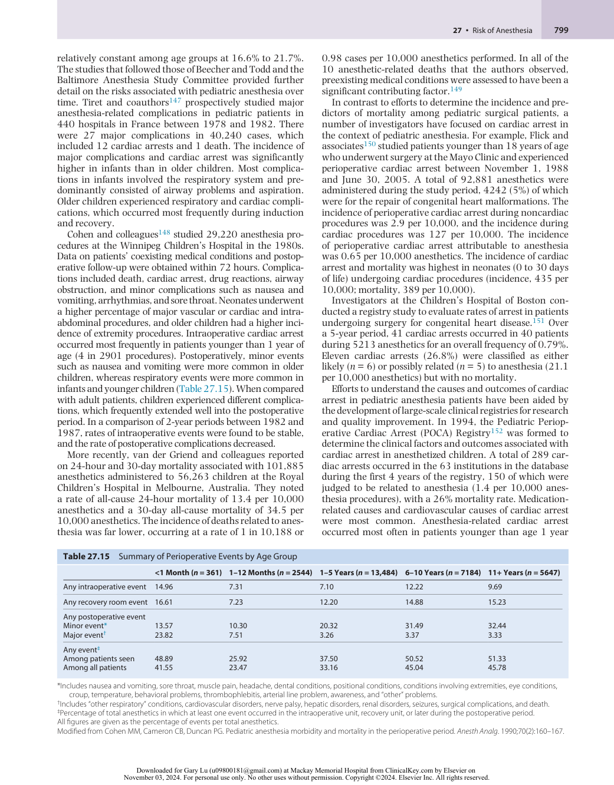

:::

<!-- PDF page 19 -->

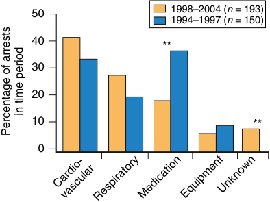

50 1998–2004 ( n  = 193) 1994–1997 ( n  = 150) 40 ** 30 20 10 ** 0 Cardio-vascularRespiratoryMedicationEquipmentUnknown in time period Percentage of arrests 

**Fig. 27.7 Causes of anesthesia- related cardiac arrest in the Pediatric Perioperative Cardiac Arrest (POCA) Registry from 1998 to 2004 versus 1994 to 1997.** (** _P_ &lt; .01 1998–2004 vs. 1994–1997 by Z test). (From Bhananker SM, Ramamoorthy C, Geiduschek JM, et al. Anesthesiarelated cardiac arrest in children: update from the Pediatric Perioperative Cardiac Arrest Registry. _Anesth Analg._ 2007;105(2):344–350.)

and in patients with severe underlying disease. In 2007, an update from the POCA registry was published.153 From 1998 through 2004, 193 arrests (49%) were related to anesthesia. Cardiovascular causes of cardiac arrest (41%) were the most common, with hypovolemia from blood loss and hyperkalemia from transfusion of stored blood being the most common identifiable cardiovascular causes (Fig. 27.7). In contrast to the earlier study, medication- related arrests only accounted for 18% of all arrests.

In 2010, POCA investigators reported on anesthesiarelated cardiac arrest in children with preexisting cardiac disease, comparing 245 cardiac arrests in children without heart disease with 127 cardiac arrests in children with cardiac conditions. Compared with children without cardiac disease, children with cardiac conditions were more often ASA physical status III, IV, or V and more often arrested from cardiovascular causes. Mortality was higher in children with heart disease than among children without heart disease (33% vs. 23%) but did not differ when adjusted for ASA physical status classification.154

In recent years, researchers have become increasingly interested in how anesthetic exposure in young children impacts neurocognitive development. In 2016, Sun and group155 published a sibling- matched cohort study conducted over 4 years at four university hospitals in the United States. They enrolled a total of 105 sibling pairs, one of whom had been exposed to inhalational anesthetics for an inguinal hernia repair before 36 months of age. Neurocognitive testing performed on both siblings did not demonstrate a statistically significant difference in intelligence quotient. Another group (Ing and colleagues)156 analyzed data from the Western Australia Pregnancy Cohort to evaluate the relationship between anesthetic exposure in children younger than 3 years of age and neuropsychological, academic, and behavioral outcomes in a cohort of 2868 children. They identified discrepancies in neuropsychological test and ICD- 9 coded clinical outcomes, but did not identify any differences in academic achievement, and suggest that the unique attributes of specific tests may explain the variation in cognitive outcomes described in different studies. More recently, O’Leary and colleagues reported an observational cohort

study that found that there was no statistical difference for risk of adverse child development outcomes compared to their biologic siblings.157 They studied sibling paired 5- and 6- year- olds with the same birth mother in which only one sibling was exposed to surgery and a general anesthetic, and found that the Early Development Instrument (EDI) data was not statistically different. The EDI consisted of measures of child development across 5 major domains, comprising physical health, social knowledge and competence, emotional health and maturity, language and cognitive development, and communication skills. In another cohort study, Backeljauw and colleagues158 matched 5- to 18- year- old participants in a language development study who had undergone surgery with anesthesia before age 4 with unexposed peers. They found that exposed subjects had statistically significantly lower scores in listening comprehension and performance intelligence quotient, and that these changes were associated with lower gray matter density in key brain regions (occipital cortex and cerebellum). Given these conflicting results, further research is clearly needed to evaluate and quantify this impact in more detail.

### OLDER ADULTS

The relationship of age to operative risk has been a subject of scientific and clinical debate since the early days of modern surgery. The nature of operative and anesthetic risk in older patients remains a vital area of inquiry, particularly as the proportion of United States adults 65 years of age and older is anticipated to increase rapidly over the next three decades.

A key issue in research on the safety of surgery and anesthesia among older adults is the determination of what constitutes _old age_ from the perspective of perioperative risk. Multiple definitions have been used for advanced age, including age older than 65, 70, 80, or 90 years. Denney and Denson159 evaluated risk associated with surgery in patients older than 90 years of age. They reported 272 patients undergoing 301 operations at the University of Southern California Medical Center, finding a high perioperative mortality rate among older patients with serious bowel obstruction (63%). Taking a slightly different approach, Djokovic and Hedley- Whyte160 studied outcome after surgery in 500 patients older than 80 years of age. They found that mortality was predicted by ASA physical status classification, with greater comorbid conditions associated with increasing risk. Myocardial infarction was the leading cause of postoperative death. Patients without significant comorbid diseases (ASA I classification) had a mortality rate of less than 1%.

Del Guercio and Cohn161 investigated the value of preoperative invasive monitoring in obtaining hemodynamic and cardiopulmonary variables for predicting operative risk in the older adult. Among 148 consecutive patients older than 65 years of age who were treated in a surgical ICU, only 13.5% had normal physiologic measurements. Advanced and uncorrectable functional deficits were found in 63% of patients, and all in this group who underwent the planned surgery died.

Del Guerico and Cohn’s work represented one of several studies that emphasized coexisting diseases, rather than

<!-- PDF page 20 -->

aging itself, as the cause of apparently increased perioperative mortality among older adults. More recently, a growing body of literature has focused on the importance of functional disability and chronic geriatric syndromes, such as frailty and dementia, as determinants of postoperative outcomes among older individuals. Robinson and colleagues examined a cohort of 110 surgical patients with a mean age of 74 years, finding a 15% 6- month rate of mortality. Statistically significant predictors of 6- month mortality included impaired cognition, a recent fall, hypoalbuminemia, anemia, functional dependence, and comorbidity. Notably, functional dependence was the strongest predictor of 6- month mortality. Four or more markers in any one patient effectively predicted 6- month mortality (sensitivity, 81%; specificity, 86%).162 Finlayson and colleagues observed high rates of mortality after major gastrointestinal surgery among older nursing home residents versus the overall Medicare population; the high rates of mortality were likely attributable to high rates of comorbidity and functional disability within this population.163

In this context, research on the risks of surgery and anesthesia in the older adult now focuses on broader definitions of _risk_ that include functional outcomes and quality of life, in addition to traditional morbidity and mortality outcomes. Finlayson and colleagues examined 6822 older nursing home residents undergoing intestinal resections for colon cancer, noting a 53% 1- year mortality rate and a 24% rate of sustained decline in functional independence in activities of daily living among survivors. In multivariate regression, age older than 80 years, hospital readmission after surgical discharge, surgical complications, and functional decline before surgery all predicted functional decline at 1 year.164 As the older population continues to grow, researchers have recently begun to evaluate the neurocognitive impact of anesthesia on the elderly.

The measures of outcome relative to patient goals of care are becoming increasingly important in determining optimal strategies for perioperative management of the geriatric population. The ASA recently instituted a Perioperative Brain Health Initiative165 dedicated to exploring the potential relationship between anesthetic exposure and postoperative cognitive function and delirium. This topic is discussed in more detail in Chapter 78.

## Risks Directly Related to the Anesthetic Drug

Numerous studies have evaluated the influence of the choice of anesthetic on outcome, a question that is discussed throughout this book. From a global perspective, there does not appear to be a single best anesthesia technique for a particular surgery or group of surgeries, although emerging evidence begs for more research on this subject. In a multivariate analysis by Cohen and co- workers104 of 100,000 anesthesia procedures performed in Canada, the choice of drug did not provide any additional prognostic information for predicting mortality beyond that of patient disease and the surgical procedure. In univariate analysis, MAC appeared to be associated with worse outcomes; however, this association was attributable to the use of MAC in sicker patients (see Table 27.11).

One question that has persisted within the anesthesia literature is the issue of whether anesthetic medications carry inherent toxicity. For example, numerous discussions have focused on the potential toxicity of halothane and sevoflurane. In the case of halothane, concern focused on the potential for fulminant, potentially fatal, hepatic necrosis with this medication. After several case reports of hepatic necrosis after halothane anesthesia, a large retrospective study of 856,500 anesthesia procedures at 34 institutions was undertaken.166–168 In all but seven cases, hepatic necrosis could be explained by other causes. Halothane could be associated with hepatitis and hepatic failure, but the incidence was very low.

In the case of sevoflurane, concern has centered on the potential nephrotoxicity of its metabolite compound A. Although some laboratory studies have supported the contention that sevoflurane reacts with soda lime to form compound A and that this metabolite can lead to renal toxicity,169,170 clinical studies have been unable to confirm this potentially detrimental effect171,172 in the United States. Some research groups have recently sought to identify and quantify other anesthesia- attributable effects. In 2016, Wigmore and colleagues173 published the results of a retrospective cohort study evaluating survival and recurrence outcomes in propensity- matched patients undergoing primary resection of malignancy with inhaled versus intravenous anesthetics in over 7000 patients in the United Kingdom. After adjusting for confounders, the investigators demonstrated a hazard ratio of 1.46 for death in patients receiving volatile anesthetic versus those receiving inhalational agents, a result which demands further prospective investigation.

In 2008, the GALA investigators174 published results of a randomized controlled trial comparing outcomes following carotid endarterectomy with local versus general anesthesia in 3526 patients with asymptomatic or symptomatic carotid stenosis. Primary outcomes included stroke, myocardial reinfarction, and 30- day mortality. Of the patients undergoing general anesthesia, 4.8% experienced events, as compared to 4.5% of patients who were managed with local anesthetics (3 events preventable per 1000 treated). The investigators were not able to identify a statistically significant benefit to local or general anesthesia for individual primary outcomes, or for 30- day quality of life, hospital length of stay, or surgical duration. In a retrospective cohort study published in 2015, van den Berg and colleagues175 investigated outcomes of intra- arterial treatment of patients with acute ischemic stroke with or without general anesthesia. Cases without general anesthesia were associated with good clinical outcome in a higher proportion than those treated with general anesthesia (26% vs. 14%), although there were notable distinctions between the two groups. They also found a nonsignificant mortality benefit in the non- general anesthesia group. The authors speculated that anesthetics might alter autoregulation of cerebral blood flow; however, their results were confounded by the determination that arterial recanalization was delayed by up to 20 minutes in patients undergoing interventions with general anesthesia.

Numerous studies have attempted to define the safest anesthetic for high- risk patients. In the late 1980s, there was concern that isoflurane caused coronary steal

<!-- PDF page 21 -->

in patients with coronary stenosis and collaterals and that this could result in myocardial ischemia.176,177 A series of studies were conducted to evaluate the rate of perioperative cardiac morbidity and mortality in patients undergoing coronary artery bypass grafting to determine the importance of the agent used for general anesthesia.178–181 Taken together, these studies demonstrated negligible differences in outcome, thus supporting the contention that multiple safe approaches to general anesthesia may exist for an individual context. Other studies have focused on the relative safety of general anesthesia versus neuraxial or regional techniques.182–184 For lower extremity and pelvic surgery, regional anesthesia was associated with a lower incidence of graft thrombosis and deep venous thrombosis, as well as decreased bleeding, decreased length of stay,185 reduced risk of surgical site infection, and risk of prolonged hospitalization.186 Regional anesthesia has also been specifically associated with lower major complication rates in patients with OSA.187 However, in a meta- analysis published by O’Donnell and colleagues,188 the findings were less favorable. Although they were able to determine a small difference in hospital length of stay attributable to regional anesthesia, the discrepancies in outcome reporting among the different studies were such that they were not able to identify definitively any other differences between the two approaches. More recently, Neuman _et al._ and the REGAIN group found that there was no difference between spinal and general anesthesia for hip fractures in older patients.189,190 The investigators found that in 132 out of 712 (18.5%) patients in the spinal anesthesia group, and 132 of 732 (18.0%) patients in the general anesthesia group experienced a composite outcome of death or inability to walk 10 feet at 60 days postoperatively. Subdivided, the risk of death within 60 days was 30 out of 768 (3.9%) and 32 out of 784 (4.1%), respectively, and the risk of immobility was 104 of 684 (15.2%), and 101 out of 701 (14.4%), respectively, as well. Secondary outcomes of delirium were not significantly different at 20.5% and 19.7%. Similarly, the investigators of RAGA- delirium,191,192 have also found that the incidence of delirium was no different between a spinal anesthetic and a general anesthetic for hip fracture surgery. Postoperative delirium occurred in 6.2% vs. 5.1% between regional vs. general anesthesia, which did not reach statistical significance. Secondary outcomes of delirium severity were similarly unchanged, as well as postoperative pain, length of hospital stay, complication rate, and 30- day all- cause mortality. However, this specific study has limitations that may preclude more generalizability of the results given their sample size being only 950 patients, as well as it being a single-center randomized controlled trial. Further studies regarding delirium are in progress, however, the overall risk profile of neuraxial vs. general anesthesia appears to be narrowing.

For patients undergoing vascular surgery, the primary finding favoring regional anesthesia was a lower incidence of graft thrombosis and the need for reoperation in patients undergoing infrainguinal bypass surgery; however, the largest of these studies was unable to demonstrate any difference in outcome based on anesthesia technique.193–195 The rate of this complication was low in the total cohort in the largest trial, which made it impossible to detect any difference based on technique. Summarizing findings from several of these studies, Rodgers and co- workers183

published an influential meta- analysis of regional versus general anesthesia. Neuraxial blockade was found to reduce postoperative mortality and other serious complications. As such, the magnitude of some of these benefits remained uncertain. Discussion of regional versus general anesthesia is presented in Chapters 41 and 42.

The impact of perioperative ventilation modality has also recently come under investigation: in 2015, Ladha’s group196 published a hospital- based registry study examining outcomes of 69,239 patients undergoing noncardiac surgery requiring endotracheal intubation. Roughly 50% of patients received a protective ventilation strategy (reduced tidal volume and high positive end- expiratory pressure [PEEP]) versus standard care. Protective ventilation, defined as a PEEP of 5 cmH2O and a plateau pressure (PPlat) of 16 cmH2O or less, was associated with a reduced risk of postoperative respiratory complications. High driving pressure and plateau pressure were associated with an increased risk of respiratory complications. Severgnini and colleagues197 randomized 56 patients undergoing elective open abdominal surgery to a standard mechanical ventilation strategy (tidal volume of 9 mL/kg, ideal body weight [IBW], and zero PEEP), or “lung protective” ventilation (7 mL/kg, IBW, PEEP of 10 cmH2O, recruitment maneuvers). Patients receiving protective ventilation demonstrated respiratory function and reduced Clinical Pulmonary Infection Score for several days postoperatively. Length of stay did not differ between groups. More recently, a panel of experts produced revised consensus recommendations for intraoperative protective ventilation of the surgical patient, re- affirming the desire for lung protective strategies.198 These include initial settings of 6–8 mL/kg of tidal volume, and a minimum PEEP of 5 cmH2O. Additionally, recognizing that formation of atelectasis may be a significant risk factor for the development of postoperative pulmonary complications, appropriate PEEP and recruitment maneuvers are recommended to improve intraoperative respiratory function. PEEP is to be used after recruitment maneuvers as sustained recovery without PEEP is limited. Monitoring of dynamic compliance and driving pressure (PPlat- PEEP) and PPlat should be conducted on all mechanically ventilated patients.

## Risks Related to Surgery

The surgical procedure itself significantly influences perioperative risk. In virtually every study performed, emergency surgery is associated with additional risk.106 In some cases, the risk related to surgery is a function of the underlying disease processes and the stress related to the surgical procedure. As a category of surgical procedures, cardiovascular surgery has historically been associated with the highest risk of mortality and major morbidity. (The risks related to anesthesia for cardiac surgical procedures are reviewed in Chapter 50.) Vascular surgery is among the highest- risk group of noncardiac procedures. Although aortic reconstructive surgery has traditionally been considered the procedure with the highest risk, infrainguinal procedures have shown a similar rate of cardiac morbidity in several studies, possibly due to a higher burden of coronary artery disease in this population.199,200 Other high- risk vascular procedures include amputation.201 Intra- abdominal, thoracic,

<!-- PDF page 22 -->

and orthopedic procedures have also been associated with increased risk.13,201

Eagle and associates202 evaluated perioperative cardiac morbidity and mortality among patients who had been treated for coronary artery disease and subsequently underwent major noncardiac surgery. Among these patients, major vascular surgery was associated with the highest risk of myocardial infarction or death, with a combined incidence of morbidity and mortality greater than 5%. Procedures associated with a combined complication rate of 1% to 5% included intra- abdominal, thoracic, and head and neck surgical procedures. Low- risk procedures included breast, skin, urologic, and orthopedic surgeries. Ultimately, these groupings of surgical procedures came to form the basis for the definitions of surgical risk published in the American College of Cardiology/American Heart Association joint guidelines on perioperative cardiovascular evaluation for noncardiac surgery.203 More recent statistical modeling efforts, such as those of Gupta120 and Glance,129 aimed at predicting postoperative outcomes have reinforced the important contribution of the type of surgical procedure to the overall operative risk. This has culminated in various risk profiles based on procedure type, such as the most recent Society of Thoracic Surgeon’s204,205 short- term risk calculator, which stratifies patients based on updated statistical modelling with regards to the most common cardiac surgical procedures.

Studies of the perioperative complication rate related to superficial procedures are generally reassuring. Backer and associates206 evaluated the rate of perioperative myocardial reinfarction in patients who have a history of preexisting coronary artery disease and who underwent ophthalmologic surgery. They demonstrated that the rate of perioperative cardiac morbidity after ophthalmologic surgery was extremely low, even in patients with a recent myocardial infarction. Similar findings have been reported by multiple other investigators.75,207

More recent work suggests that surgical duration may also affect perioperative risk. Kim and group208 reviewed a cohort of over 1 million patients undergoing surgery under general anesthesia between 2005 and 2011 and demonstrated an association between surgery duration and the risk of development of venous thromboembolism. These results were preserved in analysis of individual procedures and classes of procedure by specialty.

## Risks Related to the Location of Surgery and Postoperative Monitoring

Perioperative risk varies among hospitals for major procedures such as coronary artery bypass grafting and abdominal aortic aneurysm repair.9,10,209 Multiple studies have documented a relationship between surgical volume and mortality. Although surgical skill most certainly plays a role in the rate of complications and mortality, local factors may also play an important role. For example, low surgical volume may lead to less skilled anesthesia and postoperative care. The influence of each of these factors on overall morbidity and mortality is unknown.

Although the value of postoperative monitoring and care in an ICU has never been documented in a randomized clinical trial, many investigators have suggested that such care is one of the primary reasons for the improved morbidity and mortality in recent years. For patients undergoing major vascular surgery, several investigators have suggested that more intense postoperative monitoring could obviate the need for preoperative cardiac testing and revascularization.203 One potential value of risk assessment is the identification of patients who could benefit from referral to clinical centers with more extensive perioperative resources. Patients with a low probability of perioperative morbidity and mortality could have surgery performed locally, and individuals at higher risk could receive benefit from transfer to a center with high surgical volume.

## Risks Related to the Anesthesia Provider

Over the past decade a great deal of attention has been paid to the role and skill of the anesthesia provider on patient outcome. Historically, anesthesia has been administered by a diverse group of providers with variable levels of supervision. The extent to which the skills and training of the individual anesthesia provider may affect outcomes has been assessed in a number of studies. In a now- classic paper, Slogoff and Keats210 studied the association of perioperative myocardial ischemia and cardiac morbidity in patients undergoing coronary artery bypass grafting across multiple anesthesiologists working in a single practice. Notably, the rate of perioperative ischemia and infarction varied by anesthesiologist, and the authors concluded that operator technique and experience may affect risk. Subsequent work has moved beyond efforts to demonstrate variability in anesthesia outcomes at the level of the individual practitioner to examine whether outcomes might vary across different models of anesthesia care. Arbous and coauthors reported a case–control study over 1 year in the Netherlands,211 in which they found that practice- level independent variables associated with a decreased risk for coma and death in 24 hours were (1) anesthesia equipment check performed with a checklist; (2) direct availability of an anesthesiologist by telephone, beeper, or walkie- talkie during maintenance anesthesia; (3) no change of anesthesiologist during the case; (4) presence of a full- time nurse anesthetist versus a part- time anesthetist during maintenance anesthesia; and (5) presence of two providers versus one person during emergence. This study was one of very few that attempted to identify practice characteristics rather than specific drugs or techniques that have an impact on anesthesia outcomes, and the results are striking, in spite of numerous issues with data reporting and matching. The finding that practitioner characteristics affect outcomes warrants further follow- up.

Attention has recently turned to the impact of handoffs of anesthesia care on patient outcomes. In 2018, Jones and colleagues212 published a retrospective cohort study evaluating outcomes including all- cause mortality, hospital readmission, and major postoperative complications in 313,066 patients undergoing major surgery. They identified an association between complete anesthesia handoffs (i.e., when one provider or team leaves the case permanently and is

<!-- PDF page 23 -->

replaced by another) and increased incidence of primary outcomes, as well as with increased rates of ICU admission and hospital length of stay. The study design was limited by the inability to control for the career experience of the replacement anesthesiologist and surgeon as well as by the sole use of billing codes to determine exposure to a transition in anesthesia care.

Several studies have attempted to evaluate the complication rates and risks associated with various care provider models. Bechtoldt,213 as a member of the North Carolina Anesthesia Study Committee, evaluated 900 perioperative deaths that occurred in an estimated 2 million anesthesia procedures performed in North Carolina between 1969 and 1976. The lowest rate of anesthesia- related deaths (1 per 28,166 procedures) occurred in patients who received anesthesia from an anesthesia care team (physician anesthesiologist and CRNA), and the highest rate (1 per 11,432 procedures) was associated with anesthesia administered by a dentist; the rate for the nurse anesthetist–only cohort was intermediate (1 per 20,723). A study by the Stanford Center for Health Care Research214 demonstrated similar outcomes: the investigators reported that death plus severe morbidity was 11% higher than predicted in patients who received their care in a nurse anesthetist–only setting, 3% lower than predicted for physician- only care, and 20% lower than predicted for an anesthesia care team environment. Both studies demonstrated significant methodologic limitations.

The impact of specific provider types may be greatest in particular situations: for example, patients with significant comorbid diseases and those who sustain perioperative complications may benefit from providers with specific skill sets. One way to study such issues is to evaluate the rate of survival after complications. Silber and colleagues7 at the University of Pennsylvania studied the medical records of 5972 surgical patients randomly selected from 531 hospitals. They evaluated patient and hospital characteristics, including the number and type of physicians, board certification status, and ratio of care providers. The 30- day mortality rate correlated with patient characteristics. Failure to rescue (i.e., failure to prevent death) after an adverse event was inversely associated with the proportion of board- certified anesthesiologists on staff in each facility. Improved perioperative survival was significantly associated with the presence of an increased number of board- certified anesthesiologists. These findings were corroborated in follow- up studies by the same group,215,216 wherein analysis was again limited by database characteristics.216 By contrast, Pine and co- workers evaluated mortality after eight specific surgical procedures217 and used stepwise logistic regression to derive procedure- specific risk adjustment models. They found hospitals without anesthesiologists had results similar to those facilities in which anesthesiologists provided or directed anesthesia care. The authors did not evaluate failure to rescue or cause of mortality.

More recently, work by Needleman and Minnick compared obstetric outcomes in facilities with different obstetric anesthesia staffing patterns.218 Although the authors observed consistent differences in maternal mortality and other quality indicators at facilities where nurse anesthetists practiced with minimal or no supervision by

anesthesiologists versus anesthesiologist- only facilities, questions regarding risk adjustment and study design limit definitive interpretations of this work for policy making.219 Similarly, a 2010 study by Dulisse and Cromwell suggested no changes in overall surgical patient outcomes in states that had enacted laws allowing nurse anesthetists to practice independently versus states that required anesthesiologist supervision.220 However, as such new legislation was not associated with major changes in the number or types of surgery conducted without anesthesiologist supervision, Dulisse and Cromwell’s work does not speak directly to the question of the gains or losses in safety associated with any specific provider type for a given type of surgery.

Ultimately, as concluded by Smith and associates221 in a review of available published studies through 2004 on the influence of anesthesia providers, the relationship of patient outcomes to the type of anesthesia provider has not yet been conclusively demonstrated. Nurse anesthetists and other non- physician providers are vital to the delivery of anesthesia care in the United States and elsewhere, and determining the optimal scope of practice for such providers remains an ongoing area of academic research and political debate.

## Improving Anesthesia Safety

Over the past several decades, major improvements to the safety of anesthesia have been initiated. In 1984, Cooper, Kitz, and Pierce hosted a landmark International Symposium on Preventable Anesthesia Mortality and Morbidity in Boston. Approximately 50 anesthesiologists from around the world attended the meeting and, after much debate, established a series of definitions of outcome, morbidity, and mortality (Box 27.1). Beyond its specific conclusions, however, the symposium remains an event of major historical importance as a seminal early event in the movement

### Box 27.1 Proposed Definitions from the 1984 International Symposium on Preventable Anesthesia Morbidity and Mortality

|**Outcome**|
|---|
|Normal|
|Abandoned procedure Morbidity Death|
|**Morbidity**|
|Unplanned, unwanted, undesirable consequence of anesthesia|
|**Mortality**|
|Death that occurs before recovery from the effects of a drug or drugs given to facilitate a procedure|
|Death that occurs during an attempt to relieve the pain of a condition|
|Death that results from an incident that occurs while the drugs are effective|

Modified from Pierce EC Jr. The 34th Rovenstine Lecture. 40 years behind the mask: safety revisited. _Anesthesiology._ 1996;84(4):965–975.

::: details 原始表格與符號（PDF 第 23 頁）

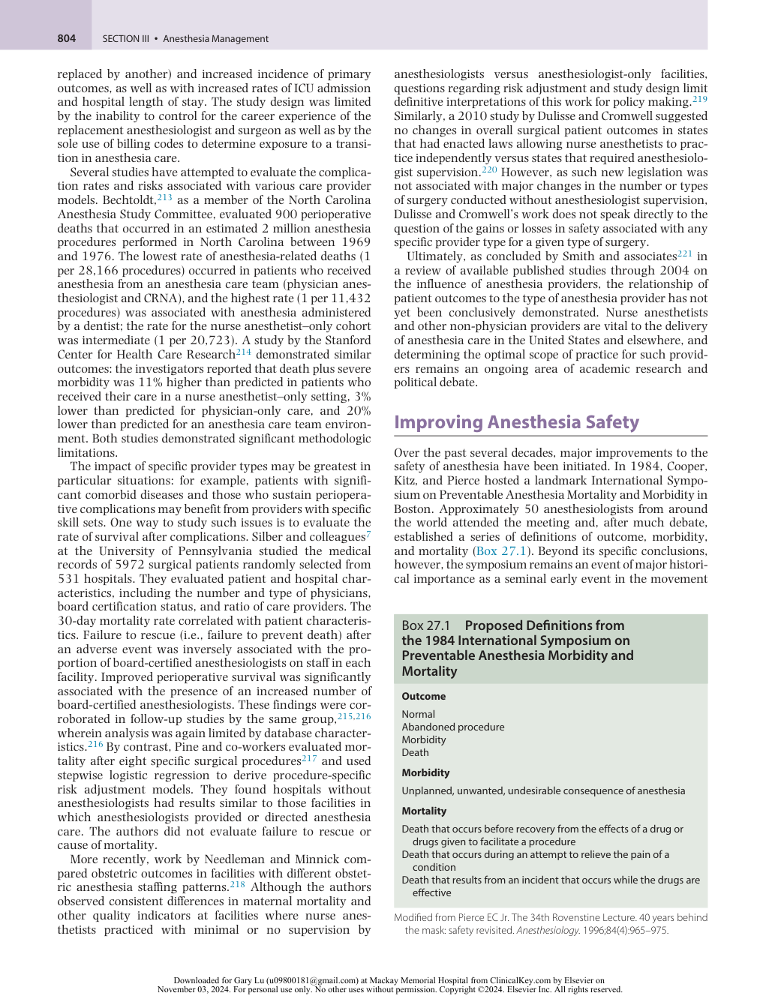

:::

<!-- PDF page 24 -->

to improve patient safety and as the context out of which the Anesthesia Patient Safety Foundation (APSF) was established. After its formal incorporation in October 1985, the APSF has since actively promoted a range of initiatives focused on fulfilling its mission to continually improve the safety of patients during anesthesia care by encouraging and conducting: (1) safety research and education, (2) patient safety programs and campaigns, and (3) national and international exchange of information and ideas. To this end, the APSF has focused on promoting research, practice improvement, and knowledge dissemination across a range of priority areas (Box 27.2). Overall, these efforts have stressed the potential for systems- level improvements, standardization of care processes, human- factors engineering, and simulation- based training to limit harms caused by preventable adverse events and errors in crisis management in the context of anesthesia care. Through this work,

### Box 27.2 Selected Areas of Focus of the Anesthesia Patient Safety Foundation, 1985 to 2012

- Use of anesthesia simulators for training and evaluation

- Improvement of standards for intraoperative monitoring

- Application of patient safety checklists to intraoperative care

- Promotion of standardized approaches to difficult airway management

- Prevention of medication- related adverse events

- Reuse and attempted resterilization of disposable anesthesia equipment

- Risks of outdated anesthesia machines without modern safety features

- Aiding the development of practice standards by the World Federated Societies of Anesthesiologists

- Surgery department crisis management, including teamwork, team training, and resource management

- _Production pressure_ , causing dangerous omissions and cutting corners

- Intravenous procedural sedation by nonanesthesia personnel

- Contamination of medical gases and disruption of pipeline flow

- Contamination of intravenous medications

- Special risks of office- based anesthesia ᑏ Patients with obstructive sleep apnea and their postoperative care

- Postoperative cognitive dysfunction (particularly in older adults)

- Possible long- term increase in morbidity and mortality after extensive general anesthesia

- Postoperative vision loss, especially in extensive prone spine surgery

- Wrong- site surgery ᑏ Residual neuromuscular blockade and postoperative complications

- Protocols for assessing and managing adverse events

- Persistence of deaths from malignant hyperthermia

- Dangers and challenges in patients with coronary artery stents ᑏ Maintenance of current protocols for the anesthesia machine checkout

the APSF has come to serve as a leader in patient safety, not only in the context of anesthesia and perioperative care, but also more generally within medicine by establishing _patient safety_ as a formal concept, discipline in medical care, and serving as a model for other organizations such as the US National Patient Safety Foundation.222

Alongside the efforts of the APSF, other prominent organizations, such as the ASA, have sought to improve the safety of anesthesia care through the creation and dissemination of standards and guidelines for clinical practice. In general, both standards and guidelines represent summations by clinicians of the available evidence about the benefits and risks of particular approaches to treatment. Typically, a practice standard implies that a therapy or practice should be performed for patients with a particular condition. Standards are approved only if an assessment of the probabilities and utilities of the group indicate that the decision to choose the treatment or a strategy would be virtually unanimous. At present, the ASA has established one set of practice standards for anesthesia care, which outline basic requirements for intraoperative monitoring.223

In contrast to practice standards, guidelines are intended to be more flexible than standards, but they should be followed in most cases. Depending on the patient, setting, and other factors, guidelines can and should be tailored to fit individual needs. Similar to standards, guidelines should be cost- effective methods. Specific guidelines have been created by the ASA for diverse issues such as a difficult airway,224 the use of the pulmonary artery catheter,225 and the use of blood components226 with the goal of defining the evidence on which optimal practice can be based. In a similar vein, the World Health Organization has recently placed an emphasis on the potential for a simple preoperative checklist, modeled on the processes used in other high- risk industries such as aviation, to reduce the rates of adverse events in the perioperative period.227 Driven in part by the findings of improved outcomes with checklist use in a multicenter, international study by Haynes and co- authors,228 such expanding interest in the use of standardized safety checks offers new potential opportunities to decrease the risk of anesthesia further.

Applying further insights gained from the aviation industry to anesthesia care, the APSF and other organizations have focused on developing simulation- based approaches to train anesthesia providers and to evaluate their decisionmaking capabilities in crisis situations.229–233 To date, an extensive array of standardized scenarios have been developed for making comparisons among individuals, and research is ongoing to examine how best to use this technology in anesthesia training and recertification. Ultimately, such efforts, combined with improved monitoring of adverse outcomes through large outcomes databases and those now being assembled by the MPOG and the Anesthesia Quality Institute, hold potential to improve the safety of anesthesia care continually on both a national and an international level.

- Possible impact of anesthesia management on cancer recurrence

- Persistence of surgical unit fires

Modified from Eichhorn JH. The Anesthesia Patient Safety Foundation at 25: a pioneering success in safety, 25th anniversary provokes reflection, anticipation. _Anesth Analg._ 2012;114(4):791–800.

## Summary

The risks related to anesthesia appear to have dramatically decreased over the past several decades. Clearly, death

<!-- PDF page 25 -->

solely attributable to anesthesia is rare; rather, underlying patient disease and the nature and extent of surgery have a greater effect on overall outcome than do risks attributable to the anesthetic _per se_ . Although these changes in the risk attributable to anesthesia could justifiably be considered a major achievement on the part of anesthesia providers over time, they also present a novel challenge to anesthesia providers to identify new opportunities to aid in more broadly decreasing both the morbidity and the mortality of surgical procedures and to aid in aligning the results of surgical interventions with individual patients’ goals of care. At the same time, vigilance must be continued to maintain high standards of basic anesthesia care across both hospital- and nonhospital- based settings. Finally, anesthesia providers should play a role in systems- based thinking to improve perioperative care and the short- and long- term outcomes of patients undergoing surgery and anesthesia.

### Acknowledgments

The authors wish to acknowledge the contributions of Rachel Hadler and Mark Neuman to the previous edition of this chapter.

37.  Marx GF, et al. _Anesthesiology_ . 1973;39:54.

38.  Clifton BS, Hotten WI. _Br J Anaesth_ . 1963;35:250.

39.  Dinnick OP. _Anaesthesia_ . 1964;19:536.

40.  Bodlander FM. _Br J Anaesth_ . 1975;47:36.

41.  Harrison GG. _Br J Anaesth_ . 1978;50:1041.

42.  Holland R. _Br J Anaesth_ . 1987;59:834.

43.  Warden JC, Horan BF. _Anaesth Intensive Care_ . 1996;24:66.

44.  Tiret L, et al. _Can Anaesth Soc J_ . 1986;33:336.

45.  Tikkanen J, Hovi- Viander M. _Acta Anaesthesiol Scand_ . 1995;39:262.

46.  Lunn JN. _Anaesthesia_ . 1980;35:617.

47.  Pedersen T, et al. _Acta Anaesthesiol Scand_ . 1990;34:176.

48.  Li G, Warner M, et al. _Anesthesiology_ . 2009;110:759.

49.  Lagasse RS. _Anesthesiology_ . 2009;110:698.

50.  Findlay G, et al. _Knowing the Risk: A Review of the Perioperative Care of Surgical Patients_ . National Confidential Enquiry into Patient Outcome and Death; 2011.

51.  Pearse R, et al. _Lancet_ . 2012;380:1059.

52.  Wunsch H, et al. _Am J Respir Crit Care Med_ . 2009;180:875.

53.  Bennett- Guerrero E, et al. _Br J Surg_ . 2003;90:1593.

54.  Whitlock EL, et al. _Anesthesiology_ . 2015;123(6):1312.

55.  Stefani LC. _J Clin Anesth_ . 2018;79.

56.  Short TG, et al. _Lancet_ . 2019:1907.

57.  Keenan RL, Boyan CP. _JAMA_ . 1985;253:2373.

58.  Olsson GL, Hallen B. _Acta Anaesthesiol Scand_ . 1988;32:653.

59.  Biboulet P, et al. _Can J Anaesth_ . 2001;48:326.

60.  Newland MC, et al. _Anesthesiology_ . 2002;97:108.

61.  Sprung J, et al. _Anesthesiology_ . 2003;99:259.

62.  Ellis SJ, et al. _Anesthesiology_ . 2014;120(4):829.

63.  Kawashima Y, et al. _Acta Anaesthesiol Scand_ . 2003;47:809.

64.  Kheterpal S, et al. _Anesthesiology_ . 2009;110:58.

### Complete references available online at expertconsult.com.

65.  Chiang TM, et al. _Arch Otolaryngol_ . 1968;88:307.

66.  Raymond CA. _JAMA_ . 1986;256:311.

67.  Carithers JS, et al. _Laryngoscope_ . 1987;97:422.

### References

1.  Snow SJ. _Blessed Days of Anaesthesia: How Anaesthetics Changed the World_ . Oxford University Press; 2008.

2.  Fleisher LA, et al. _Arch Surg_ . 2004;139:67.

3.  Devereaux PJ, et al. _JAMA_ . 2012;307:2295.

4.  Levy M, et al. _Anesthesiology_ . 2011;114:796.

5.  Mangano DT, et al. _JAMA_ . 1992;268:233.

6.  Institute of Medicine Committee on Quality of Health Care in America. _To Err Human: Building a Safer Health System_ . The National Academies Press; 2000.

7.  Silber JH, et al. _Med Care_ . 1992;30:615.

8.  Silber JH, et al. _Med Care_ . 2007;45:918.

9.  Ghaferi AA, et al. _Ann Surg_ . 2009;250:1029.

10.  Birkmeyer JD, et al. _N Engl J Med_ . 2002;346:1128.

11.  Birkmeyer JD, et al. _N Engl J Med_ . 2003;349:2117.

12.  Finks JF, et al. _N Engl J Med_ . 2011;364:2128.

13.  Goldman L, et al. _N Engl J Med_ . 1977;297:845.

14.  Frank SM, et al. _Anesthesiology_ . 1993;78:468.

15.  Frank SM, et al. _JAMA_ . 1997;277:1127.

16.  Cheney FW, et al. _JAMA_ . 1989;261:1599.

17.  Lagasse RS. _Anesthesiology_ . 2002;97:1609.

18.  Beecher HK, Todd DP. _Ann Surg_ . 1954;140(2).

19.  Buck N, et al. _Report of a Confidential Enquiry into Perioperative Deaths_ . Nuffield Provincial Hospitals Trust; 1987.

20.  Mangano DT. _N Engl J Med_ . 2002;347:1309.

21.  Mathew JP, et al. _JAMA_ . 1996;276:300.

22.  Clark RE. _Best Pract Benchmarking Healthc_ . 1996;1:62.

23.  Grover FL, et al. _Ann Thorac Surg_ . 1996;62:1229.

24.  Grover FL, et al. _Ann Thorac Surg_ . 1996;62(S6).

25.  Nugent WC. _Ann Thorac Surg_ . 1997;64:S68.

26.  Bateman BT, et al. _Anesth Analg_ . 2013;116:1380.

27.  Todd CJ, et al. _BMJ_ . 1995;310:904.

28.  Aiken LH, et al. _JAMA_ . 2002;288:1987.

29.  Memery HN. _JAMA_ . 1965;194:1185.

30.  Minuck M. _Can Anaes Soc J_ . 1967;14:197.

31.  Takala J. _Anesth Analg_ . 2011;112:745.

32.  Dornette WH, Orth OS. _Curr Res Anesth Analg_ . 1956;35:545.

33.  Dripps RD, et al. _JAMA_ . 1961;178:261.

34.  Gebbie D. _Can Anaesth Soc J_ . 1966;13:390.

35.  Phillips OC, et al. _JAMA_ . 1960;174:2015.

36.  Schapira M, et al. _Anesth Analg_ . 1960;39:149.

68.  Brigger MT, Brietzke SE. _Otolaryngol Head Neck Surg_ . 2006;135:1.

69.  Gabalski EC, et al. _Laryngoscope_ . 1996;106:77.

70.  Mitchell RB, et al. _Arch Otolaryngol Head Neck Surg_ . 1997;123:681.

71.  Schloss MD, et al. _Int J Pediatr Otorhinolaryngol_ . 1994;30:115.

72.  Coté CJ, et al. _Anesth Analg_ . 2014;118(6):1276.

73.  Warren JL, et al. _J Natl Cancer Inst_ . 1998;90:833.

74.  Cooper GS, et al. _JAMA Intern Med_ . 2013:551.

75.  Warner MA, et al. _JAMA_ . 1993;270:1437.

76.  Chukmaitov AS, et al. _Health Serv Res_ . 2008;43:1485.

77.  Morello DC, et al. _Plast Reconstr Surg_ . 1997;99:1496.

78.  Vila Jr H, et al. _Arch Surg_ . 2003;138:991.

79.  Coldiron B, et al. _Dermatol Surg_ . 2004;30:1435.

80.  Coldiron BM, et al. _Dermatol Surg_ . 2008;34:285.

81.  Clayman MA, Seagle BM. _Plast Reconstr Surg_ . 2006;118:777.

82.  Sanborn KV, et al. _Anesthesiology_ . 1996;85:977.

83.  Reich DL, et al. _Anesth Analg_ . 1999;89:814.

84.  Kheterpal S, et al. _Anesthesiology_ . 2006;105:885.

85.  Kheterpal S, et al. _Anesthesiology_ . 2007;107:892.

86.  Opperer M, et al. _Anesth Analg_ . 2014;119:1451.

87.  Lee LO, et al. _Anesthesiology_ . 2017;126(6):1053.

88.  Kheterpal S, et al. _Anesthesiology_ . 2013;119(6):1360.

89.  Aziz MF, et al. _Anesthesiology_ . 2016;125(4):656.

90.  Caplan RA, et al. _Anesthesiology_ . 1988;68(5).

91.  Tinker JH, et al. _Anesthesiology_ . 1989;71:541.

92.  Caplan RA, et al. _Anesthesiology_ . 1990;72:828.

93.  Bhananker SM, et al. _Anesthesiology_ . 2006;104:228.

94.  Hove LD, et al. _Anesthesiology_ . 2007;106:675.

95.  Cooper JB. _Int Anesthesiol Clin_ . 1984;22:167.

96.  Cooper JB, et al. _Anesthesiology_ . 1984;60:34.

97.  Singleton RJ, et al. _Anaesth Intensive Care_ . 1993;21:664.

98.  Van der Walt JH, et al. _Anaesth Intensive Care_ . 1993;21:650.

99.  Lopez- Jimenez F, et al. _J Am Coll Cardiol_ . 1997;29:1241.

100.  Monk TG, et al. _Anesth Analg_ . 2005;100:4.

101.  Saklad M. _Anesthesiology_ . 1941;2:281.

102.  Keats AS. _Anesthesiology_ . 1978;49:233.

103.  Vacanti CJ, et al. _Anesth Analg_ . 1970;49:564.

104.  Cohen MM, et al. _JAMA_ . 1988;260:2859.

105.  Owens WD, et al. _Anesthesiology_ . 1978;49:239.

106.  Goldman L. Caldera DL. _Anesthesiology._ 1979;50:285.

107.  Hollenberg M, et al. _JAMA_ . 1992;268:205.

108.  Baron DM, et al. _Br J Anaesth_ . 2014;113(3):416.

109.  Zeldin RA. _Can J Surg_ . 1984;27:402.

<!-- PDF page 26 -->

110.  Larsen SF, et al. _Eur Heart J_ . 1987;8:179.

111.  Domaingue CM, et al. _Anaesth Intensive Care_ . 1982;10:324.

112.  Jeffrey CC, et al. _Anesthesiology_ . 1983;58:462.

113.  White GH, et al. _Am J Surg_ . 1988;156:103.

114.  Lette J, et al. _Ann Surg_ . 1990;211:84.

115.  McEnroe CS, et al. _J Vasc Surg_ . 1990;11:497.

116.  Detsky AS, et al. _J Gen Intern Med_ . 1986;1:211.

117.  Palda VA, Detsky AS. _Ann Intern Med_ . 1997;127:313.

118.  Lee TH, et al. _Circulation_ . 1999;100:1043.

119.  Ford MK, et al. _Ann Intern Med_ . 2010;152:26.

120.  Gupta PK, et al. _Circulation_ . 2011;124:381.

121.  Berwanger O, et al. _Eur Heart J_ . 2016;37(2):177.

122.  Abbott TE, et al. _Br J Anaesth_ . 2016;117(2):172.

123.  Gorka J, et al. _Br J Anaesth_ . 2017;118(5):713.

124.  Wijeysundera DN, et al. _JAMA_ . 2007;297:1801.

125.  Arozullah AM, et al. _Ann Intern Med_ . 2001;135:847.

126.  Arozullah AM, et al. _Ann Surg_ . 2000;232:242.

127.  Hogue Jr CW, et al. _Circulation_ . 1999;100:642.

128.  McCrory DC, et al. _Stroke_ . 1993;24:1285.

129.  Glance LG, et al. _Ann Surg_ . 2012;255:696.

130.  Hannan EL, et al. _JAMA_ . 1990;264:2768.

131.  Hannan EL, et al. _Ann Thorac Surg_ . 1994;58:1852.

132.  Hannan EL, et al. _Am Heart J_ . 1997;134:1120.

133.  Hopkins PM. _Br J Anaesth_ . 2000;85:118.

134.  Tardiff BE, et al. _Ann Thorac Surg_ . 1997;64:715.

135.  Fox AA, et al. _Anesthesiology_ . 2009;110:738.

136.  Muehlschlegel JD, et al. _Circulation_ . 2010;122:S60.

137.  Kaunitz AM, et al. _Obstet Gynecol_ . 1985;65:605.

138.  Endler GC, et al. _Am J Obstet Gynecol_ . 1988;159:187.

139.  Rochat RW, et al. _Obstet Gynecol_ . 1988;72:91.

140.  Morgan M. _Br J Anaesth_ . 1987;59:842.

141.  Hawkins JL, et al. _Anesthesiology_ . 1997;86:277.

142.  Panchal S, et al. _Anesth Analg_ . 2001;93:134.

143.  Mhyre JM, et al. _Anesthesiology_ . 2007;106:1096.

144.  Bloom SL, et al. _Obstet Gynecol_ . 2005;106:281.

145.  D’Angelo R, et al. _Anesthesiology_ . 2014;120(6):1505.

146.  Graff TD, et al. _Anesth Analg_ . 1964;43:407.

147.  Tiret L, et al. _Br J Anaesth_ . 1988;61:263.

148.  Cohen MM, et al. _Anesth Analg_ . 1990;70:160.

149.  van der Griend BF, et al. _Anesth Analg_ . 2011;112:1440.

150.  Flick RP, et al. _Anesthesiology_ . 2007;106:226.

151.  Odegard KC, et al. _Anesth Analg_ . 2007;105:335.

152.  Morray JP, et al. _Anesthesiology_ . 2000;93(6).

153.  Bhananker SM, et al. _Anesth Analg_ . 2007;105:344.

154.  Ramamoorthy C, et al. _Anesth Analg_ . 2010;110:1376.

155.  Sun LS, et al. _JAMA_ . 2016;315(21):2312.

156.  Ing CH, et al. _Anesthesiology_ . 2014;120(6):1319.

157.  O’Leary JD, et al. _JAMA Pediatr_ . 2019:29–36.

158.  Backeljauw B, et al. _Pediatrics_ . 2015;136(1):e1.

159.  Denney JL, Denson JS. _Geriatrics_ . 1972;27:115.

160.  Djokovic JL, Hedley- Whyte J. _JAMA_ . 1979;242:2301.

161.  Del Guercio LR, Cohn JD. _JAMA_ . 1980;243:1350.

162.  Robinson TN, et al. _Ann Surg_ . 2009;250:449.

163.  Finlayson E, et al. _Ann Surg_ . 2011;254:921.

164.  Finlayson E, et al. _J Am Geriatr Soc_ . 2012;60:967.

165.  Fleisher LA. _ASA Monitor_ . 2016;80(6):10.

166.  Subcommittee of the National Halothane Study of the Committee on Anesthesia NAoS, National Research Council. _JAMA_ . 1966;197:775.

167.  Aach R. _JAMA_ . 1970;211:2145.

168.  DeBacker LJ, Longnecker DS. _JAMA_ . 1966;195:157.

169.  Levine MF, et al. _Anesthesiology_ . 1996;84:348.

170.  Nishiyama T, et al. _Anesth Analg_ . 1996;83:574.

171.  Conzen PF, et al. _Anesth Analg_ . 1995;81:569.

172.  Rooke GA, et al. _Anesth Analg_ . 1996;82:1159.

173.  Wigmore TJ, et al. _Anesthesiology_ . 2016;124(1):69.

174.  Lewis SC, et al. _Lancet_ . 2008;372(9656):2132.

175.  van den Berg LA, et al. _Stroke_ . 2015;46(5):1257.

176.  Becker LC. _Anesthesiology_ . 1987;66:259.

177.  Buffington CW, et al. _Anesthesiology_ . 1987;66:280.

178.  Leung JM, et al. _Anesthesiology_ . 1991;74:838.

179.  Leung JM, et al. _J Am Coll Cardiol_ . 1992;20:1205.

180.  Slogoff S, Keats AS. _Anesthesiology_ . 1989;70:179.

181.  Slogoff S, et al. _Anesth Analg_ . 1991;72:22.

182.  Neuman MD, et al. _Anesthesiology_ . 2012;117:72.

183.  Rodgers A, et al. _BMJ_ . 2000;321:1493.

184.  Basques BA, et al. _J Bone Joint Surg Am_ . 2015;97(6):455.

185.  Neuman MD, et al. _JAMA_ . 2014;311(24):2508.

186.  Helwani MA, et al. _JBJS_ . 2015;97(3):186.

187.  Memtsoudis SG, et al. _Reg Anesth Pain Med_ . 2013;38(4):274.

188.  O’Donnell CM, et al. _Br J Anaesth_ . 2018;120(1):37.

189.  Neuman MD, et al. _BMJ Open_ . 2016;6(11):e013473.

190.  Neuman MD, et al. _N Engl J Med_ . 2021;385:2025.

191.  Li T, et al. _BMJ Open_ . 2017;7(10):e016937.

192.  Li T, et al. _JAMA_ . 2022;327:50.

193.  Christopherson R, et al. _Anesthesiology_ . 1993;79:422.

194.  Bode Jr RH, et al. _Anesthesiology_ . 1996;84(3).

195.  Tuman K, et al. _Anesth Analg_ . 1990;70:S414.

196.  Ladha K, et al. _BMJ_ . 2015;351:h3646.

197.  Severgnini P, et al. _Anesthesiology_ . 2013;118(6):1307.

198.  Young CC, et al. _Br J Anaesth_ . 2019;123:898.

199.  Krupski WC, et al. _J Vasc Surg_ . 1992;15:354.

200.  L’Italien GJ, et al. _J Vasc Surg_ . 1995;21:935.

201.  Ashton CM, et al. _Ann Intern Med_ . 1993;118:504.

202.  Eagle KA, et al. _Circulation_ . 1997;96:1882.

203.  Fleisher LA, et al. _Circulation_ . 2007;116:1971.

204.  Shahian DM, et al. _Ann Thorac Surg_ . 2018;105:1411–1418.

205.  O’Brien SM, et al. _Ann Thorac Surg_ . 2018;105:1419–1428.

206.  Backer CL, et al. _Anesth Analg_ . 1980;59:257.

207.  Schein OD, et al. _N Engl J Med_ . 2000;342:168.

208.  Kim JS, et al. _JAMA Surg_ . 2015;150(2):110.

209.  Kantonen I, et al. _Eur J Vasc Endovasc Surg_ . 1997;14:375.

210.  Slogoff S, Keats AS. _Anesthesiology_ . 1985;62:107.

211.  Arbous MS, et al. _Anesthesiology_ . 2005;102:257.

212.  Jones PM, et al. _JAMA_ . 2018;319(2):143.

213.  Bechtoldt Jr AA. _N C Med J_ . 1981;42:253.

214.  Forrest W. In: Hirsch R, Forrest W, eds. _Health Care Delivery in Anesthesia_ . George F Stickley; 1980:137.

215.  Silber JH. _LDI Issue Brief_ . 2000;6:1.

216.  Silber JH, et al. _Anesthesiology_ . 2002;96:1044.

217.  Pine M, et al. _AANA J_ . 2003;71:109.

218.  Needleman J, Minnick AF. _Health Serv Res_ . 2009;44:464.

219.  Neuman MD, et al. _Health Serv Res_ . 2010;45:1390.

220.  Dulisse B, Cromwell J. _Health Aff (Millwood)_ . 2010;29:1469.

221.  Smith AF, et al. _Br J Anaesth_ . 2004;93:540.

222.  Eichhorn JH. _Anesth Analg_ . 2012;114:791.

223.  American Society of Anesthesiologists. _Standards for Basic Anesthesia Monitoring_ . American Society of Anesthesiologists; 2011.

224.  American Society of Anesthesiologists. _Anesthesiology_ . 2003;98:1269.

225.  American Society of Anesthesiologists Task Force on Pulmonary Artery Catheterization. _Anesthesiology_ . 2003;99:988.

226.  American Society of Anesthesiologists. _Anesthesiology_ . 2006;105:198.

227.  World Health Organization. _WHO Surgical Safety Checklist and Implementation Manual_ . WHO; 2008.

228.  Haynes AB, et al. _N Engl J Med_ . 2009;360:491.

229.  Gaba DM, et al. _Anesthesiology_ . 1987;66:670.

230.  Holzman RS, et al. _J Clin Anesth_ . 1995;7:675.

231.  Howard SK, et al. _Aviat Space Environ Med_ . 1992;63:763.

232.  Popp HJ, et al. _Int J Clin Monit Comput_ . 1991;8:151.

233.  Schwid HA, O’Donnell D. _Anesthesiology_ . 1992;76:495.

<!-- PDF page 27 -->

### References

1.  Snow SJ. _Blessed Days of Anaesthesia: How Anaesthetics Changed the World_ . Oxford: Oxford University Press; 2008.

2.  Fleisher LA, Pasternak LR, Herbert R, et al. Inpatient hospital admission and death after outpatient surgery in elderly patients: importance of patient and system characteristics and location of care. _Arch Surg_ . 2004;139:67–72.

3.  Devereaux PJ, Chan MT, Alonso- Coello P, et al. Association between postoperative troponin levels and 30- day mortality among patients undergoing noncardiac surgery. _JAMA_ . 2012;307:2295–2304.

4.  Levy M, Heels- Ansdell D, Hiralal R, et al. Prognostic value of troponin and creatine kinase muscle and brain isoenzyme measurement after noncardiac surgery: a systematic review and meta- analysis. _Anesthesiology_ . 2011;114:796–806.

5.  Mangano DT, Browner WS, Hollenberg M, et al. Long- term cardiac prognosis following noncardiac surgery. The Study of Perioperative Ischemia Research Group. _JAMA_ . 1992;268:233–239.

6.  Institute of Medicine Committee on Quality of Health Care in America. _To Err is Human: Building a Safer Health System_ . Washington DC: National Academies Press; 2000.

7.  Silber JH, Williams SV, Krakauer H, Schwartz JS. Hospital and patient characteristics associated with death after surgery. A study of adverse occurrence and failure to rescue. _Med Care_ . 1992;30:615– 629.

8.  Silber JH, Romano PS, Rosen AK, et al. Failure- to- rescue: comparing definitions to measure quality of care. _Med Care_ . 2007;45:918–925.

9.  Ghaferi AA, Birkmeyer JD, Dimick JB. Complications, failure to rescue, and mortality with major inpatient surgery in Medicare patients. _Ann Surg_ . 2009;250:1029–1034.

10.  Birkmeyer JD, Siewers AE, Finlayson EV, et al. Hospital volume and surgical mortality in the United States. _N Engl J Med_ . 2002;346:1128–1137.

11.  Birkmeyer JD, Stukel TA, Siewers AE, et al. Surgeon volume and operative mortality in the United States. _N Engl J Med_ . 2003;349:2117– 2127.

12.  Finks JF, Osborne NH, Birkmeyer JD. Trends in hospital volume and operative mortality for high- risk surgery. _N Engl J Med_ . 2011;364:2128–2137.

13.  Goldman L, Caldera DL, Nussbaum SR, et al. Multifactorial index of cardiac risk in noncardiac surgical procedures. _N Engl J Med_ . 1977;297:845–850.

14.  Frank SM, Beattie C, Christopherson R, et al. Unintentional hypothermia is associated with postoperative myocardial ischemia. The Perioperative Ischemia Randomized Anesthesia Trial Study Group. _Anesthesiology_ . 1993;78:468–476.

15.  Frank SM, Fleisher LA, Breslow MJ, et al. Perioperative maintenance of normothermia reduces the incidence of morbid cardiac events. A randomized clinical trial. _JAMA_ . 1997;277:1127–1134.

16.  Cheney FW, Posner K, Caplan RA, Ward RJ. Standard of care and anesthesia liability. _JAMA_ . 1989;261:1599–1603.

17.  Lagasse RS. Anesthesia safety: model or myth? A review of the published literature and analysis of current original data. _Anesthesiology_ . 2002;97:1609–1617.

18.  Beecher HK, Todd DP. A study of the deaths associated with anesthesia and surgery: based on a study of 599,548 anesthesias in ten institutions 1948- 1952, inclusive. _Ann Surg_ . 1954;140:2–35.

19.  Buck N, Devlin H, Lunn J. _Report of a Confidential Enquiry into Perioperative Deaths_ . London: Nuffield Provincial Hospitals Trust; 1987.

20.  Mangano DT. Aspirin and mortality from coronary bypass surgery. _N Engl J Med_ . 2002;347:1309–1317.

21.  Mathew JP, Parks R, Savino JS, et al. Atrial fibrillation following coronary artery bypass graft surgery: predictors, outcomes, and resource utilization. MultiCenter Study of Perioperative Ischemia Research Group. _JAMA_ . 1996;276:300–306.

22.  Clark RE. The development of the Society of Thoracic Surgeons voluntary national database system: genesis, issues, growth, and status. _Best Pract Benchmarking Healthc_ . 1996;1:62–69.

23.  Grover FL, Shroyer AL, Edwards FH, et al. Data quality review program: the Society of Thoracic Surgeons Adult Cardiac national database. _Ann Thorac Surg_ . 1996;62:1229–1231.

24.  Grover FL, Shroyer AL, Hammermeister KE. Calculating risk and outcome: the Veterans Affairs database. _Ann Thorac Surg_ . 1996;62:S6– S11; discussion S31–S32.

25.  Nugent WC. Clinical applications of risk- assessment protocols in the management of individual patients. _Ann Thorac Surg_ . 1997;64:S68– S72; discussion S80–S82.

26.  Bateman BT, Mhyre JM, Ehrenfeld J, et al. The risk and outcomes of epidural hematomas after perioperative and obstetric epidural catheterization: a report from the Multicenter Perioperative Outcomes Group Research Consortium. _Anesth Analg_ . 2013;116:1380–1385.

27.  Todd CJ, Freeman CJ, Camilleri- Ferrante C, et al. Differences in mortality after fracture of hip: the East Anglian audit. _BMJ_ . 1995;310:904–908.

28.  Aiken LH, Clarke SP, Sloane DM, et al. Hospital nurse staffing and patient mortality, nurse burnout, and job dissatisfaction. _JAMA_ . 2002;288:1987–1993.

29.  Memery HN. Anesthesia mortality in private practice: a ten- year study. _JAMA_ . 1965;194(11):1185–1188.

30.  Minuck M. Death in the operating room. _Can Anaes Soc J_ . 1967;14:197.

31.  Takala J. Surgery: risky business? _Anesth Analg_ . 2011;112:745– 746.

32.  Dornette WH, Orth OS. Death in the operating room. _Curr Res Anesth Analg_ . 1956;35:545–569.

33.  Dripps RD, Lamont A, Eckenhoff JE. The role of anesthesia in surgical mortality. _JAMA_ . 1961;178:261–266.

34.  Gebbie D. Anaesthesia and death. _Can Anaesth Soc J_ . 1966;13:390– 396.

35.  Phillips OC, Frazier TM, Graff TD, Dekornfeld TJ. The Baltimore Anesthesia Study Committee. Review of 1,024 postoperative deaths. _JAMA_ . 1960;174:2015–2019.

36.  Schapira M, Kepes ER, Hurwitt ES. An analysis of deaths in the operating room and within 24 hours of surgery. _Anesth Analg_ . 1960;39:149–157.

37.  Marx GF, Mateo CV, Orkin LR. Computer analysis of postanesthetic deaths. _Anesthesiology_ . 1973;39:54–58.

38.  Clifton BS, Hotten WI. Deaths associated with anaesthesia. _Br J Anaesth_ . 1963;35:250–259.

39.  Dinnick OP. Deaths associated with anaesthesia; observations on 600 cases. _Anaesthesia_ . 1964;19:536–556.

40.  Bodlander FM. Deaths associated with anaesthesia. _Br J Anaesth_ . 1975;47:36–40.

41.  Harrison GG. Death attributable to anaesthesia. A 10- year survey (1967- 1976). _Br J Anaesth_ . 1978;50:1041–1046.

42.  Holland R. Anaesthetic mortality in New South Wales. _Br J Anaesth_ . 1987;59:834–841.

43.  Warden JC, Horan BF. Deaths attributed to anaesthesia in New South Wales, 1984- 1990. _Anaesth Intensive Care_ . 1996;24:66–73.

44.  Tiret L, Desmonts JM, Hatton F, Vourc’h G. Complications associated with anaesthesia – a prospective survey in France. _Can Anaesth Soc J_ . 1986;33:336–344.

45.  Tikkanen J, Hovi- Viander M. Death associated with anaesthesia and surgery in Finland in 1986 compared to 1975. _Acta Anaesthesiol Scand_ . 1995;39:262–267.

46.  Lunn JN. The study on anaesthetic- related mortality. _Anaesthesia_ . 1980;35:617.

47.  Pedersen T, Eliasen K, Henriksen E. A prospective study of mortality associated with anaesthesia and surgery: risk indicators of mortality in hospital. _Acta Anaesthesiol Scand_ . 1990;34:176–182.

48.  Li G, Warner M, Lang BH, et al. Epidemiology of anesthesiarelated mortality in the United States, 1999- 2005. _Anesthesiology_ . 2009;110:759–765.

49.  Lagasse RS. Innocent prattle. _Anesthesiology_ . 2009;110:698–699.

50.  Findlay G, Goodwin A, Protopapa K, et al. _Knowing the Risk: A Review of the Perioperative Care of Surgical Patients_ . London: National Confidential Enquiry into Patient Outcome and Death; 2011.

51.  Pearse R, Moreno R, Bauer P, et al. Mortality after surgery in Europe: 7- day cohort study. _Lancet_ . 2012;380:1059–1065.

52.  Wunsch H, Linde- Zwirble WT, Harrison DA, et al. Use of intensive care services during terminal hospitalizations in England and the United States. _Am J Respir Crit Care Med_ . 2009;180:875–880.

53.  Bennett- Guerrero E, Hyam JA, Shaefi S, et al. Comparison of P- POSSUM risk- adjusted mortality rates after surgery between patients in the USA and the UK. _Br J Surg_ . 2003;90:1593–1598.

54.  Whitlock EL, Feiner JR, Chen L- l. Perioperative mortality, 2010 to 2014: a retrospective cohort study using the National Anesthesia Clinical Outcomes Registry. _Anesthesiology_ . 2015;123(6):1312–1321.

<!-- PDF page 28 -->

55.  Stefani LC, Gamermann PW, Backof A, et al. Perioperative mortality related to anesthesia within 48 h and up to 30 days following surgery: a retrospective cohort study of 11,562 anesthetic procedures. _J Clin Anesth_ . 2018;49:79–86.

56.  Short TG, Campbell D, Frampton C, et al. Australian and New Zealand College of Anaesthetists Clinical Trials Network; Balanced Anaesthesia Study Group. Anaesthetic depth and complications after major surgery: an international, randomised controlled trial. _Lancet_ . 2019;394(10212):1907–1914.

57.  Keenan RL, Boyan CP. Cardiac arrest due to anesthesia. A study of incidence and causes. _JAMA_ . 1985;253:2373–2377.

58.  Olsson GL, Hallen B. Cardiac arrest during anaesthesia. A computeraided study in 250,543 anaesthetics. _Acta Anaesthesiol Scand_ . 1988;32:653–664.

59.  Biboulet P, Aubas P, Dubourdieu J, et al. Fatal and nonfatal cardiac arrests related to anesthesia. _Can J Anaesth_ . 2001;48:326–332.

60.  Newland MC, Ellis SJ, Lydiatt CA, et al. Anesthetic- related cardiac arrest and its mortality: a report covering 72,959 anesthetics over 10 years from a US teaching hospital. _Anesthesiology_ . 2002;97:108–115.

61.  Sprung J, Warner ME, Contreras MG, et al. Predictors of survival following cardiac arrest in patients undergoing noncardiac surgery: a study of 518,294 patients at a tertiary referral center. _Anesthesiology_ . 2003;99:259–269.

62.  Ellis SJ, Newland MC, Simonson JA, et al. Anesthesia- related cardiac arrest. _Anesthesiology_ . 2014;120(4):829–838.

63.  Kawashima Y, Takahashi S, Suzuki M, et al. Anesthesia- related mortality and morbidity over a 5- year period in 2,363,038 patients in Japan. _Acta Anaesthesiol Scand_ . 2003;47:809–817.

64.  Kheterpal S, O’Reilly M, Englesbe MJ, et al. Preoperative and intraoperative predictors of cardiac adverse events after general, vascular, and urological surgery. _Anesthesiology_ . 2009;110:58–66.

65.  Chiang TM, Sukis AE, Ross DE. Tonsillectomy performed on an outpatient basis. Report of a series of 40,000 cases performed without a death. _Arch Otolaryngol_ . 1968;88:307–310.

66.  Raymond CA. Study questions safety, economic benefits of outpatient tonsil/adenoid surgery. _JAMA_ . 1986;256:311–312.

67.  Carithers JS, Gebhart DE, Williams JA. Postoperative risks of pediatric tonsilloadenoidectomy. _Laryngoscope_ . 1987;97:422–429.

68.  Brigger MT, Brietzke SE. Outpatient tonsillectomy in children: a systematic review. _Otolaryngol Head Neck Surg_ . 2006;135:1–7.

69.  Gabalski EC, Mattucci KF, Setzen M, Moleski P. Ambulatory tonsillectomy and adenoidectomy. _Laryngoscope_ . 1996;106:77–80.

70.  Mitchell RB, Pereira KD, Friedman NR, Lazar RH. Outpatient adenotonsillectomy. Is it safe in children younger than 3 years? _Arch Otolaryngol Head Neck Surg_ . 1997;123:681–683.

71.  Schloss MD, Tan AK, Schloss B, Tewfik TL. Outpatient tonsillectomy and adenoidectomy: complications and recommendations. _Int J Pediatr Otorhinolaryngol_ . 1994;30:115–122.

72.  Coté CJ, Posner KL, Domino KB. Death or neurologic injury after tonsillectomy in children with a focus on obstructive sleep apnea: Houston, we have a problem. _Anesth Analg_ . 2014;118(6):1276–1283.

73.  Warren JL, Riley GF, Potosky AL, et al. Trends and outcomes of outpatient mastectomy in elderly women. _J Natl Cancer Inst_ . 1998;90:833–840.

74.  Cooper GS, Kou TD, Rex DK. Complications following colonoscopy with anesthesia assistance: a population- based analysis. _JAMA Intern Med_ . 2013;173(7):551–556.

75.  Warner MA, Shields SE, Chute CG. Major morbidity and mortality within 1 month of ambulatory surgery and anesthesia. _JAMA_ . 1993;270:1437–1441.

76.  Chukmaitov AS, Menachemi N, Brown LS, et al. A comparative study of quality outcomes in freestanding ambulatory surgery centers and hospital- based outpatient departments: 1997- 2004. _Health Serv Res_ . 2008;43:1485–1504.

77.  Morello DC, Colon GA, Fredricks S, et al. Patient safety in accredited office surgical facilities. _Plast Reconstr Surg_ . 1997;99:1496–1500.

78.  Vila Jr H, Soto R, Cantor AB, Mackey D. Comparative outcomes analysis of procedures performed in physician offices and ambulatory surgery centers. _Arch Surg_ . 2003;138:991–995.

79.  Coldiron B, Shreve E, Balkrishnan R. Patient injuries from surgical procedures performed in medical offices: three years of Florida data. _Dermatol Surg_ . 2004;30:1435–1443; discussion 1443.

80.  Coldiron BM, Healy C, Bene NI. Office surgery incidents: what seven years of Florida data show us. _Dermatol Surg_ . 2008;34:285–291; discussion 291–292.

81.  Clayman MA, Seagle BM. Office surgery safety: the myths and truths behind the Florida moratoria – six years of Florida data. _Plast Reconstr Surg_ . 2006;118:777–785; discussion 786–787.

82.  Sanborn KV, Castro J, Kuroda M, Thys DM. Detection of intraoperative incidents by electronic scanning of computerized anesthesia records. Comparison with voluntary reporting. _Anesthesiology_ . 1996;85:977–987.

83.  Reich DL, Bodian CA, Krol M, et al. Intraoperative hemodynamic predictors of mortality, stroke, and myocardial infarction after coronary artery bypass surgery. _Anesth Analg_ . 1999;89:814–822.

84.  Kheterpal S, Han R, Tremper KK, et al. Incidence and predictors of difficult and impossible mask ventilation. _Anesthesiology_ . 2006;105:885–891.

85.  Kheterpal S, Tremper KK, Englesbe MJ, et al. Predictors of postoperative acute renal failure after noncardiac surgery in patients with previously normal renal function. _Anesthesiology_ . 2007;107:892– 902.

86.  Opperer M, Memtsoudis SG, Poeran J, Rasul R. Incidence of laminectomy and imaging after neuraxial anesthesia. _Anesth Analg_ . 2014;119(6):1451–1452.

87.  Lee LO, Bateman BT, Kheterpal S, et al. Risk of epidural hematoma after neuraxial techniques in thrombocytopenic parturients: a report from the Multicenter Perioperative Outcomes Group. _Anesthesiology_ . 2017;126(6):1053–1063.

88.  Kheterpal S, Healy D, Aziz MF, et al. Incidence, predictors, and outcome of difficult mask ventilation combined with difficult laryngoscopy: a report from the Multicenter Perioperative Outcomes Group. _Anesthesiology_ . 2013;119(6):1360–1369.

89.  Aziz MF, Brambrink AM, Healy DW, et al. Success of intubation rescue techniques after failed direct laryngoscopy in adults: a retrospective comparative analysis from the Multicenter Perioperative Outcomes Group. _Anesthesiology_ . 2016;125(4):656–666.

90.  Caplan RA, Ward RJ, Posner K, Cheney FW. Unexpected cardiac arrest during spinal anesthesia: a closed claims analysis of predisposing factors. _Anesthesiology_ . 1988;68:5–11.

91.  Tinker JH, Dull DL, Caplan RA, et al. Role of monitoring devices in prevention of anesthetic mishaps: a closed claims analysis. _Anesthesiology_ . 1989;71:541–546.

92.  Caplan RA, Posner KL, Ward RJ, Cheney FW. Adverse respiratory events in anesthesia: a closed claims analysis. _Anesthesiology_ . 1990;72:828–833.

93.  Bhananker SM, Posner KL, Cheney FW, et al. Injury and liability associated with monitored anesthesia care: a closed claims analysis. _Anesthesiology_ . 2006;104:228–234.

94.  Hove LD, Steinmetz J, Christoffersen JK, et al. Analysis of deaths related to anesthesia in the period 1996- 2004 from closed claims registered by the Danish Patient Insurance Association. _Anesthesiology_ . 2007;106:675–680.

95.  Cooper JB. Toward prevention of anesthetic mishaps. _Int Anesthesiol Clin_ . 1984;22:167–183.

96.  Cooper JB, Newbower RS, Kitz RJ. An analysis of major errors and equipment failures in anesthesia management: considerations for prevention and detection. _Anesthesiology_ . 1984;60:34–42.

97.  Singleton RJ, Webb RK, Ludbrook GL, Fox MA. The Australian Incident Monitoring Study. Problems associated with vascular access: an analysis of 2000 incident reports. _Anaesth Intensive Care_ . 1993;21:664–669.

98.  Van der Walt JH, Webb RK, Osborne GA, et al. The Australian Incident Monitoring Study. Recovery room incidents in the first 2000 incident reports. _Anaesth Intensive Care_ . 1993;21:650–652.

99.  Lopez- Jimenez F, Goldman L, Sacks DB, et al. Prognostic value of cardiac troponin T after noncardiac surgery: 6- month follow- up data. _J Am Coll Cardiol_ . 1997;29:1241–1245.

100.  Monk TG, Saini V, Weldon BC, Sigl JC. Anesthetic management and one- year mortality after noncardiac surgery. _Anesth Analg_ . 2005;100:4–10.

101.  Saklad M. Grading of patients for surgical procedures. _Anesthesiology_ . 1941;2:281–284.

102.  Keats AS. The ASA classification of physical status – a recapitulation. _Anesthesiology_ . 1978;49:233–236.

103.  Vacanti CJ, VanHouten RJ, Hill RC. A statistical analysis of the relationship of physical status to postoperative mortality in 68,388 cases. _Anesth Analg_ . 1970;49:564–566.

104.  Cohen MM, Duncan PG, Tate RB. Does anesthesia contribute to operative mortality? _JAMA_ . 1988;260:2859–2863.

<!-- PDF page 29 -->

105.  Owens WD, Felts JA, Spitznagel Jr EL. ASA physical status classifications: a study of consistency of ratings. _Anesthesiology_ . 1978;49:239–243.

106.  Goldman L, Caldera DL. Risks of general anesthesia and elective operation in the hypertensive patient. _Anesthesiology_ . 1979;50:285– 292.

107.  Hollenberg M, Mangano DT, Browner WS, et al. Predictors of postoperative myocardial ischemia in patients undergoing noncardiac surgery. The Study of Perioperative Ischemia Research Group. _JAMA_ . 1992;268:205–209.

108.  Baron DM, Hochrieser H, Posch M, et al. Preoperative anaemia is associated with poor clinical outcome in non- cardiac surgery patients. _Br J Anaesth_ . 2014;113(3):416–423.

109.  Zeldin RA. Assessing cardiac risk in patients who undergo noncardiac surgical procedures. _Can J Surg_ . 1984;27:402–404.

110.  Larsen SF, Olesen KH, Jacobsen E, et al. Prediction of cardiac risk in non- cardiac surgery. _Eur Heart J_ . 1987;8:179–185.

111.  Domaingue CM, Davies MJ, Cronin KD. Cardiovascular risk factors in patients for vascular surgery. _Anaesth Intensive Care_ . 1982;10:324– 327.

112.  Jeffrey CC, Kunsman J, Cullen DJ, Brewster DC. A prospective evaluation of cardiac risk index. _Anesthesiology_ . 1983;58:462–464.

113.  White GH, Advani SM, Williams RA, Wilson SE. Cardiac risk index as a predictor of long- term survival after repair of abdominal aortic aneurysm. _Am J Surg_ . 1988;156:103–107.

114.  Lette J, Waters D, Lassonde J, et al. Postoperative myocardial infarction and cardiac death. Predictive value of dipyridamole- thallium imaging and five clinical scoring systems based on multifactorial analysis. _Ann Surg_ . 1990;211:84–90.

115.  McEnroe CS, O’Donnell Jr TF, Yeager A, et al. Comparison of ejection fraction and Goldman risk factor analysis to dipyridamole- thallium 201 studies in the evaluation of cardiac morbidity after aortic aneurysm surgery. _J Vasc Surg_ . 1990;11:497–504.

116.  Detsky AS, Abrams HB, McLaughlin JR, et al. Predicting cardiac complications in patients undergoing non- cardiac surgery. _J Gen Intern Med_ . 1986;1:211–219.

117.  Palda VA, Detsky AS. Perioperative assessment and management of risk from coronary artery disease. _Ann Intern Med_ . 1997;127:313–328.

118.  Lee TH, Marcantonio ER, Mangione CM, et al. Derivation and prospective validation of a simple index for prediction of cardiac risk of major noncardiac surgery. _Circulation_ . 1999;100:1043–1049.

119.  Ford MK, Beattie WS, Wijeysundera DN. Systematic review: prediction of perioperative cardiac complications and mortality by the revised cardiac risk index. _Ann Intern Med_ . 2010;152:26–35.

120.  Gupta PK, Gupta H, Sundaram A, et al. Development and validation of a risk calculator for prediction of cardiac risk after surgery. _Circulation_ . 2011;124:381–387.

121.  Berwanger O, Le Manach Y, Suzumura EA, et al. Association between pre- operative statin use and major cardiovascular complications among patients undergoing non- cardiac surgery: the VISION study. _Eur Heart J_ . 2016;37(2):177–185.

122.  Abbott TE, Ackland GL, Archbold RA, et al. Preoperative heart rate and myocardial injury after non- cardiac surgery: results of a predefined secondary analysis of the VISION study. _Br J Anaesth_ . 2016;117(2):172–181.

123.  Gorka J, Polok K, Iwaniec T, et al. Altered preoperative coagulation and fibrinolysis are associated with myocardial injury after noncardiac surgery. _Br J Anaesth_ . 2017;118(5):713–719.

124.  Wijeysundera DN, Karkouti K, Dupuis JY, et al. Derivation and validation of a simplified predictive index for renal replacement therapy after cardiac surgery. _JAMA_ . 2007;297:1801–1809.

125.  Arozullah AM, Khuri SF, Henderson WG, Daley J. Development and validation of a multifactorial risk index for predicting postoperative pneumonia after major noncardiac surgery. _Ann Intern Med_ . 2001;135:847–857.

126.  Arozullah AM, Daley J, Henderson WG, Khuri SF. Multifactorial risk index for predicting postoperative respiratory failure in men after major noncardiac surgery. The National Veterans Administration Surgical Quality Improvement Program. _Ann Surg_ . 2000;232:242– 253.

127.  Hogue Jr CW, Murphy SF, Schechtman KB, Davila- Roman VG. Risk factors for early or delayed stroke after cardiac surgery. _Circulation_ . 1999;100:642–647.

128.  McCrory DC, Goldstein LB, Samsa GP, et al. Predicting complications of carotid endarterectomy. _Stroke_ . 1993;24:1285–1291.

129.  Glance LG, Lustik SJ, Hannan EL, et al. The surgical mortality probability model: derivation and validation of a simple risk prediction rule for noncardiac surgery. _Ann Surg_ . 2012;255:696–702.

130.  Hannan EL, Kilburn Jr H, O’Donnell JF, et al. Adult open heart surgery in New York State. An analysis of risk factors and hospital mortality rates. _JAMA_ . 1990;264:2768–2774.

131.  Hannan EL, Kumar D, Racz M, et al. New York State’s cardiac surgery reporting system: four years later. _Ann Thorac Surg_ . 1994;58:1852– 1857.

132.  Hannan EL, Stone CC, Biddle TL, DeBuono BA. Public release of cardiac surgery outcomes data in New York: what do New York State cardiologists think of it? _Am Heart J_ . 1997;134:1120–1128.

133.  Hopkins PM. Malignant hyperthermia: advances in clinical management and diagnosis. _Br J Anaesth_ . 2000;85:118–128.

134.  Tardiff BE, Newman MF, Saunders AM, et al. Preliminary report of a genetic basis for cognitive decline after cardiac operations. The neurologic outcome research group of the duke heart center. _Ann Thorac Surg_ . 1997;64:715–720.

135.  Fox AA, Collard CD, Shernan SK, et al. Natriuretic peptide system gene variants are associated with ventricular dysfunction after coronary artery bypass grafting. _Anesthesiology_ . 2009;110:738–747.

136.  Muehlschlegel JD, Liu KY, Perry TE, et al. Chromosome 9p21 variant predicts mortality after coronary artery bypass graft surgery. _Circulation_ . 2010;122:S60–S65.

137.  Kaunitz AM, Hughes JM, Grimes DA, et al. Causes of maternal mortality in the United States. _Obstet Gynecol_ . 1985;65:605–612.

138.  Endler GC, Mariona FG, Sokol RJ, Stevenson LB. Anesthesia- related maternal mortality in Michigan, 1972 to 1984. _Am J Obstet Gynecol_ . 1988;159:187–193.

139.  Rochat RW, Koonin LM, Atrash HK, Jewett JF. Maternal mortality in the United States: report from the Maternal Mortality Collaborative. _Obstet Gynecol_ . 1988;72:91–97.

140.  Morgan M. Anaesthetic contribution to maternal mortality. _Br J Anaesth_ . 1987;59:842–855.

141.  Hawkins JL, Koonin LM, Palmer SK, Gibbs CP. Anesthesia- related deaths during obstetric delivery in the United States, 1979- 1990. _Anesthesiology_ . 1997;86:277–284.

142.  Panchal S, Arria AM, Labhsetwar SA. Maternal mortality during hospital admission for delivery: a retrospective analysis using a statemaintained database. _Anesth Analg_ . 2001;93:134–141.

143.  Mhyre JM, Riesner MN, Polley LS, Naughton NN. A series of anesthesia- related maternal deaths in Michigan, 1985- 2003. _Anesthesiology_ . 2007;106:1096–1104.

144.  Bloom SL, Spong CY, Weiner SJ, et al. Complications of anesthesia for cesarean delivery. _Obstet Gynecol_ . 2005;106:281–287.

145.  D’Angelo R, Smiley RM, Riley ET, Segal S. Serious complications related to obstetric anesthesia the serious complication repository project of the Society for Obstetric Anesthesia and Perinatology. _Anesthesiology_ . 2014;120(6):1505–1512.

146.  Graff TD, Phillips OC, Benson DW, Kelley E. Baltimore Anesthesia Study Committee: factors in pediatric anesthesia mortality. _Anesth Analg_ . 1964;43:407–414.

147.  Tiret L, Nivoche Y, Hatton F, et al. Complications related to anaesthesia in infants and children. A prospective survey of 40240 anaesthetics. _Br J Anaesth_ . 1988;61:263–269.

148.  Cohen MM, Cameron CB, Duncan PG. Pediatric anesthesia morbidity and mortality in the perioperative period. _Anesth Analg_ . 1990;70:160–167.

149.  van der Griend BF, Lister NA, McKenzie IM, et al. Postoperative mortality in children after 101,885 anesthetics at a tertiary pediatric hospital. _Anesth Analg_ . 2011;112:1440–1447.

150.  Flick RP, Sprung J, Harrison TE, et al. Perioperative cardiac arrests in children between 1988 and 2005 at a tertiary referral center: a study of 92,881 patients. _Anesthesiology_ . 2007;106:226–237; quiz 413–414.

151.  Odegard KC, DiNardo JA, Kussman BD, et al. The frequency of anesthesia- related cardiac arrests in patients with congenital heart disease undergoing cardiac surgery. _Anesth Analg_ . 2007;105:335– 343.

152.  Morray JP, Geiduschek JM, Ramamoorthy C, et al. Anesthesia- related cardiac arrest in children: initial findings of the Pediatric Perioperative Cardiac Arrest (POCA) Registry. _Anesthesiology_ . 2000;93:6–14.

153.  Bhananker SM, Ramamoorthy C, Geiduschek JM, et al. Anesthesiarelated cardiac arrest in children: update from the Pediatric Perioperative Cardiac Arrest Registry. _Anesth Analg_ . 2007;105:344–350.

<!-- PDF page 30 -->

154.  Ramamoorthy C, Haberkern CM, Bhananker SM, et al. Anesthesiarelated cardiac arrest in children with heart disease: data from the Pediatric Perioperative Cardiac Arrest (POCA) registry. _Anesth Analg_ . 2010;110:1376–1382.

155.  Sun LS, Li G, Miller TK, et al. Association between a single general anesthesia exposure before age 36 months and neurocognitive outcomes in later childhood. _JAMA_ . 2016;315(21):2312–2320.

156.  Ing CH, DiMaggio CJ, Malacova E, et al. Comparative analysis of outcome measures used in examining neurodevelopmental effects of early childhood anesthesia exposure. _Anesthesiology_ . 2014;120(6):1319–1332.

157.  O’Leary JD, Janus M, Duku E, et al. Influence of surgical procedures and general anesthesia on child development before primary school entry among matched sibling pairs. _JAMA Pediatr_ . 2019;173(1):29– 36.

158.  Backeljauw B, Holland SK, Altaye M, Loepke AW. Cognition and brain structure following early childhood surgery with anesthesia. _Pediatrics_ . 2015;136(1):e1–e12.

159.  Denney JL, Denson JS. Risk of surgery in patients over 90. _Geriatrics_ . 1972;27:115–118.

160.  Djokovic JL, Hedley- Whyte J. Prediction of outcome of surgery and anesthesia in patients over 80. _JAMA_ . 1979;242:2301–2306.

161.  Del Guercio LR, Cohn JD. Monitoring operative risk in the elderly. _JAMA_ . 1980;243:1350–1355.

162.  Robinson TN, Eiseman B, Wallace JI, et al. Redefining geriatric preoperative assessment using frailty, disability and co- morbidity. _Ann Surg_ . 2009;250:449–455.

163.  Finlayson E, Wang L, Landefeld CS, Dudley RA. Major abdominal surgery in nursing home residents: a national study. _Ann Surg_ . 2011;254:921–926.

164.  Finlayson E, Zhao S, Boscardin WJ, et al. Functional status after colon cancer surgery in elderly nursing home residents. _J Am Geriatr Soc_ . 2012;60:967–973.

165.  Fleisher LA. Brain health initiative: a new ASA patient safety initiative. _ASA Monitor_ . 2016;80(6):10–11.

166.  Subcommittee of the National Halothane Study of the Committee on Anesthesia NAoS: National Research Council. Summary of the National Halothane Study: possible association between halothane anesthesia and postoperative hepatic necrosis. _JAMA_ . 1966;197:775–788.

167.  Aach R. Halothane and liver failure. _JAMA_ . 1970;211:2145–2147.

168.  DeBacker LJ, Longnecker DS. Prospective and retrospective searches for liver necrosis following halothane anesthesia. Serum enzyme study and case report. _JAMA_ . 1966;195:157–160.

169.  Levine MF, Sarner J, Lerman J, et al. Plasma inorganic fluoride concentrations after sevoflurane anesthesia in children. _Anesthesiology_ . 1996;84:348–353.

170.  Nishiyama T, Aibiki M, Hanaoka K. Inorganic fluoride kinetics and renal tubular function after sevoflurane anesthesia in chronic renal failure patients receiving hemodialysis. _Anesth Analg_ . 1996;83:574– 577.

171.  Conzen PF, Nuscheler M, Melotte A, et al. Renal function and serum fluoride concentrations in patients with stable renal insufficiency after anesthesia with sevoflurane or enflurane. _Anesth Analg_ . 1995;81:569–575.

172.  Rooke GA, Ebert T, Muzi M, Kharasch ED. The hemodynamic and renal effects of sevoflurane and isoflurane in patients with coronary artery disease and chronic hypertension. Sevoflurane Ischemia Study Group. _Anesth Analg_ . 1996;82:1159–1165.

173.  Wigmore TJ, Mohammed K, Jhanji S. Long- term survival for patients undergoing volatile versus IV anesthesia for cancer surgery a retrospective analysis. _Anesthesiology_ . 2016;124(1):69–79.

174.  Lewis SC, Warlow CP, Bodenham AR, et al. General anaesthesia versus local anaesthesia for carotid surgery (GALA): a multicentre, randomised controlled trial. _Lancet_ . 2008;372(9656):2132–2142.

175.  van den Berg LA, Koelman DLH, Berkhemer OA, et al. Type of anesthesia and differences in clinical outcome after intra- arterial treatment for ischemic stroke. _Stroke_ . 2015;46(5):1257–1262.

176.  Becker LC. Is isoflurane dangerous for the patient with coronary artery disease? _Anesthesiology_ . 1987;66:259–261.

177.  Buffington CW, Romson JL, Levine A, et al. Isoflurane induces coronary steal in a canine model of chronic coronary occlusion. _Anesthesiology_ . 1987;66:280–292.

178.  Leung JM, Goehner P, O’Kelly BF, et al. Isoflurane anesthesia and myocardial ischemia: comparative risk versus sufentanil anesthesia

in patients undergoing coronary artery bypass graft surgery. The SPI (Study of Perioperative Ischemia) Research Group. _Anesthesiology_ . 1991;74:838–847.

179.  Leung JM, Hollenberg M, O’Kelly BF, et al. Effects of steal- prone anatomy on intraoperative myocardial ischemia. The SPI Research Group. _J Am Coll Cardiol_ . 1992;20:1205–1212.

180.  Slogoff S, Keats AS. Randomized trial of primary anesthetic agents on outcome of coronary artery bypass operations. _Anesthesiology_ . 1989;70:179–188.

181.  Slogoff S, Keats AS, Dear WE, et al. Steal- prone coronary anatomy and myocardial ischemia associated with four primary anesthetic agents in humans. _Anesth Analg_ . 1991;72:22–27.

182.  Neuman MD, Silber JH, Elkassabany NM, et al. Comparative effectiveness of regional versus general anesthesia for hip fracture surgery in adults. _Anesthesiology_ . 2012;117:72–92.

183.  Rodgers A, Walker N, Schug S, et al. Reduction of postoperative mortality and morbidity with epidural or spinal anaesthesia: results from overview of randomised trials. _BMJ_ . 2000;321:1493.

184.  Basques BA, Toy JO, Bohl DD, et al. General compared with spinal anesthesia for total hip arthroplasty. _J Bone Joint Surg Am_ . 2015;97(6):455–461.

185.  Neuman MD, Rosenbaum PR, Ludwig JM, et al. Anesthesia technique, mortality, and length of stay after hip fracture surgery. _JAMA_ . 2014;311(24):2508–2517.

186.  Helwani MA, Avidan MS, Ben Abdallah A, et al. Effects of regional versus general anesthesia on outcomes after total hip arthroplasty: a retrospective propensity- matched cohort study. _JBJS_ . 2015;97(3):186–193.

187.  Memtsoudis SG, Stundner O, Rasul R, et al. Sleep apnea and total joint arthroplasty under various types of anesthesia: a populationbased study of perioperative outcomes. _Reg Anesth Pain Med_ . 2013;38(4):274–281.

188.  O’Donnell CM, McLoughlin L, Patterson CC, et al. Perioperative outcomes in the context of mode of anaesthesia for patients undergoing hip fracture surgery: systematic review and meta- analysis. _Br J Anaesth_ . 2018;120(1):37–50.

189.  Neuman MD, Ellenberg SS, Sieber FE, et al. Regional versus general anesthesia for promoting independence after hip fracture (REGAIN): protocol for a pragmatic, international multicentre trial. _BMJ Open_ . 2016;6(11):e013473.

190.  Neuman MD, Feng R, Carson JL, et al.; REGAIN Investigators. Spinal anesthesia or general anesthesia for hip surgery in older adults. _N Engl J Med_ . 2021;385(22):2025–2035.

191.  Li T, Yeung J, Li J, et al. Comparison of regional with general anaesthesia on postoperative delirium (RAGA- delirium) in the older patients undergoing hip fracture surgery: study protocol for a multicentre randomised controlled trial. _BMJ Open_ . 2017;7(10):e016937.

192.  Li T, Li J, Yuan L, et al. Effect of regional vs general anesthesia on incidence of postoperative delirium in older patients undergoing hip fracture surgery: the RAGA Randomized Trial. _JAMA_ . 2022;327(1):50–58.

193.  Christopherson R, Beattie C, Frank SM, et al. Perioperative morbidity in patients randomized to epidural or general anesthesia for lower extremity vascular surgery. Perioperative Ischemia Randomized Anesthesia Trial Study Group. _Anesthesiology_ . 1993;79:422–434.

194.  Bode Jr RH, Lewis KP, Zarich SW, et al. Cardiac outcome after peripheral vascular surgery. Comparison of general and regional anesthesia. _Anesthesiology_ . 1996;84:3–13.

195.  Tuman K, McCarthy R, Spiess B. Epidural anaesthesia and analgesia decreases postoperative hypercoagulability in high- risk vascular patients. _Anesth Analg_ . 1990;70:S414.

196.  Ladha K, Vidal Melo MF, McLean DJ, et al. Intraoperative protective mechanical ventilation and risk of postoperative respiratory complications: hospital based registry study. _BMJ_ . 2015;351:h3646.

197.  Severgnini P, Selmo G, Lanza C, et al. Protective mechanical ventilation during general anesthesia for open abdominal surgery improves postoperative pulmonary function. _Anesthesiology_ . 2013;118(6):1307–1321.

198.  Young CC, Harris EM, Vacchiano C, et al. Lung- protective ventilation for the surgical patient: international expert panel- based consensus recommendations. _Br J Anaesth_ . 2019;123(6):898–913.

199.  Krupski WC, Layug EL, Reilly LM, et al. Comparison of cardiac morbidity between aortic and infrainguinal operations. Study of Perioperative Ischemia (SPI) Research Group. _J Vasc Surg_ . 1992;15:354–363; discussion 364–365.

<!-- PDF page 31 -->

200.  L’Italien GJ, Cambria RP, Cutler BS, et al. Comparative early and late cardiac morbidity among patients requiring different vascular surgery procedures. _J Vasc Surg_ . 1995;21:935–944.

201.  Ashton CM, Petersen NJ, Wray NP, et al. The incidence of perioperative myocardial infarction in men undergoing noncardiac surgery. _Ann Intern Med_ . 1993;118:504–510.

202.  Eagle KA, Rihal CS, Mickel MC, et al. Cardiac risk of noncardiac surgery: influence of coronary disease and type of surgery in 3368 operations. CASS Investigators and University of Michigan Heart Care Program. Coronary Artery Surgery Study. _Circulation_ . 1997;96:1882–1887.

203.  Fleisher LA, Beckman JA, Brown KA, et al. ACC/AHA 2007 guidelines on perioperative cardiovascular evaluation and care for noncardiac surgery: executive summary: a report of the American College of Cardiology/American Heart Association Task Force on Practice Guidelines (Writing Committee to Revise the 2002 Guidelines on Perioperative Cardiovascular Evaluation for Noncardiac Surgery): developed in collaboration with the American Society of Echocardiography, American Society of Nuclear Cardiology, Heart Rhythm Society, Society of Cardiovascular Anesthesiologists, Society for Cardiovascular Angiography and Interventions, Society for Vascular Medicine and Biology, and Society for Vascular Surgery. _Circulation_ . 2007;116:1971–1996.

204.  Shahian DM, Jacobs JP, Badhwar V, et al. The Society of Thoracic Surgeons 2018 Adult Cardiac Surgery Risk Models: Part 1 – background, design considerations, and model development. _Ann Thorac Surg_ . 2018;105(5):1411–1418.

205.  O’Brien SM, Feng L, He X, et al. The Society of Thoracic Surgeons 2018 Adult Cardiac Surgery Risk Models: Part 2 –  statistical methods and results. _Ann Thorac Surg_ . 2018;105(5):1419–1428.

206.  Backer CL, Tinker JH, Robertson DM, Vlietstra RE. Myocardial reinfarction following local anesthesia for ophthalmic surgery. _Anesth Analg_ . 1980;59:257–262.

207.  Schein OD, Katz J, Bass EB, et al. The value of routine preoperative medical testing before cataract surgery. Study of Medical Testing for Cataract Surgery. _N Engl J Med_ . 2000;342:168–175.

208.  Kim JS, Khavanin N, Rambachan A, et al. Surgical duration and risk of venous thromboembolism. _JAMA Surg_ . 2015;150(2):110–117.

209.  Kantonen I, Lepantalo M, Salenius JP, et al. Mortality in abdominal aortic aneurysm surgery – the effect of hospital volume, patient mix and surgeon’s case load. _Eur J Vasc Endovasc Surg_ . 1997;14:375– 379.

210.  Slogoff S, Keats AS. Does perioperative myocardial ischemia lead to postoperative myocardial infarction? _Anesthesiology_ . 1985;62:107– 114.

211.  Arbous MS, Meursing AE, van Kleef JW, et al. Impact of anesthesia management characteristics on severe morbidity and mortality. _Anesthesiology_ . 2005;102:257–268; quiz 491–492.

212.  Jones PM, Cherry RA, Allen BN, et al. Association between handover of anesthesia care and adverse postoperative outcomes among patients undergoing major surgery. _JAMA_ . 2018;319(2):143–153.

213.  Bechtoldt Jr AA. Committee on Anesthesia Study. Anesthetic- related deaths: 1969- 1976. _N C Med J_ . 1981;42:253–259.

214.  Forrest W. Outcome – the effect of the provider. In: Hirsch R, Forrest W, eds. _Health Care Delivery in Anesthesia_ . Philadelphia: George F Stickley; 1980:137.

215.  Silber JH. Anesthesiologist direction and patient outcomes. _LDI Issue Brief_ . 2000;6:1–4.

216.  Silber JH, Kennedy SK, Even- Shoshan O, et al. Anesthesiologist board certification and patient outcomes. _Anesthesiology_ . 2002;96:1044– 1052.

217.  Pine M, Holt KD, Lou YB. Surgical mortality and type of anesthesia provider. _AANA J_ . 2003;71:109–116.

218.  Needleman J, Minnick AF. Anesthesia provider model, hospital resources, and maternal outcomes. _Health Serv Res_ . 2009;44:464–482.

219.  Neuman MD, Schwartz JS, Fleisher LA. Commentary: what conclusions can we draw from recent analyses of anesthesia provider model and patient outcomes?. _Health Serv Res_ . 2010;45:1390–1396; discussion 1397–1406.

220.  Dulisse B, Cromwell J. No harm found when nurse anesthetists work without supervision by physicians. _Health Aff (Millwood)_ . 2010;29:1469–1475.

221.  Smith AF, Kane M, Milne R. Comparative effectiveness and safety of physician and nurse anaesthetists: a narrative systematic review. _Br J Anaesth_ . 2004;93:540–545.

222.  Eichhorn JH. The Anesthesia Patient Safety Foundation at 25: a pioneering success in safety, 25th anniversary provokes reflection, anticipation. _Anesth Analg_ . 2012;114:791–800.

223.  American Society of Anesthesiologists. _Standards for Basic Anesthesia Monitoring_ . Park Ridge, Ill: American Society of Anesthesiologists; 2011.

224.  American Society of Anesthesiologists. Practice guidelines for management of the difficult airway: an updated report by the American Society of Anesthesiologists Task Force on Management of the Difficult Airway. _Anesthesiology_ . 2003;98:1269–1277.

225.  Practice guidelines for pulmonary artery catheterization: an updated report by the American Society of Anesthesiologists Task Force on Pulmonary Artery Catheterization. _Anesthesiology_ . 2003;99:988–1014.

226.  American Society of Anesthesiologists. Practice guidelines for perioperative blood transfusion and adjuvant therapies: an updated report by the American Society of Anesthesiologists Task Force on Perioperative Blood Transfusion and Adjuvant Therapies. _Anesthesiology_ . 2006;105:198–208.

227.  World Health Organization. _WHO Surgical Safety Checklist and Implementation Manual_ . WHO; 2008. http://www.who.int/patientsafety/ safesurgery/ss_checklist/en/index.html.

228.  Haynes AB, Weiser TG, Berry WR, et al. A surgical safety checklist to reduce morbidity and mortality in a global population. _N Engl J Med_ . 2009;360:491–499.

229.  Gaba DM, Maxwell M, DeAnda A. Anesthetic mishaps: breaking the chain of accident evolution. _Anesthesiology_ . 1987;66:670–676.

230.  Holzman RS, Cooper JB, Gaba DM, et al. Anesthesia crisis resource management: real- life simulation training in operating room crises. _J Clin Anesth_ . 1995;7:675–687.

231.  Howard SK, Gaba DM, Fish KJ, et al. Anesthesia crisis resource management training: teaching anesthesiologists to handle critical incidents. _Aviat Space Environ Med_ . 1992;63:763–770.

232.  Popp HJ, Schecke T, Rau G, et al. An interactive computer simulator of the circulation for knowledge acquisition in cardio- anesthesia. _Int J Clin Monit Comput_ . 1991;8:151–158.

233.  Schwid HA, O’Donnell D. Anesthesiologists’ management of simulated critical incidents. _Anesthesiology_ . 1992;76:495–501.
