# Preoperative Evaluation

<!-- PDF page 1 -->

DUMINDA N. WIJEYSUNDERA and EMILY FINLAYSON

|**KEY POINTS**|ᑏThe anesthesia preoperative evaluation, which is the clinical foundation for guiding perioperative patient management, reduces perioperative morbidity and enhances patient outcome.|
|---|---|
||ᑏThe fundamental purpose of preoperative evaluation is to obtain pertinent information regarding the patient’s medical history, formulate an assessment of the patient’s perioperative risk, and develop a plan for any clinical optimization. ᑏThe pre- anesthesia evaluation should include a focused clinical examination, documentation of comorbid illness, reduction of patients’ anxiety through education, assurance that preexisting medical conditions are optimally managed, selective referrals to medical specialists, ordering of preoperative investigations, initiation of interventions intended to decrease risk, discussion of aspects of perioperative care, arrangements for appropriate postoperative care, and recommendations to delay or cancel the surgical procedure, if deemed appropriate. ᑏComorbid medical diseases can influence anesthesia and perioperative management, thus requiring the anesthesiologist to be knowledgeable in many aspects of internal medicine. ᑏPatients require appropriate preoperative diagnostic and laboratory studies consistent with their medical history and the proposed surgical procedure. Arbitrary routine preoperative testing cannot be justified because it is costly and often clinically inappropriate. ᑏThe anesthesiologist- led preoperative evaluation outpatient clinic can enhance operating room efficiency, decrease day- of- surgery cancellations or delays, reduce hospital costs, and enhance the quality of patient care. ᑏNew and updated preoperative evaluation consensus and evidence- based guidelines published by multiple medical specialties have important influences on the preparation of patients for anesthesia and surgery. ᑏAnesthesiologists must be aware of, and be compliant with, increasing regulatory and reporting requirements involving preoperative issues by health care agencies. ᑏAs the perioperative medical specialist, the anesthesiologist is uniquely positioned to evaluate the risks associated with anesthesia or surgery, discuss these risks with the patient, and manage them perioperatively in collaboration with the surgical team, referring physician, and possibly other medical specialists.|

Preoperative evaluation is required before administration of any anesthetic. Its practice and scope have changed dramatically. Initial changes were driven by rapid transformation in hospital practice from admission of patients to hospital the night before surgical procedures to admission on the morning of surgery. More recently, pre- anesthesia evaluation has become integral to the Perioperative Surgical Home model that aims to develop an integrated model for managing the entire perioperative episode of care.1 This evolution in practice has led to a new approach to preoperative evaluation, which is a vital role of the perioperative physician. Accordingly, many anesthesiologists have expanded their responsibilities from providers of intraoperative anesthesia care to _perioperative medical specialists_ who use their unique knowledge and experience to manage complex medical issues related to surgery.2 More recently, this management role has included preoperative optimization through such interventions as multimodal prehabilitation and smoking cessation programs.3–5 This expanded role entails that anesthesiologists assume the leadership

role in the assessment and optimization of patients who are scheduled for surgery.6 This chapter provides a comprehensive discussion of the practice of preoperative evaluation, as well as a review of related concepts, current evidence, and consensus- based clinical practice guidelines.

## Evolution of Pre- Anesthesia Evaluation

All patients requiring anesthesia for surgery must undergo a preoperative evaluation by their anesthesia provider. How this evaluation is conducted has changed substantially. Historically, anesthesiologists assessed their patients for the first time either just before the surgical procedure or on the preceding day, with the remainder of preoperative evaluation and preparation being the responsibility of the surgeon, primary care provider, or other specialist. In some countries, this approach remains the usual clinical practice. Nonetheless, in many countries, anesthesiologists

::: details 原始表格與符號（PDF 第 1 頁）

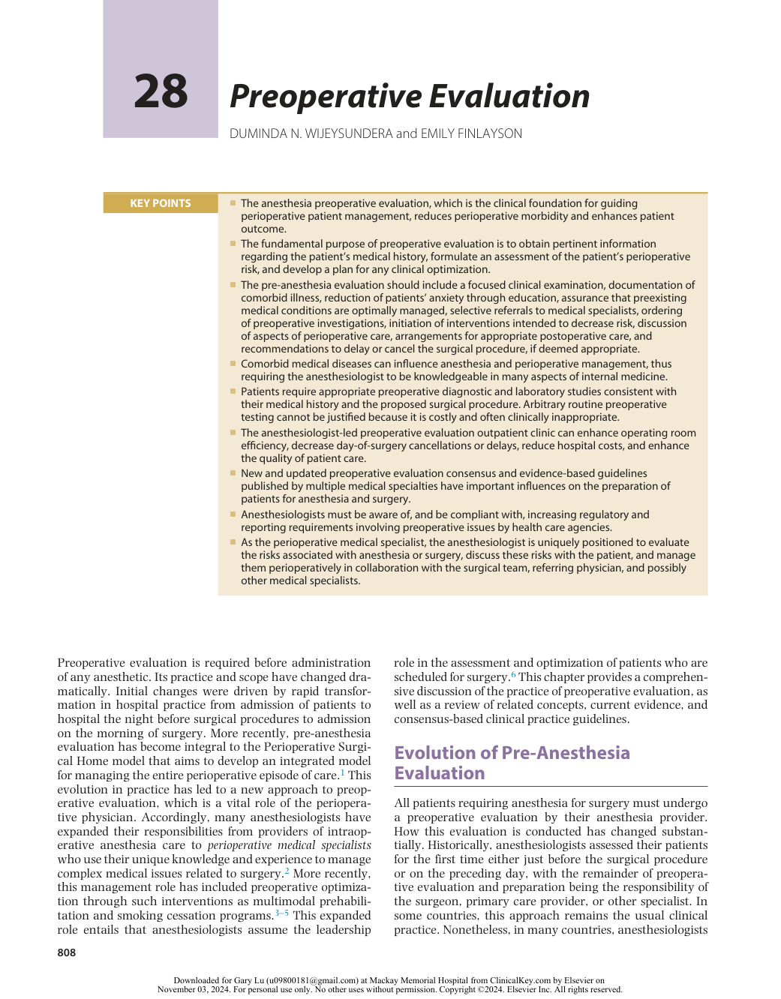

:::

<!-- PDF page 2 -->

have increasingly taken on a leadership role in preoperative evaluation and preparation, well in advance of the scheduled procedure.

Several factors explain this change. First, considerably fewer patients are admitted to the hospital before the day of surgery. In many countries, there is little financial justification for the previous model of inpatient hospital admission before surgery. Most surgical procedures in the United States are now performed on an outpatient or same- day admission basis, including major neurosurgical, cardiac, and cancer resection procedures. Second, surgical patients are increasingly likely to be older individuals with frailty and significant burdens of medical comorbidity.7 For such patients, sufficient time is needed between the pre- anesthesia evaluation and the planned surgery to facilitate testing, interventions, and medical optimization. Some centers have developed specific preoperative optimization clinics to focus on such high- risk patients,8 who may be candidates for interventions such as multimodal prehabilitation and smoking cessation programs.3–5 In the case of patients with very high- risk medical comorbidity, preoperative consultation by an anesthesiologist can help inform a shared decision- making process for proceeding with surgery (see section on Frailty, Geriatric Conditions, and The Older Surgical Patient). Third, anesthesia care increasingly extends beyond the operating room alone. Preoperative evaluation is an integral component of anesthesiologists’ role as perioperative physicians who are involved in integrated medical care before, during, and after surgery. The specialty is uniquely positioned for this role given its expertise in the management of medical complexities related to anesthesia and surgery. This view of preoperative evaluation as a key component of the integrated management of the entire perioperative episode of care is essential to the Perioperative Surgical Home model in the United States,1 or Perioperative Care model in the United Kingdom.9

Outpatient preoperative assessment clinics have been instrumental in facilitating greater involvement of anesthesiologists in preoperative evaluation. These clinics also impose new clinical and organizational challenges. In an institution where most surgical patients are evaluated in the preoperative assessment clinic, anesthesiologists may have less time to evaluate often medically complex patients. Consequently, anesthesiologists must achieve a high level of efficiency and accuracy in the assessment of a patient’s history, physical examination, and differential diagnosis, as well as in the planning of perioperative management. Conversely, in a hospital where only the highest- risk patients are referred for consultation at a preoperative assessment clinic, the anesthesia department must interact with surgical departments to establish general protocols that ensure capture of the information needed to perform anesthesia safely, as well as the appropriate selection of individuals who require preoperative anesthesia consultation. In addition to changes in the scope and timing of the pre- anesthesia evaluation, this assessment has increasingly been influenced and governed by practice guidelines. For example, in the United States, the Joint Commission mandates documentation of a history and physical examination for any surgical patient within 30 days before the planned procedure, as

well as reassessment within the 48- hour period immediately preceding the surgical procedure. The American Society of Anesthesiologists (ASA) and European Society of Anaesthesiology (ESA) have published specific guidelines for preoperative anesthesia evaluation.10,11 In addition, several other specialty societies published practice guidelines specifically relating to the preoperative management of medical issues in surgical patients.12–17

## Goals and Benefits of

## Pre- Anesthesia Evaluation

Preoperative evaluations help influence and improve perioperative care (Fig. 28.1). Indeed, inadequate preoperative evaluation was a contributing factor in 3% of perioperative adverse events in the Australian Incident Monitoring Study database.18 The overarching goals of pre- anesthesia evaluation are to (1) ensure that the patient can safely tolerate anesthesia for the planned surgery and (2) mitigate perioperative risks such as pulmonary or cardiovascular complications. In pursuit of these goals, pre- anesthesia evaluations offer opportunities to perform focused clinical examinations, better document comorbid illness, reduce the patient’s (and family’s) anxiety through education, optimize preexisting medical conditions, make selective referrals to medical specialists (e.g., cardiologists), order specialized investigations (e.g., cardiac stress tests), initiate interventions intended to decrease risk, discuss aspects of perioperative care (e.g., anticipated risks, fasting guidelines), and arrange appropriate levels of postoperative care (e.g., critical care unit). If a patient is deemed to be at very high risk for adverse perioperative outcomes, the anesthesiologist may also recommend consideration of a nonoperative or less-invasive treatment. Such a recommendation helps inform shared decision- making for surgery (see below). In some cases, pre- anesthesia evaluation can identify a previously unrecognized medical condition (e.g., hypertension) that may not significantly affect perioperative risks, but warrants longer- term follow- up by appropriate health care professionals.

Compared to preoperative evaluations performed by surgeons or primary care physicians alone, anesthesiologistled preoperative evaluation is associated with more selective ordering of laboratory tests and referral to specialists, thereby leading to reduced health care costs.19–21 Within the context of an anesthesiologist- led preoperative evaluation clinic, pre- anesthesia evaluations are associated with reduced anxiety,22 improved acceptance of regional anesthesia,23 fewer day- of- surgery case cancellations,24–26 shorter hospital length of stay,23,25,26 and lower hospital costs.27

## Clinical Examination During Preoperative Evaluation

The _clinical examination_ , consisting of the history and physical examination, is a fundamental component of preoperative evaluation by anesthesiologists. This information helps identify the underlying basis for the

<!-- PDF page 3 -->

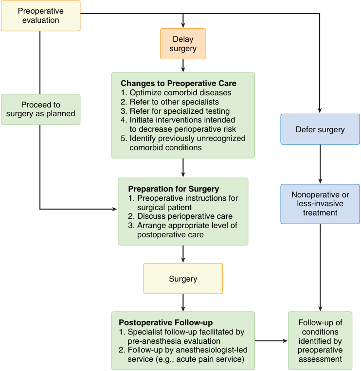

Preoperative evaluation Delay surgery Changes to Preoperative Care 1. Optimize comorbid diseases Proceed to 2. Refer to other specialists surgery as planned 3. Refer for specialized testing 4. Initiate interventions intended     to decrease perioperative risk Defer surgery 5. Identify previously unrecognized     comorbid conditions Preparation for Surgery Nonoperative or 1. Preoperative instructions for less-invasive     surgical patient treatment 2. Discuss perioperative care 3. Arrange appropriate level of     postoperative care Surgery Postoperative Follow-up Follow-up of 1. Specialist follow-up facilitated by conditions     pre-anesthesia evaluation identified by 2. Follow-up by anesthesiologist-led preoperative     service (e.g., acute pain service) assessment 

**Fig. 28.1 Mechanisms by which preoperative evaluation can help influence and improve perioperative care.**

planned surgery, clarify the extent of comorbidities with specific perioperative relevance, identify opportunities for preoperative optimization, and select any appropriate preoperative testing. The consistency and quality of preoperative examinations are enhanced through standardization. Specifically, the baseline clinical examination of all surgical patients should include a consistent set of components,28 with opportunities for more detailed examination of one of more of these components (e.g., cardiovascular system) based on the findings from the standardized initial examination. Computer- based preoperative evaluation tools can help better standardize high- quality preoperative assessments,29–31 and are recommended in the 2018 ESA guidelines on preoperative evaluation.11 Preoperative physical examination is further enhanced by appropriately considering evidencebased implications of different findings.32

### COMPONENTS OF THE MEDICAL HISTORY

The important components of the anesthesia history are presented in the sample preoperative history form in Fig. 28.2. This information can be documented, either on paper or an electronic form, by anesthesia staff during

an in- person or telephone interview with the patient. Alternatively, the patient can complete a form capturing the required information, either in person or remotely through a web- based program. The pre- anesthesia evaluation starts with the planned surgery and its indication. The development of the underlying condition necessitating surgery (e.g., cancer) and any prior related therapies need to be clear. Current known medical problems, past medical problems, previous surgeries, anesthesia types, and anesthesia- related complications must be noted. A simple notation of diseases or symptoms such as hypertension, diabetes mellitus, ischemic heart disease, shortness of breath, or chest pain is not sufficient. Rather, their associated severity, stability, associated activity limitations, exacerbations (current or recent), prior treatments, and planned interventions should be clearly documented. All related diagnostic test results, interventions, and names of treating physicians should be reviewed. The patient’s responses to these initial questions may elicit further inquiry to establish a complete history.

Prescription and over- the- counter medications (including supplements and herbal medications) should be documented, along with their dosages and schedules. This information should include any recently interrupted

<!-- PDF page 4 -->

medications with perioperative implications (e.g., recent corticosteroid therapy). The anesthesiology should list any allergies to medications and other substances (e.g., latex, radiographic dye), with special emphasis on the patient’s response to the exposure. Patients often claim an “allergy” to a substance when the reaction was an expected side effect (e.g., nausea or vomiting with narcotics). Tobacco, alcohol, or illicit drug use must be documented. Tobacco exposure is best quantified using pack- years (number of packs of cigarettes smoked per day, multiplied by the number of years of smoking); as an example, an individual who smoked two packs of cigarettes daily for the prior ten

years is deemed to have a 20 pack- year history of tobacco use. A personal or family history of pseudocholinesterase deficiency and malignant hyperthermia (including a suggestive history such as hyperthermia or rigidity during anesthesia) must be clearly documented to facilitate appropriate planning before the day of surgery. Information from previous anesthetic records may clarify an uncertain history.

A standardized general review of all organ systems should then be performed. For example, patients should be asked whether they ever had problems with their heart, lungs, kidneys, liver, and nervous system. In addition, they should be

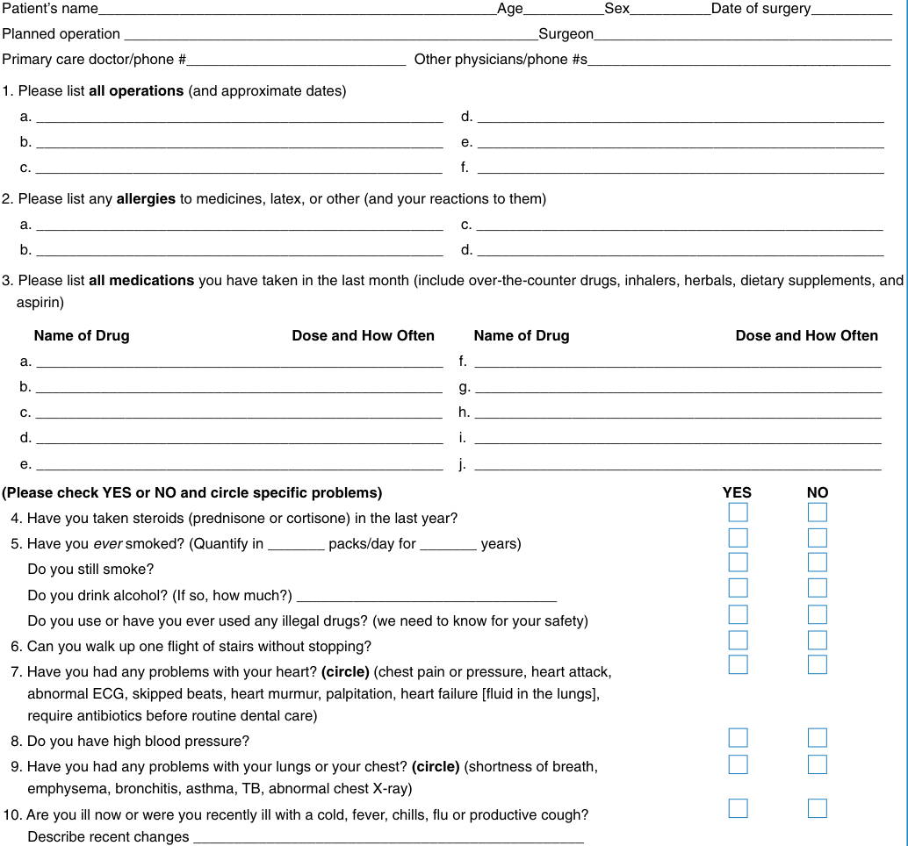

Patient’s name_________________________________________________Age__________Sex__________Date of surgery__________ Planned operation ___________________________________________________Surgeon_____________________________________ Primary care doctor/phone #___________________________  Other physicians/phone #s______________________________________ 1. Please list  all operations  (and approximate dates) a. __________________________________________________  d.  __________________________________________________ b. __________________________________________________  e.  __________________________________________________ c. __________________________________________________  f.  __________________________________________________ 2. Please list any  allergies  to medicines, latex, or other (and your reactions to them) a. __________________________________________________  c. __________________________________________________ b. __________________________________________________  d. __________________________________________________ 3. Please list  all medications  you have taken in the last month (include over-the-counter drugs, inhalers, herbals, dietary supplements, and aspirin) Name of Drug Dose and How Otfen Name of Drug Dose and How Otfen a. __________________________________________________  f.  __________________________________________________ b. __________________________________________________    g. __________________________________________________ c. __________________________________________________  h. __________________________________________________ d. __________________________________________________  i.  __________________________________________________ e. __________________________________________________  j.  __________________________________________________ (Please check YES or NO and cricle specific problems) YES NO  4. Have you taken steroids (prednisone or cortisone) in the last year?  5. Have you  ever  smoked? (Quantify in _______ packs/day for _______ years)  Do you still smoke?  Do you drink alcohol? (If so, how much?) ________________________________  Do you use or have you ever used any illegal drugs? (we need to know for your safety)  6. Can you walk up one flight of stairs without stopping?  7. Have you had any problems with your heart?  (circle)  (chest pain or pressure, heart attack,  abnormal ECG, skipped beats, heart murmur, palpitation, heart failure [fluid in the lungs],  require antibiotics before routine dental care)  8. Do you have high blood pressure?  9. Have you had any problems with your lungs or your chest?  (circle)  (shortness of breath,  emphysema, bronchitis, asthma, TB, abnormal chest X-ray)  10. Are you ill now or were you recently ill with a cold, fever, chills, flu or productive cough?  Describe recent changes ________________________________________________ 

A

**<mark>Fig. 28.2 (A, B) Sample patient preoperative history form.</mark>** _<mark>ECG,</mark>_ <mark>electrocardiogram;</mark> _<mark>TB,</mark>_ <mark>tuberculosis;</mark> _<mark>TMJ,</mark>_ <mark>temporomandibular joint.</mark>

<!-- PDF page 5 -->

B

|**)** **s** **m** **e** **l** **b** **o** **r** **p** **c** **ifi** **c** **e** **p** **s** **e** **l** **c** **ri** **c** **d** **n** **a** **O** **N** **r** **o** **S** **E** **Y** **k** **c** **e** **h** **c** **e** **s** **a** **e** **l** **P** **(**|**S** **E** **Y**|**O** **N**|
|---|---|---|
|11. Have you or anyone in your family had serious bleeding problems?**(circle)**(prolonged bleeding|||
|from nosebleed, gums, tooth extractions, or surgery)|||
|12. Have you had any problems with your blood (anemia, leukemia, sickle cell disease,|||
|blood clots, transfusions)?|||
|13. Have you ever had problems with your:**(circle)**|||
|Liver (cirrhosis, hepatitis, jaundice)?|||
|Kidney (stones, failure, dialysis)?|||
|Digestive system (frequent heartburn, hiatus hernia, stomach ulcer)?|||
|Back, neck, or jaws (TMJ, rheumatoid arthritis)?|||
|Thyroid gland (underactive or overactive)?|||
|14. Have you ever had:**(circle)**|||
|Seizures, epilepsy, or fits?|||
|Stroke, facial, leg or arm weakness, difficulty speaking?|||
|Cramping pain in your legs with walking?|||
|Problems with hearing, vision, or memory?|||
|15. Have you ever been treated for cancer with chemotherapy or radiation therapy?**(circle)**|||
|16. Women: Could you be pregnant?|||
|Last menstrual period began: ______________________|||
|17. Have you ever had problems with anesthesia or surgery?**(circle)**(severe nausea or vomiting, malignant hyperthermia [in blood relatives or self], prolonged drowsiness, anxiety,|||
|breathing difficulties, or problems during placement of a breathing tube)|||
|18. Do you have any chipped or loose teeth, dentures, caps, bridgework, braces,|||
|problems opening your mouth, swallowing or choking? **(circle)**|||
|19. Do your physical abilities limit your daily activities?|||
|20. Do you snore?|||
|21. Please list any medical illnesses not noted above: ___________________________________________________________________________ ___________________________________________________________________________|||
|___________________________________________________________________________ ___________________________________________________________________________ 22. Additional comments or questions for nurse or anesthesiologist? ___________________________________________________________________________ ___________________________________________________________________________ **Fig. 28.2**, cont’d|||

asked about any history of cancer, anemia, bleeding problems, or prior hospitalization for any reason. The principal emphasis should be on airway abnormalities, anesthesiarelated adverse events (personal or family history), as well as symptoms of cardiovascular, pulmonary, hepatic, renal, endocrine, or neurologic disease. For example, a report of a patient who has experienced excessive sore throat, dental injuries, or “the need to have a small tube” with previous anesthetic cases may be an indication of previous difficulty with airway management. A history of snoring and daytime somnolence may suggest undiagnosed sleep apnea (see later section on Obstructive Sleep Apnea). Any history of chest discomfort (including its duration, precipitating factors, associated symptoms, and relieving factors) could be important. Similarly, a list of previous surgical procedures should be

obtained and can help complete the medical history. While guidelines continue to evolve, documentation of the timing and severity of recent COVID- 19 infection,33–35 as well as vaccination status, can help inform discussions of the safe timing of surgery. Finally, records from primary care physicians, specialists, or inpatient admissions may reveal any issues the patient did not recall.

### ASSESSMENT OF FUNCTIONAL CAPACITY

The assessment of the patient’s cardiopulmonary fitness or functional capacity is an integral component of preoperative evaluation. This information is typically used to estimate patients’ risks for major postoperative morbidity or mortality, and can help determine whether

::: details 原始表格與符號（PDF 第 5 頁）

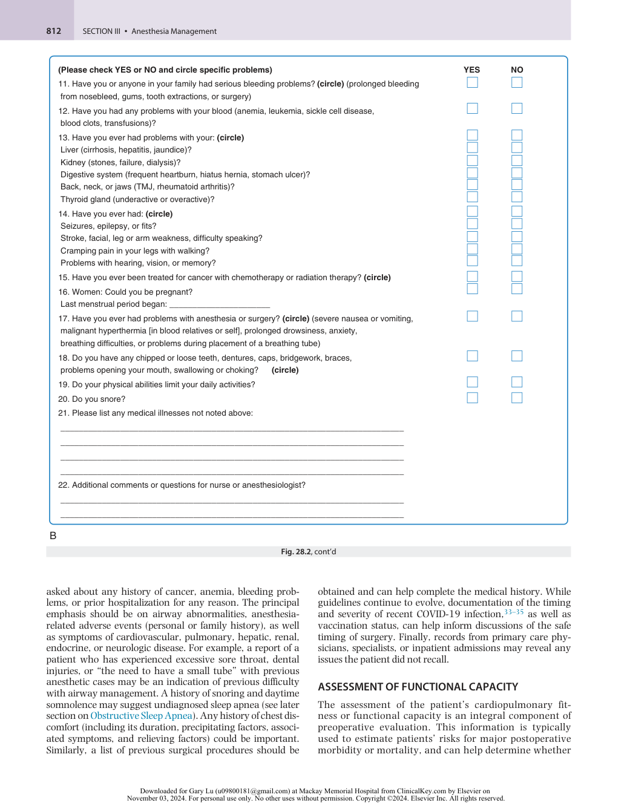

:::

<!-- PDF page 6 -->

further preoperative testing is required.12,14 Importantly, suboptimal functional capacity is common across many countries. For example, only one- fifth of American adults meet federal guidelines for recommended levels of aerobic and strengthening activity,36 while a 2022 World Health Organization report estimates that about 28% of the global population does not meet recommended minimum levels of physical activity.37 Poor exercise capacity and cardiopulmonary disease have a bidirectional relationship. Lack of exercise may increase the risk of developing cardiopulmonary disease but preexisting cardiopulmonary disease can also prevent an individual from exercising. For example, patients with peripheral artery disease may be limited by intermittent claudication, and patients with ischemic heart disease may be limited by exertional chest discomfort. There is a reasonable body of evidence demonstrating an association between poor preoperative functional capacity and increased perioperative risk. Most of these studies involved objective assessment of preoperative functional capacity using either exercise testing or cardiopulmonary exercise testing (CPET).38–41 Several other large studies have demonstrated association between very significant preoperative functional impairment (i.e., difficulty or inability to perform activities of daily living) and increased risks of postoperative mortality,42 cardiovascular complications,43 and pulmonary complications.44,45

The challenge with assessment of preoperative functional capacity pertains to how best to assess it in usual clinical practice. Typically, the anesthesiologist will enquire about a patient’s general activity levels during the preoperative interview (e.g., ability to walk on level ground, climb stairs, or participate in sports). These interviews are usually unstructured, which means that the specific questions will vary across interviewers, and even within an individual interviewer’s own practice. Based on the patient’s responses during this unstructured interview, an anesthesiologist will make a _subjective assessment_ of the patient’s functional capacity. Functional capacity is typically quantified in using the metabolic equivalent of task (MET), where one MET is approximately the rate of energy consumption at rest (3.5 mL/kg/min). A proposed scheme for estimating METs based on information from the preoperative interview is presented in Table 28.1. There are important limitations to this usual clinical approach of subjective assessment based on an unstructured preoperative interview. First, subjective assessment does not accurately estimate patients’ true exercise capacity. In a multicenter prospective cohort study of about 1400 patients undergoing major noncardiac surgery, anesthesiologists’ subjective assessment had only 19% sensitivity and 95% specificity for identifying patients’ inability to attain ≥4 METs during formal exercise testing.41 Second, subjective assessment does not meaningfully improve prediction of postoperative mortality and morbidity, as shown in a multicenter prospective cohort study and two single-center retrospective cohort studies.41,46,47

To improve preoperative evaluation of functional capacity, anesthesiologists should instead assess functional capacity using standardized consistent questions about physical activity levels (i.e., structured

interviews). For example, the interviewer can consistently ask patients about the inability to walk four blocks and climb two flights of stairs, which is associated with increased risk of serious perioperative complications.48 Alternatively, the interviewer can consistently ask patients about the inability to climb two flights of stairs, which is associated with increased risk of postoperative cardiac complications.49 An important limitation with relying on just a few questions on activity levels (e.g., walking and climbing stairs) is that the estimate of functional capacity is highly susceptible to self- reporting bias and other factors that can limit mobility (e.g., arthritis precluding stair climbing). An alternative, and possibly better, approach is to use a validated questionnaire, such as the DASI (Duke Activity Status Index) or MET- REPAIR (MET: REevaluation for Perioperative cArdIac Risk) questionnaires (Table 28.2 and Table 28.3).50 Both questionnaires are correlated with gold- standard measures of functional capacity.41,50,51 Furthermore, lower DASI scores (i.e., lower estimated functional capacity) have been shown to be associated with increased risks of complications following noncardiac surgery, including myocardial infarction and major complications.41,52 Patients experience a clinically meaningful increased risk of these complications once DASI scores are 25 or lower. Where feasible, functional capacity can be more directly measured using objective performance- based tests such as field walking tests (e.g., 6- minute walk test, incremental shuttle walk test),53 exercise testing (e.g., electrocardiogram [ECG] exercise testing), or CPET. Poor performance on the 6- minute walk test, incremental shuttle walk test and CPET are associated with increased risks of major postoperative complications.38–41,53,54 If using a standard exercise test (i.e., not CPET), extrapolation from the total treadmill time on a Bruce protocol exercise

**Table 28.1** Functional Capacity as Expressed in Metabolic Equivalents of Task*

|**METs**|**Equivalent Level of Exercise**|
|---|---|
|1|Eating, working at computer, or dressing|
|2|Walking down stairs or in your house, or cooking|
|3|Walking 1 or 2 blocks on level ground|
|4|Raking leaves, gardening|
|5|Climbing 1 flight of stairs, dancing, or bicycling|
|6|Playing golf, or carrying clubs|
|7|Playing singles tennis|
|8|Rapidly climbing stairs, or jogging slowly|
|9|Jumping rope slowly, or moderate cycling|
|10|Swimming quickly, running or jogging briskly|
|11|Skiing cross country, or playing full court basketball|
|12|Running rapidly for moderate to long distances|

*One metabolic equivalent of task (MET) is the amount of oxygen consumed while sitting at rest, and is equivalent to an oxygen consumption of 3.5 mL/min/kg body weight

From Jette M, Sidney K, Blumchen G. Metabolic equivalents (METS) in exercise testing, exercise prescription, and evaluation of functional capacity. _Clin Cardiol_ . 1990;13:555–565.

::: details 原始表格與符號（PDF 第 6 頁）

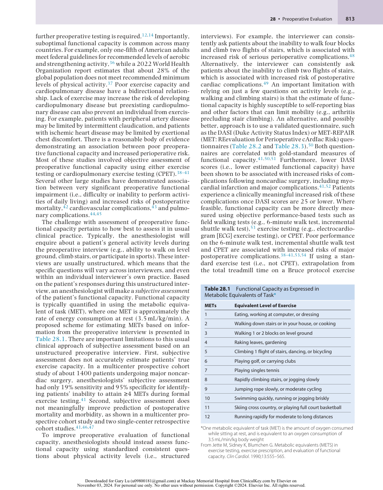

:::

<!-- PDF page 7 -->

### Table 28.2 Duke Activity Specific Index Questionnaire

|**Can you:**|**Points**|
|---|---|
|1. Take care of yourself: that is, eat dress, bathe, or use the toilet?|2.75|
|2. Walk indoors, such as around your house?|1.75|
|3. Walk 200 yards on level ground?|2.75|
|4. Climb a flight of stairs or walk up a hill?|5.50|
|5. Run a short distance?|8.00|
|6. Do light work around the house like dusting or washing dishes?|2.70|
|7. Do moderate work around the house like vacuuming, sweeping floors, or carrying groceries?|3.50|
|8. Do heavy work around the house like scrubbing floors or lifting or moving heavy furniture?|8.00|
|9. Do yard work like raking leaves, weeding, or pushing a power mower?|4.50|
|10. Have sexual relations?|5.25|
|11. Participate in moderate recreational activities like golf, bowling, dancing, doubles tennis, or throwing a ball?|6.00|
|12. Participate in strenuous sports like swimming, singles tennis, football, basketball, or skiing?|7.50|
|**Total score:**||

From Hlatky MA, Boineau RE, Higginbotham MB, et al. A brief selfadministered questionnaire to determine functional capacity (the Duke Activity Status Index). _Am J Cardiol_ . 1989;64:651–654.

test results in overestimation of true exercise capacity. Importantly, resting left ventricular ejection fraction is not a proxy measure of functional capacity,55,56 meaning that objectively measured exercise capacity can vary considerably among individuals with otherwise similar resting left ventricular ejection fraction.

### PHYSICAL EXAMINATION

The pre- anesthetic examination should include vital signs (i.e., arterial blood pressure, heart rate, respiratory rate, oxygen saturation), height, and weight. Body mass index (BMI), which is calculated based on the height and weight, is more informative than weight alone in establishing obesity. A scheme for classifying children and adults based on BMI is presented in Table 28.4. Information on BMI can help identify individuals at risk for difficulties with airway management, and some chronic diseases (e.g., heart disease, diabetes mellitus, obstructive sleep apnea). An ideal body weight should be calculated,57 using formulae such as the Devine equation.58 Information on ideal body weight can inform dose selection for some anesthesiarelated medications, and guide strategies to help minimize ventilator- induced lung injury. Readily available online calculators can be used to quickly determine both BMI and ideal body weight. Patients often have increased arterial blood pressure during the preoperative visit, even without a prior history of hypertension. This finding may be caused by anxiety, or patients having forgotten to take their usual dose of antihypertensive medication. Thus, a

**Table 28.3** MET- REPAIR Questionnaire

|**Can you do ANY of the listed activities in each within the last month?** **If you can perform ANY of the activities listed, please check yes.**|**Able to perform?**|**Corresponding METs**|
|---|---|---|
|Stair climbing at rapid pace; carrying a suitcase (10–20 kg or 20–40 lbs) upstairs; running|☐|8|
|Moving furniture or household items; lifting light loads; running or playing with children or animals at vigorous effort; recreational swimming|☐|5|
|Carrying groceries up stairs; jogging; recreational soccer or tennis|☐|7|
|Descending stairs; making beds; vacuuming or sweeping floors; walking the dog for pleasure; play with children at moderate effort|☐|3|
|Stair climbing at slow pace; hanging laundry; cleaning the bathroom; mowing lawn (power mower); raking lawn or sweeping outside the house; leisure bicycling; walking for exercise on level ground at moderate pace|☐|4|
|Sitting; reading; watching TV; listening to music|☐|1|
|Moving household items up stairs, carrying boxes (up stairs); climbing hills carrying≥20 kg or≥40 lbs; swimming fast|☐|9|
|Hiking cross country; walking for exercise up hill; biking to/from work at self- selected pace; scrubbing floors on hands and knees with vigorous effort; mowing lawn (hand mower); shoveling snow; chopping wood with vigorous effort.|☐|6|
|Walk indoors, such as around your house; dressing/undressing.|☐|2|
|Carrying loads≥25 kg or≥50 lbs (e.g., furniture, 2 suitcases) up stairs; running at 10 km/h or 6 miles/h (faster than a bicycle at leisure pace)|☐|10|

_MET,_ metabolic equivalent of task; _MET-REPAIR,_ MET: REevaluation for Perioperative cArdIac Risk.

Estimated functional capacity corresponds to the row with the highest associated corresponding METs that the patient self- reports as being able to perform. From Jaeger C, Burkard T, Kamber F, et al. Quantification of metabolic equivalents (METs) by the MET- REPAIR questionnaire: A validation study in patients with a high cardiovascular burden. _J Clin Anesth_ . 2022;76:110559.

::: details 原始表格與符號（PDF 第 7 頁）

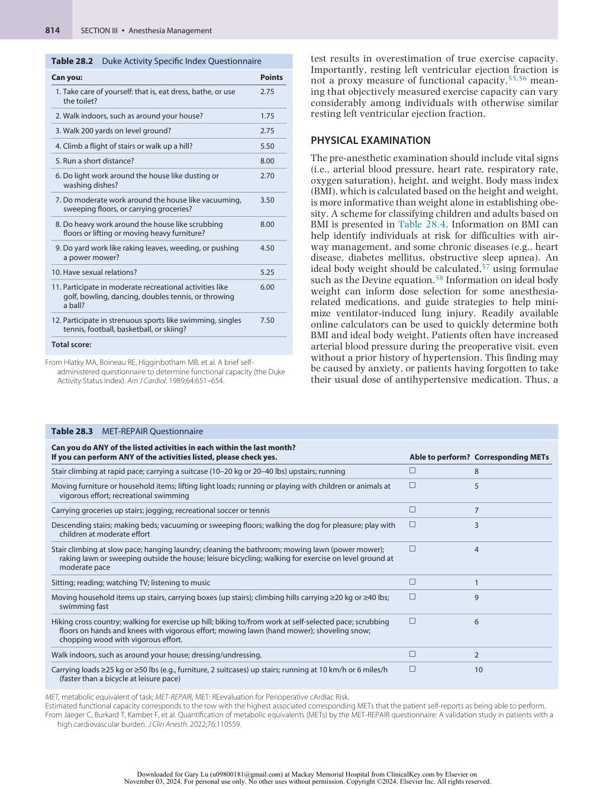

:::

<!-- PDF page 8 -->

**Table 28.4** Classification Scheme for Body Mass Index

|**Body Mass Index**|**Weight Status**|
|---|---|
|**ADULTS OVER 20 YEARS OLD**||
|BMI less than 18.5|Underweight|
|BMI 18.5 to 24.9|Normal|
|BMI 25.0 to 29.9|Overweight|
|BMI 30.0 and above|Obese|
|**FOR CHILDREN AND TEENS**||
|BMI- for- age &lt;5th percentile|Underweight|
|BMI- for- age 5th percentile to &lt;85th percentile|Normal|
|BMI- for- age 85th percentile to &lt;95th percentile|At risk of overweight|
|BMI- for- age≥95th percentile|Overweight|

_BMI_ , body mass index. From http://www.cdc.gov.

single reading during the preoperative evaluation may not reflect the patient’s usual blood pressure control. Repeating the blood pressure measurement or obtaining previous readings, either by obtaining medical records (including prior ambulatory blood pressure testing) or asking patients about their “usual” blood pressure measurements, can be informative. Ideally, the referral documentation from the patient’s primary care physician or surgeon should include information on the patient’s usual blood pressure readings.59

From an anesthesiologist’s perspective, inspection of the airway may be the most important component of the physical examination (see Chapter 40). The components of the airway examination are presented in Box 28.1.60 Documentation of an airway examination includes the Mallampati score (Fig. 28.3),61 status of teeth, degree of neck mobility (especially extension), neck circumference (increased size predicts difficulty with laryngoscopy), thyromental distance, body habitus, and pertinent deformities. Because of the potential for dental injuries during anesthesia, any preexisting tooth abnormalities should be documented (Fig. 28.4). In a French prospective cohort study of 1501 patients, the following characteristics were identified as independent predictors of _difficult_ bag–mask ventilation: age >55 years, BMI >26 kg/m2 , absence of teeth, presence of a beard, and a history of snoring.62 These risk factors are largely consistent with predictors of _difficult or impossible_ bag–mask ventilation identified in an American retrospective cohort study of 22,660 patients: age ≥57 years, BMI ≥30 kg/m2 , presence of a beard, Mallampati classification III or IV, severely limited mandibular protrusion, and a history of snoring.63 In another large retrospective cohort study (53,041 patients) from the United States, predictors of _impossible_ bag–mask ventilation were prior neck radiation, male sex, sleep apnea, Mallampati classification III or IV, and presence of beard.64 Other possible risk factors for difficult ventilation include an increased neck circumference, face and neck deformities (i.e., prior surgery, prior trauma, congenital abnormalities), rheumatoid arthritis, trisomy 21 (Down syndrome), scleroderma, cervical spine disease, or previous cervical spine surgery. The physical examination

### Box 28.1 Components of the Airway Examination

- Length of upper incisors (concerning if relatively long) Condition of the teeth Relationship of maxillary incisors to mandibular incisors (concerning if there is prominent overbite)

- Ability to advance mandibular incisors in front of maxillary incisors (concerning if unable to do this)

- Inter- incisor or inter- gum (if edentulous) distance (concerning if &lt;3 cm)

- Visibility of the uvula (concerning if Mallampati class is 3 or more)

|Shape of uvula (concerning if highly arched or very narrow)|
|---|
|Presence of heavy facial hair|
|Compliance of the mandibular space (concerning if it is stiff, indurated, occupied by mass, or nonresilient)|
|Thyromental distance (concerning if &lt;6 cm) Length of the neck|
|Thickness or circumference of the neck|
|Range of motion of the head and neck (concerning if unable to touch tip of chin to chest or cannot extend neck)|

- From Apfelbaum JL, Hagberg CA, Caplan RA, et al. Practice guidelines for management of the difficult airway: an updated report by the American Society of Anesthesiologists Task Force on Management of the Difficult Airway. Anesthesiology, 2013;118:251–270.

must be supplemented by examination of previous anesthetic records, especially when there are indications of a potentially difficult airway. Patients with known difficult airways should be encouraged to obtain medical alert identification. When challenging airways are identified, advance planning ensures that necessary equipment and skilled personnel are available on the day of surgery. An evaluation of the heart, lungs, and skin is necessary, as well as further focus on organ systems involved with diseases reported by the patient. This evaluation should include cardiac auscultation, as well as inspection of arterial pulses, veins (peripheral and central), jugular venous distention, ascites, hepatomegaly, and peripheral edema. Inspection of peripheral veins can also help assess the ease of intravenous (IV) access. The auscultatory examination should assess for murmurs, abnormal heart sounds (e.g., third or fourth heart sounds), and pulmonary rales. If IV access sites are limited, possible central line placement can be discussed with the patient, or arrangements can be made for assistance from interventional radiology. Auscultation for carotid bruits is also important, especially in patients with a history of stroke, transient ischemic attacks, or head and neck irradiation. The presence of a carotid bruit significantly increases the likelihood of an important lesion (i.e., 70%–99% stenosis) in both symptomatic or asymptomatic patients, but the absence of a bruit does not rule out carotid stenosis.32 Examination of the pulmonary system should include both auscultation (i.e., wheezing, decreased breath sounds, abnormal breath sounds) and inspection (i.e., cyanosis, clubbing, accessory muscle use, respiratory effort). A basic screening neurologic examination should document deficits in mental status, speech, gait, cranial nerve function, motor nerve function, and sensory nerve function. For selected

::: details 原始表格與符號（PDF 第 8 頁）

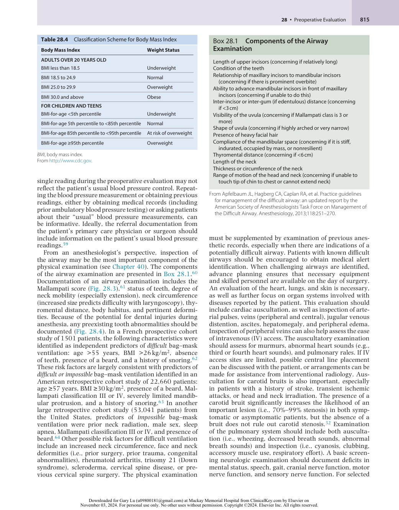

:::

<!-- PDF page 9 -->

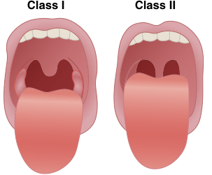

Class I Class II 

Class III Class IV 

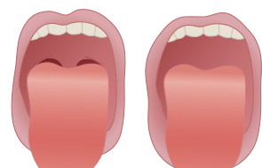

**Fig. 28.3 Mallampati classification.** Class I: soft palate, fauces, entire uvula, pillars. Class II: soft palate, fauces, portion of uvula. Class III: soft palate, base of uvula. Class IV: hard palate only.

From Bair AE, Caravelli R, Tyler K, et al. Feasibility of the preoperative Mallampati Airway Assessment in emergency department patients. _J Emerg Med_ . 2010;38:677–680.

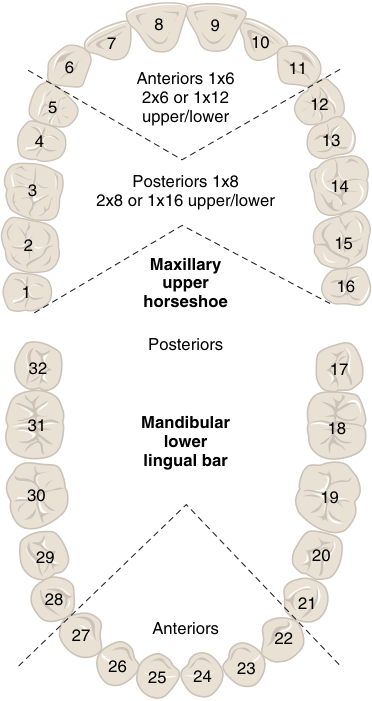

8 9 7 10 6 11 Anteriors 1x6 2x6 or 1x12 5 12 upper/lower 4 13 3 Posteriors 1x8 14 2x8 or 1x16 upper/lower 2 15 Maxillary 1 upper 16 horseshoe Posteriors 32 17 31 Mandibular 18 lower lingual bar 30 19 29 20 28 21 Anteriors 27 22 26 23 25 24 

**<mark>Fig. 28.4 Tooth numbering.</mark>**

patients (e.g., those with deficits, or scheduled to undergo neurosurgery), a more extensive or focused neurologic examination should document preexisting abnormalities that may aid in diagnosis or interfere with positioning. In addition, the definition of a baseline preoperative neurologic state helps determine whether any postoperative deficits represent new deficits versus preexisting abnormalities.

## Frailty, Geriatric Conditions, and the Older Surgical Patient

As patients age, the accumulation of comorbid conditions puts them at increased risk for adverse outcomes after surgery.65,66 In addition, geriatric- specific risk factors such as functional and cognitive impairment are associated with poor postoperative outcomes.65 These clinical conditions do not fit into discrete disease categories, and are often overlooked in routine preoperative assessments. Assessment of geriatric vulnerabilities is essential before surgery to (a) accurately inform patients of their surgical risk and (b) identify targets for preoperative optimization. The American College of Surgeons (ACS) and the American Geriatrics Society (AGS) have established best practice guidelines to guide the preoperative assessment of older surgical patients,67,68 with similarly focused guidelines developed in other countries, such as the Centre for Perioperative Care in the United Kingdom (https://cpoc.org.uk/guidelines- and- resources).

### GERIATRIC- FOCUSED ASSESSMENT IN THE OLDER SURGICAL PATIENT

### Function and Mobility

Preoperative functional decline is associated with morbidity, mortality, and loss of function after surgery.65 Assessment of function prior to surgery is thus essential for risk stratification and post- discharge planning in older surgical patients. Activities of daily living (ADLs) assess the ability to perform basic tasks of self-care, such as dressing, bathing, toileting, transferring, continence, and eating. Instrumental ADLs determine an individual’s ability to live independently by the ability to complete shopping, laundry, transportation, finances, medications, food preparation, and housekeeping. To determine additional functional vulnerabilities, determination of vision deficits, hearing deficits, and swallowing difficulties should be routine. Mobility impairment can also be efficiently screened by enquiring about a history of falls in the months preceding surgery. Prior research suggests that 25% to 50% of surgical

<!-- PDF page 10 -->

patients report a history of falls before surgery,69 which are predictive of subsequent functional decline after surgery.70 Performance- based physical tests can also provide more objective assessment of function, with a commonly recommended test being the Timed Up- and- Go test.71 The Timed Up- and- Go test involves timing patients while they perform the following tasks in sequence:

1.  Stand up from a chair (without using arm rests if possible)

2.  Walk 10 feet

3.  Turn around and walk back to chair

4.  Sit down in chair

In a prospective cohort of older surgical patients, Timed Up- And- Go test times were associated with risks of postoperative complications and one- year mortality in a stepwise fashion.72 Other options for objective physical tests to assess preoperative function include grip strength measurement and various sit- to- stand tests, such as the 30- second sit- to- stand and five- times sit- to- stand. The 30- second sitto- stand test involves counting how many times a person can move unassisted over 30 seconds from sitting (standard chair with seat height ∼43 cm) to standing, without using their arms, while the five- times sit- to- stand test measures how long a person takes to complete five repetitions of moving unassisted from sitting to standing. Preliminary evidence shows that poor sit- to- stand performance and grip strength predicts postoperative complications.73,74

### Cognition

A substantial proportion of older surgical patients (26% to 37%) may have unrecognized cognitive impairment.75 Furthermore, preoperative cognitive impairment is closely associated with increased risks of postoperative delirium, complications, functional decline, and mortality.65,76 Thus, systematic screening for cognitive impairment has important value in the preoperative evaluation of older surgical patients. Traditional screening tools for cognitive impairment include Mini- Mental State Examination (MMSE) and Montreal Cognitive Assessment (MoCA),77,78 both of which require about 10 minutes for completion. Several other rapid tools (i.e., completed in &lt;5 minutes) have been developed, with most prior research having focused on the MiniCog test,79 Rapid Cognitive Screen,80 Six- Item Screener,81 and clock drawing test.82 The Mini- Cog test, Rapid Cognitive Screen, and Six- Item Screener have qualitatively similar discriminative performance for detecting mild cognitive impairment that is superior to the clock drawing test.82 Additional information about potential cognitive deficits should be elicited from someone who knows the patient well. Importantly, mild cognitive impairment that is not clinically apparent may have a critical impact on decisionmaking capacity. Patients should be able to describe, in their own words, the essential elements of the consent discussion – including the surgical condition, indications for surgery, risks, benefits, and alternatives to surgery. It is important to note the four legal criteria for medical decision- making capacity, namely, that the patient can (1) clearly indicate their treatment choice; (2) understand the relevant information communicated by the physician; (3) acknowledge their medical condition, treatment options, and expected

outcomes; and (4) engage in a rational discussion about treatment options.67

### Nutrition

In general, most surgeons and anesthesiologists are keenly aware of the role nutritional status plays in recovery after surgery for all surgical patients. The most common adverse events related to poor nutritional status are infectious complications (i.e., surgical site infections, pneumonia, urinary tract infections), wound complications (i.e., dehiscence, anastomotic leaks), and increased length of stay.65,83 The ACS/AGS practice guidelines recommend the following steps to screen for poor nutritional status (older adults with limited material resources are at particular risk for food insecurity).67

1. _Document height, weight, and BMI_

- A BMI value &lt;18.5 kg/m2 places an individual at elevated risk and should prompt referral for nutritional assessment.

2. _Measure baseline serum albumin and prealbumin concentrations_

- Serum albumin concentration &lt;30 g/L (in the absence of hepatic or renal dysfunction) should prompt referral for nutritional assessment.

3. _Inquire about unintentional weight loss in the last year_ Unintentional weight loss exceeding 10% to 15% of baseline weight within the prior six months is associated with severe nutritional risk and should prompt referral for nutritional assessment.

Other approaches to screen for preoperative nutritional status include validated brief screening questionnaires such as the six- item Mini Nutritional Assessment Short- Form.84

### Frailty

Frailty, which is defined as a state of increased vulnerability to physiologic stressors, is associated with adverse health outcomes after medical and surgical interventions and limited life expectancy.85 Numerous validated instruments measuring frailty are in current use in research and clinical practice. There are two primary models of frailty: the frailty phenotype and the deficit accumulation model. The frailty phenotype described by Fried and colleagues is based on the identification of traits associated with the occurrence of disease, hospitalization, falls, disability, and death in a large prospective cohort study.86 This study defined the five determinants of frailty as unintentional weight loss, self- reported exhaustion, low physical activity, slowness of gait, and reduced grip strength, where frailty is defined by the presence of ≥3 domains. By comparison, Rockwood and colleagues described the deficit accumulation model of aging based on 92 signs, symptoms, functional impairments, and laboratory abnormalities that are proportionally weighted into a frailty index for predicting mortality.87 The accumulating deficit model was used to develop the nine- level Clinical Frailty Scale (CFS), where frailty is defined by a CFS score ≥4.88

Numerous studies have demonstrated the association of patient frailty with adverse surgical outcomes65,89–93 ; the incorporation of frailty into routine clinical practice has not been broadly implemented. Many frailty instruments require special training, input of laboratory values or clinical data, and a fair amount of time to complete; hence, they

<!-- PDF page 11 -->

are impractical in a busy clinical setting. A survey of 251 surgical oncologists reported that although most surgeons expressed interest in preoperative optimization for older patients, only 6% currently perform geriatric assessments in their older patients.94 In a recent qualitative study, anesthesiologists and surgeons identified key impediments to more routine frailty assessment as being the need to focus on other clinical domains (i.e., cardiorespiratory health, indication for surgery), as well as need for more training and guidelines on evidence- based efficient frailty assessment.95

To address this gap, several investigators have validated more efficient strategies to assess frailty in surgical patients. Robinson and colleagues developed two alternative frailty assessment definitions for surgical patients,96,97 which were:

- Mini- Cog score ≤3, serum albumin concentration ≤30 g/L, one or more falls in the prior six months, and hematocrit &lt;35%.

- Timed Up- And- Go test ≥15 seconds, activity- of- dailyliving dependence, and Charlson comorbidity index score ≥3.98

Another approach involves the 11- item Edmonton Frail Scale, which consists of the clock drawing test, Timed UpAnd- Go, and nine standardized questions.99 The Edmonton Frail Scale can be administered by an individual with no formal medical education, has been validated against the geriatric specialist’s comprehensive geriatric assessment,99 and has been shown to predict adverse outcomes after surgery.100 More recent evidence has pointed to the nine- level CFS as being the most feasible clinical approach to accurately assess frailty during preoperative evaluation.101 In direct comparison of the CFS against the modified Fried Index, clinicians found the CFS to be easier to use, more feasibly applied in the clinical environment and quicker to complete (&lt;1 minute versus 5 minutes).102 Web- based training modules have now been developed to support clinicians in applying the CFS in a standardized and reliable manner.103

### Additional Considerations

Anxiety, depression, substance use disorders, and social isolation are common underdiagnosed conditions in older adults. Careful screening can identify these potential barriers to recovery, safe discharge after surgery, and maintenance of independence. Up to 11% of the population aged ≥71 years in the United States suffer from depression.104 The Patient Health Questionnaire- 2 (PHQ- 2) is an efficient instrument to screen for depression that includes only two questions: “ _In the past 12 months, have you ever had a time when you felt sad, blue, depressed, or down for most of the time for at least two weeks?”_ and “ _In the past 12 months, have you ever had a time, lasting at least two weeks, when you didn’t care about the things that you usually care about or when you didn’t enjoy the things that you usually enjoy?”_ Among individuals aged ≥65 years, 13% of males and 8% of females consume at least two alcoholic drinks per day.105 Alcohol and substance use disorders are associated with increased rates of postoperative mortality and complications including pneumonia, sepsis, wound infection and disruption, and prolonged length of stay.106 Consequently, the ACS NSQIP and AGS recommend screening for alcohol and substance use disorder among older individuals with the modified CAGE questionnaire (see section on Patients with a History of Substance Use Disorder).

### PREOPERATIVE OPTIMIZATION FOR OLDER PATIENTS WITH FRAILTY (TABLE 28.5)

One goal of the preoperative assessment of elderly surgical patients is to identify potentially modifiable risk factors – such as malnutrition, poor physical function, anxiety, and social isolation – with the aim of optimizing surgical outcomes. Several recent geriatric optimization models have emerged to help meet this need in clinical care, with some demonstration of promising results. One of the first of such programs was the Proactive care of Older People undergoing Surgery (POPS) before- and- after study in the United Kingdom.107 The

**Table 28.5** Preoperative Assessment and Optimization in the Older Surgical Patient

|**Domain**|**Assessment**|**Preoperative Optimization**|
|---|---|---|
|Cognition|ᑏCognitive screening tool (e.g., Mini- Cog test) ᑏAssess for visual and hearing impairment ᑏScreen for alcohol or substance use disorders (e.g., CAGE questionnaire) ᑏMedication review|ᑏFormal assessment by geriatrician for patient identified to have cognitive impairment on screening ᑏCommunicate results to primary care provide to consider options for management and follow- up ᑏRemind patient to be bring all assistive devices (glasses, hearing aids) to hospital ᑏLimit use of sedating or psychotropic medications preoperatively|
|Depression|ᑏScreen for depression (e.g., PHQ- 2)|ᑏCommunicate results to primary care provider to consider options for management and follow- up|
|Function|ᑏEvaluate ability to perform activities of daily living and instrumental activities of daily living ᑏObtain history of falls ᑏValidated frailty instrument (e.g., Clinical Frailty Scale, modified Fried Index, Timed Up-and-Go Test, Edmonton Frail Scale)|ᑏRefer patients with functional deficiencies or history of falls for formal evaluation by a physical therapist before surgery ᑏConsider options for prehabilitation ᑏExercise education ᑏObtain assistive devices ᑏPlan for in- hospital and postdischarge rehabilitation therapy|
|Nutrition|ᑏDocument body mass index ᑏMeasure albumin and prealbumin ᑏQuery unintentional weight loss ᑏApply validated nutritional screening tool (e.g., Mini Nutritional Assessment – Short Form)|ᑏPatients with severe malnutrition should be referred to dietician for formal assessment ᑏPreoperative nutritional supplementation and nutrition education|

::: details 原始表格與符號（PDF 第 11 頁）

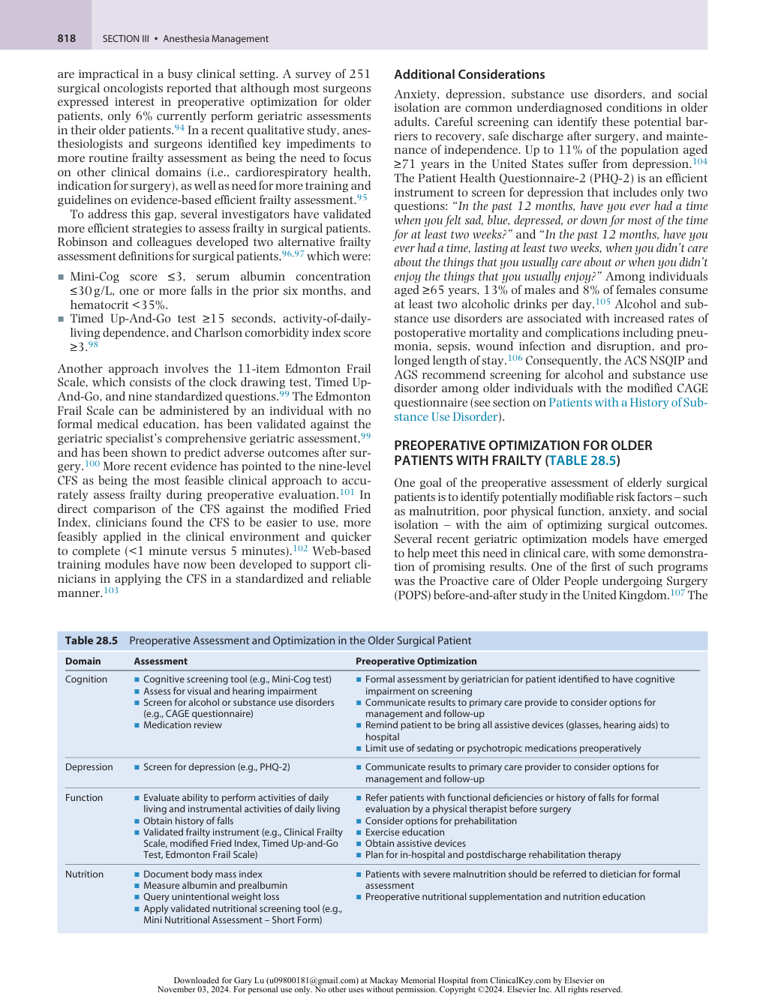

:::

<!-- PDF page 12 -->

program involved a structured geriatric team intervention that identified at- risk patients, and then facilitated coordinated multidisciplinary optimization of geriatric vulnerabilities. Interventions included preoperative home visits by occupational and physical therapists, social worker inputs, nutrition education, and relaxation techniques. Interdisciplinary teams also participated in daily inpatient rounds, weekly multidisciplinary meetings, and biweekly ward rounds led by a consultant or clinical nurse specialist. Compared to historical controls, surgical patients who received the POPS intervention experienced fewer postoperative complications (e.g., pneumonia, delirium), improved pain control, lower rates of delayed mobilization, lower rates of inappropriate urinary catheter use, and shorter hospital length of stay.

Similar findings were observed in the Perioperative Optimization of Senior Health study, which was another beforeversus- after study.108 This preoperative interdisciplinary clinic evaluated at- risk patients (either aged ≥80 years, or aged ≥65 years with concurrent geriatric vulnerability) and applied targeted optimization interventions. Compared to historical controls, the combination of geriatric prehabilitation and inpatient geriatric co- management was associated with reduced hospital length of stay, reduced readmission rates, and increased rates of discharge to home with selfcare. Another example is the Michigan Surgical Home and Optimization Program,109 which is a structured homebased preoperative training program with physical, nutritional, and psychological interventions. The intervention included (1) a home- based walking program; (2) incentive spirometry instructions starting one week prior to surgery; (3) education on nutrition, stress management, and care planning; and (4) resources for smoking cessation, when appropriate. Compared to matched historical controls, patients enrolled in the program experienced reductions in both hospital length of stay and health care costs.

While promising, these studies have methodologic weakness as before- versus- after studies, as opposed to methodologically more robust parallel arm randomized trials, cluster randomized trials, or stepped- wedge trials (see Chapter 86). To accompany these observational data, there are increasing numbers of promising randomized controlled trials of prehabilitation, which have been described as interventions that actively prepare patients before surgery through exercise (i.e., aerobic exercise, strength training), nutritional optimization, psycho- cognitive training, or a combination thereof.4 While the overall certainty of evidence remains low and prior trials were not necessarily restricted to older surgical patients, currently available data suggest that prehabilitation reduces the risk of complications and non- home discharge, improves functional recovery, and shortens hospital length of stay.4 Most efficacious prehabilitation programs start at least three to four weeks before surgery, and include both facility- based and homebased components. Psychological optimization is increasingly being considered as a component of multimodal prehabilitation, with evidence of benefit in cancer surgery,110 while preliminary research points to the potential benefits of cognitive prehabilitation using straightforward cognitive training exercises.111 Overall, more research clearly remains needed on geriatric prehabilitation, but the consistency across the studies is supportive of the notion that attention to pre- and perioperative assessment and

optimization in older adults can result in improved outcomes that benefit patients, hospitals, and health systems.

### DECISION- MAKING FOR SURGERY IN OLDER ADULTS

The critical initial step in surgical decision- making for the older patient is an assessment of the patient’s decisionmaking capacity. Among older adults, only about 3% lack medical decision- making capacity. Among older adults with mild cognitive impairment, however, this proportion is as high as 20%.112 A Mini- Cog exam (see section on Cognition, above) is an efficient way to screen for cognitive impairment in the surgical setting. If the patient does not have capacity, treatment goals and choices should be discussed with the patient’s surrogate, with involvement of the patient as appropriate. Even cognitively intact patients may have difficulty grasping the risks and trade- offs involved in decisions for surgery. The “teach- back” method (i.e., asking patients to communicate back information about their diagnosis, treatment plan, and potential risks of treatment) may be useful to confirm that the risks, expected benefits, and alternatives to surgery are fully understood. Various resources are available to aid in using the teach- back method (e.g., http://www.teachbacktraining.org).

Collaborative decision- making is essential in older adults with limited life expectancy. Rather than a traditional conversation that focuses on the process of correcting the underlying surgical condition, the conversation should be driven by a focus on the older adult’s overarching health goals. Using open- ended questions, physicians elicit the patient’s global health care goals that may prioritize (1) life prolongation; (2) function and independence; (3) maintenance of cognition; or (4) comfort. Further discussion should be framed by the patient’s most important health goal. A frank, realistic, and granular conversation about the ability of surgery to satisfy health care goals and priorities is essential. Invasive treatments should only be considered if there is a realistic possibility that overarching health goals can be achieved. These goals, however, are often dynamic and must be revisited as conditions change. Frameworks such as Best Case/Worse Case can help shift discussions about treatment alternatives to better align with patients’ values and preferences.113 Multidisciplinary involvement can help better inform collaborative decision- making for surgery,114 especially since different specialists (i.e., surgeons, anesthesiologists, geriatricians, other medical specialists) offer unique expertise to inform these discussions. Often, primary physicians who have longitudinal relationships with patients can provide important insight into their patient’s health goals and should be included in this important deliberation. To assist in highrisk surgical decision- making, preoperative palliative care consultation should be considered in individuals with poor prognoses who are electing to undergo surgery, particularly if they have a life expectancy of less than 6 months.

## Preoperative Evaluation of Patients with Coexisting Disease

For some conditions commonly seen in the pre- anesthetic assessment clinic, preoperative optimization, testing, and

<!-- PDF page 13 -->

intervention may be important (see also Chapter 29). Identification of these comorbid conditions might be an opportunity for the anesthesiologist to intervene to decrease perioperative risk. These conditions are best managed before the day of surgery, thus allowing ample time for thoughtful evaluation, consultation, and planning.

### CARDIOVASCULAR DISEASE

Cardiovascular complications are serious perioperative adverse events and account for 45% of deaths within 30 days after major noncardiac surgery.115 These events occur relatively frequently. For example, the multicenter Vascular Events in Noncardiac Surgery Patients Cohort Evaluation (VISION) prospective cohort study found a 4% risk of myocardial infarction, 17% risk of prognostically important myocardial injury, and 0.7% risk of acute heart failure during the 30 days following major noncardiac surgery.116 Several evidence- based preoperative cardiovascular assessment guidelines have been published, including the 2022 European Society of Cardiology (ESC) guidelines,14 2017 Canadian Cardiovascular Society (CCS) guidelines,13 2014 American College of Cardiology (ACC) and American Heart Association (AHA) guidelines,12 2017 Brazilian Society of Cardiology guidelines,117 2021 South African guidelines,118 and 2014 Japanese Circulation Society guidelines.119 While the guidelines provide similar guidance, there are important differences that are highlighted below.

### Hypertension

The 2020 International Society of Hypertension Global Hypertension Practice Guidelines define hypertension as an office blood pressure exceeding 140/90 mm Hg, mean 24hour ambulatory blood pressure exceeding 130/80 mm Hg, or home blood pressure exceeding 135/85 mm Hg.120 Conversely, in the revised 2017 ACC/AHA guidelines, hypertension is defined as a blood pressure greater than 130/80 based on appropriately measured blood pressure.121 About 45% of adults in the United States have hypertension,122 with a similar prevalence in other countries. While most individuals with hypertension have primary (or essential) hypertension, there are several important causes of secondary hypertension, including primary renal disease, obstructive sleep apnea, pheochromocytoma, renovascular hypertension, Cushing syndrome, hyperthyroidism, and coarctation of the aorta. Hypertension leads to significantly increased risks of left ventricular hypertrophy, heart failure, ischemic heart disease, chronic kidney disease, ischemic stroke, intracerebral hemorrhage, and peripheral artery disease. The duration and severity of hypertension are highly correlated with subsequent end-organ damage, morbidity, and mortality. In the perioperative setting, hypertension is associated with increased risks of postoperative death and myocardial infarction, but the magnitude of this association is not strong (odds ratio 1.35; 95% confidence limit [CI] 1.17 to 1.56).123

In patients with hypertension, the goals of preoperative evaluation are to identify any secondary causes of hypertension, presence of other cardiovascular risk factors (e.g., smoking, diabetes mellitus), and evidence of end-organ damage. For example, paroxysmal hypertension or hypertension in young individuals should prompt a search for

hyperthyroidism, illicit drug use (e.g., cocaine, anabolic steroids), and coarctation of the aorta. Similarly, a history of paroxysmal hypertension associated with episodic tachycardia and palpitations should raise suspicions about an underlying pheochromocytoma (see Chapter 29). The physical examination should focus on vital signs (including blood pressure measured in both arms), thyroid gland, peripheral pulses, and cardiovascular system (including bruits and signs of intravascular volume overload). Additional specialized testing is directed by the initial clinical evaluation. For example, patients with long- standing, severe, or poorly controlled hypertension should undergo an ECG and blood sampling to measure creatinine concentration. Individuals on diuretic antihypertensives (e.g., chlorthalidone, hydrochlorothiazide) may require evaluation of electrolytes. Patients with suspected hyperthyroidism will require thyroid function tests.

While preoperative hypertension is associated with an increased risk of cardiovascular complications,123 the association is not evident for systolic blood pressure values &lt;180 mm Hg or diastolic blood pressure values &lt;110 mm Hg. Further, there are no compelling data that delaying surgery to optimize blood pressure control will result in improved outcomes. Accordingly, some practice guidelines support proceeding with surgery if the systolic blood pressure is less than 180 mm Hg and diastolic blood pressure is less than 110 mm Hg.14,59 For patients with severe hypertension (i.e., diastolic blood pressure >110 mm Hg or systolic blood pressure >180 mm Hg), anesthesiologists should weigh the potential benefits of delaying surgery to optimize antihypertensive treatment against the risks of delaying the procedure. In general, long- term antihypertensive treatment should be continued up to the day of surgery, except possibly for an angiotensin- converting enzyme inhibitor (ACEI) or angiotensin receptor blocker (ARB). Administration of these medications within 24 hours before surgery is associated with increased risks of intraoperative hypotension.124 Thus, it is reasonable to withhold these medications for 24 hours before surgery, but ensure that they are restarted once patients are hemodynamically stable after surgery. Importantly, failure to resume ACEI and ARB therapy postoperatively is itself associated with adverse outcomes.125,126 Even if surgery is not delayed to help improve blood pressure control, the pre- anesthesia evaluation should be viewed as an excellent opportunity to alter long- term consequences of diseases. Thus, appropriate postsurgery referrals should be made to facilitate improved long- term management of hypertension.

### Ischemic Heart Disease

Ischemic heart disease (IHD) afflicts about 20.1 million adults in the United States, and 197 million people worldwide.127 On an annual basis, it accounts for about 365,000 deaths in the United States and 9 million deaths worldwide.127 While death rates attributable to IHD are declining in many high- income countries,128 other regions continue to experience high or increasing rates of IHD mortality. IHD mediates adverse effects both through to its immediate impact (e.g., myocardial infarction, sudden cardiac death) and related diseases (e.g., heart failure, atrial fibrillation). Therapy for IHD includes antiplatelet therapy (e.g., aspirin, P2Y12 inhibitor), renin–angiotensin system inhibitors

<!-- PDF page 14 -->

(e.g., ACEI, ARB), β- adrenergic blockers, other antianginal therapies (e.g., calcium channel blocker, nitrates), lipid reducing agents (e.g., statins), and coronary revascularization with either coronary artery bypass grafting (CABG) or percutaneous coronary intervention (PCI). Based on recent randomized controlled trials (RCTs), several newer types of medical therapy for IHD may be increasingly used, including novel anti- inflammatory therapy (e.g., canakinumab),129 low- dose direct oral anticoagulant (DOAC) therapy,130 and antibody- based lipid- lowering agents.131 Coronary revascularization—specifically with CABG—improves survival compared to medical therapy (pooled relative risk 0.80, 95% confidence limits 0.70 to 0.91) in several high- risk IHD states132 : namely, left main coronary artery stenosis, triple- vessel coronary artery disease, and two- vessel coronary artery disease with proximal left anterior descending artery stenosis.133 When PCI is used instead for these highrisk states, PCI with a newer generation drug- eluting stent (DES) may also confer a survival benefit, albeit with marginal statistical significance.132 In patients who meet indications for revascularization, CABG improves survival more than PCI in multivessel disease that is associated with either diabetes mellitus or higher coronary artery lesion complexity.134 Notably, aside from these high- risk states (e.g., triple vessel coronary artery disease), PCI has not been shown to convincingly improve survival in stable IHD.135

In the perioperative setting, IHD is a risk factor for myocardial infarction and prognostically important myocardial injury after surgery.136,137 It is also associated with elevated risks of 30- day postoperative mortality,138 especially if a patient had experienced a myocardial infarction, acute coronary syndrome, or severe angina (i.e., occurring at effort levels less than walking one to two blocks or climbing one flight of stairs) within the six months preceding surgery.115,116 Surgical patients with IHD may also have comorbidities with important perioperative implications, such as heart failure and atrial fibrillation (see sections on Heart Failure and Atrial Fibrillation, below). The goals of preoperative evaluation are to (1) ascertain whether the patient has previously undiagnosed significant IHD; (2) characterize known IHD with respect to severity, functional limitations, therapy, and prior investigations; (3) determine whether additional specialized testing or consultations are warranted; and (4) identify opportunities for reducing perioperative risk related to IHD. In the case of patients without known IHD, evaluation of traditional risk factors for IHD (i.e., smoking, hypertension, increased age, male sex, hyperlipidemia, family history) is important when there is significance of suspicious symptoms (e.g., chest discomfort, dyspnea) or abnormal ECG. In patients with known IHD, the anesthesiologist should characterize any history of chest discomfort (i.e., pain, pressure, tightness) with respect to its duration, precipitating factors, associated symptoms, and relieving factors. Exertional dyspnea may represent an angina equivalent but is also a nonspecific finding that might be related to physical deconditioning, pulmonary disease, or heart failure. It is useful to classify any angina based on the Canadian Cardiovascular Society (CCS) grading scale:

- CCS class I: Ordinary physical activity (e.g., walking, climbing stairs) does not cause angina. Angina with

strenuous or rapid or prolonged exertion at work or recreation.

- CCS class II: Slight limitation of ordinary activity. No angina is precipitated by walking more than two blocks on level ground or climbing more than one flight of stairs at a normal pace and in normal conditions. Angina is only precipitated by walking or climbing stairs rapidly, walking uphill, and walking or stair climbing under challenging conditions (e.g., after meals, in cold, in wind, under emotional stress, during the few hours after awakening).

- CCS class III: Marked limitation of ordinary physical activity. Angina precipitated by walking one or two blocks on level ground and climbing one flight of stairs in normal conditions and at normal pace.

- CCS class IV: Inability to carry on any physical activity without discomfort. Angina may be present at rest.

Patients with risk factors for IHD (including age ≥65 years), known IHD, or suspicious symptoms may require an ECG, especially before intermediate- risk or high- risk surgical procedures.14 Routine preoperative ECGs are not indicated for patients having low- risk surgery, or for asymptomatic patients without known cardiovascular disease or risk factors.12,14 While specific preoperative abnormalities are associated with increased perioperative cardiac risk (e.g., bundle branch blocks), these abnormalities do not enable clinicians to identify patients with increased perioperative cardiac risk more accurately when considered in combination with known clinical risk factors.139 Establishing a baseline for postoperative comparison is often the most important reason to obtain a preoperative ECG; however, this decision should be based on the patient’s likely risk of postoperative cardiovascular complications. Thus, a baseline ECG is unlikely to be helpful in an individual at very low risk for postoperative cardiac events. If a previous ECG is available from the previous three months and there has been no intervening change in clinical status, a repeat ECG is likely not needed.12 Other typical preoperative laboratory tests that may be considered for patients with known or suspected IHD include creatinine and hemoglobin concentrations. Both chronic kidney disease and anemia are risk factors for perioperative cardiac complications.136,140,141 In addition, anemia can modify the effects of β- adrenergic blockade in surgical patients, with evidence of increased harm when used in patients with perioperative anemia or significant bleeding.142,143

Preoperative cardiac risk assessment algorithms have been proposed by several practice guidelines, including the 2014 ACC/AHA guidelines (Fig. 28.5),12 2017 CCS guidelines (Fig. 28.6),13 and 2022 European Society of Cardiology (ESC) guidelines (Fig. 28.7).14 The algorithms have many thematic similarities but also key differences, which are explained in part by accumulation of new evidence over the eight years spanning these different guidelines. Importantly, the algorithms should be viewed as flexible guidance frameworks that should be tailored, as needed, to individual patients.

The initial step in these risk assessment algorithms is consideration of the urgency of the planned surgery. The 2014 ACC/AHA guidelines define an _emergency_ procedure as one where life or limb would be threatened if surgery did

<!-- PDF page 15 -->

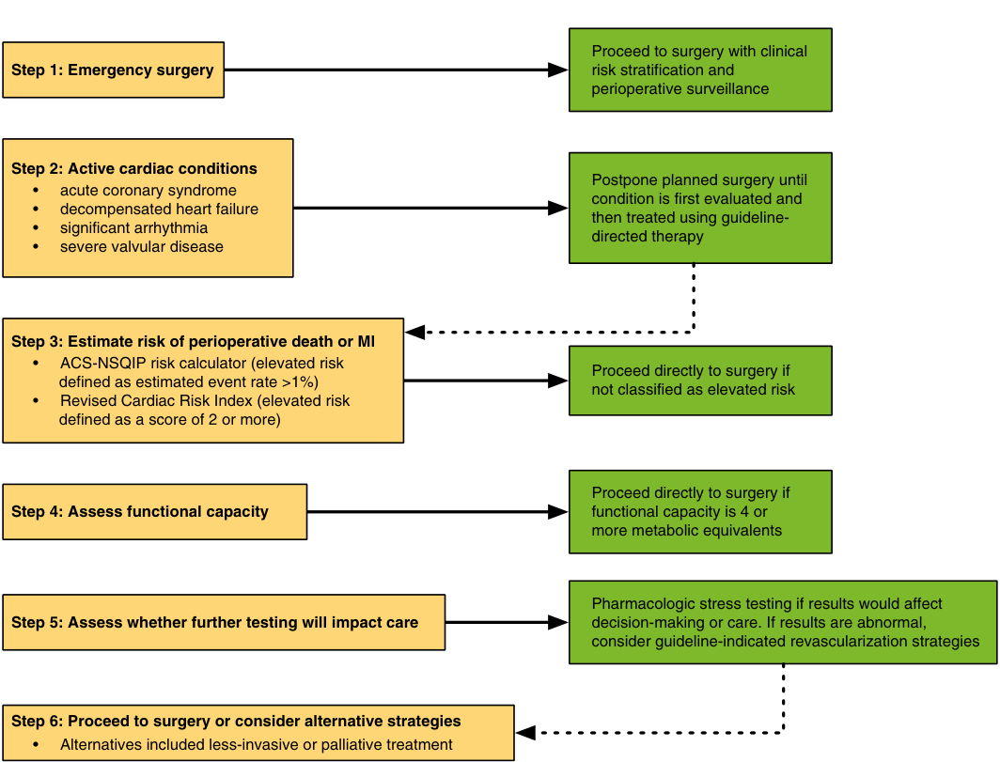

Proceed to surgery with clinical Step 1: Emergency surgery risk stratification and perioperative surveillance Step 2: Active cardiac conditions Postpone planned surgery until •     acute coronary syndrome condition is first evaluated and •     decompensated heart failure then treated using guideline- •     significant arrhythmia directed therapy •     severe valvular disease Step 3: Estimate risk of perioperative death or Ml •     ACS-NSQIP risk calculator (elevated risk Proceed directly to surgery if       defined as estimated event rate >1%) not classified as elevated risk •     Revised Cardiac Risk Index (elevated risk       defined as a score of 2 or more) Proceed directly to surgery if Step 4: Assess functional capacity functional capacity is 4 or more metabolic equivalents Pharmacologic stress testing if results would affect Step 5: Assess whether further testing will impact care decision-making or care. If results are abnormal, consider guideline-indicated revascularization strategies Step 6: Proceed to surgery or consider alternative strategies •     Alternatives included less-invasive or palliative treatment 

**Fig. 28.5 Simplified cardiac evaluation algorithm for noncardiac surgery proposed by the 2014 American Heart Association and American College of Cardiology guidelines.** _ACS-NSQIP,_ American College of Surgeons National Surgical Quality Improvement Program; _MI,_ myocardial infarction. (From Fleisher LA, Fleischmann KE, Auerbach AD, et al. 2014 ACC/AHA guideline on perioperative cardiovascular evaluation and management of patients undergoing noncardiac surgery: a report of the American College of Cardiology/American Heart Association Task Force on Practice Guidelines. _Circulation_ . 2014;130:e278–e333.)

not proceed within 6 hours or less, an _urgent_ procedure as one where life or limb would be threatened if surgery did not proceed within 6 to 24 hours, and a _time- sensitive_ procedure as one where delays exceeding 1 to 6 weeks would adversely affect outcomes (e.g., most oncology surgery).12 Based on this classification scheme, patients should proceed directly to any required urgent or emergent surgery without further preoperative cardiac assessment.12–14 For these individuals, the focus should be on surveillance (e.g., serial cardiac enzymes, hemodynamic monitoring, serial ECGs) and early treatment of any postoperative cardiovascular complications. For time- sensitive surgery (e.g., cancer surgery, carotid surgery), an individualized approach to risk assessment and testing should be applied to balance potential benefits of testing against risks incurred with delayed surgery.14

In the second step, active cardiac conditions – such as acute coronary syndromes, decompensated heart failure, severe valvular disease (e.g., critical aortic stenosis), suspected significant pulmonary hypertension, or significant arrhythmias (e.g., atrial fibrillation with rapid ventricular rate, sustained ventricular tachycardia) – should be ruled

out in patients not requiring emergency surgery.12,14 If any of these conditions are present, they must be initially treated based on current guideline recommendations, after which the original planned surgery can be reconsidered based on its risk–benefit balance. When assessing whether a patient has an active cardiac condition, the anesthesiologist should enquire about any recent myocardial infarction. In a study of about 560,000 patients who underwent major noncardiac surgery in the United States,144 the risk of 30- day postoperative myocardial infarction or death was significantly elevated when surgery was performed within 60 days after a prior myocardial infarction. Thus, the 2014 ACC/AHA guidelines recommend deferring non- urgent surgery until 60 days after a recent myocardial infarction.12

In the third step, patients with very low expected cardiac risk are recommended to proceed directly to surgery without any further interventions or testing. The approaches to define very low expected cardiac risk varies across the guidelines. The 2014 ACC/AHA guidelines recommend that any patient who has a Revised Cardiac Risk Index (RCRI) score ≤1 (Table 28.6),136 estimated &lt;1% risk of postoperative myocardial infarction, or death based on the

<!-- PDF page 16 -->

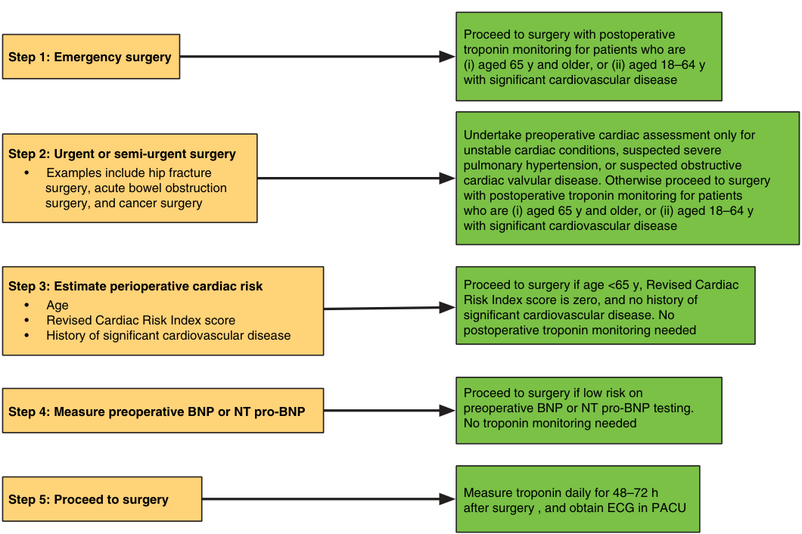

Proceed to surgery with postoperative troponin monitoring for patients who are Step 1: Emergency surgery (i) aged 65 y and older, or (ii) aged 18–64 y with significant cardiovascular disease Undertake preoperative cardiac assessment only for Step 2: Urgent or semi-urgent surgery unstable cardiac conditions, suspected severe pulmonary hypertension, or suspected obstructive •     Examples include hip fracture cardiac valvular disease. Otherwise proceed to surgery       surgery, acute bowel obstruction with postoperative troponin monitoring for patients       surgery, and cancer surgery who are (i) aged 65 y and older, or (ii) aged 18–64 y with significant cardiovascular disease Step 3: Estimate perioperative cardiac risk Proceed to surgery if age &lt;65 y, Revised Cardiac Risk Index score is zero, and no history of •     Age •     Revised Cardiac Risk Index score significant cardiovascular disease. No postoperative troponin monitoring needed •     History of significant cardiovascular disease Proceed to surgery if low risk on Step 4: Measure preoperative BNP or NT pro-BNP preoperative BNP or NT pro-BNP testing. No troponin monitoring needed Measure troponin daily for 48–72 h Step 5: Proceed to surgery after surgery , and obtain ECG in PACU 

**Fig. 28.6 Simplified cardiac evaluation algorithm for noncardiac surgery proposed by the 2017 Canadian Cardiovascular Society guidelines.** _BNP,_ brain natriuretic peptide; _ECG,_ electrocardiogram; _NT pro-BNP,_ N-terminal-pro-BNP; _PACU,_ postanesthesia care unit. (From Duceppe E, Parlow J, MacDonald P, et al. Canadian Cardiovascular Society guidelines on perioperative cardiac risk assessment and management for patients who undergo noncardiac surgery. _Can J Cardiol_ . 2017;33:17–32.)

ACS NSQIP risk calculator (https://riskcalculator.facs.org/ RiskCalculator),42 or NSQIP Myocardial Infarction and Cardiac Arrest (MICA) risk calculator,43 or has been scheduled for low- risk ambulatory surgery simply proceed directly to surgery without further interventions or testing. The 2017 CCS guidelines recommend that any patient who is aged less than 65 years with an RCRI score of zero and no significant known cardiovascular disease (e.g., coronary artery disease, cerebral vascular disease, peripheral artery disease, heart failure, severe pulmonary hypertension, severe aortic stenosis, severe mitral stenosis) proceed directly to surgery without further interventions or testing. In the 2022 ESC guidelines, very low expected cardiac risk is entirely defined by the patient being scheduled for a low- risk surgical procedure (Box 28.2).

In the fourth step, perioperative cardiac risk is then estimated based on readily available patient characteristics (e.g., comorbidities, estimated functional capacity), surgery- level characteristics (e.g., procedure type), and occasionally biomarker testing (e.g., natriuretic peptides, high- sensitivity troponin). In the 2014 ACC/AHA algorithm, this clinical risk stratification is based on estimation of functional capacity. It recommends that a patient with a functional capacity of ≥4 METs should proceed directly to surgery.12 This guidance is largely based on older studies of preoperative exercise testing,145,146 and more recent studies of preoperative

CPET,147,148 which found an association between poor functional capacity and elevated perioperative cardiac risk. The major clinical challenge with this recommendation pertains to how best to estimate patients’ preoperative functional capacity in clinical practice (see section on Assessment of Functional Capacity, above). Subjective estimation of functional capacity based on the unstructured preoperative history does not accurately estimate true exercise capacity,41 nor predict postoperative cardiovascular complications.41,46,47 Thus, anesthesiologists should generally use structured approaches to estimate functional capacity, such as self- reported stair climbing ability, DASI questionnaire (see Table 28.2) or MET- REPAIR questionnaire (see Table 28.3), with consideration of exercise testing if the results would alter management. Optimal thresholds for identifying patients capable of ≥4 METs include self- reported ability to climb ≥3 flights of stairs, DASI score ≥32, and ≥6 METs on the MET- REPAIR questionnaire.149 Conversely, perioperative cardiac risk is increased in patients who selfreport being unable to climb two flights of stairs,49 or have a DASI score &lt;32 (with a score &lt;25 representing a clinically meaningful increase in risk).52 If a patient is deemed to have either low (i.e., &lt;4 METs) or uncertain functional capacity, the AHA/ACC guidelines recommend consideration of exercise or pharmacologic cardiac stress testing, if the results could plausibly impact decision- making or clinical

<!-- PDF page 17 -->

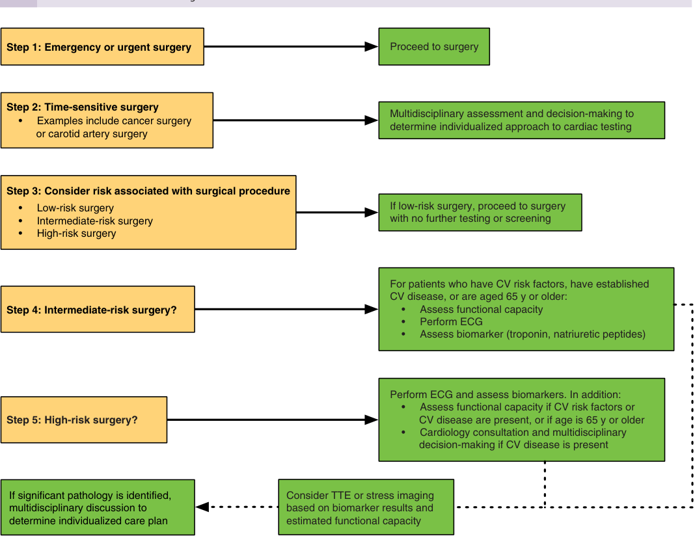

Step 1: Emergency or urgent surgery Proceed to surgery Step 2: Time-sensitive surgery Multidisciplinary assessment and decision-making to •     Examples include cancer surgery determine individualized approach to cardiac testing       or carotid artery surgery Step 3: Consider risk associated with surgical procedure •     Low-risk surgery If low-risk surgery, proceed to surgery •     Intermediate-risk surgery with no further testing or screening •     High-risk surgery For patients who have CV risk factors, have established CV disease, or are aged 65 y or older: Step 4: Intermediate-risk surgery?     •     Assess functional capacity     •     Perform ECG     •     Assess biomarker (troponin, natriuretic peptides) Perform ECG and assess biomarkers. In addition:     •     Assess functional capacity if CV risk factors or Step 5: High-risk surgery?           CV disease are present, or if age is 65 y or older     •     Cardiology consultation and multidisciplinary           decision-making if CV disease is present If significant pathology is identified, Consider TTE or stress imaging multidisciplinary discussion to based on biomarker results and determine individualized care plan estimated functional capacity 

**Fig. 28.7 Simplified cardiac evaluation algorithm for noncardiac surgery proposed by the 2022 European Society of Cardiology guidelines.** _CV,_ cardiovascular; _ECG,_ electrocardiogram; _TTE,_ transthoracic echocardiography. (From Halvorsen S, Mehili J, Cassese S, et al. 2022 ESC Guidelines on cardiovascular assessment and management of patients undergoing non- cardiac surgery. _Eur Heart J_ . 2022;43(39):3826–3924.)

care. Patients with high- risk abnormal test results can be considered for subsequent coronary angiography, and possibly revascularization (if usual nonoperative indications for coronary revascularization are met). Importantly, the ACC/AHA guidelines emphasize the importance of considering alternative less-invasive or nonsurgical treatment for the underlying condition, especially in patients found to be at very high cardiac risk.

The 2017 CCS guidelines instead recommend further risk stratification with brain natriuretic peptide (BNP) or N- terminal- pro- BNP (NT pro- BNP) cardiac biomarkers,13 specifically. These neurohormones are secreted by the cardiac ventricles in response to stretch or ischemia of the atrial and ventricular walls. In the nonoperative setting, elevated natriuretic peptide concentrations are powerful markers of cardiovascular risk in individuals with IHD or associated risk factors, as well as in individuals with heart failure.150 Interestingly, there is only slight- to- fair correlation between plasma levels of these biomarkers and measures of exercise capacity,41 suggesting that natriuretic peptides measure a different patient characteristic. Several large cohort studies and an individual patient data meta- analysis found that that preoperative natriuretic peptide concentrations can

differentiate patients based on their perioperative cardiac risk.151–153 Importantly, natriuretic peptides improve the accuracy of risk estimation beyond that achieved with traditional clinical risk factors alone.151,152 Based on current data, optimal thresholds for identifying patients at low cardiac risk include a BNP concentration &lt;100 pg/mL or NT pro- BNP concentration &lt;100 pg/mL (Table 28.7).151,152 Conversely, BNP concentrations >250 pg/mL or NT proBNP concentrations >200 pg/mL are indicative of elevated cardiac risk (see Table 28.7). The CCS guidelines recommend routine troponin surveillance for 48 to 72 hours after surgery for patients who are not classified as low cardiac risk based on their preoperative BNP or NT pro- BNP testing. No other preoperative testing or intervention is recommended based on the results of biomarker testing.

In comparison to the AHA/ACC and CCS guidelines, the 2022 ESC guidelines recommend further stratification based on patient- level characteristics and preoperative testing. In the setting of intermediate- risk surgery (see Box 28.2), the guideline recommends functional capacity assessment, ECG testing, and cardiac biomarkers (natriuretic peptides, highsensitivity troponin) in any patient who has known cardiovascular disease, has risk factors for cardiovascular disease,

<!-- PDF page 18 -->

**Table 28.6** Components of the Revised Cardiac Risk Index and Expected Cardiac Event Risk

**Table 28.7** Risk of Death or Myocardial Infarction After Noncardiac Surgery Based on Preoperative BNP or NT Pro- BNP Concentration

|**Components of Revised Cardiac Risk Index***|**Points Assigned**|
|---|---|
|High-risk surgery (intraperitoneal, intrathoracic, or suprainguinal vascular procedure)|1|
|Ischemic heart disease (by any diagnostic criteria)|1|
|History of congestive heart failure|1|
|History of cerebrovascular disease|1|
|Diabetes mellitus requiring insulin|1|
|Creatinine >2.0 mg/dL (176μmol/L)|1|
|**Revised Cardiac Risk** **Index Score**|**Risk of Major** **Cardiac Events**†,‡|
|0|1.6%|
|1|4.0%|
|2|7.9%|
|≥3|12.9%|

†From Rodseth RN, Biccard BM, Le Manach Y, et al. The prognostic value 

|**Preoperative BNP** **Concentration** **(pg/mL)**|**Likelihood** **Ratio*,**†**for** **Death or MI**|**Preoperative** **NT pro- BNP** **Concentration** **(pg/mL)**|**Likelihood** **Ratio*,**‡ **for Death or MI**|
|---|---|---|---|
|0 to 99|0.6|0 to 100|0.39|
|100 to 250|1.4|100 to &lt;200|0.69|
|>250|3.9|200 to &lt;1500|1.90|
|||≥1500|4.19|

   - _BNP_ , brain natriuretic peptide; _MI_ , myocardial infarction; _NT pro- BNP_ , N- terminal- pro- BNP.

   - *Positive test results should have likelihood ratios of >2 to provide clinically meaningful information, whereas negative test results should have likelihood ratios of &lt;0.5.

   - †From Rodseth RN, Biccard BM, Le Manach Y, et al. The prognostic value of pre- operative and post- operative B- type natriuretic peptides in patients undergoing noncardiac surgery. B- type natriuretic peptide and N- terminal fragment of pro- B- type natriuretic peptide: a systematic review and individual patient data meta- analysis. _J Am Coll Cardiol_ . 2014;63:170–180.

- *From Lee TH, Marcantonio ER, Mangione CM, et al. Derivation and prospective validation of a simple index for prediction of cardiac risk of major noncardiac surgery. _Circulation_ . 1999;100:1043–1049.

   - ‡From Duceppe E, Patel A, Chan MTV, et al. Preoperative N- Terminal Pro–B- - Type Natriuretic Peptide and cardiovascular events after noncardiac surgery: a cohort study. _Ann Intern Med_ . 2020;172:96–104.

- †From Roshanov PS, Sessler DI, Chow CK, et al. Predicting myocardial injury and other cardiac complications after elective noncardiac surgery with the Revised Cardiac Risk Index: The VISION Study. _Can J Cardiol_ . 2021;37:1215–1224.

or is aged ≥65 years.14 The guideline recommends similar risk assessment in any patient scheduled for high- risk surgery. Patients with poor functional capacity (defined as low DASI score or self- reported inability to climb two flights of stairs), elevated cardiac biomarkers, or abnormal ECG are then selectively considered for further specialized assessment with echocardiography and cardiac stress imaging. Abnormalities on these specialized tests may lead to a multidisciplinary discussion to determine an individualized perioperative care plan, which considers the appropriateness of subsequent invasive assessment (e.g., coronary angiography) and coronary revascularization.

- ‡Defined as cardiac death, nonfatal myocardial infarction, or nonfatal cardiac arrest.

### Box 28.2 Classification Scheme for Procedure- Specific Cardiac Risk in the 2022 European Society of Cardiology Guidelines

### Low Cardiac Risk

Breast surgery; dental surgery; thyroid surgery; eye surgery; minor gynecologic surgery; minor orthopedic surgery (e.g., meniscectomy; reconstructive surgery; superficial surgery; minor urologic surgery (e.g., transurethral resection of prostate); minimally invasive minor lung resection

While the CCS guidelines recommend natriuretic peptides (BNP, NT- proBNP) as preoperative cardiac biomarkers, the ESC guidelines recommend both natriuretic peptides and high- sensitivity troponins. In the nonoperative setting, high- sensitivity troponin assays can identify subtle resting elevations in cardiac troponin concentrations in an important segment of the population without any acute coronary syndrome. These individuals have significantly elevated risks of progression to death, IHD, or heart failure.154,155 Unsurprisingly, many otherwise stable surgical patients also have elevated troponin concentrations before surgery. About 20% to 25% of patients scheduled for inpatient noncardiac surgery may have a preoperative high- sensitivity troponin T concentration exceeding the assay- specific 99th percentile.116,156 Thus, especially in patients for whom postoperative troponin surveillance is planned, a preoperative troponin measurement can help determine whether any elevated postoperative concentration reflects acute injury versus chronic long- term elevation. Two large cohort studies have also shown that preoperative troponin elevations may aid in risk- stratification for noncardiac surgery.153,157,158 A preoperative high- sensitivity troponin T concentration above 14 ng/L is associated with elevated

### Intermediate Cardiac Risk

Carotid surgery (asymptomatic); endovascular aortic aneurysm repair; head or neck surgery; intermediate- risk intraperitoneal (splenectomy, hiatal hernia repair, cholecystectomy; non- major intrathoracic surgery; major neurologic or orthopedic (e.g., joint replacement, spine surgery); peripheral arterial angioplasty; kidney transplant; major urologic or gynecologic surgery

### High Cardiac Risk

Adrenal resection; aortic and major vascular surgery; carotid surgery (symptomatic); high- risk intraperitoneal surgery (duodenal–pancreatic surgery, liver resection, bile duct surgery, esophagectomy; perforated bowel repair); open lower limb revascularization for acute limb ischemia; amputation; pneumonectomy; liver transplant, lung transplant; total cystectomy

From Halvorsen S, Mehili J, Cassese S, et al. 2022 ESC Guidelines on cardiovascular assessment and management of patients undergoing non- cardiac surgery. _Eur Heart J_ . 2022;43:3826–3924.

::: details 原始表格與符號（PDF 第 18 頁）

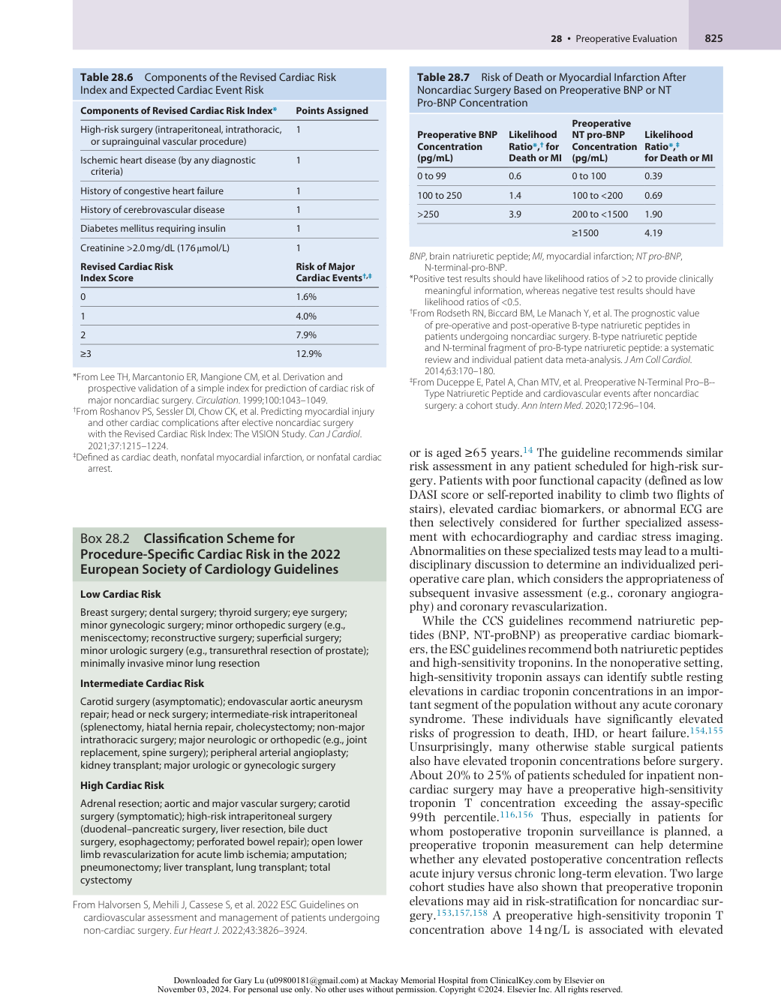

:::

<!-- PDF page 19 -->

risks of death and cardiovascular complications after major noncardiac surgery. Furthermore, addition of preoperative high- sensitivity troponin T appears to improve the accuracy of risk estimation beyond that achieved with traditional clinical risk factors and natriuretic peptides.153,157 Further research is needed to confirm these initial results, establish ideal screening thresholds, and replicate these analyses using other high- sensitivity troponin assays (e.g., troponin I). While both natriuretic peptides and high- sensitivity troponins have been shown to improve the accuracy of preoperative risk stratification, prognostically important conditions other than myocardial ischemia can cause elevations in either cardiac biomarker. For example, right ventricular dysfunction, cardiac valvular disease, and atrial fibrillation can result in elevations in these biomarkers. Thus, further specialized testing (e.g., echocardiography) can help define the underlying diagnosis in patients with high preoperative natriuretic peptide or troponin concentrations, as recommended by the 2022 ESC guidelines.14 Additionally, nonoperative data suggest that natriuretic peptides have limitations as prognostic biomarkers in certain disease states, including obesity and chronic renal disease.

The three guidelines (AHA/ACC, CCS, ESC) all recommend clinical risk indices to help inform preoperative risk stratification, but they differ with respect to the specific indices being recommended. The 2014 ACC/AHA guidelines recommend the RCRI (see Table 28.6),136 ACS NSQIP risk calculator (https://riskcalculator.facs.org/RiskCalcula tor),42 or NSQIP Myocardial Infarction and Cardiac Arrest (MICA) risk calculator,43 while the 2017 CCS guidelines specifically recommend only the RCRI. The 2022 ESC guidelines recommend the RCRI, ACS NSQIP risk calculator, NSQIP MICA risk calculator, and a more recently developed index, the Cardiovascular Risk Index.159 The 2017 CCS guidelines specifically recommend the RCRI, as opposed to the NSQIP risk calculators, largely because the NSQIP risk models were developed using a database without routine postoperative troponin surveillance, implying that the predicted absolute myocardial infarction rate might underestimate the true rate by threefold.137 In addition, the NSQIP risk calculators has undergone only limited external validation.160 By comparison, the RCRI was derived in a cohort study with standardized cardiac biomarker surveillance,136 and subsequently has undergone extensive external validation.161,162 Nonetheless, the RCRI has only modest discriminative performance,162 does not apply to non- elective surgery, and does not adequately consider variations in cardiac risk across different surgical procedures.163 The recently developed Cardiovascular Risk Index has similar limitations as the NSQIP risk calculators, namely, development using a database without routine troponin surveillance and limited external validation.164

Based on these guideline- recommended algorithms, the anesthesiologist may be presented with several avenues to further investigate or optimize known or suspected IHD before surgery, including consultations, cardiac stress testing, coronary angiography, coronary revascularization, and medical therapy. When considering the need for additional consultations before surgery, an initial phone call to the primary care physician or cardiologist often yields

important information that obviates the need for further consultation. Any specialist consultation (e.g., cardiologist) initiated by the anesthesiologist should seek specific advice regarding the diagnosis, treatment, or further optimization of the patient’s condition. It is preferable to ask specific questions, such as “ _Does this patient have IHD_ ?” or “ _Is this patient optimized for planned radical nephrectomy?_ ” to avoid unhelpful consultation reports that simply state that a patient is “ _cleared for surgery_ .”

When supplementing preoperative evaluation, cardiac stress testing can help diagnose IHD, assess its severity, and estimate perioperative cardiac risk. The tests therefore address both _diagnosis_ and _prognosis_ . Several stress tests are available that differ based on the stress modality (i.e., exercise, pharmacologic) and ischemia monitoring method (i.e., ECG, perfusion imaging, echocardiography). An exercise stress test is a preferred option for a patient who is capable of exercising and likely to achieve an adequate heart rate response during exercise. Exercise stress testing also allows for an objective measurement of functional capacity. An adequate test result is obtained when patients can exercise to 85% of their target heart rate (i.e., 220 minus age). Pharmacologic stress modalities (e.g., dobutamine, dipyridamole, adenosine, regadenoson) are indicated for an individual who cannot exercise or is unlikely to achieve an adequate heart rate response due to a pacemaker, significant bradycardia, or high- dose negative chronotropic drugs (e.g., β- adrenergic blockers). The choice of pharmacologic stress modality is generally immaterial, but there are some exceptions. For example, since dobutamine uncovers ischemia by increasing contractility, heart rate, and blood pressure, it may not be the best choice in patients with pacemakers, significant bradycardia, aortic aneurysms, cerebral aneurysms, or poorly controlled hypertension. While adenosine and dipyridamole rely on their vasodilatory properties and do not depend on a heart rate response, they may exacerbate bronchospasm in patients taking theophylline. In addition, they might cause dangerous reductions in preload in the presence of severe stenotic valvular heart disease.

An exercise ECG stress test is a reasonable option for a patient with a relatively normal baseline ECG who is capable of exercising with an adequate heart rate response. An imaging method (i.e., echocardiography, myocardial perfusion imaging) can be used instead if a patient has significant ECG abnormalities (e.g., left bundle branch block, left ventricular hypertrophy with strain pattern) that may interfere with electrocardiographic detection of ischemia. Nonetheless, exercise myocardial perfusion imaging may still be problematic in patients with left bundle branch block (LBBB), because of false- positive results related to septal perfusion defects.12 Stress echocardiography assesses for wall motion abnormalities, both at rest and under stress conditions (i.e., exercise, dobutamine). Resting abnormalities indicate scar tissue from a prior infarction, while new abnormalities under stress conditions (i.e., inducible wall motion abnormalities) indicate limited blood due to stenotic coronary lesions. Nuclear myocardial perfusion imaging detects ischemia by comparing radioisotope uptake by viable myocardium under resting and stress conditions. Perfusion defects at rest are indicative of a prior infarction. Since normal coronary arteries vasodilate with exercise or specific pharmacologic stressors (i.e., adenosine, dipyridamole),

<!-- PDF page 20 -->

normal myocardium maintains normal radioisotope uptake in stress conditions. By comparison, stenotic vessels are maximally vasodilated at rest, and unable to further vasodilate under stress conditions. Thus, myocardium with flow-limiting lesions has normal radioisotope uptake at rest, but decreased uptake under stress conditions (i.e., reversible perfusion defects). In general, the choice of test should be informed by patient factors (e.g., ability to exercise) and local expertise in cardiac stress testing.

Cardiac stress tests may also help predict whether patients are likely to experience perioperative cardiac complications. There are relatively few data on the prognostic performance of preoperative exercise ECG stress testing. In a meta- analysis of studies in vascular surgery, exercise ECG stress testing had a positive likelihood ratio of 2.4 and negative likelihood ratio of 0.4 for predicting postoperative cardiac death or myocardial infarction.165 Conversely, ECG stress testing had diminished predictive performance (positive likelihood ratio 1.8 and negative likelihood ratio 0.8) in a cohort study of 200 patients undergoing mixed noncardiac surgery.145 Considerably more research has been published pertaining to the prognostic accuracy of preoperative stress testing based on myocardial perfusion imaging or echocardiography. In a meta- analysis in noncardiac surgery, stress echocardiography has a positive likelihood ratio of 4.1 and a negative likelihood ratio of 0.2 for predicting postoperative death or myocardial infarction. In the case of myocardial perfusion imaging, the positive likelihood ratio was 1.8 and negative likelihood ratio was 0.4.166 The prognostic value of myocardial perfusion imaging might be further improved by considering the extent of reversible defects. In another meta- analysis in vascular surgery, reversible defects on preoperative myocardial perfusion imaging were associated with significantly increased cardiac risk only when extent of reversibility exceeded 20% of the myocardium.167 A recent large cohort study of more than 4400 patients found that abnormalities on dobutamine stress echocardiography (i.e., severity of wall motion abnormalities at rest and stress, as well as left ventricular ejection fraction at peak stress) were predictive of postoperative cardiac events, even after accounting for clinical risk factors.168 By comparison, myocardial perfusion imaging provides at most moderate incremental prognostic information in addition to clinical risk factors.169 Given the variability in the relevant prior data, a reasonable approach is to reserve consideration of cardiac stress testing largely to patients with high- risk results on preoperative cardiac biomarker (natriuretic peptides, troponin) testing.14 While available evidence does suggest that stress echocardiography has somewhat better prognostic accuracy, these data should be interpreted cautiously since relevant studies differ considerably with respect to study time periods and patient sample characteristics. Thus, the choice of stress imaging modality (perfusion imaging versus echocardiography) is best informed by the relevant local expertise.

Some patients with high- risk findings on initial cardiac stress testing may require subsequent evaluation of coronary anatomy using either noninvasive computed tomography coronary angiography (CTCA) or invasive coronary angiography. These tests can diagnose IHD, assess its severity, and help assess perioperative cardiac risk. Using contemporary imaging technology, CTCA has reasonably

high accuracy for detecting clinically significant coronary artery stenosis.170,171 An initial retrospective cohort study found CCTA to improve prediction of cardiac complications after intermediate- risk noncardiac surgery, as compared to using the RCRI alone.172 Conversely, a larger multicenter prospective cohort study found that addition of CCTA to the RCRI was five times more likely to overestimate risk in lowrisk individuals than correctly identify a previously misclassified high- risk individual.173 Thus, CTCA does not appear to be an appropriate first- line test to supplement clinical risk stratification. Nonetheless, it may be a reasonable option to further investigate patients who have high- risk results on cardiac stress testing, or possibly patients who have highly elevated biomarkers but are not suitable for stress testing. Notably, CCTA and stress testing may be complementary risk assessment tools in that perioperative cardiac risk may be highest among patients with both severe (≥70%) coronary stenosis and severe stress- induced ischemia in related territories.174 Invasive coronary angiography is considered the gold standard for diagnosing IHD, and may also be a follow- up option for patients with high- risk cardiac stress test results. Two Italian randomized trials in vascular surgery patients have suggested that routine preoperative invasive coronary angiography – followed by revascularization of any critical stenosis – reduces risks of postoperative myocardial ischemia,175 and long- term mortality.176,177 While interesting, these findings still do not support a clinical shift to this invasive assessment strategy, largely because any patient- relevant benefits were seen over long- term followup, not the immediate postoperative period.

Any merit for an invasive coronary artery assessment strategy is highly related to whether coronary revascularization before noncardiac surgery is beneficial. This issue remains controversial. The most relevant RCT is the Coronary Artery Revascularization Prophylaxis (CARP) trial.178 In the multicenter RCT of 510 vascular surgery patients with known significant IHD, preoperative revascularization using CABG or PCI with bare metal stents did not reduce the risk of postoperative myocardial infarction or long- term mortality. Notably, the trial excluded patients with left main coronary artery stenosis, which is the only subgroup where revascularization was associated with improved survival in a related cohort study.179 At present, both American and European guidelines only recommend consideration for revascularization in patients who meet usual nonoperative indications (e.g., left main coronary artery stenosis, triplevessel coronary artery disease),12,14 while the CCS guidelines recommend against preoperative revascularization in any patient with stable IHD.13

In general, RCTs have also _not_ shown benefit from _de novo_ medical therapy to decrease perioperative cardiac risk, including β- adrenergic blockers,180,181 α2- adrenergic agonists,182,183 and low- dose aspirin.184 Despite initial promising data on perioperative β- adrenergic blockade,185 these benefits were not replicated in larger multicenter RCTs, such as the Perioperative Ischemic Evaluation Study- 1 (POISE- 1) trial. Current RCT evidence shows that perioperative β- adrenergic blockade reduces the risk of postoperative myocardial infarction, but at the cost of increased risks of acute stroke, hypotension, and death.181 While it is possible that these risks are mitigated by starting β- adrenergic blockers several days before surgery,186,187 and titrating

<!-- PDF page 21 -->

therapy to a reasonable target heart rate without precipitating hypotension, there are no compelling data showing the efficacy and safety of this approach.188 Caution should especially be exercised when using β- adrenergic blockers in individuals with known cerebrovascular disease because of the risks of perioperative stroke.180,181

Conversely, most _long- term_ cardiovascular medications for IHD should be continued up to surgery, including β- adrenergic blockers, statins, and most other antihypertensive medications. Nonetheless, there are some exceptions. Since ACEI and ARB administration within 24 hours before surgery is associated with increased risks of hypotension,189 it is reasonable to withhold these medications for 24 hours before surgery, provided that they are restarted postoperatively (see section on Hypertension, above).125,126 Despite theoretical benefits,190 RCTs to date have not shown benefits from routinely continuing aspirin before noncardiac surgery. In the POISE- 2 trial, continuing low- dose aspirin (100 mg/day) did not prevent cardiac complications but increased risks of major bleeding.184 The lack of clear benefit may be explained, in part, by acute thrombosis being a relatively infrequent contributor to perioperative myocardial infarction.191,192 Nonetheless, it is possible that continuation of aspirin benefits some very high- risk subgroups. Consistent with this possibility, a _post hoc_ subgroup analysis from the POISE- 2 trial found that perioperative aspirin reduced the risk of death or myocardial infarction in patients with prior PCI.193 Based on these data, a reasonable strategy is to only continue aspirin _selectively_ in patients where the risk of cardiac events is felt to exceed the risk of major bleeding. Other medications for IHD that should generally be withdrawn before surgery include P2Y12 inhibitors (e.g., clopidogrel, ticagrelor, prasugrel) and DOACs (see sections on Atrial Fibrillation and Preoperative Antiplatelet Therapy).

### Coronary Stents

Following PCI with stent implantation, patients require an initial period of dual antiplatelet therapy (DAPT) with aspirin and a P2Y12 inhibitor (e.g., clopidogrel, ticagrelor, prasugrel), after which they can be transitioned to aspirin monotherapy. The purpose of DAPT is to prevent potentially catastrophic stent thrombosis during the vulnerable period preceding stent reendothelialization. Temporary preoperative discontinuation of DAPT during this vulnerable period predisposes patients to cardiovascular complications, especially given the prothrombotic state triggered by surgical stress. Based on emerging evidence and improved drug- eluting stent (DES) technology, recommendations pertaining to minimum duration of DAPT before elective noncardiac surgery continue to evolve – as reflected in updated 2016 ACC/AHA guidelines specific to duration of DAPT,194 and the 2022 ESC perioperative guidelines.14 The 2016 AHA/ACC guidelines recommend that elective noncardiac surgery should be delayed for 30 days or more after bare metal stent (BMS) implantation, while the 2022 ESC guidelines make no recommendations specific to BMS.

The AHA/ACC guidelines recommend an ideal delay of six months following DES implantation, which is consistent with several cohort studies showing relatively low perioperative cardiac risk when elective noncardiac surgery was performed six months or more after DES implantation.195,196

Based on expert opinion, the ACC/AHA guidelines also indicate that elective noncardiac surgery can sometimes be performed during the window from three to six months after DES implantation (particularly with new-generation stents), if the risk of stent thrombosis is judged to be less than the risk of delaying surgery.194

The more recent ESC guidelines have incorporated data on newer-generation DES technology as well as research showing that the indication for PCI (e.g., acute coronary syndrome versus elective PCI) affects the safe timing of noncardiac surgery following PCI.197 A large retrospective cohort study of about 26,600 patients found that the risk of noncardiac surgery early after stent implantation was particularly elevated when PCI had been performed for acute MI, as opposed to non- acute coronary syndrome indications.197 Thus, the ESC guidelines recommend an ideal PCI- to- surgery interval of six months after elective PCI and 12 months after PCI for an acute coronary syndrome, where the patient would remain on DAPT during this interval. In the case of time- sensitive noncardiac surgery following implantation of a newer-generation DES, this interval can be reduced to one month after elective PCI and three months after PCI for an acute coronary syndrome. When DAPT is temporarily interrupted before noncardiac surgery, both guidelines strongly recommend that aspirin be continued, and P2Y12 inhibitor therapy be restarted as soon as possible after surgery.14,194 The importance of continuing aspirin perioperatively is supported by the substudy of the POISE- 2 randomized trial.193 In this subset analysis of 470 patients with prior PCI, aspirin reduced the risk of death or myocardial infarction (hazard ratio, 0.50; 95% CI 0.26 to 0.95) without any significantly increased bleeding risk. Unfractionated heparin and low- molecular- weight heparin (LMWH) should not be used to “bridge” patients who have been withdrawn from antiplatelet therapy, especially since heparin can paradoxically increase platelet aggregation.198

During preoperative evaluation, the anesthesiologist should determine the presence, type (drug- eluting versus bare metal), location, and original indication of any coronary stent. Given the complex issues related to these patients, subsequent management should be performed in collaboration with a cardiologist and the responsible surgeon, especially for patients receiving DAPT.14,194 Following surgery, close monitoring for myocardial injury (i.e., serial troponin measurement) should be strongly considered, with any suspected stent thrombosis being best treated using PCI. High- risk patients are thus ideally best managed in facilities with immediate access to interventional cardiology.

### Heart Failure

Heart failure (HF) has been defined as a complex clinical syndrome with symptoms and signs that result from impairment of ventricular filling or ejection of blood.199 Its major clinical manifestations are dyspnea, fatigue, and fluid retention. While prevalence estimates are affected by differences in diagnostic criteria, recent estimates suggest that HF afflicts more than 6 million individuals in the United States,127 and more than 23 million worldwide.200 Heart failure (HF) is the sequelae of a broad array of underlying pathology, including ischemic heart disease (i.e.,

<!-- PDF page 22 -->

ischemic cardiomyopathy), hypertension, valvular heart disease, myocarditis, infiltrative disorder (e.g., sarcoidosis, amyloidosis), and peripartum cardiomyopathy. In addition, many affected individuals have no identifiable underlying cause (i.e., idiopathic dilated cardiomyopathy). Several approaches can be used to classify HF, including the presence versus absence of associated signs or symptoms (i.e., compensated versus decompensated HF), and extent of functional limitation. In HF patients, functional status is typically classified based on New York Heart Association (NYHA) categories:

- NYHA class I: no limitation of physical activity; ordinary activity not a cause of fatigue, palpitations, or syncope

- NYHA class II: slight limitation of physical activity; ordinary activity resulting in fatigue, palpitations, or syncope

- NYHA class III: marked limitation of physical activity; less than ordinary activity resulting in fatigue, palpitations, or syncope; comfort at rest

- NYHA class IV: inability to do any physical activity without discomfort; symptoms at rest

HF can also be classified based on the severity of ventricular systolic dysfunction, namely, as HF with reduced ejection fraction (HFrEF) versus HF with preserved ejection fraction (HFpEF).199 Individuals with HFpEF (or diastolic HF) have normal left ventricular ejection fraction (≥50%), normal left ventricular end- diastolic volume, and abnormal diastolic function. By comparison, HFrEF (or systolic HF) is characterized by more significant left ventricular systolic dysfunction (i.e., ejection fraction ≤40%). Individuals with borderline left ventricular systolic function (i.e., ejection fraction 41% to 49%) are classified as HF with mildly reduced EF (HFmrEF). These patients will usually transition to either improvement from HFrEF, or instead to deterioration to HFrEF.199 Among patients with HF, about half have HFpEF.201 Although they have a high mortality risk (10% to 20% at 1 year),202,203 patients with HFpEF have lower adjusted risks of death (adjusted hazard ratio 0.68) over long- term follow- up than patients with HFrEF.203 Most medical therapy for improving morbidity and mortality in HF (i.e., ACEI, ARB, angiotensin receptor/neprilysin inhibitor, aldosterone antagonist, β- adrenergic blocker, ivabradine) has only demonstrated efficacy in HFrEF.199 In contrast, medical therapy for HFpEF is largely aimed at symptoms and underlying conditions (e.g., hypertension). The major recent exception has been sodium- glucose cotransporter 2 (SGLT- 2) inhibitors (e.g., empagliflozin, dapagliflozin), which improve clinical outcomes in both HFpEF and HFrEF.199,204,205 Other HF- related treatments include diuretics (for volume overload), anticoagulants (for atrial fibrillation or left ventricular thrombus, implantable cardioverter- defibrillators (ICDs), or cardiac resynchronization therapy (CRT).

In the perioperative setting, HF is a recognized risk factor for mortality and morbidity after major surgery. In a recent large cohort study of more than 600,000 patients in the Veterans Affairs Surgical Quality Improvement Project database, risks of 90- day mortality following elective noncardiac surgery were significantly higher among patients with HF (adjusted odds ratio 1.67).206 When compared to patients without diagnosed HF, the magnitude of increased risk was higher in patients with _symptomatic_ HF

(adjusted odds ratio 2.37) than those with asymptomatic HF (adjusted odds ratio 1.53).206 While postoperative mortality is increased in patients with both HFrEF and HFpEF, the magnitude of elevated risk increases progressively with worsening systolic dysfunction.206 While HF is a clear indicator of increased perioperative risk, the prognostic importance of _asymptomatic_ systolic dysfunction (i.e., no clinical diagnosis of HF) is less clear. For example, in a cohort study of 339 individuals undergoing noncardiac surgery, a reduced ejection fraction was associated with increased cardiac morbidity, but this information did not improve risk prediction beyond that achieved with clinical risk factors.207 Similarly, in another cohort study of 570 individuals undergoing noncardiac surgery, a reduced ejection fraction only had prognostic importance within the subgroup with Revised Cardiac Risk Index scores ≥2.208 Consistent with these data, both the 2014 ACC/AHA guidelines and 2017 CCS guidelines discourage routine preoperative assessment of ventricular function.12,13

The preoperative history pertaining to HF should clarify its type, etiology, severity, stability (including prior exacerbations), recent investigations (e.g., echocardiograms), and current therapy (medical and device- based). The anesthesiologist should enquire about recent weight gain, fatigue, shortness of breath, fatigue, orthopnea, paroxysmal nocturnal dyspnea, nocturnal cough, peripheral edema, hospitalizations, and recent changes in medical management. The patient’s functional status should be classified according to the NYHA categories. It is especially important to determine if the signs and symptoms of heart failure are in their usual stable state (i.e., compensated heart failure) or have recently significantly worsened (i.e., decompensated heart failure). Decompensated heart failure is a very high- risk condition that warrants postponement of surgery for all except lifesaving emergency procedures.12 No consensus exists on how long non- emergent surgery should be deferred after resolution of acute decompensated HF, although a reasonable approach might be to delay elective procedures (including most time- sensitive procedures) for one month, and urgent procedures for 24 hours.

On physical examination, the findings of HF may be subtle. Furthermore, they can vary between HFrEF versus HFpEF, and between compensated versus decompensated states. More useful signs for ruling in HF include a third heart sound, jugular venous distention, pulmonary rales, and lower extremity edema.32 A chest radiograph may provide further diagnostic guidance, especially in dyspneic patients, with pulmonary vascular redistribution and interstitial edema being useful findings for ruling in HF.32 Natriuretic peptide measurement can further clarify whether a patient has HF. Both BNP and NT pro- BNP have excellent diagnostic performance, especially for ruling out HF, in the ambulatory setting (pooled negative likelihood ratio values 0.29 to 0.38 at manufacturers’ recommended thresholds),209 and emergency department setting (pooled negative likelihood ratio values 0.08 to 0.13 at manufacturers’ recommended thresholds).210 Preoperative natriuretic peptide concentrations also provide other potentially important information. Both BNP and NT pro- BNP concentrations are markers of perioperative cardiac risk (see section on Ischemic Heart Disease, above). In addition, for patients who have known HF and have undergone prior

<!-- PDF page 23 -->

natriuretic peptide measurement, preoperative BNP or NT pro- BNP testing provide insights into whether patients remained in their usual stable clinical state. Consistent with these data, the 2022 ESC/ESA guidelines recommend preoperative natriuretic peptide measurement in patients who have established or suspected HF, and are scheduled for undergoing high- risk noncardiac surgery.14 While routine preoperative echocardiography (or other noninvasive ventricular function measurement) is not useful, such specialized testing may be helpful to better assess dyspnea of unknown origin, poor functional capacity, elevated preoperative natriuretic peptide concentrations,14 or recent altered clinical status in an individual with known HF.12 Furthermore, the American and European guidelines are supportive of selective preoperative echocardiography in clinically stable patients with known ventricular dysfunction who have not undergone testing in the prior year, or are scheduled for high- risk noncardiac surgery.12,14 Other testing for patients with HF include ECGs and blood sampling to measure electrolyte and creatinine concentration. Digoxin levels are not routinely determined unless toxicity, undertreatment, or noncompliance is suspected.

Consideration should be given for collaborative perioperative management of severely affected HF patients (i.e., NYHA III or IV; decompensated HF) undergoing intermediate- risk or high- risk procedures with a cardiologist or heart failure specialist. Any SGLT- 2 inhibitor therapy should be temporarily held for at least three days before surgery to minimize risks of euglycemic ketoacidosis in the perioperative period.14,211 Otherwise, most medical therapy for HF, including β- adrenergic blockers, hydralazine, nitrates, and digoxin, should be continued preoperatively. Loop diuretics (e.g., furosemide) can be continued on the day of surgery for most procedures since this strategy does not increase risks of intraoperative hypotension or adverse cardiac events.212 The exceptions are lengthy high- risk procedures with projected significant blood loss or fluid requirements, in which potent diuretics should be held on the morning of surgery. Since ACEI and ARB administration within 24 hours before surgery is associated with increased risks of intraoperative hypotension,189 and postoperative myocardial injury,213 it is reasonable to withhold these medications for 24 hours before surgery, provided that they are restarted postoperatively once patients are hemodynamically stable (see section on Hypertension, above).125,126 Patients on anticoagulant therapy will likely

need these medications temporarily discontinued before surgery (see later section on Atrial Fibrillation). In addition, patients with pacemakers, ICDs, and CRT devices have their own special perioperative considerations (see later section on Cardiovascular Implantable Electronic Devices).

### Murmurs and Valvular Abnormalities

When preoperative assessment identifies a cardiac murmur, the subsequent goals are to identify associated cardiovascular symptoms (e.g., dyspnea, chest discomfort, orthopnea, fatigue, syncope), determine the underlying cause of the murmur, and distinguish clinically significant murmurs from unimportant ones. For example, benign functional murmurs occur with turbulent flow across the aortic or pulmonic outflow tracts during high- flow states such as hyperthyroidism, pregnancy, or anemia. While murmurs can be graded according to loudness (Table 28.8), the loudness of a murmur does not necessarily indicate the severity of a lesion. In contrast, the location of the murmur and changes in intensity associated with maneuvers can be informative (Table 28.9). A Valsalva maneuver decreases right and left heart filling, thereby reducing the intensity of most murmurs except those of mitral valve prolapse and hypertrophic cardiomyopathy. Standing also decreases preload, and thereby increases the intensity of murmurs of mitral valve prolapse and hypertrophic cardiomyopathy. Conversely, squatting increases venous return and afterload, thereby increasing most murmurs except those of mitral valve prolapse and hypertrophic cardiomyopathy. Having the patient repeatedly perform a hand grip increases heart rate and arterial blood pressure, thereby augmenting murmurs of mitral regurgitation and aortic insufficiency; conversely, this maneuver decreases murmurs of aortic stenosis and

**Table 28.8** Grading the Intensity of Cardiac Murmurs

|**Grade**|**Description**|
|---|---|
|I|Faintest that can be heard with difficulty|
|II|Faint but easily heard|
|III|Moderately loud without a thrill|
|IV|Loud with a palpable thrill|
|V|Very loud but still need stethoscope (thrill present)|
|VI|Heard without a stethoscope|

**Table 28.9** Descriptions of Murmurs Associated with Cardiac Abnormalities

|**Lesion**|**Location**|**Timing**|**Description**|
|---|---|---|---|
|**Aortic Stenosis**|Second parasternal interspace|Mid- systolic|Crescendo–decrescendo, radiates to the carotids; +/− S3, S4;Valsalva and sustained hand grip exercise decrease intensity|
|**Aortic Insufficiency**|Third & fourth parasternal interspaces|Holodiastolic|Decrescendo, blowing, high pitched, radiates to the carotids; Austin–Flint rumble at the apex; squatting, hand grip exercise and leaning forward increase intensity|
|**Mitral Stenosis**|Apex|Mid- diastolic|Opening snap; low- pitched rumble radiates to the axilla; squatting and hand grip exercise increase intensity|
|**Mitral Regurgitation**|Apex|Holosystolic|High pitched, blowing, radiates to the axilla; loud S3;standing decreases intensity; squatting and hand grip exercise increase intensity|
|**Mitral Valve Prolapse**|Apex|Late systolic|Crescendo, mid- systolic click; Valsalva and standing increase intensity; squatting decreases intensity|

::: details 原始表格與符號（PDF 第 23 頁）

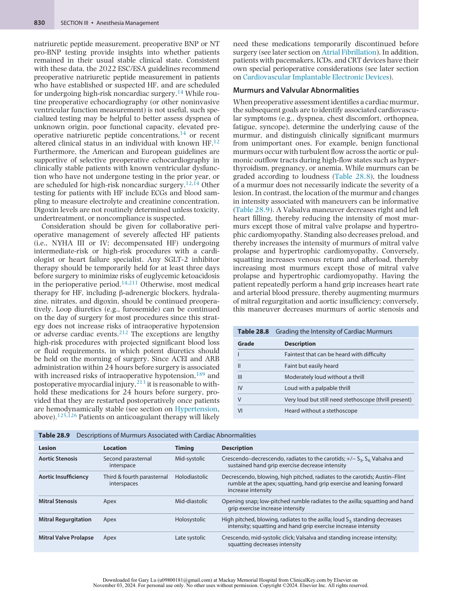

:::

<!-- PDF page 24 -->

hypertrophic cardiomyopathy. The likelihood of a murmur being pathologic increases in the presence of increased age, cardiovascular risk factors, other abnormal heart sounds, cardiomegaly, abnormal ECG, evidence of excessive intravascular volume, and a history of rheumatic fever, pulmonary disease, or anorectic drug use. Diastolic or continuous murmurs are almost always pathologic and require further evaluation. Nonetheless, it is typically not easy to distinguish benign from pathologic murmurs based on history and physical examination alone. Thus, cardiovascular medicine guidelines now recommend transthoracic echocardiography for the initial evaluation of any patient with suspected valvular heart disease.214 Additionally, perioperative guidelines recommend preoperative echocardiography for any patient with clinically suspected moderate or severe valvular stenosis or regurgitation (i.e., associated murmur, signs, and symptoms),14 especially in the absence of an echocardiogram within the prior year.12 For patients with known valvular heart disease, repeat echocardiography is recommended if there has been a significant change in clinical status or physical examination since the last test.

**Aortic Stenosis.** Aortic valve stenosis is the leading cause of left ventricular outflow obstruction in adults. In highincome countries, aortic stenosis principally occurs due to progressive calcific disease of a native trileaflet valve or a congenitally bicuspid valve. Stenosis of bicuspid valves typically occurs when individuals are in their fourth and fifth decades of life, whereas stenosis of native trileaflet valves occurs once individuals are aged 60 years or older. Aortic stenosis severity is classified based on the aortic valve area, mean transvalvular pressure gradient, transvalvular jet velocity, other hemodynamic sequelae (e.g., left ventricular ejection fraction), and presence of symptoms.214 Severe aortic stenosis is typically, but not always, associated with a valve area &lt;1.0 cm2 and mean transvalvular pressure gradient >40 mm Hg. A limitation of pressure gradient for assessing severity is that the gradient may decrease if the left ventricle systolic function begins to decrease. After a prolonged asymptomatic phase, symptoms may develop in affected patients once stenosis becomes severe. The cardinal symptoms of severe aortic stenosis are angina, heart failure, and syncope, but patients may be more likely to report exertional dyspnea and decreased exercise tolerance.

Aortic stenosis causes a systolic ejection murmur (see Table 28.9), best heard in the right upper sternal border and often radiating to the neck. A similar murmur occurs with aortic _sclerosis_ , which is defined as thickening of the aortic valve without associated stenosis. Aortic sclerosis is present in 25% of individuals aged ≥65 years, and 50% of individuals aged ≥80 years. Aortic sclerosis is associated with an increased risk of cardiovascular events, and a 2% annual risk of progression to aortic stenosis.215 The radiating pattern of the systolic ejection murmur can help rule out aortic stenosis, with the absence of radiation to the right clavicle being associated with a negative likelihood ratio of 0.1 for aortic stenosis.216 In addition to a systolic ejection murmur, aortic stenosis is associated with a delayed carotid upstroke and paradoxically split second heart sound. Any patient with a previously undiagnosed suspicious systolic murmur should have an echocardiogram, especially since noncardiologists have difficulty in distinguishing murmurs

of aortic stenosis from those of aortic sclerosis. Typical ECG abnormalities associated with aortic stenosis include left ventricular hypertrophy (often with a strain pattern), left axis deviation, and left bundle branch block.

Moderate to severe aortic stenosis is associated with increased risk of perioperative cardiovascular complications.217,218 Nonetheless, contemporary studies suggest that noncardiac surgery can be performed with acceptable risks in individuals with asymptomatic severe aortic stenosis.218 Thus, guidelines support patients with asymptomatic severe aortic stenosis proceeding to major elective noncardiac surgery with appropriate intraoperative and postoperative hemodynamic monitoring,12 especially if ventricular function is preserved.14,214 Conversely, aortic valve replacement (surgical or transcatheter replacement) should be considered before the noncardiac surgery if patients have symptomatic severe aortic stenosis.12,14,214 Recent European guidelines further recommend prior aortic valve replacement for asymptomatic patients who have ventricular dysfunction (ejection fraction &lt;50%) and are scheduled for high- risk noncardiac surgery.14 Percutaneous aortic balloon dilation can be considered in patients deemed high risk or ineligible for aortic valve replacement.12,14 Multidisciplinary collaboration with a cardiologist is invaluable for the perioperative management of these high- risk patients. Patients with moderate to severe aortic stenosis also have an increased risk of bleeding from an _acquired_ von Willebrand syndrome (see Chapter 29), which occurs in 67% to 92% of patients with severe stenosis.219 The underlying pathophysiology is mechanical disruption of von Willebrand multimers during turbulent blood flow through the narrowed valve. Prophylaxis for infective endocarditis is not recommended.214

**Aortic Insufficiency.** Aortic valve insufficiency occurs with valvular leaflet disease, aortic root dilation, or both. Causes of valvular disease include rheumatic heart disease, bicuspid valves, collagen vascular disease, and endocarditis. With respect to aortic root dilation, causes included ankylosing spondylitis, osteogenesis imperfecta, syphilis, hypertension, age- related degeneration, Marfan syndrome, and collagen vascular diseases. These causes generally lead to progressive chronic aortic insufficiency that remains asymptomatic for decades. In contrast, acute aortic insufficiency can result from trauma, infections, or aortic dissection; this is an emergent condition that results in cardiogenic shock.

On auscultation, aortic insufficiency is associated with a diastolic murmur (see Table 28.9), the intensity of which does not correlate well with the severity of regurgitation.220 Patients typically have a widened pulse pressure, which manifests as Corrigan or water- hammer pulses (bounding carotid pulse with a rapid downstroke), de Musset sign (head bob with each heart beat), Duroziez sign (systolic and diastolic bruit heard over the femoral artery when it is partially compressed), and Quincke pulses (capillary pulsations in the fingertips or lips). While auscultation by a cardiologist can help rule in or rule out aortic regurgitation (based on the presence or absence of an early diastolic murmur),221 the accuracy of auscultation by noncardiologists is uncertain.32 Thus, an echocardiogram is helpful for any patient suspected of having a diastolic murmur.

<!-- PDF page 25 -->

Limited prior research suggests that patients with moderate to severe aortic insufficiency experience increased risks of perioperative mortality and morbidity, especially in the presence of impaired left ventricular (ejection fraction &lt;55%) or renal insufficiency.222 Nonetheless, expert consensus from current guidelines is supportive of patients with mild to moderate aortic insufficiency proceeding to major noncardiac surgery with careful perioperative management, including hemodynamic monitoring, afterload control, and fluid balance.12,14,214 If a patient being considered for intermediate- or high-risk noncardiac surgery has severe aortic insufficiency that meets usual indications for valve replacement (e.g., symptoms, left ventricular dysfunction, significant ventricular dilatation), possible valve replacement should be considered before the noncardiac surgery.14 Prophylaxis for infective endocarditis is not recommended.214

**Mitral Stenosis.** Mitral stenosis is much rarer than aortic stenosis, and almost always related to rheumatic heart disease. Other less common causes include mitral annular calcification, and radiation- associated valve disease. The normal mitral valve has a cross- sectional area of 4 to 6 cm2 . Mitral stenosis involves progressive reduction of this area, with shortness of breath with exertion occurring when the area falls below 2.5 cm2 , and symptoms at rest occurring once the area falls below 1.5 cm2 . Severe mitral stenosis is defined by a valve area less than 1.5 cm2 .214 Severe stenosis is typically associated with a pulmonary artery systolic pressure >50 mm Hg, and a resting mean transvalvular gradient ≥10 mm Hg.

When mitral stenosis becomes symptomatic, patients experience dyspnea, fatigue, orthopnea, pulmonary edema, and hemoptysis due to increased left atrial pressures and decreased cardiac output. Atrial fibrillation can also develop, in turn causing heart failure in the short term and thrombosis in the long term. Patients with atrial fibrillation require long- term anticoagulation, with recent guidelines recommending vitamin K antagonist therapy (e.g., warfarin) as opposed to direct oral anticoagulants.214 Pulmonary hypertension (see Chapter 29) and right- sided heart failure can also occur in patients with significant stenosis. The physical examination should evaluate for rales and signs of right- sided heart failure such as jugular venous distention, peripheral edema, hepatomegaly, right ventricular heave, and ascites. On auscultation, mitral stenosis is associated with a diastolic murmur that should be evaluated with echocardiography.

Medical management includes β- adrenergic blockers for controlling heart rate, antiarrhythmic agents for preventing or controlling atrial fibrillation, and anticoagulants in patients with atrial fibrillation. Both β- adrenergic blockers and antiarrhythmic agents should be continued preoperatively, while anticoagulation should be managed in conjunction with the treating cardiologist and surgeon. Prophylaxis for infective endocarditis is not recommended.214 For patients with mitral stenosis who meet guideline- based indications (e.g., symptomatic severe stenosis, systolic pulmonary arterial pressure >50 mm Hg for valvular intervention such as a percutaneous mitral balloon commissurotomy),214 consideration should be given to perform this intervention before major elective

noncardiac surgery.12,14 If an asymptomatic patient with severe mitral stenosis has valve morphology that is not favorable for a percutaneous intervention, it is still reasonable to proceed with major elective noncardiac surgery provided that appropriate intraoperative and postoperative hemodynamic monitoring is used.12

**Mitral Regurgitation.** Acute mitral regurgitation can occur in the setting of myocardial infarction, trauma, or infective endocarditis. Chronic mitral regurgitation is typically associated with degenerative mitral valve disease (including mitral valve prolapse), rheumatic heart disease, ischemic heart disease, and cardiomyopathies. Chronic mitral regurgitation progresses very gradually. Symptoms develop relatively late, and typically only after onset of left ventricular dysfunction. Associated symptoms are initially vague, but progress to fatigue, dyspnea, and atrial fibrillation with disease progression.

On auscultation, patients with mitral regurgitation usually have a holosystolic murmur heard best at the cardiac apex (see Table 28.9). The murmur grade is somewhat correlated with the severity of mitral regurgitation in primary mitral valve disease (e.g., degenerative mitral valve disease), but not in secondary functional regurgitation (e.g., ischemic heart disease, cardiomyopathies). While auscultation by a cardiologist can help rule in or rule out mitral regurgitation (based on the presence or absence of a late systolic or holosystolic murmur in the mid- left thorax), the accuracy of auscultation by noncardiologists is uncertain.32 Thus, an echocardiogram is helpful for any patient with a suspicious systolic murmur. Chronic mitral regurgitation is generally well tolerated perioperatively, unless other valvular lesions (e.g., mitral stenosis) or left ventricular dysfunction coexist. Consistent with these observations, limited prior research suggests that patients with mitral regurgitation have elevated risks of cardiovascular complications, but not mortality.223 Current guidelines suggest that most patients with asymptomatic severe mitral regurgitation can proceed to major elective noncardiac surgery with appropriate hemodynamic monitoring,12 especially in the absence of concomitant pulmonary hypertension (i.e., pulmonary systolic artery pressure &lt;50 mm Hg).214 A preceding valve intervention may be considered for patients with associated symptoms or ventricular dysfunction.14 Prophylaxis for infective endocarditis is not recommended.214

**Mitral Valve Prolapse.** Mitral valve prolapse _is_ characterized by the systolic billowing of an abnormally thickened mitral valve leaflet into the left atrium, with or without coexistent mitral regurgitation. Diagnostic criteria for mitral valve prolapse have evolved to its current definition based on echocardiography alone, namely, ≥2 mm billowing of any portion of the mitral leaflets above the annular plane in the long-axis view.224 It is the common cause of isolated mitral regurgitation requiring surgical repair in high-income countries. Nonetheless, only 4% of patients with mitral valve prolapse have severe valvular regurgitation, with most affected individuals having mild, trace, or no mitral regurgitation.225 The condition may be primary (i.e., myxomatous degeneration) or secondary (e.g., associated with Marfan syndrome, Ehlers–Danlos syndrome, and osteogenesis imperfecta). Nonspecific symptoms (e.g.,

<!-- PDF page 26 -->

atypical chest pain, palpitations, dyspnea, exercise intolerance, dizziness) have been attributed, albeit unreliably, to mitral valve prolapse, in what has been termed as the “mitral valve prolapse syndrome.” On auscultation, these patients may have a systolic click and a mid- systolic murmur at the cardiac apex (that increases with intensity with a Valsalva maneuver). While auscultation by a cardiologist can help rule in or rule out mitral valve prolapse (based on the presence or absence of a systolic click and murmur), the accuracy of auscultation by noncardiologists is uncertain.32 From the perioperative perspective, however, the key issue is to differentiate patients with clinically significant mitral valve regurgitation from those with an incidental finding of prolapse that does not warrant further evaluation. Thus, echocardiography may be helpful to further investigate murmurs suspected of representing significant mitral regurgitation. Prophylaxis for infective endocarditis is not recommended.214

**Tricuspid Regurgitation.** Tricuspid regurgitation is a common valvular abnormality, with 70% of normal adults exhibiting a small degree of tricuspid regurgitation on echocardiography. Since it is usually asymptomatic and not easily audible on physical examination, tricuspid regurgitation is often noted as an incidental echocardiographic finding. Significant tricuspid regurgitation is most often caused by dilatation of the right ventricle and tricuspid annulus (i.e., secondary disease). Causes of secondary tricuspid regurgitation include left- sided heart failure, mitral valve disease (stenosis or regurgitation), primary pulmonary disease (e.g., pulmonary hypertension), left- to- right intracardiac shunts (e.g., atrial septal defect, ventricular septal defect), pulmonary artery stenosis, and right ventricle disease (e.g., arrhythmogenic right ventricular dysplasia). Tricuspid regurgitation is less commonly caused by processes directly affecting the tricuspid valve (i.e., primary disease), such as Ebstein anomaly, infective endocarditis (typically in IV drug users), rheumatic heart disease, carcinoid syndrome, connective tissue disorders (e.g., Marfan syndrome), myxomatous degeneration, or direct injury (e.g., permanent pacemaker or implantable cardioverter- defibrillator lead). Certain drugs, namely anorectics (fenfluramine, phentermine) and pergolide (dopamine agonist) have also been associated with primary tricuspid regurgitation.

Patients with mild or moderate tricuspid regurgitation are generally asymptomatic. Individuals with severe regurgitation may report pulsations in the neck (related to distended jugular veins), as well as symptoms of right- sided heart failure (e.g., ascites, peripheral edema) and underlying conditions (e.g., pulmonary hypertension). Relevant findings on physical examination include distended jugular veins, hepatomegaly, ascites, dependent edema, and a right ventricular heave on chest palpation. On auscultation, tricuspid regurgitation causes a holosystolic murmur that is heard best at the midsternal border or subxiphoid area. Nonetheless, the murmur is often absent or very soft, even with severe regurgitation. The intensity of the murmur can be increased using maneuvers that increase venous return (e.g., inspiration, abdominal pressure). While auscultation by a cardiologist can help rule in or rule out moderate to severe tricuspid regurgitation (based on the presence or absence of increased murmur intensity with inspiration or

abdominal pressure), the accuracy of auscultation by noncardiologists is uncertain.32 Thus, echocardiography may be helpful in a patient with a suspicious murmur, especially within the context of signs or symptoms of right- sided heart failure. The preoperative management of patients with severe tricuspid regurgitation should be guided by the presence of any underlying conditions, right- sided heart failure, and known or suspected pulmonary hypertension (see Chapter 29). Where indicated, perioperative management should be conducted collaboratively with a heart failure cardiologist or pulmonary hypertension specialist. Prophylaxis for infective endocarditis is not recommended.214

**Prosthetic Heart Valves.** In patients with prosthetic heart valves, the preoperative evaluation should determine the underlying indication that led to valve replacement; type, age, and current status of the valve prosthesis; need for long- term anticoagulation entailed by the valve prosthesis; and planned perioperative anticoagulation management plan. The anesthesiologist should review the most recent echocardiogram, and order a repeat echocardiogram if there are any signs or symptoms suggestive of valve dysfunction (e.g., new-onset heart failure).214 In addition, a recent complete blood count (CBC) may be helpful since these patients may have a valve- related hemolytic anemia. Anticoagulation with a vitamin K antagonist (e.g., warfarin) is required for three to six months after open surgical bioprosthetic valve implantation, after which patients can be transitioned to lifelong aspirin monotherapy (75 to 100 mg daily).214 Lifelong aspirin therapy is recommended for patients who have undergone transcatheter aortic valve replacement (TAVR), as well as either clopidogrel (75 mg daily) or vitamin K antagonists (in select individuals) for the first three to six months.214 All patients with mechanical prosthetic valves require lifelong therapy with vitamin K antagonists, with some select individuals also receiving aspirin.214 Importantly, DOACs – such as dabigatran, rivaroxaban, edoxaban, or apixaban – should not be used for anticoagulation therapy in patients with mechanical heart valves.214 In general, decisions about temporary preoperative discontinuation of anticoagulants, duration of anticoagulant discontinuation, need for “bridging” therapy with a shorter- acting drug, and type of bridging agent (IV heparin or low- molecular- weight heparin) should be made in conjunction with the treating cardiologist and surgeon. Current guidelines make recommendations for bridging therapy largely based on the location of the mechanical heart valve, nature of planned surgery, and other risk factors for thromboembolism (Box 28.3).214 Prophylaxis for infective endocarditis is recommended for specific procedures (see section on Infective Endocarditis Prophylaxis, below).214

### Infective Endocarditis Prophylaxis

Patients at risk for infective endocarditis (e.g., prosthetic heart valves, prosthetic material used for cardiac valve repair, complex cyanotic congenital heart disease, previous endocarditis), and scheduled for procedures with the potential for transient bacteremia must be identified preoperatively. Current guidelines have dramatically scaled back the indications for prophylaxis. For example, current ACC/AHA guidelines recommended prophylaxis only for

<!-- PDF page 27 -->

### Box 28.3 Recommendations for Preoperative Bridging Anticoagulation Therapy in Patients with Mechanical Heart Valves

### Class I (recommended)

- Continuation of vitamin K antagonist anticoagulation with a therapeutic INR is recommended in patients with mechanical heart valves undergoing minor procedures (e.g., dental extractions, cataract removal) where bleeding is easily controlled.

- Temporary interruption of vitamin K antagonist anticoagulation, without bridging agents while the INR is subtherapeutic, is recommended in patients with a bileaflet mechanical AVR and no other risk factors* for thrombosis who are undergoing invasive or surgical procedures.

### Class IIa (is reasonable)

- Bridging anticoagulation therapy during the time interval when the INR is subtherapeutic preoperatively for patients with bioprosthetic heart valves or annuloplasty rings who are receiving anticoagulation for atrial fibrillation, based on weighing the CHA2DS2- VASc score versus against risk of bleeding.

- Bridging anticoagulation therapy during the time interval when the INR is subtherapeutic preoperatively is reasonable on an individualized basis—with the risks of bleeding weighed against the benefits of thromboembolism prevention—for patients who are undergoing invasive or surgical procedures with a (i) mechanical AVR and any thromboembolic risk factor, (ii) older- generation mechanical AVR, or (iii) mechanical MVR.

*Risk factors include atrial fibrillation, previous thromboembolism, hypercoagulable condition, older- generation ball- cage or tilting disc mechanical valve and left ventricular systolic dysfunction.

_AVR_ , aortic valve replacement; _INR_ , international normalized ratio; _MVR_ , mitral valve replacement

- From Otto CM, Nishimura RA, Bonow RO, et al. 2020 ACC/AHA Guideline for the Management of Patients with Valvular Heart Disease. A Report of the American College of Cardiology/American Heart Association Joint Committee on Clinical Practice Guidelines. _Circulation._ 2021;143:e72–e227.

patients who are at increased risk of developing infective endocarditis and also experiencing adverse outcomes from endocarditis (Box 28.4).214 Prophylaxis is required when eligible patients undergo dental procedures that involve manipulation of gingival tissue, manipulation of the periapical region of teeth, or perforation of the oral mucosa. Prophylaxis is not required when these same individuals undergo nondental procedures (e.g., transesophageal echocardiography, gastroscopy, colonoscopy, cystoscopy, dermatologic procedures), unless there is active infection at the procedure site.

### Rhythm Disturbances on the Preoperative Electrocardiogram

Arrhythmias and conduction disturbances are common during the perioperative period. Supraventricular and ventricular arrhythmias are associated with elevated perioperative risk, both because of the arrhythmias themselves and because they are markers for cardiopulmonary disease. Uncontrolled atrial fibrillation (i.e., causing symptoms or hemodynamic compromise) and high- risk ventricular

### Box 28.4 Cardiac Conditions for Which Endocarditis Prophylaxis Is Recommended

Previous infective endocarditis

- Prosthetic cardiac valves, including transcatheter- implanted prostheses and homografts

- Prosthetic material used for cardiac valve repair, such as annuloplasty rings and chords

- Unrepaired cyanotic congenital heart disease, including palliative shunts and conduits

Repaired congenital heart disease, with residual shunts or valvular regurgitation at the site of or adjacent to the site of a prosthetic patch or prosthetic device

- Cardiac transplant with valve regurgitation due to a structurally abnormal valve

- *Prophylaxis is reasonable before dental procedures that involve manipulation of gingival tissue, manipulation of the periapical region of teeth, or perforation of the oral mucosa

- From Otto CM, Nishimura RA, Bonow RO, et al. 2020 ACC/AHA Guideline for the Management of Patients with Valvular Heart Disease. A Report of the American College of Cardiology/American Heart Association Joint Committee on Clinical Practice Guidelines. _Circulation._ 2021;143:e72–e227.

tachyarrhythmias (see Chapter 29) are high- risk conditions that warrant postponement of elective surgery until evaluation and stabilization are complete. Rapid atrial fibrillation (rates >100 beats/min), symptomatic bradycardia, or high- grade heart block (e.g., third- degree heart block) also warrant postponement of elective procedures to facilitate evaluation, stabilization, and possible cardiology evaluation.

First- degree atrioventricular (AV) block is defined as a PR interval exceeding 0.20 ms with an associated heart rate of 50 to 100 beats/min; it is considered generally benign. Second- degree heart block is defined by a PR interval exceeding 0.20 ms and the presence of some blocked atrial beats (resulting in a dropped or missing QRS complex after a P wave). There are two types of second- degree block. Mobitz type I block (also called Wenckebach block) is characterized by progressive lengthening of the PR interval until the dropped beat occurs. It is a more benign block that is related to AV nodal delay, easily responsive to atropine, and unlikely to progress to complete heart block. Mobitz type II block is characterized by a fixed and prolonged PR interval that does not change before the dropped QRS complex. It is related to an infranodal block, capable of progressing to complete heart block, and generally treated with a pacemaker (unless it is due to a reversible cause such as ischemia or drugs). Third- degree AV block or complete heart block, which is characterized by complete dissociation between the atrial and ventricular beats, requires pacemaker placement unless a reversible source is identified. A prolonged QT interval should prompt an evaluation of electrolytes (including magnesium and calcium), and search for any potentiating drugs. Syncope, presyncope, or a family history of sudden death in a patient with a prolonged QT interval mandates a cardiology consultation (see Chapter 29).

Three factors determine the need for permanent pacemaker treatment for an arrhythmia, namely, whether the arrhythmia is associated with symptoms, where the

<!-- PDF page 28 -->

### Box 28.5 Common Indications for a Permanent Pacemaker

### Class I Indications

- Sinus bradycardia with symptoms due to the bradycardia (typically seen with heart rates less than 40 bpm or with frequent sinus pauses)

- Symptomatic chronotropic incompetence (i.e., impaired heart rate response to exercise)

- Third- degree AV block ᑏ Advanced second- degree AV block (block of ≥2 consecutive P- waves)

- Symptomatic Mobitz I or II second- degree AV block ᑏ Mobitz II second- degree AV block with a widened QRS or chronic bifascicular block, regardless of symptoms

- Exercise- induced second- or third- degree AV block

### Class II Indications

- Sinus bradycardia (heart rate &lt;40 bpm) with symptoms suggestive (but not definitively so) of bradycardia

- Sinus node dysfunction with a history of unexplained syncope ᑏ Chronic heart rates &lt;40 bpm in an awake but minimally symptomatic patient

- Asymptomatic Mobitz II second-degree AV block with a narrow QRS interval

- Bifascicular or trifascicular block associated with syncope possibly related to intermittent third- degree heart block

- First-degree AV block with a very long PR interval (which effectively leads to AV dissociation and hemodynamic compromise)

_AV_ , atrioventricular; _bpm_ , beats per minute. Class I Indications: Permanent pacing is definitely beneficial, useful, and effective.

- Class II Indications: Permanent pacing may be indicated but there is conflicting evidence and/or divergence of opinion.

- From: Kusumoto FM, Schoenfeld MH, Barrett, C, et al. 2018 ACC/AHA/ HRS Guideline on the Evaluation and Management of Patients with Bradycardia and Cardiac Conduction Delay: A Report of the American College of Cardiology/American Heart Association Task Force on Clinical Practice Guidelines and the Heart Rhythm Society. _Circulation_ . 2019;140:e382–482.

conduction abnormality is located, and whether a reversible cause can be identified. Indications for perioperative pacemaker placement are the same as those in nonsurgical patients (common indications listed in Box 28.5).226 In general, pacemaker placement is required for symptomatic bradycardia or conduction delays that lead to syncope or presyncope. Conduction disease below the AV node (i.e., in the His–Purkinje system) is generally less stable and likely benefits from permanent pacemaker placement. The presence of such conduction disease is suggested by a normal or minimally prolonged PR interval, Mobitz type II block, and QRS complex abnormalities (bundle branch block, fascicular block, or both).

Bundle branch blocks can be classified as complete versus incomplete, and right bundle branch block (RBBB) versus left bundle branch block (LBBB). Bundle branch blocks may be normal variants in some individuals, or the result of agerelated fibrosis in the conduction system. Nonetheless, they can be associated with important underlying conditions. For example, LBBB may be related to structural heart disease (i.e., hypertensive heart disease, IHD, cardiomyopathies, valvular heart disease), while RBBB may be the result of elevated

right ventricular pressures (i.e., pulmonary hypertension, cor pulmonale, pulmonary embolism), prior radiation exposure, myocarditis, and structural heart disease (i.e., IHD, cardiomyopathies, valvular heart disease, congenital heart disease). The presence of a bundle branch block is not itself an indicator of increased perioperative cardiovascular risk,227 especially after accounting for known clinical risk factors.139 Nonetheless, data from the nonoperative setting would suggest that a recent onset or new diagnosis of a bundle branch should prompt a more extensive evaluation for undiagnosed cardiovascular disease. For example, LBBB is associated with increased risks of incident cardiovascular disease,228 cardiovascular mortality,228 and mortality in the nonoperative setting.229 Additionally, RBBB is associated with elevated risks of mortality in patients with suspected IHD, known IHD, and HF.230,231 Thus, if preoperative evaluation does not suggest significant pulmonary disease, IHD, structural heart disease, or Brugada syndrome (see Chapter 29), no further preoperative evaluation of an isolated asymptomatic RBBB is warranted. Conversely, RBBB in a patient with known or suspected pulmonary disease (e.g., pulmonary hypertension) may suggest severe respiratory or vascular compromise. Consideration should be given to pulmonary evaluation and echocardiography if intermediate- or high- risk surgery is planned.

**Atrial Fibrillation.** Atrial fibrillation is a common arrhythmia characterized by an irregularly irregular ventricular response, and an absence of regular or organized atrial activity. The arrhythmia is classified as paroxysmal (i.e., terminates spontaneously or with intervention within seven days of onset), persistent (i.e., fails to self- terminate within seven days), long- standing persistent (i.e., lasts more than 12 months), or permanent (i.e., persistent atrial fibrillation where a joint decision has been made by the patient and clinician to no longer pursue a rhythm control strategy).232 Atrial fibrillation can occur in the absence of any structural heart disease (previously termed “lone atrial fibrillation”), or in combination with underlying disorders. In high- income countries, hypertension and ischemic heart disease are the most common underlying disorders, while in low- and middle- income countries, rheumatic heart disease is a very common associated condition. Other associated conditions include valvular heart disease, heart failure, hypertrophic cardiomyopathy, congenital heart disease, obesity, diabetes mellitus, chronic kidney disease, and elevated age. Potentially reversible acute triggers for atrial fibrillation are hyperthyroidism and recent surgery (especially cardiac or thoracic surgery).

Affected individuals are at elevated risk for death, heart failure, thromboembolic events (i.e., stroke), and cognitive impairment. In the nonoperative setting, treatment involves ventricular rate control, consideration of rhythm control to restore sinus rhythm, and prevention of systemic embolization. In two large randomized trials, strategies focused on heart rate control versus rhythm control have largely shown similar effects on the risks of stroke or death,233,234 though a more recent large trial found that a strategy of early rhythm control led to decreased risks of cardiovascular death and stroke.235

The CHA2DS2- VASc score (Table 28.10) can help estimate the long- term systematic embolization risk in patients with atrial fibrillation,236 and thereby select patients who

<!-- PDF page 29 -->

### Table 28.10 Scoring Scheme for the CHA2DS2- VASc score

|**Risk Factor**|**Points**|
|---|---|
|Heart failure ᑏAssociated signs and symptoms, or left ventricular systolic dysfunction|1|
|Hypertension|1|
|Age≥75 years|2|
|Diabetes mellitus|1|
|Previous stroke, transient ischemic attack, or thromboembolism|2|
|Vascular disease ᑏMyocardial infarction, peripheral artery disease, or aortic plaque|1|
|Age 65 to 74 years|1|
|Female sex|1|

### Box 28.6 Classification Scheme for Procedure- Specific Bleeding Risk in the 2022 American College of Chest Physicians Guidelines

### Minimal Bleeding Risk

- Minor dermatologic procedures (e.g., excision of basal and squamous cell skin cancers); ophthalmologic (cataract) procedures; minor dental procedures (e.g., dental extractions, restorations, prosthetics, endodontics); pacemaker or cardioverter- defibrillator device implantation

### Low/Moderate Bleeding Risk

- Arthroscopy; cutaneous or lymph node biopsies; foot or hand surgery; coronary angiography; gastrointestinal endoscopy (possible biopsy); colonoscopy (possible biopsy); abdominal hysterectomy; laparoscopic cholecystectomy; abdominal hernia repair; hemorrhoidal surgery; bronchoscopy (possible biopsy)

### High Bleeding Risk

From Lip GY, Nieuwlaat R, Pisters R, et al. Refining clinical risk stratification for predicting stroke and thromboembolism in atrial fibrillation using a novel risk factor- based approach: the Euro heart survey on atrial fibrillation. _Chest_ . 2010;137:263–272.

warrant long- term anticoagulation. Based on the CHA2DS2VASc score, patients can be classified as low  risk (0 points: 0.2% annualized stroke rate), intermediate  risk (1 point: 0.6% annualized stroke rate), or high  risk (≥2 points: >2.2% annualized stroke rate).237 Among adults with nonvalvular atrial fibrillation (i.e., unrelated to mitral stenosis or prosthetic heart valves), the 2019 ACC/AHA guidelines strongly recommend (Class 1 recommendation) long- term oral anticoagulation for males with CHA2DS2- VASc scores ≥2, and females with CHA2DS2- VASc scores ≥3.238 Both vitamin K antagonists (e.g., warfarin) or DOACs (e.g., dabigatran, rivaroxaban, edoxaban, apixaban) are reasonable anticoagulant options for patients with nonvalvular atrial fibrillation. Conversely, these guidelines state that long- term oral anticoagulation can be reasonably omitted (Class 2a recommendation) in males with CHA2DS2- VASc scores of zero, and females with CHA2DS2- VASc scores of one.238 For patients classified between these extremes (i.e., males with CHA2DS2VASc scores of one and females with CHA2DS2- VASc scores of two), the guidelines state that oral anticoagulation can be considered (Class 2b recommendation).

Accumulating evidence suggests that preexisting atrial fibrillation is a marker of elevated perioperative risk. In a large international multicenter prospective cohort study, preexisting atrial fibrillation was associated with an elevated risk of postoperative cardiovascular events (i.e., stroke, cardiovascular death, myocardial injury, heart failure, or cardiac arrest),239 but not death.115 These findings are largely consistent with retrospective cohort studies that found patients with preexisting atrial fibrillation experienced elevated risks of adverse postoperative outcomes, including death, HF, and stroke.240–242

The preoperative evaluation of patients with atrial fibrillation focuses on underlying conditions (e.g., ischemic heart disease), complications (e.g., heart failure, stroke), rate or rhythm control strategies, and anticoagulation strategies. Patients with rapid ventricular rates (>100 beats/min) typically require rate control before any elective surgery.

- Major surgery with extensive tissue injury; cancer surgery, especially solid tumor resection (lung, esophagus, gastric, colon, hepatobiliary, pancreatic); major orthopedic surgery, including shoulder replacement surgery; reconstructive plastic surgery; major thoracic surgery; urologic or gastrointestinal surgery, especially anastomosis surgery; transurethral prostate resection, bladder resection, or tumor ablation; nephrectomy or kidney biopsy; colonic polyp resection; bowel resection; percutaneous endoscopic gastrostomy placement; endoscopic retrograde cholangiopancreatography; surgery in highly vascular organs (kidneys, liver, spleen); cardiac, intracranial, or spinal surgery; any major operation (procedure duration >45 minutes)

- From Douketis JD, Spyropoulos AC, Murad MH, et al. Perioperative Management of Antithrombotic Therapy: An American College of Chest Physicians Clinical Practice Guideline. _Chest_ . 2022;S00123692(22)01359- 9.

Patients with both atrial fibrillation and slow ventricular rate without rate- controlling medications may have sick sinus syndrome. They should be questioned regarding any previous episodes of syncope or presyncope. Any long- term β- adrenergic blockers, digoxin, calcium channel blockers, or antiarrhythmic medications should be continued.

The critical component for preoperative planning for most patients with atrial fibrillation is appropriate perioperative management of long- term anticoagulants. This management should ideally be conducted collaboratively with the treating physician and responsible surgeon. There are three overarching issues: (1) whether temporary preoperative discontinuation is needed, (2) when oral anticoagulants should be discontinued, and (3) whether bridging therapy with low- molecular- weight heparin is required.243,244 It is reasonable to continue anticoagulant therapy if the patient is receiving a vitamin K antagonist (e.g., warfarin), does not have patient- related risk factors for bleeding (e.g., liver disease, abnormal renal function, prior bleeding complications), and is scheduled for a procedure with minimal bleeding risk (Box 28.6). In all other cases, patients should temporarily discontinue anticoagulant medications before surgery, including all patients who are receiving DOACs or who might need neuraxial anesthesia.

::: details 原始表格與符號（PDF 第 29 頁）

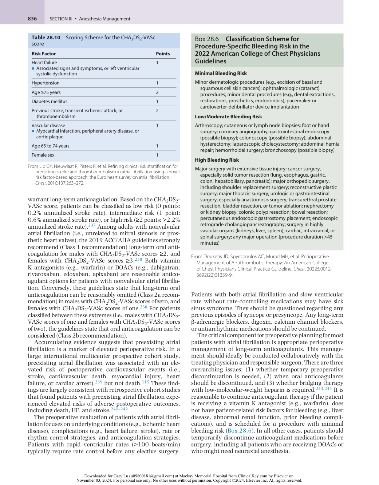

:::

<!-- PDF page 30 -->

If a decision is made to temporarily discontinue oral anticoagulants, vitamin K antagonists should be stopped five days before surgery.244 A longer discontinuation period may be needed for initial international normalized ratio (INR) values >3.0. Ideally, the INR should be rechecked within 24 hours before surgery.243 If the INR result is 1.5 or higher, consideration can be made for a low dose (1 to 2 mg) of oral vitamin K, although supporting evidence is weak.244 The timing of preoperative discontinuation of DOACs (Table 28.11) should be guided by the specific drug prescribed, expected procedural bleeding risk (see Box 28.6), renal function (based on estimated glomerular filtration rate), and planned use of neuraxial anesthesia.244,245

**Table 28.11** Guideline Recommendations for Preoperative DOAC Discontinuation

|**Direct Thrombin Inhibitor** **(i.e., dabigatran)**|**Direct Factor Xa Inhibitor** **(i.e., rivaroxaban,** **edoxaban, apixaban)**|
|---|---|
|**HIGH BLEEDING RISK PROCEDURES*,**†||
|eGFR≥50 mL/min: Last dose on third day before surgery (hold medication on first and second day before procedure) eGFR &lt;50 mL/min: Last dose on fifth day before surgery (hold medication for four days before procedure)|Last dose on third day before surgery (hold medication on first and second day before procedure)|
|**LOW/MODERATE BLEEDING RISK PROC**|**EDURES*,**†|
|eGFR≥50 mL/min: Last dose on second day before surgery (hold medication on day before procedure) eGFR &lt;50 mL/min: Last dose on third day before surgery (hold medication on first and second day before procedure)|Last dose on second day before surgery (hold medication on day before procedure)|
|**MINIMAL BLEEDING RISK PROCEDURE**|**S*,**†|
|Consider last dose on day before surgery (consider holding medication on day of procedure)|Consider last dose on day before surgery (consider holding medication on day of procedure)|
|**PLANNED NEURAXIAL ANESTHESIA (A**|**SRA RECOMMENDATIONS)**†,‡|
|Uniform approach: Last dose at 120 h before surgery Approach based on eGFR ᑏeGFR≥80 mL/min: Last dose at 72 h before surgery ᑏeGFR 50–79 mL/min: Last dose at 96 h before surgery ᑏeGFR 30–49 mL/min: Last dose at 120 h before surgery ᑏeGFR &lt;30 mL/min: Not recommended|Last dose at 72 hours before procedure|

- *From Douketis JD, Spyropoulos AC, Murad MH, et al. Perioperative Management of Antithrombotic Therapy: An American College of Chest Physicians Clinical Practice Guideline. _Chest_ . 2022;S0012- 3692(22)01359- 9.

- †In selected cases, a longer duration of preoperative DOAC interruption may be needed, such as for patients with severely impaired renal function (eGFR l&lt;30 mL/min), patients with impaired hepatic function, and patients taking other drugs that inhibit CYP3A4 or P- glycoprotein pathways

- ‡From Horlocker TT, Vandermeuelen E, Kopp SL, et al. Regional Anesthesia in the Patient Receiving Antithrombotic or Thrombolytic Therapy: American Society of Regional Anesthesia and Pain Medicine Evidence- Based Guidelines (Fourth Edition). _Reg Anesth Pain Med_ . 2018;43:263–309.

- _ASRA,_ American Society of Regional Anesthesiologists; _DOAC,_ direct oral anticoagulant; _eGFR_ , estimated glomerular filtration rate (Cockcroft–Gault equation).

Accumulating evidence indicates that most patients with nonvalvular atrial fibrillation do not require bridging therapy if their anticoagulant therapy is temporarily discontinued before surgery. For example, in the multicenter Bridging Anticoagulation in Patients Who Require Temporary Interruption of Warfarin Therapy for an Elective Invasive Procedure and Surgery (BRIDGE) randomized trial, placebo was noninferior to low- molecular- weight heparin bridging therapy with respect to risks of arterial thromboembolism following perioperative interruption of vitamin K antagonist therapy.246 In addition, bridging therapy increased risks of major bleeding. When interpreting these trial data, the challenge pertains to their generalizability to patients in clinical practice. For example, about 62% of the 1884 participants in the BRIDGE trial had an expected 1- year stroke rate &lt;5% (i.e., equivalent to CHA2DS2VASc score ≤4), while about 14% had an expected 1- year stroke rate >10% (equivalent to CHA2DS2- VASc score ≥7). To help clinicians better navigate clinical decision- making, the American College of Chest Physicians (ACCP) published a 2022 practice guideline on perioperative management of antithrombotic therapy.244 The guideline recommends against bridging therapy after preoperative interruption of DOACs because of their short half- lives. In the case of vitamin K antagonist therapy, the recommended approach is to omit bridging therapy, unless a patient is deemed to be at high risk for thromboembolism based on ACCP guideline criteria (Table 28.12),244 or has high- risk features for thromboembolism in the setting of a mechanical heart valve (see Box 28.3).214

### Cardiovascular Implantable Electronic Devices

Cardiovascular implantable electronic devices (CIEDs), which include both permanent pacemakers and ICDs, are very common. For example, in the United States alone, more than 190,000 permanent pacemakers and 145,000 ICDs are implanted every year (see Chapter 34).247,248 The

**Table 28.12** Patients at High Risk for Periprocedural Thromboembolism During Withdrawal of Vitamin K Antagonist Anticoagulation

|**Indication for** **Anticoagulation with** **Vitamin K Antagonist** **(e.g., warfarin)**|**High- Risk Clinical Features**|
|---|---|
|Mechanical heart valve|Mechanical mitral valve; older-generation caged ball or tilting- disc valve in mitral or aortic position; recent (prior &lt;3 months) stroke or transient ischemic attack|
|Atrial fibrillation|CHA2DS2- VASc score≥7; CHADS2score of 5 or 6; recent (prior &lt;3 months) stroke or transient ischemic attack; rheumatic valvular heart disease|
|Venous thromboembolism|Recent (prior &lt;3 months, and especially &lt;1 month) venous thromboembolism; severe thrombophilia (e.g., deficiency of protein C, protein S, or antithrombin; homozygous factor V Leiden or prothrombin gene mutation); antiphospholipid antibodies; vena cava filter; active cancer|

From Douketis JD, Spyropoulos AC, Murad MH, et al. Perioperative Management of Antithrombotic Therapy: An American College of Chest Physicians Clinical Practice Guideline. _Chest_ . 2022;S00123692(22)01359- 9.

::: details 原始表格與符號（PDF 第 30 頁）

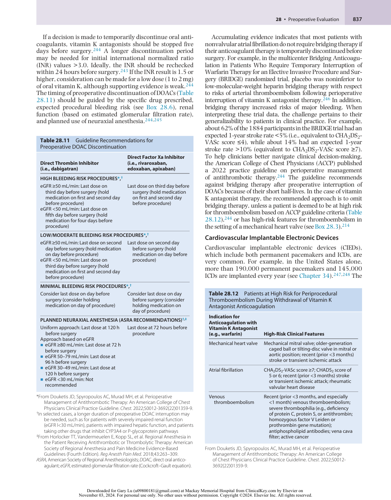

:::

<!-- PDF page 31 -->

**Table 28.13** Pacemaker Nomenclature

|**Position I**|**Position II**|**Position III**|**Position IV**|**Position V**|
|---|---|---|---|---|
|Chamber(s) paced|Chamber(s) sensed|Response to sensing|Rate modulation|Multisite pacing|
|**O**= None|**O**= None|**O**= None|**O**= None|**O**= None|
|**A**= Atrium|**A**= Atrium|**I**= Inhibited|**R**= Rate modulation|**A**= Atrium|
|**V**= Ventricle|**V**= Ventricle|**T**= Triggered||**V**= Ventricle|
|**D**= Dual (A+V)|**D**= Dual (A+V)|**D**= Dual (T+I)||**D**= Dual (A+V)|

From Bernstein AD, Daubert JC, Fletcher RD, et al. The revised NASPE/BPEG generic code for antibradycardia, adaptive- rate, and multisite pacing. North American Society of Pacing and Electrophysiology/British Pacing and Electrophysiology Group. _Pacing Clin Electrophysiol_ . 2002;25:260- 264.

preoperative evaluation should characterize the device with respect to type, age, manufacturer, model number, current settings, and timing of recent interrogation. Patients frequently carry a manufacturer’s identification card with some of this relevant information. Permanent pacemaker capabilities are usually classified using a five- letter code (Table 28.13).249 The anesthesiologist should also evaluate any coexisting cardiac disease because patients with CIEDs invariably have conditions such as HF, IHD, valvular heart disease, or potentially lethal arrhythmias – all of which have perioperative implications. It is especially important to note device features (e.g., rate modulation) that are likely to malfunction with perioperative electromagnetic and other interference. Sources of electromagnetic interference during the perioperative period include electrocautery (especially monopolar), radiofrequency ablation, lithotripsy devices, and radiation therapy, while direct mechanical interference can occur with guidewire movement during central venous catheter insertion.250 These sources of interference can result in CIED malfunction, such as inappropriate ICD discharge or inappropriate changes in pacing rates. Especially during delicate surgical procedures (e.g., intracranial, spinal, ocular), an unexpected ICD discharge with movement of the patient can have catastrophic results.

In general, the anesthesiologist conducting a preoperative evaluation of a patient with a CIED should collaboratively plan perioperative management with the relevant CIED care team (Box 28.7).12,250 The CIED care team has been defined as the physicians and physician extenders who monitor the patient’s CIED function. Ideally, patients with CIEDs should have these devices interrogated preoperatively, with recommendations that this interrogation be performed within the prior six months for an ICD, prior 12 months for a permanent pacemaker,14 and prior three to six months for any CRT device. Key issues for consideration when planning the perioperative care of a patient with a CIED include whether the patient has an ICD, whether the patient is pacemaker- dependent, and what happens with magnet placement over the CIED. In general, a magnet suspends antitachyarrhythmia therapy in most ICDs, and switches pacemakers (but not ICDs) to an asynchronous pacing mode. There is variation across guidelines whether to place a magnet over the CIED during the intraoperative period,250,251 versus arrange for temporary device reprogramming (i.e., switch pacemaker to asynchronous mode, and disable antitachyarrhythmia ICD).252 Especially given the complexity of newer- generation CIEDs, routine magnet

### Box 28.7 Proposed Principles for CIED Management

- The perioperative management of CIEDs must be individualized to the patient, type of CIED, and procedure being performed. A single recommendation for all CIED patients is not appropriate.

- The CIED care team is defined as the physicians and physician extenders who monitor the CIED function of the patient.

- The surgical or procedural team should communicate with the CIED care team to identify the type of procedure and likely risk of EMI.

- The CIED care team should communicate with the procedure team to deliver a prescription for the perioperative management of patients with CIEDs.

- For most patients, the prescription can be made from a review of the records of the CIED clinic. A small percentage of patients may require consultation from CIED specialists if the information is not available.

- It is inappropriate to have industry- employed allied health professionals independently develop this prescription.

_CIED_ , cardiovascular implantable electronic devices; _EMI_ , electromagnetic interference.

- From Crossley GH, Poole JE, Rozner MA, et al. The Heart Rhythm Society (HRS)/American Society of Anesthesiologists (ASA) Expert Consensus Statement on the Perioperative Management of Patients with Implantable Defibrillators, Pacemakers and Implantable Monitors: Facilities and Patient Management: Executive Summary. _Heart Rhythm_ . 2011;8:e1–e18.

use should not be viewed as an alternative for appropriate preoperative preparation. The recent 2022 ESC guidelines recommend high- risk CIED patients (defined as pacemakerdependent or having an ICD) complete a CIED check- up and any necessary device reprogramming before noncardiac surgery that incurs significant probabilities of electromagnetic interference.14 Overall, collaboration with the CIED care team is the preferred approach for better managing these patients in an individualized manner. General preoperative recommendations for CIEDs are presented in Box 28.8. With respect to additional tests, these patients require a preoperative ECG and possibly a chest radiograph. While not mandatory before surgery, a chest radiograph can reveal the device location and manufacturer’s code.

### Peripheral Artery Disease

Peripheral artery disease (PAD), which is defined as atherosclerosis of the large and medium- sized noncardiac

::: details 原始表格與符號（PDF 第 31 頁）

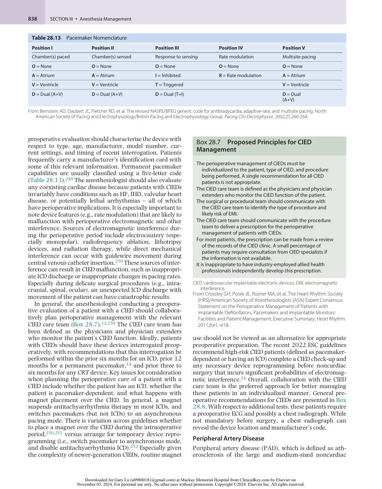

:::

<!-- PDF page 32 -->

### Box 28.8 Preoperative Recommendations for CIEDs

- Inactivation of ICDs is not necessary for all procedures ᑏ Not all pacemakers need to be altered to pace asynchronously in all patients or for all procedures

- Pacemakers can be reprogrammed, or magnets can be used to force pacemakers to pace asynchronously to prevent inhibition

- ICDs can be reprogrammed, or magnets can be used to inhibit ICD arrhythmia detection and tachyarrhythmia functions

- Magnets can/will not force pacemakers in ICDs to pace asynchronously

- Inactivation of ICDs is recommended for all procedures above the umbilicus involving electrocautery or radiofrequency ablation

- It is preferable to change to asynchronous pacing in pacemaker- dependent patients for procedures involving electrocautery or radiofrequency ablation above the umbilicus

- The procedure team provides the following information to the CIED team:

- Type of procedure

- Anatomic site of procedure

- Patient position during procedure

- Will electrocautery (and type of cautery) be used?

- Are there other sources of EMI

- Other issues such as likelihood of damage to leads (e.g., chest procedures), anticipated large blood loss, and surgery near the CIED

- The CIED care team provides the following information to the procedure team:

- Type of device (e.g., pacemaker, ICD) ᑏ Indication for device (e.g., sick sinus syndrome, primary or secondary prevention of lethal arrhythmias)

- Programming (e.g., pacing mode, rate, rate responsive, heart rates for shock delivery)

- Is the patient pacemaker- dependent, and what is the underlying heart rate/rhythm

- Magnet response

- Pacing rate

- Is the device responsive to a magnet?

- Will ICD functions resume automatically with magnet removal?

- Does magnet need to be placed off- center?

_CIED_ , cardiovascular implantable electronic devices; _EMI_ , electromagnetic interference; _ICD_ , implantable cardioverterdefibrillator

From Crossley GH, Poole JE, Rozner MA, et al. The Heart Rhythm Society (HRS)/American Society of Anesthesiologists (ASA) Expert Consensus Statement on the Perioperative Management of Patients with Implantable Defibrillators, Pacemakers and Implantable Monitors: Facilities and Patient Management: Executive Summary. _Heart Rhythm_ . 2011;8:e1–e18.

arterial vasculature, affects more than 230 million people worldwide.253 The disease generally affects lower extremity vessels more than upper extremity vessels. PAD progresses variably across individuals, from an initially asymptomatic phase to intermittent claudication (i.e., extremity pain with activity) to critical limb ischemia. Risk factors for PAD include increased age, smoking, hypertension, diabetes mellitus, chronic kidney disease, and known atherosclerosis in other sites (e.g., IHD). PAD is typically diagnosed based on clinical history (e.g., risk factors, symptoms), physical examination (e.g., nonhealing wound), and the ankle–brachial index (ABI or ratio

of ankle- to- arm systolic blood pressure, where diagnosis is confirmed based on a value less than 0.90).254 Patients with PAD likely have atherosclerosis in other sites (e.g., heart, brain). For example, a systematic review in the nonoperative setting found a prevalence of IHD in individuals with PAD ranged from 60% based on cardiac stress testing to 90% based on coronary angiography.255 Individuals meeting diagnostic criteria for PAD were found to have elevated risks for subsequent myocardial infarction, acute stroke, or cardiovascular death in the nonoperative setting.256 PAD is also a marker of elevated risk in surgical patients. An ABI &lt;0.90 is independently associated with an increased risk of cardiovascular complications after noncardiac surgery.257 Known PAD is also associated with elevated risks of mortality after major noncardiac surgery.115,116 In addition, claudication related to PAD generally limits functional capacity and thereby masks the symptoms of underlying IHD or HF.

The preoperative evaluation of PAD should encompass related symptoms (e.g., intermittent claudication, rest pain), risk factors (e.g., hypertension, diabetes mellitus, smoking, chronic kidney disease), and associated comorbidities (e.g., IHD, cerebrovascular disease). Arterial blood pressure should be measured in both upper extremities, along with the presence of peripheral arterial pulses. Auscultation for bruits over the abdomen and femoral arteries, as well as palpation for abdominal masses, should be part of the vascular examination. Typical preoperative laboratory testing includes an ECG and blood sampling for CBC, creatinine concentration, and glucose concentration. These individuals may often need further specific workup for IHD with testing such as biomarkers (natriuretic peptides, troponin) and cardiac stress testing (see section on Ischemic Heart Disease, above). Depending on concomitant risk factors and cardiovascular medications, patients may be on long- term therapy with aspirin, P2Y12 inhibitors (e.g., clopidogrel), and DOACs. DOACs should be temporarily discontinued before surgery (see section on Atrial Fibrillation, above). In most cases, P2Y12 inhibitor therapy should also be interrupted before surgery, except possibly patients with very recent coronary stent implantation (see section on Coronary Stents, above). As a general strategy for patients undergoing noncardiac surgery, continuing aspirin perioperatively does not prevent cardiovascular complications,184 but leads to an increased risk of major bleeding (which is a risk factor for perioperative stroke).180 Nonetheless, selective continuation of aspirin should be strongly considered in patients undergoing vascular surgery (to mitigate risks of bypass graft occlusion), as well as those with high- risk IHD, prior PCI, or recent stroke (i.e., previous six months).258

### PULMONARY DISORDERS

See also Chapters 12, 29, and 49.

### Asthma

The Global Initiative for Asthma defines asthma as a “heterogeneous disease, usually characterized by chronic airway inflammation. It is defined by the history of respiratory symptoms such as wheeze, shortness of breath, chest tightness, and cough that vary over time and in intensity, together with variable expiratory airflow limitation.”259

<!-- PDF page 33 -->

These episodes of airflow obstruction within the lung are often reversible, either spontaneously or with treatment. The airway obstruction can be precipitated by irritants (e.g., smoke), allergens, infections, medications, or airway instrumentation. Worldwide, it is estimated that asthma afflicts more than 300 million people, and is responsible for one in every 250 deaths.260 Asthma is classified as intermittent, persistent mild, persistent moderate, and persistent severe, based on symptoms, nighttime awakenings, shortacting bronchodilator requirement, functional impairment, and pulmonary function test (PFT) abnormalities. Spirometry is the preferred diagnostic test for asthma. Typical findings on PFTs are a reduction in the ratio of the forced expiratory volume in 1 second (FEV1) to forced vital capacity (FVC) – with a ratio below 0.7 being indicative of airflow obstruction. Importantly, normal initial PFT results do not necessarily exclude asthma. If results are normal but a diagnosis of asthma is still strongly suspected, a methacholine challenge test or a trial of bronchodilator therapy should be performed. Patients with mild well- controlled asthma have no greater perioperative risk than do individuals without asthma.261 In addition, PFTs, while helping to establish the diagnosis of asthma, generally have no perioperative prognostic value in these patients.

In a patient with known asthma, the anesthesiologist should enquire about dyspnea, chest tightness, cough (especially nocturnal), recent exacerbations (with associated triggers), therapy (especially corticosteroids), prior hospitalizations, prior emergency department visits, prior critical care unit admissions, prior need for endotracheal intubation, and recent upper respiratory tract infections (see section on Upper Respiratory Tract Infections, below). It is helpful to ask patients to compare their current asthma symptoms to their “normal” or “best” status based on symptoms, exercise tolerance, and medication requirements. The physical examination should assess the quality of breath sounds, quantity of air movement, degree of wheezing, and oxygen saturation by pulse oximetry. The degree of wheezing does not always correlate with the severity of bronchoconstriction. With severe obstruction, airflow is dangerously restricted, and wheezing diminishes. While wheezing is common in asthma, it is not specific for the disease. For example, wheezing may be present in chronic obstructive pulmonary disease (COPD), gastroesophageal reflux disease, vocal cord dysfunction, tracheal stenosis, bronchial stenosis, cystic fibrosis, allergic bronchopulmonary aspergillosis, and HF. Observing the degree of accessory muscle use can also help gauge the severity of bronchoconstriction.

Arterial blood gases are not necessary unless the patient is having a severe acute exacerbation. Patients taking oral corticosteroids should have their blood glucose checked. Chest radiography is needed only if an infection or pneumothorax is suspected. Bronchodilators, corticosteroids (inhaled and oral), and any antibiotics must be continued on the day of surgery. β- Adrenergic agonists are a useful prophylactic intervention to lower the risk of bronchospasm after induction of anesthesia. This therapy can be supplemented with a short preoperative course of oral corticosteroids (prednisone 20 mg to 60 g daily for 3 to 5 days) in any newly diagnosed or poorly controlled asthmatic patient.262 Importantly, some asthmatics on chronic corticosteroid

treatment may need perioperative “stress dose steroids” (see Chapter 29).

### Chronic Obstructive Pulmonary Disease

Chronic obstructive pulmonary disease (COPD) is a chronic respiratory disease that affects 213 million people worldwide and causes 3 million deaths every year.263 It is characterized by persistent airflow obstruction that may occasionally demonstrate partially reversibility (see Chapter 12). It may be the result of smoking, environmental pollutants (e.g., air pollution), α1- antitrypsin deficiency, chronic infections, and long- standing asthma. The Global Initiative for Chronic Obstructive Lung Disease (GOLD) describes COPD as a “ _common, preventable, and treatable disease that is characterized by persistent respiratory symptoms and airflow limitation that is due to airway and/or alveolar abnormalities usually caused by significant exposure to noxious particles or gases and influenced by host factors including abnormal lung development_ ” (http://www.goldcopd.org). COPD includes subtypes, such as “chronic bronchitis” and “emphysema.” Chronic bronchitis is defined as a chronic productive cough for three months in each of two successive years in a patient in whom other causes of chronic cough (e.g., bronchiectasis) have been excluded. Emphysema refers to pathologic structural changes in the lung that can occur with COPD, including enlargement of airspaces distal to the terminal bronchioles, as well as destruction of these airspace walls. The severity of COPD is classified based on both spirometry findings and symptoms. Once a patient has evidence of airway obstruction on spirometry (FEV1/FVC ratio &lt;0.7), _mild_ airflow limitation is defined as a FEV1 ≥80% predicted, _moderate_ limitation as a FEV1 between 50% to 79% of predicted, _severe_ limitation as a FEV1 between 30% to 49% predicted, and _very severe_ limitation as a FEV1 &lt;30% predicted. Symptom severity is classified separately using validated scales such as the Modified British Medical Research Council Dyspnea scale or COPD Assessment Test.264–266 A COPD exacerbation is defined as “ _an acute worsening of respiratory symptoms that result in additional therapy_ ” (http://www.gol dcopd.org).

The preoperative evaluation of COPD is similar to that of asthma, with an additional emphasis on signs of recent infection (e.g., changes in sputum amount or color). A barrel chest and pursed lip breathing also suggest advanced disease. COPD is a known risk factor for postoperative pulmonary complications (see section on Postoperative Pulmonary Complications, below).267 Nonetheless, there is no clearly established threshold of COPD severity indicative of highly prohibitive perioperative risk. In general, PFTs are not useful for estimating perioperative risk in patients with COPD, except possibly for individuals undergoing lung resection surgery (see Chapter 49). In general, preoperative PFTs are indicated when there is uncertainty as to whether the patient’s lung function is optimized, or uncertainty as to the underlying basis for unexplained dyspnea. Patients who are hypoxic, or require supplemental oxygen, may also require arterial blood gas measurement, in addition to routine measurement of oxygen saturation using pulse oximetry. A chest radiograph is useful only if infection or bullous disease is suspected. A key goal in the preoperative preparation of a patient with COPD is optimizing pulmonary function before any elective surgery. Accordingly, patients with

<!-- PDF page 34 -->

a recent exacerbation may require more intensive bronchodilator treatment, brief courses of antibiotics or oral corticosteroids, and possible deferment of elective surgery. Smoking cessation should be encouraged for any ongoing smokers (see section on Tobacco Smokers, Second- Hand Tobacco Smoke Exposure, and Cannabis Consumption, below). Additionally, consideration can be given to preoperative inspiratory muscle training and physiotherapy in high- risk patients, and discussion about the potential respiratory benefits of neuraxial anesthesia or analgesia (see section on Postoperative Pulmonary Complications, below). Inhalers and other long- term medications for COPD should be continued on the day of surgery, and individuals on chronic corticosteroid treatment may need “stress dose steroids” (see Chapter 29).

### Obstructive Sleep Apnea

Obstructive sleep apnea (OSA) is the most common type of sleep- disordered breathing, with varying prevalence across age groups, ethnicities, and countries. About 425 million adults have moderate to severe OSA worldwide, with the prevalence varying considerably across countries.268 It is characterized by recurrent upper airway collapse during sleep that leads to reduced or complete cessation of airflow, despite ongoing breathing efforts. Affected individuals develop intermittent hypercapnia, intermittent hypoxemia, and fragmented sleep. Risk factors for OSA include increased age, male sex, obesity, smoking, pregnancy, HF, end- stage renal disease, and craniofacial abnormalities. The diagnosis of OSA is based on the presence of related symptoms (e.g., nonrestorative sleep, snoring, hypertension) and frequency of sleep- related respiratory events during polysomnography or home sleep apnea testing. Once diagnosed, disease severity is typically characterized by the apnea–hypopnea index (AHI), which is the number of apneic and hypopneic episodes per hour of sleep. Mild OSA is defined by AHI of five to 15, moderate disease by AHI of 16 to 30, and severe disease by AHI exceeding 30. OSA is associated with an elevated prevalence of systemic hypertension, pulmonary hypertension, IHD, HF, cardiac arrhythmias (e.g., atrial fibrillation), stroke, type 2 diabetes mellitus, obesity hypoventilation syndrome, and non- alcoholic fatty liver disease. The main treatments for OSA in the nonoperative setting are continuous positive airway pressure (CPAP), weight loss, and behavioural modification (sleep position, alcohol avoidance).269–272

Most cases of OSA in surgical patients remain undiagnosed at the time of surgery.273 Screening questionnaires can help, in part, address this problem. For example, the eight- item STOP- Bang questionnaire is a straightforward validated tool to screen for OSA in preoperative evaluation clinics (Fig. 28.8).274,275 Surgical patients with scores of two or less are at very low risk (negative likelihood ratio 0.24 for AHI ≥5), while those with scores of five or more are at elevated risk (positive likelihood ratio 1.8 for AHI ≥5).274 Since individuals with scores of three to four are in an indeterminate zone, additional screening criteria have been proposed for this subgroup, including serum bicarbonate concentration ≥28 mmol/L,276 and differentially weighting responses to the questionnaire.277 Notably, the questionnaire may be less accurate when applied in East Asian populations,275 possibly related to the variable contribution

of different mechanisms leading to OSA across ethnic and racial groups.278 Overall, there remains uncertainty as to the value of screening all surgical patients for OSA, especially since the specificity and positive likelihood ratio for higher STOP- Bang score are not particularly high.279 A reasonable approach is focus screening in higher- risk populations, such as individuals with obesity (including patients scheduled for bariatric surgery), associated comorbidities (e.g., hypertension, HF, diabetes), and known or suspected difficult intubation characteristics.

Patients with OSA are at elevated perioperative risk due to OSA itself and associated comorbidities. Mask ventilation, direct laryngoscopy, endotracheal intubation, and fiberoptic visualization of the airway are more difficult in patients with OSA (see Chapter 40). Affected patients are also more sensitive to the respiratory depressant effects of opioids. Patients with OSA have elevated risks of perioperative airway obstruction, hypoxemia, atelectasis, pneumonia, cardiovascular complications, and prolonged hospitalizations.280–282 There is debate as to how much of this elevated risk is caused directly by OSA, versus its associated comorbidities (e.g., IHD, HF, diabetes mellitus, obesity). For example, some cohort studies found that patients with known OSA, or patients screened as being high risk for OSA, were not at elevated risk of mortality or other adverse postoperative outcomes (e.g., hypoxemia, delirium, cardiac complications) after accounting for coexisting comorbidities.115,283–285

Preoperative evaluation focuses on characterizing all cases of known OSA, and selectively identifying patients at risk for undiagnosed OSA. It remains unclear whether surgery should be delayed to facilitate formal preoperative sleep studies in a patient at high risk for undiagnosed moderate to severe OSA. Patients may be willing to accept such delays,286 but formal preoperative testing likely most informs perioperative care for major surgeries that are also often time sensitive. Thus, decisions on further sleep studies before scheduled surgery should be individualized based on detailed discussions between the patient, anesthesiologist, and surgeon. For patients with known OSA, the anesthesiologist should enquire about known disease severity, document current treatment, assess adequacy of current treatment (i.e., residual OSA symptoms), and instruct the patient to bring their CPAP equipment or oral appliances on the day of surgery (so that therapy can be restarted promptly after surgery). In addition, any associated comorbidities should be investigated and optimized as deemed clinically appropriate. For example, echocardiography may be indicated if undiagnosed HF or pulmonary hypertension is suspected.

### Tobacco Smokers, Second- Hand Tobacco Smoke Exposure, and Cannabis Consumption

Tobacco exposure, either directly or through “secondhand” smoke, increases the risk of many perioperative complications. Current smokers are at elevated risk for death, cardiac complications, pulmonary complications, acute stroke, and surgical site infection.287–289 Smoking is thus a potentially modifiable risk factor for perioperative complications, especially given that two- thirds of smokers want to quit.290 Even brief advice by a physician to quit smoking increases quit rates (relative risk 1.66; 95% CI 1.42 to

<!-- PDF page 35 -->

### STOP-Bang Screening for Sleep Apnea

Have you been diagnosed with sleep apnea by a sleep study?

Yes No

Have you received treatment for sleep apnea, such as CPAP or Bi-PAP?       Yes No

**Please answer the following four questions with a** **_yes_ or** **_no_ answer:**

- 1)  Do you snore loudly (louder than talking or loud enough to be heard through closed doors)? Yes No

- 2)  Do you often feel tired, fatigued, or sleepy during daytime? Yes No

- 3)  Has anyone observed you stop breathing during your sleep? Yes No

- 4)  Do you have or are you being treated for high blood pressure? Yes No

### FOR STAFF USE ONLY, DO NOT WRITE BELOW THIS LINE

- 5)  Is the BMI ≥35 kg/m2 ? Yes No

- 6)  Is the patient ≥50 years of age? Yes No

- 7)  Is the neck circumference greater than 15.7 inches (40 cm)? Yes No

- 8)  Is the patient male? Yes No

Total number of questions answered YES: _____  Is the patient at high risk for OSA?  Yes No

### High risk of OSA: Yes to >3 items

**Fig. 28.8 STOP- Bang questionnaire to screen patients for obstructive sleep apnea (OSA).** _BiPAP,_ bilevel positive airway pressure; _BMI,_ body mass index; _CPAP,_ continu ous positive airway pressure. (From Chung F, Yegneswaran B, Liao P, et al. STOP Questionnaire: A tool to screen patients for obstructive sleep apnea. _Anesthesiology_ . 2008;108:812–821.)

1.94),291 albeit from a very low baseline rate of 2% to 3%. More intensive smoking cessation interventions, including behavioral counseling and medications, have demonstrated better efficacy, with evidence supporting further improvement in efficacy with combination therapy.292 Many hospitals, insurance companies, communities, and governmental agencies now offer smoking cessation programs. Excellent advice and guidelines are available or via telephone (e.g., 1- 800- QUIT- NOW in the United States) or online (e.g., https://www.cdc.gov/tobacco/quit_smoking/i ndex.htm and https://smokefree.gov).

Being scheduled for surgery is a “teachable moment” for promoting smoking cessation, with population- based survey data from the United States showing significant increases in smoking cessation rates after major surgery.293 Within this context, interventions in the preoperative evaluation clinic results in higher rates of short- term smoking cessation (i.e., within 3 to 6 months after surgery).294 While there is some uncertainty about the robustness of smoking cessation rates over the long term,295 randomized trials have demonstrated reduced nicotine dependence of up to one year postoperatively following perioperative smoking cessation interventions.296,297 As compared to brief preoperative interventions, efficacy appears to be

better with intensive multicomponent interventions (i.e., health professional visits, psychoeducational support, pharmacologic therapy).298 The main recommended pharmacologic interventions for smoking cessation in the perioperative setting are nicotine replacement therapy (i.e., nicotine patches, gum, or lozenges) and varenicline (should be started at least one week before an attempt at quitting).5 Conversely, the role of bupropion or e- cigarettes as aids in perioperative smoking cessation remains unclear.5 Further evidence- based guidance on perioperative smoking cessation is available in specific guidelines, such as those developed by the Society for Perioperative Assessment and Quality Improvement and French Society of Anesthesia and Resuscitation.5,299

The perioperative benefits of smoking abstinence are realized within the first year after cessation.300 Nonetheless, there remains uncertainty regarding the minimum required period to accrue benefits. In previous systematic reviews, clinical benefits of preoperative smoking cessation were demonstrated only when it occurred at least three to four weeks before surgery.301,302 These benefits include reduced risks for respiratory and wound healing complications. Despite an early study reporting an increased perioperative risk (this association was not statistically

<!-- PDF page 36 -->

significant) in recent quitters,303 a systematic review found no increased risk of adverse events with quitting smoking soon before surgical procedures (i.e., within 8 weeks).304 Thus, motivated patients should be encouraged to quit smoking at any point before surgery. Quitting has many theoretical benefits, even within a few days before operation. Soon after a patient quits smoking, carbon monoxide levels decrease, thereby improving oxygen delivery and use. Cyanide levels decrease, which benefits mitochondrial oxidative metabolism. Other beneficial effects include lower nicotine levels (which improves vasodilatation) and clearance of many toxic substances that impair wound healing.

Assessment of cannabis (i.e., marijuana) use is increasingly relevant to preoperative evaluation, driven in large part by rising rates of its consumption for both recreational and therapeutic purposes. The World Health Organization estimates that about 147 million people worldwide consume cannabis.305 Cannabis can be consumed through several routes (i.e., smoking, vaping, oils) and has two main active ingredients, tetrahydrocannabinol (THC) and cannabidiol (CBD). Acute cannabis use can cause tachycardia, vasodilatation, increased cardiac output, anxiety, dysphoria, unexpected delayed awakening from anesthesia, and emergence agitation.306 Long- term consumption of cannabis has other perioperative implications. Individuals with a history of significant cannabis consumption may experience elevated risks of postoperative cardiac complications.307,308 Cannabis smokers also report an increase in prevalence of cough, sputum production, and bronchitis.309 The direct impact of cannabis smoking on lung function is less clear, in part related to the high proportion of cannabis smokers who concurrently smoke tobacco.309–311 During preoperative evaluation, the anesthesiologist should determine whether a patient has used cannabis over the long term, characterize current use with respect to frequency and amount, and document when cannabis was last consumed. Elective surgery should be deferred in the setting of acute cannabis intoxication. Perioperative risks are most relevant in the setting of heavy cannabis consumption, which was been defined as >1.5 g/day of smoked cannabis (i.e., more than two to three cannabis cigarettes), >300 mg/day of CBD oil, and >20 mg/ day THC oil, as well as consumption of an unknown cannabis product more than two to three times per day.305 In patients who report heavy cannabis consumption, recent consensus- based guidelines recommend preoperative discontinuation or weaning of cannabis, but only if there are ≥7 days preceding surgery to facilitate weaning.305 In other circumstances, and especially if surgery is scheduled within the next 24 hours, weaning or discontinuation should not be attempted.

### Upper Respiratory Tract Infections

Traditionally, elective surgical procedures were canceled when patients, especially children (see Chapter 72), presented with current or recent upper respiratory tract infections. The concern pertains to associated airway hyperreactivity that predisposes patients to laryngospasm, bronchospasm, atelectasis, coughing, airway obstruction, hypoxia, stridor, and breath- holding.312 Prior evidence generally suggests that this airway hyperreactivity lasts for two to four weeks after an upper respiratory tract infection.312,313 Nonetheless, since most of these associated

perioperative respiratory events are mild and easily managed with modern anesthesia care, cancellation is no longer routine. For patients with severe symptoms (e.g., high fever), especially in the presence of other health conditions (e.g., significant asthma, heart disease, immunosuppression), elective surgery should be postponed until four weeks after resolution of the infection. Conversely for mild or uncomplicated infections in otherwise healthy patients, it is reasonable to proceed with the planned surgery and avoid the inconvenience of a last- minute cancellation. The dilemma lies with patients between these two extremes, for whom decisions regarding the suitability to proceed should be made on an individualized basis. In the case of children with current or recent upper respiratory tract infections (see also Chapter 72), risk indices such as the COLDS score,314 can help stratify expected risk for perioperative respiratory events and thereby better inform clinical decision- making.

### Postoperative Pulmonary Complications

Postoperative pulmonary complications encompass several important clinical entities, including pneumonia, respiratory failure, atelectasis, acute respiratory distress syndrome (ARDS), and aspiration.315 A recent systematic literature review and consensus- based process recommended that postoperative pulmonary complications encompass four clinical entities, pneumonia, atelectasis, ARDS, and aspiration. Furthermore, the panel recommended that the severity of the complication be graded based on required degree of therapy (e.g., supplemental oxygen, positive pressure ventilation).315 Given considerable variation in how pulmonary complications are defined, the reported incidence varies considerably across studies. Nonetheless, a reasonable estimate is these complications develop in about 5% of patients undergoing nonthoracic surgery.316,317

Established risk factors for pulmonary complications pertain to two general domains: patient- level risk factors and procedure- related risk factors (Box 28.9).267 Patientlevel factors include general health status (e.g., American Society of Anesthesiologists Physical Status [ASA-PS] functional dependency), smoking history, advanced age, COPD, preexisting pulmonary disease (e.g., recent infection, low oxygen saturation), pulmonary hypertension, anemia, HF, preexisting sepsis, poor nutritional status (e.g., albumin concentration), obesity (BMI >30 kg/m2 ), and low cardiopulmonary fitness (including poor peak oxygen consumption and ventilatory efficiency on CPET).267,316,318–320 Notably absent from this list of patient- related factors are asthma, arterial blood gas results, or PFT results. The risk of complications is surprisingly low in patients who have well- controlled asthma, or preoperative corticosteroid treatment.261 The risk is higher in asthmatic patients with recent exacerbations, prior postoperative pulmonary complications, recent hospitalizations, or endotracheal intubations for asthma. Arterial blood gases are useful in predicting pulmonary function after lung resection operations, but do not estimate perioperative pulmonary risk. Findings on PFTs, such as the degree of FEV1, are generally not predictive of pulmonary complications.267,320 PFTs have clear roles in diagnosis (“ _Is dyspnea caused by lung disease or heart failure?_ ”) or informing management (“ _Can dyspnea or wheezing be improved further?_ ”), but should not be used as a risk assessment tool or to deny a surgical procedure.15,267

<!-- PDF page 37 -->

### Box 28.9 Selected Risk Factors for Postoperative Pulmonary Complications

|**Potential Patient- Related Risk Factor**|
|---|
|Advanced age|
|ASA- PS class 2 or more|
|Congestive heart failure|
|Functionally dependent|
|Chronic obstructive pulmonary disease|
|Weight loss|
|Impaired sensorium|
|Cigarette use|
|Alcohol use|
|Abnormal findings on chest examination|
|**Potential Procedure- Related Risk Factor**|
|Aortic aneurysm repair|
|Thoracic surgery|
|Abdominal surgery|
|Upper abdominal surgery|
|Neurosurgery|
|Head- and- neck surgery|
|Emergency surgery|
|Vascular surgery|
|General anesthesia|
|Perioperative transfusion|
|**Potential Laboratory Test Risk Factor**|
|Albumin concentration &lt;35 g/L|
|Chest radiograph abnormalities BUN concentration >7.5 mmol/L (>21 mg/dL)|

_ASA- PS_ , American Society of Anesthesiologists Physical Status; _BUN_ , blood urea nitrogen.

From Smetana GW, Lawrence VA, Cornell JE et al. Preoperative pulmonary risk stratification for noncardiothoracic surgery: Systematic review for the American College of Physicians. _Ann Intern Med_ . 2006;144:581–595.

Procedure- related risk factors for pulmonary complications include procedure type (head and neck, thoracic, upper abdominal, aortic, neurosurgical), long procedures, emergency procedures, general anesthesia, and residual neuromuscular blockade.267,316

Several preoperative clinical risk indices have been developed to estimate pulmonary risk.44,45,316,318,319 While they all have reasonable predictive accuracy, these indices also have important limitations. Some only predict specific complication types (i.e., pneumonia versus respiratory failure),44,45,318,319 while others are too complex for easy clinical use.44,45 The most straightforward currently available index is likely the ARISCAT (Assess Respiratory Risk in Surgical Patients in Catalonia) score,316 which has also been externally validated (Table 28.14).321 The score classifies patients into low- risk, intermediate- risk, and high- risk strata.316

When high- risk patients are identified before surgery, the anesthesiologist has several available options to help decrease the perioperative pulmonary risk. These approaches include encouraging smoking cessation (see section on Tobacco Smokers, Second- Hand Tobacco Smoke Exposure, and Cannabis Consumption, above), treatment of recent asthma or COPD exacerbation, and treatment of any recent lower respiratory tract infection. These interventions

**Table 28.14** Scoring Scheme for the ARISCAT Perioperative Pulmonary Risk Index

|**Components of ARISCAT Score**|**Points Assigned**|
|---|---|
|Age||
|ᑏ ≤50 y|0|
|ᑏ51 y to 80 y ᑏ>80 y|3 16|
|Preoperative oxygen saturation ᑏ ≥96%|0|
|ᑏ91% to 95%|8|
|ᑏ ≤94%|24|
|Respiratory infection in prior month|17|
|Preoperative anemia (&lt;100 g/L)|11|
|Surgical incision location ᑏPeripheral|0|
|ᑏUpper abdominal|15|
|ᑏIntrathoracic|24|
|Duration of surgery||
|ᑏ ≤2 hours|0|
|ᑏ>2 hours to 3 hours|16|
|ᑏ>3 hours|23|
|Emergency procedure|8|
|**ARISCAT Score**|**Risk of Pulmonary** **Complications***|
|Low risk: &lt;26|1.6%|
|Intermediate risk: 26 to 44|13.3%|
|High- risk:≥45|42.1%|

_ARISCAT_ , Assess Respiratory Risk in Surgical Patients in Catalonia.

*Estimates risk of composite end point of respiratory infection, respiratory failure, pleural effusion, atelectasis, pneumothorax, bronchospasm, or aspiration pneumonitis.

From Canet J, Gallart L, Gomar C, et al. Prediction of postoperative pulmonary complications in a population- based surgical cohort. _Anesthesiology_ . 2010;113:1338–1350.

may require medications (e.g., antibiotics, bronchodilators, corticosteroids), specialist referral (e.g., pulmonologists), or delay in the planned surgical procedure. There is accumulating evidence pointing to possible benefits from pulmonary prehabilitation in high- risk patients having cardiac or abdominal surgery, where the specific interventions include aerobic exercises, breathing exercises, inspiratory muscle training and physiotherapy.322–325 While promising, it is important to note that the certainty of evidence supporting the benefits of prehabilitation remains low.4 The anesthesiologist can also use the pre- anesthesia evaluation to educate patients about the potential respiratory benefits of neuraxial anesthesia or analgesia,23,326,327 and discuss options for less- invasive surgical procedures with the referring surgeon.

### ENDOCRINE DISORDERS

See also Chapter 29.

### Diabetes Mellitus

Diabetes mellitus afflicts more than 420 million people worldwide.328 The two main disease categories are type 1 diabetes (previously called “insulin- dependent diabetes” or “juvenile- onset diabetes”) and type 2 diabetes (previously called “non- insulin- dependent diabetes” or “adult- onset

::: details 原始表格與符號（PDF 第 37 頁）

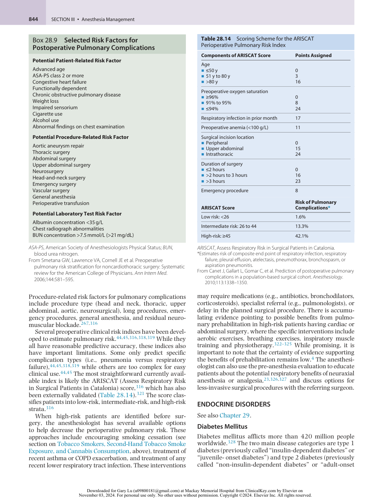

:::

<!-- PDF page 38 -->

diabetes”).329 Type 1 disease, which accounts for about 5% to 10% of all cases of diabetes, is the result of autoimmune destruction of pancreatic β- cells. Affected individuals have an absolute deficiency of insulin, but normal sensitivity to insulin. Since the disease has a typically early onset at a young age, and is often difficult to control, adults with type 1 diabetes are at risk of premature vascular disease, such as IHD, nephropathy, retinopathy, and peripheral neuropathy. They also risk diabetic ketoacidosis. Type 2 diabetes is characterized by insulin resistance, and a relative (but not absolute) deficiency in insulin. Most affected individuals are obese, and seldom prone to ketoacidosis. Diabetes mellitus is associated with multiorgan dysfunction, including IHD, HF (independent of associated IHD), cerebrovascular disease, chronic kidney disease, peripheral neuropathy, autonomic neuropathy (e.g., postural hypotension, gastroparesis), retinopathy, and reduced joint mobility (e.g., reduced cervical mobility affecting airway management). In the perioperative setting, diabetes mellitus is a risk factor for postoperative complications, including cardiac events,136 acute kidney injury,330,331 and surgical site infections.332 Insulin therapy is the main treatment for type 1 diabetes mellitus, either as multiple daily injections or a continuous subcutaneous insulin infusion. In the case of type 2 diabetes, multiple treatment options are available, including nonpharmacologic therapy (i.e., diet, weight loss, exercise), metformin, sulfonylureas (e.g., glyburide, glipizide), repaglinide, glucagon- like peptide- 1 (GLP- 1) agonists (e.g., liraglutide), sodium-glucose cotransporter 2 (SGLT-2) inhibitors (e.g., empagliflozin, dapagliflozin), dipeptidyl peptidase- 4 (DPP- 4) inhibitors (e.g., sitagliptin, saxagliptin, linagliptin, alogliptin), and insulin.

During the preoperative evaluation of a patient with diabetes mellitus, the anesthesiologist should document the disease type (i.e., type 1 versus type 2), current usual glycemic control, history of hypoglycemic episodes, current therapy, and the severity of any end-organ complications. Given the effects of diabetes mellitus on other organ systems, the history and physical examination should especially focus on the cardiovascular, renal, and neurologic systems. Enquiries about postural dizziness, early satiety, and postprandial vomiting can help assess for any autonomic neuropathy. The physical examination should include an evaluation of pulses, skin breakdown, and joint (especially cervical spine) mobility. Informative preoperative laboratory tests include an ECG and blood sampling for electrolyte, creatinine, and blood glucose concentrations. To help better estimate renal function, an estimated glomerular filtration rate should be calculated (see section on Kidney Disease, below). Since patients are not typically fasting when evaluated in a preoperative evaluation clinic, glucose concentrations in the clinic cannot be used to evaluate general glycemic control. A diary of multiple glucose values (preprandial and postprandial) at varying times of the day is more informative for estimating the adequacy of therapy. A glycosylated hemoglobin (HbA1c) concentration can help characterize the average plasma glucose concentration within the prior two to three months. In the nonoperative setting, the American Diabetes Association recommends a target HbA1c concentration &lt;7% for most nonpregnant diabetic patients. Preoperative HbA1c is more informative than patients’ self- reported history,

fasting blood glucose concentrations, and random blood glucose concentrations in identifying preexisting poor glycemic control in surgical patients.333 Recently updated guidelines from the National Institute for Health and Care Excellence in the United Kingdom,334 recommend offering HbA1c testing to diabetic surgical patients who have not been tested in the prior three months, and ensuring the recent HbA1c test results be included in referral materials from patients’ primary care providers. While preoperative HbA1c is correlated with postoperative glycemic control,335 evidence remains inconsistent with respect to its role as a predictor of postoperative complications, both in patients with diabetes and those without diabetes.336–338 Despite the limitations in the underlying evidence base, the Australian Diabetes Association has recommended delaying elective surgery for a HbA1c ≥9% while the Association of Anaesthetists of Great Britain and Ireland recommended delaying elective surgery for a value ≥8.5%.339 Notably, meaningful improvements in HbA1c can be challenging to achieve within the time afforded by delaying surgery.340 This challenge may be explained in part by HbA1c concentration characterizing plasma glucose concentration within the prior two to three months, meaning that HbA1c concentration may not capture shorter- term improvements in glucose control in patients awaiting surgery. Consequently, there is growing interest in novel markers that characterize shorter- term glucose control such as fructosamine,341 which assesses average glucose control in the prior two weeks and may also predict postoperative complications.342 Specifically, changes in preoperative fructosamine might plausibly be used to assess the impact of any preoperative optimization interventions in surgical patients identified as having poor prior glucose control based on HbA1c (e.g., values exceeding 8.5%).341 Nonetheless, whether such an approach actually improves clinical outcomes remains to be determined and warrants further research. Thus, any decision to delay surgery based on elevated preoperative HbA1c should be made on an individualized basis following close discussion with the patient and surgeon.

In the perioperative setting, the goals of glycemic management are to avoid hypoglycemia, prevent ketoacidosis, and avoid marked hyperglycemia. Tight perioperative glucose control in the immediate perioperative period is controversial. Intensive perioperative glucose control may theoretically help decrease risks of postoperative complications, but randomized controlled trials have not consistently shown these benefits, but have consistently shown elevated rates of hypoglycemia.343,344 Ideally, all diabetic patients should have their surgery as an early morning case to minimize disruptive impact of preoperative fasting of their diabetic management. Normal treatment regimen for most non- insulin diabetic medications (metformin, sulfonylureas, repaglinide, GLP- 1 agonists, DPP- 4 inhibitors) should be continued until (and inclusive of) the day before surgery but held on the morning of surgery. The important exception pertains to SGLT- 2 inhibitors, which have been associated with euglycemic diabetic ketoacidosis in the postoperative setting.211,345 Thus, guidelines recommend that the medications be temporarily discontinued for at least 24 hours before elective surgery,339,346 and at least 72 hours before major surgery.14 Diabetic

<!-- PDF page 39 -->

patients should discontinue _short- acting_ insulin while fasting. The exception pertains to patients with continuous subcutaneous insulin infusion pumps. These individuals should continue their infusion at the lowest basal rate, which is usually the nighttime fasting rate. With respect to management of _intermediate- acting_ or _long- acting_ insulin on the day of surgery, there is no uniform consensus on optimal perioperative protocols. A reasonable approach is for patients with type 1 diabetes mellitus to take a small amount (one-third to one-half) of their usual morning dose of intermediate- acting or long- acting insulin (e.g., lente, NPH) to avoid diabetic ketoacidosis. Patients with type 2 diabetes mellitus can either take no insulin, or up to one-half of their usual dose of intermediate- acting, longacting, or combination (e.g., 70/30 preparations) insulin on the morning of surgery.

### Thyroid Disease

Thyroid hormones are important for metabolism and its regulation. Mild to moderate thyroid dysfunction probably has minimal perioperative impact.347,348 The major concern pertains to significant hyperthyroidism or hypothyroidism, which appear to increase perioperative risk. Symptoms and signs of hypothyroidism and hyperthyroidism can be subtle and nonspecific, especially with milder disease in older adults. Hyperthyroid individuals may manifest tachycardia, arrhythmias, palpitations, tremors, weight loss, and diarrhea. Patients with hypothyroidism may demonstrate hypotension, bradycardia, lethargy, weight gain, depressed cardiac function, pericardial effusions, and impaired ventilatory response to hypoxia or hypercarbia. Patients may also have goiters with related symptoms such as dysphagia, dyspnea, wheezing, and orthopnea. Individuals with hyperthyroidism due to Graves disease may also demonstrate proptosis.

The preoperative evaluation should clarify the patient’s current medical therapy as well as any recent changes. In patients with known thyroid disease, additional preoperative thyroid function is not needed if the patient is on a stable medication dose and was assessed as being euthyroid within the previous six months. If additional preoperative testing is clinically indicated, thyroid- stimulating hormone (TSH) assays are best to evaluate for hypothyroidism, while free triiodothyronine (T3), free thyroxine (T4), and TSH levels are useful in hyperthyroid patients. Surgery, stress, or illness can precipitate myxedema or thyroid storm in patients with untreated or severe thyroid dysfunction. In general, if a patient has moderate or worse hypothyroidism (i.e., elevated TSH and low free T4 – with or without associated symptoms), elective surgery should be postponed until the individual is euthyroid. Similarly, elective non- thyroid surgery should be delayed to treat patients with overt hyperthyroidism (i.e., suppressed TSH with elevated free T4 or T3 concentrations – with or without associated symptoms). Consultation with an endocrinologist is necessary if surgery is urgent in patients with thyroid dysfunction. If surgery is urgent, hyperthyroid patients can be treated with β- adrenergic blockers, antithyroid medications (e.g., methimazole, propylthiouracil, potassium iodide) and corticosteroids. Other potentially useful tests include chest radiography or computed tomography (CT) scans to evaluate tracheal or mediastinal involvement by a goiter. All thyroid

replacement therapy and antithyroid drugs should be continued on the day of surgery.

### KIDNEY DISEASE

During preoperative evaluation, it is important to establish the severity, type, and underlying cause of preoperative renal impairment. Based on the Kidney Disease Improving Global Outcomes (KDIGO) guideline group, chronic kidney disease (CKD) is defined as abnormalities of kidney structure or function that are present for three or more months, and further result in a glomerular filtration rate (GFR) &lt;60 mL/ min/1.73 m2 .349 Chronic kidney failure is defined as a GFR &lt;15 mL/min/1.73 m2 or the need for renal replacement therapy (i.e., dialysis). End- stage renal disease (ESRD) generally refers to chronic kidney failure that requires either dialysis or transplantation. Creatinine concentration is often not an accurate indicator of renal function, especially in older individuals.350 The GFR can be reduced by 50% without a rise in creatinine concentration, while creatinine concentration does not exceed normal limits until GFR has fallen to &lt;50 mL/min. Consequently, it is preferable to estimate renal function using an estimated GFR (eGFR) equation, such as the Cockcroft–Gault,351 and current CKD- EPI equations.352 Online calculators (e.g., www.kidney.org/pr ofessionals/kdoqi/gfr_calculator) are now readily available to estimate renal function. Calculating an eGFR is especially important in patients who are older, have elevated creatinine concentrations, or have other risk factors for CKD.350 Given the inaccuracy of these equations at lower creatinine concentrations, values of eGFR that are greater than 60 mL/ kg/min/1.73 m2 should simply be reported as “>60 mL/kg/ min/1.73 m2 .” In the United States, the leading causes of ESRD are diabetes mellitus and hypertension.

Acute kidney injury (AKI) is a sudden decrease in renal function with the possible decrease in urine output. Episodes of AKI can occur in individuals with or without CKD. Several consensus- based classification schemes for AKI have been developed, including the RIFLE scheme,353 the Acute Kidney Injury Network (AKIN) scheme,354 and the current KDIGO criteria.349 AKI may be reversible if precipitating factors are identified and corrected. Classifying AKI into prerenal, renal, and postrenal causes allows for a systematic approach. Prerenal causes can often be differentiated by calculating the fractional excretion of sodium (FENa) using the following formula:

FENa = PCr/UCr PNa/UNa 

A FENa &lt;1% suggests prerenal disease, especially among patients with oliguria who have not received diuretics.355 Another suggested indicator of prerenal etiology is the blood urea nitrogen (BUN)- to- creatinine ratio, where values >20 suggests prerenal etiologies, with hypovolemia or hypotension the most common. Nonetheless, BUN- tocreatinine ratio may not be a reliable tool to differentiate pre renal causes from renal causes.356 Obstruction, which results in dilated ureters and enlarged kidneys, should always be considered in the differential diagnosis of AKI. Prompt identification with ultrasound should lead to attempts to decompress the outflow tract.

<!-- PDF page 40 -->

Patients with CKD have many associated comorbidities, both related to the underlying diseases that led to CKD and its resulting end-organ complications. Cardiovascular issues include hypertension, IHD, ventricular dysfunction (diastolic and systolic), HF, cerebrovascular disease, PAD, pericarditis, pericardial effusions, and valvular heart disease (valvular calcification with resulting regurgitation or stenosis). Pulmonary hypertension and increased cardiac output occur in patients with arteriovenous fistulas. CKD is also associated with chronic anemia due to reduced erythropoietin production by the kidneys. While treatable with erythropoiesis stimulating agents, complete “normalization” of hemoglobin concentration (i.e., 135 g/L vs. 113 g/L) may actually increase morbidity and vascular events.357 Hence, current KDIGO guidelines recommend using erythropoiesis stimulating agents to treat hemoglobin concentrations &lt;90 g/L, but avoid increasing the concentration to above 130 g/L.358 Other hematologic abnormalities include platelet dysfunction and increased bleeding, despite normal platelet counts, prothrombin times (PTs), and activated partial thromboplas tin time (aPTT). Once dialysis is begun, patients become more prone to hypercoagulable states. With respect to problems in the neurologic system, patients with CKD can develop autonomic and peripheral (sensory and motor) neuropathies. Unsurprisingly, CKD is associated with many electrolyte disturbances. Chronic metabolic acidosis is common, but it is usually mild and compensated for by chronic hyperventilation. Hyperkalemia is the most serious electrolyte disturbance. Hypocalcemia is common in patients undergoing dialysis, although with long- term disease, secondary and tertiary hyperparathyroidism eventually develops. Chronically elevated troponin concentrations are common in ESRD, which are likely explained by impaired renal clearance of troponin molecules and chronic myocardial injury in the setting of ESRD. Additionally, ESRD should influence interpretation of any single elevated postoperative troponin concentration in the absence of a preoperative value.359 Since insulin is metabolized by the kidneys, worsening renal function should be suspected in diabetic patients with ESRD who develop improved glycemic control or unexpected hypoglycemia.

Preexisting CKD is a risk factor for increased postoperative complications, including cardiac complications, AKI, acute stroke, and death.136,138,360–364 Risk factors for _postoperative_ AKI have also been identified. In cardiac surgery, several simple preoperative risk indices have been developed to predict postoperative AKI requiring dialysis.330,331 Important risk factors in these indices include complex surgery, non- elective surgery, CKD, diabetes mellitus, HF, female sex, and COPD. In noncardiac surgery, identified risk factors for AKI include increased age, male sex, symptomatic HF, hypertension, liver disease (including ascites), CKD, PAD, COPD, non- elective surgery, and intraperitoneal surgery.361,362 Preoperative identification of at- risk patients can help facilitate care, such as preoperative hydration and avoidance of hypovolemia. Nonsteroidal anti- inflammatory drugs (NSAIDs) and cyclooxygenase- 2 (COX- 2) inhibitors interfere with renal perfusion autoregulation; hence, they should be avoided or discontinued in patients with CKD. In contrast, these drugs do not increase the risk of postoperative AKI in patients with normal renal function.365 Many drugs are also metabolized or cleared by the kidneys. Drugs

with perioperative implications are the LMWHs, since there is no easy method to monitor their anticoagulation effects. LMWHs are cleared by the kidneys and are not removed during dialysis; thus, they have a prolonged duration of action in patients with CKD. Similarly, dosing of DOACs – especially dabigatran – must be adjusted in CKD (see Table 28.11).

The preoperative evaluation of patients with CKD should emphasize the cardiovascular system, cerebrovascular system, intravascular volume status, and electrolyte status. The early stages of CKD typically cause no symptoms. The anesthesiologist should enquire about the cardiovascular symptoms (i.e., chest pain, orthopnea, paroxysmal nocturnal dyspnea), urine output, associated comorbidities, medications, dialysis schedules, and any hemodialysis catheter problems (e.g., infection, thrombosis). Information on the patient’s target and current weight may be helpful for assessing volume status. Patients with CKD need an ECG and blood sampling to measure electrolyte, calcium, glucose, albumin, and creatinine concentrations. Further evaluation is needed if the ECG shows LVH (hypertension), peaked T waves (hyperkalemia), flattened T waves, a prolonged PR interval, or a prolonged QT interval (hypokalemia). A chest radiograph (infection, volume overload), echocardiogram (murmurs, HF), and cardiology evaluation may be necessary in some cases. Venous access sites or blood draws from the brachial, cephalic (antecubital), and central veins in the nondominant upper extremity should be avoided in patients who may eventually need fistulas in those locations for dialysis.

Preoperative renal replacement therapy (dialysis) schedules should be coordinated with the timing of the planned surgery. Dialysis is important for correct volume overload, hyperkalemia, and acidosis before planned surgery. Ideally, elective surgery should be performed about 24 hours after dialysis. Performance of surgery shortly after dialysis should be avoided, because of the risks of acute volume depletion and electrolyte alterations. Specifically, dialysis leads to fluid shifts and electrolyte (i.e., sodium, potassium, magnesium, phosphate) imbalance, especially related to shifting of electrolytes between intracellular and extracellular compartments.

### HEPATIC DISORDERS

Liver disease can affect the hepatocytes and/or biliary system (see Chapters 14 and 29), thereby impacting on protein synthesis (e.g., coagulation factors, albumin), bile regulation, and metabolism of drugs or toxins. Hepatocellular diseases, such as hepatitis (viral, alcoholic, autoimmune hepatitis) and hepatocellular carcinoma, affect hepatocytes and liver synthetic function. Obstructive disorders, including choledocholithiasis, bile duct tumors (extrahepatic), primary biliary cirrhosis (intrahepatic), and primary sclerosing cholangitis (extrahepatic and intrahepatic), cause bile stasis. Most drug- induced liver disease, as well as some forms of viral hepatitis, affect both hepatocytes and the biliary system.

The preoperative history typically reveals the underlying disease etiology, disease severity, therapies, and associated complications. Some patients with liver disease may be asymptomatic, whereas others may complain of

<!-- PDF page 41 -->

fatigue, weight loss, dark urine, pale stools, pruritus, right upper quadrant pain, bloating, and jaundice. The physical examination should assess for weight, vital signs (including oxygen saturation), jaundice, bruising, ascites, pleural effusions, peripheral edema, hepatomegaly, splenomegaly, and altered mental status. The presence of encephalopathy, coagulopathy, ascites, volume overload, and infection should be determined before surgery. The bilirubin concentration generally must exceed 25 g/L before icterus is evident in mucous membranes and sclerae. If new- onset or worsening encephalopathy is identified, precipitating factors should be sought, such as infection, drug effects, bleeding, or electrolyte disturbances.

The perioperative risk of patients with chronic hepatitis or cirrhosis is predicted by histologic severity, portal hypertension, and impairment of liver function. Patients with severe liver disease have increased perioperative morbidity and mortality; common adverse events are bleeding, infection, liver failure, and hepatorenal syndrome. Predictors of poor perioperative outcome in patients with liver disease include the following:

- Child–Turcotte–Pugh class C cirrhosis, which is calculated using bilirubin concentration, albumin concentration, PT, ascites severity, and encephalopathy severity (Table 28.15)

- Model for end- stage liver disease (MELD)366 score ≥15 (calculated using serum bilirubin concentration, INR, and serum creatinine concentrations.) Online calculators are available to calculate MELD scores (e.g., https:// unos.org/resources/allocation- calculators/).

- Acute hepatitis (viral or alcoholic)

- Chronic active hepatitis with jaundice, encephalopathy, coagulopathy, or elevated liver enzymes

- Cardiac surgical, abdominal surgical, and hepatic resection procedures

- PT prolongation of 3 seconds or more that is refractive to vitamin K therapy

Useful baseline tests include an ECG and blood sampling for CBC, electrolyte concentration, creatinine concentration, liver function tests (LFTs), albumin concentration, and INR. Patients suspected of having hepatitis may require screening for the hepatitis A immunoglobulin M (IgM) antibody, the hepatitis B surface and core antigens, the hepatitis B surface antibody, and the hepatitis C antibody. A chest radiograph can help identify any suspected effusions.

**Table 28.15** Child–Turcotte–Pugh Classification

|**Parameter**|**1 point**|**2 points**|**3 points**|
|---|---|---|---|
|Ascites|Absent|Slight|Moderate|
|Bilirubin (mg/dL)|&lt;2|2 to 3|>3|
|Albumin (g/dL)|>3.5|2.8 to 2.5|&lt;2.8|
|Prothrombin time (seconds over control)|&lt;4|4 to 6|>6|
|Encephalopathy|None|Grade 1 to 2|Grade 3 to 4|

Class A: &lt;7 points.

Class B: 7 to 9 points. Class C: >9 points.

Coagulopathy can be a result of vitamin K deficiency (from poor nutritional status and cholestasis), factor deficiency (from loss of synthetic function), or thrombocytopenia (from splenomegaly and portal hypertension). Vitamin K, fresh frozen plasma, or platelets may correct deficiencies, if therapy is directed at the likely underlying cause. Vitamin K, taken at 1 to 5 mg orally or subcutaneously daily for 1 to 3 days, may correct a prolonged PT related to vitamin K deficiency and carries minimal risk. The coagulopathy in patients with synthetic failure is not likely to correct, thus necessitating fresh frozen plasma transfusion aiming for an INR &lt;1.5. Reduction of ascites preoperatively may decrease the risk of wound dehiscence and improve pulmonary function. Sodium restriction (in diet and IV solutions), diuretics (especially spironolactone), and paracentesis are useful for reducing ascites. If ascites fluid is aspirated, it should also be analyzed for infection. Encephalopathy is frequently precipitated by an additional acute insult such as infection, gastrointestinal bleeding, hypovolemia, or sedatives. It is therefore important to determine reversible factors and treat them accordingly. Lactulose (30 mL every 6 hours orally) is first- line therapy. Addressing nutritional deficiencies with enteral or parenteral supplementation may have benefits, especially since cirrhosis is often associated with malnourishment and sarcopenia.367 Patients who abuse alcohol may be at risk for neurologic deterioration (i.e., Wernicke–Korsakoff syndrome) if thiamine, folate, and vitamin B12 supplements are not provided, especially when these patients are given nutrition or glucose. These same patients are also at risk of alcohol withdrawal syndromes. In the case of patients with liver disease related to obstructive jaundice, limited evidence suggests that lactulose (30 mL orally every 6 hours for 3 days preoperatively) with the last dose within 12 hours of surgery, or oral bile salts with IV hydration beginning the night before the operation, may reduce risks of perioperative AKI.368

It may be appropriate to delay elective surgery until an acute episode of hepatitis (or exacerbation of chronic disease) has resolved, or until a diagnosis is established for new hepatic dysfunction. Elective surgery is contraindicated in patients with acute or fulminant (e.g., acute alcoholic hepatitis, acute viral hepatitis) liver disease or liver disease with severe extrahepatic complications (e.g., AKI, HF, hypoxemia). High- risk patients should be managed collaboratively with a liver specialist.

### Unexpected Elevated Liver Function Tests

Elevated alanine aminotransferase (ALT) and aspartate aminotransferase (AST) concentration reflect hepatocyte damage. Bilirubin concentration measures the liver’s ability to conjugate and excrete bile salts. Alkaline phosphatase (ALP) rises with impaired hepatic excretion, whereas albumin and INR measure the synthetic function of the liver. Routine preoperative laboratory screening may identify about 1 in 700 surgical patients as having unexpected liver diseases, most of which are not severe.369 Nonetheless, if abnormal LFT values are unexpectedly found, further testing or referral may be necessary, in some cases. Elevated AST or ALT concentrations should prompt hepatitis screening with hepatitis A IgM antibody, hepatitis B antigens (surface and core), hepatitis B surface antibody, and hepatitis C antibody. Elevated concentrations of ALP or bilirubin,

::: details 原始表格與符號（PDF 第 41 頁）

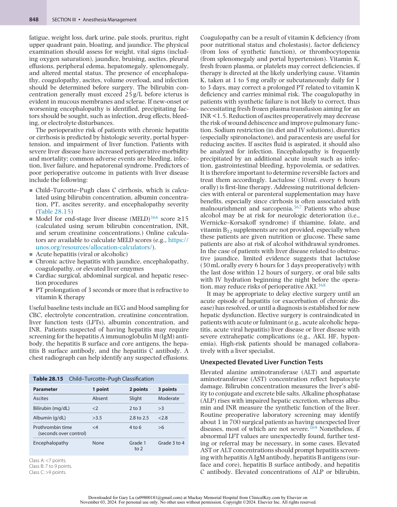

:::

<!-- PDF page 42 -->

especially in association with normal or mild to moderate increased transaminase levels, may indicate obstruction in the biliary system. In these cases, abdominal ultrasound, computed tomography (CT) scans, or endoscopic retrograde cholangiopancreatography may establish a diagnosis.

### Cirrhosis

Cirrhosis is irreversible liver fibrosis that is the end result of most hepatotoxic conditions. This fibrosis leads to portal hypertension, impaired synthetic function (i.e., synthesis of proteins such as clotting factors), and impaired metabolic functions (i.e., clearance of toxins and drugs). Portal hypertension can lead to splenomegaly, esophageal varices, ascites, dependent edema, and pleural effusions. Patients with ascites may also develop spontaneous bacterial peritonitis, which is associated with increased perioperative mortality. Other complications include hepatic encephalopathy, bleeding, thrombocytopenia, low albumin concentrations, and prolonged INR. Hepatopulmonary syndrome may develop, resulting in hypoxemia and pulmonary hypertension due to pulmonary shunts. Jaundiced patients are at risk for developing hepatorenal syndrome, which is renal insufficiency associated with hepatic disease but without any primary renal disease. The condition may be related to renal hypoperfusion. Patients with end- stage liver disease also develop a high cardiac output state, characterized by decreased systemic vascular resistance. Perioperative risk in patients with cirrhosis can be estimated using the Child– Turcotte–Pugh classification scheme (see Table 28.15) and MELD score (see Hepatic Disorders, above).

### HEMATOLOGIC DISORDERS

### Anemia

Anemia is a very common preoperative hematologic disorder with multifactorial etiology. While strictly defined as a reduced number of circulating red blood cells (RBCs), anemia is usually defined based on a reduced hemoglobin concentration or reduced hematocrit. For example, the World Health Organization defines anemia as a hemoglobin level less than 130 g/L in adult males and less than 120 g/L in adult nonpregnant females. Anemia can be classified based on the underlying mechanisms as being related to decreased RBC production (e.g., bone marrow disorders, nutritional deficiencies); increased RBC destruction (e.g., hemolytic anemia, intravascular hemolysis); and blood loss (e.g., gastrointestinal blood loss). Anemia may also be classified morphologically based on the associated RBC size, which is itself characterized by the mean corpuscular volume (MCV). Based on this approach, anemia can be classified as microcytic (MCV &lt;80 fL), macrocytic (MCV >100 fL), or normocytic (MCV between 80 to 100 fL). Common causes of microcytic anemia are iron deficiency (including chronic blood loss), thalassemia minor, and anemia associated with inflammatory disease. Common causes of macrocytic anemia include alcohol use disorder, liver disease, hypothyroidism, and vitamin B12 deficiency. Common causes of normocytic anemia are CKD, HF, and cancer.

Preexisting anemia is a consistently recognized risk factor for postoperative death and complications, including AKI, stroke, and infections.370 Furthermore, this risk is proportional to the degree of anemia and independent of

the patient’s other comorbidities.140,141,371 Nonetheless, there are some important caveats for consideration. First, it remains unclear whether anemia is the causal mechanism for these complications, or instead simply a marker of a high- risk patient. The limited available perioperative data generally suggest that anemia- treatment strategies (e.g., erythropoiesis stimulating agents) can improve hemoglobin concentrations and reduce transfusion requirements, but without convincing evidence for the prevention of death or complications.372–374 These perioperative data are also generally consistent with findings in nonsurgical populations, such as patients with HF.375–379 Second, there is no consistent hemoglobin concentration threshold that defines elevated perioperative risk. While data from noncardiac surgery performed in Jehovah’s Witness patients suggest that risk increases substantially once preoperative hemoglobin concentrations fall below 100 g/L (especially in the presence of concomitant IHD),380 simply increasing hemoglobin concentrations to this threshold with RBC transfusion is not consistently beneficial. Importantly, transfusion itself has also been associated with poor outcomes in observational studies.381 In a multicenter randomized trial of 2016 patients undergoing hip fracture surgery, a strategy of transfusing in response to a 100 g/L threshold in hemoglobin concentration was not superior to a strategy of transfusing in response to a 80 g/L threshold or symptoms of anemia.382 Similarly, in a multicenter randomized trial of 5243 patients undergoing cardiac surgery, a strategy of transfusing in response to a 75 g/L threshold was noninferior to a strategy of transfusing in response to a 95 g/L threshold.383 These data suggest that the optimal perioperative hemoglobin concentration threshold varies between 75 g/L to 100 g/L across individuals, with interindividual differences largely explained by comorbid conditions (e.g., cardiopulmonary disease).

During the preoperative evaluation of known or suspected anemia, the overarching goals are to determine its etiology, duration, stability, related symptoms, and therapy. Thus, it is important to enquire about any history of anemia (including family history of anemia), colon cancer, gastrointestinal bleeding, genitourinary bleeding, menorrhagia, chronic infections, inflammatory diseases, nutritional deficiencies, and prior weight reduction procedures (e.g., bariatric surgery). The anesthesiologist should also consider the type of surgical procedure, anticipated blood loss, and comorbid conditions that may either affect oxygen delivery or be affected by decreased oxygen delivery (i.e., pulmonary, renal, hepatic, cerebrovascular, cardiovascular disease).

Patients with anemia or suspected anemia must have a CBC. In general, collaboration with a primary care physician or hematologist is helpful for further evaluation of newly diagnosed anemia. Usual initial studies include peripheral smear and MCV; subsequent studies, such as iron studies (i.e., ferritin, transferrin saturation), vitamin B12, or folate levels, are guided by findings on the smear and the MCV.384 The MCV is high and the vitamin B12 or folate levels are low in macrocytic anemia associated with these deficiencies. Low values in MCV, ferritin (&lt;30 g/μL), and transferrin saturation (&lt;20%) are indicative of iron deficiency anemia. In some cases of iron deficiency anemia, transferrin saturation may still be low (&lt;20%) but ferritin concentrations are in an indeterminate zone (i.e., 30 to 100 g/μL). Conversely,

<!-- PDF page 43 -->

ferritin and transferrin saturation are normal or high in anemia associated with chronic disease.

Blood type and screening may be necessary based on the level of preoperative anemia and anticipated degree of surgical blood loss. Elective procedures should be postponed in patients with significant anemia, regardless of the anticipated surgical blood loss. This delay allows for evaluation of the underlying cause, such as occult blood loss, vitamin deficiency, or undiagnosed chronic conditions (e.g., chronic kidney disease). When some delay in elective surgery is possible, updated 2015 guidelines from the ASA suggest preoperative treatment with erythropoietin stimulating agents (ESA) and iron in some patient subgroups (e.g., CKD, anemia of chronic disease, patient’s refusal to receive blood transfusions), especially for anemic individuals scheduled for procedures with significant expected blood loss.385 Ideally, preoperative treatment with ESA should be initiated about three weeks before the planned surgery. Current evidence suggests that preoperative ESA treatment does reduce exposure to perioperative red cell transfusions, but with other uncertain impact on clinical outcomes.386,387 Preoperative iron therapy may also be considered in patients with known iron deficiency anemia, when time permits.385 Oral iron therapy should be initiated about four to six weeks before the planned surgery, with IV iron being an option for patients who do not tolerate oral iron or require surgery within a shorter time window. While preoperative iron therapy can increase hemoglobin concentrations before surgery, its impact on transfusion rates and clinical outcomes remains uncertain.388,389

### Sickle Cell Disease

Sickle cell (SC) disease is a hereditary hemoglobinopathy with associated vaso- occlusive episodes that are responsible for most associated complications. Patients homozygous for hemoglobin S (HbS) have symptomatic disease; they are at risk for major morbidity and have a shortened life expectancy. Patients with SC disease, who have both HbS and HbC, have a much less severe clinical course with moderate anemia. Heterozygous patients (HbS and HbA) have sickle cell trait and rarely have any related consequences. Consensus- based guidelines on the perioperative management of patients with sickle cell disease have now been developed, including a 2021 document from the United Kingdom Association of Anaesthetists.390 Preoperative assessment should focus on evidence of organ dysfunction and recent patterns of acute exacerbations.391 Patients may have CKD, loss of renal concentration ability (and therefore are prone to dehydration), splenomegaly, pulmonary hypertension, pulmonary infarctions, cerebrovascular disease, and HF. They are at risk for infections because of splenic infarctions. Predictors of perioperative vaso- occlusive complications include recent increases in hospitalizations, advanced age, preexisting infections, and pulmonary disease.391

The preoperative examination focuses on the frequency, severity, and pattern of vaso- occlusive crises. In addition, the anesthesiologist should evaluate the degree of pulmonary, cardiac, renal, and central nervous system damage. Useful tests include an ECG, chest radiograph, and blood sampling for CBC and creatinine concentration. Additional testing (e.g., echocardiogram, arterial blood gases) may be needed. The surgical admission should be planned

to minimize preoperative dehydration (e.g., minimize fasting period, schedule procedure as an early morning case). Preoperative prophylactic transfusion is increasingly used in patients with sickle cell anemia who are undergoing any surgical procedure other than short minor procedures (e.g., biopsy, myringotomy).392 The objective of any red cell transfusion is to reduce the proportion of abnormal hemoglobin in the affected patient. A prior randomized trial found that prophylactic transfusion to a hemoglobin concentration >100 g/L resulted in fewer adverse events following intermediate- risk surgery.393 This simpler approach of transfusing to a hemoglobin concentration threshold (>100 g/L) is as effective as a more aggressive approach of transfusing to decrease HbS concentration to &lt;30% (while also increasing hemoglobin concentration to ≥100 g/L)394 in the setting of low- risk or intermediate- risk surgery. A more aggressive strategy (i.e., decreasing HbS concentration to &lt;30%) is preferable for high- risk surgery such as major cardiovascular or intracranial procedures.390 Exchange transfusion is also required if the preoperative Hb concentration already exceeds 100 g/L.390 In general, the decision to transfuse preoperatively should be made only in concert with a hematologist familiar with the disease. Recent guidelines from the United Kingdom have recommended designation of a lead hematologist when any patient with sickle cell disease has surgery,390 with the nominated individual taking responsibility for the perioperative transfusion plan. If the person with sickle cell is managed by a specialist sickle cell service, it is best to liaise with this team before surgery.

### Preoperative Anticoagulant Therapy

Outpatient oral anticoagulant therapy includes vitamin K antagonists (e.g., warfarin) and DOACs. These agents increase perioperative bleeding, except in the case of very minor procedures. Thus, they should only be continued perioperatively if an individual does not have patientrelated risk factors for bleeding (e.g., liver disease, abnormal renal function, prior bleeding complications), is scheduled for procedures without important bleeding risk (e.g., dental extraction, simple cutaneous procedures, cataract surgery without bulbar blocks), and is not being considered for neuraxial anesthesia. Otherwise, anticoagulant therapy must be temporarily discontinued before surgery.

Typically, vitamin K antagonists should be stopped five or more days before surgery, with consideration for a longer discontinuation period if the initial INR value is >3.0.244 Ideally, the INR should be rechecked within 24 hours before surgery and a low dose of oral vitamin K (1 to 5 mg administrated orally or subcutaneously) can be considered if the INR is 1.5 or higher.244 Vitamin K has an effect within six to 10 hours after oral or subcutaneous administration (more predictable with oral administration), and it peaks within 24 hours to 48 hours.395 Administration of higher doses may lead to warfarin resistance when therapy is initiated again. Some patients undergoing elective lower extremity joint replacement surgery may also receive an initial dose of warfarin before surgery for perioperative thromboprophylaxis. The 2018 American Society of Regional Anesthesiologists (ASRA) guidelines state that neuraxial anesthesia can still be performed in these patients when only a single dose of warfarin had been administered ≤24 hours before surgery.245

<!-- PDF page 44 -->

Patients are increasingly receiving DOACs for long- term anticoagulation, typically for nonvalvular atrial fibrillation, although some individuals may be prescribed lowdose DOAC therapy for IHD.130 The timing of preoperative discontinuation of DOACs should be guided by the specific drug prescribed, expected procedural bleeding risk, renal function (based on estimated glomerular filtration rate), and planned use of neuraxial anesthesia. Proposed approaches for preoperative DOAC discontinuation are outlined in Table 28.11.244,245

Patients may require temporary bridging therapy during the intervening period between discontinuation of vitamin K antagonist therapy and the date of surgery. Such bridging therapy is generally not needed after interruption of DOACs because of their relatively short half- lives. With accumulating evidence, the subsets of patients for whom bridging is recommended has decreased considerably. Most patients with nonvalvular atrial fibrillation do not require bridging therapy if their anticoagulant therapy is temporarily discontinued before surgery (see section on Atrial Fibrillation, earlier).244 Conversely, some patients with mechanical heart valves will require bridging therapy, with the decision based on the location of the mechanical heart valve and nature of planned surgery (see Box 28.3).214 Additionally, patients who are deemed to be at high risk for recurrent thromboembolism (see Table 28.12) may also require bridging therapy. Decisions to use bridging therapy with IV unfractionated heparin or LMWH must be individualized, account for patients’ risks of bleeding while on bridging therapy, and be made collaboratively with the treating physician.

If bridging is planned, either LMWH or IV unfractionated heparin can be started two or more days after the last administrated dose of vitamin K antagonist (e.g., warfarin). Bridging therapy should be started once the INR drops to &lt;2.0.243 There are several available options for LMWH (e.g., enoxaparin, dalteparin). The specific choice and dose should be selected based on consultation with a hematologist or the patient’s treating physician. For patients with impaired renal function (eGFR &lt;30 mL/min), IV heparin bridging is preferable, although some LMWH dosing adjustments remain possible if eGFR is in the range between 15 to 30 mL/min.243 IV unfractionated heparin is usually discontinued four or more hours before surgery to allow for normal intraoperative coagulation. The last dose of _bridging dose_ LMWH should be given 24 hours preoperatively to allow normalization of coagulation by the time of surgery (based on an assumption of normal renal function).244 Especially for surgeries with high associated bleeding risk (see Box 28.6), only half the total daily dose of LMWH should be administered on the day prior to scheduled procedure.244 Both unfractionated heparin and LMWH are contraindicated in patients with an allergy to heparin or a history of heparin- induced thrombocytopenia (HIT). Options for bridging therapy in such patients include argatroban (IV infusion), bivalirudin (IV infusion), fondaparinux (subcutaneous), or oral DOACs. The specific management strategy should be selected following consultation with a hematologist.

Based on the 2018 ASRA guidelines,245 recommendations for management of preoperative anticoagulant therapy are more conservative if perioperative neuraxial

techniques are being considered. These guidelines recommend that warfarin should be discontinued ≥5 days before surgery, and a repeat preoperative INR should confirm a normalized value before neuraxial blocks are performed.245 The recommended intervals for timing of neuraxial blocks after discontinuing DOAC therapy is outlined in Table 28.11. The last _prophylactic_ dose of LMWH should be ≥12 hours before any planned neuraxial block, whereas the last _therapeutic_ dose (including bridging therapy) of LMWH should be ≥24 hours beforehand. Preoperative unfractionated IV heparin should be stopped ≥6 hours before planned spinal or epidural anesthesia.245 In addition, return to normal coagulation can be monitored using aPTT or anti–factor Xa activity. While the safety of performing neuraxial techniques in the presence of low- dose subcutaneous unfractionated heparin (i.e., 5000 units twice daily) has been described,396 the 2018 ASRA guidelines include a Grade 2C recommendation for waiting four to six hours after subcutaneous injection before performing neuraxial blocks in patients receiving subcutaneous unfractionated heparin (i.e., 5000 units two or three times daily).245 This Grade 2C rating indicates that the recommendation was relatively weaker (“ _conflicting evidence or opinion on the usefulness_ ”), and based on case reports or expert opinion.245 Any patients receiving fibrinolytic and thrombolytic drugs should not receive neuraxial anesthesia.

### Preoperative Antiplatelet Therapy

Traditionally, aspirin has been discontinued before surgery (often 7 days before surgery) because of concern about increased bleeding.244 A withdrawal period of seven days may be excessive, especially because new platelets formed after aspirin discontinuation (half- life ≈15 minutes) are not inhibited. Since 10% of platelets are turned over every 24 hours, and about 50,000/mm3 of normal functioning platelets are needed to control surgical bleeding, it is likely that aspirin need only be stopped three days before surgery to mitigate risks of increased bleeding. Continuation of aspirin until the time of surgery leads to increased bleeding during major noncardiac surgery,184 but not during cardiac surgery.397 While withdrawing aspirin itself has important theoretical risks with respect to a rebound hypercoagulable state and increased cardiac risk,190,398 these theoretical risks have not been supported by data from large randomized trials.184,397 Thus, a reasonable standard approach for most surgical patients is to discontinue aspirin temporarily three days before surgery, with some notable exceptions. Specifically, aspirin should be continued in any patient with a prior PCI,193 high- grade IHD, or high- risk CVD (e.g., stroke within prior nine months).399 Continuation of aspirin is not a contraindication to performance of neuraxial blocks.245

P2Y12 inhibitors are the other relatively common type of antiplatelet medications that might be encountered during preoperative evaluation, especially among patients with known IHD or CVD. These medications include oral medications (clopidogrel, ticagrelor, prasugrel, ticlopidine) and an IV formulation (cangrelor). Except in patients with a recent PCI (see section on Coronary Stents, earlier), P2Y12 inhibitor therapy should be temporarily discontinued before elective surgery. The ACCP guidelines recommend specific time intervals for discontinuing these medications

<!-- PDF page 45 -->

before elective noncardiac surgery: five days for clopidogrel, three to five days for ticagrelor, and seven days for prasugrel.244 If a patient is being considered for a neuraxial block, the minimum time intervals are five to seven days for clopidogrel, five to seven days for ticagrelor, seven to ten days for prasugrel, ten days for ticlopidine, and three hours for cangrelor.245

Some patients with either PAD or CVD may be on longterm therapy with dipyridamole, which causes vasodilation and impairment of platelet function.400 The drug is available as an immediate- release formulation, as well as an extended- release formulation combined with aspirin (i.e., Aggrenox). There are minimal data on the safety of continuing dipyridamole in patients undergoing surgery; current ASRA guidelines recommend discontinuing extended- release dipyridamole 24 hours before performing any neuraxial block.245 Information on the perioperative safety of other antiplatelet therapies (e.g., glycoprotein IIb/ IIIa inhibitors) is also limited. Platelet glycoprotein IIb/IIIa inhibitors (e.g., abciximab, eptifibatide, tirofiban) exert profound effects on platelet aggregation. Following administration, the time to restoration of normal platelet aggregation is 24 to 48 hours for abciximab, and 4 to 8 hours for eptifibatide and tirofiban. Neuraxial techniques should therefore be avoided until platelet function has recovered after platelet glycoprotein IIb/IIIa inhibitor administration.245

### NEUROLOGIC DISEASE

The preoperative history in a patient with neurologic disease should focus on recent exacerbations, prior investigations, and therapy (both current and prior). The basic neurologic examination should evaluate mental status, speech, cranial nerves, gait, motor function, and sensory function. This baseline determination also allows for comparison of any new postoperative deficits.

### Cerebrovascular Disease

The major clinical manifestation of cerebrovascular disease (CVD) is acute stroke. There are more than 12 million strokes per year worldwide. In addition, about 6.5 million individuals die annually from stroke, making it the second leading cause of death globally.401 The two main categories of stroke are hemorrhagic stroke and ischemic stroke. Hemorrhagic stroke is largely related to either intracerebral hemorrhage or subarachnoid hemorrhage. Common causes of intracerebral hemorrhage include hypertension, trauma, coagulopathies, illicit drug use (i.e., amphetamines, cocaine), and arteriovenous malformations (AVMs). Causes of subarachnoid hemorrhage are bleeding from aneurysms and AVMs (see Chapter 29). Ischemic stroke may be related to thrombosis of an artery through several different mechanisms (e.g., atherosclerosis, arterial dissection), embolism (e.g., related to atrial fibrillation), or systemic hypoperfusion (e.g., cardiac arrest). The other major manifestation of CVD is a transient ischemic attack (TIA), which is a transient episode of neurologic dysfunction caused by focal ischemia in the brain, spinal cord, or retina, but without infarction.402

CVD has important perioperative implications. It is a risk factor for postoperative complications, including cardiac events,136 stroke,180,403,404 and death.115 The risks of postoperative cardiac complications and recurrent stroke

are particularly elevated when elective noncardiac surgery is performed within six months after a prior stroke.399,405 Based on these emerging data, a 2021 scientific statement from the AHA and American Stroke Association suggested delaying elective noncardiac surgery for at least six months after an acute stroke.258 Nonetheless, more recent data suggest that this suggestion is too conservative, in that the incremental risk associated with a recent acute stroke appears to stabilize once 90 days have elapsed since the stroke.406 Importantly, if emergency surgery is needed soon after an acute stroke, it may be preferable to _not_ delay surgery. Specifically, while the risks of postoperative cardiovascular complications are very high when emergency surgery is performed within two weeks after an ischemic stroke, these risks were reduced when surgery proceeded within 72 hours after the stroke.407 This temporal pattern may be explained by progressively worsening cerebral autoregulation during the first five days after an ischemic stroke (which then recovers over the next three months).408

The preoperative evaluation should focus on the timing, presentation, etiology, and treatment of prior strokes or TIAs. It is important to document the etiology to help distinguish carotid stenosis (i.e., atherosclerosis) from cardioembolic disease. Causes of cardiac emboli include stasis (i.e., atrial fibrillation, severe cardiomyopathy, ventricular aneurysm), thrombogenic (i.e., valvular heart disease, prosthetic heart valve), and paradoxical venous source (e.g., patent foramen ovale). The physical examination should include a brief neurologic exam to identify any preexisting deficits, auscultation for carotid bruits, and a precordial assessment to assess for murmurs or extra heart sounds. Depending on the underlying basis for CVD (i.e., atherosclerosis, atrial fibrillation), patients may be on long- term therapy with aspirin, P2Y12 inhibitors (e.g., clopidogrel), vitamin K antagonists, and DOACs. Both vitamin K antagonists and DOACs should be temporarily discontinued before surgery (see section on Atrial Fibrillation, earlier). Similarly, P2Y12 inhibitor therapy should be interrupted before surgery, with the possible exception of cases with very recent coronary stent implantation (see section on Coronary Stents, earlier). Continuing aspirin perioperatively does not prevent cardiovascular complications,184 but leads to an increased risk of major bleeding (which is a risk factor for perioperative stroke).180 Nonetheless, selective continuation of aspirin can be considered in patients with high- risk atherosclerotic CVD or recent stroke (i.e., previous nine months).399 In other cases, aspirin should be temporarily held 72 hours before surgery.184 In addition, concomitant CVD should be carefully considered in any decision to initiate new β- adrenergic blocker therapy in a patient awaiting noncardiac surgery. Although beta blockade does decrease perioperative cardiac risk, it also significantly increases the risk for acute postoperative stroke.180,181

### Asymptomatic Carotid Bruit

The presence of a carotid bruit significantly increases the likelihood of an important lesion (i.e., 70%–99% stenosis) in both symptomatic or asymptomatic patients.32 Thus, a newly discovered carotid bruit should prompt a careful search for any evidence of prior strokes or TIA, especially if the planned surgical procedure involves neck manipulation. At- risk individuals include those with risk factors for

<!-- PDF page 46 -->

CVD (e.g., hypertension, smoker, diabetes mellitus, hyperlipidemia, IHD, PAD), as well as patients with prior headand- neck radiation exposure. Patients may not volunteer pertinent symptoms until they are specifically probed, especially if the symptoms were transient. The anesthesiologist should specifically enquire about _amaurosis fugax_ , dysphagia, dysarthria, and other symptoms of cerebrovascular insufficiency. Carotid Doppler ultrasound studies are simple, effective tools to evaluate suspicious carotid bruits. Significant abnormalities on Doppler studies may entail a referral to a neurologist or vascular surgeon. The risk of stroke in patients who have truly asymptomatic bruits is 1% to 2% per year, with most strokes preceded by transient symptoms.409 There is no evidence to indicate that asymptomatic bruits increase the risk of perioperative stroke.410–412

### CANCERS AND TUMORS IN PREOPERATIVE PATIENTS

### Patients with Cancer

Patients with cancer may have complications related to both the disease itself and its treatment (e.g., chemotherapy, radiation therapy). Typically, patients are aware of the side effects of their cancer treatments. Thus, it is helpful to ask them whether any unexpected complications occurred during treatment, or whether chemotherapy or radiation therapy had to be interrupted because of adverse effects. A hypercoagulable state is also common in cancer, particularly advanced disease, primary brain tumors, ovarian adenocarcinoma, pancreatic cancer, colon cancer, gastric cancer, lung cancer, prostate cancer, and kidney tumors. The risk of thromboembolic events is significantly increased in patients with cancer, with active cancer accounting for 20% of new cases of thromboembolism.413

The preoperative evaluation focuses on cardiac, pulmonary, neurologic, and hematologic systems. Previous head and neck irradiation may cause carotid artery disease, hypothyroidism, or difficulty with airway management. Auscultation for bruits, thyroid function tests, and carotid Doppler studies are therefore recommended. Mediastinal, chest wall, or left breast irradiation can cause pericarditis, conduction abnormalities, cardiomyopathy, valvular heart disease, and premature IHD (even in the absence of traditional cardiovascular risk factors).414 Thus, younger patients with a history of radiation therapy should be assessed for cardiac symptoms and undergo an ECG even if they may not otherwise be at risk for heart disease. Based on these initial results, stress testing and echocardiography may be indicated. Previous irradiation to the lungs, breast, or mediastinum may also cause radiation pneumonitis. In such individuals, an oxygen saturation measurement and chest radiograph may be required, with consideration for PFTs if appropriate.

Other important chemotherapy- associated side effects include cardiomyopathy with trastuzumab and anthracyclines (e.g., doxorubicin); pulmonary toxicity with bleomycin; nephrotoxicity with cisplatin; hemorrhagic cystitis with cyclophosphamide; and peripheral neuropathy with vincristine or cisplatin. Many chemotherapeutic agents are toxic to the bone marrow, and patients commonly exhibit preoperative anemia. Patients who received corticosteroids as part of their cancer treatment may be at risk for adrenal

insufficiency. These individuals may require supplemental perioperative corticosteroids; details on patient selection for such therapy, as well as suggested dosing regimens, are presented in Chapter 29. Other chemotherapy drugs result in impaired postsurgical wound healing, especially antiangiogenic agents (e.g., bevacizumab, sunitinib, sorafenib, pazopanib, vandetanib, cabozantinib, axitinib). Consequently, elective major surgery should be scheduled after temporary discontinuation of these agents, whenever feasible. The time interval for preoperative discontinuation varies across these agents from 28 days (bevacizumab) to one week (sunitinib, sorafenib, pazopanib, vandetanib, cabozantinib) to 48 hours (axitinib). Based on the type of chemotherapy, an ECG, chest radiograph, and blood sampling for CBC, electrolyte concentrations, creatinine concentration, and LFTs may be needed. In some cases, consideration may be given to delaying the surgical procedure to allow resolution of neutropenia and thrombocytopenia. In general, advance planning of blood component replacement (including type and screening in the preoperative clinic) can avoid delays on the day of surgery.

The direct effects of cancers depend on the specific organ systems involved. Intracranial tumors can have mass effects that lead to associated symptoms, such as headaches, visual field defects, and increased intracranial pressure (with resulting gait disturbances, vomiting, cranial nerve deficits, bladder incontinence, bowel incontinence). Other symptoms may be related to pituitary insufficiency (e.g., hypoadrenalism, hypothyroidism, infertility) or overactivity. Bone and liver involvement with metastases can commonly occur in patients with breast, colorectal, lung, and head and neck tumors. These bony lesions can in turn cause hypercalcemia or pancytopenia. Head and neck tumors, and their associated therapy (e.g., surgery, radiation), may cause thyroid dysfunction and difficulty with airway management. Lung cancer can cause airway problems, compromised pulmonary function, or mediastinal masses. In these cases, CT scans of the head, neck, or chest may be indicated. Paraneoplastic syndromes can complicate almost any type of malignant disease but are most seen with lung cancer. Typical manifestations of these syndromes include hypercalcemia, inappropriate antidiuretic hormone secretion, Lambert–Eaton syndrome, Cushing syndrome, and neuropathies.

Patients who are receiving opioids on a long- term basis for cancer pain are likely to require larger than usual doses of medication for postoperative pain control (see the later section on Planning for Postoperative Pain Management). On the day of surgery, these patients typically take their usual analgesic medications, except for NSAIDs (which, if possible, should be stopped two to three days before surgery).

### OTHER SPECIAL ISSUES IN PREOPERATIVE EVALUATION

### Morbidly Obese Patients

The morbidly obese patient presents special preoperative risks (see Chapter 54). Obesity is associated with several important comorbidities, including diabetes mellitus, hypertension, cardiovascular disease, CVD, cancer, OSA (see earlier section on Obstructive Sleep Apnea), and poor functional

<!-- PDF page 47 -->

capacity. Obese individuals are also at risk for non- alcoholic steatohepatitis, which can result in abnormal LFTs, liver fibrosis, and end- stage liver disease. In addition, patients with extreme obesity are at risk for right- sided HF and pulmonary hypertension. Such individuals can have obesity hypoventilation syndrome, also known as Pickwickian syndrome. Obesity hypoventilation syndrome is characterized by impaired central ventilatory drive and is distinct from OSA. It is associated with awake, chronic hypoxemia (arterial partial pressure of oxygen [PaO2] &lt;65 mm Hg) without a diagnosis of COPD or primary lung disease. In the perioperative setting, obese patients experience higher rates of difficult bag–mask ventilation and difficult tracheal intubation.

The preoperative evaluation focuses on relevant coexisting diseases, airway, cardiopulmonary system, and vital signs (including pulse oximetry). When measuring blood pressure, the cuff should have a width that is approximately two- thirds of the arm and a length that can adequately encircle the extremity. Assessment of neck circumference can also identify individuals at risk for difficulty with endotracheal intubation. It is also helpful to determine both actual body weight and ideal body weight. Determination of ideal body weight may be helpful in dose selection for certain medications (e.g., neuromuscular blockers),415 and for determining optimal intraoperative mechanical ventilation settings. Treatments for obesity can have potential perioperative implications. Modern drug therapies for obesity include GLP- 1 agonists (i.e., semaglutide, liraglutide), combination phentermine–topiramate, combination bupropion–naltrexone (i.e., Contrave), and orlistat. Daily administration GLP- 1 agonists (i.e., liraglutide) impact blood glucose control and should be held on the day of surgery. For patients on weekly dosing, consider holding GLP- 1 agonists a week prior to the procedure/surgery. The opioid- antagonist component (i.e., naltrexone) of combination bupropion–naltrexone therapy interferes with opioid agonist administration and adequate postoperative analgesia.416 Consequently, consideration should be given to discontinuing the combination therapy at least 24 hours before elective surgery,416 and possibly up to 72 hours before surgery (based on general guidance on perioperative management of naltrexone).417 After combination therapy is temporarily discontinued, patients can be transitioned temporarily to bupropion monotherapy during the perioperative period, and restart combination therapy once acute postsurgical pain has largely resolved.417 The very limited evidence has suggested that the phentermine component of combination phentermine–topiramate therapy may increase risks of intraoperative hypotension, with some suggestions that the combination phentermine–topiramate therapy therefore be held for four days before elective surgery.418 Some other weight reduction methods (e.g., purging, diuretics, laxatives, gastric bypass procedures) may result in electrolyte abnormalities, vitamin deficiencies, malnutrition, anemia, and cardiopulmonary disorders.

### Patients with Allergies

The patient’s preoperative evaluation record should carefully document any history of allergies and adverse drug reactions. True anaphylactic reactions should be distinguished from adverse side effects (e.g., nausea with opioid use), especially because a patient’s definition of an allergy

may differ significantly from the true clinical definition. In some cases, patients may incorrectly attribute previous perioperative difficulties to “allergies” to anesthetic or analgesic medications. The reported incidence of perioperative anaphylaxis is about one in 10,000 procedures in large countrywide epidemiologic studies, with consistent estimates based on studies from two different countries (France versus United Kingdom) and time periods (2004 versus 2016).419,420 While the overall incidence appears similar in these two epidemiologic studies, the common precipitating agents differ. In the older French study, the most common causes were neuromuscular blocking agents (58%), latex (20%), and antibiotics (13%).420 Conversely, in the more recent United Kingdom study, the most common precipitating agents were antibiotics (53%), neuromuscular blocking agents (33%), and chlorhexidine (9%).419 The mortality associated with an individual episode of anaphylaxis is about 4%,421 but anaphylaxis accounts for up to 3% of perioperative deaths that are totally or partially related to anesthesia.422 A careful history (including a review of records of prior allergic events and any associated laboratory tests) generally allows for avoidance of precipitating agents. In selected cases in which the clear diagnosis of a specific allergy is required to guide perioperative management, referral to an allergy specialist and possible skin testing (if the allergic reaction is believed to be IgE- mediated) may be considered.

Allergic reactions to neuromuscular blocking agents (NMBAs) are relatively more frequent in Europe as compared to North America. These differences have been attributed, in part, to the use of cough suppressants containing pholcodine in many European countries. Exposure to pholcodine is associated with development of IgE antibodies to NMBAs.423 Confirmatory testing for an allergy to NMBAs can involve both skin testing and _in vitro_ assays for NMBAspecific IgE. Although the rate of latex sensitization continues to increase, the development of better ways to identify at- risk patients has led to a decreased incidence of latexinduced anaphylaxis,424 as evidenced by the absence of any latex- associated episodes in the recent epidemiologic study from the United Kingdom.419 The diagnosis of a latex allergy during preoperative evaluation is based on a careful history. Risk factors for latex allergy include a history of multiple surgeries, occupational exposure to latex (e.g., health care workers, food handlers), and an atopic history. This history may be supplemented with skin testing and latex- specific IgE antibody serology. When latex allergy is identified during the preoperative evaluation, the operative team should be notified in advance to ensure that all appropriate equipment is available. The ASA Task Force outlines detailed intraoperative considerations for these patients.425 Among antibiotics, penicillins and cephalosporins are the most common causes of anaphylaxis. A small risk of cross- reactivity exists between penicillins and cephalosporins, but most of these reported reactions involve rashes, not anaphylaxis. The risk of cross- reactivity is very low at about 2% of cases,426 with an even lower risk (0.7%) for cefazolin, which has a unique molecular side- chain.427 Thus, in the absence of documented serious reactions, such as anaphylaxis or severe T- cell mediated reactions (e.g., Stevens–Johnson syndrome, toxic epidermal necrolysis), most individuals with a reported history of penicillin allergy can

<!-- PDF page 48 -->

safely receive cefazolin for surgical antimicrobial prophylaxis. Reported allergies to vancomycin should be distinguished from “red man syndrome.” This histamine- induced side effect, which is associated with rapid injection of vancomycin, consists of flushing, pruritus, erythematous rash, and hypotension. Chlorhexidine allergy is increasingly recognized as a cause of perioperative anaphylaxis.419,428 For individuals with confirmed or highly suspected chlorhexidine allergy, perioperative care must be carefully planned to avoid exposure through skin preparations, impregnated central venous catheters, and impregnated dressings.428 With respect to other medications commonly encountered in the perioperative setting, anaphylactic reactions to amide local anesthetics are extremely rare. Most true anaphylactic reactions following exposure to ester local anesthetics do not involve an allergy to the local anesthetic, but rather to associated preservatives (e.g., _para_ - aminobenzoic acid). Patients may incorrectly interpret adverse side effects from epinephrine in local anesthetic solutions as allergies, especially with dental procedures. Such reports should be carefully distinguished from true allergies. Similarly, true allergies to opioids are rare, with most reports of such “allergies” being simply opioid- related side effects, such as nausea and vomiting.

### Human Immunodeficiency Virus Infection

Acute infection with HIV causes a mononucleosis- like illness, which then progresses to chronic lymphadenopathy (lasting three to five years). Infection can culminate in cellmediated immune deficiency characterized by opportunistic infections, malignant diseases (e.g., Kaposi sarcoma, non- Hodgkin lymphoma), and death (usually secondary from infections, wasting, or cancer). The prognosis of untreated HIV infection and acquired immunodeficiency syndrome (AIDS) is very poor.429 Nonetheless, outcomes have now improved substantially in individuals compliant with highly active antiretroviral therapy (HAART).430 Risk factors for HIV infection include sexual contact with an infected individual, bloodborne contamination, men who have sex with men, sex workers, and those having contact with sex workers. Most infection transmitted by blood exposure occurs in IV drug users, whereas infection through blood product transfusion in the United States is very rare (1 per 1.5 to 2 million blood transfusions). Mothers can transmit the disease to infants, which occurs usually during breastfeeding or delivery.431 Many patients infected with HIV are unaware of their status.

HIV infection is a multisystem disease.432 Cardiac complications include myocarditis, dilated cardiomyopathy, valvular disease, pulmonary hypertension, pericardial effusions, and cardiac tamponade. Pulmonary effects include lymphoid interstitial pneumonitis, as well as drug- resistant infections with _Pneumocystis jiroveci_ , _Mycobacterium avium_ or _Mycobacterium tuberculosis_ , cytomegalovirus, and _Cryptococcus_ . Nervous system manifestations include central nervous system tumors, infections, aseptic meningitis, and AIDS- related dementia. Malignant diseases can occur, such as lymphomas, Kaposi sarcoma, and cervical cancer. These tumors can also have direct consequences for anesthetic management. For example, supraglottic or intraoral Kaposi sarcoma may interfere with ventilation and intubation, whereas non- Hodgkin lymphoma can cause mediastinal

masses. Gastrointestinal manifestations include dysphagia, diarrhea, and esophagitis, which can in turn cause malnutrition, dehydration, and electrolyte imbalance. Renal complications include acute tubular necrosis, glomerulonephritis, renovascular disease, and HIV- associated nephropathy with nephritic syndrome. Antiretroviral medications used to treat HIV infection also have important side effects. The major classes of antiretroviral medications include nucleoside reverse transcriptase inhibitors (e.g., lamivudine, zidovudine, tenofovir, abacavir), non- nucleoside reverse transcriptase inhibitors (e.g., nevirapine, efavirenz, rilpivirine), protease inhibitors (e.g., atazanavir, darunavir, lopinavir, fosamprenavir, saquinavir), attachment inhibitors (e.g., maraviroc), and integrase strand transfer inhibitors (e.g., raltegravir).433 Side effects of relevance to anesthesiologists include lactic acidosis (nucleoside reverse transcriptase inhibitors), hepatotoxicity (nucleoside reverse transcriptase inhibitors, non- nucleoside reverse transcriptase inhibitors, protease inhibitors), hyperlipidemia (protease inhibitors), insulin resistance (protease inhibitors), premature IHD (protease inhibitors),434 cardiac conduction abnormalities (protease inhibitors), and bone marrow suppression (all classes).

If the preoperative evaluation of a relatively young, otherwise healthy individual elicits a history of thrush, fever of unknown origin, chronic diarrhea, lymphadenopathy, or herpes zoster in more than one dermatome, these findings should raise concern of undiagnosed HIV infection. In these cases, the enzyme- linked immunosorbent assay (ELISA) is the primary initial screening test. It demonstrates very high sensitivity exceeding 99% but yields a high number of falsepositive results. The Western blot technique is used as the confirmatory test following an initial positive ELISA result. Patients with known HIV infection frequently require further evaluation, including an ECG, a chest radiograph, and blood sampling for CBC, electrolyte concentration, creatinine concentration, and LFTs. If the patient shows evidence of malnourishment or nephrotic syndrome, further blood tests for albumin, total protein, and magnesium concentrations may be beneficial. The patient’s perioperative prognosis may be estimated based on the CD4 lymphocyte count and viral load, which reflect the patient’s immunologic status during the previous three months. In general, rates of postoperative complications and mortality are higher among patients with CD4 counts lower than 200 cells/ mm3 and viral loads greater than 10,000 copies/mL.435,436 Patients’ antiretroviral therapy must be continued through the perioperative period.

### Patients with a History of Substance Use Disorder

A patient with a history of current or previous alcohol or drug use disorder presents challenges for the perioperative team. The lifetime prevalence of these disorders is significant; for example, about 14% of the United States population suffers from alcohol use disorder.437 In a suggested classification system, abused drugs can be categorized as central nervous system depressants (e.g., opioids, alcohol, sedatives, hypnotics), stimulants (e.g., cocaine, amphetamines), and other psychotropic substances.438 Importantly, many addicts are polysubstance abusers. Thresholds for defining high- risk alcohol consumption are ≥5 standard drinks in a day (>14 drinks per week on average) for males

<!-- PDF page 49 -->

aged &lt;65 years, and ≥4 standard drinks in a day (>7 drinks per week on average) for all females and males aged ≥65 years. Addictive disease should be considered _permanent_ even in patients who have had long periods of abstinence. Some patients in the process of recovery from addiction may be receiving specific medications to maintain recovery. For example, individuals with a history of opioid use disorder (OUD) may be receiving methadone (long- acting opioid agonist), buprenorphine (partial μ- agonist), or naltrexone (opioid antagonist). Substance abuse disorders are risk factors for poor outcomes in the perioperative setting. For example, individuals with histories of alcohol use disorder experience elevated rates of postoperative complications.106,439–441 In addition, they are at risk for postoperative withdrawal, acute intoxication, and altered tolerance of anesthetic or opioid medications. Thus, it is worthwhile to incorporate screening for substance abuse disorders into the preoperative evaluation. Several simple validated screening questionnaires for alcohol use disorder are available, including the four- item CAGE questionnaire,442 the three- item AUDIT- C questionnaire,443 and the United States National Institute on Alcohol Abuse and Alcoholism two- and four- question tests (NIAAA- 2Q/4Q).444 These screening tools appear to be more sensitive when administered through a computerbased self- assessment questionnaire, than during an inperson interview with a nurse or anesthesiologist.445 The accuracy of these questionnaires can be further augmented with additional screening laboratory tests, namely, gammaglutamyl transferase (GGT) and carbohydrate- deficient transferrin (CDT).11,446 The preoperative evaluation is also an opportunity to obtain a detailed history of known addiction (drug type, routes of administration) and recovery (periods of abstinence, pharmacotherapy for addiction). The dosage of any pharmacotherapy should be documented and verified. Patients in recovery may also have heightened anxiety regarding upcoming surgical procedures because of concerns about relapse into addiction, and inadequate pain treatment (given their history of addiction). Such concerns may be appropriate. Patients receiving opioid substitution therapy do experience normal pain responses to nociceptive stimuli but require additional analgesia for control of postprocedural pain.447 These patients should therefore be reassured that anxiety and pain will be adequately treated. The clinicians performing preoperative evaluation may have prejudicial attitudes and lack the educational background to formulate appropriate perioperative pain management plans. For example, pain medication may be underdosed and inappropriately restricted because of concerns about provoking relapses. Early involvement of the acute pain service and addiction specialists to assist in the management of these at- risk patients may be helpful. The preoperative period should be used to develop appropriate management plans based on the types of abused drugs. All pertinent preoperative information and management plans should be transmitted to members of the perioperative team. Individuals addicted to alcohol, sedatives, or hypnotics may require stabilization with benzodiazepines, whereas heroin addicts may require substitution with methadone. It is important to document the dosage of opioids consumed by individuals abusing these drugs, especially to help guide postoperative pain management. To avoid inadequate

analgesia (which could potentially activate addiction) in these patients, the preoperative evaluation should be used to discuss and plan the optimal use of nonopioid analgesics and regional techniques. Patients actively abusing cocaine and amphetamines are at especially high risk during anesthesia because of the potential for intraoperative hemodynamic instability. Urine testing may be helpful to rule out abused substances in such patients, but the results should be interpreted based on drug pharmacokinetics. For example, the half- life of cocaine is about 1.5 hours but its inactive metabolites may still be detectable in the urine for 14 days after consumption.448 A history of IV drug use should prompt an evaluation for cardiovascular, pulmonary, neurologic, and infectious complications such as endocarditis, abscesses, osteomyelitis, hepatitis, and HIV infection. Opioid (including heroin) users have a tolerance to narcotics. Patients with alcohol use disorder are at risk for delirium tremens, a potentially life- threatening form of withdrawal characterized by autonomic instability and hyperpyrexia. These patients may also have liver disease (alcoholic hepatitis, cirrhosis, portal hypertension, end- stage liver disease), alcohol- induced cardiomyopathy, arrhythmias, seizures, neuropathies, dementia, Wernicke–Korsakoff syndrome (ataxia and cognitive dysfunction secondary to thiamine deficiency), macrocytic anemia, and coagulopathies (from hepatic dysfunction or vitamin K deficiency). Cocaine and amphetamine addicts can develop cerebrovascular accidents, cardiomyopathy, and arrhythmias. Additionally, cocaine and amphetamines inhibit the uptake of sympathomimetic neurotransmitters, thereby increasing risks for hypertension, tachycardia, paranoia, anxiety, seizures, and myocardial ischemia. Long- term use can result in ventricular hypertrophy, myocardial infarction, and nasal septal perforation. Solvents can cause cardiac dysrhythmias, pulmonary edema, cerebral edema, diffuse cortical atrophy, and hepatic failure. Hallucinogens, such as lysergic acid diethylamide (LSD), can cause autonomic dysregulation and paranoia. Ecstasy, or more specifically 3,4-methylenedioxymethamphetamine (MDMA), can cause excessive thirst that results in hyponatremia, pulmonary edema, or cerebral edema.

During the preoperative evaluation interview, patients who abuse alcohol or drugs may not give a reliable history. The subsequent physical examination should include careful measurement of vital signs, including temperature. For example, cocaine and amphetamines may cause hypertension and tachycardia, whereas acute opioid use may result in a slow respiratory rate. Acute opioid use may also manifest as lethargy and pinpoint pupils, and recent alcohol consumption can often be detected by smell. Especially in individuals suspected of being IV drug abusers, it is important to examine venous access sites for signs of abscesses and infections. In addition, careful auscultation for murmurs is essential because of the risk of bacterial endocarditis. Cocaine or alcohol abusers can also exhibit findings in their cardiovascular examination consistent with HF or arrhythmias. Long- term alcohol abuse may manifest with physical findings of chronic liver disease. In addition to identifying the presence of substance abuse and its related complications, clinicians should ascertain whether, and for how long, patients can stop consuming alcohol or addictive drugs. If patients do stop consumption occasionally, it

<!-- PDF page 50 -->

is especially important to determine what complications, if any, occur. When an alcoholic patient reports previously interrupting drinking for several days, the interviewer should inquire whether agitation, seizures, delirium tremens, or other signs of withdrawal developed. Any testing is largely informed by findings on the preoperative clinical evaluation, as well as the specific drug being abused. For example, an ECG may be warranted to assess for previous myocardial infarction in an individual with a history of cocaine abuse or in an individual receiving methadone (which prolongs the QT interval).

Ideally, patients with drug or alcohol dependence should be drug free well before elective surgical procedures. The limited available randomized trial data suggest that preoperative alcohol cessation programs can help prevent postoperative complications.449 Pre- anesthesia clinic staff should therefore be prepared to refer patients to addiction specialists or to prescribe medications to prevent withdrawal in the preoperative period if patients agree to abstinence. For example, benzodiazepines can be useful in preventing or treating alcohol withdrawal symptoms.

Some medications used to manage withdrawal or facilitate recovery have specific perioperative considerations.417,450 Patients taking methadone for OUD should continue maintenance doses in the perioperative period. For patients taking naltrexone for OUD or alcohol use disorder, consideration should be given to discontinuing it two to three days preoperatively.417,450,451 Naltrexone alters responses to opioid analgesics and may make postoperative pain management very challenging. Buprenorphine- containing medications (i.e., Suboxone), which are used to treat opioid addiction (as well as chronic pain), also alter responses to opioid analgesics. While current relevant evidence remains limited,452 current consensus- based recommendations specifically recommend against discontinuing or tapering buprenorphine prior to surgery,453,454 especially since discontinuation may plausibly increase risks of OUD recurrence or harm.455 Buprenorphine should be continued perioperatively with maximized use of nonopioid analgesic approaches (e.g., regional anesthesia, NSAIDs). Where possible, the perioperative management of buprenorphine should be coordinated with the patient’s addiction specialist. Patients who are taking disulfiram because of a history of alcohol use disorder may have an altered response to sympathomimetic drugs; some authors therefore suggest that disulfiram be discontinued 10 days before the surgical procedure.450 If disulfiram is continued, users can experience flushing, nausea, and tachycardia in response to small amounts of alcohol, such as amounts encountered in skin preparations or medications.

### Breastfeeding Patients

When evaluating a lactating patient who requires anesthesia or sedation, the anesthesia provider must consider the physiologic changes of the mother, potential for exposure of the baby to medications, and impact of any interruption in breastfeeding or lactating on the maternal–fetal dyad.456 Studies of milk levels and pharmacologic properties of medications guide recommendations for the safety of anesthetics and medications in babies of breastfeeding mothers

who receive these agents. For elective surgery, women may be advised to pump and store milk preoperatively to prepare for any missed feedings that occur in the postoperative period. With very few exceptions – such as codeine, tramadol, diazepam, and aspirin at analgesic doses – most perioperative medications are likely compatible with lactation. Recommendations from anesthesiology societies in the United States and United Kingdom state that, provided that the mother is alert and able to breastfeed, she may do so.457,458 Mothers of very young or premature babies, especially those susceptible to apnea, may be advised to discuss the safety of breastfeeding while taking perioperative medications with their child’s pediatrician.

### Patients with Do Not Resuscitate Orders

Some patients scheduled for procedures have advance directives or a do- not- resuscitate (DNR) status.459 The ASA adopted guidelines for the care of these patients and updated them in 2013 (Box 28.10).460 Frequently, in circumstances with DNR orders, care providers are focused on a procedure- directed approach (i.e., do not intubate, do not

### Box 28.10 Do- Not- Resuscitate (DNR) Orders in the Perioperative Period

Policies automatically suspending DNR orders or other directives that limit treatment before procedures involving anesthetic care may not sufficiently address a patient’s rights to selfdetermination in a responsible and ethical manner. Such policies, if they exist, should be reviewed and revised, as necessary, to reflect the content of these guidelines.

1. **Full Attempt at Resuscitation** : The patient or designated surrogate may request the full suspension of existing directives during the anesthetic and immediate postoperative period, thereby consenting to the use of any resuscitation procedures that may be appropriate to treat clinical events that occur during this time.

2. **Limited Attempt at Resuscitation Defined with Regard to Specific Procedures** : The patient or designated surrogate may elect to continue to refuse certain specific resuscitation procedures (for example, chest compressions, defibrillation, or tracheal intubation). The anesthesiologist should inform the patient or designated surrogate about which procedures are (1) essential to the success of the anesthesia and the proposed procedure, and (2) which procedures are not essential and may be refused.

3. **Limited Attempt at Resuscitation Defined with Regard to the Patient’s Goals and Values** : The patient or designated surrogate may allow the anesthesiologist and surgical team to use clinical judgment in determining which resuscitation procedures are appropriate in the context of the situation and the patient’s stated goals and values. For example, some patients may want full resuscitation procedures to be used to manage adverse clinical events that are believed to be quickly and easily reversible, but to refrain from treatment for conditions that are likely to result in permanent sequelae, such as neurologic impairment or unwanted dependence upon lifesustaining technology.

- From Committee on Ethics, American Society of Anesthesiologists. Ethical guidelines for the anesthesia care of patients with do- notresuscitate orders or other directives that limit treatment, 2013. Available at https://www.asahq.org/standards-and-practiceparameters/statement-on-ethical-guidelines-for-the-anesthesia-careof-patients-with-do-not-resuscitate-orders.

<!-- PDF page 51 -->

administer resuscitative drugs). This approach is problematic in the perioperative period because much of anesthesia care involves such procedures. Within the context of anesthesia care, a better approach is to discuss DNR status in a goal- directed approach (i.e., from the perspective of the patient’s values and objectives, such as quality- of- life concerns).461 The preoperative evaluation is an ideal opportunity to have this emotional and complex discussion. Short discussions in the preoperative clinic have been shown to foster dialogue among patients, their proxies, and physicians regarding advance directives concerning end- of- life care. In a randomized trial of patients at a preoperative evaluation clinic,462 individuals who received an information session were more likely to complete a durable powerof- attorney (27% versus 10%) and discuss end- of- life care with their proxy decision-makers (87% versus 66%). In the clinical setting, structured multidisciplinary preoperative care programs for older adults increased the likelihood that patients designate surrogate decision- makers and complete advance directives.463

## Preoperative Laboratory and Diagnostic Studies

The value of preoperative diagnostic testing is a central issue in delivering cost- effective health care. The role of preoperative testing to screen for disease and evaluate patients’ fitness for surgery has been extensively studied. This research has largely concluded that routine preoperative testing in all surgical patients (i.e., without consideration for their demographics or comorbidities) cannot be justified. Routine testing in asymptomatic healthy patients has very poor diagnostic yield, provides little to no additional prognostic information, and has not shown any beneficial effect on outcomes.334,464–467 Unnecessary testing is expensive, and may lead to costly evaluation of borderline or false- positive test abnormalities. Aside from potentially causing operating room delays or cancellations, these unnecessary follow- up tests may pose risks to patients that are attributable to delays in surgery, unnecessary follow- up tests, and any associated interventions. For example, overuse of routine testing before cataract surgery has been associated with delayed surgery and increased falls in patients with cataracts who are awaiting surgery.468 Therefore, the targeting of testing in appropriate patients has both clinical and economic benefits. At some hospitals where surgeons and primary care physicians order all preoperative tests, the common practice has been to order tests without any diagnostic focus, other than speculation that the anesthesiologist may “require them” for surgery to proceed without delay or cancellation. Other justifications offered for this nonselective ordering of tests include routine screening for disease states, establishment of a diagnostic baseline, personal habit (e.g., “standard” testing checklist for all patients), physician reassurance, and a perceived medicolegal necessity “not to miss anything.” This pattern of practice has led to highly variable preoperative testing practices that are excessively high, highly variable across hospitals, and largely unrelated to patients’ risk profiles.469–471 For example, in 2011, almost half of Medicare beneficiaries (aged ≥65 years) in the United States underwent preoperative laboratory testing

before cataract surgery, which is considered a very low- risk procedure.471

Preoperative diagnostic tests should be selectively ordered based on the patient’s medical history, planned surgery, and expected degree of intraoperative blood loss. Testing should be targeted to detecting specific clinical indications that may increase perioperative risk. Randomized trials have demonstrated that such a shift in strategy from nonselective to selective preoperative testing in lowrisk surgical procedures can reduce costs while preserving patients’ safety.465,466 As experts in perioperative medicine, anesthesiologists are in a unique position to appropriately select the preoperative laboratory tests needed to guide perioperative care. Indeed, anesthesiologist- led preoperative evaluation has been shown to result in more selective ordering of laboratory tests than evaluation led by surgeons or primary care physicians.19–21,472 Thus, by educating and providing specific guidance to surgeons and other physician specialists on the appropriate ordering of preoperative tests, anesthesiologists can expedite patient care, reduce health care costs, and improve the delivery of perioperative medicine.

A framework for ordering preoperative diagnostic tests based on patients’ medical history is presented in Table 28.16. These disease- specific recommendations are not intended as absolute, especially since many hospitals and regional jurisdictions (e.g., Ontario Pre- Operative Testing Grid)473 have developed their own preoperative testing recommendations. In addition, the National Institute for Health and Care Excellence (NICE) in the United Kingdom published updated 2016 guidelines for preoperative testing following an extensive systematic review of the literature.334 The NICE guidelines consider both patients’ preoperative medical status and the extensiveness of the planned surgery when determining when preoperative testing is warranted. In these guidelines, surgical procedures are graded as minor (e.g., skin lesion excision), intermediate (e.g., inguinal hernia repair, varicose vein excision, tonsillectomy, knee arthroscopy), and major (e.g., total abdominal hysterectomy, transurethral prostate resection, lumbar spine discectomy, thyroidectomy, total joint replacement, lung operations, colon resection, radical neck dissection). Although the most recent 2012 ASA “Practice Advisory for Preanesthesia Evaluation” does recommend against routine preoperative testing,10 it does not make explicit recommendations about which tests should be ordered for specific clinical conditions. The practice advisory states that the indications for testing should be “ _based on information obtained from medical records, patient interview, physical examination, and type and invasiveness of the planned procedure_ .” In addition, it describes patient- related and surgery- related factors that anesthesiologists should consider when deciding whether to order a specific laboratory test.10 Conversely, the updated 2018 ESA guidelines on preoperative evaluation do make some specific recommendations for when preoperative laboratory testing should be performed.11

Specific preoperative laboratory tests are discussed in the following subsections. In general, testing does not have to be repeated during the preoperative evaluation of healthy patients (i.e., ASA- PS class 1 or 2) if similar testing had already been performed within the two months preceding

<!-- PDF page 52 -->

**Table 28.16** Framework for Preoperative Diagnostic Testing Based on Patients’ Medical History

|**Preoperative Diagnosis**|**ECG**|**CXR**|**CBC**|**Electrolytes**|**Creatinine**|**Glucose**|**Coagulation**|**LFTs**|**Drug Levels** **Ca**|
|---|---|---|---|---|---|---|---|---|---|
|**CARDIAC DISEASE**||||||||||
|IHD|X||X|±||||||
|HF|X|±||||||||
|HTN|X|±||X*|X|||||
|Atrial fibrillation|X||||||||X†|
|PAD|X|||||||||
|Valvular heart disease|X|±||||||||
|**PULMONARY DISEASE**||||||||||
|COPD|X|±|X||||||X‡|
|Asthma§||||||||||
|**DIABETES MELLITUS**|X|||±|X|X||||
|**LIVER DISEASE**||||||||||
|Infectious hepatitis|||||||X|X||
|Alcohol/druginduced|||||||X|X||
|Tumor infiltration|||||||X|X||
|**RENAL DISEASE**|||X|X|X|||||
|**HEMATOLOGIC** **DISORDERS**|||X|||||||
|**COAGULOPATHIES**|||X||||X|||
|**CNS DISORDERS**||||||||||
|Stroke|X||X|X||X|||X|
|**MALIGNANCY**|||X|||||||
|**HYPOTHYROIDISM**|X||X|X||||||
|**MORBID OBESITY**|X|±||||X||||
|**MALABSORPTION/POOR** **NUTRITION**|X||X|X|X|X||||
|**SELECT DRUG THERAPIES**||||||||||
|Digoxin|X|||±|||||X|
|Anticoagulants|||X||||X|||
|Phenytoin|||||||||X|
|Phenobarbital|||||||||X|
|Diuretics||||X|X|||||
|Corticosteroids|||X|||X||||
|Chemotherapy|||X||±|||||

*If the patient is taking diuretics.

†If the patient is taking digoxin.

‡If the patient is taking theophylline.

§Only test for consideration is pulmonary function testing if clinically indicated.

X, obtain; ±, consider.

_Ca_ , calcium; _CBC_ , complete blood count; _CNS_ , central nervous system; _COPD_ , chronic obstructive pulmonary disease; _CXR_ , chest X- ray; _ECG_ , electrocardiogram; _HF_ , heart failure; _HTN_ , hypertension; _IHD_ , ischemic heart disease; _LFTs_ , liver function tests; _PAD_ , peripheral artery disease.

surgery, and there had been no major interval change in the patient’s medical status (e.g., recent chemotherapy).474

### COMPLETE BLOOD COUNT, HEMOGLOBIN, AND HEMATOCRIT

The planned procedure, associated potential blood loss, and individualized patient- level clinical indications should determine the requirement for a preoperative CBC. Typical clinical indications include a history of increased bleeding, hematologic disorders, CKD, chronic liver disease, recent

chemotherapy or radiation treatment, corticosteroid therapy, anticoagulant therapy, and poor nutritional status. The NICE guidelines recommend routine CBC testing only in ASA- PS class 3 or 4 patients having intermediate grade surgery, and all patients having major surgery.334

### RENAL FUNCTION TESTING

Renal function tests assess renal tubular function and glomerular filtration. Primary clinical indications include diabetes mellitus, hypertension, cardiac disease, potential

::: details 原始表格與符號（PDF 第 52 頁）

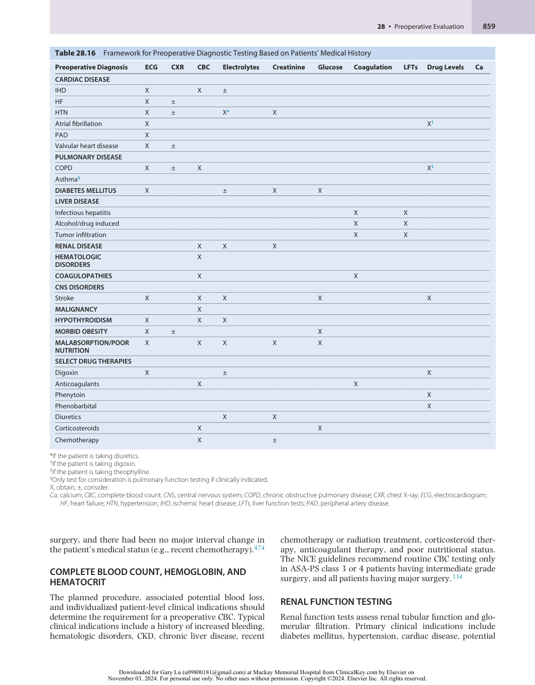

:::

<!-- PDF page 53 -->

dehydration (e.g., vomiting, diarrhea), anorexia, bulimia, fluid overload states (e.g., HF, ascites), known renal disease, liver disease, relevant recent chemotherapy (e.g., cisplatin, carboplatin), and renal transplantation. The NICE guidelines recommend routine renal function testing in ASA- PS class 3 or 4 patients having intermediate surgery, and ASAPS class 2, 3, or 4 patients undergoing major surgery.334 If patients are deemed to be at risk for perioperative AKI, testing may also be considered in ASA- PS class 3 or 4 patients having minor surgery, and ASA- PS class 2 patients having intermediate surgery.334

### LIVER FUNCTION TESTING

The ordering of LFTs should be based on a history of liver injury and physical examination findings. Primary clinical indications include a history of hepatitis (viral, alcohol, drug- induced, autoimmune), jaundice, cirrhosis, portal hypertension, biliary disease, gallbladder disease, hepatotoxic drug exposure, tumor involvement of the liver, and bleeding disorders.

### COAGULATION TESTING

Routine preoperative coagulation testing is not indicated (even in patients undergoing regional procedures) unless a known or suspected coagulopathy is identified on preoperative evaluation. Primary clinical indications for testing include a known bleeding disorder, hepatic disease, and anticoagulant use.10 The 2016 NICE guidelines state that coagulation testing should only be considered in patients who are (1) ASA Physical Status class III or IV; (2) undergoing intermediate, major, or complex surgical procedures; and (3) known to take anticoagulant medications or have chronic liver disease.334

### URINALYSIS

There is no indication for routine preoperative urinalysis.334 Primary clinical indications include a suspected urinary tract infection, and unexplained fever or chills.

### PREGNANCY TEST

Pregnancy testing is often determined by hospital- specific protocols. It can also be based on clinical indications such as sexual activity, birth control use, and date of the last menstrual period. Another important factor that should be considered is the potential for the planned surgical procedure harming a fetus, based on direct injury (e.g., uterine surgery), reduction in blood flow (e.g., major cardiac or vascular surgery), and exposure to teratogenic agents (e.g., X- rays). The 2012 ASA “Practice Advisory for Preanesthesia Evaluation” suggests offering pregnancy testing to patients with a uterus who are of childbearing age when the result would alter the patient’s management. It also recommends that informed consent be obtained for such testing, or that there be a full discussion of the risks, benefits, and alternatives related to preoperative pregnancy testing. The NICE guidelines recommend that all patients of childbearing potential be asked whether there is any possibility they could be pregnant, and that any patients who could

possibly be pregnant be made aware of the risks of anesthesia and surgery to a fetus. The guidelines also recommend documenting all discussions about whether or not to carry out pregnancy testing, and to conduct pregnancy testing with patient consent if there is any doubt about pregnancy status.334

### SICKLE CELL TEST

Individuals at risk for sickle cell disease include those of African, Caribbean, Eastern Mediterranean, and Middle Eastern origin. Even in at- risk populations, routine preoperative screening for sickle cell disease has a very low yield,475 especially in regions with newborn screening programs for sickle cell disease.476 Consequently, the 2016 NICE guidelines recommend against routine preoperative testing for sickle cell disease or sickle cell trait.334 A reasonable approach is to focus preoperative screening in previously untested patients who have at- risk ethnic backgrounds and clinical indicators. The indicators include patient- related (e.g., family history of sickle cell disease, sickle cell symptoms) and surgery- related (e.g., deliberate hypothermia, cardiopulmonary bypass, intrathoracic or intra- abdominal procedures, orthopedic procedures with tourniquet use) factors. A positive sickle cell screening test typically entails a full hemoglobinopathy evaluation (to differentiate between individuals who are homozygous or heterozygous for HbS or other hemoglobinopathies).

### ELECTROCARDIOGRAM

The ECG can help detect a prior myocardial infarction, cardiac rhythm disturbances, ischemia, chamber hypertrophy, and electrolyte disorders. Nonetheless, when combined with usual clinical examination, the preoperative ECG may not provide additional prognostic information to identify individuals at risk for postoperative cardiac complications.139 Primary clinical indications for preoperative ECGs include a history of IHD, CIED, hypertension, diabetes mellitus, HF, chest pain, palpitations, suspicious murmurs, peripheral edema, syncope, dyspnea on exertion, orthopnea, paroxysmal nocturnal dyspnea, and CVD. The 2022 ESC guidelines suggest preoperative ECGs in patients who are scheduled for intermediate- risk or high- risk surgery and have known IHD, risk factors for IHD (including age ≥65 years), or suspicious symptoms.14 The 2014 ACC/AHA guidelines are consistent in that they support preoperative ECGs for patients who are undergoing intermediate- risk or high- risk surgery, and who have known IHD, significant arrhythmia, PAD, CVD, or other significant structural heart disease.12 The NICE guidelines recommend routine preoperative ECGs in ASA- PS class 3 or 4 patients undergoing intermediate grade procedures, and ASA- PS class 2, 3, or 4 patients undergoing major procedures.334 In patients with cardiovascular disease, CKD, or diabetes mellitus, testing may also be considered in ASA- PS class 2 patients undergoing intermediate procedures.334

### CHEST RADIOGRAPH

Routine preoperative chest radiographs do not provide prognostically important information for assessing perioperative

<!-- PDF page 54 -->

risk.477 Preoperative chest radiographs should therefore not be ordered routinely,334 but rather selectively based on abnormalities identified by preoperative evaluation. These indications include advanced COPD, bullous lung disease, suspected pulmonary edema, suspected pneumonia, suspected mediastinal masses, and suspicious findings on physical examination (e.g., rales, tracheal deviation).

## Preoperative Risk Assessment

A critical component of the pre- anesthesia evaluation is assessment of a patient’s risk for undergoing anesthesia and surgery. This assessment improves patients’ understanding of the inherent perioperative risks and better informs health care providers’ clinical decision- making. For example, these risk assessments might help identify individuals who warrant enhanced levels of postoperative monitoring, consideration for alternative nonoperative or less-invasive treatment options for their underlying condition, or initiation of interventions intended to decrease perioperative risk. An anesthesiologist’s designation of a surgical patient as being high risk is clinically important. Specifically, when the initial pre- anesthesia evaluation deems that a patient is at unacceptably high risk for anesthesia and surgery, adherence to the anesthesiologist’s recommendations for further perioperative management is associated with lower postoperative complication rates.478 In addition, accurate risk assessments facilitate fairer comparisons of perioperative outcomes: specifically, estimates of patients’ risks are required by statistical methods that adjust for case- mix differences across providers and hospitals.

The method most used by anesthesiologists to assess overall perioperative risk is the ASA- PS classification system (Table 28.17). This classification system, which was developed in 1941, was originally intended to facilitate collection and comparison of statistical data in anesthesia.479 The ASA- PS classification system seeks to describe a patient’s preoperative medical status, but it does not consider risks inherent to the planned surgical procedure. Although not intended to guide estimation of patients’ risks for anesthesia and surgery, the ASA- PS is often used for this purpose,

**Table 28.17** American Society of Anesthesiologists Physical Status (ASA- PS) Classification

|**Category**|**Definition**|
|---|---|
|**ASA- PS 1**|A normal healthy patient.|
|**ASA- PS 2**|A patient with mild systemic disease.|
|**ASA- PS 3**|A patient with severe systemic disease.|
|**ASA- PS 4**|A patient with severe systemic disease that is a constant threat to life.|
|**ASA- PS 5**|A moribund patient who is not expected to survive without the operation.|
|**ASA- PS 6**|A declared brain- dead patient whose organs are being removed for donor purposes.|

The addition of “E” to the classification category indicates emergency surgery.

especially given its simplicity of use.480 Several studies have shown a correlation of ASA- PS scores with postoperative mortality and major complications.136,267,481–483 An important limitation to the classification system is its inherent subjectivity; consequently, previous research has shown fair to modest interrater agreement when different individuals attempt to assign an ASA- PS category to the same patient.482,484–486

In addition to patients’ preoperative medical status, which is described by the ASA- PS system, operative procedure is an important determinant of perioperative risk.487– 489 Overall perioperative risk is necessarily a function of both the risk associated with the specific operative procedure and the risk associated with a patient’s underlying medical status. For example, ambulatory surgical procedures are very safe with respect to risks of postoperative mortality and major adverse events,490–492 as evidenced by a 7- day postoperative mortality rate of only 41 per 100,000 procedures in a large cohort of Medicare beneficiaries aged 65 years or older.490 Thus, although older patients with an increased burden of comorbidity do have increased relative risks of mortality and morbidity following ambulatory surgery, their _absolute_ risks remain very low. Classification schemes have been proposed to stratify surgical procedures with respect to risks of specific complications, such as cardiovascular complications (see Box 28.2),14 bleeding events (see Box 28.6),244 and pulmonary complications (see Table 28.14).316 More recently, Delphibased consensus- based methods were used to develop the Operative Stress Score, which is a five- level classification system for surgical procedures based on associated physiologic stress.493 Importantly, individual operative procedures within broad categories (e.g., intra- abdominal surgery) vary with respect to their perioperative risk.163 Thus, there is a need to balance the desire to ensure that clinical prediction tools sufficiently capture the variability in operative risk across different procedures, against the need to ensure that these tools are sufficiently simple for straightforward clinical use.

Several commonly used and methodologically sound clinical indices can predict mortality and major morbidity after cardiac surgery with reasonable accuracy, such as the EuroSCORE,494 Society of Thoracic Surgeons risk models,495 and Cleveland Clinic AKI risk score.331 A variety of prediction tools have also been developed for use in noncardiac surgery.496 Several of these validated tools focus on predicting postoperative mortality, such as the Surgical Outcome Risk Tool (SORT),497 Surgical Risk Scale,498 and the Preoperative Score to Predict Postoperative Mortality (POSPOM),138 Other validated indices focus on predicting specific postoperative complications, such as cardiovascular events (e.g., RCRI),136,161,162 and respiratory events (e.g., ARISCAT).316,321 The ACS NSQIP risk calculator (http://riskcalculator.facs.org) provides estimated risks for a range of postoperative adverse events (including death) based on patients’ comorbidities and proposed surgical procedures.42 Large multinational prospective epidemiologic studies of surgical patients, which included accurate capture of perioperative characteristics and outcomes,115,116 will likely help lead to the development of other high- quality predictive indices.

::: details 原始表格與符號（PDF 第 54 頁）

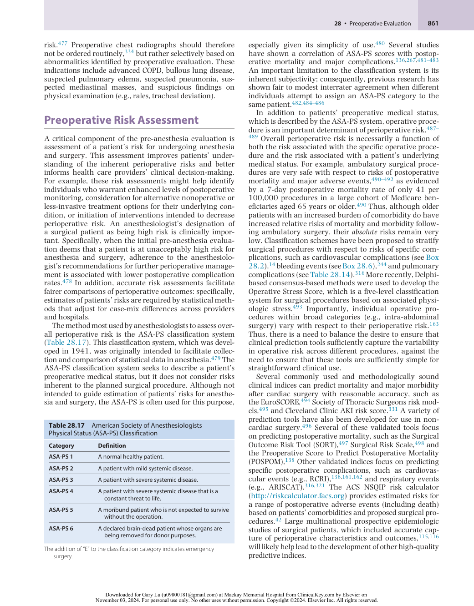

:::

<!-- PDF page 55 -->

### ROLE OF SPECIALIZED TESTING IN PREOPERATIVE RISK ASSESSMENT

Based on an initial preoperative clinical evaluation, anesthesiologists may order subsequent specialized tests to help address diagnostic questions (e.g., “Does this patient have aortic stenosis?”) or determine perioperative risk more accurately. Examples of such tests include noninvasive cardiac stress tests (see earlier section on Ischemic Heart Disease), coronary angiography (see section on Ischemic Heart Disease), echocardiography, CPET, and PFTs (see earlier section on Pulmonary Disorders).

Resting echocardiography can provide information related to valvular lesions, pulmonary hypertension, fixed wall motion abnormalities, and ventricular function. An echocardiogram can also identify fixed wall motion abnormalities consistent with a previous myocardial infarction. While systolic ventricular dysfunction identified on echocardiography is associated with increased cardiac risk.207,208 this finding may not provide additional prognostic information when it is combined with routine preoperative clinical evaluation.207 Thus, the main role of echocardiography is to address focused diagnostic questions arising from usual clinical preoperative evaluation, as opposed to providing prognostic information to inform preoperative risk stratification. Current guidelines therefore largely recommend preoperative echocardiography to help address diagnostic questions, such as the cause of a suspicious cardiac murmur, underlying diagnoses in patient with dyspnea of unknown origin or very low exercise capacity, explanation for recent altered clinical status in a patient with known HF, or explanation for a significantly elevated preoperative natriuretic peptide concentration.12,14 Conversely, routine preoperative echocardiography in the absence of clear diagnostic questions is unlikely to be helpful, and is discouraged by current guidelines.12–14

CPET is a noninvasive global assessment of exercise capacity; it involves a patient exercising on a bicycle or treadmill for 8 to 12 minutes while undergoing continuous measurement of respiratory gas exchange (i.e., oxygen uptake and carbon dioxide production).499 Poor exercise capacity during CPET is associated with increased risks of major postoperative complications.38,41,320,500 Thus, the test can help improve the accuracy of preoperative risk stratification. In some geographic settings,501 CPET is a commonly used preoperative test. In these settings, it is used to aid preoperative risk assessment for major surgery, and to inform decisions on the appropriateness of planned major surgical procedures. The role of PFTs for guiding preoperative assessment in the setting of specific comorbidities is discussed previously in this chapter. These tests have an established and important role for assessing perioperative risk in lung resection surgery (see Chapter 49).502 PFTs also play an important diagnostic role. For example, they help differentiate between pulmonary and cardiac causes of dyspnea of unknown origin. Aside from these specific circumstances, the _prognostic_ value of preoperative PFTs is limited. Practice guidelines from the American College of Physicians recommend against routine preoperative spirometry for estimating risks for pulmonary complications after noncardiothoracic surgery.15 Research has not found a consistent link between poor PFT results and increased risks for perioperative

pulmonary complications, with older studies being generally limited by important methodologic flaws.267,320 Furthermore, there does not seem to be a critical PFT threshold below which patients should not be offered surgery. For example, in a previous cohort study, individuals with severe obstructive findings (i.e., FEV1 &lt;50% of predicted and FEV1/ FVC ratio &lt;0.7) had reasonably acceptable risks of postoperative death (5.6%) and respiratory failure (5.6%).503

## Preoperative Medication Management

The patient’s comorbidities and planned procedure must inform medication management during the perioperative period. Some medications have beneficial effects during surgical procedures, whereas others may be detrimental. In some cases, abrupt withdrawal of medications can have a negative effect. Management of specific preoperative medications have been discussed in the previous sections of this chapter. These recommendations are outlined again in Box 28.11. Although issues pertaining to many drugs are covered in other sections of this chapter, several issues merit special mention.

NSAIDs have reversible antiplatelet effects; hence, once the drugs have been eliminated, platelet function returns to normal. Concomitant NSAID use does not appear to increase the risk of spinal hematoma with neuraxial anesthesia.245 Preoperative discontinuation of NSAIDs may be of value in patients at risk for perioperative AKI. Typically, NSAIDs are discontinued 24 to 72 hours preoperatively. Earlier discontinuation does not increase safety, and it may be burdensome to many patients with significant arthritis or chronic pain. COX- 2 inhibitors (e.g., celecoxib) have minimal effect on platelet function and do not increase risks of perioperative bleeding.504 Thus, COX- 2 inhibitors can usually be continued in the perioperative period. However, the long- term COX- 2 inhibitor use in the nonoperative setting does increase the risk of cardiac events, in comparison with placebo or naproxen.505 Conversely, COX- 2 inhibitors have a cardiac risk profile similar to that of ibuprofen or diclofenac.505 No clear evidence indicates increased cardiac risk from _short- term_ perioperative administration of COX- 2 inhibitors. The exception is valdecoxib (now withdrawn from the market), which caused an excess of cardiac events in patients undergoing cardiac surgery.506

Postmenopausal hormone replacement therapies that contain estrogen increase the risk of thromboembolic events.507 It may therefore be reasonable to discontinue these medications before operations. Estrogens must be stopped approximately four weeks preoperatively for coagulation function to return to baseline. Most modern oral contraceptives contain low doses of estrogen. Nonetheless, these medications are still associated with some elevation in thrombotic risk.508 Since the risk of unanticipated pregnancy may outweigh the benefits of discontinuing oral contraceptives preoperatively, it is reasonable to continue oral contraceptives in most patients during the perioperative period. In patients who are deemed to be a high risk for postoperative venous thromboembolism (VTE) (see Chapter 29), consideration may be given to stopping oral contraceptives four weeks before surgery (and temporarily switching

<!-- PDF page 56 -->

### Box 28.11 Preoperative Management of Medications

|Instruct patients to take these medications with a small sip of water, even if fasting.|eluting stents until they have the completed minimum recommended duration of dual antiplatelet therapy, unless|
|---|---|
|1.**Antihypertensive medications**|patients, surgeons, and cardiologists have discussed the|
|Continue on the day of surgery, except possibly for ACEIs and ARBs.|risks of discontinuation. The same applies to patients with|
|2.**Cardiac medications (e.g., beta blockers, digoxin)** Continue on the day of surgery.|bare metal stents until they have completed 30 days of dual antiplatelet therapy.|
|3.**Antidepressants, anxiolytics, and other psychiatric**|15.**Insulin**|
|**medications**|For all patients, discontinue all short- acting (e.g., regular)|
|Continue on the day of surgery.|insulin on the day of surgery (unless insulin is administered|
|4.**Thyroid medications**|by continuous pump). Patients with type 2 diabetes should|
|Continue on the day of surgery.|take none, or up to one-half of their dose of long- acting or|
|5.**Oral contraceptive pills** Continue on the day of surgery.|combination (e.g., 70/30 preparations) insulin, on the day of surgery. Patients with type 1 diabetes should take a small|
|6.**Eye drops**|amount (usually one-third) of their usual morning long-|
|Continue on the day of surgery.|acting insulin dose on the day of surgery. Patients with an|
|7.**Heartburn or reflux medications** Continue on the day of surgery.|insulin pump should continue their basal rate only. 16.**Topical medications (e.g., creams and ointments)**|
|8.**Opioid medications**|Discontinue on the day of surgery.|
|Continue on the day of surgery.|17.**Non- insulin antidiabetic medications**|
|9.**Anticonvulsant medications**|Discontinue on the day of surgery (exception: SGLT- 2 inhibitors|
|Continue on the day of surgery.|should be discontinued at least 24 hours before elective|
|10.**Asthma medications**|surgery, and 72 hours before intermediate- to high- risk|
|Continue on the day of surgery.|surgery)|
|11.**Corticosteroids (oral and inhaled)**|18.**Diuretics**|
|Continue on the day of surgery.|Discontinue on the day of surgery (exception: thiazide diuretics|
|12.**Statins**|taken for hypertension, which should be continued on the|
|Continue on the day of surgery.|day of surgery).|
|13.**Aspirin**|19.**Sildenafil (Viagra) or similar drugs**|
|Continue aspirin in patients with prior PCI, high- grade IHD, and significant CVD. Otherwise, discontinue aspirin 3 days before|Discontinue 24 hours before surgery. 20.**COX- 2 inhibitors**|
|surgery.|Continue on the day of surgery unless the surgeon is concerned|
|14.**P2Y12** **inhibitors (e.g., clopidogrel, ticagrelor, prasugrel,**|about bone healing.|
|**ticlopidine)**|21.**Nonsteroidal anti- inflammatory drugs**|
|Patients having cataract surgery with topical or general|Discontinue 48 hours before the day of surgery.|
| anesthesia do not need to stop taking thienopyridines. If| 22.**Warfarin (Coumadin)**|
| reversal of platelet inhibition is necessary, the minimum|Discontinue 5 days before surgery, except for patients having|
| time interval for discontinuing these medications before surgery is five days for clopidogrel, three days for ticagrelor,| minimal bleeding risk surgery 23.**Monoamine oxidase inhibitors**|
|i seven days for prasugrel, and 10 days for ticlopidine. Do not|Continue these medications and adjust the anesthesia plan|
|discontinue P2Y12inhibitors in patients who have drug-|accordingly.|

_ACEIs_ , angiotensin-converting enzyme inhibitors; _ARBs_ , angiotensin receptor blockers; _COX- 2,_ cyclooxygenase- 2; _CVD_ , cerebrovascular disease; _IHD_ , ischemic heart disease; _PCI,_ percutaneous coronary intervention.

to other forms of contraception). Oral contraceptive use should also be noted should the patient eventually receive sugammadex during the perioperative period. Sugammadex can decrease the efficacy of hormonal contraceptives, meaning that the patient will require an additional nonhormonal contraceptive for seven days after sugammadex exposure.509

Most medications for psychiatric and psychological problems should be continued into the preoperative period. Thus, most antidepressants, antipsychotics, and benzodiazepines are best maintained to avoid exacerbations of symptoms. Historically, monoamine oxidase inhibitor (MAOI) antidepressants were discontinued preoperatively; however, elimination of the risks associated with many of these drugs required drug discontinuation at least three weeks before surgery. This long withdrawal period applied to MAOIs that caused irreversible inhibition of MAO. Some newer agents, such as moclobemide, cause reversible enzyme inhibition

and have effects lasting less than 24 hours. Preoperative withdrawal of these drugs has potential risks. Specifically, case reports of suicides or severe depression following discontinuation of MAOIs have been reported. Thus, the safest approach may be to continue these drugs and adjust the anesthetic plan accordingly (e.g., avoid meperidine and indirect- acting vasopressors such as ephedrine). If this approach is taken, it is critical that details regarding a patient’s MAOI use must be clearly communicated to health care providers on the day of surgery. Patients receiving tricyclic antidepressants require a preoperative ECG, given the potential for a prolonged QT interval. Because tricyclic antidepressants block the reuptake of norepinephrine and serotonin, high doses may also result in augmented responses to vasopressor drugs, with the potential for exaggerated hemodynamic changes. Patients taking lithium require evaluation of electrolyte and creatinine concentrations. Discontinuation of lithium has also been associated with

::: details 原始表格與符號（PDF 第 56 頁）

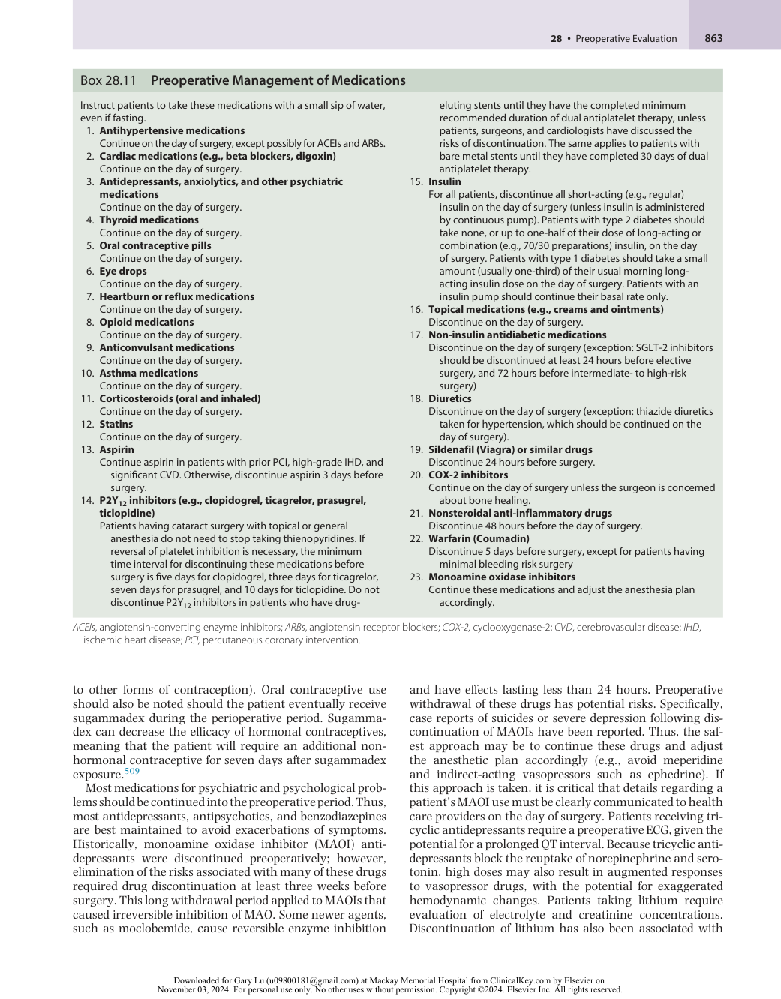

:::

<!-- PDF page 57 -->

suicide. Continued perioperative use of selective serotonin reuptake inhibitors (SSRIs) are associated with increased surgical bleeding,510–512 while abrupt discontinuation of SSRIs can also cause dizziness, chills, muscle aches, anxiety, and relapse of depression. Overall, it is still reasonable to continue SSRI perioperatively in most patients, aside from those undergoing procedures where bleeding could have significant postoperative sequelae (e.g., intracranial surgery).

## Planning for Anesthesia

### PREOPERATIVE FASTING STATUS

The overarching goal of preoperative fasting recommendations has been to reduce the risk of pulmonary aspiration. The ASA published practice guidelines pertaining to preoperative fasting in nonlaboring individuals undergoing elective procedures.513 The recommended fasting period following clear fluids for all patients is two hours. In general, the volume of liquid ingested is less important than the type of liquid ingested. For neonates and infants, the recommended fasting period is four hours following breast milk, while it is six hours following formula, nonhuman milk, and solids. For patients other than infants, a fasting period of six hours after a light meal is recommended; this period may have to be increased to eight or more hours if the meal includes fried or fatty foods. In addition to implementing these fasting intervals, these guidelines recommend that the preoperative evaluation include assessment of the potential for difficult airway management, as well as factors that may increase the risk for aspiration (e.g., gastrointestinal motility disorders, diabetes).

### PLANNING FOR POSTOPERATIVE PAIN MANAGEMENT

A preoperative evaluation should always include baseline pain assessment. Standardization of pain measurement is difficult because of the subjective nature of the variable. It is therefore helpful to incorporate standardized pain measurement scales into the preoperative evaluation process. The scales may either be single- dimension scales, such as visual analogue and numeric rating scales, or multidimensional instruments, such as the McGill pain questionnaire,514 Modified Brief Pain Inventory – Short Form,515 and Patient Reported Outcome Measurement Information System (PROMIS) measures of pain intensity and interference.516 While multidimensional instruments are longer, they also capture a broader range of important details, such as pain intensity, pain location, adequacy of analgesic treatment, and pain- related interference in activities. Consistent use of the same scale during the perioperative episode of care allows comparison when reassessments are performed after surgery.

The preoperative evaluation provides an important opportunity to discuss and plan for the management of acute postoperative pain (see Chapters 47 and 77), for several reasons. First, adequacy of perioperative pain control is a frequent concern for patients during preoperative evaluation.517,518 Second, preoperative anesthesia consultation is associated with improved patient acceptance of perioperative regional techniques,23 which themselves can help

improve the quality of postoperative analgesia.519 Third, preoperative evaluation facilitates planning the perioperative care of patients with chronic pain conditions, who often present significant challenges with respect to managing postoperative analgesia. Specific issues include their tolerance to usual doses of opioid analgesics and the potential for acute withdrawal reactions if they receive insufficient doses of opioids postoperatively. The preoperative consultation should therefore be used to carefully document their usual baseline opioid requirements (to ensure adequate postoperative dosing), facilitate early involvement of an acute pain service or transitional pain specialist,520 encourage regional analgesic techniques, and plan adjunct analgesic medications. Patients with preexisting chronic pain should be encouraged to develop reasonable goals for adequacy of postoperative pain control. They should be informed that, although care providers will do everything possible to maintain comfort postoperatively, patients should not expect to have no pain at all.

In general, patients should not be weaned from pain medications before surgery. If instructed by their surgeons to temporarily discontinue NSAIDs or COX- 2 analgesics, they may have to be transitioned to alternative analgesics before surgery. Patients should be instructed to take their usual morning dose of opioid agonist analgesics, including continued use of any transdermal medications. Consensusbased guidelines have recently been developed to help better standardize preoperative management of analgesic medications in an evidence- based manner.451

## Regulatory Issues

Providers must be aware of various governmental regulatory requirements, which often differ by individual municipalities and countries. These requirements may be driven by quality regulations, such as those developed by The Joint Commission or by payment requirements as set by the Centers for Medicare and Medicaid Services (CMS) in the United States. For example, the CMS has determined that a comprehensive pre- anesthesia evaluation can be done within 30 days, and a focused update is required within 48 hours of a procedure requiring anesthesia services. The evaluation should be performed by a practitioner qualified to provide anesthesia. The purpose of the pre- anesthesia evaluation is to identify the risks of the planned anesthesia encounter and develop a plan for anesthesia. Elements of the evaluation include:

- Review of the medical, anesthesia, drug, and allergy history

- Notation of anesthesia risk (e.g., ASA- PS classification)

- Interview and examination of the patient

- Identification of potential anesthesia problems (e.g., difficult airway, limited intravascular access)

- Additional evaluation, if deemed necessary (e.g., stress tests, specialist consultation)

- Development of a plan for anesthesia, including the type of medications for induction, maintenance, and postoperative care

- Discussion of the risks and benefits of anesthesia with the patient or the patient’s representative

<!-- PDF page 58 -->

## Preoperative Evaluation Clinic

Many anesthesiology groups and medical centers have developed preoperative evaluation programs and outpatient clinics, with the objectives of improving patient care and operating room efficiency.25,472,521 Although these programs may differ with respect to staffing, structure, financial support, and daily operations, they all share a common goal of preventing delays, last- minute cancellations, and adverse patient outcomes that could have been addressed before the day of surgery.

The decision to develop a preoperative evaluation clinic depends on several key factors. They include the anticipated daily volume of surgical patients, the predominant level of medical acuity among these patients, the availability of clinic facilities, relevant patient demographics (e.g., average travel distances from patients’ homes to the clinic), and requisite support from the anesthesia department, perioperative staff, and hospital administration. If the decision to implement a preoperative evaluation program is made, anesthesiologists must play a key role in its leadership and management. When this role is instead undertaken by other specialties, such as internal medicine, anesthesiologists’ expertise in perioperative patient management often becomes secondary. This shift to a secondary role can result in interdepartmental conflicts concerning patients’ preoperative evaluation, risk stratification, and fitness to proceed with anesthesia and surgery. These conflicts can, in turn, result in unplanned delays or cancellations of planned surgical procedures, despite the completion of an assessment in an outpatient preoperative evaluation clinic.

Such conflicts often relate to a surgeon’s interpretation of a nonanesthesiology specialist’s judgment that a patient is “cleared for surgery” as evidence that the patient is fit for anesthesia. Unfortunately, this “clearance” is frequently made with limited knowledge of factors critical to the responsible anesthesiologist in the operating room, such as current anesthesia practice and intraoperative patient management. Indeed, previous research has shown that preoperative histories, physical examinations, and assessments performed by medical specialists often fail to address specific anesthesia- related concerns.522 As the specialist who makes the final determination of whether a patient is fit to proceed with anesthesia and surgery, the responsible anesthesiologist is a critical “end- user” of any assessment performed in a preoperative evaluation clinic. Consequently, a reliance on nonanesthesiology specialists can result in preoperative assessments that are deemed inadequate by the responsible anesthesia providers and that lead to potential last- minute surgical delays and cancellations, with associated significant frustration among both patients and surgeons. Conversely, preoperative- to- intraoperative communication is likely significantly improved when anesthesiologists are responsible for most outpatient pre- anesthesia evaluations, as confirmed by previous studies showing fewer last- minute case cancellations,24,25 shorter durations of hospitalization,25,523 lower hospital costs,524 and possibly reduced postoperative mortality,525 with institution of anesthesiology- led preoperative evaluation programs.

Awareness of the local hospital context is critical if a preoperative evaluation program is to have good outcomes. In a hospital with limited resources that has mostly healthy

outpatient and same- day- admission surgical patients, the anesthesiology group may be unable to evaluate all patients preoperatively in a clinic before the day of surgery. In this situation, the preoperative program must develop a means for accurate screening and triage of patients based on their current health status. An accurate triage process helps target the use of preoperative clinic visits only among selected higher- risk patients without compromising patients’ quality of care and outcomes.29 An example of such a triage process may involve having patients initially complete an anesthesia screening questionnaire in their surgeon’s office. This questionnaire can be a web- based online document or even a paper version that would then be faxed to the anesthesiology group before the date of surgery. The anesthesiology group can develop local context- specific screening questionnaires, or adopt published instruments developed for this purpose.526,527 In the case of a patient with a questionable medical history, a telephone call by the anesthesiologist could clarify any issues of concern. This opportunity to review a patient’s medical history before the day of surgery helps reduce unresolved or unexpected medical concerns on the day of surgery. It also helps determine whether a patient requires formal preoperative consultation in advance of the surgical procedure, as opposed to evaluation on the day of surgery itself.

Conversely, anesthesiology departments at hospitals with many medically complex surgical patients may benefit from the establishment of a formal preoperative evaluation facility with multiple examination rooms, dedicated staffing, and a full- time operational system. The establishment of a successful preoperative evaluation clinic requires commitment, collaboration, and support from several hospital disciplines. At a minimum, the departments of anesthesiology, surgery, nursing, and hospital administration must agree that such a clinic has value for the hospital, and they must commit to support its operational goals.

### COLLABORATION, COMMITMENT, AND TEAMWORK

The preoperative evaluation clinic is a partnership among the departments of anesthesiology, surgery, nursing, and hospital administration to achieve common goals. This collaboration conveys the important theme that the new clinical program is an integrated enterprise that requires shared obligation, endeavor, and financial responsibility. Although these clinics are best led by anesthesiologists,24,25 collaborative engagement with medical specialists (e.g., cardiologists, geriatricians) and hospitalists remains important to the success of any preoperative program. These nonanesthesiology specialties provide unique expertise in the preoperative management of selected medically complex patients; furthermore, they can facilitate enhanced postoperative monitoring of high- risk patients through, for example, the co- management model of postoperative care (see Role of the Medical Consultant in Preoperative Evaluation, below).

Surgeons may be initially reluctant to send their patients to a newly established anesthesia- led preoperative evaluation clinic. This reluctance often stems from an unclear understanding of the benefits of outpatient preoperative anesthesia evaluation. Consequently, the surgeon’s hesitation can

<!-- PDF page 59 -->

be reduced by clearly identifying the specific advantages of an integrated anesthesia- led preoperative evaluation program. First, the proven benefits of anesthesiology- led preoperative evaluation should be highlighted.24,25,472,523–525 Second, anesthesiologists should emphasize the important practical advantages of an integrated assessment of medically complex surgical patients. Specifically, when relevant medical concerns are identified before the surgical procedure, the preoperative program can acquire all relevant prior medical data, coordinate any additional workup or consultation, prearrange any required specialized postoperative monitoring, and discuss the case beforehand with the surgeon and responsible anesthesiologist. This approach ensures that when such a patient presents for the operation, the responsible anesthesia provider is satisfied to proceed with the surgical procedure, and the perioperative team has all the required medical information to manage the patient optimally during the hospitalization. This integration of the preoperative evaluation with the entire perioperative episode of care is an integral component of the Perioperative Surgical Home model.1

Third, informal assurances should be made to the surgical services that, if a patient is managed by the preoperative evaluation program, surgery will proceed without cancellation or delay by the assigned anesthesiologist unless an intervening illness or adverse medical event occurs between the outpatient evaluation and the scheduled operation. Because cancellations and delays on the day of surgery can be a prominent source of aggravation for surgeons and patients, these informal assurances would be viewed as a key strength of the newly developed preoperative program. Such assurances depend heavily on the anesthesiology department’s addressing relevant clinical practice variations. Specifically, issues that are subject to important interpractitioner differences, such as what fasting blood glucose level or degree of preoperative hypertension would merit canceling a surgical case, must be discussed to achieve a departmental consensus standard. The absence of consensus standards can lead to situations in which half the anesthesia providers may proceed with a higher- risk surgical case, whereas the other half would cancel it instead. Wide inconsistency in practice will foster a lack of support among surgeons and will lead to reluctance to have their patients evaluated. Such a preoperative evaluation program is unlikely to be successful.

### ROLE OF THE MEDICAL CONSULTANT IN PREOPERATIVE EVALUATION

Use of preoperative medical consultation varies across hospitals, likely depending on the expertise in perioperative medicine among the clinicians performing pre- anesthesia assessments. Since exposure to preoperative evaluation is inadequate at many anesthesiology residency programs,528 some anesthesiology departments might prefer that medical specialists take primary responsibility for preoperative evaluations at their centers. Conversely, when anesthesiologists involved with preoperative evaluation develop improved comfort with interpreting electrocardiograms (ECGs), cardiac stress tests, or other specialized tests, rates of medical consultations can be substantially reduced.21

Medical consultants have a clear role in the preoperative care of selected surgical patients. For example, these consultations can help manage unstable medical conditions (e.g., unstable angina), optimize poorly controlled medical diseases (e.g., asthma exacerbation), or facilitate clinically indicated diagnostic workups (e.g., coronary angiography following high- risk cardiac stress test results).

Preoperative consultation by medical specialists or hospitalists can also help facilitate postoperative co- management by these same individuals.529 The co- management model for postoperative care of surgical patients is increasingly common,530 although its benefits with respect to clinical outcomes and health care costs remains uncertain.531–536 Multidisciplinary collaboration with medical consultants can be especially helpful for perioperative management of medically complex patients or uncommon medical disorders. Indeed, some clinical practice guidelines recommend such multidisciplinary team management for patients with known cardiac disease undergoing high- risk noncardiac surgery,537 as well as patients with significant pulmonary hypertension or adult congenital heart disease undergoing noncardiac surgery.12

Despite these theoretical benefits, preoperative medical consultation has shown a variable effect on postoperative outcomes.538 A randomized trial of outpatient preoperative evaluation demonstrated fewer last- minute surgical cancellations but no difference in hospital length of stay, as well as an increase in consultations.539 In other nonrandomized studies, medical consultation was associated with increases in specialized testing, costs, hospital length of stay, and mortality.540,541 Conversely, a transition from an anesthesiologist- led to a hospitalist- led preoperative assessment clinic was associated with reduced hospital length of stay in high- risk patients.542 Potential reasons for this variable effect may be the absence of recommendations or new interventions resulting from many medical consultations,543,544 as well as disagreements among medical specialists, anesthesiologists, and surgeons on the intended purpose of these consultations.522 In addition, increased burden of comorbidity is a very small determinant of whether patients are referred for preoperative medical consultations,545–548 a finding suggesting poor patient selection during referral to medical specialists. Thus, during preoperative evaluation, the anesthesiologist should ensure that any referrals to medical specialists before surgery involve appropriate matching of patient profiles to specialist expertise. For example, patients with high- risk IHD should be referred to a cardiologist, while frail elderly patients should be referred to a geriatrician.

Benefits from preoperative medical consultation may apply to older surgical patients, especially those with frailty, who are referred to geriatricians before major surgery.549 In a population- based study from Canada, preoperative geriatric consultation was associated with improved postoperative 90- day outcomes (i.e., survival, hospital length of stay, need for supported discharge, hospital readmission) in older patients (≥65 years) having major elective noncardiac surgery.550 These benefits in the perioperative setting are consistent with a multicenter cohort study from the United Kingdom in which early geriatrician assessment was associated with improved outcomes in older adults admitted with serious trauma- related injury.551

<!-- PDF page 60 -->

### STRUCTURES AND ACTIVITIES OF THE PREOPERATIVE EVALUATION CLINIC

The daily operations of a preoperative evaluation clinic vary based on the patient volume, the general level of medical complexity among surgical patients, the type of available clinic facilities, and staffing resources. Nonetheless, a general operational structure can be proposed based on examination of several preoperative clinic models currently in practice.

Centers with large surgical case volumes should have their patients formally scheduled in the clinic before the day of evaluation, to allow for medical records and relevant outside information to be acquired and collated. The surgeon’s office should schedule this clinic appointment at the same time that it books the operating room case. To ensure timely patient access and flow through the facility, these appointments should be booked using an efficient clinic scheduling system. Ideally, appointments should be scheduled to allow sufficient time between the clinic visit and the scheduled surgical procedure, to facilitate any additional preoperative testing, consultations, or interventions. Some degree of flexibility in the clinic schedule is also needed, especially to accommodate patients who have urgent indications for surgery. One approach for incorporating some flexibility is to include a few open appointment slots in the daily clinic schedule that can be used as needed for last- minute patient referrals. Such flexibility is required for individuals residing in rural and remote areas, who have been reported to have reduced rates of access to preoperative evaluation clinic facilities.552 Anesthesiologists at some centers have also adopted telemedicine technology (defined as health care delivery and sharing of medical knowledge over a distance using telecommunications systems)553 so that patients residing at remote locations can undergo preanesthesia consultations without traveling long distances to the clinic.554

At the clinic, a clinician interviews and examines the patient, obtains historical medical information and outside records, and determines whether (and which) additional laboratory tests, ECGs, radiographs, or other diagnostic tests are required. Phlebotomy, ECG, and hospital admitting, and insurance registration services are typically available in the preoperative clinic facility. The ECGs are assessed during the clinic visit itself, whereas laboratory test results are evaluated at the end of each clinic day, with follow- up of abnormal findings as needed. In this manner, significant abnormalities can be addressed immediately; thus, any required delays or cancellations of surgical cases can occur well in advance of the scheduled day of surgery. This centralization of multiple services is also a significant convenience for patients, who no longer have to visit multiple hospital locations to complete their preoperative requirements. This arrangement should also centralize all medical data relevant to the scheduled hospital admission into a single chart, which remains in the preoperative evaluation clinic area until the date of surgery. In addition to addressing medical aspects relevant to the scheduled surgery, the preoperative evaluation program plays an important role in educating surgical patients. Typically, both the clinician performing the preoperative assessment and a specifically trained nurse educator discuss the forthcoming

perioperative process with each patient and family members. By increasing patients’ awareness of important components pertaining to their scheduled hospital admission (e.g., analgesic options, risks of anesthesia), this education process can decrease patients’ anxiety,22 as well as increase their willingness to receive regional analgesia.23 The types of clinicians who perform the pre- anesthesia assessment include anesthesiologists and specially trained nurse practitioners. Some authors have questioned whether the responsible anesthesiologist in the operating room would be satisfied with pre- anesthesia assessments performed by another individual.555 Patients themselves often report a preference for having the same anesthesiologist in both the preoperative clinic and the operating room.556 Nonetheless, it is simply not feasible for all patients in the preoperative clinic to be evaluated by their eventual anesthesia providers. Furthermore, a large Dutch cohort study of about 21,000 surgical patients demonstrated that responsible anesthesia providers were satisfied with 95% of outpatient pre- anesthesia assessments performed by other anesthesiologists or trained nurses.557

Preoperative programs must adopt several strategies to ensure that anesthesia providers in the operating room will be satisfied with the quality of outpatient preoperative assessments. First, the anesthesia department must develop consensus standards for determining when patients should have scheduled surgery canceled for medical reasons. Second, the documentation required for all pre- anesthesia assessments in the clinic should be standardized. This standardization helps prevent situations in which an assessment does not contain information needed by the anesthesia provider in the operating room to determine a patient’s fitness for surgery or to develop an anesthetic management plan. Some national anesthesiology groups have initiated work on consensus- based documentation standards for all pre- anesthesia assessments.28 Strategies for improving the consistency of documentation across pre- anesthesia assessments include the use of checklists, as well as structured electronic or paper- based forms for documenting pre- anesthesia assessments. Third, all nurse practitioners or other nonanesthesia clinicians assessing patients in the clinic should undergo an intensive and ongoing education in preoperative assessment. Anesthesiologists with strong interest and expertise in preoperative evaluation should lead this education program. Previous research has shown that well- trained nurses do perform effectively in both screening and evaluating patients in preoperative clinics.558–560

High- risk patients with advanced age, complex medical disease, and frailty pose unique challenges in preoperative evaluation clinics.561 Their assessment process is often more complex, with the need to carefully assess more preoperative domains, such as cognition, frailty, sarcopenia, nutrition, and polypharmacy (see earlier section on Geriatric- Focused Assessment in the Older Surgical Patient). In addition, a high- risk patient often benefits from earlier assessment before the planned surgery to facilitate a more detailed evaluation, opportunities for early preoperative optimization (e.g., prehabilitation starting three or more weeks before surgery),4 multidisciplinary discussion on the best individualized treatment options,114 advanced care planning, and sufficient time for an informed shared decision- making process for surgery. These requirements

<!-- PDF page 61 -->

for high- quality preoperative assessment of high- risk surgical patients are often at odds with the efficient functioning of a busy high- volume preoperative evaluation clinic. To address this important care gap, several centers have established preoperative clinics focused on the assessment and optimization of high- risk surgical patients. More data on the impact and effectiveness of these clinics remain needed, but preliminary early results show promise.8,562

### IMPACT ON OPERATING ROOM EFFICIENCY AND OUTCOMES

Anesthesia- led preoperative assessment clinics have positively impacted operating room efficiency and outcomes (see the earlier section on Goals and Benefits of PreAnesthesia Evaluation). The demonstrated benefits of these clinics include fewer case cancellations on the day of surgery,24,25,472,524 shorter duration of hospitalization,25,523,524 and a possible reduction in postoperative mortality.525 Other mechanisms whereby preoperative evaluation clinics reduce health care costs include more selective ordering of preoperative laboratory tests and specialist referrals.20,21,472 Thus, although preoperative evaluation programs do incur costs (e.g., facility development costs, staff salaries), they can still lead to an overall reduction in hospital costs as a result of these associated cost savings.524

evaluation clinic before the day of the surgical procedure or at the bedside immediately before induction of anesthesia. Anesthesiologists must be familiar with the impact of a broad range of chronic and acute medical conditions on patients’ risks for anesthesia and surgery. In addition, this role entails awareness of multiple practice guidelines, regulatory requirements, and approaches for efficient management of outpatient clinics. Despite this evolving and expanding role of anesthesiologists in preoperative care, the primary purpose of preoperative evaluation will never change. It is the clinical foundation for guiding perioperative patient management, and it has the potential to reduce perioperative morbidity and enhance patient outcome.

### Acknowledgment

The editors and publisher would like to thank Dr. BobbieJean Sweitzer, Dr. Stephen P. Fischer, and Dr. Angela M. Bader for contributing chapters on this topic in prior editions of this work. This prior work has served as the foundation for the current chapter.

### Complete references available online at expertconsult.com.

### References

1.  Kain ZN, et al. _Anesth Analg_ . 2014;118(5):1126.

2.  Saidman LJ. _Anesthesiology_ . 1995;83(1):191.

### PATIENT SATISFACTION WITH PREOPERATIVE EVALUATION CLINICS

In addition to addressing perioperative efficiencies and clinical outcomes, preoperative programs should also consider the experience and satisfaction of patients attending their clinics. During development of strategies to improve patient satisfaction, the underlying determinants of improved satisfaction should be considered. They include being assessed by the same anesthesiologist who will administer anesthesia in the operating room, shorter wait times in the clinic, and good quality of communication from the clinic staff.556,563,564 Because it is simply not feasible to have all patients in the clinic seen by their eventual anesthesia providers, the major focus should be on improving wait times and the quality of communication. Changes in appointment booking systems,565 process flows, and clinic operations can decrease wait times,558 which in turn can substantially improve patient satisfaction.558 In addition, preoperative programs can ensure that patients receive an accurate estimate of average waiting times before their scheduled clinic visit, and use any encountered wait times to conduct other clinic- related activities (e.g., physical therapy instructions, video- based preoperative education).

3.  Fecher- Jones I, et al. _Anaesthesia_ . 2021;76(9):1207.

4.  McIsaac DI, et al. _Br J Anaesth_ . 2022;128(2):244.

5.  Wong J, et al. _Anesth Analg_ . 2020;131(3):955.

6.  Deutschman CS, et al. _Anesthesiology_ . 1996;85(1):1.

7.  Etzioni DA, et al. _Am Surg_ . 2003;69(11):961.

8.  Delaney LD, et al. _JAMA Netw Open_ . 2021;4(11):e2130016.

9.  Wall J, et al. _Future Healthc J_ . 2022;9(2):138.

10.  Apfelbaum JL, et al. _Anesthesiology_ . 2012;116(3):522.

11.  De Hert S, et al. _Eur J Anaesthesiol_ . 2018;35(6):407.

12.  Fleisher LA, et al. _Circulation_ . 2014;130(24):e278.

13.  Duceppe E, et al. _Can J Cardiol_ . 2017;33(1):17.

14.  Halvorsen S, et al. _Eur Heart J_ . 2022;43(39):3826.

15.  Qaseem A, et al. _Ann Intern Med_ . 2006;144(8):575.

16.  Gould MK, et al. _Chest_ . 2012;141(2 Suppl):e227S.

17.  Falck- Ytter Y, et al. _Chest_ . 2012;141(2 Suppl):e278S.

18.  Kluger MT, et al. _Anaesthesia_ . 2000;55(12):1173.

19.  Issa MR, et al. _Rev Bras Anestesiol_ . 2011;61(1):60.

20.  Power LM, et al. _Anaesth Intensive Care_ . 1999;27(5):481.

21.  Tsen LC, et al. _Anesth Analg_ . 2002;95(6):1563.

22.  Klopfenstein CE, et al. _Can J Anaesth_ . 2000;47(6):511.

23.  Wijeysundera DN, et al. _Arch Intern Med_ . 2009;169(9):595.

24.  Ferschl MB, et al. _Anesthesiology_ . 2005;103(4):855.

25.  van Klei WA, et al. _Anesth Analg_ . 2002;94(3):644.

26.  Kristoffersen EW, et al. _BMJ Open_ . 2022;12(5):e054206.

27.  Pollard JB, et al. _Anesth Analg_ . 1996;83(2):407.

28.  Ahmadian L, et al. _Methods Inf Med_ . 2009;48(2):155.

29.  Grant C, et al. _Anaesth Intensive Care_ . 2012;40(2):297.

30.  Flamm M, et al. _J Am Med Inform Assoc_ . 2013;20(e1):e91.

31.  Goodhart IM, et al. _Eur J Anaesthesiol_ . 2017;34(4):221.

32.  Simel DL, et al. _The Rational Clinical Examination: Evidence- Based Clinical Diagnosis_ . McGraw- Hill Education, LLC; 2009.

## Conclusion

The practice of anesthesiology has changed. The expanding role of the anesthesiologist outside the operating room will redefine the specialty’s contribution to high- quality patient care in the health care system. Within the context of preoperative evaluation, anesthesiologists must be knowledgeable and adept at assessing patients of highly varying medical complexity, whether in an outpatient preoperative

33.  COVIDSurg Collaborative, GlobalSurg Collaborative. _Anaesthesia_ . 2021;76(6):748.

34.  El- Boghdadly K, et al. _Anaesthesia_ . 2022;77(5):580.

35.  Le ST, et al. _Ann Surg_ . 2022;276(5):e265.

36.  Benjamin EJ, et al. _Circulation_ . 2018;137(12):e67.

37.  World Health Organization. _Global Status Report on Physical Activity 2022_ . WHO; 2022.

38.  Moran J, et al. _Br J Anaesth_ . 2016;116(2):177.

39.  Steffens D, et al. _Ann Surg Oncol_ . 2021;28(12):7120.

40.  Stubbs DJ, et al. _PLoS One_ . 2020;15(2):e0226480.

41.  Wijeysundera DN, et al. _Lancet_ . 2018;391(10140):2631.

<!-- PDF page 62 -->

42.  Bilimoria KY, et al. _J Am Coll Surg_ . 2013;217(5):833.

43.  Gupta PK, et al. _Circulation_ . 2011;124(4):381.

44.  Arozullah AM, et al. _Ann Intern Med_ . 2001;135(10):847.

45.  Arozullah AM, et al. _Ann Surg_ . 2000;232(2):242.

46.  Wiklund RA, et al. _Yale J Biol Med_ . 2001;74(2):75.

47.  Marsman M, et al. _Eur J Prev Cardiol_ . 2021;28(3):262.

48.  Reilly DF, et al. _Arch Intern Med_ . 1999;159(18):2185.

49.  Lurati Buse GAL, et al. _Br J Anaesth_ . 2021;126(1):102.

50.  Mauermann E, et al. _Eur J Anaesthesiol_ . 2017;34(11):709.

51.  Struthers R, et al. _Br J Anaesth_ . 2008;101(6):774.

52.  Wijeysundera DN, et al. _Br J Anaesth_ . 2020;124(3):261.

53.  Moran J, et al. _J Clin Anesth_ . 2016;35:446.

54.  Ramos RJ, et al. _Can J Anaesth_ . 2021;68(4):514.

55.  Benge W, et al. _Circulation_ . 1980;61(5):955.

56.  Franciosa JA, et al. _Am J Cardiol_ . 1981;47(1):33.

57.  Pai MP, et al. _Ann Pharmacother_ . 2000;34(9):1066.

58.  Devine BJ. _Drug Intell Clin Pharm_ . 1974;8:650.

59.  Hartle A, et al. _Anaesthesia_ . 2016;71(3):326.

60.  Apfelbaum JL, et al. _Anesthesiology_ . 2013;118(2):251.

61.  Mallampati SR, et al. _Can Anaesth Soc J_ . 1985;32(4):429.

62.  Langeron O, et al. _Anesthesiology_ . 2000;92(5):1229.

63.  Kheterpal S, et al. _Anesthesiology_ . 2006;105(5):885.

64.  Kheterpal S, et al. _Anesthesiology_ . 2009;110(4):891.

65.  Oresanya LB, et al. _JAMA_ . 2014;311(20):2110.

66.  Zietlow KE, et al. _Am J Med_ . 2022;135(1):39.

67.  Chow WB, et al. _J Am Coll Surg_ . 2012;215(4):453.

68.  Mohanty S, et al. _J Am Coll Surg_ . 2016;222(5):930.

69.  Kronzer VL, et al. _Br J Anaesth_ . 2016;117(6):720.

70.  Kronzer VL, et al. _EBioMedicine_ . 2016;12:302.

71.  Podsiadlo D, et al. _J Am Geriatr Soc_ . 1991;39(2):142.

72.  Robinson TN, et al. _Ann Surg_ . 2013;258(4):582.

73.  Van Beijsterveld CA, et al. _HPB (Oxford)_ . 2019;21(10):1362.

74.  Sultan P, et al. _BMC Anesthesiol_ . 2012;12:1.

75.  Kapoor P, et al. _J Clin Anesth_ . 2022;76:110574.

76.  Chen L, et al. _J Clin Anesth_ . 2022;80:110883.

77.  Folstein MF, et al. _J Psychiatr Res_ . 1975;12(3):189.

78.  Nasreddine ZS, et al. _J Am Geriatr Soc_ . 2005;53(4):695.

79.  Borson S, et al. _Int J Geriatr Psychiatry_ . 2000;15(11):1021.

80.  Malmstrom TK, et al. _J Nutr Health Aging_ . 2015;19(7):741.

81.  Callahan CM, et al. _Med Care_ . 2002;40(9):771.

82.  Tran J, et al. _J Clin Anesth_ . 2022;78:110682.

83.  Gn YM, et al. _Can J Anaesth_ . 2021;68(5):622.

84.  Kaiser MJ, et al. _J Nutr Health Aging_ . 2009;13(9):782.

85.  Fried LP. In: Medina- Walpole A, et al., ed. _Geriatric Review Syllabus_ . American Geriatrics Society; 2016.

86.  Fried LP, et al. _J Gerontol A Biol Sci Med Sci_ . 2001;56(3):M146.

87.  Mitnitski AB, et al. _Sci World J_ . 2001;1:323.

88.  Rockwood K, et al. _CMAJ_ . 2005;173(5):489.

89.  McIsaac DI, et al. _JAMA Surg_ . 2016;151(6):538.

90.  McIsaac DI, et al. _Bone Joint Lett J_ . 2016;98- B(6):799.

91.  McIsaac DI, et al. _Anesth Analg_ . 2017;124(5):1653.

92.  Shaw JF, et al. _Ann Surg Oncol_ . 2022;29(8):4690.

93.  Tjeertes EKM, et al. _Aging Dis_ . 2020;11(5):1276.

94.  Ghignone F, et al. _Eur J Surg Oncol_ . 2016;42(2):297.

95.  Hladkowicz E, et al. _Can J Anaesth_ . 2022;69(11):1375.

96.  Robinson TN, et al. _Ann Surg_ . 2009;250(3):449.

97.  Robinson TN, et al. _J Am Coll Surg_ . 2011;213(1):37.

98.  Charlson ME, et al. _J Chronic Dis_ . 1987;40(5):373.

99.  Rolfson DB, et al. _Age Ageing_ . 2006;35(5):526.

100.  Dasgupta M, et al. _Arch Gerontol Geriatr_ . 2009;48(1):78.

101.  Aucoin SD, et al. _Anesthesiology_ . 2020;133(1):78.

102.  McIsaac DI, et al. _Ann Surg_ . 2020;271(2):283.

103.  Haddad T, et al. _Age Ageing_ . 2022;51(2):afab258.

104.  Steffens DC, et al. _Int Psychogeriatr_ . 2009;21(5):879.

105.  Blazer DG, et al. _Am J Psychiatry_ . 2009;166(10):1162.

106.  Nath B, et al. _J Gastrointest Surg_ . 2010;14(11):1732. 107.  Harari D, et al. _Age Ageing_ . 2007;36(2):190.

108.  McDonald SR, et al. _JAMA Surg_ . 2018;153(5):454.

109.  Englesbe MJ, et al. _Surgery_ . 2017;161(6):1659.

110.  Tsimopoulou I, et al. _Ann Surg Oncol_ . 2015;22(13):4117.

111.  Humeidan ML, et al. _JAMA Surg_ . 2021;156(2):148.

112.  Sessums LL, et al. _JAMA_ . 2011;306(4):420.

113.  Taylor LJ, et al. _JAMA Surg_ . 2017;152(6):531.

114.  Vernooij JEM, et al. _Can J Anaesth_ . 2021;68(12):1769.

115.  Devereaux PJ, et al. _JAMA_ . 2012;307(21):2295.

116.  Writing Committee for the VISION Study Investigators, et al. _JAMA_ . 2017;317(16):1642.

117.  Gualandro DM, et al. _Arq Bras Cardiol_ . 2017;109(3 suppl 1):1.

118.  Alphonsus CS, et al. _S Afr Med J_ . 2021;111(10b):13424.

119.  Kyo S, et al. _Circ J_ . 2017;81(2):245.

120.  Unger T, et al. _Hypertension_ . 2020;75(6):1334.

121.  Whelton PK, et al. _Hypertension_ . 2018;71(6):1269.

122.  Muntner P, et al. _Circulation_ . 2018;137(2):109.

123.  Howell SJ, et al. _Br J Anaesth_ . 2004;92(4):570.

124.  Hollmann C, et al. _Anesth Analg_ . 2018;127(3):678.

125.  Lee SM, et al. _Anesthesiology_ . 2015;123(2):288.

126.  Mudumbai SC, et al. _J Hosp Med_ . 2014;9(5):289.

127.  Virani SS, et al. _Circulation_ . 2021;143(8):e254.

128.  GBD 2013 Mortality and Causes of Death Collaborators. _Lancet_ . 2015;385(9963):117.

129.  Ridker PM, et al. _N Engl J Med_ . 2017;377(12):1119.

130.  Eikelboom JW, et al. _N Engl J Med_ . 2017;377(14):1319.

131.  Sabatine MS, et al. _N Engl J Med_ . 2017;376(18):1713.

132.  Windecker S, et al. _BMJ_ . 2014;348:g3859.

133.  Yusuf S, et al. _Lancet_ . 1994;344(8922):563.

134.  Head SJ, et al. _Lancet_ . 2018;391(10124):939.

135.  Boden WE, et al. _N Engl J Med_ . 2007;356(15):1503. 136.  Lee TH, et al. _Circulation_ . 1999;100(10):1043.

137.  Botto F, et al. _Anesthesiology_ . 2014;120(3):564.

138.  Le Manach Y, et al. _Anesthesiology_ . 2016;124(3):570. 139.  van Klei WA, et al. _Ann Surg_ . 2007;246(2):165. 140.  Musallam KM, et al. _Lancet_ . 2011;378(9800):1396.

141.  Wu WC, et al. _JAMA_ . 2007;297(22):2481.

142.  Beattie WS, et al. _Anesthesiology_ . 2010;112(1):25. 143.  Le Manach Y, et al. _Anesthesiology_ . 2012;117(6):1203. 144.  Livhits M, et al. _Ann Surg_ . 2011;253(5):857.

145.  Carliner NH, et al. _Am J Cardiol_ . 1985;56(1):51.

146.  McPhail N, et al. _J Vasc Surg_ . 1988;7(1):60. 147.  Forshaw MJ, et al. _Ann Thorac Surg_ . 2008;85(1):294. 148.  James S, et al. _Br J Anaesth_ . 2014;112(3):491. 149.  Jaeger C, et al. _J Clin Anesth_ . 2022;76:110559. 150.  Balion C, et al. _AHRQ Publication No. 06- E014_ ; 2006. 151.  Rodseth RN, et al. _J Am Coll Cardiol_ . 2014;63(2):170. 152.  Duceppe E, et al. _Ann Intern Med_ . 2020;172(2):96. 153.  Kopec M, et al. _Anesth Analg_ . 2017;124(2):398. 154.  de Lemos JA, et al. _JAMA_ . 2010;304(22):2503. 155.  deFilippi CR, et al. _JAMA_ . 2010;304(22):2494.

156.  Kavsak PA, et al. _Clin Biochem_ . 2011;44(12):1021.

157.  Weber M, et al. _Eur Heart J_ . 2013;34(11):853. 158.  Nagele P, et al. _Am Heart J_ . 2013;166(2):325. 159.  Dakik HA, et al. _J Am Coll Cardiol_ . 2019;73(24):3067. 160.  Yap MKC, et al. _Heart Asia_ . 2018;10(2):e010993.

161.  Ford MK, et al. _Ann Intern Med_ . 2010;152(1):26.

162.  Roshanov PS, et al. _Can J Cardiol_ . 2021;37(8):1215.

163.  Liu JB, et al. _Anesthesiology_ . 2018;128(2):283.

164.  Dakik HA, et al. _Eur Heart J Qual Care Clin Outcomes_ . 2022;8(1):96.

165.  Kertai MD, et al. _Heart_ . 2003;89(11):1327.

166.  Beattie WS, et al. _Anesth Analg_ . 2006;102(1):8.

167.  Etchells E, et al. _J Vasc Surg_ . 2002;36(3):534.

168.  Cullen MW, et al. _J Am Soc Echocardiogr_ . 2020;33(4):423.

169.  Kaw R, et al. _J Cardiothorac Vasc Anesth_ . 2019;33(4):927.

170.  Miller JM, et al. _N Engl J Med_ . 2008;359(22):2324. 171.  Meijboom WB, et al. _J Am Coll Cardiol_ . 2008;52(25):2135.

172.  Ahn JH, et al. _J Am Coll Cardiol_ . 2013;61(6):661.

173.  Sheth T, et al. _BMJ_ . 2015;350:h1907.

174.  Dowsley TF, et al. _J Nucl Cardiol_ . 2020;27(4):1331.

175.  Illuminati G, et al. _Eur J Vasc Endovasc Surg_ . 2010;39(2):139. 176.  Illuminati G, et al. _Eur J Vasc Endovasc Surg_ . 2015;49(4):366. 177.  Monaco M, et al. _J Am Coll Cardiol_ . 2009;54(11):989. 178.  McFalls EO, et al. _N Engl J Med_ . 2004;351(27):2795. 179.  Garcia S, et al. _Am J Cardiol_ . 2008;102(7):809. 180.  POISE Study Group. _Lancet_ . 2008;371(9627):1839. 181.  Wijeysundera DN, et al. _Circulation_ . 2014;130(24):2246. 182.  Devereaux PJ, et al. _N Engl J Med_ . 2014;370(16):1504.

183.  Duncan D, et al. _Cochrane Database Syst Rev_ . 2018;3:CD004126. 184.  Devereaux PJ, et al. _N Engl J Med_ . 2014;370(16):1494. 185.  Mangano DT, et al. _N Engl J Med_ . 1996;335(23):1713. 186.  Ellenberger C, et al. _Anesthesiology_ . 2011;114(4):817. 187.  Wijeysundera DN, et al. _Can J Cardiol_ . 2014;30(2):217. 188.  Chen RJ, et al. _J Am Heart Assoc_ . 2017;6(1).

<!-- PDF page 63 -->

189.  Rosenman DJ, et al. _J Hosp Med_ . 2008;3(4):319.

190.  Biondi- Zoccai GG, et al. _Eur Heart J_ . 2006;27(22):2667.

191.  Sheth T, et al. _Br J Anaesth_ . 2018;120(4):725.

192.  Helwani MA, et al. _Anesthesiology_ . 2018;128(6):1084.

193.  Graham MM, et al. _Ann Intern Med_ . 2018;168(4):237.

194.  Levine GN, et al. _Circulation_ . 2016;134(10):e123.

195.  Hawn MT, et al. _JAMA_ . 2013;310(14):1462.

196.  Wijeysundera DN, et al. _Circulation_ . 2012;126(11):1355.

197.  Holcomb CN, et al. _JAMA Surg_ . 2016;151(5):462.

198.  Webster SE, et al. _J Vasc Surg_ . 2004;40(3):463.

199.  Heidenreich PA, et al. _Circulation_ . 2022;145(18):e895.

200.  McMurray JJ, et al. _Eur Heart J_ . 1998;19(Suppl):P9.

201.  Udelson JE. _Circulation_ . 2011;124(21):e540.

202.  Bhatia RS, et al. _N Engl J Med_ . 2006;355(3):260.

203.  Meta-Analysis Global Group in Chronic Heart Failure (MAGGIC). _Eur Heart J_ . 2012;33(14):1750.

204.  Vaduganathan M, et al. _Lancet_ . 2022;400(10354):757.

205.  Desai AS, et al. _JAMA Cardiol_ . 2022;7(12):1227.

206.  Lerman BJ, et al. _JAMA_ . 2019;321(6):572.

207.  Halm EA, et al. _Ann Intern Med_ . 1996;125(6):433.

208.  Rohde LE, et al. _Am J Cardiol_ . 2001;87(5):505.

209.  Booth RA, et al. _Heart Fail Rev_ . 2014;19(4):439.

210.  Hill SA, et al. _Heart Fail Rev_ . 2014;19(4):421.

211.  Thiruvenkatarajan V, et al. _Br J Anaesth_ . 2019;123(1):27.

212.  Khan NA, et al. _Am J Med_ . 2010;123(11):1059.e1.

213.  Roshanov PS, et al. _Anesthesiology_ . 2017;126(1):16.

214.  Otto CM, et al. _Circulation_ . 2021;143(5):e72.

215.  Coffey S, et al. _J Am Coll Cardiol_ . 2014;63(25 Pt A):2852.

216.  Etchells E, et al. _J Gen Intern Med_ . 1998;13(10):699.

217.  Agarwal S, et al. _Circ Cardiovasc Qual Outcomes_ . 2013;6(2):193.

218.  Tashiro T, et al. _Eur Heart J_ . 2014;35:2372.

219.  Vincentelli A, et al. _N Engl J Med_ . 2003;349(4):343.

220.  Desjardins VA, et al. _Am J Med_ . 1996;100(2):149.

221.  Choudhry NK, et al. _JAMA_ . 1999;281(23):2231.

222.  Lai HC, et al. _Acta Anaesthesiol Scand_ . 2010;54(5):580.

223.  Bajaj NS, et al. _Am J Med_ . 2013;126(6):529.

224.  Bonow RO, et al. _Circulation_ . 2008;118(15):e523.

225.  Freed LA, et al. _J Am Coll Cardiol_ . 2002;40(7):1298.

226.  Kusumoto FM, et al. _Circulation_ . 2019;140(8):e382.

227.  Dorman T, et al. _Arch Intern Med_ . 2000;160(8):1149.

228.  Fahy GJ, et al. _Am J Cardiol_ . 1996;77(14):1185.

229.  Eriksson P, et al. _Eur Heart J_ . 2005;26(21):2300.

230.  Hesse B, et al. _Am J Med_ . 2001;110(4):253.

231.  Zhang ZM, et al. _Am J Cardiol_ . 2012;110(10):1489.

232.  January CT, et al. _Circulation_ . 2014;130(23):e199.

233.  Van Gelder IC, et al. _N Engl J Med_ . 2002;347(23):1834.

234.  Wyse DG, et al. _N Engl J Med_ . 2002;347(23):1825.

235.  Kirchhof P, et al. _N Engl J Med_ . 2020;383(14):1305.

236.  Lip GY, et al. _Chest_ . 2010;137(2):263.

237.  Friberg L, et al. _Eur Heart J_ . 2012;33(12):1500.

238.  January CT, et al. _Circulation_ . 2019;140(2):e125.

239.  McAlister FA, et al. _J Thromb Haemost_ . 2015;13(10):1768.

240.  Kaatz S, et al. _J Thromb Haemost_ . 2010;8(5):884.

241.  Prasada S, et al. _J Am Coll Cardiol_ . 2022;79(25):2471.

242.  Cho MS, et al. _Korean Circ J_ . 2020;50(2):148.

243.  Doherty JU, et al. _J Am Coll Cardiol_ . 2017;69(7):871.

244.  Douketis JD, et al. _Chest_ . 2022;162(5):e207.

245.  Horlocker TT, et al. _Reg Anesth Pain Med_ . 2018;43(3):263.

246.  Douketis JD, et al. _N Engl J Med_ . 2015;373(9):823.

247.  Greenspon AJ, et al. _J Am Coll Cardiol_ . 2012;60(16):1540.

248.  Kremers MS, et al. _Heart Rhythm_ . 2013;10(4):e59.

249.  Bernstein AD, et al. _Pacing Clin Electrophysiol_ . 2002;25(2):260.

250.  Crossley GH, et al. _Heart Rhythm_ . 2011;8(7):e1.

251.  Healey JS, et al. _Can J Anaesth_ . 2012;59(4):394.

252.  American Society of Anesthesiologists. _Anesthesiology_ . 2011;114(2):247.

253.  Song P, et al. _Lancet Glob Health_ . 2019;7(8):e1020.

254.  Creager MA, et al. _J Am Coll Cardiol_ . 2012;59(3):294.

255.  Golomb BA, et al. _Circulation_ . 2006;114(7):688.

256.  Doobay AV, et al. _Arterioscler Thromb Vasc Biol_ . 2005;25(7):1463.

257.  Fisher BW, et al. _Anesth Analg_ . 2008;107(1):149.

258.  Benesch C, et al. _Circulation_ . 2021;143(19):e923.

259.  Global Initiative for Asthma. _Global Strategy for Asthma Management and Prevention, 2022_ . GINA; 2022.

260.  Masoli M, et al. _Allergy_ . 2004;59(5):469.

261.  Warner DO, et al. _Anesthesiology_ . 1996;85(3):460.

262.  Silvanus MT, et al. _Anesthesiology_ . 2004;100(5):1052.

263.  Safiri S, et al. _BMJ_ . 2022;378:e069679.

264.  Fletcher CM, et al. _Br Med J_ . 1959;2(5147):257.

265.  Jones PW, et al. _Eur Respir J_ . 2009;34(3):648.

266.  Gupta N, et al. _Eur Respir J_ . 2014 Oct;44(4):873.

267.  Smetana GW, et al. _Ann Intern Med_ . 2006;144(8):581.

268.  Benjafield AV, et al. _Lancet Respir Med_ . 2019;7(8):687.

269.  Gottlieb DJ, et al. _N Engl J Med_ . 2014;370(24):2276.

270.  Chirinos JA, et al. _N Engl J Med_ . 2014;370(24):2265.

271.  Araghi MH, et al. _Sleep_ . 2013;36(10):1553.

272.  Srijithesh PR, et al. _Cochrane Database Syst Rev_ . 2019;5:CD010990. 273.  Singh M, et al. _Br J Anaesth_ . 2013;110(4):629.

274.  Chung F, et al. _Br J Anaesth_ . 2012;108(5):768.

275.  Pivetta B, et al. _JAMA Netw Open_ . 2021;4(3):e211009.

276.  Chung F, et al. _Chest_ . 2013;143(5):1284.

277.  Chung F, et al. _J Clin Sleep Med_ . 2014;10(9):951.

278.  O’Driscoll DM, et al. _Sleep_ . 2019;42(11):zsz186.

279.  Bernhardt L, et al. _Sleep Breath_ . 2022;26(3):1053.

280.  Opperer M, et al. _Anesth Analg_ . 2016;122(5):1321.

281.  Chan MTV, et al. _JAMA_ . 2019;321(18):1788.

282.  Pivetta B, et al. _Anaesthesia_ . 2022;77(7):818.

283.  Lockhart EM, et al. _Sleep Med_ . 2013;14(5):407.

284.  Khanna AK, et al. _Br J Anaesth_ . 2016;116(5):632.

285.  Sankar A, et al. _Br J Anaesth_ . 2019;122(2):255.

286.  Ho G, et al. _BMC Anesthesiol_ . 2018;18(1):128.

287.  Musallam KM, et al. _JAMA Surg_ . 2013;148(8):755.

288.  Turan A, et al. _Anesthesiology_ . 2011;114(4):837.

289.  Nolan MB, et al. _JAMA Surg_ . 2017;152(5):476.

290.  Rigotti NA. _JAMA_ . 2012;308(15):1573.

291.  Stead LF, et al. _Cochrane Database Syst Rev_ . 2013;5:CD000165.

292.  Stead LF, et al. _Cochrane Database Syst Rev_ . 2016;3:CD008286. 293.  Shi Y, et al. _Anesthesiology_ . 2010;112(1):102.

294.  Zaki A, et al. _Can J Anaesth_ . 2008;55(1):11.

295.  Berlin NL, et al. _Am J Manag Care_ . 2015;21(11):e623.

296.  Wong J, et al. _Anesthesiology_ . 2012;117(4):755.

297.  Lee SM, et al. _Anesth Analg_ . 2015;120(3):582.

298.  Gavilan E, et al. _Anesth Analg_ . 2023;136(1):43.

299.  Pierre S, et al. _Anaesth Crit Care Pain Med_ . 2017;36(3):195.

300.  Turan A, et al. _Eur J Anaesthesiol_ . 2018;35(4):256.

301.  Mills E, et al. _Am J Med_ . 2011;124(2):144.

302.  Wong J, et al. _Can J Anaesth_ . 2012;59(3):268.

303.  Warner MA, et al. _Mayo Clin Proc_ . 1989;64(6):609.

304.  Myers K, et al. _Arch Intern Med_ . 2011;171(11):983.

305.  Ladha KS, et al. _Br J Anaesth_ . 2021;126(1):304.

306.  Lee BH, et al. _Anesth Analg_ . 2024;138(1):16.

307.  Goel A, et al. _Anesthesiology_ . 2020;132(4):625.

308.  McGuinness B, et al. _J Vasc Surg_ . 2021;73(4):1376.

309.  Ghasemiesfe M, et al. _Ann Intern Med_ . 2018;169(2):106.

310.  Ribeiro LI, et al. _NPJ Prim Care Respir Med_ . 2016;26:16071.

311.  Tan WC, et al. _Eur Respir J_ . 2019;54(6):1900826.

312.  von Ungern- Sternberg BS, et al. _Lancet_ . 2010;376(9743):773.

313.  Tait AR, et al. _Anesthesiology_ . 2001;95(2):299.

314.  Lee LK, et al. _Paediatr Anaesth_ . 2018;28(11):1007.

315.  Abbott TEF, et al. _Br J Anaesth_ . 2018;120(5):1066.

316.  Canet J, et al. _Anesthesiology_ . 2010;113(6):1338.

317.  Yang CK, et al. _J Surg Res_ . 2015;198(2):441.

318.  Gupta H, et al. _Chest_ . 2011;140(5):1207.

319.  Gupta H, et al. _Mayo Clin Proc_ . 2013;88(11):1241.

320.  Sankar A, et al. _EClinicalMedicine_ . 2020;23:100396.

321.  Mazo V, et al. _Anesthesiology_ . 2014;121(2):219.

322.  Katsura M, et al. _Cochrane Database Syst Rev_ . 2015;10:CD010356.

323.  Boden I, et al. _BMJ_ . 2018;360:j5916.

324.  Hulzebos EH, et al. _JAMA_ . 2006;296(15):1851.

325.  Odor PM, et al. _BMJ_ . 2020;368:m540.

326.  Guay J, et al. _Cochrane Database Syst Rev_ . 2014;1:CD010108.

327.  Hausman MS, et al. _Anesth Analg_ . 2015;120(6):1405.

328.  NCD Risk Factor Collaboration (NCD-RisC). _Lancet_ . 2016;387 (10027):1513.

329.  American Diabetes Association. _Diabetes Care_ . 2014;37(suppl 1): S81.

330.  Wijeysundera DN, et al. _JAMA_ . 2007;297(16):1801.

331.  Thakar CV, et al. _J Am Soc Nephrol_ . 2005;16(1):162.

332.  Martin ET, et al. _Infect Control Hosp Epidemiol_ . 2016;37(1):88. 333.  Koumpan Y, et al. _Can J Anaesth_ . 2014;61(5):407.

<!-- PDF page 64 -->

334.  National Institute for Health and Care Excellence. _Routine Preoperative Tests for Elective Surgery_ . NICE; 2016.

335.  Moitra VK, et al. _Can J Anaesth_ . 2010;57(4):322.

336.  Rollins KE, et al. _Clin Nutr_ . 2016;35(2):308.

337.  Bock M, et al. _Eur J Anaesthesiol_ . 2015;32(3):152.

338.  Karimian N, et al. _World J Surg_ . 2018;42(1):61.

339.  Membership OTWP, et al. _Anaesthesia_ . 2015;70(12):1427.

340.  Giori NJ, et al. _J Bone Joint Surg Am_ . 2014;96(6):500.

341.  Mendez CE, et al. _Clin Diabetes_ . 2018;36(1):68.

342.  Shohat N, et al. _J Bone Joint Surg Am_ . 2017;99(22):1900.

343.  Buchleitner AM, et al. _Cochrane Database Syst Rev_ . 2012;9:CD007315.

344.  Jiang J, et al. _J Clin Anesth_ . 2021;75:110504.

345.  Peacock SC, et al. _Can J Anaesth_ . 2018;65(2):143.

346.  Handelsman Y, et al. _Endocr Pract_ . 2016;22(6):753.

347.  Weinberg AD, et al. _Arch Intern Med_ . 1983;143(5):893.

348.  Komatsu R, et al. _Anesth Analg_ . 2015;121(3):716.

349.  Kidney Disease: Improving Global Outcomes (KDIGO) Acute Kidney Injury Work Group. _Kidney Int Suppl_ . 2012;2:1.

350.  Wijeysundera DN, et al. _Anesthesiology_ . 2006;104(1):65.

351.  Cockcroft DW, et al. _Nephron_ . 1976;16(1):31.

352.  Inker LA, et al. _N Engl J Med_ . 2021;385(19):1737.

353.  Bellomo R, et al. _Crit Care_ . 2004;8(4):R204.

354.  Mehta RL, et al. _Crit Care_ . 2007;11(2):R31.

355.  Abdelhafez M, et al. _Clin J Am Soc Nephrol_ . 2022;17(6):785.

356.  Manoeuvrier G, et al. _BMC Nephrol_ . 2017;18(1):173.

357.  Singh AK, et al. _N Engl J Med_ . 2006;355(20):2085.

358.  Chapter 3. _Kidney Int Suppl (2011)_ . 2012;2(4):299.

359.  Walsh M, et al. _J Am Soc Nephrol_ . 2015;26(10):2571.

360.  Mooney JF, et al. _Anesthesiology_ . 2013;118(4):809.

361.  Kheterpal S, et al. _Anesthesiology_ . 2007;107(6):892.

362.  Kheterpal S, et al. _Anesthesiology_ . 2009;110(3):505.

363.  Vlisides P, et al. _Can J Anaesth_ . 2016;63(2):193.

364.  Prowle JR, et al. _Br J Surg_ . 2016;103(10):1316.

365.  Lee A, et al. _Cochrane Database Syst Rev_ . 2007;(2):CD002765.

366.  Malinchoc M, et al. _Hepatology_ . 2000;31(4):864.

367.  European Association for the Study of the Liver. _J Hepatol_ . 2019;70(1):172.

368.  Pain JA, et al. _Br J Surg_ . 1991;78(4):467.

369.  Schemel WH. _Anesth Analg_ . 1976;55(6):810.

370.  Fowler AJ, et al. _Br J Surg_ . 2015;102(11):1314.

371.  Beattie WS, et al. _Anesthesiology_ . 2009;110(3):574.

372.  Voorn VM, et al. _Vox Sang_ . 2016;111(3):219.

373.  Froessler B, et al. _Ann Surg_ . 2016;264(1):41.

374.  Johansson PI, et al. _Vox Sang_ . 2015;109(3):257.

375.  Clevenger B, et al. _Eur J Heart Fail_ . 2016;18(7):774.

376.  Swedberg K, et al. _N Engl J Med_ . 2013;368(13):1210.

377.  Pfeffer MA, et al. _N Engl J Med_ . 2009;361(21):2019.

378.  Anker SD, et al. _N Engl J Med_ . 2009;361(25):2436.

379.  Kansagara D, et al. _Ann Intern Med_ . 2013;159(11):746.

380.  Carson JL, et al. _Lancet_ . 1996;348(9034):1055.

381.  Marik PE, et al. _Crit Care Med_ . 2008;36(9):2667.

382.  Carson JL, et al. _N Engl J Med_ . 2011;365(26):2453.

383.  Mazer CD, et al. _N Engl J Med_ . 2017;377(22):2133.

384.  Goodnough LT, et al. _Br J Anaesth_ . 2011;106(1):13.

385.  American Society of Anesthesiologists Task Force on Perioperative Blood Management. _Anesthesiology_ . 2015;122(2):241.

386.  Cho BC, et al. _Anesth Analg_ . 2019;128(5):981.

387.  Kei T, et al. _Can J Anaesth_ . 2019;66(6):716.

388.  Richards T, et al. _Lancet_ . 2020;396(10259):1353.

389.  Ng O, et al. _Cochrane Database Syst Rev_ . 2019;12:CD011588.

390.  Walker I, et al. _Anaesthesia_ . 2021;76(6):805.

391.  Firth PG, et al. _Anesthesiology_ . 2004;101(3):766.

392.  Koshy M, et al. _Blood_ . 1995;86(10):3676.

393.  Howard J, et al. _Lancet_ . 2013;381(9870):930.

394.  Vichinsky EP, et al. _N Engl J Med_ . 1995;333(4):206.

395.  Kearon C, et al. _N Engl J Med_ . 1997;336(21):1506.

396.  Liu SS, et al. _Reg Anesth Pain Med_ . 1998;23(6 suppl 2):157.

397.  Myles PS, et al. _N Engl J Med_ . 2016;374(8):728.

398.  Beving H, et al. _Blood Coagul Fibrinolysis_ . 1996;7(1):80.

399.  Jørgensen ME, et al. _JAMA_ . 2014;312(3):269.

400.  Berger JS, et al. _JAMA_ . 2009;301(18):1909.

401.  GBD 2019 Stroke Collaborators. _Lancet Neurol_ . 2021;20(10):795.

402.  Easton JD, et al. _Stroke_ . 2009;40(6):2276. 403.  Mashour GA, et al. _Anesthesiology_ . 2011;114(6):1289. 404.  Sharifpour M, et al. _Anesth Analg_ . 2013;116(2):424.

405.  Andreasen C, et al. _JAMA Cardiol_ . 2018;3(6):506. 406.  Glance LG, et al. _JAMA Surg_ . 2022;157(8):e222236.

407.  Christiansen MN, et al. _Anesthesiology_ . 2017;127(1):9.

408.  Aries MJ, et al. _Stroke_ . 2010;41(11):2697.

409.  Dodick DW, et al. _Mayo Clin Proc_ . 2004;79(7):937.

410.  Blacker DJ, et al. _Mayo Clin Proc_ . 2004;79(2):223.

411.  Ropper AH, et al. _N Engl J Med_ . 1982;307(22):1388.

412.  Mayock R. _Cleve Clin J Med_ . 2007;74(suppl 1):S18.

413.  Heit JA, et al. _Arch Intern Med_ . 2002;162(11):1245. 414.  Adams MJ, et al. _Crit Rev Oncol Hematol_ . 2003;45(1):55.

415.  Meyhoff CS, et al. _Anesth Analg_ . 2009;109(3):787.

416.  Ninh A, et al. _A A Case Rep_ . 2017;9(8):224.

417.  Burns SL, et al. _Curr Opin Anaesthesiol_ . 2022;35(4):514.

418.  Lim S, et al. _Ann Plast Surg_ . 2018;81(4):503.

419.  Harper NJN, et al. _Br J Anaesth_ . 2018;121(1):159.

420.  Mertes PM, et al. _J Allergy Clin Immunol_ . 2011;128(2):366.

421.  Harper NJN, et al. _Br J Anaesth_ . 2018;121(1):172.

422.  Lienhart A, et al. _Anesthesiology_ . 2006;105(6):1087.

423.  Florvaag E, et al. _Acta Anaesthesiol Scand_ . 2005;49(4):437.

424.  Hepner DL, et al. _Anesth Analg_ . 2003;96(4):1219.

425.  Holzman RS, et al. _Natural Rubber Latex Allergy: Considerations for Anesthesiologists_ . American Society of Anesthesiologists; 2005.

426.  Shenoy ES, et al. _JAMA_ . 2019;321(2):188.

427.  Sousa- Pinto B, et al. _JAMA Surg_ . 2021;156(4):e210021.

428.  Rose MA, et al. _Br J Anaesth_ . 2019;123(1):e95.

429. _Lancet_ . 2000;355(9210):1131.

430.  Egger M, et al. _Lancet_ . 2002;360(9327):119.

431.  Mofenson LM. _Pediatr Infect Dis J_ . 1995;14(3):169.

432.  Evron S, et al. _Anesth Analg_ . 2004;98(2):503.

433.  Günthard HF, et al. _JAMA_ . 2016;316(2):191.

434.  Friis- Moller N, et al. _N Engl J Med_ . 2007;356(17):1723.

435.  Albaran RG, et al. _Arch Surg_ . 1998;133(6):626.

436.  Tran HS, et al. _Am J Surg_ . 2000;180(3):228.

437.  Grant BF, et al. _JAMA Psychiatr_ . 2015;72(8):757.

438.  Jage J, et al. _Anaesthesist_ . 2006;55(6):611.

439.  Bradley KA, et al. _J Gen Intern Med_ . 2011;26(2):162.

440.  Harris AH, et al. _J Bone Joint Surg Am_ . 2011;93(4):321.

441.  Eliasen M, et al. _Ann Surg_ . 2013;258(6):930.

442.  Ewing JA. _JAMA_ . 1984;252(14):1905.

443.  Bush K, et al. _Arch Intern Med_ . 1998;158(16):1789.

444.  Agabio R, et al. _J Stud Alcohol Drugs_ . 2012;73(1):126.

445.  Kleinwächter R, et al. _Minerva Anestesiol_ . 2010;76(1):29.

446.  Conigrave KM, et al. _Alcohol Clin Exp Res_ . 2002;26(3):332.

447.  Savage SR. _J Pain Symptom Manage_ . 1993;8(5):265.

448.  Baxter JL, et al. _AANA J_ . 2012;80(4 Suppl):S33.

449.  Egholm JW, et al. _Cochrane Database Syst Rev_ . 2018;11:CD008343.

450.  May JA, et al. _Anesth Analg_ . 2001;92(6):1601.

451.  O’Rourke MJ, et al. _Mayo Clin Proc_ . 2021;96(5):1325.

452.  Goel A, et al. _Can J Anaesth_ . 2019;66(2):201.

453.  Goel A, et al. _Br J Anaesth_ . 2019;123(2):e333.

454.  Kohan L, et al. _Reg Anesth Pain Med_ . 2021;46(10):840.

455.  Sordo L, et al. _BMJ_ . 2017;357:j1550.

456.  Dalal PG, et al. _Paediatr Anaesth_ . 2014;24(4):359.

457.  Mitchell J, et al. _Anaesthesia_ . 2020;75(11):1482.

458.  Committee on Obstetric Anesthesia. _Statement on Resuming Breastfeeding after Anesthesia_ ; 2019.

459.  Truog RD, et al. _Lancet_ . 2005;365(9461):733.

460.  Committee on Ethics. _Ethical Guidelines for the Anesthesia Care of Patients with Do- Not- Resuscitate Orders or Other Directives that Limit Treatment_ . American Society of Anesthesiologists; 2013.

461.  Truog RD, et al. _Anesthesiology_ . 1999;90(1):289. 462.  Grimaldo DA, et al. _Anesthesiology_ . 2001;95(1):43. 463.  Kata A, et al. _J Am Geriatr Soc_ . 2018;66(10):2017. 464.  Benarroch- Gampel J, et al. _Ann Surg_ . 2012;256(3):518. 465.  Chung F, et al. _Anesth Analg_ . 2009;108(2):467. 466.  Schein OD, et al. _N Engl J Med_ . 2000;342(3):168. 467.  Johansson T, et al. _Br J Anaesth_ . 2013;110(6):926. 468.  Chen CL, et al. _Ophthalmology_ . 2021;128(2):208. 469.  Kirkham KR, et al. _CMAJ_ . 2015;187(11):E349. 470.  Kirkham KR, et al. _Anesthesiology_ . 2016;124(4):804. 471.  Chen CL, et al. _N Engl J Med_ . 2015;372(16):1530. 472.  Fischer SP. _Anesthesiology_ . 1996;85(1):196. 473.  Force OP- OT. Ontario Preoperative Testing Grid. 474.  Ruetzler K, et al. _Anesth Analg_ . 2018;127(4):897. 475.  Crawford MW, et al. _Can J Anaesth_ . 2005;52(10):1058.

<!-- PDF page 65 -->

476.  O’Leary JD, et al. _Can J Anaesth_ . 2013;60(1):54. 477.  Joo HS, et al. _Can J Anaesth_ . 2005;52(6):568.

478.  Prause G, et al. _Acta Anaesthesiol Scand_ . 1998;42(3):316. 479.  Saklad M. _Anesthesiology_ . 1941;2:281.

480.  Horvath B, et al. _Anesthesiology_ . 2021;135(5):904. 481.  Pearse RM, et al. _Lancet_ . 2012;380(9847):1059. 482.  Sankar A, et al. _Br J Anaesth_ . 2014;113(3):424. 483.  Koo CY, et al. _World J Surg_ . 2015;39(1):88. 484.  Cuvillon P, et al. _Eur J Anaesthesiol_ . 2011;28(10):742. 485.  Haynes SR, et al. _Anaesthesia_ . 1995;50(3):195. 486.  Owens WD, et al. _Anesthesiology_ . 1978;49(4):239. 487.  Dalton JE, et al. _Anesthesiology_ . 2011;114(6):1336. 488.  Noordzij PG, et al. _Anesthesiology_ . 2010;112(5):1105. 489.  Glance LG, et al. _Ann Surg_ . 2012;255(4):696. 490.  Fleisher LA, et al. _Arch Surg_ . 2004;139(1):67.

491.  Majholm B, et al. _Acta Anaesthesiol Scand_ . 2012;56(3):323. 492.  Warner MA, et al. _JAMA_ . 1993;270(12):1437. 493.  Shinall MC, et al. _JAMA Surg_ . 2020;155(1):e194620. 494.  Nashef SA, et al. _Eur J Cardiothorac Surg_ . 2012;41(4):734. 495.  Shahian DM, et al. _Ann Thorac Surg_ . 2018;105(5):1411. 496.  Moonesinghe SR, et al. _Anesthesiology_ . 2013;119(4):959. 497.  Protopapa KL, et al. _Br J Surg_ . 2014;101(13):1774. 498.  Sutton R, et al. _Br J Surg_ . 2002;89(6):763. 499.  Guazzi M, et al. _Circulation_ . 2016;133(24):e694.

500.  Young EL, et al. _Eur J Vasc Endovasc Surg_ . 2012;44(1):64. 501.  Huddart S, et al. _Perioper Med (Lond)._ 2013;2(1):4.

502.  Brunelli A, et al. _Chest_ . 2013;143(5 Suppl):e166S.

503.  Kroenke K, et al. _Arch Intern Med_ . 1992;152(5):967.

504.  Teerawattananon C, et al. _Semin Arthritis Rheum_ . 2017;46(4):520. 505.  Kearney PM, et al. _BMJ_ . 2006;332(7553):1302. 506.  Nussmeier NA, et al. _N Engl J Med_ . 2005;352(11):1081. 507.  Grady D, et al. _Ann Intern Med_ . 2000;132(9):689.

508.  Vandenbroucke JP, et al. _N Engl J Med_ . 2001;344(20):1527. 509.  Williams R, et al. _Anaesthesia_ . 2018;73(1):133.

510.  Auerbach AD, et al. _JAMA Intern Med_ . 2013;173(12):1075. 511.  Sajan F, et al. _Anesth Analg_ . 2016;123(1):21. 512.  Roose SP, et al. _J Clin Psychopharmacol_ . 2016;36(6):704. 513. _Anesthesiology_ . 2017;126(3):376.

514.  Melzack R. _Pain_ . 1975;1(3):277.

515.  Gjeilo KH, et al. _J Pain Symptom Manage_ . 2007;34(6):648. 516.  Cook KF, et al. _J Clin Epidemiol_ . 2016;73:89.

517.  Lam E, et al. _Can J Anaesth_ . 2007;54(10):852.

518.  Shafer A, et al. _Anesth Analg_ . 1996;83(6):1285. 519.  Block BM, et al. _JAMA_ . 2003;290(18):2455. 520.  Katz J, et al. _J Pain Res_ . 2015;8:695.

521.  Starsnic MA, et al. _J Clin Anesth_ . 1997;9(4):299.

522.  Katz RI, et al. _Anesth Analg_ . 1998;87(4):830.

523.  Wijeysundera DN, et al. _Cochrane Database Syst Rev_ . 2009;4:CD004126.

524.  Pollard JB, et al. _Anesth Analg_ . 1997;85(6):1307.

525.  Blitz JD, et al. _Anesthesiology_ . 2016;125(2):280.

526.  Hilditch WG, et al. _Anaesthesia_ . 2003;58(9):874.

527.  Vetter TR, et al. _Anesth Analg_ . 2016;123(6):1453.

528.  Tsen LC, et al. _Anesthesiology_ . 2000;93(4):1134.

529.  Salerno SM, et al. _Arch Intern Med_ . 2007;167(3):271.

530.  Sharma G, et al. _Arch Intern Med_ . 2010;170(4):363.

531.  Grigoryan KV, et al. _J Orthop Trauma_ . 2014;28(3):e49.

532.  Auerbach AD, et al. _Arch Intern Med_ . 2010;170(22):2004.

533.  Huddleston JM, et al. _Ann Intern Med_ . 2004;141(1):28.

534.  Kammerlander C, et al. _Osteoporos Int_ . 2010;21(suppl 4):S637.

535.  Rohatgi N, et al. _Ann Surg_ . 2016;264(2):275.

536.  Batsis JA, et al. _J Hosp Med_ . 2007;2(4):219.

537.  Kristensen SD, et al. _Eur Heart J_ . 2014;35(35):2383.

538.  Pham CT, et al. _BMJ Open_ . 2017;7(12):e018632.

539.  Macpherson DS, et al. _Med Care_ . 1994;32(5):498.

540.  Wijeysundera DN, et al. _Arch Intern Med_ . 2010;170(15):1365.

541.  Auerbach AD, et al. _Arch Intern Med_ . 2007;167(21):2338.

542.  Vazirani S, et al. _J Hosp Med_ . 2012;7(9):697.

543.  Katz RI, et al. _Can J Anaesth_ . 2005;52(7):697.

544.  Groot MW, et al. _Neth Heart J_ . 2017;25(11):629.

545.  Wijeysundera DN, et al. _Anesthesiology_ . 2012;116(1):25.

546.  Thilen SR, et al. _JAMA Intern Med_ . 2014;174(3):380. 547.  Thilen SR, et al. _Anesthesiology_ . 2013;118(5):1028. 548.  Thilen SR, et al. _Perioper Med (Lond)._ 2018;7:9.

549.  Miller RL, et al. _BMJ Open_ . 2022;12(10):e062729.

550.  McIsaac DI, et al. _J Am Geriatr Soc_ . 2017;65(12):2665.

551.  Braude P, et al. _Lancet Healthy Longev_ . 2022;3(8):e549.

552.  Seidel JE, et al. _BMC Health Serv Res_ . 2006;6:13.

553.  Strode SW, et al. _JAMA_ . 1999;281(12):1066.

554.  Wong DT, et al. _Anesthesiology_ . 2004;100(6):1605.

555.  Down MP, et al. _Can J Anaesth_ . 1998;45(8):802. 556.  Soltner C, et al. _Br J Anaesth_ . 2011;106(5):680. 557.  van Klei WA, et al. _Br J Anaesth_ . 2010;105(5):620. 558.  Harnett MJ, et al. _Anesthesiology_ . 2010;112(1):66. 559.  Vaghadia H, et al. _Can J Anaesth_ . 1999;46(12):1117.

560.  van Klei WA, et al. _Anaesthesia_ . 2004;59(10):971.

561.  Span P. _The New York Times_ ; 2019.

562.  Fullbrook AI, et al. _Anaesth Intensive Care_ . 2022;50(3):227.

563.  Edward GM, et al. _Br J Anaesth_ . 2008;100(3):322.

564.  Hepner DL, et al. _Anesth Analg_ . 2004;98(4):1099.

565.  Dexter F. _Anesth Analg_ . 1999;89(4):925.

<!-- PDF page 66 -->

### References

1.  Kain ZN, Vakharia S, Garson L, et al. The perioperative surgical home as a future perioperative practice model. _Anesth Analg_ . 2014;118(5):1126–1130.

2.  Saidman LJ. The 33rd Rovenstine Lecture. What I have learned from 9 years and 9,000 papers. _Anesthesiology_ . 1995;83(1):191–197.

3.  Fecher- Jones I, Grimmett C, Edwards MR, et al. Development and evaluation of a novel pre- operative surgery school and behavioural change intervention for patients undergoing elective major surgery: Fit- 4- Surgery School. _Anaesthesia_ . 2021;76(9):1207–1211.

4.  McIsaac DI, Gill M, Boland L, et al. Prehabilitation in adult patients undergoing surgery: an umbrella review of systematic reviews. _Br J Anaesth_ . 2022;128(2):244–257.

5.  Wong J, An D, Urman RD, et al. Society for Perioperative Assessment and Quality Improvement (SPAQI) consensus statement on perioperative smoking cessation. _Anesth Analg_ . 2020;131(3):955–968.

6.  Deutschman CS, Traber KB. Evolution of anesthesiology. _Anesthesiology_ . 1996;85(1):1–3.

7.  Etzioni DA, Liu JH, O’Connell JB, et al. Elderly patients in surgical workloads: a population- based analysis. _Am Surg_ . 2003;69(11):961– 965.

8.  Delaney LD, Howard R, Palazzolo K, et al. Outcomes of a presurgical optimization program for elective hernia repairs among high- risk patients. _JAMA Netw Open_ . 2021;4(11):e2130016.

9.  Wall J, Dhesi J, Snowden C, Swart M. Perioperative medicine. _Future Healthc J_ . 2022;9(2):138–143.

10.  Apfelbaum JL, Connis RT, Nickinovich DG, et al. Practice advisory for preanesthesia evaluation: an updated report by the American society of anesthesiologists task force on preanesthesia evaluation. _Anesthesiology_ . 2012;116(3):522–538.

11.  De Hert S, Staender S, Fritsch G, et al. Pre- operative evaluation of adults undergoing elective noncardiac surgery: updated guideline from the European Society of Anaesthesiology. _Eur J Anaesthesiol_ . 2018;35(6):407–465.

12.  Fleisher LA, Fleischmann KE, Auerbach AD, et al. 2014 ACC/AHA guideline on perioperative cardiovascular evaluation and management of patients undergoing noncardiac surgery: a report of the American College of Cardiology/American Heart Association Task Force on Practice Guidelines. _Circulation_ . 2014;130(24):e278–333.

13.  Duceppe E, Parlow J, MacDonald P, et al. Canadian Cardiovascular Society guidelines on perioperative cardiac risk assessment and management for patients who undergo noncardiac surgery. _Can J Cardiol_ . 2017;33(1):17–32.

14.  Halvorsen S, Mehilli J, Cassese S, et al. 2022 ESC Guidelines on cardiovascular assessment and management of patients undergoing non- cardiac surgery. _Eur Heart J_ . 2022;43(39):3826–3924.

15.  Qaseem A, Snow V, Fitterman N, et al. Risk assessment for and strategies to reduce perioperative pulmonary complications for patients undergoing noncardiothoracic surgery: a guideline from the American College of Physicians. _Ann Intern Med_ . 2006;144(8):575–580.

16.  Gould MK, Garcia DA, Wren SM, et al. Prevention of VTE in nonorthopedic surgical patients: antithrombotic therapy and prevention of thrombosis, 9th ed: American College of Chest Physicians evidencebased clinical practice guidelines. _Chest_ . 2012;141(2 Suppl):e227S– 277S.

17.  Falck- Ytter Y, Francis CW, Johanson NA, et al. Prevention of VTE in orthopedic surgery patients: antithrombotic therapy and prevention of thrombosis, 9th ed: American College of Chest Physicians evidence- based clinical practice guidelines. _Chest_ . 2012;141(2 Suppl):e278S–325S.

18.  Kluger MT, Tham EJ, Coleman NA, et al. Inadequate pre- operative evaluation and preparation: a review of 197 reports from the Australian incident monitoring study. _Anaesthesia_ . 2000;55(12):1173– 1178.

19.  Issa MR, Isoni NF, Soares AM, Fernandes ML. Preanesthesia evaluation and reduction of preoperative care costs. _Rev Bras Anestesiol_ . 2011;61(1):60–71.

20.  Power LM, Thackray NM. Reduction of preoperative investigations with the introduction of an anaesthetist- led preoperative assessment clinic. _Anaesth Intensive Care_ . 1999;27(5):481–488.

21.  Tsen LC, Segal S, Pothier M, et al. The effect of alterations in a preoperative assessment clinic on reducing the number and improving the yield of cardiology consultations. _Anesth Analg_ . 2002;95(6):1563– 1568.

22.  Klopfenstein CE, Forster A, Van Gessel E. Anesthetic assessment in an outpatient consultation clinic reduces preoperative anxiety. _Can J Anaesth_ . 2000;47(6):511–515.

23.  Wijeysundera DN, Austin PC, Beattie WS, et al. A population- based study of anesthesia consultation before major non- cardiac surgery. _Arch Intern Med_ . 2009;169(9):595–602.

24.  Ferschl MB, Tung A, Sweitzer B, et al. Preoperative clinic visits reduce operating room cancellations and delays. _Anesthesiology_ . 2005;103(4):855–859.

25.  van Klei WA, Moons KG, Rutten CL, et al. The effect of outpatient preoperative evaluation of hospital inpatients on cancellation of surgery and length of hospital stay. _Anesth Analg_ . 2002;94(3):644–649.

26.  Kristoffersen EW, Opsal A, Tveit TO, et al. Effectiveness of preanaesthetic assessment clinic: a systematic review of randomised and non- randomised prospective controlled studies. _BMJ Open_ . 2022;12(5):e054206.

27.  Pollard JB, Zboray AL, Mazze RI. Economic benefits attributed to opening a preoperative evaluation clinic for outpatients. _Anesth Analg_ . 1996;83(2):407–410.

28.  Ahmadian L, Cornet R, Kalkman C, de Keizer NF. Development of a national core dataset for preoperative assessment. _Methods Inf Med_ . 2009;48(2):155–161.

29.  Grant C, Ludbrook GL, O’Loughlin EJ, Corcoran TB. An analysis of computer- assisted pre- screening prior to elective surgery. _Anaesth Intensive Care_ . 2012;40(2):297–304.

30.  Flamm M, Fritsch G, Hysek M, et al. Quality improvement in preoperative assessment by implementation of an electronic decision support tool. _J Am Med Inform Assoc_ . 2013;20(e1):e91–96.

31.  Goodhart IM, Andrzejowski JC, Jones GL, et al. Patient- completed, preoperative web- based anaesthetic assessment questionnaire (electronic Personal Assessment Questionnaire PreOperative): Development and validation. _Eur J Anaesthesiol_ . 2017;34(4):221–228.

32.  Simel DL, Rennie D. The rational clinical examination: evidencebased clinical diagnosis. _JAMA & Archives Journals_ . 2009. McGrawHill Education, LLC.

33.  COVIDSurg Collaborative, GlobalSurg Collaborative. Timing of surgery following SARS- CoV- 2 infection: an international prospective cohort study. _Anaesthesia_ . 2021;76(6):748–758.

34.  El- Boghdadly K, Cook TM, Goodacre T, et al. Timing of elective surgery and risk assessment after SARS- CoV- 2 infection: an update: a multidisciplinary consensus statement on behalf of the Association of Anaesthetists, Centre for Perioperative Care, Federation of Surgical Specialty Associations, Royal College of Anaesthetists, Royal College of Surgeons of England. _Anaesthesia_ . 2022;77(5):580–587.

35.  Le ST, Kipnis P, Cohn B, Liu VX. COVID- 19 vaccination and the timing of surgery following COVID- 19 infection. _Ann Surg_ . 2022;276(5):e265–272.

36.  Benjamin EJ, Virani SS, Callaway CW, et al. Heart disease and stroke Statistics- 2018 update: a report from the American Heart Association. _Circulation_ . 2018;137(12):e67–e492.

37.  World Health Organization (WHO). _Global Status Report on Physical Activity 2022_ . WHO; 2022.

38.  Moran J, Wilson F, Guinan E, McCormick P, Hussey J, Moriarty J. Role of cardiopulmonary exercise testing as a risk- assessment method in patients undergoing intra- abdominal surgery: a systematic review. _Br J Anaesth_ . 2016;116(2):177–191.

39.  Steffens D, Ismail H, Denehy L, et al. Preoperative cardiopulmonary exercise test associated with postoperative outcomes in patients undergoing cancer surgery: a systematic review and meta- analyses. _Ann Surg Oncol_ . 2021;28(12):7120–7146.

40.  Stubbs DJ, Grimes LA, Ercole A. Performance of cardiopulmonary exercise testing for the prediction of post- operative complications in non cardiopulmonary surgery: a systematic review. _PLoS One_ . 2020;15(2):e0226480.

41.  Wijeysundera DN, Pearse RM, Shulman MA, et al. Assessment of functional capacity before major non- cardiac surgery: an international, prospective cohort study. _Lancet_ . 2018;391(10140):2631–2640.

42.  Bilimoria KY, Liu Y, Paruch JL, et al. Development and evaluation of the universal ACS NSQIP surgical risk calculator: a decision aid and informed consent tool for patients and surgeons. _J Am Coll Surg_ . 2013;217(5):833–842.e1.

43.  Gupta PK, Gupta H, Sundaram A, et al. Development and validation of a risk calculator for prediction of cardiac risk after surgery. _Circulation_ . 2011;124(4):381–387.

<!-- PDF page 67 -->

44.  Arozullah AM, Khuri SF, Henderson WG, Daley J. Development and validation of a multifactorial risk index for predicting postoperative pneumonia after major noncardiac surgery. _Ann Intern Med_ . 2001;135(10):847–857.

45.  Arozullah AM, Daley J, Henderson WG, Khuri SF. Multifactorial risk index for predicting postoperative respiratory failure in men after major noncardiac surgery. The National Veterans Administration Surgical Quality Improvement Program. _Ann Surg_ . 2000;232(2):242–253.

46.  Wiklund RA, Stein HD, Rosenbaum SH. Activities of daily living and cardiovascular complications following elective, noncardiac surgery. _Yale J Biol Med_ . 2001;74(2):75–87.

47.  Marsman M, van Waes JAR, Grobben RB, et al. Added value of subjective assessed functional capacity before non- cardiac surgery in predicting postoperative myocardial injury. _Eur J Prev Cardiol_ . 2021;28(3):262–269.

48.  Reilly DF, McNeely MJ, Doerner D, et al. Self- reported exercise tolerance and the risk of serious perioperative complications. _Arch Intern Med_ . 1999;159(18):2185–2192.

49.  Lurati Buse GAL, Puelacher C, Gualandro DM, et al. Association between self- reported functional capacity and major adverse cardiac events in patients at elevated risk undergoing noncardiac surgery: a prospective diagnostic cohort study. _Br J Anaesth_ . 2021;126(1):102– 110.

50.  Mauermann E, De Hert S, Dell- Kuster S, et al. Re- evaluation of perioperative cardiac risk (the MET REPAIR study): study protocol of a prospective, multicentre cohort study sponsored by the European Society of Anaesthesiology. _Eur J Anaesthesiol_ . 2017;34(11):709– 712.

51.  Struthers R, Erasmus P, Holmes K, et al. Assessing fitness for surgery: a comparison of questionnaire, incremental shuttle walk, and cardiopulmonary exercise testing in general surgical patients. _Br J Anaesth_ . 2008;101(6):774–780.

52.  Wijeysundera DN, Beattie WS, Hillis GS, et al. Integration of the Duke Activity Status Index into preoperative risk evaluation: a multicentre prospective cohort study. _Br J Anaesth_ . 2020;124(3):261–270.

53.  Moran J, Wilson F, Guinan E, et al. The preoperative use of field tests of exercise tolerance to predict postoperative outcome in intraabdominal surgery: a systematic review. _J Clin Anesth_ . 2016;35:446– 455.

54.  Ramos RJ, Ladha KS, Cuthbertson BH, et al. Association of sixminute walk test distance with postoperative complications in noncardiac surgery: a secondary analysis of a multicentre prospective cohort study. _Can J Anaesth_ . 2021;68(4):514–529.

55.  Benge W, Litchfield RL, Marcus ML. Exercise capacity in patients with severe left ventricular dysfunction. _Circulation_ . 1980;61(5):955– 959.

56.  Franciosa JA, Park M, Levine TB. Lack of correlation between exercise capacity and indexes of resting left ventricular performance in heart failure. _Am J Cardiol_ . 1981;47(1):33–39.

57.  Pai MP, Paloucek FP. The origin of the “ideal” body weight equations. _Ann Pharmacother_ . 2000;34(9):1066–1069.

58.  Devine BJ. Gentamicin therapy. _Drug Intell Clin Pharm_ . 1974;8:650– 655.

59.  Hartle A, McCormack T, Carlisle J, et al. The measurement of adult blood pressure and management of hypertension before elective surgery: Joint Guidelines from the Association of Anaesthetists of Great Britain and Ireland and the British Hypertension Society. _Anaesthesia_ . 2016;71(3):326–337.

60.  Apfelbaum JL, Hagberg CA, Caplan RA, et al. Practice guidelines for management of the difficult airway: an updated report by the American Society of Anesthesiologists Task Force on Management of the Difficult Airway. _Anesthesiology_ . 2013;118(2):251–270.

61.  Mallampati SR, Gatt SP, Gugino LD, et al. A clinical sign to predict difficult tracheal intubation: a prospective study. _Can Anaesth Soc J_ . 1985;32(4):429–434.

62.  Langeron O, Masso E, Huraux C, et al. Prediction of difficult mask ventilation. _Anesthesiology_ . 2000;92(5):1229–1236.

63.  Kheterpal S, Han R, Tremper KK, et al. Incidence and predictors of difficult and impossible mask ventilation. _Anesthesiology_ . 2006;105(5):885–891.

64.  Kheterpal S, Martin L, Shanks AM, Tremper KK. Prediction and outcomes of impossible mask ventilation: a review of 50,000 anesthetics. _Anesthesiology_ . 2009;110(4):891–897.

65.  Oresanya LB, Lyons WL, Finlayson E. Preoperative assessment of the older patient: a narrative review. _JAMA_ . 2014;311(20):2110– 2120.

66.  Zietlow KE, Wong S, Heflin MT, et al. Geriatric preoperative optimization: a review. _Am J Med_ . 2022;135(1):39–48.

67.  Chow WB, Rosenthal RA, Merkow RP, et al. Optimal preoperative assessment of the geriatric surgical patient: a best practices guideline from the American College of Surgeons National Surgical Quality Improvement Program and the American Geriatrics Society. _J Am Coll Surg_ . 2012;215(4):453–466.

68.  Mohanty S, Rosenthal RA, Russell MM, et al. Optimal perioperative management of the geriatric patient: a best practices guideline from the American College of Surgeons NSQIP and the American Geriatrics Society. _J Am Coll Surg_ . 2016;222(5):930–947.

69.  Kronzer VL, Wildes TM, Stark SL, Avidan MS. Review of perioperative falls. _Br J Anaesth_ . 2016;117(6):720–732.

70.  Kronzer VL, Jerry MR, Ben Abdallah A, et al. Preoperative falls predict postoperative falls, functional decline, and surgical complications. _EBioMedicine_ . 2016;12:302–308.

71.  Podsiadlo D, Richardson S. The timed “Up & Go”: a test of basic functional mobility for frail elderly persons. _J Am Geriatr Soc_ . 1991;39(2):142–148.

72.  Robinson TN, Wu DS, Sauaia A, et al. Slower walking speed forecasts increased postoperative morbidity and 1- year mortality across surgical specialties. _Ann Surg_ . 2013;258(4):582–588; discussion 588.

73.  Van Beijsterveld CA, Bongers BC, Den Dulk M, et al. The association between preoperative physical functioning and short- term postoperative outcomes: a cohort study of patients undergoing elective hepatic resection. _HPB (Oxford)_ . 2019;21(10):1362–1370.

74.  Sultan P, Hamilton MA, Ackland GL. Preoperative muscle weakness as defined by handgrip strength and postoperative outcomes: a systematic review. _BMC Anesthesiol_ . 2012;12:1.

75.  Kapoor P, Chen L, Saripella A, et al. Prevalence of preoperative cognitive impairment in older surgical patients.: a systematic review and meta- analysis. _J Clin Anesth_ . 2022;76:110574.

76.  Chen L, Au E, Saripella A, et al. Postoperative outcomes in older surgical patients with preoperative cognitive impairment: a systematic review and meta- analysis. _J Clin Anesth_ . 2022;80:110883.

77.  Folstein MF, Folstein SE, McHugh PR. “Mini- mental state”. A practical method for grading the cognitive state of patients for the clinician. _J Psychiatr Res_ . 1975;12(3):189–198.

78.  Nasreddine ZS, Phillips NA, Bédirian V, et al. The Montreal Cognitive Assessment, MoCA: a brief screening tool for mild cognitive impairment. _J Am Geriatr Soc_ . 2005;53(4):695–699.

79.  Borson S, Scanlan J, Brush M, et al. The mini- cog: a cognitive ‘vital signs’ measure for dementia screening in multi- lingual elderly. _Int J Geriatr Psychiatry_ . 2000;15(11):1021–1027.

80.  Malmstrom TK, Voss VB, Cruz- Oliver DM, et al. The rapid cognitive screen (RCS): a point- of- care screening for dementia and mild cognitive impairment. _J Nutr Health Aging_ . 2015;19(7):741–744.

81.  Callahan CM, Unverzagt FW, Hui SL, et al. Six- item screener to identify cognitive impairment among potential subjects for clinical research. _Med Care_ . 2002;40(9):771–781.

82.  Tran J, Nimojan T, Saripella A, et al. Rapid cognitive assessment tools for screening of mild cognitive impairment in the preoperative setting: a systematic review and meta- analysis. _J Clin Anesth_ . 2022;78:110682.

83.  Gn YM, Abdullah HR, Loke W, Sim YE. Prevalence and risk factors of preoperative malnutrition risk in older patients and its impact on surgical outcomes: a retrospective observational study. _Can J Anaesth_ . 2021;68(5):622–632.

84.  Kaiser MJ, Bauer JM, Ramsch C, et al. Validation of the Mini Nutritional Assessment short- form (MNA- SF): a practical tool for identification of nutritional status. _J Nutr Health Aging_ . 2009;13(9):782–788.

85.  Fried LP. Chapter 24 – frailty. In: Medina- Walpole A, Pacala JT, Potter JF, eds. _Geriatric Review Syllabus_ . New York, NY: American Geriatrics Society; 2016.

86.  Fried LP, Tangen CM, Walston J, et al. Frailty in older adults: evidence for a phenotype. _J Gerontol A Biol Sci Med Sci_ . 2001;56(3):M146– 156.

87.  Mitnitski AB, Mogilner AJ, Rockwood K. Accumulation of deficits as a proxy measure of aging. _Sci World J_ . 2001;1:323–336.

88.  Rockwood K, Song X, MacKnight C, et al. A global clinical measure of fitness and frailty in elderly people. _CMAJ_ . 2005;173(5):489–495.

<!-- PDF page 68 -->

89.  McIsaac DI, Bryson GL, van Walraven C. Association of frailty and 1- year postoperative mortality following major elective noncardiac surgery: a population- based cohort study. _JAMA Surg_ . 2016;151(6):538–545.

90.  McIsaac DI, Beaulé PE, Bryson GL, Van Walraven C. The impact of frailty on outcomes and healthcare resource usage after total joint arthroplasty: a population- based cohort study. _Bone Joint Lett J_ . 2016;98- B(6):799–805.

91.  McIsaac DI, Moloo H, Bryson GL, van Walraven C. The association of frailty with outcomes and resource use after emergency general surgery: a population- based cohort study. _Anesth Analg_ . 2017;124(5):1653–1661.

92.  Shaw JF, Budiansky D, Sharif F, McIsaac DI. The association of frailty with outcomes after cancer surgery: a systematic review and metaanalysis. _Ann Surg Oncol_ . 2022;29(8):4690–4704.

93.  Tjeertes EKM, van Fessem JMK, Mattace- Raso FUS, et al. Influence of frailty on outcome in older patients undergoing non- cardiac surgery – a systematic review and meta- analysis. _Aging Dis_ . 2020;11(5):1276–1290.

94.  Ghignone F, van Leeuwen BL, Montroni I, et al. The assessment and management of older cancer patients: a SIOG surgical task force survey on surgeons’ attitudes. _Eur J Surg Oncol_ . 2016;42(2):297–302.

95.  Hladkowicz E, Dorrance K, Bryson GL, et al. Identifying barriers and facilitators to routine preoperative frailty assessment: a qualitative interview study. _Can J Anaesth_ . 2022;69(11):1375–1389.

96.  Robinson TN, Eiseman B, Wallace JI, et al. Redefining geriatric preoperative assessment using frailty, disability and co- morbidity. _Ann Surg_ . 2009;250(3):449–455.

97.  Robinson TN, Wallace JI, Wu DS, et al. Accumulated frailty characteristics predict postoperative discharge institutionalization in the geriatric patient. _J Am Coll Surg_ . 2011;213(1):37–42; discussion 42.

98.  Charlson ME, Pompei P, Ales KL, MacKenzie CR. A new method of classifying prognostic comorbidity in longitudinal studies: development and validation. _J Chronic Dis_ . 1987;40(5):373–383.

99.  Rolfson DB, Majumdar SR, Tsuyuki RT, et al. Validity and reliability of the Edmonton frail scale. _Age Ageing_ . 2006;35(5):526–529.

100.  Dasgupta M, Rolfson DB, Stolee P, et al. Frailty is associated with postoperative complications in older adults with medical problems. _Arch Gerontol Geriatr_ . 2009;48(1):78–83.

101.  Aucoin SD, Hao M, Sohi R, et al. Accuracy and feasibility of clinically applied frailty instruments before surgery: a systematic review and meta- analysis. _Anesthesiology_ . 2020;133(1):78–95.

102.  McIsaac DI, Taljaard M, Bryson GL, et al. Frailty as a predictor of death or new disability after surgery: a prospective cohort study. _Ann Surg_ . 2020;271(2):283–289.

103.  Haddad T, Mulpuru S, Salter I, et al. Development and evaluation of an evidence- based, theory- grounded online Clinical Frailty Scale tutorial. _Age Ageing_ . 2022;51(2):afab258.

104.  Steffens DC, Fisher GG, Langa KM, et al. Prevalence of depression among older Americans: the aging, demographics and memory study. _Int Psychogeriatr_ . 2009;21(5):879–888.

105.  Blazer DG, Wu LT. The epidemiology of at- risk and binge drinking among middle- aged and elderly community adults: National Survey on Drug Use and Health. _Am J Psychiatry_ . 2009;166(10):1162– 1169.

106.  Nath B, Li Y, Carroll JE, Szabo G, et al. Alcohol exposure as a risk factor for adverse outcomes in elective surgery. _J Gastrointest Surg_ . 2010;14(11):1732–1741.

107.  Harari D, Hopper A, Dhesi J, et al. Proactive care of older people undergoing surgery (‘POPS’): designing, embedding, evaluating and funding a comprehensive geriatric assessment service for older elective surgical patients. _Age Ageing_ . 2007;36(2):190–196.

108.  McDonald SR, Heflin MT, Whitson HE, et al. Association of integrated care coordination with postsurgical outcomes in high- risk older adults: the perioperative optimization of senior health (POSH) initiative. _JAMA Surg_ . 2018;153(5):454–462.

109.  Englesbe MJ, Grenda DR, Sullivan JA, et al. The Michigan Surgical Home and Optimization Program is a scalable model to improve care and reduce costs. _Surgery_ . 2017;161(6):1659–1666.

110.  Tsimopoulou I, Pasquali S, Howard R, et al. Psychological prehabilitation before cancer surgery: a systematic review. _Ann Surg Oncol_ . 2015;22(13):4117–4123.

111.  Humeidan ML, Reyes JC, Mavarez- Martinez A, et al. Effect of cognitive prehabilitation on the incidence of postoperative delirium among

- older adults undergoing major noncardiac surgery: the Neurobics Randomized Clinical Trial. _JAMA Surg_ . 2021;156(2):148–156.

- 112.  Sessums LL, Zembrzuska H, Jackson JL. Does this patient have medical decision- making capacity. _JAMA_ . 2011;306(4):420–427.

113.  Taylor LJ, Nabozny MJ, Steffens NM, et al. A framework to improve surgeon communication in high- stakes surgical decisions: best case/ worst case. _JAMA Surg_ . 2017;152(6):531–538.

114.  Vernooij JEM, Smulders PSH, Geurts JW, et al. Preoperative multidisciplinary team decisions for high- risk patients scheduled for noncardiac surgery – a retrospective observational study. _Can J Anaesth_ . 2021;68(12):1769–1778.

115.  Devereaux PJ, Chan MT, Alonso- Coello P, et al. Association between postoperative troponin levels and 30- day mortality among patients undergoing noncardiac surgery. _JAMA_ . 2012;307(21):2295–2304.

116.  Writing Committee for the VISION Study Investigators, Devereaux PJ, Biccard BM, et al. Association of postoperative high- sensitivity troponin levels with myocardial injury and 30- day mortality among patients undergoing noncardiac surgery. _JAMA_ . 2017;317(16):1642–1651.

117.  Gualandro DM, Yu PC, Caramelli B, et al. Guideline for perioperative cardiovascular evaluation of the Brazilian Society of Cardiology. _Arq Bras Cardiol_ . 2017;109(3 Supl 1):1–104.

118.  Alphonsus CS, Naidoo N, Motshabi Chakane P, et al. South African cardiovascular risk stratification guideline for non- cardiac surgery. _S Afr Med J_ . 2021;111(10b):13424.

119.  Kyo S, Imanaka K, Masuda M, et al. Guidelines for perioperative cardiovascular evaluation and management for noncardiac surgery (JCS 2014) – digest version. _Circ J_ . 2017;81(2):245–267.

120.  Unger T, Borghi C, Charchar F, et al. 2020 International Society of Hypertension Global Hypertension Practice Guidelines. _Hypertension_ . 2020;75(6):1334–1357.

121.  Whelton PK, Carey RM, Aronow WS, et al. 2017 ACC/AHA/AAPA/ ABC/ACPM/AGS/APhA/ASH/ASPC/NMA/PCNA guideline for the prevention, detection, evaluation, and management of high blood pressure in adults: a report of the American College of Cardiology/ American Heart Association Task Force on Clinical Practice Guidelines. _Hypertension_ . 2018;71(6):1269–1324.

122.  Muntner P, Carey RM, Gidding S, et al. Potential US population impact of the 2017 ACC/AHA high blood pressure guideline. _Circulation_ . 2018;137(2):109–118.

123.  Howell SJ, Sear JW, Foex P. Hypertension, hypertensive heart disease and perioperative cardiac risk. _Br J Anaesth_ . 2004;92(4):570–583.

124.  Hollmann C, Fernandes NL, Biccard BM. A systematic review of outcomes associated with withholding or continuing angiotensinconverting enzyme inhibitors and angiotensin receptor blockers before noncardiac surgery. _Anesth Analg_ . 2018;127(3):678–687.

125.  Lee SM, Takemoto S, Wallace AW. Association between withholding angiotensin receptor blockers in the early postoperative period and 30- day mortality: a cohort study of the Veterans Affairs Healthcare System. _Anesthesiology_ . 2015;123(2):288–306.

126.  Mudumbai SC, Takemoto S, Cason BA, et al. Thirty- day mortality risk associated with the postoperative nonresumption of angiotensinconverting enzyme inhibitors: a retrospective study of the Veterans Affairs Healthcare System. _J Hosp Med_ . 2014;9(5):289–296.

127.  Virani SS, Alonso A, Aparicio HJ, et al. Heart disease and stroke statistics- 2021 update: a report from the American Heart Association. _Circulation_ . 2021;143(8):e254–743.

128.  GBD 2013 Mortality and Causes of Death Collaborators. Global, regional, and national age- sex specific all- cause and causespecific mortality for 240 causes of death, 1990- 2013: a systematic analysis for the Global Burden of Disease Study 2013. _Lancet_ . 2015;385(9963):117–171.

129.  Ridker PM, Everett BM, Thuren T, et al. Antiinflammatory therapy with canakinumab for atherosclerotic disease. _N Engl J Med_ . 2017;377(12):1119–1131.

130.  Eikelboom JW, Connolly SJ, Bosch J, et al. Rivaroxaban with or without aspirin in stable cardiovascular disease. _N Engl J Med_ . 2017;377(14):1319–1330.

131.  Sabatine MS, Giugliano RP, Keech AC, et al. Evolocumab and clinical outcomes in patients with cardiovascular disease. _N Engl J Med_ . 2017;376(18):1713–1722.

132.  Windecker S, Stortecky S, Stefanini GG, et al. Revascularisation versus medical treatment in patients with stable coronary artery disease: network meta- analysis. _BMJ_ . 2014;348:g3859.

<!-- PDF page 69 -->

133.  Yusuf S, Zucker D, Peduzzi P, et al. Effect of coronary artery bypass graft surgery on survival: overview of 10- year results from randomised trials by the Coronary Artery Bypass Graft Surgery Trialists Collaboration. _Lancet_ . 1994;344(8922):563–570.

134.  Head SJ, Milojevic M, Daemen J, et al. Mortality after coronary artery bypass grafting versus percutaneous coronary intervention with stenting for coronary artery disease: a pooled analysis of individual patient data. _Lancet_ . 2018;391(10124):939–948.

135.  Boden WE, O’Rourke RA, Teo KK, et al. Optimal medical therapy with or without PCI for stable coronary disease. _N Engl J Med_ . 2007;356(15):1503–1516.

136.  Lee TH, Marcantonio ER, Mangione CM, et al. Derivation and prospective validation of a simple index for prediction of cardiac risk of major noncardiac surgery. _Circulation_ . 1999;100(10):1043–1049.

137.  Botto F, Alonso- Coello P, Chan MT, et al. Myocardial injury after noncardiac surgery: a large, international, prospective cohort study establishing diagnostic criteria, characteristics, predictors, and 30day outcomes. _Anesthesiology_ . 2014;120(3):564–578.

138.  Le Manach Y, Collins G, Rodseth R, et al. Preoperative score to predict postoperative mortality (POSPOM): derivation and validation. _Anesthesiology_ . 2016;124(3):570–579.

139.  van Klei WA, Bryson GL, Yang H, et al. The value of routine preoperative electrocardiography in predicting myocardial infarction after noncardiac surgery. _Ann Surg_ . 2007;246(2):165–170.

140.  Musallam KM, Tamim HM, Richards T, et al. Preoperative anaemia and postoperative outcomes in non- cardiac surgery: a retrospective cohort study. _Lancet_ . 2011;378(9800):1396–1407.

141.  Wu WC, Schifftner TL, Henderson WG, et al. Preoperative hematocrit levels and postoperative outcomes in older patients undergoing noncardiac surgery. _JAMA_ . 2007;297(22):2481–2488.

142.  Beattie WS, Wijeysundera DN, Karkouti K, et al. Acute surgical anemia influences the cardioprotective effects of beta- blockade: a single- center, propensity- matched cohort study. _Anesthesiology_ . 2010;112(1):25–33.

143.  Le Manach Y, Collins GS, Ibanez C, et al. Impact of perioperative bleeding on the protective effect of beta- blockers during infrarenal aortic reconstruction. _Anesthesiology_ . 2012;117(6):1203–1211.

144.  Livhits M, Ko CY, Leonardi MJ, et al. Risk of surgery following recent myocardial infarction. _Ann Surg_ . 2011;253(5):857–864.

145.  Carliner NH, Fisher ML, Plotnick GD, et al. Routine preoperative exercise testing in patients undergoing major noncardiac surgery. _Am J Cardiol_ . 1985;56(1):51–58.

146.  McPhail N, Calvin JE, Shariatmadar A, et al. The use of preoperative exercise testing to predict cardiac complications after arterial reconstruction. _J Vasc Surg_ . 1988;7(1):60–68.

147.  Forshaw MJ, Strauss DC, Davies AR, et al. Is cardiopulmonary exercise testing a useful test before esophagectomy? _Ann Thorac Surg_ . 2008;85(1):294–299.

148.  James S, Jhanji S, Smith A, et al. Comparison of the prognostic accuracy of scoring systems, cardiopulmonary exercise testing, and plasma biomarkers: a single- centre observational pilot study. _Br J Anaesth_ . 2014;112(3):491–497.

149.  Jaeger C, Burkard T, Kamber F, et al. Quantification of metabolic equivalents (METs) by the MET- REPAIR questionnaire: a validation study in patients with a high cardiovascular burden. _J Clin Anesth_ . 2022;76:110559.

150.  Balion C, Santaguida P, Hill S, et al. _Testing for BNP and NT- proBNP in the diagnosis and prognosis of heart failure. Evidence report/technology assessment No. 142_ . ; 2006 (Prepared by the McMaster University Evidence- based Practice Center under Contract No. 290- 02- 0020). AHRQ Publication No. 06- E014.

151.  Rodseth RN, Biccard BM, Le Manach Y, et al. The prognostic value of pre- operative and post- operative B- type natriuretic peptides in patients undergoing noncardiac surgery: B- type natriuretic peptide and N- terminal fragment of pro- B- type natriuretic peptide: a systematic review and individual patient data meta- analysis. _J Am Coll Cardiol_ . 2014;63(2):170–180.

152.  Duceppe E, Patel A, Chan MTV, et al. Preoperative N- Terminal ProB- Type Natriuretic Peptide and cardiovascular events after noncardiac surgery: a cohort study. _Ann Intern Med_ . 2020;172(2):96–104.

153.  Kopec M, Duma A, Helwani MA, et al. Improving prediction of postoperative myocardial infarction with high- sensitivity cardiac troponin T and NT- proBNP. _Anesth Analg_ . 2017;124(2):398–405.

154.  de Lemos JA, Drazner MH, Omland T, et al. Association of troponin T detected with a highly sensitive assay and cardiac structure and

mortality risk in the general population. _JAMA_ . 2010;304(22):2503– 2512.

155.  deFilippi CR, de Lemos JA, Christenson RH, et al. Association of serial measures of cardiac troponin T using a sensitive assay with incident heart failure and cardiovascular mortality in older adults. _JAMA_ . 2010;304(22):2494–2502.

156.  Kavsak PA, Walsh M, Srinathan S, et al. High sensitivity troponin T concentrations in patients undergoing noncardiac surgery: a prospective cohort study. _Clin Biochem_ . 2011;44(12):1021–1024.

157.  Weber M, Luchner A, Seeberger M, et al. Incremental value of highsensitive troponin T in addition to the revised cardiac index for peri- operative risk stratification in non- cardiac surgery. _Eur Heart J_ . 2013;34(11):853–862.

158.  Nagele P, Brown F, Gage BF, et al. High- sensitivity cardiac troponin T in prediction and diagnosis of myocardial infarction and long- term mortality after noncardiac surgery. _Am Heart J_ . 2013;166(2):325– 332.e1.

159.  Dakik HA, Chehab O, Eldirani M, et al. A new index for pre- operative cardiovascular evaluation. _J Am Coll Cardiol_ . 2019;73(24):3067– 3078.

160.  Yap MKC, Ang KF, Gonzales- Porciuncula LA, Esposo E. Validation of the American College of Surgeons Risk Calculator for preoperative risk stratification. _Heart Asia_ . 2018;10(2):e010993.

161.  Ford MK, Beattie WS, Wijeysundera DN. Systematic review: prediction of perioperative cardiac complications and mortality by the Revised Cardiac Risk Index. _Ann Intern Med_ . 2010;152(1):26–35.

162.  Roshanov PS, Sessler DI, Chow CK, et al. Predicting myocardial injury and other cardiac complications after elective noncardiac surgery with the revised cardiac risk index: the VISION study. _Can J Cardiol_ . 2021;37(8):1215–1224.

163.  Liu JB, Liu Y, Cohen ME, et al. Defining the intrinsic cardiac risks of operations to improve preoperative cardiac risk assessments. _Anesthesiology_ . 2018;128(2):283–292.

164.  Dakik HA, Eldirani M, Kaspar C, et al. Prospective validation of the AUB- HAS2 cardiovascular risk index. _Eur Heart J Qual Care Clin Outcomes_ . 2022;8(1):96–97.

165.  Kertai MD, Boersma E, Bax JJ, et al. A meta- analysis comparing the prognostic accuracy of six diagnostic tests for predicting perioperative cardiac risk in patients undergoing major vascular surgery. _Heart_ . 2003;89(11):1327–1334.

166.  Beattie WS, Abdelnaem E, Wijeysundera DN, Buckley DN. A metaanalytic comparison of preoperative stress echocardiography and nuclear scintigraphy imaging. _Anesth Analg_ . 2006;102(1):8–16.

167.  Etchells E, Meade M, Tomlinson G, Cook D. Semiquantitative dipyridamole myocardial stress perfusion imaging for cardiac risk assessment before noncardiac vascular surgery: a meta- analysis. _J Vasc Surg_ . 2002;36(3):534–540.

168.  Cullen MW, McCully RB, Widmer RJ, et al. Preoperative dobutamine stress echocardiography and clinical factors for assessment of cardiac risk after noncardiac surgery. _J Am Soc Echocardiogr_ . 2020;33(4):423–432.

169.  Kaw R, Nagarajan V, Jaikumar L, et al. Predictive value of stress testing, Revised Cardiac Risk Index, and functional status in patients undergoing noncardiac surgery. _J Cardiothorac Vasc Anesth_ . 2019;33(4):927–932.

170.  Miller JM, Rochitte CE, Dewey M, et al. Diagnostic performance of coronary angiography by 64- row CT. _N Engl J Med_ . 2008;359(22):2324–2336.

171.  Meijboom WB, Meijs MF, Schuijf JD, et al. Diagnostic accuracy of 64- slice computed tomography coronary angiography: a prospective, multicenter, multivendor study. _J Am Coll Cardiol_ . 2008;52(25):2135–2144.

172.  Ahn JH, Park JR, Min JH, et al. Risk stratification using computed tomography coronary angiography in patients undergoing intermediate- risk noncardiac surgery. _J Am Coll Cardiol_ . 2013;61(6):661–668.

173.  Sheth T, Chan M, Butler C, et al. Prognostic capabilities of coronary computed tomographic angiography before non- cardiac surgery: prospective cohort study. _BMJ_ . 2015;350:h1907.

174.  Dowsley TF, Sheth T, Chow BJW. Complementary pre- operative risk assessment using coronary computed tomography angiography and nuclear myocardial perfusion imaging in non- cardiac surgery: a VISION- CTA sub- study. _J Nucl Cardiol_ . 2020;27(4):1331–1337.

175.  Illuminati G, Ricco JB, Greco C, et al. Systematic preoperative coronary angiography and stenting improves postoperative results of

<!-- PDF page 70 -->

carotid endarterectomy in patients with asymptomatic coronary artery disease: a randomised controlled trial. _Eur J Vasc Endovasc Surg_ . 2010;39(2):139–145.

176.  Illuminati G, Schneider F, Greco C, et al. Long- term results of a randomized controlled trial analyzing the role of systematic preoperative coronary angiography before elective carotid endarterectomy in patients with asymptomatic coronary artery disease. _Eur J Vasc Endovasc Surg_ . 2015;49(4):366–374.

177.  Monaco M, Stassano P, Di Tommaso L, et al. Systematic strategy of prophylactic coronary angiography improves long- term outcome after major vascular surgery in medium- to high- risk patients: a prospective, randomized study. _J Am Coll Cardiol_ . 2009;54(11):989– 996.

178.  McFalls EO, Ward HB, Moritz TE, et al. Coronary- artery revascularization before elective major vascular surgery. _N Engl J Med_ . 2004;351(27):2795–2804.

179.  Garcia S, Moritz TE, Ward HB, et al. Usefulness of revascularization of patients with multivessel coronary artery disease before elective vascular surgery for abdominal aortic and peripheral occlusive disease. _Am J Cardiol_ . 2008;102(7):809–813.

180.  POISE Study Group. Effects of extended- release metoprolol succinate in patients undergoing non- cardiac surgery (POISE trial): a randomised controlled trial. _Lancet_ . 2008;371(9627):1839–1847.

181.  Wijeysundera DN, Duncan D, Nkonde- Price C, et al. Perioperative beta blockade in noncardiac surgery: a systematic review for the 2014 ACC/AHA guideline on perioperative cardiovascular evaluation and management of patients undergoing noncardiac surgery: a report of the American College of Cardiology/American Heart Association Task Force on Practice Guidelines. _Circulation_ . 2014;130(24):2246–2264.

182.  Devereaux PJ, Sessler DI, Leslie K, et al. Clonidine in patients undergoing noncardiac surgery. _N Engl J Med_ . 2014;370(16):1504– 1513.

183.  Duncan D, Sankar A, Beattie WS, Wijeysundera DN. Alpha- 2 adrenergic agonists for the prevention of cardiac complications among adults undergoing surgery. _Cochrane Database Syst Rev_ . 2018;3:CD004126.

184.  Devereaux PJ, Mrkobrada M, Sessler DI, et al. Aspirin in patients undergoing noncardiac surgery. _N Engl J Med_ . 2014;370(16):1494– 1503.

185.  Mangano DT, Layug EL, Wallace A, Tateo I. Effect of atenolol on mortality and cardiovascular morbidity after noncardiac surgery. _N Engl J Med_ . 1996;335(23):1713–1720.

186.  Ellenberger C, Tait G, Beattie WS. Chronic beta blockade is associated with a better outcome after elective noncardiac surgery than acute beta blockade: a single- center propensity- matched cohort study. _Anesthesiology_ . 2011;114(4):817–823.

187.  Wijeysundera DN, Beattie WS, Wijeysundera HC, et al. Duration of preoperative β- blockade and outcomes after major elective noncardiac surgery. _Can J Cardiol_ . 2014;30(2):217–223.

188.  Chen RJ, Chu H, Tsai LW. Impact of beta- blocker initiation timing on mortality risk in patients with diabetes mellitus undergoing noncardiac surgery: a nationwide population- based cohort study. _J Am Heart Assoc_ . 2017;6(1).

189.  Rosenman DJ, McDonald FS, Ebbert JO, et al. Clinical consequences of withholding versus administering renin- angiotensin- aldosterone system antagonists in the preoperative period. _J Hosp Med_ . 2008;3(4):319–325.

190.  Biondi- Zoccai GG, Lotrionte M, Agostoni P, et al. A systematic review and meta- analysis on the hazards of discontinuing or not adhering to aspirin among 50,279 patients at risk for coronary artery disease. _Eur Heart J_ . 2006;27(22):2667–2674.

191.  Sheth T, Natarajan MK, Hsieh V, et al. Incidence of thrombosis in perioperative and non- operative myocardial infarction. _Br J Anaesth_ . 2018;120(4):725–733.

192.  Helwani MA, Amin A, Lavigne P, et al. Etiology of acute coronary syndrome after noncardiac surgery. _Anesthesiology_ . 2018;128(6):1084–1091.

193.  Graham MM, Sessler DI, Parlow JL, et al. Aspirin in patients with previous percutaneous coronary intervention undergoing noncardiac surgery. _Ann Intern Med_ . 2018;168(4):237–244.

194.  Levine GN, Bates ER, Bittl JA, et al. 2016 ACC/AHA guideline focused update on duration of dual antiplatelet therapy in patients with coronary artery disease: a report of the American College of Cardiology/American Heart Association Task Force on Clinical

   - Practice Guidelines: an update of the 2011 ACCF/AHA/SCAI guideline for percutaneous coronary intervention, 2011 ACCF/AHA guideline for coronary artery bypass graft surgery, 2012 ACC/ AHA/ACP/AATS/PCNA/SCAI/STS guideline for the diagnosis and management of patients with stable ischemic heart disease, 2013 ACCF/AHA guideline for the management of ST- elevation myocardial infarction, 2014 AHA/ACC guideline for the management of patients with non- ST- elevation acute coronary syndromes, and 2014 ACC/AHA guideline on perioperative cardiovascular evaluation and management of patients undergoing noncardiac surgery. _Circulation_ . 2016;134(10):e123–155.

195.  Hawn MT, Graham LA, Richman JS, et al. Risk of major adverse cardiac events following noncardiac surgery in patients with coronary stents. _JAMA_ . 2013;310(14):1462–1472.

196.  Wijeysundera DN, Wijeysundera HC, Yun L, et al. Risk of elective major noncardiac surgery after coronary stent insertion: a population- based study. _Circulation_ . 2012;126(11):1355–1362.

197.  Holcomb CN, Hollis RH, Graham LA, et al. Association of coronary stent indication with postoperative outcomes following noncardiac surgery. _JAMA Surg_ . 2016;151(5):462–469.

198.  Webster SE, Payne DA, Jones CI, et al. Anti- platelet effect of aspirin is substantially reduced after administration of heparin during carotid endarterectomy. _J Vasc Surg_ . 2004;40(3):463–468.

199.  Heidenreich PA, Bozkurt B, Aguilar D, et al. 2022 AHA/ACC/ HFSA guideline for the management of heart failure: a report of the American College of Cardiology/American Heart Association Joint Committee on Clinical Practice Guidelines. _Circulation_ . 2022;145(18):e895–e1032.

200.  McMurray JJ, Petrie MC, Murdoch DR, Davie AP. Clinical epidemiology of heart failure: public and private health burden. _Eur Heart J_ . 1998;19(Suppl):P9–16.

201.  Udelson JE. Heart failure with preserved ejection fraction. _Circulation_ . 2011;124(21):e540–543.

202.  Bhatia RS, Tu JV, Lee DS, et al. Outcome of heart failure with preserved ejection fraction in a population- based study. _N Engl J Med_ . 2006;355(3):260–269.

203.  Meta- analysis Global Group in Chronic Heart Failure (MAGGIC). The survival of patients with heart failure with preserved or reduced left ventricular ejection fraction: an individual patient data metaanalysis. _Eur Heart J_ . 2012;33(14):1750–1757.

204.  Vaduganathan M, Docherty KF, Claggett BL, et al. SGLT- 2 inhibitors in patients with heart failure: a comprehensive meta- analysis of five randomised controlled trials. _Lancet_ . 2022;400(10354):757–767.

205.  Desai AS, Jhund PS, Claggett BL, et al. Effect of dapagliflozin on cause- specific mortality in patients with heart failure across the spectrum of ejection fraction: a participant- level pooled analysis of DAPA- HF and DELIVER. _JAMA Cardiol_ . 2022;7(12):1227–1234.

206.  Lerman BJ, Popat RA, Assimes TL, et al. Association of left ventricular ejection fraction and symptoms with mortality after elective noncardiac surgery among patients with heart failure. _JAMA_ . 2019;321(6):572–579.

207.  Halm EA, Browner WS, Tubau JF, et al. Echocardiography for assessing cardiac risk in patients having noncardiac surgery. _Ann Intern Med_ . 1996;125(6):433–441.

208.  Rohde LE, Polanczyk CA, Goldman L, et al. Usefulness of transthoracic echocardiography as a tool for risk stratification of patients undergoing major noncardiac surgery. _Am J Cardiol_ . 2001;87(5):505–509.

209.  Booth RA, Hill SA, Don- Wauchope A, et al. Performance of BNP and NT- proBNP for diagnosis of heart failure in primary care patients: a systematic review. _Heart Fail Rev_ . 2014;19(4):439–451.

210.  Hill SA, Booth RA, Santaguida PL, et al. Use of BNP and NT- proBNP for the diagnosis of heart failure in the emergency department: a systematic review of the evidence. _Heart Fail Rev_ . 2014;19(4):421– 438.

211.  Thiruvenkatarajan V, Meyer EJ, Nanjappa N, et al. Perioperative diabetic ketoacidosis associated with sodium- glucose co- transporter- 2 inhibitors: a systematic review. _Br J Anaesth_ . 2019;123(1):27–36.

212.  Khan NA, Campbell NR, Frost SD, et al. Risk of intraoperative hypotension with loop diuretics: a randomized controlled trial. _Am J Med_ . 2010;123(11):1059.e1–8.

213.  Roshanov PS, Rochwerg B, Patel A, et al. Withholding versus continuing angiotensin- converting enzyme inhibitors or angiotensin II receptor blockers before noncardiac surgery: an analysis of the Vascular events in noncardiac Surgery patIents cOhort evaluatioN Prospective Cohort. _Anesthesiology_ . 2017;126(1):16–27.

<!-- PDF page 71 -->

214.  Otto CM, Nishimura RA, Bonow RO, et al. 2020 ACC/AHA guideline for the management of patients with valvular heart disease: a report of the American College of Cardiology/American Heart Association Joint Committee on Clinical Practice Guidelines. _Circulation_ . 2021;143(5):e72–e227.

215.  Coffey S, Cox B, Williams MJ. The prevalence, incidence, progression, and risks of aortic valve sclerosis: a systematic review and metaanalysis. _J Am Coll Cardiol_ . 2014;63(25 Pt A):2852–2861.

216.  Etchells E, Glenns V, Shadowitz S, et al. A bedside clinical prediction rule for detecting moderate or severe aortic stenosis. _J Gen Intern Med_ . 1998;13(10):699–704.

217.  Agarwal S, Rajamanickam A, Bajaj NS, et al. Impact of aortic stenosis on postoperative outcomes after noncardiac surgeries. _Circ Cardiovasc Qual Outcomes_ . 2013;6(2):193–200.

218.  Tashiro T, Pislaru SV, Blustin JM, et al. Perioperative risk of major non- cardiac surgery in patients with severe aortic stenosis: a reappraisal in contemporary practice. _Eur Heart J_ . 2014;35:2372–2381.

219.  Vincentelli A, Susen S, Le Tourneau T, et al. Acquired von Willebrand syndrome in aortic stenosis. _N Engl J Med_ . 2003;349(4):343– 349.

220.  Desjardins VA, Enriquez- Sarano M, Tajik AJ, et al. Intensity of murmurs correlates with severity of valvular regurgitation. _Am J Med_ . 1996;100(2):149–156.

221.  Choudhry NK, Etchells EE. The rational clinical examination. Does this patient have aortic regurgitation. _JAMA_ . 1999;281(23):2231– 2238.

222.  Lai HC, Lee WL, Wang KY, et al. Impact of chronic advanced aortic regurgitation on the perioperative outcome of noncardiac surgery. _Acta Anaesthesiol Scand_ . 2010;54(5):580–588.

223.  Bajaj NS, Agarwal S, Rajamanickam A, et al. Impact of severe mitral regurgitation on postoperative outcomes after noncardiac surgery. _Am J Med_ . 2013;126(6):529–535.

224.  Bonow RO, Carabello BA, Chatterjee K, et al. 2008 focused update incorporated into the ACC/AHA 2006 guidelines for the management of patients with valvular heart disease: a report of the American College of Cardiology/American Heart Association Task Force on Practice Guidelines (Writing Committee to Revise the 1998 Guidelines for the Management of Patients with Valvular Heart Disease): Endorsed by the Society of Cardiovascular Anesthesiologists, Society for Cardiovascular Angiography and Interventions, and Society of Thoracic Surgeons. _Circulation_ . 2008;118(15):e523–661.

225.  Freed LA, Benjamin EJ, Levy D, et al. Mitral valve prolapse in the general population: the benign nature of echocardiographic features in the Framingham Heart Study. _J Am Coll Cardiol_ . 2002;40(7):1298– 1304.

226.  Kusumoto FM, Schoenfeld MH, Barrett C, et al. 2018 ACC/AHA/ HRS guideline on the evaluation and management of patients with bradycardia and cardiac conduction delay: a report of the American College of Cardiology/American Heart Association Task Force on Clinical Practice Guidelines and the Heart Rhythm Society. _Circulation_ . 2019;140(8):e382–482.

227.  Dorman T, Breslow MJ, Pronovost PJ, et al. Bundle- branch block as a risk factor in noncardiac surgery. _Arch Intern Med_ . 2000;160(8):1149–1152.

228.  Fahy GJ, Pinski SL, Miller DP, et al. Natural history of isolated bundle branch block. _Am J Cardiol_ . 1996;77(14):1185–1190.

229.  Eriksson P, Wilhelmsen L, Rosengren A. Bundle- branch block in middle- aged men: risk of complications and death over 28 years. The Primary Prevention Study in Göteborg, Sweden. _Eur Heart J_ . 2005;26(21):2300–2306.

230.  Hesse B, Diaz LA, Snader CE, et al. Complete bundle branch block as an independent predictor of all- cause mortality: report of 7,073 patients referred for nuclear exercise testing. _Am J Med_ . 2001;110(4):253–259.

231.  Zhang ZM, Rautaharju PM, Soliman EZ, et al. Mortality risk associated with bundle branch blocks and related repolarization abnormalities (from the Women’s Health Initiative [WHI]). _Am J Cardiol_ . 2012;110(10):1489–1495.

232.  January CT, Wann LS, Alpert JS, et al. 2014 AHA/ACC/HRS guideline for the management of patients with atrial fibrillation: a report of the American College of Cardiology/American Heart Association Task Force on Practice Guidelines and the Heart Rhythm Society. _Circulation_ . 2014;130(23):e199–267.

233.  Van Gelder IC, Hagens VE, Bosker HA, et al. A comparison of rate control and rhythm control in patients with recurrent persistent atrial fibrillation. _N Engl J Med_ . 2002;347(23):1834–1840.

234.  Wyse DG, Waldo AL, DiMarco JP, et al. A comparison of rate control and rhythm control in patients with atrial fibrillation. _N Engl J Med_ . 2002;347(23):1825–1833.

235.  Kirchhof P, Camm AJ, Goette A, et al. Early rhythm- control therapy in patients with atrial fibrillation. _N Engl J Med_ . 2020;383(14):1305– 1316.

236.  Lip GY, Nieuwlaat R, Pisters R, et al. Refining clinical risk stratification for predicting stroke and thromboembolism in atrial fibrillation using a novel risk factor- based approach: the Euro Heart Survey on Atrial Fibrillation. _Chest_ . 2010;137(2):263–272.

237.  Friberg L, Rosenqvist M, Lip GY. Evaluation of risk stratification schemes for ischaemic stroke and bleeding in 182 678 patients with atrial fibrillation: the Swedish Atrial Fibrillation cohort study. _Eur Heart J_ . 2012;33(12):1500–1510.

238.  January CT, Wann LS, Calkins H, et al. 2019 AHA/ACC/HRS focused update of the 2014 AHA/ACC/HRS guideline for the management of patients with atrial fibrillation: a report of the American College of cardiology/American Heart Association Task Force on Clinical Practice Guidelines and the Heart Rhythm Society in collaboration with the Society of Thoracic Surgeons. _Circulation_ . 2019;140(2):e125– 151.

239.  McAlister FA, Jacka M, Graham M, et al. The prediction of postoperative stroke or death in patients with preoperative atrial fibrillation undergoing non- cardiac surgery: a VISION sub- study. _J Thromb Haemost_ . 2015;13(10):1768–1775.

240.  Kaatz S, Douketis JD, Zhou H, et al. Risk of stroke after surgery in patients with and without chronic atrial fibrillation. _J Thromb Haemost_ . 2010;8(5):884–890.

241.  Prasada S, Desai MY, Saad M, et al. Preoperative atrial fibrillation and cardiovascular outcomes after noncardiac surgery. _J Am Coll Cardiol_ . 2022;79(25):2471–2485.

242.  Cho MS, Lee CH, Kim J, et al. Clinical implications of preoperative nonvalvular atrial fibrillation with respect to postoperative cardiovascular outcomes in patients undergoing non- cardiac surgery. _Korean Circ J_ . 2020;50(2):148–159.

243.  Doherty JU, Gluckman TJ, Hucker WJ, et al. 2017 ACC expert consensus decision pathway for periprocedural management of anticoagulation in patients with nonvalvular atrial fibrillation: a report of the American College of Cardiology Clinical Expert Consensus Document Task Force. _J Am Coll Cardiol_ . 2017;69(7):871–898.

244.  Douketis JD, Spyropoulos AC, Murad MH, et al. Perioperative management of antithrombotic therapy: an American College of Chest Physicians Clinical Practice Guideline. _Chest_ . 2022;162(5):e207– e243.

245.  Horlocker TT, Vandermeuelen E, Kopp SL, et al. Regional anesthesia in the patient receiving antithrombotic or thrombolytic therapy: American Society of Regional Anesthesia and Pain Medicine Evidence- Based Guidelines (fourth edition). _Reg Anesth Pain Med_ . 2018;43(3):263–309.

246.  Douketis JD, Spyropoulos AC, Kaatz S, et al. Perioperative bridging anticoagulation in patients with atrial fibrillation. _N Engl J Med_ . 2015;373(9):823–833.

247.  Greenspon AJ, Patel JD, Lau E, et al. Trends in permanent pacemaker implantation in the United States from 1993 to 2009: increasing complexity of patients and procedures. _J Am Coll Cardiol_ . 2012;60(16):1540–1545.

248.  Kremers MS, Hammill SC, Berul CI, et al. The National ICD Registry Report: version 2.1 including leads and pediatrics for years 2010 and 2011. _Heart Rhythm_ . 2013;10(4):e59–65.

249.  Bernstein AD, Daubert JC, Fletcher RD, et al. The revised NASPE/ BPEG generic code for antibradycardia, adaptive- rate, and multisite pacing. North American Society of Pacing and Electrophysiology/ British Pacing and Electrophysiology Group. _Pacing Clin Electrophysiol_ . 2002;25(2):260–264.

250.  Crossley GH, Poole JE, Rozner MA, et al. The Heart Rhythm Society (HRS)/American Society of Anesthesiologists (ASA) Expert Consensus Statement on the perioperative management of patients with implantable defibrillators, pacemakers and arrhythmia monitors: facilities and patient management: executive summary this document was developed as a joint project with the American Society of Anesthesiologists (ASA), and in collaboration with the American Heart Association (AHA), and the Society of Thoracic Surgeons (STS). _Heart Rhythm_ . 2011;8(7):e1–18.

251.  Healey JS, Merchant R, Simpson C, et al. Society position statement: Canadian Cardiovascular Society/Canadian Anesthesiologists’ Society/Canadian Heart Rhythm Society joint position statement

<!-- PDF page 72 -->

on the perioperative management of patients with implanted pacemakers, defibrillators, and neurostimulating devices. _Can J Anaesth_ . 2012;59(4):394–407.

252.  American Society of Anesthesiologists. Practice advisory for the perioperative management of patients with cardiac implantable electronic devices: pacemakers and implantable cardioverterdefibrillators: an updated report by the American Society of Anesthesiologists Task Force on Perioperative Management of Patients with Cardiac Implantable Electronic Devices. _Anesthesiology_ . 2011;114(2):247–261.

253.  Song P, Rudan D, Zhu Y, et al. Global, regional, and national prevalence and risk factors for peripheral artery disease in 2015: an updated systematic review and analysis. _Lancet Glob Health_ . 2019;7(8):e1020–1030.

254.  Creager MA, Belkin M, Bluth EI, et al. 2012 ACCF/AHA/ACR/ SCAI/SIR/STS/SVM/SVN/SVS key data elements and definitions for peripheral atherosclerotic vascular disease: a report of the American College of Cardiology Foundation/American Heart Association Task Force on Clinical Data Standards (Writing Committee to Develop Clinical Data Standards for Peripheral Atherosclerotic Vascular Disease). _J Am Coll Cardiol_ . 2012;59(3):294–357.

255.  Golomb BA, Dang TT, Criqui MH. Peripheral arterial disease: morbidity and mortality implications. _Circulation_ . 2006;114(7):688– 699.

256.  Doobay AV, Anand SS. Sensitivity and specificity of the anklebrachial index to predict future cardiovascular outcomes: a systematic review. _Arterioscler Thromb Vasc Biol_ . 2005;25(7):1463–1469.

257.  Fisher BW, Ramsay G, Majumdar SR, et al. The ankle- to- arm blood pressure index predicts risk of cardiac complications after noncardiac surgery. _Anesth Analg_ . 2008;107(1):149–154.

258.  Benesch C, Glance LG, Derdeyn CP, et al. Perioperative neurological evaluation and management to lower the risk of acute stroke in patients undergoing noncardiac, nonneurological surgery: a scientific statement from the American Heart Association/American Stroke Association. _Circulation_ . 2021;143(19):e923–946.

259.  Global Initiative for Asthma. _Global Strategy for Asthma Management and Prevention, 2022_ . GINA; 2022.

260.  Masoli M, Fabian D, Holt S, et al. The global burden of asthma: executive summary of the GINA Dissemination Committee report. _Allergy_ . 2004;59(5):469–478.

261.  Warner DO, Warner MA, Barnes RD, et al. Perioperative respiratory complications in patients with asthma. _Anesthesiology_ . 1996;85(3):460–467.

262.  Silvanus MT, Groeben H, Peters J. Corticosteroids and inhaled salbutamol in patients with reversible airway obstruction markedly decrease the incidence of bronchospasm after tracheal intubation. _Anesthesiology_ . 2004;100(5):1052–1057.

263.  Safiri S, Carson- Chahhoud K, Noori M, et al. Burden of chronic obstructive pulmonary disease and its attributable risk factors in 204 countries and territories, 1990- 2019: results from the Global Burden of Disease Study 2019. _BMJ_ . 2022;378:e069679.

264.  Fletcher CM, Elmes PC, Fairbairn AS, Wood CH. The significance of respiratory symptoms and the diagnosis of chronic bronchitis in a working population. _Br Med J_ . 1959;2(5147):257–266.

265.  Jones PW, Harding G, Berry P, et al. Development and first validation of the COPD assessment test. _Eur Respir J_ . 2009;34(3):648–654.

266.  Gupta N, Pinto LM, Morogan A, Bourbeau J. The COPD assessment test: a systematic review. _Eur Respir J_ . 2014;44(4):873–884.

267.  Smetana GW, Lawrence VA, Cornell JE. Preoperative pulmonary risk stratification for noncardiothoracic surgery: systematic review for the American College of Physicians. _Ann Intern Med_ . 2006;144(8):581–595.

268.  Benjafield AV, Ayas NT, Eastwood PR, et al. Estimation of the global prevalence and burden of obstructive sleep apnoea: a literaturebased analysis. _Lancet Respir Med_ . 2019;7(8):687–698.

269.  Gottlieb DJ, Punjabi NM, Mehra R, et al. CPAP versus oxygen in obstructive sleep apnea. _N Engl J Med_ . 2014;370(24):2276–2285.

270.  Chirinos JA, Gurubhagavatula I, Teff K, et al. CPAP, weight loss, or both for obstructive sleep apnea. _N Engl J Med_ . 2014;370(24):2265– 2275.

271.  Araghi MH, Chen YF, Jagielski A, et al. Effectiveness of lifestyle interventions on obstructive sleep apnea (OSA): systematic review and meta- analysis. _Sleep_ . 2013;36(10):1553–1562:1562A.

272.  Srijithesh PR, Aghoram R, Goel A, Dhanya J. Positional therapy for obstructive sleep apnoea. _Cochrane Database Syst Rev_ . 2019;5:CD010990.

273.  Singh M, Liao P, Kobah S, et al. Proportion of surgical patients with undiagnosed obstructive sleep apnoea. _Br J Anaesth_ . 2013;110(4):629–636.

274.  Chung F, Subramanyam R, Liao P, et al. High STOP- Bang score indicates a high probability of obstructive sleep apnoea. _Br J Anaesth_ . 2012;108(5):768–775.

275.  Pivetta B, Chen L, Nagappa M, et al. Use and Performance of the STOP- Bang questionnaire for obstructive sleep apnea screening across geographic regions: a systematic review and meta- analysis. _JAMA Netw Open_ . 2021;4(3):e211009.

276.  Chung F, Chau E, Yang Y, et al. Serum bicarbonate level improves specificity of STOP- Bang screening for obstructive sleep apnea. _Chest_ . 2013;143(5):1284–1293.

277.  Chung F, Yang Y, Brown R, Liao P. Alternative scoring models of STOP- bang questionnaire improve specificity to detect undiagnosed obstructive sleep apnea. _J Clin Sleep Med_ . 2014;10(9):951–958.

278.  O’Driscoll DM, Landry SA, Pham J, et al. The physiological phenotype of obstructive sleep apnea differs between Caucasian and Chinese patients. _Sleep_ . 2019;42(11):zsz186.

279.  Bernhardt L, Brady EM, Freeman SC, et al. Diagnostic accuracy of screening questionnaires for obstructive sleep apnoea in adults in different clinical cohorts: a systematic review and meta- analysis. _Sleep Breath_ . 2022;26(3):1053–1078.

280.  Opperer M, Cozowicz C, Bugada D, et al. Does obstructive sleep apnea influence perioperative outcome? A qualitative systematic review for the Society of Anesthesia And Sleep Medicine Task Force on Preoperative Preparation of Patients with Sleep- Disordered Breathing. _Anesth Analg_ . 2016;122(5):1321–1334.

281.  Chan MTV, Wang CY, Seet E, et al. Association of unrecognized obstructive sleep apnea with postoperative cardiovascular events in patients undergoing major noncardiac surgery. _JAMA_ . 2019;321(18):1788–1798.

282.  Pivetta B, Sun Y, Nagappa M, et al. Postoperative outcomes in surgical patients with obstructive sleep apnoea diagnosed by sleep studies: a meta- analysis and trial sequential analysis. _Anaesthesia_ . 2022;77(7):818–828.

283.  Lockhart EM, Willingham MD, Abdallah AB, et al. Obstructive sleep apnea screening and postoperative mortality in a large surgical cohort. _Sleep Med_ . 2013;14(5):407–415.

284.  Khanna AK, Sessler DI, Sun Z, et al. Using the STOP- BANG questionnaire to predict hypoxaemia in patients recovering from noncardiac surgery: a prospective cohort analysis. _Br J Anaesth_ . 2016;116(5):632–640.

285.  Sankar A, Beattie WS, Tait G, Wijeysundera DN. Evaluation of validity of the STOP- BANG questionnaire in major elective noncardiac surgery. _Br J Anaesth_ . 2019;122(2):255–262.

286.  Ho G, Cozowicz C, Wong J, et al. Patient preference survey: are patients willing to delay surgery if obstructive sleep apnea is suspected. _BMC Anesthesiol_ . 2018;18(1):128.

287.  Musallam KM, Rosendaal FR, Zaatari G, et al. Smoking and the risk of mortality and vascular and respiratory events in patients undergoing major surgery. _JAMA Surg_ . 2013;148(8):755–762.

288.  Turan A, Mascha EJ, Roberman D, et al. Smoking and perioperative outcomes. _Anesthesiology_ . 2011;114(4):837–846.

289.  Nolan MB, Martin DP, Thompson R, et al. Association between smoking status, preoperative exhaled carbon monoxide levels, and postoperative surgical site infection in patients undergoing elective surgery. _JAMA Surg_ . 2017;152(5):476–483.

290.  Rigotti NA. Strategies to help a smoker who is struggling to quit. _JAMA_ . 2012;308(15):1573–1580.

291.  Stead LF, Buitrago D, Preciado N, et al. Physician advice for smoking cessation. _Cochrane Database Syst Rev_ . 2013;5:CD000165.

292.  Stead LF, Koilpillai P, Fanshawe TR, Lancaster T. Combined pharmacotherapy and behavioural interventions for smoking cessation. _Cochrane Database Syst Rev_ . 2016;3:CD008286.

293.  Shi Y, Warner DO. Surgery as a teachable moment for smoking cessation. _Anesthesiology_ . 2010;112(1):102–107.

294.  Zaki A, Abrishami A, Wong J, Chung FF. Interventions in the preoperative clinic for long term smoking cessation: a quantitative systematic review. _Can J Anaesth_ . 2008;55(1):11–21.

295.  Berlin NL, Cutter C, Battaglia C. Will preoperative smoking cessation programs generate long- term cessation? A systematic review and meta- analysis. _Am J Manag Care_ . 2015;21(11):e623–631.

296.  Wong J, Abrishami A, Yang Y, et al. A perioperative smoking cessation intervention with varenicline: a double- blind, randomized, placebo- controlled trial. _Anesthesiology_ . 2012;117(4):755–764.

<!-- PDF page 73 -->

297.  Lee SM, Landry J, Jones PM, et al. Long- term quit rates after a perioperative smoking cessation randomized controlled trial. _Anesth Analg_ . 2015;120(3):582–587.

298.  Gavilan E, Fernández E, Minguell J, et al. Efficacy of presurgical interventions to promote smoking cessation: a systematic review. _Anesth Analg_ . 2023;136(1):43–50.

299.  Pierre S, Rivera C, Le Maître B, et al. Guidelines on smoking management during the perioperative period. _Anaesth Crit Care Pain Med_ . 2017;36(3):195–200.

300.  Turan A, Koyuncu O, Egan C, et al. Effect of various durations of smoking cessation on postoperative outcomes: a retrospective cohort analysis. _Eur J Anaesthesiol_ . 2018;35(4):256–265.

301.  Mills E, Eyawo O, Lockhart I, et al. Smoking cessation reduces postoperative complications: a systematic review and meta- analysis. _Am J Med_ . 2011;124(2):144–154.e8.

302.  Wong J, Lam DP, Abrishami A, et al. Short- term preoperative smoking cessation and postoperative complications: a systematic review and meta- analysis. _Can J Anaesth_ . 2012;59(3):268–729.

303.  Warner MA, Offord KP, Warner ME, et al. Role of preoperative cessation of smoking and other factors in postoperative pulmonary complications: a blinded prospective study of coronary artery bypass patients. _Mayo Clin Proc_ . 1989;64(6):609–616.

304.  Myers K, Hajek P, Hinds C, McRobbie H. Stopping smoking shortly before surgery and postoperative complications: a systematic review and meta- analysis. _Arch Intern Med_ . 2011;171(11):983–989.

305.  Ladha KS, McLaren- Blades A, Goel A, et al. Perioperative Pain and Addiction Interdisciplinary Network (PAIN): consensus recommendations for perioperative management of cannabis and cannabinoidbased medicine users by a modified Delphi process. _Br J Anaesth_ . 2021;126(1):304–318.

306.  Lee BH, Sideris A, Ladha KS, et al. Cannabis and cannabinoids in the perioperative period. _Anesth Analg_ . 2024;138(1):16–30.

307.  Goel A, McGuinness B, Jivraj NK, et al. Cannabis use disorder and perioperative outcomes in major elective surgeries: a retrospective cohort analysis. _Anesthesiology_ . 2020;132(4):625–635.

308.  McGuinness B, Goel A, Elias F, et al. Cannabis use disorder and perioperative outcomes in vascular surgery. _J Vasc Surg_ . 2021;73(4):1376–1387.e3.

309.  Ghasemiesfe M, Ravi D, Vali M, et al. Marijuana use, respiratory symptoms, and pulmonary function: a systematic review and metaanalysis. _Ann Intern Med_ . 2018;169(2):106–115.

310.  Ribeiro LI, Ind PW. Effect of cannabis smoking on lung function and respiratory symptoms: a structured literature review. _NPJ Prim Care Respir Med_ . 2016;26:16071.

311.  Tan WC, Bourbeau J, Aaron SD, et al. The effects of marijuana smoking on lung function in older people. _Eur Respir J_ . 2019;54(6):1900826.

312.  von Ungern- Sternberg BS, Boda K, Chambers NA, et al. Risk assessment for respiratory complications in paediatric anaesthesia: a prospective cohort study. _Lancet_ . 2010;376(9743):773–783.

313.  Tait AR, Malviya S, Voepel- Lewis T, et al. Risk factors for perioperative adverse respiratory events in children with upper respiratory tract infections. _Anesthesiology_ . 2001;95(2):299–306.

314.  Lee LK, Bernardo MKL, Grogan TR, et al. Perioperative respiratory adverse event risk assessment in children with upper respiratory tract infection: validation of the COLDS score. _Paediatr Anaesth_ . 2018;28(11):1007–1014.

315.  Abbott TEF, Fowler AJ, Pelosi P, et al. A systematic review and consensus definitions for standardised end- points in perioperative medicine: pulmonary complications. _Br J Anaesth_ . 2018;120(5):1066–1079.

316.  Canet J, Gallart L, Gomar C, et al. Prediction of postoperative pulmonary complications in a population- based surgical cohort. _Anesthesiology_ . 2010;113(6):1338–1350.

317.  Yang CK, Teng A, Lee DY, Rose K. Pulmonary complications after major abdominal surgery: National Surgical Quality Improvement Program analysis. _J Surg Res_ . 2015;198(2):441–449.

318.  Gupta H, Gupta PK, Fang X, et al. Development and validation of a risk calculator predicting postoperative respiratory failure. _Chest_ . 2011;140(5):1207–1215.

319.  Gupta H, Gupta PK, Schuller D, et al. Development and validation of a risk calculator for predicting postoperative pneumonia. _Mayo Clin Proc_ . 2013;88(11):1241–1249.

320.  Sankar A, Thorpe KE, Gershon AS, et al. Association of preoperative spirometry with cardiopulmonary fitness and postoperative outcomes in surgical patients: a multicentre prospective cohort study. _EClinicalMedicine_ . 2020;23:100396.

321.  Mazo V, Sabaté S, Canet J, et al. Prospective external validation of a predictive score for postoperative pulmonary complications. _Anesthesiology_ . 2014;121(2):219–231.

322.  Katsura M, Kuriyama A, Takeshima T, et al. Preoperative inspiratory muscle training for postoperative pulmonary complications in adults undergoing cardiac and major abdominal surgery. _Cochrane Database Syst Rev_ . 2015;10:CD010356.

323.  Boden I, Skinner EH, Browning L, et al. Preoperative physiotherapy for the prevention of respiratory complications after upper abdominal surgery: pragmatic, double blinded, multicentre randomised controlled trial. _BMJ_ . 2018;360:j5916.

324.  Hulzebos EH, Helders PJ, Favié NJ, et al. Preoperative intensive inspiratory muscle training to prevent postoperative pulmonary complications in high- risk patients undergoing CABG surgery: a randomized clinical trial. _JAMA_ . 2006;296(15):1851–1857.

325.  Odor PM, Bampoe S, Gilhooly D, et al. Perioperative interventions for prevention of postoperative pulmonary complications: systematic review and meta- analysis. _BMJ_ . 2020;368:m540.

326.  Guay J, Choi P, Suresh S, et al. Neuraxial blockade for the prevention of postoperative mortality and major morbidity: an overview of Cochrane systematic reviews. _Cochrane Database Syst Rev_ . 2014;1:CD010108.

327.  Hausman MS, Jewell ES, Engoren M. Regional versus general anesthesia in surgical patients with chronic obstructive pulmonary disease: does avoiding general anesthesia reduce the risk of postoperative complications. _Anesth Analg_ . 2015;120(6):1405–1412.

328.  NCD Risk Factor Collaboration (NCD- RisC). Worldwide trends in diabetes since 1980: a pooled analysis of 751 population- based studies with 4.4 million participants. _Lancet_ . 2016;387(10027):1513–1530.

329.  American Diabetes Association. Diagnosis and classification of diabetes mellitus. _Diabetes Care_ . 2014;37(suppl 1):S81–90.

330.  Wijeysundera DN, Karkouti K, Dupuis JY, et al. Derivation and validation of a simplified predictive index for renal replacement therapy after cardiac surgery. _JAMA_ . 2007;297(16):1801–1809.

331.  Thakar CV, Arrigain S, Worley S, et al. A clinical score to predict acute renal failure after cardiac surgery. _J Am Soc Nephrol_ . 2005;16(1):162–168.

332.  Martin ET, Kaye KS, Knott C, et al. Diabetes and risk of surgical site infection: a systematic review and meta- analysis. _Infect Control Hosp Epidemiol_ . 2016;37(1):88–99.

333.  Koumpan Y, VanDenKerkhof E, van Vlymen J. An observational cohort study to assess glycosylated hemoglobin screening for elective surgical patients. _Can J Anaesth_ . 2014;61(5):407–416.

334.  National Institute for Health and Care Excellence. _Routine Preoperative Tests for Elective Surgery NICE Guideline [NG45]_ ; 2016.

335.  Moitra VK, Greenberg J, Arunajadai S, Sweitzer B. The relationship between glycosylated hemoglobin and perioperative glucose control in patients with diabetes. _Can J Anaesth_ . 2010;57(4):322–329.

336.  Rollins KE, Varadhan KK, Dhatariya K, Lobo DN. Systematic review of the impact of HbA1c on outcomes following surgery in patients with diabetes mellitus. _Clin Nutr_ . 2016;35(2):308–316.

337.  Bock M, Johansson T, Fritsch G, et al. The impact of preoperative testing for blood glucose concentration and haemoglobin A1c on mortality, changes in management and complications in noncardiac elective surgery: a systematic review. _Eur J Anaesthesiol_ . 2015;32(3):152–159.

338.  Karimian N, Niculiseanu P, Amar- Zifkin A, et al. Association of elevated pre- operative hemoglobin A1c and post- operative complications in non- diabetic patients: a systematic review. _World J Surg_ . 2018;42(1):61–72.

339.  Membership OTWP, Barker P, Creasey PE, et al. Peri- operative management of the surgical patient with diabetes 2015: Association of Anaesthetists of Great Britain and Ireland. _Anaesthesia_ . 2015;70(12):1427–1440.

340.  Giori NJ, Ellerbe LS, Bowe T, et al. Many diabetic total joint arthroplasty candidates are unable to achieve a preoperative hemoglobin A1c goal of 7% or less. _J Bone Joint Surg Am_ . 2014;96(6):500–504.

341.  Mendez CE, Wainaina N, Walker RJ, et al. Preoperative diabetes optimization program. _Clin Diabetes_ . 2018;36(1):68–71.

342.  Shohat N, Tarabichi M, Tischler EH, et al. Serum fructosamine: a simple and inexpensive test for assessing preoperative glycemic control. _J Bone Joint Surg Am_ . 2017;99(22):1900–1907.

343.  Buchleitner AM, Martínez- Alonso M, Hernández M, et al. Perioperative glycaemic control for diabetic patients undergoing surgery. _Cochrane Database Syst Rev_ . 2012;9:CD007315.

<!-- PDF page 74 -->

344.  Jiang J, Li S, Zhao Y, et al. Intensive glucose control during the perioperative period for diabetic patients undergoing surgery: an updated systematic review and meta- analysis. _J Clin Anesth_ . 2021;75:110504.

345.  Peacock SC, Lovshin JA. Sodium- glucose cotransporter- 2 inhibitors (SGLT- 2i) in the perioperative setting. _Can J Anaesth_ . 2018;65(2):143–147.

346.  Handelsman Y, Henry RR, Bloomgarden ZT, et al. american association of clinical endocrinologists and American College of Endocrinology position statement on the association of SGLT- 2 inhibitors and diabetic ketoacidosis. _Endocr Pract_ . 2016;22(6):753–762.

347.  Weinberg AD, Brennan MD, Gorman CA, et al. Outcome of anesthesia and surgery in hypothyroid patients. _Arch Intern Med_ . 1983;143(5):893–897.

348.  Komatsu R, You J, Mascha EJ, et al. The effect of hypothyroidism on a composite of mortality, cardiovascular and wound complications after noncardiac surgery: a retrospective cohort analysis. _Anesth Analg_ . 2015;121(3):716–726.

349.  Kidney Disease: Improving Global Outcomes (KDIGO) Acute Kidney Injury Work Group. KDIGO clinical practice guideline for acute kidney injury. _Kidney Int Suppl_ . 2012;2:1–138.

350.  Wijeysundera DN, Karkouti K, Beattie WS, et al. Improving the identification of patients at risk of postoperative renal failure after cardiac surgery. _Anesthesiology_ . 2006;104(1):65–72.

351.  Cockcroft DW, Gault MH. Prediction of creatinine clearance from serum creatinine. _Nephron_ . 1976;16(1):31–41.

352.  Inker LA, Eneanya ND, Coresh J, et al. New creatinine- and cystatin C- based equations to estimate GFR without race. _N Engl J Med_ . 2021;385(19):1737–1749.

353.  Bellomo R, Ronco C, Kellum JA, et al. Acute renal failure - definition, outcome measures, animal models, fluid therapy and information technology needs: the Second International Consensus Conference of the Acute Dialysis Quality Initiative (ADQI) Group. _Crit Care_ . 2004;8(4):R204–212.

354.  Mehta RL, Kellum JA, Shah SV, et al. Acute Kidney Injury Network: report of an initiative to improve outcomes in acute kidney injury. _Crit Care_ . 2007;11(2):R31.

355.  Abdelhafez M, Nayfeh T, Atieh A, et al. Diagnostic performance of fractional excretion of sodium for the differential diagnosis of acute kidney injury: a systematic review and meta- analysis. _Clin J Am Soc Nephrol_ . 2022;17(6):785–797.

356.  Manoeuvrier G, Bach- Ngohou K, Batard E, et al. Diagnostic performance of serum blood urea nitrogen to creatinine ratio for distinguishing prerenal from intrinsic acute kidney injury in the emergency department. _BMC Nephrol_ . 2017;18(1):173.

357.  Singh AK, Szczech L, Tang KL, et al. Correction of anemia with epoetin alfa in chronic kidney disease. _N Engl J Med_ . 2006;355(20):2085– 2098.

358.  Chapter 3: use of ESAs and other agents to treat anemia in CKD. _Kidney Int Suppl (2011)_ . 2012;2(4):299–310.

359.  Walsh M, Wang CY, Ong GS, et al. Kidney function alters the relationship between postoperative troponin T level and death. _J Am Soc Nephrol_ . 2015;26(10):2571–2577.

360.  Mooney JF, Ranasinghe I, Chow CK, et al. Preoperative estimates of glomerular filtration rate as predictors of outcome after surgery: a systematic review and meta- analysis. _Anesthesiology_ . 2013;118(4):809–824.

361.  Kheterpal S, Tremper KK, Englesbe MJ, et al. Predictors of postoperative acute renal failure after noncardiac surgery in patients with previously normal renal function. _Anesthesiology_ . 2007;107(6):892–902.

362.  Kheterpal S, Tremper KK, Heung M, et al. Development and validation of an acute kidney injury risk index for patients undergoing general surgery: results from a national data set. _Anesthesiology_ . 2009;110(3):505–515.

363.  Vlisides P, Mashour GA. Perioperative stroke. _Can J Anaesth_ . 2016;63(2):193–204.

364.  Prowle JR, Kam EP, Ahmad T, et al. Preoperative renal dysfunction and mortality after non- cardiac surgery. _Br J Surg_ . 2016;103(10):1316–1325.

365.  Lee A, Cooper MG, Craig JC, et al. Effects of nonsteroidal antiinflammatory drugs on postoperative renal function in adults with normal renal function. _Cochrane Database Syst Rev_ . 2007;(2):CD002765.

366.  Malinchoc M, Kamath PS, Gordon FD, et al. A model to predict poor survival in patients undergoing transjugular intrahepatic portosystemic shunts. _Hepatology_ . 2000;31(4):864–871.

367.  European Association for the Study of the Liver. EASL Clinical practice guidelines on nutrition in chronic liver disease. _J Hepatol_ . 2019;70(1):172–193.

368.  Pain JA, Cahill CJ, Gilbert JM, et al. Prevention of postoperative renal dysfunction in patients with obstructive jaundice: a multicentre study of bile salts and lactulose. _Br J Surg_ . 1991;78(4):467–469.

369.  Schemel WH. Unexpected hepatic dysfunction found by multiple laboratory screening. _Anesth Analg_ . 1976;55(6):810–812.

370.  Fowler AJ, Ahmad T, Phull MK, et al. Meta- analysis of the association between preoperative anaemia and mortality after surgery. _Br J Surg_ . 2015;102(11):1314–1324.

371.  Beattie WS, Karkouti K, Wijeysundera DN, Tait G. Risk associated with preoperative anemia in noncardiac surgery: a single- center cohort study. _Anesthesiology_ . 2009;110(3):574–581.

372.  Voorn VM, van der Hout A, So- Osman C, et al. Erythropoietin to reduce allogeneic red blood cell transfusion in patients undergoing total hip or knee arthroplasty. _Vox Sang_ . 2016;111(3):219–225.

373.  Froessler B, Palm P, Weber I, et al. The important role for intravenous iron in perioperative patient blood management in major abdominal surgery: a randomized controlled trial. _Ann Surg_ . 2016;264(1):41–46.

374.  Johansson PI, Rasmussen AS, Thomsen LL. Intravenous iron isomaltoside 1000 (Monofer®) reduces postoperative anaemia in preoperatively non- anaemic patients undergoing elective or subacute coronary artery bypass graft, valve replacement or a combination thereof: a randomized double- blind placebo- controlled clinical trial (the PROTECT trial). _Vox Sang_ . 2015;109(3):257–266.

375.  Clevenger B, Gurusamy K, Klein AA, et al. Systematic review and meta- analysis of iron therapy in anaemic adults without chronic kidney disease: updated and abridged Cochrane review. _Eur J Heart Fail_ . 2016;18(7):774–785.

376.  Swedberg K, Young JB, Anand IS, et al. Treatment of anemia with darbepoetin alfa in systolic heart failure. _N Engl J Med_ . 2013;368(13):1210–1219.

377.  Pfeffer MA, Burdmann EA, Chen CY, et al. A trial of darbepoetin alfa in type 2 diabetes and chronic kidney disease. _N Engl J Med_ . 2009;361(21):2019–2032.

378.  Anker SD, Comin Colet J, Filippatos G, et al. Ferric carboxymaltose in patients with heart failure and iron deficiency. _N Engl J Med_ . 2009;361(25):2436–2448.

379.  Kansagara D, Dyer E, Englander H, et al. Treatment of anemia in patients with heart disease: a systematic review. _Ann Intern Med_ . 2013;159(11):746–757.

380.  Carson JL, Duff A, Poses RM, et al. Effect of anaemia and cardiovascular disease on surgical mortality and morbidity. _Lancet_ . 1996;348(9034):1055–1060.

381.  Marik PE, Corwin HL. Efficacy of red blood cell transfusion in the critically ill: a systematic review of the literature. _Crit Care Med_ . 2008;36(9):2667–2674.

382.  Carson JL, Terrin ML, Noveck H, et al. Liberal or restrictive transfusion in high- risk patients after hip surgery. _N Engl J Med_ . 2011;365(26):2453–2462.

383.  Mazer CD, Whitlock RP, Fergusson DA, et al. Restrictive or liberal red- cell transfusion for cardiac surgery. _N Engl J Med_ . 2017;377(22):2133–2144.

384.  Goodnough LT, Maniatis A, Earnshaw P, et al. Detection, evaluation, and management of preoperative anaemia in the elective orthopaedic surgical patient: NATA guidelines. _Br J Anaesth_ . 2011;106(1):13–22.

385.  American Society of Anesthesiologists Task Force on Perioperative Blood Management. Practice guidelines for perioperative blood management: an updated report by the American Society of Anesthesiologists Task Force on Perioperative Blood Management. _Anesthesiology_ . 2015;122(2):241–275.

386.  Cho BC, Serini J, Zorrilla- Vaca A, et al. Impact of preoperative erythropoietin on allogeneic blood transfusions in surgical patients: results from a systematic review and meta- analysis. _Anesth Analg_ . 2019;128(5):981–992.

387.  Kei T, Mistry N, Curley G, et al. Efficacy and safety of erythropoietin and iron therapy to reduce red blood cell transfusion in surgical patients: a systematic review and meta- analysis. _Can J Anaesth_ . 2019;66(6):716–731.

388.  Richards T, Baikady RR, Clevenger B, et al. Preoperative intravenous iron to treat anaemia before major abdominal surgery (PREVENTT): a randomised, double- blind, controlled trial. _Lancet_ . 2020;396(10259):1353–1361.

<!-- PDF page 75 -->

389.  Ng O, Keeler BD, Mishra A, et al. Iron therapy for preoperative anaemia. _Cochrane Database Syst Rev_ . 2019;12:CD011588.

390.  Walker I, Trompeter S, Howard J, et al. Guideline on the peri- operative management of patients with sickle cell disease: guideline from the Association of Anaesthetists. _Anaesthesia_ . 2021;76(6):805–817.

391.  Firth PG, Head CA. Sickle cell disease and anesthesia. _Anesthesiology_ . 2004;101(3):766–785.

392.  Koshy M, Weiner SJ, Miller ST, et al. Surgery and anesthesia in sickle cell disease. Cooperative study of sickle cell diseases. _Blood_ . 1995;86(10):3676–3684.

393.  Howard J, Malfroy M, Llewelyn C, et al. The Transfusion Alternatives Preoperatively in Sickle Cell Disease (TAPS) study: a randomised, controlled, multicentre clinical trial. _Lancet_ . 2013;381(9870):930– 938.

394.  Vichinsky EP, Haberkern CM, Neumayr L, et al. A comparison of conservative and aggressive transfusion regimens in the perioperative management of sickle cell disease. The Preoperative Transfusion in Sickle Cell Disease Study Group. _N Engl J Med_ . 1995;333(4):206– 213.

395.  Kearon C, Hirsh J. Management of anticoagulation before and after elective surgery. _N Engl J Med_ . 1997;336(21):1506–1511.

396.  Liu SS, Mulroy MF. Neuraxial anesthesia and analgesia in the presence of standard heparin. _Reg Anesth Pain Med_ . 1998;23(6 suppl 2):157–163.

397.  Myles PS, Smith JA, Forbes A, et al. Stopping vs. continuing aspirin before coronary artery surgery. _N Engl J Med_ . 2016;374(8):728– 737.

398.  Beving H, Zhao C, Albage A, Ivert T. Abnormally high platelet activity after discontinuation of acetylsalicylic acid treatment. _Blood Coagul Fibrinolysis_ . 1996;7(1):80–84.

399.  Jørgensen ME, Torp- Pedersen C, Gislason GH, et al. Time elapsed after ischemic stroke and risk of adverse cardiovascular events and mortality following elective noncardiac surgery. _JAMA_ . 2014;312(3):269–277.

400.  Berger JS, Krantz MJ, Kittelson JM, Hiatt WR. Aspirin for the prevention of cardiovascular events in patients with peripheral artery disease: a meta- analysis of randomized trials. _JAMA_ . 2009;301(18):1909–1919.

401.  GBD 2019 Stroke Collaborators. Global, regional, and national burden of stroke and its risk factors, 1990- 2019: a systematic analysis for the Global Burden of Disease Study 2019. _Lancet Neurol_ . 2021;20(10):795–820.

402.  Easton JD, Saver JL, Albers GW, et al. Definition and evaluation of transient ischemic attack: a scientific statement for healthcare professionals from the American Heart Association/American Stroke Association Stroke Council; Council on Cardiovascular Surgery and Anesthesia; Council on Cardiovascular Radiology and Intervention; Council on Cardiovascular Nursing; and the Interdisciplinary Council on Peripheral Vascular Disease. The American Academy of Neurology affirms the value of this statement as an educational tool for neurologists. _Stroke_ . 2009;40(6):2276–2293.

403.  Mashour GA, Shanks AM, Kheterpal S. Perioperative stroke and associated mortality after noncardiac, nonneurologic surgery. _Anesthesiology_ . 2011;114(6):1289–1296.

404.  Sharifpour M, Moore LE, Shanks AM, et al. Incidence, predictors, and outcomes of perioperative stroke in noncarotid major vascular surgery. _Anesth Analg_ . 2013;116(2):424–434.

405.  Andreasen C, Jørgensen ME, Gislason GH, et al. Association of timing of aortic valve replacement surgery after stroke with risk of recurrent stroke and mortality. _JAMA Cardiol_ . 2018;3(6):506–513.

406.  Glance LG, Benesch CG, Holloway RG, et al. Association of time elapsed since ischemic stroke with risk of recurrent stroke in older patients undergoing elective nonneurologic, noncardiac surgery. _JAMA Surg_ . 2022;157(8):e222236.

407.  Christiansen MN, Andersson C, Gislason GH, et al. Risks of cardiovascular adverse events and death in patients with previous stroke undergoing emergency noncardiac, nonintracranial surgery: the importance of operative timing. _Anesthesiology_ . 2017;127(1):9–19.

408.  Aries MJ, Elting JW, De Keyser J, et al. Cerebral autoregulation in stroke: a review of transcranial Doppler studies. _Stroke_ . 2010;41(11):2697–2704.

409.  Dodick DW, Meissner I, Meyer FB, Cloft HJ. Evaluation and management of asymptomatic carotid artery stenosis. _Mayo Clin Proc_ . 2004;79(7):937–944.

410.  Blacker DJ, Flemming KD, Link MJ, Brown RDJ. The preoperative cerebrovascular consultation: common cerebrovascular questions before general or cardiac surgery. _Mayo Clin Proc_ . 2004;79(2):223– 229.

411.  Ropper AH, Wechsler LR, Wilson LS. Carotid bruit and the risk of stroke in elective surgery. _N Engl J Med_ . 1982;307(22):1388–1390.

412.  Mayock R. Does a carotid bruit predict cerebrovascular complications following noncardiac surgery in asymptomatic patients. _Cleve Clin J Med_ . 2007;74(suppl 1):S18–19.

413.  Heit JA, O’Fallon WM, Petterson TM, et al. Relative impact of risk factors for deep vein thrombosis and pulmonary embolism: a population- based study. _Arch Intern Med_ . 2002;162(11):1245– 1248.

414.  Adams MJ, Hardenbergh PH, Constine LS, Lipshultz SE. Radiationassociated cardiovascular disease. _Crit Rev Oncol Hematol_ . 2003;45(1):55–75.

415.  Meyhoff CS, Lund J, Jenstrup MT, et al. Should dosing of rocuronium in obese patients be based on ideal or corrected body weight. _Anesth Analg_ . 2009;109(3):787–792.

416.  Ninh A, Kim S, Goldberg A. Perioperative pain management of a patient taking naltrexone HCl/bupropion HCl (Contrave): a case report. _A A Case Rep_ . 2017;9(8):224–226.

417.  Burns SL, Majdak P, Urman RD. Perioperative and periprocedural anesthetic management of opioid tolerant patients and patients with active and medically treated opioid use disorder. _Curr Opin Anaesthesiol_ . 2022;35(4):514–520.

418.  Lim S, Rogers LK, Tessler O, et al. Phentermine: a systematic review for plastic and reconstructive surgeons. _Ann Plast Surg_ . 2018;81(4):503–507.

419.  Harper NJN, Cook TM, Garcez T, et al. Anaesthesia, surgery, and lifethreatening allergic reactions: epidemiology and clinical features of perioperative anaphylaxis in the 6th National Audit Project (NAP6). _Br J Anaesth_ . 2018;121(1):159–171.

420.  Mertes PM, Alla F, Tréchot P, et al. Anaphylaxis during anesthesia in France: an 8- year national survey. _J Allergy Clin Immunol_ . 2011;128(2):366–373.

421.  Harper NJN, Cook TM, Garcez T, et al. Anaesthesia, surgery, and lifethreatening allergic reactions: management and outcomes in the 6th National Audit Project (NAP6). _Br J Anaesth_ . 2018;121(1):172– 188.

422.  Lienhart A, Auroy Y, Pequignot F, et al. Survey of anesthesia- related mortality in France. _Anesthesiology_ . 2006;105(6):1087–1097.

423.  Florvaag E, Johansson SG, Oman H, et al. Prevalence of IgE antibodies to morphine. Relation to the high and low incidences of NMBA anaphylaxis in Norway and Sweden, respectively. _Acta Anaesthesiol Scand_ . 2005;49(4):437–444.

424.  Hepner DL, Castells MC. Latex allergy: an update. _Anesth Analg_ . 2003;96(4):1219–1229.

425.  Holzman RS, Brown RH, Hamid R, et al. _Natural Rubber Latex Allergy: Considerations for Anesthesiologists_ . American Society of Anesthesiologists; 2005.

426.  Shenoy ES, Macy E, Rowe T, Blumenthal KG. Evaluation and management of penicillin allergy: a review. _JAMA_ . 2019;321(2):188–199.

427.  Sousa- Pinto B, Blumenthal KG, Courtney L, et al. Assessment of the frequency of dual allergy to penicillins and cefazolin: a systematic review and meta- analysis. _JAMA Surg_ . 2021;156(4):e210021.

428.  Rose MA, Garcez T, Savic S, Garvey LH. Chlorhexidine allergy in the perioperative setting: a narrative review. _Br J Anaesth_ . 2019;123(1):e95–e103.

429.  Time from HIV- 1 seroconversion to AIDS and death before widespread use of highly- active antiretroviral therapy: a collaborative re- analysis. Collaborative Group on AIDS Incubation and HIV Survival including the CASCADE EU Concerted Action. Concerted Action on SeroConversion to AIDS and Death in Europe. _Lancet_ . 2000;355(9210):1131–1137.

430.  Egger M, May M, Chene G, et al. Prognosis of HIV- 1- infected patients starting highly active antiretroviral therapy: a collaborative analysis of prospective studies. _Lancet_ . 2002;360(9327):119–129.

431.  Mofenson LM. A critical review of studies evaluating the relationship of mode of delivery to perinatal transmission of human immunodeficiency virus. _Pediatr Infect Dis J_ . 1995;14(3):169–176; quiz 177.

432.  Evron S, Glezerman M, Harow E, et al. Human immunodeficiency virus: anesthetic and obstetric considerations. _Anesth Analg_ . 2004;98(2):503–511.

<!-- PDF page 76 -->

433.  Günthard HF, Saag MS, Benson CA, et al. Antiretroviral drugs for treatment and prevention of HIV infection in adults: 2016 recommendations of the International Antiviral Society– USA panel. _JAMA_ . 2016;316(2):191–210.

434.  Friis- Moller N, Reiss P, Sabin CA, et al. Class of antiretroviral drugs and the risk of myocardial infarction. _N Engl J Med_ . 2007;356(17):1723–1735.

435.  Albaran RG, Webber J, Steffes CP. CD4 cell counts as a prognostic factor of major abdominal surgery in patients infected with the human immunodeficiency virus. _Arch Surg_ . 1998;133(6):626–631.

436.  Tran HS, Moncure M, Tarnoff M, et al. Predictors of operative outcome in patients with human immunodeficiency virus infection and acquired immunodeficiency syndrome. _Am J Surg_ . 2000;180(3):228–233.

437.  Grant BF, Goldstein RB, Saha TD, et al. Epidemiology of DSM- 5 alcohol use disorder: results from the national epidemiologic survey on alcohol and related conditions III. _JAMA Psychiatr_ . 2015;72(8):757– 766.

438.  Jage J, Heid F. Anesthesia and analgesia in addicts: basis for establishing a standard operating procedure. _Anaesthesist_ . 2006;55(6):611– 628.

439.  Bradley KA, Rubinsky AD, Sun H, et al. Alcohol screening and risk of postoperative complications in male VA patients undergoing major non- cardiac surgery. _J Gen Intern Med_ . 2011;26(2):162–169.

440.  Harris AH, Reeder R, Ellerbe L, et al. Preoperative alcohol screening scores: association with complications in men undergoing total joint arthroplasty. _J Bone Joint Surg Am_ . 2011;93(4):321–327.

441.  Eliasen M, Grønkjær M, Skov- Ettrup LS, et al. Preoperative alcohol consumption and postoperative complications: a systematic review and meta- analysis. _Ann Surg_ . 2013;258(6):930–942.

442.  Ewing JA. Detecting alcoholism. The CAGE questionnaire. _JAMA_ . 1984;252(14):1905–1907.

443.  Bush K, Kivlahan DR, McDonell MB, et al. The AUDIT alcohol consumption questions (AUDIT- C): an effective brief screening test for problem drinking. Ambulatory Care Quality Improvement Project (ACQUIP). Alcohol Use Disorders Identification Test. _Arch Intern Med_ . 1998;158(16):1789–1795.

444.  Agabio R, Gessa GL, Montisci A, et al. Use of the screening suggested by the National Institute on Alcohol Abuse and Alcoholism and of a newly derived tool for the detection of unhealthy alcohol drinkers among surgical patients. _J Stud Alcohol Drugs_ . 2012;73(1):126–133.

445.  Kleinwächter R, Kork F, Weiss- Gerlach E, et al. Improving the detection of illicit substance use in preoperative anesthesiological assessment. _Minerva Anestesiol_ . 2010;76(1):29–37.

446.  Conigrave KM, Degenhardt LJ, Whitfield JB, et al. CDT, GGT, and AST as markers of alcohol use: the WHO/ISBRA collaborative project. _Alcohol Clin Exp Res_ . 2002;26(3):332–339.

447.  Savage SR. Addiction in the treatment of pain: significance, recognition, and management. _J Pain Symptom Manage_ . 1993;8(5):265– 278.

448.  Baxter JL, Alexandrov AW. Utility of cocaine drug screens to predict safe delivery of general anesthesia for elective surgical patients. _AANA J_ . 2012;80(4 Suppl):S33–36.

449.  Egholm JW, Pedersen B, Møller AM, et al. Perioperative alcohol cessation intervention for postoperative complications. _Cochrane Database Syst Rev_ . 2018;11:CD008343.

450.  May JA, White HC, Leonard- White A, et al. The patient recovering from alcohol or drug addiction: special issues for the anesthesiologist. _Anesth Analg_ . 2001;92(6):1601–1608.

451.  O’Rourke MJ, Keshock MC, Boxhorn CE, et al. Preoperative management of opioid and nonopioid analgesics: Society for Perioperative Assessment and Quality Improvement (SPAQI) consensus statement. _Mayo Clin Proc_ . 2021;96(5):1325–1341.

452.  Goel A, Azargive S, Lamba W, et al. The perioperative patient on buprenorphine: a systematic review of perioperative management strategies and patient outcomes. _Can J Anaesth_ . 2019;66(2):201–217.

453.  Goel A, Azargive S, Weissman JS, et al. Perioperative Pain and Addiction Interdisciplinary Network (PAIN) clinical practice advisory for perioperative management of buprenorphine: results of a modified Delphi process. _Br J Anaesth_ . 2019;123(2):e333–342.

454.  Kohan L, Potru S, Barreveld AM, et al. Buprenorphine management in the perioperative period: educational review and recommendations from a multisociety expert panel. _Reg Anesth Pain Med_ . 2021;46(10):840–859.

455.  Sordo L, Barrio G, Bravo MJ, et al. Mortality risk during and after opioid substitution treatment: systematic review and meta- analysis of cohort studies. _BMJ_ . 2017;357:j1550.

456.  Dalal PG, Bosak J, Berlin C. Safety of the breast- feeding infant after maternal anesthesia. _Paediatr Anaesth_ . 2014;24(4):359–371.

457.  Mitchell J, Jones W, Winkley E, Kinsella SM. Guideline on anaesthesia and sedation in breastfeeding women 2020: guideline from the Association of Anaesthetists. _Anaesthesia_ . 2020;75(11):1482– 1493.

458.  Committee on Obstetric Anesthesia. _Statement on Resuming Breastfeeding after Anesthesia_ ; 2019.

459.  Truog RD, Waisel DB, Burns JP. Do- not- resuscitate orders in the surgical setting. _Lancet_ . 2005;365(9461):733–735.

460.  Committee on Ethics. _Ethical Guidelines for the Anesthesia Care of Patients with Do- Not- Resuscitate Orders or Other Directives that Limit Treatment_ . American Society of Anesthesiologists; 2013.

461.  Truog RD, Waisel DB, Burns JP. DNR in the OR: a goal- directed approach. _Anesthesiology_ . 1999;90(1):289–295.

462.  Grimaldo DA, Wiener- Kronish JP, Jurson T, et al. A randomized, controlled trial of advanced care planning discussions during preoperative evaluations. _Anesthesiology_ . 2001;95(1):43–50; discussion 5A.

463.  Kata A, Sudore R, Finlayson E, et al. Increasing advance care planning using a surgical optimization program for older adults. _J Am Geriatr Soc_ . 2018;66(10):2017–2021.

464.  Benarroch- Gampel J, Sheffield KM, Duncan CB, et al. Preoperative laboratory testing in patients undergoing elective, low- risk ambulatory surgery. _Ann Surg_ . 2012;256(3):518–528.

465.  Chung F, Yuan H, Yin L, et al. Elimination of preoperative testing in ambulatory surgery. _Anesth Analg_ . 2009;108(2):467–475.

466.  Schein OD, Katz J, Bass EB, et al. The value of routine preoperative medical testing before cataract surgery. Study of Medical Testing for Cataract Surgery. _N Engl J Med_ . 2000;342(3):168–175.

467.  Johansson T, Fritsch G, Flamm M, et al. Effectiveness of non- cardiac preoperative testing in non- cardiac elective surgery: a systematic review. _Br J Anaesth_ . 2013;110(6):926–939.

468.  Chen CL, McLeod SD, Lietman TM, et al. Preoperative medical testing and falls in Medicare beneficiaries awaiting cataract surgery. _Ophthalmology_ . 2021;128(2):208–215.

469.  Kirkham KR, Wijeysundera DN, Pendrith C, et al. Preoperative testing before low- risk surgical procedures. _CMAJ_ . 2015;187(11):E349– 358.

470.  Kirkham KR, Wijeysundera DN, Pendrith C, et al. Preoperative laboratory investigations: rates and variability prior to low- risk surgical procedures. _Anesthesiology_ . 2016;124(4):804–814.

471.  Chen CL, Lin GA, Bardach NS, et al. Preoperative medical testing in Medicare patients undergoing cataract surgery. _N Engl J Med_ . 2015;372(16):1530–1538.

472.  Fischer SP. Development and effectiveness of an anesthesia preoperative evaluation clinic in a teaching hospital. _Anesthesiology_ . 1996;85(1):196–206.

473.  Force OP- OT. Ontario Preoperative Testing Grid.

474.  Ruetzler K, Lin P, You J, et al. The association between timing of routine preoperative blood testing and a composite of 30- day postoperative morbidity and mortality. _Anesth Analg_ . 2018;127(4):897–903.

475.  Crawford MW, Galton S, Abdelhaleem M. Preoperative screening for sickle cell disease in children: clinical implications. _Can J Anaesth_ . 2005;52(10):1058–1063.

476.  O’Leary JD, Odame I, Pehora C, et al. Effectiveness of preoperative screening for sickle cell disease in a population with a newborn screening program: a cohort study. _Can J Anaesth_ . 2013;60(1):54– 59.

477.  Joo HS, Wong J, Naik VN, Savoldelli GL. The value of screening preoperative chest x- rays: a systematic review. _Can J Anaesth_ . 2005;52(6):568–574.

478.  Prause G, Ratzenhofer- Komenda B, Smolle- Juettner F, et al. Operations on patients deemed “unfit for operation and anaesthesia”: what are the consequences? _Acta Anaesthesiol Scand_ . 1998;42(3):316– 322.

479.  Saklad M. Grading of patients for surgical procedures. _Anesthesiology_ . 1941;2:281–284.

480.  Horvath B, Kloesel B, Todd MM, et al. The evolution, current value, and future of the American Society of Anesthesiologists Physical Status Classification System. _Anesthesiology_ . 2021;135(5):904–919.

<!-- PDF page 77 -->

481.  Pearse RM, Moreno RP, Bauer P, et al. Mortality after surgery in Europe: a 7 day cohort study. _Lancet_ . 2012;380(9847):1059–1065.

482.  Sankar A, Johnson SR, Beattie WS, et al. Reliability of the American Society of Anesthesiologists physical status scale in clinical practice. _Br J Anaesth_ . 2014;113(3):424–432.

483.  Koo CY, Hyder JA, Wanderer JP, et al. A meta- analysis of the predictive accuracy of postoperative mortality using the American Society of Anesthesiologists’ physical status classification system. _World J Surg_ . 2015;39(1):88–103.

484.  Cuvillon P, Nouvellon E, Marret E, et al. American Society of Anesthesiologists’ physical status system: a multicentre Francophone study to analyse reasons for classification disagreement. _Eur J Anaesthesiol_ . 2011;28(10):742–747.

485.  Haynes SR, Lawler PG. An assessment of the consistency of ASA physical status classification allocation. _Anaesthesia_ . 1995;50(3):195– 199.

486.  Owens WD, Felts JA, Spitznagel ELJ. ASA physical status classifications: a study of consistency of ratings. _Anesthesiology_ . 1978;49(4):239–243.

487.  Dalton JE, Kurz A, Turan A, et al. Development and validation of a risk quantification index for 30- day postoperative mortality and morbidity in noncardiac surgical patients. _Anesthesiology_ . 2011;114(6):1336–1344.

488.  Noordzij PG, Poldermans D, Schouten O, et al. Postoperative mortality in The Netherlands: a population- based analysis of surgeryspecific risk in adults. _Anesthesiology_ . 2010;112(5):1105–1115.

489.  Glance LG, Lustik SJ, Hannan EL, et al. The Surgical Mortality Probability Model: derivation and validation of a simple risk prediction rule for noncardiac surgery. _Ann Surg_ . 2012;255(4):696–702.

490.  Fleisher LA, Pasternak LR, Herbert R, Anderson GF. Inpatient hospital admission and death after outpatient surgery in elderly patients: importance of patient and system characteristics and location of care. _Arch Surg_ . 2004;139(1):67–72.

491.  Majholm B, Engbaek J, Bartholdy J, et al. Is day surgery safe? A Danish multicentre study of morbidity after 57,709 day surgery procedures. _Acta Anaesthesiol Scand_ . 2012;56(3):323–331.

492.  Warner MA, Shields SE, Chute CG. Major morbidity and mortality within 1 month of ambulatory surgery and anesthesia. _JAMA_ . 1993;270(12):1437–1441.

493.  Shinall MC, Arya S, Youk A, et al. Association of preoperative patient frailty and operative stress with postoperative mortality. _JAMA Surg_ . 2020;155(1):e194620.

494.  Nashef SA, Roques F, Sharples LD, et al. EuroSCORE II. _Eur J Cardiothorac Surg_ . 2012;41(4):734–744; discussion 744.

495.  Shahian DM, Jacobs JP, Badhwar V, et al. The Society of Thoracic Surgeons 2018 Adult Cardiac Surgery risk models: Part 1 – background, design considerations, and model development. _Ann Thorac Surg_ . 2018;105(5):1411–1418.

496.  Moonesinghe SR, Mythen MG, Das P, et al. Risk stratification tools for predicting morbidity and mortality in adult patients undergoing major surgery: qualitative systematic review. _Anesthesiology_ . 2013;119(4):959–981.

497.  Protopapa KL, Simpson JC, Smith NC, Moonesinghe SR. Development and validation of the Surgical Outcome Risk Tool (SORT). _Br J Surg_ . 2014;101(13):1774–1783.

498.  Sutton R, Bann S, Brooks M, Sarin S. The Surgical Risk Scale as an improved tool for risk- adjusted analysis in comparative surgical audit. _Br J Surg_ . 2002;89(6):763–768.

499.  Guazzi M, Arena R, Halle M, et al. 2016 focused update: clinical recommendations for cardiopulmonary exercise testing data assessment in specific patient populations. _Circulation_ . 2016;133(24):e694– 711.

500.  Young EL, Karthikesalingam A, Huddart S, et al. A systematic review of the role of cardiopulmonary exercise testing in vascular surgery. _Eur J Vasc Endovasc Surg_ . 2012;44(1):64–71.

501.  Huddart S, Young EL, Smith RL, et al. Preoperative cardiopulmonary exercise testing in England – a national survey. _Perioper Med (Lond)_ . 2013;2(1):4.

502.  Brunelli A, Kim AW, Berger KI, Addrizzo- Harris DJ. Physiologic evaluation of the patient with lung cancer being considered for resectional surgery: diagnosis and management of lung cancer, 3rd ed: American College of Chest Physicians evidence- based clinical practice guidelines. _Chest_ . 2013;143(5 Suppl):e166S–190S.

503.  Kroenke K, Lawrence VA, Theroux JF, Tuley MR. Operative risk in patients with severe obstructive pulmonary disease. _Arch Intern Med_ . 1992;152(5):967–971.

504.  Teerawattananon C, Tantayakom P, Suwanawiboon B, Katchamart W. Risk of perioperative bleeding related to highly selective cyclooxygenase- 2 inhibitors: a systematic review and meta- analysis. _Semin Arthritis Rheum_ . 2017;46(4):520–528.

505.  Kearney PM, Baigent C, Godwin J, et al. Do selective cyclo- oxygenase- 2 inhibitors and traditional non- steroidal anti- inflammatory drugs increase the risk of atherothrombosis? Meta- analysis of randomised trials. _BMJ_ . 2006;332(7553):1302–1308.

506.  Nussmeier NA, Whelton AA, Brown MT, et al. Complications of the COX- 2 inhibitors parecoxib and valdecoxib after cardiac surgery. _N Engl J Med_ . 2005;352(11):1081–1091.

507.  Grady D, Wenger NK, Herrington D, et al. Postmenopausal hormone therapy increases risk for venous thromboembolic disease. The Heart and Estrogen/progestin Replacement Study. _Ann Intern Med_ . 2000;132(9):689–696.

508.  Vandenbroucke JP, Rosing J, Bloemenkamp KW, et al. Oral contraceptives and the risk of venous thrombosis. _N Engl J Med_ . 2001;344(20):1527–1535.

509.  Williams R, Bryant H. Sugammadex advice for women of childbearing age. _Anaesthesia_ . 2018;73(1):133–134.

510.  Auerbach AD, Vittinghoff E, Maselli J, et al. Perioperative use of selective serotonin reuptake inhibitors and risks for adverse outcomes of surgery. _JAMA Intern Med_ . 2013;173(12):1075–1081.

511.  Sajan F, Conte JV, Tamargo RJ, et al. Association of selective serotonin reuptake inhibitors with transfusion in surgical patients. _Anesth Analg_ . 2016;123(1):21–28.

512.  Roose SP, Rutherford BR. Selective serotonin reuptake inhibitors and operative bleeding risk: a review of the literature. _J Clin Psychopharmacol_ . 2016;36(6):704–709.

513.  Practice guidelines for preoperative fasting and the use of pharmacologic agents to reduce the risk of pulmonary aspiration: application to healthy patients undergoing elective procedures: an updated report by the American Society of Anesthesiologists Task Force on preoperative fasting and the use of pharmacologic agents to reduce the risk of pulmonary aspiration. _Anesthesiology_ . 2017;126(3):376– 393.

514.  Melzack R. The McGill Pain Questionnaire: major properties and scoring methods. _Pain_ . 1975;1(3):277–299.

515.  Gjeilo KH, Stenseth R, Wahba A, et al. Validation of the brief pain inventory in patients six months after cardiac surgery. _J Pain Symptom Manage_ . 2007;34(6):648–656.

516.  Cook KF, Jensen SE, Schalet BD, et al. PROMIS measures of pain, fatigue, negative affect, physical function, and social function demonstrated clinical validity across a range of chronic conditions. _J Clin Epidemiol_ . 2016;73:89–102.

517.  Lam E, Lee M, Brull R, Wong DT. Effect of anesthesia consultation on patients’ preoperative concerns. _Can J Anaesth_ . 2007;54(10):852– 853.

518.  Shafer A, Fish MP, Gregg KM, et al. Preoperative anxiety and fear: a comparison of assessments by patients and anesthesia and surgery residents. _Anesth Analg_ . 1996;83(6):1285–1291.

519.  Block BM, Liu SS, Rowlingson AJ, et al. Efficacy of postoperative epidural analgesia: a meta- analysis. _JAMA_ . 2003;290(18):2455– 2463.

520.  Katz J, Weinrib A, Fashler SR, et al. The Toronto General Hospital Transitional Pain Service: development and implementation of a multidisciplinary program to prevent chronic postsurgical pain. _J Pain Res_ . 2015;8:695–702.

521.  Starsnic MA, Guarnieri DM, Norris MC. Efficacy and financial benefit of an anesthesiologist- directed university preadmission evaluation center. _J Clin Anesth_ . 1997;9(4):299–305.

522.  Katz RI, Barnhart JM, Ho G, et al. A survey on the intended purposes and perceived utility of preoperative cardiology consultations. _Anesth Analg_ . 1998;87(4):830–836.

523.  Wijeysundera DN, Bender JS, Beattie WS. Alpha- 2 adrenergic agonists for the prevention of cardiac complications among patients undergoing surgery. _Cochrane Database Syst Rev_ . 2009;4:CD004126.

524.  Pollard JB, Garnerin P, Dalman RL. Use of outpatient preoperative evaluation to decrease length of stay for vascular surgery. _Anesth Analg_ . 1997;85(6):1307–1311.

<!-- PDF page 78 -->

525.  Blitz JD, Kendale SM, Jain SK, et al. Preoperative evaluation clinic visit is associated with decreased risk of in- hospital postoperative mortality. _Anesthesiology_ . 2016;125(2):280–294.

526.  Hilditch WG, Asbury AJ, Jack E, McGrane S. Validation of a preanaesthetic screening questionnaire. _Anaesthesia_ . 2003;58(9):874– 877.

527.  Vetter TR, Boudreaux AM, Ponce BA, et al. Development of a preoperative patient clearance and consultation screening questionnaire. _Anesth Analg_ . 2016;123(6):1453–1457.

528.  Tsen LC, Segal S, Pothier M, Bader AM. Survey of residency training in preoperative evaluation. _Anesthesiology_ . 2000;93(4):1134– 1137.

529.  Salerno SM, Hurst FP, Halvorson S, Mercado DL. Principles of effective consultation: an update for the 21st- century consultant. _Arch Intern Med_ . 2007;167(3):271–275.

530.  Sharma G, Kuo YF, Freeman J, et al. Comanagement of hospitalized surgical patients by medicine physicians in the United States. _Arch Intern Med_ . 2010;170(4):363–368.

531.  Grigoryan KV, Javedan H, Rudolph JL. Orthogeriatric care models and outcomes in hip fracture patients: a systematic review and metaanalysis. _J Orthop Trauma_ . 2014;28(3):e49–55.

532.  Auerbach AD, Wachter RM, Cheng HQ, et al. Comanagement of surgical patients between neurosurgeons and hospitalists. _Arch Intern Med_ . 2010;170(22):2004–2010.

533.  Huddleston JM, Long KH, Naessens JM, et al. Medical and surgical comanagement after elective hip and knee arthroplasty: a randomized, controlled trial. _Ann Intern Med_ . 2004;141(1):28–38.

534.  Kammerlander C, Roth T, Friedman SM, et al. Ortho- geriatric service –  a literature review comparing different models. _Osteoporos Int_ . 2010;21(suppl 4):S637–646.

535.  Rohatgi N, Loftus P, Grujic O, et al. Surgical comanagement by hospitalists improves patient outcomes: a propensity score analysis. _Ann Surg_ . 2016;264(2):275–282.

536.  Batsis JA, Phy MP, Melton LJ, et al. Effects of a hospitalist care model on mortality of elderly patients with hip fractures. _J Hospital Med_ . 2007;2(4):219–225.

537.  Kristensen SD, Knuuti J, Saraste A, et al. 2014 ESC/ESA guidelines on non- cardiac surgery: cardiovascular assessment and management: the Joint Task Force on non- cardiac surgery: cardiovascular assessment and management of the European Society of Cardiology (ESC) and the European Society of Anaesthesiology (ESA). _Eur Heart J_ . 2014;35(35):2383–2431.

538.  Pham CT, Gibb CL, Fitridge RA, Karnon JD. Effectiveness of preoperative medical consultations by internal medicine physicians: a systematic review. _BMJ Open_ . 2017;7(12):e018632.

539.  Macpherson DS, Lofgren RP. Outpatient internal medicine preoperative evaluation: a randomized clinical trial. _Med Care_ . 1994;32(5):498–507.

540.  Wijeysundera DN, Austin PC, Beattie WS, et al. Outcomes and processes of care related to preoperative medical consultation. _Arch Intern Med_ . 2010;170(15):1365–1374.

541.  Auerbach AD, Rasic MA, Sehgal N, et al. Opportunity missed: medical consultation, resource use, and quality of care of patients undergoing major surgery. _Arch Intern Med_ . 2007;167(21):2338–2344.

542.  Vazirani S, Lankarani- Fard A, Liang LJ, et al. Perioperative processes and outcomes after implementation of a hospitalist- run preoperative clinic. _J Hosp Med_ . 2012;7(9):697–701.

543.  Katz RI, Cimino L, Vitkun SA. Preoperative medical consultations: impact on perioperative management and surgical outcome. _Can J Anaesth_ . 2005;52(7):697–702.

544.  Groot MW, Spronk A, Hoeks SE, et al. The preoperative cardiology consultation: indications and risk modification. _Neth Heart J_ . 2017;25(11):629–633.

545.  Wijeysundera DN, Austin PC, Beattie WS, et al. Variation in the practice of preoperative medical consultation for major

elective noncardiac surgery: a population- based study. _Anesthesiology_ . 2012;116(1):25–34.

546.  Thilen SR, Treggiari MM, Lange JM, et al. Preoperative consultations for medicare patients undergoing cataract surgery. _JAMA Intern Med_ . 2014;174(3):380–388.

547.  Thilen SR, Bryson CL, Reid RJ, et al. Patterns of preoperative consultation and surgical specialty in an integrated healthcare system. _Anesthesiology_ . 2013;118(5):1028–1037.

548.  Thilen SR, Woersching AL, Cornea AM, et al. Surgical specialty and preoperative medical consultation based on commercial health insurance claims. _Perioper Med (Lond)_ . 2018;7:9.

549.  Miller RL, Barnes JD, Mouton R, et al. Comprehensive geriatric assessment (CGA) in perioperative care: a systematic review of a complex intervention. _BMJ Open_ . 2022;12(10):e062729.

550.  McIsaac DI, Huang A, Wong CA, et al. Effect of preoperative geriatric evaluation on outcomes after elective surgery: a population- based study. _J Am Geriatr Soc_ . 2017;65(12):2665–2672.

551.  Braude P, Short R, Bouamra O, et al. A national study of 23 major trauma centres to investigate the effect of a geriatrician assessment on clinical outcomes in older people admitted with serious injury in England (FiTR 2): a multicentre observational cohort study. _Lancet Healthy Longev_ . 2022;3(8):e549–557.

552.  Seidel JE, Beck CA, Pocobelli G, et al. Location of residence associated with the likelihood of patient visit to the preoperative assessment clinic. _BMC Health Serv Res_ . 2006;6:13.

553.  Strode SW, Gustke S, Allen A. Technical and clinical progress in telemedicine. _JAMA_ . 1999;281(12):1066–1068.

554.  Wong DT, Kamming D, Salenieks ME, et al. Preadmission anesthesia consultation using telemedicine technology: a pilot study. _Anesthesiology_ . 2004;100(6):1605–1607.

555.  Down MP, Wong DT, McGuire GP. The anaesthesia consult clinic: does it matter which anaesthetist sees the patient? _Can J Anaesth_ . 1998;45(8):802–808.

556.  Soltner C, Giquello JA, Monrigal- Martin C, Beydon L. Continuous care and empathic anaesthesiologist attitude in the preoperative period: impact on patient anxiety and satisfaction. _Br J Anaesth_ . 2011;106(5):680–686.

557.  van Klei WA, Peelen LM, Kruijswijk JE, van Wolfswinkel L. Feedback system to estimate the quality of outpatient preoperative evaluation records: an analysis of end- user satisfaction. _Br J Anaesth_ . 2010;105(5):620–626.

558.  Harnett MJ, Correll DJ, Hurwitz S, et al. Improving efficiency and patient satisfaction in a tertiary teaching hospital preoperative clinic. _Anesthesiology_ . 2010;112(1):66–72.

559.  Vaghadia H, Fowler C. Can nurses screen all outpatients? Performance of a nurse based model. _Can J Anaesth_ . 1999;46(12):1117–1121.

560.  van Klei WA, Hennis PJ, Moen J, et al. The accuracy of trained nurses in pre- operative health assessment: results of the OPEN study. _Anaesthesia_ . 2004;59(10):971–978.

561.  Span P. The elderly are getting complex surgeries. Often it doesn’t end well. _The New York Times_ ; 2019.

562.  Fullbrook AI, Redman EP, Michaels K, et al. A multidisciplinary perioperative medicine clinic to improve high- risk patient outcomes: a service evaluation audit. _Anaesth Intensive Care_ . 2022;50(3):227– 233.

563.  Edward GM, de Haes JC, Oort FJ, et al. Setting priorities for improving the preoperative assessment clinic: the patients’ and the professionals’ perspective. _Br J Anaesth_ . 2008;100(3):322–326.

564.  Hepner DL, Bader AM, Hurwitz S, Gustafson M, Tsen LC. Patient satisfaction with preoperative assessment in a preoperative assessment testing clinic. _Anesth Analg_ . 2004;98(4):1099–1105.

565.  Dexter F. Design of appointment systems for preanesthesia evaluation clinics to minimize patient waiting times: a review of computer simulation and patient survey studies. _Anesth Analg_ . 1999;89(4):925– 931.
