# Anesthetic Implications of Concurrent Diseases

<!-- PDF page 1 -->

BOBBIE JEAN SWEITZER, ADRIANA D. OPREA, and REBECCA M. GERLACH

### KEY POINTS

- Comorbidities increase the risks of anesthesia and the need for alterations in monitoring and management.

- Diseases need to be optimized preoperatively.

- Adverse outcomes increase with major surgeries.

- Evaluation of patients preoperatively assists planning of anesthesia and postoperative care. ᑏ Cardiac complications are common in surgical patients. Heart failure and ischemic disease pose some of the highest risks.

- End-organ dysfunction and the degree of glucose control in diabetic patients are important. ᑏ In patients with pulmonary disease, the following are assessed: dyspnea, coughing and the production of sputum, recent respiratory infection, hemoptysis, wheezing, previous pulmonary complications, smoking history, and physical findings.

- Risk factors for perioperative renal dysfunction include advanced age, chronic kidney disease, heart failure, ischemic heart disease, and diabetes

- Anemia is associated with increased risk and should be evaluated and treated in patients anticipating surgery.

- Adrenergic receptor blocking drugs are generally recommended in patients undergoing resection of pheochromocytomas.

## Introduction

This chapter reviews selected diseases and clinical scenarios that are encountered in patients having anesthesia and surgery. Patients with these diseases often benefit from perioperative evaluation, planning, and specialized management. Some of the conditions discussed here overlap with those discussed in Chapter 28 (Preoperative Evaluation), and in other chapters in this textbook. To avoid duplication, we have cross- referenced these chapters where pertinent. This chapter, however, discusses not only preoperative medicine but also intra- and postoperative implications. Due to space constraints, we cannot cover all the disease states that anesthesia providers will encounter and need to be knowledgeable about. However, we have reviewed more common disease states along with uncommon diseases with specific anesthetic or management implications. It is difficult for even the most conscientious anesthesiologist to keep abreast of all the medical issues relevant to perioperative care. But, as patients are increasingly elderly, with significant comorbidities, having major surgery or procedures, anesthesiologists need to be prepared to manage complex clinical scenarios. Preoperative collaboration with multiple physicians and specialist care providers is often required to prepare patients for anesthesia. A working knowledge of a wide range

of medical conditions and disease states is essential for anesthesiologists.

This chapter discusses the pathophysiology of diseases, common manifestations, and recommendations for preoperative evaluation, intraoperative management, and postoperative care. For some topics, the discussion may be circumscribed if discussed in other chapters. While minor or minimally invasive procedures such as cataract extraction, screening endoscopy, or arthroscopy may pose no greater risk than daily living, patients with poorly controlled or undiagnosed medical conditions are at risk for adverse outcomes with even minor procedures. The riskier and more invasive a planned procedure, the more important it is for anesthesia providers to be aware of the interactions and impact of anesthesia and surgery and diseases or perturbations of normal physiology.

We have organized the topics as follows:

- Cardiovascular

- Pulmonary

- Renal

- Hepatobiliary

- Neurologic and Neuromuscular

- Endocrine and Metabolic

- Rheumatic and Connective Tissue

- Infectious Diseases

- Genetic

<!-- PDF page 2 -->

- Toxins and Toxidromes

- Allergy

- Hematology

## Cardiovascular Disease

Preoperative assessment of patients with cardiovascular disease focuses on determining the stability of their disease, assessing for risk of major adverse cardiac events (MACE), and planning to mitigate risk. Preoperative cardiac risk assessment is described in detail in Chapter 28.

Intraoperative management of patients with cardiovascular disease focuses on avoiding end-organ ischemia by ensuring adequate organ perfusion. Mean arterial blood pressure (MAP) provides a surrogate marker of the inflow pressure for most organ systems. Hemodynamic monitoring with an intra- arterial catheter provides an accurate measurement of MAP. Cumulative time spent below a MAP of 65–70 mm Hg while undergoing anesthesia is associated with increased rates of myocardial injury, acute kidney injury, stroke, and death.1 In patients with reduced cardiac output due to a cardiomyopathy, valvular disease, or pulmonary hypertension, MAP may not accurately reflect organ perfusion. Additional monitors that allow for real- time assessment of cardiac function can assist with titration of vasopressors, inotropes, pulmonary arterial vasodilators, and intravenous fluids. Some examples of monitoring techniques include transesophageal echocardiography (TEE), pulmonary artery catheterization (with or without continuous cardiac output monitoring), pulse contour analysis cardiac output assessment (e.g., minimally invasive hemodynamic monitoring devices), or esophageal Doppler stroke volume analysis.

Since the majority of patients with perioperative myocardial injury are asymptomatic and injury peaks 1–2 days after surgery, patients at risk benefit from careful monitoring during the postoperative period.2 Monitoring may involve screening measurement of serum troponin at defined intervals postoperatively, continuation of invasive blood pressure measurement, or postoperative telemetry monitoring. Myocardial ischemia that is detected by troponin monitoring only (i.e. in the absence of symptoms) is associated with an increased risk of 30- day mortality.3 The Canadian Cardiovascular Society Guidelines on Perioperative Risk Assessment and Management for Patients Who Undergo Noncardiac Surgery recommend measuring troponin postoperatively for 48–72 hours in patients deemed at risk.3

### PULMONARY HYPERTENSION (PH)

### Preoperative

Pulmonary hypertension (PH) is defined by the presence of high blood pressure in the pulmonary vasculature, which creates high afterload for the right ventricle (RV). The high afterload causes RV hypertrophy, dilation, and diastolic dysfunction; in turn, RV filling pressure increases with a decrease in left ventricular (LV) filling; finally, systemic blood pressure and cardiac output decreases. PH is a risk factor for intraoperative and postoperative adverse events, including right ventricular (RV) failure, arrythmias, prolonged intubation, unanticipated intensive care unit (ICU) admission, and cardiac arrest. Even minor surgical procedures in patients with severe PH have the potential for serious adverse events.

The etiology of PH affects anticipated perioperative outcomes and is classified into five groups (Table 29.1).4 Perioperative mortality is highest in patients with Group 1 (pulmonary arterial hypertension [PAH]) and Group 4 (chronic thromboembolic pulmonary hypertension [CTEPH]), ranging between 3% and 18%; major complications including RV failure and arrythmias occur frequently in intermediate- to high- risk surgery (in almost one- third of cases).5 Perioperative mortality in PH patients is highest, approaching 50%, for those with Group 1 or 4 PH after emergency surgery if RV failure occurs. Perioperative risk for patients with Group 2 PH (due to left heart disease) and Group 3 PH (due to lung disease) is likely elevated above baseline, though not as high as in Group 1 or 4.5

Patients with PH frequently have exertional dyspnea and fatigue; they may also have symptoms related to the causative process, such as from connective tissue disease, left heart dysfunction, or chronic lung disease. Signs of decompensated RV failure, such as new peripheral edema, ascites, or pleural effusion, warrant a delay for medical optimization prior to surgery. Laboratory testing that may indicate decompensation includes signs of hepatic congestion (elevated total bilirubin and elevated international normalized ratio [INR]) and elevated natriuretic peptides above baseline (brain natriuretic peptide [BNP] or N- terminal proB- type natriuretic peptide [NT- proBNP]).

Preoperative point- of- care assessment with focused cardiac ultrasonography (FOCUS) may show indirect signs of pulmonary hypertension (Box 29.1). Quantitative estimation of the pulmonary artery systolic pressure (PASP) is an

**Table 29.1** World Health Organization (WHO) Classifications of the Etiologies of Pulmonary Hypertension

|**WHO Group**|**Potential Etiology**|
|---|---|
|Group 1: Pulmonary arterial hypertension (PAH)|Idiopathic, connective tissue disease, porto- pulmonary, HIV, drug or toxin- induced|
|Group 2: Due to left heart disease (post- capillary)|Left ventricular heart failure|
|Group 3: Due to lung disease|Hypoxia resulting from COPD, restrictive lung disease, untreated sleep apnea, interstitial lung disease|
|Group 4: Chronic thromboembolic pulmonary hypertension (CTEPH)|Pulmonary embolism|
|Group 5: Unknown mechanism|Sarcoidosis, sickle cell anemia, certain metabolic disorders|

_COPD_ , chronic obstructive pulmonary disease; _HIV_ , human immunodeficiency virus.

### Box 29.1 Focused Cardiac Ultrasound (FOCUS) Findings in Severe Pulmonary Hypertension

- RV enlargement

- Reduced RV function

ᑏ LV small and underfilled

- Flattened interventricular septum

- Enlarged IVC, absence of collapsibility with inspiration

_IVC_ , inferior vena cava; _LV_ , left ventricle; _RV_ , right ventriculae.

::: details 原始表格與符號（PDF 第 2 頁）

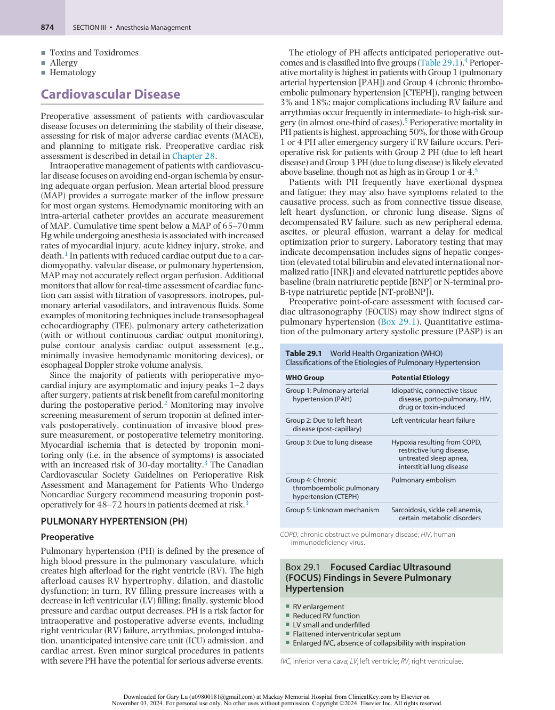

:::

<!-- PDF page 3 -->

advanced skill requiring diagnostic echocardiography. If tricuspid regurgitation (TR) is present, continuous- wave Doppler measurement of the TR jet velocity provides an estimate of the right ventricular systolic pressure (RVSP). The pressure gradient, added to an estimation of the right atrial pressure, provides an estimate of the PASP (in the absence of pulmonary valve stenosis). Clinically significant pulmonary hypertension may be present if TR jet velocity is >3.4 m/s (equating to a gradient of 46 mm Hg); if there is flattening of the interventricular septum with RV/LV diameter ratio of >1.0; and if the inferior vena cava (IVC) diameter is dilated at >21 mm with &lt;50% inspiratory collapse.6 Echocardiography may also reveal signs of left heart disease contributing to PH, such as mitral regurgitation, mitral stenosis, LV systolic dysfunction, or LV hypertrophy and diastolic dysfunction.

While no accepted “protocols” exist for perioperative management of PH patients, a 2021 systematic review and expert consensus statement of noncardiothoracic and nonobstetric surgery in patients with PH provides some general recommendations for management (Table 29.2).5

### Intraoperative

Patients with significant PH require vigilant monitoring and careful titration of anesthetic agents to avoid hemodynamic instability. The primary principles for hemodynamic management of PH patients include (1) anticipate and manage changes in pulmonary vascular resistance (PVR), (2) manage RV preload, and (3) avoid RV ischemia. See Table 29.3 for more details. RV failure is precipitated by PVR increases, RV volume overload, or RV ischemia from right coronary artery (RCA) malperfusion. PVR increases from hypoxia, hypercarbia, hypothermia, acidosis, and sympathetic stimulation.7 The combination of chronic RV hypertrophy and increased intramural pressure leads to increased oxygen demand and decreased supply, making the RV vulnerable to ischemia. Particularly when the RV systolic pressure approaches equalization with the systemic systolic pressure, perfusion of the RCA becomes critical.8 Excess volume administration and RV volume overload compresses the interventricular septum, limits LV filling, causing hypotension and RV ischemia. Further volume administration in this setting exacerbates RV failure and can result in death.9

Avoiding general anesthesia and intubation is preferable if regional or neuraxial anesthesia is feasible. A slowly titrated epidural, or low- dose spinal anesthetic, results in a more gradual onset of the hemodynamic changes associated with a sympathetic block. Vasodilation and decreased preload from a dense sympathetic block can precipitate RV failure; these effects can be mitigated with a peripherally acting vasoconstrictor and selecting the lowest local anesthetic dose that provides adequate blockade for the procedure. When administering sedation, whether in addition to neuraxial or regional anesthesia or as the sole anesthetic, deep sedation is avoided due to the potential for hypercarbia and hypoxia with hypoventilation. If selecting between deep sedation or general anesthesia as the primary anesthetic choice, risk factors for hypoventilation (such as obesity, difficult airway, instrumentation of the airway for the procedure) are considered to determine whether intubation and controlled ventilation is the preferred choice.

**Table 29.2** Expert Consensus Perioperative Management Recommendations for Patients with Pulmonary Hypertension (PH)

||**Recommendations**|
|---|---|
|1|Cases should be discussed preoperatively in a multidisciplinary setting. A nonsurgical approach or local/ regional anesthesia is preferred when feasible.|
|2|Preoperative risk assessment includes evaluating RV function and optimizing comorbid conditions.|
|3|Elective procedures should be performed in centers with sufficient anesthetic and postoperative intensive care expertise.|
|4|Patients should be counseled about increased perioperative risk of death or major cardiovascular complications.|
|5|Pulmonary vasodilator therapy should not be interrupted before surgery and therapies modified if postoperative administration is not possible (e.g. switch oral to intravenous therapy).|
|6|Advanced hemodynamic monitoring is recommended and may include systemic arterial pressure monitoring, pulmonary artery catheterization or transesophageal echocardiography|
|7|A detailed anesthetic management plan should be developed and discussed with all team members, including a postoperative analgesia plan. Regional anesthesia should be considered and general anesthesia avoided when possible. Early initiation of vasopressors, inotropes, or inodilators to support hemodynamics is advised and continued postoperatively.|
|8|Hemodynamic monitoring after major elective surgery should continue for 48–72 hours postoperatively, when most events occur.|
|9|A plan for managing an acute PH crisis should be in place and may include instituting inotropes and vasopressors to support right ventricular function, inhaled or intravenous pulmonary vasodilators, optimizing preload, or the use of extracorporeal membrane oxygenation (if available and appropriate)|
|10|Extracorporeal membrane oxygenation may be a rescue option for perioperative hemodynamic instability. Use should be discussed in advance of surgery.|
|11|Patients with severe PH requiring endoscopy should be carefully monitored by experienced clinicians.|

### Postoperative

Regional anesthesia and multimodal analgesia are advised whenever possible to decrease sympathetic stimulation from pain and to avoid the potential for hypoxia and hypercarbia in response to opioid administration. Postoperative monitoring in the ICU for up to 72 hours may be warranted after major surgery in the highest-risk patients. Shared management of postoperative care with a pulmonary hypertension specialist is essential for patients with Group 1 PH, particularly when pulmonary vasodilators are used chronically.

### HEART FAILURE (HF) AND CARDIOMYOPATHIES

### Preoperative

Heart failure (HF) is a structural or functional disease of the heart resulting in clinical symptoms (such as dyspnea, fatigue, and edema) and signs of pulmonary or systemic

::: details 原始表格與符號（PDF 第 3 頁）

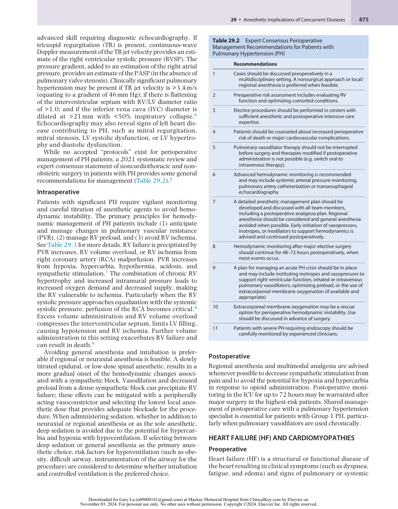

:::

<!-- PDF page 4 -->

**Table 29.3** Principles for Hemodynamic Management of Pulmonary Hypertension and Perioperative Management Strategies

||**Goal**|**Concern**|**Management**|
|---|---|---|---|
|Anticipate and manage changes in PVR|Avoid hypoxia or hypercarbia Avoid hypothermia Avoid acidosis|Increased PVR can precipitate RV failure. HPV improves regional ventilation and perfusion matching, but increases PVR.|ᑏContinue pulmonary vasodilator medications perioperatively with no interruption ᑏAvoid oversedation from preoperative anxiolytics or postoperative opioids ᑏOptimize ventilation to prevent atelectasis and avoid elevated intrathoracic pressure ᑏAvoid intraoperative nitrous oxide (elevates PVR) l|
||Avoid sympathetic stimulation||ᑏAvoid hypercarbia during laparoscopic insufflation ᑏConservative airway management approach ᑏWarmed IV fluids, forced air warming ᑏMultimodal pain management strategy including regional anesthesia ᑏConsider use of a PAC to guide pulmonary vasodilator therapy|
|Manage RV preload|Maintain RV filling pressure Avoid fluid overload|RVH reduces compliance requiring higher filling pressures to maintain output. RV volume overload shifts the interventricular septum, compressing the LV and reducing filling, causing hypotension.|ᑏGradual pneumoperitoneum insufflation ᑏPromptly treat intraoperative volume loss/ hemorrhage ᑏAvoid fluid overload, aim for net neutral fluid balance ᑏConsider use of TEE to assess RV function and septal position to guide fluid status ᑏConsider use of a PAC to assess RV function|
|Avoid RV ischemia|Maintain adequate SVR|RV is vulnerable to ischemia due to increased oxygen demand from RVH and reduced RCA perfusion due to elevated RV transmural pressure. Systemic hypotension causes ischemia, RV dilation, and further hypotension.|ᑏUse vasopressors to maintain SVR ᑏUse inotropes to support reduced RV function to maintain systemic blood pressure ᑏAvoid sudden hypotension with spinal anesthesia, consider titrated epidural|

_HPV_ , hypoxic pulmonary vasoconstriction; _IV_ , intravenous; _LV_ , left ventricle; _PAC_ , pulmonary artery catheter; _PVR_ , pulmonary vascular resistance; _RCA_ , right coronary artery; _RV_ , right ventricle; _RVH_ , right ventricular hypertrophy; _SVR_ , systemic vascular resistance; _TEE_ , transesophageal echocardiogram

venous congestion.10 A new classification system (Table 29.4) published in 2021 proposes a universal definition of HF based on LV ejection fraction (LVEF).10 Patients with HF are at increased risk for major adverse cardiac events with noncardiac surgery. For the preoperative assessment of patients with heart failure, see Chapter 28.

The etiology of HF can have an impact on anesthetic management and is often classified as a cardiomyopathy. Specific etiologies for cardiomyopathy include ischemic, non- ischemic, valvular (such as with severe aortic insufficiency or severe mitral regurgitation), hypertensive, infiltrative (such as with amyloidosis or hemochromatosis), peripartum, viral myocarditis, or stress- induced (takotsubo). Heart failure may also be classified by the morphologic appearance and function of the heart, such as in dilated cardiomyopathy (DCM), hypertrophic cardiomyopathy (HCM), or restrictive cardiomyopathy (RCM). DCM is characterized by dilation, thinning, and impaired contraction of one or both ventricles frequently leading to heart failure with reduced ejection fraction (HFrEF); many etiologies may be responsible, or it can be idiopathic. HCM is a genetic disease that causes LV asymmetric hypertrophy, diastolic dysfunction, arrythmias, and often (but not always) LV outflow tract (LVOT) obstruction; HF symptoms result from heart failure with preserved ejection fraction (HFpEF) or patients may have an elevated (>70%) LVEF. RCM is characterized by severe diastolic dysfunction due to myocardial injury from medications or infiltrative disease; most patients have HFpEF or heart failure with mid- range ejection fraction (HFmrEF). Understanding the mechanism for heart failure informs management decisions intraoperatively.

**Table 29.4** Universal Classification System for Heart Failure (2021)

|**Acronym**|**Definition**|**LVEF**|
|---|---|---|
|HFrEF|HF with reduced EF|≤40%|
|HFmrEF|HF with mildly reduced EF|41–49%|
|HFpEF|HF with preserved EF|≥50%|
|HFimpEF|HF with improved EF|Baseline HFrEF and≥10- point increase with second measurement >40%|

_HF,_ heart failure; _LVEF_ , left ventricular ejection fraction.

### Intraoperative

The hemodynamic goal for managing patients with HF intraoperatively is to maintain adequate cardiac output and perfusion pressure to organs to avoid ischemic injury. The brain, kidneys, and heart are particularly vulnerable to ischemia. In general, this is accomplished by maintaining euvolemia, supporting contractility, balancing myocardial oxygen supply with demand, and managing arrythmias. Patients with concomitant coronary artery disease (CAD) are particularly susceptible to myocardial ischemia, such as in ischemic cardiomyopathy. Yet, myocardial ischemia can happen in the absence of significant CAD when the increased oxygen demand of a hypertrophied ventricle exceeds supply, such as in hypertensive, infiltrative, or hypertrophic cardiomyopathies. Regardless of the type of HF, administering a vasopressor is the initial step in the management of intraoperative hypotension to counteract anesthetic- induced vasodilation and to maintain adequate systemic vascular resistance.

::: details 原始表格與符號（PDF 第 4 頁）

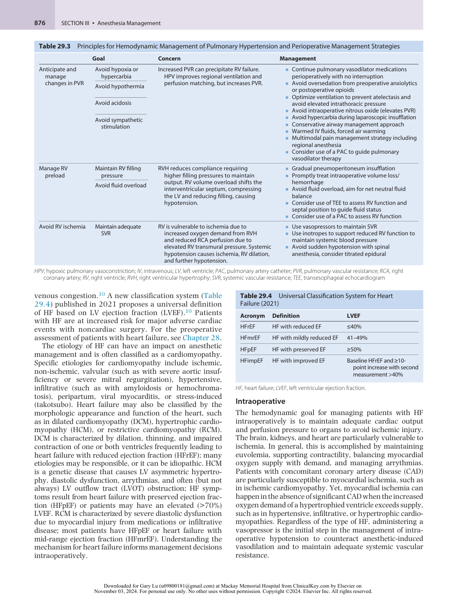

:::

<!-- PDF page 5 -->

Patients with all HF types are vulnerable to exacerbation of pulmonary or systemic venous congestion with excess volume administration. However, well- optimized patients taking diuretics frequently become hypotensive from the reduction in preload at initiation of positive pressure ventilation, establishment of neuraxial blockade, insufflation of a pneumoperitoneum, or blood loss. Judicious fluid administration to counteract loss of preload can be guided by TEE or cardiac output monitoring.

In HFrEF, inotrope administration may be required to augment cardiac output if hypotension occurs despite adequate preload and systemic vascular resistance. The addition of an inotrope will frequently increase heart rate in addition to augmenting stroke volume. While improving cardiac output, an inotrope also increases myocardial oxygen demand and may predispose to dysrhythmias. In patients with HFpEF or HFmrEF, an inotrope may be detrimental to cardiac output, as the ventricle is dependent on adequate diastolic filling time and a slower heart rate.

Arrythmias are common in heart failure. Preoperative placement of external pacing and defibrillation pads is considered in patients with decompensated HF or a history of arrythmias if access to the chest will be difficult intraoperatively. Atrial fibrillation occurs commonly in patients with HF due to shared risk factors. Approximately 40% of people with either atrial fibrillation or HF will develop the other disease.11 A rate- control strategy with beta blockade is appropriate for patients with HFpEF or HFmrEF, while amiodarone or digoxin may be more appropriate for patients with HFrEF. Catheter ablation for patients with HFrEF reduces all- cause death and/or hospitalizations for heart failure over medical therapy alone and is the preferred long- term management strategy.12 Premature ventricular complexes (PVCs), ventricular tachycardia, and ventricular fibrillation (VF) occur frequently. If three or more PVCs occur consecutively with a rate of >100 beats/min, this is termed non- sustained ventricular tachycardia (NSVT). In the general population, NSVT is independently associated with an increased risk of death, cardiac adverse events, and stroke.13 Ventricular tachycardia related to scarring from structural heart disease or from myocardial ischemia can degenerate to VF and cardiac arrest. New or increasing runs of NSVT are treated with antiarrhythmic medications, optimizing myocardial oxygen supply, and preparation for external defibrillation if VF occurs. Arrythmias and cardiac arrest are treated according to advanced cardiac life support algorithms.

Many patients with HF have a pacemaker for cardiac resynchronization therapy or an implantable cardioverterdefibrillator (ICD) for either primary or secondary prevention of sudden cardiac death. See the section below on Cardiovascular Implantable Electronic Device (CIED) for further details.

There are specific management considerations for HCM when LVOT obstruction from systolic anterior motion (SAM) of the mitral valve is present. Hemodynamic states that cause dynamic worsening of SAM (and therefore worse mitral regurgitation) include an elevated heart rate, increased contractility, hypovolemia, and atrioventricular dyssynchrony (such as in atrial fibrillation or supraventricular tachycardia). Intraoperative hypotension is treated by increasing systemic vascular resistance and fluid administration. Counterintuitively, administering a beta blocker may improve blood pressure and cardiac output by reducing LVOT obstruction,

while inotropes may worsen cardiac output. TEE is a valuable tool for monitoring the response to treatment.

### Postoperative

Patients at risk for systemic hypotension or requiring vasoactive medications are monitored in the ICU after surgery.

### ISCHEMIC HEART DISEASE

### Preoperative

Patients with coronary artery disease (CAD) are at increased risk for major adverse cardiac events with noncardiac surgery, particularly in the setting of recent myocardial ischemia or infarction (&lt;60 days). Patients with recent coronary artery stent placement require assessment for appropriate timing of surgery related to discontinuation of antiplatelet therapy. For the preoperative assessment of patients with CAD and coronary stents, see Chapter 28. For the management of patients with severe CAD having cardiac surgery, see Chapter 50.

### Intraoperative

In patients at risk for perioperative cardiac ischemia, management of anesthesia focuses on preventing and treating consequences of ischemia. Intraoperative hemodynamic goals are summarized in Box 29.2. High peak intraoperative heart rate (>100 beats/min) is associated with increased myocardial injury, infarction, and perioperative mortality, while a lowest intraoperative heart rate of &lt;55 beats/min is associated with reduced risk.14 While intraoperative hypotension is frequently cited as a major driver of ischemia, a maximum systolic blood pressure of >160 mm Hg is also associated with increased myocardial injury and infarction.14 Intraoperative monitors allow for early detection of ischemia and instituting treatment according to hemodynamic goals. An intra- arterial catheter for invasive blood pressure measurement and TEE are frequently used for real- time assessment and guiding therapy when treating patients at high risk for perioperative myocardial ischemia.

### Postoperative

Close monitoring postoperatively for ischemia detection may include continuous electrocardiogram (ECG) monitoring, serial cardiac biomarker measurement (e.g., troponin, proBNP), and ongoing blood pressure management in the ICU if vasoactive infusions are required. Optimal postoperative pain management using regional anesthesia, when possible, helps prevent increased heart rate and blood pressure from pain. Ineffectively treated pain can precipitate myocardial ischemia from increased oxygen demand.

### CARDIAC IMPLANTABLE ELECTRONIC DEVICE (CIED)

CIEDs are used to treat patients with primary conduction disease (pacemaker), for prevention of sudden cardiac death

### Box 29.2 Hemodynamic Goals in Patients with Coronary Artery Disease (CAD) for Prevention of Ischemia

- Low to normal heart rate target

- Treat blood pressure to avoid hypotension

- Normal left ventricular end- diastolic volume

- Maintain adequate oxygen supply, reduce oxygen demand

<!-- PDF page 6 -->

### Box 29.3 Intraoperative and Postoperative Management Recommendations for Patients with a Cardiac Implantable Electronic Device (CIED)

### General Intraoperative Recommendations

- Continuously monitor and display the electrocardiogram and pulse oximetry according to American Society of Anesthesiologists standards throughout anesthesia

- Monitor the hemodynamically conducted peripheral pulse through either pulse oximetry or arterial pressure waveform

- If unanticipated interference with CIED function occurs, suspend the procedure until the source is identified and managed

- **If EMI is anticipated** , ensure the CIED for pacing- dependent patients is placed into asynchronous mode and ICD antitachycardia function is disabled. The clinical scenario will dictate whether magnet application or reprogramming is most suitable

- Ensure the patient is in a monitored environment before suspending ICD anti- tachycardia function

- **Electrosurgery**

- EMI is anticipated if monopolar cautery is used superior to the umbilicus

- Position the dispersive electrode so the current pathway does not pass through the device or leads

- Use short, intermittent bursts of monopolar electrocautery or avoid altogether if bipolar electrocautery or ultrasonic (harmonic) scalpel is feasible

### Radiofrequency Ablation

- EMI is anticipated if radiofrequency ablation is used superior to the umbilicus

- Avoid direct contact between the ablation catheter and the CIED

- Keep the current pathway away from the device or leads

### Lithotripsy

- Do not focus the lithotripsy beam near the device

### Magnetic Resonance Imaging (MRI)

- EMI is anticipated with MRI

- Further information is found in _2017 Heart Rhythm Society Expert Consensus Statement on Magnetic Resonance Imaging and Radiation Exposure in Patients with Cardiovascular Implantable Electronic Devices_

- Follow a standardized institutional protocol or workflow ᑏ Use of an external defibrillator or device programmer must occur outside of the MRI room

- Ensure an individual capable of performing advanced cardiac life support remains in attendance for the duration of the MRI

### Electroconvulsive Therapy (ECT)

- EMI is anticipated during seizure stimulus and arrhythmias may occur

- Monitor for and treat posttreatment sinus tachycardia or ventricular arrythmias

### General Postoperative Recommendations

- Ensure backup pacing or defibrillation equipment is immediately available and patient remains in a monitored environment until the CIED settings are restored

- Postoperative CIED interrogation is indicated if: emergency surgery with limited preoperative evaluation, delivery of antitachycardia therapy was suspected, surgery or EMI occurred in close proximity of device

_EMI_ , electromagnetic interference; _ICD_ , implantable cardioverter- defibrillator.

From the _Practice Advisory for the Perioperative Management of Patients with Cardiac Implantable Electronic Devices: Pacemakers and Implantable Cardioverter- Defibrillators 2020_ .

from a tachyarrhythmia (ICD), or for improving HF symptoms (cardiac resynchronization therapy [CRT] device). Devices are often placed to perform multiple functions, for example, CRT and defibrillation (CRT- D). Recommendations for the perioperative management of CIEDs are found in a Practice Advisory from the American Society of Anesthesiologists (ASA), most recently updated in 2020.15 See Box 29.3 for recommendations for the intraoperative and postoperative management of patients with a CIED.15 See Chapter 28 for the preoperative assessment of a patient with a CIED and Chapter 34 for an exhaustive discussion of CIEDs.

### CONDUCTION DISEASES: BRUGADA SYNDROME, CONGENITAL LONG QT SYNDROME (LQTS), WOLFF–PARKINSON–WHITE (WPW) SYNDROME

### Preoperative

Brugada syndrome, congenital LQTS, and WPW syndrome are conditions causing electrocardiogram (ECG) abnormalities in the absence of significant structural heart disease. All can lead to life- threatening tachyarrhythmias in young patients and have specific anesthetic management considerations.

Brugada syndrome is a genetic disease that causes covedtype ST segment elevation in the right precordial leads and a pseudo right bundle branch block (RBBB) due to sodium

channel abnormalities.16 Ventricular tachycardia or fibrillation causes sudden cardiac arrest or death in young patients. Patients are managed by avoidance of provoking medications and often have an ICD for prevention of sudden cardiac death.

Congenital LQTS is a repolarization disorder of the myocardium that prolongs the corrected QT (QTc) interval leading to risk of symptomatic ventricular arrhythmias (polymorphic ventricular tachycardia/torsades de pointes [TdP]) and sudden cardiac death. A QTc ≥480 ms in females or ≥470 ms in males is abnormal and supports the diagnosis.17 Patients are primarily managed by avoiding QT- prolonging medications and initiating beta blockade to avoid catecholamine surges that could trigger arrythmias.17 Management options may also include cardiac sympathetic denervation and/or placement of an ICD. Acquired LQTS is usually induced by QT- prolonging medications and treatment focuses on removing sources of prolonged QT. Management differs from congenital LQTS in that bradycardia further prolongs QTc (i.e., beta blockade is not indicated) and ICD placement is not recommended.

WPW syndrome is characterized by a congenital accessory atrioventricular (AV) pathway that bypasses the AV node, allowing for early activation (“preexcitation”) of the His–Purkinje system. ECG findings usually include a shortened PR interval and a delta wave (i.e., slurred upstroke and widening of the QRS complex), though not all accessory

<!-- PDF page 7 -->

pathways result in a delta wave. Several tachyarrhythmia types may cause symptoms in WPW syndrome. AV reentrant tachycardia (AVRT) occurs when there is antegrade conduction through the AV node and retrograde conduction via the accessory pathway (i.e., orthodromic AVRT) or antegrade conduction through the accessory pathway and retrograde conduction via the AV node (i.e., antidromic AVRT). If atrial fibrillation occurs, the accessory pathway can allow for rapid conduction and rapid ventricular rates, which can degenerate into VF. Management of WPW syndrome is with an electrophysiology study and ablation of the accessory pathway.18

### Intraoperative

**Brugada Syndrome.** Many perioperative medications interact with sodium channels, yet given the rarity of Brugada syndrome, recommendations for drugs to avoid are based on expert opinion and case reports.19 The website www.brugadadrugs.org is maintained by a group of international experts to provide information on safe drug use in Brugada syndrome patients. Recommendations for medications relevant to intraoperative care are listed in Box 29.4.16 Medications that worsen ST segment elevation in the precordial leads (V1–V3) consistent with Brugada pattern indicate a pro- arrhythmogenic state. Propofol is listed as a drug to avoid in the setting of intravenous infusions, as Brugada pattern ECG changes have been observed with prolonged infusions (i.e., hours to days). A bolus dose for induction of anesthesia is likely safe if alternatives, such as thiopental or etomidate, are not available. Volatile anesthetics have no association with adverse events. Case reports exist documenting Brugada pattern ECG changes and arrythmias with regional anesthesia, both with single injection and continuous infusion of local anesthetics.19 If local anesthetic infiltration is considered, use the lowest possible dose and include epinephrine. Patients should be monitored until the effects of the medication have resolved. If vasoactive agents are required, beta- receptor antagonism may increase or unmask ST segment elevation, while betareceptor agonism reduces ST segment elevation. See Box 29.5 for treatment of a malignant ventricular arrythmia in Brugada syndrome.

### Box 29.4 Intraoperative Medication Recommendations for Patients with Brugada Syndrome

|**Avoid if Possible**|**Avoid**|
|---|---|
|ᑏAmiodarone|ᑏClass 1A and 1C|
|ᑏLidocaine*|antiarrhythmic|
|ᑏPropranolol|medications|
|ᑏVerapamil|ᑏAmitriptyline|
|ᑏPhenytoin|ᑏBupivacaine|
|ᑏKetamine|ᑏPropofol**|
|ᑏTramadol|ᑏErgonovine|
|ᑏDiphenhydramine||
|ᑏMetoclopramide||

*Skin infiltration of lidocaine with epinephrine in low doses can be considered.

**In particular, avoid prolonged propofol infusions.

**Congenital LQTS.** Intraoperative management of congenital LQTS focuses on avoiding precipitating TdP and prompt management, if it occurs. Many medications are known to prolong QTc. See Box 29.6 for a select list of relevant perioperative medication recommendations20 and www.crediblemeds.org for a searchable drug list. Catecholamine surges trigger TdP in congenital LQTS (in contrast, TdP is triggered during bradycardic episodes with acquired LQTS). Beta blockers are the mainstay of therapy and are continued perioperatively. Triggers for sympathetic stimulation are avoided, such as inadequate anxiolysis, light anesthesia, hypoxia or hypercapnia, emergence agitation, inadequate analgesia. See Box 29.7 for treatment of TdP in LQTS.

**WPW Syndrome.** Intraoperative management of WPW syndrome in patients who have not had their accessory pathway ablated focuses on treatment of potential tachyarrhythmias. The most common tachyarrhythmia in WPW is orthodromic AVRT, which does not have the potential to degenerate to VF.21 Orthodromic AVRT features a regular narrow complex tachycardia and, if stable, is treated with vagal maneuvers, adenosine, calcium channel blockers or beta blockers. However, there are scenarios where AV nodal blocking agents are contraindicated over concern they may precipitate VF, so adenosine, verapamil, diltiazem, beta blockers, and digoxin should not be administered. Two specific scenarios that apply are antidromic AVRT, which causes a regular wide- complex tachycardia, and atrial fibrillation with preexcitation, which causes an irregular wide- complex tachycardia with heart rates greater than 200 beats/min. AV nodal blockers increase the risk for VF by slowing conduction through the AV node, which results in rapid antegrade conduction down the accessory pathway. Procainamide is the recommended treatment for tachycardia in antidromic AVRT or atrial fibrillation with preexcitation, or when diagnostic uncertainty exists. Treatment with procainamide will slow the tachycardia by slowing conduction of both pathways.

### Box 29.5 Treatment of a Malignant Arrythmia in Brugada Syndrome

|Recognize ventricular|External defibrillation (or|
|---|---|
| tachycardia/ventricular fibrillation|i remove magnet from ICD, if in place)|
|Stop potential precipitating|Fever: administer antipyretic|
|cause|and actively cool patient Arrhythmogenic|
||medications: stop local anesthetic administration and consider administration of Intralipid 20% Correct electrolytes:|
||particularly hyperkalemia|
|Therapeutic treatment|Administer isoproterenol (1–2 mcg intravenous bolus, 0.15–2.0 mcg/min infusion)|
|Postoperative care|Admit to ICU or cardiac care unit for ECG monitoring|

_ECG_ , electrocardiogram; _ICD_ , implantable cardioverter-defibrillator; _ICU_ , intensive care unit.

::: details 原始表格與符號（PDF 第 7 頁）

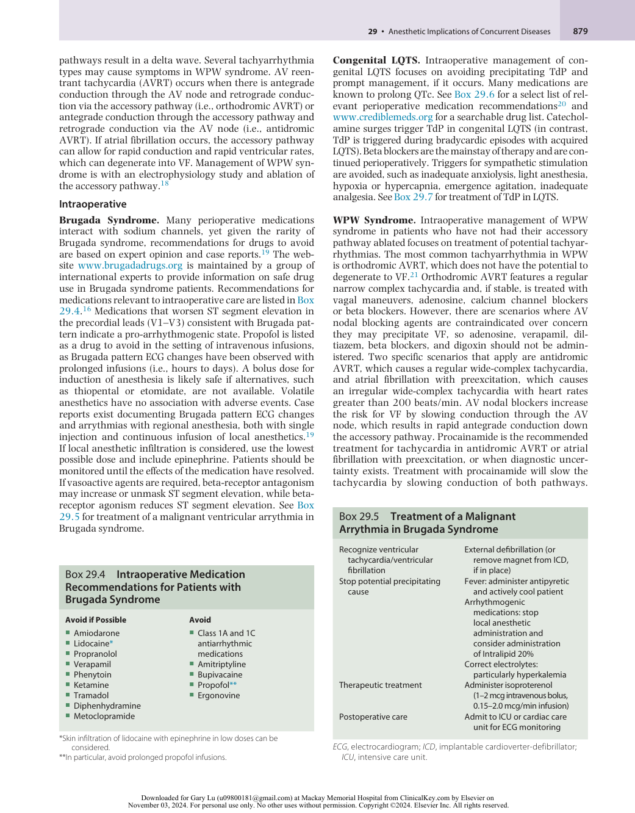

:::

<!-- PDF page 8 -->

### Box 29.6 Select Medications with Recommendations for Perioperative Use in Congenital Long QT Syndrome (LQTS)

### Avoid if Possible

### Likely Safe

|ᑏAntibiotics: macrolide, l|ᑏAnti- nausea/anti-|
|---|---|
|fluroquinolone|emetic: dexamethasone,|
|ᑏAnti- nausea/anti- emetic:|metoclopramide|
|diphenhydramine,|ᑏAnesthetics: midazolam,|
|haloperidol, droperidol,|propofol, etomidate|
|ondansetron, phenothiazines|ᑏAlpha- agonists:|
|ᑏAnesthetics: ketamine,|phenylephrine|
|volatile anesthetics|ᑏMuscle relaxants:|
|ᑏBeta- agonists: ephedrine,|nondepolarizing|
|dopamine, dobutamine, epinephrine, norepinephrine, albuterol|neuromuscular blocking agents, sugammadex ᑏOpioids: fentanyl,|
|ᑏMuscle paralysis:|remifentanil, morphine|
|depolarizing neuromuscular||
|blocking agents, anticholinesterase, and anticholinergic agents||

- Opioids: methadone

Regardless of the arrythmia type, hemodynamic instability prompts external cardioversion as the initial treatment for VF, or synchronized cardioversion for tachycardia with pulses. See Box 29.8 for a summary of treatment recommendations in tachyarrhythmias in a patient with known WPW syndrome.

## Pulmonary Disease

### OBSTRUCTIVE LUNG DISEASE (ASTHMA/COPD)

Chronic obstructive pulmonary disease (COPD) is characterized as persistent airflow limitation which is often progressive (see Table 29.5 for defining severity). There is underlying chronic inflammation, reactive airways, and parenchymal destruction. COPD includes chronic bronchitis and emphysema and varying combinations of the two. Chronic bronchitis is defined as a chronic productive cough for at least 3 months each year for at least 2 successive years, without another defined cause. Chronic bronchitis is a result of mucus gland proliferation with excessive secretions, airway plugging, increased airway resistance, and chronic inflammation. Emphysema is destruction of lung tissue, and typically hyperinflation. The most important underlying cause of COPD is cigarette smoking, specifically pack- years of abuse. Other underlying causes include environmental and occupation exposures (e.g., pollution), genetic factors (e.g., alpha- 1 antitrypsin deficiency), and childhood illnesses (e.g., asthma, neonatal bronchopleural dysplasia). It is unknown if the popularity of marijuana inhalation will be similarly harmful. Other diseases that result from tobacco abuse are important to consider as well.

COPD is considered for patients with complaints of cough, shortness of breath, dyspnea on exertion, or sputum production, especially with underlying risk factors. A diagnosis of COPD is determined by spirometry with a forced

### Box 29.7 Treatment of Polymorphic Ventricular Tachycardia (TdP) in Congenital Long QT Syndrome (LQTS)

|Recognize polymorphic ventricular tachycardia|External defibrillation (or remove magnet from ICD, if in place)|
|---|---|
|Stop potential precipitating cause|Sympathetic stimulation: pause surgery, administer analgesia, stop administration of beta- agonists Correct electrolytes: particularly hypokalemia Stop volatile anesthesia: switch to total intravenous anesthesia|
|Therapeutic treatment|Administer magnesium sulfate (25–50 mg/kg|
||over 2–3 min, second|
||bolus 2–4 mg/kg after 15 min)|
||Consider transvenous overdrive pacing at 90–110 beats/min if recurrence|
|Postoperative care|Admit to ICU or cardiac care for ECG monitoring|

_ECG_ , electrocardiogram; _ICD_ , implantable cardioverter-defibrillator; _ICU_ , intensive care unit; _TdP_ , torsades de pointes.

### Box 29.8 Intraoperative Treatment of Tachyarrhythmia in a Patient with Known Wolff– Parkinson–White (WPW) Syndrome

|Stable, regular, narrow- complex tachycardia|Likely orthodromic AVRT: treat with vagal maneuvers, adenosine, verapamil, or procainamide|
|---|---|
|Stable, regular, wide-complex tachycardia|Likely antidromic AVRT or ventricular tachycardia: avoid AV nodal blockers and treat with procainamide (amiodarone as second line)|
|Stable, irregularly irregular|Likely atrial fibrillation ±|
|tachycardia with high ventricular rate|preexcitation: avoid AV nodal blockers and treat with procainamide (amiodarone as second line)|
|Stable, tachycardia with indeterminate QRS complex and regularity|Differential includes orthodromic AVRT with aberrancy, supraventricular tachycardia with bundle branch block, ventricular tachycardia, antidromic AVRT, or atrial fibrillation ± preexcitation: avoid AV nodal blockers and treat with procainamide (amiodarone as second line)|
|Unstable tachycardia|Synchronized cardioversion if regular rhythm, or defibrillation if irregular|
||rhythm or cardiac arrest|

_AV_ , atrioventricular; _AVRT_ , atrioventricular reentrant tachy cardia.

::: details 原始表格與符號（PDF 第 8 頁）

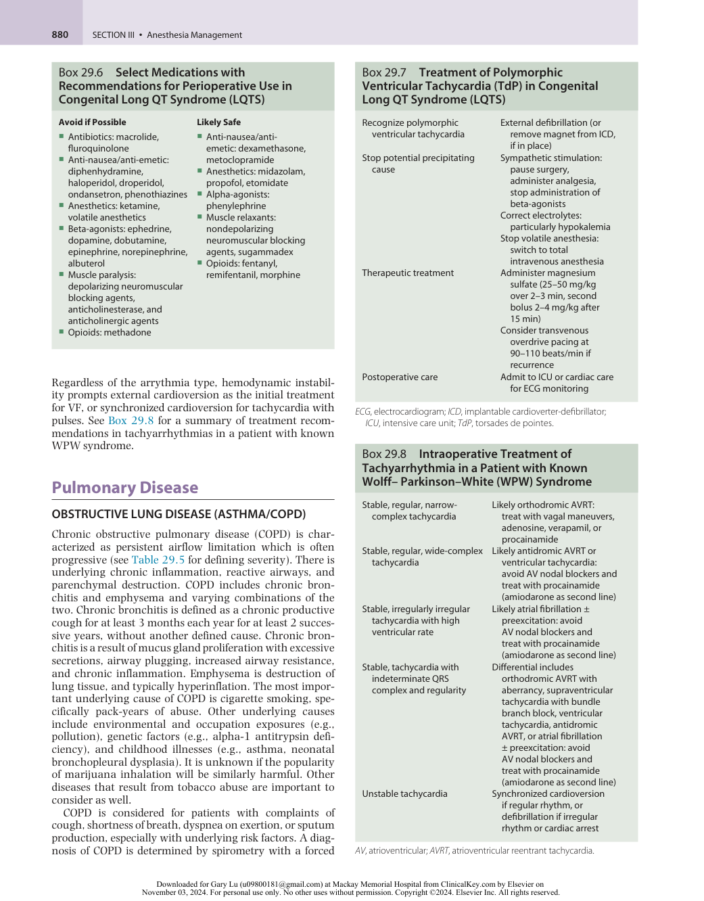

:::

<!-- PDF page 9 -->

**Table 29.5** Classification of Chronic Obstructive Pulmonary Disease (COPD) by Degree of Airflow Limitation per the GOLD (Global Initiative for Chronic Obstructive Lung Disease) Initiative

|**GOLD Stage**|**Severity**|**FEV1/FVC**|**FEV1% predicted**|
|---|---|---|---|
|GOLD I|Mild COPD|&lt;0.7|>80|
|GOLD II|Moderate COPD|&lt;0.7|50–80|
|GOLD III|Severe COPD|&lt;0.7|30–50|
|GOLD IV|Very severe COPD|&lt;0.7|&lt;30|

_FEV1_ , forced expiratory volume in 1 second; _FVC_ , forced vital capacity.

expiratory volume in 1 second (FEV1)/forced vital capacity (FVC) ratio of less than 0.7 postbronchodilator (confirming non- reversibility of airway obstruction). The differential diagnosis includes asthma, chronic bronchitis without obstruction of airflow, foreign bodies, aspiration, anaphylaxis, tracheal stenosis or tracheomalacia, heart failure, pneumonia, tuberculosis, and bronchiectasis. Pulmonary hypertension with right heart failure occurs with severe COPD and significantly impacts perioperative risk.

Asthma is primarily a disease of inflammation that results in airway narrowing and obstruction that is typically reversible. Patients with well- controlled asthma that is not steroid- dependent do not have increased risk of perioperative complications.

### Preoperative

Preoperative evaluation and preparation of patients with COPD and asthma are covered in Chapter 28. Exacerbations of disease should be treated preoperatively. Surgery should be delayed to treat and resolve infections unless the surgery is to treat the infections. Pulmonary function tests (PFTs) may be indicated for diagnosis or management decisions but have not been shown to predict postoperative pulmonary complication (PPC) except for patients having lung resections. The 6- minute walk test (6MWT) assesses the distance a patient walks in 6 minutes and the oxygen saturation by pulse oximetry during the test and compares the results to normal values and previous ones for a given patient. Patients should continue bronchodilators and chronic steroids preoperatively. If surgery cannot be delayed in patients with exacerbations, a short course of preoperative high- dose steroids (e.g., 40–60 mg/day for 3 days) can be effective.

### Intraoperative

Avoiding general anesthesia and tracheal intubation, limiting fluids, careful titration of short- or intermediate- acting neuromuscular blockers, use of train- of- four monitoring, and complete reversal of neuromuscular blockade, perhaps with sugammadex, have advantages.22

Monitored anesthesia care (MAC) may be advantageous if deep sedation is avoided. Over- sedation can lead to hypercarbia and elevated pulmonary artery pressures. Agents that are short- acting, or have minimal or rapidly reversible ventilatory depressant effects, are preferred. The α2- agonist dexmedetomidine may have advantages. Peripheral nerve blocks, with a few exceptions, can completely avoid impacting ventilation. However, interscalene, supraclavicular, and infraclavicular blocks may have deleterious effects on

pulmonary function via phrenic nerve paralysis or risk of a hemopneumothorax.

Oxygenation is impaired with general anesthesia and with supine positioning even in patients with no lung disease. Maintaining a head- up position (e.g., flexing the back of the bed or reverse Trendelenburg) will maintain functional residual capacity (FRC). Bronchospasm can result from intubation, airway suctioning, inhalation of cold anesthetic gases, nasogastric tube insertion, peritoneal insufflation during laparoscopy, surgical stimulation, endoscopy, or from some medications. Airway tone may increase because of vagally stimulating events such as with manipulation of viscera during abdominal surgery or endoscopy. Strategies to reduce intraoperative ventilatory impairment and PPC include using lung- protective ventilation strategies with low tidal volumes (approximately 6 mL/kg), and positive end- expiratory pressure (PEEP). Adjustments of ventilatory rates are necessary to prevent respiratory acidosis. PEEP levels higher than 10 cmH2O are more likely to cause hypotension. If patients have secondary pulmonary hypertension the risk of anesthesia and surgery is increased.23 Increases in pulmonary vascular resistance (PVR) should be avoided. Hypoxemia, hypercapnia, acidosis, hyperthermia, nitrous oxide, lung hyperinflation, high PEEP, and large tidal volumes can all increase PVR. A patient with bullous disease can develop a sudden pneumothorax from barotrauma **.**

Patients should continue all routine medications, especially β- agonists. Administration of a short- acting β2agonist (e.g., albuterol 2–4 puffs) or nebulized albuterol (2.5 mg) 20–30 minutes before airway manipulation decreases airway reactivity. Corticosteroids may be administered for patients taking long- term corticosteroid therapy. More than 3 weeks of 7.5 mg or more of prednisone daily increases the risk of hypothalamic–pituitary–adrenal suppression and may require supplementation.24–26 (see later section on Adrenal Insufficiency for more details). Inhaled corticosteroids rarely cause adrenal insufficiency except when used in very high doses for refractory symptoms. Therefore, routine parenteral corticosteroids are not necessary for patients with reactive airway disease. Intravenous lidocaine, 1–1.5 mg/kg, administered 1–3 minutes before laryngoscopy or insertion of an endotracheal tube or supraglottic airway can decrease airway reactivity. Sufficiently deep anesthesia prior to intubation reduces airway irritability. Propofol attenuates bronchospasm with intubation in both asthmatic and nonasthmatic patients.27 Inhalational agents and ketamine may have advantages due to their bronchodilating properties. Beta- agonists delivered directly into the breathing circuit, though logistically cumbersome, are effective.

### Postoperative

The risk of PPC is related to the underlying lung disease, the site and type of surgery, and the type and duration of anesthesia.28 Surgeries closest to the diaphragm carry the highest risk. The risk of PPC is highest for open aortic and emergency procedures and are increased threefold after a thoracotomy. Risk increases further with lung resection. Open upper abdominal surgery carries an elevated risk. Procedures outside of the abdomen and thorax have a low risk of PPC.

::: details 原始表格與符號（PDF 第 9 頁）

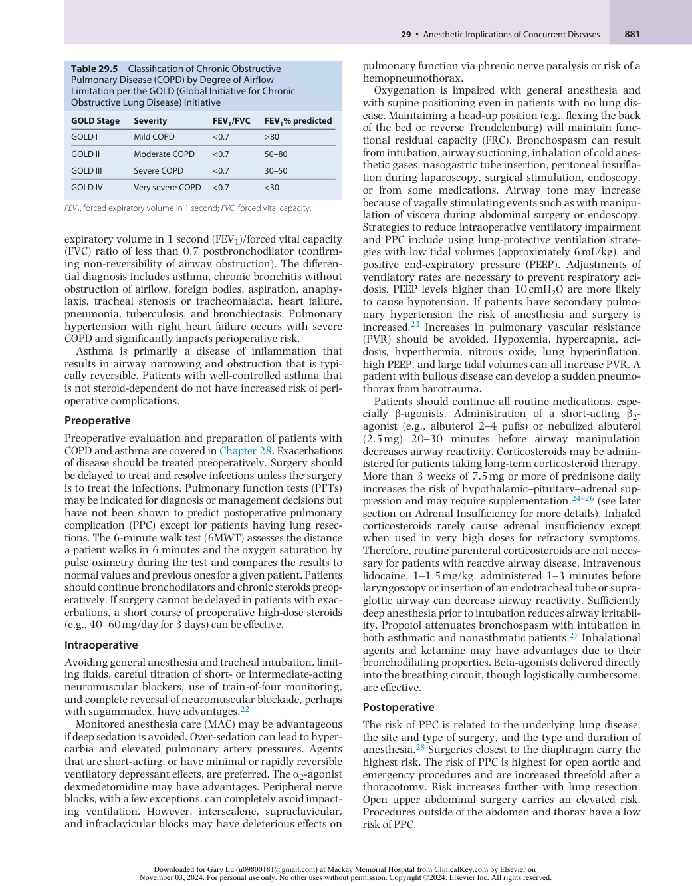

:::

<!-- PDF page 10 -->

The duration of anesthesia is associated with increased PPC, postoperative recovery room length of stay (LOS), total LOS, return to the operating room, and admission to the intensive care unit (ICU). Specifically, procedures longer than 2 hours increase risk in a continuum. PPC are common in patients who are American Society of Anesthesiologists (ASA) physical status 3.29 Even mild PPCs are associated with ICU admissions, increased LOS (both in the ICU and hospital), and postoperative mortality. Epidural analgesia can lower the risk of PPC in open abdominal procedures. Adequate pain control, chest physiotherapy, incentive spirometry, and other lung expansion strategies are used to treat or prevent atelectasis and PPC. Early mobilization, cough, and deep breathing may decrease PPC. Severe obstruction with FEV1 less than 40%, severe hypoxia, and hypercarbia indicate impending ventilatory failure. Continu ous positive airway pressure (CPAP) can reduce reintubations, or bridge a patient to allow extubation, which otherwise would not be possible. Patients who use CPAP should be instructed to bring their devices to the hospital on the day of surgery.

### RESTRICTIVE LUNG DISEASE

Restrictive lung disease results in a reduction in total lung capacity (TLC). The FEV1 and forced vital capacity (FVC) are reduced proportionally and the FEV1:FVC ratio is usually normal or increased. Both intrinsic lung disease and extrapulmonary conditions can result in restrictive pulmonary physiology. Most of the restrictive disorders are characterized by inflammation and fibrosis. Idiopathic interstitial pneumonia, interstitial lung disease (ILD) due to connective tissue disorders or drugs, lung resection, atelectasis, and pneumonia can cause restrictive disease. Obesity, pregnancy, kyphoscoliosis, ankylosing spondylitis, pregnancy, a paralyzed diaphragm(s), neuromuscular weakness, ascites, pleural effusion, pneumothorax, pectus excavatum, and cardiomegaly can be causative.

### Preoperative

Preoperative evaluation is similar as for patients with COPD/asthma. The major differences when evaluating patients with restrictive lung disease is to consider the related conditions such as the impact of connective tissue and immunologic diseases. Evaluation and optimization of treatable conditions impacting pulmonary function should be done. For example, draining ascites or a pleural effusion preoperatively, and treating infections and underlying conditions, can improve pulmonary function and ventilation, and lower the risk of aspiration. Generally, PFTs do not predict PPC except for patients having lung resection surgeries. The diffusing capacity for carbon monoxide (DLCO) can distinguish between ILD in which DLCO is usually reduced and extrapulmonary causes of restriction in which DLCO is usually normal. Chest radiography can assist to evaluate for treatable conditions, and incentive spirometry may have benefits.

### Intraoperative

Patients with restrictive disease desaturate rapidly with apnea. Using CPAP or high-flow nasal cannula will prolong time to desaturation. They may require reduced tidal volumes and will benefit from PEEP. Restrictive lung disease

reduces lung compliance, and patients can develop high intrathoracic pressures, which decreases venous return and cardiac output, causing systemic hypotension. Barotrauma and volutrauma can lead to PPC. Other general principles are similar to those for patients with COPD/asthma. Neuraxial anesthesia for procedures of the lower extremities, and even for thorascopic lung surgeries, have been associated with better outcomes compared to general anesthesia.30

### Postoperative

The same principles used for patients with COPD/asthma are effective for patients with restrictive lung disease.

### OBSTRUCTIVE SLEEP APNEA (OSA)

Obstructive sleep apnea (OSA) is defined by repetitive upper airway collapses while sleeping that lead to cessation of ventilation lasting 10 seconds or more. OSA causes fragmented sleep with awakenings that result in daytime sleepiness, fatigue, and lapses in concentration that can lead to adverse events such as motor vehicular accidents. OSA negatively affects quality of life, and negatively impacts diseases such as cerebrovascular accidents, ischemic heart disease, diabetes, heart failure, and hypertension.

### Preoperative

The preoperative evaluation of patients with (or at risk for) OSA is covered in Chapter 9. Patients often have associated medical conditions such as hypertension, obesity, metabolic syndrome, diabetes mellitus, craniofacial abnormalities, arrhythmias, cerebrovascular disease, pulmonary hypertension, and right heart failure.

### Intraoperative

Patients may have difficult airways, difficult vascular access, and require special airway and operating room equipment. Positioning patients with their backs raised, and preoxygenating with CPAP can increase time until desaturation. Avoiding deep sedation and opioids prevents adverse events. Using low- dose ketamine can provide an opioid- sparing effect and mitigate hypoventilation. Minimize the use of neuromuscular blocking agents (NMBAs) and monitor with trainof- four. Verify full reversal of NMBAs and extubate patients only when fully awake. Extubating patients in a non- supine position decreases risk of obstruction. Use of neuraxial and regional anesthesia has advantages.

### Postoperative

Patients are at risk of postextubation airway obstruction and should resume use of CPAP immediately. Monitoring endtidal carbon dioxide and pulse oximetry for up to 72 hours is indicated for patients with significant OSA, especially with the use of postoperative opioids. Multimodal analgesia with acetaminophen, nonsteroidal anti- inflammatory agents (NSAIDs), and regional techniques to reduce opioids is safe.

### CYSTIC FIBROSIS

Cystic fibrosis is a progressive multisystem disease primarily affecting the lungs, and the gastrointestinal, hepatobiliary, and endocrine systems. It is inherited in an autosomal recessive pattern. It is caused by a mutation in the cystic fibrosis

<!-- PDF page 11 -->

transmembrane conductance regulator gene resulting in abnormalities in a membrane chloride channel protein that alters chloride transport and water flux across epithelial cells. The most important conditions impacting anesthetic management are reactive airways disease, bronchiectasis, acute and chronic pneumonia, allergic bronchopulmonary aspergillosis, biliary cirrhosis, portal hypertension, and cholelithiasis. These patients are usually colonized with multiple organisms, many of which are drug resistant.

### Preoperative

The same approach for patients with COPD and chronic bronchitis are applicable for patients with cystic fibrosis. Pulmonary hypertension from chronic hypoxia in severe disease can result in right heart failure, liver dysfunction, and portal hypertension. Patients may have abnormal bile secretion causing inadequate vitamin K–dependent coagulation factors. Malnutrition from malabsorption, chronic infections, and a high metabolic demand from chronic hypoxia and lung disease is common. See later section on Malnutrition. Diabetes requiring insulin may be present. Elective surgery should be postponed if infection is present or exacerbations occur. Strict preoperative attention to bronchopulmonary toileting is important, and patients should remain on their pulmonary medications.

### Intraoperative

General principles that apply to patients with obstructive lung disease apply to these patients. Gastric aspiration should absolutely be avoided given the already compromised lung function, chronic infections, and common resistance to antibiotics. Providers should avoid instrumentation of the nasal passages if possible due to frequent occurrence of nasal polyps and sinusitis. These patients may have subpleural blebs and be at risk of spontaneous pneumothorax. Lung protective ventilation with humidified gases, tidal volumes of 6 mL/kg, low to moderate levels of PEEP, prolonged expiratory time, and avoidance of high inspiratory pressures are best.

### Postoperative

Pulmonary expansion maneuvers, inspiratory spirometry, chest physiotherapy, and early mobilization can decrease PPCs. Other methods to decrease PPC such as use of epidural analgesia, NSAIDs, and minimization of opioids are extremely important for these patients who are at very high risk of PPC.

### LUNG TRANSPLANT RECIPIENTS

### Preoperative

Risk assessment and strategies to reduce PPC for patients who have had lung transplants focuses on graft function, risk of infection, adverse effects of immunosuppression, and evaluation of any resulting chronic lung conditions (see Table 29.6 for potential effects of immunosuppression).31 Assessment for effects of chronic rejection such as development of bronchiolitis obliterans, and restrictive lung disease are important. Continuation of anti- rejection drugs are important. Some of these medications can have side effects, such as hypertension and chronic kidney disease from cyclosporine.

**Table 29.6** Systemic Effects of Chronic Immunosuppression

||**CyA**|**Tacr**|**Aza**|**Ster**|**MMF**|**ATG**|**OKT3**|
|---|---|---|---|---|---|---|---|
|Anemia|−|−|−|−|+|−|−|
|Leukopenia|−|−|−|−|+|+|+|
|Thrombocytopenia|−|−|−|−|+|−|−|
|Hypertension|++|+|+|+|−|−|−|
|Diabetes|+|++|++|++|−|−|−|
|Neurotoxicity|+|+|+|+|−|−|−|
|Renal insufficiency|+|++|−|−|−|−|−|
|Anaphylaxis|−|−|−|−|−|+|+|
|Fever|−|−|−|−|−|+|+|

_ATG_ , anti- thymocyte globulin; _Aza_ , azathioprine; _CyA_ , cyclosporin A; _MMF_ , mycophenolate mofetil; _OKT3_ , monoclonal antibodies directed against CD- 3 antigen of the surface of human T- lymphocytes; _Ster_ , steroids; _Tacr_ , tacrolimus (KF506).

Reproduced from Kostopanagiotou G, Smyrniotis V, Arkadopoulos N, et al. Anesthetic and perioperative management of adult transplant recipients in nontransplant surgery. _Anesth Analg_ . 1999;89(3):613–622.

### Intraoperative

There is an imbalance between the native and donor lungs. Patients are at risk for dynamic hyperinflation of the native lung and inadequate ventilation of the donor lung. They may require independent lung ventilation with use of a double lumen tube. Patients have decreased compliance, and increased A- a gradients. With recent transplantation, one must be cautious with endotracheal tube placement to avoid disrupting the bronchial anastomosis site. Careful attention to infection control and use of strict aseptic techniques will lower the risk of infections because of their immunosuppression. Supplemental steroids may be needed.

### Postoperative

Avoidance of postoperative tracheal intubation can reduce risks in patients who have had lung transplants. Patients have a diminished cough reflex, an elevated risk of pneumonia, increased bronchial reactivity, bronchospasm, and a lower threshold for pulmonary edema. The previously described maneuvers to avoid PPC apply to these patients.

## Renal Disease

See Chapter 15 for details regarding renal anatomy, physiology, pharmacology, and evaluation of function.

### CHRONIC KIDNEY DISEASE (CKD) AND END- STAGE RENAL DISEASE (ESRD)

### Preoperative

See Chapter 28 for details regarding the preoperative assessment of patients with kidney disease.

### Intraoperative

The intraoperative management of a patient with severe CKD or ESRD focuses on management of common comorbid conditions (such as ischemic heart disease, diabetes

::: details 原始表格與符號（PDF 第 11 頁）

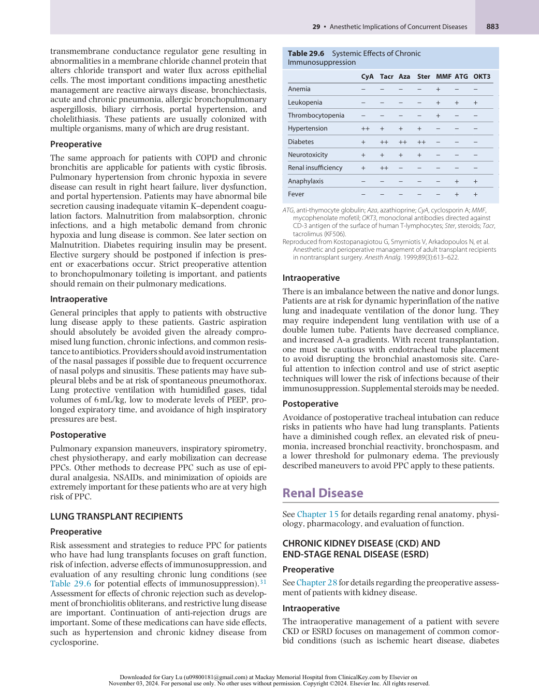

:::

<!-- PDF page 12 -->

mellitus, hypertension, stroke), maintaining appropriate volume and electrolyte status, anticipating altered drug excretion, and avoiding worsening of renal function (if residual function remains). See the relevant sections in this chapter for more details on intraoperative management of comorbid conditions.

Cardiovascular autonomic dysfunction is common in CKD and progresses in a linear fashion to the degree of renal dysfunction.32 Clinical findings include impaired baroreceptor reflex, reduced heart rate variability, inappropriate increases in sympathetic outflow, and impaired parasympathetic regulation of the sinus node.33 This frequently leads to arrythmias (bradycardia or atrial tachyarrythmias), exaggerated hypertensive response to stress (e.g., with direct laryngoscopy and intubation), and inability to compensate for sudden loss of preload (e.g., with hemorrhage, laparoscopic insufflation, initiation of positive pressure ventilation). There are multiple possible mechanisms for these findings, with the exact mechanisms incompletely defined, but initiation of hemodialysis in a patient with severe CKD partially ameliorates these findings, while renal transplantation or bilateral renal denervation surgery results in significant improvement.33 Hypotension with induction is common, as is large variability in blood pressures with changing levels of surgical stimulation. Blood pressure goals for intraoperative management include maintaining adequate perfusion of the kidney to avoid ischemic insult in patients with remaining kidney function. Volume status and electrolyte management of a patient with ESRD include minimizing excessive volume administration and scheduling surgery on the day after dialysis, whenever possible. Patients usually have 2–3 L volume removed by ultrafiltration with each hemodialysis session, so excess intraoperative fluid administration impacts postoperative need for dialysis, and a missed dialysis session can result in a significantly volume- overloaded patient presenting for surgery. Massive hemorrhage requiring blood transfusion can be challenging to manage. TEE is useful for guiding volume status and appropriate resuscitation in this setting. Baseline anemia is common due to reduced erythropoietin concentrations and often iron deficiency. In uremic patients also taking antiplatelet drugs, administering desmopressin 0.3 mcg/kg IV prior to a procedure improves platelet function.34 Data are lacking regarding how to define “uremia” in predicting “uremic platelet dysfunction,” or whether desmopressin administration results in a clinically meaningful reduction in perioperative bleeding. While traditional teaching indicates that only normal saline is infused in patients with ESRD to avoid hyperkalemia, the actual potassium content in balanced crystalloid solution, such as lactated Ringer's solution, is only 4–5 mEq/L, which is unlikely to significantly raise potassium concentrations. Furthermore, the high chloride content in normal saline (154 mM chloride) results in a hyperchloremic metabolic acidosis that, when given in large quantities, causes potassium to shift extracellularly and can result in a higher potassium concentration than if lactated Ringer's solution was given. Normal saline is associated with delayed graft function in kidney transplant recipients during transplantation surgery when normal saline versus balanced crystalloid solutions is given intraoperatively.35a Therefore, there is no contraindication to administering balanced

crystalloid solution containing 4–5 mEq/L potassium in ESRD patients.35b In a consensus statement from the Committee on Transplant Anesthesia of the ASA, a Grade A/1 recommendation is provided based on 1A level of evidence that “balanced crystalloid solutions are at least equal if not better than 0.9% saline” for intraoperative fluid management in kidney transplant recipients.35c

The presence of arteriovenous fistulas (both functional and no longer functioning) influences placement of vascular access catheters or blood pressure cuffs. Intravenous access is avoided in limbs currently used for dialysis access. If central line placement is required, ultrasonography is used to confirm vascular patency in selecting an access site, as vein stenosis is common following establishment of indwelling hemodialysis vascular catheters (10% with internal jugular vein placement and 42% with subclavian vein placement).35d

Drug excretion is altered in severe CKD or ESRD. Renal clearance of many antibiotics is reduced. Confirmation with hospital antibiotic redosing guidelines is recommended to determine the appropriate dosing interval for antibiotics in patients with reduced glomerular filtration rates. All amino- steroidal neuromuscular blocking agents are at least partially renally cleared. Rocuronium is significantly less dependent on renal clearance than pancuronium or vecuronium, so the prolongation of action is significantly less. Even though sugammadex is not approved for reversal of neuromuscular blockade in patients with ESRD, its use in this setting is common.35e Repeated morphine dosing is not recommended to avoid accumulation of the toxic metabolite, 6- glucoronide, which has neurotoxic effects. Both pregabalin and gabapentin are almost exclusively renally cleared. Toxicity is common in patients with reduced renal clearance and drug dosing should be altered or avoided entirely.35f A Cochrane review on perioperative NSAID use concluded that a small, transient reduction in renal function occurs that is “clinically unimportant” in patients with normal preoperative renal function.35g However, in patients with reduced glomerular filtration rates, which is common with elderly patients, and those with hypertension, diabetes, smoking, and obesity, the use of ketorolac or other intravenous NSAIDs may cause a meaningful decrease in kidney function and they are used with caution.

### Postoperative

Postoperative management continues with the same principles as intraoperative care. The risk of kidney injury continues for at least 7 days after surgery. Factors that may contribute to increased kidney oxygen demand and decreased kidney blood flow postoperatively include hypovolemia, inflammation, increased intra- abdominal pressure, decreased cardiac output, hyperglycemia, exposure to nephrotoxins, urinary obstruction, acute lung injury, and mechanical ventilation.35h Vasopressors and fluid administration are utilized to maintain kidney perfusion.

## Hepatobiliary Disease

The liver performs many essential functions, including synthesis of pro- coagulant and anticoagulant factors; protein synthesis (e.g., albumin); drug metabolism; bile production and regulation; fat-soluble vitamin storage; bilirubin

<!-- PDF page 13 -->

metabolism; and the uptake, storage, and release of blood glucose. Consequently, liver damage that affects normal functioning has broad- ranging effects depending on the severity and chronicity of disease. Alcoholic liver disease, non- alcoholic fatty liver disease, and chronic hepatitis C infection are three of the most common causes of progressive liver dysfunction. Occult liver disease is suspected in patients with risk factors for these disorders, such as suspected alcohol abuse, obesity, intravenous drug abuse, or other high- risk activities for contracting hepatitis C. If lab work reveals abnormalities consistent with occult liver disease, such as elevations in serum aminotransferase levels, low platelet count, elevated international normalized ratio (INR), low albumin, or elevated bilirubin, patients are referred for further investigations and management. While early hepatic fibrosis has limited impact on perioperative outcomes, a diagnosis of advanced cirrhosis increases perioperative mortality and is investigated prior to proceeding with elective surgery. See Chapter 28 for the preoperative workup of patients with hepatic disorders.

### LIVER CIRRHOSIS

### Preoperative

Liver cirrhosis is the result of progressive hepatic fibrosis in response to chronic liver inflammation or cholestasis; cirrhosis is an irreversible alteration of liver structure. A complete discussion of hepatic physiology and anesthetic considerations is found in Chapter 14. Preoperative assessment focuses on determining the degree of cirrhosis, and whether cirrhosis is currently compensated or decompensated. In addition to increased mortality rate, around 30% of patients with cirrhosis will experience one or more perioperative complications; common complications include pneumonia, ventilatory dependence, infection, worsening ascites, or cardiac arrythmia.36 Perioperative risk for surgical complications is increased due to several factors (Box 29.9).

### Intraoperative

The anesthetic management of patients with cirrhosis is tailored to the sequelae of disease. The term _cirrhotic cardiomyopathy_ refers to the hyperdynamic state with low systemic vascular resistance and blunted cardiac contractile response that develops from cirrhosis with portal hypertension.37 Though resting echocardiogram parameters are often normal, patients become hypotensive with induction of anesthesia and further vasodilation, with the heart unable to compensate by increasing contractility. Cirrhotic

### Box 29.9 Mechanisms of Increased Perioperative Risk in Patients with Advanced Liver Cirrhosis

- _Abnormal protein synthesis_ : malnutrition and poor wound healing, coagulation factor abnormalities and either bleeding or clotting

- _Portal hypertension_ : dilation of abdominal collateral circulation and increased surgical bleeding risk

- _Splenomegaly and platelet sequestration_ : thrombocytopenia and impaired primary hemostasis

- _Impaired hepatic drug metabolism_ : abnormal drug response

cardiomyopathy combined with underlying ischemic heart disease or chronic kidney disease places the patient at risk for perioperative myocardial injury or acute kidney injury. Perioperative hypotension also worsens liver perfusion, predisposing to liver injury. Invasive blood pressure monitoring and administration of vasopressors is anticipated. Transesophageal echocardiography (TEE) utilization in patients with esophageal varices poses a risk of variceal bleeding but can be considered in a hemodynamically unstable patient where the benefit outweighs the risk. TEE is frequently used in patients undergoing liver transplantation, provided they have not had recent variceal bleeding or banding, with similar complication rates reported to non- cirrhotic patients.38

Limited high- quality evidence exists to guide perioperative management in cirrhosis; the American Gastroenterology Society has published a _Clinical Practice Update on Surgical Risk Assessment and Perioperative Management in Cirrhosis: Expert Review_ .39 Large-volume ascites is a specific intraoperative concern with cirrhosis as it poses a risk of perioperative aspiration, impedes diaphragmatic excursion, and causes rapid desaturation at induction of anesthesia. Preoperative, large- volume abdominal paracentesis may be performed to reduce these risks. Ascites re- accumulation occurs rapidly, and administration of intravenous fluids is restricted to avoid expansion of interstitial volume. Routine thoracentesis for patients with pleural effusions is not recommended. Routine transfusion to correct coagulation abnormalities (elevated INR and reduced platelet count) is not recommended; viscoelastic testing may more accurately reflect perioperative bleeding risk. In patients with platelet counts &lt;50,000/mcL, the Association for the Advancement of Blood & Biotherapies recommends prophylactic platelet transfusion prior to major elective non- neuraxial surgery, however, this is based on very low quality evidence and is a weak recommendation.40 In a large cohort of cirrhotic patients undergoing liver resection or radiofrequency ablation for hepatocellular carcinoma, no association was found between degree of thrombocytopenia and major perioperative bleeding.41 However, patients with more severe thrombocytopenia (including platelet count &lt;50,000/mcL) were more likely to be treated with a laparoscopic surgical approach or with radiofrequency ablation (versus liver resection).41

### Postoperative

Pain management considers altered drug metabolism in liver cirrhosis. Morphine is extensively metabolized by the liver and produces active metabolites with potential neurotoxic effects; dose and administration frequency are reduced to avoid accumulation and use is avoided with concomitant renal failure.42 In contrast, fentanyl and hydromorphone are not metabolized to active compounds and are better choices, though dose adjustment is still advised with repeated administrations or infusions.42 Acetaminophen may be administered in doses less than 2 g daily, while routine NSAID use may further reduce blood flow in patients with renal insufficiency.39

### HEREDITARY HEMOCHROMATOSIS

Hereditary hemochromatosis is an inherited genetic disorder causing increased intestinal absorption of iron leading to iron overload with abnormal deposition in tissues. The

<!-- PDF page 14 -->

**Table 29.7** Organ System Involvement and Clinical Manifestations of Hereditary Hemochromatosis

|**Organ**|**Clinical Manifestation**|
|---|---|
|Liver|Hepatomegaly, increased transaminases, fibrosis and cirrhosis, hepatocellular carcinoma|
|Heart|Restrictive or dilated cardiomyopathy, diastolic dysfunction, heart failure, sinus node dysfunction, atrial fibrillation|
|Pancreas|Diabetes mellitus|
|Pituitary|Hypopituitarism with secondary hypothyroidism|
|Skin|Bronzing of skin|

liver is the primary target as the first location to receive blood following intestinal perfusion, with the heart, pituitary gland, and pancreas also affected. Cardiac manifestations are relatively uncommon (0.9%–3.1% prevalence in hereditary hemochromatosis), while diabetes mellitus occurs frequently (13%–26% of patients).43 See Table 29.7 for organ system involvement and manifestations of hereditary hemochromatosis.43

The American College of Gastroenterology published a clinical guideline for the diagnosis and management of hereditary hemochromatosis in 2019.43 A serum transferrin saturation of >45% or ferritin >1000 ng/mL is concerning for severe iron overload and is treated with regular phlebotomy. Generally, one unit of blood (500 mL) is removed as often as every week, depending on patient tolerance, until ferritin levels reach &lt;100 ng/mL which may take a year of treatments. Liver cirrhosis and diabetes do not improve with phlebotomy. However, liver fibrosis and cardiomyopathy may improve, although the timeframe and degree of improvement are specific to the patient. In patients with concomitant anemia, iron chelating agents are an alternative to phlebotomy.

See the previous section for the perioperative management of cirrhosis. In patients with cardiac manifestations, see the earlier section on Cardiovascular Disease for the perioperative management of heart failure.

## Neurologic and Neuromuscular

### CEREBROVASCULAR DISEASE

Patients with cerebrovascular disease including asymptomatic carotid stenosis, transient ischemic attacks (TIA), and prior stroke are at risk for stroke and major adverse cardiac events (MACE) after noncardiac surgery.44a The highest risk of another event is within the first month. However, the perioperative risk of stroke continues to be elevated from baseline for at least 3 months.44b A previous stroke or TIA is the most consistently reported predictor of perioperative stroke. Lowand intermediate- risk surgeries have the same relative risk of MACE in patients with recent stroke compared with highrisk surgeries. Cardiac, carotid, and neurologic surgeries carry the highest risk of perioperative stroke.

### Preoperative

All except emergency surgeries are best delayed for at least 30 days after a stroke.45 At a minimum, elective surgery

should be delayed for 3-6 months after a stroke or TIA.44a Carotid imaging is not recommended for asymptomatic patients with no neurologic symptoms or signs. Carotid endarterectomy (CEA) is indicated for most symptomatic patients with 50%–99% stenosis and asymptomatic patients with 60%–99% stenosis.46 The perioperative risk of stroke and death in asymptomatic patients must be below 3% to benefit the patient. Carotid artery stenting (CAS) is indicated for symptomatic patients with 50%–99% stenosis at high risk for CEA. CAS is not recommended for asymptomatic patients at this time. Medical management is the mainstay of therapy. Withdrawal of antiplatelets or anticoagulants combined with surgery- induced hypercoagulability increases the risk of a perioperative cerebral thrombotic or embolic event. Antiplatelet drugs and statins should be continued if at all possible.47 It is important to document residual deficits from the stroke or even transient effects from TIA. Previous imaging such as carotid Doppler ultrasound, electrocardiography (ECG), echocardiograms, and brain computed tomography (CT) should be reviewed. Management of antiplatelet or anticoagulation therapies is necessary. Continuation of antiplatelets should be considered unless the bleeding risk is high.

### Intraoperative

Cerebral autoregulation is impaired and cerebral perfusion varies with changes in blood pressure in the days to months following an acute stroke. Interestingly, very few noncardiac perioperative strokes have been associated with hypotension.48 In the setting of carotid artery stenosis, intraoperative hypotension is a risk factor for watershed infarcts.49 Stroke is a risk factor for MACE, and hypotension is a risk factor for perioperative myocardial ischemia, infarcts, and death. Re- emergence of prior focal deficits can occur after administration of sedatives, such as benzodiazepines, and anesthetics.50 No particular anesthetic agents have been shown to be neuroprotective.

### Postoperative

Many patients have strokes without obvious symptoms; identification of perioperative stroke is greatly increased when routine CT scanning is performed. Perioperative stroke is associated with increased postoperative ventilatory and cardiac complications, increased length of stay, admission to skilled nursing facilities, and increased mortality. Anticoagulation is recommended for patients with postoperative atrial fibrillation following noncardiothoracic surgery until a full assessment can be done.51 See Chapter 28 for more details.

### SEIZURE DISORDER

Epilepsy is a significant predictor of postoperative complications directly related to epilepsy and associated comorbidities.52 Postoperative stroke is one of the most common adverse events in patients with a history of epilepsy.

### Preoperative

It is important to investigate and document the specific manifestations of a patient’s seizures. Pure absence seizures are difficult to appreciate in the perioperative period due to the effects of sedatives, analgesics, and residual anesthetics.

::: details 原始表格與符號（PDF 第 14 頁）

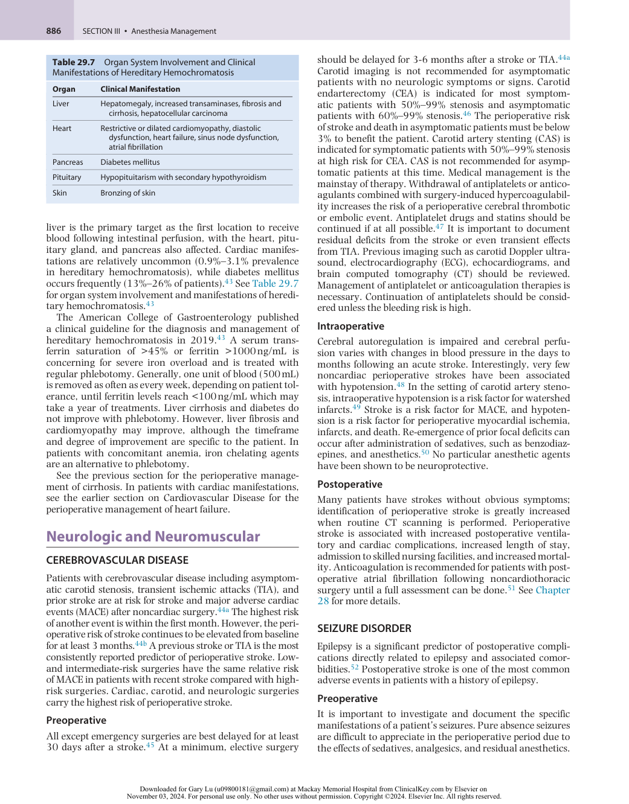

:::

<!-- PDF page 15 -->

Seizures should be well- controlled before elective procedures. Anti- seizure medications are continued. There is no utility in checking drug levels as long as seizures are controlled and there is no concern of toxicity.

### Intraoperative

Ketamine lowers the seizure threshold and can precipitate seizures even in patients without previous seizures. General anesthetic drugs raise the seizure threshold, and most sedative–hypnotic drugs are effective in treating seizure and status epilepticus.

### Postoperative

Postoperative seizures are more common in patients with poorly controlled preoperative seizures. Antiseizure medications should be resumed as soon as possible, or intravenous options substituted. A toxicology screen may uncover substance abuse in patients who have postoperative seizures without a history of previous seizures. Despite lowering the seizure threshold, low- dose ketamine has been used in patients with poorly controlled seizures to limit postoperative sedation and shorten ICU stays.53

### NEUROCOGNITIVE DISORDERS

A significant number of surgical patients older than 65 years of age have mild or major neurocognitive decline. Alzheimer disease and related dementias are associated with postoperative delirium and neurocognitive disorder. Even mild preoperative neurocognitive impairment and postoperative delirium are associated with the development of dementia within 5 years.54 Delayed neurocognitive recovery persisting up to 30 days postoperatively occurs in 17%–43% of surgical adults, and is often associated with major procedures or complicated recoveries. Cognitive decline that persists or is diagnosed up to 12 months after surgery is termed neurocognitive disorder. Cardiac, major orthopedic, prolonged, or complex surgical procedures confer risk.

### Preoperative

Preoperative cognitive screening is indicated for elderly or frail adults and those with other risk factors for neurocognitive decline. Screening serves as a baseline to assess postoperative delirium and other forms of neurocognitive disorders, and to plan prevention strategies. The MiniMental State Examination (MMSE) and the Mini- Cog are most widely used (see Chapter 28).55 Providers often must rely on caregivers for medical history and reports of disease symptomatology. When it is not possible to obtain an accurate history, “routine” testing may be indicated for major surgeries. Informed consent with shared decision- making and goals of care determination are vitally important and may need to include surrogate decision- makers.

### Intraoperative

Patients with dementia are often uncooperative and therefore general anesthesia may be necessary even for diagnostic or minor procedures. In patients who are cooperative, minimal sedation alone or regional/neuraxial anesthesia (with no or minimal sedation) may be beneficial. Age decreases anesthetic requirements, and dosing should

be age- adjusted to avoid deep levels of anesthesia. Use of end- tidal anesthetic concentration can guide titration of inhalation anesthetics to age- adjusted minimal alveolar concentrations (MAC). Processed electroencephalography (EEG), such as bispectral index or patient state index, guides dosing of medications to avoid excessive anesthetic depth. Cerebral oximetry combined with processed EEG neuromonitoring can avoid excessive anesthesia depth and cerebral oxygen desaturation and may decrease postoperative cognitive dysfunction.56 Benzodiazepines, gabapentinoids, and opioids (especially meperidine and its metabolite normeperidine) are associated with delirium. Ketamine did not prevent or cause postoperative delirium in a large multicenter trial.57 Additionally, ketamine has analgesic, opioid- sparing, and antidepressant effects. Some evidence suggests that acetaminophen, NSAIDs, and selective cyclooxygenase-2 (COX-2) inhibitors may decrease risk for postoperative cognitive dysfunction, perhaps because of their opioid-sparing effects.58 Some studies show benefits of dexmedetomidine.59 There appears to be no difference among the different volatile anesthetics. Intraoperative hypotension and blood pressure variability have been implicated in development of postoperative delirium and neurocognitive decline.60

### Postoperative

Patients with preexisting neurocognitive disorders are at risk of developing postoperative delirium, persistent neurocognitive impairment, and later dementia. This may manifest as decline in cognition or activities of daily living. The Confusion Assessment Method (CAM) test can monitor for postoperative delirium. Nonpharmacologic measures to prevent or treat delirium include cognitive stimulation, reassurance, reorientation, providing glasses and hearing aids to maintain sensory input, and early mobilization. Removing lines, drains, and restraints, providing adequate hydration, treating hypoxia, controlling pain, and avoiding delirium- inducing medications can lower the risk of postoperative delirium. Haloperidol, 0.5–2 mg, can be used for severe agitation in the postanesthesia care unit (PACU).

### PARKINSON DISEASE

Parkinson disease is defined by tremor, rigidity, bradykinesia, and autonomic dysfunction. Patients have orthostatic hypotension, temperature dysregulation, abnormal sweating, and sialorrhea. Most patients with Parkinson disease have some degree of cognitive impairment that is progressive. Many patients are frail.

### Preoperative

Frailty assessments should be performed. Careful pulmonary examination may uncover chronic aspiration and pneumonia. Abnormal lung sounds should prompt chest radiography. Infections should be treated. All antiparkinsonian medications are active in the central nervous system and can cause mental status changes, involuntary movements (dyskinesias), dizziness, hallucinations, dystonia, confusion, somnolence, and insomnia. Continuation of medications are important. The only exception is to hold these drugs for patients having deep brain stimulators placed. Many patients will be taking monoamine oxidase inhibitors

<!-- PDF page 16 -->

(MAOIs) such as selegiline, and rasagiline and this should be documented. Modern practice suggests continuation of these drugs preoperatively, with adjustment of anesthesia, is preferred to stopping these medications. Because of dysphagia, patients may need to take preoperative medications with gelatin which will not violate “clear liquid” fasting guidelines. Withdrawal of parkinsonian medications will increase rigidity and can trigger neuroleptic malignant syndrome or significant worsening of symptoms.

### Intraoperative

Tremors may interfere with procedures such as intravenous catheter placements, regional anesthesia, imaging, diagnostic procedures, and surgery, necessitating general anesthesia. Standard methods to reduce aspiration are important. Practitioners need to avoid using dopamine antagonists such as prochlorperazine, phenothiazine, metoclopramide, and haloperidol. Meperidine and ephedrine are avoided if patients have taken MAOIs within the previous 3 weeks. Providers should anticipate hemodynamic instability. These patients may also be at risk for neuroleptic malignant syndrome.

### Postoperative

Postoperatively, patients with Parkinson disease are susceptible to cognitive impairment and delirium. Baseline risks of aspiration are heightened in the immediate postoperative period. Aspiration, rigidity, bradykinesia, and cognitive dysfunction increase the risk for postoperative pulmonary complications (PPCs). Incentive spirometry, early mobilization, and aspiration mitigation are beneficial. Since standard parkinsonian medications such as dopamine agonists and decarboxylase inhibitors are only available as oral preparations, a nasogastric tube may be needed to avoid exacerbations. Orally disintegrating carbidopa- levodopa (Parcopa) is available.

### MULTIPLE SCLEROSIS

Multiple sclerosis is the most common immune- mediated inflammatory demyelinating disease of the central nervous system. Multifocal areas of demyelination and axonal injury are pathologic features of multiple sclerosis. Multiple sclerosis affects young to middle- aged patients and is characterized by relapses and remissions. Most diagnoses are confirmed with magnetic resonance imaging (MRI) of the brain and spinal cord.

### Preoperative

Eliciting and documenting deficits that occur with exacerbations are important. Patients should continue immunosuppressants and steroids. Patients should wait until return to baseline function after exacerbations before proceeding with surgery.

### Intraoperative

Succinylcholine should be avoided in patients with paresis or paralysis. Monitoring of temperature is critical. Hyperthermia can cause exacerbation of symptoms, mimicking stroke or causing ventilatory insufficiency.

### Postoperative

The signs and symptoms of multiple sclerosis may worsen in the postoperative period due to the waxing and waning

nature of the disease, the presence of fever, an infection, or from the stress of surgery.

### MYASTHENIA GRAVIS

Myasthenia gravis is an immunologic autoimmune disorder with antibodies directed at acetylcholine receptors in the postsynaptic membrane of the neuromuscular junction. It is characterized by skeletal muscle weakness that worsens with activity.

### Preoperative

Details and timing of myasthenic crises and previous need for endotracheal intubation should be sought. Quantification of ventilatory muscle weakness, shortness of breath, and dyspnea is important. Evaluation of patients with myasthenia focuses on bulbar symptoms, such as dysphagia, dysarthria, a weak voice, and any history of choking or aspiration. Associated diseases, including other autoimmune diseases such as thyroiditis, rheumatoid arthritis, and systemic lupus erythematosus, are documented and evaluated. Patients may have a thymic mass which can cause airway compromise. A careful history, examination, and review of imaging such as chest radiography or CT scans are necessary. The utility of pulmonary function tests (PFTs) to predict PPC has not been determined. Therapy for myasthenia may include anticholinesterase drugs (e.g., pyridostigmine or neostigmine), glucocorticoids, and immunotherapies. Immunotherapies consist of immunosuppressant medications, plasmapheresis, and intravenous immunoglobulin (IVIG). High- dose steroids, plasmapheresis, and IVIG are therapies that are effective within hours to days. They have short- term benefits that can be used preoperatively before anesthesia to optimize patients if delay is not possible, or the patient’s myasthenia cannot be optimized otherwise. Patients should be instructed to take all of their myasthenia gravis therapies the morning of surgery.61

Various factors have been defined to predict the risk of a postoperative myasthenic crisis. These include vital capacity (VC) less than 2–2.9 L, duration of myasthenia gravis for greater than 6 years, dose of pyridostigmine greater than 750 mg/day, chronic pulmonary disease, bulbar symptoms, a myasthenic crisis in the past, intraoperative blood loss of more than 1000 mL, and serum anti- acetylcholine receptor antibody concentration greater than 100 nmol/ mL.62–64

### Intraoperative

The primary focus when providing anesthesia for patients with myasthenia gravis is to avoid aspiration, residual sedation, and muscle weakness postoperatively. Routine techniques to reduce aspiration are beneficial, especially in patients with significant bulbar symptomatology. Sedation can be used as long as ventilatory compromise is avoided. Neuraxial and peripheral nerve blocks have advantages as long as side effects, such as ventilatory muscle compromise and phrenic nerve paralysis, and complications, such as pneumothorax, are avoided. Patients with myasthenia are more sensitive to nondepolarizing neuromuscular blocking agents (NMBA) and are resistant to succinylcholine. Patients are resistant to succinylcholine likely because they have a decreased number of acetylcholine receptors. Additionally, they may have

<!-- PDF page 17 -->

slowed metabolism from the use of anticholinesterase medication (e.g., pyridostigmine). Patients are at higher risk of phase II neuromuscular block with the use of succinylcholine. Traditionally, the recommendation is to avoid NMBA. However, with availability of sugammadex for reversal, judicious use of steroidal NMBA may be a safer approach for airway management to avoid deeper levels of anesthesia. This recommendation is supported by a retrospective study of over 1100 patients with myasthenia having thymectomies with either no NMBA or rocuronium with sugammadex reversal which showed no differences in postoperative complications.65 Dysautonomia is not a recognized feature of myasthenia gravis, but there have been rare reports of an association, usually with thymoma. Patients treated with glucocorticoids may require additional doses of steroids.66 See later section on Adrenal Insufficiency for more details.

### Postoperative

Outpatient surgery can be safe in patients with wellcontrolled myasthenia as long as the procedures are short and residual effects of anesthesia are avoided. Myasthenic crisis is a significant worsening of muscle weakness. It can occur spontaneously, as a result of surgical stress, infection, aspiration, residual anesthetics, interruption of myasthenic medications, or use of drugs that potentiate weakness. For major surgeries or if patients have poorly controlled advanced myasthenia, postoperative care in an ICU is more appropriate.67 One of the first signs of decompensation is often an increase in ventilatory rates with shallow breaths. Other signs include dysphagia, drooling, change in phonation, airway obstruction, paradoxical breathing, and weak cough. Hypoxia and hypo- and hypercarbia are all warning signs of impending ventilatory failure. It is vitally important to differentiate a myasthenic crisis from a cholinergic crisis because the treatment is vastly different. A cholinergic crisis results from cholinergic excess. The mnemonic SLUDGE (salivation, lacrimation, urination, defecation, gastrointestinal distress, emesis) suggesting cholinergic excess can help differentiate the two causes of progressive weakness.68

when autonomic dysfunction is present, hypotension may not be more common or severe.69 Conventional vasoactive medications are effective.

### Postoperative

Refer to the section on Myasthenia Gravis, above.

### AMYOTROPHIC LATERAL SCLEROSIS (ALS)

### Preoperative

Patients with amyotrophic lateral sclerosis (ALS) often have chronic aspiration due to bulbar involvement and pneumonias. Infections should be treated preoperatively. Providers should have a low threshold for obtaining a preoperative chest radiograph. A VC below 50% predicted or impaired negative inspiratory force (NIF) on PFT predicts postoperative ventilatory failure. It is important to discuss goals of care and do- not- resuscitate parameters before surgery. Generally, patients with ALS are best cared for in centers with experience with these patients.

### Intraoperative

Patients are exquisitely sensitive to sedatives, opioids, and anesthetic medications. They are at marked risk of aspiration, airway obstruction, and ventilatory failure. Autonomic dysfunction with orthostatic hypotension and resting tachycardia is common. Succinylcholine must be avoided due to the risk of hyperkalemia. Patients appear to be more sensitive to NMBA. Safe and effective means of reducing the risk of prolonged intubation are judicious use of sedation, medications with short durations of action, ketamine, regional anesthesia, and avoidance of opioids.70

### Postoperative

Careful monitoring for residual effects of anesthetics and avoidance of, or very careful titration of, sedatives and opioids to prevent hypoventilation and hypercarbia are extremely important.

### SPINAL CORD DISORDERS AND SPINA BIFIDA

### LAMBERT–EATON SYNDROME

Lambert–Eaton myasthenic syndrome is an autoimmune disorder with antibodies directed against the presynaptic voltage- gated calcium channels in the neuromuscular junction. It is frequently associated with malignancies, most commonly small cell lung cancer. Unlike myasthenia gravis, autonomic dysfunction is a recognized feature of Lambert– Eaton myasthenic syndrome.69 The same principles and recommendations made for myasthenia gravis generally apply to Lambert–Eaton syndrome, with a few exceptions.

### Preoperative

Refer to the section on Myasthenia Gravis, above. Treatment is generally the same as for myasthenia with the difference being 3,4- diaminopyridine (amifampridine) is often used, and treatment such as cancer therapies directed to underlying causes may impact the perioperative care.

### Intraoperative

Patients with Lambert–Eaton syndrome are very sensitive to both depolarizing and nondepolarizing NMBA. Even

Patients with acute and chronic spinal cord injuries have variable weakness, ventilatory compromise, airway challenges, and autonomic dysfunction, depending on the level of injury or disease. Patients with cervical syringomyelia and myelopathy have upper extremity weakness and ataxia. Scoliosis may be present either from associated disease, loss of muscular function, or surgery to address conditions. Severe scoliosis can cause restrictive lung disease. Patients with tethered cords are either asymptomatic or have minor neurologic impairment. Patients with spina bifida can either be neurologically intact or have a range of deficits including bowel and bladder dysfunction, paresis, or complete paralysis.

### Preoperative

A detailed neurologic examination is important to document. Pulmonary evaluation and optimization are necessary for patients with high spinal cord disease that impacts ventilation or bulbar muscles. The level and timing of spinal cord injuries, degree of paralysis, and associated injuries guide the preoperative evaluation.

<!-- PDF page 18 -->

### Intraoperative

If patients have cervical spine disease, neck manipulation must be limited and awake intubation may be needed. Hypotension is often present in patients with spinal injuries. Autonomic dysreflexia is common in patients with lesions above the mid- thoracic level, but can occur with injuries at any level. Even if patients are insensate, they require anesthesia to block noxious stimuli with surgeries and even urinary tract catheterizations to avoid severe hemodynamic perturbations. Neuraxial anesthesia is performed with caution in patients with spina bifida and tethered cords, though generally the location at L5/S1 or lower does not impact spinal or epidural anesthesia. Patients with myelomeningocele without paralysis have a normal response to succinylcholine but may be allergic to latex. Patients with spina bifida may also be sensitive to latex.

### Postoperative

PPC and venous thromboembolism (VTE) are common in patients with spinal cord disease.

### GUILLAIN–BARRÉ SYNDROME

Patients with Guillain–Barré syndrome have an acute onset of progressive and symmetric muscle weakness, and absent or depressed deep tendon reflexes. The weakness varies from mild difficulty with mobility to near-complete paralysis of all limb, facial, ventilatory, and bulbar muscles. Patients may also have sensory symptoms and dysautonomia. Symptoms typically progress over a 2- week period, and within a month of onset, more than 90% of patients will stabilize. If the disease progresses for more than 8 weeks, a diagnosis of chronic inflammatory demyelinating polyradiculoneuropathy is more likely. Intravenous immunoglobulin and plasmapheresis are the mainstay of therapy.

### Preoperative

The management is like that for patients with other forms of paralysis. Due to immobility, patients are prone to VTE and pneumonia.

### Intraoperative

Patients with bulbar symptoms, facial paralysis, and dysphagia are at risk for aspiration. Patients with Guillain– Barré syndrome may exhibit exaggerated hemodynamic responses and autonomic dysfunction to surgical stimuli, and orthostatic hypotension with surgical positioning. Autonomic hyperreflexia similar to what is seen with any spinal cord injury can occur. Succinylcholine should not be administered to patients with Guillain–Barré syndrome because of the risk of severe hyperkalemia.

### Postoperative

The usual recommendations for patients with paralysis and limited ventilatory capacity and reserve apply to patients with Guillain–Barré syndrome. Incentive spirometry, mitigation of aspiration, and VTE prophylaxis are prioritized.

### NEUROFIBROMATOSIS

There are three clinically and genetically distinct types of neurofibromatosis. Neurofibromatosis type 1 (NF1), previously

known as von Recklinghausen disease, is the most common. NF1 is defined by multiple café- au- lait macules and cutaneous neurofibromas. Manifestations result from the location of the neurofibromas. Intracranial tumors can cause seizures or hydrocephalus. The pituitary can be affected from lesions in the optic chiasm. Persons with NF1 are at risk for vasculopathy, which may manifest as hypertension from renal artery stenosis. Patients can have neurodevelopmental delay and cognitive impairment. Many patients have chronic pain, peripheral neuropathies, and sleep disorders.

### Preoperative

The utility of imaging depends upon the history and physical examination. Evaluations are guided by the impact of the tumors. Persons with NF1 who have hypertension, palpitations, headache, or diaphoresis should have measurement of plasma- free fractionated metanephrines to assess for pheochromocytoma. Literature supports screening before surgery for pheochromocytoma in persons with NF1 because many are asymptomatic. If pheochromocytoma is diagnosed, the usual management applies to these patients before surgeries.71,72 Selumetinib (a kinase inhibitor) is used in patients with symptomatic and inoperable tumors.

### Intraoperative

Tumors may limit cervical spine or neck mobility and result in difficulties managing the airway. Neurofibromas can be present in the larynx and mediastinum. Scoliosis and tumors can impact positioning and ventilation. Patients may have tolerance to opioids. Regional and neuraxial anesthesia are usually contraindicated due to the likelihood of tumors being present.

### Postoperative

Pain may be difficult to manage. Patients may be prone to seizure recurrence.

### POST- POLIO SYNDROME

Polio is rare in developed countries but exists throughout the world. Recently, a large amount of polio virus has been identified in New York, US, after an unvaccinated immunocompetent adult developed acute paralysis.

Post- polio syndrome is characterized by chronic neuromuscular sequelae after an acute infection and can manifest decades later. On average, the onset of post- polio syndrome symptoms occurs 35 years after the initial polio infection, but the delay ranges from 8 to 71 years. The new weakness always occurs in previously affected muscles although manifestations may have been subclinical with the original infection. Muscle weakness can manifest as ventilatory insufficiency, bulbar muscle dysfunction, and sleep apnea. Central hypoventilation may contribute. Dysphagia and dysarthria occur due to pharyngeal and laryngeal muscle weakness, along with facial and vocal cord paralysis. Extreme fatigue, restless leg syndrome, and insomnia are common.

### Preoperative

Optimization of pulmonary function is important. Treatment of infections and prevention of aspiration are key. Intravenous immunoglobin does not appear effective to improve strength.

<!-- PDF page 19 -->

### Intraoperative

The usual recommendations that apply to patients at risk for aspiration, with paralysis and ventilatory compromise, apply to these patients. Patients are at risk of hyperkalemia if succinylcholine is used. They are sensitive to NMBA, sedatives, and opioids. Incentive spirometry is important. Noninvasive ventilation with continuous positive airway pressure (CPAP) is indicated.

### Postoperative

Patients with post- polio syndrome are at risk for aspiration, PPC, sleep- disordered breathing, prolonged ventilation, and VTE.

### TRAUMATIC BRAIN INJURY PATIENTS

Patients with traumatic brain injury (TBI) frequently have other injuries. Prevention of secondary brain injury is the goal, even if anesthesia is provided past the immediate postinjury period. Recovery of cerebral autoregulation can be delayed for weeks. Autonomic and cardiac dysfunction and seizures can complicate the course.

### Preoperative

Hypotension, hypoxemia, hypo- or hypercarbia, fever, hypo- or hyperglycemia, and increased intracranial pressure (ICP) may adversely impact outcomes. The degree of severity of TBI is classified with the Glasgow Coma Scale (GCS) (Table 29.8). Coagulation abnormalities are common

in patients with TBI. Cerebral vasospasm may occur with subarachnoid hemorrhages.

### Intraoperative

Cervical spine injury should be assumed for patients with severe TBI. A key principle is to avoid reductions in cerebral perfusion pressure. Objects (e.g., nasotracheal tubes, nasogastric tubes, nasal airways, or temperature probes) should not be inserted into the nasal passages of patients with basilar skull fractures. Measures to reduce intracranial pressure (ICP) are important. In addition to standard monitors, arterial and ICP monitoring are commonly required. Jugular venous oximetry, brain tissue oxygen tension monitoring, and transcranial Doppler ultrasonography are becoming more common. Many patients will have ventriculostomy catheters for monitoring and drainage of cerebrospinal fluid. Management of ICP monitors should be discussed with the intensive care staff before procedures. Blood glucose should be maintained at 80–180 g/dL to avoid secondary brain injury. Coagulation parameters require monitoring, and abnormalities promptly corrected. More details are provided in Chapters 36 and 53.

### Postoperative

Early postoperative neurologic evaluation is a desired goal.

## Endocrine and Metabolic

### MALNUTRITION

**Table 29.8** The Glasgow Coma Scale (GCS) to Classify Degree of Brain Injury

|||**Score**|
|---|---|---|
|**EYE OPENING**|||
||Spontaneous|4|
||Response to verbal command|3|
||Response to pain|2|
||No eye opening|1|
|**BEST VERBAL RESPONSE**|||
||Oriented|5|
||Confused|4|
||Inappropriate words|3|
||Incomprehensible sounds|2|
||No verbal response|1|
|**BEST MOTOR RESPONSE**|||
||Obeys commands|6|
||Localizing response to pain|5|
||Withdrawing response to pain|4|
||Flexion to pain|3|
||Extension to pain|2|
||No motor response|1|

The lower the GCS, the worse the neurologic severity. Mild brain injury: score of 13 or higher; moderate injury: a score of 9–12; severe brain injury: a score of 8 or less. The components of the GCS should be recorded individually (e.g., E2V3M4).

Surgical patients with malnutrition have increased rates of infection, anastomotic failures, lengths of stay, intensive care unit admissions, need for mechanical ventilation, readmission rates, hospital costs, mortality, and poor wound healing after surgeries.73 Malnutrition from chronic and acute disease, and injury- related malnutrition result in inflammation. Glycogen stores are depleted after approximately 24 hours of fasting. Further fasting results in hepatic gluconeogenesis from amino acids and muscle catabolism. Malnourished patients often have electrolyte and coagulation abnormalities, hypoalbuminemia, hypophosphatemia and hypomagnesemia, and anemia. They may have heart failure, ventilatory insufficiency, and sarcopenia.

### Preoperative

The perioperative nutrition screen (PONS) is a modified version of the malnutrition universal screening tool (Fig. 29.1).74 The PONS determines malnutrition risk based on a patient’s body mass index (BMI), recent changes in weight, reported recent decrease in dietary intake, and preoperative albumin level. Laboratory assessment includes complete blood count, complete metabolic panel, and coagulation parameters. Poorly nourished patients should consume a minimum of 18 g protein/day for at least 7 days (3 weeks is ideal) before major surgery. Nutritional shakes and protein bars can supplement high protein foods. In hospitalized patients, enteral or parenteral nutrition should be maintained preoperatively in accordance with the ASA fasting guidelines. Carbohydrate loading is accomplished with 50 g carbohydrates as a clear liquid 2–3 hours preoperatively. Maltodextrin is a common source of the carbohydrate in commercial products and has a

::: details 原始表格與符號（PDF 第 19 頁）

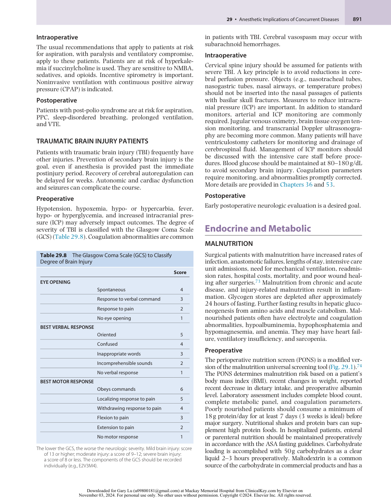

:::

<!-- PDF page 20 -->

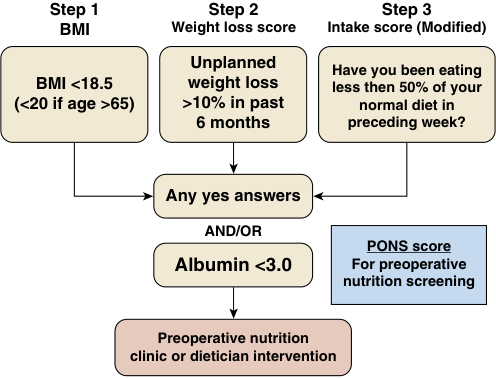

Step 1 Step 2 Step 3 BMI Weight loss score Intake score (Modified) Unplanned Have you been eating BMI &lt;18.5 weight loss less then 50% of your (&lt;20 if age >65) >10% in past normal diet in 6 months preceding week? Any yes answers AND/OR PONS score Albumin &lt;3.0 For preoperative nutrition screening Preoperative nutrition clinic or dietician intervention 

**Fig. 29.1 Preoperative nutrition screen tool.** _BMI_ , body mass index; _PONS_ , preoperative nutrition screen. (Redrawn from Wischmeyer PE, Carli F, Evans DC, et al, for the Perioperative Quality Initiative (POQI) 2 Workgroup. American Society for Enhanced Recovery and Perioperative Quality Initiative Joint Consensus Statement on Nutrition Screening and Therapy Within a Surgical Enhanced Recovery Pathway. _Anesth Analg_ . 2018;126;1883–1895.)

low osmolality which induces faster gastric emptying. Electrolyte abnormalities and iron or vitamin B12 deficiency anemia should be treated before surgery.

### Intraoperative

Malnutrition results in metabolic and physiologic derangements that can alter responses to anesthesia. Propofol dosage and recovery time appears to be altered in malnourished individuals.75 The choice of anesthetic agents should take this into consideration. Cardiac arrhythmias are more common in malnourished patients compared to normal. Additionally, avoiding emetic agents, opioids, and maximizing anesthetic options that reduce postoperative nausea and vomiting and inhibit bowel function are desirable. Osteopenia and fractures may be present or can occur, and patients are prone to hypothermia.

### Postoperative

These patients may have further alterations in blood chemistries and coagulopathies in the postoperative period. Additionally, postoperative nausea and vomiting and ileus interfere with resumption of nutrients and medications. Analgesia techniques should avoid or limit medications and techniques that delay oral intake as much as possible. Malnourished patients benefit from continued nutritional optimization postoperatively. Enteral or parenteral nutrition should be resumed as quickly as possible.

### DIABETES MELLITUS

Diabetes is a heterogeneous group of disorders that have the common feature of relative or absolute insulin deficiency. The disease is characterized by a multitude of hormoneinduced metabolic abnormalities, diffuse microvascular lesions, and long- term end-organ complications.

The diagnosis of diabetes is made by the following criteria:

- A random glucose concentration more than 200 mg/dL accompanied by symptoms of hyperglycemia or a hyperglycemic crisis OR

- A hemoglobin A1c (HbA1c) value of more than 6.5% OR ᑏ A fasting glucose concentration more than 126 mg/ dL (confirmed by repeat testing after a separate 8-hour fast)

- A 2-hour glucose concentration more than 200 mg/dL after a 75 g oral glucose tolerance test.76

Diabetes mellitus can be classified as:

- Type 1 diabetes: results from autoimmune destruction of pancreatic cells by autoantibodies to insulin producing beta cells. Type 1 diabetes also includes latent autoimmune diabetes in adults (LADA), generally appearing later in life. Type 1 diabetes is characterized by absolute insulin deficiency. These patients are prone to developing ketoacidosis when treatment with insulin is withheld or missed. Generally, the onset of diabetes happens in childhood or early adulthood.

- Type 2 diabetes: results from insulin resistance on a background of relative insulin deficiency. These patients are generally adult, obese, and have additional metabolic abnormalities such as hypertension and hyperlipidemia. Patients with type 2 diabetes are not prone to ketoacidosis but to developing a hyperglycemic hyperosmolar state (HHS) during acute illnesses.

- Secondary diabetes: due to either medications (glucocorticoids, human immuno deficiency virus (HIV) medications, posttransplant), exocrine pancreatic disease (chronic pancreatitis, post total pancreatectomy) or monogenic diabetes syndromes (such as maturity-onset diabetes of the young)

- Gestational diabetes (diagnosed in a pregnant nondiabetic patient during the second or third trimester of pregnancy)76

### Preoperative

Patients with diabetes, regardless of the etiology, are prone to acute complications (due to hypoglycemia or hyperglycemic states) or more importantly, chronic complications (cardiac, renal, vascular, neurologic, and ophthalmologic). Hypoglycemia is more frequent in patients with type 1 diabetes, but also in patients with type 2 diabetes treated with insulin or insulin- secreting medications, especially during the perioperative period when fasting. Hypoglycemia (glucose less than 70 mg/dL) can be accompanied by sweating, dizziness, irritation, anxiety, and palpitations. Severe hypoglycemia (glucose less than 54 mg/dL) can present as neuroglycopenia with headaches, confusion, and seizure activity. It is important to note that patients with repeated episodes of hypoglycemia lose their ability to detect symptoms (hypoglycemic unawareness). These patients may reach glucose concentrations of 50–60 mg/dL without any symptoms. Similarly, patients with chronic high blood glucose concentrations can experience symptoms at concentrations consistent with normo- or even mild hyperglycemia. Hypoglycemia symptoms are difficult to rely on in sedated patients, and tachycardia and dizziness have a vast differential diagnosis.

Hyperglycemic states such as diabetic ketoacidosis (DKA) or HHS can be present in patients undergoing emergency surgery. These are commonly precipitated by infectious processes, trauma, acute myocardial infarction, or noncompliance with insulin.

<!-- PDF page 21 -->

DKA is generally encountered in patients with type 1 diabetes mellitus. DKA is characterized by refractory hyperglycemia with moderately elevated glucose concentrations (250–400 mg/dL). Ketonemia is present with plasma acetoacetate, β- hydroxybutyrate, and acetone increased due to insufficient insulin required to suppress lipolysis. Patients have a metabolic acidosis (due to ketone bodies) with an increased anion gap.

Patients with type 2 diabetes can develop ketoacidosis when on treatment with sodium- glucose cotransporter 2 (SGLT2) inhibitors. These patients often have euglycemia. SGLT2 inhibitors promote glucosuria, and euglycemic ketoacidosis can be precipitated by a fasting state common in the perioperative period. Therefore, SGLT2 inhibitors must be discontinued 3–4 days before surgical procedures in order to prevent ketoacidosis.

HHS is more common in older patients. Ketonemia and acidosis are usually not present due to sufficient levels of insulin to suppress lipolysis.77 As compared to DKA, patients with HHS present with higher glycemic values (600–1000 mg/dL), and a higher volume deficit (6–10 L) compared to 2–4 L in patients with DKA. Clinically, patients with HHS have polydipsia, polyuria, vomiting, diffuse abdominal pain, and weakness. Kussmaul respirations are a marker of severe acidosis and altered mental status is prominent in patients with HHS.78 Laboratory diagnostic criteria for HHS are described in Table 29.9. In addition to hyperglycemia, hyperosmolarity is markedly elevated in HHS. Acidosis and ketonemia is present in DKA. Patients have a falsely low sodium concentration which is corrected by adding 1.6 mg/dL for every 100 mg/ dL glucose concentration above 100 mg/dL. Mild leukocytosis is common, but white blood counts greater than 25,000/mcL point toward a concurrent infection.79 In addition, phosphate and potassium concentrations can vary despite total-body depletion. With euglycemic DKA, dextrose may need to be added to fluids at the start of treatment.

DKA and HHS are medical emergencies that require rapid expansion of intravascular volume, intravenous insulin, and electrolyte replacement. In addition, potential triggering conditions, such as cardiac ischemia or infections, must be addressed.80,81 Fluid resuscitation with normal saline and insulin administration is the mainstay

of therapy. A recent study found that balanced crystalloid solutions may provide a more rapid volume restoration in patients with DKA compared to normal saline.82 The rate of volume repletion aims to replete one-third of the volume deficit in the first 6–8 hours and be adjusted subsequently. Generally, balanced crystalloid solution is infused at 50 to 1000 mL/h in patients with normal cardiac function, but less aggressive rates should be used in those with cardiac dysfunction.

Insulin therapy is initiated in patients with potassium concentrations greater than 3.3 mg/dL but withheld until potassium has been administered in patients with lower concentrations in order to prevent arrythmias and cardiac decompensation from acute shifting of potassium intracellularly and precipitous decline of potassium concentrations. Insulin is typically administered intravenously (0.1 units/kg bolus followed by 0.1 units/kg/h infusion). Studies show that DKA can be safely treated with subcutaneous insulin as well. The actual amount of insulin administered is less important than is regular monitoring of glucose, potassium, and arterial pH. The maximum rate of glucose decline is fairly constant, averaging 75 to 100 mg/dL/h, regardless of the dose of insulin because the number of insulin binding sites is limited. During the first 1–2 hours of fluid resuscitation, the glucose concentration may decrease more precipitously. When plasma glucose is 200 mg/dL, 5% dextrose should be added to repletion fluids to prevent hypoglycemia while continuing insulin administration until ketonemia is resolved.83

The most important electrolyte disturbance in diabetic ketoacidosis is depletion of total- body potassium. Deficits range from 3 to 10 mEq/kg body weight. Serum potassium concentrations decline rapidly and reach a nadir within 2 to 4 hours after the start of intravenous insulin. Aggressive replacement therapy is required. The potassium administered moves into the intracellular space with insulin as the acidosis is corrected. Potassium is also excreted in the urine because of the increased delivery of sodium to the distal renal tubules that accompanies volume expansion. For patients with potassium concentrations less than 5.3 mg/ dL and urine output greater than 0.5 mL/kg/h, potassium 20–40 mEq should be added to the 1- L crystalloid infusions in order to keep potassium concentrations between 4 and 5 mg/dL.

**Table 29.9** Differentiation of Diabetic Ketoacidosis from Hyperosmolar Hyperglycemic State

|||**DIABETIC KETOAC**|**IDOSIS**|**Hyperosmolar hyperglycemia**|
|---|---|---|---|---|
|**Measure**|**Mild**|**Moderate**|**Severe**||
|Plasma glucose concentration (mg/dL)|>250|>250|>250|>600|
|Arterial blood gas pH|7.25–7.30|7.00 to &lt;7.24|&lt;7.00|>7.30|
|Serum bicarbonate (mEq/L)|15–18|10 to &lt;15|&lt;10|>18|
|Urine or serum ketones|+|+|+|+/−|
|Urine/serumβ- hydroxybutyrate (mmol/L)|>3.0|>3.0|>3.0|&lt;3.0|
|Effective serum osmolality|Variable|Variable|Variable|>320 mOsm/kg|
|Serum anion gap|>10|>12|>12|Variable|
|Mental status examination|Alert|Alert/drowsy|Stupor/coma|Stupor/coma|

Adapted from the American Diabetes Association Consensus Statement on Hyperglycemic Crises, 2009.

::: details 原始表格與符號（PDF 第 21 頁）

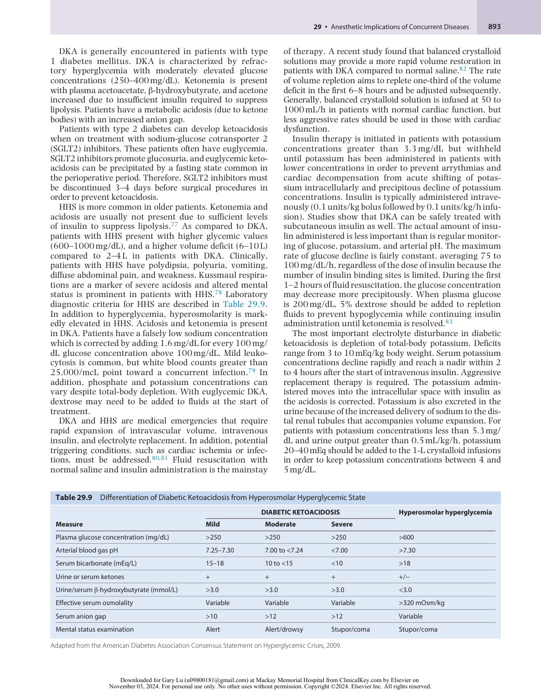

:::

<!-- PDF page 22 -->

Bicarbonate therapy is not necessary in patients with HHS, and its role in DKA is controversial. Bicarbonate should be administered in DKA when the pH drops below 7.1 to prevent severe acidemia resulting in hemodynamic instability due to depressed myocardial function and hypoventilation.84 Rapid correction of acidosis with bicarbonate therapy may result in alterations in central nervous correction (CNS) functions and structure. These alterations may be caused by paradoxical development of cerebrospinal fluid and CNS acidosis from: rapid conversion of bicarbonate to carbon dioxide, diffusion of the acid across the blood– brain barrier, and altered CNS oxygenation with decreased cerebral blood flow. Phosphorus deficiency in ketoacidosis is a result of tissue catabolism, impaired cellular uptake, and increased urinary losses. Hypophosphatemia may cause significant muscular weakness and organ dysfunction. The average phosphorus deficit is approximately 1 mmol/ kg body weight. No clear guidance for replacement exists, but replacement is appropriate in patients with cardiac dysfunction, anemia, ventilatory depression, or if the plasma phosphate concentration is less than 1.0 mg/dL.

Patients with diabetes, regardless of the etiology, are prone to acute complications or, more importantly, chronic complications (cardiac, renal, vascular, neurologic, and ophthalmologic). Micro- and macrovascular complications are associated with poorly controlled long- standing diabetes.

Accelerated atherosclerosis and early, severe coronary artery disease (especially in patients with type 1 diabetes) commonly occur in patients with long- standing uncontrolled disease. Vascular disease is due to production of advanced glycation end products leading to subclinical inflammation and endothelial dysfunction. The combination of hypercholesterolemia, inflammation, and endothelial dysfunction are key mechanisms involved in the initiation and progression of atherosclerotic coronary artery disease. Moreover, due to concurrent neuropathies, ischemic events (e.g., acute coronary syndromes) may be difficult to detect in patients with long- standing diabetes due to silent ischemia.85 Cardiovascular manifestations of diabetic neuropathy include orthostatic hypotension, resting and postural tachycardia, exercise intolerance, decreased hypoxia- induced ventilatory drive, loss of baroreceptor sensitivity, enhanced intraoperative or perioperative cardiovascular lability, increased incidence of asymptomatic ischemia, myocardial infarction, decreased rate of survival after myocardial infarction, and heart failure.86

Cerebrovascular and peripheral vascular diseases occur with higher frequency in patients with diabetes. Diabetic kidney disease includes diabetic nephropathy with micro- and macroalbuminuria, tubular dysfunction, and decreased glomerular filtration rate. Microalbuminuria increases logarithmically at HbA1c concentrations above 8%. Patients with diabetic kidney disease are generally prescribed angiotensin-converting enzyme (ACE) inhibitors or angiotensin receptor blockers (ARBs) to prevent progression of the disease. Diabetic retinopathy is due to alteration of retinal blood flow, accumulation of end glycation products in the setting of uncontrolled hyperglycemia, and ischemia and neovascularization in the advanced stages. Control of hyperglycemia to HbA1c concentrations less than 7% decreased the progression of retinopathy by 76% in the Diabetic Control and Complications Trial (DCCT). Diabetic

autonomic neuropathy manifests in different organs and is the result of chronic glycotoxicity.87 In the DCCT, intensive control of diabetes decreased the rates of diabetic neuropathy by 53% in patients with type 1 diabetes. Gastrointestinal manifestations include gastroparesis (nausea, vomiting, early satiety, bloating, and upper abdominal pain), gastroesophageal reflux, and diarrhea. Patients with long-term diabetes may have musculoskeletal impairments such as limited cervical spine mobility and temporomandibular joint stiffness. The “prayer” sign (the inability to put palms together in a prayer position) was traditionally regarded as a marker for difficult laryngoscopy in patients with diabetes, but this has been refuted.

Several principles need to be met for perioperative care of patients with diabetes regardless of the etiology. Diabetes itself may not be as important to perioperative outcome as are its end-organ effects. Even in patients requiring ICU management, long- standing diabetes does not appear to be as important an issue as the end-organ dysfunction that exists and the degree of glucose control in the perioperative and ICU periods. Different societies recommend slightly different perioperative target glucose values. The American Diabetes Association endorses glucose concentrations of 80–180 mg/ dL perioperatively. In a meta- analysis of 12 randomized trials (1403 patients with diabetes) comparing intensive (less than 120 mg/dL [6.7 mmol/L] or less than 150 mg/dL [8.3 mmol/L]) versus conventional (variable) glycemic control in the perioperative period, intensive glycemic control perioperatively was not associated with reductions in infectious complications, cardiovascular events, or mortality, but it was associated with increased risk of hypoglycemia.88

Much of the research on perioperative control is derived from studies in the ICU, as opposed to the operating room. The Normoglycemia in Intensive Care Evaluation and Survival Using Glucose Algorithm Regulation (NICE- SUGAR) trial demonstrated increased mortality among 6026 critically ill ICU patients with target glucose concentrations of 80–108 mg/dL vs. those with targets of less than 180 mg/dL.89a Subsequent analyses detected the association between moderate and severe hypoglycemia (glucose, 41–70 mg/dL and less than 41 mg/dL, respectively) and death in patients targeted for tight control. Intensive glucose control leads to moderate and severe hypoglycemia, both of which are associated with an increased risk of death. Based on the results of the NICE- SUGAR trial as well as subsequent investigations, to date there are no convincing data that hospitalized or ICU patients benefit from tight glucose control. Therefore, target glucose concentrations of 140–180 mg/dL are recommended in these populations. Perioperative hyperglycemia (concentrations greater than 140 mg/dL) is common even in nondiabetic patients and is associated with an increased risk of infections, acute kidney injury, pulmonary complications, and even mortality.

The preparation of patients with diabetes relies on assessing the degree of diabetes control (hypo- and hyperglycemia episodes, HbA1c values), instructing patients on preoperative antidiabetic medication management, as well as assessing the presence as well as the severity of the comorbidities (see Chapter 28 for preoperative assessment).

ᑏGlucagon-like peptide-1 (GLP-1) receptor agonists for treatment of diabetes or obesity delay gastric emptying and pose an increased risk of perioperative aspiration, even in

<!-- PDF page 23 -->

patients who follow the ASA fasting guidelines. The risk of aspiration may be particularly high after initiation of the drug or dose escalation, but tachyphylaxis to gastric emptying effects occurs after 12–20 weeks when the dose is maintained. Gastric emptying of solids is affected compared to liquids. High-quality evidence to guide management is lacking. The ASA advised stopping oral and injectable GLP-1 agonists for one half life (one week for injectable and one day for oral preparations). Published evidence questions this approach, because patients who have held longacting GLP-1 agonists for more than 7 days and fasted for 8 or more hours may still have residual gastric contents (Insert reference). Prolonged fasting for solids (>24 h) may be necessary to minimize aspiration risks.89b

### Intraoperative

Intraoperative management relies on prevention of hypoand hyperglycemia, treatment of hyperglycemic states, and managing associated comorbidities. Hypoglycemia is particularly difficult to detect in anesthetized or sedated patients. Many of the adrenergic symptoms accompanying hypoglycemia are attributed to alternate diagnoses (e.g., inadequate anesthesia). Moreover, patients with diabetic autonomic neuropathy or treated with beta blockers may have attenuated hyperadrenergic signs. Hypoglycemia is prevented by close monitoring of glucose concentrations intraoperatively (every 1–2 hours in patients receiving insulin perioperatively) either by frequent fingersticks or a continuous glucose monitor. Institutional protocols generally recommend 25 g of glucose for treatment of intraoperative hypoglycemia. However, patients allowed to maintain diabetes devices intraoperatively including advanced insulin pumps (either predictive low glucose suspend or hybrid closed loop systems) may need less glucose in order to treat hypoglycemia because their pump will have already suspended insulin delivery.90

Hyperglycemia (defined by glucose concentrations greater than 180 mg/dL) is prevented by close glucose monitoring and judicious insulin administration. Subcutaneous rapidacting insulin may be preferred due to a favorable duration of action (onset of action 15–20 minutes, duration of action 1–2 hours) in patients undergoing short, outpatient procedures as compared with intravenous regular insulin (half- life of 45 minutes). However, there is concern that in patients undergoing procedures with major fluid shifts, subcutaneous insulin may not be well absorbed. Intravenous insulin should be used in these patients as well as those in the ICU. Intravenous insulin should be dosed based on institutional protocols, with the goal of achieving glycemic targets of 140–180 mg/dL. All anesthetic techniques are acceptable in patients with diabetes and should be dictated by the surgical procedure. Regional and neuraxial techniques have the advantage of reducing sympathetic stimulation but can become problematic in patients with autonomic insufficiency where hypotension may be exacerbated. Diabetes complications (micro- and macrovascular) have implications for intraoperative care. Patients with coronary artery disease may require an arterial line in addition to standard monitoring; tachycardia and hypertensive excursions should be avoided. Patients with gastroparesis from long- standing, uncontrolled diabetes are at high risk of aspiration and precautions should be used. Euvolemia should be maintained and nephrotoxins avoided in patients with renal

impairment. Patients with peripheral neuropathy may be sensitive to local anesthetics and have prolonged duration of nerve blocks.

### Postoperative

Postoperatively, the same principles of avoiding worsening of comorbidities and maintenance of glycemic targets apply, especially in critically ill patients or those having major surgeries.

### ADRENAL INSUFFICIENCY

Primary adrenal insufficiency (Addison disease) is associated with local destruction of all zones of the adrenal cortex and, when bilateral, results in both glucocorticoid and mineralocorticoid deficiencies. Autoimmune disease is the most common cause of primary adrenal insufficiency in the United States, whereas tuberculosis is the most common cause worldwide. Other causes include metastases, hemorrhage (e.g., from heparin-induced thrombocytopenia), fungal and HIV diseases, or drug induced (etomidate, fluconazole).91,92

Secondary adrenal insufficiency occurs when the hypothalamic–pituitary–adrenal (HPA) axis is suppressed. The most common cause is long- term administration of exogenous glucocorticoids, but it also results from pituitary gland destruction. Secondary adrenal insufficiency only results in glucocorticoid deficiency as mineralocorticoid activity is primarily regulated by the renin–angiotensin–aldosterone system (RAAS) rather than adrenocorticotropin hormone (ACTH). Manifestations of adrenal insufficiency are described in Box 29.10.

The median normal concentration of cortisol is ∼5 mcg/ dL with a daily 24-hour secretion equivalent to 5–7 mg prednisone or 20–30 mg hydrocortisone/day.66 During stressful situations, such as surgical procedures, cortisol concentrations increase to 30–45 mcg/dL (moderate stress) or 260 mcg/dL (high stress) and normalize during the next 24–48 hours.66 Patients with adrenal insufficiency may not be able to respond to stress, and may need steroid supplementation perioperatively.

### Preoperative

A 6–8 am serum cortisol concentration of less than 3 mg/ dL is diagnostic of adrenal insufficiency. Primary adrenal insufficiency is determined by a simultaneously high ACTH concentration, and secondary adrenal insufficiency

### Box 29.10 Manifestations of Adrenal Insufficiency (Addison Disease)

|ᑏWeight loss|
|---|

- Weakness, lethargy, fatigue

|ᑏMuscle, joint, and back pain|
|---|
|ᑏPostural hypotension, dizziness|
|ᑏHeadache|
|ᑏAnorexia, nausea, abdominal pain, constipation|
|ᑏHyperpigmentation|

- Hyperkalemia, hyponatremia

- Occasional hypoglycemia ᑏ Hypercalcemia

- Prerenal azotemia

::: details 原始表格與符號（PDF 第 23 頁）

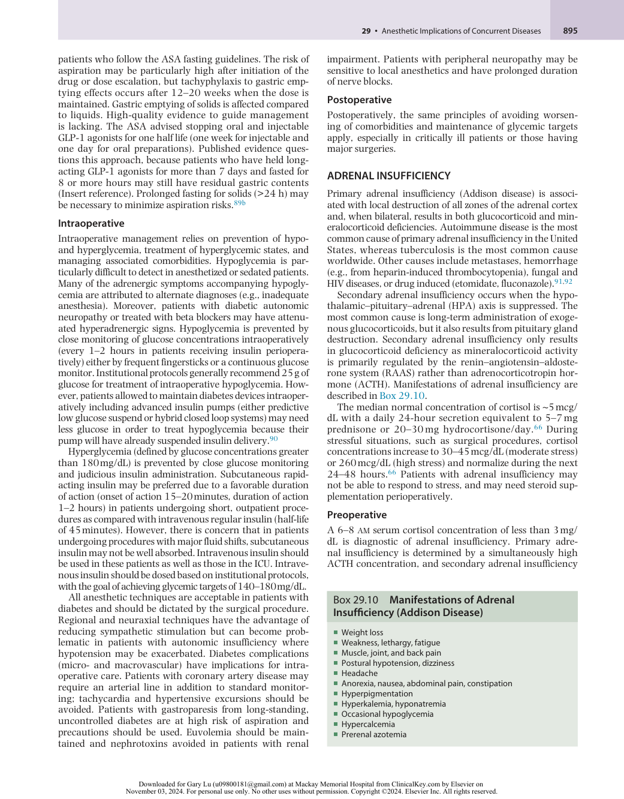

:::

<!-- PDF page 24 -->

if the ACTH is low. A serum concentration greater than 18 mg/dL practically excludes the diagnosis. For patients with cortisol concentrations between 3 and 18 mg/dL, an ACTH stimulation test is indicated. A cortisol concentration of 18–20 mg/dL 30–60 minutes after ACTH 250 mcg is administered excludes primary and most cases of secondary adrenal insufficiency.92,93

Various publications and guidelines have addressed perioperative steroid supplementation.94,95 Based on current evidence and current recommendations, our approach is to recommend steroid supplementation based on the history of steroid use and the stress of the procedure (Table 29.10)66

- HPA suppression is unlikely in patients taking less than 7.5 mg prednisone/day for any duration of time, or any other dose of steroid for less than 3 weeks.25,26 These patients do not require supplemental steroids, and they should take their usual dose the morning of the procedure.24,94

- HPA suppression is likely in patients taking greater than 20 mg prednisone daily (or equivalent) for more than 3 weeks, and they should take their usual dose the day of surgery and perioperative steroids should be administered according to the stress of surgery.94

- HPA axis suppression is unknown but likely in patients taking between 7.5 and 20 mg prednisone daily (or equivalent). Patients taking inhaled glucocorticoid fluticasone

**Table 29.10** Suggested Adrenal Supplementation Therapy Based on Stress of the Procedure in Patients with Suspected Adrenal Insufficiency

|**Medical or Surgical Stress**|**Corticosteroid Dosage**|
|---|---|
|**Minor** lnguinal hernia repair Colonoscopy Mild febrile illness Mild–moderate nausea/ vomiting Gastroenteritis|25 mg of hydrocortisone or 5 mg of methylprednisolone intravenous on day of procedure only|
|**Moderate**|50–75 mg of hydrocortisone or|
|Open cholecystectomy Hemicolectomy Significant febrile illness Pneumonia Severe gastroenteritis|10–15 mg of methylprednisolone intravenous on day of procedure Taper quickly over 1–2 days to usual dose|
|**Severe** Major cardiothoracic surgery Whipple procedure Liver resection Pancreatitis|100–150 mg of hydrocortisone or 20–30 mg of methylprednisolone intravenous on day of procedure Rapid taper to usual dose over next 1–2 days|
|**Critically ill** Sepsis- induced hypotension or shock|50–100 mg of hydrocortisone intravenous every 6–8 h or 0.18 mg/ kg/h as a continuous infusion + 50 mcg/day of fludrocortisone until shock resolved May take several days to a week or more then gradually taper, following vital signs and serum sodium|

Data are based on extrapolation from the literature, expert opinion, and clinical experience. Patients receiving 5 mg/day or less of prednisone should receive their normal daily replacement, but do not require supplementation. Patients who receive greater than 5 mg/day of prednisone should receive the above therapy in addition to their maintenance therapy.

From Coursin DB, Wood KE. Corticosteroid Supplementation for Adrenal Insufficiency. _JAMA_ . 2002;287:236–240.

of at least 750 mcg/day (or beclomethasone of at least 1500 mcg/day) for more than 3 weeks, high potency topical steroids used for greater than 2 g/day for more than 2 weeks, or 3 or more intra- articular or spinal glucocorticoid injections within 3 months before surgery may be at risk of HPA suppression.96–98 For these patients it is suggested that HPA suppression should be investigated preoperatively. However, this is rarely done in clinical practice and patients are supplemented with steroids based on the presumed surgical stress.

Preoperative preparation should ensure repletion of intravascular volume and correction of electrolyte abnormalities. Patients presenting with an adrenal crisis (e.g., hypotension from distributive shock, abdominal pain, vomiting, hypoglycemia, hyperkalemia) should be treated immediately with glucocorticoid and mineralocorticoid replacement.

### Intraoperative

Intraoperative monitoring (e.g., arterial line) should be dictated by comorbid conditions or if hemodynamic instability is expected for the procedure. When the degree of HPA axis is unknown and an expectant management is chosen regarding intraoperative supplemental steroid administration, vigilance is necessary for early detection of an adrenal crisis (distributive shock, hyperkalemia, hypoglycemia). If an intraoperative adrenal crisis occurs, hydrocortisone 100 mg intravenously is the drug of choice because it has mineralocorticoid activity; in addition, aggressively repleting the intravascular volume and using vasopressors as necessary. Dexamethasone has no mineralocorticoid activity and therefore should not be relied upon to prevent or treat an adrenal crisis. Etomidate should be avoided, but otherwise any anesthetic technique or agent is acceptable.

### Postoperative

Postoperatively, if perioperative supplemental steroids have been administered, doses should be tapered over the next few days as the stress of surgery subsides and the requirements diminish.

### CUSHING SYNDROME (GLUCOCORTICOID EXCESS)

Cushing syndrome is caused by ACTH-dependent or ACTHindependent processes. The most common cause of ACTHindependent glucocorticoid excess results from long- term treatment with glucocorticoids for conditions such as arthritis, asthma, and allergies. Adrenal tumors (adenoma or carcinoma) cause 10%–20% of spontaneous cases of ACTH- independent Cushing syndrome. ACTH- dependent causes include Cushing disease due to an ACTH-secreting pituitary microadenoma (65%–75% of spontaneous cases) or ectopic ACTH production (principally by tumors of the lung, pancreas, or thymus).99

Manifestations include a moon facies, dorsocervical fat pad (i.e. buffalo hump), plethoric build with a central distribution of fat (truncal obesity and skinny extremities), thin skin, easy bruising, and striae. Skeletal muscle wasting and muscle weakness are common, but the heart and diaphragm are usually spared. Patients may have difficulty

::: details 原始表格與符號（PDF 第 24 頁）

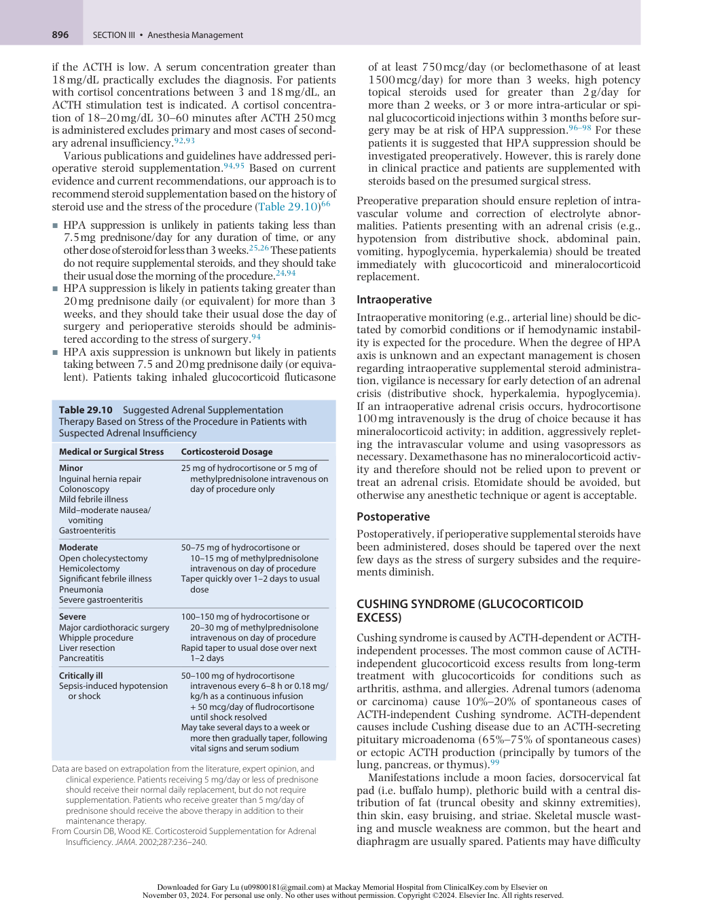

:::

<!-- PDF page 25 -->

climbing stairs. Patients may have hyperglycemia, and even diabetes mellitus from inhibition of peripheral use of glucose, anti- insulin action, and concomitant stimulation of gluconeogenesis. Hypertension and fluid retention are common, and osteopenia is a result of decreased formation of bone matrix and impaired absorption of calcium.100

The diagnosis is made by the clinical picture and confirmed by one of three tests: late night salivary cortisol, 24- hour free urinary cortisol, or an overnight 1 mg dexamethasone suppression test.

### Preoperative

Preoperative preparation of patients with Cushing syndrome focuses on optimizing comorbid conditions. Patients with Cushing syndrome are at risk for cardiovascular disease and stroke.101 In addition, blood pressure and glucose control (or diabetes) should be optimized while ensuring intravascular volume and electrolyte values are normal.102,103 Ectopic ACTH production may cause marked hypokalemic alkalosis and treatment with the aldosterone antagonist spironolactone stops the potassium loss and helps mobilize excess fluid.

### Intraoperative

In severe cases of Cushing syndrome, the moon facies and the dorsocervical fat pad portend difficulty with airway management and many patients have obstructive sleep apnea. Muscle relaxants may be used judiciously, but their action can be potentiated by excess steroids. Because of severe osteopenia and the risk of fractures, meticulous attention must be paid to positioning. Glucocorticoids are lympholytic and immunosuppressive, increasing the patient’s susceptibility to perioperative infection.104,105 If adrenal resection is planned, supplemental glucocorticoids are administered at the start of tumor resection (100 mg of hydrocortisone every 24 hours).

### Postoperative

The tensile strength of healing wounds decreases in the presence of glucocorticoids, an effect that is at least partially reversed by the topical administration of vitamin A. Steroids are tapered over 3 to 6 days until a maintenance dose is reached. For patients undergoing bilateral resection, the patient should receive a mineralocorticoid, 9αfluorocortisol (0.05–0.1 mg/day), beginning on day 3. In certain patients, both steroids may require several adjustments. For a patient who has undergone unilateral adrenal resection, therapy is individualized according to the status of the remaining adrenal gland, and not all patients require mineralocorticoid replacement. Cushing syndrome patients are at risk for thromboembolic events and therefore appropriate perioperative prophylaxis should be instituted.106–108

### PHEOCHROMOCYTOMA

Pheochromocytomas and paragangliomas are catecholamine- producing tumors derived from chromaffin tissue of the adrenal and sympathetic chains, respectively. Historically, these tumors are associated with a high risk of perioperative mortality and morbidity ranging from 25% to 50%. Advancements in medical treatment and minimally invasive surgical techniques have led to a marked decrease

in perioperative mortality. Pheochromocytoma is known as the 10% disease as ∼10% are malignant (metastatic), 10% bilateral, and 10% extra- adrenal (paraganglioma). More recently it is recognized that all pheochromocytomas have malignant potential.109 Pheochromocytomas occur as solitary tumors, or associated with diseases such as von Hippel–Lindau, neurofibromatosis type I, or multiple endocrine neoplasia type IIa or type IIb syndromes.

Signs and symptoms suggestive of pheochromocytoma such as sweating, palpitations, headaches, chest pain, tremors, weight loss, nausea, vomiting, and panic attacks result from catecholamine excess secretion. Spells consisting of a triad of episodic, paroxysmal headache, sweating, and tachycardia can be triggered by changes in position, anxiety, or medications. The diagnosis should be suspected in any young (especially less than 20 years of age) hypertensive patient, malignant or treatment- resistant hypertension, presence of classic “spells” even in the absence of hypertension, or in patients with familial syndromes associated with pheochromocytomas.

In patients with a low index of suspicion for a pheochromocytoma (such as those with uncontrolled hypertension), a 24- hour urinary fractionated metanephrine or catecholamine concentration has a specificity and sensitivity greater than 98%. In patients with a high index of suspicion (such as those with an adrenal mass, or hypertensive with one of the familial syndromes associated with a pheochromocytoma), plasma fractionated metanephrines or catecholamines are the tests of choice with a sensitivity of 96%–100%, and a specificity of 85%–89%. Plasma and 24hour free metanephrine concentrations above two times the upper limit of normal are diagnostic for pheochromocytoma.110 A clonidine suppression test may correctly tease out the false-positive borderline elevated plasma metanephrine concentrations.111 A positive screening test is followed by localization of the tumor with MRI, CT, or metaiodobenzylguanidine nuclear scanning.

### Preoperative

The focus is on treating hypertension and restoring intravascular volume. Optimizing end-organ sequelae such as catecholamine- induced cardiomyopathy, tachyarrhythmias, and acute coronary syndrome is important.112 Traditionally, hypertensive treatment relied on the Roizen criteria described in the 1980s: (1) achieving a preoperative blood pressure less than 165/90 mm Hg; (2) presence of orthostatic hypotension as long as the blood pressure is greater than 80/45 mm Hg; (3) no ST- T segment changes on the ECG; and (4) fewer than 1 premature ventricular contraction in 5 minutes. Based on retrospective data, the 2014 Endocrine Society Clinical Practice Guideline challenged the Roizen criteria by recommending tighter blood pressure control of less than 130/80 mm Hg while sitting (systolic blood pressure greater than 90 mm Hg when standing), aiming for a heart rate 60–70 beats/min while sitting (70–80 beats/min when standing).113

Blood pressure control is primarily with alpha (α) blockers. The nonselective alpha blocker phenoxybenzamine is most commonly used with doses starting at 10 mg twice daily and slowly titrated to achieve the desired blood pressure control. Selective α1- selective blockers such as prazosin (2–5 mg, 2–3 times daily), doxazosin (2–8 mg daily), and

<!-- PDF page 26 -->

terazosin (2–5 mg daily) have gained popularity recently given better safety profiles and lower costs.114 The optimal strategy of using alpha blocking is unclear. However, patients treated preoperatively with nonselective alpha blockers may have less intraoperative hypertension compared to those treated with selective alpha blockade.115,116 Another small study detected more postoperative hypotension requiring vasopressor support in patients with selective alpha blockade compared with nonselective agents.117 A recent meta-analysis showed that nonselective alpha blockade was more effective in preventing intraoperative blood pressure fluctuations while maintaining comparable risks of both intra- , and postoperative hypotension and overall morbidity. Similar results were confirmed in a randomized prospective trial comparing phenoxybenzamine with doxazosin.118,119 Current guidelines endorse an optimal duration of alpha blockade between 7 and 14 days preoperatively. Preoperative duration of alpha blockade for more than 30 days is associated with intraoperative bradycardia and postoperative hypotension requiring vasopressor support.120 In spite of guideline endorsement of alpha blockade, recent evidence challenges its value and utility.121 A metaanalysis of 603 patients showed that mortality, cardiovascular complications, mean maximal intraoperative systolic and diastolic blood pressures, and mean maximal intraoperative heart rates did not differ between patients with or without alpha blockade.122 Another recent small study showed that hemodynamic instability remained significant despite optimal alpha and beta blockade.123 Moreover, in an international multicenter study of 1860 patients, mortality was not improved by preoperative alpha blockade and complications were more frequent (5% vs. 0.9%) than in patients without alpha blockade.124

If persistent tachycardia is present or the target heart rate is not achieved, beta blockers are typically added to alpha blockade. Beta blockers are started only after adequate alpha blockade to prevent worsening hypertension due to the blockade of vasodilatory peripheral β- adrenergic receptors and unopposed alpha stimulation.113,114 Calcium channel blockers are indicated for patients not tolerating alpha blockade because of profound orthostasis or those needing additional blood pressure control. Nicardipine, amlodipine, and nifedipine are the most frequently used. Amlodipine can be an efficacious alternative to alpha blockade to prevent hemodynamic instability during surgical resection.125,126 The Endocrine Society Task Force guidelines further recommend a high sodium diet (3–5 g/day) and fluid intake to reverse the catecholamine- induced volume contraction during alpha blockade.113 Preoperative intravenous volume repletion does not optimize hemodynamics or improve outcomes.127 Metyrosine (a tyrosine hydroxylase inhibitor) decreases the circulating catecholamine concentrations by 50% to 80%.114 It can be added for symptomatic control in patients with high catecholamine concentrations or when blood pressure control is not achieved with the approach described above. In general, due to profound sedation, it is reserved for symptomatic control in patients with metastatic pheochromocytoma or paraganglioma.

### Intraoperative

Most pheochromocytomas are resected using minimally invasive techniques such as laparoscopic assisted or

retroperitoneoscopic approaches. However, large tumors may necessitate an open procedure. Preinduction anxiolysis with benzodiazepines or dexmedetomidine is beneficial in reducing catecholamine surges. In addition to adequate intravenous access, an arterial line is paramount in all pheochromocytoma resection cases. The arterial line is generally placed preinduction to facilitate immediate blood pressure control. Central venous access is considered when patients are expected to need postoperative vasoactive infusions but should not be routinely placed. Additional monitoring with transesophageal echocardiography or pulmonary artery catheters may be useful in patients with ventricular dysfunction. A slow, controlled induction and intubation only after achieving an adequate anesthetic depth minimizes hemodynamic instability. All anesthetic techniques are acceptable as long as hemodynamic control is achieved. Commonly used induction agents such as propofol or etomidate are safe, but ketamine should be avoided due to sympathetic effects. Inhalational anesthetics (with the exception of desflurane which can cause transient tachycardia), neuromuscular blocking agents (with the exception of pancuronium), and most opioids have been successfully used during pheochromocytoma resection. Epidural anesthesia in addition to general anesthesia may be beneficial for postoperative pain control, but it may not attenuate intraoperative hypertensive episodes and can lead to postoperative hypotension.128,129

Anesthesia management focuses on hemodynamic control and good communication among members of the perioperative team. Catecholamine crises are expected before tumor removal (vein ligation) and can be precipitated by induction of anesthesia, medications (e.g., metoclopramide), or surgical manipulation. Moreover, hemodynamic instability is more common with large tumor sizes, elevated urinary epinephrine or norepinephrine concentrations, low body mass index, and coronary artery disease.130,131

During the pre- vein ligation phase, short- acting vasoactive drugs are used to control and prevent hypertensive episodes. Clevidipine, nitroglycerin, nitroprusside, and nicardipine are preferred. Esmolol can be administered for heart rate control. Phentolamine, the typical intravenous alpha blocker, has a prolonged onset and duration of action and is rarely used in clinical practice. Intravascular volume loading is necessary to minimize post- vein ligation hypotension. Hypertensive episodes are common during induction, intubation, and positioning, and are due to catecholamine release from nerve endings. In comparison, surgical manipulation with compression of the tumor is accompanied by further intravascular discharge of catecholamines and an exaggerated hypertensive response. In addition to the traditional vasoactive substances, magnesium, a direct vasodilator, is commonly used during pheochromocytoma resection to provide hemodynamic stability by stabilizing membranes and decreasing the release of catecholamine directly from the tumor.132–134 It is usually administered in a 2–4 g loading dose before induction of anesthesia followed by a 1–2 g/h infusion during resection.

Post- vein ligation, normalization of blood pressure is expected if intravascular volume is normal, and all vasodilators can be discontinued. However, some patients may become hypotensive and occasionally require catecholamine infusions. Phenylephrine is the initial drug of

<!-- PDF page 27 -->

choice to treat hypotension due to its ease of use, although some patients may require norepinephrine or epinephrine infusions. Generally, the choice of vasopressor is based on the type of catecholamine predominantly secreted by the tumor (e.g., norepinephrine for a patient with elevated preoperative normetanephrines). For patients refractory to alpha agonists, vasopressin and methylene blue can be effective.135

Hyperglycemia can occur because excess catecholamines increase insulin resistance, compromise insulin secretion, and decrease glucose uptake even in nondiabetic patients.136 Intraoperative hyperglycemia correction is done judiciously, as postoperative normalization of glucose and even hypoglycemia are expected and can be aggravated by residual insulin.

### Postoperative

Patients are generally monitored in an intensive care setting. However, a select group of patients having minimally invasive resection who are hemodynamically stable can be discharged to the regular ward.137 Postoperative considerations include hemodynamic monitoring (as some patients may require pressors) and close glucose monitoring. After pheochromocytoma resection, there is a rebound hyperinsulinemia with hypoglycemia especially in patients with pheochromocytomas excreting epinephrine or after prolonged resections.138 Glucose concentrations should be monitored every 1–2 hours for the first 6–24 hours. Approximately 50% of patients remain hypertensive for 1 to 3 days and initially have markedly increased but declining plasma catecholamine concentrations – after which all but 25% will become normotensive.

### CONN SYNDROME (MINERALOCORTICOID EXCESS)

Primary hyperaldosteronism (Conn syndrome) most often results from a unilateral adenoma, although 25% to 40% of patients have bilateral adrenal hyperplasia. Excess mineralocorticoid activity leads to sodium retention, potassium depletion, muscle weakness, hypertension, tetany, polyuria with inability to concentrate urine, and hypokalemic metabolic alkalosis.139 Primary hyperaldosteronism is suspected in patients with hypertension and hypokalemia, treatment resistance (more than 3 medications), adrenal incidentalomas, or severe or early onset hypertension (younger than 30 years old). The diagnosis is confirmed by measuring the plasma aldosterone concentration (greater than 10 ng/dL) as well as plasma renin activity (less than 1 ng/ml/h).140

### Preoperative

Preparation relies on treatment of hypertension and restoring the intravascular fluid volume and electrolyte concentrations (correcting hypokalemia with supplemental potassium). In addition, there is evidence of increased rates of metabolic syndrome and glucose intolerance in these patients and this should be determined preoperatively.141 Renal function and electrolyte abnormalities are corrected by administering the aldosterone antagonist spironolactone. The effects of spironolactone are slow in onset and increase for 1 to 2 weeks. Frequently, a period of at least 24 hours is required to restore potassium equilibrium as

the deficit can be up to 400 mEq. However, normal serum potassium concentration does not necessarily imply correction of a total- body deficit of potassium. In addition, patients with Conn syndrome have a high incidence of ischemic heart disease and preoperative evaluation should be based on current guidelines.142

### Intraoperative

Monitoring is tailored to the individual patient but invasive monitoring (e.g., arterial line) is not usually necessary when the preoperative preparation is adequate. Perioperative glucocorticoid supplementation is not indicated in patients with Conn syndrome undergoing adrenalectomy.

### HYPERTHYROIDISM

Hyperthyroidism is usually due to Graves disease, toxic multinodular goiter, or a thyroid adenoma. It can also occur with pregnancy, thyroiditis, choriocarcinoma, or due to a thyroid-stimulating hormone (TSH)- secreting pituitary adenoma. The diagnosis of hyperthyroidism in the setting of Graves disease or multinodular goiter relies on a low TSH with elevated concentrations of triiodothyronine (T3) (the active hormone) and thyroxine (T4). Common manifestations of hyperthyroidism include anxiety, weight loss, diarrhea, warm and moist skin, weakness of large muscle groups, osteopenia, intolerance to heat, palpitations, tachycardia, cardiac arrhythmias, and high-output heart failure.143a In addition, patients with Graves disease (autoimmune disease due to TSH-binding antibodies leading to enlargement of the thyroid gland and hypervascularity) present with lid retraction, wide stare, and exophthalmos as well as dermatologic complications. The goiter is diffusely enlarged and compressive symptoms (stridor, dyspnea, dysphagia) are possible. Multinodular goiters typically present as slow- growing asymmetric growth nodules that can become very large. Patients usually present with symptoms consistent with compression of the trachea, esophagus, or even superior vena cava through extension into the mediastinum, as well as moderate hyperthyroidism features. Subclinical hyperthyroidism (normal serum T3 and T4 with low TSH [&lt;0.5. mU/L]) may be due to exogenous or endogenous causes. Most patients have only mild symptoms (if any) but have increased risk of atrial fibrillation, heart failure, coronary artery disease, bone loss, fractures, dementia, and progression to overt hyperthyroidism.143b

### Preoperative

Preparation of patients with hyperthyroidism relies on controlling the symptoms as well as evaluating end-organ effects (e.g., presence of arrhythmias or heart failure) and the degree of airway compression for patients with goiters. Antithyroid medications are the mainstay of therapy for patients with hyperthyroidism and include propylthiouracil and methimazole, both of which decrease the synthesis of T4 and may enhance remission by reducing TSH receptor antibody concentrations (the primary pathologic mechanism in Graves disease). Propylthiouracil also decreases the conversion of T4 to the more potent T3. Generally, antithyroid medications control the disease in 6–8 weeks. Beta blockers do not affect thyroid function but help control some of the hyperadrenergic symptoms associated with the

<!-- PDF page 28 -->

disease (e.g., arrhythmias, tremors). Propranolol is the beta blocker of choice given that, it further prevents the conversion of T4 to T3 (active hormone). Patients who are refractory to medical therapy and need rapid control of symptoms in preparation for thyroidectomy can benefit from iodide administration. Generally, a saturated solution of potassium iodide (SSKI) blocks the synthesis and discharge of thyroid hormones from the gland and quickly controls the symptoms (7–10 days) as compared to 2–6 weeks with a traditional antithyroid medication–only approach. Iodidebased contrast agent such as iopanoic acid may have similar effects. Regardless of the approach, antithyroid drugs should be administered on a long- term basis and on the morning of the surgical procedure.

Patients with subclinical and well-controlled hyperthyroidism have increased risks of arrhythmias, especially atrial fibrillation, and MACE. Patients who are overtly hyperthyroid (symptomatic) should have their disease optimized with antithyroid medications as well as iodide if preoperative preparation time is limited. A good indication of control before surgery relies on normalization of free T4 concentrations and lack of overt hyperthyroid symptoms, as TSH may lag 4–6 weeks behind and may still be suppressed. Only emergency operations or thyroidectomy planned to control the disease that does not respond to maximal medical treatment should proceed in patients with uncontrolled hyperthyroidism, due to a high risk of developing intraoperative thyroid storm. Although the risk of thyroid storm is difficult to quantify, new evidence suggests that even when patients do not tolerate antithyroid medications, thyroidectomy can be performed without increased risk of thyroid storm and complications.144,145 For patients with large goiters, a thorough evaluation of the airway as well as a review of the neck CT scan should inform decisions on day of surgery airway management.146

### Intraoperative

Thyroid function does not affect the minimal alveolar concentration of inhalational anesthetics and all are acceptable. Sympathetic stimulants (such as ketamine, pancuronium, anticholinergic drugs) may be avoided as they can aggravate tachycardia. Propofol and inhalational anesthetics are safe. Clearance and distribution volume of propofol are increased in patients with hyperthyroidism. When total intravenous anesthesia is used, propofol infusion rates should be increased to reach anesthetic blood concentrations. Induction of anesthesia may be slower than in euthyroid patients and may require increased concentrations of volatile anesthetics because of elevated cardiac output in patients with hyperthyroidism. The anesthetic depth should be maintained to minimize sympathetic reactions. Invasive monitoring should be individualized based on hemodynamic preoperative stability as well as the proposed procedure. The cardiovascular system is most at risk in patients with uncontrolled hyperthyroidism. Patients with hyperthyroidism have systolic hypertension, with a widened pulse pressure and a decrease in systemic vascular resistance.147,148 Cardiac manifestations are atrial fibrillation, sinus tachycardia, or ultimately, high-output heart failure.149 Patients with hyperthyroidism may have increased sensitivity to catecholamines. The traditional recommendation is to use direct-acting vasoconstrictors

(e.g., phenylephrine) rather than indirect acting medications (e.g., ephedrine). However, this is controversial. Some _in vitro_ human studies have reported an increase in cardiac β- adrenergic receptor density in patients with hyperthyroidism. However, there is evidence that the increased receptor density may be balanced by reduced adrenergic receptor responsiveness to catecholamines.

When diarrhea is severe, the associated dehydration and electrolyte abnormalities can lead to hypovolemia and should ideally be corrected perioperatively. Beta blockers are the mainstay of therapy for patients manifesting symptoms of hyperthyroidism intraoperatively. While beta blockers offer only symptomatic treatment, they do not prevent a thyroid storm.150 Although β- adrenergic receptor blockade can control the heart rate, its use is challenging in the setting of heart failure. However, a controlled heart rate may improve cardiac filling with diastolic dysfunction. Patients with hyperthyroidism with rapid ventricular rates, and heart failure requiring emergency surgery can be safely given shortacting beta blockers guided by clinical response. If slowing the heart rate with a small dose of esmolol (0.1–0.2 mg/kg) does not aggravate the heart failure, the infusion should be titrated to the desired heart rate using doses of 50–350 mcg/kg/h.

Patients with large goiters and an obstructed airway can be managed in the same way as any other patient with a problematic airway. Compression from thyroid nodules generally leads to lateral compression of the trachea in contrast to other anterior mediastinal masses. As such, an awake fiberoptic approach to securing the airway as well as avoidance of muscle relaxation due to fear of airway collapse is rarely needed unless other signs of difficult laryngoscopy or ventilation are present. In patients with long- standing goiters, extubation should be performed under optimal circumstances for reintubation in the event that tracheomalacia is present.

### Postoperative

Complications include nerve injury, bleeding, metabolic abnormalities, thyroid storm, bilateral recurrent laryngeal nerve trauma, and hypocalcemic tetany. Bilateral recurrent laryngeal nerve injury (secondary to surgical trauma or edema) causes stridor and laryngeal obstruction as a result of unopposed adduction of the vocal cords and closure of the glottic aperture. Immediate endotracheal intubation is required, usually followed by tracheostomy. Unilateral recurrent laryngeal nerve injury often goes unnoticed because of compensatory over- adduction of the uninvolved cord. Unilateral nerve injury is characterized by hoarseness, whereas aphonia characterizes bilateral nerve injury. Selective injury to the adductor fibers of both recurrent laryngeal nerves leaves the abductor muscles relatively unopposed, and pulmonary aspiration is a risk. Selective injury to the abductor muscles leaves the adductor muscles relatively unopposed, and airway obstruction can occur.

The intimate involvement of the parathyroid gland with the thyroid gland can result in inadvertent hypocalcemia during surgery for thyroid disease. Complications related to hypocalcemia are discussed in other sections of this chapter. Postoperative hematoma can cause immediate compromise of the airway. Opening the surgical incision in the postoperative anesthesia care unit is considered, rather than waiting to return to the operating room, as a delay may cause acute airway compression.151

<!-- PDF page 29 -->

### THYROID STORM

Thyroid storm is a life- threatening complication in a patient whose hyperthyroidism has been severely exacerbated by illness, trauma, or surgery. Thyroid storm is characterized by hyperthermia, tachycardia, and striking alterations in consciousness. Its clinical appearance is similar to malignant hyperthermia, pheochromocytoma, and neuroleptic malignant syndrome, further complicating the differential.

### Preoperative

No laboratory tests are diagnostic of thyroid storm. Therapy relies on blocking the synthesis of thyroid hormones by administering antithyroid drugs and preventing the release of preformed hormone with iodine. Beta blockers (esmolol infusion) are the mainstay of therapy for controlling tachycardia along with supportive measures (cooling blankets and ice packs to control pyrexia or fluids to replete the intravascular volume). Hydrocortisone administration treats concurrent adrenal insufficiency and blocks the conversion of T4 to T3. Concomitant atrial fibrillation should be treated, but amiodarone is avoided as it can cause thyroid dysfunction (hypo- or hyperthyroidism). When thyroid storm occurs outside the operating room (e.g., intensive care unit), additional therapies may be available such as bile acid sequestrants, lithium, or even plasmapheresis.152–154 Despite maximal medical therapy, mortality from thyroid storm remains high (10%).155 The risk of precipitating thyroid storm in patients treated preoperatively with antithyroid medications is very low.

### Intraoperative

Only emergency surgeries should be undertaken in patients with or at high risk of thyroid storm. During anesthesia, thyroid storm is difficult to differentiate from malignant hyperthermia. Beta blockers (esmolol infusion), active cooling, correction of metabolic derangements, acetaminophen, and hydrocortisone are used to control tachycardia, hyperthermia, and other manifestations, including adrenal insufficiency. Further treatment includes antithyroid medications (methimazole or propylthiouracil), administered under the direction of an endocrinologist. Invasive monitoring and preparation to manage heart failure and arrhythmias are necessary. Drugs that activate the sympathetic nervous system or that have indirect mechanisms, such as ephedrine, are used judiciously or avoided. The temperature should be monitored for early signs of thyroid storm. The same principles that apply to the anesthetic management of patients with hyperthyroidism apply to these patients.

### Postoperative

Thyroid storm has been reported during surgery and in the first 18 hours after thyroid and non- thyroid surgery in hyperthyroid patients. Monitoring for signs of thyroid storm, resuming medications, and treating pain are important for these patients.

### HYPOTHYROIDISM

Hypothyroidism is a common disease characterized by a decrease in secretion of thyroid hormones from the thyroid gland despite elevated concentrations of TSH. The most common causes of primary hypothyroidism are resulting from

radioactive iodine treatment for Graves disease and Hashimoto thyroiditis (an autoimmune disease mediated by autoantibodies to TSH receptors in the thyroid gland). A common laboratory feature is characterized by low concentrations of free T3 and T4 with concomitant increased concentrations of TSH. Secondary hypothyroidism is due to decreased concentrations of thyroid releasing hormone (TRH) from the pituitary and low concentrations of TSH, T3, and T4. Euthyroid sick syndrome is a difficult entity to tease out, characterized by hypothyroidism features in patients with critical illness. As compared with patients with clinical hypothyroidism, patients with euthyroid sick syndrome have low concentrations of T3 and T4 and near-normal concentrations of TSH. No treatment is necessary and it resolves upon amelioration of the underlying triggering disease.

Symptoms and signs of hypothyroidism include fatigue, slowing of reflexes, constipation, and dry thickened skin. Generally, the symptoms are insidious and nonspecific in patients with mild hypothyroidism. Patients with more severe forms present with a large tongue, hoarse voice, and cardiac and respiratory symptoms (Table 29.11). Myxedema coma is a rare complication of severe, untreated hypothyroidism usually precipitated by trauma, infection, myocardial infarction, surgery, or other critical illnesses.150 Patients present with altered mentation (although usually not coma) and possibly seizures (due to concurrent hyponatremia), hypothermia, bradycardia, hypotension, hypoventilation, hyponatremia, and hypoglycemia. Myxedema coma has a high mortality rate (30%–50%).

### Preoperative

Preparation of the hypothyroid patient consists of restoring thyroid function. Ideally patients should have normal thyroid function before elective surgery. However, those with mild hypothyroidism may have low risk of complications. Patients with severe hypothyroidism need to have their disease controlled due to risks associated with cardiac and respiratory decompensation.143a,156

**Table 29.11** Manifestations of Hypothyroidism by Organ System

|**Organ**|**Symptoms**|
|---|---|
|General|Apathy, fatigue, weight gain|
|Skin|Sweating, discoloration, brittle hair, nonpitting edema, vitiligo|
|Eyes|Periorbital edema|
|Cardiac|Cardiomyopathy, pericardial effusion, hypertension, hypercholesterolemia|
|Respiratory|Hypoventilation Reduced response to hypoxia and hypercarbia|
|Gastrointestinal|Constipation, decreased taste sensation Ileus Gastric atrophy Non- alcoholic hepatic steatosis Celiac disease|
|Hematologic|Anemia, bleeding due to acquired von Willebrand syndrome|
|Neurologic|Cognitive dysfunction, carpal tunnel syndrome, peripheral neuropathy, myopathy|

::: details 原始表格與符號（PDF 第 29 頁）

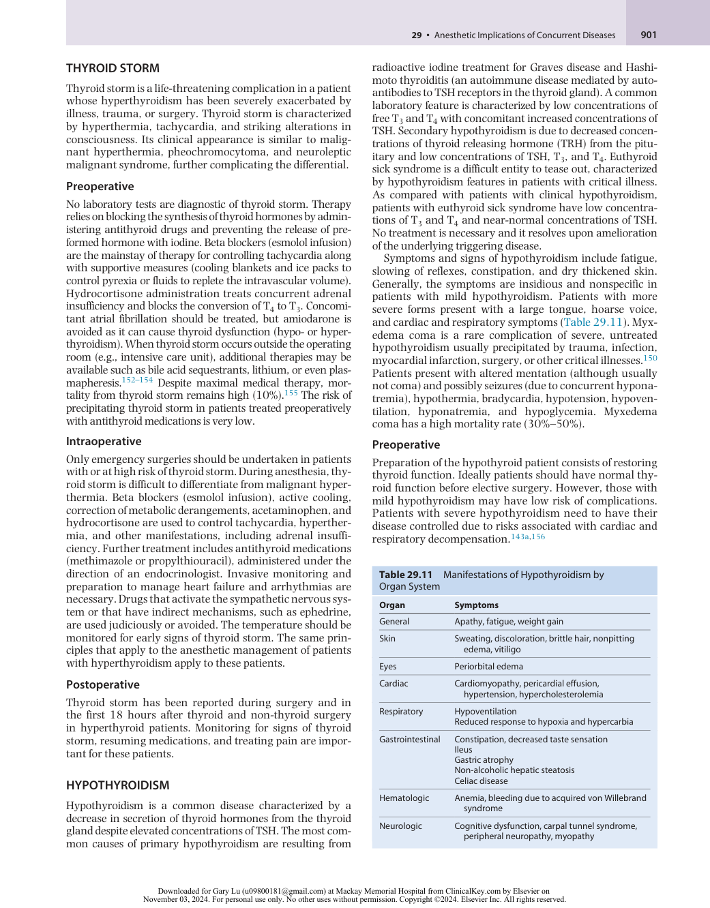

:::

<!-- PDF page 30 -->

Thyroid replacement hormones should be continued preoperatively, including on the day of surgery. For patients requiring rapid symptom control, intravenous administration of T4 thyroid hormone is preferred at doses of 50–100 mcg/ day following an initial loading dose of 200–500 mcg or faster control can be achieved using liothyronine (T3). These doses need to be reduced and carefully titrated in patients with ischemic heart disease because rapid replacement of thyroid hormones at usual doses may exacerbate ischemia. Patients with myxedema coma should be treated with a combination of intravenous T4 and T3 for rapid restoration of thyroid hormone concentrations, hydrocortisone for possible concurrent adrenal insufficiency, volume restoration, and treatment of the triggering pathology.

### Intraoperative

Anesthesia management has few implications in patients with mild to moderate hypothyroidism. For patients with severe disease or patients with myxedema undergoing emergency procedures, airway management can be problematic as patients can present with enlarged tongues, clinical features of obstructive sleep apnea, or vocal cord edema. Severely hypothyroid patients can be at increased risk of aspiration. Therefore, a rapid-sequence induction may be indicated. Clinicians must be vigilant for cardiac alterations posed by severe hypothyroidism such as reduced cardiac output, arrhythmias (bradycardia, slow rate atrial fibrillation, prolonged QTc leading to ventricular arrhythmias) and decreased intravascular volume with narrow pulse pressures. These can be exacerbated by the cardiodepressant and vasodilatory effects of inhalational and intravenous anesthetic agents, leading to hypotension. In patients with severe hypothyroidism, intravascular volume should be maintained with attention to cardiac decompensation. Patients may have ventilatory muscle weakness and a reduced response to hypoxia and hypercarbia. There may be sensitive to anesthetic agents that exacerbate these effects (such as narcotics and sedatives). Patients can have delayed emergence and prolonged postoperative sedation. Long- acting sedating agents should be dosed judiciously. Coagulopathy due to an acquired von Willebrand syndrome can lead to increased bleeding, and electrolyte abnormalities (hyponatremia, hypoglycemia) should be corrected.157

### Postoperative

Obstructive sleep apnea is more common in patients with hypothyroidism. Clinicians should be aware of possible prolonged effects of sedating medications used intraoperatively.

### HYPERPARATHYROIDISM AND HYPERCALCEMIA

Primary hyperparathyroidism usually results from enlargement of a single gland, commonly an adenoma, and more rarely from multiglandular disease. Parathyroid hormone (PTH) controls calcium concentrations, and in hyperparathyroidism, hypercalcemia almost always develops. Many of the prominent symptoms of hyperparathyroidism are a result of the hypercalcemia. Regardless of the cause, hypercalcemia can produce any number of symptoms, the most prominent of which involve the renal, skeletal, neuromuscular, and

gastrointestinal (GI) systems (Table 29.12). The diagnosis of hyperparathyroidism is confirmed by an elevated or normal concentration of PTH in a hypercalcemic patient.

Hypercalcemia may also occur as a consequence of secondary hyperparathyroidism in patients who have chronic renal disease. When phosphate excretion decreases as a result of decreased nephron mass, serum calcium concentrations fall because of deposition of calcium and phosphate in bone. Secretion of PTH subsequently increases, and this causes the fraction of phosphate excreted by each nephron to increase. Eventually, the chronic intermittent hypocalcemia of chronic renal failure leads to chronically high concentrations of serum PTH and hyperplasia of the parathyroid glands – one of the entities termed secondary hyperparathyroidism.158 The normal total serum calcium concentration is 8.6 to 10.4 mg/dL, a value that depends on the albumin concentration, with a decline of 0.8 mg/ dL for each 1 g/dL drop in albumin. Binding of calcium to albumin depends on pH: binding decreases with acidic pH and increases with alkaline pH. Serum calcium, not ionized calcium, decreases with reductions in albumin concentrations. Although ionized calcium is the clinically significant fraction, the cost and technical difficulties of stabilizing the electrodes used for measurement have limited the available assays. Nevertheless, PTH and vitamin D3 keep calcium concentrations stable within 0.1 mg/dL in any individual.

### Preoperative

Preparation of the patient with hyperparathyroidism relies on controlling the underlying disease (such as in malignancyassociated hypercalcemia, parathyroidectomy for primary hyperparathyroidism) and, if not possible, decreasing calcium concentrations preoperatively. Generally, patients with mild to moderate hypercalcemia who have normal renal and cardiovascular function require no special preoperative preparation. An ECG is done to look for prolonged

**Table 29.12** Symptoms of Hypercalcemia (Hyperparathyroidism)

|**Organ**|**Symptoms**|
|---|---|
|Renal|Nephrolithiasis (60%–70%) Renal tubular acidosis Polyuria, polydipsia|
|Musculoskeletal|Osteitis fibrosa cystica Diffuse osteopenia/osteoporosis Bone pain Muscle weakness/atrophy|
|Neurologic/psychiatric|Depression Psychomotor retardation Memory impairment Lethargy Confusion Seizures|
|Gastrointestinal|Anorexia, vomiting, and constipation Peptic ulcer disease (increased gastrin) Pancreatitis|
|Cardiovascular|Calcifications in the myocardium Hypertension ECG changes – prolonged PR, shortened QT intervals|

_ECG_ , electrocardiogram.

::: details 原始表格與符號（PDF 第 30 頁）

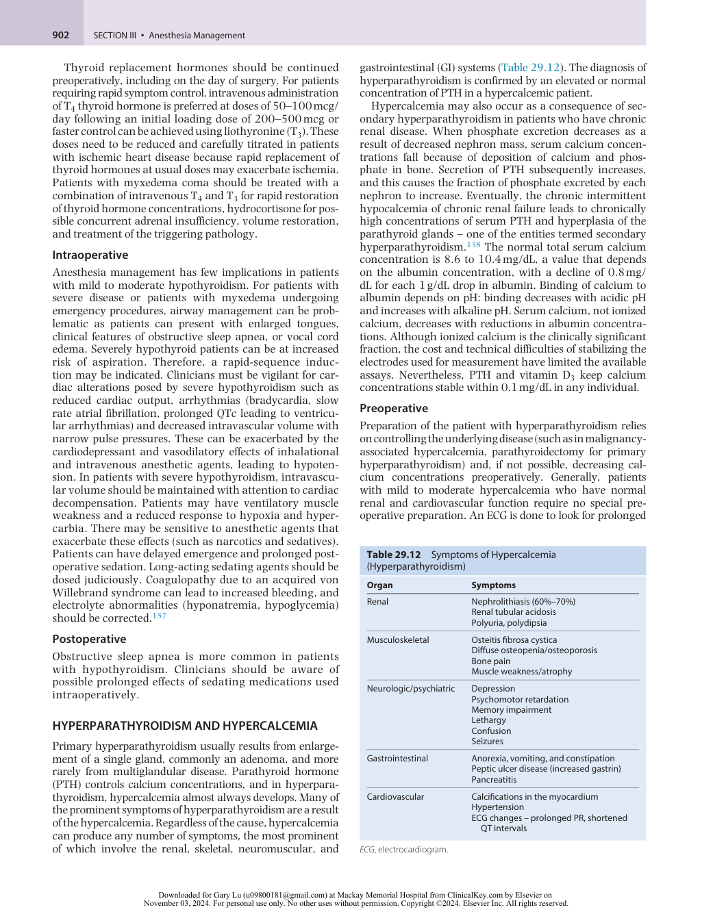

:::

<!-- PDF page 31 -->

PR or shortened QT intervals. Because severe hypercalcemia can result in substantial hypovolemia, normal intravascular volume and electrolyte status should be evaluated and then restored before anesthesia and surgery. Therapy for both malignant and nonmalignant causes of severe hypercalcemia include aggressive volume repletion, with the addition of diuretics only if volume overload develops. Intravenous fluid infusion rates of 250 to 500 mL/h preoperatively are commonly used to maintain urine output greater than 200 mL/h. Careful monitoring is needed to avoid administering an excessive volume of intravenous fluids, as many patients may have compromised cardiac function. The addition of furosemide may be needed to promote hypercalciuria.

In emergency situations, vigorous expansion of intravascular volume usually reduces serum calcium to a safe concentration (less than 14 mg/dL). Phosphate should be given to correct hypophosphatemia because hypophosphatemia will decrease calcium uptake into bone, increase calcium excretion, and stimulate breakdown of bone. Hydration, accompanied by electrolyte, especially phosphate repletion, suffices in the management of most hypercalcemic patients. Other measures useful in patients with malignant hypercalcemia are meant to decrease reabsorption of bone and include the bisphosphonates pamidronate sodium (90 mg intravenously) and zoledronate (4 mg intravenously). Additionally, calcitonin lowers serum calcium concentrations through direct inhibition of bone resorption. It can decrease serum calcium concentrations within minutes after intravenous administration. Side effects include urticaria and nausea. It is so rapid acting that it can be used to reduce calcium concentrations while waiting for hydration and a bisphosphonate to take effect. Dialysis should be reserved for patients with renal failure. Serious cardiac, renal, or CNS abnormalities may develop with chronic hypercalcemia and need to be optimized preoperatively.

### Intraoperative

Moderately elevated calcium concentrations do not pose problems. Some patients with skeletal effects of chronic hypercalcemia need careful positioning to prevent pathologic fractures. High calcium concentrations can antagonize the effect of neuromuscular blocking agents (NMBAs), thus careful monitoring of neuromuscular function is required intraoperatively. The ECG is monitored for prolonged PR or shortened QT intervals. Usually, the recurrent laryngeal nerve is monitored by the surgical team during neck dissection, so NMBAs are avoided.

### Postoperative

There are few concerns related to calcium concentrations postoperatively. After parathyroidectomy, assessment of vocal cord function is advocated. Vocal cord function is easily assessed by instructing the patient to say “e.”

### HYPOPARATHYROIDISM AND HYPOCALCEMIA

Hypoparathyroidism (usually due to inadvertent removal of parathyroid glands during thyroidectomy) and pseudohypoparathyroidism (the kidneys do not respond to the action of intact PTH) are uncommon causes of hypocalcemia. Mostly, hypocalcemia is due to hypoalbuminemia or as a result of other metabolic abnormalities (hypomagnesemia,

hypovitaminosis D, hungry bone syndrome after correction of hyperparathyroidism, anticonvulsant therapy, citrate infusion, or chronic renal disease). True hypocalcemia (i.e., when the free calcium concentration is low) results in depressed myocardial contractility. Myocardial contractility varies directly with concentrations of blood ionized calcium. The clinical signs of hypocalcemia include clumsiness, convulsions, laryngeal stridor, depression, muscle stiffness, paresthesias, parkinsonism, tetany, Chvostek sign, dry and scaly skin, brittle nails, coarse hair, low serum concentrations of calcium, prolonged QT intervals, soft tissue calcifications, and Trousseau sign.

Hypocalcemia delays ventricular repolarization, hence increasing the QTc interval. Heart failure may occur with hypocalcemia but is rare. Patients with hypocalcemia may have seizures, often indistinguishable from epilepsy in the absence of hypocalcemia. Patients may also have a type of seizure called cerebral tetany, which consists of generalized tetany followed by tonic spasms.

### Preoperative

The objective is to bring the symptoms under control before the surgical procedure and anesthesia. For patients with chronic hypoparathyroidism, the aim is to keep the serum calcium concentration in the lower half of the normal range by giving oral calcium and vitamin D. A preoperative ECG is useful for determining the QTc interval.

Patients with symptomatic hypocalcemia may be treated with intravenous calcium gluconate. Initially, 10 to 20 mL of 10% calcium gluconate may be given at a rate of 5 mL/ min, followed by a continuous infusion of 10% calcium gluconate in 500 mL of fluid over a period of 6 hours to keep serum calcium at adequate concentrations. For severe symptoms in emergency settings, 10 mL of 10% calcium chloride may be given over 10 minutes, followed by a 10% calcium gluconate infusion. Magnesium and phosphate concentrations may need to be corrected to normalize cardiovascular and nervous system functions. Heart failure in patients with coexisting heart disease improves when calcium and magnesium ion concentrations are restored to normal. Magnesium and phosphate concentrations should be corrected in a patient with impaired exercise tolerance or signs of cardiovascular dysfunction. Normalization can be achieved intravenously over a 15- minute period if necessary.

### Intraoperative

The same measures should be undertaken intraoperatively to maintain calcium concentrations close to normal, as sudden decreases in blood concentrations of ionized calcium (as with chelation therapy) can result in severe hypotension. Thus, alkalosis, whether respiratory (hyperventilation) or metabolic (bicarbonate administration) is avoided to decrease the risk of further decline in calcium concentrations. Similarly, citrate administered in large quantities during massive transfusion protocols can lower ionized calcium concentrations. Changes in the calcium concentration may impact NMBAs. Careful monitoring and titration of medications with a train- of- four monitor is necessary.

### Postoperative

Calcium concentrations should be monitored similar to the other phases of care.

<!-- PDF page 32 -->

### ACROMEGALY

Acromegaly is caused by an excess of growth hormone (GH), usually due to a pituitary adenoma (99% of time). The diagnosis is suspected when physical features consistent with the disease appear. It is confirmed by elevated serum insulin-like growth factor-1 (IGF-1) concentrations or by a 75 g oral glucose tolerance test followed by growth hormone measurement (a concentration greater than 1 ng/mL is diagnostic). Clinical features of acromegaly include headaches, visual field deficits, and cranial nerve palsies associated with the pituitary-secreting adenoma as well as possible signs related to other pituitary hormone deficiency (most commonly gonadotropins). These symptoms resolve with surgical or medical treatment in patients where surgical resection is not feasible. Other manifestations of GH excess manifest as cardiovascular disease, hypertension, diabetes, glucose intolerance, and obstructive sleep apnea, and may resolve with treatment. Overgrowth of tissues due to GH may persist despite treatment of acromegaly159,160 (Table 29.13)

Treatment consists of transphenoidal resection of the pituitary adenoma, or if the pituitary tumor is not totally removed, patients are often offered external pituitary irradiation. In the case of suprasellar extension, conventional transfrontal hypophysectomy is often performed. Medical therapy with cabergoline (dopaminergic agonist), somatostatin analogue (octreotide), or pegvisomant (blocks GH action) can be used in patients with incomplete resections. There is some evidence that somatostatin receptor ligand medication taken preoperatively may result in a better postoperative outcome.

### Preoperative

Comorbidities (hypertension, cardiovascular disease, diabetes) need to be evaluated and optimized. A careful assessment of the airway is important. Lateral neck radiographs or CT scans of the neck and direct or indirect laryngoscopy can identify patients with subglottic stenosis or an enlarged tongue, mandible, epiglottis, or vocal cords.

### Intraoperative

Difficulty with securing the airway is common in a patient with acromegaly. Mask ventilation may be difficult due to overgrowth of the mandible, distorted facial anatomy, and pharyngeal soft tissues. Moreover, laryngoscopy can be

**Table 29.13** Manifestations of Acromegaly

|**Organ**|**Signs/Symptoms**|
|---|---|
|Cardiovascular|Hypertension Cardiomegaly Cardiomyopathy Valvular disease|
|Skin/tissue overgrowth|Macroglossia Deepening of voice Macrognathia Carpal tunnel syndrome Obstructive sleep apnea Hypertrophic arthropathies|
|Metabolic|Insulin resistance Diabetes Hyperphosphatemia|

impeded by an enlarged tongue and epiglottis and longer distance from the lips to the vocal cords. Endotracheal intubation can be problematic due to possible subglottic stenosis, requiring a smaller than normal endotracheal tube. If placement of an arterial line is necessary, a brachial, axillary, or femoral site may be preferable to a radial site, as there can be compromise in the collateral circulation of the wrist.104

### Postoperative

Care should be taken when extubating a patient who required an advanced technique for securing the airway.

### DIABETES INSIPIDUS (HYPERNATREMIA)

Antidiuretic hormone is produced in the supraoptic nuclei of the hypothalamus and stored in the posterior pituitary. Diabetes insipidus (DI) results either from destruction of the posterior pituitary or resection of the pituitary stalk during trauma or neurosurgical procedures (central DI) or from inability of the renal collecting tubules to respond to the action of antidiuretic hormone (nephrogenic DI). Regardless of the cause, the main features of DI are polydipsia (in an awake patient), polyuria accompanied by a dilute urine (urine- specific gravity is low, less than 1.003), increased serum osmolality, and hypernatremia. Patients who are awake and can maintain oral input rarely become hypernatremic. However, this is not the case for those with impaired mentation. Definitive treatment of DI includes desmopressin (DDAVP) (10–20 mcg intranasal, 2–4 mcg subcutaneously [SC]) or vasopressin (5 U every 2–4 hours intramuscularly or SC). Care should be taken when using desmopressin because hyponatremia can ensue.161 Patients with nephrogenic DI can be treated with chlorpropamide.

### Intraoperative

Maintaining intravascular volume and correcting the sodium concentrations are goals. Normal saline (NS) is used to restore volume and correct hypernatremia for severe situations. Fluids include hourly maintenance as well as twothirds of the urine output in the previous hour. Hypotonic fluids containing 0.45% NS are commonly used as maintenance fluids in order to replace water deficits.

### Postoperative

Patients should be asked about thirst and fluid intake. Output is assessed and recorded, and electrolytes monitored. Replacement of previous and ongoing fluid losses is important. Hypernatremia can occur if thirst is impaired, or the patient has no access to water. Patients with partial diabetes insipidus and mild to moderate polyuria may be adequately treated with a low- solute diet or a thiazide diuretic. Desmopressin is often required especially for those with severe diabetes insipidus. Patients may be accustomed to drinking large amounts of fluids, and along with desmopressin may be at risk of hyponatremia.

### SYNDROME OF INAPPROPRIATE ANTIDIURETIC HORMONE (SIADH)

Inappropriate secretion of vasopressin, without relation to serum osmolality, results in hyponatremia and fluid retention. This inappropriate secretion can result from a variety

::: details 原始表格與符號（PDF 第 32 頁）

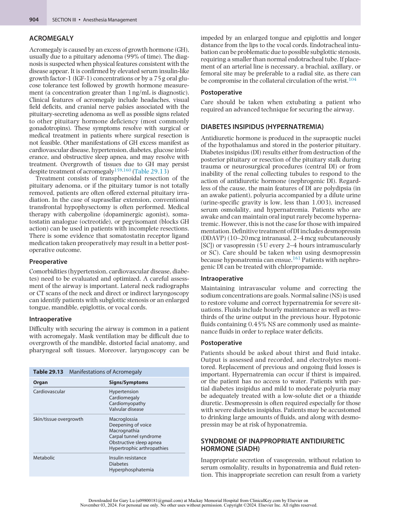

:::

<!-- PDF page 33 -->

of CNS lesions, drugs including antidepressants, pulmonary infections, hypothyroidism, adrenal insufficiency, and ectopic production from tumors. The diagnosis of SIADH should be suspected in any patient with hyponatremia who excretes urine that is hypertonic relative to plasma. The following laboratory findings further support the diagnosis:

- Urinary sodium greater than 20 mEq/L

- Low serum concentrations of blood urea nitrogen (BUN), creatinine, uric acid, and albumin

- Serum sodium less than 130 mEq/L

- Plasma osmolality less than 270 mOsm/L

- Urine hypertonic relative to plasma

Most of the clinical features associated with SIADH are related to hyponatremia and the resulting brain edema. Features include weight gain, weakness, lethargy, mental confusion, obtundation, and disordered reflexes, and may culminate in convulsions and coma.

### Preoperative

Treatment of SIADH relies on appropriate treatment of the causative disorders (e.g., drug withdrawal if a certain medication is responsible) and restriction of water. Occasionally, drugs that inhibit the renal response to ADH (e.g., lithium or demeclocycline) should be administered preoperatively to restore normal intravascular volume and electrolytes. Lithium is rarely used due to toxicity but demeclocycline in doses of 900 to 1200 mg/day interferes with the ability of the renal tubules to concentrate urine, thereby causing excretion of isotonic or hypotonic urine and lessening the hyponatremia. Fluid restriction is the other key component of therapy, keeping in mind that too vigorous treatment of chronic hyponatremia can result in disabling osmotic demyelination syndrome, or central pontine myelinolysis. The increase in serum sodium concentrations should not be greater than 8 mEq/L in 24 hours. Patients with mild to moderate symptoms of water intoxication can be treated with restriction of fluid intake to approximately 500 to 1000 mL/day. Patients with severe water intoxication and CNS symptoms may need vigorous treatment consisting of intravenous administration of hypertonic saline solutions until symptoms resolve, followed by fluid restriction.

### Intraoperative

Attention should be paid to volume status. However, these patients are generally euvolemic or mildly hypervolemic. Invasive monitoring is rarely necessary and is dictated by the underlying pathology and the proposed procedure rather than the presence of SIADH. The type of anesthetic used has no bearing on the postoperative development of SIADH.

### Postoperative

Fluid restriction is a mainstay of therapy in most patients with SIADH, with a suggested goal intake of less than 800 mL/day, together with treatment of infections such as pneumonia, and cessation of offending drugs, such as selective serotonin reuptake inhibitors or chlorpropamide.

### CARCINOID SYNDROME

Carcinoid tumors are neuroendocrine neoplasms arising from the appendix, small intestine, rectum, or bronchi.

Carcinoid tumors contain several peptides that may or may not be secreted in the systemic circulation. Even when secreted from the GI tract, these peptides are inactivated by the liver. Patients with carcinoid tumors present with symptoms only when liver metastases are present or there is a bronchial neoplasm, and the liver metabolism is bypassed. Symptoms of carcinoid syndrome are the result of circulating neuropeptides (e.g., bradykinin, kallikrein, substance P, dopamine, norepinephrine, histamine) but mostly serotonin or its metabolite, 5- hydroxyindoleacetic acid (5HIAA). Manifestations of carcinoid syndrome include flushing (usually has rapid onset), diarrhea, bronchospasm, and hemodynamic instability (hypo- or hypertension). Patients with carcinoid syndrome can have cardiac involvement manifested as right- sided valvular lesions (tricuspid or pulmonary valve stenosis or regurgitation) due to fibrosis precipitated by the circulating vasoactive substances. Because the pulmonary circulation deactivates serotonin and other active peptides, left- sided valve lesions are rare (10% of patients) and only present with bronchial carcinoids or when there is a right to left intracardiac shunt. Carcinoid crisis is a severe form of carcinoid syndrome manifested by hemodynamic instability, intense flushing, diarrhea, and bronchoconstriction.

Diagnosis of carcinoid syndrome is made clinically and confirmed by high serum serotonin or serum or urine 5-HIAA concentrations. Chromogranin A concentrations are elevated in carcinoid syndrome but lack specificity. Chromogranin A concentrations are usually used to assess disease recurrence or progression rather than for diagnostic purposes.

### Preoperative

Optimization focuses on control of the carcinoid symptoms. As carcinoids are slow- growing tumors, symptom control should be achieved preoperatively in order to avoid an intraoperative carcinoid crisis. Medical treatment with long- acting somatostatin analogues started in the outpatient setting should be continued preoperatively, with the dose adjusted based on symptoms and on urinary concentrations of 5- HIAA. Lanreotide is a long- acting somatostatin analogue, given as a depot intramuscularly every month. As mentioned, patients with carcinoid syndrome can present with right- sided valvular lesions (due to fibrin deposits) or even progression to right ventricular failure.162 An echocardiogram should be performed in symptomatic patients.163 Electrolyte disturbances and malnutrition caused by diarrhea should be addressed before surgery.

### Intraoperative

Balanced general anesthesia is the anesthetic technique of choice in patients with carcinoids. Anesthetic agents that do not promote histamine release are safe. Preoperative benzodiazepines are useful in decreasing anxiety and an arterial line is recommended due to possible blood pressure fluctuations. Use of a TEE should be considered if cardiac involvement is suspected. Although short- acting octreotide prophylaxis is not routinely recommended, some centers use subcutaneous or intravenous octreotide administered 6 to 24 hours before major surgeries. While this may not avoid a crisis, it minimizes the severity of the symptoms.164 Octreotide administration for minor procedures is not routinely

<!-- PDF page 34 -->

used, but special attention during the intraoperative and postoperative phases is required since a crisis can develop. A preoperative bolus of 500 mcg octreotide followed by an intraoperative infusion at a rate of 500 mcg/h prevented 70% of patients with carcinoid tumors from developing carcinoid crisis and appears safe.165 Intraoperatively, a rapid increase in airway pressures suggestive of bronchospasm might prompt a diagnosis of a carcinoid crisis. Despite earlier concerns, β- adrenergic agonist administration may not precipitate carcinoid crisis, as recently evidenced.166 Vasopressors and antihypertensive agents should be readily available to treat blood pressure fluctuations. However, octreotide boluses are the modality of choice to treat hypotension and bronchoconstriction. Hyperglycemia due to octreotide is common and may require an insulin infusion.167

### Postoperative

Patients should be admitted to the ICU and monitored for subsequent carcinoid crises. Octreotide as described in the intraoperative management is used if needed.

### HYPOKALEMIA

Hypokalemia is defined as a serum potassium (K) concentration of less than 3.5 mEq/L and can be acute (usually due to intracellular movement of potassium, such as during metabolic alkalosis) or chronic (due to gastrointestinal or renal losses) (Table 29.14). Patients with mild, chronic hypokalemia (K 3–3.5 mEq/L) do not present with any symptoms. However, those with severe, acute hypokalemia (K less than 3 mEq/L) can have muscle weakness, depressed deep tendon reflexes, palpitations, arrhythmias, and polyuria due to inability to concentrate urine. Severe

**Table 29.14** Potential Causes of Hypokalemia

|**Potassium Losses**|**Inadequate Intake**|**Intracellular K Shift**|
|---|---|---|
|**GASTROINTESTINAL**|Anorexia|Alkalemia|
|Diarrhea Fistula Ileostomy|Starvation Total parenteral nutrition|Hypothermia Barium toxicity Insulin |
|Laxative abuse **RENAL**||Beta- adrenergic agonists|
|Hypomagnesemia Hyperglycemia Salt wasting nephropathy (Bartter syndrome)|||
|Renal tubular acidosis|||
|Mineralocorticoid excess (Conn syndrome)|||
|Drug induced|||
|(amphotericin B, aminoglycosides, cisplatin, loop diuretics, high-dose penicillin)|||
|Dialysis|||
|Plasmapheresis|||
|**CUTANEOUS**|||
|Burns|||
|Diaphoresis|||

hypokalemia can manifest with ECG changes such as flattening of T waves, QT prolongation, U waves, and ST depression.

Patients with mild hypokalemia, whether it is acute or chronic, can proceed to surgery, but need further evaluation and treatment. Care should be taken to avoid further decreases in potassium, which can trigger cardiac instability. Alkalosis will lower potassium concentrations. For patients with severe hypokalemia, the approach is a matter of debate and controversy. Potassium repletion is considered for acute hypokalemia. The underlying cause of chronic hypokalemia such as gastrointestinal or renal losses should be addressed. Potassium repletion in the setting of chronic total-body potassium depletion, such as in chronic loss scenarios, may require considerable doses and there is concern that acutely raising potassium concentrations may promote cardiac instability rather than stabilizing the membranes. Potassium repletion should be administered in small doses of 20–40 mEq over 30 minutes or 3–10 minutes when lifethreatening arrhythmias are present. Magnesium repletion is added even when magnesium concentrations are normal but more so when low, to ensure maintenance of intracellular potassium concentrations. In hypokalemic patients taking digoxin, the electrolyte abnormality can precipitate toxicity.

### Intraoperative

Potassium concentrations do not impact anesthetic management (potassium does not affect the minimal alveolar concentration of inhalational anesthetics). Care is taken to avoid further decreases in potassium concentrations by avoiding fluctuating acid–base status or administration of certain medications such as the antibiotic gentamicin or insulin.

### Postoperative

Monitoring and replacing deficits are important.

### HYPERKALEMIA

Hyperkalemia is defined as a potassium concentration of greater than 5 mEq/L, and can be the result of medication side effects, diet, and chronic kidney disease (Table 29.15). Hyperkalemia can be mild (5–6 mEq/L without ECG changes), moderate (5–6 mEq/L with ECG changes or 6.1–6.5 mEq/L without ECG changes), or severe (6.1– 6.5 mEq/L with ECG changes) or greater than 6.5 mEq/L. Patients with mild to moderate hyperkalemia are usually asymptomatic but those with severely elevated potassium concentrations can have muscle cramps, tetany, dyspnea due to ventilatory muscle weakness, paresthesia, lethargy, bradycardia, irregular heart rhythm, and ECG changes. ECG changes include peaked symmetric T waves, shortened PR interval, ST depressions, and widened QRS complex. The “sine wave” is a sign of impending cardiac arrest and is often a fatal rhythm.

For patients with mild to moderate acute or chronic hyperkalemia, treatment relies on eliminating potassium from the body with a GI ion-binding and exchange resin and loop diuretics. Patients with severe hyperkalemia (or moderate but with ECG changes) should be given calcium (as a membrane stabilizer), drugs to redistribute potassium

::: details 原始表格與符號（PDF 第 34 頁）

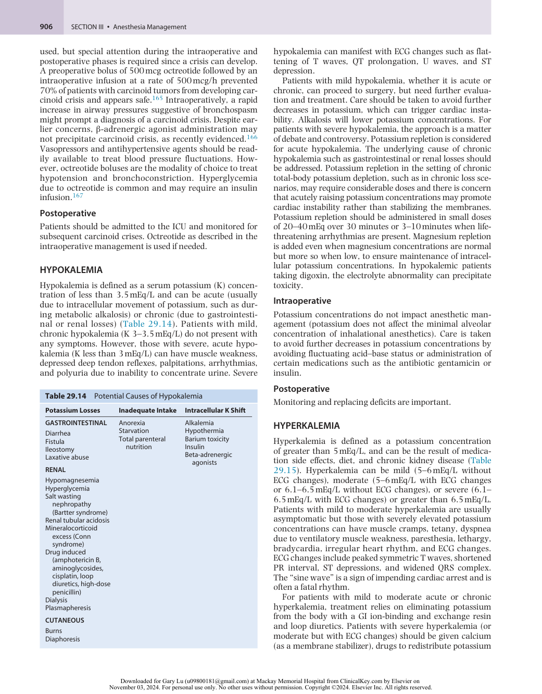

:::

<!-- PDF page 35 -->

**Table 29.15** Differential Diagnosis of Hyperkalemia

|**Mechanism**|**Diagnosis**|
|---|---|
|Miscellaneous|Spurious (pseudohyperkalemia) Hemolysis Thrombocytosis Leukemia|
|Impaired potassium excretion|Renal failure Drug effect (ACEIs, ARBs, potassium sparing diuretics, NSAIDs, direct renin inhibitors) Mineralocorticoid deficiency (Addison disease)|
|Extracellular potassium shift|Hyperglycemia Insulin deficiency Rhabdomyolysis Trauma Drug effect – beta blockers, succinylcholine, digoxin, calcineurin inhibitors|
|Increased potassium intake|Only in patients with kidney disease where excretion is impaired|

_ACEIs_ , angiotensin-converting enzyme inhibitors; _ARBs_ , angiotensin receptor blockers; _NSAIDs_ , nonsteroidal anti- inflammatory drugs.

from the extracellular to the intracellular space (insulin, β- agonists, bicarbonate), and have potassium removed from the body, as discussed previously. For patients with end- stage kidney disease, dialysis may be necessary as they may not be able to eliminate potassium through the urine.

### Intraoperative

Perioperative management consists of maintaining a safe potassium concentration (less than 5.5 mEq/L) for patients undergoing elective surgery. The activity of NMBA may be potentiated and perioperative care should prevent further increases in potassium by avoiding acidosis and drugs such as succinylcholine. It is important to note that succinylcholine only increases the potassium concentration by 0.5 mEq/L both in patients with and without kidney failure.

### Postoperative

All of the issues and recommendations discussed in the preoperative management of hyperkalemia should be applied in the postoperative period.

## Rheumatic and Connective Tissue Diseases

Patients with rheumatic or connective tissue diseases frequently have dysfunction of several organ systems. A detailed history and review of systems that focus on potential manifestations of disease are essential in perioperative planning. Diagnostic laboratory testing is indicated to determine the stability of end-organ function (particularly hepatic and renal function); the presence of anemia of chronic disease and concomitant iron deficiency anemia; the presence of malnutrition; or coagulation disturbances due to myelosuppression or liver disease.

In addition to routine cardiac risk assessment (see Chapter 28), non- traditional risk factors are considered

in assessing for risk of ischemic heart disease. Inflammatory diseases and chronic corticosteroid use can cause accelerated atherosclerosis in the absence of advanced age or traditional cardiovascular risk factors. Rheumatic and connective tissue diseases can be associated with other cardiovascular manifestations, such as conduction disturbances, myocarditis, or pericardial disease; focused assessment for these issues is warranted if clinical suspicion exists.

Patients with rheumatic diseases, such as systemic lupus erythematosus (SLE), rheumatoid arthritis (RA), ankylosing spondylitis, or systemic sclerosis frequently suffer from chronic daily pain. Many will use antispasmodics, antidepressants, anticonvulsants, nonsteroidal anti- inflammatory drugs (NSAIDs), or opioids for pain control.168 Patients taking opioids chronically are more at risk for postoperative complications after major surgery; they have higher rates of readmission to hospital after major surgery, longer lengths of stay, higher hospital costs, and are more likely to be readmitted for infection, opioid overdose, or acute pain.169 For patients on chronic opioid therapy, challenging postoperative pain management is anticipated and multimodal analgesia is employed, including continuation of home pain medications. Regional analgesia is employed whenever feasible to reduce opioid requirements.

Specific aspects unique to rheumatic and connective tissue diseases with relevance for perioperative management are highlighted below.

### SYSTEMIC LUPUS ERYTHEMATOSUS (SLE)

### Preoperative

SLE is a multisystem inflammatory disease. While mortality rates from SLE have dramatically decreased from the 1940s when expected 3- year mortality was 40%, observed yearly mortality from SLE is still two to five times higher than for the general population.170 Total hip and knee arthroplasty are common surgical procedures in patients with SLE. Historically, the primary pathology driving need for early joint replacement was osteonecrosis, yet now, patients are increasingly presenting at an older age with osteoarthritis, indicating patients with SLE are surviving to develop degenerative disease.171 Preoperative assessment focuses on eliciting manifestations of disease and determining the stability of organ function. Specific organ system manifestations along with potential perioperative implications are listed in Table 29.16.

Consequences from medical treatment of SLE include recurrent infections from immunosuppression; adrenal suppression from chronic steroid use; hepatotoxicity from disease- modifying antirheumatic drugs (DMARDs); or coagulation disturbances from aspirin therapy, NSAID use, or anticoagulants. The 2017 American College of Rheumatology (ACR)/American Association of Hip and Knee Surgeons Guideline for the Perioperative Management of Antirheumatic Medication in Patients with Rheumatic Diseases Undergoing Elective Total Hip or Total Knee Arthroplasty172 provides perioperative medication recommendations for patients with severe and not- severe SLE who are otherwise optimized for surgery (Table 29.17). Severe SLE is defined in the guideline as172 :

::: details 原始表格與符號（PDF 第 35 頁）

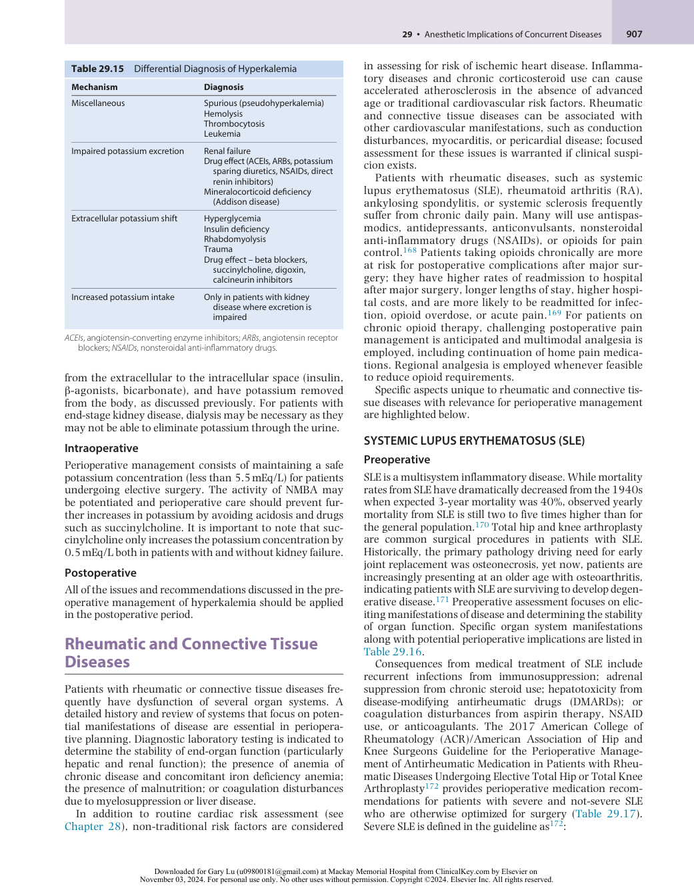

:::

<!-- PDF page 36 -->

**Table 29.16** Organ System Manifestations of Systemic Lupus Erythematosus (SLE) and Perioperative Implications

|**Organ System**|**Potential Manifestations of Disease**|**Perioperative Implications**|
|---|---|---|
|**Constitutional**|ᑏFatigue ᑏWeight loss ᑏFever|ᑏDecreased functional capacity ᑏDeconditioning or malnutrition ᑏOccult infection or drug reaction masquerading as fever from lupus flare|
|**Neurologic**|ᑏStroke ᑏSeizure ᑏPsychosis ᑏDepression/anxiety|ᑏPerioperative antiplatelet management ᑏOptimal surgical timing after stroke ᑏAntiseizure and antidepressant medication management ᑏPostoperative altered mental status/delirium|
|**Cardiovascular**|ᑏValvular heart disease: mitral valve prolapse and regurgitation, nonbacterial thrombotic endocarditis (Libman–Sacks/ verrucous) ᑏPericarditis ± effusion ᑏMyocarditis ± related conduction abnormalities: sinus tachycardia, atrial fibrillation, QT prolongation ᑏAccelerated atherosclerosis and early coronary heart disease|ᑏHeart failure and volume assessment ᑏPotential for cardiac tamponade ᑏSilent presentation of occult myocarditis ᑏTachycardia predisposing to ischemia ᑏPerioperative ischemic heart disease risk assessment|
|**Pulmonary**|ᑏPleural disease: pleuritic chest pain, pleural effusion ᑏInterstitial lung disease, restrictive lung disease, and hypoxia ᑏPulmonary hypertension ᑏPulmonary hemorrhage|ᑏRisk for perioperative pulmonary complications ᑏOxygen desaturation perioperatively|
|**Renal**|ᑏGlomerulonephritis, chronic kidney disease progressing to end- stage renal disease|ᑏAvoid nephrotoxins/IV contrast ᑏPerioperative fluid and blood pressure management to prevent acute kidney injury|
|**Hematologic**|ᑏAnemia: of chronic disease, iron deficiency, or hemolytic ᑏLeukopenia ᑏThrombocytopenia, immune thrombocytopenia (ITP) ᑏAntiphospholipid antibodies (“lupus anticoagulant”)|ᑏIncreased risk of blood transfusions ᑏOccult iron deficiency anemia ᑏElevated aPTT with thromboembolic risk|
|**Musculoskeletal**|ᑏArthritis, arthralgia, myalgia, osteonecrosis|ᑏChronic opioid therapy and challenging perioperative pain management|
|**Integumentary/** **mucous** **membranes**|ᑏDermatitis ᑏOral or nasal ulcers|ᑏSkin sensitivity to tapes/adhesives ᑏEpistaxis with nasal instrumentation|

_aPTT_ , activated partial thromboplas tin time; _IV_ , intravenous.

_Currently treated (induction or maintenance) for severe organ manifestations: lupus nephritis, central nervous system lupus, severe hemolytic anemia (hemoglobin &lt;9.9), platelets &lt;50,000/ml, vasculitis (other than mild cutaneous vasculitis), including pulmonary hemorrhage, myocarditis, lupus pneumonitis, severe myositis (with muscle weakness, not just high enzymes), lupus enteritis (vasculitis), lupus pancreatitis, cholecystitis, lupus hepatitis, protein- losing enteropathy, malabsorption, orbital inflammation/myositis, severe keratitis, posterior severe uveitis/retinal vasculitis, severe scleritis, optic neuritis, anterior ischemic optic neuropathy_ …

If the patient with SLE is to undergo more than minor surgery, appropriate preoperative testing includes a complete blood count, serum creatinine and electrolytes, iron studies (ferritin and transferrin saturation), and blood type and screen (T&S) if anemia is present. If occult cardiac disease or myocarditis is suspected (e.g., presence of a heart murmur, significant dyspnea on exertion, resting sinus tachycardia, conduction abnormalities, signs of volume overload), workup may include assessment for ischemic heart disease, heart failure, or heart rhythm abnormalities.

### Intraoperative

Patients with SLE are commonly young females, yet they are at increased risk for perioperative major adverse cardiac events (MACE),173 acute kidney injury (AKI),174 and

stroke.175 Avoiding perioperative hypotension is critical to preventing these adverse outcomes, with a mean arterial pressure of 65–70 mm Hg likely sufficient for most patients.1 For patients chronically taking corticosteroids, an additional intraoperative “stress” dose may be warranted for major surgery, particularly in the setting of intraoperative hypotension (see earlier section on Adrenal Insufficiency).

### Postoperative

Chronic pain is a frequent manifestation of disease,176 with the yearly prevalence of opioid use of 53% in all SLE patients and with 18% of patients using opioids chronically.168 In addition to contributing to challenging postoperative pain management, chronic opioid use increases perioperative risk of complications.

### RHEUMATOID ARTHRITIS (RA)

### Preoperative

RA is a polyarticular, inflammatory arthritis that causes joint destruction and extra- articular manifestations. Preoperative assessment focuses on disease severity, duration of symptoms, and current medical therapy. See Table 29.18 for a list of potential disease involvement by organ system. In the nonsurgical population, patients with RA experience excess cardiovascular mortality, with an increased risk of cardiovascular events and cardiovascular disease–related

::: details 原始表格與符號（PDF 第 36 頁）

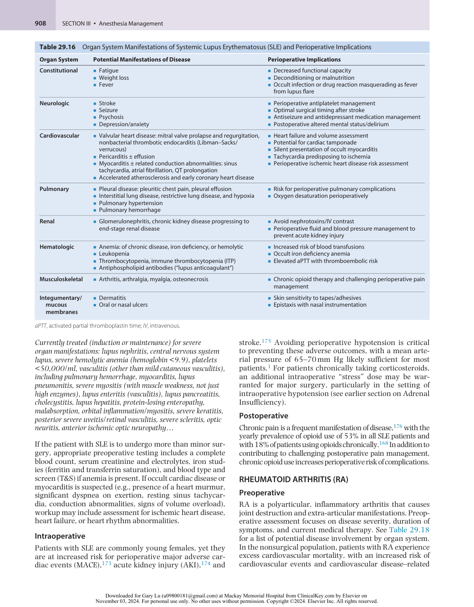

:::

<!-- PDF page 37 -->

**Table 29.17** Perioperative medication recommendations for rheumatic disease treatment prior to elective joint arthroplasty included in the 2017 American College of Rheumatology (ACR)/American Association of Hip and Knee Surgeons Guideline for the Perioperative Management of Antirheumatic Medication in Patients with Rheumatic Diseases Undergoing Elective Total Hip or Total Knee Arthroplasty172

|**DMARDs: CONTINUE these medications** **through surgery**|**Dosing Interval**|**Continue/Withhold**|
|---|---|---|
|Methotrexate|Weekly|Continue|
|Sulfasalazine|Once or twice daily|Continue|
|Hydroxychloroquine|Once or twice daily|Continue|
|Leflunomide (Arava)|Daily|Continue|
|Doxycycline|Daily|Continue|
|**BIOLOGIC AGENTS: STOP these medications** **prior to surgery and schedule surgery at the** **end of the dosing cycle. RESUME medications** **at minimum 14 days after surgery in the** **absence of wound healing problems, surgical** **site infection, or systemic infection**|   **Dosing Interval**|**Schedule Surgery (relative to last biologic** **agent dose administered) during**|
|Adalimumab (Humira)|Weekly or every 2 weeks|Week 2 or 3|
|Etanercept (Enbrel)|Weekly or twice weekly|Week 2|
|Golimumab (Simponi)|Every 4 weeks (SQ) or every 8 weeks (IV)|Week 5 Week 9|
|Infliximab (Remicade)|Every 4, 6, or 8 weeks|Week 5, 7, or 9|
|Abatacept (Orencia)|Monthly (IV) or weekly (SQ)|Week 5 Week 2|
|Certolizumab (Cimzia)|Every 2 or 4 weeks|Week 3 or 5|
|Rituximab (Rituxan)|2 doses 2 weeks apart every 4–6 months|Month 7|
|Tocilizumab (Actemra)|Every week (SQ) or every 4 weeks (IV)|Week 2 Week 5|
|Anakinra (Kineret)|Daily|Day 2|
|Secukinumab (Cosentyx)|Every 4 weeks|Week 5|
|Ustekinumab (Stelara)|Every 12 weeks|Week 13|
|Belimumab (Benlysta)|Every 4 weeks|Week 5|
|Tofacitinib (Xeljanz): STOP this medication 7 days prior to surgery.|Daily or twice daily|7 days after last dose|
|**SEVERE SLE- SPECIFIC MEDICATIONS:** **CONTINUE these medications in the** **perioperative period**|**Dosing Interval**|**Continue/Withhold**|
|Mycophenolate mofetil|Twice daily|Continue|
|Azathioprine|Daily or twice daily|Continue|
|Cyclosporine|Twice daily|Continue|
|Tacrolimus|Twice daily (IV and PO)|Continue|
|**NOT- SEVERE SLE: DISCONTINUE these** **medications 1 week prior to surgery**|**Dosing Interval**|**Continue/Withhold**|
|Mycophenolate mofetil|Twice daily|Withhold|
|Azathioprine|Daily or twice daily|Withhold|
|Cyclosporine|Twice daily|Withhold|
|Tacrolimus|Twice daily (IV and PO)|Withhold|

_DMARDs_ , disease-modifying antirheumatic drugs; _IV_ , intravenous; _PO_ , oral; _SLE_ , systemic lupus erythematosus; _SQ_ , subcutaneous.

::: details 原始表格與符號（PDF 第 37 頁）

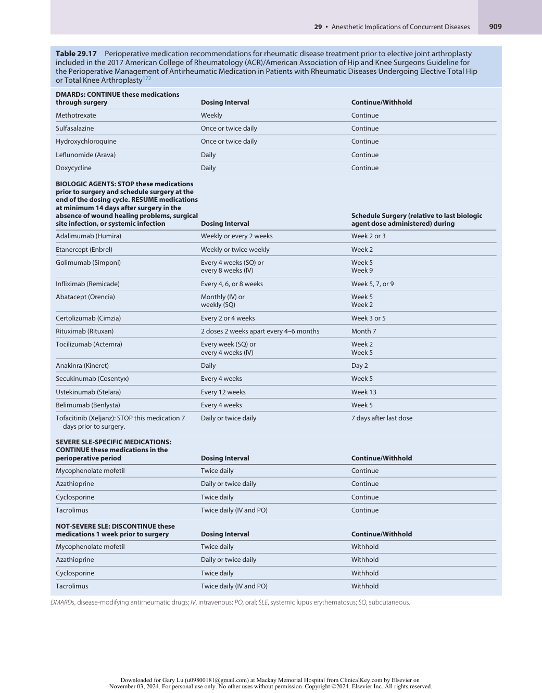

:::

<!-- PDF page 38 -->

mortality over the general population (standardized mortality ratio 1.50, 95% confidence interval [CI] 1.39–1.61).177 Even in the absence of traditional cardiovascular risk factors, the inflammatory disease process accelerates atherosclerosis, meaning that traditional perioperative risk calculators may underestimate cardiac risk.

endotracheal tube may help to avoid laryngeal trauma, or avoiding intubation entirely may be preferable and using a supraglottic airway (SGA) if otherwise appropriate.

### Postoperative

While very rare, case reports exist documenting acute postoperative airway obstruction requiring emergency surgical airway management due to vocal cord abnormalities attributed to cricoarytenoid arthritis.181 Close monitoring for airway compromise is warranted after extubation in patients with preoperative symptoms or vocal cord abnormalities.

Patients with long- standing, severe disease may develop anterior subluxation of the atlanto- axial joint which can be asymptomatic, or cause pain radiating to the occiput, myelopathy, or sensory disturbance in the C2 distribution. With the advent of more effective DMARDs, the prevalence of anterior atlantoaxial subluxation reported in the literature has decreased from 36% prior to the 1980s to 24% of patients in the 2000s.178 Plain lateral radiographs of the cervical spine in flexion and extension positions may reveal abnormal separation of the odontoid process and the C1 arch, however, preoperative radiographs are frequently of inadequate quality to provide diagnostic value.179 Hoarseness and stridor on exam are potential signs of cricoarytenoid arthritis, a relatively common finding in patients with severe long-standing RA (30%–50% of patients as detected on indirect laryngoscopy or CT).180

Opioid use is common in patients with rheumatoid arthritis, with a quarter of outpatient clinic visits for RA resulting in a prescription for opioids in the United States.168 In addition to contributing to challenging postoperative pain management, chronic opioid use increases perioperative risk.

### ANKYLOSING SPONDYLITIS

### Preoperative

Ankylosing spondylitis (axial spondylarthritis) is an inflammatory arthritis of the spine causing progressive spinal fusion and impaired spinal mobility. The term “bamboo spine” is used to describe the pathognomonic radiographic findings in advanced disease. Patients with bamboo spine often have a stooped posture resulting from flexion deformities at the neck and hips, hyperkyphosis of the thoracic spine, and loss of lumbar spine lordosis. Spinal rigidity puts patients at high risk for spinal fractures after even minor trauma, most commonly (80%) in the cervical spine at C5–C6 or C6–C7.182 Reports exist of devastating neurologic injury resulting from inadvertent hyperextension of the neck with direct laryngoscopy183 and videolaryngoscopy184 during difficult intubation. Anterior atlantoaxial subluxation occurs frequently (14% of patients in an outpatient ankylosing spondylitis clinic),185 though may be asymptomatic. Careful physical examination for spinal abnormalities and review of relevant imaging is essential in anesthetic planning.

Early treatment with DMARDs is advocated in RA to prevent joint destruction. Methotrexate is commonly used for maintenance, with NSAIDs and glucocorticoids used for initial symptom control and then rapidly weaned. Potential toxicity with low- dose methotrexate used for RA includes hepatotoxicity (steatosis, fibrosis, cirrhosis), pulmonary toxicity (pneumonitis, fibrosis, pulmonary infections), and myelosuppression (macrocytosis, pancytopenia). See Table 29.17 for perioperative medication management recommendations.

### Intraoperative

If general anesthesia is planned, airway management considers the potential for occult atlantoaxial subluxation and cervical spine arthritis. Minimizing neck movement after induction of anesthesia can be achieved through video laryngoscopy or fiberoptic bronchoscopic intubation combined with manual in- line stabilization of the neck. In the setting of cricoarytenoid arthritis, a smaller-sized

Patients with long- standing ankylosing spondylitis may present with non- articular organ system dysfunction. See Table 29.19 for a summary of issues relevant to anesthesia. Restrictive lung disease occurs in long- standing disease due to thoracic cage immobility and poor chest wall compliance. Unlike in RA, cardiovascular risk in ankylosing spondylitis is only mildly increased over the general population.186 Systemic sclerosis can cause aortic root and aortic valve abnormalities. Renal disease may be present.

**Table 29.18** Organ System and Extra- Articular Manifestations of Rheumatoid Arthritis

|**Organ System**|**Potential Disease Manifestation**|
|---|---|
|**Constitutional/Systemic**|Fatigue, chronic pain, weight loss, Sjögren syndrome|
|**Neurologic**|Myelopathy (if cervical spine involvement), depression|
|**Cardiovascular**|Pericarditis, coronary artery disease, heart failure, atrial fibrillation, conduction abnormalities, venous thromboembolic disease|
|**Pulmonary**|Pleuritis, pleural effusion, interstitial fibrosis|
|**Renal**|Chronic kidney disease from drug toxicity: nonsteroidal anti- inflammatory drugs|
|**Hematologic**|Anemia of chronic inflammation|

**Table 29.19** Organ System Dysfunction and Coexisting Diseases of Ankylosing Spondylitis

|**Organ System**|**Potential Disease Manifestation**|
|---|---|
|**Constitutional/Systemic**|Fatigue|
|**Neurologic**|Stroke|
|**Cardiovascular**|Aortic regurgitation, aortic aneurysm, conduction abnormalities, coronary artery disease|
|**Pulmonary**|Restrictive lung disease|
|**Renal**|Chronic kidney disease|

::: details 原始表格與符號（PDF 第 38 頁）

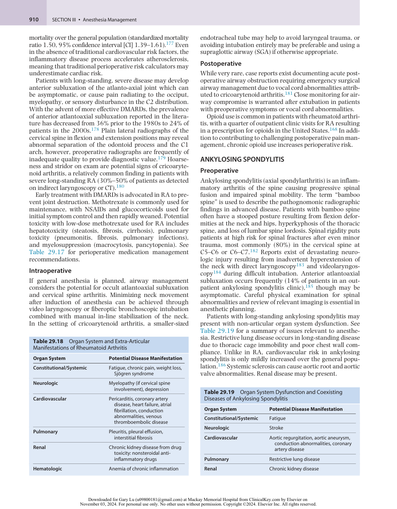

:::

<!-- PDF page 39 -->

NSAIDs are the recommended first- line treatment for symptom management, with many patients taking chronic NSAIDs long term. Non- biologic and biologic DMARDs are used to prevent progression of spinal disease and maintain function. Unlike in RA, oral glucocorticoids are not used. See Table 29.17 for perioperative medication management.

### Intraoperative

The presence of spinal rigidity (bamboo spine) poses challenges for intraoperative positioning and airway management, and complicates attempts at neuraxial anesthesia. Patients with spinal deformities may be unable to lie flat. Given the propensity for spinal fractures, padding is used to support the shoulders and neck to avoid hyperextension. A semi- sitting position helps accommodate flexion deformities of the hips.

Predictors of difficult intubation (reduced neck extension, reduced inter- incisor distance, and higher Mallampati score) are present more frequently in patients with severe spinal disease.187 Patients found to have a Cormack and Lehane grade III or IV glottis with direct laryngoscopy can usually be successfully intubated with video laryngoscopy, yet failures with this technique also occur.184,188 The use of flexible fiberoptic bronchoscopy, with the patient either awake or asleep, may be the preferred intubation technique in patients with predicted difficult intubation and severe cervical spine disease.

An attempt at neuraxial anesthesia can be offered to patients, with the caveat that there is a higher rate of unsuccessful placement of spinal anesthesia.189

### Postoperative

Opioid use is common in ankylosing spondylitis, with 36% of patients using opioids even when optimized on biologic agents for their disease.168 In addition to contributing to challenging postoperative pain management, chronic opioid use contributes to increased perioperative risk.

is aimed at specific organ system involvement, with some patients also taking immunosuppressants (e.g., mycophenolate, cyclophosphamide, low- dose glucocorticoids).

### Intraoperative

Specific intraoperative management is dictated by the disease sequelae present (see Table 29.20). Difficult intravenous access is common due to skin thickening.190 Difficult airway management is anticipated if fibrotic changes of the mouth, temporomandibular joint, and cervical spine are present. Patients with PAH are at high risk intraoperatively and postoperatively for hemodynamic compromise from right heart failure. See earlier section on Pulmonary Hypertension for further information on intraoperative management. Patients with esophageal disease are at risk for aspiration at induction and pharmacologic prophylaxis can be considered.

High- dose glucocorticoid administration can precipitate SRC. Although the condition is uncommon, a position paper from a multidisciplinary working group in France recommends keeping dosages of prednisone to less than 15 mg/ day (approximately 2.5 mg of dexamethasone), so alternative strategies for postoperative nausea and vomiting prophylaxis should be employed.192

### Postoperative

Following major surgery requiring hospital admission, postoperative cardiac telemetry and pulse oximetry monitoring may be appropriate in patients with dysrhythmias, risk of myocardial ischemia, risk for hypoxia with ILD, or refractory hypertension. Admission to the intensive care unit (ICU) with invasive hemodynamic monitoring may be appropriate for patients with pulmonary hypertension or heart failure. In patients with a known difficult airway and ILD, careful monitoring for early signs of deterioration and an established plan for reintubation may help mitigate the risk of urgent airway intervention.

### SYSTEMIC SCLEROSIS (SCLERODERMA)

### Preoperative

Commonly known as scleroderma, the immune- mediated disease systemic sclerosis is characterized by thickening and hardening of the skin alongside multiorgan system dysfunction. Patients are often young at the time of diagnosis, yet develop severely disabling and life- threatening disease manifestations, including perioral fibrosis and joint contractures; interstitial lung disease (ILD) and pulmonary artery hypertension (PAH); heart failure; myocardial ischemia; and malignant hypertension from scleroderma renal crisis (SRC). In the non- perioperative setting, the high risk of mortality is reflected by an age- adjusted death rate 3.5 times that of the general population.190 Mortality is most often related to cardiac complications, even in the absence of traditional risk factors for atherosclerosis, followed by pulmonary complications.190 Traditional perioperative cardiac risk calculators may underestimate risk, though true perioperative risk is unclear,191 given the rarity of disease and the wide spectrum of clinical presentation.

See Table 29.20 for clinical features of systemic sclerosis and potential perioperative considerations. Preoperative evaluation focuses on determining the presence and severity of organ dysfunction. Since the underlying pathogenesis of systemic sclerosis is poorly understood, medical treatment

### MARFAN SYNDROME

### Preoperative

Marfan syndrome is an inherited connective tissue disorder with variable presentation and severity in individuals. Preoperative assessment focuses on identifying clinical manifestations with relevance to anesthesia (Box 29.11). Patients with aortic root dilation are treated with longacting beta blockers, which are continued perioperatively.

### Intraoperative

For general anesthesia, the intubation technique considers laxity in the temporomandibular joint and potential dislocation with jaw thrust and laryngoscopy. Minimizing neck extension is advisable in the presence of cervical spine ligamentous laxity. Peak airway pressures are minimized in patients at risk for spontaneous pneumothorax. Hemodynamic goals for patients with aortic root dilation are established to avoid hypertension and tachycardia, which could precipitate an aortic dissection. Difficulty is anticipated with neuraxial anesthesia in the presence of significant kyphoscoliosis.

### Postoperative

Blood pressure should be controlled with similar parameters to intraoperative management.

<!-- PDF page 40 -->

**Table 29.20** Clinical Features of Systemic Sclerosis (Scleroderma) and Potential Perioperative Implications

|**Body System**|**Clinical Feature of Disease**|**Perioperative Implications**|
|---|---|---|
|**Cutaneous**|ᑏSkin thickening and fibrosis|ᑏMicrostomia, decreased mouth opening, anticipated difficult intubation ᑏDifficult intravenous access|
|**Distal extremities**|ᑏRaynaud phenomenon, digital ischemia|ᑏCaution with radial arterial line and reduced peripheral blood flow|
|**Cardiovascular**|ᑏPericarditis ± effusion ᑏMyocarditis, heart failure ᑏMicrovascular ischemia ᑏConduction abnormalities ᑏAutonomic dysfunction|ᑏPotential for cardiac tamponade ᑏPotential for volume overload ᑏMyocardial ischemia in the absence of obstructive coronary artery disease ᑏHeart block or symptomatic bradycardia requiring pacemaker ᑏLabile blood pressure or heart rate|
|**Pulmonary**|ᑏInterstitial lung disease, pulmonary vascular disease|ᑏPulmonary arterial hypertension, risk for right heart failure|
|**Renal**|ᑏChronic kidney disease ᑏScleroderma renal crisis|ᑏPerioperative acute kidney injury ᑏSRC: malignant hypertension, heart failure, oliguric renal failure|
|**Gastrointestinal**|ᑏEsophageal motility disorder, gastroparesis, dysphagia, malnutrition|ᑏIncreased aspiration risk|
|**Musculoskeletal**|ᑏJoint contractures, arthralgia, myalgia ᑏMuscle atrophy, myopathy|ᑏDifficult intraoperative positioning, chronic pain requiring chronic opioids|

_SRC_ , scleroderma renal crisis.

### Box 29.11 Clinical Manifestations of Marfan Syndrome Relevant to Perioperative Planning

|**Aortic disease:**aortic root dilation, aortic regurgitation, aortic dissection|
|---|
|**Cardiac disease**: mitral valve prolapse, mitral regurgitation, and chordae tendineae rupture|
|**Pulmonary disease**: spontaneous pneumothorax|
|**Skeletal disease**: hypermobility of joints, high-arched palate, pectus excavatum, kyphoscoliosis|

### EHLERS–DANLOS SYNDROME (EDS)

### Preoperative

Ehlers–Danlos syndrome (EDS) refers to a group of genetic connective tissue disorders with common characteristics including joint hypermobility, tissue fragility, and skin hyperextensibility in varying degrees. A new international classification system published in 2017 defined 13 types based on common clinical features.193 Preoperative assessment focuses on identifying features relevant to anesthetic management based on the type (Table 29.21).193 The clinical features present in Type 4 (vascular EDS) have the greatest potential risk of perioperative mortality (spontaneous arterial or uterine rupture), however, all types have significant potential for complications. Despite a clinical bleeding history, standard coagulation tests such as prothrombin time/international normalized ratio (PT/INR), activated partial thromboplastin time (aPTT), and thromboelastometry are frequently normal. Platelet aggregation tests are abnormal in one quarter of patients.194

### Intraoperative

Patients with joint hypermobility require careful positioning to prevent injury. Additional caution with eye protection and padding is warranted in EDS types with eye fragility. Friable skin that easily bruises is carefully

padded and strong adhesive tapes are avoided whenever possible. There is high risk of bleeding with vascular access or regional anesthesia, and risk of vessel wall dissection with arterial line placement. Repeated blood pressure cuff inflation can cause skin trauma, so the risks and benefits of invasive versus noninvasive blood pressure monitoring are weighed. Pneumatic tourniquet application is avoided unless absolutely necessary.

Precautions with intubation include avoiding temporomandibular joint subluxation, avoiding repeated intubation attempts, and a smaller-sized endotracheal tube to avoid mucosal trauma. Ventilation with low peak airway pressures may help avoid pneumothorax.

Preparations for excess intraoperative bleeding include cell- saver and blood cross- matching. Desmopressin (DDAVP) has shown benefit in EDS- associated bleeding, though the exact mechanism is unknown.194

In Type 4 (vascular) EDS, authors have recommended against performing neuraxial anesthesia due to increased risk of epidural hematoma, though clear evidence delineating risks does not exist.194 Neuraxial anesthesia can be offered in other EDS types, though may be complicated by spine pathology.

### Postoperative

Patients with Type 4 (vascular) EDS are at highest risk for mortality and excessive bleeding postoperatively and even minor surgery carries increased risk.195 Spontaneous hollow viscous rupture occurs most commonly in Type 4 EDS, though it can occur in any type, so adequate prophylaxis for postoperative nausea and vomiting is advised.

### ACHONDROPLASIA

### Preoperative

Achondroplasia is a type of skeletal dysplasia that results in short stature, long- bone shortening, and macrocephaly.

::: details 原始表格與符號（PDF 第 40 頁）

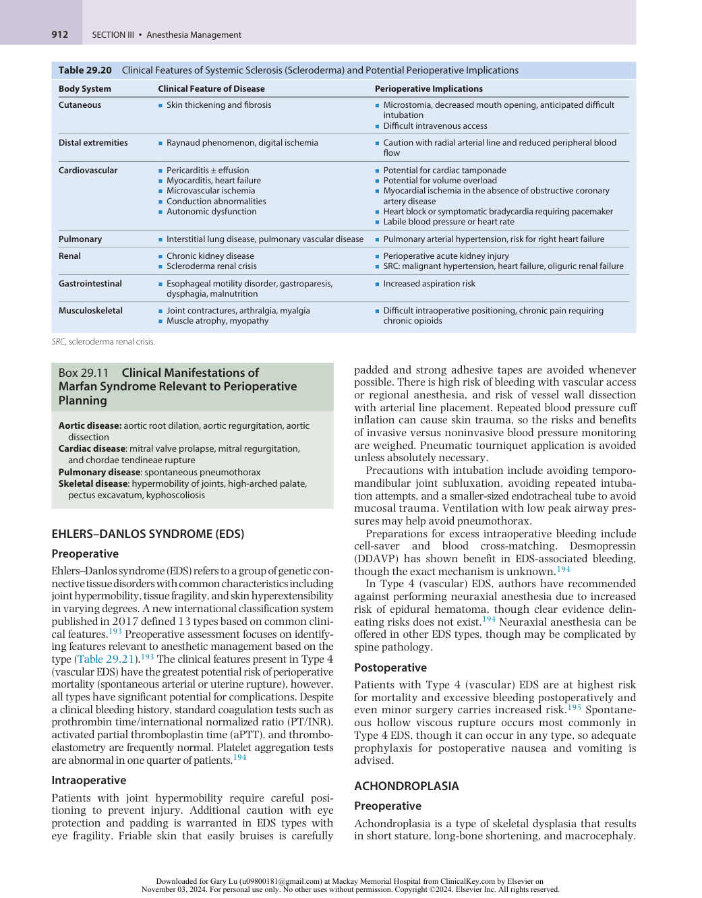

:::

<!-- PDF page 41 -->

**Table 29.21** Ehlers–Danlos Syndrome (EDS) Type and Clinical Criteria Relevant to Perioperative Care

||**Type**|**Clinical Criteria**|
|---|---|---|
|1|Classical EDS|_Major:_skin hyperextensibility, joint hypermobility _Minor_: easy bruising, skin fragility|
|2|Classical- like EDS|_Major:_skin hyperextensibility, joint hypermobility, spontaneous skin bruising _Minor:_leg edema, polyneuropathy|
|3|Cardiac–valvular|_Major:_severe valvular dysfunction (aortic, mitral), skin hyperextensibility, joint hypermobility _Minor:_pectus excavatum|
|4|Vascular EDS|_Major:_arterial rupture at young age, spontaneous uterine rupture during third trimester of pregnancy, carotid– cavernous sinus fistula formation _Minor:_spontaneous skin bruising, spontaneous pneumothorax, thin skin, hypermobility of small joints, gingival fragility|
|5|Hypermobile EDS|Generalized joint hypermobility, mild skin hyperextensibility, mitral valve prolapse, high-arched palate, aortic root dilation, widespread musculoskeletal pain|
|6|Arthrochalasia EDS|_Major:_joint hypermobility with joint dislocations, skin hyperextensibility _Minor:_muscle hypotonia, kyphoscoliosis, tissue fragility|
|7|Dermatosparaxis EDS|_Major:_extreme skin fragility with postnatal skin tears, congenital abnormalities (craniofacial, palmar wrinkling, short limbs and hands/feet), severe bruisability _Minor:_skin hyperextensibility, delayed motor development, joint hypermobility|
|8|Kyphoscoliotic EDS|_Major:_congenital muscle hypotonia, early-onset kyphoscoliosis, joint dislocations _Minor:_rupture/aneurysm of medium- sized artery, skin hyperextensibility, Marfanoid habitus, easy bruising|
|9|Brittle cornea syndrome|_Major:_thin corner, early-onset keratoconus _Minor:_retinal detachment, scoliosis|
|10|Spondylodysplastic EDS|_Major:_short stature, muscle hypotonia _Minor:_skin hyperextensibility, delayed motor and cognitive development|
|11|Musculocontractural EDS|_Major:_multiple congenital contractures, craniofacial abnormalities, skin fragility, and easy bruising _Minor:_joint dislocations, spinal deformities, subcutaneous hematomas, spontaneous pneumothorax, glaucoma/ elevated intraocular pressure|
|12|Myopathic EDS|_Major:_congenital muscle hypotonia and atrophy, proximal joint contractures _Minor:_myopathy on muscle biopsy|
|13|Periodontal EDS|_Major:_early onset, severe periodontitis _Minor:_easy bruising, joint hypermobility, skin hyperextensibility, prominent vasculature|

Anatomic abnormalities can lead to cardiorespiratory and neurologic conditions with important relevance to anesthesia. Preoperative evaluation includes assessing for undiagnosed sleep- disordered breathing (both obstructive and central sleep apnea); restrictive pulmonary disease from thoracic cage abnormalities; decreased functional capacity and obesity; cervical spinal stenosis or atlantoaxial subluxation; and upper airway abnormalities. Patients with chronic hypoxia, untreated sleep apnea, upper airway obstruction, restrictive pulmonary disease, or hypoventilation are at risk for pulmonary hypertension. See section on Pulmonary Hypertension for more details.

Perioperative risk of morbidity and mortality is elevated for patients with achondroplasia. A multispecialty group has published best practices for perioperative care in patients with skeletal dysplasia.196

### Intraoperative

Difficult airway management is anticipated based on a short neck, decreased neck extension, and large tongue relative to a small trachea. For safe airway management, selecting a smaller-sized endotracheal tube than anticipated for age and minimizing neck extension with videolaryngoscopy or fiberoptic bronchoscopic intubation is appropriate.

Challenging neuraxial anesthesia is anticipated due to kyphoscoliosis, a narrow epidural space, and vertebral body abnormalities. A reduced dose of local anesthetic for

spinal anesthesia is anticipated, yet the optimal adjustment is unknown. Doses of spinal hyperbaric bupivacaine administered for cesarean section in case reports range from 6.75 mg to 10 mg.197 Thoracolumbar spinal stenosis is common and makes local anesthetic spread unpredictable and potentially increases the risk of neurologic complications.198

### Postoperative

Extubation should occur in a location with difficult airway equipment readily available, in the event of urgent reintubation. After major surgery, postoperative monitoring in the ICU is appropriate for patients with severe pulmonary hypertension, worsening of respiratory symptoms, or concern for hypoventilation with opioids.

## Infectious Diseases

### HUMAN IMMUNODEFICIENCY VIRUS (HIV)/ ACQUIRED IMMUNODEFICIENCY SYNDROME (AIDS)

### Preoperative

HIV infection is now treated as a chronic disease, with modern antiretroviral therapy (ART) effectively suppressing progression of disease for decades. Patients are defined as

::: details 原始表格與符號（PDF 第 41 頁）

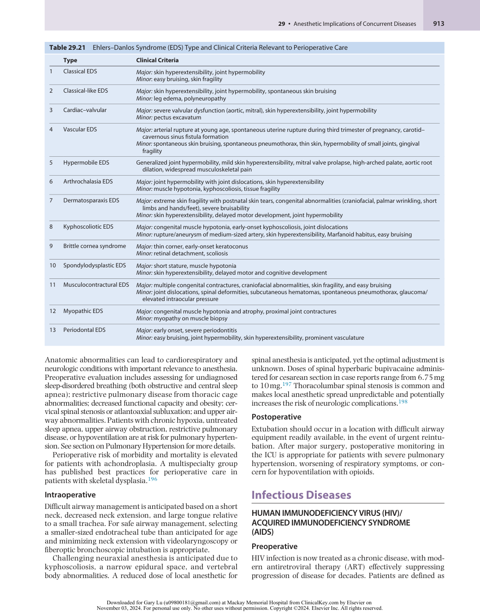

:::

<!-- PDF page 42 -->

having AIDS if their CD4 count falls below 200 cells/mcL, or if they develop an AIDS- defining illness (e.g., candidiasis of esophagus, cytomegalovirus disease, HIV- related encephalopathy, disseminated histoplasmosis, Kaposi sarcoma, primary brain lymphoma, pneumocystis pneumonia, toxoplasmosis of the brain, wasting syndrome). Chronic HIV infection leads to multisystem abnormalities from chronic inflammation and medication toxicities. See Table 29.22 for potential organ system manifestations occurring during chronic HIV infection, or ones that are mainly seen after an AIDS diagnosis. A retrospective Medicare database study of patients who underwent elective total shoulder arthroplasty illustrate the broad array of risk factors present in HIV- positive patients, who had a higher prevalence of almost every comorbidity examined.199 Compared with the control group, HIV- positive patients were more likely to have HF (odds ratio [OR] 3.09 [2.73–3.50]), valvular disease (OR 3.33 [2.95–3.76]), peripheral vascular disease (OR 3.50 [3.11–3.93]), hypertension (OR 4.23 [3.59– 4.97]), paralysis (OR 19.09 [16.42–22.20]), other neurologic disorder (OR 5.70 [5.07–6.40]), chronic pulmonary disease (OR 2.34 [2.10–2.62]), diabetes with chronic complications (OR 2.85 [2.41–3.37]), renal failure (OR 2.86 [2.47–3.30]), liver disease (OR 2.40 [1.89–3.04]), coagulation deficiency (OR 3.57 [3.05–4.20]), blood loss anemia (OR 2.60 [2.08–3.24]), fluid and electrolyte disorder (OR 2.97 [2.66–3.31]), alcohol abuse (OR 2.86 [2.22–3.70]), and psychoses (OR 4.13 [OR 3.55–4.82]).199 See Chapter 28 for further details on the assessment of patients with acute HIV infection.

Preoperative evaluation focuses on assessing for stability of organ function and adequacy of ART therapy. Measurement of HIV viral load within 6 months and CD4 count within 1 year in an otherwise stable patient is sufficient. A patient taking ART with an HIV viral load &lt;200 copies/mL and CD4 count >200 cells/mm3 has a similar perioperative risk to someone without HIV and may proceed with elective surgery.200 Patients with low CD4 count and uncontrolled HIV viral load are at increased risk of death, infectious and noninfectious complications, and prolonged length of stay.201 In patients with poorly controlled disease, consultation with an HIV care provider will determine if further optimization of ART therapy will improve clinical status. If

no change to ART is advised, patients are counseled on the increased perioperative risks in the setting of uncontrolled HIV. All ART therapy is continued perioperatively.

### Intraoperative

Important drug–drug interactions between ART and perioperative medications are possible. Patients may be treated with boosted protease inhibitor (boosted PI) monotherapy as a simpler alternative to three- drug ART regimens. All boosted PIs strongly inhibit CYP34A, causing increased blood levels of fentanyl, lidocaine, rocuronium, and midazolam; dose adjustment and monitoring for adverse effects is recommended.201 Reduced drug absorption is anticipated with proton pump inhibitor or histamine- 2 receptor agonist with some ART regimens; use is contraindicated or avoided when possible.200 No drug interactions are anticipated with propofol, sevoflurane, succinylcholine or sugammadex, and ART. A free drug interaction tool is available at www.hiv- druginteractions.org maintained by the University of Liverpool.

### Postoperative

HIV infection creates a hypercoagulable state, with patients at increased risk of thromboembolic disease (both deep venous thrombosis [DVT] and pulmonary embolism) compared with age- adjusted HIV- negative patients.202 Early initiation of pharmacologic DVT prophylaxis and mobilization is recommended.

### CORONAVIRUS DISEASE 2019 (COVID- 19)

### Preoperative

The emergence of the novel SARS- CoV- 2 causing coronavirus disease in late 2019 (COVID- 19), and subsequent worldwide pandemic, created an evolving challenge in perioperative patient management. Early in the pandemic prior to widespread vaccine availability, patients having surgery within 7 days of confirmed infection (or who became infected during the subsequent 30 days) had high rates of pulmonary complications (51.2% of patients) and perioperative death (38.0% of patients with pulmonary complications).203 Data from that time indicated that in patients recovered from COVID- 19, increased risk of mortality204

|**Table 29.22**|Organ System Manifestations that Present During Chronic HIV In|fection or After an AIDS Diagnosis|
|---|---|---|
|**Organ System**|**Clinical Manifestation in HIV**|**Clinical Manifestation in AIDS**|
|Cardiovascular|Lipodystrophy, dyslipidemia, coronary artery disease, venous thromboembolic disease, prolonged QT interval, autonomic dysfunction|HFrEF, myocarditis, pericardial effusion, cardiac tumors|
|Neurologic|Neurocognitive dysfunction, depression, peripheral neuropathy|Mania/bipolar disease|
|Hepatic|Co- infection with hepatitis B or C, liver fibrosis or cirrhosis||
|Renal|Chronic kidney disease, medication nephrotoxicity, HIV- associated nephrotoxicity||
|Pulmonary|Chronic obstructive pulmonary disease, recurrent pneumonias|Pleural effusions (infectious or malignant), disseminated pulmonary infections (e.g.,_Mycobacterium avium_ complex [MAC]), tuberculosis infection|
|Endocrine|Diabetes mellitus, metabolic disorder|Adrenal insufficiency|

_AIDS_ , acquired immunodeficiency syndrome; _HFrEF_ , heart failure with reduced ejection fraction; _HIV_ , human immunodeficiency virus; _MAC_ , _Mycobacterium avium_ complex.

::: details 原始表格與符號（PDF 第 42 頁）

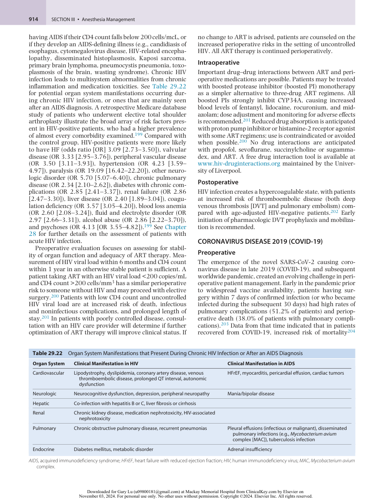

:::

<!-- PDF page 43 -->

and postoperative pneumonia205 persisted for 7–8 weeks after diagnosis. The risk of postoperative pneumonia, respiratory failure, pulmonary embolism, and sepsis was highest in the first 0–4 weeks following COVID- 19 diagnosis.205 Elective surgery is delayed during the acute phase of illness and non- operative alternatives are pursued in emergency situations with symptomatic COVID- 19. In 2022, several societies recommended delaying elective or scheduled surgery for at least 7 weeks after diagnosis, unless the risks of delaying surgery outweigh the increased potential for morbidity or mortality.206a As vaccination rates have increased and the severity of disease has decreased, it is now considered safe to proceed with elective surgery 2 weeks after COVID-19 infection.206b

A significant proportion of patients develop persistent symptoms after acute COVID- 19 (termed post- acute COVID19 syndrome or “long COVID”).207 The understanding of long COVID is still evolving. Known potential sequelae are listed in Table 29.23.207 In patients who do not experience complete resolution of symptoms, preoperative assessment focuses on stability of disease and planning for optimal timing for surgery.

**Table 29.23** Organ System Manifestations of PostAcute COVID- 19 Syndrome

|**Organ System**|**Manifestations**|
|---|---|
|Pulmonary|ᑏDyspnea, decreased exercise capacity, hypoxia ᑏReduced diffusion capacity, restrictive pulmonary physiology, ground-glass opacities, fibrotic changes ᑏAssessment by home pulse oximeter, 6- minute walk test, pulmonary function test, chest computed tomography|
|Hematologic|ᑏThromboembolic events ᑏHyperinflammatory state ᑏAssessment by elevated D- dimer levels|
|Cardiovascular|ᑏPalpitations, dyspnea, chest pain ᑏIncreased cardiometabolic demand, myocardial fibrosis or scarring, arrythmias, tachycardia, and autonomic dysfunction ᑏAssessment by echocardiogram, electrocardiogram, or cardiac magnetic resonance imaging|
|Neuropsychiatric|ᑏFatigue, myalgia, headache, dysautonomia, cognitive impairment (“brain fog”) ᑏAnxiety, depression, sleep disturbance, post- traumatic stress disorder|
|Renal|ᑏAcute kidney injury, prolonged reduced eGFR, COVAN|
|Endocrine|ᑏNew or worsening diabetes mellitus, thyroiditis, bone demineralization ᑏAssessment for hypothalamic–pituitary– adrenal axis suppression or hyperthyroidism|
|Gastrointestinal and hepatobiliary|ᑏProlonged viral fecal shedding ᑏAlteration of gut microbiome|
|Dermatologic|ᑏHair loss|

### Intraoperative

Whether anesthetic type has an effect on outcomes in patients with COVID- 19 is unknown. A large prospective cohort study of patients having surgery for proximal femur fractures with perioperative COVID- 19 demonstrated no difference in mortality between anesthetic type, despite a high overall 30- day mortality of 29.4%.208 Intraoperative management and medication selection takes into account the sequelae of disease present. Anesthetic type is selected based the most appropriate plan for the surgery and patient health status, regardless of COVID- 19 status.

### Postoperative

While it is recognized that COVID- 19 is associated with a prothrombotic state, there is no consensus for venous thromboembolism (VTE) prophylaxis recommendations following surgery.209 Risk assessment for perioperative VTE considers COVID- 19 within the previous 30 days as an additional factor.

## Genetic Diseases

Patients with genetic disorders frequently have multisystem dysfunction and dysmorphic physical features with anesthetic implications. Syndromes identified in childhood often necessitate management in specialized clinics or by pediatricians knowledgeable in the disorder. If continuing care is not established, patients can be lost to follow- up after 18 years of age. Features of the syndrome often worsen over time as the patient ages, requiring ongoing reassessment with each anesthetic, whether surgery is for sequelae of their syndrome or for an unrelated problem. In patients with congenital heart disease, the natural history of the surgical repair is factored into preoperative assessment. For example, patients with tetralogy of Fallot (TOF) usually undergo definitive surgery prior to 1 year of age with correction of right ventricular outflow tract (RVOT) obstruction and separation of pulmonary and systemic circulation through closure of the ventricular septal defect (VSD).210 Depending on the surgical approach to RVOT enlargement, most patients are left with chronic severe pulmonary regurgitation that causes RV enlargement over time. Patients may also have residual RVOT obstruction. Pulmonic valve replacement is often necessary to avoid RV failure from chronic volume overload. The optimal timing for surgical intervention is unclear, and reassessment of RV function prior to elective surgery may be warranted. Over 40% of patients with repaired TOF have arrythmias, with the prevalence increasing after 45 years of age.211 If the patient’s clinical history is suspicious of underlying arrythmias, the high prevalence of disease in this population makes preoperative testing more fruitful. Further details about the management of anesthesia in pediatric patients is found in Chapter 72. See Chapter 73 for further details about congenital heart disease.

### DOWN SYNDROME

_COVAN_ , coronavirus- associated nephropathy; _COVID- 19_ , coronavirus 2019; _eGFR_ , estimated glomerular filtration rate. Adapted from Nalbandian A, Sehgal K, Gupta A, et al. Post- acute COVID- 19 syndrome. _Nat Med_ . 2021;27(4):601–615.

### Preoperative

Down syndrome is the most common chromosomal abnormality in humans, caused by an extra chromosome

::: details 原始表格與符號（PDF 第 43 頁）

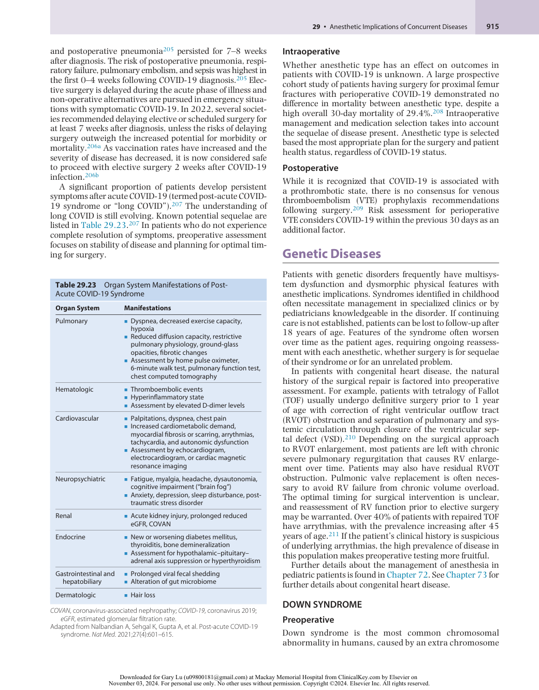

:::

<!-- PDF page 44 -->

inherited in position 21 (i.e., trisomy 21). Individuals with Down syndrome fall along a spectrum of disease; some patients are mildly affected and able to live independent lives as adults, while others have severe cognitive impairment and chronic medical sequelae. Preoperative assessment focuses on determining the severity of individual manifestations of disease and, usually, involving a caregiver or substitute decision- maker for discussions of risks and benefits of proceeding with surgery. See Table 29.24 for a summary of manifestations of Down syndrome. There is an increased incidence of atlantoaxial instability (AAI) in patients with Down syndrome; however, screening radiographs for prediction of disease have limited utility. Since 2011, the American Academy of Pediatrics advocates for screening radiographic evaluation only in children with clinical evidence of AAI, such as neck pain, upper extremity weakness, difficulty walking, or change in bowel or bladder function.212 In patients who have undergone lateral cervical spine radiographs at preschool age, who have normal occiput–C1 alignment, and remain symptom free, no further screening is required.213 If no prior radiographs have been performed, or a patient has symptoms consistent with AAI, precautions with intubation and neck position mitigates risk. Neurosurgical consultation is advised in patients with evidence of AAI and symptoms consistent with spinal cord dysfunction.

### Intraoperative

Difficult ventilation and intubation are anticipated in patients with Down syndrome due to obesity and orofacial abnormalities (high-arched palate, macroglossia, micrognathia). Congenital lower airway abnormalities are more prevalent in Down syndrome, such as airway malacia, tracheal bronchus, or subglottic stenosis. In a cohort study of Down syndrome patients undergoing endoscopic investigation of chronic respiratory symptoms, 71% of patients had congenital airway abnormalities compared with 32% of controls (patients with

respiratory symptoms but no other medical history).214 There is also an increased prevalence of dysphonia and vocal fold paralysis than in the general pediatric population, with a link to childhood cardiac surgery and injury of the left recurrent laryngeal nerve hypothesized.215 Precautions with intubation may include in-line neck stabilization, fiberoptic airway visualization, and a smaller endotracheal tube size than anticipated for age to mitigate risk.

In patients with congenital heart disease, intraoperative management accounts for heart failure, pulmonary hypertension, or intracardiac shunting if present.

### Postoperative

Patients with severe obstructive sleep apnea may need respiratory monitoring after major surgery or if opioid requirement is high. Early-onset dementia puts patients at risk for delirium and cognitive dysfunction after surgery that could limit use of patient- controlled analgesia. Intensive care unit admission may be appropriate.

### OTHER CONGENITAL DISEASES

Several congenital diseases are associated with difficult airway management, along with multiorgan abnormalities.216 In approaching patients with rare or unfamiliar syndromes, the typical features of the disease are reviewed to determine appropriate preoperative assessment and plan for intraoperative management. Difficulty in airway management may arise from oral cavity or oropharynx abnormalities (e.g., Down syndrome, Beckwith–Wiedemann syndrome); mandible or maxilla abnormalities (e.g., Pierre Robin syndrome, Treacher Collins syndrome, Goldenhar syndrome); pharyngeal or tracheal abnormalities (e.g., Down syndrome); cervical spine abnormalities (e.g., Down syndrome, Klippel–Feil syndrome, Goldenhar syndrome); or a combination of factors.216 See Table 29.25 for clinical features of select genetic diseases with known association of difficult airway management.

**Table 29.24** Summary of Clinical Features Of Down Syndrome and Potential Relevance to Anesthesia

|**Organ System**|**Clinical Feature**|**Perioperative Management**|
|---|---|---|
|**Neuropsychiatric**|ᑏCognitive impairment ᑏAutism ᑏEarly-onset dementia or Alzheimer disease ᑏSeizures|ᑏNeed for substitute decision- maker ᑏLimited ability to cooperate for invasive procedures (e.g., awake intubation, arterial line placement, light sedation)|
|**Cardiovascular**|ᑏCongenital heart disease: atrioventricular septal defect, ventricular septal defect, atrial septal defect, tetralogy of Fallot, patent ductus arteriosus ᑏPulmonary hypertension|ᑏDeterioration of valvular/septal defect repair leading to heart failure ᑏNeed for infective endocarditis prophylaxis for incomplete or recent repair ᑏHemodynamic instability intraoperatively|
|**Endocrine**|ᑏObesity ᑏHypothyroidism ᑏDiabetes mellitus type 1|ᑏSequelae of obesity ᑏPerioperative glycemic management|
|**Pulmonary**|ᑏObstructive sleep apnea|ᑏPotential difficult airway management, occult pulmonary hypertension|
|**Musculoskeletal**|ᑏAtlantoaxial subluxation/instability ᑏEarly-onset arthropathy ᑏOrofacial abnormalities: high- arched palate, macroglossia, micrognathia|ᑏCaution with intubation and neck instability ᑏPotential difficult intubation ᑏChronic pain|

::: details 原始表格與符號（PDF 第 44 頁）

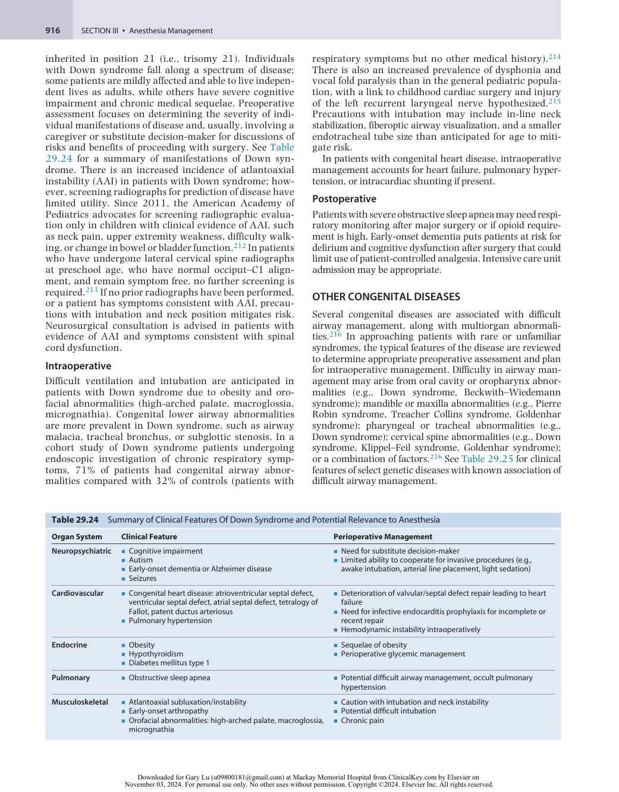

:::

<!-- PDF page 45 -->

## Toxic Ingestions and Drug Abuse

### INTRODUCTION

Patients with an acute drug overdose or experiencing effects of a substance ingestion do not routinely undergo anesthesia for surgery. However, critical situations arise that require time- sensitive intervention despite an acute

**Table 29.25** Summary of Clinical Features Relevant to Anesthesia for Select Genetic Disorders

|**Genetic Disorder**|**Clinical Features of Disease**|
|---|---|
|**Down syndrome**|SeeTable 29.24|
|**Beckwith–Wiedemann** **syndrome**|Difficult airway: macroglossia and microcephaly Congenital heart disease: ASD, VSD, PDA, hypoplastic left heart Endocrine: hypoglycemia, hyperinsulinemia Gastrointestinal: omphalocele, visceromegaly|
|**Goldenhar syndrome**|Difficult airway: hemifacial microsomia (unilateral mandibular hypoplasia), eye/ear/vertebral abnormalities on affected side, obstructive sleep apnea Renal: renal dysfunction Neurologic: hydrocephalus, potential raised intracranial pressure Congenital heart disease: VSD, tetralogy of Fallot, aortic coarctation|
|**Klippel–Feil syndrome**|Difficult intubation/laryngoscopy: limited neck extension Cervical spine disease: vertebral fusion, atlantoaxial instability, spinal canal stenosis, vulnerable to trauma Congenital heart disease: VSD Renal dysfunction|
|**Pierre Robin syndrome**|Difficult airway: micrognathia, posterior displaced tongue, airway obstruction when supine, cleft palate, obstructive sleep apnea Congenital heart disease Gastrointestinal: GERD and poor feeding as infants, malnutrition|
|**Prader–Willi syndrome**|Difficult airway: obesity, high- arched palate, micrognathia Hypotonia: respiratory depression, swallowing difficulties, upper airway obstruction Neurologic: cognitive delay, limited cooperation for invasive procedures, seizure disorder Endocrine: altered glucose metabolism, hypoglycemia|
|**Treacher Collins syndrome**|Difficult airway: posterior displaced tongue, mandibular hypoplasia, choanal atresia, obstructive sleep apnea, tracheostomy for upper airway obstruction Hearing loss Opthalmologic: prominent eyes, maxillary hypoplasia, prone to eye injury with surgery|

_ASD_ , atrial septal defect; _GERD_ , gastrointestinal reflux disease; _PDA_ , patent ductus arteriosis; _VSD_ , ventricular septal defect.

toxicity. Knowledge of the metabolic effects and anesthetic implications for ingestions is important in the setting of emergency surgery.

### ALCOHOL USE DISORDER

### Preoperative

Patients with alcohol use disorder (AUD) are at increased risk for perioperative mortality, longer length of hospital stay, surgical site infections, postoperative bleeding, and need for secondary surgeries.217–220 Long- term AUD causes an altered immune response in both cellular and humoral immunity, which is likely one causative factor in adverse events.220 Alcoholics who consume 80 g of undiluted alcohol per day (approximately equivalent to 6–7 standard drinks) for over 10 years have a reported rate of liver disease of nearly 100%.221 While often reversible in early stages if abstinence is achieved, up to 20% of patients with steatosis will progress to fibrosis within 10 years if alcohol abuse continues.221 Patients with cirrhosis are at increased risk of perioperative morbidity and mortality; see the earlier section on Liver Cirrhosis for more details.

In one randomized controlled study of alcoholic patients undergoing elective colorectal surgery, abstinence for 1 month prior to surgery reduced the incidence of myocardial ischemia, arrythmias, and nightly hypoxemic episodes.222 Improvements in organ dysfunction with short- term abstinence from alcohol is anticipated, however, longterm impact of perioperative interventions on abstinence rates are limited.223 See Table 29.26 for anticipated time required for recovery of organ function after abstinence. Though preoperative abstinence is the goal, it may not be achievable without supervised addiction intervention. Lorazepam can be prescribed to be taken preoperatively to aid in withdrawal symptom prevention, in order to achieve abstinence. See Chapter 28 for the preoperative workup of patients with history of substance abuse.

### Intraoperative

Patients with AUD have increased anesthetic requirements. The dose of propofol required to induce anesthesia and dose of fentanyl required to achieve analgesic effect is increased in AUD over patients without AUD.224,225 In

**Table 29.26** Time Required After Abstinence from Alcohol for Recovery of Organ Function

|**Organ System**|**Abstinence Time**|
|---|---|
|Immune competence|2–8 weeks|
|Wound healing|&lt;2 months|
|Endocrine stress response|2–12 weeks|
|Bone regeneration|&lt;6 months|
|Hemostasis|1–4 weeks|
|Cardiac function – without symptoms|1 month|
|Cardiac function – with symptoms|1–6 months|

Adapted from Tonnesen H, Nielsen PR, Lauritzen JB, Moller AM. Smoking and alcohol intervention before surgery: evidence for best practice. _Br J Anaesth_ . 2009;102(3):297–306.

::: details 原始表格與符號（PDF 第 45 頁）

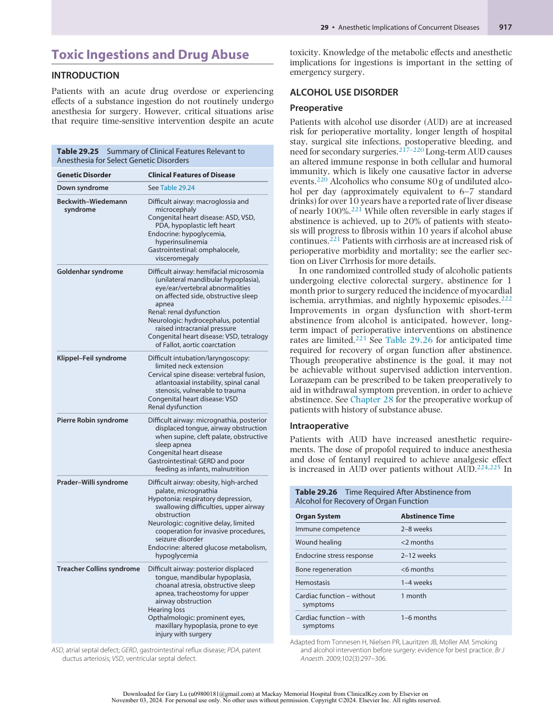

:::

<!-- PDF page 46 -->

a research study setting, preoperative infusion of alcohol reduced anesthetic requirements in patients with and without AUD, while also attenuating catecholamine- mediated effects of surgery.225 Anesthetic depth is titrated according to the degree of current intoxication or length of abstinence time. Mild alcohol withdrawal symptoms begin as early as 6 hours after last alcohol consumption and may manifest perioperatively with tachycardia, hypertension, or fever.

### Postoperative

Alcohol withdrawal is characterized by psychomotor agitation. The Clinical Institute Withdrawal Assessment for Alcohol (CIWA- A) was revised in 1989 (CIWA- Ar) to include 10 questions for assessment of severity of alcohol withdrawal.226 The CIWA- Ar is still widely used today and assesses sweating, anxiety, tremor, auditory disturbances, visual disturbances, agitation, nausea, tactile disturbances, headache, and clouding of sensorium. In the postoperative setting, false positives may be common due to overlap with common postanesthetic symptoms.227 Incorporating the preoperative assessment of alcohol use allows appropriate CIWA- Ar scoring.

For prevention of symptoms of alcohol withdrawal, benzodiazepines remain the mainstay of therapy. Benzodiazepines are primarily effective for preventing withdrawal seizures, though also have beneficial effects on autonomic hyperactivity.228 Though there is interest in alternative therapies, such as anticonvulsants or baclofen, evidence for efficacy in reducing alcohol withdrawal symptoms is lacking.229 The addition of dexmedetomidine infusion to benzodiazepines for alcohol withdrawal treatment was associated with increased ICU length of stay, though this may reflect an increased severity of withdrawal symptoms prior to admission.230 Phenobarbital may be used as an adjunct231 or alternative232 to benzodiazepines, though research into efficacy and safety is ongoing. Since benzodiazepines are not indicated for alternative forms of delirium, accurately assessing patients for delirium related to alcohol withdrawal is crucial for appropriate therapy.

### STIMULANT DRUG ABUSE: COCAINE AND METHAMPHETAMINE

### Preoperative

Cocaine and methamphetamine are two examples of stimulant drugs of abuse that act centrally to increase neurotransmitter concentration (dopamine, serotonin, and norepinephrine). Cocaine inhibits presynaptic uptake of neurotransmitters, as well as causing vasoconstriction and sodium channel blockade when applied locally. Methamphetamine acts centrally to increase neurotransmitter release and also inhibits monoamine transporters.233 Acutely, the sympathomimetic effect causes tachycardia, arrythmias, myocardial vasoconstriction, and hypertension and can lead to acute myocardial ischemia, stroke, or cerebral edema. When taken chronically, both drugs have detrimental effects on the cardiovascular system, causing left ventricular hypertrophy, early atherosclerosis, and heart failure. Methamphetamine also causes pulmonary arterial hypertension by mechanisms that are incompletely understood.234 Recreational substance use is independently associated with the development of premature atherosclerotic

cardiovascular disease. Risk is increased with cocaine (OR 2.44, 95% CI 2.38–2.50) and amphetamine (OR 2.74, 95% CI 2.62–2.87) as well as the use of tobacco (OR 1.97, 95% CI 1.94–2.00), alcohol (OR 1.50, 95% CI 1.47–1.52), cannabis (OR 2.65, 95% CI 2.59–2.71), and other drugs (OR 2.53, 95% CI 2.47–2.59).235 Polysubstance use is associated with the greatest risk, with a 9- fold increased risk.235 See the earlier section on Cardiovascular Diseases for the perioperative management of pulmonary hypertension. See Chapter 28 for the preoperative workup of patients with a history of substance abuse. Transthoracic echocardiography is used for preoperative assessment in patients with suspicion of cardiac complications from stimulant drug use.

### Intraoperative

Hemodynamic management for the chronic cocaine or methamphetamine user is tailored to the presence of cardiovascular disease, if present. See the earlier sections on heart failure, ischemic heart disease, pulmonary hypertension, and stroke for more details.

Acute stimulant intoxication causes hypertension, tachyarrhythmias, and myocardial ischemia with coronary vasoconstriction. A systematic review of pharmacologic treatment of cocaine toxicity provides recommendations based on the limited evidence available (Table 29.27).236 While the review was tailored to literature surrounding cocaine use, methamphetamine intoxication causes similar cardiovascular effects, so similar principles likely apply.237

**Table 29.27** Recommendations for Management of Acute Cocaine Toxicity from a Systematic Review of the Pharmacologic Treatment of Cocaine Toxicity236

|**Medication**|**Recommendation**|
|---|---|
|**Benzodiazepines and other** **GABA- active medications**|Helpful as adjuncts for agitation, but do not fully mitigate tachycardia, hypertension, or vasospasm|
|**Calcium channel blockers**|Decrease hypertension and reverse coronary vasospasm, not necessarily tachycardia|
|**Nitric oxide–mediated** **vasodilators**|Nitroglycerin may lead to severe hypotension and reflex tachycardia|
|**Alpha- adrenoceptor blocking** **drugs**|Alpha- 1 blockers may improve hypertension and vasospasm, not tachycardia|
|**Alpha- 2- adrenoceptor** **agonists**|Evidence for efficacy of dexmedetomidine|
|**Beta blockers and beta/alpha** **blockers**|Adverse events associated with selective and nonselective beta- blocker administration No adverse events reported for combined beta/alpha blockers (labetalol, carvedilol), effective for hypertension and tachycardia|
|**Antipsychotics**|Improve agitation and psychosis, inconsistent effect on tachycardia and hypertension, risk of extrapyramidal effects|
|**Other agents**|Morphine reverses coronary vasoconstriction|

_GABA_ , gamma-aminobutyric acid.

::: details 原始表格與符號（PDF 第 46 頁）

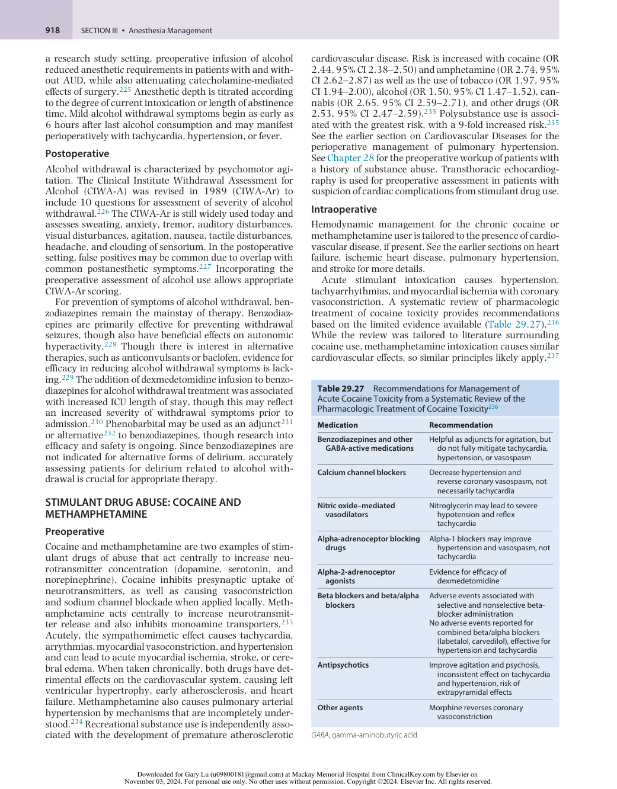

:::

<!-- PDF page 47 -->

Caution with beta- blocker administration is advised to avoid precipitating extreme hypertension from unopposed α- adrenergic stimulation.236 Sympathomimetics, such as ketamine, may exacerbate symptoms and are avoided when possible. Caution with nasogastric tubes, nasopharyngeal airways, or nasal temperature probes is advised, as septal perforation may be present from chronic nasal cocaine use. Chronic methamphetamine use causes severe dental decay and periodontitis238 ; caution with intubation is required to avoid further dental trauma or dislodging teeth.

In the absence of acute intoxication, chronic use leads to catecholamine depletion and intraoperative hypotension is common.

### Postoperative

Patients with stimulant withdrawal may be restless, anxious, or somnolent, making opioid titration challenging. If cardiovascular disease is present, postoperative hemodynamic management is tailored to parameters appropriate to the condition.

### DRUG OVERDOSE

Patients with drug overdoses often present with nonspecific symptoms, such as nausea, vomiting, and decreased level of consciousness. If the clinical scenario suggests a possible intentional or unintentional overdose, identifying characteristic features of an overdose may aid in providing rapid therapy. Diagnosis and treatment of a drug overdose are coordinated with a medical toxicologist or poison control

center. Basic knowledge of the general principles of treatment can aid in prompt management if a drug overdose is encountered perioperatively in an emergency surgical setting. If untreated, many drug overdoses lead to severe toxicity with hemodynamic instability, end-organ dysfunction, and cardiac arrest. See Table 29.28 for an overview of drug overdose in select medications.

## Allergy and Anaphylaxis

The lifetime prevalence of anaphylaxis is 1.6%–5.1%.239 Risk factors for severe anaphylaxis include cardiovascular disease, asthma, older age, and coexisting comorbidities. The grading of severity of hypersensitivity reactions is shown in Table 29.29.240 The common culprits in perioperative hypersensitivity events vary among countries and over time.241 Antibiotics are the most commonly reported cause in most countries. Blue dyes used for sentinel node procedures and chlorhexidine are increasing in frequency.241 Latex, previously a common cause, is now decreasing in prevalence due to decreased exposure. Neuromuscular blocking agents (NMBA) were thought to be the most common cause in all countries, but the high incidence of NMBA anaphylaxis is more common in countries where pholcodine- containing cough remedies are available (e.g., France, Australia, United Kingdom, and Belgium). This is due to a structural similarity between pholcodine and NMBA.241 There were no cases of proven local anesthetic allergic cases reported in the 6th

**Table 29.28** Clinical Features of Drug Toxicity from Select Drugs and Principles of Treatment

|**Medication**|**Clinical Features of Overdose**|**Treatment Principles**|
|---|---|---|
|**Acetaminophen**|ᑏEarly (0.5 to 24 hours): nonspecific symptoms such as nausea, vomiting, lethargy ᑏLater (24–72 hours): hepatotoxicity, nephrotoxicity, elevation in aminotransferases|ᑏDetermine time since ingestion, measure serum acetaminophen level, administer_N_- acetylcysteine according to Rumack–Matthew nomogram|
|**Aspirin**|ᑏTinnitus, vertigo, nausea, vomiting, altered mental state, hyperpyrexia, noncardiogenic pulmonary edema, hypoglycemia, and hepatic dysfunction. ᑏRespiratory alkalosis from central stimulation ᑏMetabolic acidosis when severe|ᑏAlkalinization of the urine with IV sodium bicarbonate to aid excretion ᑏHemodialysis for refractory acidosis, coma, seizures, volume overload ᑏIntubation only for patient hypoventilation, mechanical ventilation to maintain respiratory alkalosis|
|**Digoxin**|ᑏAnorexia, nausea, blurred vision, mydriasis, confusion, delirium ᑏDysrhythmias: ventricular tachycardia, ventricular fibrillation, high- degree atrioventricular block ᑏECG abnormalities: prolonged PR and shortened QT interval, ST segment depression, flattened or inverted T waves ᑏHyperkalemia|ᑏIf hemodynamic instability or hyperkalemia, administer antidote: antibody (Fab) fragments ᑏSupportive management for dysrhythmias, atropine for symptomatic bradycardia|
|**Lithium**|ᑏNausea, vomiting, diarrhea, agitation, confusion, slurred speech ᑏIf severe: seizures, encephalopathy, myoclonus, hypotension|ᑏIV fluids to increase urine output for renal excretion, hemodialysis in severe toxicity ᑏSupportive management for seizures|
|**Tricyclic antidepressant**|ᑏSedation, delirium, hallucinations, seizure ᑏTachycardia, hypotension, conduction abnormalities ᑏAnticholinergic toxicity: dilated pupils, dry mouth, urinary retention, hyperthermia ᑏECG abnormalities: QRS duration >100 ms deep S wave in leads I, AVL, tall R wave in lead AVR|ᑏIntubation for airway protection ᑏSodium bicarbonate for cardiac toxicity with widened QRS ᑏSupportive management for hypotension and seizures (avoid sodium channel blockers, like phenytoin) ᑏConsider lipid emulsion for refractory cardiovascular instability, caution with all antiarrhythmics other than lidocaine and magnesium|

_ECG_ , electrocardiogram; _IV_ , intravenous.

::: details 原始表格與符號（PDF 第 47 頁）

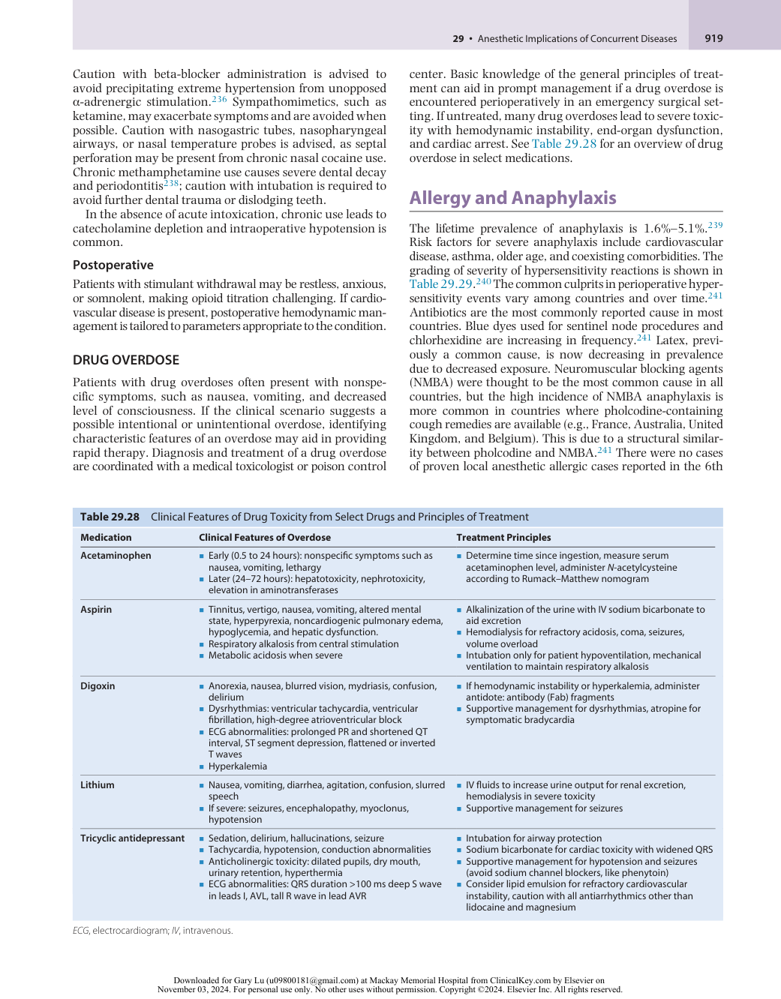

:::

<!-- PDF page 48 -->

**Table 29.29** Grade of Severity of Hypersensitivity Reactions and Suggested Management

|**Reaction Grade**|**Clinical Manifestations**|**Management**|
|---|---|---|
|1 or 2|ᑏGeneralized urticaria ᑏExtensive erythema ᑏ± Angioedema ᑏDiarrhea, vomiting|ᑏNo epinephrine needed ᑏAntihistamines|
|3 Mild–moderate anaphylaxis|ᑏMild–moderate hypotension ᑏTachycardia or bradycardia ᑏModerate bronchospasm ᑏNeurologic symptoms|ᑏEpinephrine 0.01 mg/kg IM (maximum 0.5 mg in adults and 0.3 mg in children) (thigh > deltoid) ᑏ0.5 L crystalloid bolus, repeat if no response|
|4 Severe anaphylaxis|ᑏSevere hypotension ᑏTachycardia or bradycardia ᑏSevere angioedema ᑏSevere bronchospasm, stridor ᑏSevere GI symptoms ᑏSevere mucocutaneous signs ᑏGCS 13–14|ᑏEpinephrine 0.01 mg/kg IM (maximum 0.5 mg in adults and 0.3 mg in children); if no response, then epinephrine infusion ᑏ1 L crystalloid bolus, repeat if no response ᑏVasopressin if persistent hypotension more than 10 min ᑏChest compressions for MAP &lt;50 mm Hg or ETCO2&lt;20 mm Hg ᑏGlucagon if on beta blockers|
|5|ᑏCardiopulmonary arrest ᑏGCS &lt;13|ᑏAdvanced cardiac life support methods|

_ETCO2_ , end- tidal carbon dioxide; _GCS_ , Glasgow Coma Score; _GI_ , gastrointestinal; _IM_ , intramuscular; _L_ , liters; _MAP_ , mean arterial pressure.

National Audit Project of the Royal College of Anaes thetists (NAP6) survey or two other recent studies of perioperative anaphylaxis.241 Ester local anesthetics (e.g., procaine, tetracaine) are more antigenic than amides (e.g., lidocaine, bupivacaine, ropivacaine). The para- aminobenzoic acid metabolite of esters is responsible for much of the antigenicity.

### Preoperative

A careful history to determine true allergies from adverse outcomes or expected, known side effects (e.g., nausea and vomiting with opioids or general anesthesia) is incredibly helpful to plan care. Chronic spontaneous urticaria affects 1% of the population at any given time. It is characterized by recurrent episodes of urticaria or angioedema, usually provoked by stress, and often exacerbated during surgery. Allergy investigations should ideally be performed by specialized allergists. Testing includes all drugs given intravenously less than 1 hour before the reaction, and all substances given orally, intramuscularly, subcutaneously, epidurally, spinally, and topically less than 2 hours before the reaction.240 Exposure to latex and disinfectants is presumed in all patients and routinely tested. Chlorhexidine is responsible for up to 10% of cases.242 If the culprit is an antibiotic, NMBA, or local anesthetic, testing for cross- reactivity should be performed to identify safe alternatives.240 Often if records are lacking or there is not a clear culprit, an approach to safe care is to test a subset of anesthetic agents to identify a list of "safe" medications with low likelihood to cause an allergic reaction.

Antihistamine and glucocorticoid premedication are effective in specific chemotherapy protocols, but evidence is lacking that antihistamines and glucocorticoid premedication in patients receiving low- or iso- osmolar contrast material and other situations prevent recurrent anaphylaxis.239 However, in contrast to immediate reactions, premedication may prevent severe, delayed, cutaneous T- cell- mediated reactions to radiographic contrast.

### Intraoperative

Propofol is safe to use in patients with peanut, soy, or egg allergy.243 True hypersensitivity reactions to local anesthetics are considered rare. Cefazolin allergy is generally

selective, and rarely associated with cross- reactivity to penicillins or other cephalosporins.244 All NMBA have been reported to be causal agents. Sugammadex carries a risk of 0.002% anaphylaxis per administration. NSAIDs are rare but known causes of perioperative hypersensitivity. Chlorhexidine topically, as a lubricant for urinary catheters, and chlorhexidine- impregnated central venous catheters have been implicated in reactions.242 Anaphylaxis to dyes is often delayed in onset compared with intravenous antigens. Hypersensitivity reactions to colloids have decreased because of the withdrawal of, or restrictions of, gelatins, dextrans, and hydroxyethyl starch. Hypersensitivity to blood products occurs in 0.6 per 1000 transfusions.245 Platelets cause 1.1 allergic reactions per 1000 transfusions, plasma 0.68/1000 transfusions, and 0.04/1000 for red cell concentrates.

There is marked variability in clinical presentation of hypersensitivity reactions in patients receiving anesthesia. Severe hypersensitivity reactions are challenging to diagnose because hemodynamic instability is often attributed to anesthetics or surgical side effects. Certain drugs mimic hypersensitivity reactions if administered rapidly or in large doses (e.g., oxytocin and vancomycin). More common causes are airway trauma, angiotensin-converting enzyme inhibitors, or hereditary angioedema. Major cardiovascular findings were the sole presenting feature in 50% of cases in NAP6, with isolated respiratory symptoms in 18% of cases.241 Skin signs, considered the hallmark of hypersensitivity, are often absent. Flushing, urticaria, and angioedema may become apparent once intravascular volume and perfusion are restored or the surgical drapes removed.

Epinephrine is the first- line pharmacotherapy for anaphylaxis.239 Epinephrine, 0.01 mg/kg of a 1:1000 (1 mg/mL) solution to a maximum of 0.5 mg in adults and 0.3 mg in children intramuscularly into the anterolateral thigh or the deltoid if the thigh is not accessible is the first- line treatment for anaphylaxis.239 Intravenous epinephrine is not recommended as first- line treatment of acute anaphylaxis, even in a medical setting, due to risk for adverse cardiac events such as arrhythmias and ischemia.246 If there is inadequate response to intramuscular epinephrine and fluids, intravenous epinephrine can be given by continuous infusion with

::: details 原始表格與符號（PDF 第 48 頁）

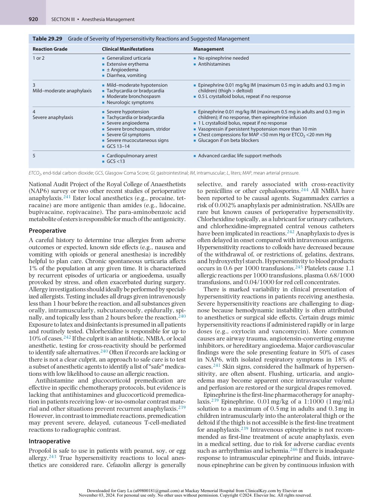

:::

<!-- PDF page 49 -->

a pump. Experts advocate intramuscular rather than subcutaneous routes, though for years subcutaneous delivery was the mainstay, without evidence that it was ineffective. Unlike epinephrine, antihistamines do not effectively treat cardiovascular and respiratory symptoms such as hypotension or bronchospasm. Although glucocorticoids are frequently used as adjunctive therapy, evidence is lacking for their benefit. Steroids should not be administered in place of epinephrine in episodes of acute anaphylaxis.

Fluid administration is a key therapy. Consensus recommends a bolus of 0.5 L of crystalloid solution for grade 2 and 1 L for grade 3 reactions, repeated as clinically indicated. Fluid responsiveness should be assessed through stroke volume and cardiac output monitoring in severe cases.247 Cardiopulmonary resuscitation (CPR) should begin when end- tidal carbon dioxide (ETCO2) falls below 20 mm Hg because this is a marker of inadequate perfusion. Advanced cardiac life support (ACLS) guidelines are followed as indicated. Sugammadex has been reported to be adjunct treatment for rocuronium- induced anaphylaxis.248 Glucocorticoids have a limited role in acute management because of their slow onset of action, and inability to reverse acute symptoms. Antihistamines are effective for patients with urticaria and can treat many of the cutaneous signs and symptoms of anaphylaxis (e.g., pruritus, flushing, urticaria), but unlike epinephrine, antihistamines are not effective for hypotension or bronchospasm.

The decision to continue with surgery weighs the urgency of surgery, the severity of symptoms, and the patient’s medical history (e.g., underlying cardiovascular disease or use of beta blockers). Distinguishing biphasic anaphylaxis (with an interval of resolution) from protracted anaphylaxis is important. Biphasic anaphylaxis is recurrent episodes 1–72 hours after resolution of the initial episode and occurs in up to 20% of patients. Antihistamines and glucocorticoids do not reliably prevent biphasic anaphylaxis.

A serum tryptase which is released from degranulated mast cells should be measured during a suspected hypersensitivity event to help with subsequent allergy investigation. Accurate documentation of the events, including symptoms, treatments, and the chronology of drug administrations including non- intravenous exposures, such as disinfectants, dyes, gels, sprays, cements, hemostatic agents, bone substitutes, is critically important to assist with future diagnosis and care planning.

### Postoperative

Severe anaphylaxis or the need for repeated doses of epinephrine are risk factors for biphasic anaphylaxis. After diagnosis and treatment of anaphylaxis, all patients should be kept under observation until symptoms have fully resolved. Patients should receive education on anaphylaxis and risk of recurrence and how to avoid triggers. They need to be provided with self- injectable epinephrine and referred to an allergist.

## Hematologic Disorders

### ANEMIA

Anemia is defined as a hemoglobin (Hb) concentration less than 12 g/dL for women and less than 13 g/dL for men.

Anemia can be classified based on multiple criteria (e.g., mean corpuscular volume [MCV]). Most common causes of anemia preoperatively include iron deficiency anemia, anemia of inflammation, and chronic blood loss.

The most important perioperative adverse effects of anemia are the reduction in arterial oxygen concentration and the potential for decreased tissue oxygen delivery. Generally, a compensatory increase in cardiac output (through increased sympathetic stimulation) offsets the decrease in oxygen content. Anemia triggers a rightward shift of the oxyhemoglobin dissociation curve, facilitating the release of oxygen from Hb. Another compensatory mechanism is represented by the redistribution of blood flow to essential organs (heart, brain) with a reflex decrease in blood flow to muscles, skin, and kidneys. Patients with coronary artery disease cannot usually compensate for anemia with a further increase in cardiac output resulting in fatigue and poor exercise tolerance. Patients with severe chronic anemia can develop signs of high- output heart failure. Anemia is an independent risk for adverse perioperative outcomes, and is a “disease modifier,” increasing risks associated with the elderly and other comorbidities such as cancer, heart failure, ischemic heart disease, COPD, CKD, and more.

### Preoperative

Patients with anemia should have the cause determined preoperatively. Ferritin, iron concentration, transferrin concentration, vitamin B12, TSH, and creatinine are initial screening tests to evaluate anemia.249 Patients detected to have iron deficiency or anemia of inflammation should be treated preoperatively (iron infusions for iron deficiency anemia, erythropoietin for anemia associated with chronic kidney disease; see Chapter 28). Patients with chronic anemia should generally avoid preoperative transfusions, even if it is anticipated that patients will require transfusions intraoperatively. Surgical blood loss at a lower Hb concentration will decrease the number of transfusions required perioperatively. Patients with hemoglobinopathies such as sickle cell disease require evaluation and possibly preoperative transfusions in collaboration with a hematologist.

### Intraoperative

Intraoperative anemia management is aimed at preventing tissue hypoxia due to a decrease in oxygen delivery. Blood transfusions portend certain risks. Red blood cell (RBC) transfusions are associated with direct transmission of infectious pathogens such as hepatitis B, hepatitis C, and human immunodeficiency virus (HIV). In critically ill and trauma patients, transfusions are independently associated with increased intensive care unit and hospital lengths of stay, an increased incidence of ventilator- associated pneumonia, and increased mortality. In addition to transfusion reactions, patients can experience allergic side effects, and adverse cardiac or immunomodulatory effects. The immunomodulatory effects of RBC transfusions can lead to cancer recurrence, postoperative bacterial infections, transfusion- related acute lung injury, and hemolytic transfusion reactions. Blood transfusions remain an option for certain patients. The decision to transfuse perioperatively is complex and relies on the amount of blood loss, current or predicted hemoglobin concentration, ongoing bleeding,

<!-- PDF page 50 -->

and evidence of inadequate oxygenation (e.g., cardiac ischemia or renal insufficiency).

The Hb concentration warranting transfusion is a matter of debate, but it is well accepted that there is no benefit of transfusion with a Hb concentration above 10 g/dL whereas even young healthy patients derive benefit when their Hb drops below 6 g/dL. In the perioperative period the decision to transfuse patients with intermediate concentrations of Hb between 6 and 10 g/dL is individualized. The best supportive evidence for a restrictive transfusion strategy comes from the Transfusion Requirements in Critical Care (TRICC) trial, which found no significant difference in 30- day mortality rates between a restrictive transfusion strategy (Hb 7–8 g/ dL) and a liberal strategy (Hb maintained at 10–12 g/dL).250 The restrictive regime was not associated with a significant increase in mortality, cardiac morbidity, or duration of hospitalization. Other studies also show no short- or long- term mortality benefit when a liberal transfusion strategy (transfusion when Hb less than 10 g/dL) versus a more restrictive strategy (i.e., transfusion when Hb less than 8 g/dL) is used in patients with underlying coronary artery disease undergoing hip surgery. In patients with hip fractures, a restrictive transfusion threshold is associated with a higher risk of acute coronary syndromes while a liberal strategy increased the risk of cerebrovascular accidents.251 However, a restrictive transfusion plan may not benefit patients undergoing cardiac surgery. Recent data demonstrated a higher mortality rate, but no increase in serious postoperative ischemic events in cardiac surgery patients with a restrictive transfusion strategy (Hb less than 7.5 g/dL) versus a liberal one (transfusion when Hb less than 10 g/dL).252,253 In patients with active coronary syndromes (unstable angina or acute myocardial infarction), the literature suggests that a hematocrit of 28%–30% as an appropriate transfusion trigger.

### Postoperative

The same intraoperative principles apply to management of anemic patients postoperatively. In addition, patients receiving massive transfusions are at additional risks such as transfusion- associated lung injury (TRALI) or transfusion- associated circulatory overload (TACO).

### SICKLE CELL ANEMIA

The sickle cell syndromes constitute a family of hemoglobinopathies caused by abnormal β- globin chain (valine is exchanged for glutamic acid). Sickle cell disease is an autosomal recessive disorder. The sickling results from aggregation of deoxygenated Hb S distorting the cell membrane and producing the abnormal shape. Sickle cells aggregate in blood vessels, and cause tissue infarcts by impeding blood flow and oxygen to tissues. Several variants of sickle cell disease exist: homozygous sickle cell disease (Hb SS), sickle cell–thalassemia disease (Hb SC) with clinical features similar to Hb SS, or sickle cell trait (Hb AS). Patients with sickle cell trait do not have clinically significant sickling because Hb AS cells aggregate when the oxygen saturation of Hb is less than 20%. Survival of patients with sickle cell trait is similar to persons with normal Hb, but patients with Hb AS have a 50% increase in pulmonary infarction. For patients with Hb SS (or SC), the pathologic endorgan damage is due to three processes. Vaso- occlusive

crises due to sickling in blood vessels cause infarcts and ischemia- induced tissue destruction. These crises generally present as bone and joint pain during stressful periods (such as illnesses), but infarcts can lead to damage to the spleen, kidneys (hematuria with inability to concentrate urine and progression to renal failure), and brain (cerebral infarcts in adolescents, hemorrhagic in adults). Acute chest syndrome is a cause of morbidity and mortality in patients with sickle cell disease who present with an acute respiratory distress syndrome (ARDS)- type clinical course, with bilateral infiltrates, chest pain, fever, and wheezing. Hemolytic crises result in an acute drop in Hb levels accompanied by decreased haptoglobin concentrations, increased lactate dehydrogenase (LDH) and indirect bilirubin, and a high reticulocyte count. Aplastic crises present with a decrease in Hb concentrations in the setting of a low reticulocyte count.

### Preoperative

Sickle cell disease is the cause of multiorgan dysfunction including neurocognitive dysfunction, stroke, hypertension, acute and chronic kidney disease, and cardiac and pulmonary complications. Patients with sickle cell disease often have chronic pain and depression. Patients are highly susceptible to bacterial and viral infections, due to functional asplenia that occurs in childhood. Individuals often have vitamin and micronutrient deficiencies (see earlier section on Malnutrition). Pulmonary hypertension is a frequent and severe complication, and independently predicts mortality. It can be present already in children and occurs in patients with Hb SC disease as well as Hb SS anemia. Common symptoms of pulmonary hypertension such as dyspnea on exertion, fatigue, chest pain, peripheral edema, syncope, and palpitations are frequent in patients with sickle cell disease with and without pulmonary hypertension. Echocardiographic screening every 1–3 years is indicated before all but minor procedures. NT-proBNP is elevated in patients with pulmonary hypertension, and correlates with severity. NT-proBNP can be used in addition to echocardiography. A 6MWT of less than 333 meters, and an NT-proBNP greater than 159 pg/mL may improve the echocardiographic accuracy of edema, syncope, and palpitations, which are frequent in patients with sickle cell disease with and without pulmonary hypertension. Patients should have magnetic resonance imaging (MRI) for liver iron content every 1 to 2 years rather than assessment through ferritin concentrations alone in individuals who receive repeated transfusions.

Patients with sickle cell trait do well perioperatively similarly to patients with Hb A, therefore no additional interventions are indicated. Patients with sickle cell disease should not have surgeries during crises, except for emergencies. Patients should continue routine medications used to treat their anemia. Hydroxyurea stimulates the production of hemoglobin F and releases nitric oxide. This prevents vaso- occlusive crises and acute chest syndrome. Lower leg painful ulcers are a common adverse cutaneous effect and reported to occur in 10% of patients undergoing long- term hydroxyurea treatment. Hydroxyurea should be stopped in patients with ulcers. Crizanlizumab is a monoclonal antibody against P- selectin, an adhesion molecule on platelets and endothelial cells. L- glutamine alters the redox state of RBCs. These are options to decrease vaso- occlusive crises in

<!-- PDF page 51 -->

patients not tolerating or on optimal doses of hydroxyurea. Voxelotor, an agent that reduces Hb polymerization, may reduce hemolysis.254

Preoperative planning depends on the surgical stress of the procedure. High stress levels can precipitate crises. Minor procedures less than 30–60 minutes are low risk. Most intra- abdominal (urologic, gynecologic), head and neck, and orthopedic surgery are considered intermediate risk. Cardiac, major vascular, intrathoracic, neurosurgery, and transplant surgeries are considered high risk for developing vaso- occlusive crises. Generally, patients having lowrisk procedures can proceed without further optimization. Measures should be taken to decrease the risk of sickling for patients undergoing intermediate and high- risk procedures. There is debate as to best practices in patients at high risk for sickling. The Transfusion Alternatives Preoperatively in Sickle Cell Disease (TAPS) study compared no preoperative transfusion with transfusion in patients having low- and moderate- risk surgeries. Transfusion was associated with lower risk of acute chest syndrome and other important complications postoperatively, but no difference in vaso- occlusive crises.255 Another multicenter trial comparing preoperative transfusion to Hb 10 g/dL to the traditional approach with exchange transfusion to decrease the percentage of Hb SS to less than 30% found no benefit to the exchange approach.256 The decision to transfuse considers the baseline total Hb, complications with prior transfusions, disease severity, and the stress of surgery. Transfusions are administered to achieve a Hb of more than 9 g/dL before surgery. Red cell exchange transfusions are indicated for patients who require preoperative transfusion but have an Hb greater than 9–10 g/dL that precludes simple transfusion.257 Many of these patients have red cell alloimmunization from frequent blood transfusions. It is advisable to do a type and screen even for procedures with a low risk of transfusion to ensure availability of blood products in case of unexpected blood loss or to treat a hemolytic crisis.

### Intraoperative

All anesthetic techniques are acceptable for patients with sickle cell disease. Perioperative anxiety, dehydration, hypothermia, hypoxia, and acidosis are avoided to reduce sickling. Tourniquets should be avoided if possible to avoid metabolic acidosis and regional hypoxemia.258 Neuraxial and regional anesthetics offer the advantage of superior pain management, especially in a patient population who is generally opioid tolerant. The resulting vasodilation may decrease sickling. When contrast is needed for imaging procedures, hypo- or iso- osmolar agents should be used to prevent sickling possible with hyperosmolar solutions.

### Postoperative

Optimal pain control, and prevention of dehydration, hypothermia, hypoxia, acidosis, and infections are the basis of postoperative care. Monitoring of Hb and renal function are important. Incentive spirometry is used to minimize complications. Venous thromboprophylaxis is indicated.258 Acute chest syndrome may develop 2–3 days postoperatively, and requires supportive treatment of hypoxemia, pain, infection, and hypovolemia. Volume overload should be avoided. While mild cases may respond to simple transfusion, exchange transfusion may be needed in severely affected patients.

### THALASSEMIA

In thalassemia, globin structures are normal, but the synthesis of either the α or β chains of hemoglobin (α- and β- thalassemia, respectively) decreases. Patients with thalassemia minor (α or β trait) have a mild microcytic anemia with few implications for perioperative care. Those with thalassemia intermedia have more pronounced microcytosis and degrees of anemia. They have sequelae from multiple transfusions including iron overload, hepatosplenomegaly, cardiomegaly, pulmonary hypertension, and hypercoagulability (β- thalassemia intermedia).259

Patients with thalassemia major require repeated transfusions to correct anemia and suppress ineffective erythropoiesis. These patients have extramedullary hematopoiesis (frontal bossing, maxillary overgrowth, growth retardation), hepatosplenomegaly, heart failure (due to biventricular dilation and pulmonary hypertension), and iron overload (cirrhosis, right- sided heart failure, endocrinopathy).260,261 These patients are generally transfusion- dependent, and benefit from monitoring of iron stores and chelation therapy (desferrioxamine). Luspatercept reduces transfusion requirements in adults.262 Splenectomy is reserved for patients with hypersplenism or increasing transfusion demand, since it results in an increased infections and thromboembolic risk.

### Preoperative

Anemia should be corrected to an Hb of 10–11 g/dL preoperatively.263 In addition, sequelae involving different organs such as the heart (cardiomegaly, heart failure), lungs (pulmonary hypertension), liver (due to iron overload), kidney, and endocrine (diabetes, thyroid function) should be identified and optimized preoperatively as much as possible.

### Intraoperative

Difficulty with intubation is anticipated when maxillary hypertrophy is present and SGA placement may be problematic in patients with high-arched palates. All anesthetic techniques are acceptable and have been safely used. Clinicians should be aware of skeletal abnormalities which may pose technical difficulties with neuraxial and regional techniques. In patients with high- output heart failure, volatile anesthetics and other cardiodepressant agents may require adjustments. Monitoring is dictated by the invasiveness of the procedure, and comorbidities. Caution is exercised during patient positioning, because of associated osteoporosis and leg ulcers. Patients having splenectomy are at risk of intraoperative hypertension due to surgical manipulation of the spleen and autotransfusion.264

### Postoperative

Appropriate thromboprophylaxis is provided as thalassemia patients are prone to clotting. Splenectomy is an independent risk for VTE.265

### GLUCOSE- 6- PHOSPHATE DEHYDROGENASE DEFICIENCY

Glucose- 6- phosphate dehydrogenase (G6PD) deficiency is an X- linked enzymatic disorder of red blood cells, with premature hemolysis (half- life of G6PD- deficient red cells is approximately 60 days). Depending on the amount of enzyme, G6PD

<!-- PDF page 52 -->

**Table 29.30** Medication Safety in Patients with Glucose-6-Phosphate Dehydrogenase (G6PD) Deficiency

|**Unsafe Medications in G6PD**|**Safe Medications in G6PD**|
|---|---|
|Chlorpropamide|Acetaminophen|
|Dapsone|Aminophenazone|
|Fluoroquinolones|Ascorbic acid (vitamin C)|
|Methylene blue|Aspirin|
|Nalidixic acid|Benzhexol|
|Nitrofurantoin|Chloramphenicol|
|Nitrofurazone|Chloroquine|
|Pegloticase|Colchicine|
|Phenazopyridine|Clotrimazole|
|Primaquine|Diphenhydramine|
|Rasburicase|Hydroxychloroquine|
|Sulfonylureas|Isoniazid|
|Tafenoquine|Levodopa|
||Para- aminobenzoic acid|
||Para- aminosalicylic acid|
||Phenylbutazone|
||Phenytoin Probenecid|
||Procainamide|
||Pyrimethamine|
||Quinine|
||Streptomycin|
||Sulfa- containing drugs Trimethoprim Vitamin K|

deficiency presents as a spectrum from chronic hemolytic anemia (present with less than 10% G6PD activity), intermittent stress- induced hemolysis (10%–60% G6PD activity) to no hemolysis (greater than 60% G6PH activity).266 G6PD- deficient red cells are susceptible to oxidative damage secondary to certain drug ingestion, infections, or fava bean ingestion, resulting in hemolysis (Table 29.30).

### Preoperative

Generally, no special evaluations are indicated in patients with G6PD deficiency. However, knowing the amount of enzyme activity as well as a prior history of hemolytic crisis is helpful in planning the anesthetic.

### Intraoperative

The mainstay of management depends on the severity and acuity of the anemia and relies on avoiding medications that can trigger hemolysis.266 Benzodiazepines are safe. Propofol, fentanyl, and ketamine may inhibit G6PD activity _in vitro_ , but not _in vivo_ , and therefore are considered safe to use. It is unclear whether inhalational anesthetics are safe. Drugs that can induce methemoglobinemia are avoided (benzocaine, lidocaine, and prilocaine). Hypothermia, acidosis, and hyperglycemia can trigger hemolysis and should be avoided.267 Intraoperative hemolysis is difficult to detect because the immediate signs including hypotension can be attributed to other causes. Red- colored urine from free Hb is an indication of a hemolytic reaction. The presumed offending agent should be discontinued, and urinary output maintained with crystalloid solution and diuretics.267

### Postoperative

Hemolytic crises can occur 1–3 days after a triggering event. Patients should be monitored for cyanosis, tachycardia, dyspnea, abdominal pain, dark urine discoloration, and jaundice.267

### POLYCYTHEMIA

Polycythemia is an increase in RBC mass and hematocrit above normal. Polycythemia is either primary (polycythemia vera) due to a clonal proliferation of RBC precursors from the bone marrow in the setting of a _JAK2_ gene mutation, or secondary (from hypoxia or erythropoietin-producing tumors). The optimal hematocrit is 33%–36%. The pathophysiology of polycythemia is due to the increase in blood viscosity, which rises exponentially when the hematocrit reaches 55%–60%. The cerebral circulation is most significantly impaired by the hyperviscosity.266 When the hematocrit is above 60%, patients complain of fatigue and headaches, and are at significant risk of venous and arterial thromboses due to increased coagulability. Polycythemia is often associated with pruritus, visual disturbances, erythromelalgia, coronary and cerebral thromboses, and Budd–Chiari syndrome (hepatic vein occlusion). Pulmonary hypertension occurs with increased frequency in this population.266 Polycythemia vera is diagnosed in patients with elevated hematocrit levels (greater than 49 in men and 48 in women) or Hb concentrations (greater than 16.5 g/dL in men, or 16 g/dL in women), trilineage hypercellularity, and a _JAK2_ mutation.266

### Preoperative

Patients with polycythemia vera are at increased risk of both thrombosis and hemorrhage. Younger patients with no history of thrombosis can be treated with regular phlebotomies to maintain hematocrits less than 45%, in addition to aspirin. Patients with more severe disease benefit from myelosuppression with hydroxyurea, busulfan, or interferon. The JAK inhibitor ruxolitinib may be necessary in refractory cases.

Patients with platelet counts above 1 million are prone to thrombotic and hemorrhagic complications. The hemorrhagic tendency is due to an acquired von Willebrand syndrome likely due to von Willebrand factor (vWF) binding to thrombocytes and their destruction due to hyperviscosity. Hydroxyurea decreases platelet counts and is an effective treatment for the acquired von Willebrand syndrome. Patients should continue their outpatient polycythemia medications, and have a hematocrit less than 45%. The decision to continue or hold aspirin prior to surgery is determined by weighing the relative bleeding versus thrombotic risk.

### Intraoperative

These patients are at risk of both thrombosis and hemorrhage. Maintaining hydration intraoperatively helps to maintain a relatively normal hematocrit and prevent thrombo- hemorrhagic complications. The acquired von Willebrand syndrome can be treated with factor VIII and vWF concentrates or desmopressin. Avoidance of neuraxial anesthesia is best.

### Postoperative

Patients are monitored for thrombo- hemorrhagic complications with co- management with hematologists.

### ESSENTIAL THROMBOCYTHEMIA

Essential thrombocythemia is a myeloproliferative disorder associated with J _AK2_ , _CALR_ , or _MPL_ mutations in 90% of cases. The diagnosis is based on persistent platelet counts greater than 450,000, megakaryocyte proliferation in the

::: details 原始表格與符號（PDF 第 52 頁）

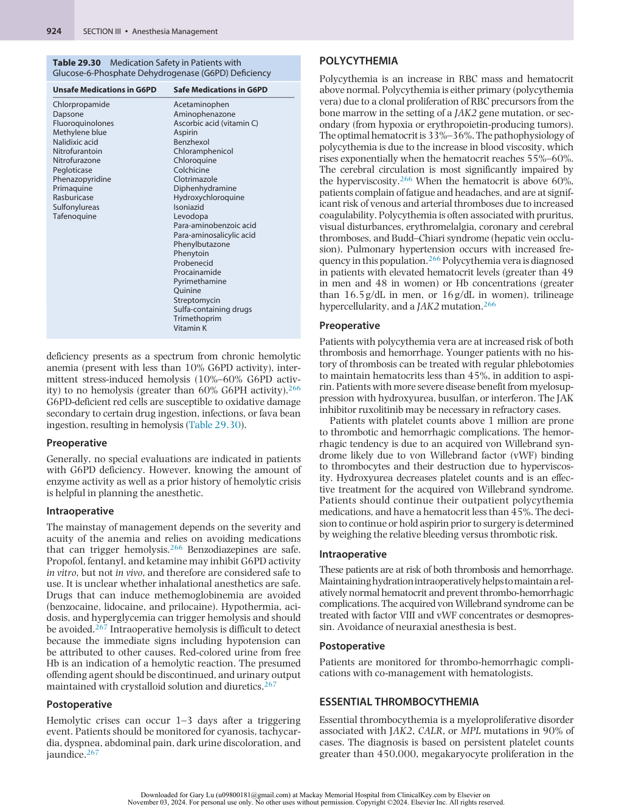

:::

<!-- PDF page 53 -->

bone marrow, and one of the gene mutations. Patients can be asymptomatic, or have vasomotor symptoms (lightheadedness, livedo reticularis), or thrombotic or hemorrhagic events. Predictors of arterial thrombosis are age older than 60 years, history of thrombosis, cardiovascular risk factors (e.g., smoking, hypertension, diabetes mellitus), white blood cell count greater than 11,000/mcL, and the _JAK2_ V617F mutation. Thrombotic events include stroke, transient ischemic attacks, retinal artery and venous occlusions, coronary artery ischemia, pulmonary embolism, hepatic and portal vein thrombosis, deep vein thrombosis, and Raynaud disease. Hemorrhagic complications are due to an acquired von Willebrand syndrome similar to that described for polycythemia vera.266

### Preoperative

It is unclear what is a safe platelet count for surgery. The decision to hold aspirin perioperatively is made by weighing the relative risks of bleeding versus thrombosis. Cytoreductive agents should be continued. In patients with a prior history of thrombosis, anticoagulants are managed as per current guidelines.268

### Intraoperative

Patients are monitored for thrombo- hemorrhagic complications with co- management with hematologists.

### Postoperative

Postoperative considerations pertain to the thrombohemorrhagic tendencies, as discussed.

### VON WILLEBRAND DISEASE

Von Willebrand disease (vWD) is the most commonly encountered platelet- mediated bleeding disorder. It is inherited as either an autosomal dominant or autosomal recessive trait. Patients with vWD usually present with mucocutaneous bleeding (epistaxis, menorrhagia, bruising, or gingival). Diagnosis should be prompted by a history of hemorrhage, as vWF concentrations can be low in patients with no clinically relevant bleeding, leading to an overdiagnosis. Patients with a history of mucocutaneous bleeding, with a positive family history or a prolonged aPTT in the presence of mild thrombocytopenia should be screened with routine coagulation tests, vWF antigen and activity, in addition to factor VIII concentrations. Patients with a positive family or personal diagnosis of bleeding are diagnosed with vWD if their vWF (antigen or activity) is less than 30% and “low” vWD if vWF (antigen or activity) is 30%–50%.266 Furthermore, all patients diagnosed with vWD should have vWF multimer analysis testing to establish the specific type of vWD, as management differs. The majority of patients with vWD have type 1 (80%). These patients have recurrent episodes of severe bleeding due to significantly decreased vWF concentrations (less than 15%–25% of normal). Type 2 vWD is due to reduction of large vWF multimers, resulting in a significant decrease in vWF activity. Patients with type 3 vWD present with a hemophilia- type syndrome (hemarthroses, muscle bleeding) that results from a lack of vWF antigen and severely decreased concentrations of vWF activity and factor VIII (3%–10% of normal).

### Preoperative

Preoperative preparation relies on obtaining a detailed bleeding history, accurate diagnosis, and prior treatment interventions. Generally, patients with vWF levels >40% do not require any further perioperative interventions, as such levels confer virtually normal hemostasis.

### Intraoperative

Intraoperative management depends on the type of vWD and the invasiveness of the planned procedure. Options include desmopressin and vWF concentrates. Desmopressin releases vWF from the endothelial cells and benefits patients with type 1 disease and some patients with type 2 vWD having minor procedures. There is a complete lack of response to desmopressin patients with type 3 disease.269,270 Desmopressin is administered intravenously at a dose of 0.3 mcg/kg 30 minutes before procedures. In general, a trial of desmopressin is administered preoperatively to assess responsiveness. Those with very mild type 1 vWD (activity greater than 30%) do not require a trial as they are routinely responsive. If desmopressin is administered it may need to be redosed intra- and postoperatively when major bleeding is expected. Repeated doses of desmopressin may cause hyponatremia, so sodium concentrations should be monitored. Desmopressin can reduce bleeding and transfusion requirements during major procedures, but vWF concentrates may be needed as well. vWF concentrates are indicated for patients with type 3 vWF disease undergoing any procedures. Some preparations (Humate- P, Alphanate, and Wilate) contain factor VIII. Others (Vonvendi) do not, and factor VIII may need to be supplemented. Antifibrinolytics can be used as adjunctive therapy during surgical procedures and platelet transfusion may benefit patients with platelet counts less than 50,000.

### Postoperative

Bleeding risk remains elevated postoperatively. vWF concentrates may need to be continued until bleeding risk decreases.

### HEMOPHILIA A

Hemophilia A is due to deletions or mutations to the X chromosome, manifesting only in males and resulting in very low concentrations of factor VIII. Patients with factor VIII activity below 1% of normal have frequent spontaneous bleeding into joints, muscle, or other organs. Those with factor VIII concentrations above 1% to 30% may not bleed spontaneously but be at risk of bleeding with surgery.271 The diagnosis is suspected when there is a prolonged aPTT with a normal PT and is confirmed with measuring factor VIII levels. Treatment includes prophylactic factor VIII concentrates in patients with spontaneous bleeding, or emicizumab. Emicizumab is a recombinant monoclonal antibody that binds to factors IXa and X simultaneously, obviating the need for factor VIIIa as a cofactor to activate factor X.

### Preoperative

The severity of the hemophilia, treatments, presence of factor inhibitors, response to desmopressin (typically only those with mild disease), and the bleeding risk of

<!-- PDF page 54 -->

the procedure need to be determined. Patients with mild hemophilia A having minor procedures benefit from desmopressin, which can sufficiently increase factor VIII levels. Patients with hemophilia A who receive factor VIII concentrates may develop inhibitor antibodies, and subsequently do not respond to factor VIII concentrates. The inhibitor activity is detected and quantified preoperatively.

### Intraoperative

For minor procedures in patients with mild hemophilia, desmopressin administered 30 minutes before incision may be sufficient. For major procedures, factor VIII concentrations must be increased to 80%–100%. For minor procedures, factor VIII concentrations are increased to 50%–80%.271 Factor VIII concentrate must be administered 30–60 minutes preoperatively and repeated every 8–12 hours. Factor VIII concentrate has a half- life of 12 hours. Fresh frozen plasma and cryoprecipitate can also correct factor VIII deficiency. Antifibrinolytics can be given as adjuncts for superficial surgeries.

Patients with inhibitor antibodies to factor VIII require special treatment. Those with low antibody titers may still benefit from factor VIII concentrates, whereas patients with high titers require activated prothrombin complex concentrate, a factor VIII inhibitor bypassing agent (FEIBA), or recombinant factor VII.270 Patients taking emicizumab who also have inhibitor antibodies should be treated with a FEIBA only while monitored for thrombotic events and thrombotic microangiopathy.

### Postoperative

The treatments described above should be continued for a few weeks postoperatively to prevent bleeding complications.

### HEMOPHILIA B

Patients with hemophilia B (characterized by a deficiency of factor IX) have a clinical spectrum of disease similar to that found in hemophilia A. Patients with factor IX levels less than 1% of normal can have severe bleeding episodes, whereas those with factor IX concentrations between 5% and 40% have mild disease.272 Laboratory findings are similar to hemophilia A, with a prolonged aPTT and a normal PT.

### Preoperative

Evaluation and management (with the exception of desmopressin) of patients with hemophilia B are similar to those for management of hemophilia A patients. The patient’s current therapy, a detailed bleeding history, factor IX concentrations, and presence of inhibitors should be ascertained.

### Intraoperative

Desmopressin is not an option for patients with hemophilia B. Recombinant or purified factor IX product or factor IX–prothrombin complex concentrate is used to treat mild bleeding episodes or is administered prophylactically for minor surgery. For major procedures (especially orthopedic, liver, trauma), thromboses are possible with factor IX–prothrombin complex concentrates as they contain activated clotting factors. Therefore, only

purified factor IX or recombinant factor IX should be used in these circumstances. Hemophilia B patients with factor IX inhibitors can be managed in acute situations using recombinant factor VIIa (preferred) or a prothrombin complex concentrate.

### Postoperative

Similar to hemophilia A, factor IX concentrates or recombinant products should be administered for several days postoperatively in patients with hemophilia B.

### THROMBOCYTOPENIA

Thrombocytopenia is defined as a platelet count of less than 150,000. The etiology of thrombocytopenia is varied and presented in Table 29.31.

### Preoperative

Platelet counts are optimized depending on the severity of thrombocytopenia, the etiology, and the invasiveness of the procedure. The need for red cell transfusion is increased at all levels of thrombocytopenia and increases with lower platelet counts. Targeted platelet counts differ for various procedures273 (Table 29.32). Platelet counts above 50,000 are sufficient for most surgeries. However, platelet counts above 100,000 are recommended for spinal and intracranial procedures and neuraxial anesthesia. Please refer to Chapter 58 for recommendations for platelet count targets for obstetric patients.

Specific medications or therapies are recommended for different thrombocytopenia types. Some patients will require platelet transfusions. Monoclonal antibodies such as eculizumab may be of use in patients at high risk of alloimmunization due to repeated transfusions.274 Patients with idiopathic thrombocytopenic purpura (ITP) benefit from steroids or intravenous immunoglobulin infusions timed so that the peak response coincides with the surgical procedure. In addition, patients with ITP benefit from thrombopoietin receptor agonists (e.g., romiplostim, avatrombopag, and eltrombopag) leading to an increase in platelet counts by as much as 50,000 12–14 days after therapy.275,276 Similarly, thrombopoietin receptor agonists (e.g., avatrombopag, eltrombopag, and lusutrombopag) result in a similar platelet count increase 5–8 days after a treatment course.277

Patients with thrombotic thrombocytopenic purpura (TTP) and hemolytic uremic syndrome benefit from plasmapheresis. Patients with drug- induced thrombocytopenia or disseminated intravascular coagulation (DIC) may respond to treatment of the underlying cause (e.g., sepsis, drug withdrawal).

### Intraoperative

Intraoperative management is focused on prevention of bleeding, by maintaining platelet counts as well as judicious use of adjuncts. In addition to platelet transfusions, adjuncts such as antifibrinolytics have been successfully used in cardiac, orthopedic, and trauma surgeries. Platelet transfusions should be used with caution in patients with consumptive processes such as DIC, TTP, or heparininduced thrombocytopenia as thrombotic complications can result. But platelets should not be withheld in bleeding patients.278–280

<!-- PDF page 55 -->

### Table 29.31 Etiology of Thrombocytopenia

|**DISEASE- RELATED**|**THROMBOCYTOPENIA**|**IATROGENIC TH**|**ROMBOCYTOPENIA**|
|---|---|---|---|
|**Decreased Production**|**Increased Destruction**|**Decreased Production**|**Increased Destruction**|
|Bone marrow disorders: ᑏAplastic anemia ᑏMyelodysplastic syndrome ᑏAcute and chronic leukemias|Splenic sequestration: ᑏPortal hypertension ᑏSplenomegaly ᑏHypersplenism|Drug- induced bone marrow failure: ᑏAntibiotics (linezolid) ᑏChemotherapy|Extracorporeal circulatory device: ᑏCardiopulmonary bypass ᑏExtracorporeal membrane oxygenation ᑏContinuous venovenous hemofiltration ᑏVentricular assist devices|
|Bone marrow failure: ᑏInfection ᑏCancer|Sepsis & inflammation: ᑏ ↑aggregation 2nd to von Willebrand multimers ᑏ ↑adherence to vascular endothelium & leukocytes ᑏComplement mediated|Radiotherapy- induced bone marrow failure|Inserted mechanical valves Post- transcatheter aortic valve|
|Hematinic deficiency: ᑏvitamin B12or folate|Hemolysis-induced aggregation||Posttransfusion purpura|
|Hemophagocytosis|HELLP syndrome||Drug- induced antibodies (D- ITP) ᑏVancomycin|
|Thrombopoietin deficiency (liver disease)|Autoantibodies: ᑏImmune thrombocytopenia ᑏEvans syndrome||Drug- induced thrombotic microangiopathy: ᑏChemotherapeutics (mitomycin) ᑏImmunosuppressants (cyclosporine) ᑏVEGF inhibitors (sirolimus) ᑏOthers: cocaine, oxymorphone|
||Thrombotic microangiopathy: ᑏHemolytic–uremic syndrome ᑏThrombotic thrombocytopenic purpura||Heparin- induced thrombocytopenia (heparin–PF4 antibodies)|
||Disseminated intravascular coagulopathy|||
||Clinical thrombosis|||
||Histone induced destruction|||

_HELLP_ , hemolysis, elevated liver enzymes, low platelet count; _PF4_ , platelet factor 4; _VEGF_ , vascular endothelial growth factor. From Lombard FW, Popescu WM, Oprea AD, Kertai MD. Perioperative thrombocytopenia. _Curr Opin Anaesthesiol_ . 2021;34(3):335–344.

### References

**Table 29.32** Preoperative Platelet Targets

|**Intervention**|**Proposed Platelet Counts**|
|---|---|
|Neurosurgical procedures|100K|
|Posterior ophthalmic surgery|100K|
|Major surgery|50K|
|Neuraxial anesthesia|100K|
|Obstetric neuraxial anesthesia|70K|
|Central venous line placement|20K|
|Interventional radiology procedures|50K|
|Bronchoscopy|50K|
|Gastrointestinal biopsy|5K|

1.  Saugel B, et al. _Anesthesiology_ . 2021;134(2):250.

2.  Puelacher C, et al. _Circulation_ . 2018;137(12):1221.

3.  Duceppe E, et al. _Can J Cardiol_ . 2017;33(1):17.

4.  Simonneau G, et al. _J Am Coll Cardiol_ . 2013;62(25 Suppl):D34.

5.  Price LC, et al. _Br J Anaesth_ . 2021;126(4):774.

6.  Augustine DX, et al. _Echo Res Pract_ . 2018;5(3):G11.

7.  Lumb AB, et al. _J Am Soc Anesthesiol_ . 2015;122(4):932.

8.  van Wolferen SA, et al. _Eur Heart J_ . 2008;29(1):120.

9.  Crystal GJ, et al. _Anesthesiology_ . 2018;128(1):202.

10.  Bozkurt B, et al. _J Card Fail_ . 2021;23(3):352.

11.  Gopinathannair R, et al. _Circ Arrhythm Electrophysiol_ . 2021;14(6).

12.  Marrouche NF, et al. _N Engl J Med_ . 2018;378(5):417.

13.  Al- Khatib SM, et al. _J Am Coll Cardiol_ . 2018;72(14).

14.  Abbott TEF, et al. _Anesth Analg_ . 2018;126(6):1936.

15.  Cardiac implantable electronic device management [corrected]. _Anesthesiology_ . 2020;132(2):225.

16.  Postema PG, et al. _Heart Rhythm_ . 2009;6(9):1335.

17.  Krahn AD, et al. _JACC Clin Electrophysiol_ . 2022;8(5):687.

From Lombard FW. Perioperative thrombocytopenia. _Curr Opin Anaesthesiol_ . 2021;34(3):335–344.

18.  Page RL, et al. _Circulation_ . 2016;133(14):e471.

19.  Kloesel B, et al. _Can J Anaesth_ . 2011;58(9):824.

20.  Niimi N, et al. _J Cardiothorac Vasc Anesth_ . 2022;36(1):286.

### Postoperative

Platelet transfusions may be necessary to prevent postoperative bleeding complications.

21.  Bengali R, et al. _J Cardiothorac Vasc Anesth_ . 2014;28(5):1375.

22.  Park S, et al. _J Clin Med_ . 2020;9(1):150.

23.  Radosevich MA, et al. _Anesthesiol Clin_ . 2016;34(4):633.

24.  Salem M, et al. _Ann Surg_ . 1994;219(4):416.

25.  Alten R, et al. _Neuroimmunomodulation_ . 2015;22(1–2):83.

26.  Hoes JN, et al. _Ann Rheum Dis_ . 2007;66(12):1560.

### Complete references available online at expertconsult.com.

27.  Eames WO, et al. _Anesthesiology_ . 1996;84(6):1307.

::: details 原始表格與符號（PDF 第 55 頁）

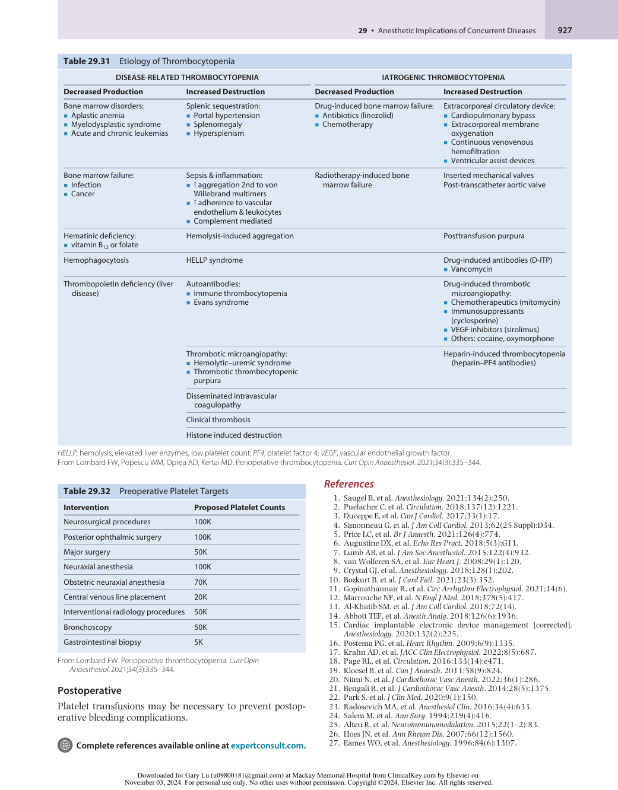

:::

<!-- PDF page 56 -->

28.  Wong DH, et al. _Anesth Analg_ . 1995;80(2):276.

29.  Fernandez- Bustamante A, et al. _JAMA Surg_ . 2017;152(2):157. 30.  Kurihara C, et al. _Reg Anesth Pain Med_ . 2020;45(4):255.

31.  Kostopanagiotou G, et al. _Anesth Analg_ . 1999;89(3):613.

32.  Soomro QH, Charytan DM. _Curr Opin Nephrol Hypertens_ . 2021; 30(2):198.

33.  Quarti- Trevano F, et al. _Curr Hypertens Rep_ . 2021;23(2):10. 34.  Kim JH, et al. _Ann Hematol_ . 2015;94(9):1457.

- 35a.  Kolodzie K, et al. _Anesthesiology_ . 2021;135(4):621. 35b.  O'Malley CMN, et al. _Anesth Analg_ . 2005;100(5):1518.

- 35c.  Wagener G, et al. _Transplantation_ . 2021;105(8):1677.

- 35d.  Schillinger F, et al. _Nephrol Dial Transplant_ . 1991;6(10):722.

- 35e.  Kim YS, et al. _Medicina (Kaunas)_ . 2021;57(11):1259.

- 35f.  Zand L, et al. _Am J Med_ . 2010;123(4):367.

- 35g.  Lee A, et al. _Cochrane Database Syst Rev_ . 2007;(2):CD002765.

- 35h.  Prowle JR, et al. _Nat Rev Nephrol_ . 2021;17(9):605.

36.  Ziser A, et al. _Anesthesiology_ . 1999;90(1):42.

37.  Zardi EM, et al. _J Am Coll Cardiol_ . 2010;56(7):539.

38.  Dunkman WJ, et al. _Semin Cardiothorac Vasc Anesth_ . 2022;26(4):304.

39.  Northup PG, et al. _Clin Gastroenterol Hepatol_ . 2019;17(4):595.

40.  Kaufman RM, et al. _Ann Intern Med_ . 2015;162(3):205.

41.  Ronca V, et al. _Hepatol Commun_ . 2022;6(2):423.

42.  Tegeder I, et al. _Clin Pharmacokinet_ . 1999;37(1):17.

43.  Kowdley KV, et al. _Am J Gastroenterol_ . 2019;114(8):1202.

- 44a.  Benesch C, et al. _Circulation_ . 2021;143(19):e923.

- 44b.  Glance LG, et al. _JAMA Surg_ . 2022;157(8):e222236.

45.  Mashour GA, et al. _J Neurosurg Anesthesiol_ . 2014;26(4):273.

46.  Ricotta JJ, et al. _J Vasc Surg_ . 2011;54(3):832.

47.  Gerstein NS, et al. _Ann Surg_ . 2012;255(5):811.

48.  Wongtangman K, et al. _Anesth Analg_ . 2021;133(4):1000.

49.  Momjian- Mayor I, et al. _Stroke_ . 2005;36(3):567.

50.  Lazar RM, et al. _Stroke_ . 2003;34(3):794.

51.  Gialdini G, et al. _JAMA_ . 2014;312(6):616.

52.  Chang CC, et al. _Epilepsia_ . 2012;53(6):987.

53.  Borsato GS, et al. _Pharmacogenomics J_ . 2020;20(3):351.

54.  Aranake- Chrisinger A, et al. _Br J Anaesth_ . 2017;119(2):285.

55.  Susano MJ, et al. _Anesthesiology_ . 2020;133(6):1184.

56.  Ballard C, et al. _PLoS One_ . 2012;7(6):e37410.

57.  Avidan MS, et al. _Lancet_ . 2017;390(10091):267.

58.  Memtsoudis S, et al. _Reg Anesth Pain Med_ . 2019.

59.  Aouad MT, et al. _Anesth Analg_ . 2019;129(6):1504.

60.  Wachtendorf LJ, et al. _Anesth Analg_ . 2022;134(4):822.

61.  Tripathi M, et al. _J Postgrad Med_ . 2003;49(4):311.

62.  Watanabe A, et al. _J Thorac Cardiovasc Surg_ . 2004;127(3):868.

63.  Lee HS, et al. _Muscle Nerve_ . 2015;52(2):216.

64.  Gritti P, et al. _Acta Anaesthesiol Scand_ . 2012;56(1):66.

65.  Tsukada S, et al. _Eur J Anaesthesiol_ . 2021;38(8):850.

66.  Coursin DB, et al. _JAMA_ . 2002;287(2):236.

67.  Juel VC, et al. _Semin Neurol_ . 2004;24(1):75.

68.  Jamal BT, et al. _Oral Surg Oral Med Oral Pathol Oral Radiol Endod_ . 2009;107(5):612.

69.  Weingarten TN, et al. _J Clin Anesth_ . 2014;26(8):648.

70.  Kak M, et al. _Neurol Res_ . 2017;39(1):16.

71.  Kepenekian L, et al. _Eur J Endocrinol_ . 2016;175(4):335.

72.  Petr EJ, et al. _Clin Diabetes Endocrinol_ . 2018;4:15.

73.  Thomas MN, et al. _Nutrition_ . 2016;32(2):249.

74.  Wischmeyer PE, et al. _Anesth Analg_ . 2018;126(6):1883.

75.  Tian X, et al. _Acta Anaesthesiol Scand_ . 2014;58(8):942.

76.  American Diabetes Association Professional Practice Committee. _Diabetes Care_ . 2022;45(Suppl 1):S17.

77.  McGarry JD, et al. _Diabetologia_ . 1999;42(2):128.

78.  Nyenwe EA, et al. _Diabetes Care_ . 2010;33(8):1837.

79.  Slovis CM, et al. _Am J Emerg Med_ . 1987;5(1).

80.  Nyenwe EA, et al. _Metabolism_ . 2016;65(4):507.

81.  Newcomer JW, et al. _CNS Drugs_ . 2005;19(Suppl 1):1.

82.  Self WH, et al. _JAMA Netw Open_ . 2020;3(11):e2024596.

83.  Nyenwe EA, et al. _Diabetes Res Clin Pract_ . 2011;94(3):340.

84.  Kamel KS, et al. _Am J Kidney Dis_ . 2016;68(6):967.

85.  Cho YR, et al. _Sci Rep_ . 2019;9(1):6129.

86.  Vinik AI, et al. _Handb Clin Neurol_ . 2013;117:279.

87.  Nathan DM, et al. _Diabetes Care_ . 2014;37(1):9.

88.  Buchleitner AM, et al. _Cochrane Database Syst Rev_ . 2012;9:CD007315.

- 89a.  NICE- SUGAR Study Investigators, et al. _N Engl J Med_ . 2009; 360(13):1283.

- 89b.  Sen S, et al. _JAMA Surg_ . 2024;doi:10.1001/jamasurg.2024.0111.

90.  Pinsker JE, et al. _Diabetes Technol Ther_ . 2021;23(7):512.

91.  Chabre O, et al. _Ann Endocrinol (Paris)_ . 2017;78(6):490.

92.  Betterle C, et al. _J Endocrinol Invest_ . 2019;42(12):1407.

93.  Bornstein SR, et al. _J Clin Endocrinol Metab_ . 2016;101(2):364.

94.  Liu MM, et al. _Anesthesiology_ . 2017;127(1):166.

95.  Woodcock T, et al. _Anaesthesia_ . 2020;75(5):654.

96.  Lansang MC, et al. _Endocr Pract_ . 2009;15(3):225.

97.  Hengge UR, et al. _J Am Acad Dermatol_ . 2006;54(1):1.

98.  Lipworth BJ, et al. _Arch Intern Med_ . 1999;159(9):941.

99.  Ezzat S, et al. _Cancer_ . 2004;101(3):613.

100.  Nieman LK, et al. _Eur J Endocrinol_ . 2015;173(4):M33.

101.  Mancini T, et al. _Clin Endocrinol (Oxf)_ . 2004;61(6):768. 102.  Jha S, et al. _Clin Endocrinol (Oxf)_ . 2020;92(2):124. 103.  Giordano C, et al. _Eur J Endocrinol_ . 2014;170(2):311.

104.  Kronfol Z, et al. _Psychoneuroendocrinology_ . 1996;21(7):599.

105.  Auphan N, et al. _Science_ . 1995;270(5234):286. 106.  Isidori AM, et al. _Eur J Endocrinol_ . 2015;173(3):R101. 107.  van der Pas R, et al. _Clin Endocrinol (Oxf)_ . 2013;78(4):481.

108.  Boscaro M, et al. _J Clin Endocrinol Metab_ . 2002;87(8):3662. 109.  Calissendorff J, et al. _Cancers (Basel)_ . 2022;14(4):917. 110.  Neumann HPH, et al. _N Engl J Med_ . 2019;381(6):552.

111.  Tsiomidou S, et al. _Clin Endocrinol (Oxf)_ . 2022;97(5):541.

112.  Lenders JWM, et al. _J Hypertens_ . 2020;38(8):1443. 113.  Lenders JW, et al. _J Clin Endocrinol Metab_ . 2014;99(6):1915.

114.  Fagundes GFC, et al. _J Endocr Soc_ . 2022;6(2).

115.  Kong H, et al. _Anesth Analg_ . 2021;132(1):140.

116.  Liu C, et al. _Endocr Connect_ . 2017;6(8):830.

117.  Randle RW, et al. _Ann Surg Oncol_ . 2017;24(1):244.

118.  Zawadzka K, et al. _Eur J Endocrinol_ . 2021;184(6):751.

119.  Buitenwerf E, et al. _J Clin Endocrinol Metab_ . 2020;105(7):2381. 120.  Kong H, et al. _Int Urol Nephrol_ . 2020;52(11):2079.

121.  Buscemi S, et al. _J Clin Med_ . 2021;10(16):3759.

122.  Schimmack S, et al. _Br J Surg_ . 2020;107(2):e102.

123.  Van Den Heede K, et al. _Ann R Coll Surg Engl_ . 2022;104(2):138.

124.  Groeben H, et al. _Br J Surg_ . 2020;107(2):e170.

125.  Jaiswal SK, et al. _J Clin Endocrinol Metab_ . 2021;106(8):e2907.

126.  Brunaud L, et al. _Surgery_ . 2014;156(6):1410.

127.  Kong H, et al. _BMC Anesthesiol_ . 2020;20(1):294.

128.  Jeon S, et al. _Int J Med Sci_ . 2020;17(13):1956.

129.  Wiseman D, et al. _Endocr Relat Cancer_ . 2020;27(9):519.

130.  Bai S, et al. _Endocr J_ . 2020;67(1):81.

131.  Urabe F, et al. _J Clin Med_ . 2021;10(19):4531.

132.  James MF, et al. _Anesth Analg_ . 2004;99(3):680.

133.  Lord MS, et al. _J Cardiothorac Vasc Anesth_ . 2012;26(3):52.

134.  Livingstone M, et al. _Ann Surg Oncol_ . 2015;22(13):4175.

135.  Ramakrishna H, et al. _J Anaesthesiol Clin Pharmacol_ . 2015;31(3):317. 136.  Ronen JA, et al. _Cureus_ . 2019;11(4):e4551.

137.  Papachristos AJ, et al. _World J Surg_ . 2021;45(3):790.

138.  Chen Y, et al. _Surgery_ . 2014;156(6):1404.

139.  Young WF, et al. _Clin Endocrinol (Oxf)_ . 2007;66(5):607.

140.  Mattsson C, et al. _Nat Clin Pract Nephrol_ . 2006;2(4):198.

141.  Hanslik G, et al. _Eur J Endocrinol_ . 2015;173(5):665. 142.  Fleisher LA, et al. _Circulation_ . 2014;130(24):2215. 143a.  Himes CP, et al. _Mayo Clin Proc_ . 2020;95(12):2760.

- 143b.  Biondi B, et al. _N Engl J Med_ . 2018;378(25):2411.

144.  Hsieh LB, et al. _World J Surg_ . 2020;44(11):3770.

145.  de Mul N, et al. _Br J Anaesth_ . 2021;127(6):879.

146.  Chen AY, et al. _Thyroid_ . 2014;24(2):181.

147.  Iglesias P, et al. _Clin Endocrinol (Oxf)_ . 2005;63(1):66.

148.  Klein I, et al. _J Clin Endocrinol Metab_ . 1994;78(5):1026.

149.  Frost L, et al. _Arch Intern Med_ . 2004;164(15):1675.

150.  Fernandez- Robles C, et al. _Curr Opin Anaesthesiol_ . 2021;34(3):326.

151.  Dixon JL, et al. _World J Surg_ . 2014;38(6):1262.

152.  Papi G, et al. _Front Endocrinol (Lausanne)_ . 2014;5:102.

153.  Vyas AA, et al. _Endocr Pract_ . 2010;16(4):673.

154.  Tsai WC, et al. _Clin Endocrinol (Oxf)_ . 2005;62(5):521.

155.  Chiha M, et al. _J Intensive Care Med_ . 2015;30(3):131.

156.  Kohl BA, et al. _Anesthesiol Clin_ . 2010;28(1):139.

157.  Manfredi E, et al. _Haemophilia_ . 2008;14(3):423.

158.  Fraser WD, et al. _Lancet_ . 2009;374(9684):145.

159.  Pivonello R, et al. _Pituitary_ . 2017;20(1):46.

160.  Mosca S, et al. _Int J Cardiol_ . 2013;167(5):1712.

161.  Atila C, et al. _Lancet Diabetes Endocrinol_ . 2022;10(10):700.

162.  Ram P, et al. _Tex Heart Inst J_ . 2019;46(1):21.

163.  Kaltsas G, et al. _Neuroendocrinology_ . 2017;105(3):245.

<!-- PDF page 57 -->

164.  Woltering EA, et al. _J Clin Anesth_ . 2016;32:189.

165.  Condron ME, et al. _Surgery_ . 2016;159(1):358.

166.  Limbach KE, et al. _Am J Surg_ . 2019;217(5):932.

167.  Peramunage D, et al. _Anesthesiol Clin_ . 2020;38(1):149.

168.  Anastasiou C, et al. _Curr Opin Rheumatol_ . 2022;34(2):95.

169.  Gupta A, et al. _Anesthesiology_ . 2018;128(5):880.

170.  Singh RR, et al. _Lupus_ . 2018;27(10):1577.

171.  Mertelsmann- Voss C, et al. _J Rheumatol_ . 2014;41(5):867.

172.  Goodman SM, et al. _Arthritis Rheumatol_ . 2017;69(8):1538.

173.  Smilowitz NR, et al. _J Thromb Thrombolysis_ . 2018;45(1):13.

174.  Babazade R, et al. _Anesth Analg_ . 2017;124(4):1118.

175.  Lin JA, et al. _Ann Rheum Dis_ . 2014;73(9):1646.

176.  Falasinnu T, et al. _J Rheumatol_ . 2021;48(8):1279.

177.  England BR, et al. _BMJ (Clinical Res Ed)._ 2018;361:k1036.

178.  Zhang T, et al. _Arthritis Res Ther_ . 2015;17(1):148.

179.  Samanta R, et al. _Anaesthesia_ . 2011;66(12):1146.

180.  Lawry GV, et al. _Arthritis Rheum_ . 1984;27(8):873.

181.  Kolman J, et al. _Can J Anesth_ . 2002;49(7):729.

182.  Chaudhary SB, et al. _ISRN Rheumatol_ . 2011;2011:150484.

183.  Oppenlander ME, et al. _J Neurosurg Spine_ . 2015;22(5):454.

184.  Epaud A, et al. _Anesthesiology_ . 2021;135(3):495.

185.  Lee JS, et al. _J Rheumatol_ . 2012;39(12):2321.

186.  Eriksson JK, et al. _Ann Rheum Dis_ . 2017;76(2):364.

187.  Üstün N, et al. _Arch Rheumatol_ . 2014;29(3):155.

188.  Lai HY, et al. _Br J Anaesth_ . 2006;97(3):419.

189.  Schelew BL, et al. _Can J Anaesth_ . 1996;43(1):65.

190.  Carr ZJ, et al. _Curr Anesthesiol Rep_ . 2020;10(4):512.

191.  Luo Y, et al. _Int J Rheum Dis_ . 2019;22(6):1023.

192.  Hachulla E, et al. _Orphanet J Rare Dis_ . 2021;16(S2).

193.  Malfait F, et al. _Am J Med Genet C Semin Med Genet_ . 2017;175(1).

194.  Wiesmann T, et al. _Orphanet J Rare Dis_ . 2014;9:109.

195.  Kulas Søborg ML, et al. _Dig Surg_ . 2017;34(2):161.

196.  White KK, et al. _Am J Med Genet_ . 2017;173(10):2584.

197.  Kim JH, et al. _Cureus_ . 2021;13(6):e15832.

198.  Hebl JR, et al. _Anesth Analg_ . 2010;111(6):1511.

199.  Bala A, et al. _J Shoulder Elbow Surg_ . 2016;25(12):1971.

200.  Yan L, Ellman T, McNairy M, et al. _Perioperative Care in Adults With HIV [Internet]_ . Johns Hopkins University; 2021.

201.  Sandler BJ, et al. _J Trauma Acute Care Surg_ . 2019;86(3):479.

202.  Malek J, et al. _Am J Emerg Med_ . 2011;29(3):278.

203.  Nepogodiev D, et al. _Lancet_ . 2020;396(10243):27.

204.  Wijeysundera DN, et al. _Anaesthesia_ . 2021;76(6):731.

205.  Deng JZ, et al. _Ann Surg_ . 2022;275(2):242.

- 206a.  O’Glasser AY, et al. _Perioper Care Oper Room Manag_ . 2022;28: 100272.

- 206b.  Myles PS. _Anesthesiology_ . 2024;140(2):183.

207.  Nalbandian A, et al. _Nat Med_ . 2021;27(4):601.

208.  COVIDSurg Collaborative, et al. _BMJ Open_ . 2021;11(11).

209.  Ferrandis R, et al. _Br J Anaesth_ . 2021;127(4):e143.

210.  Al Habib HF, et al. _Ann Thorac Surg_ . 2010;90(3):813.

211.  Khairy P, et al. _Circulation_ . 2010;122(9):868.

212.  Hengartner AC, et al. _Childs Nerv Syst_ . 2020;36(11):2609. 213.  Hankinson TC, et al. _Neurosurgery_ . 2010;66(3 Suppl):32.

214.  De Lausnay M, et al. _Pediatr Pulmonol_ . 2020;55(5):1259.

215.  Hseu AF, et al. _Int J Pediatr Otorhinolaryngol_ . 2022;157.

216.  Raj D, et al. _Contin Educ Anaesth Crit Care Pain_ . 2015;15(1):7.

217.  Tonnesen H, et al. _Br J Surg_ . 1999;86(7):869.

218.  Bradley KA, et al. _J Gen Intern Med_ . 2011;26(2):162.

219.  Rolfzen ML, et al. _J Clin Anesth_ . 2022;78.

220.  Lau A, et al. _Anesth Analg_ . 2009;108(3):916. 221.  Bruha R, et al. _World J Hepatol_ . 2012;4(3):81.

222.  Tonnesen H, et al. _BMJ (Clin Res Ed)._ 1999;318(7194):1311. 223.  Tonnesen H, et al. _Br J Anaesth_ . 2009;102(3):297.

224.  Fassoulaki A, et al. _Anesth Analg_ . 1993;77(3):553.

225.  St Haxholdt O, et al. _Anaesthesia_ . 1984;39(3):240.

226.  Sullivan JT, et al. _Br J Addict_ . 1989;84(11):1353.

227.  Underwood K, et al. _J Surg_ . 2022;92(6):1377.

228.  Amato L, et al. _Cochrane Database Syst Rev_ . 2011;6.

229.  Liu J, et al. _Cochrane Database Syst Rev_ . 2019;2019(11).

230.  Yavarovich ER, et al. _J Intensive Care_ . 2019;7:49.

231.  Murphy JA, et al. _Ann Pharmacother_ . 2021;55(12):1515.

232.  Oks M, et al. _J Intensive Care Med_ . 2020;35(9):844.

233.  Beaulieu P, et al. _Can J Anaesth_ . 2017;64(12):1236.

234.  Kolaitis NA, et al. _Curr Opin Pulmonary Med_ . 2022;28(5):352.

235.  Scott ML, et al. _Heart_ . 2021;107(8):604.

236.  Richards JR, et al. _Clin Toxicol_ . 2016;54(5):345.

237.  Kevil CG, et al. _Arterioscler Thromb Vasc Biol_ . 2019;39(9):1739.

238.  Mizuno S, et al. _BMC Oral Health_ . 2022;22(1):141.

239.  Shaker MS, et al. _J Allergy Clin Immunol_ . 2020;145(4):1082.

240.  Garvey LH, et al. _Allergy_ . 2019;74(10):1872.

241.  Harper NJN, et al. _Br J Anaesth_ . 2018;121(1):159.

242.  Mertes PM, et al. _Br J Anaesth_ . 2019;123(1):e16.

243.  Harper NJ, et al. _Br J Anaesth_ . 2016;116(1):11.

244.  Uyttebroek AP, et al. _J Allergy Clin Immunol Pract_ . 2016;4(6):1232. 245.  Mertes PM, et al. _J Investig Allergol Clin Immunol_ . 2011;21(3):171.

246.  Campbell RL, et al. _J Allergy Clin Immunol Pract_ . 2015;3(1):76.

247.  Garvey LH, et al. _Br J Anaesth_ . 2019;123(1):e50.

248.  Kim SM, et al. _Anesth Pain Med (Seoul)_ . 2021;16(1):56.

249.  Okocha O, et al. _Anesthesiology_ . 2020;133(1):109.

250.  Hébert PC, et al. _N Engl J Med_ . 1999;340(6):409.

251.  Zhu C, et al. _Medicine (Baltimore)_ . 2019;98(32):e16795.

252.  Mazer CD, et al. _N Engl J Med_ . 2017;377(22):2133.

253.  Mazer CD, et al. _N Engl J Med_ . 2018;379(13):1224.

254.  Botto F, et al. _Anesthesiology_ . 2014;120(3):564.

255.  Howard J, et al. _Lancet_ . 2013;381(9870):930.

256.  Vichinsky EP, et al. _N Engl J Med_ . 1995;333(4):206.

257.  Chou ST, et al. _Blood Adv_ . 2020;4(2):327.

258.  Oyedeji CI, et al. _Hematol Am Soc Hematol Educ Program_ . 2021; 2021(1):405.

259.  Asadov C, et al. _Int J Hematol_ . 2018;108(1):5.

260.  Taher AT, et al. _Lancet_ . 2018;391(10116):155.

261.  Taher AT, et al. _N Engl J Med_ . 2021;384(8):727.

262.  Cappellini MD, et al. _Blood Adv_ . 2021;5(1):326.

263.  Staikou C, et al. _Anaesthesia_ . 2014;69(5):494.

264.  Suwanchinda V, et al. _J Med Assoc Thai_ . 1994;77(2):66.

265.  Taher AT, et al. _J Thromb Haemost_ . 2010;8(10):2152.

266.  Oprea AD, et al. In: Hines R, Jones S, eds. _Stoelting’s Anesthesia and Co- Existing Disease_ . 8th ed. Elsevier; 2022:465.

267.  Elyassi AR, et al. _Anesth Prog_ . 2009;56(3):86.

268.  Douketis JD, et al. _Chest_ . 2022;162(5):e207.

269.  Miesbach W, et al. _Eur J Haematol_ . 2017;98(2):121.

270.  Miesbach W, et al. _Eur J Haematol_ . 2020;105(4):365.

271.  Srivastava A, et al. _Haemophilia_ . 2020;26(Suppl 6):1.

272.  Sidonio RF, et al. _Hematol Oncol Clin North Am_ . 2021;35(6):1143. 273.  Lombard FW, et al. _Curr Opin Anaesthesiol_ . 2021;34(3):335.

274.  Vo P, et al. _Br J Haematol_ . 2020;189(3):551.

275.  Al- Samkari H, et al. _Br J Haematol_ . 2018;182(1):106.

276.  Arnold DM, et al. _Lancet Haematol_ . 2020;7(9):e640.

277.  Lindquist I, et al. _Platelets_ . 2021:1.

278.  Swisher KK, et al. _Transfusion_ . 2009;49(5):873.

279.  Squizzato A, et al. _Thromb Haemost_ . 2016;115(5):896. 280.  Goel R, et al. _Blood_ . 2015;125(9):1470.

<!-- PDF page 58 -->

### References

1.  Saugel B, Sessler DI. Perioperative blood pressure management. _Anesthesiology_ . 2021;134(2):250–261.

2.  Puelacher C, Lurati Buse G, Seeberger D, et al. Perioperative myocardial injury after noncardiac surgery: incidence, mortality, and characterization. _Circulation_ . 2018;137(12):1221–1232.

3.  Duceppe E, Parlow J, MacDonald P, et al. Canadian Cardiovascular Society guidelines on perioperative cardiac risk assessment and management for patients who undergo noncardiac surgery. _Can J Cardiol_ . 2017;33(1):17–32.

4.  Simonneau G, Gatzoulis MA, Adatia I, et al. Updated clinical classification of pulmonary hypertension. _J Am Coll Cardiol_ . 2013;62(25 Suppl):D34–41.

5.  Price LC, Martinez G, Brame A, et al. Perioperative management of patients with pulmonary hypertension undergoing noncardiothoracic, non- obstetric surgery: a systematic review and expert consensus statement. _Br J Anaesth_ . 2021;126(4):774–790.

6.  Augustine DX, Coates- Bradshaw LD, Willis J, et al. Echocardiographic assessment of pulmonary hypertension: a guideline protocol from the British Society of Echocardiography. _Echo Res Pract_ . 2018;5(3):G11–G24.

7.  Lumb AB, Slinger P. Hypoxic pulmonary vasoconstriction: physiology and anesthetic implications. _Anesthesiology_ . 2015;122(4):932– 946.

8.  van Wolferen SA, Marcus JT, Westerhof N, et al. Right coronary artery flow impairment in patients with pulmonary hypertension. _Eur Heart J_ . 2008;29(1):120–127.

9.  Crystal GJ, Pagel PS. Right ventricular perfusion: physiology and clinical implications. _Anesthesiology_ . 2018;128(1):202–218.

10.  Bozkurt B, Coats AJ, Tsutsui H, et al. Universal definition and classification of heart failure: a report of the Heart Failure Society of America, Heart Failure Association of the European Society of Cardiology, Japanese Heart Failure Society and Writing Committee of the Universal Definition of Heart Failure. _J Card Fail_ . 2021;23(3):352–380.

11.  Gopinathannair R, Chen LY, Chung MK, et al. Managing atrial fibrillation in patients with heart failure and reduced ejection fraction: a scientific statement from the American Heart Association. _Circ Arrhythm Electrophysiol_ . 2021;14(6):HAE0000000000000078.

12.  Marrouche NF, Brachmann J, Andresen D, et al. Catheter ablation for atrial fibrillation with heart failure. _N Engl J Med_ . 2018;378(5):417–427.

13.  Al- Khatib SM, Stevenson WG, Ackerman MJ, et al. 2017 AHA/ACC/ HRS guideline for management of patients with ventricular arrhythmias and the prevention of sudden cardiac death: a report of the American College of Cardiology/American Heart Association Task Force on Clinical Practice Guidelines and the Heart Rhythm Society. _J Am Coll Cardiol_ . 2018;72(14):e91–e220.

14.  Abbott TEF, Pearse RM, Archbold RA, et al. A prospective international multicentre cohort study of intraoperative heart rate and systolic blood pressure and myocardial injury after noncardiac surgery: results of the VISION Study. _Anesth Analg_ . 2018;126(6):1936– 1945.

15.  Cardiac implantable electronic device management [corrected]. _Anesthesiology_ . 2020;132(2):225–252.

16.  Postema PG, Wolpert C, Amin AS, et al. Drugs and Brugada syndrome patients: review of the literature, recommendations, and an up- to- date website. _Heart Rhythm_ . 2009;6(9):1335–1341. www.br ugadadrugs.org.

17.  Krahn AD, Laksman Z, Sy RW, et al. Congenital long QT syndrome. _JACC Clin Electrophysiol_ . 2022;8(5):687–706.

18.  Page RL, Joglar JA, Caldwell MA, et al. 2015 ACC/AHA/HRS guideline for the management of adult patients with supraventricular tachycardia: executive summary: a report of the American College of Cardiology/American Heart Association Task Force on Clinical Practice Guidelines and the Heart Rhythm Society. _Circulation_ . 2016; 133(14):e471–505.

19.  Kloesel B, Ackerman MJ, Sprung J, et al. Anesthetic management of patients with Brugada syndrome: a case series and literature review. _Can J Anaesth_ . 2011;58(9):824–836.

20.  Niimi N, Yuki K, Zaleski K. Long QT syndrome and perioperative torsades de pointes: what the anesthesiologist should know. _J Cardiothorac Vasc Anesth_ . 2022;36(1):286–302.

21.  Bengali R, Wellens HJ, Jiang Y. Perioperative management of the Wolff- Parkinson- White syndrome. _J Cardiothorac Vasc Anesth_ . 2014;28(5):1375–1386.

22.  Park S, Oh EJ, Han S, et al. Intraoperative anesthetic management of patients with chronic obstructive pulmonary disease to decrease the risk of postoperative pulmonary complications after abdominal surgery. _J Clin Med_ . 2020;9(1):150.

23.  Radosevich MA, Brown DR. Anesthetic management of the adult patient with concomitant cardiac and pulmonary disease. _Anesthesiol Clin_ . 2016;34(4):633–643.

24.  Salem M, Tainsh Jr RE, Bromberg J, et al. Perioperative glucocorticoid coverage. A reassessment 42 years after emergence of a problem. _Ann Surg_ . 1994;219(4):416–425.

25.  Alten R, Wiebe E. Hypothalamic- pituitary- adrenal axis function in patients with rheumatoid arthritis treated with different glucocorticoid approaches. _Neuroimmunomodulation_ . 2015;22(1–2):83–88.

26.  Hoes JN, Jacobs JW, Boers M, et al. EULAR evidence- based recommendations on the management of systemic glucocorticoid therapy in rheumatic diseases. _Ann Rheum Dis_ . 2007;66(12):1560–1567.

27.  Eames WO, Rooke GA, Wu RS, Bishop MJ. Comparison of the effects of etomidate, propofol, and thiopental on respiratory resistance after tracheal intubation. _Anesthesiology_ . 1996;84(6):1307–1311.

28.  Wong DH, Weber EC, Schell MJ, et al. Factors associated with postoperative pulmonary complications in patients with severe chronic obstructive pulmonary disease. _Anesth Analg_ . 1995;80(2):276–284.

29.  Fernandez- Bustamante A, Frendl G, Sprung J, et al. Postoperative pulmonary complications, early mortality, and hospital stay following noncardiothoracic surgery: a multicenter study by the Perioperative Research Network Investigators. _JAMA Surg_ . 2017;152(2):157–166.

30.  Kurihara C, Tolly B, DeWolf A, et al. Thoracoscopic lung biopsy under regional anesthesia for interstitial lung disease. _Reg Anesth Pain Med_ . 2020;45(4):255–259.

31.  Kostopanagiotou G, Smyrniotis V, Arkadopoulos N, et al. Anesthetic and perioperative management of adult transplant recipients in nontransplant surgery. _Anesth Analg_ . 1999;89(3):613–622.

32.  Soomro QH, Charytan DM. Cardiovascular autonomic nervous system dysfunction in chronic kidney disease and end- stage kidney disease: disruption of the complementary forces. _Curr Opin Nephrol Hypertens_ . 2021;30(2):198–207.

33.  Quarti- Trevano F, Seravalle G, Dell’Oro R, et al. Autonomic cardiovascular alterations in chronic kidney disease: effects of dialysis, kidney transplantation, and renal denervation. _Curr Hypertens Rep_ . 2021;23(2):10.

34.  Kim JH, Baek CH, Min JY, et al. Desmopressin improves platelet function in uremic patients taking antiplatelet agents who require emergent invasive procedures. _Ann Hematol_ . 2015;94(9):1457–1461.

- 35a.  Kolodzie K, Cakmakkaya OS, Boparai ES, et al. Perioperative normal saline administration and delayed graft function in patients undergoing kidney transplantation: a retrospective cohort study. _Anesthesiology_ . 2021;135(4):621–632.

- 35b.  O'Malley CMN, Frumento RJ, Hardy MA, et al. A randomized, double-blind comparison of lactated Ringer's solution and 0.9% NaCl during renal transplantation. _Anesth Analg_ . 2005;100(5):1518– 1524.

- 35c.  Wagener G, Bezinover D, Wang C, et al. Fluid management during kidney transplantation: a consensus statement of the Committee on Transplant Anesthesia of the American Society of Anesthesiologists. _Transplantation_ . 2021;105(8):1677–1684.

- 35d.  Schillinger F, Schillinger D, Montagnac R, et al. Post catheterisation vein stenosis in haemodialysis: comparative angiographic study of 50 subdavian and 50 internal jugular accesses. _Nephrol Dial Transplant_ . 1991;6(10):722–724.

- 35e.  Kim YS, Lim BG, Won YJ, et al. Efficacy and safety of sugammadex for the reversal of rocuronium-induced neuromuscular blockade in patients with end-stage renal disease: a systematic review and metaanalysis. _Medicina (Kaunas)_ . 2021;57(11):1259.

- 35f.  Zand L, McKian KP, Qian Q. Gabapentin toxicity in patients with chronic kidney disease: a preventable cause of morbidity. _Am J Med_ . 2010;123(4):367–373.

- 35g.  Lee A, Cooper MG, Craig JC, et al. Effects of nonsteroidal antiinflammatory drugs on postoperative renal function in adults with normal renal function. _Cochrane Database Syst Rev_ . 2007;(2):CD002765.

- 35h.  Prowle JR, Forni LG, Bell M, et al. Postoperative acute kidney injury in adult non-cardiac surgery: joint consensus report of the Acute Disease Quality Initiative and PeriOperative Quality Initiative. _Nat Rev Nephrol_ . 2021;17(9):605–618.

<!-- PDF page 59 -->

36.  Ziser A, Plevak DJ, Wiesner RH, et al. Morbidity and mortality in cirrhotic patients undergoing anesthesia and surgery. _Anesthesiology_ . 1999;90(1):42–53.

37.  Zardi EM, Abbate A, Zardi DM, et al. Cirrhotic cardiomyopathy. _J Am Coll Cardiol_ . 2010;56(7):539–549.

38.  Dunkman WJ, Williams DA, Manning MW. Bleeding complications from transesophageal echocardiography for liver transplantation: a systematic review. _Semin Cardiothorac Vasc Anesth_ . 2022;26(4):304– 309.

39.  Northup PG, Friedman LS, Kamath PS. AGA clinical practice update on surgical risk assessment and perioperative management in cirrhosis: expert review. _Clin Gastroenterol Hepatol_ . 2019;17(4):595– 606.

40.  Kaufman RM, Djulbegovic B, Gernsheimer T, et al. Platelet transfusion: a clinical practice guideline from the AABB. _Ann Intern Med_ . 2015;162(3):205–213.

41.  Ronca V, Barabino M, Santambrogio R, et al. Impact of platelet count on perioperative bleeding in patients with cirrhosis undergoing surgical treatments of liver cancer. _Hepatol Commun_ . 2022;6(2):423– 434.

42.  Tegeder I, Lotsch J, Geisslinger G. Pharmacokinetics of opioids in liver disease. _Clin Pharmacokinet_ . 1999;37(1):17–40.

43.  Kowdley KV, Brown KE, Ahn J, Sundaram V. ACG clinical guideline: hereditary hemochromatosis. _Am J Gastroenterol_ . 2019;114(8):1202–1218.

- 44a.  Benesch C, Glance LG, Derdeyn CP, et al. Perioperative Neurological evaluation and management to lower the risk of acute Ssroke in patients undergoing noncardiac, nonneurological surgery: a scientific statement from the American Heart Association/American Stroke Association. _Circulation_ . 2021;143(19):e923–e946.

- 44b.  Glance LG, Benesch CG, Holloway RG, et al. Association of time elapsed since ischemic stroke with risk of recurrent stroke in older patients undergoing elective nonneurologic, noncardiac surgery. _JAMA Surg_ . 2022;157(8):e222236.

- 45.  Mashour GA, Moore LE, Lele AV, et al. Perioperative care of patients at high risk for stroke during or after non- cardiac, non- neurologic surgery: consensus statement from the Society for Neuroscience in Anesthesiology and Critical Care*. _J Neurosurg Anesthesiol_ . 2014;26(4):273–285.

46.  Ricotta JJ, Aburahma A, Ascher E, et al. Updated Society for Vascular Surgery guidelines for management of extracranial carotid disease: executive summary. _J Vasc Surg_ . 2011;54(3):832–836.

47.  Gerstein NS, Schulman PM, Gerstein WH, et al. Should more patients continue aspirin therapy perioperatively?: clinical impact of aspirin withdrawal syndrome. _Ann Surg_ . 2012;255(5):811–819.

48.  Wongtangman K, Wachtendorf LJ, Blank M, et al. Effect of intraoperative arterial hypotension on the risk of perioperative stroke after noncardiac surgery: a retrospective multicenter cohort study. _Anesth Analg_ . 2021;133(4):1000–1008.

49.  Momjian- Mayor I, Baron JC. The pathophysiology of watershed infarction in internal carotid artery disease: review of cerebral perfusion studies. _Stroke_ . 2005;36(3):567–577.

50.  Lazar RM, Fitzsimmons BF, Marshall RS, et al. Midazolam challenge reinduces neurological deficits after transient ischemic attack. _Stroke_ . 2003;34(3):794–796.

51.  Gialdini G, Nearing K, Bhave PD, et al. Perioperative atrial fibrillation and the long- term risk of ischemic stroke. _JAMA_ . 2014;312(6):616– 622.

52.  Chang CC, Hu CJ, Lam F, et al. Postoperative adverse outcomes in surgical patients with epilepsy: a population- based study. _Epilepsia_ . 2012;53(6):987–994.

53.  Borsato GS, Siegel JL, Rose MQ, et al. Ketamine in seizure management and future pharmacogenomic considerations. _Pharmacogenomics J_ . 2020;20(3):351–354.

54.  Aranake- Chrisinger A, Avidan MS. Postoperative delirium portends descent to dementia. _Br J Anaesth_ . 2017;119(2):285–288.

55.  Susano MJ, Grasfield RH, Friese M, et al. Brief preoperative screening for frailty and cognitive impairment predicts delirium after spine surgery. _Anesthesiology_ . 2020;133(6):1184–1191.

56.  Ballard C, Jones E, Gauge N, et al. Optimised anaesthesia to reduce post operative cognitive decline (POCD) in older patients undergoing elective surgery, a randomised controlled trial. _PLoS One_ . 2012;7(6):e37410.

57.  Avidan MS, Maybrier HR, Abdallah AB, et al. Intraoperative ketamine for prevention of postoperative delirium or pain after major

   - surgery in older adults: an international, multicentre, double- blind, randomised clinical trial. _Lancet_ . 2017;390(10091):267–275.

58.  Memtsoudis S, Cozowicz C, Zubizarreta N, et al. Risk factors for postoperative delirium in patients undergoing lower extremity joint arthroplasty: a retrospective population- based cohort study. _Reg Anesth Pain Med_ . 2019. Online ahead of print.

59.  Aouad MT, Zeeni C, Al Nawwar R, et al. Dexmedetomidine for improved quality of emergence from general anesthesia: a dosefinding study. _Anesth Analg_ . 2019;129(6):1504–1511.

60.  Wachtendorf LJ, Azimaraghi O, Santer P, et al. Association between intraoperative arterial hypotension and postoperative delirium after noncardiac surgery: a retrospective multicenter cohort study. _Anesth Analg_ . 2022;134(4):822–833.

61.  Tripathi M, Kaushik S, Dubey P. The effect of use of pyridostigmine and requirement of vecuronium in patients with myasthenia gravis. _J Postgrad Med_ . 2003;49(4):311–314; discussion 314–315.

62.  Watanabe A, Watanabe T, Obama T, et al. Prognostic factors for myasthenic crisis after transsternal thymectomy in patients with myasthenia gravis. _J Thorac Cardiovasc Surg_ . 2004;127(3):868– 876.

63.  Lee HS, Lee HS, Lee HE, et al. Predictive factors for myasthenic crisis after videoscopic thymectomy in patients with myasthenia gravis. _Muscle Nerve_ . 2015;52(2):216–220.

64.  Gritti P, Sgarzi M, Carrara B, et al. A standardized protocol for the perioperative management of myasthenia gravis patients. Experience with 110 patients. _Acta Anaesthesiol Scand_ . 2012;56(1):66–75.

65.  Tsukada S, Shimizu S, Fushimi K. Rocuronium reversed with sugammadex for thymectomy in myasthenia gravis: a retrospective analysis of complications from Japan. _Eur J Anaesthesiol_ . 2021;38(8):850–855.

66.  Coursin DB, Wood KE. Corticosteroid supplementation for adrenal insufficiency. _JAMA_ . 2002;287(2):236–240.

67.  Juel VC. Myasthenia gravis: management of myasthenic crisis and perioperative care. _Semin Neurol_ . 2004;24(1):75–81.

68.  Jamal BT, Herb K. Perioperative management of patients with myasthenia gravis: prevention, recognition, and treatment. _Oral Surg Oral Med Oral Pathol Oral Radiol Endod_ . 2009;107(5):612–615.

69.  Weingarten TN, Araka CN, Mogensen ME, et al. Lambert- Eaton myasthenic syndrome during anesthesia: a report of 37 patients. _J Clin Anesth_ . 2014;26(8):648–653.

70.  Kak M, Issa NP, Roos RP, et al. Gastrostomy tube placement is safe in advanced amyotrophic lateral sclerosis. _Neurol Res_ . 2017;39(1):16– 22.

71.  Kepenekian L, Mognetti T, Lifante JC, et al. Interest of systematic screening of pheochromocytoma in patients with neurofibromatosis type 1. _Eur J Endocrinol_ . 2016;175(4):335–344.

72.  Petr EJ, Else T. Pheochromocytoma and paraganglioma in neurofibromatosis type 1: frequent surgeries and cardiovascular crises indicate the need for screening. _Clin Diabetes Endocrinol_ . 2018;4:15.

73.  Thomas MN, Kufeldt J, Kisser U, et al. Effects of malnutrition on complication rates, length of hospital stay, and revenue in elective surgical patients in the G- DRG- system. _Nutrition_ . 2016;32(2):249–254.

74.  Wischmeyer PE, Carli F, Evans DC, et al. American Society for Enhanced Recovery and Perioperative Quality Initiative Joint Consensus Statement on Nutrition Screening and Therapy Within a Surgical Enhanced Recovery Pathway. _Anesth Analg_ . 2018;126(6):1883–1895.

75.  Tian X, Xiang Y, Fan Y, et al. Impact of malnutrition on propofol consumption and recovery time among patients undergoing laparoscopic gastrointestinal surgery. _Acta Anaesthesiol Scand_ . 2014;58(8):942–947.

76.  American Diabetes Association Professional Practice Committee. 2. Classification and diagnosis of diabetes: standards of medical care in diabetes- 2022. _Diabetes Care_ . 2022;45(Suppl 1):S17–S38.

77.  McGarry JD, Dobbins RL. Fatty acids, lipotoxicity and insulin secretion. _Diabetologia_ . 1999;42(2):128–138.

78.  Nyenwe EA, Razavi LN, Kitabchi AE, et al. Acidosis: the prime determinant of depressed sensorium in diabetic ketoacidosis. _Diabetes Care_ . 2010;33(8):1837–1839.

79.  Slovis CM, Mork VG, Slovis RJ, Bain RP. Diabetic ketoacidosis and infection: leukocyte count and differential as early predictors of serious infection. _Am J Emerg Med_ . 1987;5(1):1–5.

80.  Nyenwe EA, Kitabchi AE. The evolution of diabetic ketoacidosis: an update of its etiology, pathogenesis and management. _Metabolism_ . 2016;65(4):507–521.

<!-- PDF page 60 -->

81.  Newcomer JW. Second- generation (atypical) antipsychotics and metabolic effects: a comprehensive literature review. _CNS Drugs_ . 2005;19(Suppl 1):1–93.

82.  Self WH, Evans CS, Jenkins CA, et al. Clinical effects of balanced crystalloids vs saline in adults with diabetic ketoacidosis: a subgroup analysis of cluster randomized clinical trials. _JAMA Netw Open_ . 2020;3(11):e2024596.

83.  Nyenwe EA, Kitabchi AE. Evidence- based management of hyperglycemic emergencies in diabetes mellitus. _Diabetes Res Clin Pract_ . 2011;94(3):340–351.

84.  Kamel KS, Schreiber M, Carlotti AP, Halperin ML. Approach to the treatment of diabetic ketoacidosis. _Am J Kidney Dis_ . 2016;68(6):967– 972.

85.  Cho YR, Ann SH, Won KB, et al. Association between insulin resistance, hyperglycemia, and coronary artery disease according to the presence of diabetes. _Sci Rep_ . 2019;9(1):6129.

86.  Vinik AI, Erbas T. Diabetic autonomic neuropathy. _Handb Clin Neurol_ . 2013;117:279–294.

87.  Nathan DM, Group DER. The diabetes control and complications trial/epidemiology of diabetes interventions and complications study at 30 years: overview. _Diabetes Care_ . 2014;37(1):9–16.

88.  Buchleitner AM, Martínez- Alonso M, Hernández M, et al. Perioperative glycaemic control for diabetic patients undergoing surgery. _Cochrane Database Syst Rev_ . 2012;9:CD007315.

- 89a.  NICE- SUGAR Study Investigators, Finfer S, Chittock DR, et al. Intensive versus conventional glucose control in critically ill patients. _N Engl J Med_ . 2009;360(13):1283–1297.

- 89b.  Sen S, Potnuru PP, Hernandez N, et al. Glucagon-like peptide-1 receptor agonist use and residual gastric content before anesthesia. _JAMA Surg_ . 2024;doi:10.1001/jamasurg.2024.0111.

90.  Pinsker JE, Bartee A, Katz M, et al. Predictive low- glucose suspend necessitates less carbohydrate supplementation to rescue hypoglycemia: need to revisit current hypoglycemia treatment guidelines. _Diabetes Technol Ther_ . 2021;23(7):512–516.

91.  Chabre O, Goichot B, Zenaty D, Bertherat J. Group 1. Epidemiology of primary and secondary adrenal insufficiency: prevalence and incidence, acute adrenal insufficiency, long- term morbidity and mortality. _Ann Endocrinol (Paris)_ . 2017;78(6):490–494.

92.  Betterle C, Presotto F, Furmaniak J. Epidemiology, pathogenesis, and diagnosis of Addison’s disease in adults. _J Endocrinol Invest_ . 2019;42(12):1407–1433.

93.  Bornstein SR, Allolio B, Arlt W, et al. Diagnosis and treatment of primary adrenal insufficiency: an Endocrine Society clinical practice guideline. _J Clin Endocrinol Metab_ . 2016;101(2):364–389.

94.  Liu MM, Reidy AB, Saatee S, Collard CD. Perioperative steroid management: approaches based on current evidence. _Anesthesiology_ . 2017;127(1):166–172.

95.  Woodcock T, Barker P, Daniel S, et al. Guidelines for the management of glucocorticoids during the peri- operative period for patients with adrenal insufficiency: guidelines from the Association of Anaesthetists, the Royal College of Physicians and the Society for Endocrinology UK. _Anaesthesia_ . 2020;75(5):654–663.

96.  Lansang MC, Farmer T, Kennedy L. Diagnosing the unrecognized systemic absorption of intra- articular and epidural steroid injections. _Endocr Pract_ . 2009;15(3):225–228.

97.  Hengge UR, Ruzicka T, Schwartz RA, Cork MJ. Adverse effects of topical glucocorticosteroids. _J Am Acad Dermatol_ . 2006;54(1):1–15; quiz 16–18.

98.  Lipworth BJ. Systemic adverse effects of inhaled corticosteroid therapy: a systematic review and meta- analysis. _Arch Intern Med_ . 1999;159(9):941–955.

99.  Ezzat S, Asa SL, Couldwell WT, et al. The prevalence of pituitary adenomas: a systematic review. _Cancer_ . 2004;101(3):613–619.

100.  Nieman LK. Cushing’s syndrome: update on signs, symptoms and biochemical screening. _Eur J Endocrinol_ . 2015;173(4):M33–38.

101.  Mancini T, Kola B, Mantero F, et al. High cardiovascular risk in patients with Cushing’s syndrome according to 1999 WHO/ISH guidelines. _Clin Endocrinol (Oxf)_ . 2004;61(6):768–777.

102.  Jha S, Sinaii N, McGlotten RN, Nieman LK. Remission of hypertension after surgical cure of Cushing’s syndrome. _Clin Endocrinol (Oxf)_ . 2020;92(2):124–130.

103.  Giordano C, Guarnotta V, Pivonello R, et al. Is diabetes in Cushing’s syndrome only a consequence of hypercortisolism? _Eur J Endocrinol_ . 2014;170(2):311–319.

104.  Kronfol Z, Starkman M, Schteingart DE, et al. Immune regulation in Cushing’s syndrome: relationship to hypothalamic- pituitaryadrenal axis hormones. _Psychoneuroendocrinology_ . 1996;21(7):599– 608.

105.  Auphan N, DiDonato JA, Rosette C, et al. Immunosuppression by glucocorticoids: inhibition of NF- kappa B activity through induction of I kappa B synthesis. _Science_ . 1995;270(5234):286– 290.

106.  Isidori AM, Minnetti M, Sbardella E, et al. Mechanisms in endocrinology: the spectrum of haemostatic abnormalities in glucocorticoid excess and defect. _Eur J Endocrinol_ . 2015;173(3):R101–113.

107.  van der Pas R, Leebeek FW, Hofland LJ, et al. Hypercoagulability in Cushing’s syndrome: prevalence, pathogenesis and treatment. _Clin Endocrinol (Oxf)_ . 2013;78(4):481–488.

108.  Boscaro M, Sonino N, Scarda A, et al. Anticoagulant prophylaxis markedly reduces thromboembolic complications in Cushing’s syndrome. _J Clin Endocrinol Metab_ . 2002;87(8):3662–3666.

109.  Calissendorff J, Juhlin CC, Bancos I, Falhammar H. Pheochromocytomas and abdominal paragangliomas: a practical guidance. _Cancers (Basel)_ . 2022;14(4):917.

110.  Neumann HPH, Young WF, Eng C. Pheochromocytoma and paraganglioma. _N Engl J Med_ . 2019;381(6):552–565.

111.  Tsiomidou S, Pamporaki C, Geroula A, et al. Clonidine suppression test for a reliable diagnosis of pheochromocytoma – when to use. _Clin Endocrinol (Oxf)_ . 2022;97(5):541–550.

112.  Lenders JWM, Kerstens MN, Amar L, et al. Genetics, diagnosis, management and future directions of research of phaeochromocytoma and paraganglioma: a position statement and consensus of the Working Group on Endocrine Hypertension of the European Society of Hypertension. _J Hypertens_ . 2020;38(8):1443– 1456.

113.  Lenders JW, Duh QY, Eisenhofer G, et al. Pheochromocytoma and paraganglioma: an Endocrine Society clinical practice guideline. _J Clin Endocrinol Metab_ . 2014;99(6):1915–1942.

114.  Fagundes GFC, Almeida MQ. Perioperative management of pheochromocytomas and sympathetic paragangliomas. _J Endocr Soc_ . 2022;6(2):bvac004.

115.  Kong H, Li N, Yang XC, et al. Nonselective compared with selective α- blockade is associated with less intraoperative hypertension in patients with pheochromocytomas and paragangliomas: a retrospective cohort study with propensity score matching. _Anesth Analg_ . 2021;132(1):140–149.

116.  Liu C, Lv Q, Chen X, et al. Preoperative selective vs non- selective α- blockade in PPGL patients undergoing adrenalectomy. _Endocr Connect_ . 2017;6(8):830–838.

117.  Randle RW, Balentine CJ, Pitt SC, et al. Selective versus non- selective α- blockade prior to laparoscopic adrenalectomy for pheochromocytoma. _Ann Surg Oncol_ . 2017;24(1):244–250.

118.  Zawadzka K, Więckowski K, Małczak P, et al. Selective vs nonselective alpha- blockade prior to adrenalectomy for pheochromocytoma: systematic review and meta- analysis. _Eur J Endocrinol_ . 2021;184(6):751–760.

119.  Buitenwerf E, Osinga TE, Timmers HJLM, et al. Efficacy of α- blockers on hemodynamic control during pheochromocytoma resection: a randomized controlled trial. _J Clin Endocrinol Metab_ . 2020;105(7):2381–2391.

120.  Kong H, Li N, Tian J, et al. The use of doxazosin before adrenalectomy for pheochromocytoma: is the duration related to intraoperative hemodynamics and postoperative complications? _Int Urol Nephrol_ . 2020;52(11):2079–2085.

121.  Buscemi S, Di Buono G, D’Andrea R, et al. Perioperative management of pheochromocytoma: from a dogmatic to a tailored approach. _J Clin Med_ . 2021;10(16):3759.

122.  Schimmack S, Kaiser J, Probst P, et al. Meta- analysis of α- blockade versus no blockade before adrenalectomy for phaeochromocytoma. _Br J Surg_ . 2020;107(2):e102–e108.

123.  Van Den Heede K, Paspala A, Chander N, et al. To block, or not to block … is it still the question? Effectiveness of alpha- and betablockade in phaeochromocytoma surgery: an institutional analysis. _Ann R Coll Surg Engl_ . 2022;104(2):138–143.

124.  Groeben H, Walz MK, Nottebaum BJ, et al. International multicentre review of perioperative management and outcome for catecholamine- producing tumours. _Br J Surg_ . 2020;107(2):e170– e178.

<!-- PDF page 61 -->

125.  Jaiswal SK, Memon SS, Lila A, et al. Preoperative amlodipine is effi-

   - cacious in preventing intraoperative HDI in pheochromocytoma: pilot RCT. _J Clin Endocrinol Metab_ . 2021;106(8):e2907–e2918.

126.  Brunaud L, Boutami M, Nguyen- Thi PL, et al. Both preoperative alpha and calcium channel blockade impact intraoperative hemodynamic stability similarly in the management of pheochromocytoma. _Surgery_ . 2014;156(6):1410–1417; discussion 1417–1418.

127.  Kong H, Yang JN, Tian J, et al. Preoperative intravenous rehydration for patients with pheochromocytomas and paragangliomas: is it necessary? A propensity score matching analysis. _BMC Anesthesiol_ . 2020;20(1):294.

128.  Jeon S, Cho AR, Ri HS, et al. The effect of combined epidural- general anesthesia on hemodynamic instability during pheochromocytoma and paraganglioma surgery: a multicenter retrospective cohort study. _Int J Med Sci_ . 2020;17(13):1956–1963.

129.  Wiseman D, McDonald JD, Patel D, et al. Epidural anesthesia and hypotension in pheochromocytoma and paraganglioma. _Endocr Relat Cancer_ . 2020;27(9):519–527.

130.  Bai S, Wu B, Yao Z, et al. Development and validation of a clinical model to predict intraoperative hemodynamic instability in patients with pheochromocytomas surgery. _Endocr J_ . 2020;67(1):81–89.

131.  Urabe F, Kimura S, Iwatani K, et al. Risk factors for perioperative hemodynamic instability in pheochromocytoma: a systematic review and meta- analysis. _J Clin Med_ . 2021;10(19):4531.

132.  James MF, Cronjé L. Pheochromocytoma crisis: the use of magnesium sulfate. _Anesth Analg_ . 2004;99(3):680–686.

133.  Lord MS, Augoustides JG. Perioperative management of pheochromocytoma: focus on magnesium, clevidipine, and vasopressin. _J Cardiothorac Vasc Anesth_ . 2012;26(3):526–531.

134.  Livingstone M, Duttchen K, Thompson J, et al. Hemodynamic stability during pheochromocytoma resection: lessons learned over the last two decades. _Ann Surg Oncol_ . 2015;22(13):4175–4180.

135.  Ramakrishna H. Pheochromocytoma resection: current concepts in anesthetic management. _J Anaesthesiol Clin Pharmacol_ . 2015;31(3):317–323.

136.  Ronen JA, Gavin M, Ruppert MD, Peiris AN. Glycemic disturbances in pheochromocytoma and paraganglioma. _Cureus_ . 2019;11(4):e4551.

137.  Papachristos AJ, Cherry TJ, Nyandoro MG, et al. Bi- national Review of Phaeochromocytoma Care: is ICU admission always necessary? _World J Surg_ . 2021;45(3):790–796.

138.  Chen Y, Hodin RA, Pandolfi C, et al. Hypoglycemia after resection of pheochromocytoma. _Surgery_ . 2014;156(6):1404–1408; discussion 1408–1409.

139.  Young WF. Primary aldosteronism: renaissance of a syndrome. _Clin Endocrinol (Oxf)_ . 2007;66(5):607–618.

140.  Mattsson C, Young WF. Primary aldosteronism: diagnostic and treatment strategies. _Nat Clin Pract Nephrol_ . 2006;2(4):198–208.

141.  Hanslik G, Wallaschofski H, Dietz A, et al. Increased prevalence of diabetes mellitus and the metabolic syndrome in patients with primary aldosteronism of the German Conn’s Registry. _Eur J Endocrinol_ . 2015;173(5):665–675.

142.  Fleisher LA, Fleischmann KE, Auerbach AD, et al. 2014 ACC/AHA guideline on perioperative cardiovascular evaluation and management of patients undergoing noncardiac surgery: a report of the American College of Cardiology/American Heart Association Task Force on Practice Guidelines. _Circulation_ . 2014;130(24):2215–2245.

143a.  Himes CP, Ganesh R, Wight EC, et al. Perioperative evaluation and management of endocrine disorders. _Mayo Clin Proc_ . 2020;95(12):2760–2774.

- 143b.  Biondi B, Cooper DS. Subclinical Hyperthyroidism. _N Engl J Med_ . 2018;378(25):2411–2419.

144.  Hsieh LB, Yen TWF, Dream S, et al. Perioperative management and outcomes of hyperthyroid patients unable to tolerate antithyroid drugs. _World J Surg_ . 2020;44(11):3770–3777.

145.  de Mul N, Damstra J, Nieveen van Dijkum EJM, et al. Risk of perioperative thyroid storm in hyperthyroid patients: a systematic review. _Br J Anaesth_ . 2021;127(6):879–889.

146.  Chen AY, Bernet VJ, Carty SE, et al. American Thyroid Association statement on optimal surgical management of goiter. _Thyroid_ . 2014;24(2):181–189.

147.  Iglesias P, Acosta M, Sánchez R, et al. Ambulatory blood pressure monitoring in patients with hyperthyroidism before and after control of thyroid function. _Clin Endocrinol (Oxf)_ . 2005;63(1):66–72.

148.  Klein I, Ojamaa K. Thyroid hormone and the cardiovascular system: from theory to practice. _J Clin Endocrinol Metab_ . 1994;78(5):1026– 1027.

149.  Frost L, Vestergaard P, Mosekilde L. Hyperthyroidism and risk of atrial fibrillation or flutter: a population- based study. _Arch Intern Med_ . 2004;164(15):1675–1678.

150.  Fernandez- Robles C, Carr ZJ, Oprea AD. Endocrine emergencies in anesthesia. _Curr Opin Anaesthesiol_ . 2021;34(3):326–334.

151.  Dixon JL, Snyder SK, Lairmore TC, et al. A novel method for the management of post- thyroidectomy or parathyroidectomy hematoma: a single- institution experience after over 4,000 central neck operations. _World J Surg_ . 2014;38(6):1262–1267.

152.  Papi G, Corsello SM, Pontecorvi A. Clinical concepts on thyroid emergencies. _Front Endocrinol (Lausanne)_ . 2014;5:102.

153.  Vyas AA, Vyas P, Fillipon NL, et al. Successful treatment of thyroid storm with plasmapheresis in a patient with methimazole- induced agranulocytosis. _Endocr Pract_ . 2010;16(4):673–676.

154.  Tsai WC, Pei D, Wang TF, et al. The effect of combination therapy with propylthiouracil and cholestyramine in the treatment of Graves’ hyperthyroidism. _Clin Endocrinol (Oxf)_ . 2005;62(5):521–524.

155.  Chiha M, Samarasinghe S, Kabaker AS. Thyroid storm: an updated review. _J Intensive Care Med_ . 2015;30(3):131–140.

156.  Kohl BA, Schwartz S. How to manage perioperative endocrine insufficiency. _Anesthesiol Clin_ . 2010;28(1):139–155.

157.  Manfredi E, van Zaane B, Gerdes VE, et al. Hypothyroidism and acquired von Willebrand’s syndrome: a systematic review. _Haemophilia_ . 2008;14(3):423–433.

158.  Fraser WD. Hyperparathyroidism. _Lancet._ 2009;374(9684):145– 158.

159.  Pivonello R, Auriemma RS, Grasso LF, et al. Complications of acromegaly: cardiovascular, respiratory and metabolic comorbidities. _Pituitary_ . 2017;20(1):46–62.

160.  Mosca S, Paolillo S, Colao A, et al. Cardiovascular involvement in patients affected by acromegaly: an appraisal. _Int J Cardiol_ . 2013;167(5):1712–1718.

161.  Atila C, Loughrey PB, Garrahy A, et al. Central diabetes insipidus from a patient’s perspective: management, psychological co- morbidities, and renaming of the condition: results from an international webbased survey. _Lancet Diabetes Endocrinol_ . 2022;10(10):700–709.

162.  Ram P, Penalver JL, Lo KBU, Rangaswami J, Pressman GS. Carcinoid heart disease: review of current knowledge. _Tex Heart Inst J_ . 2019;46(1):21–27. https://doi.org/10.14503/THIJ- 17- 6562.

163.  Kaltsas G, Caplin M, Davies P, et al. ENETS consensus guidelines for the standards of care in neuroendocrine tumors: pre- and perioperative therapy in patients with neuroendocrine tumors. _Neuroendocrinology_ . 2017;105(3):245–254.

164.  Woltering EA, Wright AE, Stevens MA, et al. Development of effective prophylaxis against intraoperative carcinoid crisis. _J Clin Anesth_ . 2016;32:189–193.

165.  Condron ME, Pommier SJ, Pommier RF. Continuous infusion of octreotide combined with perioperative octreotide bolus does not prevent intraoperative carcinoid crisis. _Surgery_ . 2016;159(1):358– 365.

166.  Limbach KE, Condron ME, Bingham AE, et al. β- Adrenergic agonist administration is not associated with secondary carcinoid crisis in patients with carcinoid tumor. _Am J Surg_ . 2019;217(5):932–936.

167.  Peramunage D, Nikravan S. Anesthesia for endocrine emergencies. _Anesthesiol Clin_ . 2020;38(1):149–163.

168.  Anastasiou C, Yazdany J. Review of publications evaluating opioid use in patients with inflammatory rheumatic disease. _Curr Opin Rheumatol_ . 2022;34(2):95–102.

169.  Gupta A, Nizamuddin J, Elmofty D, et al. Opioid abuse or dependence increases 30- day readmission rates after major operating room procedures. A National Readmissions Database Study. _Anesthesiology_ . 2018;128(5):880–890.

170.  Singh RR, Yen EY. SLE mortality remains disproportionately high, despite improvements over the last decade. _Lupus_ . 2018;27(10):1577–1581.

171.  Mertelsmann- Voss C, Lyman S, Pan TJ, et al. Arthroplasty rates are increased among US patients with systemic lupus erythematosus: 1991- 2005. _J Rheumatol_ . 2014;41(5):867–874.

172.  Goodman SM, Springer B, Guyatt G, et al. 2017 American College of Rheumatology/American Association of Hip and Knee Surgeons guideline for the perioperative management of antirheumatic medication in patients with rheumatic diseases undergoing

<!-- PDF page 62 -->

elective total hip or total knee arthroplasty. _Arthritis Rheumatol_ . 2017;69(8):1538–1551.

173.  Smilowitz NR, Katz G, Buyon JP, et al. Systemic lupus erythematosus and the risk of perioperative major adverse cardiovascular events. _J Thromb Thrombolysis_ . 2018;45(1):13–17.

174.  Babazade R, Yilmaz HO, Leung SM, et al. Systemic lupus erythematosus is associated with increased adverse postoperative renal outcomes and mortality: a historical cohort study using administrative health data. _Anesth Analg_ . 2017;124(4):1118–1126.

175.  Lin JA, Liao CC, Lee YJ, et al. Adverse outcomes after major surgery in patients with systemic lupus erythematosus: a nationwide population- based study. _Ann Rheum Dis_ . 2014;73(9):1646–1651.

176.  Falasinnu T, Drenkard C, Bao G, et al. The problem of pain in systemic lupus erythematosus: an explication of the role of biopsychosocial mechanisms. _J Rheumatol_ . 2021;48(8):1279–1289.

177.  England BR, Thiele GM, Anderson DR, Mikuls TR. Increased cardiovascular risk in rheumatoid arthritis: mechanisms and implications. _BMJ (Clin Res Ed)._ 2018;361:k1036.

178.  Zhang T, Pope J. Cervical spine involvement in rheumatoid arthritis over time: results from a meta- analysis. _Arthritis Res Ther_ . 2015;17(1):148.

179.  Samanta R, Shoukrey K, Griffiths R. Rheumatoid arthritis and anaesthesia. _Anaesthesia_ . 2011;66(12):1146–1159.

180.  Lawry GV, Finerman ML, Hanafee WN, et al. Laryngeal involvement in rheumatoid arthritis. _Arthritis Rheum_ . 1984;27(8):873–882.

181.  Kolman J, Morris I. Cricoarytenoid arthritis: a cause of acute upper airway obstruction in rheumatoid arthritis. _Can J Anesth_ . 2002;49(7):729–732.

182.  Chaudhary SB, Hullinger H, Vives MJ. Management of acute spinal fractures in ankylosing spondylitis. _ISRN Rheumatol_ . 2011;2011:150484.

183.  Oppenlander ME, Hsu FD, Bolton P, Theodore N. Catastrophic neurological complications of emergent endotracheal intubation: report of 2 cases. _J Neurosurg Spine_ . 2015;22(5):454–458.

184.  Epaud A, Levesque E, Clariot S. Dramatic cervical spine injury secondary to videolaryngoscopy in a patient suffering from ankylosing spondylitis. _Anesthesiology_ . 2021;135(3):495–496.

185.  Lee JS, Lee S, Bang SY, et al. Prevalence and risk factors of anterior atlantoaxial subluxation in ankylosing spondylitis. _J Rheumatol_ . 2012;39(12):2321–2326.

186.  Eriksson JK, Jacobsson L, Bengtsson K, Askling J. Is ankylosing spondylitis a risk factor for cardiovascular disease, and how do these risks compare with those in rheumatoid arthritis? _Ann Rheum Dis_ . 2017;76(2):364–370.

187.  Üstün N. Predictors of difficult intubation in patients with ankylosing spondylitis: do disease activity and spinal mobility indices matter? _Arch Rheumatol_ . 2014;29(3):155–159.

188.  Lai HY, Chen IH, Chen A, et al. The use of the GlideScope for tracheal intubation in patients with ankylosing spondylitis. _Br J Anaesth_ . 2006;97(3):419–422.

189.  Schelew BL, Vaghadia H. Ankylosing spondylitis and neuraxial anaesthesia – a 10 year review. _Can J Anaesth_ . 1996;43(1):65–68.

190.  Carr ZJ, Klick J, McDowell BJ, et al. An update on systemic sclerosis and its perioperative management. _Curr Anesthesiol Rep_ . 2020;10(4):512–521.

191.  Luo Y, Jiang C, Krittanawong C, et al. Systemic sclerosis and the risk of perioperative major adverse cardiovascular events for inpatient non- cardiac surgery. _Int J Rheum Dis_ . 2019;22(6):1023–1028.

192.  Hachulla E, Agard C, Allanore Y, et al. French recommendations for the management of systemic sclerosis. _Orphanet J Rare Dis_ . 2021;16(S2).

193.  Malfait F, Francomano C, Byers P, et al. The 2017 international classification of the Ehlers- Danlos syndromes. _Am J Med Genet C Semin Med Genet_ . 2017;175(1):8–26.

194.  Wiesmann T, Castori M, Malfait F, Wulf H. Recommendations for anesthesia and perioperative management in patients with EhlersDanlos syndrome(s). _Orphanet J Rare Dis_ . 2014;9:109.

195.  Kulas Søborg ML, Leganger J, Rosenberg J, Burcharth J. Increased need for gastrointestinal surgery and increased risk of surgeryrelated complications in patients with Ehlers- Danlos syndrome: a systematic review. _Dig Surg_ . 2017;34(2):161–170.

196.  White KK, Bompadre V, Goldberg MJ, et al. Best practices in perioperative management of patients with skeletal dysplasias. _Am J Med Genet_ . 2017;173(10):2584–2595.

197.  Kim JH, Woodruff BC, Girshin M. Anesthetic considerations in patients with achondroplasia. _Cureus_ . 2021;13(6):e15832.

198.  Hebl JR, Horlocker TT, Kopp SL, Schroeder DR. Neuraxial blockade in patients with preexisting spinal stenosis, lumbar disk disease, or prior spine surgery: efficacy and neurologic complications. _Anesth Analg_ . 2010;111(6):1511–1519.

199.  Bala A, Penrose CT, Visgauss JD, et al. Total shoulder arthroplasty in patients with HIV infection: complications, comorbidities, and trends. _J Shoulder Elbow Surg_ . 2016;25(12):1971–1979.

200.  Yan L, Ellman T, McNairy M, et al. _Perioperative Care in Adults with HIV [Internet]_ . Baltimore (MD): Johns Hopkins University; 2021.

201.  Sandler BJ, Davis KA, Schuster KM. Symptomatic human immunodeficiency virus- infected patients have poorer outcomes following emergency general surgery: a study of the nationwide inpatient sample. _J Trauma Acute Care Surg_ . 2019;86(3):479–488.

202.  Malek J, Rogers R, Kufera J, Hirshon JM. Venous thromboembolic disease in the HIV- infected patient. _Am J Emerg Med_ . 2011;29(3):278–282.

203.  Nepogodiev D, Bhangu A, Glasbey JC, et al. Mortality and pulmonary complications in patients undergoing surgery with perioperative SARS- CoV- 2 infection: an international cohort study. _Lancet_ . 2020;396(10243):27–38.

204.  Wijeysundera DN, Khadaroo RG. Surgery after a previous SARSCoV- 2 infection: data, answers and questions. _Anaesthesia_ . 2021;76(6):731–735.

205.  Deng JZ, Chan JS, Potter AL, et al. The risk of postoperative complications after major elective surgery in active or resolved COVID- 19 in the United States. _Ann Surg_ . 2022;275(2):242–246.

- 206a.  O’Glasser AY, Schenning KJ. COVID- 19 in the perioperative setting: a review of the literature and the clinical landscape. _Perioper Care Oper Room Manag_ . 2022;28:100272.

- 206b.  Myles PS. COVID-19 and surgery: getting back to business. _Anesthesiology_ . 2024;140(2):183–185.

207.  Nalbandian A, Sehgal K, Gupta A, et al. Post- acute COVID- 19 syndrome. _Nat Med_ . 2021;27(4):601–615.

208.  COVIDSurg Collaborative. Outcomes after perioperative SARSCoV- 2 infection in patients with proximal femoral fractures: an international cohort study. _BMJ Open_ . 2021;11(11):e050830.

209.  Ferrandis R, Llau JV, Afshari A, et al. Management of perioperative thromboprophylaxis for surgery following COVID- 19: an expertpanel survey. _Br J Anaesth_ . 2021;127(4):e143–e145.

210.  Al Habib HF, Jacobs JP, Mavroudis C, et al. Contemporary patterns of management of tetralogy of Fallot: data from the Society of Thoracic Surgeons database. _Ann Thorac Surg_ . 2010;90(3):813–819; discussion 819–820.

211.  Khairy P, Aboulhosn J, Gurvitz MZ, et al. Arrhythmia burden in adults with surgically repaired tetralogy of Fallot: a multiinstitutional study. _Circulation_ . 2010;122(9):868–875.

212.  Hengartner AC, Whelan R, Maj R, et al. Evaluation of 2011 AAP cervical spine screening guidelines for children with Down syndrome. _Childs Nerv Syst_ . 2020;36(11):2609–2614.

213.  Hankinson TC, Anderson RC. Craniovertebral junction abnormalities in Down syndrome. _Neurosurgery_ . 2010;66(3 Suppl):32–38.

214.  De Lausnay M, Verhulst S, Boel L, et al. The prevalence of lower airway anomalies in children with Down syndrome compared to controls. _Pediatr Pulmonol_ . 2020;55(5):1259–1263.

215.  Hseu AF, Spencer GP, Jo S, et al. Laryngeal pathologies in dysphonic children with Down syndrome. _Int J Pediatr Otorhinolaryngol_ . 2022;157:111118.

216.  Raj D, Luginbuehl I. Managing the difficult airway in the syndromic child. _Cont Educ Anaesth Crit Care Pain_ . 2015;15(1):7–13.

217.  Tonnesen H, Kehlet H. Preoperative alcoholism and postoperative morbidity. _Br J Surg_ . 1999;86(7):869–874.

218.  Bradley KA, Rubinsky AD, Sun H, et al. Alcohol screening and risk of postoperative complications in male VA patients undergoing major non- cardiac surgery. _J Gen Intern Med_ . 2011;26(2):162–169.

219.  Rolfzen ML, Mikulich- Gilbertson SK, Natvig C, et al. Association between alcohol use disorder and hospital outcomes in colectomy patients – a retrospective cohort study. _J Clin Anesth_ . 2022;78:110674.

220.  Lau A, von Dossow V, Sander M, et al. Alcohol use disorder and perioperative immune dysfunction. _Anesth Analg_ . 2009;108(3):916–920.

221.  Bruha R, Dvorak K, Petrtyl J. Alcoholic liver disease. _World J Hepatol_ . 2012;4(3):81–90.

<!-- PDF page 63 -->

222.  Tonnesen H, Rosenberg J, Nielsen HJ, et al. Effect of preoperative abstinence on poor postoperative outcome in alcohol misusers: randomised controlled trial. _BMJ (Clin Res Ed)._ 1999;318(7194):1311– 1316.

223.  Tonnesen H, Nielsen PR, Lauritzen JB, Moller AM. Smoking and alcohol intervention before surgery: evidence for best practice. _Br J Anaesth_ . 2009;102(3):297–306.

224.  Fassoulaki A, Farinotti R, Servin F, Desmonts JM. Chronic alcoholism increases the induction dose of propofol in humans. _Anesth Analg_ . 1993;77(3):553–556.

225.  St Haxholdt O, Krintel JJ, Johansson G. Pre- operative alcohol infusion. The need for analgesic supplementation in chronic alcoholics. _Anaesthesia_ . 1984;39(3):240–245.

226.  Sullivan JT, Sykora K, Schneiderman J, et al. Assessment of alcohol withdrawal: the revised clinical institute withdrawal assessment for alcohol scale (CIWA- Ar). _Br J Addict_ . 1989;84(11):1353–1357.

227.  Underwood K, Stupart D, Morgan FH, et al. Can the alcohol withdrawal scale be applied to post- operative patients? _ANZ J Surg_ . 2022;92(6):1377–1381.

228.  Amato L, Minozzi S, Davoli M. Efficacy and safety of pharmacological interventions for the treatment of the Alcohol Withdrawal Syndrome. _Cochrane Database Syst Rev_ . 2011;6:CD008537.

229.  Liu J, Wang LN. Baclofen for alcohol withdrawal. _Cochrane Database Syst Rev_ . 2019;2019(11):CD008502.

230.  Yavarovich ER, Bintvihok M, McCarty JC, et al. Association between dexmedetomidine use for the treatment of alcohol withdrawal syndrome and intensive care unit length of stay. _J Intensive Care_ . 2019;7:49.

231.  Murphy JA, Curran BM, Gibbons 3rd WA, Harnica HM. Adjunctive phenobarbital for alcohol withdrawal syndrome: a focused literature review. _Ann Pharmacother_ . 2021;55(12):1515–1524.

232.  Oks M, Cleven KL, Healy L, et al. The safety and utility of phenobarbital use for the treatment of severe alcohol withdrawal syndrome in the medical intensive care unit. _J Intensive Care Med_ . 2020;35(9):844–850.

233.  Beaulieu P. Anesthetic implications of recreational drug use. _Can J Anaesth_ . 2017;64(12):1236–1264.

234.  Kolaitis NA, Saggar R, De Marco T. Methamphetamine- associated pulmonary arterial hypertension. _Curr Opin Pulmon Med_ . 2022;28(5):352–360.

235.  Scott ML, Murnane KS, Orr AW. Young at heart? Drugs of abuse cause early- onset cardiovascular disease in the young. _Heart (British Cardiac Society)_ . 2021;107(8):604–606.

236.  Richards JR, Garber D, Laurin EG, et al. Treatment of cocaine cardiovascular toxicity: a systematic review. _Clin Toxically (Phila)._ 2016;54(5):345–364.

237.  Kevil CG, Goeders NE, Woolard MD, et al. Methamphetamine use and cardiovascular disease. _Arterioscler Thromb Vasc Biol_ . 2019;39(9):1739–1746.

238.  Mizuno S, Ono S, Takano A, Yasunaga H, Iwase H. Dental characteristics associated with methamphetamine use: analysis using forensic autopsy data. _BMC Oral Health_ . 2022;22(1):141.

239.  Shaker MS, Wallace DV, Golden DBK, et al. Anaphylaxis – a 2020 practice parameter update, systematic review, and Grading of Recommendations, Assessment, Development and Evaluation (GRADE) analysis. _J Allergy Clin Immunol_ . 2020;145(4):1082–1123.

240.  Garvey LH, Ebo DG, Mertes PM, et al. An EAACI position paper on the investigation of perioperative immediate hypersensitivity reactions. _Allergy_ . 2019;74(10):1872–1884.

241.  Harper NJN, Cook TM, Garcez T, et al. Anaesthesia, surgery, and lifethreatening allergic reactions: epidemiology and clinical features of perioperative anaphylaxis in the 6th National Audit Project (NAP6). _Br J Anaesth_ . 2018;121(1):159–171.

242.  Mertes PM, Ebo DG, Garcez T, et al. Comparative epidemiology of suspected perioperative hypersensitivity reactions. _Br J Anaesth_ . 2019;123(1):e16–e28.

243.  Harper NJ. Propofol and food allergy. _Br J Anaesth_ . 2016;116(1):11– 13.

244.  Uyttebroek AP, Decuyper II, Bridts CH, et al. Cefazolin hypersensitivity: toward optimized diagnosis. _J Allergy Clin Immunol Pract_ . 2016;4(6):1232–1236.

245.  Mertes PM, Bazin A, Alla F, et al. Hypersensitivity reactions to blood components: document issued by the Allergy Committee of the French Medicines and Healthcare Products Regulatory Agency. _J Investig Allergol Clin Immunol_ . 2011;21(3):171–178.

246.  Campbell RL, Bellolio MF, Knutson BD, et al. Epinephrine in anaphylaxis: higher risk of cardiovascular complications and overdose after administration of intravenous bolus epinephrine compared with intramuscular epinephrine. _J Allergy Clin Immunol Pract_ . 2015;3(1):76–80.

247.  Garvey LH, Dewachter P, Hepner DL, et al. Management of suspected immediate perioperative allergic reactions: an international overview and consensus recommendations. _Br J Anaesth_ . 2019;123(1):e50–e64.

248.  Kim SM, Oh SH, Ryu SA. Treatment of rocuronium- induced anaphylaxis using sugammadex – a case report. _Anesth Pain Med (Seoul)_ . 2021;16(1):56–59.

249.  Okocha O, Dand H, Avram MJ, Sweitzer B. An effective and efficient testing protocol for diagnosing iron- deficiency anemia preoperatively. _Anesthesiology_ . 2020;133(1):109–118.

250.  Hébert PC, Wells G, Blajchman MA, et al. A multicenter, randomized, controlled clinical trial of transfusion requirements in critical care. Transfusion Requirements in Critical Care Investigators, Canadian Critical Care Trials Group. _N Engl J Med_ . 1999;340(6):409–417.

251.  Zhu C, Yin J, Wang B, et al. Restrictive versus liberal strategy for red blood- cell transfusion in hip fracture patients: a systematic review and meta- analysis. _Medicine (Baltimore)_ . 2019;98(32):e16795.

252.  Mazer CD, Whitlock RP, Fergusson DA, et al. Restrictive or liberal red- cell transfusion for cardiac surgery. _N Engl J Med_ . 2017;377(22):2133–2144.

253.  Mazer CD, Whitlock RP, Fergusson DA, et al. Six- month outcomes after restrictive or liberal transfusion for cardiac surgery. _N Engl J Med_ . 2018;379(13):1224–1233.

254.  Botto F, Alonso- Coello P, Chan MT, et al. Myocardial injury after noncardiac surgery: a large, international, prospective cohort study establishing diagnostic criteria, characteristics, predictors, and 30day outcomes. _Anesthesiology_ . 2014;120(3):564–578.

255.  Howard J, Malfroy M, Llewelyn C, et al. The Transfusion Alternatives Preoperatively in Sickle Cell Disease (TAPS) study: a randomised, controlled, multicentre clinical trial. _Lancet_ . 2013;381(9870):930–938.

256.  Vichinsky EP, Haberkern CM, Neumayr L, et al. A comparison of conservative and aggressive transfusion regimens in the perioperative management of sickle cell disease. The Preoperative Transfusion in Sickle Cell Disease Study Group. _N Engl J Med_ . 1995;333(4):206–213.

257.  Chou ST, Alsawas M, Fasano RM, et al. American Society of Hematology 2020 guidelines for sickle cell disease: transfusion support. _Blood Adv_ . 2020;4(2):327–355.

258.  Oyedeji CI, Welsby IJ. Optimizing management of sickle cell disease in patients undergoing surgery. _Hematology Am Soc Hematol Educ Program_ . 2021;2021(1):405–410.

259.  Asadov C, Alimirzoeva Z, Mammadova T, et al. β- Thalassemia intermedia: a comprehensive overview and novel approaches. _Int J Hematol_ . 2018;108(1):5–21.

260.  Taher AT, Weatherall DJ, Cappellini MD. Thalassaemia. _Lancet._ 2018;391(10116):155–167.

261.  Taher AT, Musallam KM, Cappellini MD. β- Thalassemias. _N Engl J Med_ . 2021;384(8):727–743.

262.  Cappellini MD, Taher AT. The use of luspatercept for thalassemia in adults. _Blood Adv_ . 2021;5(1):326–333.

263.  Staikou C, Stavroulakis E, Karmaniolou I. A narrative review of perioperative management of patients with thalassaemia. _Anaesthesia_ . 2014;69(5):494–510.

264.  Suwanchinda V, Tengapiruk Y, Udomphunthurak S. Hypertension perioperative splenectomy in thalassemic children. _J Med Assoc Thai_ . 1994;77(2):66–70.

265.  Taher AT, Musallam KM, Karimi M, et al. Splenectomy and thrombosis: the case of thalassemia intermedia. _J Thromb Haemost_ . 2010;8(10):2152–2158.

266.  Oprea AD. Hematologic disorders. In: Hines R, Jones S, eds. _Stoelting’s Anesthesia and Co- Existing Disease_ . 8th ed. Elsevier; 2022:465– 496.

267.  Elyassi AR, Rowshan HH. Perioperative management of the glucose6- phosphate dehydrogenase deficient patient: a review of literature. _Anesth Prog_ . 2009;56(3):86–91.

268.  Douketis JD, Spyropoulos AC, Murad MH, et al. Perioperative management of antithrombotic therapy: an American College of Chest Physicians clinical practice guideline. _Chest_ . 2022;162(5):e207–e243.

269.  Miesbach W, Berntorp E. Von Willebrand disease – the ‘dos’ and ‘don’ts’ in surgery. _Eur J Haematol_ . 2017;98(2):121–127.

<!-- PDF page 64 -->

270.  Miesbach W. Perioperative management for patients with von Willebrand disease: defining the optimal approach. _Eur J Haematol_ . 2020;105(4):365–377.

271.  Srivastava A, Santagostino E, Dougall A, et al. WFH guidelines for the management of hemophilia, 3rd edition. _Haemophilia_ . 2020;26(Suppl 6):1–158.

272.  Sidonio RF, Malec L. Hemophilia B (factor IX deficiency). _Hematol Oncol Clin North Am_ . 2021;35(6):1143–1155.

273.  Lombard FW, Popescu WM, Oprea AD, Kertai MD. Perioperative thrombocytopenia. _Curr Opin Anaesthesiol_ . 2021;34(3):335–344.

274.  Vo P, Purev E, West KA, et al. A pilot trial of complement inhibition using eculizumab to overcome platelet transfusion refractoriness in human leukocyte antigen allo- immunized patients. _Br J Haematol_ . 2020;189(3):551–558.

275.  Al- Samkari H, Marshall AL, Goodarzi K, Kuter DJ. Romiplostim for the management of perioperative thrombocytopenia. _Br J Haematol_ . 2018;182(1):106–113.

276.  Arnold DM, Heddle NM, Cook RJ, et al. Perioperative oral eltrombopag versus intravenous immunoglobulin in patients with immune thrombocytopenia: a non- inferiority, multicentre, randomised trial. _Lancet Haematol_ . 2020;7(9):e640–e648.

277.  Lindquist I, Olson SR, Li A, et al. The efficacy and safety of thrombopoietin receptor agonists in patients with chronic liver disease undergoing elective procedures: a systematic review and metaanalysis. _Platelets_ . 2021:1–7.

278.  Swisher KK, Terrell DR, Vesely SK, et al. Clinical outcomes after platelet transfusions in patients with thrombotic thrombocytopenic purpura. _Transfusion_ . 2009;49(5):873–887.

279.  Squizzato A, Hunt BJ, Kinasewitz GT, et al. Supportive management strategies for disseminated intravascular coagulation. An international consensus. _Thromb Haemost_ . 2016;115(5):896–904.

280.  Goel R, Ness PM, Takemoto CM, et al. Platelet transfusions in platelet consumptive disorders are associated with arterial thrombosis and in- hospital mortality. _Blood_ . 2015;125(9):1470–1476.
