# Patient Positioning and Associated Risks

<!-- PDF page 1 -->

KRISTINE E.W. BREYER and STEVEN ROTH

|**KEY POINTS**|ᑏPatient positioning is a major responsibility that requires the cooperation of the entire surgical team. ᑏMany patient positions that are used for surgery result in undesirable physiologic consequences including significant cardiovascular and respiratory compromise. Anesthetic agents blunt natural compensatory mechanisms, exaggerating physiologic consequences to positional changes. ᑏPeripheral nerve injuries, although rare, represent 22% of cases in the 1990 to 2007 American Society of Anesthesiologists’ Closed Claims Project. The mechanisms of injury are stretching, compression, and ischemia. Patient positioning is often a suspected contributory factor, although precautions have usually been taken and no specific cause for the injury is known. ᑏThe American Society of Anesthesiologists first issued a Practice Advisory in 2000 for the prevention of perioperative peripheral neuropathies that was updated in 2019. However, very few of the studies reviewed met the standard for a scientifically proven relationship between intervention and outcome. ᑏAnesthesia administered outside the operating room presents special challenges with regard to patient positioning because of monitoring and equipment limitations and differences in the work environment and culture. ᑏPerioperative visual loss (POVL) is a rare but serious injury that appears more frequently after cardiac, spine, and orthopedic joint surgery. ᑏCauses of POVL include central or branch retinal artery occlusion, anterior and posterior ischemic optic neuropathy, cortical blindness, acute glaucoma, and acute expansion of gas bubbles placed in the eye in retinal surgery. ᑏSigns and symptoms of visual loss in the postoperative period may be subtle and can be incorrectly attributed to the residual effects of anesthetic drugs. Any patient reporting eye pain, an inability to perceive light or motion, complete or partial loss of visual fields, decreased visual acuity, or loss of pupil reactivity must be evaluated immediately by an ophthalmologist. ᑏThe most common cause of perioperative central and branch retinal artery occlusion is compression of the eye. During cardiac surgery, emboli may occlude the retinal arteries. ᑏPatients who undergo prolonged operative procedures in the prone position with large blood loss are at increased risk for development of ischemic optic neuropathy. Other factors conferring a risk during spine surgery include male sex, obesity, the use of a Wilson frame, and intravascular fluids administered perioperatively. ᑏPatients should be informed of the risk for visual loss accompanying lengthy surgical procedures with the patient positioned prone and with anticipated large blood loss. Both anesthesia and surgery personnel, together, should develop a plan by which informed consent for this complication may be facilitated.|
|---|---|

## Introduction

The purpose of patient positioning in the operating room is to facilitate the surgical procedure; however, optimal surgical positioning may put patients at risk of injury or significantly alter intraoperative physiology. Peripheral nerve injuries, pressure injuries, and eye injuries are significant sources of perioperative morbidity.1–3 Proper patient positioning is imperative and requires the cooperation of the

entire surgical team. For this reason the American Society of Anesthesiologists (ASA) requires intraoperative documentation of “patient positioning and actions to reduce the chance of adverse patient effects or complications related to positioning.”4 Preventing positioning complications requires clinical judgment, vigilance, and a cooperative team approach. This chapter reviews the most commonly utilized surgical positions, physiologic alterations from positioning, and specific risks and injuries associated with different surgical positions.

::: details 原始表格與符號（PDF 第 1 頁）

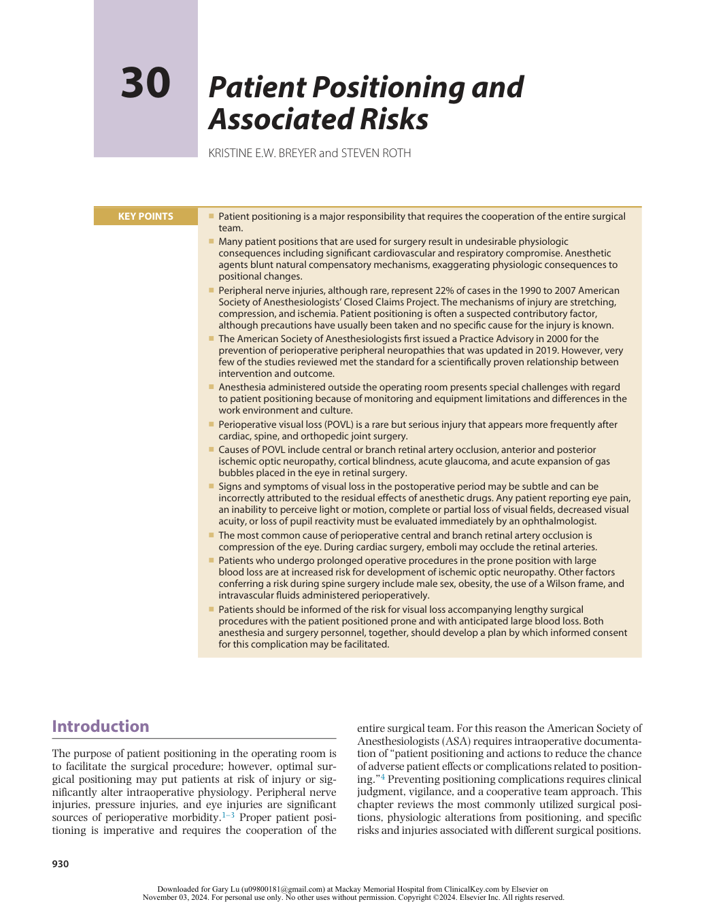

:::

<!-- PDF page 2 -->

## Physiologic Considerations of Positioning

Essential mechanisms maintain perfusion to the brain and vital organs, regardless of posture and position – for example, as a person reclines from an upright to a supine position venous return to the heart increases and initially the increased preload causes an increase in stroke volume and cardiac output. This causes an increase in arterial blood pressure, which activates afferent baroreceptors from the aorta (via the vagus nerve) and within the walls of the carotid sinuses (via the glossopharyngeal nerve). Mechanoreceptors from the atria and ventricles are also activated to decrease sympathetic outflow to muscle and splanchnic vascular beds. Lastly, atrial reflexes are activated to regulate renal sympathetic nerve activity, plasma renin, atrial natriuretic peptide, and arginine vasopressin levels.5 Heart rate and cardiac output are decreased to reach homeostasis in the new position.

Anesthetic agents can blunt these compensatory pathways. Most current inhaled anesthetics, and many intravenous anesthetics induce vasodilation. Spinal or epidural anesthesia causes a significant sympathectomy, reducing preload and potentially blunting cardiac response. Under anesthesia, changes in patient position may cause a more exaggerated hemodynamic response. This can be particularly important for positions that would normally elicit a sympathetic response and vasoconstriction to maintain cardiac and cerebral perfusion, such as the sitting position. Interruptions in monitoring to facilitate positioning, or turning of the surgical table, should be minimized to monitor hemodynamic outcomes. Awareness of possible physiologic consequences will help the anesthesiologist anticipate changes in hemodynamics with patient position changes.

Positive- pressure ventilation increases mean intrathoracic pressure, diminishing the venous pressure gradient from peripheral capillaries to the right atrium. This can affect cardiac output as the normal pressure gradients for venous circulation and cardiac preload are relatively low.6 Positive end- expiratory pressure (PEEP) further increases mean intrathoracic pressure, and possibly exaggerates compromised venous return and cardiac output, as do conditions associated with low lung compliance, such as airways disease, obesity, ascites, and light anesthesia.7 The anesthesia provider needs to anticipate, monitor, and treat these effects.

Spontaneous ventilation produces small negative intrathoracic pressure shifts by diaphragmatic displacement and chest wall movement. The negative intrathoracic pressure also promotes venous return to the heart by reducing the pressure in the great veins and right atrium.8 With spontaneous ventilation, diaphragmatic movement is greatest adjacent to the most dependent portions of the lung, helping enhance ventilation of the lung zones that are preferentially perfused. When shifting from standing to supine, functional residual capacity decreases in part due to cephalad displacement of the diaphragm. The chest wall contributes less to ventilation in the supine position, causing more reliance on diaphragm contribution. Although gravity has some effect on the perfusion and ventilation of the lung, new evidence points to the importance of other factors as well.9–13

Under general anesthesia spontaneously breathing patients have reduced tidal volumes, reduced functional residual capacity, and increased closing volumes, resulting in more ventilation–perfusion mismatching due to increased atelectasis and a reduced minute ventilation. Positive- pressure ventilation with muscle relaxation may counter some of the ventilation–perfusion mismatch by ensuring adequate minute ventilation and limiting atelectasis by use of PEEP.9 Patient position has distinct effects on pulmonary function; any position that limits the movement of the diaphragm, chest wall, or abdomen may increase atelectasis and therefore increase intrapulmonary shunt.

Newer investigations using high- resolution imaging have shown the prone position to provide superior ventilation–perfusion matching in the posterior segments of the lung near the diaphragm when compared with the supine position. Ventilation of these posterior segments is enhanced, while blood flow is maintained, despite their nondependent position.8,14

## General Positioning Considerations

Positioning injuries mostly arise from stretch, pressure, and compression. Coordination of the multidisciplinary surgical team is required to achieve proper and safe positioning of patients. Principles to avoid excessive stretch include maintaining spine and extremity neutrality and limiting extreme positions. Padding is an important part of proper positioning; however, padding may not be sufficient to prevent injury and padding too tightly may cause injury. The patient should lie on a padded surface, and additional padding should be placed around bony prominences and hard objects, such as intravenous fluid lines, monitoring equipment, and poles. Compression injuries can arise from excessive padding, hinges (on the operating table), retractors, equipment that comes in and out of the patient field (X- ray equipment, microscopes), and patient equipment, such as, stopcocks, esophageal probes, nasal probes, and bite blocks.

People who are awake and not sedated change position when uncomfortable (Video 30.1). Even during normal sleep, some movement is normal to prevent pressure or stretch injuries. Anesthetized patients are unable to change position if pressure or stretch causes nociception. Therefore, whenever possible, patients should be placed in a natural position that would be well tolerated if the patient were awake or not sedated. When more extreme positions cannot be avoided, their duration should be limited as much as possible. It is reasonable to ask patients what positions they can tolerate comfortably before initiation of anesthesia. In fact, the 2018 ASA Practice Advisory for the Prevention of Peripheral Nerve Injuries recommends this assessment in the preoperative history and physical exam. Preexisting neuropathies are at risk of exacerbation due to a phenomenon called “double crush” and these neuropathies should be documented preoperatively.1 The ASA does recommend intraoperative monitoring and documentation on positioning; however, they do not include specific guidelines on documentation time intervals. Postoperative

<!-- PDF page 3 -->

assessment for injury should also be documented in the patient record.4

## Specific Positions

### SUPINE

The most common position for surgery is the supine or dorsal decubitus position (Fig. 30.1 and Video 30.2). The head, neck, and spine all remain neutral. Because the entire body is close to the level of the heart, hemodynamic reserve is well maintained. Tissues overlying all bony prominences, such as the heels and sacrum, must be padded to prevent soft tissue ischemia because of pressure, especially during prolonged surgery.15

The arms can be abducted, adducted, or one arm abducted and one arm adducted. Arms should be placed in as neutral a position minimizing stretch and overextension.4 When the arms are adducted, they must remain securely placed next to the body. Abduction should be limited to less than 90 degrees to minimize the likelihood of brachial plexus injury.4,16 Hands and forearms can be supinated or in a neutral position with the palm toward the body, reducing external pressure on the spiral groove of the humerus and the ulnar nerve (Fig. 30.2).4,17,18 Particular attention should be paid to pad bony prominences, e.g., elbows, and any objects in the vicinity, such as intravenous fluid lines, monitoring equipment, and poles (Fig. 30.3). The ASA recommends against elbow flexion to protect the ulnar nerve.

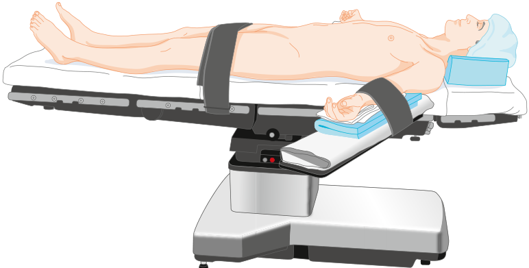

**Fig. 30.1 Supine position.** The base of the table is asymmetrical. When positioned in the usual direction, the patient’s center of gravity is over the base. Weight limits decrease when in reverse orientation to the base.

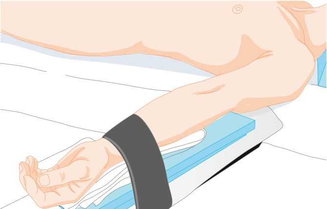

**Fig. 30.2 Arm position using the arm board.** Abduction of the arm is limited to less than 90 degrees whenever possible. The arm is supinated, and the elbow is padded.

<!-- PDF page 4 -->

Conversely, avoid excessive elbow extension as this causes undue stretch of the median nerve.4

### Variations of the Supine Position

Several variations of the supine position include the lawn (or beach) chair position, frog- leg position, and Trendelenburg and reverse Trendelenburg positions. The lawn chair position (Fig. 30.4) reduces stress on the back, hips, and knees by placing the patient’s hips and knees in mild flexion. This position is often better tolerated by patients who are awake or undergoing monitored anesthesia care than the full supine position. The lawn chair position also facilitates lower extremity venous drainage because the legs are placed slightly above the level of the heart. Abdominal wall tension is also reduced by decreasing the xiphoid to pubic distance. The patient’s hips should lie at the break of the surgical table and avoiding venous pooling in the legs. The frog- leg position allows procedural access to the perineum,

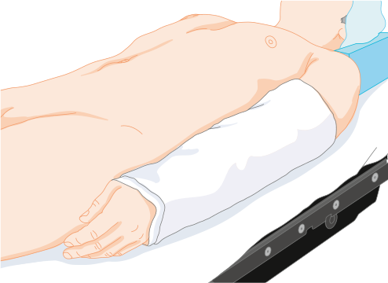

**Fig. 30.3 Arm tucked at patient side.** The arm is in the neutral position with the palm to the hip. The elbow is padded, and the arm is well supported by the mattress.

medial thighs, genitalia, and rectum. This involves placing the patient supine, flexing the hips and knees, and also externally rotating the hips with the soles of the feet facing each other. Support the patient’s knees to minimize stress and postoperative pain.

The Trendelenburg position, achieved by tilting a supine patient head down (Fig. 30.5), is linked by name to a 19thcentury German surgeon, Friedrich Trendelenburg, who described its use for abdominal surgery. Walter Cannon, a Harvard physiologist, is credited with popularizing the use of Trendelenburg positioning to improve hemodynamics for patients in shock during World War I. Today Trendelenburg position is frequently utilized to improve exposure during abdominal and laparoscopic surgery, during central line placement to prevent air embolism and distention of the central vein, and to offset hypotension by temporarily increasing venous return. A steep (30–45 degrees) headdown position is now frequently used for robotic prostate and gynecologic surgeries. For all positions in which the head is at a different level than the heart, the effect of the hydrostatic gradient on cerebral arterial and venous pressures should be considered when estimating cerebral perfusion pressure. Careful documentation of any potential arterial pressure gradient is prudent.

The Trendelenburg position does produce hemodynamic and respiratory changes; however, the hemodynamic changes are not as long- lasting as often thought. Initial placement of the patient in head- down supine position will increase cardiac output approximately 9% &lt;1 minute via autotransfusion from the lower extremities. This is not sustained and within approximately 10 minutes cardiac output begins to return to baseline. Nevertheless, the Trendelenburg position is still considered an essential part of initial resuscitation efforts to treat hypotension and acute hypovolemia.19 Functional residual capacity is decreased due to gravitational pull of the diaphragm cephalad. Pulmonary compliance is increased by decreased functional residual capacity and is often further decreased in the Trendelenburg position, due to patient- positioning straps across

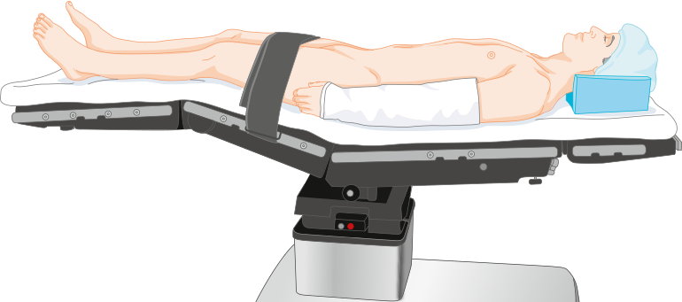

**Fig. 30.4 Lawn or beach chair position.** Flexion of the hips and knees decreases tension on the back.

<!-- PDF page 5 -->

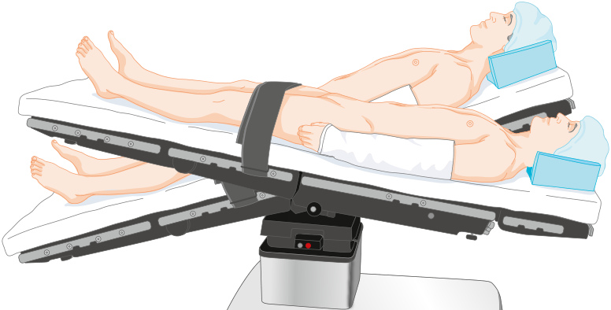

**Fig. 30.5 Head- down tilt (Trendelenburg) position and head- up tilt (reverse Trendelenburg) position.** Shoulder braces should be avoided to prevent brachial plexus compression injuries.

the chest. In a spontaneously breathing patient, the work of breathing increases. In patients under general anesthesia, these pulmonary changes result in higher airway pressures. Changes to the mechanical ventilator settings can compensate for some of the respiratory changes. However, with patient body habitus and variations in positioning, the higher airway pressures and changes to minute ventilation are too great to safely continue in the steep Trendelenburg position. Testing the position for patient tolerance after anesthetic induction and completed positioning, prior to the initiation of the surgical procedure, is recommended.

Intracranial and intraocular pressures also increase in Trendelenburg position. Trendelenburg is contraindicated in patients with increased intracranial pressures.

Prolonged head- down positioning can lead to swelling of the face, conjunctiva, larynx, and tongue, with an increased potential for postoperative upper airway obstruction. The Trendelenburg position increases intra- abdominal pressure and displaces the stomach, placing the patient at a higher risk for aspiration. Endotracheal intubation is often preferred to prevent aspiration of gastric contents.

Care must be taken to prevent patients in steep headdown positions from slipping cephalad on the surgical instruments.20,21 Techniques to restrain the patient include antiskid bedding, knee flexion, shoulder braces, beanbag cradling, and padded cross- torso straps.22 Shoulder braces are specifically not recommended because of the risk of compression injury to the brachial plexus. Beanbag pads become rigid when suction is applied to set the shape, and their use in the Trendelenburg position has been associated with brachial plexus injuries.23–25 If either shoulder braces or beanbag shoulder immobilization is used to prevent sliding, additional caution is recommended regarding abducting the arm; brachial plexus injuries on the side of the abducted arm have been reported in conjunction with beanbag shoulder immobilization and steep Trendelenburg positioning.26 These injuries may be due to stretch of the

upper and middle trunks of the brachial plexus, as they course around the head of the humerus (Fig. 30.6).

The reverse Trendelenburg position (head- up tilt; see Fig. 30.5) is often used to facilitate upper abdominal surgery by shifting the abdominal contents caudad. This position is increasingly popular because of the growing number of laparoscopic surgeries requiring this position. Again, caution is advised to prevent patients from slipping on the table. As mentioned earlier, any position where the head is above the heart reduces cerebral perfusion pressure and may also cause systemic hypotension. If invasive arterial pressure monitoring is used then the arterial pressure transducer should be zeroed at the level of the circle of Willis.

### Complications of the Supine Position

The base of the surgical table is asymmetric. Classically, the base of the table is directly underneath the patient’s torso (see Fig. 30.1). However, sometimes the patient’s torso overlies the end of the table without the base underneath it to improve surgical access or to facilitate the use of specific equipment such as the C- arm for X- ray. Without the table base under the torso of the patient’s body, the table is at risk of tilting or tipping over. This risk is higher with obese patients and when the table is in the Trendelenburg position. The surgical table weight limits are significantly different when the table is reversed and should be strictly observed.

Back pain is common in the supine position due to loss of the normal lumbar lordotic curvature. General anesthesia with muscle relaxation and neuraxial block increases the risk of back pain further due to loss of tone in the paraspinous muscles. Patients with extensive kyphosis, scoliosis, or a history of back pain may require extra padding of the spine or slight flexion at the hip and knee.

Peripheral nerve injury (discussed later in this chapter) is a complex phenomenon with multifactorial causes. The ASA has published several revisions of a practice advisory

<!-- PDF page 6 -->

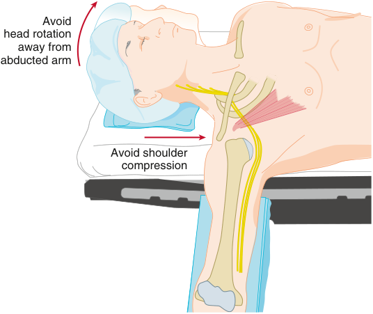

Avoid head rotation away from abducted arm Avoid shoulder compression 

**Fig. 30.6** The brachial plexus, shown in _yellow_ , is vulnerable to stretch and compression due to its long course. Arm abduction is limited to less than 90 degrees when supine because when the arm is raised the head of the humerus rotates caudad and stretches the plexus. Shoulder braces should be avoided; they may cause direct compression of the plexus medially between the clavicle and first rib or laterally below the head of the humerus. Excessive head rotation should be avoided, especially away from an abducted arm. Abduction of the arm should be avoided when in a steep head- down position if shoulder braces or a beanbag holds the shoulders.

to help prevent perioperative peripheral neuropathies.4 Ulnar neuropathy has historically been the most common, although brachial plexus injuries have overtaken ulnar neuropathies in more recent closed claims data associated with general anesthesia.1,3 Maintaining the head in a relatively midline position can help minimize the risk of stretch injury to the brachial plexus.23 Although no direct evidence suggests that positioning or padding alone can prevent perioperative ulnar neuropathies, the ASA practice advisory recommends limiting arm abduction in the supine patient to less than 90 degrees at the shoulder, with the hand and forearm either supinated or kept in a neutral position.4

### LITHOTOMY

The classic lithotomy position (Figs. 30.7–30.9 and Video 30.3) is frequently used during gynecologic, rectal, and urologic surgeries. The patient’s hips are flexed 80 to 100 degrees from the trunk, and the legs are abducted 30 to 45 degrees from the midline. The knees are flexed until the lower legs are parallel to the torso. The legs are then placed in supports or stirrups. The foot section of the surgical table is lowered and sometimes removed from the end of the table.

Positioning a patient into and out of lithotomy requires a coordinated team. To prevent torsion injury to the lumbar spine, the patient’s legs should be raised together and, at the same time, flex the knees and hips. Padding of the lower extremities is critical, particularly over bony prominences, to prevent compression against the leg supports. The peroneal nerve is particularly prone to injury as it lies between the fibular head and compression from the leg support (see the Peripheral Nerve Injury section of this chapter).

If the arms are tucked or placed alongside the patient, then the patient’s hands and fingers are at risk of injury if they lie near the open edge of the lowered section of the

table. When the foot of the table is raised at the end of the procedure the fingers near the open edge can get crushed. Strict attention must be paid to the position of the hands to avoid a potentially disastrous crush injury to the fingers (Fig. 30.10). For this reason, the recommended position of the arms is on armrests far from the table hinge point. If the arms must be tucked at the patient’s side, then the hands need to be visualized and confirmed to be safe whenever the leg section of the surgical table is manipulated.

The lithotomy position may also cause significant physiologic changes. When the legs are elevated, venous return increases, causing a transient increase in cardiac output and, to a lesser extent, cerebral venous and intracranial pressure in otherwise healthy patients. In addition, the lithotomy position increases intra- abdominal pressure and causes the abdominal viscera to displace the diaphragm cephalad, reducing lung compliance and potentially resulting in a decreased tidal volume. In obese patients, or when large abdominal mass is present (e.g., tumor, gravid uterus, ascites), abdominal pressure may increase enough to obstruct venous return to the heart. As with the supine position, the curvature of the lumbar spine is lost in lithotomy and can put the patient at risk of back pain.27

Lower extremity compartment syndrome is a rare but potentially devastating complication of the lithotomy position. Compartment syndrome is caused by increased tissue pressure within a fascial compartment due to tissue ischemia, edema, and rhabdomyolysis. Inadequate arterial inflow (from lower extremity elevation) and decreased venous outflow (due to direct compression or excessive hip flexion) elevates the risk of compartment syndrome for patients in lithotomy.28,29 Local arterial pressure decreases 0.78 mm Hg for each centimeter the leg is raised above the right atrium.30 Reperfusion after ischemic injury further increases edema, exacerbating the problem. In a large

<!-- PDF page 7 -->

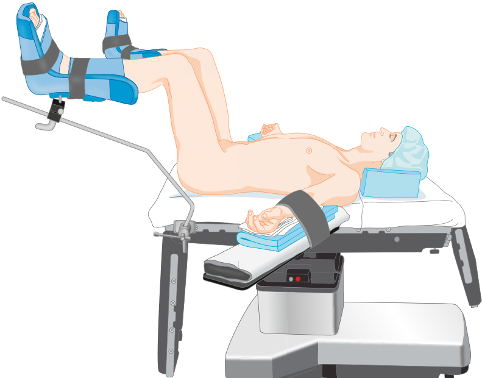

**Fig. 30.7 Lithotomy position.** Hips are flexed 80 to 100 degrees with the lower leg parallel to the body. Pressure near the fibular head is absent. Arms are on armrests away from the hinge point of the foot section.

retrospective review of 572,498 surgeries, the incidence of compartment syndromes was higher in the lithotomy (1 in 8720) and lateral decubitus (1 in 9711) positions, as compared with the supine (1 in 92,441) position. Long procedure time was the only distinguishing characteristic of the surgeries during which patients developed lower extremity compartment syndromes.28 A survey of urologists in the United Kingdom suggested that compartment syndrome after surgery in the lithotomy position is underreported and more common than appreciated. Affected patients in this study all had surgical durations greater than 3.5 hours.31 In a retrospective multicenter review of 185 urologic patients who were placed in high lithotomy position, two patients suffered from compartment syndrome. For both of these patients, operative times exceeded 5 hours.32 If surgical time extends beyond 2 to 3 hours, periodically lowering the legs is recommended.32–34 Additional risk includes factors known to compromise tissue oxygenation, such as blood loss, peripheral vascular disease, hypotension, and reduced cardiac output. Elevated body mass index is also a risk factor for compartment syndrome. Intermittent leg compression devices remain controversial.30,35

### LATERAL DECUBITUS

The lateral decubitus position (Fig. 30.11 and Video 30.4) is most frequently used for surgery involving the thorax, retroperitoneal structures, and hip. Positioning a patient in the lateral decubitus position requires the cooperation of the entire surgical staff. The nonoperative side is dependent

and the dependent leg is flexed to minimize stretch of lower extremity nerves. Padding is placed between the knees to minimize excessive pressure on bony prominences. The torso must be balanced and supported both anteriorly and posteriorly. When a kidney rest is used for this purpose, it must be properly placed under the dependent iliac crest to prevent inadvertent compression of the inferior vena cava.

Patients may be laterally flexed while in the lateral position to gain better access to the thoracic cavity or retroperitoneum during renal surgeries. The point of flexion and the kidney rest should lie under the iliac crest rather than the flank or ribcage to minimize compression of the dependent lung (Fig. 30.12). The dependent arm should be placed on a padded arm board perpendicular to the torso. The nondependent arm needs to be carefully supported (Fig. 30.13). Neither arm should be abducted more than 90 degrees. For some high thoracotomies, the nondependent arm may need to be elevated above the shoulder plane for exposure; however, vigilance is warranted to prevent neurovascular compromise. The patient’s head must be kept in a neutral position to prevent excessive lateral rotation of the neck and to avoid stretch injuries to the brachial plexus. Often additional head support is required (see Fig. 30.13). The dependent ear and eye may be at risk of injury and should be checked regularly.

The dependent brachial plexus and axillary vascular structures are at particular risk of pressure injury in the lateral decubitus position. To avoid compression, an axillary roll is frequently placed between the chest wall and the table just caudal to the dependent axilla (Fig. 30.14). The

<!-- PDF page 8 -->

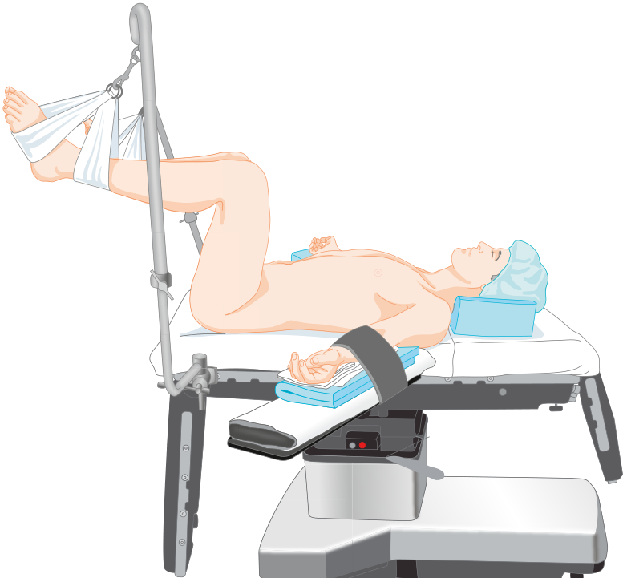

**Fig. 30.8 Lithotomy position with “candy cane” stirrup leg holders.**

purpose of the axillary roll is to protect the dependent shoulder and axillary contents from the weight of the thorax. The axillary roll should never be placed in the axilla. Sometimes a beanbag is used for positioning without an axillary roll. In this scenario, the axilla should be checked to ensure that it is free from compression. Regardless of the technique, the pulse should be monitored in the dependent arm for early detection of compression to axillary neurovascular structures. Vascular compression and venous outflow obstruction in the dependent arm are risks of the lateral decubitus position. Low pulse oximeter readings can be an early sign of compromised circulation. Similarly, hypotension measured in the dependent arm may be due to axillary arterial compression.

Pulmonary mechanics change in the lateral decubitus position.36 In a patient who is mechanically ventilated, the combination of the lateral weight of the mediastinum and the disproportionate cephalad pressure of abdominal contents on the dependent lung favors overventilation of the nondependent lung. At the same time, the effect of gravity causes the pulmonary blood flow to the underventilated, dependent lung to increase. Consequently, ventilation–perfusion matching worsens, potentially affecting gas exchange and ventilation.

The lateral decubitus position is preferred during pulmonary surgery and one- lung ventilation. When the

nondependent lung is collapsed, the minute ventilation is allocated to the dependent lung. This, combined with decreased compliance because of positioning, may further exacerbate the airway pressure required to achieve adequate ventilation. Head- down tilt in the lateral position worsens pulmonary function yet further, increasing shunt fraction.37

### PRONE

The prone or ventral decubitus position (Fig. 30.15 and Video 30.5) is primarily used for surgical access to the posterior fossa of the skull, the posterior spine, the buttocks and perirectal area, and the posterior lower extremities. The patient may receive either monitored anesthesia care or general anesthesia depending on the type of surgery and the patient’s body habitus and comorbidities. When general anesthesia is planned, the airway is usually secured via an endotracheal tube while the patient is still supine. Special attention should be paid to securing and taping the endotracheal tube to prevent dislodgement while the patient is prone or during changes in position. Placing an anesthetized patient in the prone position requires coordination of the entire surgical staff. The endotracheal tube should be disconnected from the circuit during the move from supine to prone to prevent dislodgement. Lines and monitors

<!-- PDF page 9 -->

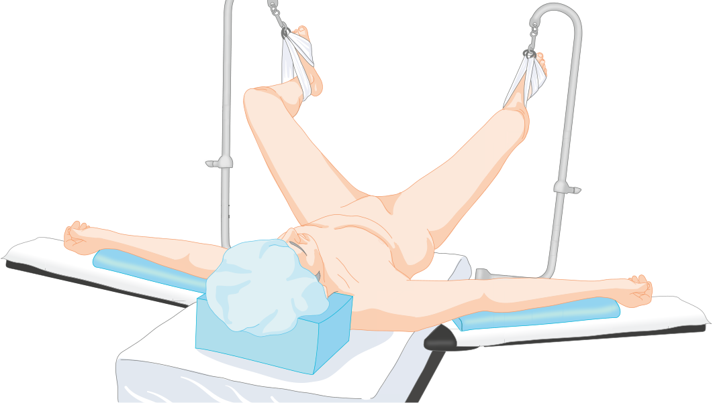

**Fig. 30.9 Lithotomy position.** The correct position of “candy cane” supports is well away from the lateral fibular head.

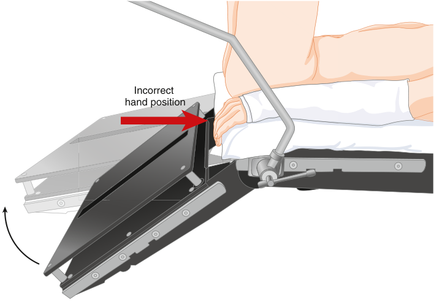

Incorrect hand position 

**Fig. 30.10 Improper position of arms in lithotomy position.** The fingers are at risk for compression when the lower section of the bed is raised.

connected to the inside arm (the arm moving the least during the move) can often be easily maintained without disconnecting. Ventilation and monitoring should be reestablished as rapidly as possible.

Prone head position is critical. For patients under sedation, the head may be turned to the side if neck mobility is adequate. During general anesthesia, the head is usually

kept neutral using a headrest or head pins. Weight should be on the bony facial prominences and not soft tissue and especially not on the eyes. Mirror systems are available to facilitate intermittent visual confirmation that the eyes are not compressed (Fig. 30.16). Several commercially available pillows are specially designed for the prone position. Most pillows support the forehead, malar regions, and chin,

<!-- PDF page 10 -->

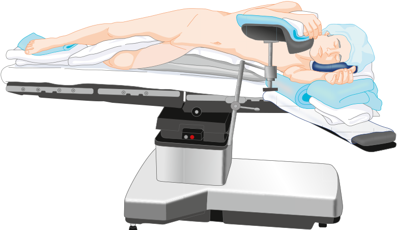

**Fig. 30.11 Lateral decubitus position.** The lower leg is flexed with padding between the legs, and both arms are supported and padded.

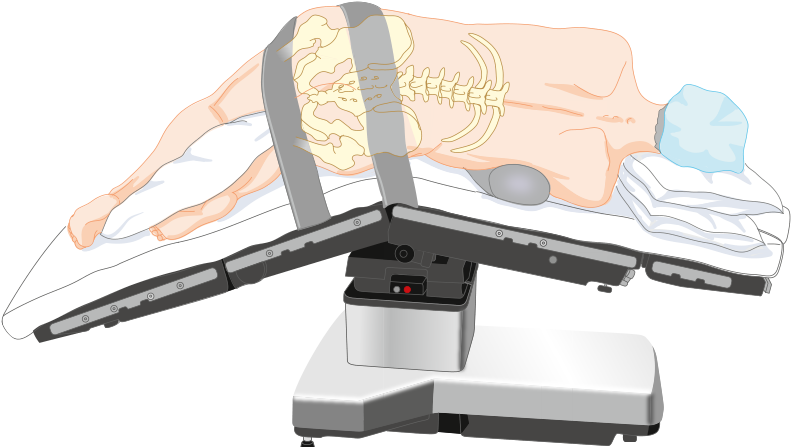

**Fig. 30.12 Flexed lateral decubitus position.** The point of flexion should lie under the iliac crest, rather than under the flank or lower ribs to optimize ventilation of the dependent lung.

with a cutout for the eyes, nose, and mouth (see Fig. 30.15). The forehead and malar regions are supported by the horseshoe headrest and allow for reasonable access to the airway (Figs. 30.17 and 30.18). Pin fixation, which is most used in cranial and cervical surgery, is advantageous because there is no direct pressure on the face (Fig. 30.19). Patient movement must be prevented when the head is held in pins; movement in pins can result in scalp lacerations or a cervical spine injury. Both horseshoe and pin headrests attach to the operating room table with adjustable articulating supports. All articulating supports must be fully locked as failure of this bracketing device may lead to complications if the head suddenly drops.

Regardless of the type of head- support technique, proper positioning must be frequently verified during the surgery,

checking that there is no pressure on the eyes, that the airway is secure, and that the head weight lies on the bony facial prominences only. The prone position is a risk factor for central retinal artery occlusion, which is discussed separately in this chapter. If motor- evoked potentials are used during spine or neurosurgery, then the position of the tongue and placement of bite blocks must be frequently checked; bite injuries can be severe.38

A prone patient’s legs should be padded and flexed slightly at the knees and hips. The arms may be positioned to the patient’s sides or placed outstretched above the head. If the arms are at the patient’s sides, then they should be tucked in the neutral position. If the arms are outstretched above the head, the arms should be placed on arm boards with slight flexion at the elbows to prevent undue stretch on

<!-- PDF page 11 -->

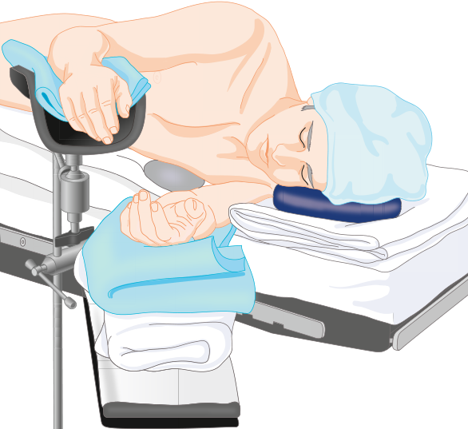

**Fig. 30.13 Lateral decubitus position showing placement of arms and head.** Additional padding is under the headrest to ensure the alignment of the head with the spine. The headrest is kept away from the dependent eye.

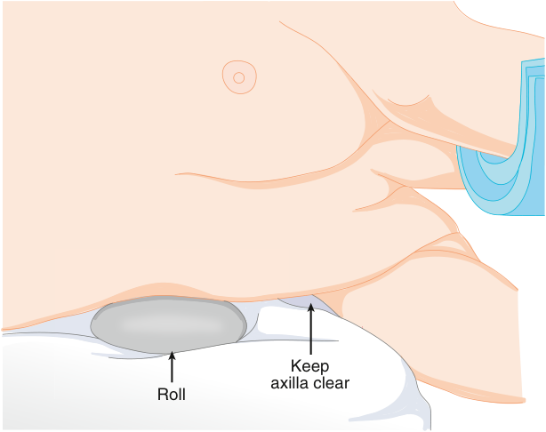

Keep axilla clear Roll 

**Fig. 30.14 Use of chest roll in the lateral decubitus position.** The roll, in this case, is a bag of intravenous fluid and is placed well away from the axilla to prevent compression of the axillary artery and brachial plexus.

the peripheral nerves. Extra padding under the elbow may be needed to prevent compression of the ulnar nerve. The arms should not be abducted greater than 90 degrees.

If the legs are in plane with the torso, then hemodynamic reserve is relatively maintained; however, if any significant lowering of the legs or tilting of the entire table occurs, then venous return may increase or decrease accordingly. The prone position does not alter the ability of pulse pressure variation to predict fluid responsiveness. However, the variation has been shown to be augmented at baseline;

therefore, fluid responsiveness is observed at a slightly greater level of variation than when supine.39

When patients are in the prone position, weight should be distributed to the thoracic cage and bony pelvis, and the abdomen should hang freely to prevent increases in intraabdominal and intrathoracic pressure. This is accomplished with specific types of prone beds or with gel or foam bolsters. The prone beds and bolsters all place support along each side of the patient from the clavicles to the iliac crests. Placement beyond the iliac crests can cause compression on the

<!-- PDF page 12 -->

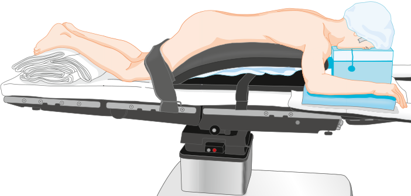

**Fig. 30.15 Prone position with Wilson frame.** Arms are abducted less than 90 degrees whenever possible, although greater abduction may be better tolerated while prone. Pressure points are padded, and the chest and abdomen are supported away from the bed to minimize abdominal pressure and to preserve pulmonary compliance. Soft head pillow has cutouts for eyes and nose and a slot to permit endotracheal tube exit. Eyes must be checked frequently.

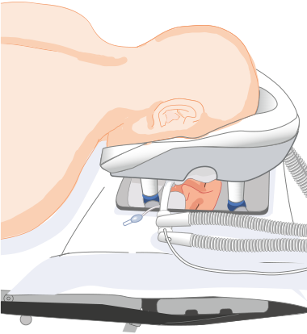

**Fig. 30.16 Mirror system for prone position.** Bony structures of head and face are supported, and monitoring of the eyes and airway is facilitated with a plastic mirror. Although not illustrated, the eyes should be taped closed.

femoral vessels and femoral nerve. Some prone beds include the Wilson frame (see Fig. 30.15), Jackson table, Relton frame, and Mouradian/Simmons modification of the Relton frame. Breasts should be placed medially to the prone torso supports (or bolsters), and genitalia should be clear of compression.40 During posterior spinal surgery, relatively low venous pressure is desirable to minimize bleeding and to facilitate surgical exposure. Elevated abdominal pressure can transmit elevated venous pressures to the abdominal and spine vessels, including the epidural veins, which lack valves. Increased abdominal pressure may also impede venous return through compression of the inferior vena cava, decreasing cardiac output.

Pulmonary function is usually better in the prone position than in the supine position.41,42 The prone position has

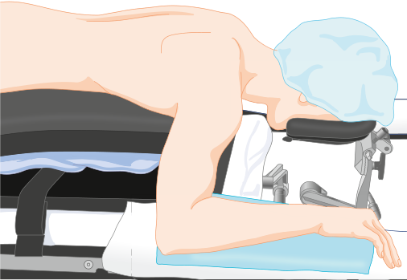

**Fig. 30.17 Prone position with horseshoe adapter.** Head height is adjusted to position the neck in a natural position without undue extension or flexion.

been used to improve respiratory function in patients with adult respiratory distress syndrome.43–45 Under anesthesia, the prone position has advantages over the supine position with regard to lung volumes and oxygenation without adverse effects on lung mechanics,46,47 including patients who are obese48 (see also Chapter 54) and pediatric patients (see also Chapter 72).49 Newer investigations using highresolution imaging have shown the prone position to provide superior ventilation–perfusion matching in the posterior segments of the lung near the diaphragm when compared with the supine position. The aeration and ventilation of these posterior segments are better, while blood flow is maintained, despite their nondependent position.8,14

Other complications of the prone position include airway edema, eye injury, pressure injury, and inadvertent loss of the endotracheal tube, monitoring, and intravenous lines. For long cases, or cases with large intravascular volume shifts, consider checking and documenting an endotracheal cuff leak at the start and end of the case. Lines and tubes

<!-- PDF page 13 -->

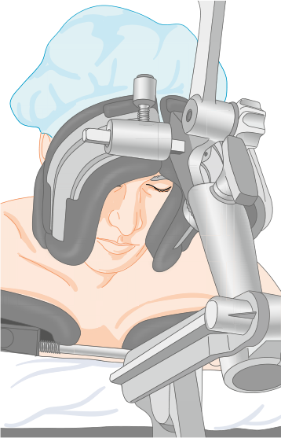

**Fig. 30.18 Prone position with horseshoe adapter.** The face is seen from below. The horseshoe adapter permits superior access to the airway and visualization of eyes. The width may be adjusted to ensure proper support by facial bones.

need to be placed and should be well secured prior to turning the patient prone.

### SITTING

The sitting position, much less often used today than in the past, offers excellent surgical exposure to the upper posterior cervical spine and posterior fossa. Gravitational venous drainage of blood in the sitting position does decrease blood in the operative field and therefore possibly reduces surgical blood loss.50 The lawn or beach chair position is a variation of the sitting position and is commonly used for shoulder surgeries (Fig. 30.20 and Video 30.6). The lawn chair position is really a semi- sitting position, with the head of the patient more reclined than in the traditional sitting position. For the surgeon, its advantages versus the lateral decubitus position are superior access to the shoulder from both the anterior and posterior aspect and the potential for great mobility of the arm at the shoulder joint.51 Access to the airway is generally excellent in the sitting position, facial swelling is minimized, and pulmonary mechanics are reasonably preserved (see Chapter 60).

There are unique risks to the sitting position that require much vigilance. One of the most concerning risks is for venous air embolism (VAE). The veins lie above the level of the heart in this position; therefore, air entrainment through the veins to the heart is a real danger. Furthermore, dural veins are valveless and tented open by the cranium (Fig. 30.21; see also Chapter 53). Other complications from the sitting position include quadriplegia, spinal cord infarction, hemodynamic instability pneumocephalus, macroglossia, and peripheral nerve injuries.52,53

Placing an anesthetized patient in the sitting position requires flexion at the torso. Hip flexion should be less than 90 degrees to minimize stretch on lower extremity nerves (including the sciatic nerve). Arms are supported so that the shoulders are slightly elevated to ensure avoidance of traction on the shoulder muscles and potential stretching of upper extremity neurovascular structures. The knees are also usually slightly flexed for balance and to reduce stretching of the sciatic nerve, and the feet are supported and padded.54 The patient’s head must be specially fixed in the sitting position with either rigid pins or taped into a special headrest.

The head and neck position while in the sitting position has been associated with complications. Surgery in the sitting position was found to be a risk factor for cervical spinal cord injury in a review of the ASA Closed Claims Project database from 1970 to 2007.55 Although the exact mechanism for cervical spinal cord injury is unknown, cervical hyperextension, cervical hyperflexion, or excessive cervical rotation have been implicated as risk factors. Extreme neck positions can impede both arterial and venous blood flow, causing hypoperfusion or venous congestion of the brain. The patient’s cervical range of motion should be examined in the preoperative assessment, and adequate distance should be maintained between the mandible and the sternum when the cervical spine is flexed in order to provide for adequate arterial and venous blood flow.52,56,57

VAE is a constant concern in the sitting position due to the position of the surgical field above the level of the heart and the tented open dural venous sinuses. The reported incidence of VAE varies greatly in the literature due to a lack of standardization of measurement and grading scale for VAE. VAE can cause arrhythmias, oxygen (O2) desaturation, acute pulmonary hypertension, circulatory compromise, and cardiac arrest. If there is a patent foramen ovale (PFO), then the patient is at risk for a paradoxical arterial embolism causing stroke or myocardial infarction. Traditionally, preoperative contrast echocardiography is recommended to evaluate for a PFO. However, failure to detect a PFO on echocardiography does not ensure that the intra- atrial septum is intact.58 The presence of a PFO has generally been considered a contraindication to the sitting position. A recent review suggested that paradoxical VAE is so rare that the presence of a PFO should not necessarily preclude placing the patient in the sitting position. This study found that a VAE was detected in 40% of patients with a known PFO and that no paradoxical embolism was detected.59 The decision to proceed should be made with patient informed consent and with a discussion between the surgeon and anesthesiologist.

Continuous monitoring for VAE during surgery in the sitting position is essential. There is no standard for type of VAE monitor. Clinical severity of VAE depends on the amount of air and the speed of entrainment. Extrapolation from animal studies suggests that 3 to 5 mL/kg is a lethal amount of air for an adult human, but in reality much less could be required. Transesophageal echocardiography (TEE) is the most sensitive monitor, able to detect as little as 0.02 mL/kg of air. In fact, TEE is so sensitive that some degree of entrained air can be demonstrated in a large majority of patients during neurosurgery in the sitting position.58,60 Transthoracic Doppler

<!-- PDF page 14 -->

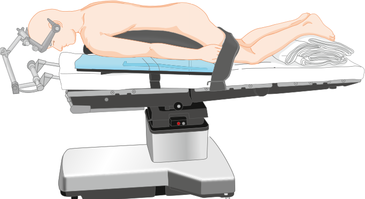

**Fig. 30.19 Prone position with Mayfield head pins.** Rigid fixation is provided for the cervical spine and posterior intracranial surgeries. The head position may include neck torsion or flexion that affects the depth of the endotracheal tube, and extreme head positions may increase the risk of cervical cord injury.

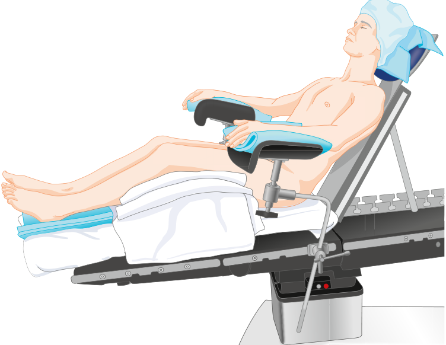

**Fig. 30.20 Sitting position adapted for shoulder surgery, often called the lawn or beach chair position.** The arms must be supported to prevent stretching of the brachial plexus without pressure on the ulnar area of the elbow. As with all head- up positions, blood pressure should be regulated with the height of the brain in mind.

(TTD) is the most sensitive noninvasive monitor, with detection rates of approximately 0.05 mL/kg of air. The TTD probe is placed on either the left or right sternal border between the second to fourth intercostal spaces. Transcranial Doppler (TCD) is a monitor of the middle cerebral

artery and is nearly as sensitive as TEE. Pulmonary artery catheters, esophageal stethoscopes, and end- tidal carbon dioxide monitors are all much less sensitive monitors. Electrocardiographic and pulse oximeter changes are later findings.61,62

<!-- PDF page 15 -->

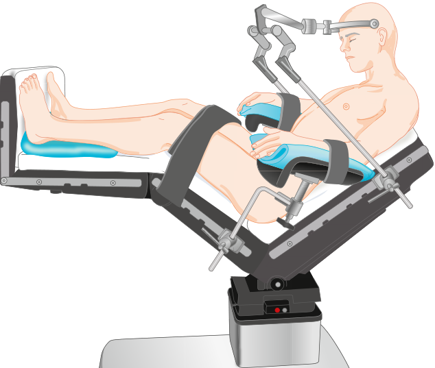

**Fig. 30.21 Sitting position with Mayfield head pins.** The patient is typically semi- recumbent rather than sitting; the legs are kept as high as possible to promote venous return. Arms must be supported to prevent shoulder traction and stretching of the brachial plexus. In a commonly used variation, the arms are placed on the abdomen and supported. The head support is preferably attached to the back section of the table to allow the back to be adjusted or lowered emergently without first detaching the head holder.

Treatment for VAE includes first stopping further air entrainment. The surgeon is asked to stop operating, to flood the field with normal saline, and possibly apply bone wax. The inspired percent of O2 is changed to 100%. This will aid in treatment during hypoxemia or hypotension and may help reduce the volume of the air embolism via denitrogenation. Hemodynamic compromise is treated with intravenous fluids and vasoactive agents. Consideration is given to placing the patient in left side down and Trendelenburg in order to move an air lock in the right ventricular outflow track (although this can be difficult or impossible in some surgeries).61 A central venous catheter is often placed preoperatively in order to aspirate entrained air.58 An _ex vivo_ study examining different central venous catheter types and positions found that a multiorifice catheter and single-orifice catheter both aspirated 50% to 60% of experimentally introduced air.63

Pneumocephalus, quadriplegia, spinal cord infarction, cerebral ischemia, and peripheral nerve injuries are all risks of sitting positions. Pneumocephalus is almost universally found on postoperative imaging from cervical or posterior fossa surgery performed in the sitting position. Tension pneumocephalus, which is accumulation of air in the subdural or ventricular space causing pressure on intracranial structures, is very rare but reported after neurosurgery in the sitting position. Prompt diagnosis and surgical evacuation of air is the treatment. Positioning complications causing quadriplegia or spinal cord infarction are thought to be caused by impaired arterial perfusion with hyperextension,

hyperflexion, or excessive rotation of the neck. Theories relating the sitting positions to cerebral ischemia include reduced cerebral perfusion caused by reduced cardiac output, deliberate or permissive hypotension, loss of compensatory mechanisms caused by anesthesia, failure to compensate for the height of the head in the regulation of the blood pressure, dynamic vertebral artery narrowing or occlusion with the rotation of the head, and air emboli. Investigators have demonstrated positional effects on cerebral oxygen saturation,64 as well as transient reductions in cerebral oxygen saturation associated with hypotensive periods during shoulder surgeries in the sitting position that reversed after use of ephedrine and phenylephrine to restore cerebral perfusion pressure.64–66 One observational study of 124 patients undergoing shoulder arthroscopy demonstrated cerebral desaturation by oximetry in 80% of those who were in the lawn or beach chair position and none in the lateral decubitus position.67 Cerebral oxygen saturation monitoring may be helpful; however, no gold standard limits exist, and values may change along with alterations in patient position and carbon dioxide concentration. Therefore, if measured, trends in cerebral oxygen saturation are best interpreted during periods of constant ventilation and patient position.68,69 Reasonable recommendations for patients undergoing surgery in the sitting position are to monitor blood pressure carefully in reference to the level of the brain, avoid and rapidly treat any hypotension or bradycardia, and position the head carefully to avoid extreme positions that may compromise cerebral vessels.70

<!-- PDF page 16 -->

Hypotension is a known and very common problem for anesthetized patients in the sitting position. Pooling of blood in the lower body places anesthetized patients in the sitting position at particular risk to hypotensive episodes. Studies reveal that mean arterial pressure, systolic blood pressure, and cardiac index all decrease in the sitting position.52 Therefore placement of the patient into the sitting position should be incremental to adjust for hemodynamic changes. Intravenous fluids and vasopressors should be inline and ready.

### ROBOTIC SURGERY

Since its introduction around 1999, the use and scope of robotic surgery has expanded greatly. Robotic surgery is now the norm for many types of urologic and gynecologic operations,71,72 and is extending to other abdominal operations, thoracic surgery, and head and neck operations. Robotic surgery offers technical advantages for surgeons regarding range of motion and accuracy of laparoscopic instrumentation. Once the robot is docked, direct access to the patient is limited. It is therefore imperative that all monitors, lines, and invasive lines are placed prior to docking the robot, and that proper padding and positioning are completed.

Robotic- assisted surgery does pose unique safety and positioning challenges, mainly centered around the robot being physically connected, or docked, to the patient by way of laparoscopic ports. Docking physically attaches the robot to the laparoscopic patient ports. This is critically important to emphasize. Traditional, or standard, operating tables cannot be moved once the robot is docked to the patient, as this risks dislodging the laparoscopic instruments and causing serious injury to the patient. Surgical robot manufacturers do now make special robotic tables so that the bed can communicate with the robot, offering the ability to move the operating table with a docked robot. If traditional operating tables are used in conjunction with a robotic- assisted device, consider turning off the operating table, unplugging the bed, and turning off the bed remote control to prevent inadvertent bed movement while the robot is docked. Highlight this safety concern during the surgical time out and ensure the entire team is aware of the plan for safe bed handling with the robot.

Most of the literature about robotic positioning involves urologic and gynecologic operations, which are generally performed with the patient in steep Trendelenburg (30–45 degrees) and lithotomy with arms tucked in neutral position to the sides. The patient must be very well secured to avoid slipping in steep Trendelenburg. Non- slip mattresses, chest straps, and shoulder braces may be useful, but shoulder braces are also reported to cause brachial plexus injuries due to stretch between the shoulder and neck. If shoulder braces are employed, monitoring for excessive stretch at the patient’s neck is essential. The endotracheal tube should be well secured to avoid migration. Often a tray or table is placed above the patient’s face to provide protection from laparoscopic equipment.73–75 It may be prudent to trial the steep Trendelenburg prior to docking the robot to ensure that the patient is properly positioned, does not slip, and can tolerate steep Trendelenburg from a physiologic standpoint.

Physiologic changes during robotic surgery are due to both laparoscopic insufflation as well as positioning. Hemodynamic changes are largely due to laparoscopic insufflation, whereas changes in respiratory mechanics are also affected by positioning. Functional residual capacity is decreased with laparoscopy and further decreased with the addition of steep Trendelenburg. This is due to a combination of pressure of abdominal contents from laparoscopy and Trendelenburg pushing up on the diaphragm and can also be worsened by chest fixation that is applied to prevent the patient from slipping off the table. Peak and plateau airway pressures have been shown to rise as much as 50%. Between changes in pulmonary compliance, decreased functional residual capacity, and the need for increased minute ventilation with carbon dioxide insufflation, intraoperative mechanical ventilation can be quite challenging during these cases.73–76

The incidence of positioning complications from robotic surgery varies substantially from 0.8% to 6.6%; most studies indicate an incidence of less than 1%.77–79 One study found longer operative times, higher ASA physical status, and increased intravenous fluid administration to be risk factors for intraoperative positioning complications.77 A history of prior abdominal surgery was the only associated risk factor found in a study of gynecologic robotic surgeries.78 Eye injury, peripheral nerve injuries, rhabdomyolysis, and compartment syndrome were the most frequent positioning complications found in patients with roboticassisted radical prostatectomies. Incidence of injury in this study was not different between robotic versus traditional open prostatectomy.79 In a recent survey of ASA members, 21.7% of responders answered “yes” that they have experienced a “complication related to Trendelenburg positioning (during robotic surgery).” Airway and facial edema, as well as brachial plexus injuries, were the most common recalled complications in this survey.80 When steep Trendelenburg is used, consideration should be given to documenting the endotracheal tube airway leak at the start and at the end of the surgical procedure prior to extubation.

## Peripheral Nerve Injury

Peripheral nerve injury remains a serious perioperative complication and a significant source of professional liability despite its infrequent incidence. The ASA states that “postoperative signs and symptoms related to peripheral nerve injury … may include but are not limited to paresthesias, muscle weakness, tingling, or pain in the extremities.”4 Studies of the ASA Closed Claims Project database (in 1990 and 1999) brought awareness of the incidence of perioperative peripheral nerve injury, which was found to be between 0.03% and 0.11%. However, according to this database, peripheral nerve injuries represented 22% of all claims. In fact, peripheral nerve injury has been second only to death as the leading cause of claims against anesthesiologists.

The overall incidence of peripheral nerve injury claims had increased from 15% in the 1970s.1,2,81,82 According to a review of 5280 closed claims (from 1990 to 2007), most patients with nerve injuries do recover; however, up to 23% of peripheral nerve injuries remain permanent.4

<!-- PDF page 17 -->

In the closed claims database study, ulnar neuropathy is the most common lesion, representing 28% of all peripheral nerve injury claims, followed by the brachial plexus (20%), lumbosacral nerve root (16%), and spinal cord (13%).2,3 Interestingly, the distribution of nerve injury claims has changed over time. From 1980 through 1984, ulnar neuropathy claims decreased from 37% to 17% in the 1990s, and spinal cord injury claims increased from 8% in 1980 through 1984 to 27% in the 1990s. Most recently, a retrospective analysis of medical malpractice cases (not associated with regional or neuroaxial anesthesia) found brachial plexus injuries to be the most common, followed by ulnar neuropathies.2 The incidence of spinal cord injury and lumbosacral nerve root neuropathy increased over this study period and were predominantly associated with regional anesthesia. Epidural hematoma and chemical injuries represented 29% of the known mechanisms of injury among the claims filed.2,83,84

In a different retrospective study of 380,680 patients at a single university tertiary care institution, 112 peripheral nerve injuries were observed in the perioperative period, an incidence of 0.3%.85 Most injuries were sensory (60%) or combined sensory and motor (24%), with only 14% pure motor injuries. This study provides a significantly different numerator and denominator than the ASA Closed Claims Project, and its data contrast with the most recent claims data in which more claims were filed after the administration of regional anesthesia.

Peripheral nerves are made up of bundles of endoneurium wrapped axons bundled into fascicles, which are wrapped in perineurium. Schwann cells provide a myelin sheath to enhance conduction for myelinated nerves. Peripheral nerves are vascular metabolically active structures. The vasa nervorum provides blood flow via a capillary network.86 Injuries are classified in neurology by the Seddon or Sunderland Classifications. These classifications are based upon neuronal anatomy and can be clinically correlated.87 There are three main mechanisms for peripheral nerve injury: stretch, compression, and transection. Transection can be partial or complete and can be due to sharp or blunt transection. Compression injuries can be due to compression of vascular structures causing ischemic injury or due to direct nerve or myelin compression.87 All of these mechanisms can affect sensory and motor nerves.88 Perioperative peripheral nerve injury is multifactorial in etiology. Because sensation is blocked by unconsciousness or regional anesthesia, early warning symptoms of pain with normal spontaneous repositioning are absent.81,89 Patient comorbidities that contribute to peripheral nerve injuries include hypertension, diabetes, peripheral vascular disease, older age, and heavy alcohol and tobacco use.4 Extremes of weight, both low body mass index and obesity, are also risk factors. General and epidural anesthesia appeared to be risk factors, compared with monitored anesthesia care, spinal anesthesia, and peripheral nerve blocks. Prolonged surgical times are an additional risk factor.1,85

Ascertaining the presence of preoperative neuropathies and paresthesias is particularly important as injured nerves are more susceptible to injury in a phenomenon described as the double crush syndrome. The theory is that two separate subclinical nerve insults can act synergistically to produce a clinically significant neuropathy.

Usually, the exact mechanism of injury for a particular patient cannot be determined.2 With the exception of spinal cord injuries, the mechanism of nerve injury remains incompletely explained by scientific studies. Most nerve injuries, particularly those to nerves of the upper extremity such as the ulnar nerve and brachial plexus, occurred in the presence of adequate positioning and padding. Nevertheless, we must prevent nerve injuries to the best of our abilities. The ASA released an updated practice advisory in 2018 to help guide prevention of perioperative nerve injury (Box 30.1).4 Positions that permit stretching of the nerves and pressure to anatomic locations known to carry nerves prone to injury must be avoided, such as the ulnar cubital tunnel and the peroneal nerve coursing over the fibular head (Table 30.1). Padding and support should distribute weight over as wide an area as possible; however, no padding material has been shown to be superior. Whenever possible, the patient’s position should appear natural.

### ULNAR NERVE INJURY

The ulnar nerve lies in a superficial position at the elbow. Morbidity associated with ulnar neuropathy can be severe. In a prospective study among 1502 patients undergoing noncardiac surgery, 7 patients developed perioperative ulnar neuropathy, of which 3 patients had residual symptoms after 2 years.90 In a study on the effect of arm position on the ulnar nerve somatosensory- evoked potentials (SSEPs) in 15 healthy awake male volunteers, the supinated position was associated with the least pressure on the ulnar nerve, and the neutral position was the next most favorable. When in the neutral position on a surgical armrest, pressure decreased as the arm was abducted between 30 and 90 degrees. Interestingly, not all patients had symptoms of nerve compression when the SSEP was abnormal.17 Current consensus is that the cause of ulnar nerve palsy is multifactorial and not always preventable.91,92 In a large retrospective review of perioperative ulnar neuropathy lasting longer than 3 months, the onset of symptoms occurred more than 24 hours postoperatively in 57% of patients; 70% were men and 9% experienced bilateral symptoms. Very thin or obese patients were at increased risk, as were those with prolonged postoperative bed rest. No association with intraoperative patient position or anesthetic technique was confirmed.93 The ASA Closed Claims Project also demonstrated that perioperative ulnar neuropathy occurred predominately in men, in an older population, and with a delayed onset (median of 3 days).2 The large predominance of ulnar injury in men may possibly be explained by anatomic differences. Men have a more developed and thickened flexor retinaculum with less protective adipose tissue and a larger tubercle of the coronoid process that can predispose them to nerve compression in the cubital tunnel.94,95 In the published ASA Closed Claims Project data, only 9% of ulnar injury claims had an explicit mechanism of injury, and in 27% of claims, the padding of the elbows was explicitly documented.2 Postoperative ulnar nerve palsy could occur without any apparent cause, even when padding and positioning of the patient’s arm was carefully managed and documented in the anesthetic record.18

<!-- PDF page 18 -->

### Box 30.1 Summary of the 2018 American Society of Anesthesiologists Practice Advisory for the Prevention of Perioperative Peripheral Neuropathies

### Preoperative Assessment

- Review a patient’s preoperative history and perform a physical examination to identify: body habitus, preexisting neurologic symptoms, diabetes mellitus, peripheral vascular disease, alcohol dependency, arthritis, and sex.

- When judged appropriate, ascertain whether patients can comfortably tolerate the anticipated position.

### Upper Extremity Positioning

### Positioning Strategies to Reduce Perioperative Brachial Plexus Neuropathy

- When possible, limit arm abduction in a supine patient to 90 degrees. The prone position may allow patients to comfortably tolerate abduction of their arms to greater than 90 degrees.

### Positioning Strategies to Reduce Perioperative Ulnar Neuropathy

- Supine Patient with Arm on an Armboard: Position the upper extremity to decrease pressure on the postcondylar groove of the humerus (ulnar groove). Either supination or the neutral forearm positions may be used to facilitate this action.

- Supine Patient with Arm tucked at Side: Place the forearm in a neutral position.

- Flexion of the Elbow: When possible, avoid flexion of the elbow to decrease the risk of ulnar neuropathy.

### Positioning Strategies to Reduce Perioperative Radial Neuropathy

- Avoid prolonged pressure on the radial nerve in the spiral groove of the humerus.

### Positioning Strategies to Reduce Perioperative Median Neuropathy

- Avoid extension of the elbow beyond the range that is comfortable during the preoperative assessment to prevent stretching of the median nerve.

- Periodic assessment of upper extremity position during procedures

- Periodic perioperative assessments may be performed to ensure maintenance of the desired position.

### Lower Extremity Positioning

- comfortable during the preoperative assessment may be avoided to prevent stretching of the sciatic nerve.

- Limiting Hip Flexion: Since the sciatic nerve or its branches cross both the hip and the knee joints, assess extension and flexion of these joints when determining the degree of hip flexion.

### Positioning Strategies to Reduce Perioperative Femoral Neuropathy

- When possible, avoid extension or flexion of the hip to decrease the risk of femoral neuropathy.

### Positioning Strategies to Reduce Perioperative Peroneal Neuropathy

- Avoid prolonged pressure on the peroneal nerve at the fibular head.

### Protective Padding

- Padded armboards may be used to decrease the risk of upper extremity neuropathy.

- Chest rolls in the laterally positioned patient may be used to decrease the risk of upper extremity neuropathy.

- Specific padding to prevent pressure of a hard surface against the peroneal nerve at the fibular head may be used to decrease the risk of peroneal neuropathy.

- Avoid the inappropriate use of padding (padding too tight) to decrease the risk of perioperative neuropathy.

### Equipment

- When possible, avoid the improper use of automated blood pressure cuffs on the arm to reduce the risk of upper extremity neuropathy.

- When possible, avoid the use of shoulder braces in a steep headdown position to decrease the risk of perioperative neuropathies.

### Postoperative Assessment

- Perform a simple postoperative assessment of extremity nerve function for early recognition of peripheral neuropathies.

### Documentation

- Document specific perioperative positioning actions that may be useful for continuous improvement processes.

### Positioning Strategies to Reduce Perioperative Sciatic Neuropathy

- Stretching of the Hamstring Muscle Group: Positions that stretch the hamstring muscle group beyond the range that is

From the Practice Advisory for the prevention of perioperative peripheral neuropathies: an updated report by the American Society of Anesthesiologists Task Force on prevention of perioperative peripheral neuropathies. _Anesthesiology._ 2018;128:11–26.

### BRACHIAL PLEXUS INJURY

The brachial plexus is susceptible to stretching because of its long superficial course from the neck to the arm via the axilla with two points of fixation – the cervical vertebrae and the axillary fascia. The nerves are vulnerable to compression as they pass between the clavicle and the first rib because of the proximity and mobility of both the clavicle and the humerus (see Fig. 30.6 and Video 30.7). Among patients undergoing noncardiac surgeries, the incidence of brachial plexus injury is reported to be 0.02%.96 After brachial plexus injury, the patient often complains of sensory deficit in the distribution of the ulnar nerve. This symptom is most commonly associated with intraoperative arm abduction greater than 90 degrees, lateral rotation of the head away from the side of the injury, asymmetric retraction of

the sternum for internal mammary artery dissection during cardiac surgery, or direct trauma or compression. To avoid injury, patients should ideally be positioned with the head midline, arms kept at the sides, the elbows mildly flexed, and the forearms supinated, without pressure on the shoulders or the axilla.

Brachial plexus injury is particularly associated with the use of shoulder braces in patients undergoing surgery in the Trendelenburg position. Medial placement of the braces can compress the proximal roots, and lateral placement of the braces can stretch the plexus by displacing the shoulders against the thorax (see Fig. 30.6). The patient with injury often complains of painless motor deficit in the distribution of the radial and median nerves; however, pain may also be present. A report of three cases of upper- and middle- trunk brachial plexopathy after robotic prostatectomy highlights

<!-- PDF page 19 -->

**Table 30.1** Most Common Nerve Injuries in the American Society of Anesthesiologists Closed Claims Database 1990–2010

|**Nerve Injury**|**Recommendations for Prevention**|
|---|---|
|Ulnar nerve (14%)|ᑏAvoid excessive pressure on the postcondylar groove of the humerus. ᑏKeep the hand and forearm either supinated or in a neutral position.|
|Brachial plexus (19%)|ᑏWhen utilizing a steep head- down (Trendelenburg) position: ᑏAvoid the use of shoulder braces and beanbags when possible (use nonsliding mattresses). ᑏAvoid abduction of the arm(s) when possible. ᑏAvoid excessive lateral rotation of the head, either in the supine or prone position. ᑏLimit abduction of the arm to &lt;90 degrees in the supine position. ᑏAvoid the placement of high “axillary” roll in the decubitus position – keep the chest roll out of the axilla to avoid neurovascular compression. ᑏUse ultrasound to locate the internal jugular vein for central line placement.|
|Spinal cord (25%) and lumbosacral nerve root or cord (18%)|ᑏBe aware that the fraction of spinal cord injuries is increasing, probably in relation to use of regional anesthesia. ᑏAvoid severe cervical spine flexion or extension when possible. ᑏFollow current guidelines for regional anesthesia in patients on anticoagulant therapy.|
|Sciatic and peroneal nerves (7%)|ᑏMinimize the time in the lithotomy position. ᑏUse two assistants to coordinate simultaneous movement of both legs to and from the lithotomy position. ᑏAvoid excessive flexion of the hips, extension of the knees, or torsion of the lumbar spine. ᑏAvoid excessive pressure on peroneal nerve at the fibular head.|

Data from ASA Closed Claims Project 1990 to 2010. From Practice advisory for the prevention of perioperative peripheral neuropathies 2018: An updated report by the American Society of Anesthesiologists Task Force on Prevention of Perioperative Peripheral Neuropathies. _Anesthesiology_ . 2018;128:11–26.

the potential risk of a combination of compression of the shoulder girdle against the thorax in the steep Trendelenburg position with abduction of an arm.26 Signs of vascular compromise to the upper extremities, such as difficulty obtaining consistent blood pressure or a poor pulse oximetry signal, may be indications of compromise to the neurovascular bundle as reported in a case of bilateral injury related to shoulder braces with abduction of the arms in the Trendelenburg position.24 Studies of the brachial plexus tension test in human volunteers and nerve strain in cadavers have demonstrated deleterious positional elements including arm abduction, rotation, or flexion of the head away from the affected arm, elbow and wrist extension, and depression of the shoulder girdle.25 For transaxillary robotic thyroidectomy, a recently developed approach has the arm abducted to 180 degrees. An incidence of brachial plexus injury has been reported to be 0.3%.97 When an extreme position is used, neurophysiologic monitoring, such as motor- evoked potentials and

SSEPs, has been shown to detect an evolving injury and allow for repositioning to prevent permanent damage.98,99 Nerve function monitoring may therefore become increasingly common with newer surgical techniques that carry increased risk related to patient positioning.

In patients undergoing cardiac surgery requiring median sternotomy, brachial plexus injury has been specifically associated with the C8 to T1 nerve roots. In a prospective study in which the incidence of injury was 4.9%, 73% of the injuries occurred on the same side as the internal jugular vein cannulation; however, this study antedated the widespread use of ultrasound to guide cannulation.100 Unilateral sternal retraction to harvest the mammary artery is associated with brachial plexus dysfunction, presumably caused by stretching the nerves. SSEP monitoring of the brachial plexus during sternal retraction has been shown to predict injury.101

In the 1999 ASA Closed Claims Project report, 10% of brachial plexus injuries were directly attributed to patient positioning. Of those, one-half involved the use of shoulder braces in patients in the Trendelenburg position.2 Consequently, nonsliding mattresses should be used, along with a concerted effort to avoid compression of the shoulders as much as possible.21,22 Of the 311 brachial plexus injuries in the ASA Closed Claims Project, 59 (19%) occurred after a regional block without general anesthesia, including axillary and interscalene blocks.2 In those cases, the role of patient positioning cannot be determined.

### OTHER UPPER EXTREMITY NERVE INJURY

In a retrospective study of 1000 consecutive spine surgeries that used SSEP monitoring, five arm positions were compared regarding SSEP changes in the upper extremities. A modification of the arm position reversed 92% of upper extremity SSEP changes. The incidence of position- related upper extremity SSEP changes was significantly higher in the prone “superman” (7%) and lateral decubitus (7.5%) positions, compared with the supine arms out, supine arms tucked, and prone arms tucked positions (1.8%–3.2%). Reversible SSEP changes were not associated with postoperative deficits (see Chapter 39).24

Although quite rare, the radial nerve can be injured from direct pressure as it traverses the spiral groove of the humerus in the lower one-third of the arm. The injury often exhibits a wrist drop with an inability to abduct the thumb or extend the metacarpophalangeal joints. An isolated median nerve injury most often occurs during the insertion of an intravenous needle into the antecubital fossa in a patient who has been anesthetized where the nerve is adjacent to the medial cubital and basilic veins. Patients with this injury are unable to oppose the first and fifth digits and have decreased sensation over the palmar surface of the lateral three and a half fingers. Surprisingly, in an evaluation of the ASA Closed Claims Project database from 1970 to 2007, peripheral intravenous and arterial line insertion accounted for 2.1% of all claims filed, particularly among patients who underwent cardiac surgery where the arms were tucked and the lines were not visible for inspection.102 Nerve injury accounted for 17% of intravenous line complications, second only to skin slough or necrosis (28%) and swelling, inflammation, and infection (17%).

::: details 原始表格與符號（PDF 第 19 頁）

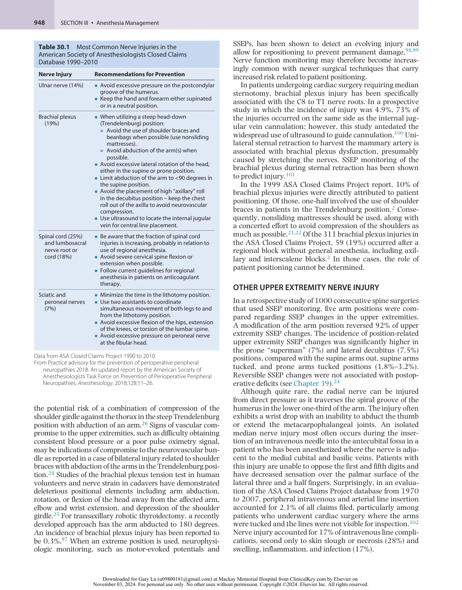

:::

<!-- PDF page 20 -->

### LOWER EXTREMITY NERVE INJURY

Injuries to the sciatic and common peroneal nerves occur most often in the lithotomy position. Because of its fixation between the sciatic notch and the neck of the fibula, the sciatic nerve can be stretched with external rotation of the leg. The sciatic nerve and its branches cross the hip and knee joints and are stretched by hyperflexion of the hips or extension of the knees. The common peroneal nerve, a branch of the sciatic, is most often damaged from the compression between the head of the fibula and an external structure, such as the frame of a leg support. Most often, patients who suffer a peroneal nerve injury will complain of a foot drop and the inability to extend the toes in a dorsal direction or evert the foot. In a prospective study of 991 patients undergoing surgery under general anesthesia in the lithotomy position, the incidence of lower extremity neuropathies was 1.5%, with injuries to the sciatic and peroneal nerves representing 40% of the cases. Interestingly, symptoms were predominantly paresthesia, with onset within 4 hours of surgery and resolution generally within 6 months. No motor deficits were noted, but in a previous retrospective study, the same authors found the incidence of severe motor disability in patients who underwent surgery in the lithotomy position to be 1 in 3608.103,104

Injury to the femoral or obturator nerves generally occurs from lower abdominal surgical procedures with excessive retraction. The obturator nerve can also be injured during a difficult forceps delivery or by excessive flexion of the thigh to the groin. A femoral neuropathy will exhibit decreased flexion of the hip, decreased extension of the knee, or a loss of sensation over the superior aspect of the thigh and medial or anteromedial side of the leg. An obturator neuropathy will exhibit an inability to adduct the leg, with decreased sensation over the medial side of the thigh.

In a retrospective review of 198,461 patients undergoing surgery in the lithotomy position from 1957 to 1991, injury to the common peroneal nerve was the most common lower extremity motor neuropathy, representing 78% of nerve injuries. A potential cause of the injury was the compression of the nerve between the lateral head of the fibula and the bar holding the legs. When the “candy cane” stirrups are used, special attention must be paid to avoid compression (see Fig. 30.9). The injury was more common with patients who had low body mass index, recent cigarette smoking, or prolonged duration of surgery.103 Perhaps as a result of an increased awareness of potential injuries, no lower extremity motor neuropathies were reported in a prospective review of 991 patients undergoing surgery in the lithotomy position from 1997 to 1998. Paresthesias in the distribution of the obturator, lateral femoral cutaneous, sciatic, and peroneal nerves were reported in 1.5% of patients, and nearly all recovered. Surgical times longer than 2 hours were significantly associated with this complication.104

### EVALUATION AND TREATMENT OF PERIOPERATIVE NEUROPATHIES

When a nerve injury becomes apparent postoperatively, it is essential to perform and document a directed physical

examination to correlate the extent of sensory or motor deficits with the preoperative examination as well as any intraoperative events. It is prudent to seek neurologic consultation to help define the neurogenic basis, localize the site of the lesion, and determine the severity of injury for guiding prognostication. With proper diagnosis and management, most injuries resolve, but months to years may be required.88,105,106 In addition, perioperative neuropathies associated with pain must be differentiated from surgically induced neuropathic pain, which is receiving increasing attention by surgeons because it affects an estimated 10% to 40% of surgical patients postoperatively.107

If a new sensory or motor deficit is found postoperatively, then electrophysiologic evaluation by a neurologist within the first week may provide useful information concerning the characteristic and temporal pattern of the injury. Another examination after 4 weeks, when enough time has elapsed for the electrophysiologic changes to evolve, will provide more definitive information about the site and severity of the nerve injury. Regardless, electrophysiologic testing must be interpreted within the clinical context. No single test can define the cause of injury. Nerve conduction studies may be useful to evaluate potential peripheral nerve injuries, as they permit the assessment of both motor and sensory nerves. To evaluate motor integrity, the nerve is supramaximally stimulated at two points along its course, and a recording is made of the electrical response of one of the muscles that it innervates. The size of the muscle action potential provides an estimate of the number of motor axons and muscle fibers that are activated by the stimulus. For sensory conduction studies, the nerve fiber is supramaximally stimulated at one point and the sensory nerve action potential is recorded from another point. The latency of the response can be interpreted as a reflection of the number of functioning sensory axons. Nerve conduction studies are useful for several reasons; they may reveal the presence of a subclinical polyneuropathy that made the individual nerves more susceptible to injury and help distinguish between axon loss and demyelination, which has significant implications regarding course and overall prognosis.

For motor neuropathy, an electromyogram can be performed to characterize the injury. An electromyographic examination involves recording the electrical activity of a muscle from a needle electrode inserted within it. If present, abnormalities may point to the affected component in the motor unit, which consists of the anterior horn cell, its axon and neuromuscular junctions, and the muscle fibers that it innervates. Certain findings are suggestive of denervation, including the presence of abnormal spontaneous activity in the resting muscle (fibrillation potentials and positive sharp waves, which results from muscle irritability) and increased insertion activity. Insertion activity increases within a few days of muscle denervation, whereas abnormal spontaneous activity takes 1 to 4 weeks to develop, depending on the distance from the nerve lesion to the muscle. Depending on the pattern of abnormalities, an electromyographic study may distinguish between radiculopathies, plexopathies, and neuropathies.

Most sensory neuropathies are generally transient and require only reassurance to the patient with follow- up

<!-- PDF page 21 -->

visits, whereas most motor neuropathies include demyelination of peripheral fibers of a nerve trunk (neurapraxia) and generally take 4 to 6 weeks for recovery. Injury to the axon within an intact nerve sheath (axonotmesis) or complete nerve disruption (neurotmesis) can cause severe pain and disability. When reversible, recovery often takes 3 to 12 months. Interim physical therapy is recommended to prevent contractures and muscle atrophy.105,106

## Pressure Injuries

Pressure injuries are a significant source of patient morbidity and health care expenditures in the United States and internationally. Approximately 23% of all pressure ulcers occur while patients are in operating rooms.108 General anesthesia and length of surgical procedure are both risk factors for pressure injury development. The National Pressure Ulcer Advisory Panel recently revised their definitions and classification scales for pressure injuries, formerly referred to as pressure ulcers.109 Pressure injury is injury to the skin and/or underlying tissue, due to pressure or shearing forces. Currently, there are no universal guidelines for pressure injury prevention. The Association of Perioperative Registered Nurses and the Joint Commission have statements issued stating that the prevention of pressure injuries is a joint responsibility shared by all members of the health care team. Understanding the risks of pressure injury is essential to preventing their occurrence.

Often early signs of pressure injury start with nonblanching skin erythema. The skin is more resistant to pressure injury than muscle and can actually mask a more extensive injury underneath.110 This is likely due to increased O2 requirements of muscle. Pressure injuries associated with operations are often not seen at the time of operation but could be diagnosed days after.111,112 In the supine position, areas most at risk include the sacrum, heels, and occiput. In the prone position, the chest and knees are at highest risk for pressure injury, and in the sitting position, the ischial tuberosities are at greatest risk.74

Factors contributing to the development of pressure injuries include pressure over bony prominences, shear force, skin breakdown, compromised blood flow, immobility, and decreased sensation. Infection, inflammation, edema, and steroids are all also contributing factors.113 Patient comorbidities such as diabetes, peripheral vascular disease, obesity, low body mass index, and poor nutrition are also known risks.108

There are case reports, and very few larger studies, assessing specific medical device–related pressure injuries. One retrospective study found that approximately 0.65% of all pressure injuries were due to medical devices. Nasal cannulas, endotracheal tubes, nasogastric tubes, and cervical collars were all associated with pressure injuries.114

Hypothermia and hypotension during surgery, such as during cardiopulmonary bypass (CPB) surgery, may increase the incidence of these complications. Pressure alopecia, caused by ischemic hair follicles, is related to prolonged immobilization of the head with its full weight falling on a limited area, usually the occiput. Hard objects should not be placed under the head as they may create focal areas of pressure. Consequently, ample cushioning of the head

and, if possible during prolonged surgery, periodic rotation of the head, are prudent to redistribute the weight.

## Bite Injuries

Transcranial motor- evoked potentials (Tc- MEPs) are increasingly used for both spine surgical procedures and also neurosurgical procedures. Tc- MEPs involve contraction of the temporalis and masseter muscle, which has been implicated in tongue, lip, and even tooth injuries due to biting motion. Two large retrospective reviews, each with more than 170,000 cases employing Tc- MEPs, found an overall incidence of 0.14% to 0.63%, and the tongue was most frequently injured (∼80% of all associated injuries).38,115 Injury severity ranged from minor bruising to necessity of laceration repair by suture in 15% to 23% of patients.

Macroglossia following surgery in the sitting position has been reported, presumably due to pressure, ischemia, and decreased venous outflow. A recent review of case reports for macroglossia after neurosurgical procedures found macroglossia was associated with prolonged operative times (50% of cases were over 8 hours) and suboccipital and posterior fossa surgeries (40%).116 Excessive neck flexion can also obstruct the endotracheal tube and place significant pressure on the tongue, leading to edema. Classically, two finger breadth distance between the chin and chest is recommended. Extra caution is advised in cases with neck flexion if TEE is used for air embolism monitoring, because the esophageal probe lies between the flexed spine and the airway and endotracheal tube, adding to the potential for compression of laryngeal structures and the tongue.

At this time there are no specific recommendations for prevention of bite injuries or macroglossia. Double- sided bite blocks may help in surgical procedures using Tc- MEP, although studies of macroglossia document bite blocks in 50% of patients. The most important prevention measures are ensuring proper placement of bite blocks and rechecking placement throughout the case.

## Anesthesia Outside the Operating Room

Anesthesia providers are increasingly involved with gastrointestinal endoscopy, cardiac catheterization, interventional radiology, neuroradiology, magnetic resonance imaging, and computed tomography in hospital locations outside the operating room, as well as for office- based procedures (see Chapter 69).117 Anesthesia care may be specifically requested if an individual is not expected to tolerate the position required for the procedure because of comorbidities such as congestive heart failure, pulmonary disease, or morbid obesity. In addition, although positions customarily used for procedures without anesthesia may be generally safe for patients who are awake, they may pose serious risks to those under anesthesia.

Because of the less familiar environment, relative lack of positioning equipment, and a variability in staff and nursing training with regard to patient positioning, planning and continued vigilance are particularly important in

<!-- PDF page 22 -->

settings outside the operating room. Diagnostic tables may not lend themselves to established intraoperative solutions to patient positioning challenges. The ability to initiate the Trendelenburg position to augment venous return and cardiac output rapidly is often lacking. In such an environment, where practice patterns often evolve in the context of nonanesthetized patients, the anesthesiologist must verify the safety of each patient’s position.

## Perioperative Visual Loss (POVL)

Ischemic optic neuropathy (ION), and retinal arterial occlusion (RAO) are the main causes of POVL.118,119 Others include cerebral blindness,120 acute angle closure glaucoma,121 and gas bubble expansion after retinal surgery.122 Corneal abrasion can cause transient visual loss, pain, and photophobia but rarely results in permanent injury.3

Perioperative ION is rare, occurring in approximately 1 in 60,000 to 125,000 anesthetic procedures in the overall surgical population.123,124 ION occurred most frequently in spine (3.09/10,000, 0.03%) and cardiac surgery (8.64/10,000, 0.086%).125 Yearly rates of POVL decreased in the 10- year period from 1996 to 2005, and for spine surgery in particular have continued to decline.125,126

After cardiac surgery, the incidence is between 0.06% and 0.113% in recent, large retrospective studies.127,128

### CENTRAL RETINAL ARTERY OCCLUSION

Central retinal artery occlusion (CRAO) decreases blood supply to the entire retina. The most common perioperative cause is improper positioning with external compression producing sufficiently high intraocular pressure (IOP) to stop blood flow in the central retinal artery. It most often occurs during spine surgery performed with the patient in the prone position.

### Clinical Findings

There is painless visual loss, abnormal pupil reactivity, opacification or whitening of the ischemic retina, and narrowing of retinal arterioles.129 A cherry- red macula with a white ground- glass retina and attenuated arterioles is a classic sign.130 Pallor in the ischemic, overlying retina makes visible the red color of the intact, underlying choroidal circulation. Differential diagnosis from other causes of visual loss is presented in Table 30.2.

Perioperative CRAO is usually from external compression of the eye, although it may also occur in cardiac surgery from emboli.131,132 Altered facial anatomy, e.g., in osteogenesis imperfecta, may predispose to damage by pressure

**Table 30.2** Differential Diagnosis: Eye Examination in Retinal, Optic Nerve, or Visual Cortex Injury*

||**AION**|**PION**|**Cortical Blindness**|**CRAO**|**BRAO**|
|---|---|---|---|---|---|
|Optic disk|Pale swelling, peripapillary flame- shaped hemorrhages, edema of optic nerve head Late: Optic atrophy|Initially normal Late: Optic atrophy|Normal|Normal Late: Optic atrophy|Normal Late: Optic atrophy|
|Retina|Normal; may have attenuated arterioles|Normal; may have attenuated arterioles|Normal|Cherry- red macula†; pallor and edema, narrowed retinal arteries|Emboli may be present‡; partial retinal whitening and edema|
|Light reflex|Absent or RAPD|Absent or RAPD|Normal|Absent or RAPD|Normal or RAPD|
|Fixation and accommodation|Normal|Normal|Impaired|May be impaired with external compression|May be impaired with external compression|
|Opticokinetic nystagmus|Normal|Normal|Absent|Normal|Normal|
|Response to visual threat|Yes, if some vision remains|Yes, if some vision remains|No|Yes|Yes|
|Object tracking|Normal, if some vision remains|Normal, if some vision remains|Absent|Normal|Normal|
|Ocular muscle function|Normal|Normal|Normal|May be impaired if results from external compression|May be impaired if results from external compression|
|Perimetry|Altitudinal defect; scotoma|Altitudinal defect; blind; scotoma; Often no light perception|Hemianopia (depending on lesion location); periphery affected usually|Usually blind|Scotoma; usually normal periphery|

*Typical symptoms and signs are listed. Some patients may have varying findings as a result, among other factors, of timing of examination relative to symptom onset.

†Because of a lack of overlying inner retinal cells in the fovea, the intact choroidal circulation is visible as a cherry- red spot. ‡Cholesterol, platelet–fibrin emboli, calcified atheromatous material. _AION,_ anterior ischemic optic neuropathy; _BRAO,_ occlusion of a retinal arterial branch; _CRAO,_ central retinal arterial occlusion; _PION,_ posterior ischemic optic neuropathy; _RAPD,_ relative afferent pupillary defect.

::: details 原始表格與符號（PDF 第 22 頁）

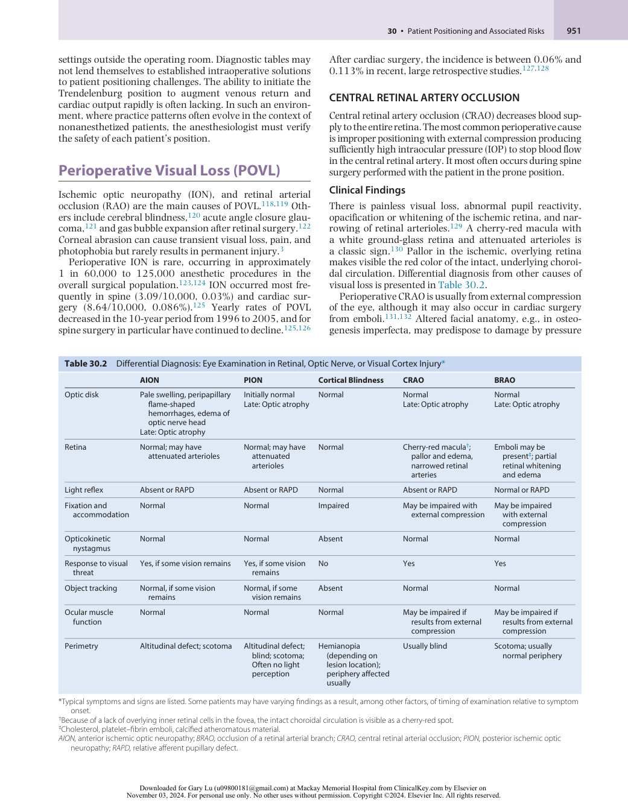

:::

<!-- PDF page 23 -->

from anesthesia masks or headrests.133,134 The horseshoe headrest leaves limited space for eyes, and the eye may inadvertently contact the headrest.135,136 Square or circular foam headrests with cutouts for the eyes and a mirror to view the eyes should prevent ocular compression.137

### Cardiac Surgery and Retinal Artery Occlusion

The largest case series of perioperative retinal artery occlusion (RAO) is in cardiac surgery.131 This recent study retrospectively examined CRAO in cardiac surgery using the Nationwide Inpatient Sample. More than 5.8 million cardiac operative procedures were estimated from 1998 to 2013, with 4564 RAO cases, an incidence of 7.8/10,000. Associated with increased RAO were giant cell arteritis, transient cerebral ischemia, carotid artery stenosis, embolic stroke, hypercoagulability, myxoma, diabetes mellitus with ophthalmic complications, and aortic insufficiency. Perioperative factors were bleeding, aortic and mitral valve surgery, and septal surgery. These results indicate that conditions that predispose to embolic phenomena, such as carotid disease, opening of the heart during surgery, and preexisting abnormal retinal vasculature (diabetic retinopathy) are potential predictors for RAO in cardiac surgery. Embolization during CPB remains a cause of retinal vascular occlusion. Better means for detecting and preventing this complication are needed.

### Considerations in Head and Neck Surgery

The incidence of orbital complications after endoscopic sinus surgery is estimated at 0.12%.138 Vascular injury can cause orbital compartment syndrome with compression of the arterial and venous circulations and in CRAO and optic nerve injury.139 Indirect damage to the central retinal artery from intra- arterial injections of 1% lidocaine with epinephrine has also been described, possibly from arterial spasm or embolism.140 Orbital surgery is associated with an estimated 0.84% incidence of vision loss.141 Risk is higher in patients undergoing facial polytrauma repair, optic canal decompression, or orbital apex surgery from an intracranial approach.142

### Prognosis, Treatment, and Prevention

Perioperative RAO results in permanent loss of vision in most cases. Currently available treatment is unsatisfactory. Ocular massage to more peripheral arterial branches could be instituted to decrease IOP and dislodge emboli, if present.129 Intravenous acetazolamide may increase retinal blood flow. Five percent carbon dioxide in 95% O2 can enhance dilation and increase O2 delivery from retinal and choroidal vessels.143 Localized hypothermia to the eye is a simple technique that has decreased injury in animal studies after ischemia, and probably should be instituted with its minimal risk.144 Thrombolysis via tissue plasminogen activator is possible when a stroke center is accessible within 4 to 5 hours of suspected central retinal artery occlusion. Non- randomized studies and meta- analyses strongly suggest improved visual outcome.4–6 An important concern is bleeding from thrombolytic agents.7 Due to these risks, where there is a delayed diagnosis, or where rapid access to a stroke center is not available, how to proceed should be assessed on a case- by- case basis in consultation with a neuro- ophthalmologist.

In patients positioned prone for surgery, a foam headrest should be used with the eyes properly placed in the opening; the position of the head and the eyes should be checked about every 20 minutes. A headrest that combines a foam headrest with a mirror immediately below, which enables the eyes to be seen easily during surgery, is useful. For the patient positioned prone for cervical spine surgery, the most effective method for preventing head movement is to place the head in pins.

In nasal and sinus surgery and in neuroradiologic procedures, the most important principles are avoiding inadvertent injections into, or compromise of, the ocular circulation. After endoscopic sinus surgery, patients should be checked for blurred vision, eye pain, and nausea suggestive of orbital hemorrhage. If present, immediate ophthalmologic consultation should be obtained.

### ISCHEMIC OPTIC NEUROPATHY

ION, primarily manifesting spontaneously, is the leading cause of sudden visual loss in those >50 years, with an estimated annual incidence of nonarteritic ION in the United States of 2.3/100,000.145 Two types of ION – anterior (AION) and posterior (PION) – have been described and can be arteritic or nonarteritic. Arteritic AION, caused by temporal arteritis, is a systemic disease, generally in patients >60 years, and has a female preponderance. Spontaneously occurring ION, unrelated to surgical procedures, is usually caused by AION.146

Nonarteritic ION is overwhelmingly the type found perioperatively. It has been reported after a wide variety of procedures, mostly after cardiac surgery,147 spinal fusion,148 head and neck surgery,149,150 orthopedic joint procedures,151 and surgery on the nose or sinuses.152 Cases also have been described after vascular surgery, general surgical and urologic procedures (radical prostatectomy), cesarean section and gynecologic surgery, and liposuction.153 A number of recent retrospective case–control studies in spine and in cardiac surgery are yielding increasing knowledge of risk factors.126 Animal models of perioperative ION have recently been described as well.154

### Mechanisms

Disruption of the blood–brain barrier occurs early in AION. Fluorescein angiography showed dye leakage in the optic nerve head,155 correlating with early onset of optic disk edema, even before symptoms.156 A small optic disk (small cup- to- disk ratio) may also increase susceptibility to AION because axons of the optic nerve pass through a narrower opening as they exit the eye. Mechanisms of injury resulting from a crowded disk include mechanical axoplasmic flow obstruction, stiff cribriform plate, and decreased availability of neurotrophic factors to retinal ganglion cells.157–159

ION affects the anterior portion of the optic nerve in AION or beyond the retrolaminar region, and behind the eye in PION.160 These regions have differing blood supplies. The portion affected in AION is perfused by branches of the posterior ciliary arteries, centripetal branches of the peripapillary choroid, and vessels from the circle of Zinn– Haller (Fig. 30.22), which are not found in every eye. Thus, areas of incomplete perfusion may be present.161 Posterior ION affects the part of the optic nerve between the lamina

<!-- PDF page 24 -->

cribrosa and the optic canal, a region with a blood supply that results in watershed zones.8,9

### Patient Characteristics in Perioperative Ischemic Optic Neuropathy

Most cases after spine surgery have been PION.153 AION occurs more frequently after cardiac surgery. ION’s onset is typically within the first 24 to 48 hours after surgery and is frequently noted on awakening, although later onset has been described, particularly in sedated patients.148 There is painless visual loss, afferent pupil defect or nonreactive pupils, complete visual loss, no light perception, or visual field deficits. Color vision is decreased or absent. In AION, altitudinal visual field deficits may be present. Optic disk edema and hemorrhages are seen on symptom onset in AION; in PION, the optic disk appears normal even though the patient reports visual loss. Over weeks to months, optic atrophy develops. The lesion may be unilateral or bilateral, but most post–spine surgery ION cases are bilateral. Orbital magnetic resonance imaging is frequently nondiagnostic, although some have described changes including enlargement of the nerve from edema or perineural enhancement.161,162

### Spine Surgery

Spine surgery patients with ION in the ASA Postoperative Visual Loss Registry had an average blood loss of 2.0 L, and the lowest hematocrit was 26%.163 Decreases in blood pressure varied widely from preoperative baseline: in 33%, the

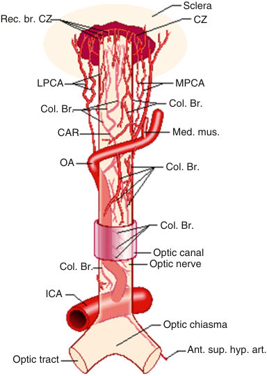

Sclera Rec. br. CZ CZ LPCA MPCA Col. Br. Col. Br. CAR Med. mus. OA Col. Br. Col. Br. Optic canal Col. Br. Optic nerve ICA Optic chiasma Ant. sup. hyp. art. Optic tract 

**Fig. 30.22 The origin, course, and branches of the ophthalmic artery, including the posterior ciliary arteries, as seen from above.** _Ant. sup. hyp. art._ , anterior superior hypophyseal artery; _CAR_ , central retinal artery; _Col. Br._ , collateral branches; _CZ_ , circle of Zinn and Haller; _ICA_ , internal carotid artery; _LPCA_ , lateral posterior ciliary artery; _Med. mus._ , medial muscular artery; _MPCA_ , medial posterior ciliary artery; _OA_ , ophthalmic artery; _Rec. br._ , recurring branches. (From Pillanut LE, Harris A, Anderson DR, et al, eds. _Current Concepts on Ocular Blood Flow in Glaucoma_ . The Hague, Netherlands: Kugler; 1999.)

lowest systolic blood pressures were greater than 90 mm Hg; in 20%, the lowest was 80 mm Hg or less. Approximately 57% had systolic or mean arterial blood pressure 20% to 39% below preoperative baseline, and 25% of patients were at 40% to 49% below preoperative baseline. Deliberate hypotension was used in approximately 25%. Nearly all cases involved surgery exceeding 6 hours. In the majority of patients, estimated blood loss was greater than 1 L, the median estimated blood loss was 2 L, and the median lowest hematocrit was 26%. Large- volume fluid resuscitation was typical, with median crystalloid administration of approximately 10 L. Most underwent thoracic, lumbar, or lumbar–sacral fusion procedures that were often repeat operations that involved multilevel surgery. Surgical positioning devices included the Wilson frame (30%), Jackson spinal table (27%), and soft chest rolls (20%). A foam pad was used for head positioning for 57%; 19% had the head in a Mayfield head holder. PION accounted for the majority of cases, compared with AION. Patients in ASA physical status 1 or 2 accounted for 64% of cases. The mean age was 50 years. Approximately, 41% had hypertension, 16% diabetes mellitus, and 10% coronary artery disease. Limitations of this study are related to data collection and lack of control nonaffected cases for comparison.

This limitation was addressed by a follow- up comparison of the ION spine dataset with randomly selected, matched controls from 17 academic medical centers in North America. Results are summarized in Table 30.3. After multivariable analysis, six factors conferred higher risk for ION in lumbar spine fusion: male sex, obesity, Wilson frame positioning, anesthesia duration, large blood loss, and a relatively low ratio of colloid to crystalloid fluid resuscitation.148 The limitations are the relatively limited amount of preoperative data, no distinction between AION and PION, and the possibility that controls did not represent a population- matched sample.

The Nationwide Inpatient Sample (NIS) is a random sample of discharge data from 20% of US hospitals. Rubin and colleagues analyzed trends in ION incidence in spine fusion from 1998 to 2012 (more than 2.5 million discharges). ION prevalence was 1.02/10,000, with an encouraging, still unexplained, significant decrease over time.126 Significantly associated with ION were age, blood transfusion, and obesity; female sex was inversely associated. These results are important because they were obtained from a very large, randomly collected sample, and suggested the

**Table 30.3** Factors Increasing the Odds Ratio of Developing Perioperative ION in Lumbar Spine Fusion Surgery

||**Odds Ratio**|**_P_ Value**|
|---|---|---|
|Male|2.53 (1.35–4.91)|.005|
|Obesity|2.83 (1.52–5.39)|.001|
|Wilson frame|4.30 (2.13–8.75)|&lt;.001|
|Anesthesia duration, per hour|1.39 (1.22–1.58)|&lt;.001|
|Estimated blood loss, per 1 L|1.34 (1.13–1.61)|.001|
|Colloid as percent of nonblood replacement, per 5%|0.67 (0.52–0.82)|&lt;.001|

::: details 原始表格與符號（PDF 第 24 頁）

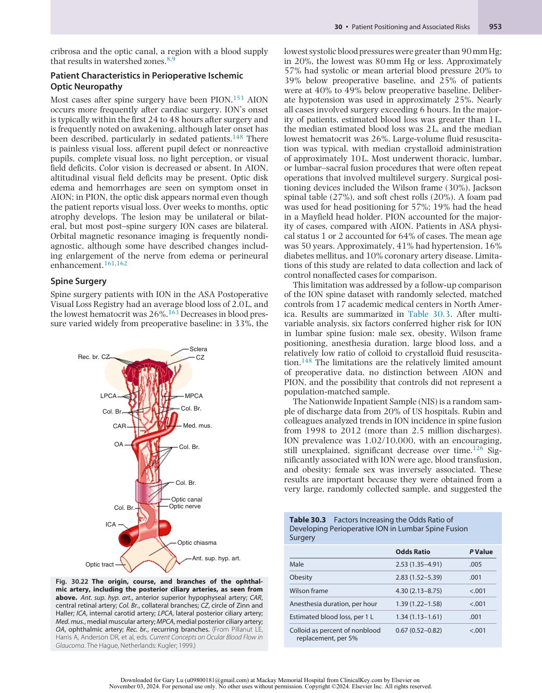

:::

<!-- PDF page 25 -->

importance of specific preoperative factors. But there are limitations. The HIS relies on the accuracy of diagnosis and coding. Verification of medical diagnoses are not possible. Both over- and under- coding are possible. The coding depends on entry of the data by professional coders; however, the accuracy depends upon the diagnoses recorded by physicians and the procedure description provided by the surgeon.164

### Cardiac Surgery

Shapira and colleagues studied 602 patients undergoing CPB at a single institution under moderate systemic hypothermia (25°C) with pulsatile flow and a membrane oxygenator.165 Phenylephrine maintained perfusion pressure above 50 mm Hg. Eight patients (1.2%) had AION. There were no differences in preoperative vascular risk factors in those with or without visual loss. CPB time was longer in patients with AION (252 vs. 164 minutes), and minimum hematocrit was lower (18% vs. 21%) compared with unaffected patients. There were no differences in flow indices, perfusion pressures, and carbon dioxide tension. Patients with AION had a greater 24- hour postoperative weight gain (18% vs. 11%) and required more vasoactive drugs to maintain hemodynamics than did patients with unaffected vision. Visual symptoms were usually reported between days 1 and 3 postoperatively, soon after removal of mechanical ventilatory support. This study is limited due to the small sample size.

Nuttall and colleagues performed a larger retrospective case–control study of approximately 28,000 patients who had cardiac surgery at the Mayo Clinic from 1976 to 1994, with 17 patients with ION (0.06%).127 By univariate analysis, significant risk factors included lower minimum postoperative hemoglobin, clinically severe vascular disease, preoperative angiogram within 48 hours of CPB, longer CPB duration, red blood cell transfusions, and the use of non–red blood cell blood components. Patients with ION underwent longer CPB runs; no differences were found in pre- CPB or post- CPB systemic blood pressures. Nine cases of bilateral ION were reported; disk edema was not found in 5 patients (29%), who may have had PION. Small cupto- disk ratio (&lt;0.3) was identified in 5 patients (29%) with ION. This study was limited by a large number of comparisons, small sample, single institution design, and no distinction between AION and PION. A more recent series by Holy and colleagues showed similar results, but it included other surgical procedures, complicating interpretation of the results with cardiac surgery.166 Kalyani and colleagues reviewed cases of ION after 9701 cardiac surgeries over a 9- year period at a single institution. Specific risk factors could not be determined from the 11 patients (0.11%) with ION.128

Rubin examined ION in the largest series of cardiac surgery cases to date, using the NIS (1998–2012), as described earlier. There were more than 5 million discharges meeting inclusion criteria, with 794 (0.014%) ION cases. Average yearly incidence was 1.43 of 10,000 cardiac procedures. Increasing risk were carotid artery stenosis, stroke, diabetic or hypertensive retinopathy, macular degeneration, glaucoma, and cataract. Female sex and uncomplicated diabetes mellitus type 2 decreased risk. This study was large but has the same limitations as other studies using NIS.

Intriguingly, it does suggest that preoperative degenerative eye diseases may predict patients that will develop ION.

### Controversies and Anesthesia Management Recommendations

This discussion will primarily concern spinal fusion procedures, where the largest number of cases have been described. For more detail, the reader is referred to the practice advisories of the ASA.167–169

**Length of Surgery.** Both Myers170 and the Postoperative Visual Loss (POVL) Study Group148 reported increased risk with long duration of spine fusion surgery. Therefore, staging of spinal fusion procedures, particularly those for anterior and posterior surgery, may be advisable (but see later).

**Hypotension.** Intraoperative hypotension has been cited as a risk factor by a number of authors of case reports,171,172 but this risk has not been confirmed by case–control studies, with one exception.148,166,170 Patil and colleagues reported a higher odds ratio for ION in patients who sustained hypotension.173 However, the diagnostic coding of hypotension in this study is not defined, cannot be confirmed, and the timing (during the perioperative period or not) and the degree of hypotension are not specified.174

Hypotension can potentially lead to a decrease in perfusion pressure in the optic nerve and to ischemic injury because of either anatomic variation in the circulation or abnormal autoregulation and an inability to adequately compensate for decreased perfusion pressure. The degree of hypotension that is potentially dangerous is difficult to determine because of the lack of data.169 Judgment and discussion are thus advisable when surgeons request a decrease in blood pressure to decrease blood loss in spine surgery. In cardiac surgery, special considerations exist regarding the optimal systemic perfusion pressures to be maintained during CPB.175

**Hemodilution and Blood Loss.** Clinical blood transfusion practice in surgical patients, based on ASA practice guidelines,176 suggests that transfusion is not generally required for hemoglobin values higher than 8.0 g/dL, and thus isovolumic hemodilution is common in patients undergoing spine fusion. The Society of Thoracic Surgeons and the Society of Cardiovascular Anesthesiologists issued a similar clinical practice guideline for cardiac surgery.177

In miniature pigs, blood flow in the optic nerve head, as measured by laser Doppler imaging, was maintained during isovolumic hemodilution with a 30% decrease in hematocrit. Moreover, O2 tension at the vitreal surface increased 15%.178 Also, Lee and colleagues demonstrated that extreme decreases in hematocrit (15%) and mean arterial pressure (50 mm Hg) in adult pigs resulted in significant reductions in blood flow to the optic nerve. But no histologic or optic nerve function was studied, and the pig brain and eye circulation significantly differ from that of humans.179 Roth and associates showed that hemodilution and extreme head- down tilt in rats resulted in significant changes in visual evoked potentials, electrical activity originating in retinal ganglion cells, and increased glial reactivity in the optic nerve; thus, if extrapolated to humans, caution is in order during extreme hemodilution with the head- down tilt.154

<!-- PDF page 26 -->

**Head Positioning.** Many reports of ION include patients who were in the prone position, raising the possibility that positioning itself contributes to altered venous hemodynamics within the optic nerve. The patient’s head should be level with or above the heart, when possible, and in a neutral position during spine surgery performed with the patient in the prone position. When the patient is positioned for spine surgery in the Wilson frame, the head may be below the level of the back; the head can be elevated using pillows or the bed placed in reverse Trendelenberg.180 With the Jackson table, the head is maintained at the level with the back.168

Several studies found that IOP increased in the prone position and was influenced by the position of the operating room table. However, there has been no correlation between IOP changes and visual outcome or visual function.180

**Fluid Administration.** The theory that massive intravascular fluid resuscitation could be a pathogenic factor in perioperative ION remains speculative. Conceivably, fluid administration could result in increased IOP, accumulation of fluid in the optic nerve, or both. Because the central retinal vein exits out of the optic nerve, an internal compartment syndrome may occur in the optic nerve. Alternatively, fluid accumulation in the vicinity of the lamina cribrosa may compress axons as they transit this region. Large- volume fluid replacement is generally seen in spinal fusion surgery.181 Patients in the ASA Postoperative Visual Loss Registry received on average 9.7 L of crystalloid intraoperatively,148 and increased postoperative weight gain was identified in a case–control study of visual loss after heart surgery,165 suggesting, although not proving, that fluid replacement may play a role. The finding of the POVL Study Group was that the odds ratio for developing ION was increased as the percent colloid of nonblood replacement decreased.148 It is possible that the use of colloids may decrease edema in the optic nerve during surgery, particularly when the patient is placed prone for surgery. However, at present, such edema has not yet been demonstrated. In healthy volunteer subjects, placement in the prone position led to an increase in diameter of the optic nerve.180 This could be due to venous hypertension. New magnetic resonance imaging methods may enable the study of edema and venous hemodynamics in the optic nerve in the near future. Animal models also may provide a means to study these perioperative factors. No study has shown any relationship among periorbital edema, IOP, and ION. Fluid administration could be a pathogenic factor in ION, especially in patients positioned prone or undergoing cardiac surgery, but the mechanisms involved, in addition to the amounts and nature of fluid required, remain undefined.

**Anatomic Variation.** Anatomic variation in the circulation of the optic nerve may potentially predispose patients to the development of ION. The location of potential watershed zones in the anterior and posterior circulation and the presence of disturbed autoregulation, even in normal patients,108 are of concern but at present cannot be predicted clinically. Few human studies have been conducted on the relationship between perfusion pressure and changes

in blood flow in the optic nerve. Human studies generally show preserved blood flow at clinically used or even lower ranges of perfusion pressure, but these studies have focused primarily on the anterior portion of the optic nerve.182 In the studies that used laser Doppler flowmetry, depth of penetration of the measuring device is critical. Measurements might have been closer to the retinal blood vessels than the optic nerve head, and these do not measure optic nerve circulation. It is not currently feasible to measure blood flow in the human retrolaminar optic nerve. In animal studies, blood flow is preserved in various layers of the optic nerve, including the retrolaminar area, at a mean arterial blood pressure as low as 40 mm Hg.183

**Vasoconstrictors.** Hayreh and colleagues theorized that AION is related to excessive secretion of vasoconstrictors, which in turn could lower optic nerve perfusion to dangerously low levels.184 However, the theory was based on the development of AION in patients who sustained massive hemorrhage. Vasopressors are used to maintain blood pressure in such circumstances as after cardiac surgery and in cases in which vasomotor tone is decreased. Shapira and colleagues showed an association between prolonged use of epinephrine or long bypass time and ION in patients undergoing open heart surgery.165 Lee and Lam reported a case of ION in a patient after lumbar spine fusion during which phenylephrine infusion was used to maintain blood pressure.185 They later presented a series of four case reports of ION in critically ill patients with significant systemic illness who required prolonged use of vasopressors and inotropic agents to maintain blood pressure and cardiac output. However, α- adrenergic receptors are not located in the optic nerve and the blood–brain barrier prevents entry of systemically administered agents, except possibly in the prelaminar zone of the nerve. Therefore, the role of vasopressor use in ION remains unclear, and no clear guidance with respect to risk for ION can be provided at this time.

**Informed Consent.** A single institution survey reported that patients prefer to be informed of the risk of visual loss in spine surgery.186 It seems advisable to have the discussion with patients that are at higher risk of developing ION. Often it is difficult to do when, as is common, the patient is first seen soon before surgery. It may be preferable for anesthesiologists and surgeons to develop a means to inform patients earlier of the risk of ION.

**Staging and Minimally Invasive Spine Fusion.** Increasingly, neurosurgeons have been using minimally invasive surgical techniques for lumbar spine surgery and fusion.187 These methods reduce the amount of blood loss and fluid requirements, but cases of ION have arisen under these circumstances as well.188 Another strategy not under the direct control of the anesthesia provider is to consider staging of complex spine procedures. This decision requires an assessment of the associated increased risks for multiple surgeries (infection, deep vein thrombosis, spinal instability) but may significantly shorten the duration of each procedure.189–193 Another strategy is to advocate for patients by regular preoperative conferencing with surgeons. Anticipating high blood loss and other

<!-- PDF page 27 -->

risks may enhance perioperative planning and care in spine surgery patients.

### Prognosis, Treatment, and Prevention

No effective treatment exists for ION. A few cases of treating perioperative ION have been reported. Acetazolamide decreases IOP and may improve flow to the optic nerve head and retina. Diuretics such as mannitol or furosemide reduce edema.194 In the acute phase, corticosteroids may reduce axonal swelling, but in the postoperative period they may increase wound infection. Because steroids are of unproven benefit, their use must be carefully weighed.195 Increasing ocular perfusion pressure or hemoglobin concentration may be appropriate when ION is found in conjunction with significant decreases in blood pressure and hemoglobin concentration. Maintaining the patient in a head- up position if increased ocular venous pressure is suspected may be advantageous, but its use must be balanced against decreased arterial supply with the head- up position. Clearly, if a patient has visual loss from ocular compartment syndrome, immediate decompression (lateral canthotomy) is indicated.

In a few anecdotal case reports, increasing blood pressure or hemoglobin, or applying hyperbaric O2, improved visual

outcome.153 The use of neuroprotective agents or drugs that lower IOP, valuable in theory, has never been shown to result in improvement.196

### American Society of Anesthesiologists Advisories (Updated with 2019 Advisory)

The 2006 ASA Task Force on Perioperative Blindness concluded that high- risk patients who have surgery that is prolonged in duration and/or have large blood loss have an increased risk of POVL.167 Yet POVL was not related to blood loss _per se_ , hemoglobin levels, or the use of crystalloids. In 2012, another ASA Task Force published an update regarding POVL primarily associated with spine surgery.168 While major changes were not made, analysis of the literature was updated and the recommendations were more detailed. For example, the 2006 Summary had 7 bullet points. In contrast, the 2012 Summary of Advisory Statements has 22 bullet points subdivided into Preoperative, Intraoperative, Staging of Surgical Procedures, and Postoperative Management (Box 30.2). The 2012 ASA Task Force on POVL reviewed the additional literature and concluded that newer findings and the literature do not justify major changes in the 2006 recommendations. A further update was published in 2019.169

### Box 30.2 American Society of Anesthesiologists 2012 Task Force Summary of Advisory Statements

### Preoperative Considerations

- At this time, there were no identifiable preoperative patient characteristics that predispose patients to perioperative posterior ischemic optic neuropathy (ION).

- There is no evidence that an ophthalmic or neuro- ophthalmic evaluation would be useful in identifying patients at risk for perioperative visual loss.

- The risk of perioperative ION may be increased in patients who undergo prolonged procedures, have substantial blood loss, or both.

- Prolonged procedures, substantial blood loss, or both are associated with a small, unpredictable risk of perioperative visual loss.

- Because the frequency of visual loss after spine surgery of short duration is infrequent, the decision to inform patients who are _not_ anticipated to be “high risk” for visual loss should be determined on a case- by- case basis.

### Intraoperative Management

### Blood Pressure Management

- Arterial blood pressure should be monitored continually in highrisk patients.

- The use of deliberate hypotensive techniques during spine surgery can be associated with the development of perioperative visual loss. Therefore the use of deliberate hypotension for these patients should be determined on a case- by- case basis.

- Central venous pressure monitoring should be considered in high- risk patients. Colloids should be used along with crystalloids to maintain intravascular volume in patients who have substantial blood loss.

### Management of Anemia

substantial blood loss. A transfusion threshold that would eliminate the risk of perioperative visual loss related to anemia cannot be established at this time.

### Use of Vasopressors

- There is insufficient evidence to provide guidance for the use of α- adrenergic agonists in high- risk patients during spine surgery.

### Patient Positioning

- The Task Force believes that there is no pathophysiologic mechanism by which facial edema can cause perioperative ION. There is no evidence that ocular compression causes isolated perioperative anterior ION or posterior ION. However, direct pressure on the eye should be avoided to prevent central retinal artery occlusion (CRAO).

- The high- risk patient should be positioned so that the head is level with or higher than the heart when possible.

### Staging of Surgical Procedures

- Although the use of staged spine surgery procedures in highrisk patients may entail additional costs and patient risks (e.g., infection, thromboembolism, or neurologic injury), it also may decrease these risks and the risk of perioperative visual loss in some patients.

### Postoperative Management

   - The consensus of the Task Force is that a high- risk patient’s vision should be assessed when the patient becomes alert.

   - If there is concern regarding potential visual loss, an urgent ophthalmologic consultation should be obtained to determine its cause.

   - There is no role for antiplatelet drugs, steroids, or intraocular pressure- decreasing drugs in the treatment of perioperative ION.

- Hemoglobin or hematocrit values should be monitored periodically during surgery in high- risk patients who experience

From Practice advisory for perioperative visual loss associated with spine surgery: an updated report by the American Society of Anesthesiologists Task Force on Perioperative Visual Loss. _Anesthesiology_ . 2012; 116: 274–285.

<!-- PDF page 28 -->

### VISUAL LOSS AFTER VITRECTOMY AND VITREAL GAS BUBBLE TAMPONADE

### References

1.  Metzner J, et al. _Best Pract Res Clin Anaesthesiol_ . 2011;25:263.

2.  Cheney FW, et al. _Anesthesiology_ . 1999;90:1062.

Patients who have undergone vitrectomy with perfluorocarbon gas tamponade (C3F8) are at risk for gas bubble expansion and loss of vision from acutely increased IOP. Patients anesthetized for a subsequent surgical procedure with gas mixtures containing nitrous oxide (N2O) after vitrectomy sustained retinal vascular occlusion from acute gas bubble expansion. N2O anesthesia affects the size of the intraocular gas bubble. Wolf and colleagues demonstrated that N2O and O2 resulted in a more than threefold increase in sulfur hexafluoride (SF6) gas bubble volume, in contrast to a 50% increase with air ventilation and 35% increase with O2 ventilation alone.197 Perfluorocarbon gas remains in the eye for at least 28 days. Visual loss has been reported with N2O anesthesia administered as long as 41 days after vitrectomy and gas bubble tamponade. Therefore, patients should wear a warning tag to alert the anesthesiologist to the presence of the gas bubble in the vitreous, and N2O should not be used in patients who have had recent vitrectomy and gas bubble tamponade.198,199

3.  Warner MA. _Mayo Clin Proc_ . 1998;73:567.

4. _Anesthesiology_ . 2018;128:11.

5.  O’Brien TJ, Ebert TJ. In: Martin JT, Warner MA, eds. _Positioning in Anesthesia and Surgery_ . 3rd ed. Saunders; 1997.

6.  Gelman S. _Anesthesiology_ . 2008;108:735.

7.  Luecke T, Pelosi P. _Crit Care_ . 2005;9:607.

8.  Froese AB. _Anesthesiology_ . 2006;104:193.

9.  Glenny RW. _Intensive Care Med_ . 2009;35:1833.

10.  Hakim TS, et al. _J Appl Physiol_ . 1987;63:1114.

11.  Burrowes KS, Tawhai MH. _Respir Physiol Neurobiol_ . 2006;154:515.

12.  Galvin I, et al. _Br J Anaesth_ . 2007;98:420.

13.  Petersson J, et al. _Respir Physiol Neurobiol_ . 2009;166:54.

14.  Nyren S, et al. _Anesthesiology_ . 2010;112:682.

15.  Warner MA. _Supine Positions_ . 3rd ed. Saunders; 1997.

16.  Britt BA, Gordon RA. _Can Anaesth Soc J_ . 1964;11:514.

17.  Prielipp RC, et al. _Anesthesiology_ . 1999;91:345.

18.  Stewart JD, Shantz SH. _Can J Neurol Sci_ . 2003;30:15.

19.  Geerts BF, et al. _J Clin Anesth_ . 2012;24:668.

20.  Cestari A, et al. _Eur Urol_ . 2010;57:530.

21.  Klauschie J, et al. _J Minim Invasive Gynecol_ . 2010;17:504.

22.  Phong LK, Koh LK. _Anaesth Intensive Care_ . 2007;35:281.

23.  Coppieters MW, et al. _Anesthesiology_ . 2002;97:75.

24.  Kent CD, Cheney FW. _J Clin Anesth_ . 2007;19:482.

25.  Coppieters MW. _Anesthesiology_ . 2006;104:1351.

26.  Devarajan J, et al. _Anesth Analg_ . 2012;115:867.

## Conclusion

27.  Martin JT. In: Martin JT, Warner MA, eds. _Positioning in Anesthesia and Surgery_ . 3rd ed. Saunders; 1997.

28.  Warner ME, et al. _Anesthesiology_ . 2001;94:705.

The positioning of patients under anesthesia care is a major responsibility requiring great attention to detail and constant vigilance. Positioning for optimal surgical exposure but the potential for lasting harm to patients from improper positioning must guide our actions. Each position has significant physiologic effects on ventilation and circulation. In addition, despite increased awareness, position- related complications, including peripheral nerve injuries, continue to remain a significant source of patient morbidity. As surgical techniques evolve, extreme positions sometimes permit advantages, such as smaller incisions and more effective displacement of internal organs to facilitate surgical exposure. Unfortunately, associated risks may increase with positions that would not be tolerated when patients are awake. Anesthesiologists and surgeons must work together with all operating room staff when each patient is positioned to promote comfort and safety in addition to securing the desired surgical exposure. Ideally, the final position should appear natural; that is, a position that the patient would comfortably tolerate if awake and unsedated for the anticipated duration of the procedure.

## Disclosure

Dr. Roth’s research on vision loss is supported by National Institutes of Health Grants EY10343, EY027447, the Michael Reese Foundation Pioneers Award, and by the North American Neuro- ophthalmological Society. Dr. Roth discloses that he has provided expert witness evaluation and testimony in cases of perioperative visual loss on behalf of patients, hospitals, and health care providers.

29.  Wassenaar EB, et al. _Dis Colon Rectum_ . 2006;49:1449.

30.  Mumtaz FH, et al. _BJU Int_ . 2002;90:792.

31.  Simms MS, Terry TR. _Postgrad Med J_ . 2005;81:534.

32.  Anema JG, et al. _J Urol_ . 2000;164:360.

33.  Chase J, et al. _Dis Colon Rectum_ . 2000;43:678.

34.  Turnbull D, et al. _Anaesthesia_ . 2002;57:905.

35.  Akhavan A, et al. _Urology_ . 2010;76:1309.

36.  Dunn PF. _Int Anesthesiol Clin_ . 2000;38:25.

37.  Choi YS, et al. _J Thorac Cardiovasc Surg_ . 2007;134:613.

38.  Tamkus A, Rice K. _Anesth Analg_ . 2012;115:663.

39.  Biais M, et al. _Br J Anaesth_ . 2010;104:407.

40.  Martin JT. In: Martin JT, Warner MA, eds. _Positioning in Anesthesia and Surgery_ . 3rd ed. Saunders; 1997.

41.  Douglas, et al. _Am Rev Respir Dis_ . 1977;115:559.

42.  Lumb AB, Nunn JF. _Anesth Analg_ . 1991;73:422.

43.  Girard TD, Bernard GR. _Chest_ . 2007;131:921.

44.  Alsaghir AH, Martin CM. _Crit Care Med_ . 2008;36:603.

45.  Guerin C, et al. _N Engl J Med_ . 2013;368:2159.

46.  Pelosi P, et al. _Anesth Analg_ . 1995;80:955.

47.  Soro M, et al. _Eur J Anaesthesiol_ . 2007;24:431.

48.  Pelosi P, et al. _Anesth Analg_ . 1996;83:578.

49.  von Ungern- Sternberg BS, et al. _Intensive Care Med_ . 2007;33:1771.

50.  Black S, et al. _Anesthesiology_ . 1988;69:49.

51.  Peruto CM, et al. _Arthroscopy_ . 2009;25:891.

52.  Porter JM, et al. _Br J Anaesth_ . 1999;82:117.

53.  Himes BT, et al. _J Neurosurg_ . 2017;127:182.

54.  Newberg Milde L. In: Martin JT, Warner MA, eds. _Positioning in Anesthesia and Surgery_ . 3rd ed. Saunders; 1997:1009.

55.  Hindman BJ, et al. _Anesthesiology_ . 2011;114:782.

56.  Warner MA. In: Martin JT, Warner MA, eds. _Positioning in Anesthesia and Surgery_ . 3rd ed. Saunders; 1997.

57.  Rozet I, Vavilala MS. _Anesthesiol Clin_ . 2007;25:631, x.

58.  Mammoto T, et al. _Acta Anaesthesiol Scand_ . 1998;42:643.

59.  Klein J, et al. _World Neurosurg_ . 2018;115:196.

60.  Papadopoulos G, et al. _Acta Neurochir_ . 1994;126:140.

61.  Mirski MA, et al. _Anesthesiology_ . 2007;106:164.

62.  Gunther F, et al. _Acta Neurochir_ . 2017;159:339.

63.  Hanna PG, et al. _J Clin Anesth_ . 1991;3:290.

64.  Pohl A, Cullen DJ. _J Clin Anesth_ . 2005;17:463.

65.  Pollard V, et al. _Anesth Analg_ . 1996;82:278.

66.  Fischer GW. _Pain Pract_ . 2009;9:304.

### Complete references available online at expertconsult.com.

67.  Lam AM, Baldwin G. _Anesth Analg_ . 2012;114:1156.

68.  Murphy GS, et al. _Anesth Analg_ . 2010;111:496.

<!-- PDF page 29 -->

69.  Ghosh A, et al. _Anesth Analg_ . 2012;115:1373. 70.  Rains DD, et al. _Arthroscopy_ . 2011;27:532. 71.  Hu JC, et al. _JAMA_ . 2009;302:1557. 72.  Wright JD, et al. _JAMA_ . 2013;309:689.

73.  Gainsburg DM. _Minerva Anestesiol_ . 2012;78:596. 74.  Hsu RL, et al. _Rev Urol_ . 2013;15:178. 75.  Kalmar AF, et al. _Adv Anesth_ . 2012;20:75. 76.  Lestar M, et al. _Anesth Analg_ . 2011;113:1069. 77.  Mills JT, et al. _J Urol_ . 2013;190:580. 78.  Ulm MA, et al. _Gynecol Oncol_ . 2014;135:534. 79.  Wen T, et al. _J Endourol_ . 2014;28:660. 80.  Souki FG, et al. _BMC Anesthesiol_ . 2018;18:117. 81.  Cheney FW. _Anesthesiology_ . 1999;91:552. 82.  Kroll DA, et al. _Anesthesiology_ . 1990;73:202. 83.  Lee LA, et al. _Anesthesiology_ . 2004;101:143. 84.  Fitzgibbon DR, et al. _Anesthesiology_ . 2004;100:98. 85.  Kamel IR, et al. _Anesth Analg_ . 2006;102:1538.

86.  Chui J, et al. _Anesth Analg_ . 2018;127:134. 87.  Goubier J. In: Tubbs R, et al., ed. _Grading of Nerve Injuries, Nerves and Nerve Injuries_ . Elsevier; 2015.

88.  Winfree CJ, Kline DG. _Surg Neurol_ . 2005;63:5. 89.  Welch MB, et al. _Anesthesiology_ . 2009;111:490. 90.  Warner MA, et al. _Anesthesiology_ . 1999;90:54. 91.  Prielipp RC, et al. _Anesthesiology Clin N Am_ . 2002;20:589. 92.  Cheney FW. _ASA Newsl_ . 1998;62(6):10. 93.  Warner MA, et al. _Anesthesiology_ . 1994;81:1332. 94.  Contreras MG, et al. _Clin Anat_ . 1998;11:372. 95.  Morell RC, et al. _Anesth Analg_ . 2003;97:1183. 96.  Cooper DE, et al. _Clin Orthop Relat Res_ . 1988;228:33. 97.  Kang SW, et al. _Surgery_ . 2009;146:1048.

98.  Luginbuhl A, et al. _Laryngoscope_ . 2012;122:110. 99.  Davis SF, et al. _Am J Electroneurodiagn Technol_ . 2011;51:274. 100.  Hanson MR, et al. _Ann Thorac Surg_ . 1983;36:675.

101.  Jellish WS, et al. _J Cardiothorac Vasc Anesth_ . 1994;8:398. 102.  Liau DW. _ASA Newsl_ . 2006;70:11.

103.  Warner MA, et al. _Anesthesiology_ . 1994;81:6.

104.  Warner MA, et al. _Anesthesiology_ . 2000;92:614.

105.  Aminoff MJ. _Anesthesiology_ . 2004;100:1298.

106.  Dylewsky W, McAlpine FS. In: Martin JT, Warner MA, eds. _Positioning in Anesthesia and Surgery_ . 3rd ed. Saunders; 1997.

107.  Borsook D, et al. _Ann Surg_ . 2013;257:403. 108.  Primiano M, et al. _AORN J_ . 2011;94:555.

109.  Edsberg LE, et al. _J Wound, Ostomy Cont Nurs_ . 2016;43:585. 110.  Cushing CA, Phillips LG. _Plast Reconstr Surg_ . 2013;132:1720. 111.  Aronovitch SA. _J Wound, Ostomy Cont Nurs_ . 1999;26:130. 112.  Hayes RM, et al. _Am J Med Qual_ . 2015;30:591. 113.  Campbell C, Parish LC. _Clin Dermatol_ . 2010;28:527. 114.  Kayser SA, et al. _Adv Skin Wound Care_ . 2018;31:276. 115.  Schwartz DM, et al. _Spine_ . 2011;36:1046.

116.  Brockerville M, et al. _J Neuroanesth Crit Care_ . 2017;4:78. 117.  Lalwani K. _Curr Opin Anaesthesiol_ . 2006;19:430. 118.  Biousse V, et al. _Ophthalmology_ . 2018;125:1597.

119.  Biousse V, Newman NJ. _N Engl J Med_ . 2015;373:1677. 120.  De la Garza- Ramos R, et al. _Spine J_ . 2016;16:516. 121.  Gayat E, et al. _Anesth Analg_ . 2011;112:126. 122.  Hart RH, et al. _Am J Ophthalmol_ . 2002;134:761. 123.  Roth S, et al. _Anesthesiology_ . 1996;85:1020. 124.  Warner ME, et al. _Anesth Analg_ . 2001;93:1417. 125.  Roth S, et al. _Anesthesiology_ . 1996;85:1020. 126.  Shen Y, et al. _Anesth Analg_ . 2009;109:1534. 127.  Nuttall GA, et al. _Anesth Analg_ . 2001;93:1410. 128.  Kalyani SD, et al. _Ann Thorac Surg_ . 2004;78:34.

129.  Wray SH. _J Neurol Neurosurg Psychiatry_ . 1993;56:234. 130.  Tobalem S, et al. _BMC Ophthalmol_ . 2018;18:101.

131.  Calway T, et al. _Ophthalmology_ . 2017;124:189.

132.  Calway T, et al. _J Neuroophthalmol_ . 2018;38:36.

135.  Sys J, et al. _Eur Spine J_ . 1996;5:74.

136.  Grossman W, et al. _Spine_ . 1993;18:1226.

137.  Grant GP, et al. _Anesth Analg_ . 2006;103:499.

138.  Bhatti MT, et al. _Surv Ophthalmol_ . 2003;48:389.

139.  Haller D, et al. _Rhinology_ . 2006;44:216.

140.  Savino PJ, et al. _J Clin Neuroophthalmol_ . 1990;10:140.

141.  Jacobs SM, et al. _Ophthalmology_ . 2018;125:1100.

142.  Christie B, et al. _J Plast Reconstr Aesthet Surg_ . 2018;71:155. 143.  Anderson Jr B. _Trans Am Ophthalmol Soc_ . 1968;66:423.

144.  Tamai K, et al. _Br J Ophthalmol_ . 1997;81:789.

145.  Johnson LJ, et al. _J Clin Neuroophthalmol_ . 1994;14:38.

146.  Arnold AC. _J Neuroophthalmol_ . 2003;23:157.

147.  Tice DA. _Ann Thorac Surg_ . 1987;44:677.

148.  Postoperative Visual Loss Study Group. _Anesthesiology_ . 2012;116:15. 149.  Schobel GA, et al. _Int J Oral Maxillofac Surg_ . 1995;24:283. 150.  Fenton S, et al. _J Laryngol Otol_ . 2001;115:158.

151.  Kaeser PF, Borruat FX. _J Arthroplasty_ . 2011;26:338.e17.

152.  Huang TW, et al. _Otolaryngol Head Neck Surg_ . 2003;129:448.

153.  Buono LM, et al. _Surv Ophthalmol_ . 2005;50:15.

154.  Roth S, et al. _Eur J Anaesthesiol_ . 2018;35:840.

155.  Arnold AC, et al. _Am J Ophthalmol_ . 1994;117:222.

156.  Subramanian PS, et al. _Br J Ophthalmol_ . 2017;101:671.

157.  Hayreh SS, Zimmerman MB. _Ophthalmology_ . 2008;115:2275.

158.  Saito H, et al. _Ophthalmology_ . 2008;115:1585.

159.  Beck RW, et al. _Ophthalmology_ . 1987;94:1503.

160.  Hayreh SS. In: Pillunat LE, et al., ed. _Current Concepts in Ocular Blood Flow in Glaucoma_ . Kugler; 1999:3.

161.  Vaphiades MS. _J Neuroophthalmol_ . 2004;24:235.

162.  Bolacchi F, et al. _Invest Ophthalmol Vis Sci_ . 2012;53:4191.

163.  Lee LA, et al. _Anesthesiology_ . 2006;105:652.

164.  Golinvaux NS, et al. _Spine_ . 2014;39:2019.

165.  Shapira OM, et al. _Ann Thorac Surg_ . 1996;61:660.

166.  Holy SE, et al. _Anesthesiology_ . 2009;110:246.

167. _Anesthesiology_ . 2006;104:1319.

168. _Anesthesiology_ . 2012;116:274.

169. _Anesthesiology_ . 2019;130:12.

170.  Myers MA, et al. _Spine_ . 1997;22:1325.

171.  Brown RH, et al. _Anesthesiology_ . 1994;80:222.

172.  Katz DM, et al. _Arch Ophthalmol_ . 1994;112:925.

173.  Patil CG, et al. _Spine_ . 2008;33:1491.

174.  Shen Y, et al. _J Neurosurg Anesthesiol_ . 2009;21:21.

175.  Murphy GS, et al. _Anesth Analg_ . 2009;108:1394.

176. _Anesthesiology_ . 2015;122:241.

177.  Ferraris VA, et al. _Ann Thorac Surg_ . 2007;83:S27.

178.  Chamot SR. _Klin Monbl Augenheilkd_ . 2002;219:292.

179.  Lee LA, et al. _Anesthesiology_ . 2008;108:864.

180.  Grant GP, et al. _Anesthesiology_ . 2010;112:57.

181.  Alian AA, et al. _Anesth Analg_ . 2016;123:346.

182.  Movaffaghy A, et al. _Exp Eye Res_ . 1998;67:561.

183.  Weinstein JM, et al. _Invest Ophthalmol Vis Sci_ . 1983;24:1559. 184.  Hayreh SS, et al. _Am J Ophthalmol_ . 1994;118:766. 185.  Lee LA, et al. _Anesthesiology_ . 2001;95:793. 186.  Corda DM, et al. _Mayo Clin Proc_ . 2011;86:865. 187.  Bae J, Lee SH. _Neurospine_ . 2018;15:18.

188.  Hussain NS, Perez- Cruet MJ. _Neurosurg Focus_ . 2011;31:E2. 189.  Edwards 2nd CC, et al. _Spine Deform_ . 2018;6:141. 190.  Hassanzadeh H, et al. _Spine J_ . 2013;13:1717. 191.  Maddox JJ, et al. _Spine J_ . 2014;14:1159.

192.  Passias PG, et al. _Spine J_ . 2017;17:1091.

193.  Siemionow K, et al. _Neurol Neurochir Pol_ . 2014;48:403.

194.  Hayreh SS. _Br J Ophthalmol_ . 1974;58:981. 195.  Saxena R, et al. _Ophthalmology_ . 2018;125:1623.

196.  Bui BV, Fortune B. _J Physiol_ . 2004;555:153.

197.  Wolf GL, et al. _Anesthesiology_ . 1983;59:547.

198.  Vote BJ, et al. _Anesthesiology_ . 2002;97:1305.

199.  Seaberg RR, et al. _Anesthesiology_ . 2002;97:1309.

133.  Van Dijk FS, Sillence DO. _Am J Med Genet_ . 2014;164a:1470. 134.  Cole DE, Carpenter TO. _J Pediatr_ . 1987;110:76.

<!-- PDF page 30 -->

### References

1.  Metzner J, Posner KL, Lam MS, Domino KB. Closed claims’ analysis. _Best Pract Res Clin Anaesthesiol_ . 2011;25:263–276.

2.  Cheney FW, Domino KB, Caplan RA, Posner KL. Nerve injury associated with anesthesia: a closed claims analysis. _Anesthesiology_ . 1999;90:1062–1069.

3.  Warner MA. Perioperative neuropathies. _Mayo Clin Proc_ . 1998;73:567–574.

4.  Practice advisory for the prevention of perioperative peripheral neuropathies 2018: an updated report by the American Society of Anesthesiologists Task Force on Prevention of Perioperative Peripheral Neuropathies. _Anesthesiology_ . 2018;128:11–26.

5.  O’Brien T, Ebert T. In: Martin J, Warner M, eds. _Physiologic Changes Associated With the Supine Position, Positioning in Anesthesia and Surgery_ . 3rd ed. Philadelphia: Saunders; 1997.

6.  Gelman S. Venous function and central venous pressure: a physiologic story. _Anesthesiology_ . 2008;108:735–748.

7.  Luecke T, Pelosi P. Clinical review: positive end- expiratory pressure and cardiac output. _Crit Care_ . 2005;9:607–621.

8.  Glenny RW. Determinants of regional ventilation and blood flow in the lung. _Intensive Care Med_ . 2009;35:1833–1842.

9.  Froese AB. Gravity, the belly, and the diaphragm: you can’t ignore physics. _Anesthesiology_ . 2006;104:193–196.

10.  Hakim TS, Lisbona R, Dean GW. Gravity- independent inequality in pulmonary blood flow in humans. _J Appl Physiol_ . 1987;63:1114– 1121.

11.  Burrowes KS, Tawhai MH. Computational predictions of pulmonary blood flow gradients: gravity versus structure. _Respir Physiol Neurobiol_ . 2006;154:515–523.

12.  Galvin I, Drummond GB, Nirmalan M. Distribution of blood flow and ventilation in the lung: gravity is not the only factor. _Br J Anaesth_ . 2007;98:420–428.

13.  Petersson J, Rohdin M, Sanchez- Crespo A, et al. Regional lung blood flow and ventilation in upright humans studied with quantitative SPECT. _Respir Physiol Neurobiol_ . 2009;166:54–60.

14.  Nyren S, Radell P, Lindahl SG, et al. Lung ventilation and perfusion in prone and supine postures with reference to anesthetized and mechanically ventilated healthy volunteers. _Anesthesiology_ . 2010;112:682–687.

15.  Warner MA. _Supine Positions_ . 3rd ed. Philadelphia: Saunders; 1997.

16.  Britt BA, Gordon RA. Peripheral nerve injuries associated with anaesthesia. _Can Anaesth Soc J_ . 1964;11:514–536.

17.  Prielipp RC, Morell RC, Walker FO, et al. Ulnar nerve pressure: influence of arm position and relationship to somatosensory evoked potentials. _Anesthesiology_ . 1999;91:345–354.

18.  Stewart JD, Shantz SH. Perioperative ulnar neuropathies: a medicolegal review. _Can J Neurol Sci_ . 2003;30:15–19.

19.  Geerts BF, van den Bergh L, Stijnen T, et al. Comprehensive review: is it better to use the Trendelenburg position or passive leg raising for the initial treatment of hypovolemia? _J Clin Anesth_ . 2012;24:668– 674.

20.  Cestari A, Buffi NM, Scapaticci E, et al. Simplifying patient positioning and port placement during robotic- assisted laparoscopic prostatectomy. _Eur Urol_ . 2010;57:530–533.

21.  Klauschie J, Wechter ME, Jacob K, et al. Use of anti- skid material and patient- positioning to prevent patient shifting during robotic- assisted gynecologic procedures. _J Minim Invasive Gynecol_ . 2010;17:504–507.

22.  Phong SV, Koh LK. Anaesthesia for robotic- assisted radical prostatectomy: considerations for laparoscopy in the Trendelenburg position. _Anaesth Intensive Care_ . 2007;35:281–285.

23.  Coppieters MW, Van de Velde M, Stappaerts KH. Positioning in anesthesiology: toward a better understanding of stretch- induced perioperative neuropathies. _Anesthesiology_ . 2002;97:75–81.

24.  Kent CD, Cheney FW. A case of bilateral brachial plexus palsy due to shoulder braces. _J Clin Anesth_ . 2007;19:482–484.

25.  Coppieters MW. Shoulder restraints as a potential cause for stretch neuropathies: biomechanical support for the impact of shoulder girdle depression and arm abduction on nerve strain. _Anesthesiology_ . 2006;104:1351–1352.

26.  Devarajan J, Byrd JB, Gong MC, et al. Upper and middle trunk brachial plexopathy after robotic prostatectomy. _Anesth Analg_ . 2012;115:867–870.

27.  Martin JT. In: Martin JT, Warner MA, eds. _Lithotomy, Positioning in Anesthesia and Surgery_ . 3rd ed. Philadelphia: Saunders; 1997.

28.  Warner ME, LaMaster LM, Thoeming AK, et al. Compartment syndrome in surgical patients. _Anesthesiology_ . 2001;94:705–708.

29.  Wassenaar EB, van den Brand JG, van der Werken C. Compartment syndrome of the lower leg after surgery in the modified lithotomy position: report of seven cases. _Dis Colon Rectum_ . 2006;49:1449– 1453.

30.  Mumtaz FH, Chew H, Gelister JS. Lower limb compartment syndrome associated with the lithotomy position: concepts and perspectives for the urologist. _BJU Int_ . 2002;90:792–799.

31.  Simms MS, Terry TR. Well leg compartment syndrome after pelvic and perineal surgery in the lithotomy position. _Postgrad Med J_ . 2005;81:534–536.

32.  Anema JG, Morey AF, McAninch JW, et al. Complications related to the high lithotomy position during urethral reconstruction. _J Urol_ . 2000;164:360–363.

33.  Chase J, Harford F, Pinzur MS, Zussman M. Intraoperative lower extremity compartment pressures in lithotomy- positioned patients. _Dis Colon Rectum_ . 2000;43:678–680.

34.  Turnbull D, Farid A, Hutchinson S, et al. Calf compartment pressures in the Lloyd- Davies position: a cause for concern? _Anaesthesia_ . 2002;57:905–908.

35.  Akhavan A, Gainsburg DM, Stock JA. Complications associated with patient positioning in urologic surgery. _Urology_ . 2010;76:1309– 1316.

36.  Dunn PF. Physiology of the lateral decubitus position and one- lung ventilation. _Int Anesthesiol Clin_ . 2000;38:25–53.

37.  Choi YS, Bang SO, Shim JK, et al. Effects of head- down tilt on intrapulmonary shunt fraction and oxygenation during one- lung ventilation in the lateral decubitus position. _J Thorac Cardiovasc Surg_ . 2007;134:613–618.

38.  Tamkus A, Rice K. The incidence of bite injuries associated with transcranial motor- evoked potential monitoring. _Anesth Analg_ . 2012;115:663–667.

39.  Biais M, Bernard O, Ha JC, et al. Abilities of pulse pressure variations and stroke volume variations to predict fluid responsiveness in prone position during scoliosis surgery. _Br J Anaesth_ . 2010;104:407–413.

40.  Martin JT. In: Martin JT, Warner MA, eds. _The Ventral Decubitus (Prone) Positions, Positioning in Anesthesia and Surgery_ . 3rd ed. Philadelphia: Saunders; 1997.

41.  Douglas WW, Rehder K, Beynen FM, et al. Improved oxygenation in patients with acute respiratory failure: the prone position. _Am Rev Respir Dis_ . 1977;115:559–566.

42.  Lumb AB, Nunn JF. Respiratory function and ribcage contribution to ventilation in body positions commonly used during anesthesia. _Anesth Analg_ . 1991;73:422–426.

43.  Girard TD, Bernard GR. Mechanical ventilation in ARDS: a state- ofthe- art review. _Chest_ . 2007;131:921–929.

44.  Alsaghir AH, Martin CM. Effect of prone positioning in patients with acute respiratory distress syndrome: a meta- analysis. _Crit Care Med_ . 2008;36:603–609.

45.  Guerin C, Reignier J, Richard JC, et al. Prone positioning in severe acute respiratory distress syndrome. _N Engl J Med_ . 2013;368:2159– 2168.

46.  Pelosi P, Croci M, Calappi E, et al. The prone positioning during general anesthesia minimally affects respiratory mechanics while improving functional residual capacity and increasing oxygen tension. _Anesth Analg_ . 1995;80:955–960.

47.  Soro M, Garcia- Perez ML, Belda FJ, et al. Effects of prone position on alveolar dead space and gas exchange during general anaesthesia in surgery of long duration. _Eur J Anaesthesiol_ . 2007;24:431–437.

48.  Pelosi P, Croci M, Calappi E, et al. Prone positioning improves pulmonary function in obese patients during general anesthesia. _Anesth Analg_ . 1996;83:578–583.

49.  von Ungern- Sternberg BS, Hammer J, Frei FJ, et al. Prone equals prone? Impact of positioning techniques on respiratory function in anesthetized and paralyzed healthy children. _Intensive Care Med_ . 2007;33:1771–1777.

50.  Black S, Ockert DB, Oliver Jr WC, Cucchiara RF. Outcome following posterior fossa craniectomy in patients in the sitting or horizontal positions. _Anesthesiology_ . 1988;69:49–56.

51.  Peruto CM, Ciccotti MG, Cohen SB. Shoulder arthroscopy positioning: lateral decubitus versus beach chair. _Arthroscopy_ . 2009;25:891–896.

<!-- PDF page 31 -->

52.  Porter JM, Pidgeon C, Cunningham AJ. The sitting position in neurosurgery: a critical appraisal. _Br J Anaesth_ . 1999;82:117–128.

53.  Himes BT, Mallory GW, Abcejo AS, et al. Contemporary analysis of the intraoperative and perioperative complications of neurosurgical procedures performed in the sitting position. _J Neurosurg_ . 2017;127:182–188.

54.  Newberg Milde L. The head- elevated positions. In: Martin JT, Warner MA, eds. _Positioning in Anesthesia and Surgery_ . 3rd ed. Philadelphia: Saunders; 1997:1009.

55.  Hindman BJ, Palecek JP, Posner KL, et al. Cervical spinal cord, root, and bony spine injuries: a closed claims analysis. _Anesthesiology_ . 2011;114:782–795.

56.  Warner MA. Positioning of the head and neck. In: Martin JT, Warner MA, eds. _Positioning in Anesthesia and Surgery_ . 3rd ed. Philadelphia: Saunders; 1997.

57.  Rozet I, Vavilala MS. Risks and benefits of patient positioning during neurosurgical care. _Anesthesiol Clin_ . 2007;25:631–653, x.

58.  Mammoto T, Hayashi Y, Ohnishi Y, Kuro M. Incidence of venous and paradoxical air embolism in neurosurgical patients in the sitting position: detection by transesophageal echocardiography. _Acta Anaesthesiol Scand_ . 1998;42:643–647.

59.  Klein J, Juratli TA, Weise M, Schackert G. A systematic review of the semi- sitting position in neurosurgical patients with patent foramen ovale: how frequent is paradoxical embolism? _World Neurosurg_ . 2018;115:196–200.

60.  Papadopoulos G, Kuhly P, Brock M, et al. Venous and paradoxical air embolism in the sitting position. A prospective study with transoesophageal echocardiography. _Acta Neurochir (Wien)_ . 1994;126:140–143.

61.  Mirski MA, Lele AV, Fitzsimmons L, Toung TJ. Diagnosis and treat-

   - ment of vascular air embolism. _Anesthesiology_ . 2007;106:164–177.

62.  Gunther F, Frank P, Nakamura M, et al. Venous air embolism in the sitting position in cranial neurosurgery: incidence and severity according to the used monitoring. _Acta Neurochir (Wien)_ . 2017;159:339–346.

63.  Hanna PG, Gravenstein N, Pashayan AG. In vitro comparison of central venous catheters for aspiration of venous air embolism: effect of catheter type, catheter tip position, and cardiac inclination. _J Clin Anesth_ . 1991;3:290–294.

64.  Pohl A, Cullen DJ. Cerebral ischemia during shoulder surgery in the

- upright position: a case series. _J Clin Anesth_ . 2005;17:463–469.

- 65.  Pollard V, Prough DS, DeMelo AE, et al. The influence of carbon dioxide and body position on near- infrared spectroscopic assessment of cerebral hemoglobin oxygen saturation. _Anesth Analg_ . 1996;82:278–287.

66.  Fischer GW, Torrillo TM, Weiner MM, Rosenblatt MA. The use of cerebral oximetry as a monitor of the adequacy of cerebral perfusion in a patient undergoing shoulder surgery in the beach chair position. _Pain Pract_ . 2009;9:304–307.

67.  Lam AM, Baldwin G. Blood pressure and adverse perioperative neurologic outcomes: an uncomfortable position. _Anesth Analg_ . 2012;114:1156–1159.

68.  Murphy GS, Szokol JW, Marymont JH, et al. Cerebral oxygen desaturation events assessed by near- infrared spectroscopy during shoulder arthroscopy in the beach chair and lateral decubitus positions. _Anesth Analg_ . 2010;111:496–505.

69.  Ghosh A, Elwell C, Smith M. Review article: cerebral nearinfrared spectroscopy in adults: a work in progress. _Anesth Analg_ . 2012;115:1373–1383.

70.  Rains DD, Rooke GA, Wahl CJ. Pathomechanisms and complications related to patient positioning and anesthesia during shoulder arthroscopy. _Arthroscopy_ . 2011;27:532–541.

71.  Hu JC, Gu X, Lipsitz SR, et al. Comparative effectiveness of minimally invasive vs open radical prostatectomy. _JAMA_ . 2009;302:1557– 1564.

72.  Wright JD, Ananth CV, Lewin SN, et al. Robotically assisted vs laparoscopic hysterectomy among women with benign gynecologic disease. _JAMA_ . 2013;309:689–698.

73.  Gainsburg DM. Anesthetic concerns for robotic- assisted laparoscopic radical prostatectomy. _Minerva Anestesiol_ . 2012;78:596–604.

74.  Hsu RL, Kaye AD, Urman RD. Anesthetic challenges in roboticassisted urologic surgery. _Rev Urol_ . 2013;15:178–184.

75.  Kalmar AF, De Wolf A, Hendrickx JF. Anesthetic considerations for robotic surgery in the steep Trendelenburg position. _Adv Anesth_ . 2012;20:75–96.

76.  Lestar M, Gunnarsson L, Lagerstrand L, et al. Hemodynamic perturbations during robot- assisted laparoscopic radical prostatectomy in 45 degrees Trendelenburg position. _Anesth Analg_ . 2011;113:1069– 1075.

77.  Mills JT, Burris MB, Warburton DJ, et al. Positioning injuries associated with robotic assisted urological surgery. _J Urol_ . 2013;190:580– 584.

78.  Ulm MA, Fleming ND, Rallapali V, et al. Position- related injury is uncommon in robotic gynecologic surgery. _Gynecol Oncol_ . 2014;135:534–538.

79.  Wen T, Deibert CM, Siringo FS, Spencer BA. Positioning- related complications of minimally invasive radical prostatectomies. _J Endourol_ . 2014;28:660–667.

80.  Souki FG, Rodriguez- Blanco YF, Polu SR, et al. Survey of anesthesiologists’ practices related to steep Trendelenburg positioning in the USA. _BMC Anesthesiol_ . 2018;18:117.

81.  Cheney FW. The American Society of Anesthesiologists Closed Claims Project: what have we learned, how has it affected practice, and how will it affect practice in the future? _Anesthesiology_ . 1999;91:552–556.

82.  Kroll DA, Caplan RA, Posner K, et al. Nerve injury associated with anesthesia. _Anesthesiology_ . 1990;73:202–207.

83.  Lee LA, Posner KL, Domino KB, et al. Injuries associated with regional anesthesia in the 1980s and 1990s: a closed claims analysis. _Anesthesiology_ . 2004;101:143–152.

84.  Fitzgibbon DR, Posner KL, Domino KB, et al. Chronic pain management: American Society of Anesthesiologists Closed Claims Project. _Anesthesiology_ . 2004;100:98–105.

85.  Kamel IR, Drum ET, Koch SA, et al. The use of somatosensory evoked potentials to determine the relationship between patient positioning and impending upper extremity nerve injury during spine surgery: a retrospective analysis. _Anesth Analg_ . 2006;102:1538–1542.

86.  Chui J, Murkin JM, Posner KL, Domino KB. Perioperative peripheral nerve injury after general anesthesia: a qualitative systematic review. _Anesth Analg_ . 2018;127:134–143.

87.  Goubier J, Teboul F. Grading of nerve injuries. In: Tubbs R, Shoja M, Barbaro N, et al., eds. _Nerves and Nerve Injuries_ . Amsterdam: Elsevier; 2015.

88.  Winfree CJ, Kline DG. Intraoperative positioning nerve injuries. _Surg Neurol_ . 2005;63:5–18; discussion 18.

89.  Welch MB, Brummett CM, Welch TD, et al. Perioperative peripheral nerve injuries: a retrospective study of 380,680 cases during a 10year period at a single institution. _Anesthesiology_ . 2009;111:490– 497.

90.  Warner MA, Warner DO, Matsumoto JY, et al. Ulnar neuropathy in surgical patients. _Anesthesiology_ . 1999;90:54–59.

91.  Prielipp RC, Morell RC, Butterworth J. Ulnar nerve injury and perioperative arm positioning. _Anesthesiol Clin North Am_ . 2002;20:589– 603.

92.  Cheney FW. Perioperative ulnar nerve injury: a continuing medical and liability problem. _ASA Newletter_ . 1998;62:10–11.

93.  Warner MA, Warner ME, Martin JT. Ulnar neuropathy. Incidence, outcome, and risk factors in sedated or anesthetized patients. _Anesthesiology_ . 1994;81:1332–1340.

94.  Contreras MG, Warner MA, Charboneau WJ, Cahill DR. Anatomy of the ulnar nerve at the elbow: potential relationship of acute ulnar neuropathy to gender differences. _Clin Anat_ . 1998;11:372–378.

95.  Morell RC, Prielipp RC, Harwood TN, et al. Men are more susceptible than women to direct pressure on unmyelinated ulnar nerve fibers. _Anesth Analg_ . 2003;97:1183–1188.

96.  Cooper DE, Jenkins RS, Bready L, Rockwood Jr CA. The prevention of injuries of the brachial plexus secondary to malposition of the patient during surgery. _Clin Orthop Relat Res_ . 1988;228:33–41.

97.  Kang SW, Lee SC, Lee SH, et al. Robotic thyroid surgery using a gasless, transaxillary approach and the da Vinci S system: the operative outcomes of 338 consecutive patients. _Surgery_ . 2009;146:1048–1055.

98.  Luginbuhl A, Schwartz DM, Sestokas AK, et al. Detection of evolving injury to the brachial plexus during transaxillary robotic thyroidectomy. _Laryngoscope_ . 2012;122:110–115.

99.  Davis SF, Abdel Khalek M, Giles J, et al. Detection and prevention of impending brachial plexus injury secondary to arm positioning using ulnar nerve somatosensory evoked potentials during transaxillary approach for thyroid lobectomy. _Am J Electroneurodiagn Technol_ . 2011;51:274–279.

<!-- PDF page 32 -->

100.  Hanson MR, Breuer AC, Furlan AJ, et al. Mechanism and frequency of brachial plexus injury in open- heart surgery: a prospective analysis. _Ann Thorac Surg_ . 1983;36:675–679.

101.  Jellish WS, Martucci J, Blakeman B, Hudson E. Somatosensory evoked potential monitoring of the brachial plexus to predict nerve injury during internal mammary artery harvest: intraoperative comparisons of the Rultract and Pittman sternal retractors. _J Cardiothorac Vasc Anesth_ . 1994;8:398–403.

102.  Liau DW. Injuries and liability related to peripheral catheters: a closed claim analysis. _ASA Newletter_ . 2006;70(6):11–13, 16.

103.  Warner MA, Martin JT, Schroeder DR, et al. Lower- extremity motor neuropathy associated with surgery performed on patients in a lithotomy position. _Anesthesiology_ . 1994;81:6–12.

104.  Warner MA, Warner DO, Harper CM, et al. Lower extremity neuropathies associated with lithotomy positions. _Anesthesiology_ . 2000;93:938–942.

105.  Aminoff MJ. Electrophysiologic testing for the diagnosis of peripheral nerve injuries. _Anesthesiology_ . 2004;100:1298–1303.

106.  Dwlewsky W. Peripheral nervous system. In: Martin JT, Warner MA, eds. _Positioning in Anesthesia and Surgery_ . 3rd ed. Philadelphia: Saunders; 1997.

107.  Borsook D, Kussman BD, George E, et al. Surgically induced neuropathic pain: understanding the perioperative process. _Ann Surg_ . 2013;257:403–412.

108.  Primiano M, Friend M, McClure C, et al. Pressure ulcer prevalence and risk factors during prolonged surgical procedures. _AORN J_ . 2011;94:555–566.

109.  Edsberg LE, Black JM, Goldberg M, et al. Revised National Pressure Ulcer Advisory Panel Pressure Injury Staging System: Revised Pressure Injury Staging System. _J Wound, Ostomy Cont Nurs_ . 2016;43:585–597.

110.  Cushing CA, Phillips LG. Evidence- based medicine: pressure sores. _Plast Reconstr Surg_ . 2013;132:1720–1732.

111.  Aronovitch SA. Intraoperatively acquired pressure ulcer prevalence: a national study. _J Wound, Ostomy Cont Nurs_ . 1999;26:130–136.

112.  Hayes RM, Spear ME, Lee SI, et al. Relationship between time in the operating room and incident pressure ulcers: a matched case- control study. _Am J Med Qual_ . 2015;30:591–597.

113.  Campbell C, Parish LC. The decubitus ulcer: facts and controversies. _Clin Dermatol_ . 2010;28:527–532.

114.  Kayser SA, VanGilder CA, Ayello EA, Lachenbruch C. Prevalence and analysis of medical device- related pressure injuries: results from the International Pressure Ulcer Prevalence Survey. _Adv Skin Wound Care_ . 2018;31:276–285.

115.  Schwartz DM, Sestokas AK, Dormans JP, et al. Transcranial electric motor evoked potential monitoring during spine surgery: is it safe? _Spine_ . 2011;36:1046–1049.

116.  Brockerville M, Lakshmikumar V, Manninen P. Macroglossia in neurosurgery. _J Neuroanesth Crit Care_ . 2017;4:78–84.

117.  Lalwani K. Demographics and trends in nonoperating- room anesthesia. _Curr Opin Anaesthesiol_ . 2006;19:430–435.

118.  Biousse V, Nahab F, Newman NJ. Management of acute retinal ischemia: follow the guidelines. _Ophthalmology_ . 2018;125:1597–1607.

119.  Biousse V, Newman NJ. Ischemic optic neuropathies. _N Engl J Med_ . 2015;373:1677.

120.  De la Garza- Ramos R, Samdani AF, Sponseller PD, et al. Visual loss after corrective surgery for pediatric scoliosis: incidence and risk factors from a nationwide database. _Spine J_ . 2016;16:516–522.

121.  Gayat E, Gabison E, Devys JM. Case report: bilateral angle closure glaucoma after general anesthesia. _Anesth Analg_ . 2011;112:126–128.

122.  Hart RH, Vote BJ, Borthwick JH, et al. Loss of vision caused by expansion of intraocular perfluoropropane (C(3)F(8)) gas during nitrous oxide anesthesia. _Am J Ophthalmol_ . 2002;134:761–763.

123.  Roth S, Thisted RA, Erickson JP, et al. Eye injuries after nonocular surgery. A study of 60,965 anesthetics from 1988 to 1992. _Anesthesiology_ . 1996;85:1020–1027.

124.  Warner ME, Warner MA, Garrity JA, et al. The frequency of perioperative vision loss. _Anesth Analg_ . 2001;93:1417–1421.

125.  Shen Y, Drum M, Roth S. The prevalence of perioperative visual loss in the United States: a 10- year study from 1996 to 2005 of spinal, orthopedic, cardiac, and general surgery. _Anesth Analg_ . 2009;109:1534–1545.

126.  Rubin DS, Parakati I, Lee LA, et al. Perioperative visual loss in spine fusion surgery: ischemic optic neuropathy in the United States from 1998 to 2012 in the Nationwide Inpatient Sample. _Anesthesiology_ . 2016;125:457–464.

127.  Nuttall GA, Garrity JA, Dearani JA, et al. Risk factors for ischemic optic neuropathy after cardiopulmonary bypass: a matched case/ control study. _Anesth Analg_ . 2001;93:1410–1416.

128.  Kalyani SD, Miller NR, Dong LM, et al. Incidence of and risk factors for perioperative optic neuropathy after cardiac surgery. _Ann Thorac Surg_ . 2004;78:34–37.

129.  Wray SH. The management of acute visual failure. _J Neurol Neurosurg Psychiatry_ . 1993;56:234–240.

130.  Tobalem S, Schutz JS, Chronopoulos A. Central retinal artery occlusion – rethinking retinal survival time. _BMC Ophthalmol_ . 2018;18:101.

131.  Calway T, Rubin DS, Moss HE, et al. Perioperative retinal artery occlusion: risk factors in cardiac surgery from the United States National Inpatient Sample 1998–2013. _Ophthalmology_ . 2017;124:189–196.

132.  Calway T, Rubin DS, Moss HE, et al. Perioperative retinal artery occlusion: incidence and risk factors in spinal fusion surgery from the US National Inpatient Sample 1998- 2013. _J Neuroophthalmol_ . 2018;38:36–41.

133.  Van Dijk FS, Sillence DO. Osteogenesis imperfecta: clinical diagnosis, nomenclature and severity assessment. _Am J Med Genet_ . 2014;164a:1470–1481.

134.  Cole DE, Carpenter TO. Bone fragility, craniosynostosis, ocular proptosis, hydrocephalus, and distinctive facial features: a newly recognized type of osteogenesis imperfecta. _J Pediatr_ . 1987;110:76–80.

135.  Sys J, Michielsen J, Mertens E, et al. Central retinal artery occlusion after spinal surgery. _Eur Spine J_ . 1996;5:74–75.

136.  Grossman W, Ward WT. Central retinal artery occlusion after scoliosis surgery with a horseshoe headrest. Case report and literature review. _Spine (Phila Pa 1976)_ . 1993;18:1226–1228.

137.  Grant GP, Turbin RE, Bennett HL, et al. Use of the Proneview Helmet System with a modified table platform for open access to the eyes during prone spine surgery. _Anesth Analg_ . 2006;103:499–500.

138.  Bhatti MT, Stankiewicz JA. Ophthalmic complications of endoscopic sinus surgery. _Surv Ophthalmol_ . 2003;48:389–402.

139.  Haller D, Gosepath J, Mann WJ. The management of acute visual loss after sinus surgery—two cases of rhinogenic optic neuropathy. _Rhinology_ . 2006;44:216–218.

140.  Savino PJ, Burde RM, Mills RP. Visual loss following intranasal anesthetic injection. _J Clin Neuroophthalmol_ . 1990;10:140–144.

141.  Jacobs SM, McInnis CP, Kapeles M, Chang SH. Incidence, risk factors, and management of blindness after orbital surgery. _Ophthalmology_ . 2018;125:1100–1108.

142.  Christie B, Block L, Ma Y, et al. Retrobulbar hematoma: a systematic review of factors related to outcomes. _J Plast Reconstr Aesthet Surg_ . 2018;71:155–161.

143.  Anderson Jr B. Ocular effects of changes in oxygen and carbon dioxide tension. _Trans Am Ophthalmol Soc_ . 1968;66:423–474.

144.  Tamai K, Toumoto E, Majima A. Local hypothermia protects the retina from ischaemic injury in vitrectomy. _Br J Ophthalmol_ . 1997;81:789–794.

145.  Johnson LN, Arnold AC. Incidence of nonarteritic and arteritic anterior ischemic optic neuropathy. Population- based study in the state of Missouri and Los Angeles County, California. _J Neuroophthalmol_ . 1994;14:38–44.

146.  Arnold AC. Pathogenesis of nonarteritic anterior ischemic optic neuropathy. _J Neuroophthalmol_ . 2003;23:157–163.

147.  Tice DA. Ischemic optic neuropathy and cardiac surgery. _Ann Thorac Surg_ . 1987;44:677.

148.  Postoperative Visual Loss Study Group. Risk factors associated with ischemic optic neuropathy after spinal fusion surgery. _Anesthesiology_ . 2012;116:15–24.

149.  Schobel GA, Schmidbauer M, Millesi W, Undt G. Posterior ischemic optic neuropathy following bilateral radical neck dissection. _Int J Oral Maxillofac Surg_ . 1995;24:283–287.

150.  Fenton S, Fenton JE, Browne M, et al. Ischaemic optic neuropathy following bilateral neck dissection. _J Laryngol Otol_ . 2001;115:158– 160.

151.  Kaeser PF, Borruat FX. Visual loss after orthopedic procedures. _J Arthroplasty_ . 2011;26:338.e17–19.

152.  Huang TW, Liu CM, Cheng PW, Yang CH. Posterior ischemic optic neuropathy following endoscopic sinus surgery. _Otolaryngol Head Neck Surg_ . 2003;129:448–450.

153.  Buono LM, Foroozan R. Perioperative posterior ischemic optic neuropathy: review of the literature. _Surv Ophthalmol_ . 2005;50:15– 26.

<!-- PDF page 33 -->

154.  Roth S, Dreixler J, Newman NJ. Haemodilution and head- down tilting induce functional injury in the rat optic nerve: a model for peri- operative ischemic optic neuropathy. _Eur J Anaesthesiol_ . 2018;35:840–847.

155.  Arnold AC, Hepler RS. Fluorescein angiography in acute nonarteritic anterior ischemic optic neuropathy. _Am J Ophthalmol_ . 1994;117:222–230.

156.  Subramanian PS, Gordon LK, Bonelli L, Arnold AC. Progression of asymptomatic optic disc swelling to non- arteritic anterior ischaemic optic neuropathy. _Br J Ophthalmol_ . 2017;101:671–675.

157.  Hayreh SS, Zimmerman MB. Nonarteritic anterior ischemic optic neuropathy: refractive error and its relationship to cup/disc ratio. _Ophthalmology_ . 2008;115:2275–2281.

158.  Saito H, Tomidokoro A, Tomita G, et al. Optic disc and peripapillary morphology in unilateral nonarteritic anterior ischemic optic neuropathy and age- and refraction- matched normals. _Ophthalmology_ . 2008;115:1585–1590.

159.  Beck RW, Servais GE, Hayreh SS. Anterior ischemic optic neuropathy. IX. Cup- to- disc ratio and its role in pathogenesis. _Ophthalmology_ . 1987;94:1503–1508.

160.  Hayreh S. Blood supply of the optic nerve head: a “reality check”. In: Pillunat L, Harris A, Anderson D, Greve E, eds. _Current Concepts in Ocular Blood Flow in Glaucoma_ . The Hague: Kugler; 1999.

161.  Vaphiades MS. Optic nerve enhancement in hypotensive ischemic optic neuropathy. _J Neuroophthalmol_ . 2004;24:235–236.

162.  Bolacchi F, Garaci FG, Martucci A, et al. Differences between proximal versus distal intraorbital optic nerve diffusion tensor magnetic resonance imaging properties in glaucoma patients. _Invest Ophthalmol Vis Sci_ . 2012;53:4191–4196.

163.  Lee LA, Roth S, Posner KL, et al. The American Society of Anesthesiologists Postoperative Visual Loss Registry: analysis of 93 spine surgery cases with postoperative visual loss. _Anesthesiology_ . 2006;105:652–659. quiz 867–868.

164.  Golinvaux NS, Bohl DD, Basques BA, Grauer JN. Administrative database concerns: accuracy of International Classification of Diseases, Ninth Revision coding is poor for preoperative anemia in patients undergoing spinal fusion. _Spine_ . 2014;39:2019–2023.

165.  Shapira OM, Kimmel WA, Lindsey PS, Shahian DM. Anterior ischemic optic neuropathy after open heart operations. _Ann Thorac Surg_ . 1996;61:660–666.

166.  Holy SE, Tsai JH, McAllister RK, Smith KH. Perioperative ischemic optic neuropathy: a case control analysis of 126,666 surgical procedures at a single institution. _Anesthesiology_ . 2009;110:246–253.

167.  Practice advisory for perioperative visual loss associated with spine surgery: a report by the American Society of Anesthesiologists Task Force on Perioperative Blindness. _Anesthesiology_ . 2006;104:1319– 1328.

168.  Practice advisory for perioperative visual loss associated with spine surgery: an updated report by the American Society of Anesthesiologists Task Force on Perioperative Visual Loss. _Anesthesiology_ . 2012;116:274–285.

169.  Practice advisory for perioperative visual loss associated with spine surgery 2019: an updated report by the American Society of Anesthesiologists Task Force on Perioperative Visual Loss, the Northnorth American Neuro-Ophthalmology Society, and the Society for Neuroscience in Anesthesiology and Critical Care. _Anesthesiology_ . 2019;130:12–30.

170.  Myers MA, Hamilton SR, Bogosian AJ, et al. Visual loss as a complication of spine surgery. A review of 37 cases. _Spine (Phila Pa 1976)_ . 1997;22(12):1325–1329.

171.  Brown RH, Schauble JF, Miller NR. Anemia and hypotension as contributors to perioperative loss of vision. _Anesthesiology_ . 1994;80:222–226.

172.  Katz DM, Trobe JD, Cornblath WT, Kline LB. Ischemic optic neuropathy after lumbar spine surgery. _Arch Ophthalmol_ . 1994;112:925– 931.

173.  Patil CG, Lad EM, Lad SP, et al. Visual loss after spine surgery: a population- based study. _Spine (Phila Pa 1976)_ . 2008;33:1491–1496.

174.  Shen Y, Silverstein JC, Roth S. In- hospital complications and mortality after elective spinal fusion surgery in the United States: a study of the Nationwide Inpatient Sample from 2001 to 2005. _J Neurosurg Anesthesiol_ . 2009;21:21–30.

175.  Murphy GS, Hessel 2nd EA, Groom RC. Optimal perfusion during cardiopulmonary bypass: an evidence- based approach. _Anesth Analg_ . 2009;108:1394–1417.

176.  Practice guidelines for perioperative blood management: an updated report by the American Society of Anesthesiologists Task Force on PeriOperative Blood Management. _Anesthesiology_ . 2015;122:241–275.

177.  Ferraris VA, Ferraris SP, Saha SP, et al. Perioperative blood transfusion and blood conservation in cardiac surgery: the Society of Thoracic Surgeons and the Society of Cardiovascular Anesthesiologists clinical practice guideline. _Ann Thorac Surg_ . 2007;83:S27–86.

178.  Chamot SR, Petrig BL, Pournaras CJ, Riva CE. Effect of isovolumic hemodilution on oxygen delivery to the optic nerve head. _Klin Monbl Augenheilkd_ . 2002;219:292–295.

179.  Lee LA, Deem S, Glenny RW, et al. Effects of anemia and hypotension on porcine optic nerve blood flow and oxygen delivery. _Anesthesiology_ . 2008;108:864–872.

180.  Grant GP, Szirth BC, Bennett HL, et al. Effects of prone and reverse Trendelenburg positioning on ocular parameters. _Anesthesiology_ . 2010;112:57–65.

181.  Alian AA, Atteya G, Gaal D, et al. Ventilation- induced modulation of pulse oximeter waveforms: a method for the assessment of early changes in intravascular volume during spinal fusion surgery in pediatric patients. _Anesth Analg_ . 2016;123:346–356.

182.  Movaffaghy A, Chamot SR, Petrig BL, Riva CE. Blood flow in the human optic nerve head during isometric exercise. _Exp Eye Res_ . 1998;67:561–568.

183.  Weinstein JM, Duckrow RB, Beard D, Brennan RW. Regional optic nerve blood flow and its autoregulation. _Invest Ophthalmol Vis Sci_ . 1983;24:1559–1565.

184.  Hayreh SS, Joos KM, Podhajsky PA, Long CR. Systemic diseases associated with nonarteritic anterior ischemic optic neuropathy. _Am J Ophthalmol_ . 1994;118:766–780.

185.  Lee LA, Lam AM. Unilateral blindness after prone lumbar spine surgery. _Anesthesiology_ . 2001;95:793–795.

186.  Corda DM, Dexter F, Pasternak JJ, et al. Patients’ perspective on full disclosure and informed consent regarding postoperative visual loss associated with spinal surgery in the prone position. _Mayo Clin Proc_ . 2011;86:865–868.

187.  Bae J, Lee SH. Minimally invasive spinal surgery for adult spinal deformity. _Neurospine_ . 2018;15:18–24.

188.  Hussain NS, Perez- Cruet MJ. Complication management with minimally invasive spine procedures. _Neurosurg Focus_ . 2011;31:E2.

189.  Edwards 2nd CC, Lessing NL, Ford L, Edwards CC. Deep vein thrombosis after complex posterior spine surgery: does staged surgery make a difference? _Spine Deform_ . 2018;6:141–147.

190.  Hassanzadeh H, Gjolaj JP, El Dafrawy MH, et al. The timing of surgical staging has a significant impact on the complications and functional outcomes of adult spinal deformity surgery. _Spine J_ . 2013;13:1717–1722.

191.  Maddox JJ, Pruitt DR, Agel J, Bransford RJ. Unstaged versus staged posterior- only thoracolumbar fusions in deformity: a retrospective comparison of perioperative complications. _Spine J_ . 2014;14:1159– 1165.

192.  Passias PG, Poorman GW, Jalai CM, et al. Outcomes of open staged corrective surgery in the setting of adult spinal deformity. _Spine J_ . 2017;17:1091–1099.

193.  Siemionow K, Tyrakowski M, Patel K, Neckrysh S. Comparison of perioperative complications following staged versus one- day anterior and posterior cervical decompression and fusion crossing the cervico- thoracic junction. _Neurol Neurochir Pol_ . 2014;48:403–409.

194.  Hayreh SS. Anterior ischaemic optic neuropathy. III. Treatment, prophylaxis, and differential diagnosis. _Br J Ophthalmol_ . 1974;58:981–989.

195.  Saxena R, Singh D, Sharma M, et al. Steroids versus no steroids in nonarteritic anterior ischemic optic neuropathy: a randomized controlled trial. _Ophthalmology_ . 2018;125:1623–1627.

196.  Bui BV, Fortune B. Ganglion cell contributions to the rat full- field electroretinogram. _J Physiol_ . 2004;555:153–173.

197.  Wolf GL, Capuano C, Hartung J. Nitrous oxide increases intraocular pressure after intravitreal sulfur hexafluoride injection. _Anesthesiology_ . 1983;59:547–548.

198.  Vote BJ, Hart RH, Worsley DR, et al. Visual loss after use of nitrous oxide gas with general anesthetic in patients with intraocular gas still persistent up to 30 days after vitrectomy. _Anesthesiology_ . 2002;97:1305–1308.

199.  Seaberg RR, Freeman WR, Goldbaum MH, Manecke Jr GR. Permanent postoperative vision loss associated with expansion of intraocular gas in the presence of a nitrous oxide- containing anesthetic. _Anesthesiology_ . 2002;97:1309–1310.
