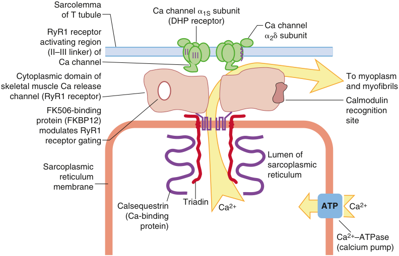
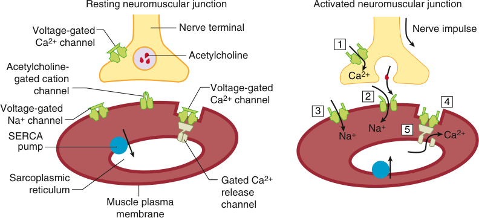
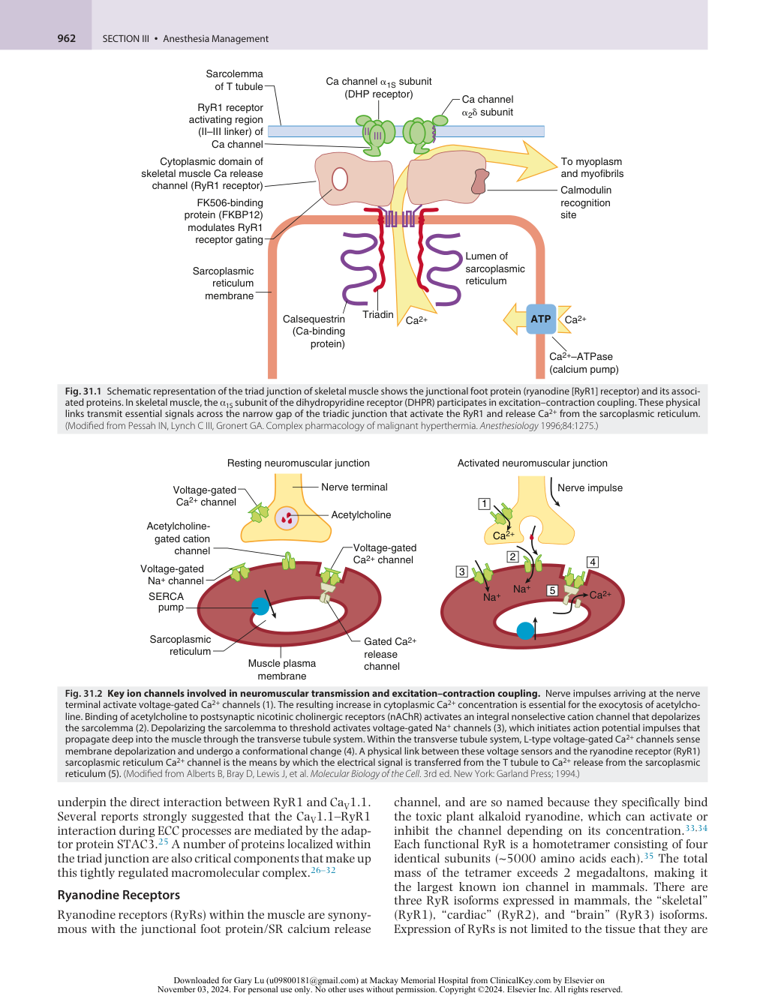
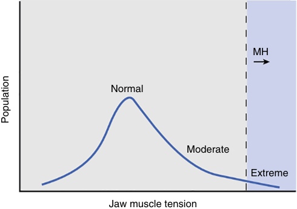
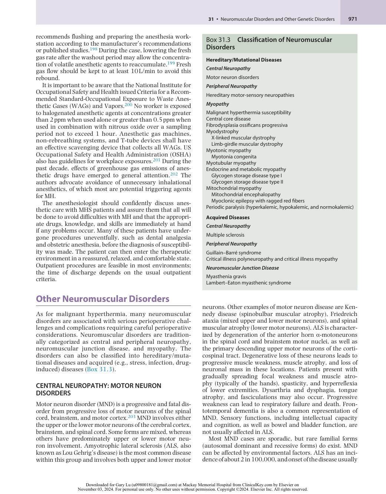
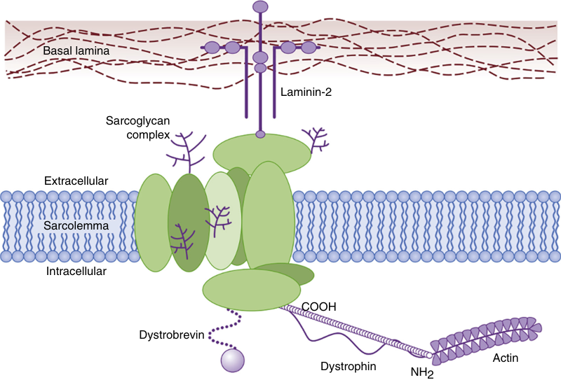
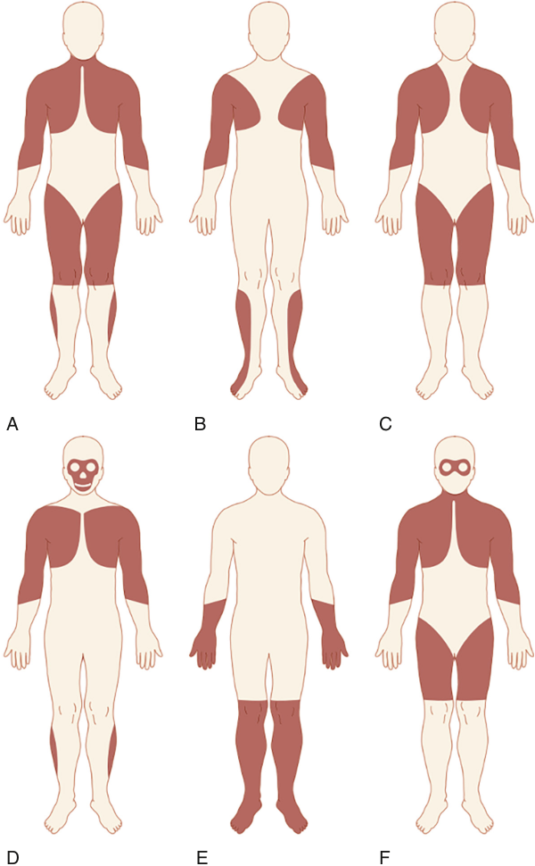

# Neuromuscular Disorders and Other Genetic Disorders

<!-- PDF page 1 -->

JIE ZHOU, JING ZHAO, XIAOBING YU, ALA NOZARI, ISAAC N. PESSAH, and PAUL D. ALLEN

### KEY POINTS

- Malignant hyperthermia (MH) is a pharmacogenetic disorder inherited primarily in an autosomal dominant pattern.

- MH susceptibility (MHS) is linked to 230 mutations in the skeletal muscle ryanodine receptor (RyR1) and four mutations in the calcium voltage- gated channel subunit alpha1 S (CACNA1S) genes that encode two Ca2+ channels necessary for skeletal muscle excitation–contraction coupling.

- Physical interactions between L- type Ca2+ channel (Cav1.1) and RyR1 tightly regulate initiation and termination of skeletal muscle excitation–contraction coupling.

- Skeletal muscle accounts for approximately 40% of body weight and inherent changes in its metabolism have profound impacts on whole- body metabolism and physiology.

- Carriers of MH mutations can exhibit mild to moderate muscle impairments in the absence of triggering agents but are rarely diagnosed.

- Carriers of MH mutations are susceptible to anesthetic- triggered runaway skeletal muscle metabolism, which if not promptly treated is lethal.

- Signs of MH, including increased end- tidal CO2, increased core temperature, muscle rigidity, tachycardia, and more _,_ are consequences of the fulminant hypermetabolic crisis.

- Exposure to triggering agents or heat stress leads to acute loss of RyR1/CaV1.1 channel regulation, rapid accumulation of Ca2+ within the sarcoplasm, and a hypermetabolic crisis that stimulates adenosine triphosphate (ATP) utilization by pumps attempting to restore resting Ca2+ balance among sarcoplasmic reticulum, mitochondrial, and extracellular compartments.

- Dantrolene markedly attenuates myoplasmic calcium (Ca2+ ) concentrations and thereby restores resting Ca2+ balance and metabolism, with reversal of clinical signs.

- Evaluation of persons susceptible to MH includes an _in vitro_ contracture test (IVCT) and caffeine/halothane contracture test (CHCT), and evaluation of DNA to identify mutations.

- Currently DNA testing alone can be used to evaluate 42 human mutations and all swine, equine, and canine MH.

- Future MH goals include advancement of genetic evaluations in North American and European medical programs and stronger finances to support genetic studies, the identification of the mode of action of dantrolene, a determination of the immediate cause of triggering MH, and the development of effective, noninvasive tests for MH susceptibility.

- The absence of mutations in dystrophin, along with dystrophin- associated glycoproteins, is involved in sarcolemmal stability. Its defects are responsible for Duchenne muscular dystrophy (DMD) and Becker muscular dystrophy (BMD).

- Whereas the risk for an MH mutation in DMD and BMD patients is like that in the general population, the incidence of MH- like anesthetic events has been reported to be 0.002 with DMD and 0.00036 with BMD.

- Succinylcholine is contraindicated in DMD and BMD patients because of the risk of rhabdomyolysis and hyperkalemia due to their unstable sarcolemmal membrane.

- Amyotrophic lateral sclerosis patients have exaggerated respiratory depression and sensitivity to sedatives and hypnotics and have higher risk for aspiration and pulmonary complications.

- For patients with fibrodysplasia ossificans progressive, awake nasal fiberoptic intubation is the first choice for airway management under non- emergent conditions, and intramuscular injection and regional anesthesia should be avoided as heterotopic ossification may exacerbate after muscle injury.

- Patients with limb- girdle muscular dystrophy are generally sensitive to opioids and muscle relaxants; short- acting anesthetic agents are preferred.

- Patients with glycogen storage disease type I should be monitored frequently to avoid hypoglycemia when they are fasted, and lactate- containing solutions should be avoided in these patients.

<!-- PDF page 2 -->

- Cardiomyopathy and cardiac failure are present in many patients with glycogen storage disease type II, and deterioration of diaphragmatic function can lead to postoperative acute respiratory failure in these patients.

- Anesthesia has a significant impact on mitochondrial function. For patients with mitochondrial diseases and mitochondrial myopathies, the implications of the patients’ comorbidities and metabolic status are more important than the specific choice of anesthetic agents.

- Guillain–Barré syndrome is an immune- mediated acute polyradiculopathy. Autonomic dysfunction may lead to hemodynamic instability with an exaggerated response to anesthesia induction agents or stimulating interventions such as laryngoscopy.

- Prolonged immobility in critically ill patients is associated with a relative increase in immature AChRs that can lead to an insensitivity to nondepolarizing neuromuscular blocking agent (NMBA), while the sensitivity to depolarizing neuromuscular blockers is increased with risk for life- threatening succinylcholine- induced hyperkalemia. Succinylcholine is therefore contraindicated in this condition.

- Myasthenia gravis is a disorder of neuromuscular transmission caused by autoantibodies against the muscle-type AChRs. Because of the decreased number of functional AChRs, these patients are very sensitive to nondepolarizing NMBAs but resistant to succinylcholine.

- For myasthenia gravis patients, a preoperative vital capacity &lt;2 L is thought to be associated with a higher risk of intensive care unit admission. Other risk factors include pyridostigmine dose >750 mg, preoperative bulbar symptoms, high anti- AChR antibody titers, prior history of myasthenic crisis, and an expected blood loss >1 L.

- Reversal of neuromuscular blockade with sugammadex is a practical alternative to the management of many of these disorders, if rocuronium or vecuronium is used. The combination of rocuronium and sugammadex has improved the anesthetic management for some of these challenging disorders.

## Malignant Hyperthermia

Malignant hyperthermia (MH) has the potential to be one of the most devastating anesthesia- related complications. The fulminant MH syndrome is elicited by the administration of triggering anesthetic agents, such as volatile halogenated anesthetics or depolarizing neuromuscular blocking agents (NMBAs). MH has been and continues to be a lifethreatening complication of anesthesia if the diagnosis is not made promptly and treatment is not begun in a timely fashion. Unlike other disorders described in this chapter, MH has virtually no characteristic phenotype before exposure to the triggering agent and is truly an example of the interaction of genes and the environment. Also covered in this chapter are some of the neuromuscular disorders. These disorders challenge both perioperative management by affecting the function of central and/or peripheral nerves, the neuromuscular junction, and/or muscles. Although such diseases are thought to be rare, the number of patients that a clinician may encounter is increasing because of better medical care, increasing longevity of patients with these diseases, and other possible unidentified factors.

MH is a pharmacogenetic clinical syndrome that, in its classic form, occurs during anesthesia with inhaled anesthetics such as halothane, isoflurane, sevoflurane, desflurane, and/or administration of the depolarizing muscle relaxant succinylcholine. The fulminant MH episode observed clinically involves muscle hypermetabolism as demonstrated by tachycardia and in increasing arterial partial pressure of carbon dioxide (PaCO2). Late signs include rapidly increasing body temperature, by as much as 1°C in 5 minutes, and extreme acidosis. The molecular basis for these signs and symptoms is an acute loss of control

of intracellular ionized calcium (Ca2+ ). It is the sustained high level of myoplasmic Ca2+ that rapidly drives skeletal muscle into a hypermetabolic state and subclinical or clinically observed muscle contractures that may proceed to severe rhabdomyolysis. Although MH was initially associated with a mortality rate of 60%, earlier diagnosis and the use of dantrolene have reduced the mortality to less than 1.4%.1 Estimates of the incidence of fulminant MH vary widely from one case per 10,000 to 1:250,000 anesthetics administered.2,3 However, the prevalence of MH mutations in the general population may be as high as 1:2000.4 Males appear to be more susceptible to developing a clinical MH episode than females.5,6 A sex difference in MHS has also been demonstrated in knock- in mice expressing human MH mutation _RyR1_ - T4825I.7 The pediatric population accounts for 52.1% of all MH reactions.8,9

Between 50% and 80% of genotyped patients who have had a clinical MH syndrome and a positive muscle biopsy have had their disease linked to one of more than 230 mutations in the type 1 ryanodine receptor ( _RyR1_ ; sarcoplasmic reticulum [SR] Ca2+ release channel) gene and 3 mutations in _CACNA1S_ which encode the pore containing subunit of the sarcolemmal slow voltage gated L- type Ca2+ channel (CaV1.1, also referred to as the dihydropyridine receptor [DHPR]).10 The genetics of MHS and the related abnormal function of _RyR1_ , the DHPR, and associated proteins are being investigated at the molecular level, with a porcine model and several new mouse models which have provided intricate details about the etiology of the disorder. Parallel studies in humans are limited by scarce material for scientific study and are complicated by the fact that phenotypes within a single genotype vary because of sex, age, genetic, epigenetic, and environmental modifiers.

<!-- PDF page 3 -->

Public education and communication in the United States are provided by Malignant Hyperthermia Association of the United States (MHAUS, 1 N. Main Street, P.O. Box 1069, Sherburne, NY 13460, USA; telephone: (+1) 607- 674- 7901; fax: (+1) 607- 674- 7910; e- mail: nicole@mhaus.org; website: http://www.mhaus.org), who also provide an emergency consultation service with the MH Hotline (1- 800- 644- 9737). The North American Malignant Hyperthermia Registry (NAMHR), a professional subsidiary of MHAUS, collates findings from muscle biopsy centers in Canada and the United States (NAMHR, 1345 SW Center Drive, P.O. Box 100254, Gainesville, FL 32610, USA); telephone: (+1) 888- 274- 7899; fax: (+1) 352- 392- 7029.; website http://anest.ufl.edu/namhr). The European Malignant Hyperthermia Group (EMHG) also provides updated knowledge, recommendations, and guidelines for MH management (http://www.emhg.org).

### HISTORY

Between 1915 and 1925, one family experienced three anesthetic- induced MH deaths with rigidity and hyperthermia and was puzzled for decades regarding the cause of these deaths.11 Susceptibility to MH was eventually confirmed in three descendants by _in vitro_ muscle biopsy tests.11 In 1929, Ombrédanne described anesthesia- induced postoperative hyperthermia and pallor in children accompanied by significant mortality but did not detect any familial relationships. Critical worldwide attention to MH began in 1960 when Denborough and associates reported a 21- year- old Australian with an open leg fracture who was more anxious about anesthesia than about surgery because 10 of his relatives died during or after anesthesia.12 Denborough and colleagues initially anesthetized him with the then- new agent halothane, halted it when signs of MH appeared, successfully treated the symptoms, aborted the syndrome, and subsequently used spinal anesthesia. Further evaluations by George Locher in Wausau, Wisconsin, and Beverly Britt in Toronto, Canada, led to the discovery that MH risk was indeed familial.13 It was also found that the cause of the syndrome was the result of skeletal muscle involvement rather than central loss of temperature control by the recognition of increased muscle metabolism or muscle rigidity early in the syndrome, low- threshold contracture responses, and elevated creatine kinase (CK) values.14

Interestingly, a similar syndrome was discovered in swine derived from breeding patterns designed to produce a rapid growth rate, lean bacon, and superior ham muscle development: e.g., Landrace, Piétrain, Duroc, and Poland China. In 1966, Hall and co- workers reported that a syndrome that appeared to be identical to MH could be induced in stress- susceptible swine by the administration of halothane and succinylcholine.15 The problem with these swine that had been noticed earlier was that they were susceptible to the porcine stress syndrome,16 which is associated with increased metabolism, acidosis, rigidity, fever, and death from rapid deterioration of muscle that results in pale, soft, exudative unsaleable pork.17 This syndrome can be triggered by any stress, such as separation, shipping conditions, weaning, fighting, coitus, or preparation for slaughter, and had become a significant problem for meat production using these breeds. The cause of this syndrome

in pigs was discovered to be a single missense mutation in _RYR1_ , and all susceptible swine have the same Arg615Cys mutation in the SR calcium release channel RyR1.18

In 1975, Harrison described the efficacy of dantrolene in preventing and treating porcine MH,19 which was rapidly confirmed in humans by a multi- hospital evaluation of dantrolene used to treat anesthetic- induced MH episodes.20 Today, dantrolene still remains the primary pharmacologic approach for successful MH therapy.

### PHYSIOLOGY AND PATHOPHYSIOLOGY

MH is a syndrome caused by dysregulation of excitation– contraction coupling (ECC) in skeletal muscle. Normal muscle contraction is initiated by nerve impulses arriving at the neuromuscular junction (i.e. _,_ the motor end plate) that trigger the release of acetylcholine (ACh) from the nerve terminal. ACh activates nicotinic cholinergic receptors (nAChR), the nonselective cation channels located at the postsynaptic neuromuscular junction, and initiates action potentials. The action potentials propagate rapidly along the sarcolemma (muscle cell membrane) and travel down the transverse tubules (invaginations of the sarcolemma, T tubules). A T tubule is flanked on both sides by a terminal cisternae element from the sarcoplasmic reticulum (SR), forming triad junctions. The depolarization of T- tubular membrane is sensed by CaV1.1, the pore subunit of the voltage- gated calcium channel residing within the T tubules. Freeze fracture of the surface membrane has shown that CaV1.1 aligns in tetrads opposite to a single RyR1 embedded in the SR at the triad junctions. Conformational changes of CaV1.1 mechanically communicate with RyR1, causing it to open and release large amounts of calcium from the SR into the sarcoplasm (Fig. 31.1). The released Ca2+ binds to accessory protein troponin C which is on the actin thin filament. It then causes a conformational change in tropomyosin, exposing actin’s myosin binding sites, which allows shortening and/or force development by the muscle fibers (i.e. _,_ a muscle contraction).

The contraction ends when the intracellular Ca2+ pumps, SR Ca2+ - adenosine triphosphatases [ATPases] (SERCAs), rapidly sequester Ca2+ back into the SR lumen. Muscle relaxation begins when the Ca2+ concentration falls below 10−6 M and ends when the resting sarcoplasmic Ca2+ concentration is restored to 10−7 M.

Because both contraction and relaxation are energyrelated processes that consume adenosine triphosphate (ATP), knowing the molecular events contributing to ECC and the subsequent relaxation phase is essential to understanding the cause of MH (Fig. 31.2). Clinical and laboratory data from humans, swine, and mice with knock- in mutations indicate that the fulminant MH syndrome is associated with a persistent increase in the concentration of sarcoplasmic Ca2+ .21–24 The increased activity of pumps and exchangers trying to correct the increase in sarcoplasmic Ca2+ associated with triggered MH increases the need for ATP, which in turn produces heat. Thus, the common etiologic feature of the disorder is hyperthermia. The rigidity that is frequently seen during a fulminant MH episode is the result of the inability of the Ca2+ pumps and transporters to reduce the unbound sarcoplasmic Ca2+ below the contractile threshold (10−6 M). Recent studies failed to

<!-- PDF page 4 -->

Sarcolemma of T tubule Ca channel �1S subunit (DHP receptor) Ca channel RyR1 receptor �2� subunit activating region (II–III linker) o f II III Ca channel Cytoplasmic domain of To myoplasm skeletal muscle Ca release and myofibrils channel (RyR1 receptor) Calmodulin FK506-binding recognition protein (FKBP12) site modulates RyR1 receptor gating Lumen of Sarcoplasmic sarcoplasmic reticulum reticulum membrane Triadin Calsequestrin Ca 2+ ATP Ca 2+ (Ca-binding protein) Ca 2+ –ATPase (calcium pump) 

**Fig. 31.1** Schematic representation of the triad junction of skeletal muscle shows the junctional foot protein (ryanodine [RyR1] receptor) and its associated proteins. In skeletal muscle, the α1S subunit of the dihydropyridine receptor (DHPR) participates in excitation–contraction coupling. These physical links transmit essential signals across the narrow gap of the triadic junction that activate the RyR1 and release Ca2+ from the sarcoplasmic reticulum. (Modified from Pessah IN, Lynch C III, Gronert GA. Complex pharmacology of malignant hyperthermia. _Anesthesiology_ 1996;84:1275.)

Resting neuromuscular junction Activated neuromuscular junction Voltage-gated Nerve terminal Nerve impulse Ca 2+ channel 1 Acetylcholine Acetylcholine- gated cation Ca 2+ channel Voltage-gated Ca 2+ channel 2 4 Voltage-gated 3 Na + channel Na + 5 SERCA Na + Ca 2+ pump Sarcoplasmic Gated Ca 2+ reticulum release Muscle plasma channel membrane 

**Fig. 31.2 Key ion channels involved in neuromuscular transmission and excitation–contraction coupling.** Nerve impulses arriving at the nerve terminal activate voltage- gated Ca2+ channels (1). The resulting increase in cytoplasmic Ca2+ concentration is essential for the exocytosis of acetylcholine. Binding of acetylcholine to postsynaptic nicotinic cholinergic receptors (nAChR) activates an integral nonselective cation channel that depolarizes the sarcolemma (2). Depolarizing the sarcolemma to threshold activates voltage- gated Na+ channels (3), which initiates action potential impulses that propagate deep into the muscle through the transverse tubule system. Within the transverse tubule system, L- type voltage- gated Ca2+ channels sense membrane depolarization and undergo a conformational change (4). A physical link between these voltage sensors and the ryanodine receptor (RyR1) sarcoplasmic reticulum Ca2+ channel is the means by which the electrical signal is transferred from the T tubule to Ca2+ release from the sarcoplasmic reticulum (5). (Modified from Alberts B, Bray D, Lewis J, et al. _Molecular Biology of the Cell_ . 3rd ed. New York: Garland Press; 1994.)

underpin the direct interaction between RyR1 and CaV1.1. Several reports strongly suggested that the CaV1.1–RyR1 interaction during ECC processes are mediated by the adaptor protein STAC3.25 A number of proteins localized within the triad junction are also critical components that make up this tightly regulated macromolecular complex.26–32

### Ryanodine Receptors

Ryanodine receptors (RyRs) within the muscle are synonymous with the junctional foot protein/SR calcium release

channel, and are so named because they specifically bind the toxic plant alkaloid ryanodine, which can activate or inhibit the channel depending on its concentration.33,34 Each functional RyR is a homotetramer consisting of four identical subunits (∼5000 amino acids each).35 The total mass of the tetramer exceeds 2 megadaltons, making it the largest known ion channel in mammals. There are three RyR isoforms expressed in mammals, the “skeletal” (RyR1), “cardiac” (RyR2), and “brain” (RyR3) isoforms. Expression of RyRs is not limited to the tissue that they are

::: warning 符號需核對
此頁有符號無法完整擷取，請展開下方原始頁面核對。
:::

::: details 原始表格與符號（PDF 第 4 頁）

:::

<!-- PDF page 5 -->

defined by, and RyR3 is also expressed in muscles, while only RyR1 mediates the skeletal- type ECC.36 The RyR1 tetramer anchored within the SR membrane physically spans the junctional space to interact with DHPR tetrads within the T- tubule membrane as described above. This physical interaction engages a form of bidirectional signaling that tightly regulates the function of both proteins. As a highconductance channel, RyR1 ultimately regulates release of SR Ca2+ and is the central component of the CRU.

As one of the biggest proteins, RyR1s are predominantly activated by Ca2+ but also regulated by many factors, including CaV1.1, Mg2+ , ATP, caffeine, 4- chloro- m- cresol, and under the proper conditions, dantrolene. With recent breakthroughs in structural biology, the binding sites of these factors have been extensively studied, allowing us to comprehend the structure–function relationships of RyR1.35 Mutations of _RYR1_ remain the leading cause of MH. About 50%–80% MH patients have a mutation in _RYR1_ . Structural studies revealed that MH mutations can cause local conformational changes of RyR1. The “intermediate” pathological state, that the cytoplasmic regions of MHRyR1 resemble those of the open channel, leads to an aberrant sensitivity of the channel to activation signals, including caffeine and halothane.37,38

### Voltage- Gated Calcium Channels: Role of CaV1.1

The voltage- gated calcium channel DHPR embeds in the sarcolemma, detects the action potential in the T tubule, and communicates the signal to the RyR1. Skeletal DHPR consists of four principal subunits: the pore- forming α1s subunit, the auxiliary extracellular α2δ subunit, the cytoplasmic β1a subunit, and the transmembrane γ subunit. The α1s subunit of DHPR, also referred to CaV1.1, is the major subunit and contains the voltage sensor. Though CaV1.1 functions as a Ca2+ channel, it is not the Ca2+ current but the conformational change of the protein upon depolarization that is responsible for the signal transmission to RyR1.39

About 1% of MH cases are caused by mutations in the _CACNA1S_ gene, which encodes CaV1.1.40 Although normally the DHPR acts as a RyR1 stabilizer, preventing spontaneous opening, the mutations located in different domains of CaV1.1 appear to sensitize the calcium release to activation by the triggering agents like caffeine and volatile anesthetics.41–44 The mechanism of how this happens remains to be explored.

Other cellular processes can affect MH episodes. Firstly, functional neuromuscular junctions and/or depolarization of the sarcolemma may be the precondition for MH, supported by the observation that concurrent administration of nondepolarizing neuromuscular blocking drugs at the same time as triggering agents can delay or prevent the onset of clinical MH syndrome.45 Secondly, excitationcoupled Ca2+ entry (ECCE), which is a pathway of extracellular Ca2+ entering into skeletal muscle cells, is sensitive to the conformation of the RyR1 and is enhanced by several mutations in _RYR1_ , including MH mutations.26,46,47 In addition, classic store- operated capacitive Ca2+ entry pathways similar to the store- operated Ca2+ entry seen in non- excitable cells have been shown to be present in skeletal muscle and appear to be more active in MHS muscles both at rest as a response to chronic store depletion and

during an MH crisis.48–51 This enhanced calcium entry, when combined with decreased sensitivity of RyRs to Ca2+ and Mg2+ inhibition, could provide cellular conditions that heighten sensitivity to triggering agents and perpetuate the fulminant clinical MH syndrome.

### GENETICS

Mutations in _RYR1_ are the most common defects present in patients who developed MH. _RYR1_ mutations have been found in 50% to 80% of patients and relatives who are labeled MHS by positive contracture tests and in almost all families with central core disease (CCD) and King–Denborough syndrome (KDS) (see MH- Associated Syndromes/ Pathological Conditions, below). More than two hundred missense mutations and 8 deletions associated with MH have thus far been detected.10 It was thought that most _RYR1_ mutations were clustered in three “hot spots”: between amino acid residues 35 and 614 (MH/CCD region 1, C- terminal), between amino acid residues 2129 and 2458 (MH/CCD region 2, Central) in the sarcoplasmic foot region of the protein, and between amino acids 3916 and 4942 in the carboxyl- terminal transmembrane loop or pore region (MHS/CCD region 3, N- terminal).10

Another gene that has been shown to be associated with MH is _CACNA1S_ ,52 which codes for CaV1.1 (the α1S- subunit of DHPR). Two causative mutations in this gene are linked to less than 1% of MHS families worldwide. Recently, a homozygous mutation of the _STAC3_ gene, which encodes the protein STAC3 that directly participates in the interaction between CaV1.1 and RyR1,25 has been linked to Native American myopathy associated with MHS in one Native American family.53 However, until now there are only 48 mutations of the _RYR1_ gene, and 2 mutations of the _CACNA1S_ have been described as diagnostic MH mutations by EMHG.54 Hence for practical reasons, the _RYR1_ gene remains the primary target for current clinical genetic analysis.

The true ethnic distribution of MH is difficult to ascertain. Genetic analysis of MH patients has been predominantly reported in North America and Europe, and several mutations of _RYR1_ and _CACNA1S_ have been detected in more than one family there.55–61 The mutation common to North America and Europe is G2434R, which occurs in 5.5% of North American and 4% to 7% of European families.62 Single- family mutations are the most common mutations reported in Japanese, Chinese, and Australians.63–65 The unique family mutations in Asia and Australasia may reflect the small number of cases that have been investigated.

Inheritance of human MH is predominantly in an autosomal dominant fashion with variable penetrance. More than one MH- linked mutation has been identified in some probands and families. Six non- consanguineous families harbor at least two _RYR1_ mutations that have both been linked to MHS, and in two of those families, one is an _RYR1_ mutation and the second is a CaV1.1 mutation.4 Allelespecific differences in _RYR1_ mRNA expression and monoallelic silencing has been observed,66,67 which may help explain the variable penetrance of MH mutations. In a study of 229 genotype- positive individuals with exposure to triggering anesthetic agents, the overall penetrance for the

<!-- PDF page 6 -->

analyzed _RYR1_ mutations was approximately 40% with 93 MH cases.68

### In Vitro Contracture Test (IVCT) and Caffeine Halothane Contracture Test (CHCT)

Prior to having easy access to gene sequencing, the gold standard for diagnosis of MH is the halothane and caffeine muscle contracture test, also known as the IVCT or CHCT, developed by the European Malignant Hyperthermia Group (EMHG) and the North American Malignant Hyperthermia Group (NAMHG), respectively.69,70 The two protocols are similar, but not identical. For differentiation, we designate IVCT to the EMHG protocol and CHCT to the NAMHG protocol.

For IVCT, the muscle biopsy will be performed on the quadriceps (either vastus medialis or vastus lateralis)71,72 and consists of three parts: a static caffeine test, a static halothane test, and a dynamic halothane test.72 For the static caffeine test, a stepwise increased concentration (0.5, 1, 1.5, 2, 3, 4, and 32 mmol/L) is applied. The lowest concentration of caffeine which produces a sustained increase of at least 0.2 g in baseline tension is reported as the caffeine threshold. Then, the halothane threshold is obtained using the same method by exposing the muscle to halothane concentrations of 0.5%, 1%, 2%, and 3% v/v. The dynamic halothane test is performed with the muscle stretched at a constant rate of 4 mm/min to achieve a force of approximately 3 g and held at the new length for 1 minute for a 3- minute exposure to halothane. For each cycle, halothane concentration will be increased from 0.5%, 1%, 2%, to 3% v/v: volume (solute) per volume (solvent). The concentration of halothane which produces a sustained increase of at least 0.2 g in the muscle tension compared to the pre- halothane control is defined as the dynamic halothane threshold.72 The IVCT protocol formerly classified the patients into three groups: MH Susceptible (MHSHC) group with a caffeine threshold at the caffeine concentration of 2 mmol or less and a halothane threshold of 2% v/v halothane or less; MH Normal (MHN) group with a caffeine threshold at the caffeine concentration of 3 mmol or more without a halothane response at 2% v/v; MHSH and MHSC groups, which describe individuals that used to be classified as MHE (equivocal) who are only responsive to either halothane or caffeine alone.70 The MHE descriptor was dropped because use of the “equivocal” label outside of its laboratory context has the potential to confuse patients and clinicians unfamiliar with its derivation and these patients are now considered for clinical purposes to be MHS.70

For CHCT, a muscle biopsy can be taken from the following sites in the order of preference: (1) the vastus group, (2) the rectus abdominis, and (3) other muscle groups under special circumstances.73 Required tests include exposure of muscle to 3% v/v halothane alone and to incremental caffeine concentrations (0.5, 1, 2, 4 mmol, and 8.0 mmol if the response at 4 mmol is &lt;1 g, and 32 mmol) alone. Optional tests include exposure of muscle to a combination of both 1% halothane and incremental caffeine concentrations, and to 2% v/v halothane alone.73 According to CHCT protocol, an individual is MHS when either of the halothane or the caffeine test is positive, and MHN when both tests are negative.73

The sensitivity of IVCT was reported to be 99.0% (95% confidence interval [CI] 94.8%–100%) if the MHE group is considered susceptible and the specificity of IVCT was 93.6% (95% CI 89.2%–96.5%),72 while the sensitivity and specificity of CHCT was 97% (95% CI 84%–100%) and 78% (95% CI 69%–85%), respectively.74 Recently, fluoroquinolones and statins, 3- hydroxy- 3- methylglutaryl- coenzyme A (HMG- CoA) reductase inhibitors, were found to induce significant contractures in MHS muscle bundles, but not in MHN.75,76 Ondansetron and 3,4- methylenedioxymethamphetamine (MDMA) may also dose- dependently induce contracture or increase the sensitivity of the contractile apparatus to calcium in both MHS and MHN fibers.77,78 Modifications to the IVCT protocol by adding ryanodine or 4- chloro- _m_ - cresol,79,80 a RyR- specific agonist, has been reported, but has not been included in the standard protocol. Furthermore, Metterlein and associates studied the possibility of replacing halothane with newer volatile agents in IVCT.81 At increasing concentration, except for sevoflurane, all newer volatile agents, including enflurane, isoflurane, and desflurane, induced significantly greater contractures in MHS muscle compared to MHN bundles. However, within the MHS muscle bundles, halothane produced significantly higher contractures, and was considered the strongest discriminator for MH using the IVCT protocol.81 A direct application of high sevoflurane concentration of 8%, instead of the stepwise application, has been shown to induce significantly stronger contractures in MHS subjects.82 Nevertheless, from the retrospective analysis of the Japanese MH database, there was no evidence between the severity of MH triggered by sevoflurane and isoflurane, or other agents, suggesting sevoflurane is a weak or weaker MH triggering agent.83

### Discordance Between Genetic TEST and IVCT/ CHCT

Discordance has confounded linkage analysis worldwide. Examples include MHN patients carrying an _RYR1_ mutation associated with MH and MHS patients who do not carry the familial _RYR1_ mutation. Several explanations are possible, the most likely being that IVCT/CHCT is not clinically precise and that the thresholds for IVCT or CHCT are inexact. This would lead to errors in determining whether a patient was MHN or MHS. A second possibility is the variable penetrance of MH mutations (see Genetics, above). A third reason is that individuals with discordance have mutations in other unknown genes or modifier genes that affect the function of RyR1 and its phenotypic penetrance. There remains significant fraction of approximately 15%–30% patients studied after what was considered a clear MH episode in whom a causative mutation in _RYR1_ or _CACNA1S_ has not been discovered.40 New pathological mutations which may influence susceptibility to MH could be the reasons for the segregation to loci on chromosomes 1, 5 and 7.59

### Guidelines for Genetic Screening

In 2000, the EMHG formulated guidelines for _RYR1_ mutation screening with linkage data to other loci for some MH families, but all MH investigators emphasized the vital role of IVCT in the diagnosis of MH.84 These guidelines for screening have reduced the number of relatives requiring

<!-- PDF page 7 -->

contracture testing without increasing the risk of misdiagnosis.85,86 In 2015, the EMHG published a revision of the guidelines for the investigation of MHS. This updated guideline provided a detailed patient referral criteria and clinical interpretation of IVCT results.70

Only a small number of MHS families have been investigated extensively in North America by phenotyping, linkage analysis, and screening of specific genes. Over the past few years, genetic screening of _RYR1_ mutations in MHS patients had been carried out in the USA,61 UK,56 Japan,87 and Switzerland.55 The penetrance of MH mutations is variable, while once MH occurs the morbidity is high. This underscores the complication of determining the prevalence of MHS in the absence of an inexpensive MH diagnostic test. Nevertheless, recommendation for genetic screening should be carefully considered based on solid clinical suspicion.

### ANESTHETIC TRIGGERING

Fulminant MH is rare. Acute episodes of MH depend on four variables: a genetic (perhaps rarely acquired) predisposition, the absence of inhibiting factors, the presence of an anesthetic or nonanesthetic trigger, and the presence of environmental factors that could potentiate the action of one or more of the other three variables.

Anesthetic drugs that trigger MH include ether, halothane, enflurane, isoflurane, desflurane, sevoflurane, and depolarizing muscle relaxants, the only currently used of which is succinylcholine. Desflurane and sevoflurane appear to be less potent triggers than halothane and produce a more gradual onset of MH.88,89 The onset may be explosive if succinylcholine is used. MHS swine were traditionally screened by induction with a volatile anesthetic, which led to pronounced hind limb rigidity within 5 minutes, frequently sooner.90 Prior exercise even an hour before induction of anesthesia increased the severity and hastened the onset of rigidity in swine.90 Similarly, in the new knock- in mouse models, the onset of limb rigidity after commencing exposure to volatile anesthetics is very rapid. There are also several modifying factors that are more likely to be present in humans than in pigs or mice and can alter, or even prevent, the onset of clinical MH. Mild hypothermia and pre- administration of barbiturates, tranquilizers, propofol, or nondepolarizing neuromuscular blockers delay or prevent the onset of MH in MHS humans, thus making them respond less predictably than swine or MH knock- in mice.23,45,90,91 There have been many instances in which fulminant MH has been reported in patients who have previously tolerated potent triggers without difficulty.68,92 The reason behind why this occurs is unknown, but it is likely to be related to prior or concurrent administration of drugs that prevent or delay onset of the syndrome, as described earlier, or unknown environmental influences that help provoke the positive incident. Thus, onset of the syndrome in humans is extremely variable both in initial symptoms and in the time of onset of the syndrome. Its onset is so variable that making the diagnosis in the setting of a clinical anesthetic can be quite difficult. Although not perfect, the clinical grading scale developed by Larach and colleagues is a useful way for clinicians to retrospectively determine whether a patient who responded abnormally to anesthesia is in any way likely to actually have had a clinical MH

episode.93 However, MH is most easily diagnosed prospectively by vigilance, recognizing its signs and symptoms, and knowing how to treat the syndrome.

The two classic clinical manifestations of fulminant MH syndrome may start in one of the following two scenarios.

### Scenario 1

1.  Rigidity after induction with thiopental and succinylcholine, but successful intubation, followed rapidly by the symptoms listed after scenario 2.

2.  Normal response to induction of anesthesia and uneventful anesthetic course until onset of the following symptoms:

   - Unexplained sinus tachycardia or ventricular arrhythmias, or both

   - Tachypnea if spontaneous ventilation is present

   - Unexplained decrease in O2 saturation (because of a decrease in venous O2 saturation)

   - Increased end- tidal partial pressure of carbon dioxide (PCO2) with adequate ventilation (and in most cases unchanged ventilation)

   - Unexpected metabolic and respiratory acidosis

   - Central venous desaturation

   - Increase in body temperature above 38.8°C with no obvious cause

### Scenario 2

The usually muted onset of MH is in most cases detected quickly by the development of tachycardia, increased levels of expired CO2, and muscle rigidity. It can be delayed for several reasons and may not be overt until the patient is in the recovery room. Once initiated, the course of MH can be rapid. When clinical signs such as increased expired CO2, muscle rigidity, tachycardia, and fever suggest MH, more than one abnormal sign must be observed before making the diagnosis because according to a meta- analysis of many reported cases, a single adverse sign does not usually indicate MH.93 The mechanism by which anesthetics and depolarizing muscle relaxants trigger MH is unsolved, but it cannot be ignored that they are etiologic agents and that early diagnosis is critical for successful treatment.

### NONANESTHETIC MALIGNANT HYPERTHERMIA

MH can be triggered by stress such as exercise and overheating, known as “awake” MH. Numerous anecdotal reports of MH- like episodes in humans after stressful situations were reported.94–99 Measurement of plasma catecholamine levels during exercise showed no differences between MHS and normal individuals.100,101 Therefore, it is unlikely that these responses were provoked by sympathetic overdrive or catecholamine surge.102

In susceptible swine, environmental stress, such as exercise, heat, anoxia, apprehension, and excitement, triggers fulminant MH (see History, above).9,90 These responses are related to muscle movement or to increased temperature. Increased ambient temperature triggers fulminant MH in four strains of heterozygous MH mice and in two homozygous strains.103,104 Epidemiologic studies have shown that exercise- induced symptoms, including rhabdomyolysis, may occur more frequently in MHS patients,99,105 and mutations in _RYR1_ and _CACNA1S_ were present in a

<!-- PDF page 8 -->

considerable number of patients with exercise- induced rhabdomyolysis.94,98,99,106 Other reports are largely anecdotal and relate heat stroke, sudden and unexpected death, unusual stress and fatigue, or myalgia to possible “awake” MH episodes. Stresses associated with these episodes include exercise and environmental exposure to volatile nonanesthetic vapors.107–109 In the United States, MHAUS provided recommendations of adverse effects of heat and exercise in relation to MHS.110

### DIAGNOSIS IN THE OPERATING ROOM AND POSTANESTHESIA CARE UNIT

As stated earlier, fulminant MH is rare, and early signs of clinical MH may be subtle (Box 31.1). These signs must be distinguished from other disorders with similar signs (Box 31.2).

When the diagnosis is obvious (i.e. _,_ fulminant MH or succinylcholine- induced rigidity with rapid metabolic changes), marked hypermetabolism and heat production occur, and there may be little time left for specific therapy to prevent death or irreversible morbidity. If the syndrome begins with slowly increasing end- tidal CO2 (defined earlier), specific therapy can await a complete clinical workup before treatment. In general, MH is not expected to occur when no triggers are administered (see Anesthetic Management of MHS Patients, below). However, several confirmed fulminant nonanesthetic cases of MH that resulted in death have been reported (see Nonanesthetic Malignant Hyperthermia, above).105

When volatile anesthetics or succinylcholine are used, MH should be suspected whenever there is an unexpected increase in end- tidal CO2 (ETCO2), undue tachycardia, tachypnea, arrhythmias, mottling of the skin, cyanosis, muscle rigidity, sweating, increased body temperature, or unstable blood pressure. If any of these occur, signs of increased metabolism, acidosis, or hyperkalemia must be sought. The most common cause for sudden ETCO2 during general anesthesia and sedation is hypoventilation. Increased minute ventilation should be able to correct such a problem.

The diagnosis of MH can be supported by the analysis of arterial or venous blood gases, which demonstrates a mixed respiratory and metabolic acidosis111 ; however, the respiratory component of acidosis may be predominate in the very early stage of the onset of fulminant MH. O2 and CO2 change more markedly in the central venous compartment than in arterial blood; therefore end- expired or venous CO2 levels more accurately reflect whole- body stores. Venous CO2, unless the blood drains an area of increased metabolic activity, should have PCO2 levels of only about 5 mm Hg greater than that of expected or measured PaCO2. In small children, particularly those without oral food or fluid for a prolonged period, the base deficit may be 5 mEq/L because of their smaller energy stores.

### Box 31.1 Clinical Signs of Malignant Hyperthermia

### Early Signs

Elevated end- tidal CO2 Tachypnea and/or tachycardia Masseter spasm if succinylcholine has been used Generalized muscle rigidity Mixed metabolic and respiratory acidosis Profuse sweating Mottling of skin Cardiac arrhythmias Unstable blood pressure

### Late Signs

Hyperkalemia Rapid increase of core body temperature Elevated creatine phosphokinase levels Gross myoglobinemia and myoglobinuria Cardiac arrest Disseminated intravascular coagulation

### Box 31.2 Conditions and Disorders that May Mimic Malignant Hyperthermia

Alcohol therapy for limb arteriovenous malformation Anaphylactic reaction Contrast dye injection Cystinosis Diabetic coma Drug toxicity or abuse Elevated end- tidal CO2 due to laparoscopic operation Environmental heat gain more than loss Equipment malfunction with increased carbon dioxide Exercise hyperthermia Freeman–Sheldon syndrome Generalized muscle rigidity Heat stroke Hyperkalemia Hyperthyroidism Hypokalemic periodic paralysis Hypoventilation or low fresh gas flow Increased end-tidal CO2 from laparoscopic surgery Insufficient anesthesia and/or analgesia Malignant neuroleptic syndrome Muscular dystrophies (Duchenne and Becker) Myoglobinuria Myotonias Osteogenesis imperfecta Pheochromocytoma Prader–Willi syndrome Recreational drugs Rhabdomyolysis Sepsis Serotonin syndrome Stroke Thyroid crisis Wolf–Hirschhorn syndrome

### TREATMENT

Dantrolene is the only drug which has been shown to be effective in both preventing and reversing fulminant MH.103,112 Dantrolene sodium is a hydantoin derivative (1- [[[5- (4- nitro phenyl)- 2- furanyl]methylene]imino]- 2,4- imidazolidinedione)

that does not block neuromuscular transmission, but causes muscle weakness by direct muscular action. The properties of dantrolene have been closely correlated with its ability to reduce efflux of Ca2+ from the SR.113–115 The idea that

<!-- PDF page 9 -->

dantrolene suppresses SR Ca2+ release as a result of direct interactions with RyR1 is somewhat controversial.116 Dantrolene also attenuates depolarized–triggered Ca2+ entry mediated by CaV1.1, which is exacerbated in MHS muscle cells and MH normal muscle cells exposed to ryanodine.117 Thus whether dantrolene directly inhibits RyR1 or requires additional intermediates within the triad junctions remains to be clarified. The 2017 discovery that inhibition of SR Ca2+ release by dantrolene requires Mg2+ may help resolve the controversy of the conflicting observations on dantrolene inhibition of RyR1 channel activity in Mg2+ - free bilayer experiments.118

Acute management for MH can be summarized as follows:

1.  Discontinue all triggering anesthetics, maintain intravenous agents, such as sedatives, opioids, and nondepolarizing muscular blockers as needed, and hyperventilate with 100% oxygen with a fresh flow to at least 10 L/min. With increased aerobic metabolism, normal ventilation must be increased.3 However, CO2 production is also increased because of neutralization of fixed acid by bicarbonate; hyperventilation removes this additional CO2.

2.  Administer dantrolene rapidly with the initial dose of 2.5 mg/kg intravenously to a maximum of 10 mg/kg until the initial symptoms subside.

3.  Administer bicarbonate (1–4 mEq/kg intravenously) to correct the metabolic acidosis with frequent monitoring of blood gases and pH.

4.  Control fever by cooling interventions. Circulating water mattresses or ice packs should be considered first. If external cooling is insufficient, infuse 20 mL/kg of refrigerated intravenous (IV) crystalloid. Peritoneal lavage is probably the safest and most effective of the invasive approaches if the peritoneum is already open. Cooling should be halted at 38°C to prevent inadvertent hypothermia.119

5.  Monitor and treat arrhythmia. Advanced cardiac life support protocol may be applied.

6.  Monitor and maintain urinary output to greater than 1 to 2 mL/kg/h and establish diuresis if urine output is inadequate. Administer bicarbonate to alkalinize urine to protect the kidney from myoglobinuria- induced renal failure.

7.  Further therapy is guided by blood gases, electrolytes, CK, temperature, muscle tone, and urinary output. Hyperkalemia should be treated with bicarbonate, glucose, and insulin, typically 10 units of regular insulin and 50 mL of 50% dextrose for adult patients. The most effective way to lower serum potassium is reversal of MH by effective doses of dantrolene. In severe cases, calcium chloride or calcium gluconate may be used.

8.  Recent data demonstrated that magnesium level could be a prerequisite for dantrolene efficacy in managing MH crisis.

9.  Analyze coagulation studies (e.g. _,_ international normalized ratio [INR], platelet count, prothrombin time, fibrinogen, fibrin split, or degradation products).

10.  Once the initial reaction is controlled, continued monitoring in the intensive care unit for 24 to 48 hours is usually recommended.

Adequate personnel support is critical to the successful management of such a crisis. Discontinuation of the trigger may be adequate therapy for acute MH if the onset is slow or if exposure was brief. Changing the breathing circuit and CO2 absorbent can be time- consuming. However, application of activated charcoal filters may rapidly reduce the volatile anesthetic concentration to an acceptable level in less than 2 minutes, if they are readily available.120

The dantrolene from two suppliers is packaged in 20- mg bottles with sodium hydroxide for a pH of 9.5 (otherwise it will not dissolve) and with 3 g of mannitol (converts the hypotonic solution to isotonic). The initial dose should be 2 to 3 mg/kg dantrolene reconstituted in sterile water and administered intravenously. Dantrolene in this presentation must be reconstituted in sterile water rather than salt solutions or it will precipitate. It has been shown that prewarming of sterile water may expedite the solubilization of dantrolene compared to water in ambient temperature.121 In 2009, a newer, rapid lyophilized powder form of dantrolene became available for intravenous use. It reconstitutes as a suspension that makes it safe to administer a full dose much faster than the older versions.122 The higher dose per vial, 250 mg compared to 20 mg, of the newer version of dantrolene also reduces the storage space but makes it more difficult to give less than a 2.5 mg/kg dose without waste. It has a similar recommended shelf life as the older versions.

In awake healthy volunteers, the maximum twitch depression occurs at a dantrolene dose of 2.4 mg/kg.123 Therefore it is not surprising that at therapeutic concentrations, dantrolene may prolong the need for intubation and assisted ventilation. Brandom and associates reviewed the complications associated with the administration of dantrolene from 1987 to 2006 using the dataset in the NAMHR via the AMRA reports and found that the most frequent complications of dantrolene were muscle weakness (21.7%), phlebitis (9%), gastrointestinal upset (4.1%), respiratory failure (3.8%), hyperkalemia (3.3%), and excessive secretions (8.2%).124 Given its high pH, it is advisable to administer dantrolene through a large-bore IV line. It has been demonstrated that dantrolene interferes with EC coupling of murine intestinal smooth muscle cells, rat gastric fundus, and colon, which in part explains its gastrointestinal side effect.125,126 Caution should be used when ondansetron is to be used in this setting. As a serotonin antagonist, ondansetron may increase serotonin at the 5- HT2A receptor in the presynaptic space. It has been suggested that in MHS individuals, agonism of 5- HT2A receptor may produce a deranged response, precipitating MH.127

Recrudescence of MH can approach 50%, usually within 6.5 hours, but also can occur in up to 16 hours after the initial reaction is controlled.128,129 Therefore, after initial bolus dosing to treat the acute MH crisis, maintenance dantrolene should be continued at a 1- mg/kg dose every 4–6 hours for 24 hours while monitoring the patient for signs of recrudescence.119 The total dose of dantrolene that can be used is up to 30 mg/kg in some cases. When recrudescence occurs, calcium and cardiac glycosides may be used safely, and CPR may be required. They can be lifesaving during persistent hyperkalemia. Slow voltage- gated calcium channel blockers do not increase porcine survival.130,131 Instead, a study by Migita demonstrated that calcium channel

<!-- PDF page 10 -->

blockers, including dihydropyridine (i.e., nifedipine), phenylalkylamine (i.e., verapamil), and benzothiazepine (i.e., diltiazem), led to increased Ca2+ in human skeletal muscle cells.132 Interestingly, the potency of such calcium release is correlated with the number of binding sites on DHPR (i.e., nifedipine > verapamil > diltiazem).132 Clinical doses of dantrolene were only able to attenuate 20% of the nifedipineinduced Ca2+ surge.132 Current recommendations of MHAUS discourage the use of calcium channel blockers in the presence of dantrolene because they can worsen the hyperkalemia resulting in cardiac arrest. Although administration of magnesium sulfate could not prevent the development of MH and did not influence the clinical course in succinylcholine- induced MH,133 recent data suggested that dantrolene might require magnesium to arrest the course of MH triggered by halothane.118 Permanent neurologic sequelae, such as coma or paralysis, may occur in advanced cases, probably because of inadequate cerebral oxygenation and perfusion for the increased metabolism and because of the fever, acidosis, hypo- osmolality with fluid shifts, and potassium release.

For MH cases diagnosed in the ambulatory surgical centers, guidelines have been recently proposed for the transferring of care to receiving hospital facilities.134 Although immediate treatment and stabilization of the patient must be achieved onsite, several factors need to be considered before implementation of a transfer plan, which include capabilities of the available professionals at the initial treatment and receiving facilities, clinical best interests of patients, and capabilities of the transfer team. The validity of stocking dantrolene in ambulatory surgery centers was confirmed with a cost- effectiveness analysis.135

### MALIGNANT HYPERTHERMIA SUSCEPTIBILITY

MHS is suspected in individuals with a history of a clinical event indicative of an acute MH crisis, or with a family history of susceptibility, or who tested positive by IVCT or CHCT, or were found to have a pathogenic mutation in _RYR1_ , _CACNA1S_ , or _STAC3_ gene by genetic screening. The prevalence of MHS varies from 1/900 to 1/2000 in different studies,4,87,136,137 even though clinical incidence of MH is much lower.2,3 The mainstay of prevention is the identification of these genetically susceptible individuals before anesthesia.

Evaluation of susceptibility includes a history and physical examination to detect any subclinical abnormality. A genealogy with specific information about anesthetic exposure and agents can estimate the likelihood of exposure to triggering agents. Blood CK values, when determined in a resting, fasting state without recent trauma, reflect muscle membrane stability. When the CK level is elevated in a close relative of a person with known MHS, the cautious approach would be to consider them to be MHS without genetic screening or contracture testing confirmation. If the CK level is normal on several occasions, there is no predictive value, and if possible, genetic screening and/or contracture studies are necessary. The patient must travel to the test center for a surgical biopsy to ensure viability and accurate results. Muscle biopsy contracture studies are performed at about 30 centers around the world (only 4 centers in North America138 ; 15 accredited and 18

non- accredited units by the EMHG139 ). It is also important to note that contracture responses are sometimes positive in patients with myopathies that bear no direct relationship to MH and therefore may not indicate MHS. Dantrolene must be avoided before biopsy because it masks the response to contracture- producing drugs. The order of what should be done first, muscle biopsy or genetic screening, is controversial. If a mutation is detected, the proband and other relatives with that mutation should be considered MHS without the need for an invasive contracture test, and they need not travel to a testing center. If that is not the case, then it is important to have the proband tested with a muscle biopsy if possible.

MHS patients and all patients who are not biopsy tested, but who present with a clinical picture that suggests a high probability for MHS, should be given advice. Precautions are necessary regarding general anesthesia, and triggers include all potent volatile agents and succinylcholine. The true predictive value (i.e. _,_ percentage of positive results that are true positives) or efficiency (i.e. _,_ percentage of all results that are true, whether positive or negative) of contracture testing in determining susceptibility in the general population cannot be estimated because of the selection process that has been used to date for testing (i.e. _,_ limited to those with anesthesia reactions who do not have any other muscle disease pathology). False- positive results from cautious interpretation or decreased specificity are masked because if the patient has an MHS diagnosis they will never be exposed to triggering agents. In an attempt to decrease the invasiveness of a muscle biopsy, a promising innovative technique of microdialysis infusion of caffeine or halothane into muscle appears to be able to differentiate MHS, based on exaggerated localized changes in acid–base balance.140–144 Some MH teams have studied B- lymphocytes, which express RyR1, to provide a substrate for a less invasive analysis for susceptibility. Unfortunately this test has the limitation that not all MHrelated proteins, such as DHPR or STAC3, are expressed in the white blood cells.145–149 Nuclear magnetic resonance to detect a presumed resting metabolic difference between MHS and MHN has promise,150,151 but to date it has been difficult to standardize a stress, such as forearm ischemia, that can differentiate MHS from MHN individuals.

For anesthesia assessment of the non- MHS pregnant patient carrying a potential MHS fetus, the parturient should be treated as MHS until the fetus is delivered.152–154 For emergencies in such patients, the use of succinylcholine, although little of the drug crosses the placenta, is controversial.155

## MH- Associated Syndromes/ Pathological Conditions

### MASSETER SPASM/RIGIDITY

Masseter spasm/rigidity or trismus is defined as jaw muscle rigidity in association with limb muscle flaccidity after the administration of succinylcholine without the presence of temporomandibular dysfunction. It could be an initial sign of MH. The masseter and lateral pterygoid muscles contain slow tonic fibers that can respond to depolarizing

<!-- PDF page 11 -->

MH Normal Moderate Extreme Jaw muscle tension Population 

**Fig. 31.3 Succinylcholine usually increases jaw muscle tone slightly.** In some patients this increase is moderate, and in very few, the effect is extreme (i.e., “jaws of steel”). As many as 50% of this latter group may be susceptible to malignant hyperthermia (MH). Somewhere in the area of the declining curve is the boundary for the MH population.

neuromuscular blockers with a contracture.156,157 This is manifested clinically on exposure to succinylcholine as an increase in jaw muscle tone, and was well defined by van der Spek and associates.158 There is a spectrum of responses: for example, a tight jaw that becomes a rigid jaw and then a very rigid jaw, termed “jaw of steel” (Fig. 31.3). This jaw rigidity may occur even after pretreatment with a de- fasciculating dose of a nondepolarizing relaxant. If there is rigidity of other muscles in addition to trismus, anesthesia should be halted as soon as possible, and treatment of MH should begin. However, in more than 80% of patients with trismus but no rigidity of other muscles, it is a variant found in normal patients. If trismus occurs, proper monitoring should include end- expired CO2, examination for pigmenturia, and arterial or venous blood sampling for CK, acid–base status, and electrolyte levels, particularly potassium, and a non- MH triggering anesthetic should be used for these patients. Although scientifically unproven, it is thought that the initial tightness of the jaw and its duration may predict the gravity of the response.

The MHAUS suggested that several factors are more related to MHS.119 These include:

- Delayed return to baseline muscle function (more than a week) after physical exercise

- Persistent creatine kinase (CK) elevation above five times the upper limit of the laboratory normal range despite rest for at least 2 weeks

- Rhabdomyolysis complicated by acute kidney injury that does not return to baseline within two weeks

- Personal or family history of rhabdomyolysis

- Personal or family history of recurrent muscle cramps or severe muscle pain that interferes with activities of daily living

- Personal or family history of rhabdomyolysis in response to statin administration

- CK peak >100,000 U/L

### CENTRAL CORE DISEASE

Central core disease (CCD) is a rare hereditary disease. A recent population study in northern England revealed a prevalence of 1:250,000.163 As mentioned, almost all CCD cases are due to dominant missense mutations in the _RYR1_ gene. Clinically, CCD patients present with muscle weakness of variable degree and histologically with central cores in the type I skeletal muscle fibers.164 Serum CK levels in CCD patients are often normal but may be elevated up to 6 to even 14 times normal in rare cases. Muscle ultrasound often demonstrates increased echogenicity in the quadriceps muscle with relative sparing of the rectus muscle. This characteristic pattern of selective involvement can also be seen on the muscle magnetic resonance imaging (MRI) and has been reported in the patients with typical CCD,165 which seems to be distinctive to conditions linked to _RYR1_ locus. The relationship between CCD and MHS is complex. A positive IVCT test has been confirmed in many patients with CCD, whereas MHS has been excluded in some. In consideration of the strong link and potential risk, it is advisable to consider all patients with CCD at risk for MH unless the patient has a negative IVCT.

### MULTIMINICORE DISEASE

### HEAT- OR EXERCISE- RELATED RHABDOMYOLYSIS

The symptoms of rhabdomyolysis include hyperthermia, muscle rigidity, rhabdomyolysis, or even life- threatening hyperkalemia, which resemble the signs of MH. There are many cases of patients with a history of heat- or exerciseinduced rhabdomyolysis who either subsequently developed anesthesia- induced MH, tested positive by muscle biopsy contracture test, or were found to possess a pathogenic mutation in the _RYR1_ or _CACNA1S_ gene.94,96,98,9 9,105,106,159,160 There are also patients known to be MHS that subsequently had a serious MH- like syndrome during exposure to heat and/or intense exercise.95,97,109,161,162 However, the relationship between MH susceptibility and heat- /exercise- related rhabdomyolysis remains unclear. Given the possible same etiology of heat- /exercise- induced rhabdomyolysis and MH, patients with a history of unexpected rhabdomyolysis triggered by heat or exercise should be treated as MHS.

Multiminicore disease (MMD) is also known as minicore myopathy and multicore myopathy, as characteristic short core lesions called minicores were found in the muscle fibers. MMD is considered a recessively inherited myopathy with severe axial weakness, while respirator, bulbar, and extraocular muscles are commonly affected.164 MMD has a heterogeneous genetic association with a recessive mutation in the _SEPN1_ gene on chromosome 1p36 and in the _RYR1_ gene.164 Although MHS has not been reported in _SEPN1_ - related myopathies, it is prudent to apply a non- triggering approach to MMD patients, given the potential risk in _RYR1_ - related MMD. In a large family of MH, MMD was found in 16 of the 17 MHS patients (confirmed by IVCT test).166 Clinical MH reactions have also been reported in MMD patients.167,168

### CENTRONUCLEAR (MYOTUBULAR) MYOPATHY

Centronuclear myopathy (CNM) gets its name because large central nuclei that resemble myotubules are found

<!-- PDF page 12 -->

in muscle fibers. The more common form of the disease is X- linked myotubular myopathy caused by mutations in _MTM1_ gene. Male infants have severe hypotonia and respiratory failure and female carriers also present with limb girdle and facial weakness. The less common form of the disease manifests with mild weakness and hypotonia unrecognized in the neonatal period. Except mutations in _MTM1_ gene, the pathogenic variants of _RYR1_ , _DNM_ , _BIN1_ , and _TTN_ genes were also found to be causative for the disease. An MH- related _RYR1_ mutation (Arg401Cys) has been found in one patient of CNM.169 Given the tight association between RyR1 dysfunction and MHS, it is reasonable to regard the CNM patients as MH susceptible (see Myopathies: Myodystrophies, Myotonic Myopathies, and Metabolic Myopathies, below).

with proximal muscle weakness.171 Sporadic cases have been reported in the literature.180–185 The inheritance pattern of the disease is not clear. Elevated baseline CK appears in approximately one-half of the KDS patients. A heterozygous A97G point mutation in exon 2 of the _RYR1_ gene, causing a substitution of lysine for glutamine at amino acid residue 33 (Lys33Glu), was reported.186 This substitution creates a major polarity change, from positive to negative, in a known hot spot for an MH causative mutation. Dowling and associates recently identified _RYR1_ mutation in three out of the four patients with KDS, which supports the hypothesis of its genetic heterogeneity.187 Given the strong evidence for MHS in KDS patients, MH-triggering agents should be avoided for anesthesia on KDS patients.

### ANESTHETIC MANAGEMENT OF MHS PATIENTS

### KING–DENBOROUGH SYNDROME (KDS)

To address the KDS, we first introduce Noonan syndrome, an autosomal dominant condition involving the face, cardiovascular, hematologic, and skeletal systems. Named after Dr. Jacqueline Anne Noonan, a pediatric cardiologist, typical Noonan syndrome features include delayed puberty, down- slanting or wide- set eyes, hearing loss, lowset or abnormal shaped ears, mild mental retardation (in about 25% of the cases), ptosis, short statue, small penis and undescended testicles in males, pectus excavatum, and a webbed and short neck. The incidence is 1:1000–1:2500 live births.170 Fifty percent of the patients have proteintyrosine phosphatase, nonreceptor- type II ( _PTPN2_ ) mutations.171 Other genes involved are _SOS1, KRAS, RAF1, BRAF, MEK1,_ and _NRAS_ , and they encode proteins that are part of the Ras (a GTPase)–mitogen activated protein kinase (RAS–MAPK) signaling pathway.172 Noonan syndrome was recently defined as part of the neuro- cardiofacial- cutaneous syndrome family.173 An earlier study with a series of 27 patients demonstrated one case of mildly elevated CK despite multiple uneventful cases of general anesthesia with halothane and succinylcholine.174 Although there is weak evidence for MHS for patients with Noonan syndrome, its resemblances to KDS should raise the concern for the confirmation of the diagnosis. Prevalence of bleeding disorders in Noonan syndrome was reported to be from 20% to 89%,172 ranging from thrombocytopenia to platelet dysfunction to von Willebrand disease to factor deficiencies. Routine screening including, but not limited to, bleeding history, platelet count, coagulation panel, and factor XI level, was recommended.173,175 Hematologic consultation becomes appropriate if any of these tests are abnormal. The high palatal arch, dental malocclusion, and the webbed neck of Noonan syndrome make tracheal intubation potentially risky,176 and considering that the associated odontoid hypoplasia and atlanto- axial instability may result in cervical cord compression, preoperative cervical spine evaluation is advisable.177 Right ventricular function needs to be monitored closely because 30% to 50% of the patients with Noonan syndrome have pulmonary stenosis.178 Regional anesthesia in Noonan patients may be technically challenging due to the prevalence of scoliosis. The spread of local anesthetic can be unpredictable.177,179 KDS features the dysmorphic facial and skeletal abnormalities similar to Noonan syndrome and congenital myopathy

Safe anesthetics consist of nitrous oxide, barbiturates, etomidate, propofol, opiates, tranquilizers, and nondepolarizing muscle relaxants. Potent volatile anesthetics and succinylcholine must be avoided, even in the presence of dantrolene. There are anecdotal reports that some human patients have experienced a hypermetabolic state despite these precautions, but they have always responded favorably to the administration of intravenous dantrolene. Preoperative dantrolene is never needed because the use of non- triggering agents is almost always associated with uneventful anesthesia. Regional anesthesia is safe and may be preferred. Amide anesthetics such as lidocaine were once considered dangerous in susceptible patients because they were thought to induce or worsen muscle contractures _in vitro_ because of their effect of increasing calcium efflux from the SR. Porcine and human studies have consistently demonstrated the lack of danger of amide anesthetics.

Any facility using MH triggers on an inpatient or outpatient basis should have dantrolene available immediately (i.e., the ability to administer dantrolene within 10 min of the first sign of MH). The current recommendation by MHAUS to stock 36 vials of 20 mg dantrolene (Dantrium/ Revonto) is based on 10 mg/kg dantrolene needed to treat an MH crisis on a 70- kg patient.119 Notably, the United States (US) Food and Drug Administration (FDA) approved Ryanodex in 2014. Having three vials of 250 mg Ryanodex injectable suspension is the alternative preparation plan.119

Before being used for MHS patients, anesthetic machines may be cleansed of potent volatile agents by disconnecting or removing the vaporizers from the anesthesia workstation, renewing the CO2 absorbent, using a new, disposable breathing circuit, and, if possible, a fresh gas hose. If there is no dedicated machine for MHS patients, flushing the anesthesia workstation to less than 5 parts per million (ppm) of the volatile anesthetic agent concentration is generally accepted.188 It may take 10 to 104 minutes with different machines.120,189–194 This preparation process also should be directed based on the halogenated volatile agents that have been used. Jones and colleagues demonstrated that desflurane required longer purge time than sevoflurane on both the Datex- Ohmeda Aestiva and Aisys machines.195 Application of activated charcoal filters has been shown to successfully accelerate the process of cleansing.120,196,197 Such filters should be placed on both the inspiratory and expiratory limbs of the anesthesia machine.120 MHAUS

<!-- PDF page 13 -->

recommends flushing and preparing the anesthesia workstation according to the manufacturer’s recommendations or published studies.198 During the case, lowering the fresh gas rate after the washout period may allow the concentration of volatile anesthetic agents to reaccumulate.199 Fresh gas flow should be kept to at least 10 L/min to avoid this rebound.

It is important to be aware that the National Institute for Occupational Safety and Health issued Criteria for a Recommended Standard- Occupational Exposure to Waste Anesthetic Gases (WAGs) and Vapors.200 No worker is exposed to halogenated anesthetic agents at concentrations greater than 2 ppm when used alone or greater than 0.5 ppm when used in combination with nitrous oxide over a sampling period not to exceed 1 hour. Anesthetic gas machines, non- rebreathing systems, and T- tube devices shall have an effective scavenging device that collects all WAGs. US Occupational Safety and Health Administration (OSHA) also has guidelines for workplace exposures.201 During the past decade, effects of greenhouse gas emissions of anesthetic drugs have emerged to general attention.202 The authors advocate avoidance of unnecessary inhalational anesthetics, of which most are potential triggering agents for MH.

The anesthesiologist should confidently discuss anesthetic care with MHS patients and assure them that all will be done to avoid difficulties with MH and that the appropriate drugs, knowledge, and skills are immediately at hand if any problems occur. Many of these patients have undergone procedures uneventfully, such as dental analgesia and obstetric anesthesia, before the diagnosis of susceptibility was made. The patient can then enter the therapeutic environment in a reassured, relaxed, and comfortable state. Outpatient procedures are feasible in most environments; the time of discharge depends on the usual outpatient criteria.

### Box 31.3 Classification of Neuromuscular Disorders

|**Hereditary/Mutational Diseases**|
|---|
|**_Central Neuropathy_**|
|Motor neuron disorders|
|**_Peripheral Neuropathy_**|
|Hereditary motor- sensory neuropathies|
|**_Myopathy_**|
|Malignant hyperthermia susceptibility|
|Central core disease|
|Fibrodysplasia ossificans progressiva|
|Myodystrophy|
|X- linked muscular dystrophy Limb- girdle muscular dystrophy|
|Myotonic myopathy Myotonia congenita|
|Myotubular myopathy|
|Endocrine and metabolic myopathy|
|Glycogen storage disease type I Glycogen storage disease type II|
|Mitochondrial myopathy|
|Mitochondrial encephalopathy Myoclonic epilepsy with ragged red fibers|
|Periodic paralysis (hyperkalemic, hypokalemic, and normokalemic)|
|**Acquired Diseases**|
|**_Central Neuropathy_**|
|Multiple sclerosis|
|**_Peripheral Neuropathy_**|
|Guillain–Barré syndrome|
|Critical illness polyneuropathy and critical illness myopathy|
|**_Neuromuscular Junction Disease_**|
|Myasthenia gravis|
|Lambert–Eaton myasthenic syndrome|

## Other Neuromuscular Disorders

As for malignant hyperthermia, many neuromuscular disorders are associated with serious perioperative challenges and complications requiring careful perioperative considerations. Neuromuscular disorders are traditionally categorized as central and peripheral neuropathy, neuromuscular junction disease, and myopathy. The disorders can also be classified into hereditary/mutational diseases and acquired (e.g. _,_ stress, infection, druginduced) diseases (Box 31.3).

### CENTRAL NEUROPATHY: MOTOR NEURON DISORDERS

Motor neuron disorder (MND) is a progressive and fatal disorder from progressive loss of motor neurons of the spinal cord, brainstem, and motor cortex.203 MND involves either the upper or the lower motor neurons of the cerebral cortex, brainstem, and spinal cord. Some forms are mixed, whereas others have predominately upper or lower motor neuron involvement. Amyotrophic lateral sclerosis (ALS, also known as Lou Gehrig’s disease) is the most common disease within this group and involves both upper and lower motor

neurons. Other examples of motor neuron disease are Kennedy disease (spinobulbar muscular atrophy), Friedreich ataxia (mixed upper and lower motor neurons), and spinal muscular atrophy (lower motor neurons). ALS is characterized by degeneration of the anterior horn α- motoneurons in the spinal cord and brainstem motor nuclei, as well as the primary descending upper motor neurons of the corticospinal tract. Degenerative loss of these neurons leads to progressive muscle weakness, muscle atrophy, and loss of neuronal mass in these locations. Patients present with gradually spreading focal weakness and muscle atrophy (typically of the hands), spasticity, and hyperreflexia of lower extremities. Dysarthria and dysphagia, tongue atrophy, and fasciculations may also occur. Progressive weakness can lead to respiratory failure and death. Frontotemporal dementia is also a common representation of MND. Sensory functions, including intellectual capacity and cognition, as well as bowel and bladder function, are not usually affected in ALS.

Most MND cases are sporadic, but rare familial forms (autosomal dominant and recessive forms) do exist. MND can be affected by environmental factors. ALS has an incidence of about 2 in 100,000, and onset of the disease usually

::: details 原始表格與符號（PDF 第 13 頁）

:::

<!-- PDF page 14 -->

takes place around 40 to 50 years of age, with males more often affected than females. Most familial forms are associated with the hexanucleotide expansion in C9ORF72 on chromosome 9p21.204

The underlying mechanisms for this selective and progressive motor neuronal death are unclear. However, it has recently been suggested that superoxide dismutase (SOD) mutations may have a key role in decreased free radical clearance, increased oxidative stress, and mitochondrial dysfunction in motor neurons.204 Meanwhile, it has been testified that mutation of C9ORF72 GGGGCC hexanucleotide repeat expansion is also responsible for neurodegeneration.204

The diagnosis of MND is mainly made by electromyography, neurologic examination, MRI imaging, and cerebrospinal fluid (CSF) analysis. MND is identified by early spastic weakness of the upper and lower extremities, typical subcutaneous muscle fasciculations, and bulbar involvement affecting pharyngeal function, speech, and the facial muscles. No curative treatment is currently available, and patients are therefore treated symptomatically. Riluzole, a glutamate release inhibitor, may provide neuroprotection and extend survival in these patients.205 More recently, the antioxidant edaravone was shown to reduce the decline in daily functioning associated with ALS.206 Patients may also receive spasmolytic and analgesic agents. Those with advanced disease will ultimately require tracheostomy and gastrostomy operations and other supportive treatments including mechanical ventilation.207

### Anesthetic Considerations

Bulbar involvement in combination with respiratory muscle weakness leads to a risk for aspiration and pulmonary complications. Notably, these patients may have increased sensitivity to the respiratory depressant effects of sedatives and hypnotics. There are reports of sympathetic hyperreactivity and autonomic failure. Sympathetic hyperreactivity and autonomic dysfunction, often manifested as orthostatic hypotension and resting tachycardia but also significant hypotension or even pulseless electrical activity upon anesthesia induction, have been reported,208 and should be considered during the perioperative management of these patients. Succinylcholine is usually avoided because of the risk for hyperkalemia due to denervation and immobilization. Nondepolarizing NMBA may cause prolonged and pronounced neuromuscular blockade; however, successful reversal with sugammadex has been reported.209 Caution is needed for specific disease progress of the patients with regards to the reliability of neuromuscular monitoring based on ulnar nerve stimulation and subsequent measurement of train- of- four ratio if it were to be used to guide muscular relaxation reversal dosage. Both general and epidural anesthesia have been successfully administered to these patients (Box 31.4).

### PERIPHERAL NEUROPATHY: HEREDITARY MOTOR- SENSORY NEUROPATHIES, INCLUDING CHARCOT–MARIE–TOOTH DISEASE

Hereditary motor- sensory neuropathies (HMSN) include a spectrum of peripheral neurologic disorders, among which Charcot–Marie–Tooth (CMT) disease is the most common.

### Box 31.4 Perioperative Considerations for Patients with Amyotrophic Lateral Sclerosis

1.  Exaggerated respiratory depression and sensitivity to sedatives and hypnotics

2.  Higher risk for aspiration and pulmonary complications

3.  Autonomic dysfunction with risk for hemodynamic instability

4.  Avoid depolarizing neuromuscular blocking agents (NMBAs) (risk for hyperkalemia); nondepolarizing NMBAs may cause prolonged and profound neuromuscular blockade and should be combined with objective neuromuscular monitoring

5.  General and epidural anesthesia have been successfully administered; spinal anesthesia is often avoided

HMSN is characterized by chronic motor and sensory polyneuropathy. Major manifestations of CMT include symmetric, slowly progressive distal motor neuropathy of the arms and legs resulting in weakness and atrophy of the muscles in the feet and/or hands.210 Damage to sensory axons may also lead to sensory loss leading to frequent tripping and falls. Neuropathic pain may develop in some patients. Typical symptoms are distal muscle weakness and atrophy, weak ankle dorsiflexion, depressed tendon reflexes, and _pes cavus_ (high- arched) foot deformity. Some patients would also suffer from sensorineural hearing loss.210

HMSN has been classified into seven types and multiple subtypes according to the age at onset, mode of inheritance, predominately involved muscle groups, and genotypes.211 It is caused by a specific mutation in one of several myelin genes that result in defects in myelin structure, maintenance, and formation. The genetic inheritance pattern for CMT disease is heterogeneous. Peripheral myelin protein 22 ( _PMP22_ ) gene duplication at the 17P11.2 region causes the most common form of CMT (type 1A). _PMP22_ duplications, deletions, and mutations, together with _GJB1_ , _MFN2_ , and _MPZ_ mutations, account for 90% of all CMT cases.210 CMT types 1 and 2 are the most common with an estimated prevalence of 40 per 100,000.212 CMT type 3, also known as Dejerine–Sottas disease, is a very severe condition with an early onset of hypotonia during infancy.

Clinical evaluation and nerve conduction studies can help affirm the diagnosis, supported by a family history.210 Diagnostic findings include nerve conduction velocity, typically significantly reduced to less than 10 ms.212 Slow conduction with both distal motor latencies and F- wave latencies are prolonged.210 For treatment, exercise is generally encouraged for HMSN, which could slow the rate of progression. Recent disease- modifying therapy targeting intracellular cyclic adenosine monophosphate- signal molecule (cAMP) has been found to lower toxic _PMP22_ gene expression.210

### Anesthetic Considerations

The anesthesia experience in patients with CMT disease is limited because of the low prevalence. Major considerations include the use of hypnotic agents, muscle relaxants, volatile agents, and neuraxial techniques. Serious concerns may apply to the surgical and anesthesia positioning of CMT patients because of the sensory deficits and limb deformities. Note that pregnancy,213 diabetes, chemotherapy, and trauma may be exacerbating factors in disease

<!-- PDF page 15 -->

progression,210 presenting weakness and worse neurologic disabilities. For obstetric patients, anesthesiologists should note that neural degeneration of uterine adrenergic nerves could affect the contractility of the uterus, thus induce uterine hypotony, and may lead to increased postpartum bleeding.213 CMT type 1 patients have been reported to have significantly increased sensitivity to thiopental at induction that correlates with the severity of both motor and sensory defects. Because of the reduced number of AChRs, sensitivity to nondepolarizing muscle relaxants is elevated and the response to succinylcholine is also reduced.214 Careful baseline assessment of neuromuscular status should be conducted before the use of nondepolarizing neuromuscular relaxants. Prolonged neuromuscular blockade with vecuronium has been reported.215 Normal response to atracurium and mivacurium has been demonstrated. Succinylcholine has been used without adverse effect.216,217 Exaggerated hyperkalemic response could happen in patients with acute exacerbation Both TIVA and volatile anesthetics have been used safely in CMT patients in a series of cases.216 Neuraxial techniques for obstetric procedures have been reported successful in CMT patients.218 However, controversy may rise for possible complications with exacerbating neurologic symptoms.219

### MYOPATHIES: MYODYSTROPHIES, MYOTONIC MYOPATHIES, AND METABOLIC MYOPATHIES

Myopathies mainly involve disorders of skeletal muscles. Skeletal muscle consists of multinucleated cells called muscle fibers. The cell membrane of muscle fibers is also called sarcolemma, which forms transverse tubes (T tubes) across the myofibrils. Sarcoplasmic organelles in muscle fibers include bundles of myofibrils, longitudinal tubes, and mitochondria. Myofibrils are surrounded by sarcoplasmic endoplasmic reticulum (SR). The part of SR that locates between the junction of the T tube and the longitudinal tube is called terminal cistern. Terminal cisterns store Ca2+ while muscles are at resting phase. In the gap between T tube and SR, a protein attached to SR (i.e., the RyR receptor) acts to activate calcium ion release through electrical contraction coupling. The myofibrils are composed of contraction proteins (myosin and actin) and regulatory proteins (tropomyosin, troponin, and nebulin). Calcium ions promote contractile proteins of myofibrils to interact to achieve muscle contraction, whose energy comes from ATP produced by oxidative metabolism of mitochondria. Myopathies may result in varying degrees of muscle dysfunction, atrophy, degeneration, or regeneration of skeletal muscles throughout the body. Myocardium could be affected as well. Myodystrophy and myositis could present with myofibrillary lesions. Abnormal membrane potential may occur. Metabolic myopathies may present electrical contraction coupling abnormalities. Myopathies are characterized by muscle strength, muscle tension, and muscle metabolite abnormality. Electromyography (EMG) and muscle biopsy may show myogenic myopathy lesions.

### Central Core Disease

Central core disease (CCD) is one of the earliest known hereditary myopathies, also known as the allelic disease

of MH. Almost all CCD cases are due to dominant missense mutations in the _RYR1_ gene (see MH- Associated Syndromes/Pathological Conditions, above).

### FIBRODYSPLASIA OSSIFICANS PROGRESSIVA

Characterized by pathological extraskeletal bone formation within muscle and connective tissues, heterotopic ossification (HO) is commonly acquired following orthopedic surgery, severe burns, blast or combat wounds, and traumatic injury of the central nervous system.220,221 Fibrodysplasia ossificans progressiva (FOP) is a rare autosomal- dominant musculoskeletal disorder characterized by progressive HO of muscle, fascia, ligaments, and tendons,222 which results in progressive disability and significant comorbidities.223–226 Approximately 97% of patients with FOP carry an arginine to histidine gain- offunction point mutation in the intracellular domain of the bone morphogenetic protein (BNP) type I receptor ACVR1 (ACVR1R206H ),222 which constitutively activates intracellular signaling through phosphorylated SMAD1/5/8227 and also misinterprets Activin A as a BMP ligand, resulting in abnormal BMP- like signaling.228

Malformed great toes at birth and migratory soft tissue swellings are early hallmarks of FOP.229 Unfortunately, up to 90% of FOP patients can be misdiagnosed initially: the soft tissue swellings are often mistaken for lymphedema, soft tissue sarcoma, or aggressive juvenile fibromatosis.230 In a 2005 report, more than half of patients underwent unnecessary invasive procedures such as biopsies that could trigger robust HO and result in permanent harm.222,230 Other characteristic skeletal malformations include clinodactyly, vertebral abnormalities, shortened and broadened femoral necks, and tibial osteochondroma.231–239 HO typically impacts the upper back and neck first, before progressing to the trunk and extremities as the patient ages.224 Moreover, progressively ossified muscles of mastication and ankylosis of the temporomandibular joints (TMJ) limit mouth opening and lead to feeding difficulty and poor oral hygiene, which eventually requires dental procedures.240

In addition to the remarkable skeletal abnormalities, various non- musculoskeletal phenotypes have been observed.241 The most common causes of death in patients with FOP are cardiopulmonary complications from thoracic insufficiency syndrome or pneumonia.242 The development of thoracic insufficiency syndrome in FOP can result from costovertebral chest wall deformities, leading to restrictive lung disease, pulmonary hypertension, and right congestive heart failure.242 Structural cardiac defects have been observed but with unknown clinical significance.243,244 Notably, chronic pain affects 86% of patients in one cohort245 and 23%–31% of patients reported hypersensitivity to touch or abnormal temperature sensation at baseline.246 Mechanical and heat pain hypersensitivity in adult patients with FOP have been documented by quantitative sensory testing (QST),247 the clinical “gold standard” for assessing pain thresholds and clinical function of small- diameter sensory neurons. Of particular interest is that ACVR1R206H is both necessary and sufficient for the hyperexcitability of sensory neurons differentiated from the patient- derived pluripotent stem cells (iPSC), hallmark of

<!-- PDF page 16 -->

neuropathic pain.247 Together, FOP should be considered and managed as a multisystem disease.

### Anesthetic Considerations

Cervical spine fusion, ankylosis of the TMJ, and severe restrictive pulmonary disease complicate airway management and pose significant challenges to the anesthesia providers. To secure the airway in FOP patients, general anesthesia is commonly recommended.240 For all elective procedures, preoperative anesthesia evaluation is required with a multidisciplinary perioperative care plan.

As stretching the TMJ during direct laryngoscopy may exacerbate HO and result in permanent ankylosis, an awake nasal fiberoptic intubation is the first choice for airway management under non- emergent conditions. An otolaryngologist should be immediately available for a tracheostomy to manage a difficult airway. In addition, high- flow nasal cannula (HFNC) has been suggested as an alternative airway management in patients with FOP undergoing surgical procedures.248

During the surgery, all pressure points must be padded meticulously to minimize soft tissue injury. As ossification at the injection site after routine immunizations in children has been reported,249 intramuscular injection should be avoided. In contrast, it is safe to place an intravenous or arterial catheter, although some technical difficulty may be experienced due to marked restriction of limb movement.

Given the extensive ossification at the thoracolumbar region of many patients with FOP, spinal or epidural anesthesia is technically challenging. Furthermore, the efforts may lead to catastrophic flare- ups. Although an ultrasoundguided ankle block successfully provided uneventful analgesia for a patient with FOP who underwent a foot surgery in a case report,250 regional anesthesia remains to be relatively contraindicated if the block needle has to penetrate through the fascia and muscle layers. Notably, HO complicated by permanent ankylosis of the jaw was triggered by mandibular block during a dental procedure.251

To prevent and mitigate HO flare- ups incited by surgery or intubation, prophylactic perioperative corticosteroids are standardly administered. The detailed treatment guidelines can be found on the website of the International FOP Association (www.ifopa.com) (Box 31.5).

### X- LINKED MUSCULAR DYSTROPHY

X- linked muscular dystrophy includes Duchenne muscular dystrophy (DMD) and Becker muscular dystrophy (BMD).252 Both DMD and BMD are characterized by progressive weakness and wasting of predominantly the proximal musculature. Pseudohypertrophy of the calves and other muscle groups is common. As the more severe of the two diseases, DMD tends to be symptomatic early in life: 74% of children with DMD were found to manifest the disease by 4 years of age.252 Becker muscular dystrophy (BMD) may present with much wider range of severity.

DMD has an incidence of 1 per 3500 live male births.252 BMD is relatively rare and has an incidence of about 1.53 per 100,000 males.253 Both DMD and BMD are X- linked recessive diseases. The defect is located on the short arm of the X chromosome at the Xp21 region, which contains the gene for the large protein Dp427, also known as dystrophin.

### Box 31.5 Perioperative Considerations for Patients with Fibrodysplasia Ossificans Progressiva

1.  Multidisciplinary perioperative care should be planned for all elective procedures.

2.  Awake nasal fiberoptic intubation is the first choice for airway management under non- emergent conditions.

3.  All pressure points must be padded carefully to minimize soft tissue injury during the surgery.

4.  It is safe to place an intravenous or arterial catheter, and intramuscular injection should be avoided.

5.  Regional anesthesia remains to be relatively contraindicated.

6.  Prophylactic perioperative corticosteroids are standardly administered. The detailed treatment guidelines can be found from the website of the International FOP Association (www.ifopa.com).

Female cases of DMD have been reported with the 45,X and 46,XX karyotypes. The most common form of mutation is a deletion within the gene (65%–70% of cases of DMD and >80% of BMD). Dystrophin is distributed not only in skeletal, cardiac, and smooth muscle but also in the brain.254,255 The clinical variability is thought to be related to whether the mutation truncates the reading frame, resulting in the total absence of the protein product dystrophin, or whether it maintains a reading frame that allows expression of a partially functional dystrophin.255 Because of the large size of the dystrophin gene, spontaneous new mutations are common and account for one- third of the cases.256

Dystrophin, along with dystrophin- associated glycoproteins (DAGs), is involved in sarcolemmal stability. Dystrophin is responsible for maintenance of muscle membrane integrity.257 Dystrophin aggregates and links to actin (at its N terminus) and the DAG complex (at its C terminus) to form a stable structure that interacts with laminin in the extracellular matrix (Fig. 31.4). Lack or dysfunction of dystrophin leads to cellular and membrane instability, with progressive leakage of intracellular components and elevation of creatine phosphokinase (CPK) levels. Eventually, damaged muscle cell units are invaded by immune cells and destroyed. Consequently, clinical pseudohypertrophy of the muscle occurs when the dead muscle shells are replaced by fibrofatty infiltrates. Loss of muscle units accounts for the weakness and contracture.254

The initial clinical findings include a waddling gait, frequent falling, and difficulty climbing stairs because of proximal muscle weakness in the pelvic girdle. The classic Gower maneuver describes rising from a sitting to a standing position with the help of both arms. DMD patients do not usually begin to walk until they are about 18 months of age or later. Patients may also show weakness in the shoulder girdle and trunk erectors that leads to thoracolumbar scoliosis. In 90% of patients, a curvature of greater than 20 degrees develops 3 to 4 years after they are wheelchair bound. The earlier the onset of disease, the more rapid the disease will take its course. In most cases, children with DMD are unable to walk by the age of 9 to 11. Proximal deep tendon reflexes in the upper extremities and patella may also disappear despite the lack of denervation.258 Nevertheless, the Achilles tendon reflex remains intact even in later stages of

<!-- PDF page 17 -->

Basal lamina Laminin-2 Sarcoglycan complex Extracellular Sarcolemma Intracellular COOH Dystrobrevin Actin Dystrophin NH2 

**Fig. 31.4 Diagram of the cell surface and cytoskeleton protein complex.**

the disease. Sixty percent of patients will have pseudohypertrophy of the calves, and 30% will have macroglossia; some may also suffer from pain in the calves with activity. Intellectual impairment is significantly more common in DMD patients versus healthy individuals,259 which implies a possible effect of dysfunctional dystrophin in the brain on learning. Death in patients with DMD is commonly due to cardiopulmonary compromise in their 30s.260 The onset of BMD symptoms occurs in the second or third decade of life. As a result, the life span of BMD patients can reach the early 40s.

Pulmonary insufficiency is a leading cause of morbidity and mortality in DMD.261 Pneumonia is the most common cause of death (Fig. 31.5).217,262 Respiratory failure commonly occurs in the 20s.262 Typically, expiratory muscle function is affected first, because of the early onset of abdominal muscle weakness. By contrast, inspiratory muscle function is relatively preserved, implying sparing of the diaphragm.263 Vital capacity (VC) increases in the first decade because of overall body growth, plateaus in early adolescence, and then declines dramatically as the diaphragmatic weakness progresses.263 Other measured lung volumes such as inspiratory reserve volume and total lung capacity (TLC) follow the same pattern. A disproportionate loss of VC and TLC relative to the respiratory muscle dysfunction results in part from additional factors, such as altered chest wall and lung mechanics, modifications in the distribution of surfactant, micro- atelectasis, and local fibrosis secondary to recurrent pneumonia.263 Scoliosis further impairs pulmonary function.

The heart is also affected to various degrees, depending on the stage of the disease and the type of mutation. Cardiac degeneration is due to replacement of myocardium by connective tissue or fat, which leads to dilated cardiomyopathy.261 Cardiac involvement starts early in the course

of the disease, although clinical signs are not usually obvious in the early stage. No correlation has been established between the severity of cardiac disease and the severity of skeletal disease. Studies of necropsy have shown that the cardiomyopathy in DMD involves the posterobasal and contiguous lateral left ventricular walls as initial and primary sites of myocardial dystrophy in the absence of small vessel coronary artery disease in these areas.264 Typical initial manifestations on the electrocardiogram (ECG) in DMD and BMD are sinus tachycardia, tall R waves in the right precordial leads, prominent left precordial Q waves, increased QT dispersion, and inverted T waves from scarring of the posterobasal portion of the left ventricle. Initially, the echocardiography is normal or shows regional wall motion abnormalities in areas of fibrosis. With the spreading of fibrosis, left ventricular dysfunction can be seen and ventricular arrhythmias frequently occur as well. In the final stages of the disease, systolic dysfunction may lead to heart failure and sudden death. Subclinical or clinical cardiac involvement is present in about 90% of DMD/ BMD patients, but it is the cause of death in only 20% of DMD and 50% of BMD patients. DMD carrier females are at risk for cardiomyopathy.265

Chronic elevation of the serum CPK level is a general indicator of muscle disease. Three serum tests showing elevated CPK levels obtained one month apart is diagnostic of muscular dystrophy. However, CPK level does not correlate with severity of the disease. CPK could reach 50 to 300 times the normal value in early stages of the disease. The level tends to decrease with the loss of muscle mass. Elevation of the MB fraction of CK precludes its use as a marker for cardiac injury.217 EMG can also be supportive of the diagnosis. Muscle biopsy, followed by immunostaining or Western blot analysis for dystrophin, is recommended for diagnostic testing. Multiplex ligation- dependent probe

<!-- PDF page 18 -->

A B C D E F 

**Fig. 31.5 Distribution of predominant muscle weakness in different types of dystrophy.** (A) Duchenne type and Becker type. (B) Emery–Dreifuss. (C) Limb girdle. (D) Facioscapulohumeral. (E) Distal. (F) Oculopharyngeal. (Redrawn from Emery AE. The muscular dystrophies. _BMJ_ . 1998;317:991–995.)

amplification (MLPA) for array complementary genomic hybridization (CGH) can be used to assess the exon copy number.255,266 The result is usually available within 24 hours, which may render muscle biopsy, the old “gold standard,” obsolete. Early (via newborn screening) genetic diagnosis will become increasingly important of evolving genetic therapies.255

Corticosteroid remains the mainstay of optimal care for boys with DMD and BMD.255 For respiratory care, regular monitoring of pulmonary function and scoliosis are important.255,261 Timely and appropriate ventilatory support can be beneficial. Angiotensin- converting enzyme inhibitors are recommended in early stages of the disease; beta blockers or even supportive therapies such as left ventricular assist devices may be additional options if indicated.261 Clinical trials of delivery of dystrophin using

gene therapy or the use of small molecules to increase the levels of the dystrophin- related protein utrophin are being developed which could be used to treat patients regardless of the underlying dystrophin mutation.266 Surgery may be required for scoliosis correction or to treat dysphagia during the disease course.

### Anesthetic Considerations

Patients with DMD and BMD may require anesthesia for muscle biopsy, correction of scoliosis, release of contractures, and exploratory laparotomy for ileus,217 as well as for dental267 and obstetric268 procedures. As the natural course of the disease progresses, the risk of surgery increases concomitant with the increased comorbid conditions associated with the later phase of the disease. However, perioperative complications are not proportional to the severity

<!-- PDF page 19 -->

of the disease. They occur even in mildly affected patients. Consequently, patients should undergo careful preoperative consultation and evaluation.

Preoperative cardiology assessment is essential: 50%– 70% of patients demonstrate some cardiac abnormality, although only 10% clinically significant.217 Unexplained cardiac arrest269,270 and acute heart failure271 have been reported in DMD/BMD patients. Continuous cardiac Holter monitoring is necessary if suspicious of arrhythmias. An echocardiography will demonstrate mitral valve prolapse in 10% to 25% of patients; it may also show posterobasilar hypokinesis in a thin- walled ventricle and a slow relaxation phase with normal contraction characterizing the cardiomyopathy seen in DMD.217 However, echocardiography may not always reflect the ability of the diseased myocardium to respond to perioperative stress. A stress echocardiography using angiotensin to detect latent heart failure and identify inducible contraction abnormalities has been advocated.272 Acute and progressive left ventricular dysfunction might result in markedly elevated cTnI level.265

An estimated 30% of deaths in individuals with DMD are due to respiratory causes.273 Therefore careful preoperative pulmonary assessment is important. Webster demonstrated that the manual muscle strength test has a strong statistical correlation with all the timed functional tests. Peak expiratory flow was not only easy to perform, but also correlated statistically with all timed functional tests.274 However, the correlation was not significant for VC or forced expiratory volume in 1 second (FEV1).

In terms of airway management, patients with DMD and BMD may have decreased laryngeal reflexes and prolonged gastric emptying time, which increases the risk for aspiration.275 Decreased ability to cough up the accumulation of oral secretions predisposes muscular dystrophy patients to postoperative respiratory tract infections.217 Masseter spasm is also a possible complication during induction of anesthesia in these patients.269 Preparedness for a difficult airway is necessary, especially in patients with potential airway problems. Postoperatively, DMD patients are at an increased risk for respiratory compromise. Retrospective reviews have indicated that the incidence of prolonged postoperative ventilation (>36 hours) was greatest in DMD patients who had a preoperative forced vital capacity (FVC) of less than 40% of the predicted value.276,277 Preoperative pulmonary function studies are valuable in determining the postoperative course. Patients with a VC of greater than 30% of the predicted value can usually be extubated immediately after surgery.217 Sleep apnea may also compound the condition and contribute to the development of pulmonary hypertension. Continuous positive airway pressure and bilevel positive airway pressure have been demonstrated to be effective in the management of postoperative respiratory depression. Delayed pulmonary insufficiency may occur up to 36 hours postoperatively despite the apparent recovery of skeletal muscle strength.278

Reports have suggested a relationship between DMD/ BMD and MH, but this association is not based on good rational grounds.279 Whereas the risk for an MH mutation in DMD/BMD patients is similar to that of the general population, the incidence of MH- like anesthetic events has been reported to be 0.002 with DMD and 0.00036

with BMD. Succinylcholine is contraindicated in these patients because of the potential for rhabdomyolysis and hyperkalemia because of their unstable sarcolemmal membranes. Succinylcholine- induced hyperkalemia during acute rhabdomyolysis is more likely to result in cardiac arrest and unsuccessful resuscitation.278 Although the use of nondepolarizing muscle relaxants is usually accompanied by an increase in both depth of neuromuscular block and duration of action,280 proper and rapid reversal with sugammadex will assure return to patient baseline neuromuscular function. Current offlabel experience in infants and children has been favorable. Narcotics can be used, but small incremental dosing and short- acting medications are recommended given the respiratory depression associated with these medications, as well as the reports of inadvertent reactions to volatile anesthetics.217

Inhaled anesthetics may cause life- threatening rhabdomyolysis in these patients, therefore total intravenous anesthesia (TIVA) has been recommended.281,282 Regional anesthesia may be a good alternative to general anesthesia because it avoids the risk of triggering agents and respiratory depression and enables the use of local anesthetics for postoperative analgesia. It may also facilitate chest physiotherapy.283

### LIMB- GIRDLE MUSCULAR DYSTROPHY

Limb- girdle muscular dystrophy (LGMD) is a group of disorders with heterogeneous causes. The characteristic feature of this group of diseases is a genetically inherited, progressive proximal muscle (shoulder or pelvic) girdle weakness caused by a loss of muscle fibers, “which could result in loss of ambulation within 20 years after disease onset in most patients.”284

The estimated prevalence of LGMD is 1 to 6.5 in 100,000.285 LGMD can be categorized into autosomal dominant (LGMD type 1) and autosomal recessive (LGMD type 2) with 8 subtypes and 26 subtypes, respectively. Sporadic cases of LGMD have been reported in the anesthesia literature.286–288 LGMD2 is about 10 times more common than LGMD1. At least 18 causative genes of LGMD have been identified as being responsible for this disease.289 Mutations within the same gene may result in different phenotypes. The most common gene mutations associated with LGMD include Fukutin- related protein ( _FKRP_ ) (for LGMD2) and calpain 3 ( _CAPN3_ ) (for LGMD1. In addition, a number of other disorders may have LGMD- like phenotypes.289 Mutation of causative genes leading to abnormal protein synthesis localized to various parts of the muscle fiber is thought to be the pathogenesis of LGMD. The classic pathological change of LGMD involves degeneration and necrosis of muscle fibers, which are replaced by connective tissue and fat.285,290

The European NeuroMuscular Center (ENMC) in 2018 refined the definition of LGMD to include: elevated serum creatine kinase activity, degenerative changes on muscle imaging over the course of the disease, and dystrophic changes on muscle histology. The disease was previously classified by clinical manifestations, but now it is necessary to confirm the diagnosis by genotyping.290 For treatment, oral glucocorticoid steroid may be beneficial for LGMD

<!-- PDF page 20 -->

patients. Antibodies neutralizing myostatin protein and gene therapy have also been reported in ongoing trials.291

### Anesthetic Considerations

General approaches to these patients are the same as those for DMD/BMD. LGMD may be complicated with cardiac or pulmonary involvements. Respiratory impairment is common in LGMD; thus the high risk of respiratory compromise should be considered when we administer any anesthesia to a patient with LGMD. Cardiac impairment should be noticed as well. Increased risk of rhabdomyolysis could lead to life- threatening complications for LGMD patients.285 Since these patients are generally sensitive to opioids and muscle relaxants, short- acting anesthetic agents are preferred. Sugammadex would be a good candidate for reversal. When using regional anesthesia for patients with LGMD, the myotoxic effects of local anesthetic should be within the considerations.285

heart block is common before the onset of symptoms.278 Progressive worsening of atrioventricular and intraventricular conduction could happen.292 DM1 patients may also have mildly elevated CK levels. Myotonic discharges can be identified on EMG, as well as an inability to relax from a handgrip. During pregnancy, the symptoms may be exacerbated. Uterine atony and a retained placenta may also complicate vaginal delivery. Patients with DM2 suffer from myotonia (90% of those affected), proximal muscle dysfunction (82% weakness, pain, and stiffness), and less commonly, cardiac conduction defects, iridescent posterior subcapsular cataracts, insulin- insensitive type 2 diabetes mellitus, and testicular failure. DM2 can be associated with severe cognitive dysfunction due to decreased cerebral blood flow.294

Management of DM includes supportive care and serial monitoring of the affected organs. The myotonia reaction can be treated with phenytoin, quinine, or mexiletine.294

### Anesthetic Considerations

### MYOTONIC DYSTROPHY

Myotonic dystrophy ( _dystrophia myotonica_ , DM) is an inherited muscular disorder characterized by myotonia, progressive muscle weakness, and wasting. It is a multisystem disease with cardiac, digestive, ocular, and endocrine abnormalities with two subgroups: DM1 and DM2. DM1 refers to _dystrophia myotonica_ (Steinert disease), while DM2, formerly named proximal myotonic myopathy (PROMM), has a later onset.292

The prevalence of DM is 1 in 8000. DM1 is by far the most common of the two types and accounts for about 98% of all cases. DM1 is caused by a mutation in the _dystrophia myotonica_ protein kinase ( _DMPK_ ) gene, located on chromosome 19q13.3.293 The mutation in the disease- causing gene is the expansion of a CTG trinucleotide repeat in the _DMPK_ gene resulting in abnormal expression of embryonic isoforms in the adult. DM is inherited in an autosomal dominant manner.293 DMPK encodes a protein kinase. The CTG repeat’s size can increase through the years, which explains that DM1 becomes more severe in subsequent generations.292 DM2 is a less severe form.294 DM2 is caused by mutation in CysCysHisCys (CCHC)- type zinc finger, nucleic acid binding protein ( _CNBP_ ) gene, located on chromosome 3q21293 ; intron 1 of the _CNBP_ gene contains a complex repeat motif, (TG)n(TCTG)n(CCTG)n, and expansion of the CCTG repeat was determined as the cause of DM2. Either chloride voltage- gated channel 1 (CLCN1) or sodium voltage- gated channel alpha subunit 4 (SCN4A) mutations may contribute to exaggeration of the myotonia in DM2. In both DM1 and DM2, mis- splicing of insulin receptor gene ( _INSR_ ) was responsible for its insulin resistance.294

Typical signs and symptoms of DM1 are usually mild and congenital, and include muscle weakness and wasting (most prominent in the cranial and distal limb musculature), periodic myotonia, progressive myopathy, insulin resistance, defects in cardiac conduction, neuropsychiatric impairment, cataracts, testicular atrophy, and frontal balding in males. The typical cranial muscle weakness and wasting are manifested not only in the facial, temporalis, masseter, and sternocleidomastoid muscles but also in the vocal cord apparatus. Mitral valve prolapse is found in 20% of patients.278 First- degree atrioventricular

General considerations for DM are similar to those for other muscular dystrophies. Careful cardiac evaluation is necessary to identify patients at risk for potential cardiac major arrhythmia. Regular ECG and echocardiography screening is appropriate in these patients.294 Close cardiac monitoring is required for DM patients, even in the postoperative period. Pacing equipment should be readily available because atrioventricular blocks may not respond to atropine.217 Preoperative evaluation should also include blood glucose monitoring, thyroid function test, and serum calcium level.

The majority of complications were found to be pulmonary related and significantly more frequent in patients undergoing upper abdominal operations and those with severe disability, as assessed by the presence of proximal limb weakness.295 The pulmonary complications of DM are the result of hypotonia, chronic aspiration, and central and peripheral hypoventilation.217 Smooth muscle atrophy, which leads to poor gastric motility, when coupled with a diminished cough reflex, promotes aspiration.

Triggering factors, such as hypothermia, shivering, and mechanical or electrical stimulation, may also cause a myotonic reaction.296 DM symptoms exaggerate during pregnancy, and some patients had their first myotonic symptoms during their pregnancy.294 Perioperative temperature management is important as coldness could trigger the symptoms.

DM patients can be very sensitive to anesthetic agents, with hypersomnolence and CO2 retention sometimes being observed. Careful titration with relatively short- acting anesthetic agents may be beneficial. There is no case report in the literature linking DM to MH.297 However, note that succinylcholine will produce contractions lasting for several minutes, thus making intubation and ventilation a challenge or even impossible. These contractions are not antagonized by nondepolarizing muscle relaxants. Other agents, including methohexital, etomidate, propofol, and even neostigmine, may also induce myotonic reactions. Case reports have demonstrated normal responses to sugammadex when rocuronium298 was used as the neuromuscular blockade.298–300

<!-- PDF page 21 -->

It appears that general anesthesia could worsen the DM symptoms with decreased muscular strength, increased myalgia, or cramps,292 while DM2 patients tolerate general anesthesia better.294 It is generally accepted to keep the patient for some reasonably extended postanesthesia recovery period for monitoring. Neuraxial blockade has been used frequently in DM patients to minimize doses of opioids. Peripheral nerve blocks can be challenging because of myotonic reaction and abnormal muscular echogenicity.292 For DM patients, degenerated muscle bundles may be “hypoechoic” while perimysium and aponeurosis are normal. Overall, the atrophic muscles may be hyperechoic, which would reflect more ultrasound energy, thus decreasing the ability to penetrate deeper tissues.301

### MYOTONIA CONGENITA

Myotonia congenita (MC) is a congenital form of muscular dystrophy characterized by uncontrolled temporary skeleton muscle excitability caused by mutations in the muscle chloride channel gene ( _CLCN1_ ). There are two forms of MC, one with autosomal dominant inheritance, known as Thomsen disease, and the other with recessive inheritance, known as Becker myotonia. Thomsen disease starts during infancy and myotonia is mainly localized in the facial and upper limb muscles. Becker myotonia usually starts in the second decade of life.302 The myotonia in MC patients is usually initiated by a forceful muscle contraction, particularly after being at rest for at least 10 minutes. The myotonic muscle stiffness then becomes increasingly obvious after a second and third short, but forceful, contraction. Further contractions usually dampen the myotonia (the “warm- up” effect).302

It is estimated the prevalence is 1:23,000 for the Thomsen type and 1:50,000 for the Becker type. MC has a male sex dominance. Becker myotonia is 10 times more common than Thomsen myotonia.303 The sarcolemmal chloride conductance is reduced due to the defect in the _CLCN1_ gene encoding the ClC- 1 chloride channel, resulting in both clinically and also electrically delayed relaxation of the hyperpolarized muscle.303

Thomsen disease was the first myotonic disease to be described. Patients may have a hypertrophic and athletic appearance. The sign of percussion myotonia is described as an indenting- appearing myotonia triggered by tapping the muscle. Lid lag is common and muscle stretch reflexes are normal.304 Myotonia symptoms in Becker myotonia usually start at 10 to 14 years of age or even later and are more severe than those of Thomsen disease. Becker myotonia may be associated with severe generalized stiffness resulting in falling. It can frequently be misdiagnosed as epilepsy. EMG test displays myotonic discharges303 ; and electroencephalogram (EEG) test could be applied for differential diagnosis.

The diagnosis of MC is based on typical clinical manifestation of myotonia, possible family history, EMG, and identification of _CLCN1_ variant via molecular genetic testing. Mexiletine improves stiffness and quality of life in these patients,305,306 and it is considered the first- line drug for the treatment of non- dystrophic myotonic disorders.307,308 Other sodium channel blockers such as lamotrigine or ranolazine can also be used.308 Other medications such

as acetazolamide and botulinum toxin A have also been reported.308

### Anesthetic Considerations

MC patients are at increased risk for adverse anesthesiarelated events. Molecular genetic testing of at- risk family members is appropriate. Myotonia caused by disease, or drugs, anesthesia, and the operation environment are major concerns for anesthesiologists. Because shivering in the operating room can trigger the myotonic reaction, MC patients should be kept normothermic during surgery.304,309–311

There have been reports that MC patients are predisposed to MH, but without definite support.309–311 However, depolarizing muscle relaxants can lead to severe masseter spasms in MC patients and should be avoided. Betaadrenergic agonists in high doses may aggravate myotonia. Propranolol has likewise been reported to worsen myotonia. Accordingly, β- agonists and β- antagonists should be used with caution.312

Generalized spasms involving the respiratory and skeletal muscles have been reported, which lead to difficult ventilation.309 The findings resemble those of MH, so dantrolene is sometimes administered.313 Because dantrolene is an inhibitor of calcium release from the SR, it can usually abolish the myotonia effectively.309,310

### MYOTUBULAR MYOPATHY

Myotubular myopathy (MTM) is pathologically defined by the presence of centrally placed nuclei in the majority of extrafusal muscle fibers, an appearance resembling fetal myotubes during normal muscle development. Consequently, MTM is also called centronuclear myopathy (CNM).314 However, MTM now mostly refers to the X- linked form of the disease (XL- CNM), whereas CNM is used for the autosomal form.314

MTM and CNM are rare. The estimated incidence is 1 in 50,000 newborn males,314 and MTM is the most common form. MTM has been linked to the myotubularin ( _MTM1_ ) gene on Xq28. Both autosomal recessive and autosomal dominant forms have been observed in CNM patients. It has been implicated that CNM is linked to _MTM1_ , myotubularinrelated protein ( _MTMR2_ ), and myotubularin- related phosphatase ( _MTMR3_ ) genes mutations.314 Other mutations in _DNM2_ , _RYR1_ , _BIN_ , and _TTN_ have also been found in CNM cases.315 MTM1, BIN1, and DNM2 proteins are involved in membrane remodeling (including T- tubule remodeling) and trafficking.316 ECC relies on the tight control of SR Ca2+ release via RyR1, which is directly activated by DHPR upon T- tubule depolarization. Defects in ECC and calcium homeostasis are the common cause for the observed muscle weakness in these patients.316

MTM is the most severe form of the disease.315 Affected males typically have severe floppiness and weakness and respiratory distress at birth. The patient usually has a normal response to pain, but tendon reflexes are absent. Pregnancy is often complicated by polyhydramnios and reduced fetal movements. The long- term prognosis for MTM is extremely poor.304 In patients who survive the first year of life, most are either completely or partially ventilator dependent.317 These patients often have abnormal liver

<!-- PDF page 22 -->

function.317 The cause of death is usually related to respiratory failure. Cardiac muscles are not generally involved. CNM is a relatively mild condition.318 Its clinical features include respiratory distress, hypotonia, bulbar weakness, ophthalmoplegia, ptosis, and facial diplegia.315

Pathologically, MTM and CNM share a similar, characteristic histologic feature: predominantly type 1 fiber with centrally placed nuclei seen on hematoxylin–eosin staining of formalin- fixed, paraffin- embedded tissue.310 Diagnosis could be confirmed through clinical findings, muscle biopsy, and identification of pathogenic gene mutation. Acetylcholinesterase inhibitors (i.e., edrophonium and pyridostigmine) have been proved by FDA to alleviate fatigability in these patients.316 Clinical trials on gene therapies such as DNM2 reduction by antisense oligonucleotides and the repurposing use of tamoxifen are underway.316

### Anesthetic Considerations

Reports of anesthesia for patients with MTM are sparse.318–323 Hepatobiliary disease and cholestasis are common comorbidities in MTM patients.316 Patients could also receive tracheostomy or gastrostomy tube feeding during the course, as well as orthopedic procedures related to scoliosis, hip dislocations, club foot, or temporomandibular joint disease. Chronic respiratory failure often necessitates postoperative mechanical ventilation. Increases in ventilator requirements and surgical pressure may further decrease preload and increase afterload of the right ventricle, worsening right- sided cardiac output.323

Non- triggering general anesthesia has been used because of the unfounded concern of possible susceptibility to MH. Agents such as propofol, fentanyl, remifentanil, and nitrous oxide have been used successfully without adverse effects.318–324 The possibility of a prolonged effect of nondepolarizing muscle relaxants has been suggested with mechanomyography.318–322,324 However, in reality, intubation of such patients may not require any muscle relaxant (provided adequate hypnotic dosing) because of their hypotonic state.

## Endocrine and Metabolic Myopathies

### GLYCOGEN STORAGE DISEASE TYPE I

Glycogen storage disease type I (GSD I) is caused by deficiency of glucose 6- phosphatase enzyme activity or transport proteins of glucose 6- phosphate (G6P). Impaired glycogenolysis results in accumulation of glycogen and G6P in the liver, kidney, intestine, skeletal muscle, and heart and is manifested as hepatomegaly, renomegaly, proximal tubular dysfunction, and diarrhea.325 Muscle GSDs present in one of two different ways: exercise intolerance and rhabdomyolysis or fixed muscle weakness without rhabdomyolysis.326 GSD Ia (von Gierke disease) is due to a deficiency in G6P hydrolase (catalytic subunit) activity and accounts for more than 80% of cases. GSD Ib (G6P transporter deficiency), Ic, and Id represent allelic defects in the translocase associated with G6P.

GSD I is the second most common type of GSD.327,328 The incidence of GSD I is approximately 1 in 100,000 live

newborns.328 The incidence in non- Ashkenazi Jews from North Africa may be as high as 1 in 5420 people.328 GSD I inheritance is autosomal recessive. The G6P gene ( _G6PC_ ) encoding the hydrolase resides at 17q21, with the gene encoding G6P translocase ( _G6PT_ ) located at 11q23. Mutations responsible for GSD I have been described in both type Ia and Ib patients.328

Fasting hypoglycemia is the initial manifestation of the disease. As a result, upregulation of the synthesis and transport of counter- regulatory hormones, such as glucagon, cortisol, catecholamines, and growth hormone, becomes obvious and leads to the release of pyruvate, lactate, and free fatty acid. Other common and characteristic endocrine symptoms of GSD I include lactic acidosis, hyperuricemia, and hypertriglyceridemia.329 Lipid deposition in lean tissues such as the liver, skeletal muscle, cardiac muscle, and pancreas results in lipotoxicity and organ failure, including pulmonary hypertension, steatohepatitis, end- stage renal disease, insulin resistance, cardiac contractile dysfunction, and pancreatic β- cell failure.328 For type Ib disease, specific problems such as neutropenia and neutrophil dysfunction are prominent. Patients may have recurrent infections and inflammatory bowel disease.330

GSD I children may present with full cheeks, relatively thin extremities, short stature, and a protuberant abdomen. Symptoms of abnormal metabolism with blood glucose and lipids would be noticed prior to diagnosis. Diagnosis is made through identification of pathogenic variants in either _G6PC1_ (GSD Ia) or _SLC37A4_ (GSD Ib). High carbohydrates can help maintain normal blood glucose levels and prevent hypoglycemia. Lipid- lowering medication, angiotensinconverting enzyme inhibitors, allopurinol, and citrate supplementation may be needed.329

### Anesthetic Considerations

GSD I patients may receive liver tumor radiofrequency ablation or liver transplantation, or surgeries dealing with urolithiasis, or renal transplantation. Other complications such as seizures, hypertension, hypothyroidism, pancreatitis, enterocolitis, bowel ulcers, impaired platelet function, and neutropenia should be evaluated before surgery.329

Anesthesia case reports for GSD I patients are rare.331,332 Patients with GSD I may have a high risk of hemorrhage due to platelet dysfunction. Patients also should be given intravenous glucose- containing fluid preoperatively when they have fasted. Lactate- containing solutions should be avoided because these patients are not able to convert the lactic acid to glycogen.333 Patients need to have their blood glucose levels monitored frequently throughout the perioperative period to avoid hypoglycemia.

### GLYCOGEN STORAGE DISEASE TYPE II (ACID MALTASE DEFICIENCY)

GSD II is also known as acid maltase deficiency (AMD). Deficiency results from impaired lysosomal acid α- glucosidase (GAA) function and accumulation of lysosomal glycogen in skeletal, respiratory, and cardiac muscle.326 AMD can present anytime from early infancy into adulthood. Infantile AMD, also known as Pompe disease, is the most severe condition, being the classic infantile- onset form. It is usually manifested within the first few months of life as rapidly

<!-- PDF page 23 -->

progressive weakness and hypotonia and enlargement of the tongue, heart, and liver. Proximal myopathy with diaphragmatic weakness is seen in late- onset disease.326

The incidence of AMD is estimated to be 1 in every 14,000 to 40,000 births. Its inheritance is autosomal recessive with a few exceptions.334,335 Mutations of the acid maltase gene on chromosome 17q25 cause deficiency of lysosomal acid maltase (acid α- 1,4- glucosidase).335 Cases of AMD have been arbitrarily classified into three groups – infantile, childhood, and adult – according to the age at onset or death, rate of progression, and tissue–organ involvement.335 Acid maltase is a lysosomal enzyme that catalyzes the one- way hydrogenation of glycogen to G6P and is found in all tissues, including skeletal and cardiac muscle.336 Consequently, glycogen accumulates within the muscle tissues of maltase- deficient patients.

Untreated AMD patients are characterized by severe hypotonia, macroglossia, muscle and diaphragmatic weakness, hypertrophic cardiomyopathy with cardiomegaly with/ without Wolff–Parkinson–White arrhythmias, and hepatomegaly with fatality from cardiac failure within the first year of life.335–338 Massive amounts of glycogen (8%–15% of the wet weight of the tissue) are seen accumulating in the heart, liver, and skeletal muscle, with relatively smaller deposits in smooth muscle, eyes, kidneys, endothelial cells, lymphocytes, brain, and spinal cord. Echocardiography demonstrates marked thickening of the interventricular septum and posterior left ventricular wall, left ventricular outflow obstruction, and trabecular hypertrophy.334 Ventricular wall thickness may be increased to up to 25 mm.337 Death usually results from cardiorespiratory decompensation within several years of disease progression.335,339 Childhood AMD occurs in infancy to early childhood and is manifested by clinical signs of myopathy. Respiratory muscles tend to be selectively affected. Calf enlargement can also occur. The disease progresses relatively slowly in this form, with a few patients surviving beyond the second decade of life.335 However, involvement of vascular smooth muscle is more severe than in the infantile form. There has been a report of extensive glycogen deposition in the arterial wall causing basilar aneurysms.340 On the other hand, adult AMD usually occurs after age 20 and is characterized by slow progressive myopathy or symptoms of respiratory failure.335 The weakness in proximal muscles is more prominent than the weakness in distal muscles. A third of adult AMD patients suffer from respiratory failure with a restrictive pattern. Weakness in the diaphragm causes extensive atelectasis. VC may be significantly reduced.335

Hypertrophic cardiomyopathy and shortened PR interval and high QRS complexes in ECG, and elevated CK and blood aminotransferases are characteristic of the disease. GAA enzyme activity is usually absent (in infantile–onset disease) or decreased (in late- onset disease). Diagnostic confirmation is made by analysis of biallelic _GAA_ gene.326 Enzyme replacement therapy using human recombinant GAA is approved in the US and Europe.

### Anesthetic Considerations

Cardiomyopathy and cardiac failure are present in many patients. Glycogen accumulation can also occur in the cardiac conduction system, leading to ventricular and supraventricular tachycardia.341 Subendocardial ischemia may

occur in patients with a thickened ventricular wall and results in higher left ventricular end- diastolic pressure at lower ventricular volume.342,343 Close cardiac monitoring is therefore necessary. A central venous or pulmonary artery catheter is not essential in patients who are normovolemic without preexisting heart failure.342 Adequate filling pressure and normal to high systemic vascular resistance (SVR) are required to ensure effective coronary perfusion.342 Isolated intraoperative cardiac arrest during halothane anesthesia in infantile AMD has been documented.344 Enflurane345 and sevoflurane341,342 have been used without complications. Theoretically, total intravenous general anesthesia with propofol may cause a reduction in afterload leading to an increased risk for myocardial ischemia. This may become significant when the patient is tachycardic.342,346 Ketamine and etomidate are advised as they better support coronary perfusion pressure.342 The use of local anesthetic technique should also be considered in children with severe cardiomyopathy.347,348

Respiratory failure and muscle weakness are other concerns for anesthesiologists. Deterioration of diaphragmatic function leads to postoperative acute respiratory failure.349 Chest imaging, restrictive pattern in pulmonary function test, and diaphragm ultrasound are used to evaluate these patients.349 A spectrum of uses of muscle relaxants from none345 to atracurium350 to rocuronium342 have been attempted. Low- dose rocuronium, 0.5 mg/kg, with close monitoring of neuromuscular function and adequate use of reversal agents (e.g. sugammadex), has been sufficient to prevent prolonged postoperative weakness.342 Depolarizing agents should be avoided because of the potential risk of hyperkalemia and rhabdomyolysis.342,344

## Mitochondrial Diseases and Mitochondrial Myopathies

_Mitochondrial diseases_ refer to defects in all of the five main steps of mitochondrial metabolism: substrate transport, substrate utilization, the Krebs cycle, the electron transport chain, and oxidation–phosphorylation coupling.351 The respiratory chain is composed of five multimeric complexes (I–V) embedded in the inner mitochondrial membrane, plus two small mobile electron carriers, coenzyme Q10 (CoQ10) and cytochrome _c_ , for a total of more than 80 proteins,351 among which 13 are encoded by mitochondrial DNA (mtDNA) and all others by nuclear DNA (nDNA).

mtDNA is different from nDNA in several aspects: (1) mtDNA is circular and contains no intron, (2) it has larger numbers of copies than nDNA does and a much higher spontaneous mutation rate, and (3) its inheritance is maternal. Primary mtDNA mutations may include point mutations in polypeptide, tRNA, or rRNA encoding regions and largescale rearrangements, duplications, or deletions.352 nDNA mutations can cause deficiencies in complexes I to IV and CoQ10 of the electron transport chain.351 Since mitochondria are ubiquitous, every tissue in the body can be affected by mtDNA mutations.

Among all the mitochondrial functions, abnormalities in electron transport and oxidative phosphorylation are the most common causes of mitochondrial myopathies and mitochondrial encephalomyopathies.353 Some

<!-- PDF page 24 -->

of the common conditions caused by mtDNA point mutations include myoclonic epilepsy with ragged red fibers (MERRF); mitochondrial encephalopathy, lactic acidosis, and stroke- like episodes (MELAS); neuropathy, ataxia, and retinitis pigmentosa (NARP); maternally inherited Leigh syndrome; and Leber hereditary optic neuropathy.351 Sporadic large- scale mutations may lead to Kearns–Sayre syndrome, progressive external ophthalmoplegia, and Pearson syndrome.351

Mitochondrial myopathies are characterized by proximal muscle weakness. Fatigue and poor stamina are prominent clinical features. Movement disorders such as ataxia, dystonia, myoclonus, chorea, athetosis, and tremors have also been described.354 Common laboratory findings include a very high lactate to pyruvate ratio (50–250:1 instead of a normal ratio of &lt;25:1), increased blood levels of free carnitine, and occasionally low levels of folate (for instance in Kearns–Sayre syndrome). The hallmark of mitochondrial myopathies is the “ragged red fiber” when muscle biopsy specimens are stained with modified Gomori trichrome stain.355 As for mitochondrial encephalomyopathies, patients with MELAS demonstrate basal ganglia calcifications and stroke- like patterns not confined to vascular territories.355 Clinical features of two relatively common encephalopathies, MELAS and MERRF, are briefly discussed below.

### MITOCHONDRIAL MYOPATHY, ENCEPHALOPATHY, LACTIC ACIDOSIS, AND STROKE- LIKE EPISODES (MELAS)

MELAS is the most common mitochondrial encephalomyopathy. Patients usually have migraine- like symptoms with hyperlactic acidosis, epilepsy, and stroke- like episodes.356,357 The most typical feature of MELAS are spontaneously reversible “stroke- like” neurologic symptoms; however, the pattern of the lesions is inconsistent with vascular distribution.356,357 Seizures are common and strokelike episodes may produce hemiparesis, hemianopia, and cortical blindness.

The prevalence of MELAS is 3.5 in 100,000.356,357 In MELAS, the activity of complex I nicotinamide adenine dinucleotide- coenzyme Q reductase and complex IV cytochrome c oxidase are decreased. These impairments will reduce the production of ATP. Organs with high dependency on ATP produced by mitochondria, such as the skeleton muscle and central nervous system, are mostly affected. Mutation in the _MTTL1_ gene encoding the mitochondrial tRNA- Leu is most commonly associated with MELAS, which affects the taurine modification of tRNA and subsequently impairs protein synthesis.357

Onset of MELAS is most commonly before age 20. Associated findings include diabetes mellitus, hearing loss, pituitary and thyroid hypofunction, and lack of secondary sexual characteristics. In its full expression, MELAS leads to dementia, a bedridden state, and death.

Any patient with a stroke below the age of 40 years should be worked up for MELAS. Patients may present with repeated spontaneous suspected acute ischemic stroke and seizures. Brain MRI of patients with MELAS typically demonstrates multifocal, symmetric, infarct- like lesions.356 Elevated levels of pyruvic and lactic acids could be detected.

A genetic test confirming mutation in the mtDNA leads to a definitive diagnosis.357 Supplementation with L- arginine or taurine has been proposed as preventive treatments for stroke- like episodes.

### MYOCLONIC EPILEPSY WITH RAGGED RED FIBERS (MERRF)

The prevalence of MERRF is approximately 1:100,000. It is a multisystem disorder characterized by predominant progressive myoclonus, generalized epilepsy, ataxia, and ragged red fibers on muscle biopsy. Clinical presentation of MERRF is variable and proportional to normal and abnormal mtDNA in each tissue.358 An A- to- G mutation at nucleotide 8344 of the mtDNA lysine tRNA gene ( _MT- TK_ ) is presented in about 80% of MERRF patients.358 Other clinical features may include hearing loss, peripheral neuropathy, optic atrophy, dementia, short stature, and exercise intolerance.351

Onset of MERRF is usually in childhood. Photosensitive myoclonus may be intermittent or continuous, which could be the manifestation of seizure activity and the characteristic feature of MERRF. Cardiomyopathy and arrhythmias, such as Wolff–Parkinson–White syndrome, and ventricular dysfunction could lead to cardiac failure and sudden death.

The lactic acid levels are typically increased in both blood and cerebrospinal fluid (CSF) with MERRF patients. A raised creatine kinase (CK) and EMG should demonstrate myopathy. EEG shows generalized spike and wave discharges with background slowing. The typical red ragged fibers on muscle biopsy are present in more than 90% of patients with MERRF.124 Genetic testing could confirm the diagnosis. Supportive therapy with coenzyme Q10, vitamin B complex supplementation, and L- carnitine are often used.

### Anesthetic Considerations

The anesthesiologist may be involved in the care of patients with mitochondrial disease in multiple situations – often in the setting of obtaining a muscle biopsy in a child with an undiagnosed myopathy.359 These patients may also present for surgery for procedures related to the disease, such as implantation of a permanent pacemaker in a patient with Kearns–Sayre syndrome,360 as well as in the labor and delivery suite.361

Patients need a comprehensive preoperative evaluation with a particular focus on neurologic, cardiac, respiratory, musculoskeletal, endocrinopathic, and metabolic compromise. Patients should be evaluated for signs and symptoms of cardiomyopathy or conduction defects. Laboratory studies consisting of glucose, electrolytes with anion gap, complete blood count, blood urea nitrogen, lactate, pyruvate, ammonia, CK, biotinidase, acyl carnitines, and blood and urine amino and organic acids could be used as initial investigation for suspected mitochondrial disorders. Further workup should include an erythrocyte sedimentation rate, glycosylated hemoglobin (HbA1c), liver and renal profiles, thyroid function tests, arterial blood gas, and urinalysis.354,362 Multidisciplinary consultation with neurologic, ophthalmologic, cardiologic, and endocrinologic specialists may be required.354

Anesthesia has a significant impact on mitochondrial function. As for sedative hypnotics, both barbiturates

<!-- PDF page 25 -->

and propofol inhibit complex I of the electron transport chain.363,364 Propofol and midazolam are known to inhibit the mitochondrial respiratory chain in a dose- dependent manner.365 Increased sensitivity to intravenous barbiturates and etomidate has been reported.366,367 Fortunately, almost every anesthetic technique has been reported safely used in patients with mitochondrial disease.368,369

Midazolam,370 thiopental,371 propofol,372,373 and ketamine373 have all been used. Notably, mitochondrial dysfunction has been postulated as a mechanism for the propofol infusion syndrome.374 There is successful experience of administration of flumazenil.375 It has been reported that dexmedetomidine may be an alternative to general anesthetics.376

Volatile agents such as halothane, isoflurane, and sevoflurane have been shown to inhibit complex I.377 This direct inhibition of mitochondrial electron transport system enzymes and altered mitochondrial bioenergetics in the heart were thought to be the mechanism of cardiac preconditioning by volatile anesthetics.378,379 Inhaled sevoflurane has been widely used for induction because of its low pungency.380 In some cases, halothane and isoflurane370,381 have also been used. Higher sensitivity to volatile agents has been suggested in children with mitochondrial diseases, especially with dysfunction of complex I.382

Increased sensitivity to nondepolarizing muscle relaxants has been documented for mivacurium,383 atracurium,384 and rocuronium.365,384 In contrast, normal responses to pancuronium,385 vecuronium,386 and atracurium372,387 are also reported. It is necessary for anesthesia practitioners to cautiously administer muscle relaxants and to use neuromuscular monitoring.362 Presently, there is no evidence to support an association between MH and mitochondrial disease. However, it may be prudent to avoid succinylcholine in patients with extensive myopathy to minimize the risk of hyperkalemia, although the safe use of succinylcholine has been documented in at least one patient with Kearns–Sayre syndrome.385

Opioids should be used with caution for respiratory depression and respiratory acidosis in addition to the underlying metabolic acidosis.380 Remifentanil has been reported safely used.388

Local anesthetics have been demonstrated to disrupt oxidative phosphorylation and decrease the bioenergetic capacity of mitochondria.363 A mechanism underlying the cardiovascular toxicity of local anesthetics is inhibition of mitochondrial transport of fatty acid.376 However, regional techniques consisting of local,380,389 spinal,390 and epidural administration have been reported considering general anesthesia may exacerbate gastric distention, precipitating vomiting and aspiration.376 However, careful preoperative examination and coagulation function test should be performed to rule out abnormalities of the spinal cord and peripheral nerves or hepatic dysfunction.

Perhaps more important than the specific choice of anesthetic agents are the implications of patients’ comorbidities and metabolic status. Anesthesia management of respiratory failure, heart conduction disorders, and dysphagia should always be considered.376

Patients with mitochondrial diseases have dysfunctional aerobic metabolism; any increase in the basic metabolic rate should be prevented.354 Normothermia should be

### Box 31.6 Perioperative Considerations for Patients with Mitochondrial Disease

1.  Carefully assess and document the extent of organ system involvement preoperatively (including cardiac abnormalities in the KSS patients).

2.  Minimize fasting period, avoid hypovolemia and glucose store depletion.

3.  Minimize perioperative stress that may provoke increased energy requirement.

4.  Pay particular attention to perioperative temperature control given that the mitochondrial respiratory chain is responsible for thermogenesis.

5.  It is reasonable to administer glucose- containing solutions perioperatively, and to avoid lactate- containing fluids (e.g., lactated Ringer solution), particularly in children who are prone to lactic acidosis.

6.  Every class of anesthetic agents is associated with theoretical risk of complications, but both volatile anesthetics and propofol have been successfully used in these patients.

7.  Although there is no clear evidence of an association between malignant hyperthermia and mitochondrial disease, it is important to avoid succinylcholine.

8.  Neuraxial anesthesia can be considered but requires careful attention to preoperative neurologic dysfunction.

maintained during the procedure. Shivering, hypoxia, fasting, and hypotension in such patients may exacerbate the lactic acidosis.391

Patients are at increased risk of cardiac conduction abnormalities and cardiomyopathy that should be taken into consideration while formulating an anesthetic plan (Box 31.6). Artificial pacing capability is recommended when dealing with this specific subset of patients.380 Other perioperative complications include hyponatremia (and occasional hyperkalemia) in these patients.369,391,392 Adrenal insufficiency should be considered, particularly when accompanied by hypotension.369 There is increased postoperative infection rate in patients with mitochondrial diseases, which may be due to low hepatic mitochondrial activity, phagocytosis by Kupffer cells, and decreased activity of the reticuloendothelial system.393

## Periodic Paralyses

The periodic paralyses are a group of disorders that are characterized by alterations of function in the voltage- gated ion channels.394 Symptoms of the particular channelopathy depend on the specific ion channel involved and can be divided into three broad categories: (1) chloride channelopathies (myotonia without paralysis e.g., MC, see earlier); (2) sodium channelopathies (myotonia with paralysis, such as hyperkalemic periodic paralysis [HyperPP]); and (3) other cation channelopathies (paralysis without myotonia, such as hypokalemic periodic paralysis [HypoPP]).395

### HYPERKALEMIC PERIODIC PARALYSIS

HyperPP is characterized by attacks of flaccid weakness associated with increased serum potassium.396 It is a disorder with a prevalence of 0.17 per 100,000397 and is caused

<!-- PDF page 26 -->

by abnormal voltage- gated sodium channel in mature muscle fibers due to _SCN4A_ gene mutation. It is an autosomal dominant disorder first described by Tyler and associates in 1951.398 The pathogenesis of HyperPP involves mutations in _SCN4A_ , encoding the voltage- gated sodium channel NaV1.4; and such mutations lead to pathologically increased sodium current and an increased tendency of the muscle fiber to become depolarized.395,398 Influx of sodium into the muscle is accompanied by simultaneous efflux of potassium and hyperkalemia. Sustained sodium currents lead to prolonged membrane depolarization, which will then cause myotonia followed by membrane desensitization and will eventually result in paralysis. The typical clinical manifestation of HyperPP is paralysis that lasts for 15 minutes to an hour, with decreased tendon reflexes. In the interictal state, HyperPP is usually associated with mild myotonia that does not impede voluntary movements.398 Precipitating factors include potassium-rich foods, and rest after exercise. In addition, a cold environment, emotional stress, fasting, glucocorticoids, and pregnancy can provoke or worsen the attacks.

In HyperPP patients, serum CK can be elevated, sometimes 5 to 10 times above the normal limit, whereas serum sodium and potassium levels are normal in the interictal state.398 EMG recordings will often show myotonic discharges during and between attacks. Muscle biopsies may show small peripheral vacuoles in the sarcoplasm. Family history can also help with diagnosis and further screening of the disease. Genetic testing with the SCN4 ionic channel gene mutation is gold standard for the diagnosis of HyperPP, but up to 20% of the cases would be negative for the gene mutation.397 There is only symptomatic treatment for HyperPP. Treatment includes medication with acetazolamide and mexiletine. Behavioral modification, such as avoiding potassium- containing foods, strenuous exercise, fasting, and exposure to cold, are also important.398

### Anesthetic Considerations

Preparation for elective surgery is crucial. Neurologic investigation could rule out myotonia. As for muscle symptoms, potassium, cholinesterase inhibitors, and depolarizing muscle relaxants will aggravate the myotonia in HyperPP patients.398 Prolonged muscle weakness has been reported when succinylcholine is used.399 Although one- third of patients had no signs of myotonia,400 masseter spasm and respiratory and skeletal muscles stiffness could still occur during intubation, ventilation, and postoperatively.398 Therefore succinylcholine and anticholinesterase such as neostigmine should be contraindicated in HyperPP patients. Postoperatively, HyperPP patients may remain paralyzed for up to several hours. Ideally, all patients with HyperPP need to be admitted preoperatively so that proper preoperative fasting can be accompanied by the administration of dextrose- containing potassium- free maintenance fluid.401 Preventive measures such as maintaining normal body temperature and low serum potassium levels and avoiding hypoglycemia are helpful.402 Early recognition of hyperkalemia on ECG could be helpful. Close monitoring of the patient’s acid–base status and serum potassium levels is also recommended.403 Although patients with sodium channel pathology have often been considered to be susceptible to MH, there

is no increased risk for MH in HyperPP patients.404 General anesthesia has been shown to have satisfactory outcomes.399,401,402,405,406 The safe use of both volatile agents and propofol has been documented.401,402,407 Nondepolarizing muscle relaxants may be safely used.401,402 Regional techniques may also be appropriate.400,405,406

### NORMOKALEMIC PERIODIC PARALYSIS

Recent studies supported that normokalemic periodic paralysis (NormoKPP) is a variant of the HyperPP, not a distinct disease, because all the subjects exhibited clinical and laboratory features of the HyperPP.408–410 It features paroxysmal muscle weakness without changes in serum potassium level.411 NormoKPP is caused by mutations of the same gene, _SCN4A_ , which is why it is suspected that it is a subtype of HyperPP.

### HYPOKALEMIC PERIODIC PARALYSIS

HypoPP is characterized by a decrease in potassium levels in blood. It is important to remain aware of the differences in the clinical features between HyperPP and HypoPP. HypoPP is not associated with myotonia, a spontaneous attack is associated with hypokalemia (a diagnostic criterion), potassium is a remedy, and glucose triggers an attack.398 Mutations in the skeletal muscle voltage- gated calcium channel encoded by _CACNA1S_ (HypoPP type 1) and _SCN4A_ (HypoPP type 2) have been identified.297

HypoPP is an autosomal dominant disease with higher penetration in males. The disease is due to loss of function of one of the two different ion channel types: CaV1.1 and NaV1.4.396 Genetic abnormality in L- type calcium channel (CaV1.1) makes muscle sarcolemmas inexcitable, leading to flaccid paralysis.412 Since many cases of HypoPP are genetically undetermined, it is still unclear the exact mechanisms that lead to hypokalemic paralysis.

The severity of attacks in HypoPP patients is usually greater than those occurring in patients with HyperPP. The most common muscle groups affected are those in the arms and legs; however, the disorder can also affect swallowing and respiratory muscles, which can be fatal in severe cases. Attacks of HypoPP can be triggered by rigorous exercise, stress, high- carbohydrate or high- salt meals, pregnancy, menstruation, hypothermia, or drugs such as insulin.413,414

The diagnosis of HypoPP is made by laboratory tests demonstrating hypokalemia during attacks and normokalemia between attacks. EMG does not usually show myotonia.396 Treatment is centered on the identification and avoidance of triggers. Potassium administration can be useful in the treatment of an acute attack. The prophylactic medication of choice in HypoPP type 1 is acetazolamide415 ; however, acetazolamide can worsen symptoms in type 2 HypoPP.416 Such patients may respond to potassium- sparing diuretics such as spironolactone.416,417 Dichlorphenamide is the only FDA- approved treatment, which is a much more potent carbonic anhydrase inhibitor than acetazolamide.

Clinically resembling hereditary or familial HypoPP, thyrotoxic periodic paralysis (TPP) occurs later in life than HypoPP. Presentation of TPP is characterized by recurrent episodes of weakness with profound hypokalemia.418 It has a strong male predominance, and is much more common

<!-- PDF page 27 -->

in patients of oriental descent. Loss-of-function mutations in the inward rectifying potassium channel (Kir2.6) may be involved in some cases of TPP.419 Overactivity of the sodium–potassium ATPase (Na/K pump) with potassium influx and repolarization of muscle cells is considered as the pathophysiology of the disease. The primary activators of the Na/K pump include β- adrenergic agonists (primarily epinephrine) and insulin. Hyperstimulation of the pump can be caused by elevated thyroid hormones.418 Severity is directly related to the underlying hypokalemia, but not to the underlying hyperthyroidism.418 However, the condition responds to antithyroid medications such as methimazole.398 Nonselective beta blockers, such as propranolol, are considered first- line treatment. Note that administration of large amounts of exogenous potassium places patients at risk of dysrhythmias.418

### Anesthetic Considerations

Management of HypoPP patients should focus on avoiding triggers and medications causing a shift of potassium. Triggers, such as the cold environment, use of saline and dextrose during surgery, and stress may cause muscle weakness. Potassium monitoring is crucial for these patients perioperatively.

Patients with HypoPP undergoing general anesthesia have been reported to exhibit weakness and respiratory distress in the postoperative period.420,421 General anesthesia, postoperative stress, glucose- containing intravenous solutions, and long- acting neuromuscular blockers are associated with postoperative paralytic events.413 While safe use of intermediate- and medium- acting nondepolarizing muscle relaxants, such as atracurium and mivacurium, have been documented,422–424 long- acting muscle relaxants should not be used.413

Epidural analgesia has been shown to reduce both pain- related hyperventilation and serum catecholamines, thereby minimizing changes in serum potassium levels.413 The sympathomimetic effect of epinephrine- containing local anesthetics may also precipitate hypokalemia.413

Unlike HyperPP, an association between HypoPP and MH cannot be categorically ruled out,297 although the use of isoflurane in HypoPP has been reported.424 Theoretical association of HypoPP to MH was made because a few MH patients were known to have mutations in _CACNA1S_ .297 However, it is generally accepted that the risk of susceptibility of HypoPP patients to MH is similar to that of the general population. There are a number of reports of MH- like metabolic crises in patients with HypoPP.425–427 Contracture- like responses to succinylcholine have also been described.428 In one of the above descriptions, it seemed likely that there were two unrelated mutations conferring both HypoPP and sensitivity to MH in the same patient.427 Therefore while the probability of MH in a given patient with HypoPP is likely to be remote, it cannot be ruled out, and the safest course might be the use of a non- triggering anesthetic. If volatile agents are used, they should be used with extra vigilance.297

## Acquired Neuromuscular Diseases

Acquired neuromuscular diseases can be triggered by infections, drugs, tumors, autoimmune diseases, malnutrition,

etc. Neurons, myelin sheath, axons, nerve terminals, neuromuscular joints, and muscles can be attacked by endotoxin or neurotoxin, or autoantibodies and inflammatory factors. When perioperative patients have suspicious symptoms, it is necessary to be alert to neuromuscular abnormalities, which can be diagnosed according to the etiology and EMG manifestations. Anesthesiologists should pay attention to two points: (1) to find out the cause of acquired neuromuscular disease and consider the systemic effects of the disease; (2) to clarify the anesthesia precautions for neuromuscular disease. Invasive manipulation near the nerve, surgical stress as well as muscle relaxants, may aggravate the condition. Anesthesia should be performed weighing the risks and benefits of surgery and anesthesia.

### CENTRAL NEUROPATHIES

### Multiple Sclerosis

Multiple sclerosis (MS) is a chronic neuroinflammatory disease of the central nervous system (CNS) that is characterized by pathological demyelination and neurodegeneration with axonal and neuronal loss.429,430 MS typically affects adults between 20 and 30 years of age, with a female- tomale ratio of 3:1. Major genetic and environmental risk factors include human leukocyte antigen- DRB1 ( _HLA- DRB1_ ) gene in the major histocompatibility complex (MHC) locus, vitamin D deficiency, ambient UV radiation, Epstein–Barr virus infection, and smoking.429,431

The common symptoms of MS include monocular optic neuritis; partial myelitis with limb weakness, and ataxia; sensory disturbances with paresthesia, hypesthesia, or pain; and brainstem syndromes. Notably, MS is also associated with impaired autonomic function.432 In addition to clinical findings, MRI is essential for diagnosis with demonstration of dissemination of MS disease characteristics in space and time. Abnormal evoked potentials to assess function in afferent or efferent CNS pathways, and specific oligoclonal bands in cerebrospinal fluid (CSF), are commonly detected in patients with MS.433

Three main clinical types of MS have been defined based on the clinical presentation. The classic relapsing–remitting form of MS (RMS) is characterized by the onset of recurring clinical symptoms followed by partial or complete recovery. Secondary progressive multiple sclerosis (SPMS) always starts with RMS. Its disease course is progressive deterioration over 10–15 years in up to 50% of untreated patients. By contrast, primary progressive MS (PPMS), which accounts for about 10%–15% of patients with MS, manifests as persistent disease progression from its onset.434

The initial pathological finding of MS is the focal white matter demyelination, which is characterized by the perivascular infiltration of immune cells.435,436 As disease progresses, chronic mixed active–inactive lesions become more dominant.435 Neurodegeneration with cumulative axonal and neuronal loss leads to irreversible neurologic deficits. The contribution of aberrant immune cell interactions to relapsing MS is supported by the success of immune therapies to target activated peripheral T-cells, myeloid cells, and B-cells that infiltrate into the CNS through the leaked blood–brain barrier (BBB).437 In contrast, non- relapsing PMS involves degenerative mechanisms and inflammatory

<!-- PDF page 28 -->

responses of both infiltrated immune cells and resident CNS glial cells.438,439

A multidisciplinary approach is the mainstay of current treatment for MS, including disease- modifying therapies (DMTs) to target peripheral immune cells, symptomatic treatment, psychological support, and rehabilitation _._ Systemic steroids are commonly used to manage either first attacks or acute exacerbations. Initiating DMTs in the early disease course has been shown to reduce long- term neurologic disability in retrospective observational studies.440 Since anti- inflammatory IFN- β was approved in 1993, there has been considerable progress in the development of DMTs for RMS.437 Oral fingolimod is an analogue of sphingosine 1- phosphate (S1P) that prevents T- cell migration. Teriflunomide, an active metabolite of leflunomide, inhibits the proliferation of B- and T- cells. Cladribine induces apoptosis in actively proliferating and resting lymphocyte populations. Natalizumab is the first monoclonal antibody approved for treating MS. It binds to α4 integrin of lymphocytes to prevent lymphocytes from crossing the BBB. Alemtuzumab targets against CD52, a receptor on lymphocytes and monocytic cells. CD20- binding antibodies such as rituximab and ocrelizumab deplete mature B- cells, which can activate proinflammatory T- cells. Recently, ocrelizumab has become the first drug licensed for treating primary PMS. However, the therapeutic options for PMS remain limited. Notably, therapies aimed at targeting progressive injury and CNS inflammation within the CNS are emerging.441 In addition, patients with MS often receive symptomatic treatments for spasticity, tremor, and mood disorders.

**Anesthetic Considerations.** Although patients with MS are sensitive to physical and emotional stress, a recent retrospective study concluded that postoperative relapse risk in adult patients with MS is not increased after surgery and anesthesia exposure.442 However, patients with MS should be informed of a potential risk for relapse during the postoperative period. Preoperative evaluation is important to document existing neural deficits and assess respiratory dysfunction. In general, MS medications should be continued during the perioperative period.

As heat may trigger MS relapse by blocking conduction in demyelinated axons, body temperature should be closely monitored during the perioperative period. Intravenous induction agents and volatile anesthetics have been used safely. Given that MS can lead to autonomic dysfunction,432 great care must be exercised to maintain fluid homeostasis and minimize exaggerated hemodynamic response to anesthetics, vasodilators, and sympathomimetic drugs.

Upregulation of nAChRs by MS- induced denervation or disuse muscle atrophy may lead to succinylcholine- induced hyperkalemia443 and fatal cardiac arrest.444 Therefore, it is wise to avoid depolarizing neuromuscular blocking agents (NMBAs). In contrast, nondepolarizing neuromuscular blockers are safe to use but should be dosed cautiously as both prolonged responses (increased sensitivity in patients with preexisting muscle weakness) and resistance to these NMBAs have been reported. The use of rocuronium with sugammadex has been suggested as a safe alternative to ensure a rapid and full reversal.445,446 Administration of any neuromuscular blocking agent should be guided by objective neuromuscular monitoring.

### Box 31.7 Perioperative Considerations for Patients with Multiple Sclerosis

1.  Thoroughly inform the patient and family of the natural course of multiple sclerosis (MS) and the potential relapse risk

2.  Continue MS therapy perioperatively

3.  Type of general anesthetics is unlikely to affect the course of disease

4.  Minimize perioperative changes in fluid homeostasis and hemodynamics

5.  Monitor body temperature closely, avoid hyperthermia

6.  Avoid depolarizing neuromuscular blocking agents (NMBAs)

7.  Nondepolarizing NMBAs should be dosed cautiously and guided by objective neuromuscular monitoring

8.  Epidural anesthesia has been used successfully, but spinal anesthesia is usually not recommended

9.  Consider extended postoperative care in a monitored setting if patient has severe preoperative weakness or respiratory dysfunction

It is speculated that the demyelination associated with MS renders the spinal cord susceptible to the neurotoxic effects of the local anesthetics. The safety of epidural anesthesia and analgesia in MS patients has been studied in the obstetric population. Epidural application of low concentrations of local anesthetics is safe in MS patients.447 A subsequent large prospective study of the natural history of MS in pregnant women supported that epidural analgesia had no impact on relapse during the first three months postpartum in women with MS.448 Spinal anesthesia, on the other hand, has been implicated in postoperative exacerbations of MS.449 As the BBB may also be compromised in MS, spinal anesthesia is usually not recommended. However, a recent retrospective cohort study found that the postpartum relapse rate did not differ between epidural analgesia/anesthesia, spinal anesthesia, and no neuraxial analgesia/anesthesia.450 Moreover, no exacerbation or deterioration of symptoms in patients with MS after spinal anesthesia was noted in another retrospective study.451 In contrast, peripheral nerve block has been generally considered safe. However, reducing the local anesthetic concentration is certainly justifiable for both peripheral and neuraxial block.

The need for postoperative care is dependent on the preoperative symptoms, type of surgery, and status of the patient at the end of the surgical procedure. In this context, MS patients with severe weakness and respiratory distress, including pharyngeal dysfunction, may need extended postoperative care, such as noninvasive respiratory support and intense physiotherapy, to avoid further impairment of their pulmonary function (Box 31.7).

### PERIPHERAL NEUROPATHIES

### Guillain–Barré Syndrome

Guillain–Barré syndrome (GBS) is an immune- mediated acute polyradiculopathy characterized by rapidly progressive (ascending) symmetrical limb weakness, with or without sensory disturbances, associated with reduced or absent reflexes.452 In many cases an antecedent infection preceded the onset of neurologic symptoms.453 _Campylobacter jejuni_ , cytomegalovirus, _Haemophilus influenzae_ , _Mycoplasma_

<!-- PDF page 29 -->

_pneumoniae_ , Epstein–Barr virus, hepatitis E virus, influenza A virus, and Zika virus have been implicated in GBS.452 GBS is also associated with vaccinations,454 immune checkpoint inhibitor therapy,455 and surgery.456,457

As the most common cause of acute flaccid paralysis worldwide,452 GBS typically presents as an ascending paralysis characterized by symmetric weakness that can vary from mild difficulty with walking to nearly complete paralysis of all extremities, facial, respiratory, and bulbar muscles. Mild variants can present with ataxia, ophthalmoplegia, or hyporeflexia without significant appendicular weakness. Fulminant cases can present with severe ascending weakness leading to complete tetraplegia, and paralysis of cranial nerves and phrenic and intercostal nerves with facial and respiratory muscle weakness necessitating tracheostomy and ventilatory support. Importantly, patients may also have autonomic dysfunction that could lead to hemodynamic instability and cardiac arrhythmias with an increased risk for sudden circulatory collapse and fatal cardiac arrest. Notably, up to two- thirds of the deaths during the recovery are caused by cardiovascular and respiratory dysfunction.458 Pain is another common feature of GBS and at least one- third of patients have chronic pain one year after disease onset.458,459 Acute inflammatory demyelinating polyradiculopathy (AIDP) is the most common subtype of GBS.

Diagnosis of GBS is based on clinical features, supported by neurologic examination, cerebrospinal fluid (CSF) analysis, and electrophysiologic studies.458 CSF analysis may show a typical increase in CSF protein in combination with a normal cell count, which is a classic sign of the disease. Electromyogram (EMG) and nerve conduction studies may be normal in the early acute period, but characteristic segmental demyelination and reduction of conduction velocity and dispersion or absence of F- waves are usually seen within 1 to 2 weeks. Management requires a multidisciplinary approach including immunotherapy, nutritional, and respiratory support.458 Considerable evidence supports that intravenous immunoglobulin (IVIG) and plasma exchange are equally effective for all subtypes of GBS to accelerate recovery and improve outcome. However, neither disease progression nor the extent of nerve damage is altered.452 Importantly, IVIG and plasma exchange are not contraindicated during pregnancy.

**Anesthetic Considerations.** Cranial nerve paralysis and autonomic dysfunction predispose patients with GBS to an increased risk for aspiration. Aspiration precautions, including decompression of the stomach, should therefore be considered before the induction of anesthesia. Absence of compensatory cardiovascular responses may result in exaggerated hypotension at anesthesia induction or in response to hypovolemia. Conversely, laryngoscopy or noxious stimuli can trigger marked hypertensive response. The hemodynamic instability is typically short- lived and self- limited, but small doses of short- acting and titratable vasoactive medications may be required.460 Hemodynamic monitoring is essential to maintain adequate cardiac preload and afterload, and continuous monitoring of the blood pressure with an arterial catheter is often considered. Patients with GBS may have altered responses to neuromuscular blocking agents (NMBAs). Succinylcholine should be avoided to

### Box 31.8 Perioperative Considerations for Patients with Guillain–Barré Syndrome

1.  Autonomic dysfunction may lead to hemodynamic instability with an exaggerated response to anesthesia induction agents, or stimulating interventions such as laryngoscopy

2.  Depolarizing neuromuscular blocking agents (NMBAs) should be avoided due to an upregulation of the acetylcholine receptors and risk for hyperkalemic response

3.  Nondepolarizing NMBAs are associated with an increased risk for prolonged weakness and administration of NMBAs should be guided by objective neuromuscular monitoring

4.  The use of regional anesthesia is controversial and may worsen neurologic symptoms

mitigate the risk of hyperkalemia, even in patients having recovered from GBS because of unresolved risk for hyperkalemia. Nondepolarizing muscle relaxants are not contraindicated but may lead to prolonged muscle weakness. Thus, administration of nondepolarizing NMBAs should be guided by objective neuromuscular monitoring.

Patients at risk of autonomic dysfunction, respiratory failure, or aspiration may require assisted or mechanical ventilation, sometimes for prolonged periods of time. Postsurgical GBS has been reported following a variety of surgical procedures with various types of anesthetics.456,457 General anesthesia is well tolerated; however, the use of regional anesthesia remains controversial as it has been implicated in the exacerbation of neurologic symptoms461–463 (Box 31.8).

### Critical Illness Polyneuropathy and Critical Illness Myopathy

Critical illness polyneuropathy (CIP) and critical illness myopathy (CIM) are the most common neuromuscular impairment in critically ill patients.464 Despite earlier reports of a rapid development of weakness, muscle atrophy, and polyneuropathy in critically ill patients, it was not until the 1987 report by Bolton and associates that the characteristic widespread axonal degeneration of motor and sensory fibers and the extensive denervation atrophy of limb and respiratory muscle associated with this polyneuropathy were clearly identified.465

Although the true incidence is difficult to determine, CIP and CIM are believed to affect up to 50% of all patients remaining in the intensive care unit for more than 2 weeks.466 CIP is a sensory–motor axonal polyneuropathy, primarily involving distal axonal degeneration of motor and sensory fibers. CIM is an acute primary myopathy with loss of thick myosin filaments, muscle fiber atrophy and necrosis, and sodium channel dysfunction.464

Female sex, sepsis, ICU length of stay, and multiple organ failure are the top risk factors for CIP and CIM.467 During the COVID- 19 pandemic, there were COVID patients in the ICU with CIP.468 CIP and CIM are typically manifested as profound symmetric limb weakness, with reduced or absent tendon reflexes and diaphragmatic and intercostal weakness. They affect the respiratory muscles with sparing of the facial muscles. The diaphragm is often involved, leading to prolonged mechanical ventilation and difficult weaning.464 The autonomic function is not affected, and the extraocular

<!-- PDF page 30 -->

### Box 31.9 Perioperative Considerations for Patients with Critical Illness Polyneuropathy

1.  Particular attention should be made to protect peripheral nerves, particularly the ulnar and peroneal nerves, during positioning of these patients

2.  Monitor and correct electrolyte and glucose abnormalities

3.  Steroids have been implicated in the pathophysiology of the disease and should therefore be avoided

4.  Neuromuscular blocking agents are best avoided altogether, but if needed only nondepolarizing agents should be considered and guided by objective neuromuscular monitoring

eye movements remain intact. There is no evidence of neuromuscular junction disorder. The EMG and nerve conduction studies in CIP findings are consistent with axonal motor and sensory polyneuropathy, with amplitude reduction of motor and sensory action potentials, and slowed conduction velocities. Unlike CIP, CIM can demonstrate normal findings in sensory and motor nerve conduction studies but abnormal spontaneous potentials with EMG, like other primary myopathies. The two conditions often coexist, nevertheless, and electrodiagnostic testing may hence show findings consistent with both polyneuropathy and myopathy. Serum CK levels may be normal or elevated.

Diagnosis of CIP and CIM requires both clinical assessment of muscle strength and complete electrophysiologic evaluation of peripheral nerves and muscles.464 No specific treatments are currently available, and management is supportive with aggressive and early rehabilitation. Use of sedation, paralytics, and corticosteroids should be limited,469 and aggressive control of hyperglycemia has been suggested to reduce the incidence of CIP by 44%.470 The majority of CIP and CIM patient recover with early mobilization.467

**Anesthetic Considerations.** Anesthetic considerations in CIP and CIM patients are similar to those with other acquired neuropathies, and include protection of nerve compression sites, particularly the ulnar and peroneal nerves. Prolonged immobility in critically ill patients is associated with a relative increase in immature AChRs that can lead to an insensitivity to nondepolarizing NMBA.471 Succinylcholine should not be administered to CIP or CIM patients because the sensitivity to depolarizing neuromuscular blockers is increased, with a risk for increased potassium efflux after succinylcholine administration (Box 31.9).472

### NEUROMUSCULAR JUNCTION DISEASES

### Myasthenia Gravis

Myasthenia gravis (MG) is the most common disorder of neuromuscular transmission, with an annual incidence of 7 to 23 new cases per million.473,474 It is an autoimmune disorder of the neuromuscular junction characterized by fluctuating weakness and fatigability of the ocular, bulbar, limb, and respiratory muscles. Autoantibodies against the muscle- type nAChRs block ACh binding and cross- link the receptors, resulting in increased internalization and degradation. Bound antibodies can also activate

complement- mediated lysis of the AChR- containing membranes. Autoantibodies are present in 80%–90% of patients but may vary in their light- chain or subclass type. Antibodies directed against muscle- specific receptor tyrosine kinase (MuSK) have also been identified in some antiAChR seronegative MG patients. Although MG can occur at any age, it is more frequently seen in young women (in the second or third decade) and older men (in the sixth to eighth decade). Many reports suggest an association with other autoimmune disorders such as autoimmune thyroid disease, systemic lupus erythematosus, and rheumatoid arthritis. Moreover, there is an association between MG and thymic abnormalities, with more than 70% of MG patients having thymus hyperplasia and 10% having thymomas.475 MG may also be seen as a part of a paraneoplastic syndrome.

Typically, patients first report bulbar symptoms consisting of diplopia and ptosis. Oropharyngeal muscle weakness produces dysarthria and dysphagia. Loss of pharyngeal coordination of swallowing and palatal weakness can lead to nasal regurgitation and an increased frequency of aspiration of oral or gastric content. The bulbar symptoms are often followed by unevenly distributed muscle weakness and fatigue of the extremities and face. The muscle weakness is often exacerbated during exercise and throughout the course of the day. Apart from the patchy distribution of muscle weakness, symptoms may also vary from day to day, and there may be periods of remission of varying durations. Involvement of the respiratory muscles is of particular importance as it can lead to respiratory insufficiency or failure, requiring intubation and mechanical ventilation. Although noninvasive ventilation may be effective in the treatment of respiratory failure, the threshold for elective intubation is generally low in patients with MG, particularly if serial measurements demonstrate vital capacity &lt;15–20 mL/kg or maximal inspiration pressure (MIP) less than −25 to −30 cmH2O.476,477

The diagnosis of MG is focused on confirming the history and neurologic examination findings. Testing of the tendency to fatigue and exhibiting increased weakness during exercise or repeated contractions is important. For most patients, the diagnosis may be confirmed by the presence of autoantibodies against AChR or against other muscle receptor- associated proteins. Electrodiagnostic testing that shows evidence of impaired signal transmission at the neuromuscular junction is used for seronegative patients. A classic decrement in the compound muscle action potential is present after repetitive nerve stimulation. The diagnosis can also be confirmed through the administration of pharmacologic agents to potentiate signal transmission of Ach. The Edrophonium or Tensilon test has, however, fallen out of use due to suboptimal sensitivity and specificity and the associated risks for adverse reactions.

**Anesthetic Considerations.** Neurologic consultation should be considered in all patients with MG, in addition to preoperative evaluation of the patient’s respiratory, bulbar, and neurologic function to optimize drug therapy and prepare for postoperative care. Generally, patients should keep taking their anticholinesterase medication and be informed about the possibility of postoperative ventilator support.

<!-- PDF page 31 -->

Immunomodulating therapies are unlikely to cause clinically relevant interaction with neuromuscular blocking agents (NMBAs) but can be held on the morning of surgery, given their long duration of effect. Pulmonary function testing should be considered to better assess preoperative optimization potentials and plan for the level of postoperative care. Although literature has failed to establish clear predictors of postoperative myasthenic crisis and ventilation needs, a preoperative vital capacity &lt;2 L is thought to be associated with a higher risk of intensive care unit admission. Other risk factors include pyridostigmine dose >750 mg, preoperative bulbar symptoms, high anti- AChR antibody titers, prior history of myasthenic crisis, and an expected blood loss >1 L.478

In patients with MG, NMBAs can be avoided for most procedures. Because of the decreased number of functional AChRs, these patients are very sensitive to nondepolarizing neuromuscular blocking agents but resistant to succinylcholine.479 Hence, if succinylcholine is to be administered for rapid sequence induction, a larger than normal dose (1.5 to 2.0 mg/kg body weight) may be required. On the other hand, due to the decrease in cholinesterase activity achieved by anticholinesterase treatment, neuromuscular blocks with succinylcholine or mivacurium are frequently prolonged.480,481

Nondepolarizing neuromuscular blockers should be used with caution because their effects are highly unpredictable, and the distribution of muscle weakness is often uneven. Rocuronium and vecuronium are preferred if sugammadex is available for reversal of the block. They should be administered in incremental doses of 0.1–0.2 times their ED50 and their effects on the neuromuscular transmission measured by an objective neuromuscular monitor until the desired neuromuscular blocking effect is achieved. Perioperative anticholinesterase treatment will modify the response to reversal agents because of the preexisting acetylcholinesterase inhibition, and in some cases, recovery of neuromuscular function after the administration of an anticholinesterase agent has been reported to be prolonged. When rocuronium or vecuronium is used, sugammadex is therefore by many the preferred reversal agent in MG patients.

Potent volatile anesthetics have been used successfully in MG patients. Because of the impaired neuromuscular transmission, volatile anesthetics can provide adequate paralysis to allow most surgical procedures to be performed without the need for a NMBA. Epidural and spinal anesthesia can also be used in MG patients, provided that neuromuscular function and ventilation are carefully monitored perioperatively. However, high levels of neuraxial blockade affecting the accessory muscles of breathing may not be well tolerated, as are approaches to brachial plexus block that may affect the phrenic nerve function (supraclavicular or interscalene blocks). For a more detailed review, see Baraka480 and Abel and Eisenkraft.482

Postoperative monitoring of MG patients should be individualized based on the severity and clinical features of the disease, complexity and duration of the procedure, and expected complications and analgesic needs. Signs of bulbar and respiratory weakness should be carefully assessed. Neurophysiologic studies may be considered to distinguish a myasthenic crisis from cholinergic crisis, which can

present as paradoxical weakness in patients who receive anticholinesterase for reversal of neuromuscular blockade. Cholinergic crisis is also suspected when “SLUDGE” symptoms are present (salivation, lacrimation, urination, defecation, gastrointestinal distress, and emesis), and should be treated with atropine and glycopyrrolate to counteract muscarinic effects.

### Lambert–Eaton Myasthenic Syndrome

Lambert–Eaton myasthenic syndrome (LEMS) is an immune- mediated channelopathy caused by decreased release of ACh as a result of autoantibodies against presynaptic voltage- gated calcium channels (VGCC) and other presynaptic elements.483 Patients with LEMS have muscle weakness and fatigability primarily of the proximal limb muscles, particularly in the lower extremities. Ocular symptoms and bulbar muscle weakness may occur but are rarely the dominant features of LEMS. The syndrome is frequently part of a paraneoplastic phenomenon, usually combined with small cell lung carcinoma. Expression of functional VGCC in the surface membrane of cancer cells is likely responsible for most paraneoplastic LEMS. The specific trigger for anti- VGCC antibody development in non- paraneoplastic LEMS is not known, but it is likely immune- mediated and typically occurs in patients with other autoimmune disorders.

Unlike MG, patients with LEMS are usually worse in the morning with gradual improvement throughout the day. Improvement of muscle function with exercise is due to the accumulation of presynaptic calcium and subsequent improved release of ACh.484 A minority of patients exhibit autonomic dysfunction, but it is usually not of the significance to affect the perioperative care of the patient. The diagnosis of LEMS is made by careful physical examination combined with clinical electrophysiologic testing, which can show a typical facilitation of motor action potential with high- frequency nerve stimulation (30 to 50 Hz). A high antibody titer to the P/Q type VGCC is also suggestive of LEMS. Anticholinesterase treatment has little effect on patients with LEMS. Treatment of underlying malignancy is important in those with paraneoplastic LEMS. Patients with moderate to severe weakness may also be treated with 3,4- diaminopyridine (DAP). Plasmapheresis or IVIG may be considered in non- paraneoplastic LEMS or in those with persistent weakness after treatment of their malignancy. Steroids and immunosuppressive therapy may also be considered.

**Anesthetic Considerations.** As in patients with MG, those with LEMS should be carefully evaluated for the risk of postoperative respiratory failure and the need for prolonged respiratory monitoring in the postoperative period. Sensitivity to depolarizing and nondepolarizing NMBAs is usually increased, and these agents are best avoided when possible. In patients treated with DAP or an anticholinesterase agent, reversal of neuromuscular blockade with an anticholinesterase may be ineffective. Similar to MG, incremental doses of rocuronium with objective monitoring of the neuromuscular transmission and reversal with sugammadex can minimize the risk for residual blockade when an NMBA is required.

<!-- PDF page 32 -->

## Summary

42.  Pirone A, et al. _Am J Physiol Cell Physiol_ . 2010;299:C1345.

43.  Weiss RG, et al. _Am J Physiol Cell Physiol_ . 2004;287:C1094.

44.  Bannister RA, Beam KG. _J Muscle Res Cell Motil_ . 2009;30:217.

Many neuromuscular disorders are rare diseases. It is alarming that the first onset of some diseases occurs during the perioperative period and needs to be identified and treated urgently. The increased perioperative complications due to neuromuscular diseases are worth the vigilance of anesthesiologists. Anesthesiologists need to be on alert for previous anesthesia events, family history, and special events related to neuromuscular dysfunction. For high- risk patients, the necessary diagnostic examination and anesthesia preparation, as well as multidisciplinary consultation, should be completed before surgery. Special attention should be paid to problems such as the risk of triggering malignant hyperthermia, residual effects of muscle relaxants, sedative–hypnotic drugs, opioids and postoperative respiratory insufficiency, cardiac accidents, etc. Medical centers also need to promote knowledge of the neuromuscular diseases, conduct clinical simulation training, and complete the equipment of emergency rescue drugs and first aid items in the operating room.

45.  Hall GM, et al. _Br J Anaesth_ . 1976;48:270.

46.  Yang T, et al. _J Biol Chem_ . 2007;282:37471.

47.  Hurne AM, et al. _J Biol Chem_ . 2005;280:36994.

48.  Putney JW Jr, et al. _J Cell Sci_ . 2001;114:2223.

49.  Kurebayashi N, Ogawa Y. _J Physiol_ . 2001;533:185.

50.  Ma J, Pan Z. _Front Biosci_ . 2003;8:d242.

51.  Pan Z, et al. _Nat Cell Biol_ . 2002;4:379.

52.  Monnier N, et al. _Am J Hum Genet_ . 1997;60:1316.

53.  Horstick EJ, et al. _Nat Commun_ . 2013;4:1952.

54.  European Malignant Hyperthermia Group (EMHG). _Diagnostic MH Mutations_ . www.emhg.org/diagnostic- mutations.

55.  Gonzalez A, et al. _Eur J Anaesthesiol_ . 2021;38:751.

56.  Miller DM, et al. _Br J Anaesth_ . 2018;121:944.

57.  Brandt A, et al. _Hum Mol Genet_ . 1999;8:2055.

58.  Rueffert H, et al. _Am J Med Genet A_ . 2004;124A:248.

59.  Robinson R, et al. _Hum Genet_ . 2003;112:217.

60.  Gillard EF, et al. _Genomics_ . 1991;11:751.

61.  Brandom BW, et al. _Anesth Analg_ . 2013;116:1078.

62.  Sei Y, et al. _Anesthesiology_ . 2004;101:824.

63.  Davis M, et al. _Br J Anaesth_ . 2002;88:508.

64.  Oyamada H, et al. _Jpn J Pharmacol_ . 2002;88:159.

65.  Yeh HM, et al. _Anesth Analg_ . 2005;101:1401.

66.  Grievink H, Stowell KM. _Orphanet J Rare Dis_ . 2010;5:10.

67.  Zhou H, et al. _Am J Hum Genet_ . 2006;79:859.

68.  Ibarra Moreno CA, et al. _Anesthesiology_ . 2019;131:983.

### Complete references available online at expertconsult.com.

69.  Larach MG, et al. _Anesthesiology_ . 1992;76:16.

70.  Hopkins PM, et al. _Br J Anaesth_ . 2015;115:531.

71. _Br J Anaesth_ . 1984;56:1267.

### References

1.  Larach MG, et al. _Anesthesiology_ . 2008;108:603.

2.  Rosenberg H, et al. _Orphanet J Rare Dis_ . 2015;10:93.

3.  Hopkins PM, et al. _Anaesthesia_ . 2021;76:655.

4.  Monnier N, et al. _Anesthesiology_ . 2002;97:1067.

5.  Sumitani M, et al. _Anesthesiology_ . 2011;114:84.

6.  Brady JE, et al. _Anesth Analg_ . 2009;109:1162.

7.  Yuen B, et al. _FASEB J_ . 2012;26:1311.

8.  Rosenberg H, Shutack JG. _Paediatr Anaesth_ . 1996;6:87.

9.  Rosenberg H, et al. _Orphanet J Rare Dis_ . 2007;2:21.

10.  Robinson R, et al. _Hum Mutat_ . 2006;27:977.

11.  Harrison GG, Isaacs H. _Anaesthesia_ . 1992;47:54.

12.  Denborough MA, et al. _Br J Anaesth_ . 1962;34:395.

13.  Kalow W, et al. _Lancet_ . 1970;2:895.

14.  Britt BA, et al. _Can Anaesth Soc J_ . 1969;16:89.

15.  Hall LW, et al. _Br Med J_ . 1966;2:1305.

16.  Ball RA, et al. _Vet Med Small Anim Clin_ . 1973;68:1156.

17.  Briskey EJ. _Adv Food Res_ . 1964;13:89.

18.  Fujii J, et al. _Science_ . 1991;253:448.

19.  Harrison GG. _Br J Anaesth_ . 1975;47:62.

20.  Kolb ME, et al. _Anesthesiology_ . 1982;56:254.

21.  Lopez JR, et al. _Acta Cient Venez_ . 1985;36:102.

22.  Lopez JR, et al. _Muscle Nerve_ . 1986;9:85.

23.  Lopez JR, et al. _Muscle Nerve_ . 1988;11:82.

24.  Lopez JR, et al. _Anesthesiology_ . 1992;76:711.

25.  Flucher BE, Campiglio M. _Biochim Biophys Acta Mol Cell Res_ . 2019;1866:1101.

26.  Cherednichenko G, et al. _Proc Natl Acad Sci U S A_ . 2004;101:15793.

27.  Gaburjakova M, et al. _J Biol Chem_ . 2001;276:16931.

28.  Meissner G. _Front Biosci_ . 2002;7:d2072.

29.  Ward CW, et al. _J Biol Chem_ . 2004;279:5781.

30.  Pessah IN, et al. _Pharmacol Ther_ . 2010;125:260.

31.  Perni S, et al. _Proc Natl Acad Sci U S A_ . 2017;114:13822.

32.  Polster BR, et al. _Proc Natl Acad Sci U S A_ . 2016;113:10986.

33.  Pessah IN, et al. _Biochem Biophys Res Commun_ . 1985;128:449.

34.  Pessah IN, et al. _Biochem Biophys Res Commun_ . 1986;139:235.

35.  Hadiatullah H, et al. _Front Pharmacol_ . 2022;13:897494.

36.  Protasi F, et al. _Biophys J_ . 2000;79:2494.

37.  Iyer KA, et al. _Sci Adv_ . 2020;6:2964.

38.  Woll KA, et al. _Nat Commun_ . 2021;12:807.

39.  Shishmarev D. _Biophys Rev_ . 2020;12:143.

40.  Beebe D, et al. _J Anaesthesiol Clin Pharmacol_ . 2020;36:552.

41.  Eltit JM, et al. _Proc Natl Acad Sci U S A_ . 2012;109:7923.

72.  Ording H, et al. _Acta Anaesthesiol Scand_ . 1997;41:955.

73.  Larach MG. _Anesth Analg_ . 1989;69:511.

74.  Allen GC, et al. _Anesthesiology_ . 1998;88:579.

75.  Metterlein T, et al. _Cardiovasc Ther_ . 2010;28:356.

76.  Metterlein T, et al. _Muscle Nerve_ . 2011;44:208.

77.  Gerbershagen MU, et al. _Eur J Anaesthesiol_ . 2012;29:42.

78.  Johannsen S, et al. _Anesth Analg_ . 2012;115:925.

79.  Bendahan D, et al. _Acta Anaesthesiol Scand_ . 2004;48:1019.

80.  Baur CP, et al. _Anesth Analg_ . 2000;90:200.

81.  Metterlein T, et al. _Eur J Anaesthesiol_ . 2011;28:251.

82.  Metterlein T, et al. _Minerva Anestesiol_ . 2011;77:768.

83.  Migita T, et al. _Acta Anaesthesiol Scand_ . 2012;56:351.

84.  Urwyler A, et al. _Br J Anaesth_ . 2001;86:283.

85.  Robinson RL, et al. _Hum Mutat_ . 2002;20:88.

86.  Rueffert H, et al. _Acta Anaesthesiol Scand_ . 2002;46:692.

87.  Ca Ibarra M, et al. _Anesthesiology_ . 2006;104:1146.

88.  Allen GC, Brubaker CL. _Anesth Analg_ . 1998;86:1328.

89.  Shulman M, et al. _Anesthesiology_ . 1981;54:259.

90.  Gronert GA. _Anesthesiology_ . 1980;53:395.

91.  Denborough M, Hopkinson KC. _Lancet_ . 1988;1:191.

92.  Bendixen D, et al. _Acta Anaesthesiol Scand_ . 1997;41:480.

93.  Larach MG, et al. _Anesthesiology_ . 1994;80:771.

94.  Dlamini N, et al. _Neuromuscul Disord_ . 2013;23:540.

95.  Molenaar JP, et al. _Intern Med J_ . 2014;44:819.

96.  Sagui E, et al. _PLoS One_ . 2015;10:e0135496.

97.  Reske- Nielsen C, et al. _J Emerg Med_ . 2016;51:e1.

98.  Roux- Buisson N, et al. _Br J Anaesth_ . 2016;116:566.

99.  Kraeva N, et al. _Can J Anaesth_ . 2017;64:736.

100.  Reynolds AC, et al. _Lancet_ . 1981;2:303.

101.  Gronert GA, et al. _Anesthesiology_ . 1977;47:411. 102.  Gronert GA, White DA. _Pflugers Arch_ . 1988;411:226.

103.  Yang T, et al. _Anesthesiology_ . 2006;105:1164. 104.  Lopez JR, et al. _Am J Physiol Cell Physiol_ . 2005;288:C606.

105.  Wappler F, et al. _Anesthesiology_ . 2001;94:95.

106.  Sambuughin N, et al. _Clin Genet_ . 2009;76:564.

107.  Fox GP, et al. _Br Med J (Clin Res Ed)_ . 1988;296:1443.

108.  Anetseder M, et al. _Neurology_ . 1994;44:2393.

109.  Ryan JF, Tedeschi LG. _J Clin Anesth_ . 1997;9:66.

110. _Adverse Effects of Heat and Exercise in Relation to MH Susceptibility_ . www.mhaus.org/healthcare- professionals/mhaus- recommendations/ adverse- effects- of- heat- and- exercise- in- relation- to- mhsusceptibility.

111.  Glahn KP, et al. _Br J Anaesth_ . 2010;105:417.

112.  Harrison GG. _Br J Anaesth_ . 1977;49:315.

<!-- PDF page 33 -->

113.  Desmedt JE, Hainaut K. _J Physiol_ . 1977;265:565. 114.  Krivickas LS, et al. _Muscle Nerve_ . 2000;23:529.

115.  Yamaguchi N, et al. _J Biochem_ . 1997;121:432.

116.  Paul- Pletzer K, et al. _J Biol Chem_ . 2002;277:34918.

117.  Cherednichenko G, et al. _Mol Pharmacol_ . 2008;73:1203.

118.  Choi RH, et al. _Proc Natl Acad Sci U S A_ . 2017;114:4811.

119.  Litman RS, et al. _Anesth Analg_ . 2019;128:652.

120.  Birgenheier N, et al. _Anesth Analg_ . 2011;112:1363.

121.  Kugler Y, Russell WJ. _Anaesth Intensive Care_ . 2011;39:84.

122.  McAvoy JC, et al. _Anesth Analg_ . 2019;129:e201.

123.  Flewellen EH, et al. _Anesthesiology_ . 1983;59:275.

124.  Brandom BW, et al. _Anesth Analg_ . 2011;112:1115.

125.  Oh ST, et al. _J Surg Res_ . 1997;71:79.

126.  Korolkiewicz RP, et al. _J Physiol Pharmacol_ . 2000;51:821.

127.  Gener B, et al. _Pediatrics_ . 2010;125:e1514.

128.  Burkman JM, et al. _Anesthesiology_ . 2007;106:901.

129.  Hopkins PM. _Anesthesiology_ . 2007;106:893.

130.  Gallant EM, et al. _Anesth Analg_ . 1985;64:601.

131.  Harrison GG, et al. _Anaesth Intensive Care_ . 1988;16:197.

132.  Migita T, et al. _J Anesth_ . 2012;26:579.

133.  Metterlein T, et al. _Anesth Analg_ . 2011;112:1174.

134.  Larach MG, et al. _Anesth Analg_ . 2012;114:94.

135.  Aderibigbe T, et al. _Anesthesiology_ . 2014;120:1333.

136.  Monnier N, et al. _Hum Mutat_ . 2005;26:413.

137.  Mungunsukh O, et al. _Br J Anaesth_ . 2019;123:e461.

138.  Malignant Hyperthermia Association of the United States. CHCT – Muscle Biopsy Testing Centers. www.mhaus.org/testing/musclebiopsy- chct/chct- muscle- biopsy- testing- centers.

139.  European Malignant Hyperthermia Group (EMHG). _MH Units_ . www.emhg.org/mh- units- map.

140.  Anetseder M, et al. _Lancet_ . 2003;362:494.

141.  Bina S, et al. _Anesthesiology_ . 2006;104:90.

142.  Schuster F, et al. _Anesthesiology_ . 2007;107:616.

143.  Schuster F, et al. _Anesth Analg_ . 2006;102:468.

144.  Bina S, et al. _Eur J Anaesthesiol_ . 2008;25:48.

145.  Girard T, et al. _J Biol Chem_ . 2001;276:48077.

146.  Litman RS, Rosenberg G. _JAMA_ . 2005;293:2918.

147.  McKinney LC, et al. _Anesthesiology_ . 2006;104:1191.

148.  Ording H, et al. _Br J Anaesth_ . 1990;64:341.

149.  Sei Y, et al. _Anesthesiology_ . 2002;97:1052.

150.  Gareau PJ, et al. _Free Radic Res Commun_ . 1993;19:43.

151.  Payen JF, et al. _Anesthesiology_ . 1993;78:848.

152.  Nanson JK, Sheikh A. _Int J Obstet Anesth_ . 2000;9:276.

153.  Stowell K, et al. _Anaesth Intensive Care_ . 2007;35:454.

154.  Girard T, et al. _Anesthesiology_ . 2006;104:1353.

155.  Malignant Hyperthermia Association of the United States. Suggested guidelines for management of the pregnant patient not believed to be at risk for MH, but whose partner is susceptible to malignant hyperthermia. www.mhaus.org/healthcare- professionals/mhausrecommendations/parturient- with- mhs- partner.

156.  Butler- Browne GS, et al. _Muscle Nerve_ . 1988;11:610.

157.  Morgan DL, Proske U. _Physiol Rev_ . 1984;64:103.

158.  van der Spek AF, et al. _Br J Anaesth_ . 1990;64:21.

159.  Hopkins PM, et al. _Lancet_ . 1991;338:1491.

160.  Figarella- Branger D, et al. _Neuromuscul Disord_ . 1993;3:553.

161.  Kochling A, et al. _Anaesth Intensive Care_ . 1998;26:315.

162.  Tobin JR, et al. _JAMA_ . 2001;286:168.

163.  Norwood FL, et al. _Brain_ . 2009;132:3175.

164.  Klingler W, et al. _Anesth Analg_ . 2009;109:1167.

165.  Jungbluth H, et al. _Semin Pediatr Neurol_ . 2011;18:239.

166.  Guis S, et al. _Arch Neurol_ . 2004;61:106.

167.  Koch BM, et al. _Arch Neurol_ . 1985;42:1204.

168.  Osada H, et al. _Gynecol Obstet Invest_ . 2004;58:32.

169.  Abath Neto O, et al. _Neuromuscul Disord_ . 2017;27:975.

170.  Allanson JE. _J Med Genet_ . 1987;24:9.

171.  Benca J, Hogan K. _Anesth Analg_ . 2009;109:1049.

172.  Briggs BJ, Dickerman JD. _Pediatr Blood Cancer_ . 2012;58:167.

173.  Tartaglia M, et al. _Mol Syndromol_ . 2010;1:2.

174.  Hunter A, Pinsky L. _J Pediatr_ . 1975;86:412.

175.  Sharathkumar AA. _Pediatr Blood Cancer_ . 2012;59:592.

176.  Bajwa SJ, et al. _Saudi J Anaesth_ . 2011;5:345.

177.  Dadabhoy ZP, Winnie AP. _Anesthesiology_ . 1988;68:636.

178.  Campbell AM, Bousfield JD. _Anaesthesia_ . 1992;47:131.

179.  McBain J, et al. _Can J Anaesth_ . 2006;53:274.

180.  Joseph MR, et al. _A A Case Rep_ . 2017;8:55.

181.  Isaacs H, Badenhorst ME. _Muscle Nerve_ . 1992;15:740.

182.  Heiman- Patterson TD, et al. _Pediatr Neurol_ . 1986;2:175.

183.  King JO, Denborough MA. _J Pediatr_ . 1973;83:37.

184.  McPherson EW, Taylor Jr CA. _Am J Med Genet_ . 1981;8:159.

185.  Habib AS, et al. _Can J Anaesth_ . 2003;50:589.

186.  D’Arcy CE, et al. _Neurology_ . 2008;71:776.

187.  Dowling JJ, et al. _Neuromuscul Disord_ . 2011;21:420.

188.  Ruffert H, et al. _Br J Anaesth_ . 2021;126:120.

189.  Muller- Wirtz LM, et al. _Acta Anaesthesiol Scand_ . 2020;64:759.

190.  Whitty RJ, et al. _Can J Anaesth_ . 2009;56:497.

191.  Crawford MW, et al. _Anesthesiology_ . 2007;106:289.

192.  Prinzhausen H, et al. _Can J Anaesth_ . 2006;53:885.

193.  Brunner HW, et al. _Acta Anaesthesiol Scand_ . 2011;55:1118.

194.  Shanahan H, et al. _Eur J Anaesthesiol_ . 2012;29:229.

195.  Jones C, et al. _Anaesth Intensive Care_ . 2012;40:490.

196.  Thoben C, et al. _Eur J Anaesthesiol_ . 2019;36:851.

197.  Block Jr FE. _Anesth Analg_ . 2011;112:1270.

198.  Malignant Hyperthermia Association of the United States. Preparation of Anesthesia Workstations to Anesthetize MH Susceptible Patients. www.mhaus.org/healthcare- professionals/mhausrecommendations/preparation- of- anesthesia- workstations- toanesthetize- mh- susceptible- patients.

199.  Petroz GC, Lerman J. _Anesthesiology_ . 2002;96:941.

200.  CDC. _Criteria for a Recommended Standard. Occupational Exposure to Waste Anesthetic Gases and Vapors_ ; 1977. www.cdc.gov/niosh/p dfs/77- 140a.pdf.

201.  Occupational Safety and Health Administration. _Anesthetic Gases: Guidelines for Workplace Exposures_ . www.osha.gov/waste- anestheticgases/workplace- exposures- guidelines.

202.  Sherman J, et al. _Anesth Analg_ . 2012;114:1086.

203.  Carrera- Julia S, et al. _Front Physiol_ . 2020;11:63.

204.  Renton AE, et al. _Neuron_ . 2011;72:257.

205.  Ludolph AC, et al. _Curr Opin Neurol_ . 2012;25:530.

206.  Rothstein JD. _Cell_ . 2017;171:725.

207.  Turner MR, et al. _Pract Neurol_ . 2019;19:467.

208.  You TM, Kim S. _J Dent Anesth Pain Med_ . 2017;17:235.

209.  Kelsaka E, et al. _Med Princ Pract_ . 2013;22:304.

210.  Klein CJ. _Continuum (Minneap Minn)_ . 2020;26:1224.

211.  Ramchandren S. _Continuum (Minneap Minn)_ . 2017;23:1360.

212.  McGrath MC. _Clin Anat_ . 2016;29:547.

213.  Itani R, et al. _J Obstet Gynaecol_ . 2020;40:275.

214.  Baur CP, et al. _Anasthesiol Intensivmed Notfallmed Schmerzther_ . 2002;37:125.

215.  Pogson D, et al. _Br J Anaesth_ . 2000;85:914.

216.  Antognini JF. _Can J Anaesth_ . 1992;39:398.

217.  Cambray AJ. _Anesth Analg_ . 2006;102:1600.

218.  Tanaka S, et al. _Masui_ . 1994;43:931.

219.  Schmitt HS, et al. _Can J Anaesth_ . 2004;51:1049.

220.  Shore EM, Kaplan FS. _Nat Rev Rheumatol_ . 2010;6:518.

221.  Cholok D, et al. _Bone_ . 2018;109:12.

222.  Pignolo RJ, et al. _Orphanet J Rare Dis_ . 2011;6:80.

223.  Virdi AS, et al. _Calcif Tissue Int_ . 1999;65:250.

224.  Cohen RB, et al. _J Bone Joint Surg Am_ . 1993;75:215.

225.  Pignolo RJ, et al. _Orphanet J Rare Dis_ . 2019;14:98.

226.  Pignolo RJ, et al. _J Bone Miner Res_ . 2016;31:650.

227.  Shore EM, et al. _Nat Genet_ . 2006;38:525.

228.  Hatsell SJ, et al. _Sci Transl Med_ . 2015;7:303ra137.

229.  Kaplan FS, et al. _Best Pract Res Clin Rheumatol_ . 2008;22:191.

230.  Kitterman JA, et al. _Pediatrics_ . 2005;116:e654.

231.  Bauer H, et al. _Skeletal Radiol_ . 2018;47:1043.

232.  Kaplan FS, et al. _Hum Mutat_ . 2009;30:379.

233.  Kaplan FS, et al. _Pediatrics_ . 2008;121:e1295. 234.  Connor JM, Evans DA. _Br J Oral Surg_ . 1982;20:117. 235.  Levy CE, et al. _Am J Audiol_ . 1999;8:29. 236.  Deirmengian GK, et al. _J Bone Joint Surg_ . 2008;90:366. 237.  Schaffer AA, et al. _Spine_ . 2005;30:1379.

238.  Shah PB, et al. _J Bone Joint Surg Am_ . 1994;76:1442.

239.  Al Mukaddam M, et al. _Bone_ . 2018;109:147.

240.  Kilmartin E, et al. _Anesth Analg_ . 2014;118:298.

241.  Khan F, et al. _Biomedicines_ . 2021;9.

242.  Kaplan FS, et al. _J Bone Joint Surg_ . 2010;92:686.

243.  Jaworski RC, Gibson M. _Pathology_ . 1983;15:325.

244.  Marseglia L, et al. _Pediatr Int_ . 2015;57:719.

245.  Pignolo RJ, et al. _J Bone Miner Res_ . 2016;31:650. 246.  Kitterman JA, et al. _J Neurol_ . 2012;259:2636.

<!-- PDF page 34 -->

247.  Yu X, et al. _Pain_ . 2023;164:43. 248.  Deguchi Y, et al. _In Pract_ . 2020;14:75. 249.  Lanchoney TF, et al. _J Pediatr_ . 1995;126:762.

250.  Schober P, et al. _Anesth Analg_ . 2009;109:988.

251.  Luchetti W, et al. _Oral Surg Oral Med Oral Pathol Oral Radiol Endod_ . 1996;81:21.

252.  Smith SA. _Pediatric Neurol_ . 1996;14:169.

253.  Mah JK, et al. _Neuromuscul Disord_ . 2014;24:482.

254.  Matsumura T, Saito T. _Brain Nerve_ . 2022;74:795.

255.  Waldrop MA, Flanigan KM. _Curr Opin Neurol_ . 2019;32:722. 256.  Emery AE. _Neuromuscul Disord_ . 1991;1:19.

257.  Hoffman EP, et al. _Cell_ . 1987;51:919.

258.  Urban MK. In: Fleischer LA, ed. _Anesthesia and Uncommon Diseases_ . 6th ed. Elsevier Saunders; 2012:296.

259.  Leibowitz D, Dubowitz V. _Dev Med Child Neurol_ . 1981;23:577. 260.  Emery A. _Neuromusc Disord_ . 1995;5:523. 261.  Finsterer J, Stollberger C. _Cardiology_ . 2003;99:1. 262.  Ames WA, et al. _Paediatr Anaesth_ . 2005;15:3. 263.  Hahn A, et al. _Arch Phys Med Rehabil_ . 1997;78:1. 264.  Perloff JK, et al. _Circulation_ . 1984;69:33. 265.  Hor KN, et al. _Neuromusc Disord_ . 2018;28:711. 266.  Babbs A, et al. _Biochem Soc Trans_ . 2020;48:813. 267.  Kawaai H, et al. _Anesth Prog_ . 2005;52:12. 268.  Molyneux MK. _Int J Obstet Anesth_ . 2005;14:58. 269.  Breucking E, et al. _Anaesthesist_ . 2000;49:187. 270.  Farrell PT. _Anaesth Intensive Care_ . 1994;22:597. 271.  Hayes JA, Ames WA. _Br J Anaesth_ . 2004;92:149. 272.  Angermann C, et al. _Z Kardiol_ . 1986;75:542. 273.  Smith CL, Bush GH. _Br J Anaesth_ . 1985;57:1113. 274.  Webster RI.. Thesis. UNSW; 2003. 275.  Stevens RD. _Curr Opin Anaesthesiol_ . 2001;14:693. 276.  Miller F, et al. _Dev Med Child Neurol_ . 1992;34:775. 277.  Jenkins JG, et al. _Crit Care Med_ . 1982;10:645. 278.  Moore J. _Br J Anaesth_ . 2008;100:572.

279.  Gurnaney H, et al. _Anesth Analg_ . 2009;109:1043. 280.  Ririe DG, et al. _Anesthesiology_ . 1998;88:351. 281.  Hayes J, et al. _Paediatr Anaesth_ . 2008;18:100. 282.  Muenster T, et al. _Eur J Anaesthesiol_ . 2012;29:489. 283.  Murat I, et al. _Anesthesiology_ . 1987;67:249. 284.  Lasa- Elgarresta J, et al. _Int J Mol Sci_ . 2019;20. 285.  Cao XQ, et al. _BMC Anesthesiol_ . 2019;19:155. 286.  Pash MP, et al. _Can J Anaesth_ . 1996;43:959.

287.  Moro C, et al. _Ann Fr Anesth Reanim_ . 2007;26:359. 288.  Egi M, et al. _Masui_ . 2002;51:196.

289.  Kirschner J, Bonnemann CG. _Arch Neurol_ . 2004;61:189.

290.  Wicklund MP. _Continuum (Minneap Minn)_ . 2019;25:1599. 291.  Sahin IO, et al. _Pathophysiology_ . 2021;28:238.

292.  Veyckemans F, Scholtes JL. _Paediatr Anaesth_ . 2013;23:794.

293.  Darras BT, Chad DA. Myotonic dystrophy: Etiology, clinical features, and diagnosis. https://www.uptodate.com/contents/myotonicdystrophy- etiology- clinical- features- and- diagnosis.

294.  Meola G. _Acta Myol_ . 2020;39:222.

295.  Mathieu J, et al. _Neurology_ . 1997;49:1646.

296.  Catena V, et al. _Minerva Anestesiol_ . 2007;73:475.

297.  Parness J, et al. _Anesth Analg_ . 2009;109:1054.

298.  Ahmed S, et al. _Cardiol Res_ . 2018;9:50.

299.  Matsuki Y, et al. _Eur J Anaesthesiol_ . 2011;28:145.

300.  Stourac P, et al. _Br J Anaesth_ . 2013;110:657.

301.  Saranteas T. _Anesth Analg_ . 2009;109:993.

302.  Lawlor MW, Dowling JJ. _Neuromuscul Disord_ . 2021;31:1004.

303.  Ozgun N, Taslidere H. _Turk J Pediatr_ . 2020;62:450.

304.  Rowland LP. _Arch Neurol_ . 2005;62:1171.

305.  Statland JM, et al. _JAMA_ . 2012;308:1357.

306.  Vicart S, et al. _Neuromuscul Disord_ . 2021;31:1124.

307.  D’Mello S, Shum L. _Eur J Hosp Pharm_ . 2016;23:359.

308.  Stunnenberg BC, et al. _Muscle Nerve_ . 2020;62:430.

309.  Farbu E, et al. _Acta Anaesthesiol Scand_ . 2003;47:630.

310.  Newberg LA, et al. _Br J Anaesth_ . 1983;55:57.

311.  Beck CL, et al. _Proc Natl Acad Sci U S A_ . 1996;93:11248.

312.  Bandschapp O, Girard T. _Swiss Med Wkly_ . 2012;142:w13652.

313.  Lehmann- Horn F, et al. _Hereditary Muscle Channelopathies_ . Elsevier Ltd; 2014.

314.  North KN, et al. _Neuromuscul Disord_ . 2014;24:97.

315.  Jungbluth H, et al. _Nat Rev Neurol_ . 2018;14:151.

316.  Gomez- Oca R, et al. _Int J Mol Sci_ . 2021;22:11377.

317.  Herman GE, et al. _J Pediatr_ . 1999;134:206.

318.  Breslin D, et al. _Anaesthesia_ . 2000;55:471.

319.  Costi D, van der Walt JH. _Paediatr Anaesth_ . 2004;14:964.

320.  Garcia- Aguado R, et al. _Rev Esp Anestesiol Reanim_ . 1994;41:302.

321.  Gottschalk A, et al. _Anesthesiology_ . 1998;89:1018.

322.  Schmid E, et al. _Paediatr Anaesth_ . 2006;16:218.

323.  Flaherty DC, et al. _In Pract_ . 2018;10:340.

324.  Tokarz A, et al. _Eur J Anaesthesiol_ . 2002;19:842.

325.  Rake JP, et al. _Eur J Pediatr_ . 2002;161(suppl 1):S112.

326.  Kanungo S, et al. _Ann Transl Med_ . 2018;6:474.

327.  Beyzaei Z, Geramizadeh B. _EXCLI J_ . 2019;18:30.

328.  Sun A. Glucose- 6- phosphatase deficiency (glycogen storage disease I, von Gierke disease). www.uptodate.com/contents/glucose- 6- phosphatase- deficiency- glycogen- storage- disease- i- von- gierkedisease.

329.  Bali DS, et al. In: Adam MP, et al., ed. _GeneReviews® [Internet]_ . Seattle: University of Washington; 1993–2023.

330.  Visser G, et al. _Eur J Pediatr_ . 2002;161(suppl 1):S120.

331.  Kakinohana M, et al. _Masui_ . 1998;47:1104.

332.  Kawai T. _Masui_ . 2005;54:924.

333.  Urban MK, Lahlou S. In: Fleischer LA, ed. _Anesthesia and Uncommon Diseases_ . 5th ed. Elsevier Saunders; 2006:303.

334.  Loonen MC, et al. _Neurology_ . 1981;31:1209.

335.  Engel AG, et al. _Acid Maltase Deficiency_ ; 2004.

336.  Correa Marquez RR. _Type II Glycogen Storage Disease (Pompe Disease)_ ; 2021. https://emedicine.medscape.com/article/119506- overview.

337.  Ehlers KH, et al. _Circulation_ . 1962;25:96.

338.  Bulkley BH, Hutchins GM. _Am Heart J_ . 1978;96:246.

339.  Kolmel HW, et al. _Arch Psychiatr Nervenkr (1970)_ . 1974;218:93.

340.  Makos MM, et al. _Ann Neurol_ . 1987;22:629.

341.  Bosman L, et al. _Paediatr Anaesth_ . 2018;28:428.

342.  Ing RJ, et al. _Paediatr Anaesth_ . 2004;14:514.

343.  Mohiddin SA, Fananapazir L. _Tex Heart Inst J_ . 2002;29:290.

344.  McFarlane HJ, Soni N. _Anaesthesia_ . 1986;41:1219.

345.  Kotani N, et al. _Anesth Analg_ . 1996;82:182.

346.  Wang LY, et al. _Paediatr Anaesth_ . 2007;17:738.

347.  Walker RW, et al. _Paediatr Anaesth_ . 2007;17:697.

348.  Kim WS, et al. _J Anesth_ . 2010;24:768.

349.  Tan D, et al. _Clin Respir J_ . 2018;12:344.

350.  Gitlin MC, et al. _Anesth Analg_ . 1993;77:392.

351.  DiMauro S, Hirano M. _Neuromuscul Disord_ . 2005;15:276.

352.  Siciliano G, et al. _Biosci Rep_ . 2007;27:53.

353.  Mehndiratta MM, et al. _Neurol India_ . 2002;50:162.

354.  Shipton EA, Prosser DO. _Eur J Anaesthesiol_ . 2004;21:173.

355.  Swash M, et al. _J Neurol Sci_ . 1975;38:347.

356.  Fan HC, et al. _Life (Basel)_ . 2021:11.

357.  Tetsuka S, et al. _Metab Brain Dis_ . 2021;36:2181.

358.  Finsterer J, et al. _Pediatr Neurol_ . 2018;80:8.

359.  Allison KR. _Paediatr Anaesth_ . 2007;17:1.

360.  Hara K, et al. _J Clin Anesth_ . 2004;16:539.

361.  Maurtua M, et al. _Int J Obstet Anesth_ . 2008;17:370.

362.  Wisely NA, Cook PR. _Eur J Anaesthesiol_ . 2001;18:333.

363.  La Monaca E, Fodale V. _Curr Drug Saf_ . 2012;7:126.

364.  Finsterer J, Frank M. _J Child Neurol_ . 2016;31:1489.

365.  Sharma AD, et al. _Paediatr Anaesth_ . 2001;11:488.

366.  James RH. _Anaesthesia_ . 1986;41:216.

367.  James RH. _Anaesthesia_ . 1985;40:88.

368.  Footitt EJ, et al. _Br J Anaesth_ . 2008;100:436.

369.  Gurrieri C, et al. _Can J Anaesth_ . 2011;58:751.

370.  Driessen J, et al. _Paediatr Anaesth_ . 2007;17:16.

371.  Burns AM, Shelly MP. _Anaesthesia_ . 1989;44:975.

372.  Kelly A, O’Connor M. _Anaesthesia_ . 1990;45:596.

373.  Ramchandra DS, et al. _Can J Anaesth_ . 1990;37:474.

374.  Vanlander AV, et al. _Acta Anaesthesiol Scand_ . 2012;56:520.

375.  Suzuki Y, et al. _JA Clin Rep_ . 2021;7:51.

376.  Sugur T, et al. _Braz J Anesthesiol_ . 2021;71:84.

377.  Zimin PI, et al. _Br J Anaesth_ . 2018;120:1019.

378.  Stowe DF, Kevin LG. _Antioxid Redox Signal_ . 2004;6:439.

379.  Stadnicka A, et al. _J Anesth_ . 2007;21:212.

380.  Wallace JJ, et al. _Paediatr Anaesth_ . 1998;8:249.

381.  Lauwers MH, et al. _Anaesthesia_ . 1994;49:876.

382.  Morgan PG, et al. _Anesthesiology_ . 2002;96:1268.

383.  Naguib M, et al. _Anesthesiology_ . 1996;84:1506.

384.  Finsterer J, et al. _Can J Anaesth_ . 1998;45:781.

385.  D’Ambra MN, et al. _Anesthesiology_ . 1979;51:343.

<!-- PDF page 35 -->

386.  Wiesel S, et al. _Anesth Analg_ . 1991;72:696.

387.  Rowe RW, Helander E. _Anesth Analg_ . 1990;71:295.

388.  Guasch E, et al. _Anaesthesia_ . 2003;58:607.

389.  Rosaeg OP, et al. _Can J Anaesth_ . 1996;43:403.

390.  Hsiao PN, et al. _Acta Anaesthesiol Sin_ . 2000;38:107.

391.  Sasano N, et al. _J Anesth_ . 2007;21:72.

392.  Kubota H, et al. _J Child Neurol_ . 2005;20:116.

393.  Farag E, et al. _Can J Anaesth_ . 2002;49:958.

394.  Burge JA, Hanna MG. _Curr Neurol Neurosci Rep_ . 2012;12:62.

395.  Jurkat- Rott K, et al. _Muskuläre Kanalopathien_ . 2011;82:511.

396.  Jurkat- Rott K, Lehmann- Horn F. _J Neurol_ . 2006;253:1391.

397.  Yong SL, et al. _BMJ Case Rep_ . 2018;2018.

398.  Lehmann- Horn F, et al. _Hereditary Muscle Channelopathies_ . Elsevier Ltd; 2014.

399.  Depoix JP, et al. _Anesth Analg_ . 2004;99:302.

400.  Aouad R, Atanassoff PG. _Can J Anaesth_ . 2004;51:92.

401.  Aarons JJ, et al. _Anesthesiology_ . 1989;71:303.

402.  Ashwood EM, et al. _Anaesthesia_ . 1992;47:579.

403.  Atoot A, et al. _Cureus_ . 2021;13:e19889.

404.  Lehmann- Horn F, Iaizzo PA. _Br J Anaesth_ . 1990;65:692.

405.  Weller JF, et al. _Anesthesiology_ . 2002;97:259.

406.  Barker MC. _AANA J (Am Assoc Nurse Anesth)_ . 2010;78:191.

407.  Cone AM, Sansome AJ. _Anaesthesia_ . 1992;47:1097.

408.  Chinnery PF, et al. _Ann Neurol_ . 2002;52:251.

409.  Song YW, et al. _Muscle Nerve_ . 2012;46:914.

410.  Vicart S, et al. _Neurology_ . 2004;63:2120.

411.  Fu C, et al. _Front Neurol_ . 2018;9:430.

412.  Flucher BE. _Pflugers Arch_ . 2020;472:739.

413.  Viscomi CM, et al. _Anesth Analg_ . 1999;88:1081.

414.  Robinson JE, et al. _Can J Anaesth_ . 2000;47:160.

415.  Griggs RC, et al. _Ann Intern Med_ . 1970;73:39.

416.  Bendahhou S, et al. _Ann Neurol_ . 2001;50:417.

417.  LoVecchio F, Jacobson S. _Emerg Med Clin North Am_ . 1997;15:605.

418.  Correia M, et al. _J Emerg Med_ . 2018;55:252.

419.  Lin SH, Huang CL. _J Am Soc Nephrol_ . 2012;23:985.

420.  Siler JN, Discavage WJ. _Anesthesiology_ . 1975;43:489.

421.  Melnick B, et al. _Anesthesiology_ . 1983;58:263.

422.  Rooney RT, et al. _Anesth Analg_ . 1988;67:782.

423.  Hofer C, et al. _Anaesthesia_ . 2001;56:1082.

424.  Chitra S, Korula G. _Indian J Anaesth_ . 2009;53:226.

425.  Lambert C, et al. _Anesth Analg_ . 1994;79:1012.

426.  Rajabally YA, El Lahawi M. _Muscle Nerve_ . 2002;25:453.

427.  Marchant CL, et al. _Muscle Nerve_ . 2004;30:114.

428.  Neuman GG, Kopman AF. _Anesth Analg_ . 1993;76:426.

429.  McGinley MP, et al. _JAMA_ . 2021;325:765.

430.  Reich DS, et al. _N Engl J Med_ . 2018;378:169.

431.  Ramagopalan SV, et al. _Lancet Neurol_ . 2010;9:727.

432.  Adamec I, et al. _Expert Rev Neurother_ . 2021;21:1409.

433.  Thompson AJ, et al. _Lancet Neurol_ . 2018;17:162.

   436.  Sati P, et al. _Nat Rev Neurol_ . 2016;12:714.

   437.  Tintore M, et al. _Nat Rev Neurol_ . 2019;15:53.

   438.  Bar- Or A, Li R. _Lancet Neurol_ . 2021;20:888.

   439.  Yong HYF, Yong VW. _Nat Rev Neurol_ . 2022;18:40.

   440.  He A, et al. _Lancet Neurol_ . 2020;19:307.

   441.  Oh J, Bar- Or A. _Nat Rev Neurol_ . 2022;18:466.

   442.  De Lott LB, et al. _Mult Scler_ . 2020;26:1437.

   443.  Martyn JA, et al. _Anesthesiology_ . 1992;76:822.

   444.  Levine M, Brown DF. _J Emerg Med_ . 2012;43:279.

   445.  Staikou C, Rekatsina M. _Saudi J Anaesth_ . 2017;11:472. 446.  Carron M, Ieppariello G. _J Clin Anesth_ . 2019;52:119.

   447.  Bader AM, et al. _J Clin Anesth_ . 1988;1:21.

   448.  Confavreux C, et al. _N Engl J Med_ . 1998;339:285.

   449.  Dripps RD, Vandam LD. _N Engl J Med_ . 1956;255:843. 450.  Bouvet L, et al. _Anaesth Crit Care Pain Med_ . 2021;40:100834. 451.  Hebl JR, et al. _Anesth Analg_ . 2006;103:223. 452.  Shahrizaila N, et al. _Lancet_ . 2021;397:1214.

   453.  Jacobs BC, et al. _Neurology_ . 1998;51:1110.

   454.  Schonberger LB, et al. _Am J Epidemiol_ . 1979;110:105.

   455.  Kao JC, et al. _JAMA Neurol_ . 2017;74:1216.

   456.  Hocker S, et al. _Neurol Clin Pract_ . 2018;8:201.

   457.  Gensicke H, et al. _Eur J Neurol_ . 2012;19:1239.

   458.  Leonhard SE, et al. _Nat Rev Neurol_ . 2019;15:671.

   459.  Ruts L, et al. _Neurology_ . 2010;75:1439.

   460.  Asahina M, et al. _Acta Neurol Scand_ . 2002;105:44.

   461.  McGrady EM. _Anaesthesia_ . 1987;42:899.

   462.  Steiner I, et al. _Neurology_ . 1985;35:1473.

   463.  Brooks H, et al. _Anaesthesia_ . 2000;55:894.

   464.  Piva S, et al. _F1000Res_ . 2019;8.

   465.  Zochodne DW, et al. _Brain_ . 1987;110(Pt 4):819.

   466.  Bolton CF. _Muscle Nerve_ . 2005;32:140.

   467.  Intiso D, et al. _BMC Neurol_ . 2022;22:50.

   468.  Bocci T, et al. _Neurol Sci_ . 2021;42:4893.

   469.  Dodson BA, et al. _Crit Care Med_ . 1995;23:815.

   470.  Hermans G, et al. _Am J Respir Crit Care Med_ . 2007;175:480.

   471.  Gronert GA. _Anesthesiology_ . 1981;55:547.

   472.  O’Neill GN. _Int Anesthesiol Clin_ . 2006;44:107.

   473.  Carr AS, et al. _BMC Neurol_ . 2010;10:46.

   474.  Breiner A, et al. _Neuromuscul Disord_ . 2016;26:41.

   475.  Lindstrom JM. _Muscle Nerve_ . 2000;23:453.

   476.  Mayer SA. _Neurology_ . 1997;48:S70.

   477.  Seneviratne J, et al. _Arch Neurol_ . 2008;65:54.

   478.  Watanabe A, et al. _J Thorac Cardiovasc Surg_ . 2004;127:868.

   479.  Eisenkraft JB, et al. _Anesthesiology_ . 1988;69:760.

   480.  Baraka A. _Can J Anaesth_ . 1992;39:476.

   481.  Seigne RD, Scott RP. _Br J Anaesth_ . 1994;72:468.

   482.  Abel M, Eisenkraft JB. _Mt Sinai J Med_ . 2002;69:31.

   483.  Takamori M, et al. _Neurosci Res_ . 2000;36:183. 484.  Hewett SJ, Atchison WD. _Brain Res_ . 1991;566:320.

434.  Correale J, et al. _Brain_ . 2017;140:527.

435.  Kuhlmann T, et al. _Acta Neuropathol_ . 2017;133:13.

<!-- PDF page 36 -->

### References

1.  Larach MG, Brandom BW, Allen GC, et al. Cardiac arrests and deaths associated with malignant hyperthermia in North America from 1987 to 2006: a report from the North American Malignant HyperThermia Registry of the Malignant Hyperthermia Association of the United States. _Anesthesiology_ . 2008;108:603–611.

2.  Rosenberg H, Pollock N, Schiemann A, et al. Malignant hyperthermia: a review. _Orphanet J Rare Dis_ . 2015;10:93.

3.  Hopkins PM, Girard T, Dalay S, et al. Malignant hyperthermia 2020: guideline from the Association of Anaesthetists. _Anaesthesia_ . 2021;76:655–664.

4.  Monnier N, Krivosic- Horber R, Payen JF, et al. Presence of two different genetic traits in malignant hyperthermia families: implication for genetic analysis, diagnosis, and incidence of malignant hyperthermia susceptibility. _Anesthesiology_ . 2002;97:1067–1074.

5.  Sumitani M, Uchida K, Yasunaga H, et al. Prevalence of malignant hyperthermia and relationship with anesthetics in Japan: data from the diagnosis procedure combination database. _Anesthesiology_ . 2011;114:84–90.

6.  Brady JE, Sun LS, Rosenberg H, Li G. Prevalence of malignant hyperthermia due to anesthesia in New York State, 2001- 2005. _Anesth Analg_ . 2009;109:1162–1166.

7.  Yuen B, Boncompagni S, Feng W, et al. Mice expressing T4826IRYR1 are viable but exhibit sex- and genotype- dependent susceptibility to malignant hyperthermia and muscle damage. _FASEB J_ . 2012;26:1311–1322.

8.  Rosenberg H, Shutack JG. Variants of malignant hyperthermia. Special problems for the paediatric anaesthesiologist. _Paediatr Anaesth_ . 1996;6:87–93.

9.  Rosenberg H, Davis M, James D, et al. Malignant hyperthermia. _Orphanet J Rare Dis_ . 2007;2:21.

10.  Robinson R, Carpenter D, Shaw MS, et al. Mutations in RYR1 in malignant hyperthermia and central core disease. _Hum Mutat_ . 2006;27:977–989.

11.  Harrison GG, Isaacs H. Malignant hyperthermia. An historical vignette. _Anaesthesia_ . 1992;47:54–56.

12.  Denborough MA, Forster JF, RLovell RR, et al. Anaesthetic deaths in a family. _Br J Anaesth_ . 1962;34:395–396.

13.  Kalow W, Britt BA, Terreau ME, Haist C. Metabolic error of muscle metabolism after recovery from malignant hyperthermia. _Lancet_ . 1970;2:895–898.

14.  Britt BA, Locher WG, Kalow W. Hereditary aspects of malignant hyperthermia. _Can Anaesth Soc J_ . 1969;16:89–98.

15.  Hall LW, Woolf N, Bradley JW, Jolly DW. Unusual reaction to suxamethonium chloride. _Br Med J_ . 1966;2:1305.

16.  Ball RA, Annis CL, Topel DG, Christian LL. Clinical and laboratory diagnosis of porcine stress syndrome. _Vet Med Small Anim Clin_ . 1973;68:1156–1159.

17.  Briskey EJ. Etiological status and associated studies of pale, soft, exudative porcine musculature. _Adv Food Res_ . 1964;13:89–178.

18.  Fujii J, Otsu K, Zorzato F, et al. Identification of a mutation in porcine ryanodine receptor associated with malignant hyperthermia. _Science_ . 1991;253:448–451.

19.  Harrison GG. Control of the malignant hyperpyrexic syndrome in MHS swine by dantrolene sodium. _Br J Anaesth_ . 1975;47:62–65.

20.  Kolb ME, Horne ML, Martz R. Dantrolene in human malignant hyperthermia. _Anesthesiology_ . 1982;56:254–262.

21.  Lopez JR, Alamo LA, Jones D, et al. [Determination of intracellular free calcium concentration, in vivo, in swine susceptible to malignant hyperthermia syndrome]. _Acta Cient Venez_ . 1985;36:102– 104.

22.  Lopez JR, Alamo LA, Jones DE, et al. [Ca2+ ]i in muscles of malignant hyperthermia susceptible pigs determined in vivo with Ca2+ selective microelectrodes. _Muscle Nerve_ . 1986;9:85–86.

23.  Lopez JR, Allen PD, Alamo L, et al. Myoplasmic free [Ca2+ ] during a malignant hyperthermia episode in swine. _Muscle Nerve_ . 1988;11:82–88.

24.  Lopez JR, Gerardi A, Lopez MJ, Allen PD. Effects of dantrolene on myoplasmic free [Ca2+ ] measured in vivo in patients susceptible to malignant hyperthermia. _Anesthesiology_ . 1992;76:711–719.

25.  Flucher BE, Campiglio M. STAC proteins: the missing link in skeletal muscle EC coupling and new regulators of calcium channel function. _Biochim Biophys Acta Mol Cell Res_ . 2019;1866:1101– 1110.

26.  Cherednichenko G, Hurne AM, Fessenden JD, et al. Conformational activation of Ca2+ entry by depolarization of skeletal myotubes. _Proc Natl Acad Sci U S A_ . 2004;101:15793–15798.

27.  Gaburjakova M, Gaburjakova J, Reiken S, et al. FKBP12 binding modulates ryanodine receptor channel gating. _J Biol Chem_ . 2001;276:16931–16935.

28.  Meissner G. Regulation of mammalian ryanodine receptors. _Front Biosci_ . 2002;7:d2072–2080.

29.  Ward CW, Feng W, Tu J, et al. Homer protein increases activation of Ca2+ sparks in permeabilized skeletal muscle. _J Biol Chem_ . 2004;279:5781–5787.

30.  Pessah IN, Cherednichenko G, Lein PJ. Minding the calcium store: ryanodine receptor activation as a convergent mechanism of PCB toxicity. _Pharmacol Ther_ . 2010;125:260–285.

31.  Perni S, Lavorato M, Beam KG. De novo reconstitution reveals the proteins required for skeletal muscle voltage- induced Ca(2+) release. _Proc Natl Acad Sci U S A_ . 2017;114:13822–13827.

32.  Polster BR, Nelson EN, Olson, Beam KG. Stac3 has a direct role in skeletal muscle- type excitation- contraction coupling that is disrupted by a myopathy- causing mutation. _Proc Natl Acad Sci U S A_ . 2016;113:10986–10991.

33.  Pessah IN, Waterhouse AL, Casida JE. The calcium- ryanodine receptor complex of skeletal and cardiac muscle. _Biochem Biophys Res Commun_ . 1985;128:449–456.

34.  Pessah IN, Anderson KW, Casida JE. Solubilization and separation of Ca2+ - ATPase from the Ca2+ - ryanodine receptor complex. _Biochem Biophys Res Commun_ . 1986;139:235–243.

35.  Hadiatullah H, He Z, Yuchi Z. Structural insight into ryanodine receptor channelopathies. _Front Pharmacol_ . 2022;13:897494.

36.  Protasi F, Takekura H, Wang Y, et al. RYR1 and RYR3 have different roles in the assembly of calcium release units of skeletal muscle. _Biophys J_ . 2000;79:2494–2508.

37.  Iyer KA, Hu Y, Nayak AR, et al. Structural mechanism of two gainof- function cardiac and skeletal RyR mutations at an equivalent site by cryo- EM. _Sci Adv_ . 2020;6:2964.

38.  Woll KA, Haji- Ghassemi O, Van Petegem F. Pathological conformations of disease mutant Ryanodine Receptors revealed by cryo- EM. _Nat Commun_ . 2021;12:807.

39.  Shishmarev D. Excitation- contraction coupling in skeletal muscle: recent progress and unanswered questions. _Biophys Rev_ . 2020;12:143–153.

40.  Beebe D, Puram VV, Gajic S, et al. Genetics of malignant hyperthermia: a brief update. _J Anaesthesiol Clin Pharmacol_ . 2020;36:552– 555.

41.  Eltit JM, Bannister RA, Moua O, et al. Malignant hyperthermia susceptibility arising from altered resting coupling between the skeletal muscle L- type Ca2+ channel and the type 1 ryanodine receptor. _Proc Natl Acad Sci U S A_ . 2012;109:7923–7928.

42.  Pirone A, Schredelseker J, Tuluc P, et al. Identification and functional characterization of malignant hyperthermia mutation T1354S in the outer pore of the Cavalpha1S- subunit. _Am J Physiol Cell Physiol_ . 2010;299:C1345–1354.

43.  Weiss RG, O’Connell KM, Flucher BE, et al. Functional analysis of the R1086H malignant hyperthermia mutation in the DHPR reveals an unexpected influence of the III- IV loop on skeletal muscle EC coupling. _Am J Physiol Cell Physiol_ . 2004;287:C1094–1102.

44.  Bannister RA, Beam KG. Ryanodine modification of RyR1 retrogradely affects L- type Ca(2+) channel gating in skeletal muscle. _J Muscle Res Cell Motil_ . 2009;30:217–223.

45.  Hall GM, Lucke JN, Lister D. Proceedings: neuromuscular blocking drugs in porcine malignant hyperthermia. _Br J Anaesth_ . 1976;48:270–271.

46.  Yang T, Allen PD, Pessah IN, Lopez JR. Enhanced excitation- coupled calcium entry in myotubes is associated with expression of RyR1 malignant hyperthermia mutations. _J Biol Chem_ . 2007;282:37471– 37478.

47.  Hurne AM, O’Brien JJ, Wingrove D, et al. Ryanodine receptor type 1 (RyR1) mutations C4958S and C4961S reveal excitation- coupled calcium entry (ECCE) is independent of sarcoplasmic reticulum store depletion. _J Biol Chem_ . 2005;280:36994–37004.

48.  Putney Jr JW, Broad LM FJ, Lievremont JP, Bird GS. Mechanisms of capacitative calcium entry. _J Cell Sci_ . 2001;114:2223–2229.

49.  Kurebayashi N, Ogawa Y. Depletion of Ca2+ in the sarcoplasmic reticulum stimulates Ca2+ entry into mouse skeletal muscle fibres. _J Physiol_ . 2001;533:185–199.

<!-- PDF page 37 -->

50.  Ma J, Pan Z. Junctional membrane structure and store operated calcium entry in muscle cells. _Front Biosci_ . 2003;8:d242–255.

51.  Pan Z, Yang D, Nagaraj RY, et al. Dysfunction of store- operated calcium channel in muscle cells lacking mg29. _Nat Cell Biol_ . 2002;4:379–383.

52.  Monnier N, Procaccio V, Stieglitz P, Lunardi J. Malignanthyperthermia susceptibility is associated with a mutation of the alpha 1- subunit of the human dihydropyridine- sensitive L- type voltage- dependent calcium- channel receptor in skeletal muscle. _Am J Hum Genet_ . 1997;60:1316–1325.

53.  Horstick EJ, Linsley JW, Dowling JJ, et al. Stac3 is a component of the excitation- contraction coupling machinery and mutated in Native American myopathy. _Nat Commun_ . 2013;4:1952.

54.  European Malignant Hyperthermia Group (EMHG). _Diagnostic MH Mutations_ . www.emhg.org/diagnostic- mutations.

55.  Gonzalez A, Girard T, Dell- Kuster S, et al. BMI and malignant hyperthermia pathogenic ryanodine receptor type 1 sequence variants in Switzerland: a retrospective cohort analysis. _Eur J Anaesthesiol_ . 2021;38:751–757.

56.  Miller DM, Daly C, Aboelsaod EM, et al. Genetic epidemiology of malignant hyperthermia in the UK. _Br J Anaesth_ . 2018;121:944– 952.

57.  Brandt A, Schleithoff L, Jurkat- Rott K, et al. Screening of the ryanodine receptor gene in 105 malignant hyperthermia families: novel mutations and concordance with the in vitro contracture test. _Hum Mol Genet_ . 1999;8:2055–2062.

58.  Rueffert H, Olthoff D, Deutrich C, et al. A new mutation in the skeletal ryanodine receptor gene (RYR1) is potentially causative of malignant hyperthermia, central core disease, and severe skeletal malformation. _Am J Med Genet_ . 2004;124A:248–254.

59.  Robinson R, Hopkins P, Carsana, et al. Several interacting genes influence the malignant hyperthermia phenotype. _Hum Genet_ . 2003;112:217–218.

60.  Gillard EF, Otsu K, Fujii J, et al. A substitution of cysteine for arginine 614 in the ryanodine receptor is potentially causative of human malignant hyperthermia. _Genomics_ . 1991;11:751–755.

61.  Brandom BW, Bina S, Wong CA, et al. Ryanodine receptor type 1 gene variants in the malignant hyperthermia- susceptible population of the United States. _Anesth Analg_ . 2013;116:1078–1086.

62.  Sei Y, Sambuughin NN, Davis EJ, et al. Malignant hyperthermia in North America: genetic screening of the three hot spots in the type I ryanodine receptor gene. _Anesthesiology_ . 2004;101:824–830.

63.  Davis M, Brown R, Dickson A, et al. Malignant hyperthermia associated with exercise- induced rhabdomyolysis or congenital abnormalities and a novel RYR1 mutation in New Zealand and Australian pedigrees. _Br J Anaesth_ . 2002;88:508–515.

64.  Oyamada H, Oguchi K, Saitoh N, et al. Novel mutations in C- terminal channel region of the ryanodine receptor in malignant hyperthermia patients. _Jpn J Pharmacol_ . 2002;88:159–166.

65.  Yeh HM, Tsai MC, Su YN, et al. Denaturing high performance liquid chromatography screening of ryanodine receptor type 1 gene in patients with malignant hyperthermia in Taiwan and identification of a novel mutation (Y522C). _Anesth Analg_ . 2005;101:1401– 1406.

66.  Grievink H, Stowell KM. Allele- specific differences in ryanodine receptor 1 mRNA expression levels may contribute to phenotypic variability in malignant hyperthermia. _Orphanet J Rare Dis_ . 2010;5:10.

67.  Zhou H, Brockington M, Jungbluth H, et al. Epigenetic allele silencing unveils recessive RYR1 mutations in core myopathies. _Am J Hum Genet_ . 2006;79:859–868.

68.  Ibarra Moreno CA, Hu S, Kraeva N, et al. An assessment of penetrance and clinical expression of malignant hyperthermia in individuals carrying diagnostic ryanodine receptor 1 gene mutations. _Anesthesiology_ . 2019;131:983–991.

69.  Larach MG, Landis JR, Bunn JS, Diaz M. Prediction of malignant hyperthermia susceptibility in low- risk subjects. An epidemiologic investigation of caffeine halothane contracture responses. The North American Malignant Hyperthermia Registry. _Anesthesiology_ . 1992;76:16–27.

70.  Hopkins PM, Ruffert H, Snoeck MM, et al. European Malignant Hyperthermia Group guidelines for investigation of malignant hyperthermia susceptibility. _Br J Anaesth_ . 2015;115:531–539.

71.  A protocol for the investigation of malignant hyperpyrexia (MH) susceptibility. The European Malignant Hyperpyrexia Group. _Br J Anaesth_ . 1984;56:1267–1269.

72.  Ording H, Brancadoro V, Cozzolino S, et al. In vitro contracture test for diagnosis of malignant hyperthermia following the protocol of the European MH Group: results of testing patients surviving fulminant MH and unrelated low- risk subjects. The European Malignant Hyperthermia Group. _Acta Anaesthesiol Scand_ . 1997;41:955–966.

73.  Larach MG. Standardization of the caffeine halothane muscle contracture test. North American Malignant Hyperthermia Group. _Anesth Analg_ . 1989;69:511–515.

74.  Allen GC, Larach MG, Kunselman AR. The sensitivity and specificity of the caffeine- halothane contracture test: a report from the North American Malignant Hyperthermia Registry. The North American Malignant Hyperthermia Registry of MHAUS. _Anesthesiology_ . 1998;88:579–588.

75.  Metterlein T, Schuster F, Tadda L, et al. Statins alter intracellular calcium homeostasis in malignant hyperthermia susceptible individuals. _Cardiovasc Ther_ . 2010;28:356–360.

76.  Metterlein T, Schuster F, Tadda T, et al. Fluoroquinolones influence the intracellular calcium handling in individuals susceptible to malignant hyperthermia. _Muscle Nerve_ . 2011;44:208–212.

77.  Gerbershagen MU, Missler G, Schutte JK, et al. 3,4-Methylenedioxymethamphetamine (Ecstasy) increases the sensitivity of the contractile apparatus to calcium ions in both malignant hyperthermiasusceptible and normal skeletal muscle fibres. _Eur J Anaesthesiol_ . 2012;29:42–49.

78.  Johannsen S, Roewer N, Schuster F. Ondansetron- induced muscular contractures in malignant hyperthermia- susceptible individuals. _Anesth Analg_ . 2012;115:925–928.

79.  BendahanD, Guis S, Monnier N, et al. Comparative analysis of in vitro contracture tests with ryanodine and a combination of ryanodine with either halothane or caffeine: a comparative investigation in malignant hyperthermia. _Acta Anaesthesiol Scand_ . 2004;48:1019– 1027.

80.  Baur CP, Bellon L, Felleiter P, et al. A multicenter study of 4- chloro- m- cresol for diagnosing malignant hyperthermia susceptibility. _Anesth Analg_ . 2000;90:200–205.

81.  Metterlein T, Schuster F, Kranke P, et al. In- vitro contracture testing for susceptibility to malignant hyperthermia: can halothane be replaced? _Eur J Anaesthesiol_ . 2011;28:251–255.

82.  Metterlein T, Hartung E, Schuster F, et al. Sevoflurane as a potential replacement for halothane in diagnostic testing for malignant hyperthermia susceptibility: results of a preliminary study. _Minerva Anestesiol_ . 2011;77:768–773.

83.  Migita T, Mukaida K, Kobayashi M, et al. The severity of sevofluraneinduced malignant hyperthermia. _Acta Anaesthesiol Scand_ . 2012;56:351–356.

84.  Urwyler A, Deufel T, McCarthy T, et al. Guidelines for molecular genetic detection of susceptibility to malignant hyperthermia. _Br J Anaesth_ . 2001;86:283–287.

85.  Robinson RL, Brooks C, Brown SL, et al. RYR1 mutations causing central core disease are associated with more severe malignant hyperthermia in vitro contracture test phenotypes. _Hum Mutat_ . 2002;20:88–97.

86.  Rueffert H, Olthoff D, Deutrich C, et al. Mutation screening in the ryanodine receptor 1 gene (RYR1) in patients susceptible to malignant hyperthermia who show definite IVCT results: identification of three novel mutations. _Acta Anaesthesiol Scand_ . 2002;46:692–698.

87.  Ca Ibarra M, Wu S, Murayama K, et al. Malignant hyperthermia in Japan: mutation screening of the entire ryanodine receptor type 1 gene coding region by direct sequencing. _Anesthesiology_ . 2006;104:1146–1154.

88.  Allen GC, Brubaker CL. Human malignant hyperthermia associated with desflurane anesthesia. _Anesth Analg_ . 1998;86:1328–1331.

89.  Shulman M, Braverman B, Ivankovich AD, Gronert G. Sevoflurane triggers malignant hyperthermia in swine. _Anesthesiology_ . 1981;54:259–260.

90.  Gronert GA. Malignant hyperthermia. _Anesthesiology._ 1980;53:395– 423.

91.  Denborough M, Hopkinson KC. Propofol and malignant hyperpyrexia. _Lancet_ . 1988;1:191.

92.  Bendixen D, Skovgaard LT, Ording H. Analysis of anaesthesia in patients suspected to be susceptible to malignant hyperthermia before diagnostic in vitro contracture test. _Acta Anaesthesiol Scand_ . 1997;41:480–484.

93.  Larach MG, Localio AR, Allen GC, et al. A clinical grading scale to predict malignant hyperthermia susceptibility. _Anesthesiology_ . 1994;80:771–779.

<!-- PDF page 38 -->

94.  Dlamini N, Voermans NC, Lillis S, et al. Mutations in RYR1 are a common cause of exertional myalgia and rhabdomyolysis. _Neuromuscul Disord_ . 2013;23:540–548.

95.  Molenaar JP, Voermans NC, van Hoeve BJ, et al. Fever- induced recurrent rhabdomyolysis due to a novel mutation in the ryanodine receptor type 1 gene. _Intern Med J_ . 2014;44:819–820.

96.  Sagui E, Montigon C, Abriat A, et al. Is there a link between exertional heat stroke and susceptibility to malignant hyperthermia? _PLoS One_ . 2015;10:e0135496.

97.  Reske- Nielsen C, Schlosser K, Pascucci RC, Feldman JA. Is it exertional heatstroke or something more? A case report. _J Emerg Med_ . 2016;51:e1–5.

98.  Roux- Buisson N, Monnier N, Sagui E, et al. Identification of variants of the ryanodine receptor type 1 in patients with exertional heat stroke and positive response to the malignant hyperthermia in vitro contracture test. _Br J Anaesth_ . 2016;116:566–568.

99.  Kraeva N, Sapa A, Dowling JJ, Riazi S. Malignant hyperthermia susceptibility in patients with exertional rhabdomyolysis: a retrospective cohort study and updated systematic review. _Can J Anaesth_ . 2017;64:736–743.

100.  Reynolds AC, Reynolds EV, Henschel EO. Physical exercise in malignant hyperthermia screening. _Lancet_ . 1981;2:303.

101.  Gronert GA, Milde JH, Theye RA. Role of sympathetic activity in porcine malignant hyperthermia. _Anesthesiology_ . 1977;47:411–415.

102.  Gronert GA, White DA. Failure of norepinephrine to initiate porcine malignant hyperthermia. _Pflugers Arch_ . 1988;411:226–228.

103.  Yang T, Riehl J, Esteve E, et al. Pharmacologic and functional characterization of malignant hyperthermia in the R163C RyR1 knockin mouse. _Anesthesiology_ . 2006;105:1164–1175.

104.  Lopez JR, Linares N, Pessah IN, Allen PD. Enhanced response to caffeine and 4- chloro- m- cresol in malignant hyperthermia- susceptible muscle is related in part to chronically elevated resting [Ca2+ ]i. _Am J Physiol Cell Physiol_ . 2005;288:C606–612.

105.  Wappler F, Fiege M, Steinfath N, et al. Evidence for susceptibility to malignant hyperthermia in patients with exercise- induced rhabdomyolysis. _Anesthesiology_ . 2001;94:95–100.

106.  Sambuughin N, Capacchione J, Blokhin A, et al. The ryanodine receptor type 1 gene variants in African American men with exertional rhabdomyolysis and malignant hyperthermia susceptibility. _Clin Genet_ . 2009;76:564–568.

107.  Fox GP, Clarke TA, Matthews TG. Are routine superficial cultures worth while in neonatal practice? _Br Med J (Clin Res Ed)_ . 1988;296:1443.

108.  Anetseder M, Hartung E, Klepper S, Reichmann H. Gasoline vapors induce severe rhabdomyolysis. _Neurology_ . 1994;44:2393–2395.

109.  Ryan JF, Tedeschi LG. Sudden unexplained death in a patient with a family history of malignant hyperthermia. _J Clin Anesth_ . 1997;9:66–68.

110. _Adverse Effects of Heat and Exercise in Relation to MH Susceptibility_ . www.mhaus.org/healthcare- professionals/mhaus- recommendations/ adverse- effects- of- heat- and- exercise- in- relation- to- mhsusceptibility.

111.  Glahn KP, Ellis FR, Halsall PJ, et al. Recognizing and managing a malignant hyperthermia crisis: guidelines from the European Malignant Hyperthermia Group. _Br J Anaesth_ . 2010;105:417–420.

112.  Harrison GG. The prophylaxis of malignant hyperthermia by oral dantrolene sodium in swine. _Br J Anaesth_ . 1977;49:315–317.

113.  Desmedt JE, Hainaut K. Inhibition of the intracellular release of calcium by Dantrolene in barnacle giant muscle fibres. _J Physiol_ . 1977;265:565–585.

114.  Krivickas LS, Ansved T, Suh D, Frontera WR. Contractile properties of single muscle fibers in myotonic dystrophy. _Muscle Nerve_ . 2000;23:529–537.

115.  Yamaguchi N, Igami K, Kasai M. Kinetics of depolarization- induced calcium release from skeletal muscle triads in vitro. _J Biochem_ . 1997;121:432–439.

116.  Paul- Pletzer K, Yamamoto T, Bhat MB, et al. Identification of a dantrolene- binding sequence on the skeletal muscle ryanodine receptor. _J Biol Chem_ . 2002;277:34918–34923.

117.  Cherednichenko G, Ward CW, Feng W, et al. Enhanced excitationcoupled calcium entry in myotubes expressing malignant hyperthermia mutation R163C is attenuated by dantrolene. _Mol Pharmacol_ . 2008;73:1203–1212.

118.  Choi RH, Koenig X, Launikonis BS. Dantrolene requires Mg(2+) to arrest malignant hyperthermia. _Proc Natl Acad Sci U S A_ . 2017;114:4811–4815.

119.  Litman RS, Smith VI, Larach MG, et al. Consensus statement of the Malignant Hyperthermia Association of the United States on unresolved clinical questions concerning the management of patients with malignant hyperthermia. _Anesth Analg_ . 2019;128:652–659.

120.  Birgenheier N, Stoker R, Westenskow D, Orr J. Activated charcoal effectively removes inhaled anesthetics from modern anesthesia machines. _Anesth Analg_ . 2011;112:1363–1370.

121.  Kugler Y, Russell WJ. Speeding dantrolene preparation for treating malignant hyperthermia. _Anaesth Intensive Care_ . 2011;39:84–88.

122.  McAvoy JC, Brodsky JB, Brock- Utne J. Pennywise and a pound foolish: the advantage of dantrolene nanosuspension (Ryanodex) in the treatment of malignant hyperthermia. _Anesth Analg_ . 2019;129:e201–e202.

123.  Flewellen EH, Nelson TE, Jones WP, et al. Dantrolene dose response in awake man: implications for management of malignant hyperthermia. _Anesthesiology_ . 1983;59:275–280.

124.  Brandom BW, Larach MG, Chen MS, Young MC. Complications associated with the administration of dantrolene 1987 to 2006: a report from the North American Malignant Hyperthermia Registry of the Malignant Hyperthermia Association of the United States. _Anesth Analg_ . 2011;112:1115–1123.

125.  Oh ST, Yedidag E, Conklin JL, et al. Calcium release from intracellular stores and excitation- contraction coupling in intestinal smooth muscle. _J Surg Res_ . 1997;71:79–86.

126.  Korolkiewicz RP, Konstanski Z, Rekowski P, et al. Sources of activator Ca2+ for galanin- induced contractions of rat gastric fundus, jejunum and colon. _J Physiol Pharmacol_ . 2000;51:821–831.

127.  Gener B, Burns JM, Griffin S, Boyer EW. Administration of ondansetron is associated with lethal outcome. _Pediatrics_ . 2010;125: e1514–1517.

128.  Burkman JM, Posner KL, Domino KB. Analysis of the clinical variables associated with recrudescence after malignant hyperthermia reactions. _Anesthesiology_ . 2007;106:901–906; quiz 1077–1078.

129.  Hopkins PM. Recrudescence of malignant hyperthermia. _Anesthesiology_ . 2007;106:893–894.

130.  Gallant EM, Foldes FF, Rempel WE, Gronert GA. Verapamil is not a therapeutic adjunct to dantrolene in porcine malignant hyperthermia. _Anesth Analg_ . 1985;64:601–606.

131.  Harrison GG, Wright IG, Morrell DF. The effects of calcium channel blocking drugs on halothane initiation of malignant hyperthermia in MHS swine and on the established syndrome. _Anaesth Intensive Care_ . 1988;16:197–201.

132.  Migita T, Mukaida K, Yasuda T, et al. Calcium channel blockers are inadequate for malignant hyperthermia crisis. _J Anesth_ . 2012;26:579–584.

133.  Metterlein T, Schuster F, Kranke P, et al. Magnesium does not influence the clinical course of succinylcholine- induced malignant hyperthermia. _Anesth Analg_ . 2011;112:1174–1178.

134.  Larach MG, Dirksen SJ, Belani KG, et al. Special article: creation of a guide for the transfer of care of the malignant hyperthermia patient from ambulatory surgery centers to receiving hospital facilities. _Anesth Analg_ . 2012;114:94–100.

135.  Aderibigbe T, Lang BH, Rosenberg H, et al. Cost- effectiveness analysis of stocking dantrolene in ambulatory surgery centers for the treatment of malignant hyperthermia. _Anesthesiology_ . 2014;120:1333–1338.

136.  Monnier N, Kozak- Ribbens G, Krivosic- Horber R, et al. Correlations between genotype and pharmacological, histological, functional, and clinical phenotypes in malignant hyperthermia susceptibility. _Hum Mutat_ . 2005;26:413–425.

137.  Mungunsukh O, Deuster P, Muldoon S, et al. Estimating prevalence of malignant hyperthermia susceptibility through population genomics data. _Br J Anaesth_ . 2019;123:e461–e463.

138.  Malignant Hyperthermia Association of the United States. CHCT – Muscle Biopsy Testing Centers. www.mhaus.org/testing/musclebiopsy- chct/chct- muscle- biopsy- testing- centers.

139.  European Malignant Hyperthermia Group (EMHG). _MH Units_ . www.emhg.org/mh- units- map.

140.  Anetseder M, Hager M, Muller- Reible C, Roewer N. Regional lactate and carbon dioxide concentrations in a metabolic test for malignant hyperthermia. _Lancet_ . 2003;362:494; discussion 494–495.

141.  Bina S, Cowan G, Karaian J, et al. Effects of caffeine, halothane, and 4- chloro- m- cresol on skeletal muscle lactate and pyruvate in malignant hyperthermia- susceptible and normal swine as assessed by microdialysis. _Anesthesiology_ . 2006;104:90–100.

<!-- PDF page 39 -->

142.  Schuster F, Metterlein T, Negele S, et al. Intramuscular injection of sevoflurane detects malignant hyperthermia predisposition in susceptible pigs. _Anesthesiology_ . 2007;107:616–620.

143.  Schuster F, Scholl H, Hager M, et al. The dose- response relationship and regional distribution of lactate after intramuscular injection of halothane and caffeine in malignant hyperthermia- susceptible pigs. _Anesth Analg_ . 2006;102:468–472.

144.  Bina S, Muldoon S, Bunger R. Effects of ryanodine on skeletal muscle lactate and pyruvate in malignant hyperthermia- susceptible and normal swine as assessed by microdialysis. _Eur J Anaesthesiol_ . 2008;25:48–57.

145.  Girard T, Cavagna D, Eadovan P, et al. B- lymphocytes from malignant hyperthermia- susceptible patients have an increased sensitivity to skeletal muscle ryanodine receptor activators. _J Biol Chem_ . 2001;276:48077–48082.

146.  Litman RS, Rosenberg G. Malignant hyperthermia: update on susceptibility testing. _JAMA_ . 2005;293:2918–2924.

147.  McKinney LC, Butler T, Mullen SP, Klein MG. Characterization of ryanodine receptor- mediated calcium release in human B cells: relevance to diagnostic testing for malignant hyperthermia. _Anesthesiology_ . 2006;104:1191–1201.

148.  Ording H, Foder B, Scharff O. Cytosolic free calcium concentrations in lymphocytes from malignant hyperthermia susceptible patients. _Br J Anaesth_ . 1990;64:341–345.

149.  Sei Y, Brandom BW, Bina S, et al. Patients with malignant hyperthermia demonstrate an altered calcium control mechanism in B lymphocytes. _Anesthesiology_ . 2002;97:1052–1058.

150.  Gareau PJ, Janzen EG, Towner RA, Stewart WA. In vivo 31P NMR spectroscopy studies of halothane induced porcine stress syndrome. No effect of C- phenyl N- tert- butyl nitrone (PBN). _Free Radic Res Commun_ . 1993;19:43–50.

151.  Payen JF, Bosson JL, Bourdon L, et al. Improved noninvasive diagnostic testing for malignant hyperthermia susceptibility from a combination of metabolites determined in vivo with 31P- magnetic resonance spectroscopy. _Anesthesiology_ . 1993;78:848–855.

152.  Nanson JK, Sheikh A. Anaesthesia for emergency caesarean section in a parturient with bleeding placenta praevia and a potentially malignant hyperthermia- susceptible fetus. _Int J Obstet Anesth_ . 2000;9:276–278.

153.  Stowell K, Pollock N, Langton E. Perinatal diagnosis of malignant hyperthermia susceptibility. _Anaesth Intensive Care_ . 2007;35:454– 455.

154.  Girard T, Johr M, Schaefer C, Urwyler A. Perinatal diagnosis of malignant hyperthermia susceptibility. _Anesthesiology_ . 2006;104:1353– 1354.

155.  Malignant Hyperthermia Association of the United States. Suggested guidelines for management of the pregnant patient not believed to be at risk for MH, but whose partner is susceptible to malignant hyperthermia. www.mhaus.org/healthcare- professionals/mhausrecommendations/parturient- with- mhs- partner.

156.  Butler- Browne GS, Eriksson PO, Laurent C, Thornell LE. Adult human masseter muscle fibers express myosin isozymes characteristic of development. _Muscle Nerve_ . 1988;11:610–620.

157.  Morgan DL, Proske U. Vertebrate slow muscle: its structure, pattern of innervation, and mechanical properties. _Physiol Rev_ . 1984;64:103–169.

158.  van der Spek AF, Reynolds PI, Fang WB, et al. Changes in resistance to mouth opening induced by depolarizing and non- depolarizing neuromuscular relaxants. _Br J Anaesth_ . 1990;64:21–27.

159.  Hopkins PM, Ellis FR, Halsall PJ. Evidence for related myopathies in exertional heat stroke and malignant hyperthermia. _Lancet_ . 1991;338:1491–1492.

160.  Figarella- Branger D, Kozak- Ribbens G, Rodet L, et al. Pathological findings in 165 patients explored for malignant hyperthermia susceptibility. _Neuromuscul Disord_ . 1993;3:553–556.

161.  Kochling A, Wappler F, Winkler G. Schulte am Esch JS. Rhabdomyolysis following severe physical exercise in a patient with predisposition to malignant hyperthermia. _Anaesth Intensive Care_ . 1998;26:315–318.

162.  Tobin JR, Jason DR, Challa VR, et al. Malignant hyperthermia and apparent heat stroke. _JAMA_ . 2001;286:168–169.

163.  Norwood FL, Harling C, Chinnery PF, et al. Prevalence of genetic muscle disease in Northern England: in- depth analysis of a muscle clinic population. _Brain_ . 2009;132:3175–3186.

164.  Klingler W, Rueffert H, Lehmann- Horn F, et al. Core myopathies and risk of malignant hyperthermia. _Anesth Analg_ . 2009;109:1167– 1173.

165.  Jungbluth H, Sewry CA, Muntoni F. Core myopathies. _Semin Pediatr Neurol_ . 2011;18:239–249.

166.  Guis S, Figarella- Branger D, Monnier N, et al. Multiminicore disease in a family susceptible to malignant hyperthermia: histology, in vitro contracture tests, and genetic characterization. _Arch Neurol_ . 2004;61:106–113.

167.  Koch BM, Bertorini TE, Eng GD, Boehm R. Severe multicore disease associated with reaction to anesthesia. _Arch Neurol_ . 1985;42:1204– 1206.

168.  Osada H, Masuda K, Seki K, Sekiya S. Multi- minicore disease with susceptibility to malignant hyperthermia in pregnancy. _Gynecol Obstet Invest_ . 2004;58:32–35.

169.  Abath Neto O, Moreno CAM, Malfatti E, et al. Common and variable clinical, histological, and imaging findings of recessive RYR1related centronuclear myopathy patients. _Neuromuscul Disord_ . 2017;27:975–985.

170.  Allanson JE. Noonan syndrome. _J Med Genet_ . 1987;24:9–13.

171.  Benca J, Hogan K. Malignant hyperthermia, coexisting disorders, and enzymopathies: risks and management options. _Anesth Analg_ . 2009;109:1049–1053.

172.  Briggs BJ, Dickerman JD. Bleeding disorders in Noonan syndrome. _Pediatr Blood Cancer_ . 2012;58:167–172.

173.  Tartaglia M, Zampino G, Gelb BD. Noonan syndrome: clinical aspects and molecular pathogenesis. _Mol Syndromol_ . 2010;1:2–26.

174.  Hunter A, Pinsky L. An evaluation of the possible association of malignant hyperpyrexia with the Noonan syndrome using serum creatine phosphokinase levels. _J Pediatr_ . 1975;86:412–415.

175.  Sharathkumar AA. Bleeding disorders and Noonan syndrome. _Pediatr Blood Cancer_ . 2012;59:592; author reply 593.

176.  Bajwa SJ, Gupta S, Kaur J, et al. Anesthetic considerations and difficult airway management in a case of Noonan syndrome. _Saudi J Anaesth_ . 2011;5:345–347.

177.  Dadabhoy ZP, Winnie AP. Regional anesthesia for cesarean section in a parturient with Noonan’s syndrome. _Anesthesiology_ . 1988;68:636–638.

178.  Campbell AM, Bousfield JD. Anaesthesia in a patient with Noonan’s syndrome and cardiomyopathy. _Anaesthesia_ . 1992;47:131–133.

179.  McBain J, Lemire EG, Campbell DC. Epidural labour analgesia in a parturient with Noonan syndrome: a case report. _Can J Anaesth_ . 2006;53:274–278.

180.  Joseph MR, Theroux MC, Mooney JJ, et al. Intraoperative presentation of malignant hyperthermia (confirmed by RYR1 gene mutation, c.7522C>T; p.R2508C) leads to diagnosis of King- Denborough syndrome in a child with hypotonia and dysmorphic features: a case report. _A A Case Rep_ . 2017;8:55–57.

181.  Isaacs H, Badenhorst ME. Dominantly inherited malignant hyperthermia (MH) in the King- Denborough syndrome. _Muscle Nerve_ . 1992;15:740–742.

182.  Heiman- Patterson TD, Rosenberg HR, Binning CP, Tahmoush AJ. King- Denborough syndrome: contracture testing and literature review. _Pediatr Neurol_ . 1986;2:175–177.

183.  King JO, Denborough MA. Anesthetic- induced malignant hyperpyrexia in children. _J Pediatr_ . 1973;83:37–40.

184.  McPherson EW, Taylor CA Jr. The King syndrome: malignant hyperthermia, myopathy, and multiple anomalies. _Am J Med Genet_ . 1981;8:159–165.

185.  Habib AS, Millar S, Deballi 3rd P, Muir HA. Anesthetic management of a ventilator- dependent parturient with the King- Denborough syndrome. _Can J Anaesth_ . 2003;50:589–592.

186.  D’Arcy CE, Bjorksten A, Yiu EM, et al. King- Denborough syndrome caused by a novel mutation in the ryanodine receptor gene. _Neurology_ . 2008;71:776–777.

187.  Dowling JJ, Lillis S, Amburgey K, et al. King- Denborough syndrome with and without mutations in the skeletal muscle ryanodine receptor (RYR1) gene. _Neuromuscul Disord_ . 2011;21:420–427.

188.  Ruffert H, Bastian B, Bendixen D, et al. Consensus guidelines on perioperative management of malignant hyperthermia suspected or susceptible patients from the European Malignant Hyperthermia Group. _Br J Anaesth_ . 2021;126:120–130.

189.  Muller- Wirtz LM, Godsch C, Sessler DI, et al. Residual volatile anesthetics after workstation preparation and activated charcoal filtration. _Acta Anaesthesiol Scand_ . 2020;64:759–765.

<!-- PDF page 40 -->

190.  Whitty RJ, Wong GK, Petroz GC, et al. Preparation of the Drager Fabius GS workstation for malignant hyperthermia- susceptible patients. _Can J Anaesth_ . 2009;56:497–501.

191.  Crawford MW, Prinzhausen H, Petroz GC. Accelerating the washout of inhalational anesthetics from the Drager Primus anesthetic workstation: effect of exchangeable internal components. _Anesthesiology_ . 2007;106:289–294.

192.  Prinzhausen H, Crawford MW, O’Rourke J, Petroz GC. Preparation of the Drager Primus anesthetic machine for malignant hyperthermiasusceptible patients. _Can J Anaesth_ . 2006;53:885–890.

193.  Brunner HW, Pohl S, Grond S. Washout of sevoflurane from the GE Avance and Amingo Carestation anesthetic machines. _Acta Anaesthesiol Scand_ . 2011;55:1118–1123.

194.  Shanahan H, O’Donoghue R, O’Kelly P, et al. Preparation of the Drager Fabius CE and Drager Zeus anaesthetic machines for patients susceptible to malignant hyperthermia. _Eur J Anaesthesiol_ . 2012;29:229–234.

195.  Jones C, Bennett K, Kim TW, et al. Preparation of Datex- Ohmeda aestiva and Aisys anaesthetic machines for use in malignant hyperthermia susceptible patients. _Anaesth Intensive Care_ . 2012;40:490–497.

196.  Thoben C, Dennhardt N, Krauss T, et al. Preparation of anaesthesia workstation for trigger- free anaesthesia: an observational laboratory study. _Eur J Anaesthesiol_ . 2019;36:851–856.

197.  Block Jr FE. Malignant hyperthermia and charcoal absorbent: too hot to handle. _Anesth Analg_ . 2011;112:1270–1271.

198.  Malignant Hyperthermia Association of the United States. _Preparation of Anesthesia Workstations to Anesthetize MH Susceptible Patients._ www.mhaus.org/healthcare- professionals/mhausrecommendations/preparation- of- anesthesia- workstations- toanesthetize- mh- susceptible- patients.

199.  Petroz GC, Lerman J. Preparation of the Siemens KION anesthetic machine for patients susceptible to malignant hyperthermia. _Anesthesiology_ . 2002;96:941–946.

200.  CDC. _Criteria for a Recommended Standard. Occupational Exposure to Waste Anesthetic Gases and Vapors_ ; 1977. www.cdc.gov/niosh/p dfs/77- 140a.pdf.

201.  Occupational Safety and Health Administration. _Anesthetic Gases: Guidelines for Workplace Exposures_ . www.osha.gov/waste- anestheticgases/workplace- exposures- guidelines.

202.  Sherman J, Le C, Lamers V, Eckelman M. Life cycle greenhouse gas emissions of anesthetic drugs. _Anesth Analg_ . 2012;114:1086–1090.

203.  Carrera- Julia S, Moreno ML, Barrios C, et al. Antioxidant alternatives in the treatment of amyotrophic lateral sclerosis: a comprehensive review. _Front Physiol_ . 2020;11:63.

204.  Renton AE, Majounie E, Waite A, et al. A hexanucleotide repeat expansion in C9ORF72 is the cause of chromosome 9p21- linked ALS- FTD. _Neuron_ . 2011;72:257–268.

205.  Ludolph AC, Brettschneider J, Weishaupt JH. Amyotrophic lateral sclerosis. _Curr Opin Neurol_ . 2012;25:530–535.

206.  Rothstein JD. Edaravone: a new drug approved for ALS. _Cell_ . 2017;171:725.

207.  Turner MR, Faull C, McDermott CJ, et al. Tracheostomy in motor neurone disease. _Pract Neurol_ . 2019;19:467–475.

208.  You TM, Kim S. Pulseless electrical activity during general anesthesia induction in patients with amyotrophic lateral sclerosis. _J Dent Anesth Pain Med_ . 2017;17:235–240.

209.  Kelsaka E, Karakaya D, Zengin EC. Use of sugammadex in a patient with amyotrophic lateral sclerosis. _Med Princ Pract_ . 2013;22:304– 306.

210.  Klein CJ. Charcot- Marie- Tooth disease and other hereditary neuropathies. _Continuum (Minneap Minn)_ . 2020;26:1224–1256.

211.  Ramchandren S. Charcot- Marie- Tooth disease and other genetic polyneuropathies. _Continuum (Minneap Minn)_ . 2017;23:1360– 1377.

212.  McGrath MC. Charcot- Marie- Tooth 1A: a narrative review with clinical and anatomical perspectives. _Clin Anat_ . 2016;29:547–554.

213.  Itani R, Elmallahi N, Al Ibrahim A. Charcot- Marie- Tooth (CMT) disease and pregnancy: a case report and literature review. _J Obstet Gynaecol_ . 2020;40:275–276.

214.  Baur CP, Schara U, Schlecht R, et al. [Anesthesia in neuromuscular disorders. Part 2: specific disorders]. _Anasthesiol Intensivmed Notfallmed Schmerzther_ . 2002;37:125–137.

215.  Pogson D, Telfer J, Wimbush S. Prolonged vecuronium neuromuscular blockade associated with Charcot Marie Tooth neuropathy. _Br J Anaesth_ . 2000;85:914–917.

216.  Antognini JF. Anaesthesia for Charcot- Marie- Tooth disease: a review of 86 cases. _Can J Anaesth_ . 1992;39:398–400.

217.  Cambray AJ. _Anesthesia and Uncommon Diseases_ , 5th ed. _Anesth Analg_ . 2006;102:1600.

218.  Tanaka S, Tsuchida H, Namiki A. [Epidural anesthesia for a patient with Charcot- Marie- Tooth disease, mitral valve prolapse syndrome and IInd degree AV block]. _Masui_ . 1994;43:931–933.

219.  Schmitt HS, Muenster T, Schmidt J. Central neural blockade in Charcot- Marie- Tooth disease. _Can J Anaesth_ . 2004;51:1049–1050.

220.  Shore EM, Kaplan FS. Inherited human diseases of heterotopic bone formation. _Nat Rev Rheumatol_ . 2010;6:518–527.

221.  Cholok D, Chung MT, Ranganathan K, et al. Heterotopic ossification and the elucidation of pathologic differentiation. _Bone_ . 2018;109:12–21.

222.  Pignolo RJ, Shore EM, Kaplan FS. Fibrodysplasia ossificans progressiva: clinical and genetic aspects. _Orphanet J Rare Dis_ . 2011;6:80.

223.  Virdi AS, Shore EM, Oreffo RO, et al. Phenotypic and molecular heterogeneity in fibrodysplasia ossificans progressive. _Calcif Tissue Int_ . 1999;65:250–255.

224.  Cohen RB, Hahn GV, Tabas JA, et al. The natural history of heterotopic ossification in patients who have fibrodysplasia ossificans progressiva. A study of forty- four patients. _J Bone Joint Surg Am_ . 1993;75:215–219.

225.  Pignolo RJ, Baujat G, Brown MA, et al. Natural history of fibrodysplasia ossificans progressiva: cross- sectional analysis of annotated baseline phenotypes. _Orphanet J Rare Dis_ . 2019;14:98.

226.  Pignolo RJ, Bedford- Gay C, Liljesthröm M, et al. The natural history of flare- ups in fibrodysplasia ossificans progressiva (FOP): a comprehensive global assessment. _J Bone Miner Res_ . 2016;31:650–656.

227.  Shore EM, Xu M, Feldman GJ, et al. A recurrent mutation in the BMP type I receptor ACVR1 causes inherited and sporadic fibrodysplasia ossificans progressive. _Nat Genet_ . 2006;38:525–527.

228.  Hatsell SJ, Idone V, Wolken DM, et al. ACVR1R206H receptor mutation causes fibrodysplasia ossificans progressiva by imparting responsiveness to activin A. _Sci Transl Med_ . 2015;7:303ra137.

229.  Kaplan FS, Le Merrer M, Glaser DL, et al. Fibrodysplasia ossificans progressive. _Best Pract Res Clin Rheumatol_ . 2008;22:191–205.

230.  Kitterman JA, Kantanie S, Rocke DM, Kaplan FS. Iatrogenic harm caused by diagnostic errors in fibrodysplasia ossificans progressiva. _Pediatrics_ . 2005;116:e654–e661.

231.  Bauer H, Bonham J, Gutierrez L, et al. Fibrodysplasia ossificans progressiva: a current review of imaging findings. _Skeletal Radiol_ . 2018;47:1043–1050.

232.  Kaplan FS, Xu M, Seemann P, et al. Classical and atypical FOP phenotypes are caused by mutations in the BMP type I receptor ACVR1. _Hum Mutat_ . 2009;30:379–390.

233.  Kaplan FS, Xu M, Glaser DL, et al. Early diagnosis of fibrodysplasia ossificans progressiva. _Pediatrics_ . 2008;121:e1295–e1300.

234.  Connor JM, Evans DA. Extra- articular ankylosis in fibrodysplasia ossificans progressiva. _Br J Oral Surg_ . 1982;20:117–121.

235.  Levy CE, Lash AT, Janoff HB, Kaplan FS. Conductive hearing loss in individuals with fibrodysplasia ossificans progressiva. _Am J Audiol_ . 1999;8:29–33.

236.  Deirmengian GK, Hebela NM, O’Connell M, et al. Proximal tibial osteochondromas in patients with fibrodysplasia ossificans progressiva. _J Bone Joint Surg_ . 2008;90:366.

237.  Schaffer AA, Kaplan FA, Tracy MR, et al. Developmental anomalies of the cervical spine in patients with fibrodysplasia ossificans progressiva are distinctly different from those in patients with Klippel- Feil syndrome: clues from the BMP signaling pathway. _Spine_ . 2005;30:1379–1385.

238.  Shah PB, Zasloff MA, Drummond D, Kaplan FS. Spinal deformity in patients who have fibrodysplasia ossificans progressiva. _J Bone Joint Surg Am_ . 1994;76:1442–1450.

239.  Al Mukaddam M, Rajapakse CS, Pignolo RJ, et al. Imaging assessment of fibrodysplasia ossificans progressiva: qualitative, quantitative and questionable. _Bone_ . 2018;109:147–152.

240.  Kilmartin E, Grunwald Z, Kaplan FS, Nussbaum BL. General anesthesia for dental procedures in patients with fibrodysplasia ossificans progressiva: a review of 42 cases in 30 patients. _Anesth Analg_ . 2014;118:298–301.

241.  Khan F, Yu X, Hsiao EC. Cardiopulmonary and neurologic dysfunctions in fibrodysplasia ossificans progressiva. _Biomedicines_ . 2021;9.

<!-- PDF page 41 -->

242.  Kaplan FS, Zasloff MA, Kitterman JA, et al. Early mortality and cardiorespiratory failure in patients with fibrodysplasia ossificans progressiva. _J Bone Joint Surg_ . 2010;92:686–691.

243.  Jaworski RC, Gibson M. Mitral and aortic valve abnormalities in a patient with fibrodysplasia ossificans progressiva. _Pathology_ . 1983;15:325–328.

244.  Marseglia L, D’Angelo G, Manti S, et al. Fibrodysplasia ossificans progressiva in a newborn with cardiac involvement. _Pediatr Int_ . 2015;57:719–721.

245.  Pignolo RJ, Bedford- Gay C, Liljesthrom M, et al. The natural history of flare- ups in fibrodysplasia ossificans progressiva (FOP): a comprehensive global assessment. _J Bone Miner Res_ . 2016;31:650–656.

246.  Kitterman JA, Strober JB, Kan L, et al. Neurological symptoms in individuals with fibrodysplasia ossificans progressiva. _J Neurol_ . 2012;259:2636–2643.

247.  Yu X, Ton AN, Niu Z, et al. An ACVR1 activating mutation causes neuropathic pain and sensory neuron hyperexcitability in humans. _Pain_ . 2023;164:43–58.

248.  Deguchi Y, Seki H, Tamaki H, Ouchi T. Successful airway and anesthesia management using a high- flow nasal cannula in a fibrodysplasia ossificans progressiva patient during general anesthesia: a case report. _In Pract_ . 2020;14:75–78.

249.  Lanchoney TF, Cohen RB, Rocke DM, et al. Permanent heterotopic ossification at the injection site after diphtheria- tetanus- pertussis immunizations in children who have fibrodysplasia ossificans progressiva. _J Pediatr_ . 1995;126:762–764.

250.  Schober P, Krage R, Thone D, et al. Ultrasound- guided ankle block in stone man disease, fibrodysplasia ossificans progressiva. _Anesth Analg_ . 2009;109:988–990.

251.  Luchetti W, Cohen RB, Hahn GV, et al. Severe restriction in jaw movement after routine injection of local anesthetic in patients who have fibrodysplasia ossificans progressiva. _Oral Surg Oral Med Oral Pathol Oral Radiol Endod_ . 1996;81:21–25.

252.  Smith SA. Muscle disorders in childhood, 2nd ed. _Pediatric Neurol_ . 1996;14:169.

253.  Mah JK, Korngut L, Dykeman J, et al. A systematic review and metaanalysis on the epidemiology of Duchenne and Becker muscular dystrophy. _Neuromuscul Disord_ . 2014;24:482–491.

254.  Matsumura T, Saito T. [Muscular dystrophy]. _Brain Nerve_ . 2022;74:795–799.

255.  Waldrop MA, Flanigan KM. Update in Duchenne and Becker muscular dystrophy. _Curr Opin Neurol_ . 2019;32:722–727.

256.  Emery AE. Population frequencies of inherited neuromuscular diseases – a world survey. _Neuromuscul Disord_ . 1991;1:19–29.

257.  Hoffman EP, Brown Jr RH, Kunkel LM. Dystrophin: the protein product of the Duchenne muscular dystrophy locus. _Cell_ . 1987;51:919– 928.

258.  Urban MK. Muscle diseases. In: Fleischer LA, ed. _Anesthesia and Uncommon Diseases_ . 6th ed. Elsevier Saunders; 2012:296–318.

259.  Leibowitz D, Dubowitz V. Intellect and behaviour in Duchenne muscular dystrophy. _Dev Med Child Neurol_ . 1981;23:577–590.

260.  Emery A. Muscle disorders in childhood, 2nd ed. _Neuromusc Disord_ . 1995;5:523–524.

261.  Finsterer J, Stollberger C. The heart in human dystrophinopathies. _Cardiology_ . 2003;99:1–19.

262.  Ames WA, Hayes JA, Crawford MW. The role of corticosteroids in Duchenne muscular dystrophy: a review for the anesthetist. _Paediatr Anaesth_ . 2005;15:3–8.

263.  Hahn A, Bach JR, Delaubier A, et al. Clinical implications of maximal respiratory pressure determinations for individuals with Duchenne muscular dystrophy. _Arch Phys Med Rehabil_ . 1997;78:1–6.

264.  Perloff JK, Henze E, Schelbert HR. Alterations in regional myocardial metabolism, perfusion, and wall motion in Duchenne muscular dystrophy studied by radionuclide imaging. _Circulation_ . 1984;69:33– 42.

265.  Hor KN, Mah ML, Johnston P, et al. Advances in the diagnosis and management of cardiomyopathy in Duchenne muscular dystrophy. _Neuromusc Disord_ . 2018;28:711–716.

266.  Babbs A, Chatzopoulou M, Edwards B, et al. From diagnosis to therapy in Duchenne muscular dystrophy. _Biochem Soc Trans_ . 2020;48:813–821.

267.  Kawaai H, Tanaka K, Yamazaki S. Continuous infusion propofol general anesthesia for dental treatment in patients with progressive muscular dystrophy. _Anesth Prog_ . 2005;52:12–16.

268.  Molyneux MK. Anaesthetic management during labour of a manifesting carrier of Duchenne muscular dystrophy. _Int J Obstet Anesth_ . 2005;14:58–61.

269.  Breucking E, Reimnitz P, Schara U, Mortier W. [Anesthetic complications. the incidence of severe anesthetic complications in patients and families with progressive muscular dystrophy of the Duchenne and Becker types]. _Anaesthesist_ . 2000;49:187–195.

270.  Farrell PT. Anaesthesia- induced rhabdomyolysis causing cardiac arrest: case report and review of anaesthesia and the dystrophinopathies. _Anaesth Intensive Care_ . 1994;22:597–601.

271.  Hayes JA, Ames WA. Acute heart failure during spinal surgery in a boy with Duchenne muscular dystrophy. _Br J Anaesth_ . 2004;92:149; author reply 149–150.

272.  Angermann C, Spes C, Pongratz D. [Cardiac manifestation of progressive muscular dystrophy of the Duchenne type]. _Z Kardiol_ . 1986;75:542–551.

273.  Smith CL, Bush GH. Anaesthesia and progressive muscular dystrophy. _Br J Anaesth_ . 1985;57:1113–1118.

274.  Webster RI. _Respiratory Function as a Measure of Muscle Strength in Young Boys with Duchenne Muscular Dystrophy_ ; 2003. Thesis, UNSW.

275.  Stevens RD. Neuromuscular disorders and anesthesia. _Curr Opin Anaesthesiol_ . 2001;14:693–698.

276.  Miller F, Moseley CF, Koreska J. Spinal fusion in Duchenne muscular dystrophy. _Dev Med Child Neurol_ . 1992;34:775–786.

277.  Jenkins JG, Bohn D, Edmonds JF, et al. Evaluation of pulmonary function in muscular dystrophy patients requiring spinal surgery. _Crit Care Med_ . 1982;10:645–649.

278.  Moore J. Anesthesia and co- existing disease. _Br J Anaesth_ . 2008;100:572–573.

279.  Gurnaney H, Brown A, Litman RS. Malignant hyperthermia and muscular dystrophies. _Anesth Analg_ . 2009;109:1043–1048.

280.  Ririe DG, Shapiro F, Sethna NF. The response of patients with Duchenne’s muscular dystrophy to neuromuscular blockade with vecuronium. _Anesthesiology_ . 1998;88:351–354.

281.  Hayes J, Veyckemans F, Bissonnette B. Duchenne muscular dystrophy: an old anesthesia problem revisited. _Paediatr Anaesth_ . 2008;18:100–106.

282.  Muenster T, Mueller C, Forst J, et al. Anaesthetic management in patients with Duchenne muscular dystrophy undergoing orthopaedic surgery: a review of 232 cases. _Eur J Anaesthesiol_ . 2012;29:489– 494.

283.  Murat I, Esteve C, Montay G, et al. Pharmacokinetics and cardiovascular effects of bupivacaine during epidural anesthesia in children with Duchenne muscular dystrophy. _Anesthesiology_ . 1987;67:249– 252.

284.  Lasa- Elgarresta J, Mosqueira- Martin L, Naldaiz- Gastesi N, et al. Calcium mechanisms in limb- girdle muscular dystrophy with CAPN3 mutations. _Int J Mol Sci_ . 2019;20.

285.  Cao XQ, Joypaul K, Cao F, et al. Anesthetic management of a patient with limb- girdle muscular dystrophy 2B:CARE- compliant case report and literature review. _BMC Anesthesiol_ . 2019;19:155.

286.  Pash MP, Balaton J, Eagle C. Anaesthetic management of a parturient with severe muscular dystrophy, lumbar lordosis and a difficult airway. _Can J Anaesth_ . 1996;43:959–963.

287.  Moro C, Dangelser G, Veyckemans F. [Anesthetic management of a child with delta sarcoglycanopathy]. _Ann Fr Anesth Reanim_ . 2007;26:359–362.

288.  Egi M, Tokioka H, Chikai T, et al. [Propofol anesthesia for a patient with progressive muscular dystrophy]. _Masui_ . 2002;51:196–198.

289.  Kirschner J, Bonnemann CG. The congenital and limb- girdle muscular dystrophies: sharpening the focus, blurring the boundaries. _Arch Neurol_ . 2004;61:189–199.

290.  Wicklund MP. The limb- girdle muscular dystrophies. _Continuum (Minneap Minn)_ . 2019;25:1599–1618.

291.  Sahin IO, Ozkul Y, Dundar M. Current and future therapeutic strategies for limb girdle muscular dystrophy type R1: clinical and experimental approaches. _Pathophysiology_ . 2021;28:238–249.

292.  Veyckemans F, Scholtes JL. Myotonic dystrophies type 1 and 2: anesthetic care. _Paediatr Anaesth_ . 2013;23:794–803.

293.  Darras BT, Chad DA. Myotonic dystrophy: Etiology, clinical features, and diagnosis. https://www.uptodate.com/contents/myotonicdystrophy- etiology- clinical- features- and- diagnosis.

294.  Meola G. Myotonic dystrophy type 2: the 2020 update. _Acta Myol_ . 2020;39:222–234.

<!-- PDF page 42 -->

295.  Mathieu J, Allard P, Gobeil G, et al. Anesthetic and surgical complications in 219 cases of myotonic dystrophy. _Neurology_ . 1997;49:1646–1650.

296.  Catena V, Del Monte DD, Rubini A, et al. Anesthesia and myotonic dystrophy (Steinert’s syndrome). the role of total intravenous anesthesia with propofol, cisatracurium and remifentanyl. case report. _Minerva Anestesiol_ . 2007;73:475–479.

297.  Parness J, Bandschapp O, Girard T. The myotonias and susceptibility to malignant hyperthermia. _Anesth Analg_ . 2009;109:1054–1064.

298.  Ahmed S, Naguib A, Tumin D, Tobias JD. Use of sugammadex in a patient with myotonic dystrophy. _Cardiol Res_ . 2018;9:50–52.

299.  Matsuki Y, Hirose M, Tabata M, et al. The use of sugammadex in a patient with myotonic dystrophy. _Eur J Anaesthesiol_ . 2011;28:145– 146.

300.  Stourac P, Krikava I, Seidlova J, et al. Sugammadex in a parturient with myotonic dystrophy. _Br J Anaesth_ . 2013;110:657–658.

301.  Saranteas T. Limitations in ultrasound imaging techniques in anesthesia: obesity and muscle atrophy? _Anesth Analg_ . 2009;109:993– 994.

302.  Lawlor MW, Dowling JJ. X- linked myotubular myopathy. _Neuromuscul Disord_ . 2021;31:1004–1012.

303.  Ozgun N, Taslidere H. Congenital myotonia: a review of twenty cases and a new splice- site mutation in the CLCN1 gene. _Turk J Pediatr_ . 2020;62:450–460.

304.  Rowland LP. Myology, 3rd ed. _Arch Neurol_ . 2005;62:1171.

305.  Statland JM, Bundy BN, Wang Y, et al. Mexiletine for symptoms and signs of myotonia in nondystrophic myotonia: a randomized controlled trial. _JAMA_ . 2012;308:1357–1365.

306.  Vicart S, Franques J, Bouhour F, et al. Efficacy and safety of mexiletine in non- dystrophic myotonias: a randomised, double- blind, placebocontrolled, cross- over study. _Neuromuscul Disord_ . 2021;31:1124– 1135.

307.  D’Mello S, Shum L. A review of the use of mexiletine in patients with myotonic dystrophy and non- dystrophic myotonia. _Eur J Hosp Pharm_ . 2016;23:359–363.

308.  Stunnenberg BC, LoRusso S, Arnold WD, et al. Guidelines on clinical presentation and management of nondystrophic myotonias. _Muscle Nerve_ . 2020;62:430–444.

309.  Farbu E, Softeland E, Bindoff LA. Anaesthetic complications associated with myotonia congenita: case study and comparison with other myotonic disorders. _Acta Anaesthesiol Scand_ . 2003;47:630– 634.

310.  Newberg LA, Lambert EH, Gronert GA. Failure to induce malignant hyperthermia in myotonic goats. _Br J Anaesth_ . 1983;55:57–60.

311.  Beck CL, Fahlke C, George Jr AL. Molecular basis for decreased muscle chloride conductance in the myotonic goat. _Proc Natl Acad Sci U S A_ . 1996;93:11248–11252.

312.  Bandschapp O, Girard T. Malignant hyperthermia. _Swiss Med Wkly_ . 2012;142:w13652.

313.  Lehmann- Horn F, Rüdel R, Jurkat- Rott K. _Hereditary Muscle Channelopathies_ . Elsevier Ltd; 2014.

314.  North KN, Wang CH, Clarke N, et al. Approach to the diagnosis of congenital myopathies. _Neuromuscul Disord_ . 2014;24:97–116.

315.  Jungbluth H, Treves S, Zorzato F, et al. Congenital myopathies: disorders of excitation- contraction coupling and muscle contraction. _Nat Rev Neurol_ . 2018;14:151–167.

316.  Gomez- Oca R, Cowling BS, Laporte J. Common pathogenic mechanisms in centronuclear and myotubular myopathies and latest treatment advances. _Int J Mol Sci_ . 2021;22:11377.

317.  Herman GE, Finegold M, Zhao W, et al. Medical complications in long- term survivors with X- linked myotubular myopathy. _J Pediatr_ . 1999;134:206–214.

318.  Breslin D, Reid J, Hayes A, Mirakhur RK. Anaesthesia in myotubular (centronuclear) myopathy. _Anaesthesia_ . 2000;55:471–474.

319.  Costi D, van der Walt JH. General anesthesia in an infant with X- linked myotubular myopathy. _Paediatr Anaesth_ . 2004;14:964– 968.

320.  Garcia- Aguado R, Nunez M, Tommasi Rosso M, et al. [Myotubular myopathy (centronuclear) and expected difficult intubation. anesthetic management]. _Rev Esp Anestesiol Reanim_ . 1994;41:302– 303.

321.  Gottschalk A, Heiman- Patterson T, deQuevedo 2nd R, Quinn PD. General anesthesia for a patient with centronuclear (myotubular) myopathy. _Anesthesiology_ . 1998;89:1018–1020.

322.  Schmid E, Johr M, Berger TM. X- linked myotubular myopathy: anesthetic management for muscle biopsy. _Paediatr Anaesth_ . 2006;16:218–220.

323.  Flaherty DC, Lonner B, Gal JS. Successful management of a patient with X- linked myotubular myopathy for scoliosis surgery and previous cardiac arrest after prone positioning: a case report. _In Pract_ . 2018;10:340–342.

324.  Tokarz A, Gaszynski T, Gaszynski W, Arkuszewski P. General anaesthesia with remifentanil and propofol for a patient with centronuclear (myotubular) myopathy. _Eur J Anaesthesiol_ . 2002;19:842–844.

325.  Rake JP, Visser G, Labrune P, et al. Guidelines for management of glycogen storage disease type I – European study on glycogen storage disease type I (ESGSD I). _Eur J Pediatr_ . 2002;161(suppl 1): S112–119.

326.  Kanungo S, Wells K, Tribett T, El- Gharbawy A. Glycogen metabolism and glycogen storage disorders. _Ann Transl Med_ . 2018;6:474.

327.  Beyzaei Z, Geramizadeh B. Molecular diagnosis of glycogen storage disease type I: a review. _EXCLI J_ . 2019;18:30–46.

328.  Sun A. Glucose- 6- phosphatase deficiency (glycogen storage disease I, von Gierke disease). www.uptodate.com/contents/glucose- 6- phosphatase- deficiency- glycogen- storage- disease- i- von- gierkedisease.

329.  Bali DS, El- Gharbawy A, Austin S, et al. Glycogen storage disease type I. In: Adam MP, Feldman J, Mirzaa GM, et al., eds. _GeneReviews® [Internet]_ . Seattle (WA): University of Washington, Seattle; 2006:1993–2023.

330.  Visser G, Rake JP, Labrune P, et al. Consensus guidelines for management of glycogen storage disease type 1b – European study on glycogen storage disease type 1. _Eur J Pediatr_ . 2002;161(suppl 1): S120–123.

331.  Kakinohana M, Tokumine J, Shimabukuro T, et al. [Patientcontrolled sedation using propofol for a patient with von Gierke disease]. _Masui_ . 1998;47:1104–1108.

332.  Kawai T. [Anesthetic management for an emergency operation in a patient with von Gierke disease]. _Masui_ . 2005;54:924–925.

333.  Urban MK, Lahlou S. Muscle diseases. In: Fleischer LA, ed. _Anesthesia and Uncommon Diseases_ . 5th ed. Elsevier Saunders; 2006:303–325.

334.  Loonen MC, Busch HF, Koster JF, et al. A family with different clinical forms of acid maltase deficiency (glycogenosis type II): biochemical and genetic studies. _Neurology_ . 1981;31:1209–1216.

335.  Engel AG, Hirschhorn R, Huie ML. _Acid Maltase Deficiency_ ; 2004. 336.  Correa Marquez RR. _Type II Glycogen Storage Disease (Pompe Disease)_ ; 2021. https://emedicine.medscape.com/article/119506- overview.

337.  Ehlers KH, Hagstrom JW, Lukas DS, et al. Glycogen- storage disease of the myocardium with obstruction to left ventricular outflow. _Circulation_ . 1962;25:96–109.

338.  Bulkley BH, Hutchins GM. Pompe’s disease presenting as hypertrophic myocardiopathy with Wolff- Parkinson- White syndrome. _Am Heart J_ . 1978;96:246–252.

339.  Kolmel HW, Assmus H, Seiler D. [Myopathy due to acid maltase deficiency. Pompe’s disease in adolescence and adult (author’s transl)]. _Arch Psychiatr Nervenkr (1970)_ . 1974;218:93–106.

340.  Makos MM, McComb RD, Hart MN, Bennett DR. Alpha- glucosidase deficiency and basilar artery aneurysm: report of a sibship. _Ann Neurol_ . 1987;22:629–633.

341.  Bosman L, Hoeks SE, Gonzalez Candel A, et al. Perioperative management of children with glycogen storage disease type II – Pompe disease. _Paediatr Anaesth_ . 2018;28:428–435.

342.  Ing RJ, Cook DR, Bengur RA, et al. Anaesthetic management of infants with glycogen storage disease type II: a physiological approach. _Paediatr Anaesth_ . 2004;14:514–519.

343.  Mohiddin SA, Fananapazir L. Systolic compression of epicardial coronary and intramural arteries in children with hypertrophic cardiomyopathy. _Tex Heart Inst J_ . 2002;29:290–298.

344.  McFarlane HJ, Soni N. Pompe’s disease and anaesthesia. _Anaesthesia_ . 1986;41:1219–1224.

345.  Kotani N, Hirota K, Anzawa N, et al. Motor and sensory disability has a strong relationship to induction dose of thiopental in patients with the hypertropic variety of Charcot- Marie- Tooth syndrome. _Anesth Analg_ . 1996;82:182–186.

346.  Wang LY, Ross AK, Li JS, et al. Cardiac arrhythmias following anesthesia induction in infantile- onset Pompe disease: a case series. _Paediatr Anaesth_ . 2007;17:738–748.

<!-- PDF page 43 -->

347.  Walker RW, Briggs G, Bruce J, et al. Regional anesthetic techniques are an alternative to general anesthesia for infants with Pompe’s disease. _Paediatr Anaesth_ . 2007;17:697–702.

348.  Kim WS, Cho AR, Hong JM, et al. Combined general and epidural anesthesia for major abdominal surgery in a patient with Pompe disease. _J Anesth_ . 2010;24:768–773.

349.  Tan D, Xu J, Yang Y, et al. Postoperative acute respiratory failure caused by adult- onset Pompe disease. _Clin Respir J_ . 2018;12:344– 346.

350.  Gitlin MC, Jahr JS, Margolis MA, McCain J. Is mivacurium chloride effective in electroconvulsive therapy? A report of four cases, including a patient with myasthenia gravis. _Anesth Analg_ . 1993;77:392– 394.

351.  DiMauro S, Hirano M. Mitochondrial encephalomyopathies: an update. _Neuromuscul Disord_ . 2005;15:276–286.

352.  Siciliano G, Volpi L, Piazza S, et al. Functional diagnostics in mitochondrial diseases. _Biosci Rep_ . 2007;27:53–67.

353.  Mehndiratta MM, Agarwal P, Tatke M, Krishnamurthy M. Neurological mitochondrial cytopathies. _Neurol India_ . 2002;50:162– 167.

354.  Shipton EA, Prosser DO. Mitochondrial myopathies and anaesthesia. _Eur J Anaesthesiol_ . 2004;21:173–178.

355.  Swash M, Schwartz MS, Sargeant MK. The significance of ragged- red fibres in neuromuscular disease. _J Neurol Sci_ . 1975;38:347–355.

356.  Fan HC, Lee HF, Yue CT, Chi CS. Clinical characteristics of mitochondrial encephalomyopathy, lactic acidosis, and stroke- like episodes. _Life (Basel)_ . 2021:11.

357.  Tetsuka S, Ogawa T, Hashimoto R, Kato H. Clinical features, pathogenesis, and management of stroke- like episodes due to MELAS. _Metab Brain Dis_ . 2021;36:2181–2193.

358.  Finsterer J, Zarrouk- Mahjoub S, Shoffner JM. MERRF classification: implications for diagnosis and clinical trials. _Pediatr Neurol_ . 2018;80:8–23.

359.  Allison KR. Muscular dystrophy versus mitochondrial myopathy: the dilemma of the undiagnosed hypotonic child. _Paediatr Anaesth_ . 2007;17:1–6.

360.  Hara K, Sata T, Shigematsu A. Anesthetic management for cardioverter- defibrillator implantation in a patient with KearnsSayre syndrome. _J Clin Anesth_ . 2004;16:539–541.

361.  Maurtua M, Torres A, Ibarra V, et al. Anesthetic management of an obstetric patient with MELAS syndrome: case report and literature review. _Int J Obstet Anesth_ . 2008;17:370–373.

362.  Wisely NA, Cook PR. General anaesthesia in a man with mitochondrial myopathy undergoing eye surgery. _Eur J Anaesthesiol_ . 2001;18:333–335.

363.  La Monaca E, Fodale V. Effects of anesthetics on mitochondrial signaling and function. _Curr Drug Saf_ . 2012;7:126–139.

364.  Finsterer J, Frank M. Propofol is mitochondrion- toxic and may unmask a mitochondrial disorder. _J Child Neurol_ . 2016;31:1489– 1494.

365.  Sharma AD, Erb T, Schulman SR, et al. Anaesthetic considerations for a child with combined Prader- Willi syndrome and mitochondrial myopathy. _Paediatr Anaesth_ . 2001;11:488–490.

366.  James RH. Induction agent sensitivity and ophthalmoplegia plus. _Anaesthesia_ . 1986;41:216.

367.  James RH. Thiopentone and ophthalmoplegia plus. _Anaesthesia_ . 1985;40:88.

368.  Footitt EJ, Sinha MD, Raiman JA, et al. Mitochondrial disorders and general anaesthesia: a case series and review. _Br J Anaesth_ . 2008;100:436–441.

369.  Gurrieri C, Kivela JE, Bojanic K, et al. Anesthetic considerations in mitochondrial encephalomyopathy, lactic acidosis, and stroke- like episodes syndrome: a case series. _Can J Anaesth_ . 2011;58:751–763.

370.  Driessen J, Willems S, Dercksen S, et al. Anesthesia- related morbidity and mortality after surgery for muscle biopsy in children with mitochondrial defects. _Paediatr Anaesth_ . 2007;17:16–21.

371.  Burns AM, Shelly MP. Anaesthesia for patients with mitochondrial myopathy. _Anaesthesia_ . 1989;44:975–977.

372.  Kelly A, O’Connor M. Mitochondrial myopathy and anaesthesia. _Anaesthesia_ . 1990;45:596.

373.  Ramchandra DS, Anisya V, Gourie- Devi M. Ketamine monoanaesthesia for diagnostic muscle biopsy in neuromuscular disorders in infancy and childhood: floppy infant syndrome. _Can J Anaesth_ . 1990;37:474–476.

374.  Vanlander AV, Jorens PG, Smet J, et al. Inborn oxidative phosphorylation defect as risk factor for propofol infusion syndrome. _Acta Anaesthesiol Scand_ . 2012;56:520–525.

375.  Suzuki Y, Doi M, Nakajima Y. General anesthesia with remimazolam in a patient with mitochondrial encephalomyopathy: a case report. _JA Clin Rep_ . 2021;7:51.

376.  Sugur T, Metinyurt HF, Kavakli AS, et al. Regional anesthesia in two consecutive surgeries in a patient with mitochondrial neurogastrointestinal encephalomyopathy: a case report. _Braz J Anesthesiol_ . 2021;71:84–86.

377.  Zimin PI, Woods CB, Kayser EB, et al. Isoflurane disrupts excitatory neurotransmitter dynamics via inhibition of mitochondrial complex I. _Br J Anaesth_ . 2018;120:1019–1032.

378.  Stowe DF, Kevin LG. Cardiac preconditioning by volatile anesthetic agents: a defining role for altered mitochondrial bioenergetics. _Antioxid Redox Signal_ . 2004;6:439–448.

379.  Stadnicka A, Marinovic J, Ljubkovic M, et al. Volatile anestheticinduced cardiac preconditioning. _J Anesth_ . 2007;21:212–219.

380.  Wallace JJ, Perndt H, Skinner M. Anaesthesia and mitochondrial disease. _Paediatr Anaesth_ . 1998;8:249–254.

381.  Lauwers MH, Van Lersberghe C, Camu F. Inhalation anaesthesia and the Kearns- Sayre syndrome. _Anaesthesia_ . 1994;49:876–878.

382.  Morgan PG, Hoppel CL, Sedensky MM. Mitochondrial defects and anesthetic sensitivity. _Anesthesiology_ . 2002;96:1268–1270.

383.  Naguib M, el Dawlatly AA, Ashour M, al- Bunyan M. Sensitivity to mivacurium in a patient with mitochondrial myopathy. _Anesthesiology_ . 1996;84:1506–1509.

384.  Finsterer J, Stratil U, Bittner R, Sporn P. Increased sensitivity to rocuronium and atracurium in mitochondrial myopathy. _Can J Anaesth_ . 1998;45:781–784.

385.  D’Ambra MN, Dedrick D, Savarese JJ. Kearns- Sayer syndrome and pancuronium- - succinylcholine- induced neuromuscular blockade. _Anesthesiology_ . 1979;51:343–345.

386.  Wiesel S, Bevan JC, Samuel J, Donati F. Vecuronium neuromuscular blockade in a child with mitochondrial myopathy. _Anesth Analg_ . 1991;72:696–699.

387.  Rowe RW, Helander E. Anesthetic management of a patient with systemic carnitine deficiency. _Anesth Analg_ . 1990;71:295–297.

388.  Guasch E, Civantos B, Aguilar JM, et al. Progressive external ophthalmoplegia and ambulatory remifentanil- propofol based anaesthesia. _Anaesthesia_ . 2003;58:607–608.

389.  Rosaeg OP, Morrison S, MacLeod JP. Anaesthetic management of labour and delivery in the parturient with mitochondrial myopathy. _Can J Anaesth_ . 1996;43:403–407.

390.  Hsiao PN, Cheng YJ, Tseng HC, et al. Spinal anesthesia in MELAS syndrome: a case with mitochondrial myopathy, encephalopathy, lactic acidosis and stroke- like episodes. _Acta Anaesthesiol Sin_ . 2000;38:107–110.

391.  Sasano N, Fujita Y, So M, et al. Anesthetic management of a patient with mitochondrial myopathy, encephalopathy, lactic acidosis, and stroke- like episodes (MELAS) during laparotomy. _J Anesth_ . 2007;21:72–75.

392.  Kubota H, Tanabe Y, Takanashi J, Kohno Y. Episodic hyponatremia in mitochondrial encephalomyopathy, lactic acidosis, and strokelike episodes (MELAS). _J Child Neurol_ . 2005;20:116–120.

393.  Farag E, Argalious M, Narouze S, et al. The anesthetic management of ventricular septal defect (VSD) repair in a child with mitochondrial cytopathy. _Can J Anaesth_ . 2002;49:958–962.

394.  Burge JA, Hanna MG. Novel insights into the pathomechanisms of skeletal muscle channelopathies. _Curr Neurol Neurosci Rep_ . 2012;12:62–69.

395.  Jurkat- Rott K, Lerche H, Lehmann- Horn F. _Muskuläre Kanalopathien_ . 2011;82:511–521.

396.  Jurkat- Rott K, Lehmann- Horn F. Paroxysmal muscle weakness: the familial periodic paralyses. _J Neurol_ . 2006;253:1391–1398.

397.  Yong SL, Sin TH, Tang EB, Chai MC. Hyperkalaemic periodic paralysis in pregnancy. _BMJ Case Rep_ . 2018;2018.

398.  Lehmann- Horn F, Rüdel R, Jurkat- Rott K. _Hereditary Muscle Channelopathies_ . Elsevier Ltd; 2014.

399.  Depoix JP, Julliard JM, Aubry P, et al. Propofol- remifentanil targetcontrolled anesthesia in a patient with hyperkalemic familial periodic paralysis. _Anesth Analg_ . 2004;99:302.

400.  Aouad R, Atanassoff PG. Epidural anesthesia in a patient with hyperkalemic periodic paralysis undergoing orthopedic surgery. _Can J Anaesth_ . 2004;51:92.

<!-- PDF page 44 -->

401.  Aarons JJ, Moon RE, Camporesi EM. General anesthesia and hyperkalemic periodic paralysis. _Anesthesiology_ . 1989;71:303–304.

402.  Ashwood EM, Russell WJ, Burrow DD. Hyperkalaemic periodic paralysis and anaesthesia. _Anaesthesia_ . 1992;47:579–584.

403.  Atoot A, Paganessi M, Block M, Schlesinger MD. Anesthetic management in familial hyperkalemic periodic paralysis: a case report. _Cureus_ . 2021;13:e19889.

404.  Lehmann- Horn F, Iaizzo PA. Are myotonias and periodic paralyses associated with susceptibility to malignant hyperthermia? _Br J Anaesth_ . 1990;65:692–697.

405.  Weller JF, Elliott RA, Pronovost PJ. Spinal anesthesia for a patient with familial hyperkalemic periodic paralysis. _Anesthesiology_ . 2002;97:259–260.

406.  Barker MC. Combined spinal/general anesthesia with postoperative femoral nerve block for total knee replacement in a patient with familial hyperkalemic periodic paralysis: a case report. _AANA J (Am Assoc Nurse Anesth)_ . 2010;78:191–194.

407.  Cone AM, Sansome AJ. Propofol in hyperkalaemic periodic paralysis. _Anaesthesia_ . 1992;47:1097.

408.  Chinnery PF, Walls TJ, Hanna MG, et al. Normokalemic periodic paralysis revisited: does it exist? _Ann Neurol_ . 2002;52:251–252.

409.  Song YW, Kim SJ, Heo TH, et al. Normokalemic periodic paralysis is not a distinct disease. _Muscle Nerve_ . 2012;46:914–916.

410.  Vicart S, Sternberg D, Fournier E, et al. New mutations of SCN4A cause a potassium- sensitive normokalemic periodic paralysis. _Neurology_ . 2004;63:2120–2127.

411.  Fu C, Wang Z, Wang L, et al. Familial normokalemic periodic paralysis associated with mutation in the SCN4A p.M1592V. _Front Neurol_ . 2018;9:430.

412.  Flucher BE. Skeletal muscle CaV1.1 channelopathies. _Pflugers Arch_ . 2020;472:739–754.

413.  Viscomi CM, Ptacek LJ, Dudley D. Anesthetic management of familial hypokalemic periodic paralysis during parturition. _Anesth Analg_ . 1999;88:1081–1082.

414.  Robinson JE, Morin VI, Douglas MJ, Wilson RD. Familial hypokalemic periodic paralysis and Wolff- Parkinson- White syndrome in pregnancy. _Can J Anaesth_ . 2000;47:160–164.

415.  Griggs RC, Engel WK, Resnick JS. Acetazolamide treatment of hypokalemic periodic paralysis. Prevention of attacks and improvement of persistent weakness. _Ann Intern Med_ . 1970;73:39–48.

416.  Bendahhou S, Cummins TR, Griggs RC, et al. Sodium channel inactivation defects are associated with acetazolamide- exacerbated hypokalemic periodic paralysis. _Ann Neurol_ . 2001;50:417–420.

417.  LoVecchio F, Jacobson S. Approach to generalized weakness and peripheral neuromuscular disease. _Emerg Med Clin North Am_ . 1997;15:605–623.

418.  Correia M, Darocki M, Hirashima ET. Changing management guidelines in thyrotoxic hypokalemic periodic paralysis. _J Emerg Med_ . 2018;55:252–256.

419.  Lin SH, Huang CL. Mechanism of thyrotoxic periodic paralysis. _J Am Soc Nephrol_ . 2012;23:985–988.

420.  Siler JN, Discavage WJ. Anesthetic management of hypokalemic periodic paralysis. _Anesthesiology_ . 1975;43:489–490.

421.  Melnick B, Chang JL, Larson CE, Bedger RC. Hypokalemic familial periodic paralysis. _Anesthesiology_ . 1983;58:263–265.

422.  Rooney RT, Shanahan EC, Sun T, Nally B. Atracurium and hypokalemic familial periodic paralysis. _Anesth Analg_ . 1988;67:782–783.

423.  Hofer C, Zalunardo MP, Zollinger A. Total intravenous anaesthesia in a patient with familial hypokalaemic periodic paralysis. _Anaesthesia_ . 2001;56:1082–1085.

424.  Chitra S, Korula G. Anaesthetic management of a patient with hypokalemic periodic paralysis – a case report. _Indian J Anaesth_ . 2009;53:226–229.

425.  Lambert C, Blanloeil Y, Horber RK, et al. Malignant hyperthermia in a patient with hypokalemic periodic paralysis. _Anesth Analg_ . 1994;79:1012–1014.

426.  Rajabally YA, El Lahawi M. Hypokalemic periodic paralysis associated with malignant hyperthermia. _Muscle Nerve_ . 2002;25:453–455.

427.  Marchant CL, Ellis FR, Halsall PJ, et al. Mutation analysis of two patients with hypokalemic periodic paralysis and suspected malignant hyperthermia. _Muscle Nerve_ . 2004;30:114–117.

428.  Neuman GG, Kopman AF. Dyskalemic periodic paralysis and myotonia. _Anesth Analg_ . 1993;76:426–428.

429.  McGinley MP, Goldschmidt CH, Rae- Grant AD. Diagnosis and treatment of multiple sclerosis: a review. _JAMA_ . 2021;325:765–779.

430.  Reich DS, Lucchinetti CF, Calabresi PA. Multiple sclerosis. _N Engl J Med_ . 2018;378:169–180.

431.  Ramagopalan SV, Dobson R, Meier UC, Giovannoni G. Multiple sclerosis: risk factors, prodromes, and potential causal pathways. _Lancet Neurol_ . 2010;9:727–739.

432.  Adamec I, Krbot Skoric M, Habek M. Understanding and managing autonomic dysfunction in persons with multiple sclerosis. _Expert Rev Neurother_ . 2021;21:1409–1417.

433.  Thompson AJ, Banwell BL, Barkhof F, et al. Diagnosis of multiple sclerosis: 2017 revisions of the McDonald criteria. _Lancet Neurol_ . 2018;17:162–173.

434.  Correale J, Gaitan MI, Ysrraelit MC, Fiol MP. Progressive multiple sclerosis: from pathogenic mechanisms to treatment. _Brain_ . 2017;140:527–546.

435.  Kuhlmann T, Ludwin S, Prat A, et al. An updated histological classification system for multiple sclerosis lesions. _Acta Neuropathol_ . 2017;133:13–24.

436.  Sati P, Oh J, Constable RT, et al. The central vein sign and its clinical evaluation for the diagnosis of multiple sclerosis: a consensus statement from the North American Imaging in Multiple Sclerosis Cooperative. _Nat Rev Neurol_ . 2016;12:714–722.

437.  Tintore M, Vidal- Jordana A, Sastre- Garriga J. Treatment of multiple sclerosis – success from bench to bedside. _Nat Rev Neurol_ . 2019;15:53–58.

438.  Bar- Or A, Li R. Multiple sclerosis meets systems immunology – authors’ reply. _Lancet Neurol_ . 2021;20:888.

439.  Yong HYF, Yong VW. Mechanism- based criteria to improve therapeutic outcomes in progressive multiple sclerosis. _Nat Rev Neurol_ . 2022;18:40–55.

440.  He A, Merkel B, Brown JWL, et al. Timing of high- efficacy therapy for multiple sclerosis: a retrospective observational cohort study. _Lancet Neurol_ . 2020;19:307–316.

441.  Oh J, Bar- Or A. Emerging therapies to target CNS pathophysiology in multiple sclerosis. _Nat Rev Neurol_ . 2022;18:466–475.

442.  De Lott LB, Zerafa S, Shedden K, et al. Multiple sclerosis relapse risk in the postoperative period: effects of invasive surgery and anesthesia. _Mult Scler_ . 2020;26:1437–1440.

443.  Martyn JA, White DA, Gronert GA, et al. Up- and- down regulation of skeletal muscle acetylcholine receptors. effects on neuromuscular blockers. _Anesthesiology_ . 1992;76:822–843.

444.  Levine M, Brown DF. Succinylcholine- induced hyperkalemia in a patient with multiple sclerosis. _J Emerg Med_ . 2012;43:279–282.

445.  Staikou C, Rekatsina M. Use of rocuronium and sugammadex under neuromuscular transmission monitoring in a patient with multiple sclerosis. _Saudi J Anaesth_ . 2017;11:472–475.

446.  Carron M, Ieppariello G. Benefit of sugammadex in a morbidly obese patient with multiple sclerosis and severe respiratory dysfunction. _J Clin Anesth_ . 2019;52:119–120.

447.  Bader AM, Hunt CO, Datta S, et al. Anesthesia for the obstetric patient with multiple sclerosis. _J Clin Anesth_ . 1988;1:21–24.

448.  Confavreux C, Hutchinson M, Hours MM, et al. Rate of pregnancyrelated relapse in multiple sclerosis. pregnancy in multiple sclerosis group. _N Engl J Med_ . 1998;339:285–291.

449.  Dripps RD, Vandam LD. Exacerbation of pre- existing neurologic disease after spinal anesthesia. _N Engl J Med_ . 1956;255:843– 849.

450.  Bouvet L, Fontana M, Bouthors AS, et al. Post- partum relapse in women with multiple sclerosis after neuraxial labour analgesia or neuraxial anaesthesia: a multicentre retrospective cohort study. _Anaesth Crit Care Pain Med_ . 2021;40:100834.

451.  Hebl JR, Horlocker TT, Schroeder DR. Neuraxial anesthesia and analgesia in patients with preexisting central nervous system disorders. _Anesth Analg_ . 2006;103:223–228.

452.  Shahrizaila N, Lehmann HC, Kuwabara S. Guillain- Barré syndrome. _Lancet_ . 2021;397:1214–1228.

453.  Jacobs BC, Rothbarth PH, van der Meche FG, et al. The spectrum of antecedent infections in Guillain- Barré syndrome: a case- control study. _Neurology_ . 1998;51:1110–1115.

454.  Schonberger LB, Bregman DJ, Sullivan- Bolyai JZ, et al. GuillainBarré syndrome following vaccination in the national influenza immunization program, United States, 1976– 1977. _Am J Epidemiol_ . 1979;110:105–123.

455.  Kao JC, Liao B, Markovic SN, et al. Neurological complications associated with anti- programmed death 1 (PD- 1) antibodies. _JAMA Neurol_ . 2017;74:1216–1222.

<!-- PDF page 45 -->

456.  Hocker S, Nagarajan E, Rubin M, Wijdicks EFM. Clinical factors associated with Guillain- Barré syndrome following surgery. _Neurol Clin Pract_ . 2018;8:201–206.

457.  Gensicke H, Datta AN, Dill P, et al. Increased incidence of GuillainBarré syndrome after surgery. _Eur J Neurol_ . 2012;19:1239–1244.

458.  Leonhard SE, Mandarakas MR, Gondim FAA, et al. Diagnosis and management of Guillain- Barré syndrome in ten steps. _Nat Rev Neurol_ . 2019;15:671–683.

459.  Ruts L, Drenthen J, Jongen JL, et al. Pain in Guillain- Barré syndrome: a long- term follow- up study. _Neurology_ . 2010;75:1439–1447.

460.  Asahina M, Kuwabara S, Suzuki A, Hattori T. Autonomic function in demyelinating and axonal subtypes of Guillain- Barré syndrome. _Acta Neurol Scand_ . 2002;105:44–50.

461.  McGrady EM. Management of labour and delivery in a patient with Guillain- Barré syndrome. _Anaesthesia_ . 1987;42:899.

462.  Steiner I, Argov Z, Cahan C, Abramsky O. Guillain- Barré syndrome after epidural anesthesia: direct nerve root damage may trigger disease. _Neurology_ . 1985;35:1473–1475.

463.  Brooks H, Christian AS, May AE. Pregnancy, anaesthesia and Guillain– Barré syndrome. _Anaesthesia_ . 2000;55:894–898.

464.  Piva S, Fagoni N, Latronico N. Intensive care unit- acquired weakness: unanswered questions and targets for future research. _F1000Res_ . 2019;8.

465.  Zochodne DW, Bolton CF, Wells GA, et al. Critical illness polyneuropathy. a complication of sepsis and multiple organ failure. _Brain_ . 1987;110(Pt 4):819–841.

466.  Bolton CF. Neuromuscular manifestations of critical illness. _Muscle Nerve_ . 2005;32:140–163.

467.  Intiso D, Centra AM, Bartolo M, et al. Recovery and long term functional outcome in people with critical illness polyneuropathy and myopathy: a scoping review. _BMC Neurol_ . 2022;22:50.

468.  Bocci T, Campiglio L, Zardoni M, et al. Critical illness neuropathy in severe COVID- 19: a case series. _Neurol Sci_ . 2021;42:4893–4898.

469.  Dodson BA, Kelly BJ, Braswell LM, Cohen NH. Changes in acetylcholine receptor number in muscle from critically ill patients receiving muscle relaxants: an investigation of the molecular mechanism of prolonged paralysis. _Crit Care Med_ . 1995;23:815–821.

470.  Hermans G, Wilmer A, Meersseman W, et al. Impact of intensive insulin therapy on neuromuscular complications and ventilator dependency in the medical intensive care unit. _Am J Respir Crit Care Med_ . 2007;175:480–489.

471.  Gronert GA. Disuse atrophy with resistance to pancuronium. _Anesthesiology_ . 1981;55:547–549.

472.  O’Neill GN. Acquired disorders of the neuromuscular junction. _Int Anesthesiol Clin_ . 2006;44:107–121.

473.  Carr AS, Cardwell CR, McCarron PO, McConville J. A systematic review of population based epidemiological studies in myasthenia gravis. _BMC Neurol_ . 2010;10:46.

474.  Breiner A, Widdifield J, Katzberg HD, et al. Epidemiology of myasthenia gravis in Ontario, Canada. _Neuromuscul Disord_ . 2016;26:41–46.

475.  Lindstrom JM. Acetylcholine receptors and myasthenia. _Muscle Nerve_ . 2000;23:453–477.

476.  Mayer SA. Intensive care of the myasthenic patient. _Neurology_ . 1997;48:S70–S75.

477.  Seneviratne J, Mandrekar J, Wijdicks EF, Rabinstein AA. Noninvasive ventilation in myasthenic crisis. _Arch Neurol_ . 2008;65:54–58.

478.  Watanabe A, Watanabe T, Obama T, et al. Prognostic factors for myasthenic crisis after transsternal thymectomy in patients with myasthenia gravis. _J Thorac Cardiovasc Surg_ . 2004;127:868–876.

479.  Eisenkraft JB, Book WJ, Mann SM, et al. Resistance to succinylcholine in myasthenia gravis: a dose- response study. _Anesthesiology_ . 1988;69:760–763.

480.  Baraka A. Anaesthesia and myasthenia gravis. _Can J Anaesth_ . 1992;39:476–486.

481.  Seigne RD, Scott RP. Mivacurium chloride and myasthenia gravis. _Br J Anaesth_ . 1994;72:468–469.

482.  Abel M, Eisenkraft JB. Anesthetic implications of myasthenia gravis. _Mt Sinai J Med_ . 2002;69:31–37.

483.  Takamori M, Maruta T, Komai K. Lambert- Eaton myasthenic syndrome as an autoimmune calcium- channelopathy. _Neurosci Res_ . 2000;36:183–191.

484.  Hewett SJ, Atchison WD. Serum and plasma from patients with Lambert- Eaton Myasthenic Syndrome reduce depolarizationdependent uptake of 45Ca2+ into rat cortical synaptosomes. _Brain Res_ . 1991;566:320–324.
