# Cardiovascular Monitoring

<!-- PDF page 1 -->

JONATHAN MARK, BECKY SCHROEDER, ATILIO BARBEITO, and GRACE C. MCCARTHY

- **KEY POINTS** Monitoring of the electrocardiogram (ECG) provides continuous monitoring of heart rate, identification of arrhythmias and conduction abnormalities, and detection of myocardial ischemia.

   - Bedside ECG monitors often apply a filter to the ECG signal that reduces low-frequency artifact, such as baseline wander, and high-frequency artifact, such as 60-Hz electromagnetic interference. However, such filters may distort or exaggerate ST- segment deviations or obscure pacemaker spikes.

   - An anterolateral precordial lead (V3, V4, or V5) should be selected for the most sensitive detection of myocardial ischemia.

   - Demand- mediated subendocardial ischemia resulting in ST- segment depression is the most commonly observed form of perioperative ischemia. ST- segment depression is most commonly observed in an anterolateral precordial lead regardless of the coronary territory responsible.

   - Supply- mediated transmural ischemia resulting in ST- segment elevation is uncommonly observed intraoperatively except during cardiac operations. In contrast to ST- segment depression, STsegment elevation is indicative of the myocardial territory and coronary artery involved.

   - Most automated noninvasive arterial blood pressure measuring devices use an oscillometric measurement technique and rarely cause complications. Caution should be exercised in patients who cannot complain of arm pain, those with irregular rhythms that force repeated cuff inflation, and those receiving anticoagulant therapy.

   - The Allen test for palmar arch collateral arterial flow is not a reliable method to predict complications from radial artery cannulation. Despite the absence of anatomic collateral flow at the elbow, brachial artery catheterization for perioperative blood pressure monitoring is a safe alternative to radial or femoral arterial catheterization.

   - The accuracy of a directly recorded arterial pressure waveform is determined by the natural frequency and damping coefficient of the pressure monitoring system. Optimal dynamic response of the system will be achieved when the natural frequency is high, thereby allowing accurate pressure recording across a wide range of damping coefficients.

   - The preferred position for alignment (or “leveling”) of external pressure transducers for measuring arterial or central venous pressure (CVP), which eliminates confounding hydrostatic pressure artifacts, lies approximately 5 cm posterior to the sternomanubrial junction. The more conventional location for the reference level used for hemodynamic monitoring including central venous and pulmonary artery pressures, is the mid- thoracic level, which corresponds most closely to the mid- left atrial position and is located halfway between the anterior sternum and the bed surface in the supine patient.

   - Because of wave reflection and other physical phenomena, the arterial blood pressure recorded from peripheral sites has a wider pulse pressure than when measured more centrally.

   - Dynamic measures of cardiac preload, such as stroke volume and pulse pressure variation, are better predictors of intravascular volume responsiveness than static indicators, such as CVP and pulmonary artery wedge pressure.

   - Selecting the best site, catheter, and method for safe and effective central venous cannulation requires that the physician consider the purpose of catheterization, the patient’s underlying medical condition, the intended operation, and the skill and experience of the physician performing the procedure. Right internal jugular vein cannulation is preferred due to its consistent, predictable anatomic location and its relative ease of access intraoperatively.

   - Mechanical complications from central venous catheters can be decreased by the use of ultrasound vessel localization, venous pressure measurement before large-catheter insertion, and radiographic confirmation that the catheter tip lies outside the pericardium and parallel to the walls of the superior vena cava.

   - CVP is the result of a complex and diverse interplay among many different physiologic variables, the main ones being venous return and cardiac function. No simple relationship exists between CVP and circulating blood volume. Despite this, important pathophysiologic information can be obtained by careful assessment of the CVP waveform morphology.

<!-- PDF page 2 -->

- Catheter misuse and data misinterpretation are among the most common complications of central venous and pulmonary artery catheters.

- Pulmonary artery wedge pressure is a delayed and damped reflection of left atrial pressure. The wedge pressure provides a close estimate for pulmonary capillary pressure in many cases, but it may underestimate capillary pressure when postcapillary pulmonary vascular resistance is increased, as in patients with sepsis.

- Use of central venous, pulmonary artery diastolic, or pulmonary artery wedge pressures as estimates of left ventricular preload is subject to many confounding factors, including changes in diastolic ventricular compliance and juxtacardiac pressure.

- Pulmonary artery catheter monitoring has not been shown to improve patient outcomes. Reasons cited for these results include misinterpretation of catheter- derived data and failure of hemodynamic therapies that are guided by specific hemodynamic indices.

- Thermodilution cardiac output monitoring, the most widely used clinical technique, is subject to measurement errors introduced by rapid intravenous fluid administration, intracardiac shunts, and tricuspid valve regurgitation.

- Mixed venous oxygen saturation is a measure of the adequacy of cardiac output relative to body oxygen requirements. This measurement is also dependent on the arterial oxygen saturation and hemoglobin concentration.

- All minimally invasive and noninvasive cardiac output monitors have their own sources of potential error. Awareness of potential sources of error and clinical limitations is key.

## Heart Rate and Pulse Rate Monitoring

The ability to estimate the heart rate quickly by manual palpation is critically important despite near- universal use of electronic devices for continuous or intermittent monitoring. The electrocardiogram (ECG) is the most common heart rate monitoring method used in the operating room. Accurate detection of the R wave and measurement of the interval from the peak of one R wave to next (R- R interval) serves as the basis from which digitally displayed values are derived and periodically updated (e.g., at 5- to 15- second intervals)1 (Fig. 32.1).

The distinction between heart rate and pulse rate lies in the difference between electrical depolarization with systolic contraction of the heart (heart rate) and a detectable peripheral arterial pulsation (pulse rate). Pulse deficit describes the extent to which the pulse rate is less than the heart rate in cases such as atrial fibrillation in which a truncated R- R interval compromises stroke volume to the extent that no peripheral pulse is detectable.

Electrical–mechanical dissociation and pulseless electrical activity are extreme examples of pulse deficit. The heart rate is reported from the ECG trace and the pulse rate from the pulse oximeter plethysmograph or arterial blood pressure monitor. Considering both in monitoring and clinical evaluation improves accuracy and reduces measurement errors and false alarms.2

## Electrocardiography (ECG) Monitoring

The value and importance of intraoperative ECG monitoring is evidenced by its requirement as a basic monitoring standard by the American Society of Anesthesiologists (ASA)3 : “Every patient receiving anesthesia shall have the electrocardiogram (ECG) continuously displayed from the beginning of anesthesia until preparing to leave the anesthetizing location.” Similar recommendations are supported by the American Heart Association (AHA) for ECG monitoring hospitalized patients outside of the operating room.4

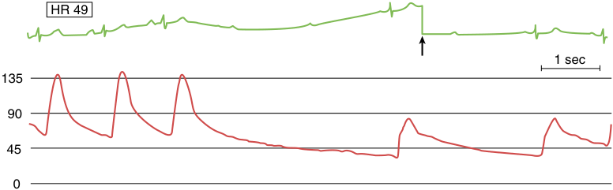

HR 49 1 sec 135 90 45 0 

**Fig. 32.1** Digital heart rate (HR) displays may fail to warn of dangerous bradyarrhythmias. Direct observation of the electrocardiogram (ECG) and the arterial blood pressure traces reveals complete heart block and a 4- second period of asystole, whereas the digital display reports an HR of 49 beats/ min. Note that the ECG filter _(arrow)_ corrects the baseline drift so that the trace remains on the recording screen. (From Mark JB. _Atlas of Cardiovascular Monitoring._ New York: Churchill Livingstone; 1998.)

<!-- PDF page 3 -->

The three primary reasons for ECG monitoring are continuous monitoring of heart rate, identification of arrhythmias and conduction abnormalities, and detection of myocardial ischemia. Furthermore, with many patients coming to surgery with cardiovascular implantable electronic devices (CIEDs), proper functioning of these devices can only be determined with the aid of ECG monitoring. (Perioperative management of these devices is described in Chapter 34.) In order for bedside ECG monitoring to be accurate and effective, the clinician must attend to several technical details, including proper lead placement and selection, filter mode, and gain adjustment.

### ECG LEAD PLACEMENT AND SELECTION

Current operating room and intensive care monitoring systems have five leads that allow monitoring of the standard limb leads (I, II, III), the augmented limb leads (aVR, aVL, aVF), and a single precordial lead, either V1, V2, V3, V4, V5, or V6. Typically, two of these 12 standard leads are simultaneously displayed on the bedside monitor. Historically, the augmented limb leads and precordial leads were described as _unipolar_ , whereas the standard limb leads were described as _bipolar_ . An American Heart Association (AHA) scientific statement5 discourages this distinction because in effect, all the lead configurations are effectively bipolar in their recording of surface electrical potentials.

Based on AHA guidelines, ECG monitoring leads have a standard color coding system: right arm (white), left arm (black), right leg (green), left leg (red), and precordial lead (brown). Of note, this color scheme is not the same used internationally or the one recommended by the International Electrotechnical Commission (IEC). Unlike recording a standard 12- lead ECG, where the limb leads are attached to electrodes placed on the wrists and ankles or arms and legs, when monitoring patients in the operating room or intensive care unit, the limb leads are typically placed on the torso, with the right and left arm leads placed just below the clavicles and the leg leads placed above the hips (Fig. 32.2). Of note, placement of the right leg lead (green lead) can be anywhere on the body because it is a ground electrode, and its location will not alter the display of any of the selected standard leads.6

Placement of the limb electrodes on the torso has been utilized since 1966, when Mason and Likar introduced a variation on positioning the standard limb electrodes of the 12- lead ECG during exercise stress testing to minimize artifacts in the limb leads caused by movement.7 Although the limb lead QRS complexes are slightly different in amplitude and axis and the precordial leads may vary slightly from the standard 12- lead ECG recording, studies have shown that the ST- segment measurements during exercise stress testing were generally similar when the Mason- Likar 12- lead ECG system is used, as compared with the standard 12- lead ECG.7–10 Consequently, torsopositioned limb leads have become standard for monitoring in the operating room and intensive care unit because of convenience and the potential to obviate motion artifact.

In some cases, surgical incisions, patient positioning, or other procedural aspects may mandate adjusting these limb lead electrode locations. However, for reliable recording of

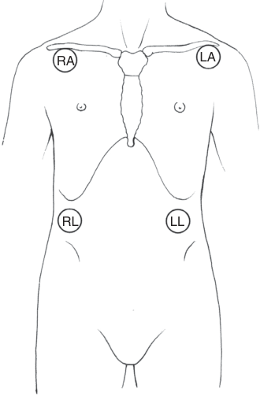

RA LA RL LL 

**Fig. 32.2 Standard ECG limb lead placement for patient monitoring.** _LA_ , left arm; _LL_ , left leg; _RA_ , right arm; _RL_ , right leg. (From Mark JB. _Atlas of Cardiovascular Monitoring._ New York: Churchill Livingstone; 1998.)

standard limb leads, the electrodes must be outside the cardiac borders, in the transverse plane above and below the heart, and in the sagittal plane to the left and right of the heart (Fig. 32.3). In practice, limb lead placement closer to the heart may lead to unintended distortion of the ECG tracings.9

Placement of the precordial lead (brown) electrode requires more attention than the limb leads, since this lead is often misplaced and its position is critical for the reliable and sensitive detection of myocardial ischemia. Lead V5 is most commonly chosen for monitoring patients at risk for myocardial ischemia, since historically it has been shown to be the most sensitive single lead for detecting ischemia during exercise stress testing11,12 and during anesthesia.13,14 Importantly, the V5 precordial lead can be monitored during cardiac operations without interfering with the surgical prep and median sternotomy incision. For patients undergoing other operations, particularly high-risk patients undergoing vascular procedures, leads V4 or V3 may be chosen because there is good evidence that these leads are even more sensitive for detecting prolonged postoperative myocardial ischemia.15

Standard locations for the six precordial lead electrodes are shown in Fig. 32.4. Given that there is considerable evidence that precordial lead placement is inaccurate even during diagnostic 12- lead ECG recordings,5 it is likely that this is also commonplace during ECG monitoring in the operating room and intensive care unit. Accurate lead placement is facilitated by locating the sternal angle of Louis (manubrial–sternal junction), its immediately inferior rib interspace (the second), and then palpating down to identify the fourth and fifth interspaces. Lead V4 lies in the fifth interspace at the mid- clavicular line, and leads V5 and V6 are located directly lateral to V4 in the anterior and midaxillary lines, respectively.

<!-- PDF page 4 -->

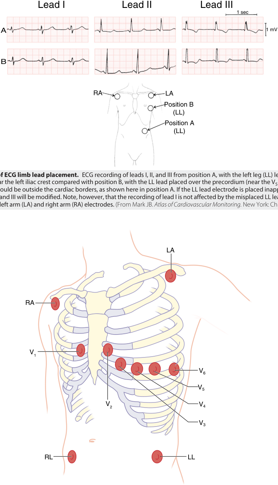

Lead I Lead II Lead III 1 sec A 1 mV B RA LA Position B (LL) Position A (LL) Importance of ECG limb lead placement.  ECG recording of leads I, II, and III from position A, with the left leg (LL) lead in the standard loca- tion below the heart near the left iliac crest compared with position B, with the LL lead placed over the precordium (near the V55 position). Standard ECG limb lead positioning should be outside the cardiac borders, as shown here in position A. If the LL lead electrode is placed inappropriately in position B, the recording of leads II and III will be modified. Note, however, that the recording of lead I is not affected by the misplaced LL lead, since lead I measures the difference between left arm (LA) and right arm (RA) electrodes. (From Mark JB. (From Mark JB.  Atlas of Cardiovascular Monitoring. LA RA V1 V6 V5 V2 V4 V3 RL LL 

**Fig. 32.3 Importance of ECG limb lead placement.** ECG recording of leads I, II, and III from position A, with the left leg (LL) lead in the standard location below the heart near the left iliac crest compared with position B, with the LL lead placed over the precordium (near the V55 position). Standard ECG limb lead positioning should be outside the cardiac borders, as shown here in position A. If the LL lead electrode is placed inappropriately in position B, the recording of leads II and III will be modified. Note, however, that the recording of lead I is not affected by the misplaced LL lead, since lead I measures the difference between left arm (LA) and right arm (RA) electrodes. (From Mark JB. (From Mark JB. _Atlas of Cardiovascular Monitoring._ New York: Churchill Livingstone; 1998.)

**Fig. 32.4 Proper anatomic location of the six standard precordial ECG leads.** Precise positioning of the lateral precordial leads is ensured by identifying the fifth intercostal space in the mid- clavicular line for lead V4, moving laterally to the anterior axillary line for V5, and further laterally to the midaxillary line for V6. _LA_ , left arm; _LL_ , left leg; _RA_ , right arm; _RL_ , right leg.

Given anatomic considerations and the strong evidence that the mid- precordial leads (V3, V4, V5) are best for detection of ischemia, it is important that the precordial lead not be placed haphazardly or too laterally. In some

cases (e.g. patients undergoing left thoracotomy), none of these precordial lead placement sites are possible. In this instance, it is reasonable to choose another standard lead position such as V1, but it is important that the clinician

<!-- PDF page 5 -->

recognize that ECG monitoring for ischemia will not be as sensitive.

In addition to the standard lead locations, lead V4R, a mirror image of lead V4, positioned in the fourth intercostal space at the mid- clavicular line is the best lead for identifying right ventricular (RV) ischemia. Although never chosen for routine ischemia monitoring, this lead has proven valuable for detecting right ventricular ischemia and infarction and might be chosen to monitor patients at risk for inferior left ventricular ischemia, which is commonly accompanied by right ventricular involvement.5,16

Three-lead ECG monitoring systems, while less common today than five- lead systems, remain available particularly in non–operating room procedural settings and for patient transport. A three- lead system is also the standard ECG monitoring system incorporated in external defibrillator devices to allow the unit to provide transcutaneous pacing. The three leads (right arm, left arm, left leg) can be placed in similar locations to their five- lead system counterparts, and this allows reliable monitoring of heart rate, detection of R waves for synchronized direct current cardioversion, and monitoring for potentially life- threatening arrhythmias such as ventricular fibrillation.

Another modified three- lead system is a surrogate for precordial lead V1. This lead (MCL1) is recorded by placing the left arm lead in standard position, the left leg lead at the V1 position, and selecting lead III. This modified lead system is useful for monitoring in the intensive care unit or other circumstances where detection of P-wave morphology and arrhythmias is of paramount importance.

Following cardiac surgical procedures, recording the ECG signal from an epicardial atrial pacing wire may also be useful for detecting P waves that may not be as evident from skin surface ECG recordings (Fig. 32.5). This alternative lead recording is usually performed in the intensive care unit using a 12- lead ECG system and attaching one of the atrial pacing wires to a precordial lead wire.

### ECG FILTER SELECTION

The ECG signal is subject to artifacts (noise) both in the low-frequency and high-frequency ranges. Consequently, all ECG monitors use bandpass filters to narrow the signal bandwidth, preserve the signal of interest while reducing artifacts, and improve signal quality. As the name suggests, a bandpass filter allows signal frequencies within a certain range to pass or be displayed, while attenuating or functionally eliminating signal frequencies both below and above the bandpass.

Low-frequency artifact is typically caused by respiration or patient movement that causes the ECG tracing to wander above and below the baseline (Fig. 32.6). Often this will appear as the ECG tracing being cut off or only partially displayed on the bedside monitor channel and the low- frequency (also called high- pass) filter will eliminate this artifact and stabilize the tracing on the monitor screen. The heart rate forms a rough lower bound for the frequency content of the ECG signal and is measured in Hertz (Hz, cycles per second). Since heart rates slower than 40 beats per minute (0.67 Hz) are uncommon, typical lowfrequency analog filters attenuate frequencies below 0.5 Hz. However, while such filters stabilize the ECG baseline, they may also distort the ECG signal, particularly the ST segment. This results from phase nonlinearities that occur in areas of the ECG signal where frequency content and wave amplitude abruptly change, as occurs where the end of the QRS complex meets the ST segment. The 1975 American Heart Association (AHA) recommendations included a 0.05- Hz low- frequency cutoff for diagnostic ECGs. This recommendation preserves the fidelity of repolarization, but baseline drift can still be a problem. Current modern digital filtering provides more sophisticated methods for a higher cutoff for low- frequency filtering without the phase distortions observed with analog filtering. Thus, to reduce artifactual distortion of the ST segment, current AHA

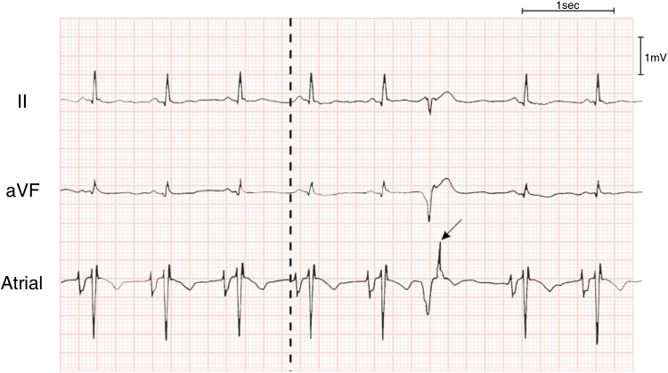

1sec 1mV II aVF Atrial 

**Fig. 32.5** Simultaneous recording of surface ECG leads II and aVF and an atrial epicardial lead _(atrial)_ recorded from a pacing wire attached to the surface of the right atrium. Onset of atrial electrical activity is denoted by the P wave in the surface leads and marked by the _dashed vertical line._ Note that the amplitude of the atrial electrical signal is greatest in the atrial lead recording. In addition, the sixth beat is a ventricular premature beat, and the resulting retrograde atrial depolarization is clearly evident in the atrial lead _(arrow)_ but not seen as easily in standard surface ECG leads II or aVF. (From Mark JB. _Atlas of Cardiovascular Monitoring._ New York: Churchill Livingstone; 1998.)

<!-- PDF page 6 -->

recommendations suggest the low- frequency cutoff should be either 0.05 Hz for monitors with analog filters or 0.67 Hz or below for monitors and ECG recording devices with linear digital filters with zero phase distortion.5

High- frequency ECG artifacts are typically caused by muscle fasciculations, tremors, and most importantly, the ever present 60 cycle (Hz) electromagnetic interference from other electrical equipment in the monitoring environment. These artifacts can be eliminated with high- frequency filters (also termed low- pass filters), but like low- frequency filters, the high- frequency filters may distort the ECG signal in undesirable ways. The higher frequencies in the ECG signal include features such as rapid upstroke velocity (QRS complex), peak amplitude (R wave), and waves of short duration. Most importantly, pacemaker spikes, which by definition are high frequency and low amplitude, are often eliminated by high- frequency filters and make bedside identification of pacemaker function challenging. A highfrequency cutoff of 100 Hz was considered adequate by the AHA in 1975 to maintain diagnostic accuracy during visual inspection of an ECG, although it has long been recognized that higher-frequency components of the QRS complex may have clinical significance in patients with various

forms of heart disease. According to current AHA recommendations, to measure routine duration and amplitudes accurately in adults, adolescents, and children, an upper frequency cutoff of at least 150 Hz is required, and an upper frequency cutoff of 250 Hz is more appropriate for infants.5

Current ECG monitors allow the clinician a choice among several filtering modes or bandwidths. The actual filter frequencies tend to vary among manufacturers, but in general there are three different filters that may be selected, termed diagnostic mode, monitoring mode, and filter mode. The _diagnostic mode_ typically has a bandpass of 0.05 to 150 Hz, and this filter should always be selected to display an ECG signal that best resembles a 12- lead ECG recording, including an undistorted ST segment and clear pacing spikes. The _monitor mode_ typically has a bandpass of 0.5 to 40 Hz, and while both low-frequency (baseline drift) and highfrequency (60 Hz) noise is reduced or attenuated, the ST segments are often distorted and typically show an exaggerated deviation that is artifactually introduced by the filter17 (Fig. 32.7). The _filter mode_ bandpass is 0.5 to 20 Hz and may incorporate a notch filter aimed at further attenuating and eliminating 60 Hz interference from nearby electrical equipment.

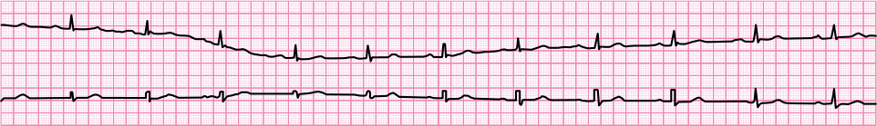

**Fig. 32.6** ECG recording of lead II _(top)_ and lead V5 _(bottom)_ at standard speed (25 mm/s) and gain (10 mm/mV) with a diagnostic bandpass filter. The respiratory artifact is evident from the varying or wandering baseline most noticeable in lead II. This artifact will be eliminated by using the monitor bandpass filter.

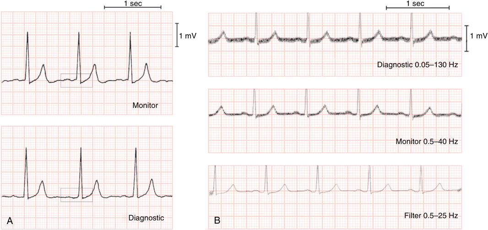

1 sec 1 sec 1 mV 1 mV Diagnostic 0.05–130 Hz Monitor Monitor 0.5–40 Hz A Diagnostic B Filter 0.5–25 Hz 

**Fig. 32.7 Effects of filter selection on the ST segment.** Application of the monitor mode filter (A, _top panel_ ) produces artifactual J- point depression and upsloping ST- segment depression _(box)_ . These abnormalities are not seen when the diagnostic mode filter (A, _bottom panel_ ) is used to record the ECG. Filter selection also effects ECG electrical interference originating from the wall power source (B). Compared to the diagnostic mode filter (bandpass 0.05–130 Hz), the narrower bandpass of the monitor mode (0.5–40 Hz) reduces this high- frequency artifact, and the filter mode (0.5–25 Hz) that incorporates an additional notch filter at 60 Hz eliminates this electrical artifact entirely. (From Mark JB. _Atlas of Cardiovascular Monitoring._ New York: Churchill Livingstone; 1998.)

<!-- PDF page 7 -->

### ECG GAIN SELECTION

In addition to lead and filter selection, bedside monitors also allow adjustment and selection of the ECG signal gain. A standard ECG is recorded at a gain of 10 mm/mV and is indicated by a 1 mV rectangular calibration signal on a paper recording or by a 1 mV vertical marker at the edge of the bedside monitor ECG waveform. Monitors may be set to an autogain mode, where the available display space is filled by the ECG tracing and the corresponding increase or decrease from standard gain is indicated by the vertical marker. Alternatively, the clinician may adjust the ECG signal gain manually. This is done when the monitor detection of heart rate is inaccurate. For example, one might reduce the ECG signal gain when the monitor is inappropriately counting a tall T wave as an R wave and displaying an artifactual heart rate that is twice the true rate.

Gain adjustment is important because all features of the ECG are equally amplified or reduced when the gain is changed from the 10 mm/mV standard. As a consequence, ST- segment deviations can be obscured when gain is reduced and thereby impair clinical observation of important ST- segment changes. Alternatively, if the gain is increased, ST deviations will also be amplified proportionally. While common clinical communication of ST- segment shifts is always described in terms of millimeters (mm) of depression or elevation, interpretation of bedside monitor ECG tracings must always be tempered by consideration of the display gain (Fig. 32.8).

### ECG PACING MODE

While older ECG monitors recorded analog (continuous) signals, current devices convert the analog ECG signal to digital

form by sampling the signal at very high rates up to 15,000 times per second.5 This oversampling of the ECG signal was originally introduced to allow identification and recording of pacemaker stimulus outputs (pacemaker spikes), which are generally shorter than 0.5 ms, but current systems do not always detect these small-amplitude, high-frequency signals reliably. As a result, most bedside ECG monitors now include a _pacing mode_ selection, which when activated, employs an algorithm to detect and highlight these pacing spikes, making detection of pacemaker function easier. When this monitoring mode is selected, clinicians should recognize that the displayed ECG tracing shows regular markers, often in a different color than the ECG tracing, that indicate and highlight presence of a pacemaker stimulus output. These are not amplified pacemaker signals, but rather monitor- generated markers of their detection. While very helpful to the clinician at the bedside, pacemaker mode monitoring may not reliably detect pacemaker spikes in all patients. In other instances, the intrinsic features of the pacemaker stimulus in different leads might allow their detection in some leads but not others (Fig. 32.9).

### ECG DISPLAYS AND RECORDINGS

Monitoring the ECG during anesthesia and in the intensive care unit includes both observation of the bedside monitor display and periodic recording of the ECG “rhythm strip” for documentation or more careful analysis. The most common bedside recording system provides a 2- inch strip that displays two ECG leads (see Fig. 32.9), but other recording systems may provide larger formats for multi- lead or multiwaveform recording. Monitoring systems may also have “full disclosure” capability whereby monitored ECG (and other) waveforms are stored for retrieval and review. This

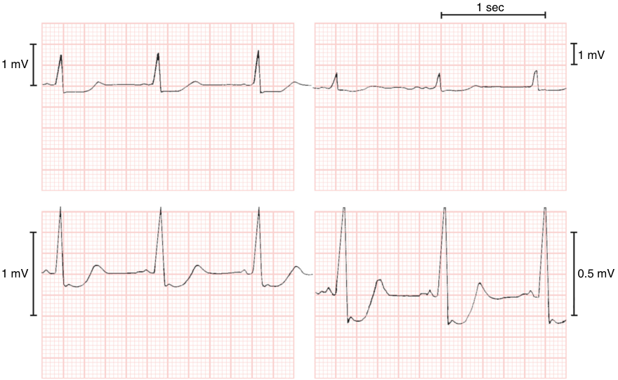

1 sec 1 mV 1 mV 1 mV 0.5 mV 

**Fig. 32.8 Effect of gain adjustment on the magnitude of ST- segment shift.** The magnitude of ST- segment depression and R- wave amplitude vary in direct proportion to overall signal gain denoted by the vertical calibration signals adjacent to the traces (10 mm/mV, _upper left panel_ ; 5 mm/mV, _upper right panel_ ; 20 mm/mV, _lower left panel_ ; 20 mm/0.5 mV or 40 mm/mV, _lower right panel_ ). Note that at four times standard gain _(lower right panel)_ , the ST depression increases to 6 mm but R- wave amplitude only increases to 21 mm because the R- wave peak is “cut off” at the upper limits of the recording display (From Mark JB. _Atlas of Cardiovascular Monitoring._ New York: Churchill Livingstone; 1998.)

<!-- PDF page 8 -->

last system is particularly useful for the retrospective identification, interpretation, and documentation of arrhythmias or other cardiovascular changes that may have escaped detection in real time by clinicians at the bedside.

The ECG tracing on the bedside monitor can be displayed at varying sweep speeds, but most typically is displayed at 25 mm/s, the same speed as a standard 12- lead ECG tracing. As described previously, the ECG gain can be adjusted and the displayed gain should be indicated by a vertical marker overlying the ECG tracing, the standard being 10 mm/mV.

Paper recordings of the ECG should have standard millimeter grids, such that a standard sweep speed of 25 mm/s makes each 1 mm a 40-ms interval, and a darker line appearing every 5 mm indicates a 200-ms interval (Fig. 32.10).

### ECG ARTIFACTS

As is the case for all bedside monitoring,18 artifacts commonly distort the monitored ECG tracing and must be identified to prevent misinterpretation or inappropriate treatment. In the operating room, the most common cause of ECG artifact is the electrosurgical unit (ESU). Since some of the frequencies generated by the ESU fall within the QRS frequency range, and the amplitude of these signals can be very high (1 kV or 1 million times the typical QRS amplitude of 1 mV),19 filtering techniques cannot eliminate this artifact that often totally masks the ECG signal (see Fig. 32.10). This not only precludes identification of any ECG waveform features, but also it can prevent ECG monitoring of heart

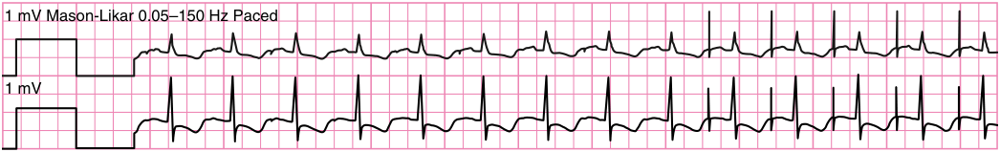

1 mV Mason-Likar 0.05–150 Hz Paced 1 mV 

**Fig. 32.9** Leads II _(top)_ and V5 _(bottom)_ are recorded during atrial pacing (86 beats/min) at standard speed (25 mm/ms) and gain (10 mm/mV). Atrial pacing spikes are small and difficult to discern, particularly in lead V5. Prior to the 10th beat, the _Pacing Mode_ is selected, and the monitor marks the atrial pacing spikes clearly on the remaining five beats.

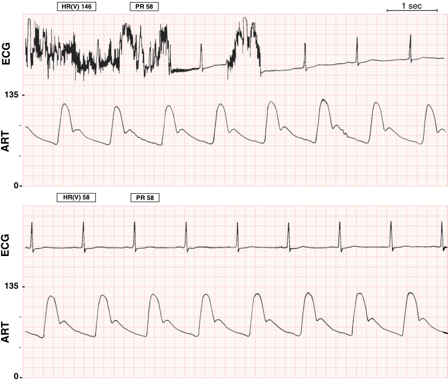

HR(V) 146 PR 58 1 sec 135 0 HR(V) 58 PR 58 135 0 ECG ART ECG ART 

**Fig. 32.10 Electrosurgical unit interference with heart rate measurement from the ECG.** _(Top panel)_ The ECG signal from lead V is distorted by the electrosurgical unit. As a result, the digital value for heart rate _(HR)_ is erroneous (146 beats/min), although the pulse rate (PR) is measured accurately by the monitor from the arterial blood pressure waveform (58 beats/min). _(Lower panel)_ Correct (and identical) digital values for both HR and PR are displayed by the monitor. _ART_ , arterial blood pressure. (From Mark JB. _Atlas of Cardiovascular Monitoring._ New York: Churchill Livingstone; 1998.)

<!-- PDF page 9 -->

rate. The almost universal availability of additional simultaneously displayed waveforms, such as the pulse oximetry plethysmogram or an arterial blood pressure waveform, allow safe patient monitoring during these brief periods of ESU deployment (see Fig. 32.10).

Other common ECG artifacts are caused by 60-Hz interference from other medical devices near the patient (see Fig. 32.7B) and less common sources such as the cardiopulmonary bypass machine.20 Patel and Souteret _et al._ provide a comprehensive list of reported sources of ECG artifact21 (Box 32.1).

### ECG MONITORING FOR MYOCARDIAL ISCHEMIA

The ST segment, representing myocardial repolarization, is the ECG component most sensitive to acute myocardial ischemia. ST elevation, with or without tall positive (hyperacute) T waves, indicates transmural ischemia and is most often the result of acute coronary artery occlusion either by coronary thrombosis or vasospasm (Prinzmetal variant angina). Reciprocal ST- segment depression may appear in the contralateral leads. Ischemia confined to the subendocardial area is usually denoted by ST- segment depression. Subendocardial, ST depression–type ischemia typically occurs during episodes of symptomatic or asymptomatic ( _silent_ ) stable angina pectoris, and is characteristic of ischemia occurring during exercise, tachycardia, or pharmacologic stress testing in patients with significant but stable coronary artery disease.

### Automated Real- Time ST- Segment Monitoring

Real- time ST- segment analysis first appeared in cardiac monitoring in the mid- 1980s and is currently standard in most ECG monitors. While ST- segment analysis is commonplace in the operating room, it is underutilized in other

monitoring settings.22 Chief among the reasons for the underuse of ST- segment analysis are the frequent number of false alarms and the lack of education on how to use the technology. In addition, little evidence exists as to whether the addition of computerized ST- segment ischemia monitoring improves patient outcomes after surgery.

Computerized ST- segment analysis identifies the STsegment 60 or 80 ms after the J point (termed as J+60 or J+80 ms) and compares it with the isoelectric point measured during the PR interval (Fig. 32.11). At standard gain, one millimeter of ST- segment deviation equals 0.1 mV of ST elevation or depression. Changes in ST- segment deviation over time in each lead can be displayed as ST- segment trends, just like trend displays of other hemodynamic variables (Fig. 32.12). When the computer misidentifies the appropriate isoelectric or ST monitoring point, the clinician can manually adjust the J point or the ST- segment measurement point (Fig. 32.13).

One major advantage of continuous ST- segment monitoring is that the electrodes stay in place and do not vary as they might with intermittent 12- lead ECG recordings. However, for improved diagnostic accuracy of ST- segment monitoring, the following points should be recognized:

1.  Changes in body position may cause ST- segment changes and lead to false ST- segment alarms. However, changes in the QRS complex almost always accompany these positional ST- segment changes and therefore can be easily distinguished from true ST- segment deviations (Fig. 32.14). Changes in position of the heart in the mediastinum have also been shown to affect the ST segment. Mark and associates observed that placement of a sternal retractor during cardiac surgery was associated with a reduction in V5 R- wave amplitude23 (Fig. 32.15). Simultaneously, V5 S- wave amplitude and absolute STsegment deviation were reduced. These investigators

### Box 32.1 Equipment or Component- Related Electrocardiographic Artifacts

- Monitor/components

- Manufacturing problems (50/60- Hz filter)

- Defective monitor insulation

- Orthopedic shaver

- Intraoperative MRI

- Sinus endoscope

- Pressure- controlled irrigation pumps

- Flexible bronchoscopes

- ESWL

- Digital urine output- core temperature monitors

- Intravenous fluid warmer/warming sets

- Cardiopulmonary bypass machine

- Ventilator – HFOV

- Electrostimulators

- Spinal cord, peripheral nerve, thalamic, vagal nerve, transcutaneous nerve, other

- Evoked potential monitoring units

- Hemodialysis machines

- Cellular telephones

_ESWL_ , extracorporeal shock- wave lithotripsy; _HFOV_ , high- frequency oscillatory ventilation; _MRI_ , magnetic resonance imaging. Adapted from Patel SI, Souter MJ. Equipment- related electrocardiographic artifacts: causes, characteristics, consequences, and correction. _Anesthesiology._ 2008;108(1):138–148.

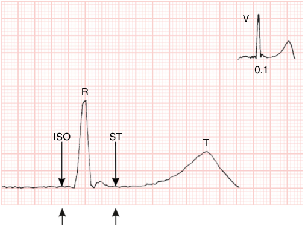

V 0.1 R ISO ST T 

**Fig. 32.11** Enlarged display of ECG lead V, showing the isoelectric (ISO) and ST- segment (ST) measurement points during continuous computer- aided ST- segment monitoring. The ECG R and T waves are also identified. This V lead ECG complex is shown at standard gain (10 mm/mV) in the upper right corner of the panel. The computer measures and displays 0.1 mm (0.01 mV) of ST- segment elevation in this lead. (From Mark JB. _Atlas of Cardiovascular Monitoring._ New York: Churchill Livingstone; 1998.)

<!-- PDF page 10 -->

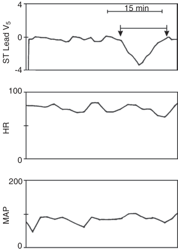

4 15 min 0 -4 100 0 200 0 ST Lead V5 HR MAP 

**Fig. 32.12** One- hour trend displays for computer- aided continuous STsegment monitoring in lead V5, heart rate (HR, beats/min), and mean arterial pressure (MAP, mm Hg). A 15- minute episode of ST- segment depression _(arrows)_ occurs without significant accompanying changes in HR or MAP. (From Mark JB. _Atlas of Cardiovascular Monitoring._ New York: Churchill Livingstone; 1998.)

   - concluded that inclusion of an R- wave gain factor might improve perioperative ECG ischemia monitoring.

2.  Many patients have preexisting ECG abnormalities that confound interpretation of ST- segment changes. Early repolarization (a normal variant), intraventricular conduction delays, LV hypertrophy, digitalis, pericarditis, and other conditions may cause baseline ST- segment abnormalities. In these conditions, standard ECG criteria for diagnosing myocardial ischemia are less specific.

3.  Most cardiac monitors with ST- segment monitoring software provide displays of ST- segment trends in a single lead or the sum of absolute ST- segment deviations from multiple leads (Fig. 32.16). Although such graphic trends are convenient for quick identification of potential ischemic events, analysis of the ECG waveform on the monitor screen or by recording the ECG tracing is of paramount importance for verification.

### ECG Criteria for Acute Myocardial Ischemia

The ECG criteria most accepted for detecting myocardial ischemia during continuous ECG monitoring are those established and validated during exercise stress testing.24 During stress testing and with acute subendocardial ischemia, the electrical forces responsible for the ST segment are deviated toward the inner layer of the heart, causing ST- segment depression or demand- mediated ischemia (Fig. 32.17). With acute transmural epicardial ischemia, the electrical forces in the ischemic area are deviated toward the outer layer of the heart, causing ST- segment elevation or supply- mediated ischemia in the overlying leads (Fig. 32.18). Note that, most commonly, intraoperative or perioperative ischemia is demand- mediated subendocardial ischemia, which is manifest as ST- segment depression.25

Although the anterolateral precordial leads are most sensitive for detecting these changes, they are non- localizing as to the coronary distribution responsible. In contrast, supply- mediated transmural ischemia, while much less common perioperatively, causes ST- segment elevation in leads overlying the involved coronary bed and thus are able to localize the responsible coronary territory, (e.g. ST elevations in inferior leads II, III, aVF suggest occlusion of the right or posterior descending coronary artery).

With demand- mediated ischemia, as heart rate increases, J- point depression and upsloping ST- segment depression occurs. As the severity of ischemia progresses, the ST segment typically becomes horizontal (flattens), the magnitude of ST- segment depression increases, and the ST segment becomes downsloping (see Fig. 32.17). Standard criteria for stress- induced ischemia are 1 mm (0.1 mV) or more of horizontal or downsloping ST- segment depression measured 60 or 80 ms after the J point.

During the perioperative period, ECG monitoring most commonly identifies stress- induced, ST- depression, demand- mediated ischemia, or other causes of supply– demand imbalance such as prolonged hypotension. Such ECG changes do not provide information about the location of the ischemic myocardial area. In contrast, ST- segment elevation indicating transmural or supply- mediated ischemia, observed particularly during cardiac surgery, provides useful information about the myocardial segment and coronary perfusion territory responsible for the ischemic episode. Because most patient- monitoring systems do not simultaneously monitor all 12 ECG leads, selecting which chest leads to monitor is of great importance, particularly in noncardiac surgery. During exercise stress testing, investigators have identified leads V4 and V5 as the most sensitive leads to detect exercise- induced ischemia (90%–100% sensitivity).26 London and colleagues studied high- risk patients undergoing noncardiac surgery and showed that the greatest sensitivity for ischemia was obtained with lead V5 (75%), followed by lead V4 (61%).14 Combining leads V4 and V5 increased the sensitivity to 90%, whereas with the standard lead II and V5 combination, the sensitivity was only 80%. They also suggested that if three leads (II, V4, and V5) could be simultaneously examined, the sensitivity would increase to 98%. Landesberg and associates monitored continuous 12- lead ST- segment changes greater than 0.2 mV from baseline in a single lead or more than 0.1 mV in two contiguous leads at J+60 ms, lasting longer than 10 minutes in patients undergoing major vascular surgery.15 They showed that leads V3 and V4 were more sensitive than V5 in detecting perioperative ischemia (87%, 79%, and 66%, respectively). As a result of these and other investigations, it appears most appropriate to monitor lead V3, V4, or V5 for optimal detection of perioperative ST- segment depression, choosing the specific lead location to avoid interference with the surgical prep and procedure.

## Blood Pressure Monitoring

Like heart rate, blood pressure is a fundamental cardiovascular vital sign included in the mandated standards for basic anesthetic monitoring and accomplished via either intermittent or continuous and direct or indirect methods.27

<!-- PDF page 11 -->

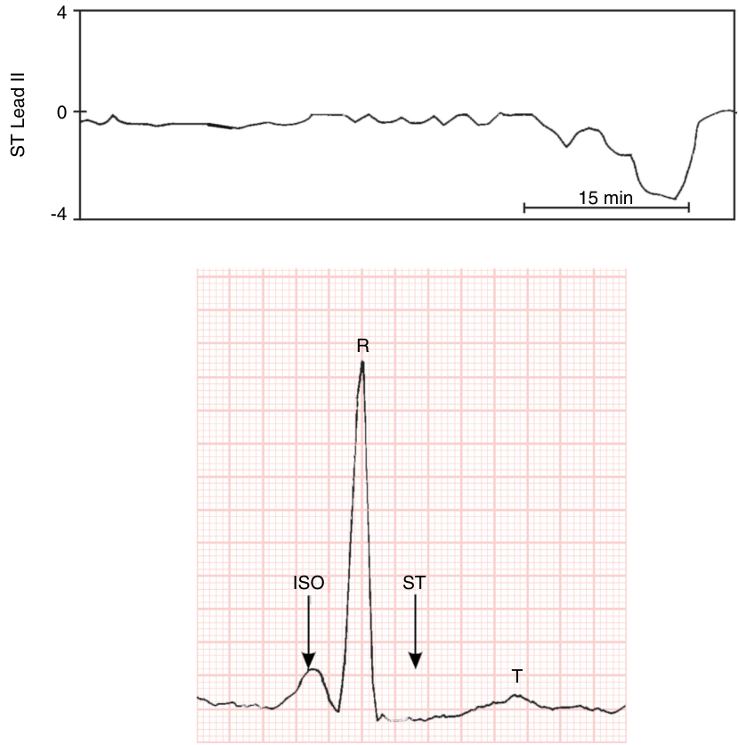

4 0 15 min -4 R ISO ST T ST Lead II 

**Fig. 32.13** Erroneous identification of the isoelectric (ISO) point measurement during computer- aided continuous ST- segment monitoring. A 1- hour trend recording of ST- segment deviations in lead II, displayed as millimeters of ST displacement, shows approximately 15 minutes of ST- segment depression, which reaches 3 mm in magnitude during this episode _(top panel)_ . The enlarged display of ECG lead II showing the ISO and ST- segment (ST) measurement points during the episode of ST- segment depression reveals that the ISO point is identified inappropriately at the peak of the P wave, thereby producing artifactual ST- segment depression _(bottom panel)_ . (From Mark JB. _Atlas of Cardiovascular Monitoring._ New York: Churchill Livingstone; 1998.)

These various techniques measure different physical signals and take different technical approaches but are all subject to numerous confounding factors that often yield different results.28

### INDIRECT MEASUREMENT OF ARTERIAL BLOOD PRESSURE

### Intermittent Techniques

The first indirect methods of blood pressure measurement utilized a sphygmomanometer and peripheral pulse palpation, as originally described by Riva- Rocci in 1896. This later evolved into both auscultatory and oscillometric methods in common use today.29 All of these methods use a cuff placed around the upper arm that is inflated to the point that all blood flow ceases, and then slowly deflated while simultaneously monitoring some indicator of return of blood flow through the vessels underlying the cuff. The auscultatory method uses Korotkoff sounds, a complex

series of audible signals created by turbulent arterial flow. Put simply, the systolic pressure is assigned to the pressure at which the first sound is heard and the diastolic to the point when the sounds disappear (the transition from “noisy” turbulent flow to laminar “quiet” flow).30,31 The oscillometric method is different in that it measures very small changes in pressure (or oscillations) detected in a slowly deflating cuff with the point of maximal oscillation reflecting the mean arterial pressure (MAP). Importantly, with this method, the systolic and diastolic pressures are calculated by proprietary algorithms rather than measured.31–33 This is in contrast to the auscultatory method by which systolic and diastolic can be measured but MAP cannot. Both methods are highly dependent on any physiologic conditions that interfere with transmission of either sound or small pressure changes. Such confounders include ambient temperature, severe edema, obesity, abnormal compliance of the overlying tissue and conditions that affect blood flow (shock, intense vasoconstriction).31–35 Significantly

<!-- PDF page 12 -->

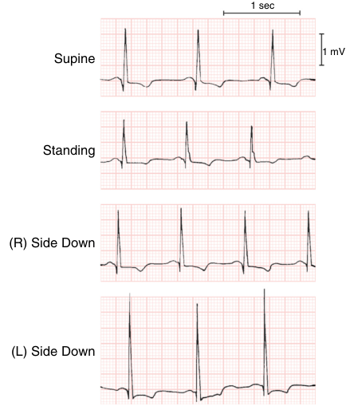

1 sec 1 mV Supine Standing (R) Side Down (L) Side Down 

**Fig. 32.14 Effect of changing body position on the ECG in a patient with preexisting ST- segment depression.** Lead CC5, a surrogate for lead V5, is recorded with the patient in four different positions: supine, standing, right (R) side down, and left (L) side down. The magnitude of ST- segment depression changes in direct proportion to the R- wave amplitude (From Mark JB. _Atlas of Cardiovascular Monitoring._ New York: Churchill Livingstone; 1998.)

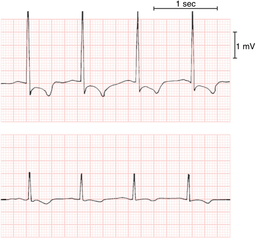

1 sec 1 mV 

**Fig. 32.15 Effect of surgical retraction on the ECG.** Baseline lead V5 recording shows 2-mm ST- segment depression and 27-mm R- wave amplitude _(top panel)_ . Placement of a sternal retractor during cardiac surgery displaces the precordial lead electrode relative to the heart, resulting in a marked reduction in R- wave amplitude to 10 mm and a proportional reduction in the magnitude of ST- segment displacement _(bottom panel)._ (From Mark JB. _Atlas of Cardiovascular Monitoring._ New York: Churchill Livingstone; 1998.)

irregular rhythms may require averaging several consecutive results to achieve adequate accuracy, while severe bradycardia may require such a slow deflation rate as to make it almost impossible with currently available devices.36 In

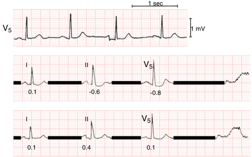

1 sec V5 1 mV I II V5 0.1 -0.6 -0.8 I II V5 0.1 0.4 0.1 

**Fig. 32.16 Computer- aided continuous ST- segment monitoring.** A baseline recording of lead V5 shows isoelectric ST segments _(top panel)_ . Shortly after induction of anesthesia, the ST- segment monitoring display shows the three monitored leads I, II, and V5 and the absolute amount of ST- segment elevation (0.1 mm in lead I) or depression (−0.6 mm in lead II, −0.8 mm in lead V5) in each lead _(middle panel)_ . A trend line is displayed on the right side of the panel and demonstrates that the sum of ST- segment deviations in these three monitored leads has increased and reached a plateau over the previous few minutes. Another ST- segment display recorded 5 minutes later shows resolution of these subtle ST changes _(bottom panel)_ . Note that the appearance of lead V5 in this last display closely resembles the baseline recording and that the trend line has returned to pre- induction baseline level. (From Mark JB. _Atlas of Cardiovascular Monitoring._ New York: Churchill Livingstone; 1998.)

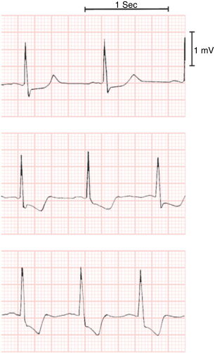

1 Sec 1 mV 

**Fig. 32.17 Subendocardial ischemia produces ST- segment depression.** As heart rate increases progressively from 63 beats/min _(top panel)_ to 75 beats/min _(middle panel)_ and finally to 86 beats/min _(bottom panel)_ in this patient with left main coronary artery disease, the ST segment becomes more depressed and more downsloping, owing to an increase in myocardial oxygen demand. (From Mark JB. _Atlas of Cardiovascular Monitoring._ New York: Churchill Livingstone; 1998.)

addition, for both methods the cuff must also be snugly fitted and measure 40% of arm circumference and 80% of length of the upper arm. A cuff that is too large may give slightly lower readings while a cuff that is too small will usually yield falsely high readings.33,37

<!-- PDF page 13 -->

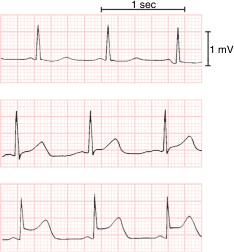

1 sec 1 mV 

**Fig. 32.18 Transmural ischemia produces ST- segment elevation.** Occlusion of a patent saphenous vein graft during repeat coronary artery bypass surgery causes an abrupt reduction of coronary blood supply and results in progressive ST- segment elevation _(middle and bottom panels)_ . (From Mark JB. _Atlas of Cardiovascular Monitoring._ New York: Churchill Livingstone; 1998.)

The location of the cuff can significantly impact the accuracy and precision of results. The upper arm is the most common location and is the most accurate as it approximates the level of the heart most closely. If the cuff is above the heart, as in the nondependent arm in the lateral decubitus position, the result will be inappropriately low while the reverse is true for the dependent arm.36 Obesity also poses a challenge to using noninva sive blood pressure (NIBP) measurement. A large amount of adipose tissue under the cuff reduces transmission of pulsations, sometimes requiring very high inflation pressures leading to patient discomfort and overestimation of the measured pressure.38 Also, the conicity of the upper arm makes cuff fit and position problematic. Comparisons of the upper arm, forearm, and wrist in morbidly obese patients show the best results for the wrist and worst for the upper arm.39 In general, the ankle is always a poor choice.40

Commercially available devices that measure NIBP are validated against auscultation methods due to the ethics of validation against an invasive technique. According to the Association for the Advancement of Medical Instrumentation (AAMI) and the British Hypertension Society (BHS), new devices must demonstrate average differences ≤ ± 5 mm Hg and standard deviations ≤8 mm Hg, which means that deviations of up to 20 mm Hg are still considered “acceptable performance.”41,42

A large number of clinical studies have assessed the level of agreement between indirect and direct measurement of blood pressure. Generally, the two techniques show the highest level of agreement for MAP values while systolic pressures are the most divergent.37,43–45 As a rule, the systolic is underestimated while the diastolic is overestimated with the discrepancy increasing with worsening

hypotension.46,47 Similarly, NIBP methods tend to underestimate high pressures and overestimate low pressures. Below an MAP of 65 mm Hg, NIBP does not appear useful as a guide to therapy.37,44,48,49 Levels of agreement also decrease in the critically ill and the elderly.37,43–45

It is important to remember that the auscultatory method measures systolic and diastolic pressures, while oscillometric devices measure the mean and calculate systolic and diastolic values. Furthermore, directly measured arterial pressure measurements utilize another technique altogether. In some authors’ opinions, “current protocols for validating blood pressure monitors give no guarantee of accuracy in clinical practice.”42,50 Expecting them to yield identical values is unrealistic, especially in complex and unstable clinical situations.

### Continuous Noninvasive Techniques

There are three primary approaches to continuous noninvasive blood pressure (C- NIBP) monitoring, all of which generate a continuous blood pressure waveform but from totally different physiologic signals. Some devices function independently while others require intermittent calibration, most often with a conventional cuff placed on the upper arm.51 The widest commercially available and most studied method is the volume clamp (or vascular unloading) technique adapted by Jan Peňáz in 1973 from work done by earlier innovators.52 A small inflatable finger cuff containing infrared plethysmography sensors measures changes in the size of the underlying digital arteries caused by propagation of the intravascular pulse wave. Ultrafast sensors continuously adjust the pressure in the cuff to maintain a constant counter- pressure on the finger and these adjustments correspond to changes in arterial size. In this way, changes in pressure within the cuff correspond to changes in blood flow beneath the cuff, allowing construction of a pressure waveform that approximates arterial blood pressure.53–55 The second technique for C- NIBP monitoring is applanation tonometry, a technique whereby a tonometer is positioned over the radial artery and attached to a strain gauge. Analysis of temporal changes in pressure against the tonometer are rapidly translated into an arterial pressure waveform.56,57 Lastly, there are a variety of devices that use specifically placed plethysmography sensors, sometimes combined with the ECG trace, to measure various characteristics of the propagated pressure waveform. Among these are pulse arrival time, pulse transit time, and pulse wave velocity.58–61 This last group are the least developed and least studied.

Compared to invasive arterial blood pressure monitoring, the vascular clamping technique appears to have adequate precision but poor accuracy, making it most useful for trending changes in blood pressure.51,62–64 This technique performs poorly during periods of hemodynamic lability and tends to overestimate MAP.51,62,63 However, compared to NIBP, it detects hypotension more often, likely due to the very low sampling rate of intermittent devices.65,66 Tonometry- based methods are highly dependent on sensor stability, while pulse wave propagation techniques are confounded by arterial stiffness and ambient light.53,58,67,68 All continuous noninvasive technologies for blood pressure monitoring may be confounded by comorbid conditions such as arterial atherosclerosis and calcification, preexisting

<!-- PDF page 14 -->

hypertension, and neuropathy, as well as patient movement and ambient temperature.53

Two special populations in which C- NIBP monitoring may be of particular interest are the elderly and the obese. Unfortunately, all devices show decreased performance in both of these cohorts regardless of the clinical setting.51,67,69 They tend to overestimate blood pressure and miss hypotensive episodes when compared to invasive monitoring.63,70 Pneumoperitoneum and Trendelenburg position are especially problematic in the obese population.71 However, their improved performance over intermittent methods may be valuable in cases in which invasive methods are problematic.

### Complications of Noninvasive Blood Pressure Measurement

Although automated, NIBP measurement is generally safe, there have been reports of rare but severe complications72 (Box 32.2). Compartment syndrome is possible after prolonged periods of frequent cycling and is most likely related to direct trauma or impaired distal limb perfusion. Caution should be exercised in cases of peripheral neuropathy, arterial or venous insufficiency, severe coagulopathies, or recent use of thrombolytic therapy.

### DIRECT MEASUREMENT OF ARTERIAL BLOOD PRESSURE

Arterial cannulation with continuous pressure transduction remains the accepted reference standard for blood pressure monitoring despite its risk, cost, and need for technical and clinical expertise (Box 32.3). It is superior to oscillometric techniques in detecting intraoperative hypotension and has a low rate of complications.44,73–75 More recently, though, use of waveform analysis has gained popularity as a tool to assist in a variety of monitoring and management modalities. These include use of the dicrotic notch in the arterial waveform as a trigger for intra- aortic balloon counterpulsation management and respiratory- induced variations in the waveform shape and amplitude to provide an array of directly measured and derived values that can identify preload reserve and volume responsiveness.76–79

### Percutaneous Radial Artery Cannulation

The radial artery is the most common site for invasive blood pressure monitoring because it is technically easy to cannulate and complications are rare.75,80 Slogoff _et al._ described 1700 cardiovascular surgical patients who underwent radial artery cannulation without ischemic complications despite evidence of arterial occlusion after decannulation in more than 25% of patients.81 Furthermore, most investigations of hand perfusion following radial artery harvest have reported no significant decrease relative to the contralateral hand in either the early or late postoperative periods.82–87 The Allen test is sometimes used to judge the safety of radial artery catheterization or harvest despite a great deal of conflicting data regarding its value.81,82,88,89 In general, it seems that while an abnormal modified Allen test may be useful in identifying patients unacceptable for radial artery use for bypass graft or coronary angiography, there is no evidence that it predicts clinical outcomes following cannulation for blood pressure monitoring.82

### Box 32.2 Complications of Noninvasive Blood Pressure (NIBP) Measurement

> ᑏ Pain

- Petechiae and ecchymoses

- Limb edema

- Venous stasis and thrombophlebitis

- Peripheral neuropathy

- Compartment syndrome

### Box 32.3 Indications for Arterial Cannulation

- Continuous, real- time blood pressure monitoring

- Anticipated pharmacologic or mechanical cardiovascular manipulation

- Repeated arterial blood sampling

- Failure of indirect arterial blood pressure measurement

- Supplementary diagnostic information from the arterial waveform

Techniques for radial artery cannulation have been unchanged for decades with the notable exception of the use of ultrasound in guiding catheter placement.90 Evidence supports its use, especially as a rescue method following a failed attempt.91,92 Although evidence in the critical care setting suggests that ultrasound techniques improve first- pass cannulation success and decrease the risk of hematoma, it is not clear that this translates to improved clinical outcomes, nor that the impact on time required to perform the procedure or other factors warrants routine intraoperative use.93–95 Not surprisingly, the degree of benefit decreases with clinical years of experience placing radial catheters.96 Ultrasound guidance in catheterization of vessels other than the radial artery or in special populations, such as those on mechanical support without pulsatile flow, is more likely to be of substantial benefit.97

### Alternative Arterial Pressure Monitoring Sites

If the radial arteries are unsuitable or unavailable, there are multiple alternatives. The ulnar artery has been used safely even following failed attempts to access the ipsilateral radial artery.98,99 Similarly, the brachial artery, while lacking collateral branches to protect the hand, has a long track record of safe use. Several investigators have reported large series of brachial artery catheters in patients undergoing cardiac surgery with very few vascular, neurologic, or thrombotic sequelae.100,101 The axillary artery has the advantages of patient comfort and mobility, and complications appear to be similar in incidence to those for radial and femoral arteries.75 A slightly longer catheter is preferred for the brachial or axillary sites due to their relatively deeper and more mobile anatomic locations. Clinicians should be aware, however, that the risk of cerebral embolization is significantly increased when more central vessels are utilized. To reduce the risk, prolonged, high-pressure flushing of these more central catheters should be avoided.

The femoral artery is the largest vessel in common use for blood pressure monitoring and while its safety profile seems

<!-- PDF page 15 -->

comparable to other sites, Centers for Disease Control and Prevention (CDC). guidelines recommend the axillary and brachial sites over the femoral due to infection risk.75,102 Catheterization of the femoral artery is best achieved with a guidewire technique and the point of vessel entry must be distal to the inguinal ligament to minimize the risk of arterial injury, hidden hematoma formation, or even uncontrolled hemorrhage into the pelvis or retroperitoneum.103 Less commonly used arterial cannulation sites include the dorsalis pedis, posterior tibial, and superficial temporal arteries, with the pedal vessels being more popular in pediatric patients.

Blood pressure values recorded from different arterial sites show varying degrees of agreement, partly as a result of the physiologic phenomenon of distal pulse amplification (see below). Compared to the radial, the brachial location shows minimal differences in systolic, diastolic, and mean blood pressure. However, inter- individual differences are large, with up to 14% of patients having >15 mm Hg difference in systolic blood pressure with the radial reading higher.104 Differences are even larger between the radial and femoral sites, with the greatest differences seen in the systolic blood pressure. Risk factors for greater degrees of disagreement include increasing age, small stature, female sex, and a history of chronic hypertension.105

### Complications of Direct Arterial Pressure Monitoring

Although large clinical investigations confirm the safety of radial arterial pressure monitoring, factors associated with increased risk include vasospastic arterial disease, previous arterial injury, thrombocytosis, protracted shock, high- dose vasopressor administration, prolonged cannulation, and infection.75,80–82,106,107 Rare but serious complications have been reported after arterial cannulation at all locations (Box 32.4). In most cases, catheter placement was technically difficult or there were contributory factors such as shock or coagulopathy. In a large observational study of 2000 untoward clinical events resulting from any kind of vascular access, only 13 were related to peripheral arterial cannulation, fewer than those associated with central venous (18) or even peripheral venous cannulation (33). The adverse arterial cannulation events involved equipment problems, unintentional arterial drug administration or disruption/kinking of the catheter itself. In only one case did transient vasospasm follow radial artery cannulation. An additional 10 cases were noted to involve problems with incorrect device calibration or erroneous data interpretation.73,108 Data from the anesthesia closed claims reports have shown that claims related to arterial pressure monitoring constitute only 8% of all claims related to any vascular access (2% of total claims). Of this small number, slightly more than half were related to radial artery use (ischemic injury, median or radial nerve injury, or retained wire fragment), less than 8% were associated with use of the brachial artery, and the remainder involved severe thrombotic or hemorrhagic complications following femoral artery monitoring.109 While patient physiology is important, equipment misuse, poor placement technique or catheter care, as well as improper data interpretation play important roles in most complications related to arterial pressure monitoring.

### Box 32.4 Complications of Direct Arterial Pressure Monitoring

- Distal ischemia, pseudoaneurysm, arteriovenous fistula

- Hemorrhage

- Arterial embolization

- Infection

- Peripheral neuropathy

- Misinterpretation of data

- Misuse of equipment

### Technical Aspects of Direct Blood Pressure Measurement

Most invasive blood pressure monitoring systems are underdamped second- order dynamic systems that demonstrate simple harmonic motion dependent on _elasticity, mass,_ and _friction_ .110–112 These factors are highly dependent on the components of the monitoring system: elasticity is related to the physical system (e.g. tubing and stopcocks) while mass is related to the continuous column of fluid contained within the components. Both are involved in the friction associated with the entire system. All systems have a characteristic _natural frequency_ , the frequency at which the system oscillates, and a _damping coefficient_ , the speed of decay of oscillations when the system is disturbed. The ideal system has an optimal combination of these two factors, a combination that can profoundly affect the appearance of the waveform displayed.113

### Pressure Monitoring System Components

Arterial pressure monitoring systems have a number of components, including the intra- arterial catheter itself, stopcocks for blood sampling and transducer zeroing, in- line blood sampling ports, a pressure transducer, continuousflush device, and electronic cable. The flush device provides a continuous, slow (1–3 mL/h) infusion of saline to purge the monitoring system and prevent thrombus formation. Dextrose solutions should not be used as flush contamination of sampled blood may cause serious errors in blood glucose measurement.114 The flush device not only ensures continuous slow flushing of the system but also includes a valve for periodic, high- pressure flushing following blood sample collection or to restore the system’s dynamic response to baseline.115

### Natural Frequency, Damping Coefficient, and Dynamic Response of Pressure Monitoring Systems

The displayed pressure waveform is a summation of both antegrade and retrograde (reflected) sine waves, each with its own frequency, amplitude, and phase shift (Fig. 32.19). Other factors that affect the displayed waveform are the stroke volume (left ventricular [LV] ejection), both static and dynamic arterial compliance, and the speed of the pressure wave.116 As such, it is a mathematical re- creation of the original complex pressure wave created and propagated by stroke volume ejection combined with reflected pressure waves that result from encounters with branching vessels or other sources of turbulence within the vessel.116–118

Natural frequency and damping coefficient are intrinsic characteristics of all monitoring systems. If the system’s natural frequency is too low, the system will resonate and

<!-- PDF page 16 -->

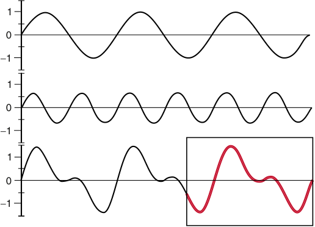

1 0 −1 1 0 −1 1 0 −1 

**Fig. 32.19 Arterial blood pressure waveform produced by summation of sine waves.** The fundamental wave _(top)_ added to 63% of the second harmonic wave _(middle)_ results in a pressure wave _(bottom)_ resembling a typical arterial blood pressure waveform _(box)_ . (From Mark JB. _Atlas of Cardiovascular Monitoring._ New York: Churchill Livingstone; 1998.)

pressure waveforms recorded on the monitor will be exaggerated or amplified. An underdamped system may combine elements of the measurement system itself with the measured sine waves and display systolic pressure overshoot (Fig. 32.20). In contrast, an overdamped waveform exhibits a slurred upstroke, absent dicrotic notch, and loss of fine detail. In such cases, the pulse pressure will be falsely narrow but MAP remains reasonably accurate (Fig. 32.21).

The interplay between natural frequency and damping coefficients is complex, but in general, the lower the natural frequency of the system, the narrower the range of acceptable damping coefficients and the greater the rate of inaccurate or erroneous results. It follows logically that for any specific system, the highest possible natural frequency yields the optimal result.118 In theory, this is best achieved by using short lengths of stiff pressure tubing and limiting additions or connections to the system such as stopcocks. It is recommended to use the system components as they exist in the manufactured kits as they are designed to function within an acceptable range.99 The most common reasons for underdamping are excessively stiff tubing and a defective transducer. Overdamping results from decreases in pressure within the system (i.e. inadequate pressure in the pressure bag), loose connections, kinks in the tubing or catheter, or air bubbles.99 While adding an air bubble to the monitoring system may improve the appearance of the waveform, it simultaneously increases damping and lowers natural frequency, thereby potentially increasing system resonance and paradoxically worsening systolic pressure overshoot (Fig. 32.22) The optimal system has short, stiff tubing and smaller-gauge catheters.99

The fast- flush test provides a convenient bedside method for determining system dynamic response and detecting signal distortion.110,112,118 The fast- flush valve is briefly opened to cause a temporary perturbation of the system. A well- functioning system will display a high initial amplitude with rapidly fading oscillations (Fig. 32.23).110,118 The clinical impact of resonance and under- or overdamping is

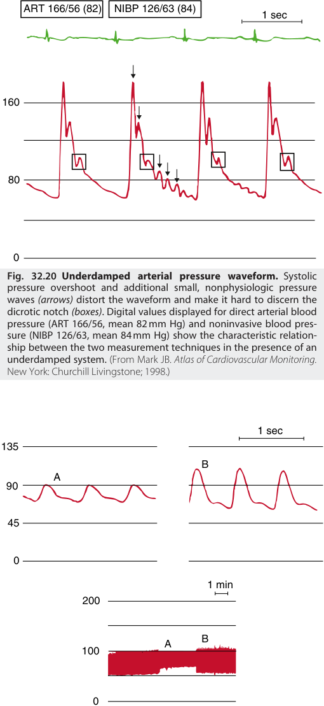

ART 166/56 (82) NIBP 126/63 (84) 1 sec 160 80 0 Fig. 32.20 Underdamped arterial pressure waveform.  Systolic pressure overshoot and additional small, nonphysiologic pressure waves  (arrows)  distort the waveform and make it hard to discern the dicrotic notch  (boxes) . Digital values displayed for direct arterial blood pressure (ART 166/56, mean 82 mm Hg) and noninvasive blood pres- sure (NIBP 126/63, mean 84 mm Hg) show the characteristic relation- ship between the two measurement techniques in the presence of an underdamped system. (From Mark JB.  Atlas of Cardiovascular Monitoring. New York: Churchill Livingstone; 1998.) 1 sec 135 B A 90 45 0 1 min 200 B A 100 0 

**Fig. 32.21 Overdamped arterial pressure waveform.** The overdamped pressure waveform (A) shows a diminished pulse pressure compared with the normal waveform (B). The slow- speed recording _(bottom)_ demonstrates a 3- minute period of damped arterial pressure. Note that despite the damped system, mean arterial pressure remains unchanged. (From Mark JB. _Atlas of Cardiovascular Monitoring._ New York: Churchill Livingstone; 1998.)

common, occurring in up to 30% of surgical patients and 44.5% of patients admitted to the intensive care unit. Interestingly, it appears that systolic measurements are more affected than diastolic or mean. Preexisting arteriopathy, lung disease, and hypertension are associated with higher rates of artifactual pressure wave distortion.110,119,120

<!-- PDF page 17 -->

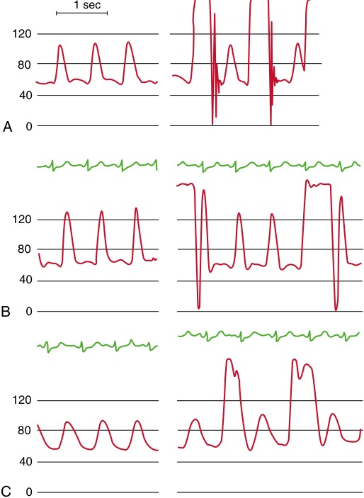

1 sec 120 80 40 A 0 120 80 40 B 0 120 80 40 C 0 

**Fig. 32.22 Effect of small air bubbles within arterial pressure monitoring systems.** Arterial pressure waveforms are displayed, along with superimposed fast- flush square- wave artifacts. (A) Original monitoring system has an adequate dynamic response (natural frequency 17 Hz, damping coefficient 0.2). (B) A small 0.1- mL air bubble added to the monitoring system produces a paradoxical increase in arterial blood pressure. Note decreased natural frequency of the system. (C) A larger 0.5- mL air bubble further degrades dynamic response and produces spurious arterial hypotension. (From Mark JB. _Atlas of Cardiovascular Monitoring._ New York: Churchill Livingstone; 1998.)

### Transducer Setup: Zeroing and Leveling

Prior to use, pressure transducers must be zeroed and leveled to the appropriate position, a maneuver accomplished by exposing the transducer to atmospheric pressure and performing the zero procedure as defined by each device manufacturer. It is important to recognize that the _zero pressure locus_ should be appropriately positioned given the clinical context, that the _zero reference point_ is local atmospheric pressure, and that the zero should be checked and re- zeroed periodically.118 Occasionally, a faulty transducer, cable, or monitor will cause the zero baseline to drift, introducing significant error over time, a problem resolved by re- zeroing the system.121,122

Choosing the appropriate level at which to establish the zero point is done with respect to the patient and the clinical context. Note that transducer zeroing and leveling are distinct procedures. Zeroing establishes the reference point as ambient atmospheric pressure, while leveling positions this

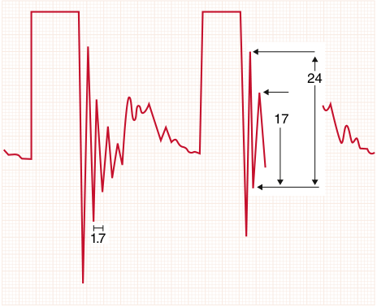

24 17 1.7 

**Fig. 32.23 Clinical measurement of natural frequency and damping coefficient.** Two square- wave fast- flush artifacts interrupt an arterial pressure waveform recorded on standard 1- mm grid paper at a speed of 25 mm/s. Natural frequency is determined by measuring the period of one cycle of adjacent oscillation peaks (1.7 mm). Damping coefficient is determined by measuring the heights of adjacent oscillation peaks (17 and 24 mm). From these measurements, a natural frequency of 14.7 Hz and an amplitude ratio of 0.71 may be calculated. (From Mark JB. _Atlas of Cardiovascular Monitoring._ New York: Churchill Livingstone; 1998.)

reference point relative to the patient’s body. This is even more important when the range of pressure values being measured is small, such as central venous or intracranial pressure. In such cases, small zeroing or leveling errors may translate to large relative errors in measurement.

In most cases, arterial pressure transducers should be placed to best estimate aortic root pressure, generally about 5 cm posterior to the sternal border.123,124 However, a more conventional location for the reference level for all hemodynamic monitoring, including central venous and pulmonary artery pressures, is the mid- thoracic level, which corresponds most closely to the mid- left atrial position and is located halfway between the anterior sternum and the bed surface in the supine patient.125,126 In some cases, though, the pressure of greatest interest may not be central aortic pressure. Examples include some neurosurgical procedures or those done in the beach- chair position. In these cases, the pressure of greatest interest may be that of the circle of Willis, best approximated by the patient’s ear. The most critical point is that the reference level be maintained in a consistent location regardless of where the clinician chooses to assign the reference level.

Proper interpretation of blood pressure measurements from a patient in the lateral decubitus position involves differentiating zeroing from leveling pressure transducers and appreciating the differences between noninvasive and invasive blood pressure measurement. In this position, while the aortic root remains stationary, one arm is necessarily higher than the other. However, as long as the pressure transducer remains fixed at the level of the heart, the measured pressure remains completely unaffected by the position of the arms, or location of the arterial catheter (e.g. radial artery catheter in the nondependent wrist). Conversely, noninvasive cuff blood pressure measurements will differ in the two arms, being higher in the

<!-- PDF page 18 -->

dependent (down) arm and lower in the nondependent (up) arm (Fig. 32.24). This relationship must be taken into account when using the cuff to calibrate an invasively measured pressure.

### Normal Arterial Pressure Waveforms

The systemic arterial pressure waveform results from ejection of blood from the left ventricle during systole followed by peripheral runoff during diastole. The systolic waveform immediately follows the ECG R wave and consists of a steep pressure upstroke, peak, and ensuing decline. The downslope of the arterial pressure waveform is interrupted by the dicrotic notch and reaches its nadir at end- diastole (Fig. 32.25). The dicrotic notch of a central aortic pressure waveform is sharply defined and thought to result from aortic valve closure.128 In contrast, more peripheral arterial waveforms generally display a slightly delayed and mildly blunted dicrotic notch more dependent on properties of the arterial wall. Note that the systolic upstroke starts 120– 180 ms after the beginning of the R wave, reflecting the time required for left ventricular depolarization, isovolumic contraction, opening of the aortic valve, left ventricular ejection, and propagation of the pressure wave through the aorta to the pressure transducer.

The bedside monitor displays values for the systolic peak and end- diastolic nadir pressures. In simplest terms, MAP reflects the area beneath the arterial pressure curve divided by the beat period, averaged over multiple cardiac cycles, but is dependent on device- specific algorithms. MAP is sometimes estimated as diastolic pressure plus one- third of the pulse pressure, but this shortcut is only valid at slower heart rates because the duration of diastole decreases as the heart rate increases.129

The morphology of the arterial waveform and the precise values of systolic and diastolic blood pressure vary throughout the arterial system. Pressure waveforms recorded simultaneously from different sites have different morphologies

due to the physical characteristics of the vascular tree, a phenomenon known as distal pulse amplification130,131 (Fig. 32.26). As the pressure wave travels toward the periphery, the arterial upstroke becomes steeper, the systolic peak rises, the dicrotic notch appears later, the diastolic wave becomes more prominent, and end- diastolic pressure falls. As a result, peripheral arterial waveforms have higher systolic, lower diastolic, and wider pulse pressures compared with central aortic waveforms. Interestingly, the displayed MAP is only slightly increased.

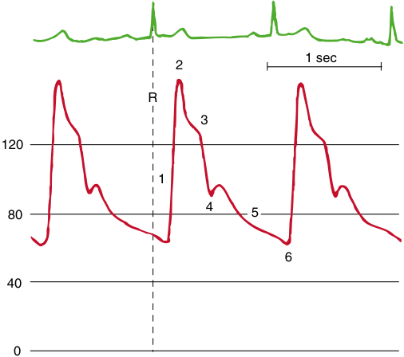

1 sec 2 R 3 120 1 4 80 5 6 40 0 

**Fig. 32.25 Normal arterial blood pressure waveform and its relation to the electrocardiographic R wave.** (1) Systolic upstroke, (2) systolic peak pressure, (3) systolic decline, (4) dicrotic notch, (5) diastolic runoff, and (6) end- diastolic pressure. (From Mark JB. _Atlas of Cardiovascular Monitoring._ New York: Churchill Livingstone; 1998.)

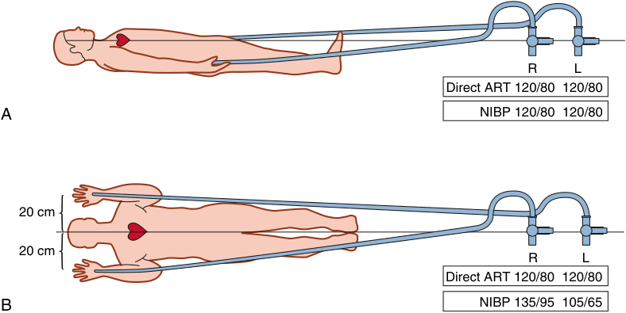

R L Direct ART 120/80  120/80 A NIBP 120/80  120/80 20 cm 20 cm R L Direct ART 120/80  120/80 B NIBP 135/95  105/65 

**Fig. 32.24 Effect of patient position on the relation between direct arterial blood pressure (ART) and indirect noninvasive blood pressure (NIBP) measurements.** (A) In the supine patient, pressures measured from the right (R) or left (L) arms by either technique will be the same. (B) In the right lateral decubitus position, ART pressures recorded directly from the right and left radial arteries will remain unchanged so long as the respective pressure transducers remain at heart level. However, NIBP will be higher in the dependent right arm and lower in the nondependent left arm. Differences in NIBP are determined by the positions of the arms above and below the level of the heart and are equal to the hydrostatic pressure differences between the level of the heart and the respective arm. A 20- cm difference in height produces a 15- mm Hg difference in pressure. (From Mark JB. _Atlas of Cardiovascular Monitoring._ New York; Churchill Livingstone; 1998.)

<!-- PDF page 19 -->

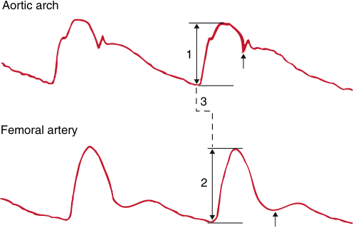

Aortic arch 1 3 Femoral artery 2 

**Fig. 32.26 Distal pulse wave amplification of the arterial pressure waveform.** Compared with pressure in the aortic arch, the more peripherally recorded femoral artery pressure waveform demonstrates a wider pulse pressure (compare 1 and 2), a delayed start to the systolic upstroke (3), a delayed, slurred dicrotic notch (compare _arrows_ ), and a more prominent diastolic wave. (From Mark JB. _Atlas of Cardiovascular Monitoring._ New York: Churchill Livingstone; 1998.)

Reflection of pressure waves within the arterial tree may significantly affect the arterial pressure wave as it travels peripherally.130 As blood flows from the aorta to the radial artery, MAP decreases only slightly because there is little resistance to flow in the major conducting arteries. However, resistance increases significantly at the arteriolar level, causing antegrade pulsations to become smaller. At the same time, this change in resistance can generate significant retrograde, reflected pressure waves. Because all displayed arterial waveforms are a summation of both antegrade and reflected waves, more upstream arterial sites may yield an augmented waveform.132 In cases in which there is reduced compliance, these retrograde waves can travel extremely rapidly, resulting in arterial pressure waveforms with increased pulse pressure, a late systolic pressure peak, attenuated diastolic pressure waves and, at times, even an early systolic hump distorting the smooth upstroke (Fig. 32.27).

### Arterial Blood Pressure Gradients

Numerous pathophysiologic conditions cause exaggerated arterial pressure gradients between monitoring sites, be they real, iatrogenic, or artifactual. Frank and co- workers found that 21% of patients undergoing peripheral vascular surgery had a blood pressure difference between the two arms that exceeded 20 mm Hg.133 Patients receiving vasopressor infusions for septic shock may have femoral–radial gradients that exceed 50 mm Hg.134 Less severe gradients have been noted with general anesthesia, neuraxial blocks, and changes in patient temperature.131 During hypothermia, vasoconstriction causes systolic pressure in the radial artery to exceed that in the femoral artery, whereas during rewarming, vasodilation reverses the gradient.135

Characteristic gradients between central and peripheral sites have also been described during cardiopulmonary bypass (Fig. 32.28). The mean radial artery pressure falls on initiation of bypass, remains lower than mean femoral artery pressure throughout the bypass period and into the initial postbypass period, often by greater than 20 mm Hg.136,137 In most patients, this gradient resolves within the

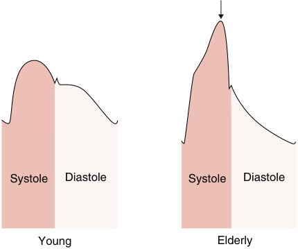

Systole Diastole Systole Diastole Young Elderly 

**Fig. 32.27 Impact of pressure wave reflection on arterial pressure waveforms.** In older individuals with reduced arterial compliance, early return of peripherally reflected waves increases pulse pressure, produces a late systolic pressure peak _(arrow)_ , attenuates the diastolic pressure wave, and at times, distorts the smooth upstroke with an early systolic hump.

first hour, but occasionally remains well into the postoperative period.

### Abnormal Arterial Pressure Waveforms

The morphologic features of individual arterial pressure waveforms can provide important diagnostic information (Table 32.1; Fig. 32.29A–D). Aortic stenosis produces a fixed obstruction to ejection, resulting in reduced stroke volume and a slowed rate of ejection. As a result, the waveform is small in amplitude ( _pulsus parvus_ ), has a slowly rising systolic upstroke ( _pulsus tardus_ ), and a delayed peak in systole (see Fig. 32.29B). A distinct shoulder, termed the anacrotic notch, often distorts the pressure upstroke and the dicrotic notch may not be discernible. These features may make the arterial pressure waveform appear overdamped. In aortic regurgitation, the arterial pressure wave displays a sharp rise, wide pulse pressure, and low diastolic pressure owing to diastolic runoff both antegrade and retrograde back into the LV. The arterial pressure pulse may have two systolic peaks ( _bisferiens pulse_ ), with the first peak resulting from antegrade ejection and the second from a wave reflected from the periphery (see Fig. 32.29C). In hypertrophic cardiomyopathy, the waveform assumes a peculiar bifid shape termed a “spike- and- dome” configuration. After an initial sharp blood pressure increase resulting from rapid, early systolic ejection, arterial pressure abruptly falls as mid- systolic left ventricular outflow obstruction interrupts stroke volume ejection. This is finally followed by a second, late- systolic increase associated with arrival of reflected waves from the periphery (see Fig. 32.29D).

Changes in arterial waveform patterns over time are also valuable. _Pulsus alternans_ is a pattern of alternating larger and smaller pressure waves that vary with the respiratory cycle and are generally associated with severe left ventricular systolic dysfunction or aortic stenosis (Fig. 32.30A). _Pulsus paradoxus_ is an exaggerated variation in arterial pressure (>10–12 mm Hg) during quiet breathing138,139 (see Fig. 32.30B). _Pulsus paradoxus_ is not truly paradoxical, but rather an exaggeration of a normal

<!-- PDF page 20 -->

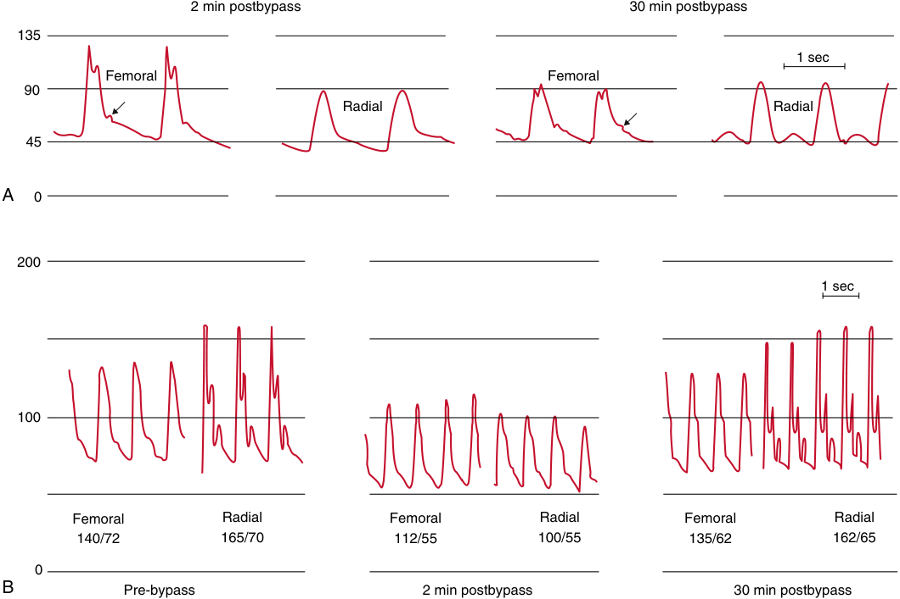

2 min postbypass 30 min postbypass 135 1 sec Femoral Femoral 90 Radial Radial 45 A 0 200 1 sec 100 Femoral Radial Femoral Radial Femoral Radial 140/72 165/70 112/55 100/55 135/62 162/65 0 B Pre-bypass 2 min postbypass 30 min postbypass 

**Fig. 32.28 Arterial pressure gradients following cardiopulmonary bypass.** (A) Femoral and radial artery pressure traces recorded 2 minutes after bypass (2 min postbypass), when radial artery pressure underestimates the more centrally measured femoral artery pressure and 30 minutes later (30 min postbypass), when radial and femoral arterial pressures have equalized and radial pressure has resumed a more typical morphology. Note that the dicrotic notch _(arrows)_ is visible in the femoral pressure trace immediately after bypass but is delayed in the radial pressure trace. (B) Femoral and radial artery pressure traces recorded before cardiopulmonary bypass (pre- bypass), 2 minutes following bypass (2 min postbypass), and 30 minutes following bypass (30 min postbypass). Note changing relationship between femoral and radial artery pressure measurements at these different times.

**Table 32.1** Arterial Blood Pressure Waveform Abnormalities

|**Condition**|**Characteristics**|
|---|---|
|Aortic stenosis|Pulsus parvus (narrow pulse pressure) Pulsus tardus (delayed upstroke)|
|Aortic regurgitation|Bisferiens pulse (double peak) Wide pulse pressure|
|Hypertrophic cardiomyopathy|Spike and dome (mid- systolic obstruction)|
|Systolic left ventricular failure|Pulsus alternans (alternating pulse pressure amplitude)|
|Cardiac tamponade|Pulsus paradoxus (exaggerated decrease in systolic blood pressure during spontaneous inspiration)|

variation in blood pressure that accompanies spontaneous ventilation. It is an important sign in cardiac tamponade but may also be seen with pericardial constriction, severe airway obstruction, bronchospasm, dyspnea, or any condition that involves large swings in intrathoracic pressure.

Importantly, though, in cases of cardiac tamponade, the _pulse pressure_ and _left ventricular stroke volume_ decrease during inspiration, in contrast to the pattern associated with large variations in intrathoracic pressure in which _pulse pressure_ remains constant.140

### Arterial Pressure Monitoring and Waveform Analysis for Prediction of Volume Responsiveness

The starting point for volume resuscitation begins with optimizing cardiac preload, or more precisely, identifying the presence of residual preload reserve. The limitations and potential confounders of static indicators of preload such as central venous pressure are well documented.141 A wide array of dynamic markers of preload reserve and volume responsiveness have been described and are mostly based on respiratory- induced changes in intrathoracic pressure and associated changes in blood pressure. The goal is to discriminate between patients for whom volume expansion would be beneficial from those for whom it would not.

During the inspiratory phase of a positive pressure breath, increased intrathoracic pressure simultaneously decreases left ventricular (LV) afterload while at the same time increasing total lung volume, displacing blood from the pulmonary venous reservoir into the left side of the

::: details 原始表格與符號（PDF 第 20 頁）

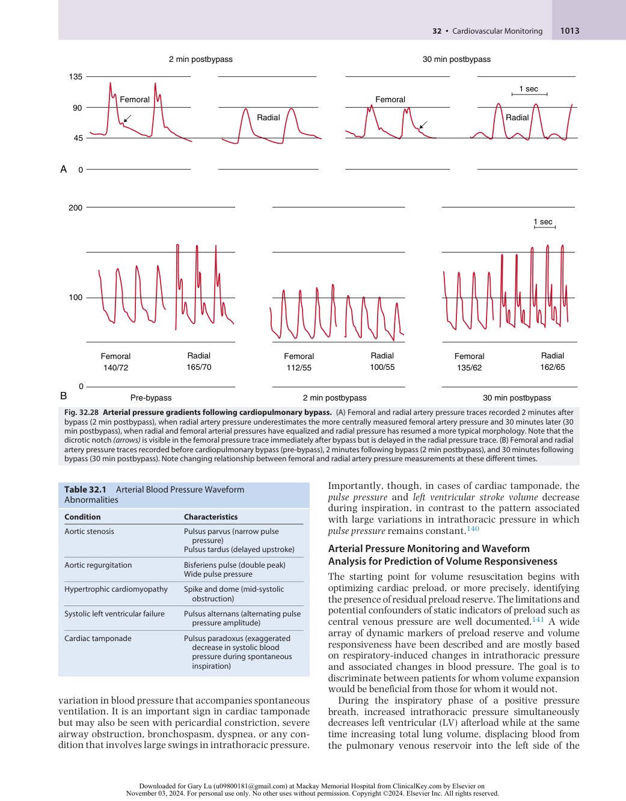

:::

<!-- PDF page 21 -->

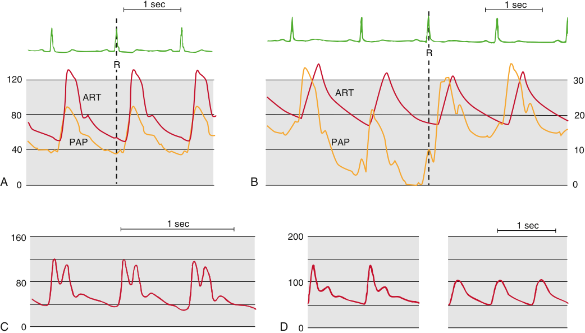

1 sec 1 sec R R 120 30 ART ART 80 20 PAP PAP 40 10 A 0 B 0 1 sec 1 sec 160 200 80 100 C 0 D 0 

**Fig. 32.29 Influence of pathologic conditions on arterial pressure (ART) waveform morphology.** (A) Normal ART and pulmonary artery pressure (PAP) waveform morphologies demonstrating the similar timing of these waveforms relative to the electrocardiographic R wave. (B) In aortic stenosis, the ART waveform is distorted with a slurred upstroke and delayed systolic peak. These changes are particularly striking in comparison with the normal PAP waveform. Note the beat- to- beat respiratory variation in the PAP waveform. For A and B, the ART scale is on the left and the PAP scale is on the right. (C) Aortic regurgitation produces a bisferiens pulse and a wide pulse pressure. (D) Arterial pressure waveform in hypertrophic cardiomyopathy shows a peculiar spike- and- dome configuration. The waveform assumes a more normal morphology following surgical correction of this condition. (From Mark JB. _Atlas of Cardiovascular Monitoring._ New York: Churchill Livingstone; 1998.)

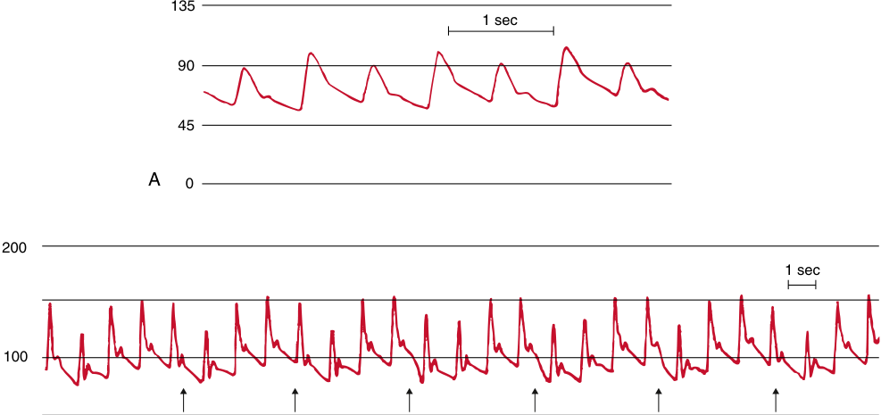

135 1 sec 90 45 A 0 200 1 sec 100 

B 0 

**Fig. 32.30 Beat- to- beat variability in arterial pressure waveform morphologies.** (A) Pulsus alternans. (B) Pulsus paradoxus. The marked decline in both systolic blood pressure and pulse pressure during spontaneous inspiration _(arrows)_ is characteristic of cardiac tamponade. (From Mark JB. _Atlas of Cardiovascular Monitoring._ New York: Churchill Livingstone; 1998.)

<!-- PDF page 22 -->

heart, increasing LV preload and augmenting LV stroke volume. In the absence of changes in system resistance, an increase in systemic arterial pressure results. At the same time, rising intrathoracic pressure impairs systemic venous return, lowers right ventricular (RV) preload, and potentially increases RV afterload by slightly increasing pulmonary vascular resistance. These effects combine to reduce RV ejection during the early phase of inspiration. During the expiratory phase, however, the situation is reversed. The smaller RV stroke volume seen during inspiration traverses the pulmonary vascular bed and enters the left heart, resulting in reduced LV filling, reduced LV stroke volume, and a fall in systemic arterial blood pressure. This waxing and waning cycle in stroke volume and systemic arterial blood pressure is known as the systolic pressure variation (SPV).

SPV is often subdivided into inspiratory and expiratory components by measuring the increase (Δ Up) and decrease (Δ Down) in systolic pressure relative to the end- expiratory, apneic baseline pressure (Fig. 32.31). In a mechanically ventilated patient, normal SPV is 7–10 mm Hg, with Δ Up being 2–4 mm Hg and Δ Down being 5–6 mm Hg. Values greater than this are felt to indicate hypovolemia.77,78 Both in experimental animals and critically ill patients, hypovolemia causes a dramatic increase in SPV, particularly the Δ Down component. Patients with increased SPV during positive pressure ventilation may be described clinically as having residual preload reserve or being “volume responsive.” While not synonymous with hypovolemia, preload reserve describes a physiologic state in which volume expansion or fluid challenge shifts the patient upward on the Frank–Starling curve resulting in increased stroke volume and increased cardiac output (CO) as long as systemic vascular resistance remains unchanged. Indeed, in a heterogeneous group of critically ill patients, Marik demonstrated that a large SPV (>15 mm Hg) was highly predictive of a low pulmonary artery wedge pressure (PAWP) (&lt;10 mm Hg), a surrogate for LV preload reserve.142

Pulse pressure variation (PPV), another dynamic indicator of preload reserve, has been incorporated into most standard monitoring software systems whenever an invasive arterial catheter is in use. In general, normal PPV is less than 13%–17%143–147 (Fig. 32.32). More sophisticated methods of pulse contour analysis allow real- time measurement of stroke volume variation (SVV), as well as calculation of a stroke volume variation index (SVVI). When these measures exceed 10%–13%, the patient is likely to have a positive response to volume expansion.146,148 Although all

of these dynamic measures are thought to indicate preload reserve, they are not interchangeable. PPV has been shown to diverge from SVV in the setting of vasopressor use or when the autonomic nervous system intervenes to preserve perfusion pressure in the face of falling stroke volume. In such cases, PPV will remain low while SVV increases.149,150

Devices based on respiratory cycle– induced variation in the pulse plethysmogram waveform have been developed as a similar but less invasive alternative for assessing preload reserve or volume responsiveness. Measures such as photoplethysmography variation (ΔPOP) or the plethysmography variability index (PVI) appear to be useful when clinical and environmental conditions are optimal, but the transcutaneous oximetry signal is even more subject to a large number of confounding influences than the arterial pressure waveform.145,151,152 Tidal volume, core and peripheral temperature, ambient light, and cardiac dysrhythmias pose significant impediments to valid and reproducible data collection and interpretation. There is little consensus regarding meaningful threshold values and validity in children and in ventilated but not paralyzed patients seem especially poor.152 Furthermore, there are sophisticated auto- gaining features incorporated in most commercially available plethysmographic monitoring systems to optimize signal display. As such, the degree of variation visible to the naked eye may not correlate with true signal variation, resulting in erroneous clinical decisions and incorrect therapy.

Accumulated evidence supports dynamic measures of intravascular volume as significantly superior to static

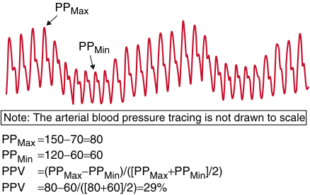

PPMax PPMin Note: The arterial blood pressure tracing is not drawn to scale PPMax =150−70=80 PPMin  =120−60=60 PPV =(PPMax−PPMin)/([PPMax+PPMin]/2) PPV =80−60/([80+60]/2)=29% 

**Fig. 32.32 Pulse pressure variation.** Pulse pressure variation (PPV) is calculated as the difference between maximal (PPMax) and minimal (PPMin) pulse pressure values during a single mechanical respiratory cycle, divided by the average of these two values. (Note that the arterial blood pressure trace is drawn for illustrative purposes and not to scale.)

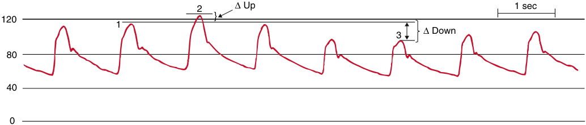

2 ∆ Up 1 sec 120 } 1 ∆ Down 3 80 40 0 

**Fig. 32.31 Systolic pressure variation.** Compared with systolic blood pressure recorded at end-expiration (1) a small increase occurs during positive pressure inspiration (2, Δ Up) followed by a decrease (3, Δ Down). Normally, systolic pressure variation does not exceed 10 mm Hg. In this instance, the large Δ Down indicates hypovolemia even though systolic arterial pressure and heart rate are relatively normal. (From Mark JB. _Atlas of Cardiovascular Monitoring._ New York: Churchill Livingstone; 1998.)

<!-- PDF page 23 -->

ones, especially in critically ill patients. Both PPV and SVV have been shown to be accurate following cardiac surgery in patients with normal and reduced ventricular function, while PPV was validated in identifying fluid responsiveness in patients with septic shock.153,154 Intraoperative use has also been examined with similar results.155,156 Indeed, the ability of clinicians to “eyeball” respiratory variation in the arterial blood pressure waveform as displayed on the monitor seems reasonably accurate. Subjective estimates of such pressure variation were incorrect only 4.4% of the time, a rate that would have resulted in only 1% of treatments being erroneous.147

There is disagreement on the precise threshold values that differentiate fluid responders from non- responders, and there is no standardization among the multitude of techniques, devices, and approaches described.145 In a systematic review, mean discriminatory thresholds defining volume responsiveness for PPV and SVV were found to be 12.5% ± 1.6% and 11.6% ± 1.9%, respectively, with acceptable sensitivities and specificities (89%, 88% and 82%, 86%, respectively).157 However, simply differentiating patients who will respond from those who will not fails to take into account the nature of the clinical intervention at issue. Volume expansion does not result in a dichotomous outcome and the asymmetric nature of the Frank– Starling curve dictates that the cost–benefit ratio of acting in one direction will be different from acting in the other. For any given change in preload, the change in stroke volume depends on the direction of the preload change, with that direction being dependent on how close to the peak of the curve the patient is at the time of measurement. Consequently, the concept of a “gray zone” has been proposed that defines a range of values between which evidencebased decision- making is not possible.158 For PPV, this zone appears to be 9%–13% such that those above 13% should receive volume expansion while those below 9% should not. Between those two values, the measurement is not able to provide meaningful guidance and the decision should be based on other criteria.146,159

Because PPV’s availability to bedside clinicians has facilitated its adoption into routine practice, it is especially important to appreciate the shortcomings of all respiratory- induced dynamic indicators and the clinical conditions under which they were originally studied and validated.160,161 While PPV appears to be valid in the setting of liver failure, it is significantly affected by increased abdominal pressure, use of vasopressors, and patient position, including steep Trendelenburg, prone, or lateral decubitus.146,150,162–164 Variability in diastolic filling causing variable stroke volume makes irregular heart rhythms highly problematic in the use of all dynamic preload reserve indicators.165,166 Patients with severely impaired ventricular function pose a challenge as a fluid challenge does not consistently result in an increase in stroke volume. In addition, there is evidence that patients with pulmonary hypertension or reduced RV ejection fraction may not have consistent responses to changes in intrathoracic pressure, increasing the risk of over- hydration and worsening right heart failure.167 Dynamic indices are of marginal value in the setting of either minimally invasive or open thoracic surgery due to the loss of the chest as a closed space, and their use in children is considered unreliable due to the

increased compliance of the myocardium and the chest wall in younger patients.168,169 It has even been suggested that tachypnea (especially in the setting of respiratory failure), or significant bradycardia may disrupt the relationship between respiratory cycle–induced changes in intrathoracic pressure and cardiac chamber volumes, thus invalidating the theoretical basis for blood pressure variation analysis.146

Of special importance, though, is the profound effect of protective lung ventilation on the predictive power of respiratory- induced measures to identify a patient with residual preload reserve.170–172 Mechanical ventilation with 8–10 mL/kg tidal volume, positive end- expiratory pressure ≥5 mm Hg, regular cardiac rhythm, normal intraabdominal pressure, and a closed chest are necessary to duplicate the experimental conditions under which most of these indices have been validated. These differ significantly from lung protective ventilation strategies, particularly the tidal volume limits, and clinical trials have found waveform analysis to be of limited utility in this setting.170–172 However, measuring PPV or SVV during or immediately following a recruitment maneuver increased its sensitivity and specificity in predicting fluid responsiveness, although a broader gray zone of up to 26% should be considered.173,174

As noted above, respiratory cycle–induced arterial pressure variations are dependent on changes in LV preload and, to a lesser degree, afterload. Indeed, decreased arterial compliance and the resultant increased pulse pressure that accompanies both normal and pathologic vascular aging results in an exaggerated PPV response to any change in stroke volume. As such, it is possible that PPV thresholds should be higher in such patients than in those with more normal arterial compliance.175,176

## Central Venous Pressure Monitoring

Cannulation of a central vein and direct measurement of central venous pressure (CVP) are frequently performed in hemodynamically unstable patients and those undergoing major operations. A central venous catheter may be inserted to provide secure vascular access for administration of vasoactive drugs or fluids, CVP monitoring, transvenous cardiac pacing, temporary hemodialysis, pulmonary artery catheterization for more comprehensive cardiac monitoring, or aspiration of entrained air in patients at risk for venous air emboli. A central venous catheter may also be inserted when no peripheral access can be obtained, or when repeated venous blood sampling is required (Box 32.5).

### CENTRAL VENOUS CANNULATION

The decision to perform central venous cannulation before or after induction of anesthesia is guided most often by individual patient and physician preferences or institutional practice.

### Choosing the Catheter, Site, and Method for Central Venous Cannulation

Central venous catheters come in a variety of lengths, gauges, compositions, and lumen numbers.177,178 This

<!-- PDF page 24 -->

### Box 32.5 Indications for Central Venous Cannulation

- Central venous pressure monitoring

- Pulmonary artery catheterization and monitoring

- Transvenous cardiac pacing

- Temporary hemodialysis

- Drug administration

- Concentrated vasoactive drugs ᑏ Hyperalimentation ᑏ Chemotherapy

- Agents irritating to peripheral veins

- Prolonged antibiotic therapy (e.g., endocarditis)

- Rapid infusion of fluids (via large cannulas)

- Trauma ᑏ Major surgery

- Aspiration of air emboli

- Inadequate peripheral intravenous access ᑏ Sampling site for repeated blood testing

makes it critical for the physician to choose the best catheter for any given application. Multiport catheters, which allow monitoring of central venous pressure and infusion of drugs and fluids simultaneously, are the most common,179 but introducer sheaths with one or two integrated ports for multiple drug infusions are an alternative. Introducer sheaths allow insertion of a catheter through the hemostasis valve for continuous CVP monitoring and rapid placement of a pacing wire or pulmonary artery catheter.

Selecting the best site for safe and effective central venous cannulation ultimately requires consideration of the indication for catheterization (pressure monitoring versus drug or fluid administration), the patient’s underlying medical condition, the clinical setting, and the skill and experience of the physician performing the procedure. In coagulopathic patients, it is best to choose a puncture site where bleeding from the vein or adjacent artery is easily detected and controlled with local compression. In such a patient, an internal or external jugular approach would be preferable to a subclavian site. Likewise, patients with severe emphysema or others who would be severely compromised by a pneumothorax would be better candidates for internal jugular than subclavian cannulation, owing to the higher risk with the latter approach. If transvenous cardiac pacing is required in an emergency situation, catheterization of the right internal jugular vein is recommended, as it provides the most direct route to the right ventricle. Trauma patients, with their necks immobilized in a hard cervical collar, are best resuscitated using a femoral or subclavian approach; the latter may be placed even more safely if the risk of pneumothorax is obviated by prior placement of a thoracostomy tube. The length of catheter inserted to position the catheter tip properly in the superior vena cava will vary according to puncture site, being slightly (3 to 5 cm) greater when the left internal or external jugular veins are chosen, compared with the right internal jugular vein.180 Finally, a physician’s personal experience undoubtedly plays a significant role in determining the safest site for central venous cannulation, particularly when the procedure is performed under urgent or emergent circumstances.

Central veins should be cannulated using either landmark techniques or ultrasound guidance, but the latter is now

strongly recommended for internal jugular vein cannulation and should be considered for subclavian or femoral venous access.181–183 The reader is referred to other sources for detailed descriptions and tutorials on the various insertion techniques for different access sites.179,184–186 Regardless of the insertion technique used or the cannulation site chosen, certain general principles should be emphasized. Ideally, a protocol or checklist describing the basic procedural steps for central line insertion should be in place at every institution, and all staff members should feel empowered to speak up when they witness a protocol violation. Standardized equipment, routine use of an assistant, hand washing, and maximal barrier precautions all contribute to the sterility of the procedure.182 The use of real- time ultrasound guidance for vessel localization and venipuncture should be routine or at least strongly considered, especially when the internal jugular vein site is selected. Waveform manometry or pressure measurement should be used to confirm venous placement of the catheter before use. Finally, the position of the catheter tip should be verified as soon as clinically appropriate to avoid delayed complications.

### COMPLICATIONS OF CENTRAL VENOUS PRESSURE MONITORING

Although immediate complications are infrequent when central venous cannulation is performed by well- trained, experienced clinicians, serious complications may still occur, with as many as 15% of patients experiencing some sort of related adverse event.187,188 Complications are often divided into mechanical, thromboembolic, and infectious etiologies (Box 32.6).

### Mechanical Complications of Central Venous Catheterization

The incidence of complications depends on a number of factors including the catheter insertion site and the patient’s medical condition. Large retrospective and observational studies provide the best estimates of incidence and frequency.

Vascular injuries from central venous catheterization have a range of clinical consequences. The most common minor complications are localized hematoma or injury to the venous valves.189 More serious complications include perforation into the pleural space or mediastinum, resulting in hydrothorax, hemothorax, hydromediastinum, hemomediastinum, and or chylothorax.190–196

In general, unintended arterial puncture is the most common acute mechanical complication, ranging from 1.9% to 15%.197 Many of these injuries result in localized hematoma formation, but on rare occasions even smallgauge needle punctures may lead to serious complications such as arterial thromboembolism.198 Delayed vascular complications following central venous catheterization are uncommon but should be considered as consequences of this procedure. A number of these have been described in the literature, including aorto- atrial fistula, venobronchial fistula, carotid artery–internal jugular vein fistula, and pseudoaneurysm formation.199–202

The most important life- threatening vascular complication of central venous catheterization is cardiac tamponade resulting from perforation of the intrapericardial superior vena cava, right atrium, or right ventricle, leading to

<!-- PDF page 25 -->

### Box 32.6 Complications of Central Venous Pressure Monitoring

|Mechanical|
|---|
|Vascular injury|
|ᑏArterial|
|ᑏVenous|
|ᑏCardiac tamponade|
|Respiratory compromise|
|ᑏAirway compression from hematoma|
|ᑏPneumothorax|
|Nerve injury|
|Arrhythmias|
|Thromboembolic|
|Venous thrombosis|
|Pulmonary embolism|
|Arterial thrombosis and embolism|
|Catheter or guidewire embolism|
|Infectious|
|Insertion site infection|
|Catheter infection|
|Bloodstream infection Endocarditis|
|Misinterpretation of data|
|Misuse of equipment|

hemopericardium or unintentional pericardial instillation of intravenous fluid.203 Most reports document the avoidable nature of this catastrophic event and highlight that patients are predisposed to this complication when central venous catheter tips are malpositioned within the heart chambers or abutting the wall of the superior vena cava at a steep angle. This latter position can be recognized radiographically as a gentle curvature of the catheter tip within the superior vena cava.204 These observations emphasize that objective confirmation of proper catheter tip location is mandatory, regardless of whether the catheter is inserted from a central or peripheral site.

Pneumothorax is often cited as the most common complication of subclavian vein cannulation, although it appears that unintended arterial puncture is actually more frequent.108,205 Mansfield _et al._ reported 821 patients who underwent attempted subclavian venous cannulation, with a 1.5% incidence of pneumothorax and a 3.7% incidence of arterial puncture when using the landmark technique.205 Pneumothorax is even less frequent with the internal jugular approach. Shah _et al._ reported an incidence of pneumothorax of 0.5% in their series of nearly 6000 internal jugular catheterizations.197 This is most likely a high estimate, as these patients had undergone sternotomy for cardiac surgery, a procedure that may have been responsible for the pneumothorax in many cases.

Nerve injury is another potential complication of central venous cannulation. Damage may occur to the brachial plexus, stellate ganglion, phrenic nerve, or vocal cords.206– 208 In addition, chronic pain syndromes have been attributed to this procedure.209

### Thromboembolic Complications of Central Venous Catheterization

Catheter- related thrombosis varies according to the site of central venous catheterization, occurring in as many as

21.5% of patients with femoral venous catheters and 1.9% of those with subclavian venous catheters.210 Catheters that are positioned low in the right atrium may be more prone to thrombus formation, possibly due to mechanical irritation of the right atrial endocardium by the catheter.211 Thrombi that form at the catheter tip or adhere to the endocardium have the potential to become a nidus for infection, cause superior vena cava syndrome, or embolize into the pulmonary circulation.212–214 Occasionally, surgical removal is required.215

In addition to thromboembolism, other reported embolic complications of central venous catheterization include embolism of portions of the catheter or guidewire, and air embolism.216,217 Almost invariably, these are the result of misuse of equipment, highlighting the need for proper education and ongoing training.

### Infectious Complications of Central Venous Catheterization

By far, the most common major late complication of central venous cannulation is infection. Major progress has been made in the control of central line–associated bloodstream infections (CLABSIs), likely due to a focus on evidence- based best practices for catheter insertion and maintenance.218 In fact, CLABSI rates declined by about 50% between 2008 and 2016.219 Unfortunately, CLABSI rates increased by up to 91% during the COVID- 19 pandemic, especially in smaller community hospitals compared to large academic systems.220 The majority of infections occur in inpatient wards and outpatients receiving hemodialysis, but approximately one- third of these cases still occur in the intensive care unit, a cohort that likely includes most of the catheters placed intraoperatively.219,221,222

As previously noted, the starting point for prevention of infection is meticulous attention to aseptic technique.223 Multilumen catheters may carry a higher risk of infection than single- lumen catheters although the added clinical functionality of such catheters often mandates their use.188,224 Catheters vary in their composition and surface characteristics, which may influence bacterial adherence.225 Heparin- bonded central venous catheters have been shown to reduce the incidence of catheter- related thrombosis and infection in children and adults.226,227 The incorporation of antimicrobial treatments such as silver (this metal has broad antimicrobial activity and is nontoxic), combinations of the antiseptics chlorhexidine and silver sulfadiazine, or the antibiotics minocycline and rifampin onto the catheter surfaces have been shown to reduce rates of catheter colonization and in some cases bloodstream infection.227–229 The added expense has prevented more widespread adoption of these catheters, although an analysis has suggested their cost- effectiveness in settings in which the rate of catheterrelated infections remains high (more than 3.3 per 1000 catheter days).230

A chlorhexidine gluconate–impregnated sponge dressing has been shown to reduce catheter colonization in infants and children, but does not reduce the rate of catheter- associated bloodstream infections.231,232 Guidelines from the CDC do not support routine catheter site changes or scheduled changes over a guidewire and provide other detailed recommendations for

::: details 原始表格與符號（PDF 第 25 頁）

:::

<!-- PDF page 26 -->

catheter management to reduce the risk of infectious complications.224,233

Overall, there does not appear to be an ideal site for central venous cannulation with respect to prevention of complications given that, taken together, the risk of mechanical, thrombotic, and infectious complications is similar among the three insertion sites. This was illustrated by a recent prospective, randomized, multicenter trial in adult intensive care unit patients, where catheterization of the subclavian vein is associated with the lowest risk of infectious complications and deep vein thrombosis, but the highest risk of mechanical complications.234

### Other Complications of Central Venous Catheterization

Although many complications of CVP monitoring relate to equipment misuse, the frequency of complications caused by data misinterpretation remains unknown. It is extremely likely, however, that clinicians misinterpret CVP measurements and have suboptimal understanding of CVP monitoring, just as has been demonstrated repeatedly for pulmonary artery catheter monitoring (see discussion later). Safe and effective use of CVP monitoring requires a detailed understanding of cardiovascular physiology, normal CVP waveforms, and common pathologic abnormalities in these measurements.

### PHYSIOLOGIC CONSIDERATIONS FOR CENTRAL VENOUS PRESSURE MONITORING

Cardiac filling pressures are measured directly from a number of sites in the vascular system. Central venous pressure monitoring is the least invasive method, followed by pulmonary artery and left atrial pressure (LAP) monitoring. Proper interpretation of all cardiac filling pressures requires knowledge of normal values for pressures in the cardiac chambers, great vessels, and other measured and derived hemodynamic variables (Table 32.2).

CVP is determined by the interaction of the venous return function of the circulatory system and cardiac function.235 An increase in cardiac function with an increase in venous return will result in an increase in CO and rise in CVP. An increase in cardiac function without an increase in venous return will result in an increase in CO and a fall in CVP. In other words, an isolated CVP measurement has very little meaning unless the information is interpreted in the context of some estimation of cardiac function.

### CVP and Venous Return

The relationship among the multiple variables that affect blood return to the right atrium is complex. In short, venous return is mostly determined by the gradient between the _mean circulatory filling pressure_ (MCFP) and CVP.141 MCFP results from the elastic recoil pressure from distended small veins and venules and is the force that drives blood back to the right atrium.235 This pressure has been estimated to be between 8 and 10 mm Hg in healthy individuals at rest, but it cannot be measured in the clinical setting.236 MCFP rises when volume is administered intravenously, but also when venous tone changes in response to venoconstrictors, endogenous catecholamines, or when there is a shift of blood volume from the splanchnic system into the systemic

circulation.141 The CVP, typically 2 to 3 mm Hg in healthy individuals, is the downstream pressure. Two important corollaries emerge: right atrial pressure is key for maintaining CO, and the body will compensate through the mechanisms described above and others to preserve venous return. This explains why a patient may lose 10% to 12% of circulating blood volume without exhibiting changes in blood pressure or CVP. Secondly, the difference between MCFP and CVP is only 6 to 8 mm Hg, and hence small changes in CVP may have profound hemodynamic consequences.

### CVP and Cardiac Function

The exact same amount of blood returning to the heart can result in very different CVP values at different cardiac function states. This may be explained by the classic diastolic pressure–volume relationship. This curve is one limb of a pressure–volume loop that describes the relation between pressure and volume for the left or right ventricle during an entire cardiac cycle. When a ventricle is operating along the flat portion of its diastolic filling curve, it will exhibit only a small increase in filling pressure (CVP in the case of the right ventricle) after significant increases in filling volume or preload. The same increase in filling volume causes a significant increase in filling pressure when the ventricle is operating on the steep portion of its curve.237 An even more confusing situation arises when the diastolic pressure–volume relation of the ventricle changes,

**Table 32.2** Normal Cardiovascular Pressures

|**Pressures**|**Average (mm Hg)**|**Range (mm Hg)**|
|---|---|---|
|**RIGHT ATRIUM**|||
|a wave|6|2–7|
|v wave|5|2–7|
|Mean|3|1–5|
|**RIGHT VENTRICLE**|||
|Peak systolic|25|15–30|
|End- diastolic|6|1–7|
|**PULMONARY ARTERY**|||
|Peak systolic|25|15–30|
|End- diastolic|9|4–12|
|Mean|15|9–19|
|**PULMONARY ARTERY WEDGE**|||
|Mean|9|4–12|
|**LEFT ATRIUM**|||
|a wave|10|4–16|
|v wave|12|6–21|
|Mean|8|2–12|
|**LEFT VENTRICLE**|||
|Peak systolic|130|90–140|
|End- diastolic|8|5–12|
|**CENTRAL AORTA**|||
|Peak systolic|130|90–140|
|End- diastolic|70|60–90|
|Mean|90|70–105|

::: details 原始表格與符號（PDF 第 26 頁）

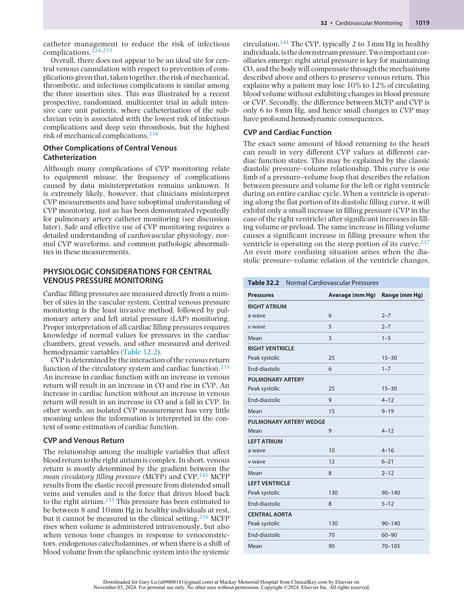

:::

<!-- PDF page 27 -->

for example with the onset of myocardial ischemia. Rather than moving along the same diastolic pressure–volume curve, the ventricle now shifts to a different, steeper curve where, somewhat paradoxically, an increase in filling pressure may accompany a decrease in filling volume.238 Consequently, one cannot assume that a given measured change in cardiac filling pressure (CVP) reflects a proportional change in ventricular preload, nor can it be assumed that pressure and volume change in the same direction.238 In summary, changes in CVP may result from changes in right ventricular inotropic state or compliance, independent of the total circulating volume or venous return to the heart.

To summarize, CVP is the result of a complex and diverse interplay among many different physiologic variables, many of which are impossible to measure in the operating room or intensive care unit. It is therefore not surprising that studies assessing the value of CVP as a predictor of volume status or fluid responsiveness have failed to demonstrate a reliable relationship.141

### CVP and Intrathoracic Pressure

Changes in intrathoracic and intrapericardial pressures further complicate interpretation of CVP.237,239 Like all measured intravascular pressures, CVP is referenced to ambient atmospheric pressure. Thus, a cardiac filling pressure of 10 mm Hg is 10 mm Hg higher than ambient atmospheric pressure. To determine whether this pressure accurately reflects the end- diastolic distending force across the atrial wall, one needs to consider transmural pressure. The cardiac chambers are all contained within the pericardium and thorax. Changes in pressure surrounding the heart will influence pressures recorded within the heart. Transmural pressure is the difference between chamber pressure and juxtacardiac or pericardial pressure. This transmural pressure determines resting myocardial fiber length, end- diastolic volume, and thus ventricular preload. The same measured filling pressure, referenced to atmospheric pressure, can be associated with markedly different transmural pressures and chamber volumes, depending on whether juxtacardiac pressure is high or low. Because juxtacardiac pressure is not usually known, measured central vascular pressures may poorly reflect true transmural pressure.237,239

During spontaneous breathing, inspiration decreases pleural and pericardial pressures, which are transmitted, in part, to the right atrium, and result in a lower measured CVP. Although measured CVP decreases during the inspiratory phase of spontaneous ventilation, transmural CVP, the difference between right atrial pressure and juxtacardiac pressure, increases slightly as more blood is drawn into the right atrium. The opposite pattern is observed during positive pressure ventilation, in which inspiration increases intrathoracic pressure and the measured CVP, but decreases transmural CVP, because the elevated intrathoracic pressure reduces venous return. Consequently, in order to provide the best estimate of transmural pressure, end- expiratory values should be recorded. At the end of expiration, intrathoracic and juxtacardiac pressures approach atmospheric pressure regardless of ventilatory status and will have the least influence on measured CVP. The influence of changing intrathoracic pressure during the respiratory cycle is easily observed by visual inspection

of the CVP waveform on a calibrated monitor screen or paper recording.

The second prerequisite for interpretation of CVP values is correct measurement. Details about transducer zeroing and leveling are discussed elsewhere in this text (see Technical Aspects of Direct Blood Pressure Measurement, earlier). For accurate measurement of CVP, the zero reference point (the affixed stopcock rather than the transducer) should be aligned at approximately 5 cm below the sternal angle to identify the uppermost fluid level in the right atrium or one- third of the thoracic anteroposterior dimension to identify the mid- right atrial level. While common practice is to use the mid- thoracic level to align CVP transducers, these other reference points allow better estimation of the true right atrial pressure and may be utilized in both supine or head- elevated patients.126,240,241 Regardless of the position chosen to level the transducer, it is most important to be consistent throughout the monitoring period to maintain the same reference point.

### NORMAL CENTRAL VENOUS PRESSURE WAVEFORMS

Mechanical events during the cardiac cycle are responsible for the sequence of waves seen in a typical CVP trace. The CVP waveform consists of five phasic events, three peaks (a, c, v) and two descents (x, y) (Table 32.3, Fig. 32.33).242,243 The most prominent wave is the _a wave_ of atrial contraction, which occurs at end- diastole following the ECG P wave. Atrial contraction increases atrial pressure and provides the “atrial kick” to fill the right ventricle through the open tricuspid valve. Atrial pressure decreases following the a wave, as the atrium relaxes. This smooth decline in pressure is interrupted by the _c wave_ . This wave is a transient increase in atrial pressure produced by isovolumic ventricular contraction, which closes the tricuspid valve and displaces it toward the atrium. The c wave always follows the ECG R wave because it is generated during onset of ventricular systole. (Note that the c wave observed in a jugular venous pressure trace might have a slightly more complex origin. This wave has been attributed to early systolic pressure transmission from

**Table 32.3** Central Venous Pressure Waveform Components

|**Waveform** **Component**|**Phase of Cardiac Cycle**|**Mechanical Event**|
|---|---|---|
|a wave|End- diastole|Atrial contraction|
|c wave|Early systole|Isovolumic ventricular contraction, tricuspid motion toward right atrium|
|v wave|Late systole|Systolic filling of atrium|
|h wave|Mid- to late diastole|Diastolic plateau|
|x descent|Mid- systole|Atrial relaxation, descent of the base, systolic collapse|
|y descent|Early diastole|Early ventricular filling, diastolic collapse|

::: details 原始表格與符號（PDF 第 27 頁）

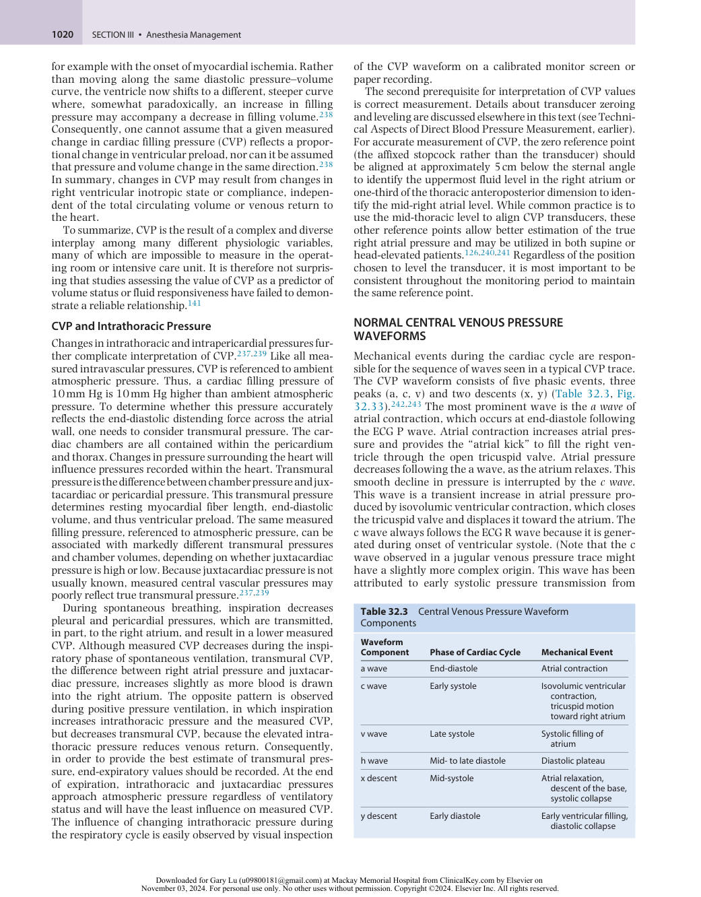

:::

<!-- PDF page 28 -->

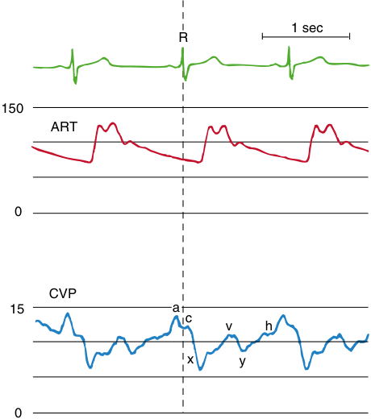

1 sec R 150 ART 0 CVP 15 a c v h x y 0 

**Fig. 32.33 Normal central venous pressure (CVP) waveform.** The diastolic components (y descent, end- diastolic a wave) and the systolic components (c wave, x descent, end- systolic v wave) are all clearly delineated. A mid- diastolic plateau wave, the h wave, is also seen because heart rate is slow. Waveform identification is aided by timing the relation between individual waveform components and the electrocardiographic R wave. Waveform timing using the arterial pressure (ART) trace is more confusing, owing to the relative delay in the systolic arterial pressure upstroke. (From Mark JB. _Atlas of Cardiovascular Monitoring._ New York: Churchill Livingstone; 1998.)

the adjacent carotid artery and may be termed a carotid impact wave.244 Because the jugular venous pressure also reflects right atrial pressure, however, this c wave likely represents both arterial [carotid impact] and venous [tricuspid motion] origins.) Atrial pressure continues its decline during ventricular systole, owing to continued atrial relaxation and changes in atrial geometry produced by ventricular contraction and ejection that draw the tricuspid annulus toward the cardiac apex. This is the _x descent_ or systolic collapse in atrial pressure. The x descent can be divided into two portions, x and x′, corresponding to the segments before and after the c wave. The last atrial pressure peak is the _v wave_ and is caused by venous filling of the atrium during late systole while the tricuspid valve remains closed. The v wave usually peaks just after the ECG T wave. Atrial pressure then decreases, inscribing the _y descent_ or diastolic collapse, as the tricuspid valve opens and blood flows from atrium to ventricle. (A final component of the CVP waveform, the _h wave_ , occasionally appears as a pressure plateau in mid to late diastole. The h wave is not normally seen unless the heart rate is slow and venous pressure is elevated.)244,245 In summary, the normal venous waveform components may be remembered as follows: the **&lt;u>a&lt;/u>** wave results from **&lt;u>a&lt;/u>** &lt;u>trial con-&lt;/u> traction; the **&lt;u>c&lt;/u>** wave from tricuspid valve **&lt;u>c&lt;/u>** &lt;u>losure and iso-&lt;/u> volumic right ventricular **&lt;u>c&lt;/u>** &lt;u>ontraction; the x descent is the&lt;/u> systolic decrease in atrial pressure due to atrial relaxation and ventricular contraction; the **&lt;u>v&lt;/u>** wave from **&lt;u>v&lt;/u>** &lt;u>entricular&lt;/u> ejection, which drives **&lt;u>v&lt;/u>** &lt;u>enous filling of the atrium; and the&lt;/u>

y descent is the diastolic decrease in atrial pressure due to flow across the open tricuspid valve.

In relation to the cardiac cycle and ventricular mechanical actions, the CVP waveform can be considered to have three systolic components (c wave, x descent, v wave) and two diastolic components (y descent, a wave). By recalling the mechanical actions that generate the pressure peaks and troughs, it is easy to identify these waveform components properly by aligning the CVP waveform and the ECG trace and using the ECG R wave to mark end- diastole and onset of systole. When the radial artery pressure trace is used for CVP waveform timing instead of the ECG, confusion may arise because the arterial pressure upstroke occurs nearly 200 ms after the ECG R wave (see Fig. 32.33). This normal physiologic delay reflects the times required for the spread of the electrical depolarization through the ventricle (≈60 ms), isovolumic left ventricular contraction (≈60 ms), transmission of aortic pressure rise to the radial artery (≈50 ms), and transmission of the radial artery pressure rise through fluidfilled tubing to the transducer (≈10 ms).128,246

The normal CVP peaks are designated systolic (c, v) or diastolic (a) according to the phase of the cardiac cycle in which the wave begins. However, one generally identifies these waves not by their onset or upstroke, but rather by the location of their peaks. For instance, the a wave generally begins and peaks in end- diastole, but the peak may appear delayed to coincide with the ECG R wave, especially in a patient with a short PR interval. In this instance, a and c waves merge, and this composite wave is termed an a–c wave. Designation of the CVP v wave as a systolic event may be even more confusing. Although the ascent of the v wave begins during late systole, the peak of the v wave occurs during isovolumic ventricular relaxation, immediately prior to atrioventricular valve opening and the y descent. Consequently, the most precise description would be that the v wave begins in late systole, but peaks during isovolumic ventricular relaxation, the earliest portion of diastole. For clinical purposes, it is simplest to consider the v wave to be a systolic wave.

Although three distinct CVP peaks (a, c, v) and two troughs (x, y) are discernible in the normal venous pressure trace, heart rate changes and conduction abnormalities alter this pattern. A short ECG PR interval causes fusion of a and c waves, and tachycardia reduces the length of diastole and the duration of the y descent, causing v and a waves to merge. In contrast, bradycardia causes each wave to become more distinct with separate x and x′ descents visible and a more prominent h wave. Although there are circumstances in which other pathologic waves may be evident in the CVP trace, one should resist the temptation to assign physiologic significance to each small pressure peak, as many will arise as artifacts of fluid- filled tubing- transducer monitoring systems. It is more useful to search for the expected waveform components, including those waveforms that are characteristic of the pathologic conditions suspected.

### ABNORMAL CENTRAL VENOUS PRESSURE WAVEFORMS

Various pathophysiologic conditions may be diagnosed or confirmed by examination of the CVP waveform (Table 32.4). One of the most common applications is the rapid

<!-- PDF page 29 -->

**Table 32.4** Central Venous Pressure Waveform Abnormalities

|**Condition**|**Characteristics**|
|---|---|
|Atrial fibrillation|Loss of a wave Prominent c wave|
|Atrioventricular dissociation|Cannon a wave|
|Tricuspid regurgitation|Tall systolic c–v wave Loss of x descent|
|Tricuspid stenosis|Tall a wave Attenuation of y descent|
|Right ventricular ischemia|Tall a and v waves Steep x and y descents M or W configuration|
|Pericardial constriction|Tall a and v waves Steep x and y descents M or W configuration|
|Cardiac tamponade|Dominant x descent Attenuated y descent|
|Respiratory variation during spontaneous or positive pressure ventilation|Measure pressures at end- expiration|

diagnosis of cardiac arrhythmias.247 In atrial fibrillation (Fig. 32.34A), the a wave disappears and the c wave becomes more prominent because atrial volume is greater at end- diastole and onset of systole, owing to the absence of effective atrial contraction. Occasionally, atrial fibrillation or flutter waves may be seen in the CVP trace when the ventricular rate is slow. Isorhythmic atrioventricular dissociation or accelerated junctional (nodal) rhythm (see Fig. 32.34B) alters the normal sequence of atrial contraction prior to ventricular contraction. Instead, atrial contraction now occurs during ventricular systole when the tricuspid valve is closed, thereby inscribing a tall “cannon” a wave in the CVP waveform. Absence of normal atrioventricular synchrony during ventricular pacing (see Fig. 32.34C) can be identified in a similar fashion by searching for cannon waves in the venous pressure trace. In all instances of atrioventricular dissociation, recognizing onset of cannon a waves in the CVP may help identify the cause of arterial hypotension.

Right- sided valvular heart diseases alter the CVP waveform in different ways.248 Tricuspid regurgitation (Fig. 32.35A) produces abnormal systolic filling of the right atrium through the incompetent valve. A broad, tall systolic c–v wave results, beginning in early systole and obliterating the systolic x descent in atrial pressure. The CVP trace is said to be ventricularized, resembling right ventricular pressure. Note that this regurgitant wave differs in onset, duration, and magnitude from a normal v wave caused by end- systolic atrial filling from the vena cava. In patients with tricuspid regurgitation, right ventricular enddiastolic pressure is overestimated by the numeric display on the bedside monitor, which reports a single mean value for CVP. Instead, right ventricular end- diastolic pressure is estimated best by measuring the CVP value at the time of the ECG R wave, prior to the regurgitant systolic wave (see Fig. 32.35A). Unlike tricuspid regurgitation, tricuspid stenosis produces a diastolic defect in atrial emptying

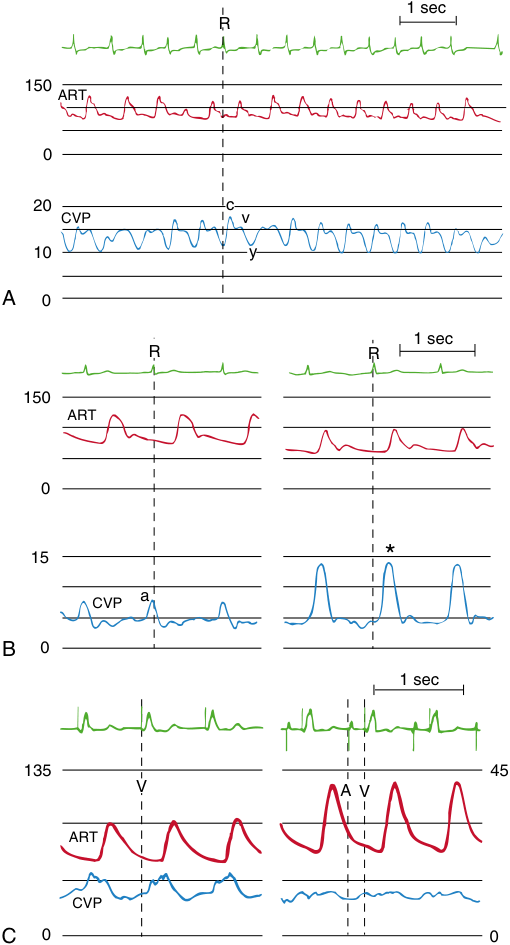

1 sec R 150 ART 0 20 CVP c v 10 y A 0 1 sec R R 150 ART 0 * 15 CVP a B 0 1 sec 135 45 V A V ART CVP C 0 0 

**Fig. 32.34 Central venous pressure (CVP) changes caused by cardiac arrhythmias.** (A) Atrial fibrillation. Note absence of the a wave, a prominent c wave, and a preserved v wave and y descent. This arrhythmia also causes variation in the electrocardiographic (ECG) R– R interval and left ventricular stroke volume, which can be seen in the ECG and arterial (ART) pressure traces. (B) Isorhythmic atrioventricular dissociation. In contrast to the normal end- diastolic a wave in the CVP trace _(left panel)_ , an early systolic cannon wave is inscribed (*, _right panel_ ). Reduced ventricular filling accompanying this arrhythmia causes a decreased arterial blood pressure. (C) Ventricular pacing. Systolic cannon waves are evident in the CVP trace during ventricular pacing _(left panel)_ . Atrioventricular sequential pacing restores the normal venous waveform and increases arterial blood pressure _(right panel)_ . ART scale left, CVP scale right. (From Mark JB. _Atlas of Cardiovascular Monitoring._ New York: Churchill Livingstone; 1998.)

and ventricular filling (see Fig. 32.35B). Mean CVP is elevated, and a pressure gradient exists throughout diastole between right atrium and ventricle. The a wave is unusually prominent and the y descent is attenuated, owing to the impaired diastolic egress of blood from the atrium. Other conditions that reduce right ventricular compliance,

::: details 原始表格與符號（PDF 第 29 頁）

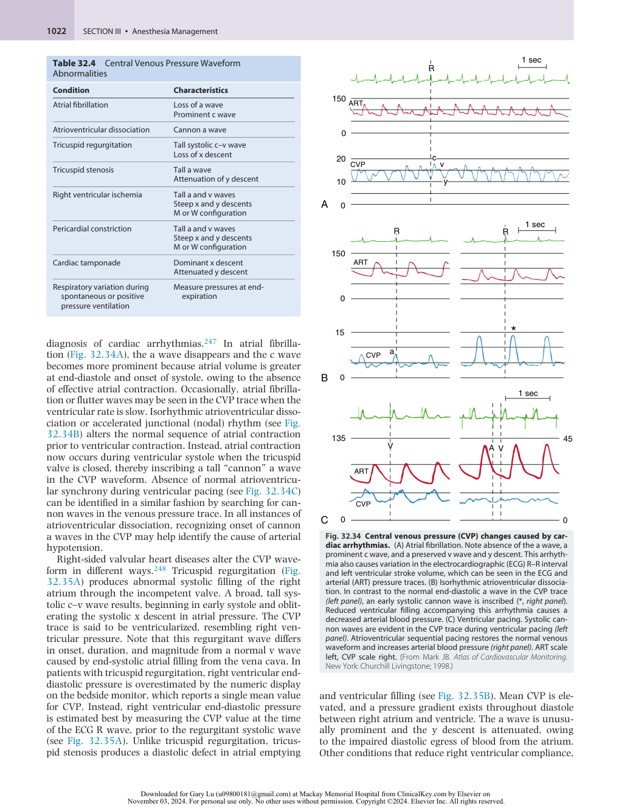

:::

<!-- PDF page 30 -->

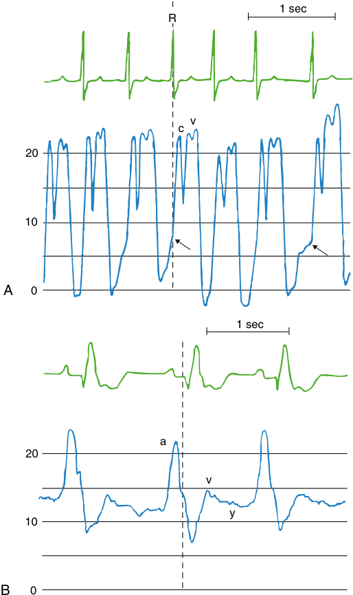

1 sec R c v 20 10 A 0 1 sec a 20 v y 10 B 0 

**Fig. 32.35 Central venous pressure (CVP) changes in tricuspid valve disease.** (A) Tricuspid regurgitation increases mean CVP, and the waveform displays a tall systolic c–v wave that obliterates the x descent. In this example, the a wave is not seen because of atrial fibrillation. Right ventricular end- diastolic pressure is estimated best at the time of the electrocardiographic R wave _(arrows)_ and is lower than mean CVP. (B) Tricuspid stenosis increases mean CVP, the diastolic y descent is attenuated, and the end- diastolic a wave is prominent. (From Mark JB. _Atlas of Cardiovascular Monitoring._ New York: Churchill Livingstone; 1998.)

such as right ventricular ischemia, pulmonary hypertension, or pulmonic valve stenosis, may produce a prominent end- diastolic a wave in the CVP trace but do not attenuate the early diastolic y descent. CVP waveform morphology changes in other characteristic ways in the presence of pericardial diseases and right ventricular infarction. These patterns are interpreted best in conjunction with pulmonary artery pressure (PAP) monitoring, which is discussed below.

Perhaps the most important traditional application of CVP monitoring is to provide an estimate of the adequacy of the circulating blood volume. Several randomized trials and systematic reviews have demonstrated a very poor relationship between CVP and circulating blood volume,

as well as the inability of a static CVP value to predict the hemodynamic response to a fluid challenge.249–251 This is not surprising in light of the physiologic factors described above. Consequently, other monitoring techniques have supplanted CVP monitoring to identify patients that will benefit from fluid administration.

## Pulmonary Artery Catheter Monitoring

In 1970, Swan, Ganz, and colleagues introduced pulmonary artery catheterization into clinical practice for the hemodynamic assessment of patients with acute myocardial infarction.252 This device allowed accurate bedside measurement of important cardiovascular physiologic variables, and its popularity soared. While the PAC provides measurements of several hemodynamic variables that clinicians find hard to accurately predict from standard clinical signs and symptoms,253 it remains uncertain whether PAC monitoring leads to improved patient outcomes.254

### PULMONARY ARTERY CATHETER INSERTION

The standard pulmo nary artery catheter (PAC) has a 7.0 to 9.0 Fr circumference, is 110 cm in length marked at 10- cm intervals, and contains four internal lumens. The distal port at the catheter tip is used for PAP monitoring, while the second is 30 cm more proximal and is used for CVP monitoring. The third lumen leads to a balloon near the tip which is used to float the catheter through the cardiac chambers, and the fourth houses wires for a temperature thermistor, the end of which lies just proximal to the balloon.255 Contemporary PACs also have an additional lumen that allows continuous measurement of mixed venous oximetry at the catheter tip as well as a heating coil between the proximal and distal lumens that is used for continuous CO measurement.

Pulmonary artery catheters can be placed from any of the central venous cannulation sites described earlier, but the right internal jugular vein provides the most direct route to the right heart chambers. The balloon at the tip of the catheter is inflated with air, and the catheter is advanced into the right atrium, through the tricuspid valve, the right ventricle, the pulmonic valve, into the pulmonary artery, and finally into the wedge position. Characteristic waveforms from each of these locations confirm proper catheter passage and placement (Fig. 32.36). Length of insertion to reach the pulmonary artery and wedge position are directly related to the height of the patient and will be reduced in shorter patients.

After the pulmonary artery wedge pressure is measured, the balloon is deflated, and the PAP waveform should reappear. Catheter position is confirmed with a chest radiograph. The tip of the PAC should be within 2 cm of the cardiac silhouette on a standard anteroposterior chest film.256

If a right ventricular waveform is not observed after inserting the catheter 40 cm, coiling in the right atrium is likely. Similarly, if a pulmonary artery waveform is not observed after inserting the catheter to 50 cm, coiling in the right ventricle has probably occurred. The balloon should be deflated, the catheter withdrawn to 20 cm, and the PAC floating sequence repeated.

<!-- PDF page 31 -->

A few additional points aid successful positioning of the PAC. The air- filled balloon tends to float to nondependent regions as it passes through the heart into the pulmonary vasculature. Consequently, positioning a patient head down will aid flotation across the tricuspid valve, and tilting the patient onto the right side and placing the head up will encourage flotation out of the right ventricle, as well as reduce the incidence of arrhythmias during insertion.257,258 Deep inspiration during spontaneous ventilation will increase venous return and right ventricular output transiently, and may facilitate catheter flotation in a patient with low CO. On occasion, a catheter may be floated to proper position when stiffened by injecting 10 to 20 mL of ice- cold solution through the distal lumen. In addition, counterclockwise rotation with the balloon inflated during insertion may help catheter flotation into the right atrium and through the tricuspid valve. Maneuvering of the PAC can also be guided by transesophageal or transthoracic echocardiography, demonstrating catheter passage through the right heart.259,260

### COMPLICATIONS OF PULMONARY ARTERY CATHETER MONITORING

Complications of PAC use may be divided into those resulting from catheter placement, those associated with the _in vivo_ presence of the catheter, and those resulting from catheter use and misuse. For the most part, problems encountered during catheter placement are the same for both PAC and CVP monitoring (see Box 32.6). However, catheterization of the right ventricle and pulmonary artery causes complications uniquely associated with PACs261 (Box 32.7).

When all adverse effects from PAC use are considered, including self- limited arrhythmias observed during catheter insertion, it appears that minor complications occur in more than 50% of catheterized patients.262 However, major morbidity specifically attributable to PAC use is uncommon.263 In both an initial exhaustive review of the literature and in its 2003 update, the American Society of Anesthesiologists Task Force on Pulmonary Artery Catheterization emphasized that the reported incidence of complications from PAC monitoring varies widely, although it seems that serious complications occur in 0.1% to 0.5% of PAC- monitored surgical patients.262 In 1984, Shah _et al._ reported use of PACs in 6245 patients undergoing cardiac

and noncardiac operations.197 Quite remarkably, only 10 patients (0.16%) had serious complications resulting in morbidity and only 1 patient (0.016%) died as a result of pulmonary artery catheterization. Furthermore, a 1998 European report of PAC use in 5306 patients undergoing cardiac surgery confirms this low incidence of major morbidity, with injury of the right ventricle or pulmonary artery occurring in only 4 patients (0.07%).264 Finally, only 1 of 2000 adverse events reported in the Australian Incident Monitoring Study of 1993 involved use of a PAC, in contrast to 64 adverse events involving access to the arterial or venous systems.108 However, it is important to acknowledge that although these large studies indicate a low incidence of serious complications attributable to the use of PACs, the frequency of complications in a particular clinical setting or patient group remains unknown.

A more insidious but possibly more common complication of PAC use is misinterpretation of data.265,266 Although the magnitude of the problem is not clear, studies show widespread knowledge deficits among practitioners who use PACs. In 1990, Iberti _et al._ reported the results of a 31- question multiple- choice examination given to 496 physicians. They found a poor overall level of knowledge

### Box 32.7 Complications of Pulmonary Artery Catheter Monitoring

|Catheterization i|
|---|
|Arrhythmias, ventricular fibrillation|
|Right bundle branch block, complete heart block (if preexisting left bundle branch block)|
|Right atrial rupture|
|Tricuspid or pulmonic valve injury|
|Catheter residence|
|Mechanical: catheter knots, entangling with or dislodgement of pacing wires|
|Thromboembolism|
|Pulmonary infarction|
|Infection, endocarditis|
|Endocardial damage, cardiac valve injury|
|Pulmonary artery rupture|
|Pulmonary artery pseudoaneurysm|
|Right ventricular perforation|
|Misinterpretation of data|
|Misuse of equipment|

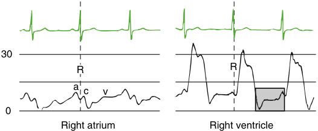

30 R R a c v 0 Right atrium Right ventricle 

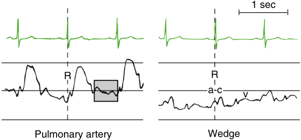

1 sec R R a-c v Pulmonary artery Wedge 

**Fig. 32.36 Characteristic waveforms recorded during passage of the pulmonary artery catheter.** The right atrial pressure resembles a central venous pressure waveform and displays a, c, and v waves. Right ventricular pressure shows a higher systolic pressure than seen in the right atrium, although the end- diastolic pressures are equal in these two chambers. Pulmonary artery pressure shows a diastolic step- up compared with ventricular pressure. Note also that right ventricular pressure increases during diastole, whereas pulmonary artery pressure decreases during diastole _(shaded boxes)_ . Pulmonary artery wedge pressure has a similar morphology to right atrial pressure, although the a–c and v waves appear later in the cardiac cycle relative to the electrocardiogram. (From Mark JB. _Atlas of Cardiovascular Monitoring._ New York: Churchill Livingstone; 1998.)

::: details 原始表格與符號（PDF 第 31 頁）

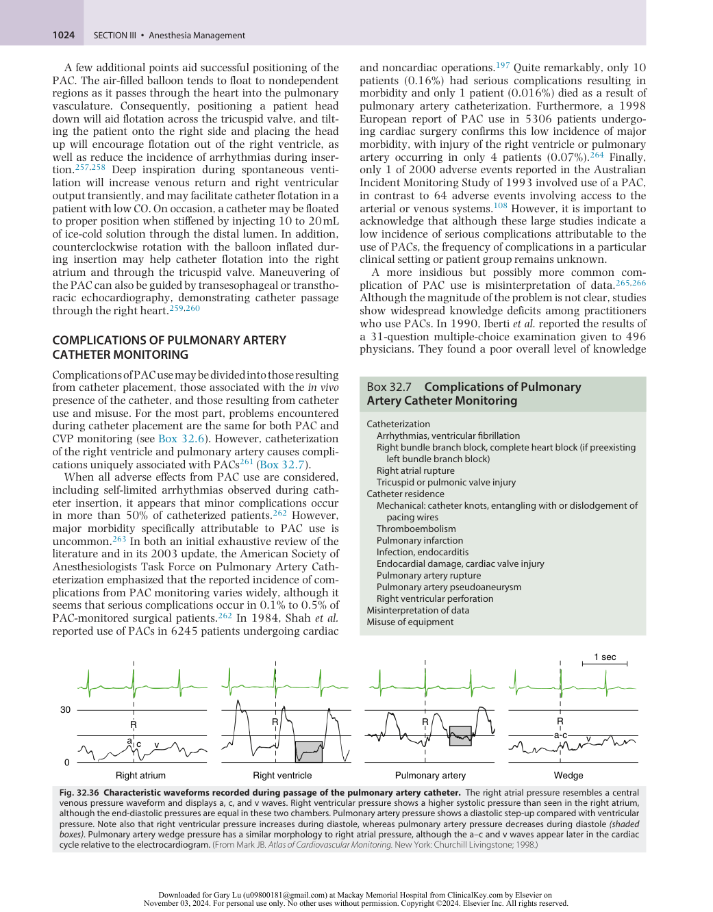

:::

<!-- PDF page 32 -->

of PACs, as evidenced by a mean score of only 67% correct answers. Although higher scores were demonstrated by individuals with more training and more experience inserting and using PACs, none of these factors ensured a high level of knowledge.267 These results have been duplicated in a variety of other specialty care groups.268 It is especially concerning that pulmonary artery wedge pressure measurement was performed incorrectly by 30% to 50% of the clinicians in these studies and that educational programs failed to improve performance.269,270 Taken together, these observations highlight the fact that effective use of PACs requires a great deal of expertise and clinical experience, and even measuring the most fundamental PAC- derived variable, namely wedge pressure, is a complicated endeavor.271

### NORMAL PULMONARY ARTERY PRESSURES AND WAVEFORMS

As the balloon- tipped PAC is floated to its proper position in the pulmonary artery, characteristic pressure waveforms are recorded (see Fig. 32.36). In the superior vena cava or right atrium, a CVP waveform with characteristic a, c, and v waves and low mean pressure should be observed. Right ventricular pressure is characterized by a rapid systolic upstroke, a wide pulse pressure, and low diastolic pressure. Entry of the PAC into the pulmonary artery is heralded by a step- up in diastolic pressure and a change in waveform morphology.

On occasion, it may be difficult to distinguish right ventricular pressure from PAP, particularly if only the numeric values for these pressures are examined. However, careful observation of the pressure waveforms, focusing on the diastolic pressure contours, allows differentiation. During diastole, the PAP will fall owing to continuous runoff flow to the lung, while the pressure in the right ventricle will increase due to filling from the right atrium272 (see Fig. 32.36).

As noted above, the wedge pressure is an indirect measurement of pulmonary venous pressure and LAP and should therefore resemble these venous waveforms with characteristic a and v waves and x and y descents. However, owing to the pulmonary vascular bed interposed between the PAC tip and left atrium, wedge pressure is a delayed and damped representation of LAP.273

The terms pulmonary artery wedge pressure and pulmonary artery occlusion pressure are used interchangeably and refer to the same measurement obtained from the tip of a PAC following balloon inflation and flotation to the wedged position. However, pulmonary capillary pressure must not be confused with wedge pressure or LAP, nor should the term _pulmonary capillary wedge pressure_ be used at all. The hydrostatic pressure in the pulmonary capillaries that causes edema formation according to the Starling equation is different from LAP. This is the pressure that must exceed LAP in order to maintain antegrade blood flow through the lungs. Although the magnitude of the difference between pulmonary capillary pressure and wedge pressure is generally small, it can increase markedly when resistance to flow in the pulmonary veins is elevated.274 In most situations, the major component of pulmonary vascular resistance occurs at the precapillary, pulmonary arteriolar level. However, rare conditions like pulmonary veno- occlusive disease may cause a marked increase in postcapillary resistance to

flow. Similar situations arise in conditions that disproportionately increase pulmonary venous resistance, such as central nervous system injury, acute lung injury, hypovolemic shock, endotoxemia, and norepinephrine infusion.275,276 Under these conditions, measurement of wedge pressure will underestimate pulmonary capillary pressure substantially and thereby underestimate the risk of hydrostatic pulmonary edema.

### ABNORMAL PULMONARY ARTERY AND WEDGE PRESSURE WAVEFORMS

Pulmonary artery catheter monitoring is subject to the same technical artifacts inherent in all invasive pressure monitoring techniques as well as some additional problems unique to this method.277–279 Because the PAC is longer and passes through the cardiac chambers, it is more prone to distortions from clot or air bubbles, and motion- related artifacts are more problematic. Artifactual pressure spikes may be distinguished from the underlying physiologic pressure waveform by their unique morphology and timing.

At the onset of systole, tricuspid valve closure accompanied by right ventricular contraction and ejection result in excessive catheter motion causing the most common PAC trace artifact.278,280 This pressure artifact may produce an artificially low pressure, erroneously designated as the pulmonary artery diastolic pressure (Fig. 32.37). Repositioning the PAC often solves the problem.

Another common artifact in PAC pressure measurement occurs when the balloon is overinflated and occludes the distal lumen orifice. This phenomenon is termed overwedging and usually is caused by distal catheter migration and eccentric balloon inflation that forces the catheter tip against the vessel wall. The catheter now records a gradually rising, nonpulsatile pressure as the continuous flush system builds up pressure against the obstructed distal opening (Fig. 32.38). When observed, this should be corrected immediately by gentle catheter withdrawal to a more proximal location in the pulmonary artery.

As emphasized earlier, with each PAC balloon inflation and wedge measurement, the catheter tip migrates distally. When a wedge pressure tracing appears during partial balloon inflation, it suggests that the PAC is inappropriately located in a smaller, distal branch of the pulmonary artery. The catheter should be withdrawn slightly before overwedging can occur and result in vascular injury or pulmonary infarction.

Pathophysiologic conditions involving the left- sided cardiac chambers or valves produce characteristic changes in the pulmonary artery and wedge pressure waveforms. One of the most easily recognized patterns is the tall v wave of mitral regurgitation. Unlike a normal wedge pressure v wave produced by late systolic pulmonary venous inflow, the prominent v wave of mitral regurgitation begins in early systole. Mitral regurgitation causes fusion of c and v waves and obliteration of the systolic x descent, as the isovolumic phase of LV systole is eliminated owing to the retrograde ejection of blood into the left atrium.248 Because the prominent v wave of mitral regurgitation is generated during ventricular systole, the mean wedge pressure overestimates LV end- diastolic filling pressure, which is better estimated by the pressure value prior to onset of the regurgitant v

<!-- PDF page 33 -->

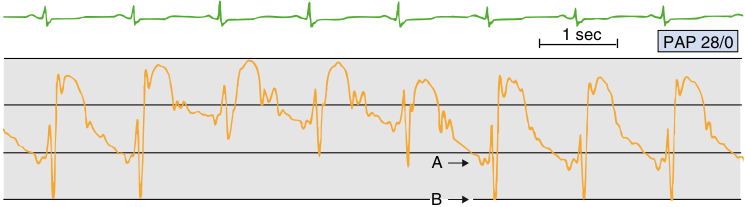

1 sec PAP 28/0 A B 

30 0 

**Fig. 32.37** Artifactual pressure peaks and troughs in the pulmonary artery pressure (PAP) waveform caused by catheter motion. The correct value for pulmonary artery end- diastolic pressure is 8 mm Hg (A), although the monitor digital display erroneously reports the PAP as 28/0 mm Hg (B). (From Mark JB. _Atlas of Cardiovascular Monitoring._ New York: Churchill Livingstone; 1998.)

75 0 

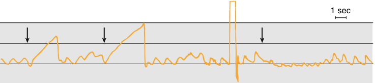

1 sec 

**Fig. 32.38** Overwedging of the pulmonary artery (PA) catheter causes artifactual waveform recordings. The first two attempts to inflate the PA catheter balloon _(first two arrows)_ produce a nonpulsatile increasing pressure caused by an occluded catheter tip. After the catheter is withdrawn slightly, balloon inflation allows proper wedge pressure measurement _(third arrow)_ . Before the third attempt at balloon inflation, the PA pressure lumen is flushed. This restores the appropriate pulsatile nature to the PA and wedge pressure waveforms on the right side of the trace. (From Mark JB. _Atlas of Cardiovascular Monitoring._ New York: Churchill Livingstone; 1998.)

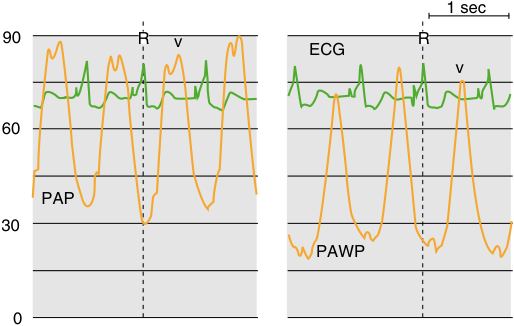

1 sec 90 R v ECG R v 60 PAP 30 PAWP 0 

**Fig. 32.39 Severe mitral regurgitation.** A tall systolic v wave _(v)_ is inscribed in the pulmonary artery wedge pressure (PAWP) trace and also distorts the pulmonary artery pressure (PAP) trace, giving it a bifid appearance. The electrocardiogram (ECG) is abnormal owing to ventricular pacing. Left ventricular end- diastolic pressure is estimated best by measuring PAWP at the time of the electrocardiographic R wave, before onset of the regurgitant v wave. Note that mean PAWP exceeds left ventricular end- diastolic pressure in this condition. (From Mark JB. _Atlas of Cardiovascular Monitoring._ New York: Churchill Livingstone; 1998.)

wave (Fig. 32.39). However, it remains a good approximation for mean LAP and the subsequent risk of hydrostatic pulmonary edema.

It should be noted that although the height of the v wave in the wedge pressure trace will be affected by the volume of regurgitant blood entering the left atrium, it also depends on the left atrial volume and compliance (Fig. 32.40). This may explain why patients with acute mitral regurgitation tend to have tall wedge pressure v waves: they have smaller, stiffer left atria with poorer compliance compared to patients with long-standing disease. Therefore, the

height of the wedge pressure v wave is neither a sensitive nor a specific indicator of mitral regurgitation severity.281

In contrast to mitral regurgitation, which distorts the systolic portion of the wedge pressure waveform, mitral stenosis alters its diastolic aspect. In this condition, the holodiastolic pressure gradient across the mitral valve results in an increased mean wedge pressure, a slurred early diastolic y descent, and a tall end- diastolic a wave. Similar hemodynamic abnormalities are seen in patients with left atrial myxoma or whenever there is obstruction to mitral flow. Diseases that increase LV stiffness (e.g., LV infarction, pericardial constriction, aortic stenosis, and systemic hypertension) produce changes in the wedge pressure that resemble in part those seen in mitral stenosis. In these conditions, mean wedge pressure is increased, and the trace displays a prominent a wave, but the y descent remains steep, because there is no obstruction to flow across the mitral valve during diastole. Because patients with advanced mitral stenosis often have coexisting atrial fibrillation, the a wave will not be present in many of these cases248 (Fig. 32.41).

Myocardial ischemia may be detected by PAC in several ways. Ischemia itself impairs LV relaxation, resulting in diastolic dysfunction, a pattern particularly characteristic of demand ischemia associated with tachycardia or induced by rapid atrial pacing.238,282,283 Impaired ventricular relaxation results in a stiffer, less compliant LV, resulting in an increased LV end- diastolic pressure. This will result in a tall a wave on the wedge trace, as the left atrium contracts into a stiff, incompletely relaxed LV284 (Fig. 32.42).

Myocardial ischemia can also produce LV systolic dysfunction, typically as a result of supply ischemia, caused by a sudden reduction or cessation of coronary blood flow to a region of the myocardium.283,285 As ejection fraction falls significantly, LV end- diastolic volume and pressure

<!-- PDF page 34 -->

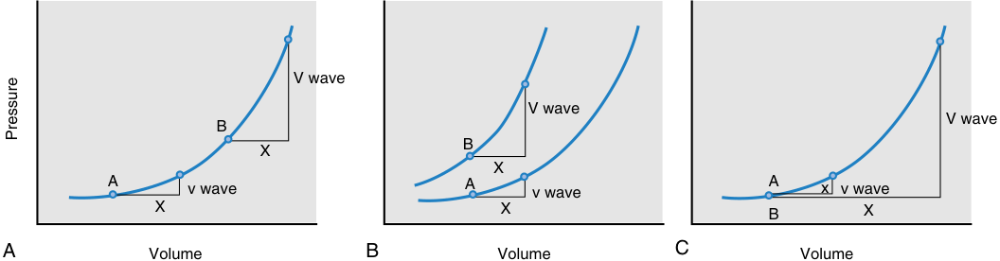

V wave V wave V wave B B X X A v wave A v wave A x v wave X X B X A Volume B Volume C Volume Pressure 

**Fig. 32.40 V- wave height as an indicator of mitral regurgitation severity.** Left atrial pressure–volume curves describe the three factors that determine v- wave height. (A) Influence of left atrial volume. For the same regurgitant volume (X), the left atrial v wave will be taller if baseline atrial volume is greater (point B versus point A). (B) Influence of left atrial compliance. For the same regurgitant volume (X), the left atrial v wave will be taller if baseline atrial compliance is reduced (point B versus point A). (C) Influence of regurgitant volume. Beginning at the same baseline left atrial volume (points A and B), if regurgitant volume increases (X versus x), the left atrial pressure v wave will increase (V versus v). (From Mark JB. _Atlas of Cardiovascular Monitoring._ New York: Churchill Livingstone; 1998.)

rise, and elevated pulmonary diastolic and wedge pressures develop.286 Distortion of LV geometry or ischemia of the myocardium underlying the papillary muscles, can lead to acute mitral regurgitation with its characteristic pulmonary artery pressure trace changes described above287 (see Fig. 32.39).

Whether the PAC should be used in high- risk patients as a supplemental monitor for detection of myocardial ischemia remains controversial. Although patients with LV ischemia are likely to have higher mean wedge pressures than those without ischemia, these differences are small, may be difficult to detect clinically, and no clear quantitative threshold values for diagnosis of ischemia have been identified.288

Right ventricular ischemia produces characteristic PAC waveform patterns that may be helpful in diagnosis and management. Just as LV ischemia increases PAWP, RV ischemia increases CVP. In fact, this is one of the few situations in which CVP may be higher than wedge pressure. In addition, CVP waveforms may display a prominent a wave resulting from right ventricular diastolic dysfunction, and a prominent v wave resulting from ischemia- induced tricuspid regurgitation.289,290 This particular CVP waveform is described as having an M or W configuration, referring to the tall a and v waves and interposed steep x and y descents. Severe pulmonary artery hypertension may also result in right ventricular ischemia and dysfunction as well as increased CVP, but this is distinguished from primary right ventricular dysfunction in that the pulmonary artery pressure and calculated pulmonary vascular resistance are normal in primary right ventricular failure.

The CVP waveform in right ventricular infarction is similar to that from a patient with restrictive cardiomyopathy or pericardial constriction, including elevated mean pressure, prominent a and v waves, and steep x and y descents.291 The cardinal feature common to these conditions is impaired right ventricular diastolic compliance, often termed “restrictive physiology.” In restrictive cardiomyopathy and right ventricular infarction, diastolic dysfunction impairs ventricular relaxation and decreases chamber compliance, whereas in constrictive pericarditis cardiac filling is limited by the rigid, often calcified pericardial shell. Impaired venous return decreases end- diastolic

volume, stroke volume, and CO. Despite reduced cardiac volumes, cardiac filling pressures are markedly elevated and equal in all four chambers of the heart at end- diastole (Fig. 32.43). Although PAC monitoring reveals this pressure equalization, the characteristic M or W configuration is more apparent in the CVP trace, most likely because of the damping effect of the pulmonary vasculature on the leftsided filling pressures.292–294

Another hallmark of pericardial constriction is observed in the LV and RV pressure traces. These demonstrate rapid but short- lived early diastolic ventricular filling, which produces a diastolic “dip- and- plateau” pattern or “square root sign.”139,295 In some cases, particularly when heart rate is slow, a similar waveform pattern may be noted in the CVP trace: a steep y descent (the diastolic dip) produced by rapid early diastolic flow from atrium to ventricle, followed by a mid- diastolic h wave (the plateau) from the interruption in flow imposed by the restrictive pericardial shell (see Fig. 32.43).

Like pericardial constriction, cardiac tamponade impairs cardiac filling, but in the case of tamponade, a compressive pericardial fluid collection produces this effect. This results in a marked increase in CVP and a reduced diastolic volume, stroke volume, and CO. Despite many similar hemodynamic features, tamponade and constriction may be distinguished by the different CVP waveforms seen in these two conditions. In tamponade, the venous pressure waveform appears more monophasic and is dominated by the systolic x pressure descent. The diastolic y pressure descent is attenuated or absent, because early diastolic flow from right atrium to right ventricle is impaired by the surrounding compressive pericardial fluid collection292,296,297 (Fig. 32.44). Clearly, other clinical and hemodynamic clues help distinguish these diagnoses, such as the presence of _pulsus paradoxus_ , an almost invariable finding in cardiac tamponade298 (see Fig. 32.30B).

Probably the single most important waveform abnormality or interpretive problem in PAC monitoring is discerning the correct pressure measurement in patients with large intrathoracic pressure swings like those receiving positive pressure ventilation or those with labored spontaneous breathing. During positive pressure ventilation, inspiration increases pulmonary artery and wedge pressures.

<!-- PDF page 35 -->

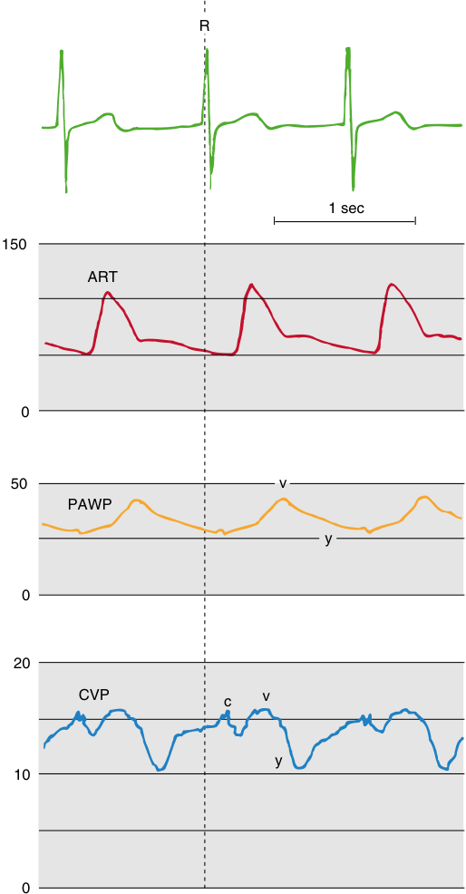

R 1 sec 150 ART 0 50 v PAWP y 0 20 CVP c v y 10 0 

**Fig. 32.41 Mitral stenosis.** Mean pulmonary artery wedge pressure (PAWP) is increased (35 mm Hg), and the diastolic y descent is markedly attenuated. Compare the slope of the y descent in the PAWP trace with the y descent in the central venous pressure (CVP) trace. In addition, compare this PAWP y descent with the PAWP y descent in mitral regurgitation (see Fig. 32.39); a waves are not seen in the PAWP or CVP traces, owing to atrial fibrillation. _ART,_ arterial blood pressure. (From Mark JB. _Atlas of Cardiovascular Monitoring._ New York: Churchill Livingstone; 1998.)

By measuring these pressures at end- expiration, the confounding effect of this inspiratory increase in intrathoracic pressure is minimized239 (Fig. 32.45). Forceful inspiration during spontaneous ventilation has the opposite effect, but again, measurement of these pressures at end- expiration eliminates this confounding factor. Bedside monitors are designed with algorithms that aim to identify and report the numeric values for end- expiratory pressures but are often inaccurate.299,300 The most reliable method for measuring central vascular pressures at end- expiration is examination

of the waveforms on a calibrated monitor screen or paper recording.300,301

### PHYSIOLOGIC CONSIDERATIONS FOR PULMONARY ARTERY CATHETER MONITORING: PREDICTION OF LEFT VENTRICULAR PRELOAD

One reason to measure pulmonary artery diastolic and wedge pressures is to be able to estimate LV end- diastolic pressure, the closest surrogate to LV end- diastolic volume, which is the true LV preload. When a PAC floats to the wedge position, the inflated balloon isolates the distal pressure- monitoring orifice from upstream pulmonary artery pressure. A continuous static column of blood now connects the wedged PAC tip to the junction of the pulmonary veins and left atrium. Thus, wedging the PAC, in effect, extends the catheter tip to measure the pressure at the point at which blood flow resumes on the venous side of the pulmonary circuit. Because resistance in the large pulmonary veins is negligible, pulmonary artery wedge pressure provides an indirect measurement of both pulmonary venous pressure and LAP.302,303 For the column of blood connecting the tip of the wedged catheter and the draining pulmonary vein to be continuous, however, external compression by surrounding alveoli should be negligible (i.e., the catheter needs to reside in the so- called West zone 3 of the lung)303 (Fig. 32.46).

Pulmonary artery diastolic pressure (PADP) is often used as an alternative to PAWP to estimate left ventricular filling pressure. This is acceptable under normal circumstances because when pulmonary venous resistance is low, the pressure in the pulmonary artery at end of diastole will equilibrate with downstream pressure in the pulmonary veins and left atrium.304,305 From a monitoring standpoint, PADP has the added advantage of being available for continuous monitoring whereas PAWP is only measured intermittently.

In many situations, left ventricular end- diastolic pressure can either be underestimated or overestimated by the PAWP and/or PADP. These situations are summarized in Fig. 32.47 and Tables 32.5 and 32.6. The interested reader is referred to several excellent references for further discussion of this topic.302,303,306

However, even when pulmonary artery diastolic pressure and wedge pressure accurately estimate left ventricular end- diastolic pressure, many factors can influence the relation between end- diastolic pressure and end- diastolic chamber volume, which is the true preload. Proper interpretation of filling pressures requires assessment of juxtacardiac pressure as well as ventricular compliance. When both are normal, a wedge pressure of 20 mm Hg is interpreted as hypervolemia, with an increased left ventricular enddiastolic volume causing the increased PAWP. However, if juxtacardiac pressure is increased (e.g., due to cardiac tamponade, pericardial constriction, or positive pressure ventilation), or ventricular compliance is decreased (e.g., with myocardial ischemia, hypertrophy, or cardiomyopathy), a wedge pressure of 20 mm Hg can coexist with a small, hypovolemic left ventricle (Fig. 32.48).

In addition, ventricular interdependence (caused by the shared septum of the left and right ventricles) and pericardial constraint couple changes in right and left ventricular

<!-- PDF page 36 -->

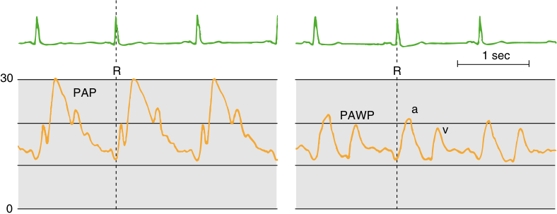

1 sec R R 30 PAP PAWP a v 0 

**Fig. 32.42 Myocardial ischemia.** Pulmonary artery pressure (PAP) is relatively normal and mean pulmonary artery wedge pressure (PAWP) is only slightly elevated (15 mm Hg). However, PAWP morphology is markedly abnormal with tall a waves (21 mm Hg) resulting from the diastolic dysfunction seen in this condition. (From Mark JB. _Atlas of Cardiovascular Monitoring._ New York: Churchill Livingstone; 1998.)

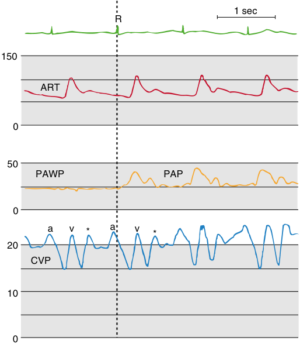

1 sec R 150 ART 0 50 PAWP PAP 0 a v * a v * 20 CVP 10 0 

**Fig. 32.43 Pericardial constriction.** This condition causes elevation and equalization of diastolic filling pressures in the pulmonary artery pressure (PAP), pulmonary artery wedge pressure (PAWP), and central venous pressure (CVP) traces. The CVP waveform reveals tall a and v waves with steep x and y descents and a mid- diastolic plateau wave (*) or h wave. _ART_ , arterial blood pressure. (From Mark JB. _Atlas of Cardiovascular Monitoring._ New York: Churchill Livingstone; 1998.)

function. For example, acute pulmonary artery hypertension increases right ventricular end- diastolic volume and pressure and shifts the ventricular septum leftward, thus increasing LV end- diastolic pressure while simultaneously decreasing left ventricular end- diastolic volume. Conversely, primary changes on the left side can adversely affect the right heart structures in similar ways. With all these considerations in mind, it should be of no surprise that various studies have repeatedly shown that both CVP and PAWP may not always correlate with cardiac preload and do not necessarily predict the CO response to a fluid challenge.249,307 In contrast, in patients with systolic

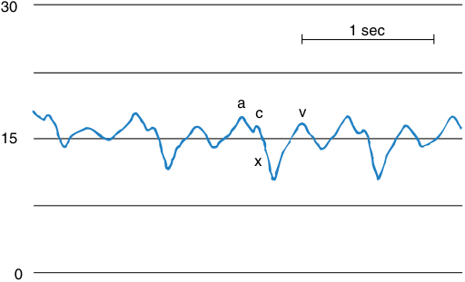

30 1 sec a c v 15 x 0 

**Fig. 32.44 Cardiac tamponade.** The central venous pressure waveform shows an increased mean pressure (16 mm Hg) and attenuation of the y descent. Compare with Fig. 32.43. (From Mark JB. _Atlas of Cardiovascular Monitoring._ New York: Churchill Livingstone; 1998.)

ventricular dysfunction, filling pressures were found more accurate than cardiac volume indices in predicting fluid responsiveness.308

### PULMONARY ARTERY CATHETER- DERIVED HEMODYNAMIC VARIABLES

The cardiovascular system is often modeled as an electrical circuit, with the relationship between cardiac output, blood pressure, and resistance to flow related in a manner similar to Ohm’s law:

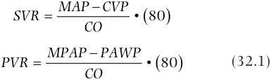

MAP  CVP SVR  •  80  CO MPAP  PAWP PVR  •  80  (32.1) CO 

### where

SVR = systemic vascular resistance (dynes•sec/cm5 ) PVR = pulmonary vascular resistance (dynes•sec/cm5 ) MAP = mean arterial pressure (mm Hg) CVP = central venous pressure (mm Hg)

MPAP = mean pulmonary artery pressure (mm Hg) PAWP = pulmonary artery wedge pressure (mm Hg) CO = cardiac output (L/min)

<!-- PDF page 37 -->

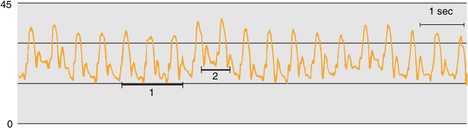

45 1 sec 2 1 0 

**Fig. 32.45 Influence of positive pressure mechanical ventilation on pulmonary artery pressure.** Pulmonary artery pressure should be measured at end-expiration (1, 15 mm Hg) in order to obviate the artifact caused by positive pressure inspiration (2, 22 mm Hg). (From Mark JB. _Atlas of Cardiovascular Monitoring._ New York: Churchill Livingstone; 1998.)

Zone 1 PA Zone 2 PV PA Pa Zone 3 PA PA RA LA Zone 1 PA > Pa > PV RV LV Zone 2 Pa > PA > PV Zone 3 Pa > PV > PA 

**Fig. 32.46** The pulmonary artery catheter tip must be wedged in lung zone 3 to provide an accurate measure of pulmonary venous (Pv) or left atrial (LA) pressure. When alveolar pressure (PA) rises above Pv in lung zone 2, or above pulmonary arterial pressure (Pa) in lung zone 1, wedge pressure will reflect alveolar pressure rather than intravascular pressure. _RA_ , right atrium; _RV_ , right ventricle; _PA_ , pulmonary artery; _LV_ , left ventricle. (From Mark JB. _Atlas of Cardiovascular Monitoring_ . New York: Churchill Livingstone; 1998, Fig. 6–10.)

B D C Lung PA LA A RA RV E LV Pulmonary vascular resistance Mitral valve disease Heart rate Heart rate LV volume CVP PADP PAWP LAP LVEDP LV fiber length (A) (B) (C) (D) (E) LV preload Diastolic RV  Alveolar pressure Diastolic LV P-V relation   P-V relation Pulmonary venous Tricuspid disease   disease 

**Fig. 32.47** Anatomic and physiologic factors that influence the relations between various measures of left ventricular (LV) filling and true LV preload. The further upstream the filling pressure is measured; the more confounding factors may influence the relation between this measurement and LV preload. _CVP_ , central venous pressure; _LA_ , left atrium; _LAP_ , left atrial pressure; _LVEDP_ , left ventricular end- diastolic pressure; _PA_ , pulmonary artery; _PADP_ , pulmonary artery diastolic pressure; _PAWP_ , pulmonary artery wedge pressure; _P- V_ , pressure–volume; _RA_ , right atrium; _RV_ , right ventricle. (From Mark JB. _Atlas of Cardiovascular Monitoring._ New York: Churchill Livingstone; 1998.)

<!-- PDF page 38 -->

**Table 32.5** Underestimation of Left Ventricular End- Diastolic Pressure

|**Condition**|**Site of** **Discrepancy**|**Cause of Discrepancy**|
|---|---|---|
|Diastolic dysfunction|Mean LAP &lt; LVEDP|Increased end- diastolic a wave|
|Aortic regurgitation|LAP a wave &lt; LVEDP|Mitral valve closure before end- diastole|
|Pulmonic regurgitation|PADP &lt; LVEDP|Bidirectional runoff for pulmonary artery flow|
|Right bundle branch block|PADP &lt; LVEDP|Delayed pulmonic valve opening|
|Post- pneumonectomy|PAWP &lt; LAP or LVEDP|Obstruction of pulmonary blood flow|

_LAP_ , left atrial pressure; _LVEDP_ , left ventricular end- diastolic pressure; _PADP_ , pulmonary artery diastolic pressure; _PAWP_ , pulmonary artery wedge pressure.

Modified from Mark JB. Predicting left ventricular end- diastolic pressure. In: Mark JB, ed. _Atlas of Cardiovascular Monitoring_ . New York: Churchill Livingstone; 1998:59.

**Table 32.6** Overestimation of Left Ventricular End- Diastolic Pressure

|**Condition**|**Site of Discrepancy**|**Cause of Discrepancy**|
|---|---|---|
|Positive end- expiratory pressure|Mean PAWP > Mean LAP|Creation of lung zone 1 or 2, or pericardial pressure changes|
|Pulmonary arterial hypertension|PADP > Mean PAWP|Increased pulmonary vascular resistance|
|Pulmonary veno- occlusive disease|Mean PAWP > Mean LAP|Obstruction to flow in large pulmonary veins|
|Mitral stenosis|Mean LAP > LVEDP|Obstruction to flow across mitral valve|
|Mitral regurgitation|Mean LAP > LVEDP|Retrograde systolic v wave raises mean atrial pressure|
|Ventricular septal defect|Mean LAP > LVEDP|Antegrade systolic v wave raises mean atrial pressure|
|Tachycardia|PADP > Mean LAP > LVEDP|Short diastole creates pulmonary vascular and mitral valve gradients|

_LAP_ , left atrial pressure; _LVEDP_ , left ventricular end- diastolic pressure; _PADP_ , pulmonary artery diastolic pressure; _PAWP_ , pulmonary artery wedge pressure.

Modified from Mark JB. Predicting left ventricular end- diastolic pressure. In: Mark JB, ed. _Atlas of Cardiovascular Monitoring_ . New York: Churchill Livingstone; 1998:59.

Normal values for SVR and PVR are given in Table 32.7. These values may be reported as dynes.sec.cm−5 using the formulae above or as Wood units (mm Hg/L/min) when the conversion factor of 80 is ignored. For example, a PVR of 160 dynes.sec.cm−5 is identical to a PVR of 2 Wood units. Note that these calculations of systemic and pulmonary vascular resistance are based on a hydraulic fluid model that assumes continuous, laminar flow through a series of rigid

Transduced PAWP  20  20  20 Transmural PAWP  25  10  25 LV compliance  Normal  Normal  Stiff LV volume  Increased  Normal  Normal (or reduced)  (or reduced) LA LA LA –5 +10 –5 +20 +20 +20 LV LV LV A B C 

**Fig. 32.48 Influence of juxtacardiac pressure and ventricular compliance on left ventricular (LV) preload.** Three interpretations of an increased transduced pulmonary artery wedge pressure (PAWP, 20 mm Hg) are possible. (A) Juxtacardiac pressure (−5 mm Hg) and LV compliance are normal, transmural PAWP is increased (25 mm Hg), and LV volume is increased. (B) Juxtacardiac pressure is increased (+10 mm Hg), LV compliance is normal, transmural PAWP is decreased (10 mm Hg), and LV volume is normal or decreased. (C) Juxtacardiac pressure is normal, LV compliance is decreased, transmural PAWP is increased (25 mm Hg), and LV volume is normal or decreased. _LA_ , left atrial. (From Mark JB. _Atlas of Cardiovascular Monitoring._ New York: Churchill Livingstone; 1998.)

pipes.309 This is an oversimplification. A more physiologic model of the systemic circulation considers the vasculature to be a series of collapsible vessels with intrinsic tone. This model, also called the vascular waterfall, describes a critical closing pressure in the downstream end of the circuit that exceeds right atrial pressure and serves to limit flow – an effective downstream pressure that is higher than the right atrial pressure used in the SVR formula. A detailed consideration of these issues is beyond the scope of this discussion and is available in other sources.310,311 The important point for clinicians, though, is that therapy focused on the fine adjustment of SVR may be very misleading and should be avoided.

Additional problems arise in considering the pulmonary vasculature and using the above formulae as a measure of resistance to flow through the lung.312 The pulmonary vasculature is more compliant than the systemic vasculature, and marked increases in pulmonary blood flow may not produce any significant increase in pulmonary artery pressure. In addition, flow usually ceases at end- diastole in the low-resistance pulmonary circuit. Thus, changes in pulmonary vascular resistance may result from intrinsic alterations in pulmonary vascular tone (constriction or dilation), vascular recruitment, or rheologic changes. For the pulmonary circuit, a better approach to evaluating the changes in pulmonary vascular resistance may be to examine the pressure gradient between the pulmonary artery diastolic and wedge pressures, or the gradient between the mean pulmonary artery and wedge pressures (also termed the transpulmonary gradient).

Another set of common calculations derived from standard hemodynamic variables adjusts these measurements for the patient’s body surface area (BSA) in an attempt to normalize these measurements for patients of different sizes. The BSA is generally determined from a standard nomogram based on height and weight. The most commonly

::: details 原始表格與符號（PDF 第 38 頁）

:::

<!-- PDF page 39 -->

**Table 32.7** Normal Hemodynamic Values

||**Average**|**Range**|
|---|---|---|
|Cardiac output (L/min)|5.0|4.0–6.5|
|Stroke volume (mL)|75|60–90|
|Systemic vascular resistance (Dynes.sec.cm−5)|1200|800–1600|
|Pulmonary vascular resistance (Dynes.sec.cm−5)|80|40–180|
|Arterial oxygen content (mL/dL)|18|16–20|
|Mixed venous oxygen content (mL/dL)|14|13–15|
|Mixed venous oxygen saturation (%)|75|70–80|
|Arteriovenous oxygen difference (mL/dL)|4|3–5|
|Oxygen consumption (mL/min)|225|200–250|

indexed variables are the cardiac index (cardiac index = cardiac output/body surface area) and stroke volume index (stroke volume index = stroke volume/body surface area). On occasion, the systemic and pulmonary vascular resistances are indexed as well by multiplying by body surface area. In theory, normalizing hemodynamic values through “indexing” should help clinicians determine appropriate normal physiologic ranges to help guide therapy. Unfortunately, there is little evidence that these additional calculations provide valid normalizing adjustments. Body surface area is a biometric measurement with an obscure relationship to blood flow and CO, and it does not adjust for variations between individuals based on age, sex, body habitus, or metabolic rate.313 Although it is important to be aware of a patient’s size and medical history in interpreting and treating changes in any of the measured or calculated hemodynamic variables, it is not appropriate to target therapy solely at achieving normal indexed values.

### PULMONARY ARTERY CATHETERIZATION: INDICATIONS AND OUTCOME CONTROVERSY

The PAC allows continuous tracking of hemodynamic variables, which seems particularly valuable in critically ill high- risk patients with circulatory dysfunction. Measurement of CO (see below section on Thermodilution Cardiac Output Monitoring) can separate shock states into hypovolemic etiology (low CO with low filling pressures), cardiogenic etiology (low CO and high filling pressures), and distributive etiology (high CO and low SVR). Through measurement of CO and left and right filling pressures (PAWP and CVP, respectively), it can separate out predominantly left or right ventricular dysfunction or global dysfunction. For right ventricular dysfunction, the PAC allows distinction of right ventricular dysfunction predominantly related to increased afterload (high PAP) versus dysfunction related mostly to pump failure (high CVP and low PAP).314

Despite these advantages, pulmonary artery catheterization has stimulated a great deal of vigorous controversy.315,316 It is an expensive, invasive technique that is widely used but still not proven to improve patient outcomes. This controversy was much fueled by a study published by Connors and associates in 1996, showing that PAC- monitored patients in the intensive care unit had 20%

increased mortality, increased length of hospital stay, and incurred increased costs.317 The publication of this study was accompanied by a strongly worded editorial calling for a moratorium on PAC use or a randomized controlled trial to define its efficacy.318

Surrounding that time, and in subsequent years, several large, randomized, adequately powered studies have been published regarding the use of the PAC in various settings: general noncardiac surgery,254 vascular surgery,319 coronary artery bypass grafting (CABG) surgery,320 nonsurgical patients with congestive heart failure,321 patients with acute lung injury,322 and critically ill patients in the intensive care unit.323 Generally, these studies have shown no benefit to PAC use, but also no increase in mortality or in hospital or intensive care unit length of stay.

One common drawback to most of these large, randomized studies is that they have necessarily examined the routine use of PAC and enrolled a sequential cohort of patients, most of them with a relatively moderate risk of death or complications. Also, not all of them have employed a specific therapeutic intervention protocol.324 Indeed, in especially high- risk patients, marked either by old age, severe comorbidity or increased disease acuity, several recent nonrandomized studies were indeed able to demonstrate a clinical benefit from PAC use.325–329

The most recent recommendations pertaining to the perioperative use of PACs are the American Society of Anesthesiologists practice guidelines published in 2003.262 The task force considered PAC monitoring to be appropriate in highrisk surgical patients undergoing high-risk procedures. Furthermore, the specific practice setting as well as the proficiency and experience of clinicians should be considered.

PAC use must be tailored to the degree of risk for the patient and the risk posed by the procedure itself. For example, a patient with advanced ischemic cardiomyopathy who needs lower extremity amputation under regional anesthesia would not warrant PAC monitoring while a patient with stable ischemic heart disease scheduled for extensive abdominal cancer resection may benefit from perioperative use. Furthermore, practice setting must be considered such as the operator’s technical skill, knowledge, and experience in PAC use.262

A reasonable conclusion from the bulk of published research would be that PAC use should be limited, although a moratorium on use is ill- advised. Indeed, data demonstrate a significant and continuing decrease in PAC usage.330 Use should be reserved to centers with significant experience and expertise. The PAC generally should be used to monitor and guide therapy in patients at high risk for hemodynamic instability, those who are judged more critically ill by a variety of clinical means, and those who are in shock, especially if elderly and suffering from other systemic diseases.

Obviously, the PAC itself has no potential for benefit unless it guides therapies that improve patient outcomes. Future research should focus on defining subgroups of patients who might benefit from use of the PAC, as well as defining effective therapeutic interventions based on the hemodynamic information gained from the PAC. Heart failure patients in cardiogenic shock are one such population for which data from clinical registries suggest benefit despite lack of confirmatory evidence from randomized trials.331,332

::: details 原始表格與符號（PDF 第 39 頁）

:::

<!-- PDF page 40 -->

### SPECIAL TYPES OF PULMONARY ARTERY CATHETERS

Specific PAC modifications were designed to allow for continuous CO measurement (described in the Cardiac Output Monitoring section), mixed venous hemoglobin saturation monitoring, or right heart function evaluation, vastly expanding the types of physiologic information available to those caring for critically ill patients.333

### Mixed Venous Oximetry Pulmonary Artery Catheter

Although the formal Fick CO method is not widely applied in clinical practice outside the cardiac catheterization laboratory, the physiologic relations described by the Fick equation form the basis for another PAC- based monitoring technique, termed continuous mixed venous oximetry.334 Rearrangement of the Fick equation reveals the four determinants of mixed venous hemoglobin saturation ( ~~S~~ V~~O~~2):

SVO 2  SaO 2  VO 2 (32.2) Q • 1.36 • Hgb 

where

~~S~~ V~~O~~2 = mixed venous hemoglobin saturation (%) SaO2 = arterial hemoglobin saturation (%) VO2 = oxygen consumption (mL O2/min) Q = cardiac output (L/min) Hgb = hemoglobin concentration (g/dL)

To the extent that arterial hemoglobin saturation, oxygen consumption, and hemoglobin concentration remain stable, mixed venous hemoglobin saturation may be used as an indirect indicator of CO. Thus, when CO falls, tissue oxygen extraction increases and the mixed venous blood will have a lower hemoglobin oxygen saturation. Monitoring this variable provides more comprehensive information about the balance of oxygen delivery and consumption by the body – not just the CO value, but also the adequacy of that CO compared to tissue oxygen requirements.334 It is important to remember that mixed venous hemoglobin saturation values reflect global, whole- body measurement. Therefore, regionally inadequate blood flow and tissue oxygen delivery (like limb or intestinal ischemia) can coexist with a normal or high mixed venous hemoglobin saturation.

Although mixed venous hemoglobin saturation may be determined by intermittent blood sampling from the distal port of the PAC, a specially designed PAC can provide this information reliably and continuously. Fiberoptic bundles incorporated into the PAC determine the hemoglobin saturation in pulmonary artery blood based on the principles of reflectance oximetry using either a two- or three-wavelength system. A special computer connected to this PAC displays the mixed venous hemoglobin saturation continuously. The technology is typically incorporated into the standard PAC or the continuous CO PAC (see later), in the latter case providing both continuous CO and venous oximetry data. These catheters are calibrated at the bedside prior to use but may also be calibrated _in vivo_ from a pulmonary artery blood gas sample. Recalibration every 24 hours is usually recommended due to a drift artifact.

Recently, the technology to continuously measure oxygen saturation has been incorporated into central venous catheters as well. These catheters measure central venous saturation, measured in the superior vena cava. Normally, this saturation is around 70% versus 75% in the pulmonary artery.334 Low central venous saturation has been associated with increased complications both in trauma patients and in major surgery patients.335,336

The real value of measuring venous oxygen saturation lies in its ability to guide therapeutic interventions. Because one of the body’s physiologic compensations for anemia is increased oxygen extraction, low venous hemoglobin saturation has been used to guide the need for blood transfusion.337 Several studies have used venous hemoglobin saturation to guide interventions aimed at increasing CO: a goal- directed approach. A study in patients undergoing cardiac surgery has shown better outcomes in patients randomized to protocol- driven interventions aimed at achieving mixed venous hemoglobin saturation above 70% (and blood lactate &lt;2 mg/dL).338 Similarly, optimizing the central venous oxygen saturation has been shown to improve outcome in high-risk noncardiac and off- pump cardiac surgical patients.339,340 Although an early study showed similar benefit in patients with early sepsis,341 a more recent study could not confirm these results.342

It is important to note that these studies have employed strict protocol- driven therapeutic interventions. In contrast, a large Veterans Affairs observational trial of 3265 cardiac surgical patients noted that 49% of patients received continuous mixed venous oximetry PACs, and use of this catheter was associated with increased cost but no better outcome than the standard PAC group.343 In this study, however, no protocol was used to guide therapeutic interventions based on monitoring results.

### Right Ventricular Ejection Fraction Pulmonary Artery Catheter

Although cardiovascular monitoring has focused predominantly on left ventricular performance, in some instances right ventricular dysfunction may be the more important factor limiting circulation. Patient populations at increased risk for right ventricular dysfunction include those with chronic obstructive pulmonary disease, adult respiratory distress syndrome, pulmonary hypertension, and right ventricular ischemia and infarction.344

Measurement of right ventricular ejection fraction (RVEF) with a specially designed PAC offers another method for evaluating right ventricular function. This method uses a standard PAC equipped with a rapid response thermistor that detects and quantifies the small changes in pulmonary artery blood temperature that occur with each heartbeat, in a manner somewhat analogous to a standard continuous CO PAC. The CO computer measures the residual fraction of thermal signal following each heart beat and derives the RVEF.345 Right ventricular end- diastolic volume can be calculated from RVEF and stroke volume, and can be used as an index of right ventricular preload. Clearly, all factors that confound standard thermodilution CO measurement (described later) will also interfere with accurate determination of RVEF. In addition, because the temperature changes measured by the RVEF PAC are small beat- tobeat changes, the method will not work if the ECG R waves

<!-- PDF page 41 -->

cannot be detected accurately, the R- R interval is short owing to tachycardia, or the cardiac rhythm is irregular.346

Clinical use of the RVEF PAC has been described in critically ill patients, especially in those with respiratory failure,347,348 as well as intraoperatively during cardiac surgery, where a reduced RVEF has been noted following cardiopulmonary bypass, particularly in patients with preexisting right coronary artery obstruction.349 However, as in the case of standard PAC monitoring, the benefit of RVEF PAC monitoring in terms of patient outcomes remains unproven.262

## Cardiac Output Monitoring

Cardiac output is the total blood flow generated by the heart, and in a normal adult at rest ranges from 4.0 to 6.5 L/min. Measurement of CO provides a global assessment of the circulation, and in combination with other hemodynamic measurements (heart rate, arterial blood pressure, CVP, PAP, and wedge pressure), it allows calculation of additional important circulatory variables, such as systemic and pulmonary vascular resistance and ventricular stroke work (see Table 32.7).

Three factors have driven efforts to measure CO in clinical practice. The first is the recognition that in many critically ill patients, low CO leads to significant morbidity and mortality.350 Secondly, clinical assessment of CO is often inaccurate; for example, seriously ill patients with decreased CO might have normal systemic arterial blood pressures.351 Finally, newer techniques for CO measurement are becoming less invasive and thus might provide benefit to many patients without the attendant risks of invasive monitoring.352 The advantages and disadvantages of each technique must be appreciated for proper clinical application.

### THERMODILUTION CARDIAC OUTPUT MONITORING

The thermodilution technique is considered the gold standard for measuring CO because of its ease of implementation and the long clinical experience with its use in various settings. It is a variant of the indicator dilution method, in which a known amount of a tracer substance is injected into the bloodstream and its concentration change is measured over time at a downstream site.353 For thermodilution, a known volume of room temperature fluid is injected as a bolus into the proximal (right atrium) lumen of the PAC, and the resulting change in the pulmonary artery blood temperature is recorded by the thermistor at the catheter tip. As in all other forms of cardiovascular monitoring, it is important to have a real- time display of the thermodilution curve resulting from each CO measurement.354 This allows the clinician to discern artifacts that would invalidate the CO measurement, such as unstable blood temperature, recirculation, or incomplete indicator injection.

Usually three CO measurements performed in rapid succession are averaged to provide a more reliable result. If only a single injection is used to determine CO, a difference between sequential CO measurements of 22% is required to suggest a clinically significant change. In contrast, when

three injections are averaged to determine the thermodilution measurement, a change greater than 13% indicates a clinically significant change in CO.355

Even when carefully performed, some studies have found that thermodilution CO measurements may not agree with other reference methods.356,357 However, few complications are directly attributable to the technique itself, and following the trend in CO is probably more clinically useful than emphasizing any absolute value.

### Sources of Error in Thermodilution Cardiac Output Monitoring

Several important technical issues and potential sources of error must be considered to interpret thermodilution CO measurements properly (Box 32.8).353,354 The thermodilution technique measures RV output. With intracardiac shunt, RV and LV outputs will not be equal.

Patients with tricuspid or pulmonic valve regurgitation pose additional problems for thermodilution CO measurement owing to recirculation of the indicator across the incompetent valve. Although minor degrees of valvular regurgitation have little effect on thermodilution CO monitoring, these values are unreliable, with more severe valvular regurgitation, either underestimated or overestimated, depending on the severity of valvular regurgitation and the magnitude of the CO.354,358

Unrecognized fluctuation in blood temperature may also influence CO measurement. In most patients, pulmonary artery blood temperature falls in the initial minutes following cardiopulmonary bypass, due to the rewarmed vascular- and vessel-rich tissues redistributing the heat gained to the less well perfused body core. This causes the thermal baseline to be unstable and measurements made in the minutes following bypass are notoriously unreliable, most often leading to marked underestimation of the true CO.359 Pulmonary artery blood temperature can also change due to rapid fluid infusion.360

One controversy surrounding intermittent bolus thermodilution CO monitoring is the proper timing of measurement in relation to the respiratory cycle, particularly in patients receiving positive pressure mechanical ventilation, because RV stroke output varies as much as 50% during the respiratory cycle. Although reproducibility of consecutive measurements improves markedly when the bolus injections are synchronized to the same phase of the respiratory cycle, an accurate measurement of average CO is achieved more reliably by making multiple injections during the

### Box 32.8 Factors Influencing Accuracy of Thermodilution Cardiac Output Measurement

- Intracardiac shunts

- Tricuspid or pulmonic valve regurgitation

- Thermistor malfunction from fibrin or clot

- Pulmonary artery blood temperature fluctuations

- Rapid intravenous fluid administration

- Respiratory cycle influences

- Extremely low cardiac output

- Temperature and volume of injectate (should be consistent)

- Sampling rate of the thermistor

<!-- PDF page 42 -->

different phases of the respiratory cycle and then averaging the results.354,361

Last, the measured thermodilution CO can overestimate true CO during low-flow states because of significant heat loss from slow injectate transit.362

### Continuous Thermodilution Cardiac Output Monitoring

Newer technologies applied to PAC monitoring allow nearly continuous CO (CCO) monitoring using warm thermal indicator.353,363 In brief, small quantities of heat are released from a 10- cm thermal filament incorporated into the RV portion of a PAC, approximately 15 to 25 cm from the catheter tip, and the resulting thermal signal is measured by the thermistor at the tip of the catheter in the pulmonary artery. The heating filament is cycled on and off in a pseudorandom binary sequence, and the CO is derived from cross- correlation of the measured pulmonary artery temperature with the known sequence of heating filament activation.363 Typically, the displayed value for CO is updated every 30 to 60 seconds and represents the average value for the CO measured over the previous 3 to 6 minutes. On the one hand, this will lead to a delayed response during unstable hemodynamic conditions.364 On the other hand, reproducibility and precision appear to be better compared with the single instantaneous bolus thermodilution technique, especially during positive pressure ventilation.365,366

The CCO PAC has been widely accepted into clinical use for a number of practical reasons.333 Although these catheters are more expensive than standard PACs, obviating the need for bolus injections reduces nursing workload and the potential risk of fluid overload or infection. However, like intermittent bolus thermodilution techniques, warm thermal CCO has certain methodologic pitfalls that must be recognized and avoided. The CCO computer and catheter require a significant amount of time to warm up and may work poorly in an environment where there is a great deal of thermal noise, such as the cardiac operating room. Additionally, the use of pneumatic compression devices may introduce artifacts that appear as large variations (oscillations) in CCO values in otherwise stable patients.367 As already emphasized, CCO monitors have an inherent 5 to 15 minute delay in responding to abrupt changes in CO, and the magnitude of this delay depends on the type of physiologic perturbation, as well as the CCO computer monitor algorithm.364 Although modifications of CCO algorithms provide a “STAT CCO” updated every 30 to 60 seconds, acute changes in CO are still detected more slowly by CCO monitoring than by other methods, such as direct arterial pressure or mixed venous oximetry. In effect, the CCO technique involves a fundamental tradeoff between rapid response time and overall accuracy and stability of the displayed value.365 While it might be useful for clinical decision- making, no studies exist that demonstrate improved patient outcomes from use of the CCO PAC compared to a standard PAC.

### Transpulmonary Thermodilution Cardiac Output

In the early 2000s, the transpulmonary thermodilution technique emerged. This technique provides intermittent measurements of CO using a modified Stewart–Hamilton formula, similar to standard pulmonary artery

thermodilution. For transpulmonary thermodilution measurement, ice- cold saline is injected into a central venous line while the change in temperature is measured in a large peripheral artery (femoral, axillary, or brachial artery) via a special arterial catheter equipped with a thermistor.368 In contrast to the pulmonary artery thermodilution method, the transpulmonary thermodilution measurement is averaged over several respiratory cycles and thereby obviates the respiratory effects on stroke volume and measured CO.369 Taking the average of three transpulmonary CO measurements, similar to intermittent bolus PAC CO measurements, is recommended to increase precision.370 Transpulmonary thermodilution has been validated against pulmonary artery thermodilution and is considered a clinical reference method for CO measurement.353,371

Transpulmonary thermodilution devices are less invasive than PAC monitoring but still require insertion of a central venous catheter and a thermistor- tipped arterial catheter in a large peripheral artery. A limitation of transpulmonary thermodilution for measuring CO is that only intermittent measurements can be performed. Devices which use this technique combine transpulmonary thermodilution with pulse contour analysis (discussed below), which allows real- time monitoring of CO. To improve accuracy, the devices calibrate pulse contour analysis CO to the values obtained by transpulmonary thermodilution.372 Transpulmonary thermodilution is more prone to errors due to drift and indicator recirculation. Other sources of error are the presence of intracardiac or intrapulmonary shunts, and valvular regurgitation.

Mathematical derivation from the transpulmonary thermodilution curve can produce several additional useful indices besides CO: (1) global end- diastolic volume (GEDV) and intrathoracic blood volume (ITBV); (2) cardiac function index (CFI) and global ejection fraction (GEF); (3) extravascular lung water (EVLW); (4) and pulmonary vascular permeability index (PVPI). Both GEDV and ITBV are volumetric parameters of global preload and have been shown to be a better measure of cardiac preload than traditional measurements, such as CVP or PAWP, in several different patient populations.373–378 CFI and GEF are indicators of cardiac systolic function. In patients with normal and impaired cardiac function, CFI and GEF have been shown to correlate with LV ejection fraction and its response to inotropic therapy.379–381 EVLW is a measure of pulmonary edema, and has been shown to assist in the diagnosis, and predict progression of acute lung injury and acute respiratory distress syndrome (ARDS). EVLW can also be used to guide fluid therapy in patients with acute lung injury or sepsis.382–386 PVPI is a marker of lung capillary leak. It is the ratio between EVLW and the pulmonary blood volume and can be used to differentiate between cardiogenic and noncardiogenic pulmonary edema.387

### TRANSPULMONARY LITHIUM DILUTION CARDIAC OUTPUT

The transpulmonary lithium dilution technique is another CO monitoring method that derives its fundamental basis from indicator dilution principles.388 In this technique, a small amount of lithium chloride is injected through a peripheral or central venous catheter and changes in

<!-- PDF page 43 -->

lithium levels in the blood are detected by an ion- selective electrode attached to an arterial catheter. Cardiac output is calculated from analysis of the lithium dilution curve. As with PAC and transpulmonary thermodilution, three measurements should be averaged to achieve good precision.389 Several studies have shown that this is an accurate technique compared with standard PAC thermodilution.390–393

The lithium dilution system allows intermittent measurement of CO with only a radial artery catheter and peripheral intravenous access.394 To allow for beat- to- beat measurement of CO, the monitor applies an algorithm using pulse power analysis (discussed below and different than pulse contour method) with external reference calibration using transpulmonary lithium dilution. Due to potential lithium accumulation, the number of measurements over a short period of time is limited.353 This technique can be used in children,395 but cannot be used in patients who are taking lithium or who are in their first trimester of pregnancy. Inaccurate measurements may occur in patients who have just received high doses of nondepolarizing neuromuscular blockers, since the latter interfere with the lithium sensing electrode. In addition, the lithium dilution system does not provide advanced hemodynamic and volumetric variables such as EVLW.

### MINIMALLY INVASIVE AND NONINVASIVE METHODS FOR MONITORING CARDIAC OUTPUT AND PERFUSION

In recent years, much work has been dedicated to developing minimal or noninvasive methods to measure CO. While it seems that overall agreement between these newer techniques and standard pulmonary artery thermodilution is not very high, they do offer other advantages.396 Methods to assess or estimate CO can be classified as invasive, minimally invasive, or noninvasive and will be discussed next.352,397,398

### Arterial Pulse Waveform Analysis Cardiac Output Monitoring

Many recent developments in CO monitoring have focused on continuous CO measurement derived from analysis of the arterial pressure waveform, generally termed pulse contour analysis or pulse wave analysis. These techniques are based on the principle of ventriculo- arterial coupling, where the arterial pulse pressure and its contour are primarily determined by left ventricular stroke volume and arterial impedance.398 By analyzing the systolic portion of the arterial pressure curve (from the beginning of systole to the dicrotic notch), stroke volume can be estimated by dividing the integral of the change in pressure over time by the value of aortic impedance. Measurement or estimation of total arterial impedance (a dynamic physical property) is a crucial element for the calculation of stroke volume from the arterial pressure waveform.399 This variable is measured by pulse wave analysis systems that use either external reference calibration, internal calibration based on biometric and demographic data, or analysis of wave reflections to estimate arterial impedance.

Systems which use external calibration of CO in combination with pulse wave analysis utilize transpulmonary

thermodilution or transpulmonary lithium dilution (mentioned above). Externally calibrated devices tend to be more accurate than internally calibrated or uncalibrated devices but require frequent recalibration.399 By mathematically analyzing the shape and characteristics of the arterial pressure waveform, and by using biometric and demographic data for internal calibration, continuous cardiac output can be estimated without external reference calibration.400–402 Most of these minimally invasive systems (that just require an arterial catheter) are optimized to analyze radial arterial pressure waveforms. Each system uses different physiologic assumptions and a unique proprietary algorithm to analyze the arterial pressure waveform. This measurement is then combined with patient biometric and demographic data to estimate stroke volume.352 Pulse contour analysis systems also provide automatic calculation of dynamic indices of fluid responsiveness such as pulse pressure variation (PPV) and/or stroke volume variation (SVV).403 (see Arterial Pressure Monitoring and Waveform Analysis for Prediction of Fluid Responsiveness, earlier)

A nonmorphology- based method, called pulse power analysis, uses nomograms that consider the patient’s age, height, and weight to calculate CO. This method is based on the law of conservation of mass/power and assumes that the net power change in the heartbeat is the balance between the input of a mass (stroke volume) of blood minus the blood mass lost to the periphery during the heartbeat.398 The algorithm looks at the power of the whole pulse contour, not just the systolic area, and is therefore independent of the position of the reflected wave. Autocorrelation, a timebased method, is used to define the beat period and the net power change across the whole beat, and thereby avoids the use of a frequency- based approach (such as Fourier transformation) to measuring power. This reduces the effect of damping on the transducer system since damping changes the frequency response.404 Externally calibrated (by lithium dilution) and internally calibrated minimally invasive systems are available which use pulse power analysis to derive continuous CO measurements.

Uncalibrated minimally invasive systems estimate CO solely based on arterial pressure waveform features recorded from a radial or femoral arterial catheter. The device’s proprietary algorithm, called the Pressure Recording Analytical Method, uses a high signal- sampling rate to identify specific pressure trace points which represent wave reflections and allow the system to estimate vascular impedance beat- by- beat.405 The technology has been validated in different clinical settings and has shown good agreement with PA thermodilution.119,406–408 Measurement errors from under- or overdamping of the arterial pressure waveform signal are one major limitation to this technique.405

Pulse contour methods offer the potential for noninvasive, continuous, beat- to- beat CO monitoring utilizing finger cuffs or sensors placed directly over the radial artery (see above text on techniques for continuous noninvasive blood pressure monitoring). The finger cuff method uses vascular unloading technology, also known as the volume clamp method, to record the arterial blood pressure waveform and then estimates CO using pulse contour analysis.397 This method derives the finger arterial pressure

<!-- PDF page 44 -->

waveform from the cuff pressure that is needed to keep the blood volume in the finger arteries as measured by photoplethysmography constant throughout the cardiac cycle. Different devices scale finger- cuff- derived arterial blood pressure to brachial arterial blood pressure using distinct approaches such as using a heart reference system or using intermittent upper arm cuff oscillometry.409,410 Although this technique is appealing owing to its noninvasive nature, a recent meta- analysis of studies comparing finger cuff–derived CO measurements with invasive measurements do not show interchangeability in surgical or critically ill patients.64

Radial artery applanation tonometry uses a mechanical sensor placed over the radial artery. The sensor maintains a transmural pressure of zero by slightly compressing the radial artery, thereby allowing continuous recording of the arterial blood pressure waveform. The radial artery blood pressure signal recorded using applanation tonometry also needs to be scaled to match brachial arterial pressure.411 Different systems use unique algorithms and mathematical models that incorporate arterial blood pressure waveform characteristics, biometric, and demographic data to estimate CO. Several small studies have shown reasonable agreement between radial artery applanation tonometry CO measurements compared with PA thermodilution in post–cardiac surgery patients and transthoracic echocardiography- derived CO in patients before cardiac surgery.412,413

General limitations are similar between invasive, noninvasive, and minimally invasive pulse wave analysis methods. All pulse contour analysis systems rely on an optimal arterial waveform signal with a discernible dicrotic notch for accurate identification of systole and diastole. Inaccurate measurements may result from over- or underdamped traces, as well as arrhythmias, aortic regurgitation, use of intra- aortic balloon pumps, and changes in systemic vascular resistance. Additional technical limitations of the finger cuff–based system are its use in patients with severe vascular disease, severe peripheral vasoconstriction or peripheral edema, or patients in circulatory shock or receiving high- dose vasopressor therapy.409,414 The main limitation of radial artery applanation tonometry is motion artifact which impairs the arterial blood pressure waveform signal and therefore makes pulse wave analysis unreliable.

With respect to other derived variables from these monitoring methods, such as SVV or PPV, other conditions must exist for accurate measurement, including controlled mechanical ventilation with a tidal volume ≥8 mL/kg body weight and a regular cardiac rhythm.415 In situations in which PPV and SVV are not valid, such as patients who are spontaneously breathing, have arrhythmias, low tidal volume, or low lung compliance, monitoring continuous pulse contour CO during volume challenges such as passive leg raising can reliably predict fluid responsiveness.416

Multiple studies have compared different pulse wave analysis systems with pulmonary artery or transpulmonary thermodilution.353 The heterogeneity between study designs, clinical settings, patient populations, and results makes comparison of measurement performance of the investigated pulse wave analysis system challenging. Though some studies show clinical interchangeability between pulse- wave analysis–derived CO measurements

and indicator dilution methods, the overall pooled results do not show interchangeability. Minimally invasive and noninvasive pulse wave analysis systems inconsistently predict CO, stroke volume, and fluid responsiveness in hemodynamically compromised patients receiving fluid boluses or vasopressor therapy and should be used with caution in patients with hemodynamic instability.417,418

### Esophageal Doppler Cardiac Output Monitoring

All of the ultrasound- based methods for CO monitoring employ the Doppler principle as described in detail in Chapter 33. While CO can be intermittently measured by the Doppler technique during transthoracic or transesophageal echocardiography examinations, an esophageal Doppler probe allows for minimally invasive continuous monitoring of CO by measuring the Doppler shift of the interrogated blood flow in the descending thoracic aorta. The Doppler probe is inserted into the esophagus to a depth of approximately 35 cm from the incisor teeth and is adjusted to optimize the audible Doppler signal from the descending aorta, which lies in close proximity and runs essentially parallel to the esophagus at this location.419

Several limitations of the esophageal Doppler technique must be appreciated to avoid pitfalls in data interpretation. This monitoring method interrogates blood flow in the descending thoracic aorta and therefore only measures a fraction of total CO. To report total CO, either the esophageal Doppler measurement must be “calibrated” by some alternative method, or an empirically determined correction constant of 1.4 is used.419 This constant is accurate for most patients but does not apply universally, especially in the presence of conditions that redistribute blood flow, such as pregnancy, aortic crossclamping, and following cardiopulmonary bypass.420,421 In addition, the descending thoracic aorta diameter is either measured using A- mode ultrasound or calculated from a nomogram based on the patient’s age, sex, height, and weight.419 When calculated, it is assumed that the aortic diameter does not change throughout the cardiac cycle. In addition to these considerations, the technique is likely to be inaccurate in the presence of aortic valve stenosis or regurgitation, or in patients with thoracic aortic disease. Finally, like all ultrasound techniques, the acoustic window needed to acquire the Doppler signal may not be adequate in some individuals, thereby precluding use of this method.

While CO measurement with the esophageal Doppler has been noted to correlate well with PAC thermodilution CO measurements,420 widespread adoption of the esophageal Doppler is limited by the fact that the technique is prone to motion artifacts, operator- dependent, and not easily applied in non- tracheally intubated, nonsedated patients. One of the more important benefits of this monitor may be focusing clinical attention on optimizing stroke volume rather than total CO. Indeed, in critically ill patients, complications may be better predicted by low stroke volume than by low CO.422 Perioperative fluid management with esophageal Doppler monitoring and protocol- driven fluid administration have been shown to reduce perioperative morbidity, length of stay, and overall health care costs, but similar improvements have been seen with more recent Enhanced Recovery After Surgery (ERAS) programs.419

<!-- PDF page 45 -->

The role of esophageal Doppler monitoring has diminished as other minimally invasive and noninvasive CO monitoring devices have become more popular.

### Bioimpedance and Bioreactance Cardiac Output Monitoring

The technique of bioimpedance CO monitoring was first described by Kubicek and associates and is based on changes in electrical impedance of the thoracic cavity or the whole body occurring with ejection of blood during cardiac systole.423 As blood has a significantly lower electrical resistance compared with tissues, changes in impedance to electrical flow reflect a change in blood volume, and this can be used to calculate stroke volume.424

For bioimpedance measurement, disposable electrodes are applied to the skin surface along the sides of the neck and lateral aspect of the costal margin (thoracic bioimpedance) or to the four limbs (whole-body bioimpedance), a high-frequency, low-amplitude electrical current is applied, and the voltage change is measured. Patient height, weight, and sex are used to calculate the volume of the thoracic cavity. Bioimpedance CO is computed for each cardiac cycle and continuously displayed as an average value over several heart beats.

Although many studies suggest that the bioimpedance method is accurate in healthy volunteers, its reliability deteriorates in surgical and critically ill patients.425 This led to attempts at improving the technology used. A newer technique, termed bioreactance CO monitoring, measures not only the amplitude change of the received signal, but also its phase shift compared to the applied electrical signal. It utilizes four dual- electrode patches, placed two on each side of the body.424 Compared to the standard bioimpedance method, the bioreactance method shows somewhat better agreement with traditional CO calculations. Several clinical scenarios where this new method has been validated include the prediction of fluid responsiveness when using the passive leg raising test in patients after cardiac surgery and evaluating CO change during exercise stress testing.424

Sources of error for bioimpedance and bioreactance monitors include motion artifacts, electrical interference, arrhythmias, anatomic shunts, mechanical ventilation, pleural and pericardial effusions, and pulmonary edema.398 Bioimpedance has been found to have a wide percentage error when compared to bolus thermodilution.426 Despite modifications to the bioimpedance algorithms, clinical validation has been poor.427,428 Due to a higher signal- to- noise ratio, bioreactance monitoring results in less interference from motion artifacts, electrical noise, lead placement, and respiratory effort, however, the technology continues to struggle with poor accuracy and precision.398,429,430

### Partial CO2 Rebreathing Cardiac Output Monitoring

Another method for CO monitoring that does not require PAC is the partial CO2 rebreathing technique.431,432 Owing to the difficulty encountered in the standard Fick method involving measuring oxygen consumption and mixed venous hemoglobin saturation, this alternative technique is based upon a restatement of the Fick equation for carbon dioxide elimination rather than oxygen uptake.

VCO 2 Q  = (32.3) ( C V C O 2 − CaCO 2) 

### where

Q = cardiac output VCO2 = rate of carbon dioxide elimination ~~C~~ V~~C~~O2 = carbon dioxide content of mixed venous blood CaCO2 = carbon dioxide content of arterial blood

This method uses the change in CO2 production and end- tidal CO2 concentration in response to a brief, sudden change in minute ventilation. With a specifically designed breathing system and monitoring computer that can intermittently increase dead space to induce partial rebreathing, this measurement is easily performed in any tracheally intubated patient. Changes in end- tidal CO2 in response to the rebreathing maneuver are used to calculate CO by a differential version of the Fick equation for carbon dioxide. The attractive features of this method are that it is entirely noninvasive, it can be performed every few minutes, and the brief episodes of rebreathing pose no substantial risk to most patients, with end- tidal CO2 measurements increasing by less than 3 mm Hg. However, as currently designed, accurate measurements with this technique require tracheal intubation for precise measurement of exhaled gasses. Furthermore, changing patterns of ventilation may have an unpredictable influence on the measurement. As with all Fick- based techniques, the partial CO2 rebreathing method measures pulmonary capillary blood flow as an indicator of total CO and thus requires correction for pulmonary shunt.

Initial clinical trials suggested reasonably good agreement between the partial rebreathing CO2 CO method and other techniques, such as thermodilution. However, as with most of these alternative monitoring methods, the clinical trials are small and mainly focused on specific patient groups, such as coronary artery bypass surgery patients, thoracic surgery patients, and patients with ARDS.433–435 A more recent trial on patients undergoing elective cardiac surgery or orthotopic liver transplantation using a second-generation system that provides automated, continuous breath- by- breath CO monitoring reported better precision of agreement compared to the first-generation system.436 At present, the clinical role for this technique is mainly focused on short- term intraoperative applications or mechanically ventilated postoperative patients. Due to the mandatory increase in arterial partial pressure of carbon dioxide (PaCO2), the technique is relatively contraindicated in patients with increased intracranial pressure or pulmonary hypertension.

### Estimated Continuous Cardiac Output Monitoring

Another noninvasive CO monitor uses hemodynamic information from the ECG, an arterial catheter or noninvasive blood pressure cuff, and a pulse oximeter (saturation of peripheral oxygen [SpO2]) to measure pulse wave transit time (PWTT). PWTT is the time from the peak of the R wave on the ECG to the rise time of the pulse oximeter wave. CO is then calculated as follows:

CO  (  ((  PWTT)  ))  HR (32.4) 

where κ is a derived value and α and β are experimental constants.

<!-- PDF page 46 -->

The system’s algorithm accounts for demographic data such as age, sex, height, and weight.437 The estimated continuous CO (esCCO) is calculated from 64 heartbeataveraged PWTTs from data retrieved within 1-second intervals, making this a near real- time hemodynamic monitor.438

One of the benefits of this monitor is that it does not require any additional sensors other than those already used for three basic forms of monitoring (ECG, SpO2, and noninvasive or invasive blood pressure) and therefore could potentially be used in any patient including low- risk patients. So far, only small single- center and multicenter studies have evaluated this technology. In a pilot study in cardiac surgery patients, esCCO was found to have wide limits of agreement and large percentage errors when compared to bolus thermodilution CO measurements.439 More recent data suggest the accuracy of noninvasive esCCO measurements is clinically acceptable when compared to bolus thermodilution CO measurement, comparable to current arterial waveform analysis technologies.440,441 Limitations of the system include the potential inability to accurately measure PWTT in patients with arrhythmias, patients being paced, or with an intra- aortic balloon pump, or other circulatory support device.

Understanding the different methods for monitoring CO and their limitations is important to help clinicians decide which systems are appropriate to use in a particular patient or clinical situation. While invasive methods for monitoring CO still have a role in high- risk and critically ill patients, minimally invasive and noninvasive methods are now available which allow continuous measurement of CO in patients across a broader risk spectrum.

24.  Stern S. _Card Electrophysiol Rev_ . 2002;6(3):204.

25.  Helwani MA, et al. _Anesthesiology_ . 2018;128(6):1084.

26.  Miller TD, et al. _J Electrocardiol_ . 1987;20(2):131.

27.  American Society of Anesthesiologists House of Delegates. _Standards for Basic Anesthetic Monitoring_ . ASA; 2005.

28.  Bruner JMR, et al. _Med Instrum_ . 1981;15:11.

29.  Riva- Rocci S. _Gaz Med Torino_ . 1896;47:981.

30.  Korotkoff NS. _Bull Imp Med Acad St Petersburg_ . 1905;11:365.

31.  Kuck K, Baker PD. _Anesth Analg_ . 2018;127(2):408.

32.  Lakhal K, et al. _Chest_ . 2018;153(4):1023.

33.  Pickering TG, et al. _Hypertension_ . 2005;45(1):142.

34.  Alpert BS, et al. _J Am Soc Hypertens_ . 2014;8(12):930.

35.  Cohn JN. _JAMA_ . 1967;199:972.

36.  Lakhal K, et al. _J Clin Monit Comput_ . 2018;32(4):707.

37.  Lakhal K, et al. _Crit Care Med_ . 2012;40(4):1207.

38.  Eley VA, et al. _Anesth Analg_ . 2019;128(3):484.

39.  Mostafa MMA, et al. _Anaesth Crit Care Pain Med_ . 2020;39(2):221.

40.  Jaouhari SDE, et al. _Pan Afr Med J_ . 2020;36:31.

41.  AAMI. American National. _Standard for Non-Invasive Sphygmomanometers – Part 2: Clinical Validation of Automated Measurement Type_ . AAMI; 2009:25.

42.  Wan Y, et al. _J Hum Hypertens_ . 2010;24(7):431.

43.  Ribezzo S, et al. _Sci World J_ . 2014;2014:353628.

44.  Lakhal K, et al. _Anesth Analg_ . 2009;109(2):494.

45.  Riley LE, et al. _Blood Press Monit_ . 2017;22(4):202.

46.  Lehman LW, et al. _Crit Care Med_ . 2013;41(1):34.

47.  Stergiou GS, et al. _J Am Coll Cardiol_ . 2017;70(5):587.

48.  Min JY, et al. _BMC Anesthesiol_ . 2017;17(1):110.

49.  Leblanc ME, et al. _Obesity (Silver Spring)_ . 2013;21(12):E533.

50.  Benmira A, et al. _Expert Rev Med Devices_ . 2016;13(2):179.

51.  Wang Z, et al. _BMC Anesthesiol_ . 2019;19(1):223.

52.  Peňáz J. _Digest of the 10th International Conference on Medical and Biological Engineering_ . 1973.

53.  Yamada T, et al. _Front Med (Lausanne)_ . 2018;5:144.

54.  Alharash H, et al. _Blood Press Monit_ . 2020;25(5):278.

55.  Roach JK, Thiele RH. _Best Pract Res Clin Anaesthesiol_ . 2019;33(2):127.

56.  Nelson MR, et al. _Mayo Clin Proc_ . 2010;85(5):460.

57.  Jozwiak M, et al. _Anesth Analg_ . 2018;126(6):1930.

58.  Quan X, et al. _Sensors (Basel)._ 2021;21(13).

59.  Ushioda S, et al. _Adv Exp Med Biol_ . 2020;1232:315.

### Acknowledgment

The authors would like to acknowledge Giora Landesberg and Zak Hillel who contributed to an earlier version of this chapter.

60.  Al- Qamari A, et al. _Curr Opin Anaesthesiol_ . 2019;32(1):57.

61.  Schaanning SG, Skjaervold NK. _PLoS One_ . 2020;15(10):e0240126.

62.  Noto A, et al. _Eur J Anaesthesiol_ . 2019;36(2):144.

63.  Rogge DE, et al. _Anesth Analg_ . 2019;128(3):477.

64.  Saugel B, et al. _Br J Anaesth_ . 2020;125(1):25.

65.  Juri T, et al. _J Anesth_ . 2018;32(6):822.

### Complete references available online at expertconsult.com.

66.  Juri T, et al. _J Clin Monit Comput_ . 2018;32(6):1005.

67.  Xu Z, et al. _BMC Geriatr_ . 2022;22(1):108.

68.  Kamboj N, et al. _Intensive Crit Care Nurs_ . 2021;67:103091.

69.  Juri T, et al. _Anesth Analg_ . 2022;134(4):773.

### References

1.  Block FE. _J Clin Monit_ . 1994;10:366.

2.  Zong W, et al. _Med Biol Eng Comput_ . 2004;42(5):698.

3. _Standards for Basic Anesthetic Monitoring_ . American Society of Anesthesiologists; 2020.

4.  Sandau KE, et al. _Circulation_ . 2017;136(19):e273.

5.  Kligfield P, et al. _J Am Coll Cardiol_ . 2007;49(10):1109.

6.  Ortega R, et al. _N Engl J Med_ . 2015;372(8):e11.

7.  Mason RE, Likar I. _Am Heart J_ . 1966;71(2):196.

8.  Krucoff MW, et al. _Am J Cardiol_ . 1994;74(10):997.

9.  Drew BJ. _Cardiol Clin_ . 2006;24(3):309.

10.  Chaitman BR, Hanson JS. _Am J Cardiol_ . 1981;47(6):1335.

11.  Blackburn H, Katigbak R. _Am Heart J_ . 1964;67:184.

12.  Kubota I, et al. _Am Heart J_ . 1985;110(5):949.

13.  Kaplan JA, et al. _Anesth Analg_ . 1978;57(3):364.

14.  London MJ, et al. _Anesthesiology_ . 1988;69(2):232.

15.  Landesberg G, et al. _Anesthesiology_ . 2002;96(2):264.

16.  Klein HO, et al. _Circulation_ . 1983;67(3):558.

17.  Slogoff S, et al. _Anesthesiology_ . 1990;73(6):1074.

18.  Takla G, et al. _Anesth Analg_ . 2006;103(5):1196.

19.  Weinfurt PT. _J Clin Monitoring_ . 1990;6(2):132.

20.  Khambatta HJ, et al. _Anesth Analg_ . 1990;71(1):88.

21.  Patel SI, Souter MJ. _Anesthesiology_ . 2008;108(1):138.

22.  Patton JA, Funk M. _Am J Crit Care_ . 2001;10(1):23.

23.  Mark JB, et al. _Anesth Analg_ . 1992;74(1):26.

70.  Hansen J, et al. _BMC Anesthesiol_ . 2022;22(1):83.

71.  Flick M, et al. _J Clin Monit Comput_ . 2021;35(6):1341.

72.  Alford JW, et al. _J Clin Monit Comput_ . 2002;17:163.

73.  Cockings JGL, et al. _Anaesth Intens Care_ . 1993;21:565.

74.  Naylor AJ, et al. _Anesth Analg_ . 2020;131(5):1540.

75.  Scheer B, et al. _Crit Care_ . 2002;6(3):199.

76.  Mark JB. _Atlas of Cardiovascular Monitoring_ . Churchill Livingstone; 1998.

77.  Perel A. _Anesthesiology_ . 1998;89(6):1309.

78.  Rooke GA. _Curr Opin Anaesthesiol_ . 1995;8:511.

79.  Thiele RH, et al. _Can J Anaesth_ . 2015;62(2):169.

80.  Mandel MA, Dauchot PJ. _J Hand Surg_ . 1977;2(6):482.

81.  Slogoff S, et al. _Anesthesiology_ . 1983;59:42.

82.  Brzezinski M, et al. _Anesth Analg_ . 2009;109(6):1763.

83.  Knobloch K, et al. _Ann Thorac Surg_ . 2005;80(3):918.

84.  Knobloch K, et al. _Ann Thorac Surg_ . 2005;79(3):1026.

85.  Ciria- Llorens G, et al. _Surg Radiol Anat_ . 1998;20(5):377.

86.  Ciria- Llorens G, et al. _Br J Plast Surg_ . 1999;52(6):440.

87.  Richardson D, et al. _Plast Reconstr Surg_ . 1997;99(1):109.

88.  Wilkins RG. _Anaesthesia_ . 1985;40(9):896.

89.  Abu- Omar Y, et al. _Ann Thorac Surg_ . 2004;77(1):116.

90.  Ailon J, et al. _N Engl J Med_ . 2014;371(15):e21.

91.  Moussa Pacha H, et al. _Am Heart J_ . 2018;204:1.

92.  Levin PD, et al. _Crit Care Med_ . 2003;31(2):481.

93.  Ganesh A, et al. _Pediatr Crit Care Med_ . 2009;10(1):45.

<!-- PDF page 47 -->

94.  Ueda K, et al. _Anaesthesia_ . 2015;70(9):1039.

95.  Gu WJ, et al. _Chest_ . 2016;149(1):166.

96.  Nakayama Y, et al. _Anesthesiology_ . 2016;125(4):716.

97.  Htet N, et al. _J Crit Care_ . 2017;41:194.

98.  Karacalar S, et al. _J Clin Anesth_ . 2007;19(3):209.

99.  Saugel B, et al. _Crit Care_ . 2020;24(1):172.

100.  Bazaral MG, et al. _Anesthesiology_ . 1990;73:38.

101.  Singh A, et al. _Anesthesiology_ . 2017;126(6):1065.

102.  O’Grady NP, et al. _Clin Infect Dis_ . 2011;52(9):e162.

103.  Muralidhar K. _J Cardiothorac Vasc Anesth_ . 1998;12(1):128.

104.  Armstrong MK, et al. _Hypertension_ . 2019;73(5):1036.

105.  Bouchard- Dechêne V, et al. _J Cardiothorac Vasc Anesth_ . 2018; 32(2):692.

106.  Rehfeldt KH, Sanders MS. _Anesth Analg_ . 2000;90:45.

107.  Rose SH. _Anesthesiology_ . 1993;78:587.

108.  Singleton RJ, et al. _Anaesth Intens Care_ . 1993;21:664.

109.  Bhananker SM, et al. _Anesth Analg_ . 2009;109(1):124.

110.  Gardner RM. _Anesthesiology_ . 1981;54:227.

111.  Kleinman B. _J Clin Monit_ . 1989;5:137.

112.  Kleinman B, et al. _Anesthesiology_ . 1992;77:1215.

113.  Bartels K, et al. _Anesth Analg_ . 2016;122(6):1866.

114.  Sinha S, et al. _Anaesthesia_ . 2007;62(6):615.

115.  Promonet C, et al. _Anesthesiology_ . 2000;92(1):208.

116.  Ackland GL, et al. _Br J Anaesth_ . 2019;122(5):542.

117.  O’Quin R, Marini JJ. _Am Rev Respir Dis_ . 1983;128:319.

118.  Mark JB. In: Mark JB, ed. _Atlas of Cardiovascular Monitoring_ . Churchill Livingstone; 1998:99.

119.  Romagnoli S, et al. _Crit Care_ . 2014;18(6):644.

120.  Schwid HA. _J Clin Monit_ . 1988;4:181.

121.  Gardner RM. _Crit Care Med_ . 1996;24(5):879.

122.  Skidmore K, et al. _Anesth Analg_ . 2002;95:1192.

123.  Courtois M, et al. _Circulation_ . 1995;92:1994.

124.  Seo JH, et al. _Anesthesiology_ . 2007;107(2):260.

125.  Ortega R, et al. _N Engl J Med_ . 2017;376(14):e26.

126.  Kovacs G, et al. _Eur Respir J_ . 2013;42(6):1586.

127.  Gajniak D, et al. _Anaesthesiol Intensive Ther_ . 2018;50(4):291.

128.  Braunwald E, et al. _Circ Res_ . 1956;4:100.

129.  Stouffer G. In: Stouffer G, ed. _Cardiovascular Hemodynamics for the Clinician_ . Blackwell Futura; 2008:57.

130.  O’Rourke MF, Gallagher DE. _J Hypertens_ . 1996;14:S147.

131.  Weiss BM, Pasch T. _Curr Opin Anaesthesiol_ . 1997;10:459.

132.  Franklin SS, Weber MA. _Am Heart J_ . 1994;128:793.

133.  Frank SM, et al. _Anesthesiology_ . 1991;75:457.

134.  Dorman T, et al. _Crit Care Med_ . 1998;26:1646.

135.  Urzua J, et al. _J Clin Monit_ . 1994;10:229.

136.  Chauhan S, et al. _J Cardiothorac Vasc Anesth_ . 2000;14(3):274.

137.  Hynson JM, et al. _Crit Care Med_ . 1998;26:1623.

138.  McGregor M. _N Engl J Med_ . 1979:480.

139.  Shabetai R, et al. _Am J Cardiol_ . 1970;26:480.

140.  Mark JB. In: Mark JB, ed. _Atlas of Cardiovascular Monitoring_ . Churchill Livingstone; 1998:313.

141.  Gelman S. _Anesthesiology_ . 2008;108(4):735.

142.  Marik PE. _Anaesth Intens Care_ . 1993;21:405.

143.  Gunn SR, Pinsky MR. _Curr Opin Crit Care_ . 2001;7:212.

144.  Preisman S, et al. _Br J Anaesth_ . 2005;95(6):746.

145.  Perel A. _Anesth Analg_ . 2008;106(4):1031.

146.  Hofer CK, Cannesson M. _Acta Anaesthesiol Taiwanica_ . 2011;49(2):59.

147.  Thiele RH, et al. _Anesth Analg_ . 2012;115(1):176.

148.  Berkenstadt H, et al. _Anesth Analg_ . 2001;92(4):984.

149.  Phillips R, Brierley J. _J Clin Monit Comput_ . 2015;29(1):197.

150.  Kong R, et al. _J Clin Monit Comput_ . 2016;30(1):81.

151.  Cannesson M, et al. _Anesth Analg_ . 2008;106(4):1189.

152.  Antonsen LP, Kirkeboen KA. _Anesthesiol Res Pract_ . 2012;2012:617380.

153.  Cannesson M, et al. _J Clin Monit Comput_ . 2011;25(1):45.

154.  Michard F, et al. _Am J Respir Crit Care Med_ . 2000;162(1):134.

155.  Biais M, et al. _Br J Anaesth_ . 2010;104(4):407.

156.  Mahjoub Y, et al. _Intensive Care Med_ . 2011;37(2):360.

157.  Marik PE, et al. _Crit Care Med_ . 2009;37(9):2642.

158.  De Hert SG. _Anesthesiology_ . 2011;115(2):229.

159.  Cannesson M. _J Cardiothorac Vasc Anesth_ . 2010;24(3):487.

160.  Cannesson M, et al. _Anesth Analg_ . 2008;106(4):1195.

161.  Auler Jr JO, et al. _Anesth Analg_ . 2008;106(4):1201.

162.  Min JJ, et al. _J Clin Monit Comput_ . 2017;31(2):397.

163.  Audimoolam VK, et al. _Anesth Analg_ . 2017;124(2):480.

164.  Royer P, et al. _J Trauma Acute Care Surg_ . 2015;78(5):994.

165.  Wyffels PA, et al. _Am J Physiol Heart Circ Physiol_ . 2016;310(9):H1194.

166.  Ho KM. _Anaesth Intensive Care_ . 2016;44(1):14.

167.  Wyler von Ballmoos M, et al. _Crit Care_ . 2010;14(3):R111.

168.  Yi L, et al. _PLoS One_ . 2017;12(5):e0177590.

169.  Jeong DM, et al. _Anesth Analg_ . 2017;125(4):1158.

170.  Hennings LI, et al. _Dan Med J_ . 2015;62(9).

171.  Ikeda K, et al. _Semin Cardiothoracic Vasc Anesth_ . 2016;20(3):188.

172.  Myatra SN, et al. _Crit Care Med_ . 2017;45(3):415.

173.  Biais M, et al. _Anesthesiology_ . 2017;126(2):260.

174.  De Broca B, et al. _Medicine (Baltimore)_ . 2016;95(28):e4259.

175.  Augusto JF, et al. _Intensive Care Med_ . 2011;37(3):411.

176.  Barodka VM, et al. _Anesthesia Analg_ . 2011;112(5):1048.

177.  Gravenstein N, Blackshear RH. _J Clin Monit_ . 1991;7:1.

178.  Fisher KL, Leung AN. _AJR Am J Roentgenol_ . 1996;166(2):329.

179.  Graham AS, et al. _N Engl J Med_ . 2007;356(21):e21.

180.  Peres PW. _Anaesth Intens Care_ . 1990;18(4):536.

181. _Anesthesiology_ . 2020;132(1):8.

182.  Troianos CA, et al. _Anesth Analg_ . 2012;114(1):46.

183.  Rothschild JM. _Evidence Report/Technology Assessment, N 43 Making Health Care Safer A Critical Analysis of Patient Safety Practices_ . Agency for Healthcare Research and Quality. 2001:245.

184.  Schulman PM, et al. _N Engl J Med_ . 2018;379(1):e1.

185.  Tsui JY, et al. _N Engl J Med_ . 2008;358(26):e30.

186.  Ortega R, et al. _N Engl J Med_ . 2010;362(16):e57.

187.  Taylor RW, Palagiri AV. _Crit Care Med_ . 2007;35(5):1390.

188.  McGee DC, Gould MK. _N Engl J Med_ . 2003;348(12):1123.

189.  Imai M, et al. _Anesth Analg_ . 1994;78:1041.

190.  Wetzel LR, et al. _A A Case Rep_ . 2017;9(1):16.

191.  Kainuma A, et al. _A A Case Rep_ . 2017;9(9):258.

192.  Beilin Y, et al. _Anesthesiology_ . 1998;88(5):1399.

193.  Bernard RW, Stahl WM. _NY State J Med_ . 1974;January Part I:83.

194.  Khalil KG, et al. _JAMA_ . 1972;221(8):908.

195.  Naguib M, et al. _Can Anaesth Soc J_ . 1985;32(4):412.

196.  Rudge CJ, et al. _Br Med J_ . 1973;3:23.

197.  Shah KB, et al. _Anesthesiology_ . 1984;61(3):271.

198.  Heath KJ, et al. _Anesthesiology_ . 1998;89(5):1273.

199.  Ezri T, et al. _J Cardiothorac Vasc Anesth_ . 2001;15(2):231.

200.  Brennan MF, et al. _Arch Surg_ . 1973;106:871.

201.  Caron NR, et al. _Chest_ . 1994;106(6):1917.

202.  Danenberg HD, et al. _Eur Heart J_ . 1995;16(2):279.

203.  Collier PE, et al. _Angiology_ . 1984;35:595.

204.  Tocino IM, Watanabe A. _AJR Am J Roentgenol_ . 1986;146(3):487. 205.  Mansfield PF, et al. _N Engl J Med_ . 1994;331(26):1735.

206.  Gozubuyuk E, et al. _A A Case Rep_ . 2017;9(7):207.

207.  Butsch JL, et al. _Arch Surg_ . 1976;111:828.

208.  Drachler DH, et al. _JAMA_ . 1976;236(25):2880.

209.  Burton AW, et al. _Anesthesiology_ . 1998;89(3):804.

210.  Merrer J, et al. _JAMA_ . 2001;286(6):700.

211.  Gilon D, et al. _Am Heart J_ . 1998;135(3):457.

212.  Ghani MK, et al. _Intensive Care Med_ . 2003;29(10):1829.

213.  Roguin A, Reisner SA. _Eur J Echocardiogr_ . 2000;1(3):222.

214.  Barbeito A, et al. _Can J Anaesth_ . 2008;55(11):774.

215.  Horner SM, et al. _Eur Heart J_ . 1993;14(1):138.

216.  Reynen K. _N Engl J Med_ . 1993;329(13):970.

217.  Grace DM. _Can J Surg_ . 1977;20:51.

218.  Miller SE, Maragakis LL. _Curr Opin Infect Dis_ . 2012;25(4):412.

219.  CDC Division of Healthcare Quality Promotion. _Healthcare- associated Infections in the United States, 2006- 2016: A Story of Progress_ . National Center for Emerging and Zoonotic infectious Diseases (NCEZID); 2018.

220.  Advani SD, et al. _Clin Infect Dis_ . 2023;76(3):e34.

221.  Marschall J. _Am J Infect Control_ . 2008;36(10):S172.

222.  Zingg W, Pittet D. _Int J Antimicrobial Agents_ . 2009;34(suppl 4):S38.

223.  Corona ML, et al. _Mayo Clin Proc_ . 1990;65(July):979.

224.  O’Grady NP, et al. _MMWR Morb Mortal Wkly Rep_ . 2002;51(RR 10):1.

225.  Tebbs SE, et al. _Br J Anaesth_ . 1994;72(5):587.

226.  Long DA, Coulthard MG. _Anaesth Intensive Care_ . 2006;34(4):481.

227.  Gilbert RE, Harden M. _Curr Opin Infect Dis_ . 2008;21(3):235.

228.  Darouiche RO, et al. _N Engl J Med_ . 1999;340(1):1.

229.  Maki DG, et al. _Ann Intern Med_ . 1997;127(4):257.

230.  Veenstra DL, et al. _JAMA_ . 1999;282(6):554.

231.  Levy I, et al. _Pediatr Infect Dis J_ . 2005;24(8):676.

232.  Garland JS, et al. _Pediatrics_ . 2001;107(6):1431.

<!-- PDF page 48 -->

233.  O’Grady NP, et al. _Am J Infect Control_ . 2011;39(4 suppl 1):S1.

234.  Parienti JJ, et al. _N Engl J Med_ . 2015;373(13):1220.

235.  Magder S. _Crit Care Med_ . 2006;34(8):2224.

236.  Magder S, De Varennes B. _Crit Care Med_ . 1998;26(6):1061.

237.  Mark JB. In: Mark JB, ed. _Atlas of Cardiovascular Monitoring_ . Churchill Livingstone; 1998:247.

238.  Dwyer EM. _Circulation_ . 1970;42:1111.

239.  Mark JB. In: Mark JB, ed. _Atlas of Cardiovascular Monitoring_ . Churchill Livingstone; 1998:261.

240.  Magder S. _Curr Opin Crit Care_ . 2006;12(3):219.

241.  Kovacs G, et al. _Am J Respir Crit Care Med_ . 2014;190(3):252.

242.  Mark JB. In: Barash PG, ed. _ASA Refresher Courses in Anesthesiology_ . Vol. 23. Lippincott Raven; 1995:157.

243.  Mark JB. _J Cardiothorac Vasc Anesth_ . 1991;5:163.

244.  O’Rourke RA, Schlant RC, Alexander RW, et al., eds. _The Heart Arteries and Veins_ . McGraw Hill, Inc.; 1994:238.

245.  Mackay IFS, Walker RL. _Am Heart J_ . 1966;71(2):228.

246.  Shinozaki T, et al. _Anesthesiology_ . 1980;53:498.

247.  Mark JB. In: Mark JB, ed. _Atlas of Cardiovascular Monitoring_ . Churchill Livingstone; 1998:219.

248.  Mark JB. In: Mark JB, ed. _Atlas of Cardiovascular Monitoring_ . Churchill Livingstone; 1998:287.

249.  Marik PE, et al. _Chest_ . 2008;134(1):172.

250.  Kuntscher MV, et al. _Resuscitation_ . 2006;70(1):37.

251.  Wiesenack C, et al. _Eur J Anaesthesiol_ . 2005;22(9):658.

252.  Swan HJC, et al. _N Engl J Med_ . 1970;283(9):447.

253.  Connors AF, et al. _N Engl J Med_ . 1983;308(5):263.

254.  Sandham JD, et al. _N Engl J Med_ . 2003;348(1):5.

255.  Kelly CR, Rabbani LE. _N Engl J Med_ . 2013;369(25):e35.

256.  Bennett D, et al. _Intensive Care Med_ . 1991;17(1):I.

257.  Szabo Z. _Br J Anaesth_ . 2003;90(6):794.

258.  Pipanmekaporn T, et al. _J Cardiothorac Vasc Anesth_ . 2012;26(3):391.

259.  Tan CO. _World J Anesthesiol_ . 2015;4(2):30.

260.  Cronin B, et al. _J Cardiothorac Vasc Anesth_ . 2017;31(1):178.

261.  Chen Y, et al. _Cardiol Rev_ . 2020;28(1):36.

262.  Roizen MF, et al. _Anesthesiology_ . 2003;99(4):988.

263.  Damen J, Bolton D. _Acta Anesthesiol Scand_ . 1986;30:386.

264.  Procaccini B. _Br J Anaesth_ . 1998;80(suppl 2):A26.

265.  Jain M. _Intensive Care Med_ . 2003;29:2059.

266.  Squara P, et al. _Chest_ . 2002;121(6):2009.

267.  Iberti TJ, et al. _JAMA_ . 1990;264(22):2928.

268.  Gnaegi A, et al. _Crit Care Med_ . 1997;25(2):213.

269.  Jacka MJ, et al. _Crit Care Med_ . 2002;30(6):1197.

270.  Zarich S, et al. _Intensive Care Med_ . 2000;26:698.

271.  Marik P, et al. _Crit Care Med_ . 1998;26(10):1761.

272.  Mark JB. In: Mark JB, ed. _Atlas of Cardiovascular Monitoring_ . Churchill Livingstone; 1998:27.

273.  Mark JB. In: Mark JB, ed. _Atlas of Cardiovascular Monitoring_ . Churchill Livingstone; 1998:39.

274.  Levy MM. _Crit Care Clin_ . 1996;12(4):819.

275.  Mark JB, Chetham PM. _Anesthesiology_ . 1991;74:375.

276.  Zahorec R, Holoman M. _Eur J Cardiothoracic Surg_ . 1997;11(2):379.

277.  Shin B, et al. _Crit Care Med_ . 1977;5(3):125.

278.  Mark JB. In: Mark JB, ed. _Atlas of Cardiovascular Monitoring_ . Churchill Livingstone; 1998:49.

279.  Morris AH, et al. _Crit Care Med_ . 1984;12:164.

280.  Bashein G. _Anesthesiology_ . 1988;68:310.

281.  Fuchs RM, et al. _Am J Cardiol_ . 1982;49:849.

282.  Bourdillon PD, et al. _Circulation_ . 1983;67:316.

283.  Grossman W. _N Engl J Med_ . 1991;325:1557.

284.  Stott DK, et al. _Circulation_ . 1970;41:1031.

285.  Wohlgelernter D, et al. _J Am Coll Cardiol_ . 1978;10:491.

286.  Leung JM, et al. _Anesthesiology_ . 1990;73:802.

287.  Sabbah HN, et al. _Am J Cardiol_ . 1993;72:1074.

288.  van Daele MERM, et al. _Circulation_ . 1990;81:865.

289.  Goldstein JA, et al. _Circulation_ . 1990;82:359.

290.  Trager MA, et al. _J Cardiothorac Anesth_ . 1987;1:123.

291.  Kushwaha SS, et al. _N Engl J Med_ . 1997;336:267.

292.  Kern MJ, Aguirre F. _Cathet Cardiovasc Diagn_ . 1992;25:336.

293.  Kern MJ, Aguirre F. _Cathet Cardiovasc Diagn_ . 1992;26:34.

294.  Kern MJ, Aguirre F. _Cathet Cardiovasc Diagn_ . 1992;26:152.

295.  Hirschmann JV. _Am Heart J_ . 1978;96:110.

296.  Beloucif S, et al. _Am J Physiol_ . 1992;263:H125.

297.  Lorell BH, Braunwald E. In: Braunwald E, ed. _Heart Disease. A Textbook of Cardiovascular Medicine_ . W. B. Saunders Company; 1992:1465.

298.  Fowler NO. _Circulation_ . 1993;87:1738.

299.  Mitchell MM, et al. _Anesthesiology_ . 1987;67:294.

300.  Teplick RS. _Anesthesiology_ . 1987;67:289.

301.  Cengiz M, et al. _Crit Care Med_ . 1983;11:502.

302.  Pinsky MR. _Intensive Care Med_ . 2003;29(1):19.

303.  Gidwani UK, et al. _Cardiol Clin_ . 2013;31(4):545.

304.  Falicov RE, Resnekov L. _Circulation_ . 1970;42:65.

305.  Scheinman M, et al. _Circulation_ . 1973;47:317.

306.  Mark JB. In: Mark JB, ed. _Atlas of Cardiovascular Monitoring_ . Churchill Livingstone; 1998:59.

307.  Osman D, et al. _Crit Care Med_ . 2007;35(1):64.

308.  Trof RJ, et al. _Crit Care_ . 2011;15(1):R73.

309.  McGregor M, Sniderman A. _Am J Cardiol_ . 1985;55:217.

310.  Permutt S, Riley RL. _J Appl Phys_ . 1963;34:924.

311.  Brengelmann GL. _J Appl Physiol_ . 2006;101(5):1525.

312.  Naeije R. _Intensive Care Med_ . 2003;29(4):526.

313.  Reeves JT, et al. _J Appl Physiol_ . 1961;16:276.

314.  De Backer D, et al. _Intensive Care Med_ . 2018;44(6):960.

315.  Youssef N, Whitlock RP. _Can J Cardiol_ . 2017;33(1):135.

316.  Lee M, et al. _Can J Cardiol_ . 2017;33(1):142.

317.  Connors AF, et al. _JAMA_ . 1996;276(11):889.

318.  Dalen JE, Bone RC. _JAMA_ . 1996;276:916.

319.  Valentine RJ, et al. _J Vasc Surg_ . 1998;27(2):203.

320.  Tuman KJ, et al. _J Cardiothorac Anesth_ . 1989;3:625.

321.  Binanay C, et al. _JAMA_ . 2005;294(13):1625.

322.  Wheeler AP, et al. _N Engl J Med_ . 2006;354(21):2213.

323.  Harvey S, et al. _Lancet_ . 2005;366(9484):472.

324.  De Backer D. _Intensive Care Med_ . 2003;29(11):1865.

325.  Friese RS, et al. _Crit Care Med_ . 2006;34(6):1597.

326.  Chittock DR, et al. _Crit Care Med_ . 2004;32(4):911.

327.  Kavarana MN, et al. _Am Surg_ . 2003;69(5):411.

328.  Sotomi Y, et al. _Int J Cardiol_ . 2014;172(1):165.

329.  Garan AR, et al. _JACC Heart Fail_ . 2020;8(11):903.

330.  Ikuta K, et al. _JAMA Cardiology_ . 2017;2(8).

331.  Chow JY, et al. _Can J Anaesth_ . 2021;68(11):1611.

332.  Bertaina M, et al. _J Crit Care_ . 2022;69:154024.

333.  Bootsma IT, et al. _J Clin Monit Comput_ . 2022;36(1):17.

334.  Hartog C, Bloos F. _Best Pract Res Clin Anaesthesiol_ . 2014;28(4):419.

335.  Scalea TM, et al. _J Trauma_ . 1990;30(12):1539.

336.  Pearse R, et al. _Crit Care_ . 2005;9(6):R694.

337.  Vallet B, et al. _Crit Care_ . 2010;14(2):213.

338.  Pölönen P, et al. _Anesth Analg_ . 2000;90:1052.

339.  Donati A, et al. _Chest_ . 2007;132(6):1817.

340.  Smetkin AA, et al. _Acta Anaesthesiol Scand_ . 2009;53(4):505.

341.  Rivers E, et al. _N Engl J Med_ . 2001;345(19):1368.

342.  Pro CI, et al. _N Engl J Med_ . 2014;370(18):1683.

343.  London MJ, et al. _Anesthesiology_ . 2002;96(4):860.

344.  Haddad F, et al. _Circulation_ . 2008;117(13):1717.

345.  Dhainaut J- F, et al. _Crit Care Med_ . 1987;15(2):148.

346.  Nelson LD. _New Horizons_ . 1997;5(3):251.

347.  Chang MC, et al. _Arch Surg_ . 1996;131(7):728.

348.  Her C, Lees DE. _Crit Care Med_ . 1993;21(11):1665.

349.  Boldt J, et al. _Crit Care Med_ . 1989;17(6):518.

350.  Dupont H, Squara P. _Curr Opin Anaesthesiol_ . 1996;9:490.

351.  Linton RAF, et al. _J Cardiothorac Vasc Anesth_ . 2002;16(1):4.

352.  Saugel B, et al. _Anesthesiology_ . 2020;133(4):921.

353.  Reuter DA, et al. _Anesth Analg_ . 2010;110(3):799.

354.  Nishikawa T, Dohi S. _Can J Anaesth_ . 1993;40(2):142.

355.  Stetz CW, et al. _Am Rev Respir Dis_ . 1982;126(6):1001.

356.  Dhingra VK, et al. _Chest_ . 2002;122(3):990.

357.  Ganz W, et al. _Am J Cardiol_ . 1971;27:392.

358.  Heerdt PM, et al. _J Cardiothorac Vasc Anesth_ . 2001;15(2):183.

359.  Bazaral MG, et al. _Anesthesiology_ . 1992;77(1):31.

360.  Wetzel RC, et al. _Anesthesiology_ . 1985;62(5):684.

361.  Groeneveld ABJ, et al. _J Appl Physiol_ . 2000;89:89.

362.  van Grondelle A, et al. _Am J Physiol_ . 1983;245(4):H690.

363.  Yelderman M. _J Clin Monit_ . 1990;6(4):322.

364.  Siegel LC, et al. _Anesth Analg_ . 1996;83:1173.

365.  Gardner RM. _Crit Care Med_ . 1998;26(8):1302.

366.  Le Tulzo Y, et al. _J Clin Monit_ . 1996;12(5):379.

367.  Hatton KW, et al. _J Cardiothorac Vasc Anesth_ . 2017;31(4):e61.

368.  Monnet X, Teboul JL. _Crit Care_ . 2017;21(1):147.

369.  von Spiegel T, et al. _Anaesthesist_ . 1996;45(11):1045.

370.  Monnet X, et al. _Crit Care_ . 2011;15(4):R204.

371.  Thiele RH, et al. _Crit Care Med_ . 2015;43(1):177.

<!-- PDF page 49 -->

372.  Monnet X, et al. _Crit Care_ . 2010;14(3):R109.

373.  Hoeft A, et al. _Anesthesiology_ . 1994;81(1):76.

374.  Wiesenack C, et al. _J Cardiothorac Vasc Anesth_ . 2001;15(5):584. 375.  Sakka SG, et al. _J Crit Care_ . 1999;14(2):78.

376.  Kumar A, et al. _Crit Care Med_ . 2004;32(3):691.

377.  Huber W, et al. _Crit Care Med_ . 2008;36(8):2348.

378.  Mutoh T, et al. _Stroke_ . 2009;40(7):2368.

379.  Combes A, et al. _Intensive Care Med_ . 2004;30(7):1377. 380.  Trepte CJ, et al. _Crit Care Med_ . 2011;39(9):2106.

381.  Perny J, et al. _BioMed Res Int_ . 2014;2014:598029.

382.  Michard F. _Crit Care Med_ . 2007;35(4):1186.

383.  Matejovic M, et al. _Acta Anaesthesiol Scand_ . 2004;48(1):69. 384.  Mitchell JP, et al. _Am Rev Respir Dis_ . 1992;145(5):990. 385.  Chew MS, et al. _Crit Care_ . 2012;16(1):R1.

386.  LeTourneau JL, et al. _Crit Care Med_ . 2012;40(3):847.

387.  Monnet X, et al. _Intensive Care Med_ . 2007;33(3):448. 388.  Linton RAF, et al. _Br J Anaesth_ . 1993;71:262.

389.  Cecconi M, et al. _Intensive Care Med_ . 2009;35(3):498. 390.  Kurita T, et al. _Br J Anaesth_ . 1997;79:770.

391.  Linton R, et al. _Crit Care Med_ . 1997;25(11):1796.

392.  Costa MG, et al. _Intensive Care Med_ . 2008;34(2):257.

393.  Mora B, et al. _Anaesthesia_ . 2011;66(8):675.

394.  Garcia- Rodriguez C, et al. _Crit Care Med_ . 2002;30(10):2199. 395.  Linton RA, et al. _Intensive Care Med_ . 2000;26(10):1507.

396.  Joosten A, et al. _Br J Anaesth_ . 2017;118(3):298.

397.  Kouz K, et al. _Anesthesiology_ . 2021;134(1):119.

398.  Kobe J, et al. _Ann Card Anaesth_ . 2019;22(1):6.

399.  Hamzaoui O, et al. _Crit Care Med_ . 2008;36(2):434.

400.  Jozwiak M, et al. _Anesth Analg_ . 2018;126(6):1930.

401.  Thiele RH, Durieux ME. _Anesth Analg_ . 2011;113(4):766.

402.  Esper SA, Pinsky MR. _Best Pract Res Clin Anaesthesiol_ . 2014; 28(4):363.

403.  Monnet X, et al. _Ann Intensive Care_ . 2016;6(1):111.

404.  Rhodes ASR. In: Pinsky RM, MDe, eds. _Update in Intensive Care and Emergency Medicine._ Berlin, Heidelberg: Springer; 2005. Vol. 42.

405.  Romagnoli S, et al. _J Cardiothorac Vasc Anesth_ . 2017;31(4):1460. 406.  Scolletta S, et al. _Crit Care Med_ . 2016;44(7):1370.

407.  Alonso- Iñigo JM, et al. _Paediatr Anaesth_ . 2016;26(11):1097.

408.  Greiwe G, et al. _Eur J Anaesthesiol_ . 2020;37(10):920.

409.  Saugel B, et al. _Best Pract Res Clin Anaesthesiol_ . 2014;28(4):309.

410.  Martina JR, et al. _Anesthesiology_ . 2012;116(5):1092.

411.  Dueck R, et al. _J Clin Monit Comput_ . 2012;26(2):75.

412.  Zayat R, et al. _Peerj_ . 2017;5:e4132.

413.  Wagner JY, et al. _Crit Care Med_ . 2015;43(7):1423.

414.  Monnet X, et al. _Br J Anaesth_ . 2012;109(3):330.

415.  Yang X, Du B. _Crit Care_ . 2014;18(6):650.

416.  Monnet X, et al. _Intensive Care Med_ . 2016;42(12):1935.

417.  Monnet X, et al. _Br J Anaesth_ . 2012;108(4):615.

418.  Saugel B, et al. _J Cardiothorac Vasc Anesth_ . 2019;33(6):1742.

419.  Colquhoun DA, Roche AM. _Best Pract Res Clin Anaesthesiol_ . 2014;28(4):353.

420.  Laupland KB, Bands CJ. _Can J Anaesth_ . 2002;49(4):393.

421.  Mark JB, et al. _Anesth Analg_ . 1986;65:1013.

422.  Poeze M, et al. _Crit Care Med_ . 1999;27(7):1288.

423.  Kubicek WG, et al. _Aviat Space Environ Med_ . 1966;37(12):1208.

424.  Jakovljevic DG, et al. _Best Pract Res Clin Anaesthesiol_ . 2014;28(4):381.

425.  Peyton PJ, Chong SW. _Anesthesiology_ . 2010;113(5):1220.

426.  Sanders M, et al. _J Clin Monit Comput_ . 2020;34(3):433.

427.  de Waal EE, et al. _Intensive Care Med_ . 2008;34(4):735.

428.  Gujjar AR, et al. _J Clin Monit Comput_ . 2008;22(3):175.

429.  Rali AS, et al. _J Card Fail_ . 2020;26(2):160.

430.  De Pascale G, et al. _J Anesth_ . 2017;31(4):545.

431.  Jaffe MB. _J Clin Monit_ . 1999;15:387.

432.  Orr J, et al. _J Clin Monit_ . 1996;12:464.

433.  Osterlund B, et al. _Acta Anaesthesiol Scand_ . 1995;39(6):727.

434.  Ng JM, et al. _J Cardiothorac Vasc Anesth_ . 2007;21(5):655.

435.  Allardet- Servent J, et al. _Anesthesiology_ . 2009;111(5):1085.

436.  Peyton PJ, Kozub M. _J Clin Monit Comput_ . 2018;32(6):1057.

437.  Ishihara H, et al. _J Clin Monit Comput_ . 2004;18(5 6):313.

438.  Tsutsui M, et al. _Anesth Analg_ . 2013;117(6):1307.

439.  Ball TR, et al. _J Cardiothorac Vasc Anesth_ . 2013;27(6):1128. 440.  Yamada T, et al. _Anesth Analg_ . 2012;115(1):82. 441.  Takakura M, et al. _J Anesth_ . 2023;37(3):394.

<!-- PDF page 50 -->

### References

1.  Block FE. What is heart rate, anyway? _J Clin Monit_ . 1994;10:366– 370.

2.  Zong W, Moody GB, Mark RG. Reduction of false arterial blood pressure alarms using signal quality assessment and relationships between the electrocardiogram and arterial blood pressure. _Med Biol Eng Comput_ . 2004;42(5):698–706.

3. _Standards for Basic Anesthetic Monitoring_ . American Society of Anesthesiologists; 2020. https://www.asahq.org/standards- andguidelines/standards- for- basic- anesthetic- monitoring.

4.  Sandau KE, Funk M, Auerbach A, et al. Update to practice standards for electrocardiographic monitoring in hospital settings: a scientific statement from the American Heart Association. _Circulation_ . 2017;136(19):e273–e344.

5.  Kligfield P, Gettes LS, Bailey JJ, et al. Recommendations for the standardization and interpretation of the electrocardiogram: part I: the electrocardiogram and its technology a scientific statement from the American Heart Association Electrocardiography and Arrhythmias Committee, Council on Clinical Cardiology; the American College of Cardiology Foundation; and the Heart Rhythm Society endorsed by the International Society for Computerized Electrocardiology. _J Am Coll Cardiol_ . 2007;49(10):1109–1127.

6.  Ortega R, Mazzini M, Xue K, Espaillat D. Videos in clinical medicine. Electrocardiographic monitoring in adults. _N Engl J Med_ . 2015;372(8):e11.

7.  Mason RE, Likar I. A new system of multiple- lead exercise electrocardiography. _Am Heart J_ . 1966;71(2):196–205.

8.  Krucoff MW, Loeffler KA, Haisty Jr WK, et al. Simultaneous STsegment measurements using standard and monitoring- compatible torso limb lead placements at rest and during coronary occlusion. _Am J Cardiol_ . 1994;74(10):997–1001.

9.  Drew BJ. Pitfalls and artifacts in electrocardiography. _Cardiol Clin_ . 2006;24(3):309–315, vii.

10.  Chaitman BR, Hanson JS. Comparative sensitivity and specificity of exercise electrocardiographic lead systems. _Am J Cardiol_ . 1981;47(6):1335–1349.

11.  Blackburn H, Katigbak R. What electrocardiographic leads to take after exercise? _Am Heart J_ . 1964;67:184–185.

12.  Kubota I, Ikeda K, Ohyama T, et al. Body surface distributions of ST segment changes after exercise in effort angina pectoris without myocardial infarction. _Am Heart J_ . 1985;110(5):949–955.

13.  Kaplan JA, Dunbar RW, Hatcher CR. Diagnostic value of the V5 precordial electrocardiographic lead: a case report. _Anesth Analg_ . 1978;57(3):364–367.

14.  London MJ, Hollenberg M, Wong MG, et al. Intraoperative myocardial ischemia: localization by continuous 12- lead electrocardiography. _Anesthesiology_ . 1988;69(2):232–241.

15.  Landesberg G, Mosseri M, Wolf Y, et al. Perioperative myocardial ischemia and infarction: identification by continuous 12- lead electrocardiogram with online ST- segment monitoring. _Anesthesiology_ . 2002;96(2):264–270.

16.  Klein HO, Tordjman T, Ninio R, et al. The early recognition of right ventricular infarction: diagnostic accuracy of the electrocardiographic V4R lead. _Circulation_ . 1983;67(3):558–565.

17.  Slogoff S, Keats AS, David Y, Igo SR. Incidence of perioperative myocardial ischemia detected by different electrocardiographic systems. _Anesthesiology_ . 1990;73(6):1074–1081.

18.  Takla G, Petre JH, Doyle DJ, et al. The problem of artifacts in patient monitor data during surgery: a clinical and methodological review. _Anesth Analg_ . 2006;103(5):1196–1204.

19.  Weinfurt PT. Electrocardiographic monitoring: an overview. _J Clin Monitoring_ . 1990;6(2):132–138.

20.  Khambatta HJ, Stone JG, Wald A, Mongero LB. Electrocardiographic artifacts during cardiopulmonary bypass. _Anesth Analg_ . 1990;71(1):88–91.

21.  Patel SI, Souter MJ. Equipment- related electrocardiographic artifacts: causes, characteristics, consequences, and correction. _Anesthesiology_ . 2008;108(1):138–148.

22.  Patton JA, Funk M. Survey of use of ST- segment monitoring in patients with acute coronary syndromes. _Am J Crit Care_ . 2001;10(1):23–32; quiz 33–34.

23.  Mark JB, Chien GL, Steinbrook RA, Fenton T. Electrocardiographic R- wave changes during cardiac surgery. _Anesth Analg_ . 1992;74(1):26–31.

24.  Stern S. State of the art in stress testing and ischaemia monitoring. _Card Electrophysiol Rev_ . 2002;6(3):204–208.

25.  Helwani MA, Amin A, Lavigne P, et al. Etiology of acute coronary syndrome after noncardiac surgery. _Anesthesiology_ . 2018;128(6):1084–1091.

26.  Miller TD, Desser KB, Lawson M. How many electrocardiographic leads are required for exercise treadmill tests? _J Electrocardiol_ . 1987;20(2):131–137.

27.  American Society of Anesthesiologists House of Delegates. _Standards for Basic Anesthetic Monitoring_ . ASA; 2005. http://www.asahq.org/ publicationsAndServices/standards/02.pdf.

28.  Bruner JMR, Krenis LJ, Kunsman JM, Sherman AP. Comparison of direct and indirect methods of measuring arterial blood pressure. _Med Instrum_ . 1981;15:182–188, 11–21, 97–101.

29.  Riva- Rocci S. Un nuovo sfigmomanometro. _Gaz Med Torino_ . 1896;47:981.

30.  Korotkoff NS. On the subject of methods of determining blood pressure. _Bull Imp Med Acad St Petersburg_ . 1905;11:365.

31.  Kuck K, Baker PD. Perioperative noninvasive blood pressure monitoring. _Anesth Analg_ . 2018;127(2):408–411.

32.  Lakhal K, Ehrmann S, Boulain T. Noninvasive BP monitoring in the critically ill: time to abandon the arterial catheter? _Chest_ . 2018;153(4):1023–1039.

33.  Pickering TG, Hall JE, Appel LJ, et al. Recommendations for blood pressure measurement in humans and experimental animals: Part 1: blood pressure measurement in humans: a statement for professionals from the Subcommittee of Professional and Public Education of the American Heart Association Council on High Blood Pressure Research. _Hypertension_ . 2005;45(1):142–161.

34.  Alpert BS, Quinn D, Gallick D. Oscillometric blood pressure: a review for clinicians. _J Am Soc Hypertens_ . 2014;8(12):930–938.

35.  Cohn JN. Blood pressure measurement in shock. Mechanism of inaccuracy in auscultatory and palpatory methods. _JAMA_ . 1967;199:972–976.

36.  Lakhal K, Martin M, Ehrmann S, et al. Non- invasive blood pressure monitoring with an oscillometric brachial cuff: impact of arrhythmia. _J Clin Monit Comput_ . 2018;32(4):707–715.

37.  Lakhal K, Macq C, Ehrmann S, et al. Noninvasive monitoring of blood pressure in the critically ill: reliability according to the cuff site (arm, thigh, or ankle). _Crit Care Med_ . 2012;40(4):1207–1213.

38.  Eley VA, Christensen R, Guy L, Dodd B. Perioperative blood pressure monitoring in patients with obesity. _Anesth Analg_ . 2019;128(3):484– 491.

39.  Mostafa MMA, Hasanin AM, Alhamade F, et al. Accuracy and trending of non- invasive oscillometric blood pressure monitoring at the wrist in obese patients. _Anaesth Crit Care Pain Med_ . 2020;39(2):221– 227.

40.  Jaouhari SDE, Meziane M, Kessouati J, et al. Can we use the ankle non- invasive blood pressure during otolaryngologic surgery: an observational study. _Pan Afr Med J_ . 2020;36:31.

41.  AAMI. American National. _Standard for Non-Invasive Sphygmomanometers –  Part 2: Clinical Validation of Automated Measurement Type_ . AAMI; 2009:25–26.

42.  Wan Y, Heneghan C, Stevens R, et al. Determining which automatic digital blood pressure device performs adequately: a systematic review. _J Human Hypertens_ . 2010;24(7):431–438.

43.  Ribezzo S, Spina E, Di Bartolomeo S, Sanson G. Noninvasive techniques for blood pressure measurement are not a reliable alternative to direct measurement: a randomized crossover trial in ICU. _Sci World J_ . 2014;2014:353628.

44.  Lakhal K, Ehrmann S, Runge I, et al. Tracking hypotension and dynamic changes in arterial blood pressure with brachial cuff measurements. _Anesth Analg_ . 2009;109(2):494–501.

45.  Riley LE, Chen GJ, Latham HE. Comparison of noninvasive blood pressure monitoring with invasive arterial pressure monitoring in medical ICU patients with septic shock. _Blood Press Monit_ . 2017;22(4):202–207.

46.  Lehman LW, Saeed M, Talmor D, et al. Methods of blood pressure measurement in the ICU. _Crit Care Med_ . 2013;41(1):34–40.

47.  Stergiou GS, Kollias A, Protogerou AD. Evidence on blood pressure measurement methodology and clinical implementation: research agenda for the 21st century. _J Am Coll Cardiol_ . 2017;70(5):587–589.

48.  Min JY, Kim HI, Park SJ, et al. Adequate interval for the monitoring of vital signs during endotracheal intubation. _BMC Anesthesiol_ . 2017;17(1):110.

<!-- PDF page 51 -->

49.  Leblanc ME, Croteau S, Ferland A, et al. Blood pressure assessment in severe obesity: validation of a forearm approach. _Obesity (Silver Spring)_ . 2013;21(12):E533–541.

50.  Benmira A, Perez- Martin A, Schuster I, et al. From Korotkoff and Marey to automatic non- invasive oscillometric blood pressure

   - measurement: does easiness come with reliability? _Expert Rev Med Devices_ . 2016;13(2):179–189.

51.  Wang Z, Chen G, Lu K, et al. Investigation of the accuracy of a noninvasive continuous blood pressure device in different age groups and its ability in detecting hypertension and hypotension: an observational study. _BMC Anesthesiol_ . 2019;19(1):223.

52.  Peňáz J. Photoelectric measurement of blood pressure, volume and flow in the finger. In: _Digest of the 10th International Conference on Medical and Biological Engineering_ . 1973.

53.  Yamada T, Vacas S, Gricourt Y, Cannesson M. Improving perioperative outcomes through minimally invasive and non- invasive hemodynamic monitoring techniques. _Front Med (Lausanne)_ . 2018;5:144.

54.  Alharash H, Hossain MJ, Bhattacharjee A, Levenbrown Y. Use of pulse contour technology for continuous blood pressure monitoring in pediatric patients. _Blood Press Monit_ . 2020;25(5):278–284.

55.  Roach JK, Thiele RH. Perioperative blood pressure monitoring. _Best Pract Res Clin Anaesthesiol_ . 2019;33(2):127–138.

56.  Nelson MR, Stepanek J, Cevette M, et al. Noninvasive measurement of central vascular pressures with arterial tonometry: clinical revival of the pulse pressure waveform? _Mayo Clin Proc_ . 2010;85(5):460– 472.

57.  Jozwiak M, Monnet X, Teboul JL. Pressure waveform analysis. _Anesth Analg_ . 2018;126(6):1930–1933.

58.  Quan X, Liu J, Roxlo T, et al. Advances in non- invasive blood pressure monitoring. _Sensors (Basel)._ 2021;21(13).

59.  Ushioda S, Nagasawa Y, Isida M, et al. Development of a cuff- less blood pressure monitoring system and its application. _Adv Exp Med Biol_ . 2020;1232:315–322.

60.  Al- Qamari A, Adeleke I, Kretzer A, Hogue CW. Pulse pressure and perioperative stroke. _Curr Opin Anaesthesiol_ . 2019;32(1):57–63.

61.  Schaanning SG, Skjaervold NK. Rapid declines in systolic blood pressure are associated with an increase in pulse transit time. _PLoS One_ . 2020;15(10):e0240126.

62.  Noto A, Sanfilippo F, De Salvo G, et al. Noninvasive continuous arterial pressure monitoring with Clearsight during awake carotid endarterectomy: a prospective observational study. _Eur J Anaesthesiol_ . 2019;36(2):144–152.

63.  Rogge DE, Nicklas JY, Schön G, et al. Continuous noninvasive arterial pressure monitoring in obese patients during bariatric surgery: an evaluation of the vascular unloading technique (Clearsight system). _Anesth Analg_ . 2019;128(3):477–483.

64.  Saugel B, Hoppe P, Nicklas JY, et al. Continuous noninvasive pulse wave analysis using finger cuff technologies for arterial blood pressure and cardiac output monitoring in perioperative and intensive care medicine: a systematic review and meta- analysis. _Br J Anaesth_ . 2020;125(1):25–37.

65.  Juri T, Suehiro K, Kimura A, et al. Impact of non- invasive continuous blood pressure monitoring on maternal hypotension during cesarean delivery: a randomized- controlled study. _J Anesth_ . 2018;32(6):822–830.

66.  Juri T, Suehiro K, Kimura A, et al. Impact of continuous non- invasive blood pressure monitoring on hemodynamic fluctuation during general anesthesia: a randomized controlled study. _J Clin Monit Comput_ . 2018;32(6):1005–1013.

67.  Xu Z, Chen H, Zhou H, et al. Comparison of noninvasive continuous arterial blood pressure measured by NICAP with arterial line in elderly patients. _BMC Geriatr_ . 2022;22(1):108.

68.  Kamboj N, Chang K, Metcalfe K, et al. Accuracy and precision of continuous non- invasive arterial pressure monitoring in critical care: a systematic review and meta- analysis. _Intensive Crit Care Nurs_ . 2021;67:103091.

69.  Juri T, Suehiro K, Kanematsu R, et al. Validation of continuous noninvasive blood pressure monitoring using error grid analysis. _Anesth Analg_ . 2022;134(4):773–780.

70.  Hansen J, Pohlmann M, Beckmann JH, et al. Comparison of oscillometric, non- invasive and invasive arterial pressure monitoring in patients undergoing laparoscopic bariatric surgery – a secondary analysis of a prospective observational study. _BMC Anesthesiol_ . 2022;22(1):83.

71.  Flick M, Schumann R, Hoppe P, et al. Non- invasive measurement of pulse pressure variation using a finger- cuff method in obese patients having laparoscopic bariatric surgery. _J Clin Monit Comput_ . 2021;35(6):1341–1347.

72.  Alford JW, Palumbo MA, Barnum MJ. Compartment syndrome of the arm: a complication of noninvasive blood pressure monitoring during thrombolytic therapy for myocardial infarction. _J Clin Monit Comput_ . 2002;17:163–166.

73.  Cockings JGL, Webb RK, Klepper ID, et al. Blood pressure monitoring – applications and limitations: an analysis of 2000 incident reports. _Anaesth Intens Care_ . 1993;21:565–569.

74.  Naylor AJ, Sessler DI, Maheshwari K, et al. Arterial catheters for early detection and treatment of hypotension during major noncardiac surgery: a randomized trial. _Anesth Analg_ . 2020;131(5):1540– 1550.

75.  Scheer B, Perel A, Pfeiffer UJ. Clinical review: complications and risk factors of peripheral arterial catheters used for haemodynamic monitoring in anaesthesia and intensive care medicine. _Crit Care_ . 2002;6(3):199–204.

76.  Mark JB. _Atlas of Cardiovascular Monitoring_ . New York: Churchill Livingstone; 1998.

77.  Perel A. Assessing fluid responsiveness by the systolic pressure variation in mechanically ventilated patients. _Anesthesiology_ . 1998;89(6):1309–1310.

78.  Rooke GA. Systolic pressure variation as an indicator of hypovolemia. _Curr Opin Anaesthesiol_ . 1995;8:511–515.

79.  Thiele RH, Bartels K, Gan TJ. Inter- device differences in monitoring for goal- directed fluid therapy. _Can J Anaesth_ . 2015;62(2):169–181.

80.  Mandel MA, Dauchot PJ. Radial artery cannulation in 1000 patients. Precautions and complications. _J Hand Surg_ . 1977;2(6):482–485.

81.  Slogoff S, Keats AS, Arlund C. On the safety of radial artery cannulation. _Anesthesiology_ . 1983;59:42–47.

82.  Brzezinski M, Luisetti T, London MJ. Radial artery cannulation: a comprehensive review of recent anatomic and physiologic investigations. _Anesth Analg_ . 2009;109(6):1763–1781.

83.  Knobloch K, Lichtenberg A, Tomaszek S, et al. Long- term physical activity and neurologic function after harvesting of the radial artery as T- graft or free graft in coronary revascularization. _Ann Thorac Surg_ . 2005;80(3):918–921.

84.  Knobloch K, Lichtenberg A, Pichlmaier M, et al. Palmar microcirculation after harvesting of the radial artery in coronary revascularization. _Ann Thoracic Surg_ . 2005;79(3):1026–1030; discussion 1030.

85.  Ciria- Llorens G, Gomez- Cia T, Talegon- Melendez A. Angiologic observations following radial artery flap elevation: a case report. _Surg Radiol Anat_ . 1998;20(5):377–381.

86.  Ciria- Llorens G, Gomez- Cia T, Talegon- Melendez A. Analysis of flow changes in forearm arteries after raising the radial forearm flap: a prospective study using colour duplex imaging. _Br J Plast Surg_ . 1999;52(6):440–444.

87.  Richardson D, Fisher SE, Vaughan ED, Brown JS. Radial forearm flap donor- site complications and morbidity: a prospective study. _Plast Reconstr Surg_ . 1997;99(1):109–115.

88.  Wilkins RG. Radial artery cannulation and ischaemic damage: a review. _Anaesthesia_ . 1985;40(9):896–899.

89.  Abu- Omar Y, Mussa S, Anastasiadis K, et al. Duplex ultrasonography predicts safety of radial artery harvest in the presence of an abnormal Allen test. _Ann Thorac Surg_ . 2004;77(1):116–119.

90.  Ailon J, Mourad O, Chien V, et al. Videos in clinical medicine. Ultrasound- guided insertion of a radial arterial catheter. _N Engl J Med_ . 2014;371(15):e21.

91.  Moussa Pacha H, Alahdab F, Al- Khadra Y, et al. Ultrasound- guided versus palpation- guided radial artery catheterization in adult population: a systematic review and meta- analysis of randomized controlled trials. _Am Heart J_ . 2018;204:1–8.

92.  Levin PD, Sheinin O, Gozal Y. Use of ultrasound guidance in the insertion of radial artery catheters. _Crit Care Med_ . 2003;31(2):481–484.

93.  Ganesh A, Kaye R, Cahill AM, et al. Evaluation of ultrasoundguided radial artery cannulation in children. _Pediatr Crit Care Med_ . 2009;10(1):45–48.

94.  Ueda K, Bayman EO, Johnson C, et al. A randomised controlled trial of radial artery cannulation guided by Doppler vs. palpation vs. ultrasound. _Anaesthesia_ . 2015;70(9):1039–1044.

95.  Gu WJ, Wu XD, Wang F, et al. Ultrasound guidance facilitates radial artery catheterization: a meta- analysis with trial sequential analysis of randomized controlled trials. _Chest_ . 2016;149(1):166–179.

<!-- PDF page 52 -->

96.  Nakayama Y, Inagaki Y, Nakajima Y, et al. A practical training program for peripheral radial artery catheterization in adult patients: a prospective, randomized controlled trial. _Anesthesiology_ . 2016;125(4):716–723.

97.  Htet N, Vaughn J, Adigopula S, et al. Needle- guided ultrasound technique for axillary artery catheter placement in critically ill patients: a case series and technique description. _J Crit Care_ . 2017;41:194– 197.

98.  Karacalar S, Ture H, Baris S, et al. Ulnar artery versus radial artery approach for arterial cannulation: a prospective, comparative study. _J Clin Anesth_ . 2007;19(3):209–213.

99.  Saugel B, Kouz K, Meidert AS, et al. How to measure blood pressure using an arterial catheter: a systematic 5- step approach. _Crit Care_ . 2020;24(1):172.

100.  Bazaral MG, Welch M, Golding LAR, Badhwar K. Comparison of brachial and radial arterial pressure monitoring in patients undergoing coronary artery bypass surgery. _Anesthesiology_ . 1990;73:38–45.

101.  Singh A, Bahadorani B, Wakefield BJ, et al. Brachial arterial pressure monitoring during cardiac surgery rarely causes complications. _Anesthesiology_ . 2017;126(6):1065–1076.

102.  O’Grady NP, Alexander M, Burns LA, et al. Guidelines for the prevention of intravascular catheter- related infections. _Clin Infect Dis_ . 2011;52(9):e162–193.

103.  Muralidhar K. Complication of femoral artery pressure monitoring. _J Cardiothorac Vasc Anesth_ . 1998;12(1):128–129.

104.  Armstrong MK, Schultz MG, Picone DS, et al. Brachial and radial systolic blood pressure are not the same. _Hypertension_ . 2019;73(5):1036–1041.

105.  Bouchard- Dechêne V, Couture P, Su A, et al. Risk factors for radialto- femoral artery pressure gradient in patients undergoing cardiac surgery with cardiopulmonary bypass. _J Cardiothorac Vasc Anesth_ . 2018;32(2):692–698.

106.  Rehfeldt KH, Sanders MS. Digital gangrene after radial artery catheterization in a patient with thrombocytosis. _Anesth Analg_ . 2000;90:45–46.

107.  Rose SH. Ischemic complications of radial artery cannulation: an association with a calcinosis, Raynaud’s phenomenon, esophageal dysmotility, sclerodactyly, and telangiectasia variant of scleroderma. _Anesthesiology_ . 1993;78:587–589.

108.  Singleton RJ, Webb RK, Ludbrook GL, Fox AL. Problems associated with vascular access: an analysis of 2000 incident reports. _Anaesth Intens Care_ . 1993;21:664–669.

109.  Bhananker SM, Liau DW, Kooner PK, et al. Liability related to peripheral venous and arterial catheterization: a closed claims analysis. _Anesth Analg_ . 2009;109(1):124–129.

110.  Gardner RM. Direct blood pressure measurement – dynamic response requirements. _Anesthesiology_ . 1981;54:227–236.

111.  Kleinman B. Understanding natural frequency and damping and how they relate to the measurement of blood pressure. _J Clin Monit_ . 1989;5:137–147.

112.  Kleinman B, Powell S, Kumar P, Gardner RM. The fast flush test measures the dynamic response of the entire blood pressure monitoring system. _Anesthesiology_ . 1992;77:1215–1220.

113.  Bartels K, Esper SA, Thiele RH. Blood pressure monitoring for the anesthesiologist: a practical review. _Anesth Analg_ . 2016;122(6):1866– 1879.

114.  Sinha S, Jayaram R, Hargreaves CG. Fatal neuroglycopaenia after accidental use of a glucose 5% solution in a peripheral arterial cannula flush system. _Anaesthesia_ . 2007;62(6):615–620.

115.  Promonet C, Anglade D, Menaouar A, et al. Time- dependent pressure distortion in a catheter- transducer system. _Anesthesiology_ . 2000;92(1):208–218.

116.  Ackland GL, Brudney CS, Cecconi M, et al. Perioperative Quality Initiative consensus statement on the physiology of arterial blood pressure control in perioperative medicine. _Br J Anaesth_ . 2019;122(5):542–551.

117.  O’Quin R, Marini JJ. Pulmonary artery occlusion pressure: clinical physiology, measurement, and interpretation. _Am Rev Respir Dis_ . 1983;128:319–326.

118.  Mark JB. Technical requirements for direct blood pressure measurement. In: Mark JB, ed. _Atlas of Cardiovascular Monitoring_ . New York: Churchill Livingstone; 1998:99–126.

119.  Romagnoli S, Ricci Z, Quattrone D, et al. Accuracy of invasive arterial pressure monitoring in cardiovascular patients: an observational study. _Crit Care_ . 2014;18(6):644.

120.  Schwid HA. Frequency response evaluation of radial artery cathetermanometer systems: sinusoidal frequency analysis versus flush method. _J Clin Monit_ . 1988;4:181–185.

121.  Gardner RM. Accuracy and reliability of disposable pressure transducers coupled with modern pressure monitors. _Crit Care Med_ . 1996;24(5):879–882.

122.  Skidmore K, Chen J, Litt L. Arterial catheter pressure cable corrosion leading to artifactual diagnosis of hypotension. _Anesth Analg_ . 2002;95:1192–1195.

123.  Courtois M, Fattal PG, Kovacs SJ, et al. Anatomically and physiologically based reference level for measurement of intracardiac pressures. _Circulation_ . 1995;92:1994–2000.

124.  Seo JH, Jung CW, Bahk JH. Uppermost blood levels of the right and left atria in the supine position: implication for measuring central venous pressure and pulmonary artery wedge pressure. _Anesthesiology_ . 2007;107(2):260–263.

125.  Ortega R, Connor C, Kotova F, et al. Use of pressure transducers. _N Engl J Med_ . 2017;376(14):e26.

126.  Kovacs G, Avian A, Olschewski A, Olschewski H. Zero reference level for right heart catheterisation. _Eur Respir J_ . 2013;42(6):1586– 1594.

127.  Deleted in review.

128.  Braunwald E, Fishman AP, Cournand A. Time relationship of dynamic events in the cardiac chambers, pulmonary artery and aorta in man. _Circ Res_ . 1956;4:100–107.

129.  Stouffer G. Arterial pressure. In: Stouffer G, ed. _Cardiovascular Hemodynamics for the Clinician_ . Malden, MA: Blackwell Futura; 2008:57–66.

130.  O’Rourke MF, Gallagher DE. Pulse wave analysis. _J Hypertens_ . 1996;14:S147–157.

131.  Weiss BM, Pasch T. Measurement of systemic arterial pressure. _Curr Opin Anaesthesiol_ . 1997;10:459–466.

132.  Franklin SS, Weber MA. Measuring hypertensive cardiovascular risk: the vascular overload concept. _Am Heart J_ . 1994;128:793– 803.

133.  Frank SM, Norris EJ, Christopherson R, Beattie C. Right- and left- arm blood pressure discrepancies in vascular surgery patients. _Anesthesiology_ . 1991;75:457–463.

134.  Dorman T, Breslow MJ, Lipsett PA, et al. Radial artery pressure monitoring underestimates central arterial pressure during vasopressor therapy in critically ill surgical patients. _Crit Care Med_ . 1998;26:1646–1649.

135.  Urzua J, Sessler DI, Meneses G, et al. Thermoregulatory vasoconstriction increases the difference between femoral and radial arterial pressures. _J Clin Monit_ . 1994;10:229–236.

136.  Chauhan S, Saxena N, Mehrotra S, et al. Femoral artery pressures are more reliable than radial artery pressures on initiation of cardiopulmonary bypass. _J Cardiothorac Vasc Anesth_ . 2000;14(3):274– 276.

137.  Hynson JM, Katz JA, Mangano DT. On the accuracy of intra- arterial pressure measurement: the pressure gradient effect. _Crit Care Med_ . 1998;26:1623–1624.

138.  McGregor M. Pulsus paradoxus. _N Engl J Med_ . 1979:480–482. 139.  Shabetai R, Fowler NO, Guntheroth WG. The hemodynamics of cardiac tamponade and constrictive pericarditis. _Am J Cardiol_ . 1970;26:480–489.

140.  Mark JB. Pericardial constriction and cardiac tamponade. In: Mark JB, ed. _Atlas of Cardiovascular Monitoring_ . New York: Churchill Livingstone; 1998:313–326.

141.  Gelman S. Venous function and central venous pressure: a physiologic story. _Anesthesiology_ . 2008;108(4):735–748.

142.  Marik PE. The systolic blood pressure variation as an indicator of pulmonary capillary wedge pressure in ventilated patients. _Anaesth Intens Care_ . 1993;21:405–408.

143.  Gunn SR, Pinsky MR. Implications of arterial pressure variation in patients in the intensive care unit. _Curr Opin Crit Care_ . 2001;7:212–217.

144.  Preisman S, Kogan S, Berkenstadt H, Perel A. Predicting fluid responsiveness in patients undergoing cardiac surgery: functional haemodynamic parameters including the Respiratory Systolic Variation Test and static preload indicators. _Br J Anaesth_ . 2005;95(6):746– 755.

145.  Perel A. Automated assessment of fluid responsiveness in mechanically ventilated patients. _Anesth Analg_ . 2008;106(4):1031–1033.

146.  Hofer CK, Cannesson M. Monitoring fluid responsiveness. _Acta Anaesthesiol Taiwanica_ . 2011;49(2):59–65.

<!-- PDF page 53 -->

147.  Thiele RH, Colquhoun DA, Blum FE, Durieux ME. The ability of anesthesia providers to visually estimate systolic pressure variability using the “eyeball” technique. _Anesth Analg_ . 2012;115(1):176– 181.

148.  Berkenstadt H, Margalit N, Hadani M, et al. Stroke volume variation

   - as a predictor of fluid responsiveness in patients undergoing brain surgery. _Anesth Analg_ . 2001;92(4):984–989.

149.  Phillips R, Brierley J. Fluid responsiveness is about stroke volume, and not pulse pressure Yogi: the power of Doppler fluid management and cardiovascular monitoring. _J Clin Monit Comput_ . 2015;29(1):197– 200.

150.  Kong R, Liu Y, Mi W, Fu Q. Influences of different vasopressors on stroke volume variation and pulse pressure variation. _J Clin Monit Comput_ . 2016;30(1):81–86.

151.  Cannesson M, Delannoy B, Morand A, et al. Does the Pleth variability index indicate the respiratory- induced variation in the plethysmogram and arterial pressure waveforms? _Anesth Analg_ . 2008;106(4):1189–1194.

152.  Antonsen LP, Kirkeboen KA. Evaluation of fluid responsiveness: is photoplethysmography a noninvasive alternative? _Anesthesiol Res Pract_ . 2012;2012:617380.

153.  Cannesson M, Aboy M, Hofer CK, Rehman M. Pulse pressure variation: where are we today? _J Clin Monitoring Computing_ . 2011;25(1):45–56.

154.  Michard F, Boussat S, Chemla D, et al. Relation between respiratory changes in arterial pulse pressure and fluid responsiveness in septic patients with acute circulatory failure. _Am J Respir Crit Care Med_ . 2000;162(1):134–138.

155.  Biais M, Bernard O, Ha JC, et al. Abilities of pulse pressure variations and stroke volume variations to predict fluid responsiveness in prone position during scoliosis surgery. _Br J Anaesth_ . 2010;104(4):407– 413.

156.  Mahjoub Y, Lorne E, Micaux Y, et al. Accuracy of automated contin-

   - uous calculation of pulse pressure variation in critically ill patients. _Intensive Care Med_ . 2011;37(2):360–361.

157.  Marik PE, Cavallazzi R, Vasu T, Hirani A. Dynamic changes in arterial waveform derived variables and fluid responsiveness in mechanically ventilated patients: a systematic review of the literature. _Crit Care Med_ . 2009;37(9):2642–2647.

158.  De Hert SG. Assessment of fluid responsiveness: insights in a “gray zone”. _Anesthesiology_ . 2011;115(2):229–230.

159.  Cannesson M. Arterial pressure variation and goal- directed fluid therapy. _J Cardiothorac Vasc Anesth_ . 2010;24(3):487–497.

160.  Cannesson M, Slieker J, Desebbe O, et al. The ability of a novel algorithm for automatic estimation of the respiratory variations in arterial pulse pressure to monitor fluid responsiveness in the operating room. _Anesth Analg_ . 2008;106(4):1195–1200.

161.  Auler JO Jr, Galas F, Hajjar L, et al. Online monitoring of pulse pressure variation to guide fluid therapy after cardiac surgery. _Anesth Analg_ . 2008;106(4):1201–1206.

162.  Min JJ, Lee JH, Hong KY, Choi SJ. Utility of stroke volume variation measured using non- invasive bioreactance as a predictor of fluid responsiveness in the prone position. _J Clin Monit Comput_ . 2017;31(2):397–405.

163.  Audimoolam VK, McPhail MJ, Willars C, et al. Predicting fluid responsiveness in acute liver failure: a prospective study. _Anesth Analg_ . 2017;124(2):480–486.

164.  Royer P, Bendjelid K, Valentino R, et al. Influence of intra- abdominal pressure on the specificity of pulse pressure variations to predict fluid responsiveness. _J Trauma Acute Care Surg_ . 2015;78(5):994–999.

165.  Wyffels PA, Van Heuverswyn F, De Hert S, Wouters PF. Dynamic filling parameters in patients with atrial fibrillation: differentiating rhythm induced from ventilation- induced variations in pulse pressure. _Am J Physiol Heart Circ Physiol_ . 2016;310(9):H1194– 1200.

166.  Ho KM. Pitfalls in haemodynamic monitoring in the postoperative and critical care setting. _Anaesth Intensive Care_ . 2016;44(1):14– 19.

167.  Wyler von Ballmoos M, Takala J, Roeck M, et al. Pulse- pressure variation and hemodynamic response in patients with elevated pulmonary artery pressure: a clinical study. _Crit Care_ . 2010;14(3):R111.

168.  Yi L, Liu Z, Qiao L, et al. Does stroke volume variation predict fluid responsiveness in children: a systematic review and meta- analysis. _PLoS One_ . 2017;12(5):e0177590.

169.  Jeong DM, Ahn HJ, Park HW, et al. Stroke volume variation and pulse pressure variation are not useful for predicting fluid responsiveness in thoracic surgery. _Anesth Analg_ . 2017;125(4):1158–1165.

170.  Hennings LI, Haase N, Pedersen UG, Perner A. Arterial waveformanalysis is of limited value in daily clinical practice in the intensive care unit. _Dan Med J_ . 2015;62(9).

171.  Ikeda K, Smith G, Renehan J, et al. Multiparameter predictor of fluid responsiveness in cardiac surgical patients receiving tidal volumes less than 10 mL/kg. _Semin Cardiothoracic Vasc Anesth_ . 2016;20(3):188–196.

172.  Myatra SN, Prabu NR, Divatia JV, et al. The changes in pulse pressure variation or stroke volume variation after a “tidal volume challenge” reliably predict fluid responsiveness during low tidal volume ventilation. _Crit Care Med_ . 2017;45(3):415–421.

173.  Biais M, Lanchon R, Sesay M, et al. Changes in stroke volume induced by lung recruitment maneuver predict fluid responsiveness in mechanically ventilated patients in the operating room. _Anesthesiology_ . 2017;126(2):260–267.

174.  De Broca B, Garnier J, Fischer MO, et al. Stroke volume changes induced by a recruitment maneuver predict fluid responsiveness in patients with protective ventilation in the operating theater. _Medicine (Baltimore)_ . 2016;95(28):e4259.

175.  Augusto JF, Teboul JL, Radermacher P, Asfar P. Interpretation of blood pressure signal: physiological bases, clinical relevance, and objectives during shock states. _Intensive Care Med_ . 2011;37(3):411– 419.

176.  Barodka VM, Joshi BL, Berkowitz DE, et al. Review article: implications of vascular aging. _Anesth Analg_ . 2011;112(5):1048–1060.

177.  Gravenstein N, Blackshear RH. In vitro evaluation of relative perforating potential of central venous catheters: comparison of materials, selected models, number of lumens, and angles of incidence to simulated membrane. _J Clin Monit_ . 1991;7:1–6.

178.  Fisher KL, Leung AN. Radiographic appearance of central venous catheters. _AJR Am J Roentgenol_ . 1996;166(2):329–337.

179.  Graham AS, Ozment C, Tegtmeyer K, et al. Videos in clinical medicine. Central venous catheterization. _N Engl J Med_ . 2007;356(21):e21.

180.  Peres PW. Positioning central venous catheters – a prospective study. _Anaesth Intens Care_ . 1990;18(4):536–539.

181.  Practice guidelines for central venous access 2020: an updated report by the American Society of Anesthesiologists task force on central venous access. _Anesthesiology_ . 2020;132(1):8–43.

182.  Troianos CA, Hartman GS, Glas KE, et al. Special articles: guidelines for performing ultrasound guided vascular cannulation: recommendations of the American Society of Echocardiography and the Society of Cardiovascular Anesthesiologists. _Anesth Analg_ . 2012;114(1):46–72.

183.  Rothschild JM. _Ultrasound guidance of central vein catheterizationEvidence Report/Technology Assessment, N 43 Making Health Care Safer A Critical Analysis of Patient Safety Practices Agency for Healthcare Research and Quality_ . 2001:245–253.

184.  Schulman PM, Gerstein NS, Merkel MJ, et al. Ultrasound- guided cannulation of the subclavian vein. _N Engl J Med_ . 2018;379(1):e1.

185.  Tsui JY, Collins AB, White DW, et al. Videos in clinical medicine. Placement of a femoral venous catheter. _N Engl J Med_ . 2008;358(26):e30.

186.  Ortega R, Song M, Hansen CJ, Barash P. Videos in clinical medicine. Ultrasound- guided internal jugular vein cannulation. _N Engl J Med_ . 2010;362(16):e57.

187.  Taylor RW, Palagiri AV. Central venous catheterization. _Crit Care Med_ . 2007;35(5):1390–1396.

188.  McGee DC, Gould MK. Preventing complications of central venous catheterization. _N Engl J Med_ . 2003;348(12):1123–1133.

189.  Imai M, Hanaoka Y, Kemmotsu O. Valve injury: a new complication of internal jugular vein cannulation. _Anesth Analg_ . 1994;78:1041– 1046.

190.  Wetzel LR, Patel PR, Pesa NL. Central venous catheter placement in the left internal jugular vein complicated by perforation of the left brachiocephalic vein and massive hemothorax: a case report. _A A Case Rep_ . 2017;9(1):16–19.

191.  Kainuma A, Oshima K, Ota C, et al. Brachiocephalic vein perforation during cannulation of internal jugular vein: a case report. _A A Case Rep_ . 2017;9(9):258–261.

192.  Beilin Y, Bronheim D, Mandelbaum C. Hemothorax and subclavian artery laceration during “J” wire change of a right internal jugular vein catheter. _Anesthesiology_ . 1998;88(5):1399–1400.

<!-- PDF page 54 -->

193.  Bernard RW, Stahl WM. Mediastinal hematoma: complication of subclavian vein catheterization. _NY State J Med_ . 1974:83–84. January Part I.

194.  Khalil KG, Parker FB, Mukherjee N, Webb WR. Thoracic duct injury. A complication of jugular vein catheterization. _JAMA_ . 1972;221(8):908–909.

195.  Naguib M, Farag H, Joshi RN. Bilateral hydrothorax and hydromediastinum after a subclavian line insertion. _Can Anaesth Soc J_ . 1985;32(4):412–414.

196.  Rudge CJ, Bewick M, McColl I. Hydrothorax after central venous catheterization. _Br Med J_ . 1973;3:23–25.

197.  Shah KB, Rao TLK, Laughlin S, El- Etr AA. A review of pulmonary artery catheterization in 6,245 patients. _Anesthesiology_ . 1984;61(3):271–275.

198.  Heath KJ, Woulfe J, Lownie S, et al. A devastating complication of inadvertent carotid artery puncture. _Anesthesiology_ . 1998;89(5):1273–1275.

199.  Ezri T, Szmuk P, Cohen Y, et al. Carotid artery– internal jugular vein fistula: a complication of internal jugular vein catheterization. _J Cardiothorac Vasc Anesth_ . 2001;15(2):231–232.

200.  Brennan MF, Sugarbaker PH, Moore FD. Venobronchial fistula: a rare complication of central venous catheterization for parenteral hyperalimentation. _Arch Surg_ . 1973;106:871–872.

201.  Caron NR, Demmy TL, Curtis JJ. Bronchial erosion by an indwelling central venous catheter. _Chest_ . 1994;106(6):1917–1918.

202.  Danenberg HD, Hasin Y, Milgalter E, et al. Aorto- atrial fistula following internal jugular vein catheterization. _Eur Heart J_ . 1995;16(2):279–281.

203.  Collier PE, Ryan JJ, Diamond DL. Cardiac tamponade from central venous catheters. Report of a case and review of the English literature. _Angiology_ . 1984;35:595–600.

204.  Tocino IM, Watanabe A. Impending catheter perforation of superior vena cava: radiographic recognition. _AJR Am J Roentgenol_ . 1986;146(3):487–490.

205.  Mansfield PF, Hohn DC, Fornage BD, et al. Complications and failures of subclavian- vein catheterization. _N Engl J Med_ . 1994;331(26):1735–1738.

206.  Gozubuyuk E, Buget MI, Akgul T, et al. Brachial plexus injury associated with subclavian vein cannulation: a case report. _A A Case Rep_ . 2017;9(7):207–211.

207.  Butsch JL, Butsch WL, Da Rosa JFT. Bilateral vocal cord paralysis. _Arch Surg_ . 1976;111:828.

208.  Drachler DH, Koepke GH, Weg JG. Phrenic nerve injury from subclavian vein catheterization. _JAMA_ . 1976;236(25):2880–2882.

209.  Burton AW, Controy BP, Sims S, et al. Complex regional pain syndrome type II as a complication of subclavian catheter insertion. _Anesthesiology_ . 1998;89(3):804.

210.  Merrer J, De Jonghe B, Golliot R, et al. Complications of femoral and subcalvian venous catheterization in critically ill patients. A randomized controlled trial. _JAMA_ . 2001;286(6):700–707.

211.  Gilon D, Schechter D, Rein AJ, et al. Right atrial thrombi are related to indwelling central venous catheter position: insights into time course and possible mechanism of formation. _Am Heart J_ . 1998;135(3):457–462.

212.  Ghani MK, Boccalandro F, Denktas AE, Barasch E. Right atrial thrombus formation associated with central venous catheters utilization in hemodialysis patients. _Intensive Care Med_ . 2003;29(10):1829–1832.

213.  Roguin A, Reisner SA. Right atrial mass related to indwelling central venous catheters in patients undergoing dialysis. _Eur J Echocardiogr_ . 2000;1(3):222–223.

214.  Barbeito A, Bar- Yosef S, Lowe JE, et al. Unusual cause of superior vena cava syndrome diagnosed with transesophageal echocardiography. _Can J Anaesth_ . 2008;55(11):774–778.

215.  Horner SM, Bell JA, Swanton RH. Infected right atrial thrombus – an important but rare complication of central venous lines. _Eur Heart J_ . 1993;14(1):138–140.

216.  Reynen K. 14- year follow- up of central emobilization by a guide wire. _N Engl J Med_ . 1993;329(13):970–971.

217.  Grace DM. Air embolism with neurologic complications: a potential hazard of central venous catheters. _Can J Surg_ . 1977;20:51–53.

218.  Miller SE, Maragakis LL. Central line- associated bloodstream infection prevention. _Curr Opin Infect Dis_ . 2012;25(4):412–422.

219.  CDC Division of Healthcare Quality Promotion. _Healthcare- associated Infections in the United States, 2006- 2016: A Story of Progress_ . Atlanta, GA: National Center for Emerging and Zoonotic infectious Diseases (NCEZID); 2018.

220.  Advani SD, Sickbert- Bennett E, Moehring R, et al. The disproportionate impact of coronavirus disease 2019 (COVID- 19) pandemic on healthcare- associated infections in community hospitals: need for expanding the infectious disease workforce. _Clin Infect Dis_ . 2023;76(3):e34–e41.

221.  Marschall J. Catheter- associated bloodstream infections: looking outside of the ICU. _Am J Infect Control_ . 2008;36(10):S172 e175– 178.

222.  Zingg W, Pittet D. Peripheral venous catheters: an under- evaluated problem. _Int J Antimicrob Agents_ . 2009;34(suppl 4):S38–42.

223.  Corona ML, Peters SG, Narr BJ, Thompson RL. Infections related to central venous catheters. _Mayo Clin Proc_ . 1990;65(July):979–986.

224.  O’Grady NP, Alexander M, Dellinger EP, et al. Guidelines for prevention of intravascular catheter- related infections. _MMWR Morb Mortal Wkly Rep_ . 2002;51(RR- 10):1–29.

225.  Tebbs SE, Sawyer A, Elliott TS. Influence of surface morphology on in vitro bacterial adherence to central venous catheters. _Br J Anaesth_ . 1994;72(5):587–591.

226.  Long DA, Coulthard MG. Effect of heparin- bonded central venous catheters on the incidence of catheter- related thrombosis and infection in children and adults. _Anaesth Intensive Care_ . 2006;34(4):481– 484.

227.  Gilbert RE, Harden M. Effectiveness of impregnated central venous catheters for catheter related blood stream infection: a systematic review. _Curr Opin Infect Dis_ . 2008;21(3):235–245.

228.  Darouiche RO, Raad II , Heard SO, et al. A comparison of two antimicrobial- impregnated central venous catheters. _N Engl J Med_ . 1999;340(1):1–8.

229.  Maki DG, Stolz SM, Wheeler S, Mermel LA. Prevention of central venous catheter- related bloodstream infection by use of an antiseptic- impregnated catheter. A randomized, controlled trial. _Ann Intern Med_ . 1997;127(4):257–266.

230.  Veenstra DL, Saint S, Sullivan SD. Cost- effectiveness of antisepticimpregnated central venous catheters for the prevention of catheterrelated bloodstream infection. _JAMA_ . 1999;282(6):554–560.

231.  Levy I, Katz J, Solter E, et al. Chlorhexidine- impregnated dressing for prevention of colonization of central venous catheters in infants and children: a randomized controlled study. _Pediatr Infect Dis J_ . 2005;24(8):676–679.

232.  Garland JS, Alex CP, Mueller CD, et al. A randomized trial comparing povidone- iodine to a chlorhexidine gluconate- impregnated dressing for prevention of central venous catheter infections in neonates. _Pediatrics_ . 2001;107(6):1431–1436.

233.  O’Grady NP, Alexander M, Burns LA, et al. Guidelines for the prevention of intravascular catheter- related infections. _Am J Infect Control_ . 2011;39(4 suppl 1):S1–34.

234.  Parienti JJ, Mongardon N, Megarbane B, et al. Intravascular complications of central venous catheterization by insertion site. _N Engl J Med_ . 2015;373(13):1220–1229.

235.  Magder S. Central venous pressure: a useful but not so simple measurement. _Crit Care Med_ . 2006;34(8):2224–2227.

236.  Magder S, De Varennes B. Clinical death and the measurement of stressed vascular volume. _Crit Care Med_ . 1998;26(6):1061–1064.

237.  Mark JB. Pressure- volume relations, transmural pressure, and preload. In: Mark JB, ed. _Atlas of Cardiovascular Monitoring_ . New York: Churchill Livingstone; 1998:247–259.

238.  Dwyer EM. Left ventricular pressure- volume alterations and regional disorders of contraction during myocardial ischemia induced by atrial pacing. _Circ_ . 1970;42:1111–1122.

239.  Mark JB. Respiratory- circulatory interactions. In: Mark JB, ed. _Atlas of Cardiovascular Monitoring_ . New York: Churchill Livingstone; 1998:261–285.

240.  Magder S. Central venous pressure monitoring. _Curr Opin Crit Care_ . 2006;12(3):219–227.

241.  Kovacs G, Avian A, Pienn M, et al. Reading pulmonary vascular pressure tracings. How to handle the problems of zero leveling and respiratory swings. _Am J Respir Crit Care Med_ . 2014;190(3):252– 257.

242.  Mark JB. Getting the most from your central venous pressure catheter. In: Barash PG, ed. _ASA Refresher Courses in Anesthesiology_ . Vol. 23. Philadelphia: Lippincott- Raven; 1995:157–175.

243.  Mark JB. Central venous pressure monitoring: clinical insights beyond the numbers. _J Cardiothorac Vasc Anesth_ . 1991;5:163–173.

244.  O’Rourke RA, Silverman ME, Schlant RC. General examination of the patient. In: Schlant RC, Alexander RW, eds. _The Heart Arteries and Veins_ . New York: McGraw- Hill, Inc.; 1994:238–241.

<!-- PDF page 55 -->

245.  Mackay IFS, Walker RL. An experimental examination of factors responsible for the ‘h’ (d’’) wave of the jugular phlebogram in human beings. _Am Heart J_ . 1966;71(2):228–239.

246.  Shinozaki T, Deane RS, Mazuzan JE. The dynamic responses of liquid- filled catheter systems for direct measurements of blood pressure. _Anesthesiology_ . 1980;53:498–504.

247.  Mark JB. Arrhythmias. An integrated ECG and hemodynamic approach. In: Mark JB, ed. _Atlas of Cardiovascular Monitoring_ . New York: Churchill Livingstone; 1998:219–245.

248.  Mark JB. Patterns of valvular heart disease. In: Mark JB, ed. _Atlas of Cardiovascular Monitoring_ . New York: Churchill Livingstone; 1998:287–312.

249.  Marik PE, Baram M, Vahid B. Does central venous pressure predict fluid responsiveness? A systematic review of the literature and the tale of seven mares. _Chest_ . 2008;134(1):172–178.

250.  Kuntscher MV, Germann G, Hartmann B. Correlations between cardiac output, stroke volume, central venous pressure, intraabdominal pressure and total circulating blood volume in resuscitation of major burns. _Resuscitation_ . 2006;70(1):37–43.

251.  Wiesenack C, Fiegl C, Keyser A, et al. Assessment of fluid responsiveness in mechanically ventilated cardiac surgical patients. _Eur J Anaesthesiol_ . 2005;22(9):658–665.

252.  Swan HJC, Ganz W, Forrester J, et al. Catheterization of the heart in man with use of a flow- directed balloon- tipped catheter. _N Engl J Med_ . 1970;283(9):447–451.

253.  Connors AF, McCaffree DR, Gray BA. Evaluation of right- heart catheterization in the critically ill patient without acute myocardial infarction. _N Engl J Med_ . 1983;308(5):263–279.

254.  Sandham JD, Hull RD, Brant RF, et al. A randomized, controlled trial of the use of pulmonary- artery catheters in high- risk surgical patients. _N Engl J Med_ . 2003;348(1):5–14.

255.  Kelly CR, Rabbani LE. Pulmonary- artery catheterization. _N Engl J Med_ . 2013;369(25):e35.

256.  Bennett D, Boldt J, Brochard L, et al. Expert panel: the use of the pulmonary artery catheter. _Intensive Care Med_ . 1991;17(1):I–VIII.

257.  Szabo Z. A simple method to pass a pulmonary artery flotation catheter rapidly into the pulmonary artery in anaesthetized patients. _Br J Anaesth_ . 2003;90(6):794–796.

258.  Pipanmekaporn T, Bunchungmongkol N, Pin on P, Punjasawadwong Y. Impact of patients’ positions on the incidence of arrhythmias during pulmonary artery catheterization. _J Cardiothorac Vasc Anesth_ . 2012;26(3):391–394.

259.  Tan CO. Transthoracic echocardiography assists appropriate pulmonary artery catheter placement: an observational study. _World J Anesthesiol_ . 2015;4(2):30.

260.  Cronin B, Robbins R, Maus T. Pulmonary artery catheter placement using transesophageal echocardiography. _J Cardiothorac Vasc Anesth_ . 2017;31(1):178–183.

261.  Chen Y, Shlofmitz E, Khalid N, et al. Right heart catheterizationrelated complications: a review of the literature and best practices. _Cardiol Rev_ . 2020;28(1):36–41.

262.  Roizen MF, Berger DL, Gabel RA, et al. Practice guidelines for pulmonary artery catheterization. An updated report by the American Society of Anesthesiologists Task Force on Pulmonary Artery Catheterization. _Anesthesiology_ . 2003;99(4):988–1014.

263.  Damen J, Bolton D. A prospective analysis of 1400 pulmonary artery catheterizations in patients undergoing cardiac surgery. _Acta Anesthesiol Scand_ . 1986;30:386–392.

264.  Procaccini B, Clementi G, Miletti E, Lattanzi W. A review of pulmonary artery catheterization in 5,306 consecutive patients undergoing cardiac surgery. _Br J Anaesth_ . 1998;80(suppl 2):A26.

265.  Jain M, Canham M, Upadhyay D, Corbridge T. Variability in interventions with pulmonary artery catheter data. _Intensive Care Med_ . 2003;29:2059–2062.

266.  Squara P, Bennett D, Perret C. Pulmonary artery catheter. Does the problem lie in the users? _Chest_ . 2002;121(6):2009–2015.

267.  Iberti TJ, Fischer EP, Leibowitz AB, et al. A multicenter study of physicians’ knowledge of the pulmonary artery catheter. _JAMA_ . 1990;264(22):2928–2932.

268.  Gnaegi A, Feihl F, Perret C. Intensive care physicians’ insufficient knowledge of right- heart catheterization at the bedside: time to act? _Crit Care Med_ . 1997;25(2):213–220.

269.  Jacka MJ, Cohen MM, To T, Devitt JH, Byrick R. Pulmonary artery occlusion pressure estimation: how confident are anesthesiologists? _Crit Care Med_ . 2002;30(6):1197–1203.

270.  Zarich S, Pust- Marcone J, Amoateng- Adjepong Y, Manthous CA. Failure of a brief educational program to improve interpretation of pulmonary artery occlusion pressure tracings. _Intensive Care Med_ . 2000;26:698–703.

271.  Marik P, Heard SO, Varon J. Interpretation of the pulmonary artery occlusion (wedge) pressure: physicians’ knowledge versus the experts’ knowledge. _Crit Care Med_ . 1998;26(10):1761–1763.

272.  Mark JB. Pulmonary artery pressure. In: Mark JB, ed. _Atlas of Cardiovascular Monitoring_ . New York: Churchill Livingstone; 1998:27–37.

273.  Mark JB. Pulmonary artery wedge pressure. In: Mark JB, ed. _Atlas of Cardiovascular Monitoring_ . New York: Churchill Livingstone; 1998:39–48.

274.  Levy MM. Pulmonary capillary pressure. Clinical implications. _Crit Care Clin_ . 1996;12(4):819–839.

275.  Mark JB, Chetham PM. Ventricular pacing can induce hemodynamically significant mitral valve regurgitation. _Anesthesiology_ . 1991;74:375–377.

276.  Zahorec R, Holoman M. Transatrial access for left atrial pressure monitoring in cardiac surgery patients. _Eur J Cardiothorac Surg_ . 1997;11(2):379–380.

277.  Shin B, Ayella RJ, McAslan TC. Pitfalls of Swan- Ganz catheterization. _Crit Care Med_ . 1977;5(3):125–127.

278.  Mark JB. Pulmonary artery and wedge pressure artifacts. In: Mark JB, ed. _Atlas of Cardiovascular Monitoring_ . New York: Churchill Livingstone; 1998:49–58.

279.  Morris AH, Chapman RH, Gardner RM. Frequency of technical problems encountered in the measurement of pulmonary artery wedge pressure. _Crit Care Med_ . 1984;12:164–170.

280.  Bashein G. Another source of artifact in the pulmonary artery pressure waveform. _Anesthesiology_ . 1988;68:310.

281.  Fuchs RM, Heuser RR, Yin FCP, Brinker JA. Limitations of pulmonary wedge V waves in diagnosing mitral regurgitation. _Am J Cardiol_ . 1982;49:849–854.

282.  Bourdillon PD, Lorell BH, Mirsky I, et al. Increased regional myocardial stiffness of the left ventricle during pacing- induced angina in man. _Circ_ . 1983;67:316–323.

283.  Grossman W. Diastolic dysfunction in congestive heart failure. _N Engl J Med_ . 1991;325:1557–1564.

284.  Stott DK, Marpole DGF, Bristow JD, Kloster FE, Griswold HE. The role of left atrial transport in aortic and mitral stenosis. _Circ_ . 1970;41:1031–1041.

285.  Wohlgelernter D, Jaffe CC, Cabin HS, et al. Silent ischemia during coronary occlusion produced by balloon inflation: relation to regional myocardial dysfunction. _J Am Coll Cardiol_ . 1978;10:491–498.

286.  Leung JM, O’Kelly BF, Mangano DT, Spi RG. Relationship of regional wall motion abnormalities to hemodynamic indices of myocardial oxygen supply and demand in patients undergoing CABG surgery. _Anesthesiology_ . 1990;73:802–814.

287.  Sabbah HN, Rosman H, Kono T, et al. On the mechanism of functional mitral regurgitation. _Am J Cardiol_ . 1993;72:1074–1076.

288.  van Daele MERM, Sutherland GR, Mitchell MM, et al. Do changes in pulmonary capillary wedge pressure adequately reflect myocardial ischemia during anesthesia: a correlative preoperative hemodynamic, electrocardiographic, and transesophageal echocardiographic study. _Circulation_ . 1990;81:865–871.

289.  Goldstein JA, Barzilai B, Rosamond TL, et al. Determinants of hemodynamic compromise with severe right ventricular infarction. _Circulation_ . 1990;82:359–368.

290.  Trager MA, Feinberg BI, Kaplan JA. Right ventricular ischemia diagnosed by an esophageal electrocardiogram and right atrial pressure tracing. _J Cardiothorac Anesth_ . 1987;1:123–125.

291.  Kushwaha SS, Fallon JT, Fuster V. Restrictive cardiomyopathy. _N Engl J Med_ . 1997;336:267–276.

292.  Kern MJ, Aguirre F. Interpretation of cardiac pathophysiology from pressure waveform analysis: pericardial compressive hemodynamics, part I. _Cathet Cardiovasc Diagn_ . 1992;25:336–342.

293.  Kern MJ, Aguirre F. Interpretation of cardiac pathophysiology from pressure waveform analysis: pericardial compressive hemodynamics, part II. _Cathet Cardiovasc Diagn_ . 1992;26:34–40.

294.  Kern MJ, Aguirre F. Interpretation of cardiac pathophysiology from pressure waveform analysis: pericardial compressive hemodynamics, part III. _Cathet Cardiovasc Diagn_ . 1992;26:152–158.

295.  Hirschmann JV. Pericardial constriction. _Am Heart J_ . 1978;96:110– 122.

<!-- PDF page 56 -->

296.  Beloucif S, Takata M, Shimada M, Robotham JL. Influence of pericardial constraint on atrioventricular interactions. _Am J Physiol_ . 1992;263:H125–134.

297.  Lorell BH, Braunwald E. Pericardial disease. In: Braunwald E, ed. _Heart Disease. A Textbook of Cardiovascular Medicine_ . Philadelphia: W. B. Saunders Company; 1992:1465–1516.

298.  Fowler NO. Cardiac tamponade. A clinical or an echocardiographic diagnosis? _Circulation_ . 1993;87:1738–1741.

299.  Mitchell MM, Meathe EA, Jones BR, et al. Accurate, automated, continuously displayed pulmonary artery pressure measurement. _Anesthesiology_ . 1987;67:294–300.

300.  Teplick RS. Measuring central vascular pressures: a surprisingly complex problem. _Anesthesiology_ . 1987;67:289–291.

301.  Cengiz M, Crapo RO, Gardner RM. The effect of ventilation on the accuracy of pulmonary artery and wedge pressure measurements. _Crit Care Med_ . 1983;11:502–507.

302.  Pinsky MR. Pulmonary artery occlusion pressure. _Intensive Care Med_ . 2003;29(1):19–22.

303.  Gidwani UK, Mohanty B, Chatterjee K. The pulmonary artery catheter: a critical reappraisal. _Cardiol Clin_ . 2013;31(4):545–565.

304.  Falicov RE, Resnekov L. Relationship of the pulmonary artery enddiastolic pressure to the left ventricular end- diastolic and mean filling pressures in patients with and without left ventricular dysfunction. _Circ_ . 1970;42:65–73.

305.  Scheinman M, Evans GT, Weiss A, Rapaport E. Relationship between pulmonary artery end- diastolic pressure and left ventricular filling pressure in patients in shock. _Circulation_ . 1973;47:317–324.

306.  Mark JB. Predicting left ventricular end- diastolic pressure. In: Mark JB, ed. _Atlas of Cardiovascular Monitoring_ . New York: Churchill Livingstone; 1998:59–79.

307.  Osman D, Ridel C, Ray P, et al. Cardiac filling pressures are not appropriate to predict hemodynamic response to volume challenge. _Crit Care Med_ . 2007;35(1):64–68.

308.  Trof RJ, Danad I, Reilingh MWL, et al. Cardiac filling volumes versus pressures for predicting fluid responsiveness after cardiovascular surgery: the role of systolic cardiac function. _Crit Care_ . 2011;15(1): R73–R73.

309.  McGregor M, Sniderman A. On pulmonary vascular resistance: the need for more precise definition. _Am J Cardiol_ . 1985;55:217–221.

310.  Permutt S, Riley RL. Hemodynamics of collapsible vessels with tone: the vascular waterfall. _J Appl Phys_ . 1963;34:924–932.

311.  Brengelmann GL. Counterpoint: the classical Guyton view that mean systemic pressure, right atrial pressure, and venous resistance govern venous return is not correct. _J Appl Physiol_ . 2006;101(5):1525– 1526; discussion 1526–1527.

312.  Naeije R. Pulmonary vascular resistance. A meaningless variable? _Intensive Care Med_ . 2003;29(4):526–529.

313.  Reeves JT, Grover RF, Filley GF. Cardiac output in normal resting man. _J Appl Physiol_ . 1961;16:276.

314.  De Backer D, Hajjar LA, Pinsky MR. Is there still a place for the Swan‒Ganz catheter? We are not sure. _Intensive Care Med_ . 2018;44(6):960–962.

315.  Youssef N, Whitlock RP. The routine use of the pulmonary artery catheter should be abandoned. _Can J Cardiol_ . 2017;33(1):135– 141.

316.  Lee M, Curley GF, Mustard M, Mazer CD. The Swan- Ganz catheter remains a critically important component of monitoring in cardiovascular critical care. _Can J Cardiol_ . 2017;33(1):142–147.

317.  Connors AF, Speroff T, Dawson NV, et al. The effectiveness of right heart catheterization in the initial care of critically ill patients. _JAMA_ . 1996;276(11):889–897.

318.  Dalen JE, Bone RC. Is it time to pull the pulmonary artery catheter? _JAMA_ . 1996;276:916–918.

319.  Valentine RJ, Duke ML, Inman MH, et al. Effectiveness of pulmonary artery catheters in aortic surgery: a randomized trial. _J Vasc Surg_ . 1998;27(2):203–211; discussion 211–202.

320.  Tuman KJ, Carroll GC, Ivankovich AD. Pitfalls in interpretation of pulmonary artery catheter data. _J Cardiothorac Anesth_ . 1989;3:625– 641.

321.  Binanay C, Califf RM, Hasselblad V, et al. Evaluation study of congestive heart failure and pulmonary artery catheterization effectiveness: the ESCAPE trial. _JAMA_ . 2005;294(13):1625–1633.

322.  Wheeler AP, Bernard GR, Thompson BT, et al. Pulmonary- artery versus central venous catheter to guide treatment of acute lung injury. _N Engl J Med_ . 2006;354(21):2213–2224.

323.  Harvey S, Harrison DA, Singer M, et al. Assessment of the clinical effectiveness of pulmonary artery catheters in management of patients in intensive care (PAC- Man): a randomised controlled trial. _Lancet_ . 2005;366(9484):472–477.

324.  De Backer D. Hemodynamic assessment: the technique or the physician at fault? _Intensive Care Med_ . 2003;29(11):1865–1867.

325.  Friese RS, Shafi S, Gentilello LM. Pulmonary artery catheter use is associated with reduced mortality in severely injured patients: a National Trauma Data Bank analysis of 53,312 patients. _Crit Care Med_ . 2006;34(6):1597–1601.

326.  Chittock DR, Dhingra VK, Ronco JJ, et al. Severity of illness and risk of death associated with pulmonary artery catheter use. _Crit Care Med_ . 2004;32(4):911–915.

327.  Kavarana MN, Azimuddin K, Agarwal A, et al. Hemodynamic monitoring in the elderly undergoing elective colon resection for cancer. _Am Surg_ . 2003;69(5):411–415.

328.  Sotomi Y, Sato N, Kajimoto K, et al. Impact of pulmonary artery catheter on outcome in patients with acute heart failure syndromes with hypotension or receiving inotropes: from the ATTEND Registry. _Int J Cardiol_ . 2014;172(1):165–172.

329.  Garan AR, Kanwar M, Thayer KL, et al. Complete hemodynamic profiling with pulmonary artery catheters in cardiogenic shock is associated with lower in- hospital mortality. _JACC Heart Fail_ . 2020;8(11):903–913.

330.  Ikuta K, Wang Y, Robinson A, et al. National trends in use and outcomes of pulmonary artery catheters among medicare beneficiaries, 1999- 2013. _JAMA Cardiology_ . 2017;2(8).

331.  Chow JY, Vadakken ME, Whitlock RP, et al. Pulmonary artery catheterization in patients with cardiogenic shock: a systematic review and meta- analysis. _Can J Anaesth_ . 2021;68(11):1611–1629.

332.  Bertaina M, Galluzzo A, Rossello X, et al. Prognostic implications of pulmonary artery catheter monitoring in patients with cardiogenic shock: a systematic review and meta- analysis of observational studies. _J Crit Care_ . 2022;69:154024.

333.  Bootsma IT, Boerma EC, Scheeren TWL, de Lange F. The contemporary pulmonary artery catheter. Part 2: measurements, limitations, and clinical applications. _J Clin Monit Comput_ . 2022;36(1):17–31.

334.  Hartog C, Bloos F. Venous oxygen saturation. _Best Pract Res Clin Anaesthesiol_ . 2014;28(4):419–428.

335.  Scalea TM, Hartnett RW, Duncan AO, et al. Central venous oxygen saturation: a useful clinical tool in trauma patients. _J Trauma_ . 1990;30(12):1539–1543.

336.  Pearse R, Dawson D, Fawcett J, et al. Changes in central venous saturation after major surgery, and association with outcome. _Crit Care_ . 2005;9(6):R694–R699.

337.  Vallet B, Robin E, Lebuffe G. Venous oxygen saturation as a physiologic transfusion trigger. _Crit Care_ . 2010;14(2):213.

338.  Pölönen P, Ruokonen E, Hippeläinen M, et al. A prospective, randomized study of goal- oriented hemodynamic therapy in cardiac surgical patients. _Anesth Analg_ . 2000;90:1052–1059.

339.  Donati A, Loggi S, Preiser J- C, et al. Goal- directed intraoperative therapy reduces morbidity and length of hospital stay in high- risk surgical patients. _Chest_ . 2007;132(6):1817–1824.

340.  Smetkin AA, Kirov MY, Kuzkov VV, et al. Single transpulmonary thermodilution and continuous monitoring of central venous oxygen saturation during off- pump coronary surgery. _Acta Anaesthesiol Scand_ . 2009;53(4):505–514.

341.  Rivers E, Nguyen B, Havstad S, et al. Early goal- directed therapy in the treatment of severe sepsis and septic shock. _N Engl J Med_ . 2001;345(19):1368–1377.

342.  Pro CI, Yealy DM, Kellum JA, et al. A randomized trial of protocolbased care for early septic shock. _N Engl J Med_ . 2014;370(18):1683– 1693.

343.  London MJ, Moritz TE, Henderson WG, et al. Standard versus fiberoptic pulmonary artery catheterization for cardiac surgery in the Department of Veterans Affairs. _Anesthesiology_ . 2002;96(4):860– 870.

344.  Haddad F, Doyle R, Murphy DJ, Hunt SA. Right ventricular function in cardiovascular disease, part II: pathophysiology, clinical importance, and management of right ventricular failure. _Circulation_ . 2008;117(13):1717–1731.

345.  Dhainaut J- F, Brunet F, Monsallier JF, et al. Bedside evaluation of right ventricular performance using a rapid computerized thermodilution method. _Crit Care Med_ . 1987;15(2):148–152.

<!-- PDF page 57 -->

346.  Nelson LD. The new pulmonary artery catheters: continuous venous oximetry, right ventricular ejection fraction, and continuous cardiac output. _New Horizons_ . 1997;5(3):251–258.

347.  Chang MC, Blinman TA, Rutherford EJ, Nelson LD, Morris Jr JA. Preload assessment in trauma patients during large- volume shock resuscitation. _Arch Surg_ . 1996;131(7):728–731.

348.  Her C, Lees DE. Accurate assessment of right ventricular function in acute respiratory failure. _Crit Care Med_ . 1993;21(11):1665–1672.

349.  Boldt J, Kling D, Moosdorf R, Hempelmann G. Influence of acute volume loading on right ventricular function after cardiopulmonary bypass. _Crit Care Med_ . 1989;17(6):518–522.

350.  Dupont H, Squara P. Cardiac output monitoring. _Curr Opin Anaesthesiol_ . 1996;9:490–494.

351.  Linton RAF, Linton NWF, Kelly F. Is clinical assessment of the circulation reliable in postoperative cardiac surgical patients? _J Cardiothorac Vasc Anesth_ . 2002;16(1):4–7.

352.  Saugel B, Thiele RH, Hapfelmeier A, Cannesson M. Technological assessment and objective evaluation of minimally invasive and noninvasive cardiac output monitoring systems. _Anesthesiology_ . 2020;133(4):921–928.

353.  Reuter DA, Huang C, Edrich T, et al. Cardiac output monitoring using indicator- dilution techniques: basics, limits, and perspectives. _Anesth Analg_ . 2010;110(3):799–811.

354.  Nishikawa T, Dohi S. Errors in the measurement of cardiac output by thermodilution. _Can J Anaesth_ . 1993;40(2):142–153.

355.  Stetz CW, Miller RG, Kelly GE, Raffin TA. Reliability of the thermodilution method in the determination of cardiac output in clinical practice. _Am Rev Respir Dis_ . 1982;126(6):1001–1004.

356.  Dhingra VK, Fenwick JC, Walley KR, et al. Lack of agreement between thermodilution and Fick cardiac output in critically ill patients. _Chest_ . 2002;122(3):990–997.

357.  Ganz W, Donoso R, Marcus HS, et al. A new technique for measurement of cardiac output by thermodilution in man. _Am J Cardiol_ . 1971;27:392–396.

358.  Heerdt PM, Blessios GA, Beach ML, Hogue CW. Flow dependency of error in thermodilution measurement of cardiac output during acute tricuspid regurgitation. _J Cardiothorac Vasc Anesth_ . 2001;15(2):183– 187.

359.  Bazaral MG, Petre J, Novoa R. Errors in thermodilution cardiac output measurements caused by rapid pulmonary artery temperature decreases after cardiopulmonary bypass. _Anesthesiology_ . 1992;77(1):31–37.

360.  Wetzel RC, Latson TW. Major errors in thermodilution cardiac output measurement during rapid volume infusion. _Anesthesiology_ . 1985;62(5):684–687.

361.  Groeneveld ABJ, Berendsen RR, Schneider AJ, et al. Effect of the mechanical ventilatory cycle on thermodilution right ventricular volumes and cardiac output. _J Appl Physiol_ . 2000;89:89–96.

362.  van Grondelle A, Ditchey RV, Groves BM, et al. Thermodilution method overestimates low cardiac output in humans. _Am J Physiol_ . 1983;245(4):H690–692.

363.  Yelderman M. Continuous measurement of cardiac output with the use of stochastic system identification techniques. _J Clin Monit_ . 1990;6(4):322–332.

364.  Siegel LC, Hennessy MM, Pearl RG. Delayed time response of the continuous cardiac output pulmonary artery catheter. _Anesth Analg_ . 1996;83:1173–1177.

365.  Gardner RM. Continuous cardiac output: how accurate and how timely? _Crit Care Med_ . 1998;26(8):1302–1303.

366.  Le Tulzo Y, Belghith M, Seguin P, et al. Reproducibility of thermodilution cardiac output determination in critically ill patients: comparison between bolus and continuous method. _J Clin Monit_ . 1996;12(5):379–385.

367.  Hatton KW, Yalamuri S, McCartney S, et al. Oscillating continuous cardiac output in postoperative critically ill patients: is this phenomenon accurate, artifact, or error? _J Cardiothorac Vasc Anesth_ . 2017;31(4):e61–e62.

368.  Monnet X, Teboul JL. Transpulmonary thermodilution: advantages and limits. _Crit Care_ . 2017;21(1):147.

369.  von Spiegel T, Wietasch G, Bursch J, Hoeft A. [Cardiac output determination with transpulmonary thermodilution. An alternative to pulmonary catheterization?]. _Anaesthesist_ . 1996;45(11):1045– 1050.

370.  Monnet X, Persichini R, Ktari M, et al. Precision of the transpulmonary thermodilution measurements. _Crit Care_ . 2011;15(4):R204.

371.  Thiele RH, Bartels K, Gan TJ. Cardiac output monitoring: a contemporary assessment and review. _Crit Care Med_ . 2015;43(1):177–185.

372.  Monnet X, Anguel N, Naudin B, et al. Arterial pressure- based cardiac output in septic patients: different accuracy of pulse contour and uncalibrated pressure waveform devices. _Crit Care_ . 2010;14(3):R109.

373.  Hoeft A, Schorn B, Weyland A, et al. Bedside assessment of intravascular volume status in patients undergoing coronary bypass surgery. _Anesthesiology_ . 1994;81(1):76–86.

374.  Wiesenack C, Prasser C, Keyl C, Rodig G. Assessment of intrathoracic blood volume as an indicator of cardiac preload: single transpulmonary thermodilution technique versus assessment of pressure preload parameters derived from a pulmonary artery catheter. _J Cardiothorac Vasc Anesth_ . 2001;15(5):584–588.

375.  Sakka SG, Bredle DL, Reinhart K, Meier- Hellmann A. Comparison between intrathoracic blood volume and cardiac filling pressures in the early phase of hemodynamic instability of patients with sepsis or septic shock. _J Crit Care_ . 1999;14(2):78–83.

376.  Kumar A, Anel R, Bunnell E, et al. Pulmonary artery occlusion pressure and central venous pressure fail to predict ventricular filling volume, cardiac performance, or the response to volume infusion in normal subjects. _Crit Care Med_ . 2004;32(3):691–699.

377.  Huber W, Umgelter A, Reindl W, et al. Volume assessment in patients with necrotizing pancreatitis: a comparison of intrathoracic blood volume index, central venous pressure, and hematocrit, and their correlation to cardiac index and extravascular lung water index. _Crit Care Med_ . 2008;36(8):2348–2354.

378.  Mutoh T, Kazumata K, Ishikawa T, Terasaka S. Performance of bedside transpulmonary thermodilution monitoring for goal- directed hemodynamic management after subarachnoid hemorrhage. _Stroke_ . 2009;40(7):2368–2374.

379.  Combes A, Berneau JB, Luyt CE, Trouillet JL. Estimation of left ventricular systolic function by single transpulmonary thermodilution. _Intensive Care Med_ . 2004;30(7):1377–1383.

380.  Trepte CJ, Eichhorn V, Haas SA, et al. Thermodilution- derived indices for assessment of left and right ventricular cardiac function in normal and impaired cardiac function. _Crit Care Med_ . 2011;39(9):2106–2112.

381.  Perny J, Kimmoun A, Perez P, Levy B. Evaluation of cardiac function index as measured by transpulmonary thermodilution as an indicator of left ventricular ejection fraction in cardiogenic shock. _BioMed Res Int_ . 2014;2014:598029.

382.  Michard F. Bedside assessment of extravascular lung water by dilution methods: temptations and pitfalls. _Crit Care Med_ . 2007;35(4):1186–1192.

383.  Matejovic M, Krouzecky A, Rokyta Jr R, Novak I. Fluid challenge in patients at risk for fluid loading- induced pulmonary edema. _Acta Anaesthesiol Scand_ . 2004;48(1):69–73.

384.  Mitchell JP, Schuller D, Calandrino FS, Schuster DP. Improved outcome based on fluid management in critically ill patients requiring pulmonary artery catheterization. _Am Rev Respir Dis_ . 1992;145(5):990–998.

385.  Chew MS, Ihrman L, During J, et al. Extravascular lung water index improves the diagnostic accuracy of lung injury in patients with shock. _Crit Care_ . 2012;16(1):R1.

386.  LeTourneau JL, Pinney J, Phillips CR. Extravascular lung water predicts progression to acute lung injury in patients with increased risk. _Crit Care Med_ . 2012;40(3):847–854.

387.  Monnet X, Anguel N, Osman D, et al. Assessing pulmonary permeability by transpulmonary thermodilution allows differentiation of hydrostatic pulmonary edema from ALI/ARDS. _Intensive Care Med_ . 2007;33(3):448–453.

388.  Linton RAF, Band DM, Haire KM. A new method of measuring cardiac output in man using lithium dilution. _Br J Anaesth_ . 1993;71:262–266.

389.  Cecconi M, Dawson D, Grounds RM, Rhodes A. Lithium dilution cardiac output measurement in the critically ill patient: determination of precision of the technique. _Intensive Care Med_ . 2009;35(3):498–504.

390.  Kurita T, Morita K, Kato S, Kikura M, Ikeda K. Comparison of the accuracy of the lithium dilution technique with the thermodilution technique for measurement of cardiac output. _Br J Anaesth_ . 1997;79:770–775.

391.  Linton R, Band D, O’Brien T, et al. Lithium dilution cardiac output measurement: a comparison with thermodilution. _Crit Care Med_ . 1997;25(11):1796–1800.

<!-- PDF page 58 -->

392.  Costa MG, Della Rocca G, Chiarandini P, et al. Continuous and intermittent cardiac output measurement in hyperdynamic conditions: pulmonary artery catheter vs. lithium dilution technique. _Intensive Care Med_ . 2008;34(2):257–263.

393.  Mora B, Ince I, Birkenberg B, et al. Validation of cardiac output measurement with the LiDCO™ pulse contour system in patients with impaired left ventricular function after cardiac surgery. _Anaesthesia_ . 2011;66(8):675–681.

394.  Garcia- Rodriguez C, Pittman J, Cassell CH, et al. Lithium dilution cardiac output measurement: a clinical assessment of central venous and peripheral venous indicator injection. _Crit Care Med_ . 2002;30(10):2199–2204.

395.  Linton RA, Jonas MM, Tibby SM, et al. Cardiac output measured by lithium dilution and transpulmonary thermodilution in patients in a paediatric intensive care unit. _Intensive Care Med_ . 2000;26(10):1507–1511.

396.  Joosten A, Desebbe O, Suehiro K, et al. Accuracy and precision of non- invasive cardiac output monitoring devices in perioperative medicine: a systematic review and meta- analysis. _Br J Anaesth_ . 2017;118(3):298–310.

397.  Kouz K, Scheeren TWL, de Backer D, Saugel B. Pulse wave analysis to estimate cardiac output. _Anesthesiology_ . 2021;134(1):119–126.

398.  Kobe J, Mishra N, Arya VK, et al. Cardiac output monitoring: technology and choice. _Ann Card Anaesth_ . 2019;22(1):6–17.

399.  Hamzaoui O, Monnet X, Richard C, et al. Effects of changes in vascular tone on the agreement between pulse contour and transpulmonary thermodilution cardiac output measurements within an up to 6- hour calibration- free period. _Crit Care Med_ . 2008;36(2):434–440.

400.  Jozwiak M, Monnet X, Teboul JL. Pressure waveform analysis. _Anesth Analg_ . 2018;126(6):1930–1933.

401.  Thiele RH, Durieux ME. Arterial waveform analysis for the anesthesiologist: past, present, and future concepts. _Anesth Analg_ . 2011;113(4):766–776.

402.  Esper SA, Pinsky MR. Arterial waveform analysis. _Best Pract Res Clin Anaesthesiol_ . 2014;28(4):363–380.

403.  Monnet X, Marik PE, Teboul JL. Prediction of fluid responsiveness: an update. _Ann Intensive Care_ . 2016;6(1):111.

404.  Rhodes ASR. Arterial pulse power analysis: the LiDCO Plus system. In: Pinsky RM, MDe, eds. _Update in Intensive Care and Emergency Medicine_ . Vol. 42. Berlin, Heidelberg: Springer; 2005.

405.  Romagnoli S, Franchi F, Ricci Z, et al. The pressure recording analytical method (PRAM): technical concepts and literature review. _J Cardiothorac Vasc Anesth_ . 2017;31(4):1460–1470.

406.  Scolletta S, Franchi F, Romagnoli S, et al. Comparison between Doppler- echocardiography and uncalibrated pulse contour method for cardiac output measurement: a multicenter observational study. _Crit Care Med_ . 2016;44(7):1370–1379.

407.  Alonso- Iñigo JM, Escribá FJ, Carrasco JI, et al. Measuring cardiac output in children undergoing cardiac catheterization: comparison between the Fick method and PRAM (pressure recording analytical method). _Paediatr Anaesth_ . 2016;26(11):1097–1105.

408.  Greiwe G, Luehsen K, Hapfelmeier A, et al. Cardiac output estimation by pulse wave analysis using the pressure recording analytical method and intermittent pulmonary artery thermodilution: a method comparison study after off- pump coronary artery bypass surgery. _Eur J Anaesthesiol_ . 2020;37(10):920–925.

409.  Saugel B, Dueck R, Wagner JY. Measurement of blood pressure. _Best Pract Res Clin Anaesthesiol_ . 2014;28(4):309–322.

410.  Martina JR, Westerhof BE, van Goudoever J, et al. Noninvasive continuous arterial blood pressure monitoring with Nexfin®. _Anesthesiology_ . 2012;116(5):1092–1103.

411.  Dueck R, Goedje O, Clopton P. Noninvasive continuous beat- to- beat radial artery pressure via TL- 200 applanation tonometry. _J Clin Monit Comput_ . 2012;26(2):75–83.

412.  Zayat R, Goetzenich A, Lee JY, et al. Comparison between radial artery tonometry pulse analyzer and pulsed- Doppler echocardiography derived hemodynamic parameters in cardiac surgery patients: a pilot study. _Peerj_ . 2017;5:e4132.

413.  Wagner JY, Sarwari H, Schön G, et al. Radial artery applanation tonometry for continuous noninvasive cardiac output measurement: a comparison with intermittent pulmonary artery thermodilution in patients after cardiothoracic surgery. _Crit Care Med_ . 2015;43(7):1423–1428.

414.  Monnet X, Dres M, Ferré A, et al. Prediction of fluid responsiveness by a continuous non- invasive assessment of arterial pressure in critically ill patients: comparison with four other dynamic indices. _Br J Anaesth_ . 2012;109(3):330–338.

415.  Yang X, Du B. Does pulse pressure variation predict fluid responsiveness in critically ill patients? A systematic review and meta- analysis. _Crit Care_ . 2014;18(6):650.

416.  Monnet X, Marik P, Teboul JL. Passive leg raising for predicting fluid responsiveness: a systematic review and meta- analysis. _Intensive Care Med_ . 2016;42(12):1935–1947.

417.  Monnet X, Anguel N, Jozwiak M, et al. Third- generation FloTrac/Vigileo does not reliably track changes in cardiac output induced by norepinephrine in critically ill patients. _Br J Anaesth_ . 2012;108(4):615–622.

418.  Saugel B, Cecconi M, Hajjar LA. Noninvasive cardiac output monitoring in cardiothoracic surgery patients: available methods and future directions. _J Cardiothorac Vasc Anesth_ . 2019;33(6):1742– 1752.

419.  Colquhoun DA, Roche AM. Oesophageal Doppler cardiac output monitoring: a longstanding tool with evolving indications and applications. _Best Pract Res Clin Anaesthesiol_ . 2014;28(4):353– 362.

420.  Laupland KB, Bands CJ. Utility of esophageal Doppler as a minimally invasive hemodynamic monitor: a review. _Can J Anaesth_ . 2002;49(4):393–401.

421.  Mark JB, Steinbrook RA, Gugino LD, et al. Continuous noninvasive monitoring of cardiac output with esophageal Doppler ultrasound during cardiac surgery. _Anesth Analg_ . 1986;65:1013–1020.

422.  Poeze M, Ramsay G, Greve JWM, Singer M. Prediction of postoperative cardiac surgical morbidity and organ failure within 4 hours of intensive care unit admission using esophageal Doppler ultrasonography. _Crit Care Med_ . 1999;27(7):1288–1294.

423.  Kubicek WG, Karnegis JN, Patterson RP. Development and evaluation of an impedance cardiac output system. _Aviat Space Environ Med_ . 1966;37(12):1208–1212.

424.  Jakovljevic DG, Trenell MI, MacGowan GA. Bioimpedance and bioreactance methods for monitoring cardiac output. _Best Pract Res Clin Anaesthesiol_ . 2014;28(4):381–394.

425.  Peyton PJ, Chong SW. Minimally invasive measurement of cardiac output during surgery and critical care: a meta- analysis of accuracy and precision. _Anesthesiology_ . 2010;113(5):1220–1235.

426.  Sanders M, Servaas S, Slagt C. Accuracy and precision of noninvasive cardiac output monitoring by electrical cardiometry: a systematic review and meta- analysis. _J Clin Monit Comput_ . 2020;34(3):433–460.

427.  de Waal EE, Konings MK, Kalkman CJ, Buhre WF. Assessment of stroke volume index with three different bioimpedance algorithms: lack of agreement compared to thermodilution. _Intensive Care Med_ . 2008;34(4):735–739.

428.  Gujjar AR, Muralidhar K, Banakal S, et al. Non- invasive cardiac output by transthoracic electrical bioimpedence in post- cardiac surgery patients: comparison with thermodilution method. _J Clin Monit Comput_ . 2008;22(3):175–180.

429.  Rali AS, Buechler T, Van Gotten B, et al. Non- invasive cardiac output monitoring in cardiogenic shock: the NICOM Study. _J Card Fail_ . 2020;26(2):160–165.

430.  De Pascale G, Singer M, Brealey D. Comparison of stroke volume measurement between non- invasive bioreactance and esophageal Doppler in patients undergoing major abdominal- pelvic surgery. _J Anesth_ . 2017;31(4):545–551.

431.  Jaffe MB. Partial CO2 rebreathing cardiac output – operating principles of the NICO system. _J Clin Monit_ . 1999;15:387–401.

432.  Orr J, Westenskow D, Kofoed S, Turner R. A non- invasive cardiac output system using the partial rebreathing Fick method. _J Clin Monit_ . 1996;12:464–465.

433.  Osterlund B, Gedeon A, Krill P, Johansson G, Reiz S. A new method of using gas exchange measurements for the noninvasive determination of cardiac output: clinical experiences in adults following cardiac surgery. _Acta Anaesthesiol Scand_ . 1995;39(6):727–732.

434.  Ng JM, Chow MY, Ip- Yam PC, et al. Evaluation of partial carbon dioxide rebreathing cardiac output measurement during thoracic surgery. _J Cardiothorac Vasc Anesth_ . 2007;21(5):655–658.

435.  Allardet- Servent J, Forel JM, Roch A, et al. Pulmonary capillary blood flow and cardiac output measurement by partial carbon dioxide rebreathing in patients with acute respiratory distress syndrome receiving lung protective ventilation. _Anesthesiology_ . 2009;111(5):1085–1092.

436.  Peyton PJ, Kozub M. Performance of a second generation pulmonary capnotracking system for continuous monitoring of cardiac output. _J Clin Monit Comput_ . 2018;32(6):1057–1064.

<!-- PDF page 59 -->

437.  Ishihara H, Okawa H, Tanabe K, et al. A new non- invasive continuous cardiac output trend solely utilizing routine cardiovascular monitors. _J Clin Monit Comput_ . 2004;18(5–6):313–320.

438.  Tsutsui M, Araki Y, Masui K, et al. Pulse wave transit time measurements of cardiac output in patients undergoing partial hepatectomy: a comparison of the esCCO system with thermodilution. _Anesth Analg_ . 2013;117(6):1307–1312.

439.  Ball TR, Tricinella AP, Kimbrough BA, et al. Accuracy of noninvasive estimated continuous cardiac output (esCCO) compared to thermodilution cardiac output: a pilot study in cardiac patients. _J Cardiothorac Vasc Anesth_ . 2013;27(6):1128–1132.

440.  Yamada T, Tsutsui M, Sugo Y, et al. Multicenter study verifying a method of noninvasive continuous cardiac output measurement using pulse wave transit time: a comparison with intermittent bolus thermodilution cardiac output. _Anesth Analg_ . 2012;115(1):82–87.

441.  Takakura M, Fujii T, Taniguchi T, et al. Accuracy of a noninvasive estimated continuous cardiac output measurement under different respiratory conditions: a prospective observational study. _J Anesth_ . 2023;37(3):394–400.
