# Perioperative Echocardiography and Point-of-Care Ultrasound (POCUS)

<!-- PDF page 1 -->

FEROZE MAHMOOD, MARK ROBITAILLE, and SHWETA RAHUL YEMUL GOLHAR

### KEY POINTS

- Perioperative applications of transesophageal echocardiography (TEE) include monitoring, diagnosis, and procedural guidance. The role of TEE in cardiac surgery, noncardiac surgery, interventional procedures, and critical care continues to evolve.

- In noncardiac surgery, intraoperative TEE serves as a routine monitor or as a rescue tool in lifethreatening emergencies.

- TEE aids in decision- making during cardiac surgery, and three- dimensional (3D) TEE adds incremental value in intraoperative assessments.

- TEE is integral to structural heart interventions and is a key component of multimodality imaging.

- Echocardiography plays a vital role in the diagnosis and management of shock. ᑏ Applications of transthoracic echocardiography (TTE) in the perioperative setting are expanding.

- Focused ultrasound is performed and interpreted at the point of care and addresses specific questions relevant to the clinical context. The application includes the perioperative period and ICU. It includes assessment of organ systems for diagnosis, treatment, and procedural guidance.

- Critical care societies have proposed distinct competencies and guidelines for critical care echocardiography beyond those included in perioperative TEE guidelines. The skill set of the intensivist performing echocardiography overlaps with that of the intraoperative echocardiographer and includes other unique components.

- Basic knowledge of echocardiography is an expectation of anesthesiology training. ᑏ Simulation is an effective training tool when integrated within a multimodal, curriculum- based approach to echocardiography education.

## Introduction

Echocardiography is an invaluable tool used throughout the perioperative period. Image acquisition and interpretation occur at the point of care, enabling real- time integration of the findings in the context of the patient’s clinical condition. Transesophageal echocardiography (TEE) has broad functionality in the perioperative environment. TEE serves as an intraoperative monitor, provides detailed structural and functional information, facilitates diagnosis of pathology, and guides percutaneous interventions. Applications of TEE have expanded within cardiac surgery, and into the realms of noncardiac surgery, catheter- based procedures, and critical care. As the use of clinical ultrasound grows in modern anesthetic practice, perioperative clinicians are also beginning to embrace transthoracic echocardiography (TTE). Critical care echocardiography shares

many similarities with intraoperative echocardiography but is simultaneously evolving under the larger umbrella of point- of- care ultrasonography. This chapter provides a historical synopsis and summary of imaging techniques and echocardiographic views and discusses applications of TEE and TTE in perioperative care.

**History of Perioperative Echocardiography**

### INTRAOPERATIVE TRANSESOPHAGEAL ECHOCARDIOGRAPHY

Decades of evolution and advancement have led to the current state of perioperative TEE (Fig. 33.1).1 Clinical echocardiography first emerged in the 1950s with the use of

<!-- PDF page 2 -->

motion mode (M- mode) ultrasound to record signals from cardiac structures.2 Nearly two decades later, the first intraoperative echocardiography was performed with epicardial imaging.3 The first practical clinical application of TEE was reported in 1976.4 Soon after, a group reported the first use of intraoperative TEE5 and described its utility in monitoring left ventricular (LV) function during cardiac surgery.6 In the 1980s, the mounting of two- dimensional (2D) transducers onto modified flexible gastroscopes7,8 created more versatile probes, and pioneering anesthesiologists and cardiologists began to demonstrate the usefulness of TEE as an intraoperative monitor.9–11 Further advancements such as transducers with combined 2D and Doppler capabilities,12 biplane imaging,13 multiplane imaging,14 and pediatric probes15 unlocked the diagnostic potential of intraoperative TEE. Real- time three- dimensional imaging (RT- 3D) entered the scene in the mid- 2000s,16 and since then its intraoperative use has grown exponentially. Advances in probe technology and improved computing power continue to further the practicality of three- dimensional (3D) image acquisition.

### CRITICAL CARE ECHOCARDIOGRAPHY

Prior to the introduction of TEE in 1976, significant advances in 2D transthoracic imaging occurred, leading to

better visualization of cardiac structures.17–19 Production of commercially available instruments soon followed. In the intensive care units (ICUs), some clinicians incorporated echocardiography in the evaluation of cardiac function in acute respiratory distress syndrome and sepsis.20,21 TTE was not widely disseminated in ICUs, however, as the intensivist’s tool of choice at the time was the pulmonary artery catheter.22,23 During the late 1990s to 2000s, the use of pulmonary artery catheters declined,24 and TTE simultaneously gained more traction in the ICUs. With the miniaturization of equipment and emphasis on point- of- care ultrasound, use of echocardiography as a hemodynamic monitor and diagnostic tool perioperatively and in the ICU continues to increase.

## Principles of Ultrasound

While a thorough discussion of ultrasound physics is beyond the scope of this chapter, a basic understanding of fundamental concepts is requisite for any echocardiographer. Sound is a mechanical, longitudinal wave of vibrations propagated through a medium. Several parameters describe sound waves including frequency, wavelength, amplitude, and propagation speed. Ultrasound waves are sound waves with frequencies above the audible human

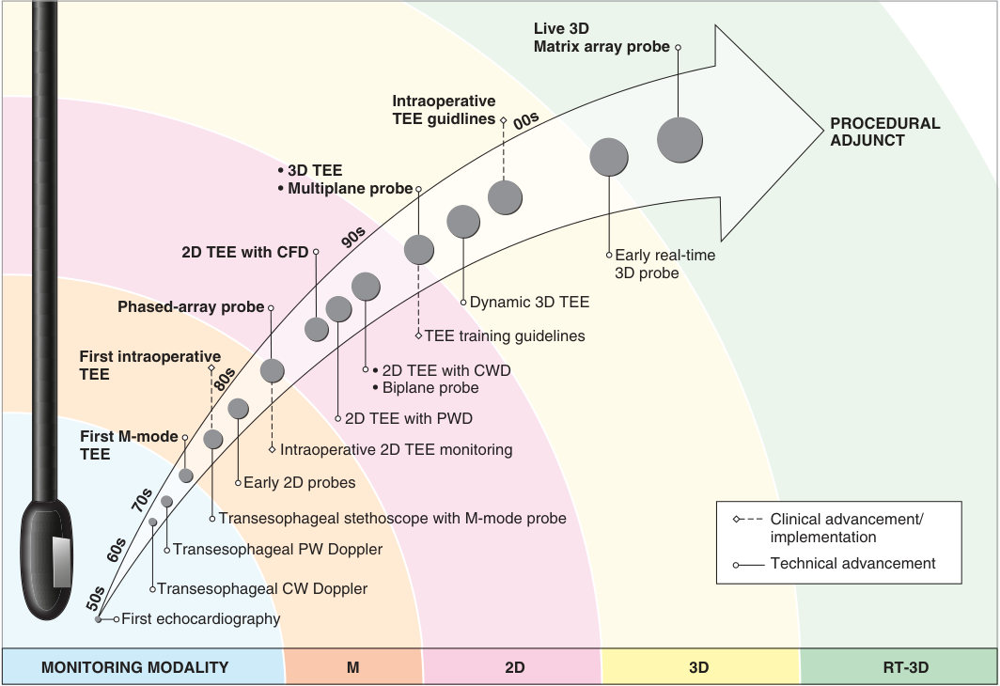

Live 3D Matrix array probe Intraoperative TEE guidlines PROCEDURAL ADJUNCT • 3D TEE • Multiplane probe 2D TEE with CFD Early real-time 3D probe Phased-array probe Dynamic 3D TEE TEE training guidelines First intraoperative TEE • 2D TEE with CWD • Biplane probe 2D TEE with PWD First M-mode TEE Intraoperative 2D TEE monitoring Early 2D probes Transesophageal stethoscope with M-mode probe Clinical advancement/ implementation Transesophageal PW Doppler Technical advancement Transesophageal CW Doppler First echocardiography MONITORING MODALITY M 2D 3D RT-3D 00s 90s 80s 70s 60s 50s 

**Fig. 33.1** Evolution of transesophageal echocardiography (TEE) over the years from a monitoring modality to procedural adjunct. _2D_ , two- dimensional; _3D_ , three- dimensional; _CFD_ , color flow Doppler; _CWD_ , continuous- wave Doppler; _RT- 3D_ , real- time 3D. (Modified with permission from Mahmood F, Shernan SK. Perioperative transoesophageal echocardiography: current status and future directions. _Heart_ . 2016;102(15):1159–1167.)

<!-- PDF page 3 -->

range (20–20,000 hertz [Hz]). Echocardiography typically uses frequencies between 2 and 12 megahertz (MHz). Ultrasound transducers use piezoelectric elements to convert ultrasound energy into electrical energy and _vice versa_ . Transducers function both as transmitters and receivers of ultrasound signals. 2D echocardiography uses a phasedarray transducer, which has a row of electrically interconnected piezoelectric elements.

As ultrasound energy propagates through tissue, interactions between the wave and tissue result in absorption, divergence, reflection, and scattering of the energy. Reflection of ultrasound energy at tissue interfaces forms the basis of image generation. These sound–tissue interactions reduce the intensity of the ultrasound signal, and this attenuation limits the depth of imaging. Transmitted energy at tissue interfaces often undergoes refraction and changes directions, contributing to imaging artifacts.

The accurate display of an image depends on imaging resolution, components of which include spatial resolution, temporal resolution, and contrast resolution (Table 33.1). Spatial resolution can be described according to the three beam dimensions: axial, lateral, and elevational. Image formation involves a tradeoff between spatial resolution and depth of penetration. Higher-frequency (shorterwavelength) transducers provide superior axial resolution, but limited penetration depth due to attenuation. Lower frequencies (longer wavelengths) penetrate more deeply at the expense of axial resolution. Higher frequencies are better for imaging superficial structures; lower frequencies are better for deeper structures.

Formation of ultrasound images relies on several assumptions: (1) ultrasound energy propagates in a straight line; (2) all returning echoes originate from the central beam, which is extremely thin; (3) echoes return to the transducer after one reflection; (4) attenuation is constant; and (5) the speed of sound is constant, therefore the depth of a reflector is proportional to the round- trip transit time.25 Violations of these assumptions result in imaging artifacts. Spectral and

color flow Doppler (CFD) and 3D images are also susceptible to imaging artifacts.

## Ultrasound Modalities

Key ultrasound modalities used in echocardiography include motion mode (M- mode), 2D imaging, Doppler (spectral and color flow), and Doppler tissue imaging (DTI). Table 33.2 highlights important aspects of these techniques. Additional techniques may be applied in specific contexts and are introduced in the next section.

### STRAIN AND STRAIN- RATE IMAGING

Strain and strain- rate imaging techniques (also called cardiac mechanics or myocardial deformation) are used to quantify global and regional ventricular function. Strain is the relative change in shape or size of an object as a result of an applied force. In the context of the myocardium, it is the fractional change in the length of a segment relative to its baseline and expressed as a percentage. Positive strain indicates lengthening or thickening and negative strain represents shortening or thinning. Three axes are relevant to myocardial deformation: longitudinal, circumferential, and radial. Normal deformation patterns during systole are longitudinal shortening (negative strain), circumferential shortening (negative strain), and radial thickening (positive strain).

Methods for strain analysis include DTI and the more commonly used speckle tracking echocardiography (STE). DTI measures velocities at two points in the myocardium and derives the strain and strain rate. STE, in contrast, tracks unique acoustic speckles in the myocardium over a series of frames and derives strain and strain rate from the change in distance. Duncan and colleagues have written an excellent review on perioperative strain and strain- rate imaging.26

**Table 33.1** Components of Imaging Resolution

||**Description**|**Practical points**|
|---|---|---|
|**Spatial Resolution**|The ability to discriminate between two closely spaced objects The minimum distance necessary between two structures so that they are displayed as separate objects|Determines image details Factors that improve spatial resolution often come at the expense of decreased temporal resolution and_vice versa_|
|Axial|Differentiates between objects along the length of the ultrasound beam|Higher frequency transducers have shorter wavelengths and better axial resolution Axial resolution is superior to lateral resolution|
|Lateral|Discriminates side- to- side (or horizontal) relative to the direction of the beam|Determined by the beam width Best at the focal point of the beam|
|Elevational|Discriminates between objects vertical to the plane of the ultrasound beam|Determined by the beam height Best at the focal point of the beam|
|**Temporal Resolution**|The ability to accurately display a structure’s motion with respect to time|The higher the frame rate, the better the temporal resolution Factors that decrease the time to scan the sector (e.g., decreasing the imaging depth or creating a narrower imaging sector) improve temporal resolution|
|**Contrast Resolution**|The ability to resolve subtle differences in echogenicity, which are displayed as different shades of gray|Improved by harmonic imaging, use of contrast agents, B- color maps, and post- processing controls|

::: details 原始表格與符號（PDF 第 3 頁）

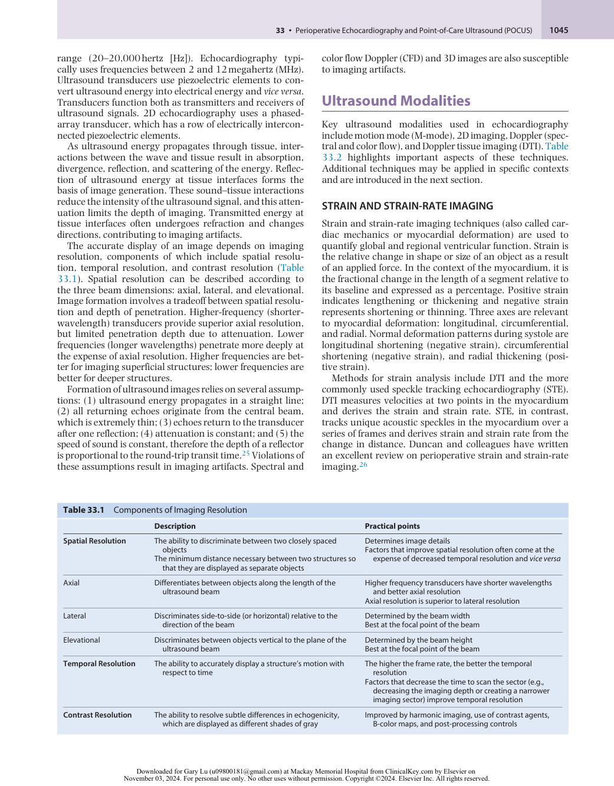

:::

<!-- PDF page 4 -->

**Table 33.2** Ultrasound Modalities

|**Modality**|**Description/Features**|
|---|---|
|**Brightness Mode** **(B- mode)**|ᑏDepicts the strength of returning sound signals using corresponding degrees of brightness ᑏM- mode and 2D imaging are modifications of original B- mode imaging|
|**Motion Mode** **(M- mode)**|ᑏDisplays a one- dimensional image of the motion of cardiac structures relative to time ᑏVery high temporal resolution ᑏProvides limited spatial information ᑏGreatest utility in providing information about rapidly moving structures (e.g., valves, walls) in relation to the timing of the cardiac cycle|
|**Two- Dimensional** **(2D)**|ᑏThe mainstay of the echocardiographic examination ᑏScanning of repeated pulses generates an image representative of the cardiac structures with real- time motion ᑏImages are produced in a sector format ᑏTemporal resolution is less than that of M- mode|
|**Doppler**|ᑏUltrasound energy scattered from moving red blood cells shifts to a higher frequency when moving toward the transducer and a lower frequency when moving away ᑏDoppler modes analyze this frequency shift and use the Doppler equation to estimate velocities of blood flow ᑏVelocity (_v_) can be calculated as follows:      2 cos t c f v f|
||where_c_= the propagation speed of sound in blood (1540 m/s),_Δf_is the difference between the transmitted frequency (_ft_) and the received frequency, and cos_θ_is the angle of incidence between the ultrasound beam and blood flow ᑏAngle- dependent ᑏMaximum Doppler shift occurs when blood flow is directly parallel to the beam. When the incident angle is≤20 degrees, the percentage error in estimating the velocity is≤6%. At greater incident angles the error significantly increases. ᑏIncludes spectral (pulsed- wave, continuous- wave) and color flow Doppler|
|Pulsed- Wave Doppler (PWD)|ᑏSamples blood flow velocities at a specific location ᑏThe frequency of sampling determines the maximum velocity that can be detected and depends on imaging depth ᑏThis maximum velocity is half of the pulse repetition frequency and referred to as the Nyquist limit ᑏAbove the Nyquist limit,_aliasing_occurs. The Doppler information is displayed ambiguously, displaying both positive and negative velocities|
|Continuous-Wave Doppler (CWD)|ᑏTransducer continuously transmits and receives ultrasound energy along the length of the ultrasound beam ᑏAllows measurement of higher-velocity flows, such as those that are encountered with stenotic or regurgitant lesions ᑏThe location of the high-velocity flow may occur anywhere along the length of the beam, a limitation referred to as_range_ _ambiguity_|
|Color Flow Doppler (CFD)|ᑏA form of pulsed- wave Doppler ᑏThe direction and velocity of flow are measured in multiple sample volumes within an imaging sector. The direction and velocity information are displayed according to a color scale ᑏFlow data are superimposed on the corresponding 2D image ᑏLimited by aliasing ᑏLower temporal resolution than 2D imaging|
|**Doppler Tissue** **Imaging (DTI)**|ᑏUsed to assess myocardial motion ᑏEliminates the high- velocity, low- amplitude signals from red blood cells and displays the low- velocity, high- amplitude signals from tissue ᑏAngle- dependent ᑏDoes not distinguish between translational motion and contraction|

### HARMONIC IMAGING

Harmonic imaging is a processing technique used to improve the quality of 2D images.27 A sound wave propagates nonlinearly through tissue, distorting the wave’s shape. This produces harmonic frequencies, which are integer multiples of the fundamental frequency originally transmitted by transducer. Signals return to the transducer at both the fundamental frequency and harmonic frequencies. Harmonic imaging typically creates images from the second harmonic frequency and filters the fundamental frequency signals. Harmonic imaging increases contrast resolution, improves signal- to- noise ratio, and decreases some artifacts. Disadvantages include slightly decreased spatial resolution and thickened appearance of some cardiac structures.28,29

### CONTRAST ECHOCARDIOGRAPHY

Contrast echocardiography can be used to improve diagnostic evaluation and enhance suboptimal images.30,31 Two methods of contrast echocardiography are injection of agitated saline or injection of commercially available contrast agents. Agitated saline can be used to identify the presence of intracardiac right- to- left shunt, because microbubbles created by agitation do not cross the pulmonary circulation.32 Commercially available contrast agents use encapsulated microbubbles of high- density gas and traverse the pulmonary circulation, allowing for opacification of the left side of the heart. Perioperative applications of contrast echocardiography include improved endocardial border delineation for assessment of function, assessment of regional wall motion, and exclusion of intracardiac thrombus or mass.

::: details 原始表格與符號（PDF 第 4 頁）

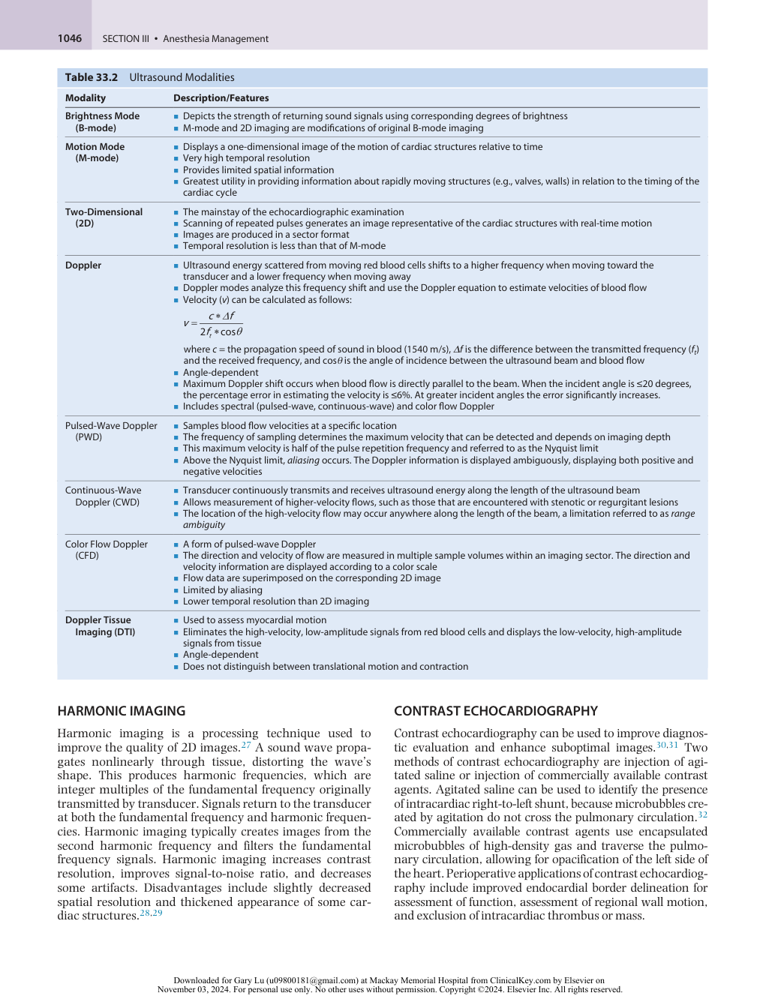

:::

<!-- PDF page 5 -->

## Three- Dimensional Image Acquisition

3D imaging provides information that complements the findings from the 2D examination. Transducers with 3D capabilities contain thousands of piezoelectric elements in a rectangular (or matrix) array configuration and create pyramidal- shaped images. The optimal 3D image involves tradeoffs between temporal resolution, spatial resolution, and sector size. 3D imaging is susceptible to the same artifacts as 2D imaging and additional artifacts unique to 3D image construction. We encourage the interested reader to refer to published 3D echocardiography guidelines33 as well as a practical overview focused on intraoperative 3D image acquisition.34

### IMAGING MODES

### Two- Dimensional Multiplane Acquisition

Matrix array (3D) transducers have multiplane imaging capabilities and can simultaneously display two or more live 2D imaging planes. In biplane imaging, the first image serves as the reference view, and the second image is obtained by rotating the scanning plane around the longitudinal axis of the reference view. The secondary image can

also be adjusted by tilting the imaging plane in the elevational or lateral axis. Multiplane imaging allows simultaneous display of multiple rotatable imaging planes (Fig. 33.2). Box 33.1 lists common perioperative applications of multiplane imaging.

### Real- Time Three- Dimensional Imaging

3D images can be displayed live or in “real time.” RT3D imaging acquires data over a single heartbeat; some authors and vendors refer to this as 4D imaging. The proprietary nomenclature varies, but there are three main RT- 3D modes of differing sector size:

- Narrow sector: this mode displays a pyramidal volume with the best temporal and spatial resolution of the live modes. The major limitation is that it often does not capture an entire structure of interest (Fig. 33.3).

- Wide sector: this mode “zooms in” on a selected region of interest. There is a decrease in temporal and spatial resolution compared to narrow sector imaging. Images are easy to acquire. This mode is ideal for real- time image manipulation (see Fig. 33.3).

- Full- volume: full- volume mode has the largest imaging sector. Live full- volume images have reduced temporal and spatial resolution. Ideally, acquisition of full- volume images occurs over multiple beats to overcome limitations

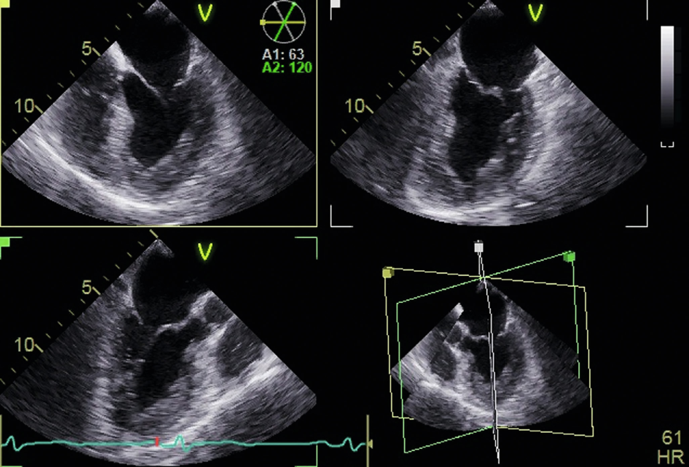

**Fig. 33.2 Simultaneous display of multiple two- dimensional scan planes by multiplane imaging.** The upper left panel ( _yellow pane_ l) displays the primary reference imaging plane. The circular icon in this panel indicates the positions of the secondary imaging planes. Images from the secondary planes are displayed at the top right ( _white panel_ ) and bottom left ( _green panel_ ). A three- dimensional representation of the imaging planes and their angulation is displayed at the bottom right.

<!-- PDF page 6 -->

in temporal and spatial resolution. Live full- volume mode has utility when multiple- beat acquisition is not feasible.

### Gated Acquisition

Gated acquisition divides the imaging volume into multiple narrow subvolumes that are acquired over a specified number of heartbeats. “Stitching” the subvolumes

### Box 33.1 Perioperative Applications of Multiplane Imaging

- Simultaneous visualization of segmental wall motion

- Characterization of the mechanism and origin of valvular regurgitation

- Procedural guidance during percutaneous closure of atrial septal defect

- Guidance of transseptal puncture for transcatheter left atrial appendage and mitral valve procedures

- Evaluation of the left atrial appendage morphology and exclusion of thrombus

together creates the final image. In order to obtain the subvolumes at the same time in the cardiac cycle, image acquisition is gated to the R- wave of the electrocardiogram (ECG). Gated acquisition requires normal cardiac rhythm and the absence of electrical interference or respiratory variation.

- Wide sector: multiple- beat gated acquisition using wide sector mode significantly improves the temporal resolution of the “zoomed in” view. Spatial resolution marginally improves.

- Full volume: this mode has the largest sector size with optimal spatial resolution and high temporal resolution (Fig. 33.4; Video 33.1).

### Color Flow Doppler

CFD may be incorporated with any of the modalities, but leads to a reduction in temporal resolution. Optimal 3D CFD images are obtained using R- wave gated multiple- beat acquisitions.

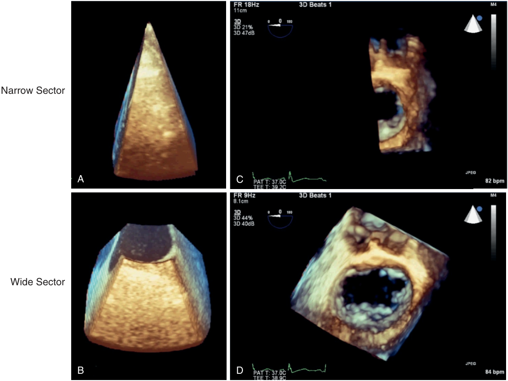

Narrow Sector A C Wide Sector B D 

**Fig. 33.3** Real- time three- dimensional imaging using narrow sector ( _top_ ) and wide sector ( _bottom_ ) modes. (A) Narrow sector imaging displays a narrow, pyramidal volume. (B) Wide sector imaging displays a defined region of interest selected from a larger pyramidal volume. (C) Narrow sector image of the mitral valve after cropping and rotating. Only a portion of the mitral valve structure is visualized. (D) Wide sector image of the mitral valve after cropping and rotating. The entire mitral valve structure is visualized, but at the expense of decreased spatial and temporal resolution.

<!-- PDF page 7 -->

Video 33.1 3D imaging – multiple-beat full- volume acquisition. Multiple-beat full- volume acquisitions create three- dimensional images by acquiring individual data subvolumes over consecutive heartbeats and then “stitching” the data together to create the larger full- volume image.

<!-- PDF page 8 -->

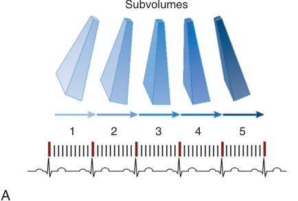

Subvolumes 1 2 3 4 5 A 

Full volume 

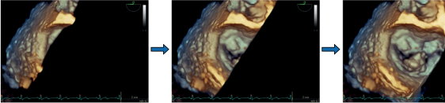

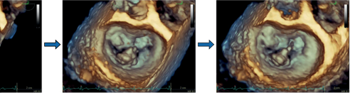

### B

**Fig. 33.4** (A) Schematic of multiple-beat gated full- volume image acquisition. Subvolume acquisition is gated to the R- wave of the electrocardiogram. In this example, subvolume acquisition occurs over five consecutive heartbeats. The individual subvolumes are then synchronized and “stitched” together to create a larger full- volume three- dimensional image. (B) Creation of the three- dimensional (3D) full- volume image from narrow subvolumes. (Modified from Desjardins G. Perioperative echocardiography. In: Miller R, ed. _Miller’s Anesthesia_ . 8th ed. Philadelphia, PA: Elsevier/Saunders; 2015:1396–1428.)

### QUANTITATIVE ANALYSIS

### Multiplanar Reformatting/Reconstruction

Multiplanar reformatting (MPR) enables alignment of orthogonal planes to accurately measure linear dimensions and areas (e.g., planimetry of stenotic orifice, annular area). It involves 3D image acquisition followed by reformatting at the desired planes to obtain views and slices of images at the desired anatomic level. The simultaneous visualization along multiple axes provides accurate spatial information for guiding transcatheter procedures, precise quantification of regurgitant lesions, dimensions for valve sizing or left atrial appendage procedures and septal myectomy.

### Advanced Applications

Quantitative applications exist for 3D imaging and eliminate some of the geometric assumptions required in 2D imaging calculations. Example analyses include calculation of ventricular ejection fraction (EF), analysis of mitral valve structure, and dynamic annular measurements. The degree of automation and need for post- processing manipulation vary. Some analyses are performed exclusively offline, making them useful in research, but less applicable to intraoperative decision- making.

## Indications and Practice Guidelines

### PERIOPERATIVE TRANSESOPHAGEAL ECHOCARDIOGRAPHY

The American Society of Anesthesiology (ASA) and Society of Cardiovascular Anesthesiologists (SCA) issued perioperative

TEE practice guidelines in 1996, categorizing indications for TEE in various clinical settings.35 An updated version in 2010 recommended the indications for perioperative TEE based on literature review and expert opinion.36 The 2020 update includes guidelines for comprehensive and systematic use of TEE during valvular, coronary artery bypass, mechanical circulatory support surgeries as well as heart and lung transplants, extracorporeal membrane oxygen ation (ECMO), and for patients with cardiomyopathies. The indication for use of TEE is not only based on surgical procedure but also on the patient’s medical condition.37 In the absence of contraindications, TEE should be used in all adult open heart and thoracic aortic surgical procedures. It should be considered in coronary artery bypass graft surgeries to confirm diagnostic information, detect pathology, influence the anesthetic or surgical plan, and assess surgical results. It is recommended that TEE be considered on a case- by- case basis in small children undergoing cardiac surgery due to unique risks in this population. Separate guidelines focus specifically on the role of echocardiography in interventional and catheter- based procedures.38,39 In noncardiac surgery, TEE is indicated in the setting of persistent unexplained life- threatening circulatory instability. If the surgical procedure or the patient’s known or suspected pathology could result in severe hemodynamic, pulmonary, or neurologic compromise, TEE may be used. TEE is recommended in critical care if the diagnostic information is expected to alter management and cannot be obtained by other modalities expediently. European guidelines offer similar recommendations for the use of perioperative TEE,40,41 while the American Heart Association (AHA) and American College of Cardiology (ACC) make more limited recommendations regarding specific indications for intraoperative TEE.42,43

In addition to describing indications for perioperative TEE, the 1996 ASA/SCA guidelines also distinguish

<!-- PDF page 9 -->

between basic and advanced levels of training.35 In 2002, an American Society of Echocardiography (ASE)/SCA Joint Task Force authored guidelines for training in perioperative echocardiography, defined as TEE, epicardial echocardiography, or epiaortic ultrasonography performed in surgical patients immediately before, during, or after surgery.44 These guidelines do not include TTE. Expectations for cognitive and technical skills of both basic and advanced training are outlined with recommendations for the minimum numbers of echocardiographic examinations performed. Further discussion of training and certification occurs at the end of the chapter.

### CRITICAL CARE

Critical care societies have further defined competencies and applications of echocardiography in critical care beyond that established by the ASA/SCA guidelines. Several internationally based expert panels have proposed training objectives and competency- based training standards in consensus statements. These statements distinguish between basic and advanced critical care echocardiography45 or a basic and expert skill set.46 The Society of Critical Care Medicine has provided evidence- based recommendations for the use of bedside echocardiography (TEE and TTE) in the evaluation of the critically ill patient.46 The National Board of Echocardiography organizes the Certification in Critical Care Echocardiography (CCEeXAM), which now permits board certification in this specialized field.47

## Transesophageal Echocardiography Examination

### CONTRAINDICATIONS AND COMPLICATIONS

TEE is a safe but invasive procedure, and echocardiographers and patients should be aware of potential complications resulting from probe insertion and manipulation. Table 33.3 lists absolute and relative contraindications to TEE. The risks and benefits must be carefully considered in patients with oral, esophageal, or gastric disease. Hilberath and associates provide an excellent summary on the safety of TEE, with reviewed studies reporting an overall complication rate in adults of 0.18% to 2.8% and major complication rate of 0.2% to 1.4%.48 In a 2017 retrospective cohort study, 111 (1.4%) of the 7948 patients were identified as having complications likely attributable to TEE (no other cause identified). The incidence of significant dysphagia was 0.3% and esophageal or gastric complications 0.9%. Independent risk factors associated with complications were age, body mass index, previous stroke, procedure other than isolated coronary artery bypass grafting (CABG), cardiopulmonary bypass time, and return to the operating room (OR) for any reason.49

### TRANSESOPHAGEAL ECHOCARDIOGRAPHY IMAGE ACQUISITION

### Probe Manipulation and Imaging Planes

TEE probe manipulation includes withdrawal/advancement, turning left/right, and angle adjustment. The large

**Table 33.3** List of Contraindications to Transesophageal Echocardiography

|**Absolute Contraindications**|**Relative Contraindications**|
|---|---|
|Esophageal pathology ᑏDiverticulum ᑏLaceration ᑏStricture ᑏTumor|History of: ᑏDysphagia ᑏRadiation to neck and chest ᑏUpper gastrointestinal surgery|
|Active upper gastrointestinal bleeding|Recent upper gastrointestinal bleeding|
|History of esophagectomy|Active peptic ulcer disease, esophagitis|
|Perforated viscus|Esophageal varices Barrett’s esophagus Symptomatic hiatal hernia Restricted cervical spine mobility ᑏAtlantoaxial instability ᑏSevere cervical arthritis Coagulopathy or thrombocytopenia|

Adapted from Hahn RT, Abraham T, Adams MS, et al. Guidelines for performing a comprehensive transesophageal echocardiographic examination: recommendations from the American Society of Echocardiography and the Society of Cardiovascular Anesthesiologists. _J Am Soc Echocardiogr_ . 2013;26(9):921–964.

knob on the handle controls anteflexion/retroflexion and the smaller knob allows flexion to the left and right. TEE image acquisition occurs at four different levels: upper esophageal (UE), midesophageal (ME), transgastric (TG), and deep transgastric (DTG) (Fig. 33.5).

### Basic Examination

The basic perioperative TEE examination serves as an intraoperative monitoring tool used to identify cardiac causes of hemodynamic or respiratory instability.50 The basic perioperative examination includes 11 views suited to evaluating hemodynamic instability. A suggested examination sequence progresses through the 11 views as follows: ME four- chamber (ME 4C), ME two- chamber (ME 2C), ME longaxis (ME LAX), ME ascending aorta long- axis, ME ascending aorta short- axis, ME aortic valve short- axis (ME AV SAX), ME right ventricular inflow–outflow (ME RV Inflow–Outflow), ME bicaval, TG midpapillary short- axis (TG SAX), descending aorta short- axis, and descending aorta long- axis.

### Comprehensive Examination

A comprehensive TEE examination enables practitioners with appropriate training to fully utilize the diagnostic capabilities of TEE. Twenty- eight views (including the 11 basic views) are recommended for comprehensive assessment (Fig. 33.6). Technical aspects of image acquisition have been extensively reviewed elsewhere.51 Echocardiographers should complete their examinations systematically to avoid missing key findings. As a result of individual patient anatomy and the time constraints of the intraoperative environment, not all views are obtained in every examination.

## Epicardial and Epiaortic Imaging

While epicardial echocardiography ushered in the era of intraoperative echocardiography, its use was supplanted by

::: details 原始表格與符號（PDF 第 9 頁）

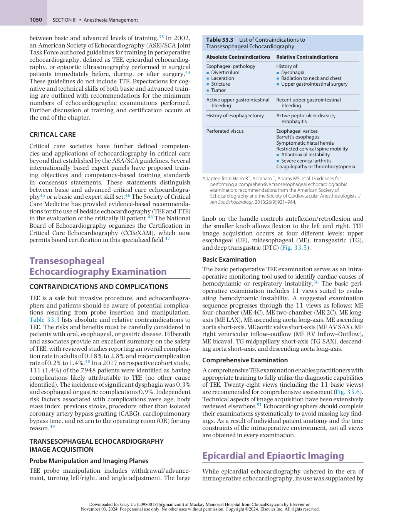

:::

<!-- PDF page 10 -->

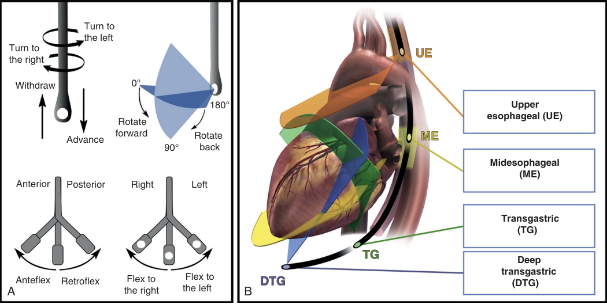

Turn to the left Turn to UE the right Withdraw 0° 180°          Upper esophageal (UE)  Rotate Advance forward Rotate ME 90°   back Midesophageal            (ME) Anterior Posterior Right Left Transgastric       (TG) TG       Deep AAnteflex Retroflex  Flex tothe right  Flex tothe left B DTG transgastric    (DTG) 

**Fig. 33.5 Terminology used to describe manipulation of the transesophageal echocardiographic probe during image acquisition.** (A) Terminology used for the manipulation of the transesophageal echocardiographic probe. (B) Four standard transducer positions within the esophagus and stomach and the associated imaging planes. (From Hahn RT, Abraham T, Adams MS, et al. Guidelines for performing a comprehensive transesophageal echocardiographic examination: recommendations from the American Society of Echocardiography and the Society of Cardiovascular Anesthesiologists. _J Am Soc Echocardiogr_ . 2013;26(9):921–964.)

TEE. In the setting of contraindications to TEE or the need for better visualization of anterior structures, epicardial echocardiography remains an alternative modality.52

Epiaortic ultrasound (EAU) serves as an imaging adjunct, allowing visualization of the ascending aorta and aortic arch, regions that are unable to be visualized on TEE. Detection of ascending aorta atheroma is superior with EAU compared to that of TEE or manual palpation.53 EAU impacts surgical strategy, but data as to whether this translates into improved clinical outcomes are limited and heterogeneous. Examination guidelines and example imaging views are available.54

## Transthoracic Echocardiography Examination

### TRANSTHORACIC ECHOCARDIOGRAPHY IMAGE ACQUISITION

Three elements describe transthoracic sonographic views: (1) transducer position or window, (2) imaging plane, and (3) structures imaged. When feasible, patients should turn to their left side with the left hand resting behind the head. The main windows are parasternal, apical, subcostal, and suprasternal. Imaging motions include translation (sliding), tilting, angulation, and rotation (Fig. 33.7)

### Point- of- Care Ultrasound (POCUS)

POCUS is variously defined as the examination performed by trained professionals at the bedside to obtain real- time information geared toward diagnosis, therapeutic interventions, and procedural guidance. It is widely accepted as an

extension of physical examination and the scope is widening beyond emergency medicine and critical care.55

The military application of ultrasound in the field led to miniaturization of microprocessors and ushered in the era of portable, compact ultrasound machines. The portability, ability to make a quick diagnosis, timely treatment, and the ability to improve procedural success make POCUS a valuable tool.

POCUS can be broadly divided into organ systems. The main organ systems are cardiac, pulmonary, and abdominal; POCUS can also apply to ocular, skin and subcutaneous tissues, and genitourinary organ systems.

### Focused Cardiac Ultrasound (Cardiac POCUS) Versus Limited Examination

Echocardiography exams range from simple augmentation of physical examination to comprehensive echocardiography.56 With increasing use of echocardiography at the point of care (POCUS), it is important for the clinician to recognize the distinction between focused cardiac ultrasound (FoCUS/cardiac POCUS) and limited TTE examination. Guidelines endorsed by several societies describe the key differences between the two examinations.57,58 FoCUS is a simplified, point- of- care ultrasound examination (Box 33.2). FoCUS addresses specific questions within a given clinical context by specific imaging protocols and involves mainly qualitative assessment and may include simple quantitation. Relevant abnormalities are characterized as present or absent, and questions are answered in a yes/no format which may include decision on intervention and follow- up. In contrast, limited TTE is broad in scope. Interpretation includes normal, pathologic, and incidental findings, and quantitative techniques may be employed. Fewer

<!-- PDF page 11 -->

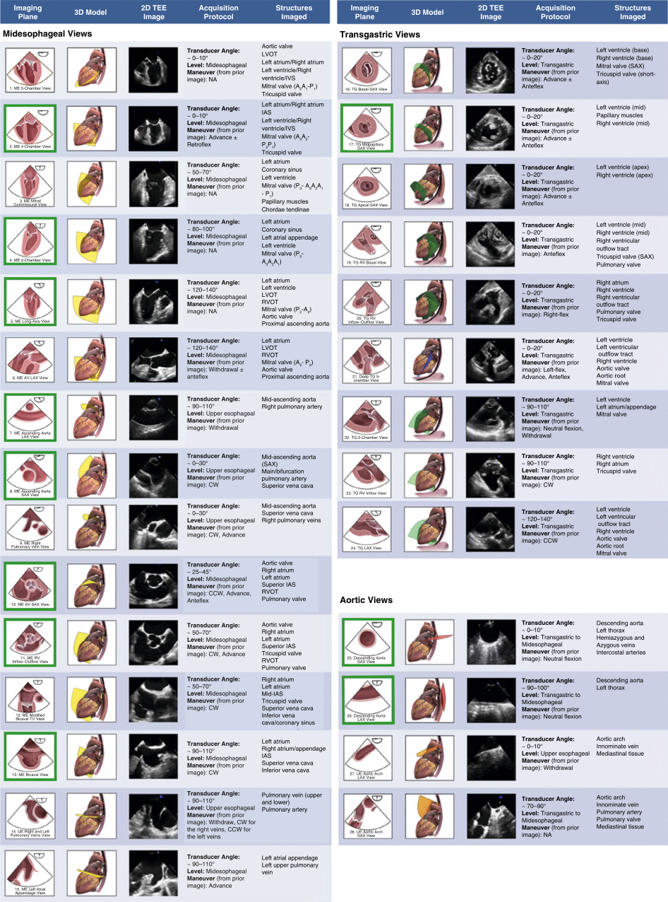

Transgastric Views Aortic Views 

**Fig. 33.6 The 28 suggested views of the comprehensive transesophageal echocardiographic (TEE) examination.** Each view is shown as a 3D image, the corresponding imaging plane, and a 2D image. The acquisition protocol and the structures imaged in each view are listed in the subsequent columns. The _green boxes_ indicate the 11 views of the basic TEE examination. (Modified from Hahn RT, Abraham T, Adams MS, et al. Guidelines for performing a comprehensive transesophageal echocardiographic examination: recommendations from the American Society of Echocardiography and the Society of Cardiovascular Anesthesiologists. _J Am Soc Echocardiogr_ . 2013;26(9):921–964.)

<!-- PDF page 12 -->

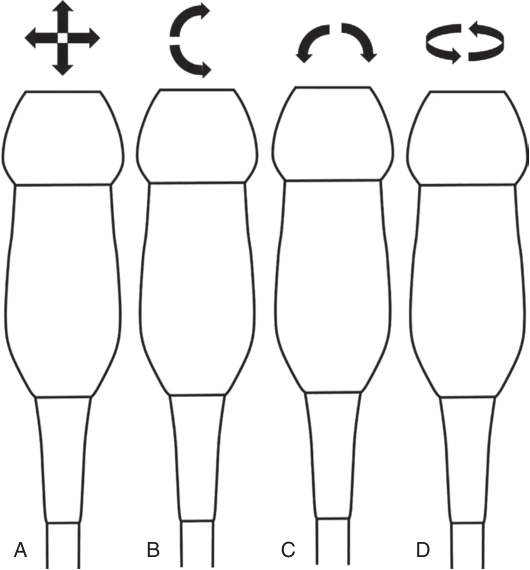

A B C D 

**Fig. 33.7 Standardized nomenclature for motion with a TTE probe.** (A) Translation or sliding motions along the body wall. (B) Tilting in a cephalad– caudad plane. (C) Angulation in the medio- lateral plane. (D) Rotation along the axis of the probe.

### Box 33.2 Features of Focused Cardiac Ultrasound

> ᑏ Goal- directed

> ᑏ Problem- oriented

- Limited in scope

> ᑏ Simplified

- Time sensitive and repeatable

- Qualitative or semiquantitative

- Performed at the point of care

- Usually performed by clinicians

_FoCUS,_ focused cardiac ultrasound.

Adapted from Via G, Hussain A, Wells M, et al. International evidencebased recommendations for focused cardiac ultrasound. _J Am Soc Echocardiogr_ . 2014;27(7):683 e681–683 e633.

images are acquired in a limited examination compared to a comprehensive examination.57 Limited TTE requires a practitioner with advanced training and expertise.

If FoCUS does not reveal pathology but there is clinical suggestion of cardiac disease, formal comprehensive echocardiography should be pursued. Many FoCUS protocols exist, most including five key views: parasternal long- axis (PLAX), parasternal short- axis (PSAX), apical four- chamber (A4C), subcostal four- chamber (SC4), and subcostal inferior vena cava (SIVC) (Fig. 33.8; Video 33.2). For those interested in details of image acquisition, we refer the reader to a practical introductory primer.59

### Comprehensive Examination

A comprehensive exam is detailed, involves advanced quantification techniques, and may include assessment

with specialized applications. Few anesthesiologists have the necessary training required to perform and/or formally interpret comprehensive TTE examinations. Standard imaging views occur at the parasternal, apical, and subcostal windows, plus the suprasternal notch. In addition to the views included in FoCUS, a comprehensive TTE examination includes the PLAX right ventricular outflow, PLAX right ventricular inflow, PSAX apical, PSAX mitral (basal), PSAX aortic, apical right ventricle–focused, apical fivechamber (A5C), apical two- chamber (A2C), apical threechamber (A3C), and suprasternal notch long- axis views.60

## Qualitative Assessment of the Heart

Qualitative assessment is a quick evaluation without complex quantification and forms an extensive part of cardiac POCUS/FoCUS and a significant part of comprehensive assessment by TTE or TEE.

### VENTRICULAR SIZE AND FUNCTION

### Left Ventricle

Qualitative visual assessment of LV systolic function is the mainstay of cardiac POCUS and perioperative echocardiography. Visual estimation of EF by TTE correlates well with quantitative methods61,62 and real- time intraoperative TEE interpretation can reasonably estimate function compared to formal offline methods.63 Wall thickening is symmetric and vigorous when LV systolic function is normal (Video 33.3). The key TEE views for global assessment of LV function include the TG SAX (Fig. 33.9), ME 4C, ME 2C, and ME

<!-- PDF page 13 -->

Video 33.2 Echocardiographic views in focused cardiac ultrasound (FoCUS): Parasternal long axis (PLAX), parasternal short axis (PSAX), apical four- chamber (A4C), subcostal four- chamber (SC4), and subcostal IVC (SIVC). _A_ , anterior wall; _AML_ , anterior mitral leaflet; _AoV_ , aortic valve; _DA_ , descending aorta; _I_ , inferior wall; _IVC_ , inferior vena cava; _IVS_ , interventricular septum; _L_ , lateral wall; _LA_ , left atrium; _LV_ , left ventricle; _PML_ , posterior mitral leaflet; _RA_ , right atrium; _RV_ , right ventricle; _RVOT_ , right ventricular outflow tract; _S_ , septal wall.

Video 33.3 Transesophageal echocardiographic views demonstrating qualitatively normal left ventricular systolic function. _AoV_ , aortic valve; _LA_ , left atrium; _LV_ , left ventricle; _MV_ , mitral valve; _RA_ , right atrium; _RV_ , right ventricle.

<!-- PDF page 14 -->

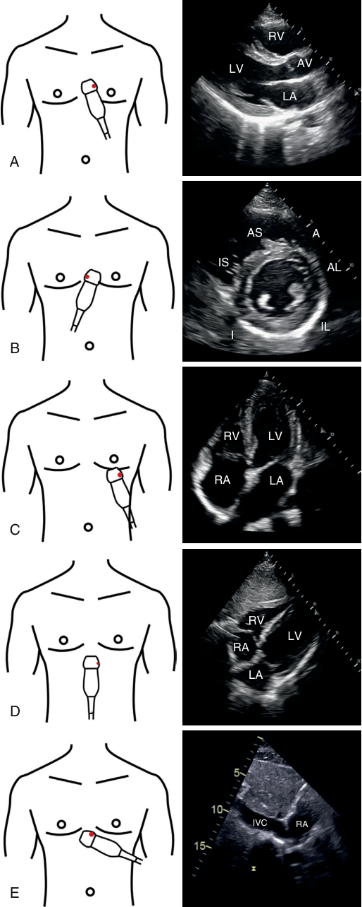

RV AV LV LA A AS A IS AL IL I B RV LV RA LA C RV LV RA LA D IVC RA E 

**Fig. 33.8 Views included in the focused cardiac ultrasound (FoCUS) examination.** (A) Parasternal long- axis (PLAX); (B) parasternal shortaxis (PSAX); (C) apical 4- chamber (A4C); (D) subcostal 4- chamber (S4C); (E) subcostal inferior vena cava (SIVC). The parasternal window is between the third through fifth intercostal space to the left of the sternum. The PLAX view is obtained with the probe marker _(red dot)_

towards the left shoulder. The PSAX view is obtained by rotating the probe to the right shoulder. The apical window is near the point of maximal impulse along the mid- axillary line, often near the fifth intercostal space. The PSAX view is obtained with the probe marker to the left. The subcostal window is just below the xiphoid, along the midline or slightly to the patient’s right. The S4C view is obtained with the probe marker to the left. The SIVC view is obtained by rotating the marker towards the patient’s head and tilting the probe slightly caudally. _RV_ , right ventricle; _LV_ , left ventricle; _AV_ , aortic valve; _LA_ , left atrium; _A_ , anterior wall; _AL_ , anterolateral wall; _I_ , inferior wall; _IL_ , inferolateral wall; _IS_ , inferoseptal wall; _AS_ , anteroseptal wall.

LAX views (Fig. 33.10). Analogous TTE views are PSAX, A4C, A2C, and PLAX views. The TG SAX and PSAX views display distributions of all three coronary arteries.

Assessment of regional function focuses on the thickening and shortening of individual segments. Translational motion, tethering, or dyssynchrony due to conduction delay or pacing can make interpretation challenging. A 17- segment model divides the heart into six basal segments (from the mitral valve annulus to the tips of the papillary muscles), six midpapillary level segments (from the tips to the base of the papillary muscles), four apical (or distal) segments (from the base of the papillary muscles to the LV apex), and the apical cap.64 The apical cap is difficult to visualize with TEE due to foreshortening. Segmental thickening should be assessed in the context of coronary distribution, recognizing variability among individuals. The left anterior descending artery (LAD) consistently supplies the anterior and anteroseptal segments and apical cap (Fig. 33.11). The right coronary artery (RCA) supplies the right ventricle (RV) and the basal inferior, basal inferoseptal, and mid- inferior and possibly the mid- inferoseptal segments, the latter of which may be supplied by the LAD. The left circumflex typically supplies the lateral segments, although contributions from the LAD to the anterolateral segments or RCA to the inferolateral segments do occur.65 Each segment should be evaluated as normal/hyperkinetic, hypokinetic (reduced thickening), akinetic (minimal or absent thickening), or dyskinetic (thinning, stretching, or aneurysmal). Echocardiography is more sensitive than the ECG in detecting ischemic changes.66

### Right Ventricle

The complex geometry of the RV makes assessment more challenging. Qualitatively, the RV should appear approximately two- thirds the size of the left ventricle when assessed in ME 4C and A4C views. Typically, the right ventricle does not extend to the LV apex. RV hypertrophy suggests chronic pulmonary hypertension or the presence of cardiomyopathies.

The interventricular septum provides additional information about RV pathology. Normally, the septum curves toward the RV, and the LV cavity appears circular in short axis. In states of RV volume overload, the septum shifts away from the RV and flattens, resulting in a D- shaped LV cavity mainly in mid- to- late diastole (Video 33.4). RV pressure overload leads to leftward septal shift and septal flattening throughout the cardiac cycle, with the changes most pronounced at end- systole (Video 33.5).67

<!-- PDF page 15 -->

Video 33.4 Transthoracic parasternal short- axis view demonstrating flattening of the interventricular septum in diastole, a finding observed in states of right ventricular volume overload. The septal curvature remains normal and the left ventricular cavity appears circular during systole. Of note, both left and right ventricular systolic function are reduced. _IVS_ , interventricular septum; _LV_ , left ventricle; _RV_ , right ventricle.

Video 33.5 Transthoracic parasternal short- axis view of a patient with right ventricular pressure overload. The leftward shift and flattening of interventricular septum occurs throughout the cardiac cycle, but is most pronounced at end- systole. _IVS_ , interventricular septum; _LV_ , left ventricle; _RV_ , right ventricle.

<!-- PDF page 16 -->

### VALVULAR FUNCTION

Qualitative assessment of valvular function in cardiac POCUS may include a diagnosis of valvular lesions. It involves visualizing motion of the leaflets in various views, and color Doppler to identify regurgitant lesions. It does not include diagnosing the pathology or leaflet abnormality. A comprehensive exam begins with sequential assessment of the valve in multiple imaging planes, noting the motion of the leaflets, presence of leaflet thickening or calcification, vegetations or masses, and additional structural abnormalities (Fig. 33.12). Malcoaptation and annular dilation help define the etiology of dysfunction in regurgitant lesions. 3D imaging modalities clarify the location of structure abnormalities.

CFD provides visual information about flow through valves. Aliasing or turbulence of forward flow through a valve should prompt evaluation for additional signs of stenosis. Further characterization of stenotic lesions is primarily quantitative in nature. Color Doppler imaging also detects the presence of valvular regurgitation. The three color Doppler components of a regurgitant jet are proximal

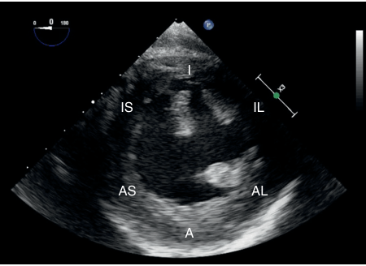

I IS IL AS AL A 

**Fig. 33.9** The transesophageal transgastric midpapillary short- axis view (TG SAX) is a common view for qualitative evaluation of global left ventricular systolic function. Basal and apical segments are not visualized in this view, so midesophageal or TG LAX views should also be obtained to provide a more complete picture of the overall function. The TG SAX view includes myocardial segments supplied by each of the coronary arteries, making it useful for detection of new ischemia. The TG SAX view displays the mid- inferior (I), mid- inferolateral (IL), midanterolateral (AL), mid- anterior (A), mid- anteroseptal (AS), and midinferoseptal (IS) segments.

flow convergence, vena contracta, and jet area (Fig. 33.13). As blood approaches the regurgitant orifice, it accelerates, forming a series of hemispheric shells of increasing velocity and decreasing area. This flow convergence region provides qualitative information about regurgitation severity and is also utilized in quantitative assessments. The vena contracta is the narrowest portion of a regurgitant jet at or immediately downstream of the regurgitant orifice.68,69 The jet area provides information about the mechanism of regurgitation. For example, eccentric regurgitation often arises from structural abnormalities while centrally originating regurgitation may be secondary in nature. The size of the jet area is subject to both technical and hemodynamic limitations, so visual estimation of jet area alone is not a reliable means of assessing regurgitation severity.

Atrial and ventricular dilation suggest chronicity of severe regurgitation; normal chamber size would be unusual in the presence of chronic severe regurgitation. Density and shape of the continuous- wave Doppler (CWD) recording of the regurgitant jet provide additional qualitative information.69

An important limitation of intraoperative assessment of valvular regurgitation is the hemodynamic consequences of general anesthesia, resulting in reduced preload, afterload, and contractility. General anesthesia commonly reduces the severity of mitral regurgitation (MR). Pharmacologic increase of afterload may provide more representative measurements but may also lead to significant overestimation of regurgitation severity.70

## Quantitative Assessment

Quantitative assessment is the cornerstone of comprehensive and limited echocardiographic examination. Quantification enables standardized communication among providers, comparison with previous values, provides grades of pathology for surgical consideration, and allows for better record keeping for data analysis. Simple and quick quantification can be utilized in cardiac POCUS.

### VENTRICULAR SIZE AND FUNCTION

### Left Ventricle

Most indices of systolic function used in routine evaluation are load- dependent, necessitating interpretation in

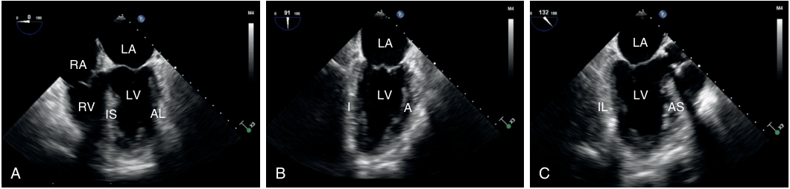

LA LA LA RA LV LV LV RV I A IL AS IS AL A B C 

**Fig. 33.10 Midesophageal views for assessing left ventricular function using transesophageal echocardiography.** (A) The midesophageal fourchamber (ME 4C) view displays the inferoseptal (IS) and anterolateral (AL) walls. (B) The midesophageal two- chamber (ME 2C) view displays the inferior (I) and anterior ( _A_ ) walls. (C) The midesophageal long-axis view (ME LAX) displays the inferolateral (IL) and anteroseptal (AS) walls. _LA_ , left atrium; _LV_ , left ventricle; _RA_ , right atrium; _RV_ , right ventricle.

<!-- PDF page 17 -->

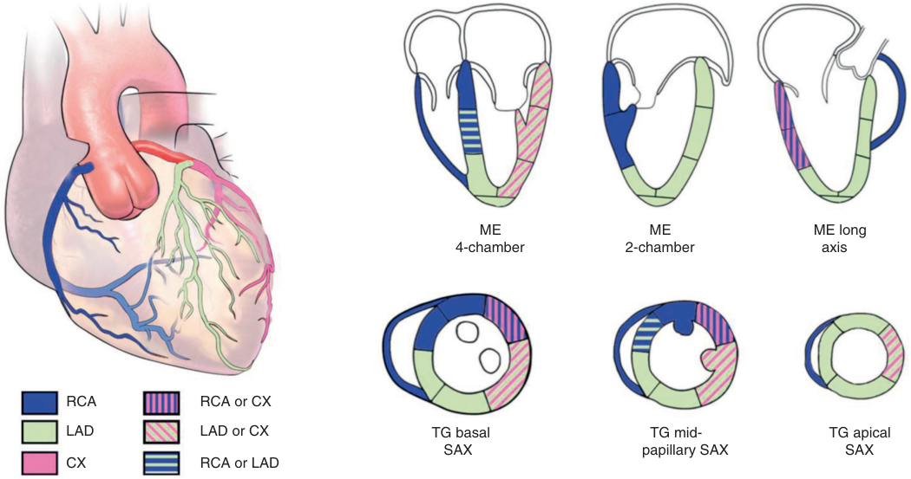

      ME       ME ME long 4-chamber 2-chamber   axis RCA RCA or CX LAD LAD or CX TG basal   TG mid-   TG apical    SAX papillary SAX       SAX CX RCA or LAD 

**Fig. 33.11** Typical distributions of the right coronary artery (RCA), the left anterior descending coronary artery (LAD), and the circumflex coronary artery (CX) from transesophageal views of heart. The arterial distribution varies among patients. Some segments have variable coronary perfusion. _ME_ , midesophageal; _TG_ , transgastric; _SAX_ , short axis. (Modified from Lang RM, Badano LP, Mor- Avi V, et al. Recommendations for cardiac chamber quantification by echocardiography in adults: an update from the American Society of Echocardiography and the European Association of Cardiovascular Imaging. _J Am Soc Echocardiogr_ . 2015;28(1):1–39 e14.)

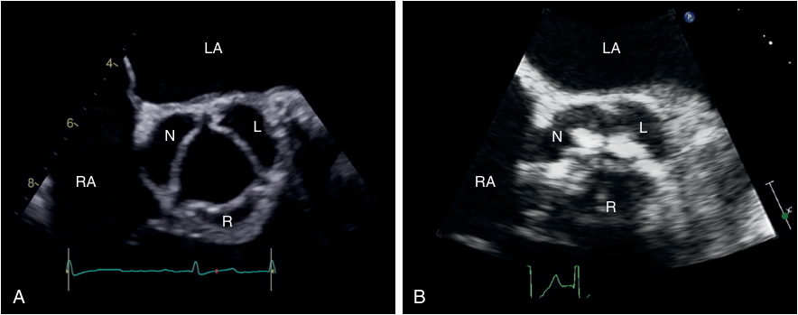

LA LA L L N N RA RA R R A B 

**Fig. 33.12 Qualitative assessment of the aortic valve (zoomed- in transesophageal aortic valve short-axis view).** (A) There are three valve leaflets of normal thickness. Leaflet excursion appears normal. (B) There are three aortic valve leaflets which are severely thickened. Leaflet excursion is reduced. These qualitative findings should prompt additional quantitative assessment of valvular stenosis. _L_ , left coronary cusp; _LA_ , left atrium; _N_ , non- coronary cusp; _R_ , right coronary cusp; _RA_ , right atrium.

context and serial assessments due to changing intraop-

erative conditions. Global systolic function is assessed by measuring the difference between an end- diastolic and end- systolic value of a parameter and dividing by the end- diastolic value. Fractional shortening uses length and fractional area change (FAC) uses area measurement. Both measurements can be obtained at bedside in a focused cardiac exam. However, both approaches have limitations in the setting of regional wall motion abnormalities (RWMAs).

There is some evidence suggesting an association of E point septal separation (EPSS) of >7 mm with severe

LV dysfunction. EPSS is calculated by obtaining M- mode through PLAX and measuring the distance between the anterior mitral leaflet and the interventricular septum in diastole and can be done as a part of cardiac POCUS71,72 (Fig. 33.14).

A more comprehensive assessment includes estimation of ejection fraction. Ejection fraction (EF) is the difference between the end- diastolic volume (EDV) and end- systolic volume (ESV), divided by EDV:

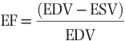

EF = (EDV − ESV) EDV 

<!-- PDF page 18 -->

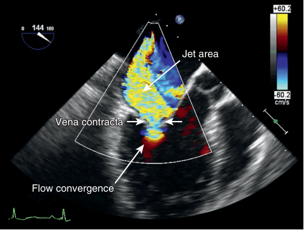

Jet area Vena contracta Flow convergence 

**Fig. 33.13** Mitral regurgitation displaying the three components of a regurgitant jet: (1) flow convergence, (2) the vena contracta, and (3) the regurgitant jet area.

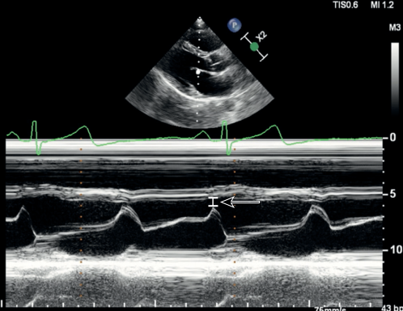

**Fig 33.14** M- mode imaging through the anterior leaflet of the mitral valve obtained from a parasternal long-axis view. The measurement is made from the interventricular septum to the anterior leaflet of the mitral valve in diastole ( _arrow_ ).

The recommended method for 2D calculation of EF is the biplane method of disks (modified Simpson rule).73 This requires tracing the endocardial border in two perpendicular views and assumes the LV volume consists of a stack of elliptical disks. The upper limit of normal for EDV is 74 mL/ m2 for males and 61 mL/m2 for females; ESV is 31 mL/m2 for males and 24 mL/m2 for females.73 Table 33.4 presents updated reference ranges for LVEF.73 Assessment of EF using 3D echocardiography (Fig. 33.15) is more accurate than 2D echocardiography.33 In the presence of significant valvular regurgitation, myocardial contractility may be depressed and forward cardiac output low despite a normal EF.

Additional indices of LV systolic function included in a comprehensive exam are DTI of the mitral annular systolic velocity (s′), myocardial performance index (MPI), and the change in LV pressure over time (dP/dt). Pulsed- wave DTI of the myocardium at the level of the mitral annulus yields a myocardial velocity profile (Fig. 33.16). The systolic

**Table 33.4** Classification of Left Ventricular Systolic Function According to Ejection Fraction

|**Systolic Function**|**Male**|**Female**|
|---|---|---|
|Normal|52%–72%|54%–74%|
|Mild dysfunction|41%–51%|41%–53%|
|Moderate dysfunction|30%–40%|30%–40%|
|Severe dysfunction|&lt;30%|&lt;30%|

From Lang RM, Badano LP, Mor- Avi V, et al. Recommendations for cardiac chamber quantification by echocardiography in adults: an update from the American Society of Echocardiography and the European Association of Cardiovascular Imaging. _J Am Soc Echocardiogr_ . 2015;28(1):1–39 e14.

velocity wave (s′) reflects the apically directed motion of the myocardium and correlates with EF. Normal s′ reference ranges vary based on sex, age, and mitral annulus measurement size.74 MPI assesses both systolic and diastolic performance and is calculated by the sum of isovolumetric contraction and relaxation times divided by ejection time. MPI identifies impaired global function and has prognostic value; however, it is not routinely part of the perioperative examination. The change in LV pressure over time (dP/dt) derived from the CWD signal of MR provides information about LV contractility. Normal LV dP/dt is greater than 1200 mm Hg/s; dP/dt less than 800 mm Hg/s is consistent with severe dysfunction.75 Global longitudinal strain is emerging as a technique with utility in identifying systolic dysfunction prior to decrement in EF. Normal values vary across vendor platforms, but in general, a value of −20% (or more negative) would be expected in normal systolic function (Fig. 33.17).

### Right Ventricle

Parameters for assessment of RV function include FAC, volumetric assessments (EF), tricuspid annular plane systolic excursion (TAPSE), DTI of the tricuspid annular systolic velocity (s′), and MPI.

RVFAC is obtained by tracing the endocardial border in diastole and systole, from the annulus along the free wall (excluding trabeculations) to the apex, from the apex to the annulus along the interventricular septum, and then returning to the annular starting point in the apical 4C view on TTE or ME 4C view on TEE. It can be used as a part of quick bedside assessment.

RVFAC is calculated as:

RVFAC = RVEDA − RVESA * 100 RVEDA 

RVFAC is expressed as a percentage and has a lower limit of normal of 35%.67 Estimation of RVEF using 2D echocardiography requires geometric assumptions, and guidelines do not recommend its use.67 When expertise is available, 3D RVEF is recommended, with less than 45% usually representing abnormal function.73

TAPSE is commonly used in TTE for evaluating RV longitudinal function, measured by aligning the M- mode cursor parallel to the tricuspid annular motion in the A4C view.73 It can be used as a quick bedside assessment of the RV. TAPSE less than 17 mm is consistent with RV systolic dysfunction74 (Fig. 33.18). Parallel alignment of the tricuspid

::: details 原始表格與符號（PDF 第 18 頁）

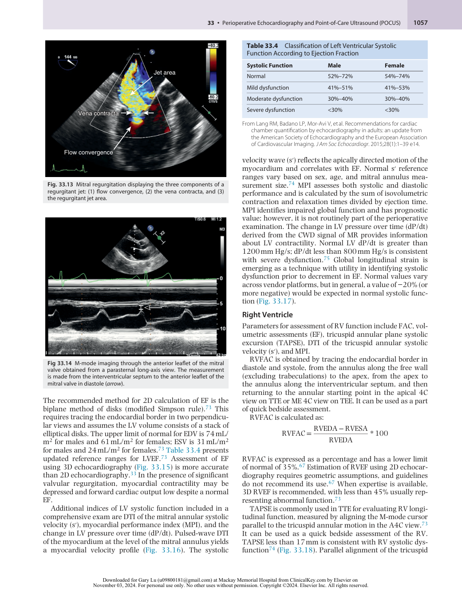

:::

<!-- PDF page 19 -->

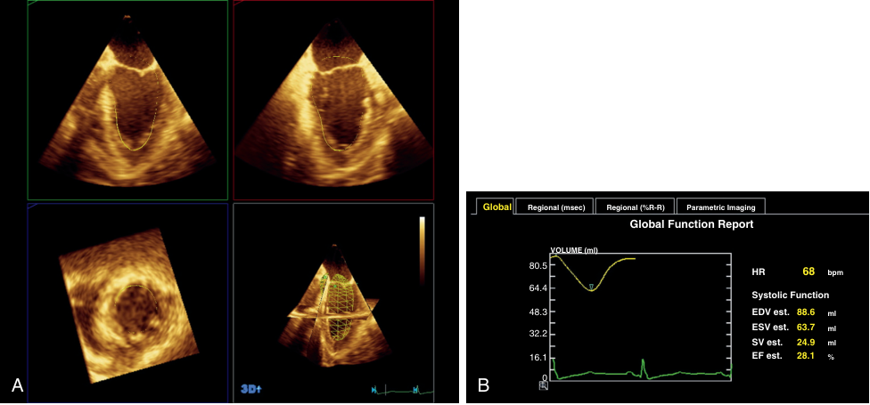

Global Regional (msec) Regional (%R-R) Parametric Imaging Global Function Report VOLUME (ml) 80.5 HR 68 bpm 64.4 Systolic Function 48.3 EDV est. 88.6 ml 32.2 ESV est. 63.7 ml SV est. 24.9 ml 16.1 EF est. 28.1 % A B 0 

**Fig. 33.15 Three- dimensional (3D) transesophageal echocardiographic measurement of left ventricular ejection fraction.** (A) A full- volume data set of the left ventricle is displayed using multiplanar reconstruction. After manual tracing of the endocardial borders at end- diastole and endsystole in the planes displayed in the top two panels, a semi- automated endocardial border detection algorithm tracks the borders in the remaining frames. (B) The _yellow line_ displays the left ventricular volume over the duration of the cardiac cycle. Measurements reported include end- diastolic volume, end- systolic volume, stroke volume, and ejection fraction. Segmental changes in volume over the course of the cardiac cycle can also be displayed.

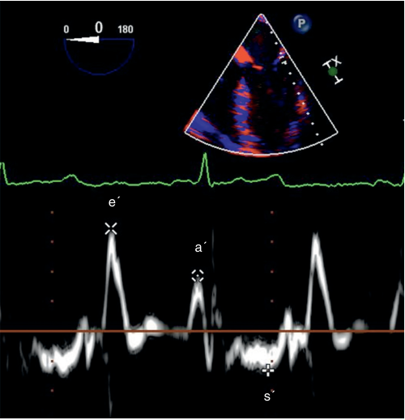

e´ a´ s´ 

**Fig. 33.16 Spectral Doppler tissue imaging obtained at the lateral mitral annulus in the midesophageal four- chamber view.** The systolic waveform (s′) corresponds to the systolic tissue velocity. The two diastolic waveforms correspond to the early diastolic tissue velocity (e′) and the late (atrial) diastolic tissue velocity (a′). When obtained using TEE, s′ is a negative waveform (directed away from the transducer), while e′ and a′ are positive waveforms. Transthoracic acquisition of mitral annular velocity is performed in the apical four- chamber view. In TTE acquisition, the s′ waveform is positive, while e′ and a′ are negative.

annulus with the M- mode cursor is difficult in TEE, and ME 4C measurements of TAPSE correlate poorly with TTE measurements.75 Alternative methods for measuring tricuspid annular motion with TEE have been explored. Anatomic M- mode measurements in ME 4C and DTG 4- chamber

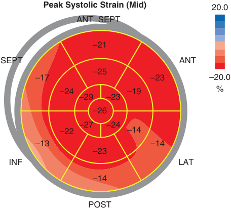

Peak Systolic Strain (Mid) 20.0 ANT_SEPT –21 SEPT ANT –25 –17 –23 –20.0 –19 % –24 –29 –23 –26 –27 –24 –22 –14 –13 –14 –23 INF LAT –14 POST 

**Fig. 33.17 A transthoracic “bulls- eye” plot of speckle tracking– derived global longitudinal strain obtained with transthoracic echocardiography.** The image depicts the 17 segments of the left ventricle and the peak segmental systolic strain for each segment. The _dark red areas_ represent normal strain, while the _light red and pink areas_ represent abnormal strain. The average global longitudinal strain in this example is normal (−20.8%, not displayed in the image).

0- degree views demonstrate agreement with TTE TAPSE.76 TEE speckle tracking of tricuspid annular motion has also been demonstrated to correlate well with TTE TAPSE77 ; whether this will have practical perioperative applications requires further investigation. Reduction in TAPSE following cardiac surgery is well described. Whether reduced TAPSE reflects a true decrement in RV systolic function or rather geometric alteration from pericardiotomy remains controversial.78,79

An s′ of less than 9.5 cm/s is consistent with RV dysfunction, but like TAPSE is an index of longitudinal excursion

<!-- PDF page 20 -->

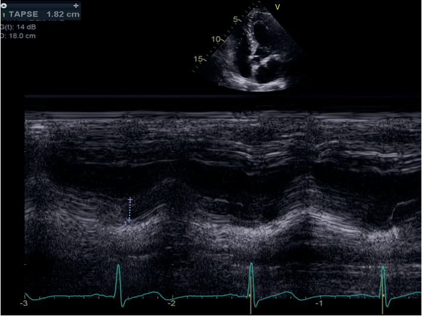

V + 1+ 

**Fig. 33.18** Tricuspid annular plane systolic excursion (TAPSE) measurement from M- mode through the lateral annulus of the tricuspid valve from an apical four-chamber view.

and may be reduced after cardiac surgery. A right ventricular myocardial performance index (MPI) of greater than 0.43 by pulsed- wave Doppler (PWD) or greater than 0.54 by DTI reflects abnormal RV function.73 RV strain and strain rate are emerging as prognostic parameters in the cardiology literature, but reference values are vendor specific, and measurements are not yet routinely part of the perioperative examination.

### Diastolic Function as Part of Limited and Comprehensive Exam

Many complex interactions contribute to ventricular filling during diastole, but the echocardiographer should have a basic understanding of diastolic physiology and the progression of LV filling abnormalities along a continuum of impaired relaxation and decreased compliance. Myocardial relaxation primarily affects LV filling during early diastole (isovolumetric relaxation and early rapid filling), whereas the effects of ventricular compliance predominate in late diastole (diastasis and atrial contraction).

Transmitral PWD flow patterns reflect changes in LV filling and are used to characterize the stages of diastolic dysfunction. Two waveforms correspond to early rapid filling (E wave) and atrial contraction (A wave), respectively (Fig. 33.19). The E:A ratio changes with progressive diastolic dysfunction (Fig. 33.20), and traditionally, other parameters such as isovolumetric relaxation time, deceleration time, pulmonary venous flow profiles, and propagation velocities have provided supportive information when grading diastolic dysfunction. Under normal conditions, most ventricular filling occurs during early diastole (resulting from relaxation and suction forces), and the E:A is ratio greater than 1. Grade 1 diastolic dysfunction manifests as _impaired relaxation_ with decreased early diastolic filling and a compensatory increase in late diastolic filling (E &lt; A). Relaxation remains impaired in more advanced degrees

of diastolic dysfunction. In grade 2 diastolic dysfunction _(pseudonormal pattern)_ , decreasing LV compliance leads to a rise in LV end- diastolic pressure (LVEDP). Ultimately an increase in left atrial pressure (LAP) increases driving pressures across the mitral valve, increasing early filling, and “normalizing” the E:A ratio. With progression to a _restrictive_ pattern (grade 3 dysfunction), markedly decreased LV compliance and significantly elevated LVEDP and LAP result in very elevated peak E- wave velocity (E:A >2) and rapid equilibration of LV and LAPs.

DTI is an important technique for evaluating diastolic function. DTI of mitral annular myocardial velocities produces two diastolic waveforms: e′ (early diastolic tissue velocity) and a′ (late diastolic tissue velocity), as shown in Fig. 33.16. Preload conditions have less effect on e′ than on the transmitral E wave. DTI e′ is reduced when impaired relaxation is present, making this a useful parameter for assessing whether diastolic dysfunction is present or absent. Much has been published about site of measurement (septal vs. lateral vs. averaged) and corresponding normal thresholds. A lateral e′ velocity of 10 cm/s or greater virtually excludes diastolic dysfunction (pericardial constriction being an exception). The E:e′ ratio provides information about LV filling pressures: usually filling pressures are normal when the average E:e′ is less than 8, whereas average E:e′ greater than 14 usually reflects elevated filling pressures. However, many factors limit the interpretation of e′, including mitral stenosis, significant mitral annular calcification, mitral valve prosthesis or ring, left bundle branch block, ventricular pacing, and significant MR.80

Updated ASE guidelines address the perceived complexities of diastolic function assessment and propose a simplified approach to evaluation. In patients with preserved EF, four parameters should be assessed initially: e′, E:A ratio, left atrial volume index, and peak tricuspid jet annular velocity.81 These updates reflect an appreciation that increased

<!-- PDF page 21 -->

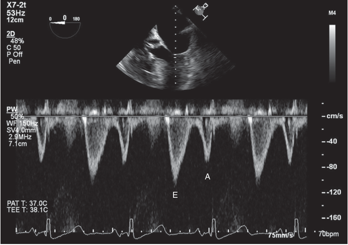

A E 

**<mark>Fig. 33.19</mark>** <mark>Transmitral pulsed- wave Doppler prof</mark> i <mark>le demonstrating the peak early f</mark> i <mark>lling (E- wave) and f</mark> l <mark>ow due to atrial contraction (A- wave).</mark>

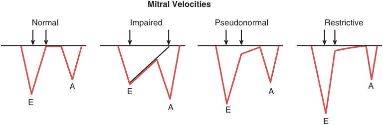

Mitral Velocities Normal Impaired Pseudonormal Restrictive A A E A E A E E 

**Fig. 33.20** Line drawings representing simultaneous transesophageal pulsed- wave Doppler recordings from the mitral annulus are shown for normal, impaired, pseudonormal, and restrictive left ventricular diastolic function. The _black arrows_ mark the deceleration time of early filling, which is the interval between the peak E velocity and the point where the deceleration slope intersects the baseline. (Modified from Desjardins G. Perioperative echocardiography. In: Miller R, ed. _Miller’s Anesthesia_ . 8th ed. Philadelphia, PA: Elsevier/Saunders; 2015:1396–1428. Fig. 46.32.)

left atrium (LA) size serves as a marker of chronically elevated LVEDP. In patients with reduced EF, characterization of diastolic dysfunction begins with transmitral E:A ratio. These updated guidelines may not be generalizable to the perioperative period, and moreover, TEE cannot reliably assess LA size. There are several algorithms relevant to the perioperative period that can be referenced for a more indepth review of diastolic dysfunction.82–84

### VALVULAR FUNCTION

### Stenosis

Aortic and mitral stenosis are the most common stenotic lesions in the perioperative setting. Fundamental to the quantitative evaluation of valvular stenosis is Doppler echocardiography. Two key concepts underlying Doppler hemodynamic measurements are the continuity principle and the pressure–velocity relationship (see Hemodynamic Measurements, below). Recommended parameters for the assessment of aortic stenosis include peak aortic velocity, mean transvalvular gradient, and valve area calculation by continuity equation (Table 33.5).85 Dimensionless index

and 3D planimetry corroborate findings obtained by recommended methods. Discordant grading of aortic stenosis by valve area and mean gradient requires additional evaluation of LV function, stroke volume (SV), and assessment of flow reserve. Recommended parameters for assessing mitral stenosis include gradient measurements, planimetry, and pressure half- time.86 The continuity equation and the proximal isovelocity surface area (PISA) method may be used for additional information.

Limitations exist with quantitative methods. Geometric assumptions made when using the continuity equation may lead to an underestimation of calculated valve area. Loading conditions impact flow, and as a result, impact peak velocities and calculated pressure gradients. Under general anesthesia, gradients may underestimate the severity of stenosis. In high- flow states, elevated gradients may reflect high cardiac output.

### Regurgitation

The vena contracta is the narrowest portion of a regurgitant jet at or downstream of the regurgitant orifice. The vena contracta width is a semiquantitative parameter for

<!-- PDF page 22 -->

1061 

**Table 33.5** Parameters for Evaluating Severity of Aortic Stenosis

||**SE**|**VERITY OF STEN**|**OSIS**|
|---|---|---|---|
|**Parameter**|**Mild**|**Moderate**|**Severe**|
|Peak velocity (m/s)|2.6–2.9|3.0–4.0|≥4.0|
|Mean gradient (mm Hg)|&lt;20|20–40|≥40|
|AVA (cm2)|>1.5|1.0–1.5|&lt;1.0|
|Indexed AVA (cm2/m2)*|>0.85|0.6–0.85|&lt;0.6|

*In patients with small body size, aortic valve area (AVA) should be indexed to body surface area. A small valve area in a small patient may only represent moderate stenosis. Indexing to very large body surface area is controversial. Adapted from: Baumgartner H, Hung J, Bermejo J, et al. Recommendations on the echocardiographic assessment of aortic valve stenosis: a focused update from the European Association of Cardiovascular Imaging and the American Society of Echocardiography. _J Am Soc Echocardiogr_ . 2017;30(4):372–392.

grading regurgitation severity, with cutoff values differing between valves. Pulsed- wave interrogation of flow patterns provides additional semiquantitative information. Pulmonary vein systolic flow reversal is specific for severe mitral regurgitation (MR) and hepatic vein systolic flow reversal is specific for severe tricuspid regurgitation (TR).68 Holodiastolic flow reversal in the descending aorta with velocities sustained above 20 cm/s is specific for severe aortic insufficiency.

Quantitative methods for grading regurgitation include calculation of regurgitant volume, regurgitant fraction, and effective regurgitant orifice area (EROA). Approaches include the stroke volume method, ventricular volumetric method, and the PISA method. The radius of the previously mentioned flow convergence region is included in the PISA calculation. The details of these approaches are beyond the scope of this chapter. 3D echocardiography allows for measurement of vena contracta area, which may be advantageous in the case of multiple jets or noncircular regurgitant orifices.

(with a squaring of any error when calculating the crosssectional area), poor Doppler alignment with the blood flow, and measurement of the area and velocity measurements at different anatomic locations. Many studies in surgical and ICU patients have compared Doppler- derived cardiac output (CO) to CO by thermodilution. Some authors interpret the literature to indicate Doppler- derived measurements have good agreement with CO by thermodilution.87 Other authors, however, highlight the methodologic limitations and heterogeneity of studies, and argue echocardiographic and thermodilution- derived CO cannot be used interchangeably.88 Stronger evidence supports the use of echocardiographic- derived CO for assessing trends over time.88

### Continuity Principle

The continuity principle states that flow rate proximal to a restricted orifice equals the flow rate through the orifice. Applying this principle to pulsatile intracardiac flow, the stroke volumes proximal to (SV1) and at a restricted orifice (SV2) are the same.

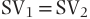

SV1 = SV2 

and therefore

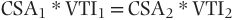

CSA1 * VTI1 = CSA2 * VTI2 

Common clinical applications of this equation include calculation of stenotic valve areas, prosthetic valve areas, and regurgitant orifice areas.

### Bernoulli Equation

Pressure cannot be measured directly using echocardiography; however, applications of the Bernoulli principle allow for estimation of gradients from velocity information (Fig. 33.22). This technique is commonly applied to quantify the severity of stenosis. The modified Bernoulli equation estimates the transvalvular pressure gradient (Δ _P_ ) as follows:

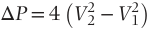

Δ P  = 4 ( V 2 2 − V 2 1) 

### HEMODYNAMIC MEASUREMENTS

### Cardiac Output

Doppler- based methods can be used to estimate SV and cardiac output (Fig. 33.21). These are easy to obtain and can be performed with either point- of- care TTE or TEE.

Volumetric flow or SV can be calculated as a cylindrical volume as follows:

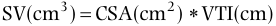

3 2 SV(cm )  CSA(cm )  VTI(cm) 

where CSA is the cross- sectional area through which the blood flows and VTI is the velocity time integral of blood flow at that location. The VTI represents the distance the average blood cell travels during one cardiac cycle and is the area under the spectral Doppler envelope. Cardiac output is the product of SV and heart rate.

Cardiac output calculation is typically performed at the LV outflow tract (LVOT). The diameter is measured in the ME AV LAX view using TEE and the parasternal LAX view using TTE. The LVOT VTI is obtained in the Deep TG LAX using TEE and the A5C using TTE. Potential sources of error include inaccurate measurement of the LVOT diameter

where _V_ 2 represents the peak velocity at the valve obtained by continuous- wave Doppler across the aortic valve and _V_ 1 represents the peak velocity just proximal to the valve acquired by pulsed- wave Doppler. _V_ 1 is usually much lower than _V_ 2 and can be ignored, simplifying the equation to:

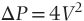

Δ P  = 4 V 2 

If _V_ 1 exceeds 1.5 m/s it should be included in the calculation.85

### Intracardiac Pressure Estimates

**Right Atrial Pressure.** In spontaneously breathing individuals, right atrial pressure (RAP) can be estimated from the inferior vena cava (IVC) diameter and collapsibility of the IVC during inspiration (“sniff” maneuver) and often used in POCUS. The IVC collapsibility index (cIVC) is defined as:

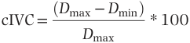

cIVC = ( D max − D min) * 100 D max 

where _D_ max is the maximum diameter on expiration and _D_ min is the minimum diameter on inspiration. Table 33.6

::: details 原始表格與符號（PDF 第 22 頁）

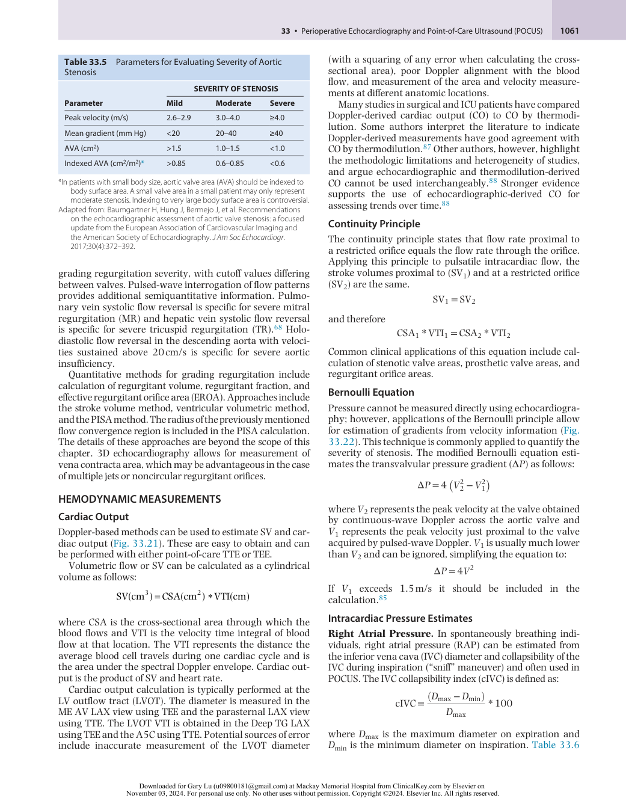

:::

<!-- PDF page 23 -->

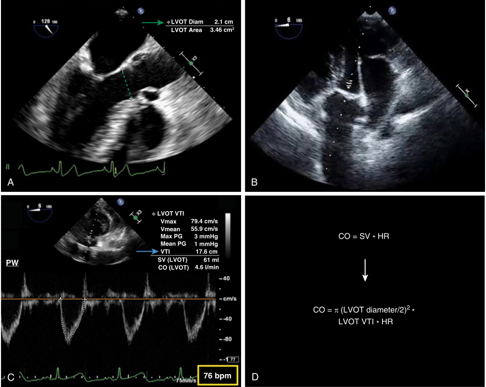

A B PW C 76 bpm D 

**Fig. 33.21 Calculation of cardiac output (CO) using transesophageal echocardiography.** (A) The left ventricular outflow tract (LVOT) diameter is measured in the midesophageal aortic valve long-axis view. The cross- sectional area (CSA) of the LVOT is assumed to be circular, and is calculated as: LVOT CSA = π (LVOT diameter/2)2 . In this example, LVOT CSA = π (2.1/2)2 . (B) Velocity of blood flow through the LVOT is measured using pulsed- wave Doppler in the deep transgastric view. The velocity and diameter measurements should be performed at the same anatomic location. (C) The spectral envelope is traced to determine the area under the curve, which is equal to the velocity time integral (VTI). This represents the distance the column of blood travels with each beat and is sometimes referred to as “stroke distance.” Stroke volume (SV) is the product of the cross- sectional area of the LVOT and the LVOT VTI, or SV = LVOT CSA × LVOT VTI. Hence, in this example, SV = π (2.1/2)2 × 17.6 (D) CO is derived by multiplying the SV by heart rate (HR), or CO = π (LVOT Diameter/2)2 × LVOT VTI × HR therefore, for this example, CO = π (2.1/2)2 × 17.6 × 76. In the example provided, the machine is configured to automatically calculate stroke volume and cardiac output as displayed in (C).

presents a simplified approach to estimating RAP using IVC diameter and cIVC recommended by Rudski and associates.67 In cases of intermediate RAP estimates, it is recommended to use secondary indices of elevated RAP to downgrade or upgrade the estimate.67

**Chamber Pressures.** Velocity measurements of valvular regurgitation or shunt can be used to estimate chamber pressures using the simplified Bernoulli equation. The pressure gradient (Δ _P_ ) reflects the pressure difference between the chamber where blood flow originates and blood flow is received. This is expressed as:

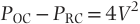

P OC − P RC = 4 V 2 

where _P_ OC is the pressure in the originating chamber and _P_ RC is the pressure in the receiving chamber. The equation can then be rearranged to:

P OC = 4 V 2 +  P RC 

A common application is estimation of pulmonary artery systolic pressure (PASP) from the maximal tricuspid regurgitant jet velocity (Fig. 33.23). Pulmonary hypertension is defined as a mean pulmonary arterial pressure (mPAP) of 20 mm Hg or greater, which corresponds to a PASP of 30 mm Hg. mPAP can be estimated from PASP as follows: mPAP = (0.61 × PASP) + 2 mm Hg.89 Alternatively, mPAP can be estimated using the simplified Bernoulli equation and the peak velocity of pulmonary regurgitation.

## Hemodynamic Failure and Shock

Hemodynamic instability and circulatory failure may occur at any phase in a patient’s perioperative care, and echocardiography provides valuable information to both the

<!-- PDF page 24 -->

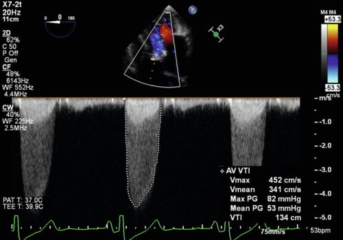

**Fig. 33.22** The transvalvular pressure gradient across a stenotic aortic valve is estimated using continuous- wave Doppler in the transesophageal deep transgastric view. The peak gradient is derived from the peak velocity of the spectral Doppler signal using the simplified Bernoulli equation. The mean gradient is the average of the instantaneous peak gradients throughout systole and is obtained by tracing the Doppler envelope. The ultrasound system will automatically calculate the mean pressure gradient from the tracing. The measurements in this example are consistent with severe aortic stenosis.

**Table 33.6** Echocardiographic Estimation of Right Atrial Pressures*

||**Estimated RAP**|**IVC Diam**|**eter**|
|---|---|---|---|
|**RAP**|**(Range) (mm Hg)**|**(cm)**|**cIVC**|
|Normal|3 (0–5)|≤2.1|>50%|
|Intermediate|8 (5–10)|≤2.1|&lt;50%|
|Intermediate|8 (5–10)|>2.1|>50%|
|Elevated|15 (10–20)|>2.1|&lt;50%|

*In spontaneously breathing individuals. In the case of intermediate estimates, the presence or absence of secondary indices of elevated RAP can be used to better characterize the pressure estimate. _cIVC,_ IVC collapsibility index (see text for definition); _IVC,_ inferior vena cava; _RAP,_ right atrial pressure.

As proposed by/adapted from Table 3 in Rudski LG, Lai WW, Afilalo J, et al. Guidelines for the echocardiographic assessment of the right heart in adults: a report from the American Society of Echocardiography endorsed by the European Association of Echocardiography, a registered branch of the European Society of Cardiology, and the Canadian Society of Echocardiography. _J Am Soc Echocardiogr_ . 2010;23(7):685–713; quiz 786–788.

anesthesiologist and intensivist. Echocardiography enables characterization of the mechanism of shock (cardiogenic, hypovolemic, distributive, and/or obstructive)90 and can be used for serial assessment of response to therapies.91 Most clinicians will apply qualitative techniques during echocardiographic assessment; quantitative approaches also add valuable information when used by appropriately trained individuals.

### VENTRICULAR DYSFUNCTION

Qualitative evaluation of biventricular systolic function is central to identifying the etiology of shock or hemodynamic instability. As previously mentioned, visual estimation of LVEF by experienced individuals correlates well with

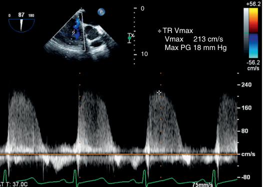

0 TR Vmax Vmax     213 cm/s Max PG 18 mm Hg 10 

**Fig. 33.23** A midesophageal modified bicaval view aligns the Doppler cursor with the tricuspid regurgitant jet. Continuous wave Doppler measures the peak systolic velocity of the tricuspid regurgitation (VTR). VTR reflects the difference between the right ventricular systolic pressure (RVSP) and right atrial pressure (RAP), so RVSP = 4 VTR2 + RAP. In the absence of right ventricular outflow tract obstruction or pulmonary stenosis, RVSP and pulmonary artery systolic pressure (PASP) are essentially equal. In this example, the estimated PASP = 18 mm Hg + RAP.

quantitative methods,61 and can be learned easily with proper feedback.92 A POCUS examination should identify whether significant myocardial dysfunction is present. Further assessment may suggest myocardial stunning or ischemia, especially if in a segmental distribution or acute onset. This is not without limitations, however, as acute decreases in preload can cause new RWMAs in the absence of ischemia.93

Echocardiography allows evaluation of LV morphology and segmental wall motion, right ventricular involvement, and complications such as MR, LVOT obstruction, intracardiac thrombus, and cardiac rupture.94

### SEVERE HYPOVOLEMIA

Hypovolemia leads to a decrease in LV end- diastolic area (EDA) and end- systolic area (ESA), but at baseline there is wide variability in the normal ranges.95 For practical purposes, qualitative assessment of chamber size provides the most useful information if monitored serially in the OR or in the setting of significant hypovolemia, where EDA will be markedly reduced. It is important to distinguish hypovolemia from distributive shock, where ESA is also decreased but the EDA area will be normal.96 End- systolic cavity obliteration (sometimes described as “kissing walls”) is frequently associated with decreased EDA and hypovolemia but may also occur in high inotropic or vasodilatory states.95

As previously described, IVC diameter and cIVC can be used to estimate the RAP in spontaneously breathing individuals.66 Central venous pressure, however, is a poor predictor of fluid responsiveness.97 Whether cIVC predicts fluid responsiveness during spontaneous ventilation is an area of active debate,98,99 and has been examined in several studies.100–105 In many instances, spontaneously breathing patients with cIVC of more than 40% to 50% will respond to fluid administration,100,103,105 but this is not found consistently,101,102 and does not necessarily identify

::: details 原始表格與符號（PDF 第 24 頁）

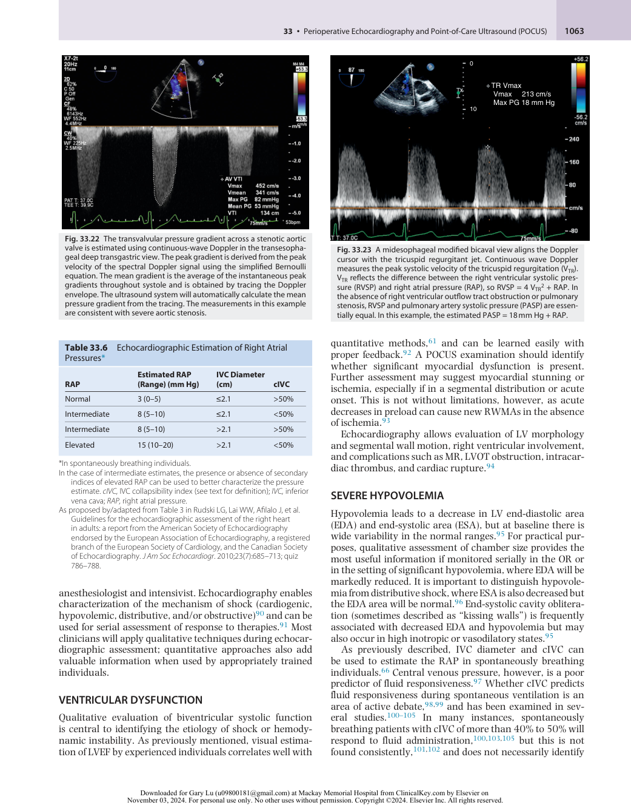

:::

<!-- PDF page 25 -->

nonresponders.100,103 We would encourage the reader to read the primary literature to gain a more in- depth understanding of the topic prior to attempting to use cIVC in the assessment of hypovolemia.

Predictors of fluid responsiveness applicable in patients who undergo passive mechanical ventilation, typically in the setting of critical illness, are covered in the Critical Care section of this chapter.

### LEFT VENTRICULAR OUTFLOW TRACT OBSTRUCTION

LVOT obstruction may precipitate significant hemodynamic compromise, creating a perplexing scenario of worsening instability despite aggressive inotropic resuscitation. LVOT obstruction and systolic anterior motion (SAM) of the mitral valve are classically associated with hypertrophic cardiomyopathy. In the perioperative setting, LVOT obstruction and SAM often occur following mitral valve repair. The presence of LVOT obstruction in other susceptible populations is likely underappreciated, and probably results from a combination of anatomic predisposition and precipitating hemodynamic factors associated with enhanced LV contractility (hypovolemia, hyperkinesis, inotropes). Anatomic factors include small LV cavity, basal septal hypertrophy, and an anteriorly displaced mitral valve coaptation zone with redundant leaflet tissue.106 One series observed LVOT obstruction in over 20% of patients admitted in septic shock, and the presence of LVOT obstruction was associated with higher mortality.107 SAM was present in only two- thirds of the cases of LVOT obstruction, underscoring the complex mechanisms leading to clinically relevant obstruction. In a series of perioperative rescue echocardiograms, LVOT obstruction was present in 3.6% of cases.108

LVOT obstruction produces high- velocity flow in the LVOT. Interrogation of the LVOT with CFD reveals flow acceleration and turbulence. Blood flow velocity exceeds the Nyquist limit of PWD, so CWD is required for quantification. Visual assessment of CFD and gradual movement of the PW sampling volume through the LV cavity and LVOT can be used to estimate the location of the obstruction. In the presence of LVOT obstruction, the spectral Doppler profile of systolic blood flow across the LVOT is dagger- shaped and mid- to- late peaking (Fig. 33.24). The M- mode of the aortic valve will demonstrate premature leaflet closure during mid- systole (Fig. 33.25B). Findings consistent with SAM include anterior displacement of the mitral leaflet during systole with entrainment in the LVOT (Fig. 33.26; Video 33.6). Variable degrees of MR may be present.

### CARDIAC TAMPONADE

Echocardiography readily detects pericardial fluid, which appears as an echolucent space adjacent to the heart (PSAX or PLAX on TTE and ME 4 and TG SAX view on TEE) and readily identified with a POCUS exam. The physiologic significance of a pericardial effusion depends on both the volume and rate of accumulation. A large effusion may develop slowly with minimal consequence, whereas a rapidly accumulating effusion of small volume can have profound hemodynamic impact. Cardiac tamponade develops

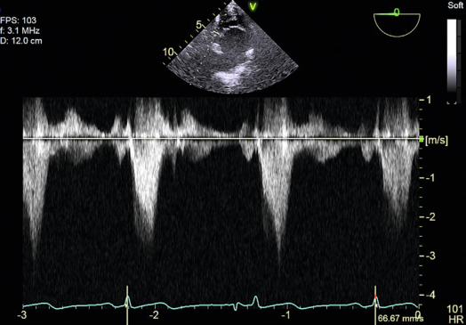

**Fig. 33.24 A continuous- wave Doppler signal characteristic of left ventricular outflow tract obstruction.** The signal appears “daggershaped,” with the peak velocity occurring in mid- to- late systole. In the perioperative setting, obstruction may be dynamic and unmasked by precipitating factors in susceptible individuals.

when intrapericardial pressure exceeds cardiac chamber pressures, thereby compressing the cardiac chambers. This impairs chamber filling, ultimately compromising cardiac output. Hemodynamic effects of tamponade occur along a continuum.109

Echocardiographic findings can support the diagnosis of cardiac tamponade in the context of relevant clinical findings. When intrapericardial pressure exceeds cardiac chamber pressures, chamber collapse may occur during the respective relaxation phases. The right atrium typically has the lowest pressure and usually is the first chamber to show collapse or inversion (sensitivity of 50%–100%),110 which is observed in ventricular systole (Fig. 33.27A; Video 33.7).111,112 Importantly, transient right atrial collapse may be present in the absence of tamponade, and therefore is a nonspecific finding (33%–100%).110,113 A longer duration of atrial collapse improves the specificity of this finding.111 RV diastolic collapse (Video 33.8; see Fig. 33.27B) occurs later than right atrial collapse in the progression of tamponade and is a more specific finding (75%–90%) but lower sensitivity of 48%–60%.114,115 In a series of patients with moderate or large pericardial effusions, the absence of any right- sided chamber collapse had a high negative predictive value for clinical tamponade.113,116 Collapse of right heart chambers may not occur in settings where baseline right- sided pressures are elevated, such as in patients with pulmonary hypertension. Following cardiac surgery, echocardiographic findings in the setting of tamponade may be atypical, including localized compression of cardiac chambers and accumulation of clot, and other classic findings that support a diagnosis of cardiac tamponade that relate to respiratory changes in blood flow are complicated by positive pressure ventilation.

### PULMONARY EMBOLISM

Acute pulmonary embolism (PE) is classified into three subgroups: high risk (massive), intermediate risk (submassive), and low risk.117,118 The presence of sustained hypotension

<!-- PDF page 26 -->

Video 33.6 Systolic anterior motion of the mitral valve (SAM). The anterior mitral leaflet is visualized entering the left ventricular outflow tract and contacting the interventricular septum during systole. Turbulent flow is visualized in the left ventricular outflow tract (LVOT) and significant mitral regurgitation (MR) is present. Treatment of SAM includes discontinuation (or avoidance) of inotropes, increasing preload, increasing afterload, and decreasing the heart rate. With therapeutic interventions, the SAM decreases, there is less turbulence in the LVOT, and the MR decreases.

Video 33.7 Tamponade – right atrial systolic collapse. A large echolucent pericardial effusion is demonstrated (*). Within the effusion, there are areas of increased density suggesting organization. Right atrial collapse ( _blue arrow_ ) during ventricular systole supports the clinical diagnosis of tamponade. _LA_ , left atrium; _LV_ , left ventricle; _RA_ , right atrium; _RV_ , right ventricle.

Video 33.8 Tamponade – right ventricular diastolic collapse. Transthoracic parasternal long- axis views displaying a large pericardial effusion (*). Right ventricular diastolic collapse ( _green arrow_ ) is present, and supports the clinical diagnosis of tamponade. Left atrial collapse during ventricular systole, often observed later than right- sided chamber collapse, is also present ( _red arrow_ ). _Ao_ , ascending aorta; _IVS_ , interventricular septum; _LA_ , left atrium; _LV_ , left ventricle; _RVOT_ , right ventricular outflow tract.

<!-- PDF page 27 -->

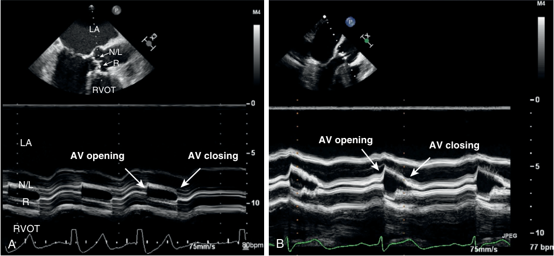

LA N/L R RVOT LA AV opening AV closing AV opening AV closing N/L R RVOT A B 

**Fig. 33.25 M- mode interrogation of the aortic valve (AV) in the midesophageal aortic valve long- axis view.** The cursor passes through the left atrium (LA), posterior aortic root, the non- or left coronary cusp (N/L), the right coronary cusp (R), the anterior aortic root, and the right ventricular outflow tract (RVOT). (A) In the absence of obstruction to flow (or other aortic valve pathology), the motion of the aortic valve leaflets during systole creates a rectangular shape. (B) In the presence of left ventricular outflow tract obstruction, the aortic valve opens normally, but closes prematurely.

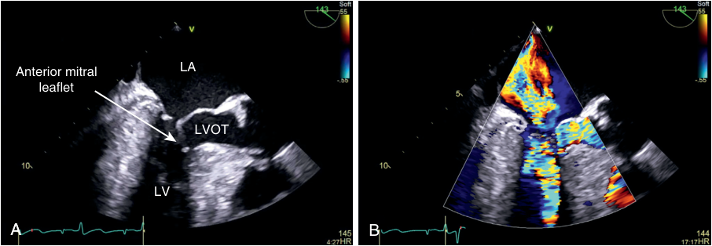

Anterior mitral LA leaflet LVOT LV A B 

**Fig. 33.26** Midesophageal long- axis views without (A) and with color (B) demonstrating systolic anterior motion of the mitral valve (SAM). (A) Instead of coapting normally, the anterior mitral leaflet ( _arrow_ ) moves into the left ventricular outflow tract (LVOT) during systole. This narrows the effective outflow tract and can lead to dynamic obstruction to flow. (B) Turbulent flow is visualized by color Doppler in the LVOT. In this example, there is significant mitral regurgitation associated with SAM. _LA_ , left atrium; _LV_ , left ventricle.

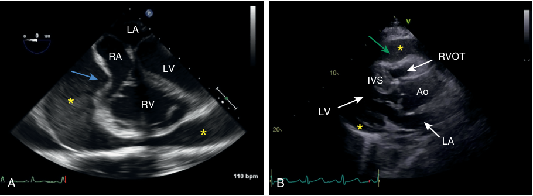

LA * RA RVOT LV IVS Ao * RV LV * * LA A B 

**Fig. 33.27 Echocardiographic features supporting the clinical diagnosis of tamponade.** (A) Transesophageal midesophageal four- chamber view demonstrating a large echolucent pericardial effusion (*). Right atrial collapse ( _blue arrow_ ) is present during ventricular systole (note the _red marker_ on the ECG tracing after the R- wave). (B) Transthoracic parasternal long- axis view also demonstrating a large pericardial effusion (*). Right ventricular collapse ( _green arrow_ ) during diastole is present (note the _red marker_ on the p- wave of the ECG tracing). Right ventricular collapse is more specific for tamponade than right atrial collapse. _Ao_ , ascending aorta; _IVS_ , interventricular septum; _LA_ , left atrium; _LV_ , left ventricle; _RA_ , right atrium; _RV_ , right ventricle; _RVOT_ , right ventricular outflow tract.

<!-- PDF page 28 -->

or shock (not explained by other causes) defines massive PE. Patients with intermediate- and low- risk PE by definition are normotensive. The groups are further delineated according to RV dysfunction, myocardial injury, and other clinical features. When PE is suspected, the recommended first- line imaging modality is computed tomography angiography (CTA).118 Echocardiography, in contrast, is not recommended in the initial diagnostic evaluation of PE.119 When the diagnosis of PE is established, echocardiography has utility in risk stratification, prognostication, and response to therapy.118,120

In cases of suspected PE with hemodynamic instability or shock, obtaining a CTA may not be feasible. In this context, echocardiography has a role in refining the diagnostic assessment and management decisions.118,121 Most cardiac signs of PE are indirect. Freely mobile intracardiac thrombus, or “clot in transit,” is visualized rarely on echocardiography (&lt;4% of cases), but more commonly in highrisk PE (22%) and is associated with worse prognosis.122 Indirect signs of PE include RV dilation, RV dysfunction, and the 60/60 sign, which is a pulmonary ejection acceleration time of less than 60 ms with a mid- systolic notch and a TR peak gradient between 30 and 60 mm Hg.120 Several parameters may be used to assess RV dysfunction, including “McConnell’s sign,” TAPSE, increased end- diastolic RV- to- LV diameter ratio (≥0.9 or 1.0), and interventricular septal flattening during systole, indicative of pressure overload.118,120

Myocardial deformation as a marker of RV dysfunction is not widely used but is an area of investigation.120,123

“McConnell’s sign” is an echocardiographic finding of RV hypokinesis or akinesis with apical sparing (Video 33.9). It can be obtained as a part of FoCUS. It was originally reported as having a high sensitivity and specificity for acute PE124 ; however, several subsequent studies have demonstrated this finding to lack sensitivity.125 The absence of McConnell’s sign does not exclude acute PE. In many populations, McConnell’s sign is highly specific. Important exceptions include patients with RV infarction126 or pulmonary hypertension,123 where McConnell’s sign may be observed in the absence of acute PE (i.e., a nonspecific finding).

Few studies focus specifically on echocardiographic findings in the high- risk subgroup. However, in a series of 511 patients with confirmed PE, 16 of the patients met high- risk criteria.127 Interestingly, all 16 patients had RV enlargement and hypokinesis, and at least one of the following: McConnell’s sign, 60/60 sign, or right heart thrombus. Flattened interventricular system, RV free wall hypokinesis plus an RV- to- LV diameter ratio greater than 0.9, McConnell’s sign, and right heart thrombus were observed significantly more frequently in patients with high- risk PE than those without.

Recent work has sought to better define the diagnostic utility of echocardiography in PE (including all risk categories), especially in light of the increasing use of point- of- care ultrasound. A meta- analysis of both formal and point- ofcare TTE examinations in patients with clinical concern for PE but normal vital signs found that echocardiographic signs of right heart strain had a sensitivity of 53% and a specificity of 83%.125 In the previously mentioned series of

511 patients, over one- third of the non- high- risk patients demonstrated completely normal RV morphology and function.127 A recent study showed that the presence of any of the following five signs – McConnell’s sign, abnormal TAPSE, septal flattening, RV enlargement, or tricuspid regurgitation – was 100% sensitive in a patient with tachycardia of >110 beats/min and 83% sensitive if the patient had a heart rate of &lt;100 beats/min.128

### POINT- OF- CARE ULTRASOUND PROTOCOLS FOR SHOCK AND CARDIAC ARREST

The RUSH exam (Rapid Ultrasound for Shock and Hypotension) was developed by Weingart for a quick point- of- care assessment of hypotensive patients to enable expedited diagnosis and treatment.129 The exam includes focused cardiac exam and IVC views (as discussed previously), E- FAST exam (discussed later), rapid scanning of the descending aorta for dissection/aneurysm, and lastly pulmonary exam (discussed later) to rule out hypovolemia, abnormal contractility and RWMA, thrombi, PE, pneumo- or hemothorax, or pericardial effusion. A recent meta- analysis revealed that RUSH performed better when used to rule in causes of shock rather than specific etiologies and was most sensitive to rule out obstructive etiologies.130

POCUS CA (cardiac arrest) is the point- of- care focused ultrasound TEE/TTE to enable diagnosis of etiology of cardiac arrest, confirm quality of chest compressions, and quantify prognosis. Beckett _et al._ showed that the lack of cardiac activity on ultrasound after CA better predicts negative outcomes than ECG alone.131 The examination includes similar views to the RUSH exam but also includes Doppler ultrasound exam of femoral artery to assess for adequate cardiac output produced by chest compressions and for detecting a pulse.132 While some reports suggest POCUS may cause delay in onset of chest compressions, better incorporation into algorithms, practice, and regular training could help reduce any delays.

## Intraoperative Transesophageal Echocardiography – Noncardiac Surgery

In noncardiac surgery, TEE serves two main roles: an intraoperative monitor and a rescue tool. TEE has been used in diverse operative settings including vascular, orthopedic, and transplant surgery. A comprehensive review on the topic has been published by Mahmood and colleagues.133 The impact of TEE tends to be greater when it is used as a rescue tool versus as a monitor.134 The extent of the therapeutic impact is difficult to quantify, however, in part because interpretation of “impact” is not uniform. Supportive or confirmatory information adds substantial value in many contexts. Therapeutic modifications reported because of TEE findings include initiation of pharmacologic therapy, fluid administration, and alteration in anesthetic plan or surgical procedure.133 Continuation of patient management without changes may also be considered a relevant impact.

<!-- PDF page 29 -->

Video 33.9 McConnell’s sign is an echocardiographic finding of right ventricular hypokinesis or akinesis with apical sparing. The apparent preservation of apical contractility actually reflects translational motion due to tethering of the apical fibers to the left ventricle. McConnell’s sign may be observed in acute pulmonary embolism or right ventricular infarction. _IVS_ , interventricular septum; _RA_ , right atrium; _RV_ , right ventricle.

<!-- PDF page 30 -->

### MONITORING ROLE

### Myocardial Ischemia

Echocardiographic changes of myocardial ischemia manifest earlier than ECG changes, suggesting a potential role for TEE in the early detection of intraoperative ischemia. Current practice is to perform TEE monitoring selectively in patients with known risk factors or undergoing high- risk procedures. Early research demonstrated a 20% incidence of new or worsening RWMAs in high- risk patients.135 Intraoperative RWMAs were infrequently associated with postoperative myocardial infarction (MI) and overall complication rate was low. Another study in the 1990s concluded that changes detected by intraoperative TEE added little incremental value in predicting risk of postoperative ischemic outcomes (death, nonfatal MI, unstable angina) compared with preoperative data and two- lead ECG monitoring.136 The imaging capabilities of current transducers are vastly enhanced compared to those used in earlier decades and may not reflect TEE’s utility as a monitor of ischemia in the current era. A study of 54 high- risk patients undergoing vascular surgery demonstrated new RWMAs on intraoperative TEE in 43% of cases.137 Overall incidence of postoperative MI was 11%, and all patients with MI demonstrated intraoperative RMWAs. Intraoperative TEE was a sensitive indicator of risk for postoperative MI, although there still were a substantial number of patients with “false-positive” echocardiographic changes. Many questions surrounding the optimal use and potential impact of TEE as a monitor for ischemia in high- risk settings remain unanswered. In the absence of patientspecific or procedural risk factors, the routine use of TEE during noncardiac surgery to monitor for myocardial ischemia is not recommended.43

### Liver Transplantation

Hemodynamic management during orthotopic liver transplantation is complex, with frequent periods of instability from potentially numerous causes.138,139 At baseline, patients often have high cardiac output and low systemic vascular resistance with significant comorbidities. In the pre- anhepatic phase (from incision to occlusion of vascular inflow to the liver), hemodynamic alterations may result from an abrupt change in preload due to drainage of largevolume ascites, hemorrhage, or surgical caval compression. TEE examination during this phase allows for characterization of dynamic changes, as well as baseline evaluation of biventricular and valvular function. During the anhepatic phase (occlusion of inflow to the liver to unclamping of the portal vein), preload to the heart is decreased. If an end- toend interposition of the IVC is performed, complete caval occlusion is required and venovenous bypass may be used to improve preload and decrease venous congestion. A piggyback technique only requires partial caval occlusion and venous return to the heart is usually adequate without bypass. TEE findings of ventricular dysfunction, diminished cardiac output, hypovolemia, and intracardiac thrombi may be present regardless of the surgical technique. The reperfusion phase begins with release of the cross- clamp from the portal vein, resulting in infusion of cold, hyperkalemic, acidotic blood. Profound instability may result and even progress to cardiac arrest. TEE provides real- time

visualization of cardiac function and filling. Over 40% of liver transplant patients demonstrate evidence of inducible LVOT obstruction on preoperative dobutamine stress echocardiography,140 making this an important diagnosis to exclude in the setting of refractory hypotension. Inspection of the IVC for high- velocity or turbulent flow is also possible with TEE.

Esophageal varices are a relative contraindication to TEE and are a relevant concern in the liver transplant population. However, the reported rate of TEE complications in liver transplantation is low, even in patients with known esophageal varices or history of upper gastrointestinal bleeding. A recent review suggests TEE to be safe in patients without grade 3 varices or active gastrointestinal bleeding.139 Approaches to minimize risk include limited probe manipulation during the anhepatic phase and avoidance of TG and DTG views.

### Lung Transplantation

Intraoperative TEE provides key information in each phase of lung transplantation in a patient population with impaired cardiopulmonary reserve.141 Initial assessment includes evaluation for RV dilation, hypertrophy, and dysfunction, which result from long- standing pulmonary hypertension. Identification of a patent foramen ovale (PFO) may have clinical consequence if right- sided pressures exceed left- sided pressures, impacting the surgical plan. Common problems during one- lung ventilation and graft implantation include hypoxemia, hypercapnia, and elevated pulmonary vascular resistance, which may precipitate acute RV failure. Recognition of deteriorating RV function by TEE prompts initiation of inotropes or pulmonary vasodilators. Should profound instability result, TEE may provide information leading to initiation of cardiopulmonary bypass or help guide cannula placement for ECMO. After reperfusion, in addition to continued assessment of biventricular function, attention turns to the pulmonary artery anastomosis and the pulmonary veins142 for findings suggestive of kinking, thrombus, or stenosis.

### Vascular Surgery/Endovascular Procedures

Patients undergoing vascular procedures are at increased risk of perioperative cardiovascular morbidity and mortality. Applications of TEE in this setting include monitoring for ischemia, assessment of systolic and diastolic function, and guidance for fluid resuscitation. In open abdominal aortic aneurysm repair, significant increases in afterload and wall tension occur with application of the cross- clamp. After aortic occlusion, LVEF significantly decreases and EDV and ESV increase.143 New or worsening RWMAs have been reported in up to one- third of patients and occur more frequently with suprarenal versus infrarenal clamping.144 Persistent RWMAs after several hours have been associated with postoperative MI.144 With unclamping of vessels and ensuing instability, TEE serves as an adjunctive monitor as resuscitation proceeds. Over the past two decades, there has been a dramatic increase in endovascular repairs and a decline in open vascular procedures, consequently impacting the anticipated anesthetic concerns. Potential profound instability may be dramatically reduced, diminishing the value of intraoperative TEE in that context. However, TEE may be used to identify aortic pathology, identify the true

<!-- PDF page 31 -->

and false lumen in the setting of dissection, identify landing zones, and evaluate for endoleaks.133

### RESCUE ROLE

TEE used in the setting of unanticipated hemodynamic instability or cardiopulmonary arrest, also called “rescue” TEE, rapidly provides valuable information. Rescue TEE identifies causes of shock described earlier in the chapter (e.g., ventricular dysfunction, severe hypovolemia, LVOT obstruction, tamponade, and PE). Embolic phenomena relatively unique to the operative setting include air emboli during upright neurosurgical procedures and fat or cement emboli in orthopedic and spine surgeries.

Several series report the value of rescue echocardiography, describing its ability to identify a cause for instability or confirm expected diagnoses.145,146 TEE aided or impacted clinical management in the majority of the cases. Rescue TEE commonly implicates LV dysfunction and hypovolemia in instability, although no diagnosis occurs with enough frequency to be predictive without performing an echocardiographic examination. In fact, in one series the most frequent finding was a normal examination or demonstration of known pathology (48%).147 Despite a “negative” result, the TEE findings influenced management in more than half of these cases, suggesting the impact of TEE is not confined to cases demonstrating pathology. The largest reported study includes 364 rescue studies (96% TEE) performed throughout the perioperative period (55% intraoperatively).108 The most common findings intraoperatively were hypovolemia (32%) and LV dysfunction (11%), whereas postoperatively RV (24%) and LV (22%) systolic dysfunction predominated. The findings influenced management in 59% of cases. Information can be obtained quickly (&lt;5 minutes)148 and may make an immediate impact. The sequence of examination and included views may vary among providers, but these should provide information swiftly. One proposed rescue protocol includes a sequence of five views: ME 4C, ME AV LAX, ME bicaval, TG SAX, and descending aorta SAX.147

## Intraoperative Transesophageal Echocardiography – Cardiac Surgery

Numerous observational studies demonstrate the impact of intraoperative TEE on decision- making in cardiac surgery. In a retrospective study of 12,566 patients, new echocardiographic findings on TEE prior to cardiopulmonary bypass (CPB) led to changes in surgical management in 7% of cases.149 After CPB, TEE findings prompted return to CPB in 2.2% of cases. When analyzed according to surgical procedure, influential new findings were demonstrated in 5.4% of 3853 isolated CABG cases pre- CPB, and in 1.5% of CABG cases post- CPB with 0.8% requiring graft revision. A study of 521 patients undergoing CABG demonstrated new pre- CPB findings influencing the surgical plan in 11.9% of cases, and in 0.7% of cases post- CPB.150 In valvular surgery, an analysis of 8 studies including 15,540 patients demonstrated the influence of TEE findings on surgical

decision- making in 11% of cases pre- CPB and 4% of cases post- CPB.151

When considering the impact of TEE findings on surgical interventions, limitations should be recognized. Selection bias for the use of TEE may be present in cases where it is anticipated to alter decision- making, especially in CABG. Also, many studies included PFO as a diagnosis influencing the surgical plan. In the absence of high risk for hypoxemia, right- to- left shunting, proclivity for paradoxical embolism (hypercoagulopathy), or aneurysmal atrial septum, optimal management of PFO when the surgical procedure does not involve atriotomy is unclear.152 In an observational study of patients undergoing cardiac surgery, newly diagnosed PFO was not associated with increased perioperative morbidity or mortality.153 PFO closure did not influence long- term survival, but was associated with higher risk of intraoperative stroke.

Intraoperative TEE findings provide prognostic value. Detection of RWMAs by TEE at any time during CABG is an independent predictor of postoperative MI.154 Deterioration of regional wall motion on intraoperative TEE following revascularization is associated with higher risk of both short- term155 and long- term156 adverse cardiovascular events.

A general framework is useful when conducting pre- CPB and post- CPB examinations. Prior to initiation of CPB, evaluation includes assessment of overall biventricular function, aortic pathology that may affect cannulation strategy, presence of aortic regurgitation, and identification of unanticipated findings (e.g., severe valvular lesions, intracardiac thrombus). In the case of valvular surgery, diagnosis is confirmed and additional information regarding the mechanism of dysfunction is communicated to the surgeon. In minimally invasive cardiac surgery, TEE enables visualization of wires for cannulae placement and can guide percutaneous coronary sinus catheter placement. Post- CPB examination includes assessment of global and regional ventricular function, appropriate seating, and function of newly implanted prosthetic valves,157 identification of any new valvular abnormalities requiring intervention, and exclusion of iatrogenic aortic injury. Applications of TEE in the context of specific pathology and surgical procedures are outlined in the sections that follow.

### MITRAL VALVE REPAIR

TEE imaging of the mitral valve has transformed surgical planning, particularly when assessing the suitability of attempted repair versus valve replacement for MR. Assessment of the regurgitant valve begins with examination of the structure of the valve leaflets and valvular apparatus. Primary (degenerative) MR involves abnormality of the leaflets or valvular apparatus, whereas in secondary (functional) regurgitation, the valve is structurally normal with insufficient coaptation resulting from ventricular remodeling. The mechanism of MR is classified according to Carpentier’s classification of leaflet motion: type I – normal leaflet motion; type II – excessive leaflet motion; and type III – restricted leaflet motion (IIIa is restricted in systole and diastole, while IIIb is restricted in systole).158 Quantitative assessment is performed, recognizing that intraoperative conditions often lead to underestimation of the severity of

<!-- PDF page 32 -->

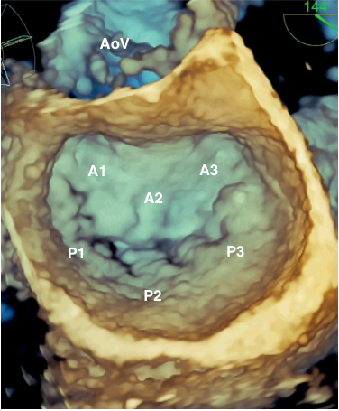

AoV A1 A3 A2 P1 P3 P2 

**Fig. 33.28** **_En face_ display of a three- dimensional image of the mitral valve.** This orientation is analogous to the viewpoint of the surgeon, and facilitates communication regarding the location of structural pathology. The scallops of the anterior (A1, A2, A3) and posterior (P1, P2, P3) mitral leaflets are labeled. _AoV_ , aortic valve.

regurgitation.69,159 3D TEE offers enhanced spatial resolution and superior accuracy in localizing leaflet pathology compared to 2D TEE.160 _En face_ display of 3D images analogous to the surgeon’s intraoperative view facilitates communication regarding structural details (Fig. 33.28). The origin of the regurgitation can be precisely identified using multiplanar reformatting 3D technology. Vena contracta area, regurgitant volume, and EROA can be quantified using 3D techniques with potentially improved accuracy. 3D quantitative analyses can be labor- intensive and timeconsuming, but improvements in software workflow and automation are making analysis more practical for use in real time.

Valve repair is often feasible in degenerative disease with isolated prolapse or flail, and moderate or less annular dilation.68 Bileaflet disease (Barlow disease), severe annular dilation, rheumatic deformities, and severe mitral annular calcification are predictors of unsuccessful repair.159 Regurgitation recurs in a substantial proportion of patients with ischemic MR following repair. LV remodeling and leaflet tethering with apical displacement of the coaptation point impact the feasibility of repair of ischemic MR. Quantitative measurements include assessment of the tenting height (the perpendicular distance from the plane of the mitral annulus to the point of leaflet coaptation) and systolic tenting area (area enclosed by the mitral annular plane and closed leaflets). Tenting height of 11 mm or greater is associated with recurrent MR. On intraoperative TEE, mitral diastolic annular diameter of 37 mm or greater, tenting area of 1.6 cm2 or greater, and severe MR are associated with high probability of repair failure.161 Repair is contraindicated in preexisting stenosis, leaflet destruction due to vegetation, ischemic papillary muscle, significant bileaflet disease, and severe mitral annular calcification with gradient more than 3 mm Hg. TEE can help assess the left ventricular, MV annular, or leaflet remodeling associated with ischemic MR to allow

decision- making regarding concomitant surgical mitral valve repair in patients undergoing coronary bypass grafting.159 Additional considerations in the pre- bypass echocardiographic evaluation include predictors of post- repair SAM of the anterior mitral leaflet, which commonly reflect anterior displacement of the coaptation point. This may take the form of reduction in distance between the coaptation point and the septum (C- sept distance &lt;2.5 cm) or a relatively elongated posterior leaflet (anterior to posterior leaflet ratio of ≤1.3 or posterior leaflet height >1.5 cm), and narrow aortomitral angle.162,163 Other SAM predictors include basal septal hypertrophy (>15 mm), small LV cavity, and anterior displacement of the papillary muscles.

Immediately following separation from CPB, echocardiography assesses for significant regurgitation, stenosis, or dynamic LVOT obstruction due to SAM. Stability of the ring and normal leaflet motion should be demonstrated. Any residual regurgitation should be no more than mild and transvalvular. Should SAM occur, management steps include administration of fluid and discontinuation of any inotropes. If SAM persists, the next therapeutic maneuvers are administration of beta blockers and increase in afterload. The effect of these interventions can be readily observed on TEE. SAM will improve or resolve in most patients, and long- term follow- up demonstrates low incidence of SAM, favoring conservative management.164 Persistence of significant SAM requires revision. Assessment of mitral inflow typically involves measurement of transvalvular gradient, recognizing this is dependent on cardiac output.

### TRICUSPID VALVE REPAIR

Increased recognition of the adverse prognostic effects of tricuspid regurgitation (TR) has stimulated interest in tricuspid valve pathology. After surgical correction of leftsided valvular heart disease, severe secondary TR often fails to improve. Even mild or moderate secondary TR may progress if uncorrected. Current AHA/ACC guidelines recommend tricuspid valve repair for severe TR at the time of left- sided valve surgery.42

The decision to intervene upon TR graded less than severe at the time of left- sided valve surgery is more complex. When not intervened upon at the time of left- sided valve surgery, mild or moderate TR progresses in approximately 25% of individuals.42 Annular dilation strongly factors in the decision to intervene early. Individuals with mild or greater TR and either annular dilation (diastolic diameter of >40 mm or >21 mm/m2 ) or evidence of prior rightsided heart failure can benefit from concomitant tricuspid valve repair (type IIa recommendation). In the absence of tricuspid annular dilation, tricuspid valve repair may be considered during left- sided surgery when moderate TR and pulmonary hypertension are present (type IIb recommendation). The CTSN trial showed that patients with tricuspid annular repair at time of mitral valve repair patients had lower rate of TR progression or reoperation for the same, higher chance of heart blocks requiring pacemakers, and the same quality of life and mortality as the patients with only mitral valve repair. Longer follow- up will be required to elucidate long- term clinical benefit.165

The structure of the tricuspid valve is complex. Because the annulus is nonplanar and the valve leaflets unequal

<!-- PDF page 33 -->

in size, it can be difficult to visualize all three leaflets in the same 2D imaging plane. The anterior location of the valve (far field in the scanning plane) and the thin leaflets also limit 2D TEE imaging. Measurement of annular diameter by 2D TTE typically occurs in the A4C view166 ; however, this one measurement may not accurately reflect the degree of dilation and has underestimated maximal diameter compared to 3D TEE.167 Studies of 3D TEE have enhanced our understanding of annular dilation in the septal- to- lateral dimension, the progression from an oval to more circular shape, and the accompanying changes in annular dynamism.168,169 Use of 3D color may improve quantitative assessment of regurgitation severity166 ; however, in the intraoperative environment, underestimation of TR is not unexpected. Technologies using 3D TEE will continue to fill a larger role in the evaluation of TR.

### AORTIC DISSECTION

Acute type A aortic dissection has high morbidity and mortality. Accurate diagnosis is paramount to rapid treatment. The preferred diagnostic approach under most circumstances is CTA, which identifies dissection with a sensitivity of 100% and specificity of 98%.170 In some cases, TEE may be performed more readily than CTA. TEE performs with slightly lower sensitivity (86%–100%) and specificity (90%–100%), although in many studies TEE performs with comparable specificity to CTA.170,171 TEE imaging challenges include a blind spot in visualization of the distal ascending aorta and proximal arch due to interposition of the left mainstem bronchus between the aorta and esophagus. Imaging artifacts in the near field are common because of reverberation and refraction (especially in the presence of a pulmonary artery catheter) and may be erroneously interpreted as an intimal flap.

Intraoperative TEE during surgical intervention further defines features of the dissection. Measurements of the aortic annulus and root are performed, effacement of the sinotubular junction excluded, and structure and function of the aortic valve assessed. Mechanisms of aortic insufficiency include regurgitation due to a bicuspid valve, extension of the intimal flap to the annulus causing asymmetric leaflet prolapse, malcoaptation due to root dilation, and prolapse of the intimal flap preventing complete leaflet closure.172 This mechanistic information influences whether valve repair is feasible and may lead to modification of the planned surgical procedure.173 Further assessment includes examination of the true and false lumens. Blood flow may be visualized across the intimal flap. Usually, the true lumen will expand during systole, which can be appreciated using M- mode echocardiography. The false lumen often demonstrates diastolic expansion and spontaneous echo contrast. Due to the complex nature of some dissections, it may be difficult to determine the true and false lumens accurately.

### MECHANICAL CIRCULATORY SUPPORT (MCS)

### Durable Mechanical Circulatory Support

Over 14,000 durable left ventricular assist devices (LVADs) were implanted between 2015 and 2019 in North America, nearly half of which are destination therapy.174 Intraoperative TEE confirms known pathology and is integral for

identifying abnormalities that may require additional intervention.175–177 Prior to implantation, echocardiographic assessment includes examination of biventricular size and function, and evaluation for intracardiac shunt (including PFO) and intracardiac thrombus. Preexisting valvular dysfunction is characterized. Greater than mild aortic insufficiency, moderate or greater mitral stenosis, and moderate or greater tricuspid regurgitation may require additional valvular procedures. An existing mechanical aortic valve may require replacement due to the risk for thrombus formation secondary to decreased transvalvular flow after LVAD implantation. Echocardiographic predictors of RV failure following LVAD implantation have been an area of considerable investigation, including the newer myocardial deformation techniques. Currently no measures reliably predict the need for biventricular mechanical support.177

During device implantation, TEE guidance facilitates appropriate apical positioning of the inflow cannula. Post- implantation assessment includes LV size, degree of LV decompression, RV function, reassessment for PFO, and frequency and extent of aortic valve opening. Assessment of LV unloading includes determination of overall chamber size and the position of the interventricular septum, which should be midline rather than bowing toward either chamber. As LVAD speeds are increased, parameters are frequently reassessed, especially if there is concern for marginal RV function. An appropriately positioned inflow cannula should be in the apex, directed toward the mitral valve, and should not interfere with the subvalvular apparatus. Acute angulation of the inflow cannula toward the septum may lead to cannula obstruction. Typical inflow velocity is 1.5 m/s or less. Imaging artifacts with newergeneration LVADs may preclude spectral Doppler and color flow assessment of the cannula. The outflow graft–ascending aorta anastomosis may be visualized in ME or UE views. An outflow velocity of 2 m/s or greater raises concern for obstruction, although normal values for newer- generation devices may be higher.177,178 The mid- portion of the outflow graft can also be visualized along the right side of the heart but should not cause compression.

### Temporary Mechanical Circulatory Support

Common percutaneous devices for temporary MCS include intra- aortic balloon pumps, ECMO, Impella percutaneous ventricular assist devices (Abiomed, Danvers, MA), and TandemHeart percutaneous ventricular assist devices (CardiacAssist, Pittsburgh, PA). Surgically implanted devices are options when longer duration of temporary support is anticipated. Appropriate device position depends on the specific technology and may be facilitated by TEE guidance.177,179 When assessing for myocardial recovery, TEE may add to the information provided by hemodynamics and has been incorporated into some venoarterial ECMO weaning protocols.180

### CONGENITAL HEART SURGERY

In congenital heart surgery, TEE provides diagnostic information, contributes to surgical planning, identifies residual defects after repair, and influences postoperative medical management.181 As TEE has been more widely applied in congenital heart surgery, contemporary studies report pre- CPB

<!-- PDF page 34 -->

findings altering the surgical procedure in approximately 1% to 9% of cases and residual lesions requiring surgical revision in approximately 4% to 6% of cases, with greater impact in more complex cases.182,183 When including return to CPB for brief ventricular support or an assist device, TEE has impacted surgical interventions in close to 13% of cases.184 TEE further influences pharmacologic management and provides new diagnostic information. Epicardial imaging may provide complementary information to TEE when assessing pulmonary arteries and coronary arteries during pediatric congenital heart surgery.185 There is a limited body of literature suggesting that intraoperative TEE in pediatric cardiac surgery has cost- saving benefits.186

### OTHER SURGICAL PROCEDURES

The intraoperative echocardiographer encounters many scenarios where valvular disease requires surgical intervention, including native and prosthetic valve dysfunction. TEE confirms the pre- procedure diagnosis and may refine the location of structural abnormalities. Surgical intervention for endocarditis prompts TEE evaluation for vegetations on other valves and the presence of abscess cavities. Other cardiac surgical procedures that commonly rely on intraoperative TEE include minimally invasive approaches (valve repair/replacement and CABG), cardiac mass removal, heart transplantation, and pulmonary thromboendarterectomy.

## Intraprocedural Transesophageal Echocardiography – Structural Heart Interventions

Innovations in percutaneous technologies have led to exciting growth in the management of structural heart disease, extending treatment to patients with previously limited therapeutic options. The section that follows elaborates on the role of echocardiography in a few of these percutaneous procedures.

### TRANSCATHETER AORTIC VALVE REPLACEMENT

First approved for commercial use in Europe in 2007 and the United States in 2011,187 transcatheter aortic valve replacement (TAVR) has revolutionized the treatment paradigm for aortic stenosis. TAVR is indicated for the treatment of extreme- and high- risk populations with severe symptomatic aortic stenosis and it is a reasonable alternative in patients with intermediate surgical risk.188 The number of procedures performed annually continues to grow.189 Comprehensive resources are available detailing the periprocedural echocardiographic imaging for TAVR.190,191

### Valve Sizing

Annular dimensions guide appropriate sizing of the transcatheter valve. The preferred imaging modality for annular size measurements is multidetector computed tomography (MDCT).192 As compared to MDCT, 2D TTE and TEE routinely underestimate annular size because of the elliptical shape of the aortic valvular complex.193,194 3D TEE yields

larger annular size measurements than 2D TEE.195,196 Measurements obtained by 3D TEE may underestimate197–199 or be comparable to193,196 MDCT measurements. Both MDCT200,201 and 3D TEE198,202 have been used to predict post- implantation paravalvular regurgitation. Automated 3D TEE demonstrates reproducibility and good agreement with MDCT- based prosthesis sizing.203,204

### Intraprocedural Examination

At the beginning of the procedure, echocardiographic assessment includes not only evaluation of the aortic valve, but also determination of biventricular function, assessment of other valvular abnormalities, characterization of any preexisting pericardial effusion, and identification of other features of procedural significance, including small LV cavity and basal septal hypertrophy. When the procedure is under way, wire and device position can be guided with echocardiography, although often fluoroscopy is the primary tool. Ideal valve position prior to deployment depends on valve design (e.g., self- expanding or balloon- expandable).

Following implantation of the valve, an integrated assessment using fluoroscopy, invasive hemodynamics, and echocardiography provides information about valve position, severity of paravalvular regurgitation, and transvalvular gradients. Early recognition of unfavorable results allows for further interventions such as balloon dilation or implantation of a second device. Echocardiography excludes other complications, including functional mitral stenosis, new pericardial effusion, new RWMAs (potentially due to coronary obstruction) and aortic injury.

Other post- procedure complications like suicide left ventricle can be quickly diagnosed with TTE and treated appropriately.

### Transesophageal Echocardiography Versus Transthoracic Echocardiography

Original TAVR clinical trials were performed under general anesthesia with intraprocedural TEE.205,206 Procedure success and time have improved, which makes procedures under monitored anesthesia care or with nursing- administered sedation feasible using TTE for evaluation of the valve. Monitored anesthesia care was found to improve efficiency without compromising safety.207 In the United States from 2012 to 2015, use of general anesthesia decreased from 97.6% to 82.6%, while use of moderate sedation increased from 2.2% to 16.6%.189 Despite the increasing shift away from general anesthesia and consequently TEE, use of intraprocedural TEE may be preferable for monitoring patients at high risk for coronary occlusion or annular rupture, reducing intravenous contrast exposure in high- risk patients, and providing secondary measurements for valve sizing.208

Because intraprocedural TEE is often performed in the setting of general anesthesia, it is difficult to assess the independent effects of general anesthesia or echocardiographic modality on outcomes. In a study comparing general anesthesia to non- general anesthesia in transfemoral TAVR, the majority of patients receiving general anesthesia had intraprocedural TEE, while TTE was performed in a minority of cases without general anesthesia. Propensitymatched analysis adjusted for type of anesthetic did not demonstrate significant differences in rates of successful

<!-- PDF page 35 -->

valve deployment more than mild aortic regurgitation or other complications in patients that had an intraprocedural TEE versus those that did not.209 A retrospective study of 454 consecutive patients undergoing transfemoral TAVR with either TTE under moderate sedation ( _n_ = 234) or TEE under general anesthesia ( _n_ = 220) showed no difference in the incidence of at least mild paravalvular regurgitation at hospital discharge (33% in TTE group vs. 38% TEE group, respectively _P_ = .326).210 The TTE group did, however, have a significantly higher incidence of second valve implantation (7% vs. 2%, _P_ = .026) and post- dilation (38% vs. 17%, _P_ &lt; .001).210 Many retrospective studies are confounded by chronology bias – use of primarily TEE early on with a transition to TTE occurring after the development of procedural expertise. Additionally, findings with earlier generations of valves may not be applicable to the current generation used in clinical practice. While current studies do not allow definitive conclusions to be drawn about TEE vs. TTE in TAVR, the trend toward sedation will likely drive TTE use in these procedures.

### TRANSCATHETER MITRAL VALVE REPAIR

Percutaneous treatment of MR with transcatheter edge- toedge repair (TEER) procedure frequently uses the MitraClip device (Abbott Vascular- Structural Heart, Menlo Park, CA). It uses a clip to grasp and appose the free edges of the anterior and posterior mitral leaflets at the site of regurgitation, creating a double orifice similar to that of the surgical Alfieri technique. In the United States, MitraClip was initially approved for the treatment of severe primary (degenerative) MR in patients with prohibitive surgical risk. In Europe, percutaneous valve repair has also been used for the treatment of secondary (functional) MR. In both patient populations, impact of treatment and long- term outcomes are areas of active investigation.211 Several randomized trials now include patients with secondary MR,212–214 and the body of literature is rapidly growing.

Echocardiographic imaging is essential in determining the suitability for the procedure, providing intraprocedural guidance, and evaluating procedural success.215 Preoperative echocardiography characterizes the anatomic features of the valve, examines the subvalvular apparatus, and provides qualitative and quantitative assessments of the severity of the regurgitation. Optimal morphologic features are based on the EVEREST study inclusion and exclusion criteria and include regurgitation central in origin (A2/P2), lack of calcification in grasping area, mitral valve area greater than 4 cm2 , small flail gap (&lt;10 mm), and narrow flail width (&lt;15 mm).216 Some centers are performing TEER in patients beyond the initial EVEREST criteria. They cite increased familiarity with the device but admit that more investigation must be done prior to broad acceptance of their broad inclusion criteria.217 Intraprocedural TEE, in combination with fluoroscopy, guides interatrial septal puncture and advancement of the catheter into the LA (Fig. 33.29). Under TEE guidance, the clip is aligned above the leaflets with the arms perpendicular to the line of coaptation. Once satisfactory position is obtained, the device system is advanced into the left ventricle and the device is deployed (Fig. 33.30). Live echocardiographic imaging is often utilized as the system is slightly withdrawn so the clip grasps the leaflets; confirmation of bileaflet capture and assessment of the regurgitation severity is performed prior to clip deployment. Presence of significant residual or worsened MR, or evidence of mitral stenosis by echocardiography may prompt repositioning of the clip. Regurgitation and stenosis are quantified after deployment; placement of a second clip may be indicated if significant MR remains.

### OTHER PERCUTANEOUS STRUCTURAL HEART PROCEDURES

TEE serves as a standard imaging modality in numerous other catheter- based procedures, including atrial septal defect closures, ventricular septal defect closures, LA

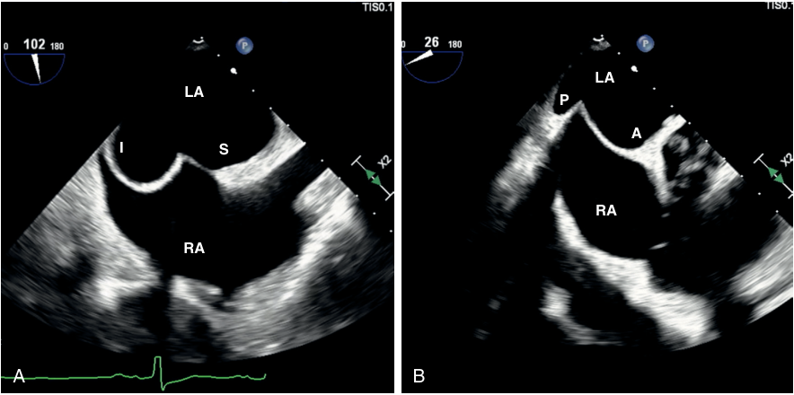

LA LA P A I S RA RA A B 

**Fig. 33.29** Biplane imaging of modified (A) bicaval and (B) midesophageal aortic valve short- axis views. A transseptal puncture needle can be seen tenting the interatrial septum in the fossa ovalis in a relatively superior and posterior position. The superior and inferior portions of the septum are traditionally seen in the bicaval view, and the anterior and posterior portions of the septum are seen in the midesophageal aortic valve short- axis view. _LA_ , left atrium; _RA_ , right atrium; _I_ , inferior; _S_ , superior; _P_ , posterior; _A_ , anterior.

<!-- PDF page 36 -->

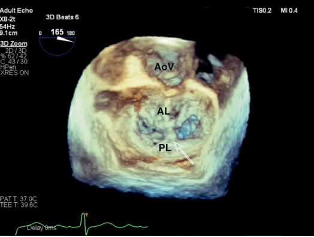

AoV AL PL 

**Fig. 33.30 Three- dimensional** **_en face_ (surgeon’s view) of the mitral valve following MitraClip placement.** The _arrow_ highlights the MitraClip in the classic position between the A2 and P2 scallops of the mitral valve. The double orifice can be seen on either side of the MitraClip device. _AL_ , anterior leaflet of the mitral valve; _AoV_ , aortic valve; _PL_ , posterior leaflet of the mitral leaflet.

appendage occlusion, valve- in- valve therapies for failed prostheses, and paravalvular leak closures. Echocardiography during these procedures assesses the suitability of the intervention, provides real- time guidance, and assesses the effectiveness of the intervention. Transcatheter techniques under investigation include mitral valve replacement218 and therapies directed at TR, including valve annuloplasty, techniques targeting leaflet coaptation, and caval valve implantation.219–221

## Emerging Technologies

### INTRACARDIAC ECHOCARDIOGRAPHY (ICE)

Intracardiac echocardiography involves obtaining realtime high- resolution images by placing a transvenous 6 to 10 F catheter with a radial or phased-array transducer mounted at the tip. Depending on the transducer, near- field images (radial transducer) and far- field with color Doppler images (phased array) can be obtained. The intracardiac echocardiography catheter has several advantages including better structural imaging, continuous monitoring of catheter position, better patient tolerance, and less sedation. ICE is being used for interventional procedures like atrial septal defect closure, left atrial appendage ligation and mitral valvuloplasty, and electrophysiology procedures such as pulmonary vein isolation. Recently, a 3D volumetric ICE system has been developed, which provides better anatomic delineation.222

### FUSION IMAGING

Multimodality imaging is essential for planning and execution of percutaneous structural heart procedures. Interventional cardiologists use echocardiographic and fluoroscopic data simultaneously to guide catheter manipulation and device deployment. Often these images are displayed on

separate screens, which can provide challenges as the proceduralist must combine the information to reconstruct a mental 3D representation of the structures. Fusion of echocardiographic and fluoroscopic images provides simultaneous visualization of catheter movements with cardiac structures. Newer advances include 3D live image fusion capabilities which further elucidate localization and guidance for procedural success. Currently a technology in development, the optimal applications will be better characterized in the coming years.223,224

### THREE- DIMENSIONAL PRINTING

3D models of valvular structures and complex congenital heart defects can be printed from echocardiographic and other imaging data sets. Visual and tactile interactions with the models allow for improved understanding of structural interactions and abnormalities. At present, 3D printing in this context is most relevant as a training and simulation tool, but patient- specific models can be used to optimize pre- procedural planning.225 Model quality depends on the quality of the imaging data. High cost, long printing times, and lack of materials capable of replicating tissue structural properties limit perioperative applications of 3D printing.226

### ARTIFICIAL INTELLIGENCE/MACHINE LEARNING

Artificial intelligence and its subfield, machine learning, permeate everyday life. The quest to apply these technologies to questions in medicine is no exception. Artificial intelligence is a branch of computer science focused on development of computer systems capable of emulating human intelligence, including aspects such as learning, knowledge retention, problem solving, and reasoning.227 Machine learning focuses on the development of predictive models where rules are learned from data rather than explicitly programmed.228 Currently, many 3D echocardiography platforms require manual, time- consuming user input for quantitative analysis, making their routine use in the OR impractical. While not yet mainstream, automated analysis platforms using artificial intelligence in echocardiography exist, including mitral and aortic valve analysis in 3D TEE229 (Fig. 33.31) and automated chamber quantification in 3D TTE.230,231 Outside of the perioperative arena, machine learning has been applied to 2D TTE assessment of LV hypertrophy phenotypes.232 Refinement and continued development of such technologies conceivably could provide complex, quantitative valvular and ventricular analyses under dynamic conditions, improving accuracy and reducing inconsistencies in interpretation.

## Perioperative Transthoracic Echocardiography and Focused Cardiac Ultrasound (FoCUS)

While TEE has historically been the principal modality of perioperative echocardiography, TTE is emerging as a relevant and feasible counterpart. Anesthesiologists with substantial echocardiography experience have initiated preoperative TTE consult services, providing echocardiographic

<!-- PDF page 37 -->

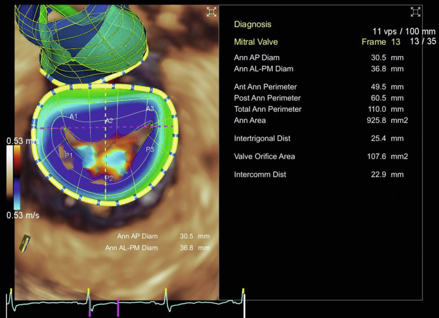

**Fig. 33.31 Example of valve analysis program using artificial intelligence.** Dynamic measurements of mitral annular geometry are provided throughout the cardiac cycle.

examination and interpretation when indicated during preoperative evaluation.233,234 Echocardiographic findings have led to management changes in 54% to 84% of cases, including modification of the planned anesthetic approach and influencing decision- making regarding the need for additional preoperative consultation or intraoperative monitoring.235 Interpretation of the images by cardiologists235 and formal TTE imaging in a subset of patients confirmed the major findings of the focused TTE examination in the majority of cases.233 Standard preoperative echocardiography in patients undergoing major surgery has failed to demonstrate an association with improved outcomes,236 so the value of preoperative anesthesiologist- performed TTE in guiding interventions or prognostication needs further characterization. As these consult services develop, important considerations include the intended scope of the examination and the experience of the individuals performing and interpreting the studies.

Several small investigations demonstrate the feasibility of FoCUS prior to urgent or emergent surgical procedures, resulting in changes to the anesthetic technique or management plan.237–239 Specific patient populations, such as patients sustaining hip fractures, may be optimally suited for FoCUS. Delay in surgery for hip fractures is associated with increased risk of mortality,240,241 and preoperative echocardiographic examination through standard channels has been associated with delayed surgery.242 A multicenter, randomized pilot study of preoperative POCUS in hip surgery has been completed, providing the groundwork for a larger, more robust randomized controlled trial.243

The operating theater, with the sterile surgical field and limited patient accessibility, is not necessarily conducive to transthoracic imaging. Despite the perceived challenges, small prospective studies have demonstrated the feasibility

of POCUS during surgery. In a series that included stable and unstable patients undergoing a range of surgeries (orthopedics/trauma, abdominal/vascular, urology/gynecology, and head or ear, nose, and throat), focused examination was feasible in more than 90% of cases.244 Patients with chronic obstructive pulmonary disease and those undergoing abdominal surgery had significantly worse image quality. Subsequent studies have demonstrated feasibility in thoracic surgery,245 and an impact on intraoperative management in 22% to 66% of patients.245,246

There is increasing interest in POCUS and TTE for hemodynamic monitoring and diagnostic assessments in the peripartum anesthetic management of pregnant patients.247 The leftward displacement of the heart and left tilt to avoid aortocaval compression are favorable for parasternal and apical imaging windows.247 Postpartum hemorrhage, preeclampsia, and cardiomyopathy can all result in hemodynamic derangements detectable by cardiac ultrasound.248 The Rapid Obstetric Screening Echocardiography (ROSE) protocol was developed to enable rapid focused assessment of hemodynamically unstable obstetric patients. It includes qualitative and simple quantitative assessment of the heart to look for contractility, volume status and cardiac output, emboli and right heart strain, pericardial effusion, and tamponade. The exam involves long and short parasternal and apical views. Subxiphoid and IVC views can be utilized early in the pregnancy or postpartum.249

Despite the recognized value of POCUS,250 it is not yet a routine aspect of anesthesiology practice. A survey of cardiothoracic anesthesiologists revealed a familiarity with POCUS (81%), but only 47% of respondents use it in their clinical practice.251 While the study has limitations, including low response rate, it provides insight into current practice patterns. The most frequently cited obstacle to use of POCUS was lack of training, followed by concerns about

<!-- PDF page 38 -->

1075 

missed diagnosis, lack of equipment, and lack of a certification process.252

## Critical Care and Perioperative Care

Echocardiography performed and interpreted at the point of care is feasible and influential in the care of critically ill surgical and nonsurgical patients perioperatively and in the ICU. Both TTE and TEE findings impact the management of patients in shock, influence diagnostic and therapeutic management,253–255 and provide prognostic information.256,257 In a study of 110 patients in undifferentiated shock, early resuscitation guided by echocardiography was associated with improved survival, less fluid administration, and greater inotrope use compared to 110 control patients examined retrospectively.258 Although this does not indicate causality, it highlights the potential value of echocardiography in resuscitation, especially considering the association between positive fluid balance and mortality.259–261 TTE use is more prevalent than TEE in the ICU,262 and European and Australian intensivists use TEE more commonly than their North American counterparts.263 TEE offers improved diagnostic accuracy in the setting of mechanical ventilation253 ; however, several groups have obtained adequate transthoracic images for focused studies in the majority of mechanically ventilated patients.254,264,265 TEE provides superior imaging for the evaluation of suspected endocarditis or intracardiac mass, evaluation of great vessel pathology, and assessment of valvular dysfunction.266

Similar to perioperative TEE, there are proposed basic and advanced applications of critical care echocardiography.46,267 Basic applications include assessment of global biventricular size and function, identification of pericardial fluid or tamponade, identification of severe valvular regurgitation, and as guidance for resuscitative efforts during and after cardiac arrest, and are mainly used in POCUS. Advanced applications include quantitative assessments of function and filling pressures, evaluation of fluid responsiveness, and detection of abnormalities including cardiac source of embolism, endocarditis, acute aortic pathology or injury, intracardiac shunt, and complications of MI. Evaluation of suspected endocarditis, great vessel pathology or injury, and PE may be considered basic or advanced applications.

### FLUID RESPONSIVENESS

When assessing a patient in shock, the decision to administer, withhold, or stop fluids is often challenging. Patients who are fluid responsive will demonstrate an increase in SV or cardiac output in response to a fluid challenge,97 and dynamic indices (such as heart–lung interactions or the passive leg raise maneuver) temporarily induce changes in preload to assess for this response. In patients receiving passive mechanical ventilation, several echocardiographic (TTE and TEE) dynamic parameters have been used to predict fluid responsiveness and aid in clinical decision- making:

- _Inferior vena cava distensibility index:_ During positive pressure ventilation, inspiration causes a rise in intrathoracic

pressure, which decreases the venous return to the heart and leads to IVC distention. During expiration, IVC diameter is at a minimum. Two IVC distensibility indices (dIVC or ΔIVC) relating the maximum ( _D_ max) and minimum ( _D_ min) diameters during the respiratory cycle have been described:

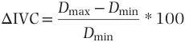

ΔIVC = D max − D min * 100 D min 

where a threshold of 18% or greater discriminated between responders and nonresponders,268 and

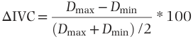

D max − D min ΔIVC = * 100 ( D max +  D min) /2 

where a threshold of 12% or greater discriminated between responders and nonresponders.269

Use of the first equation is most common.270 ΔIVC is less accurate in more heterogeneous populations, which may limit broad applicability.271,272 In general, ΔIVC has greater specificity than sensitivity.

Several preconditions must be met for ΔIVC to be a useful tool, including absence of spontaneous respiratory effort, 8 to 12 mL/kg tidal volumes (necessary to increase the pleural pressure to affect the IVC diameter), absence of cor pulmonale, and absence of intraabdominal hypertension.98 Highlighting the importance of these conditions, ΔIVC accurately predicts fluid responsiveness in patients ventilated with tidal volumes of 8 to 10 mL/kg and positive end-expiratory pressure (PEEP) of 5 cm H2O or less but poorly predicts fluid responsiveness in patients receiving tidal volumes less than 8 mL/kg or PEEP greater than 5 cm H2O.270

- _Superior vena cava (SVC) collapsibility index:_ During positive pressure ventilation, the SVC collapses during inspiration due to increased intrathoracic pressure (a pattern opposite that of the IVC). An initial study of patients with septic shock evaluated the SVC collapsibility index (ΔSVC), defined as:

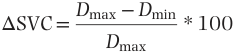

ΔSVC = D max − D min * 100 D max 

where _D_ max is the maximum diameter on expiration and _D_ min is the minimum diameter on inspiration.273 A threshold of more than 36% distinguished fluid responders from nonresponders with 90% sensitivity and 100% specificity. In a larger cohort including mechanically ventilated patients with any type of shock, ΔSVC of 21% or greater predicted fluid responsiveness with 61% sensitivity and 84% specificity.272 When compared in the same patients, ΔSVC has greater diagnostic accuracy than ΔIVC1.271,272 TEE imaging is required to determine ΔSVC.

- _Variation in peak aortic/LVOT velocity_ : Positive pressure ventilation results in cyclical changes in the maximum velocity of flow in the LVOT and across the aortic valve. Application of PWD at the level of the aortic valve274 or in the LVOT272 allows for measurement of the highest ( _V_ max) and lowest ( _V_ min) peak velocities over the course of the respiratory cycle. The difference between the two

<!-- PDF page 39 -->

is divided by their mean and expressed as a percentage as follows:

V max − V min Δ V maxAo = * 100 ( V max +  V min) /2 

A threshold of 12% or more discriminated between responders and nonresponders in initial investigations.274 Similar to other dynamic indices, in larger, diverse populations, this parameter does not perform as accurately as originally reported. When compared in the same cohort, ΔVmax Ao had the highest sensitivity, whereas ΔSVC had the highest specificity for predicting fluid responsiveness.272

Additional echocardiographic assessments utilizing heart– lung interactions and dynamic parameters are an area of active research. End- expiratory occlusion maneuvers alone or in combination with end- inspiratory occlusions have been used to predict fluid responsiveness as assessed by changes in LVOT velocity time integral and/or maximum aortic velocity.275,276 Similarly, variation in SV and LVOT VTI (obtained by TTE or TEE) has shown evidence as a better predictor for fluid responsiveness. SVV of more than 12% is an accurate predictor of fluid responsiveness and 14%277 has a very high predictive value. SVV less than 10% has a strong negative predictive value. LVOT VTI change of (or more than) 10% predicted fluid responsiveness with a sensitivity of 95% and a specificity of 78% in low-volume mechanically ventilated patients challenged with 100 mL volume.278

Recent interest has emerged in carotid artery flow Doppler ultrasonography to calculate corrected flow time, peak velocity, and change in peak velocity with respiration of the blood flow in carotid artery. A systematic review of 17 studies including 956 patients indicated that the most reliable parameter is the peak velocity change, where the cutoff limits ranging from 9% to 14% indicate fluid responsiveness.279

Venous congestion and associated interstitial edema lead to reduced organ perfusion and organ dysfunction more significantly in patients with right ventricular failure and pulmonary hypertension. The VExUS score (Venous Excess ultrasound score) involves measuring the IVC dimension (>2 cm) and assessing the pattern of flows across hepatic and portal vein to obtain a grading system for degree of venous congestion. The score may be able to quantify risk of acute renal failure and aid in clinical decision for guidance of fluid removal. These approaches are not currently widely applied and require further validation in diverse patient populations. With any of these indices, the clinician should interpret these findings within the overall context of the patient’s status and with an awareness of the limitations.

### POST- CARDIAC SURGERY

In hemodynamically unstable postoperative cardiac surgical patients, there is significant discordance between diagnoses obtained from continuous TEE and diagnoses obtained from hemodynamic measurements.280 A 2016 systematic review of 15 studies examining TTE and TEE in unstable patients after cardiac surgery demonstrated that echocardiography (performed by a mix of novice and expert

sonographers) was feasible and that findings frequently led to management changes.281 TEE- based diagnoses have greater interobserver agreement, suggesting that echocardiography may add valuable diagnostic information even in the presence of invasive hemodynamic monitors.

### eFAST IN TRAUMA AND RESUSCITATION

For decades, cardiac ultrasound via the subcostal window has been part of the evaluation of the trauma patient within the Focused Assessment with Sonography for Trauma (FAST) examination.282 FAST examination is a POCUS exam for patients with traumatic thoracic or abdominal injury and includes a rapid assessment of the pericardial, peritoneal, and pelvic cavities to rule out bleeding. eFAST extends this assessment to the thoracic cavities and has been shown to have higher sensitivity and specificity to detect pneumothorax and hemothorax than chest X- ray.283 The sensitivity is limited for peritoneal and pelvic hemorrhage for small-volume bleed. The eFAST exam includes six views obtained with a curvilinear probe. The pericardial view is a subxiphoid cardiac view. The peritoneal views include the right upper quadrant to look for fluid in the Morrison’s pouch, right subdiaphragmatic, and paracolic gutter. The left upper quadrant view rules out fluid in the left subdiaphragmatic, paracolic, and subsplenic spaces (Fig. 33.32). POCUS extends this cardiac examination and has been adopted as a tool to guide resuscitation of trauma patients. A trial randomizing trauma patients to POCUS or no POCUS as part of the initial evaluation demonstrated significantly less fluid administration, shorter time from the trauma bay to the OR, and higher rate of ICU admissions in the POCUS group.284 In blunt or penetrating chest trauma, echocardiography reveals complications such as cardiac rupture, dysfunction (due to contusion), valvular injury, hemopericardium, and aortic disruption.285

### LUNG ULTRASOUND

Lung ultrasound applications are expanding from emergency room diagnostics to the OR and ICU. The exam includes placing a low-frequency curvilinear probe (3–6 MHz) or the linear probe (7–12 MHz) along the chest wall with the patient in supine or sitting position. Most lung signs arise from the pleural line since 99% of the ultrasound waves are reflected at the soft tissue–air interface. They are classified into dynamic and static signs which mostly arise due to artifacts. The appearance of the artifacts is dependent on the percentage and distribution of air and fluid. A- lines are horizontal repetitive line artifacts due to lung sliding and indicate presence of air, physiologic or otherwise, in the lung. A- lines are lost in the presence of fluid or consolidation in the lungs. B- lines are dense, echogenic strobe- like artifacts arising from the pleural line all the way to the end of the field, interrupting the A- lines and moving with lung sliding (if present). B- lines are indicative of fluid in the interlobar septum of the lung classically seen in pulmonary edema and stages of acute respiratory distress syndrome (ARDS) (Fig. 33.33).

In retrospective studies, ultrasound was shown to predict the absence of pneumothorax with 93.8% sensitivity and a negative predictive value of 99.9% and is more

<!-- PDF page 40 -->

S K A B E A D B L C K B D C 

**Fig 33.32 Components of the eFAST exam with corresponding probe locations indicated with** **_green rectangles_ .** (A) Subcostal view, to assess for pericardial effusion. The peritoneal views assesses for fluid in the abdomen. (B) Left upper quadrant view, to assess for fluid in the paracolic and subsplenic spaces. (C) Bladder view, to assess for pelvic fluid. (D) Right upper quadrant (RUQ) view, to assess for fluid in Morrison’s pouch. Note that this image shows fluid in the RUQ and would qualify as a positive exam. (E) Probe location for the thoracic (lung) exam. An example of the image obtained in this location is shown in Fig. 33.33A.

accurate than chest X- ray.286,287 Lung sliding is the shimmering respirophasic movement seen along the pleural line due to the sliding motion of the parietal over visceral pleura when they are in apposition. M- mode over the region generates seashore sign, which changes to the barcode sign in the presence of pneumothorax (Fig. 33.34). The lung point is the point of transition between lung sliding and non- sliding. Absence of lung sliding along with B- lines, lung pulse, and lung point is highly sensitive to diagnose pneumothorax.288

Ultrasound has been shown to be as sensitive as computed tomography (CT) and more sensitive than chest X- ray for identifying pleural effusion. Echocardiography may identify causes of hypoxia, such as right- to- left intracardiac shunt or pleural effusion (Fig. 33.35). Clinicians often incorporate lung ultrasound with echocardiography when evaluating cardiopulmonary failure (also see Chapter 82).289 POCUS played an important role in the COVID- 19 pandemic and has assisted in not only pulmonary but also cardiac and blood vessel assessment. The American Society

of Echocardiography has put forth a statement for guidance for use of POCUS in COVID patients.290

### GASTRIC POCUS

POCUS is being increasingly used to diagnose full stomach preoperatively. Studies have shown changes in anesthesia plans based on findings from a gastric ultrasound exam.291 The epigastric region is assessed with a curvilinear probe (2–5 MHz) or linear probe (9–12 MHz) in supine, sitting, and right lateral position. The probe is moved by sliding toward the left subcostal margin obliquely. The antrum is seen as a small, round, target- like region which progressively distends with more volume. Liquids appear anechoic, thick fluids and thicker food have a hyperechoic pattern, and solid food is inhomogeneous and has a “frosted glass” appearance (Fig. 33.36). The quantification is done in the right lateral position by measuring the cross- sectional area (latCSA) of the gastric antrum at rest. The gastric volume (GV) is calculated per formula:292

<!-- PDF page 41 -->

A B C D 

**Fig. 33.33 Still images from lung ultrasounds.** (A) A- lines, which are horizontal, regularly spaced artifacts that represent reverberations of the pleural line. This is a normal finding. (B) Z- lines, which are short, broad B- lines that do not reach the edge of the screen. They are typically normal but can be seen in pneumothorax. (C) A lung point, which is highly sensitive and specific for pneumothorax and represents the point between lung and free air in the thorax. (D) Pathologic B- lines. Their number and intensity correlate with the degree of pulmonary edema present.

GV  mL   27.0  14.6  right – latCSA  1.28  age

A full stomach is defined as identification of solid food or presence of more than 1.5 mL/kg of clear liquid calculated by measuring the antral volume.293

### ULTRASOUND FOR PROCEDURAL GUIDANCE

Ultrasound is being utilized to facilitate procedures throughout the perioperative period. Ultrasound has been shown to improve accuracy, reduce complications, and increase the success rate of peripheral and central venous cannulation.294 The Agency for Healthcare Research and Quality Evidence report _Making Health Care Safer_ recommended ultrasound as one of the 11 practices to be adopted by clinicians for central venous access.295 Recently published European Society of Anesthesiology guidelines indicate level of evidence 1B for internal jugular vein cannulation and declare no difference in out- of- plane or in- plane approach.296

Artery cannulation is a low- risk procedure with around a 1% risk of thrombosis, hemorrhage, and infection, and increase in complications with an increasing number of attempts.297,298 A systematic review of 11 randomized controlled trials comparing radial artery cannulation with and without ultrasound guidance revealed a significantly improved first-attempt success and reduction in the total number of attempts in the ultrasound- guided group.299 Ultrasound can also be used to assess for potential complications of radial artery cannulation. An absence of blood flow assessed by Doppler ultrasound in superficial palmar branch in the hand and/or dorsal digital artery in the thumb on occlusion of the radial artery is a contraindication to radial artery cannulation.300

La Grange _et al._ reported the use of ultrasound for neural blocks for the first time in 1978.301 Since then, ultrasound- guided blocks have been shown to be quick, precise, have a lower complication rate, and a higher rate of patient satisfaction.302 Ultrasound- guided nerve

<!-- PDF page 42 -->

A B 

**Fig 33.34 M- mode imaging of the lung demonstrating lung sliding.** (A) Normal lung with the classic “sand on the beach” or “seashore” sign that occurs as a result of the sliding motion of the parietal and visceral pleura. (B) “Barcode” sign, which shows no motion during respiration because lung sliding is absent in a patient with a pneumothorax.

V V DA LV Pleural Pleural Effusion Effusion LA Lung DA A B 

**Fig. 33.35** Pleural effusions demonstrated by (A) parasternal long axis on TTE and (b) descending aorta short axis on TEE. (A) This transthoracic parasternal long- axis view demonstrates an echolucent space posterior to the DA, consistent with a large left pleural effusion. A pericardial effusion (not present in this image) would be seen as an echolucent space anterior to the descending aorta. (B) A transesophageal descending aorta short- axis view demonstrating an echolucent space consistent with a left pleural effusion. Note the atelectatic lung at the left of the image. _DA_ , descending aorta; _LA_ , left atrium; _LV_ , left ventricle.

blocks have revolutionized the enhanced recovery after surgery pathways, reduced length of hospital stay, and improved outcomes.303 For detailed discussion on various ultrasound- guided nerve blocks and techniques, refer to Chapter 42.

Bedside procedures like thoracentesis and paracentesis are commonly performed in ICUs. Ultrasound- guided thoracentesis involves placing the patient sitting up and leaning forward in bed or lateral position. A safe pocket of pleural effusion is identified by using a phased array or linear probe before pleural drain is placed under ultrasound guidance. Real- time ultrasound- guided thoracentesis has shown reduced incidence of iatrogenic pneumothorax. Ultrasound can locate a safe pocket of fluid for drainage more reliably than physical examination alone.304,305 The American Association for Thoracic Surgery consensus guidelines for the management of empyema endorses the use of ultrasound for pleural fluid

assessment and guidance for drainage of pleural effusion as a class I recommendation (level of evidence B).306 Bedside ultrasound can reliably diagnose ascites, help locate a safe pocket for drainage, increase success rate, and reduce complications like bowel injury and bleeding. The fluid is located with the patient in the supine position using a curvilinear probe in the sagittal plane on the left and the right lower quadrant. A safe pocket is identified and measured. Scanning in the identified region for blood vessels can be done using a high-frequency linear probe before needle insertion. The needle puncture can be done in real time or blindly after localization.307

Application of POCUS has expanded to airway assessment. POCUS can help determine size of trachea and endotracheal tube, accurately locate cricothyroid membrane, and improves success of procedures like cricothyrotomy, tracheal rings for percutaneous tracheostomy.308–310

<!-- PDF page 43 -->

L L A A A B 

**Fig 33.36** Gastric ultrasound showing the liver and gastric antrum in both fasted (A) and full with clear liquid (B) states. _L_ , liver; _A_ , antrum of the stomach.

### HANDHELD ULTRASOUND

With their compact size and portability, handheld ultrasound devices are ideal for point- of- care assessments.311 Intensivists with limited echocardiography training have performed and interpreted focused handheld examinations. They estimate LV systolic function with reasonable accuracy compared to formal TTE performed by a sonographer and interpreted by an echocardiographer.312 When performed by intensivists experienced in echocardiography, handheld echocardiographic examinations offer similar 2D diagnostic capabilities to full- platform TTE in mechanically ventilated, critically ill patients. Over the years, handheld ultrasound devices have significantly advanced to include most features of standard portable devices to enable rapid, reasonable resolution assessment and provide procedural guidance.313 They have demonstrated acceptable accuracy with respect to left ventricular size and function, recognition of regional wall motion abnormality, and pericardial effusion detection. These devices also have shown good sensitivity at diagnosis of interstitial lung conditions like pulmonary edema, pneumonia, and fluid overload.314 They perform better than clinical exam alone and accuracy increases considerably with training.315 Additionally, a systematic review revealed that the handheld ultrasound devices had good correlation with high- end devices for diagnosis of ascites, cholelithiasis, fatty liver/hepatic trauma, and aortic aneurysm.316

Cloud- based image storage and portability make these devices ideal for providing remote care and an excellent teaching tool. The “UCI- 30” Ultrasound- based Clinical Initiative program run by University of California, Irvine since August 2010 has effectively proven that early introduction of ultrasound in medical schools can help with developing proficiency in ultrasound use and aid in clinical teaching and anatomy.317 Machine learning algorithms and deep learning techniques are being applied and enable ultrasound machines to assist with guided probe placement, image acquisition, organ recognition, procedural guidance, and making objective diagnosis.318 While still in infancy,

these tools are undergoing rapid evolution. The clinical application, however, awaits better evidence garnered by better data storage for analysis and is limited by lack of Food and Drug Administration (FDA) approval.319

### MINIATURE TEE PROBES

Miniature TEE probes are promising tools for hemodynamic monitoring or characterization of cardiopulmonary failure in the critical care setting.320,321 Examination with miniaturized multiplane TEE probes is feasible and well tolerated in ventilated, critically ill patients.321 When compared to standard TEE, miniature probes enable concordant diagnostic assessments of causes of cardiorespiratory failure, albeit with lesser image quality. Consequent to the diminished image quality, common hemodynamic measurements can be performed less frequently, but when possible, the results agree with those obtained by standard TEE. Larger studies and evaluation of resulting clinical impact are necessary prior to widespread adoption of miniature TEE.

## Training and Certification

### KNOWLEDGE EXPECTATIONS AND TRAINING

Across the field of anesthesiology, there is a growing impetus for formalized training in perioperative ultrasound including echocardiography. The American Council for Graduate Medical Education requires anesthesiology residents to demonstrate competency in the acquisition of standard transesophageal and transthoracic echocardiographic views.322 Certification by the American Board of Anesthesiology requires basic knowledge of TEE, assessed both in the written examination and the Objective Structured Clinical Exam.323 Accredited Anesthesiology Critical Care Medicine programs require fellows to demonstrate knowledge of ultrasound principles and proficiency in TEE and TTE.324 Since Jan 2019, the National Board of Echocardiography (NBE) is offering a specialized certification for practitioners of echocardiography in critical care settings.325

<!-- PDF page 44 -->

Formalized echocardiography training requires curriculum development and educational initiatives. For some trainees, exposure to ultrasound now begins in medical school. Several institutions include cardiac ultrasound in their educational programs, initially using it to teach anatomy and function, and later as an adjunct to the physical examination.326 Many residency programs are developing multimodal longitudinal curricula including didactic lectures, hands- on workshops, online modules, simulation, and formal echocardiography rotations.327–329 Online virtual simulation provides users an interactive format to learn standard views and spatial relationships.330,331 Mannequin- based simulation is an effective method for improving the acquisition of cognitive and technical skills both in TEE332–334 and TTE,335,336 and may be a useful educational tool for learners early in training. In addition to these multimodal didactic approaches, practical clinical experience under supervision remains a key part of the training process. In North America, advanced training in TEE usually occurs in the context of the cardiothoracic anesthesiology fellowship.

The coming years will include increasing emphasis on POCUS training in anesthesiology. In a survey of US anesthesiology residency program directors and trainees, most respondents indicated POCUS should be a standard component of training, while only a minority of the programs incorporated such training.337 A different survey of Canadian residency program directors indicated POCUS training should be compulsory, and while most of the programs had training opportunities, only a minority included mandatory rotations.338 The challenge is how to best incorporate POCUS, to define minimum training standards and competencies, and to provide education for trainees as well as anesthesiologists already in practice. The European Association of Cardiovascular Imaging has published a reference curriculum and syllabus for POCUS education and training.339 The American Society of Echocardiography (ASE), recognizing the increasing application of echocardiography by providers in various settings and with different levels of training, released recommendations for echo labs training in cardiac POCUS and critical care. The ASE aims to define the scope of various levels of echocardiography from ultrasound assistance of physical examination (UAPE), cardiac POCUS, critical care echocardiography, focused, and comprehensive echocardiography. Clinicians must clearly understand the narrow scope of POCUS, recognizing the limitations and indications for expert consultation. Many examples of the applicability of perioperative POCUS are in the hands of experienced echocardiographers – whether this translates to operators with less experience and less formal training will need to be examined. After the initial acquisition of cognitive and technical skills in ultrasound, continued use is important to ensure proficiency; when these skills are not used for over a year, significant attrition occurs.340

### CERTIFICATION

The National Board of Echocardiography offers examination and certification in basic (Basic PTEeXAM) and advanced (Advanced PTEeXAM) perioperative TEE.341 Individuals who pass the examination achieve “testamur” status.

Testamurs can achieve basic certification via supervised training, practice experience, or extended continuing medical education. Advanced PTEeXAM testamurs can receive certification by completing an accredited cardiothoracic anesthesiology fellowship. There is no certification for perioperative TEE; however, qualified individuals can take the Examination of Special Competence in Adult Comprehensive Echocardiography (ASCeXAM) and achieve testamur status.342 In Europe, the European Association of Cardiovascular Imaging and European Association of Cardiothoracic Anaesthesiology jointly offer certification in adult TEE.343 General critical care ultrasound and basic critical care echocardiography are now considered to be within the scope of practice of intensivists, while certification has been proposed for those obtaining advanced training.46,266 As of 2019, the National Board of Echocardiography now offers an Examination of Special Competence in Critical Care Echocardiography (CCEeXAM).325

## Future Directions

The evolution of perioperative echocardiography is at a transformative juncture. The landscape is one of growth, innovation, and increased accessibility. From its perioperative origin as a monitor in cardiac surgery decades ago, TEE (and more recently TTE) has become integral to the practice of cardiac and general anesthesia and surgical decisionmaking. More sophisticated and automated platforms will pave the way for increasingly complex, quantitative analyses to be performed in real time. Catheter- based procedures push the boundaries of treatable pathologies, and echocardiography is central to the multimodal imaging techniques employed by structural heart teams. Many cardiac anesthesiologists have an interest in TTE, which complements and builds upon their already established cognitive and technical skills.

Outside of the cardiac arena, anesthesiologists use TEE as an intraoperative monitor in high- risk procedures or populations. Basic knowledge of TEE has been expected of anesthesiology trainees for several years. More recently, knowledge of transthoracic imaging in the form of POCUS became a requirement.323 Increased portability of ultrasound machines and newer technologies make widespread point- of- care imaging an imminent reality. With the growing interest and investment in ultrasonography, a basic skill set is now required of all anesthesiologists. Opportunities for research into education and the impact of anesthesiologistperformed examinations abound. Whether applied as a routine monitor, a more advanced diagnostic tool, or used in procedural guidance, echocardiography is an essential component of the modern perioperative physician’s armamentarium.

### Acknowledgment

The editors and publisher would like to thank Dr. Megan Krajewski for contributing a chapter on this topic in the prior edition of this work. It has served as the foundation for the current chapter.

### Complete references available online at expertconsult.com.

<!-- PDF page 45 -->

### References

1.  Mahmood F, et al. _Heart_ . 2016;102(15):1159.

2.  Edler I, et al. _Clin Physiol Funct Imag_ . 2004;24(3):118.

3.  Johnson ML, et al. _J Thorac Cardiovasc Surg_ . 1972;64(6):922.

4.  Frazin L, et al. _Circulation_ . 1976;54(1):102.

5.  Matsumoto M, et al. _N Y State J Med_ . 1979;79(1):19.

6.  Matsumoto M, et al. _Am J Cardiol_ . 1980;46(1):95.

7.  Souquet J, et al. _IEEE Trans Biomed Eng_ . 1982;29(10):707.

8.  Schlüter M, et al. _Br Heart J_ . 1982;48(1):67.

9.  Roizen MF, et al. _J Vasc Surg_ . 1984;1(2):300.

10.  Beaupre PN, et al. _Am Heart J_ . 1984;107(5 Pt 1):1021.

11.  Cucchiara RF, et al. _Anesthesiology_ . 1984;60(4):353.

12.  de Bruijn NP, et al. _Anesth Analg_ . 1987;66(5):386.

13.  Omoto R, et al. _Int J Card Imag_ . 1989;4(1):57.

14.  Flachskampf FA, et al. _Eur Heart J_ . 1992;13(9):1201.

15.  Kyo S, et al. _Int J Card Imag_ . 1989;4(1):41.

16.  Pothineni KR, et al. _Echocardiography_ . 2007;24(10):1099.

17.  vonRamm OT, et al. _Circulation_ . 1976;53(2):258.

18.  Kisslo J, et al. _Circulation_ . 1976;53(2):262.

19.  Feigenbaum H. _Circulation_ . 1996;93(7):1321.

20.  Jardin F, et al. _Crit Care Med_ . 1985;13(11):952.

21.  Jardin F, et al. _Crit Care Med_ . 1990;18(10):1055.

22.  Connors Jr AF, et al. _N Engl J Med_ . 1983;308(5):263.

23.  Eisenberg PR, et al. _Crit Care Med_ . 1984;12(7):549.

24.  Wiener RS, et al. _JAMA_ . 2007;298(4):423.

25.  Le HT, et al. _Anesth Analg_ . 2016;122(3):633.

26.  Duncan AE, et al. _Anesth Analg_ . 2014;118(3):525.

27.  Thomas JD, et al. _J Am Soc Echocardiogr_ . 1998;11(8):803.

28.  Turner SP, et al. _Eur J Echocardiogr_ . 2006;7(1):9.

29.  Hawkins K, et al. _Echocardiography_ . 2008;25(2):119.

30.  Porter TR, et al. _J Am Soc Echocardiogr_ . 2018;31(3):241.

31.  Bhatia VK, et al. _J Am Soc Echocardiogr_ . 2008;21(5):409.

32.  Porter TR, et al. _J Am Soc Echocardiogr_ . 2014;27(8):797.

33.  Lang RM, et al. _J Am Soc Echocardiogr_ . 2012;25(1):3.

34.  Mahmood F, et al. _J Cardiothorac Vasc Anesth_ . 2016;30(2):470.

35. _Anesthesiology_ . 1996;84(4):986.

36.  American Society of Anesthesiologists and Society of Cardiovascular Anesthesiologists Task Force on Transesophageal Echocardiography. _Anesthesiology_ . 2010;112(5):1084.

37.  Nicoara A, et al. _J Am Soc Echocardiogr_ . 2020;33(6):692.

38.  Zamorano JL, et al. _J Am Soc Echocardiogr_ . 2011;24(9):937.

39.  Hahn RT, et al. _J Am Soc Echocardiogr_ . 2022;35(1):1.

40.  Flachskampf FA, et al. _Eur Heart J Cardiovasc Imaging_ . 2014;15(4):353.

41.  Kristensen SD, et al. _Eur Heart J_ . 2014;35(35):2383.

42.  Nishimura RA, et al. _Circulation_ . 2014;129(23):e521.

43.  Fleisher LA, et al. _Circulation_ . 2014;130(24):2215.

44.  Cahalan MK, et al. _J Am Soc Echocardiogr_ . 2002;15(6):647.

45.  Price S, et al. _Cardiovasc Ultrasound_ . 2008;6:49.

46.  Levitov A, et al. _Crit Care Med_ . 2016;44(6):1206.

47.  National Board of Echocardiography. Application for Certification in Critical Care Echocardiography (CCEeXAM). https://echoboards.org /docs/CCEeXAM- Cert_App- 2020.pdf.

48.  Patel KM, et al. _J Cardiothorac Vasc Anesth_ . 2022;36(8 Pt B):3292.

49.  Purza R, et al. _Ann Thorac Surg_ . 2017;103(3):795.

50.  Reeves ST, et al. _Anesth Analg_ . 2013;117(3):543.

51.  Hahn RT, et al. _J Am Soc Echocardiogr_ . 2013;26(9):921.

52.  Reeves ST, et al. _J Am Soc Echocardiogr_ . 2007;20(4):427.

53.  Royse AG, et al. _Best Pract Res Clin Anaesthesiol_ . 2009;23(3):335.

54.  Glas KE, et al. _J Am Soc Echocardiogr_ . 2007;20(11):1227.

55.  Lee L, et al. _Curr Cardiol Rep_ . 2020;22(11):149.

56.  Kirkpatrick JN, et al. _J Am Soc Echocardiogr_ . 2020;33(4):409.

57.  Spencer KT, et al. _J Am Soc Echocardiogr_ . 2013;26(6):567.

58.  Via G, et al. _J Am Soc Echocardiogr_ . 2014;27(7):683.e1.

59.  Zimmerman JM, et al. _Anesth Analg_ . 2017;124(3):753.

60.  Mitchell C, et al. _J Am Soc Echocardiogr_ . 2019;32(1):1.

61.  Gudmundsson P, et al. _Int J Cardiol_ . 2005;101(2):209.

62.  Albaroudi B, et al. _Eur J Emerg Med_ . 2022;29(1):18.

63.  Mathew JP, et al. _Anesth Analg_ . 2002;94(2):302.

64.  Cerqueira MD, et al. _J Nucl Cardiol_ . 2002;9(2):240.

65.  Ortiz- Pérez JT, et al. _JACC Cardiovasc Imaging_ . 2008;1(3):282.

66.  Hauser AM, et al. _J Am Coll Cardiol_ . 1985;5(2 Pt 1):193.

67.  Rudski LG, et al. _J Am Soc Echocardiogr_ . 2010;23(7):685.

68.  Zoghbi WA, et al. _J Am Soc Echocardiogr_ . 2017;30(4):303.

69.  Lancellotti P, et al. _Eur Heart J Cardiovasc Imaging_ . 2013;14(7):611. 70.  Sanfilippo F, et al. _J Cardiothorac Vasc Anesth_ . 2017;31(5):1681.

71.  Silverstein JR, et al. _Am J Cardiol_ . 2006;97(1):137.

72.  McKaigney CJ, et al. _Am J Emerg Med_ . 2014;32(6):493.

73.  Lang RM, et al. _J Am Soc Echocardiogr_ . 2015;28(1):1.

74.  Caballero L, et al. _Eur Heart J Cardiovasc Imaging_ . 2015;16(9):1031.

75.  Nishimura RA, et al. _Prog Cardiovasc Dis_ . 1994;36(4):309.

76.  Flo Forner A, et al. _Int J Cardiovasc Imaging_ . 2017;33(9):1385.

77.  Shen T, et al. _Anesth Analg_ . 2018;126(1):62.

78.  Tamborini G, et al. _Eur J Echocardiogr_ . 2009;10(5):630.

79.  Unsworth B, et al. _Int J Cardiol_ . 2013;165(1):151.

80.  Nagueh SF. _Curr Heart Fail Rep_ . 2009;6(3):154.

81.  Nagueh SF, et al. _J Am Soc Echocardiogr_ . 2016;29(4):277.

82.  Swaminathan M, et al. _Ann Thorac Surg_ . 2011;91(6):1844.

83.  Matyal R, et al. _Anesth Analg_ . 2011;113(3):449.

84.  McIlroy DR, et al. _J Cardiothorac Vasc Anesth_ . 2015;29(4):1033.

85.  Baumgartner H, et al. _J Am Soc Echocardiogr_ . 2017;30(4):372. 86.  Baumgartner H, et al. _J Am Soc Echocardiogr_ . 2009;22(1):1.

87.  Brown JM. _Crit Care Med_ . 2002;30(6):1361.

88.  Wetterslev M, et al. _Intensive Care Med_ . 2016;42(8):1223.

89.  Amsallem M, et al. _J Am Soc Echocardiogr_ . 2016;29(2):93.

90.  Vincent JL, et al. _N Engl J Med_ . 2014;370(6):583.

91.  Cecconi M, et al. _Intensive Care Med_ . 2014;40(12):1795.

92.  Akinboboye O, et al. _Clin Cardiol_ . 1995;18(12):726.

93.  Seeberger MD, et al. _Anesth Analg_ . 1997;85(6):1252.

94.  Citro R, et al. _J Am Soc Echocardiogr_ . 2015;28(1):57.

95.  Leung JM, et al. _Anesthesiology_ . 1994;81(5):1102.

96.  Porter TR, et al. _J Am Soc Echocardiogr_ . 2015;28(1):40.

97.  Marik PE, et al. _Crit Care Med_ . 2013;41(7):1774.

98.  Schmidt GA. _Chest_ . 2017;151(3):531.

99.  Kory P. _Chest_ . 2017;151(3):533.

100.  Muller L, et al. _Crit Care_ . 2012;16(5):R188.

101.  Corl K, et al. _Emerg Med Australas_ . 2012;24(5):534.

102.  de Valk S, et al. _BMC Anesthesiol_ . 2014;14:114.

103.  Airapetian N, et al. _Crit Care_ . 2015;19:400.

104.  Corl KA, et al. _J Crit Care_ . 2017;41:130.

105.  Preau S, et al. _Crit Care Med_ . 2017;45(3):e290.

106.  Evans JS, et al. _Anaesth Intensive Care_ . 2017;45(1):12.

107.  Chauvet JL, et al. _Crit Care_ . 2015;19(1):262.

108.  Markin NW, et al. _J Cardiothorac Vasc Anesth_ . 2015;29(1):82.

109.  Klein AL, et al. _J Am Soc Echocardiogr_ . 2013;26(9):965.

110.  Guntheroth WG. _Pediatr Cardiol_ . 2007;28(5):358.

111.  Gillam LD, et al. _Circulation_ . 1983;68(2):294.

112.  Kronzon I, et al. _J Am Coll Cardiol_ . 1983;2(4):770.

113.  Maisch B, et al. _Eur Heart J_ . 2004;25(7):587.

114.  Armstrong WF, et al. _Circulation_ . 1982;65(7):1491.

115.  Singh S, et al. _Circulation_ . 1984;70(6):966.

116.  Mercé J, et al. _Am Heart J_ . 1999;138(4 Pt 1):759.

117.  Jaff MR, et al. _Circulation_ . 2011;123(16):1788.

118.  Konstantinides SV, et al. _Eur Heart J_ . 2014;35(43):3033.

119.  American College of Cardiology Foundation Appropriate Use Criteria Task Force. et al. _J Am Soc Echocardiogr_ . 2011;24(3):229.

120.  Shafiq Q, et al. _J Echocardiogr_ . 2016;14(4):146.

121.  Labovitz AJ, et al. _J Am Soc Echocardiogr_ . 2010;23(12):1225.

122.  Mansencal N, et al. _Eur Radiol_ . 2011;21(2):240.

123.  Mediratta A, et al. _Echocardiography_ . 2016;33(5):696.

124.  McConnell MV, et al. _Am J Cardiol_ . 1996;78(4):469.

125.  Fields JM, et al. _J Am Soc Echocardiogr_ . 2017;30(7):714.

126.  Casazza F, et al. _Eur J Echocardiogr_ . 2005;6(1):11.

127.  Kurnicka K, et al. _J Am Soc Echocardiogr_ . 2016;29(9):907.

128.  Daley JI, et al. _Acad Emerg Med_ . 2019;26(11):1211.

129.  Weingart SD, et al. _The RUSH Exam: Rapid Ultrasound for Shock and Hypotension_ ; 2006. https://emcrit.org/rush- exam/.

130.  Stickles SP, et al. _CJEM_ . 2019;21(3):406.

131.  Beckett N, et al. _CJEM_ . 2019;21(6):739.

132.  Cohen AL, et al. _Resuscitation_ . 2022;173:156.

133.  Mahmood F, et al. _Semin CardioThorac Vasc Anesth_ . 2008;12(4):265. 134.  Denault AY, et al. _Can J Anaesth_ . 2002;49(3):287.

135.  London MJ, et al. _Anesthesiology_ . 1990;73(4):644.

136.  Eisenberg MJ, et al. _JAMA_ . 1992;268(2):210.

137.  Galal W, et al. _Anesthesiology_ . 2010;112(3):557.

138.  Robertson AC, et al. _J Cardiothorac Vasc Anesth_ . 2014;28(1):141.

139.  Dalia AA, et al. _J Cardiothorac Vasc Anesth_ . 2018;32(4):1815.

140.  Maraj S, et al. _Echocardiography_ . 2004;21(8):681.

141.  Nicoara A, et al. _Anesthesiol Clin_ . 2017;35(3):473.

142.  Cartwright BL, et al. _J Cardiothorac Vasc Anesth_ . 2013;27(1):111. 143.  Harpole DH, et al. _Ann Surg_ . 1989;209(3):356. 144.  Koolen JJ, et al. _Eur Heart J_ . 1992;13(8):1028.

<!-- PDF page 46 -->

145.  Memtsoudis SG, et al. _Anesth Analg_ . 2006;102(6):1653.

146.  Shillcutt SK, et al. _J Cardiothorac Vasc Anesth_ . 2012;26(3):362.

147.  Staudt GE, et al. _Anesth Analg_ . 2019;129(2):e37.

148.  Schulmeyer C, et al. _Rev Bras Anestesiol_ . 2010;60(5):513.

149.  Eltzschig HK, et al. _Ann Thorac Surg_ . 2008;85(3):845.

150.  Guarracino F, et al. _HSR Proc Intensive Care Cardiovasc Anesth_ . 2010;2(1):43.

151.  Michelena HI, et al. _Mayo Clin Proc_ . 2010;85(7):646.

152.  Ramakrishna H, et al. _J Cardiothorac Vasc Anesth_ . 2014;28(6):1691.

153.  Krasuski RA, et al. _JAMA_ . 2009;302(3):290.

154.  Comunale ME, et al. _Anesthesiology_ . 1998;88(4):945.

155.  Leung JM, et al. _Anesthesiology_ . 1989;71(1):16.

156.  Swaminathan M, et al. _Anesthesiology_ . 2007;107(5):739.

157.  Mahmood F, et al. _J Cardiothorac Vasc Anesth_ . 2018;32(2):823.

158.  Carpentier A. _J Thorac Cardiovasc Surg_ . 1983;86(3):323.

159.  Mahmood F, et al. _J Cardiothorac Vasc Anesth_ . 2022;36(7):2164.

160.  Hien MD, et al. _Anesth Analg_ . 2013;116(2):287.

161.  Mahmood F, et al. _Anesth Analg_ . 2015;121(1):34.

162.  Maslow AD, et al. _J Am Coll Cardiol_ . 1999;34(7):2096.

163.  Varghese R, et al. _Eur J Cardiothoracic Surg_ . 2014;45(1):132.

164.  Kuperstein R, et al. _J Thorac Cardiovasc Surg_ . 2015;149(2):471.

165.  Gammie JS, et al. _N Engl J Med_ . 2022;386(4):327.

166.  Hahn RT. _Circ Cardiovasc Imaging_ . 2016;9(12):e005332.

167.  Dreyfus J, et al. _Circ Cardiovasc Imaging_ . 2015;8(7):e003241.

168.  Ring L, et al. _Eur Heart J Cardiovasc Imaging_ . 2012;13(9):756.

169.  Hai T, et al. _J Cardiothorac Vasc Anesth_ . 2017;31(6):2106.

170.  Bhave NM, et al. _JACC Cardiovasc Imaging_ . 2018;11(6):902.

171.  Mussa FF, et al. _JAMA_ . 2016;316(7):754.

172.  Tan CN, et al. _Can J Anaesth_ . 2014;61(4):362.

173.  Thorsgard ME, et al. _J Cardiothorac Vasc Anesth_ . 2014;28(5):1203.

174.  Molina EJ, et al. _Ann Thorac Surg_ . 2021;111(3):778.

175.  Estep JD, et al. _JACC Cardiovasc Imaging_ . 2010;3(10):1049.

176.  Flores AS, et al. _J Thorac Dis_ . 2015;7(12):2139.

177.  Stainback RF, et al. _J Am Soc Echocardiogr_ . 2015;28(8):853.

178.  Grinstein J, et al. _J Card Fail_ . 2016;22(10):808.

179.  Platts DG, et al. _J Am Soc Echocardiogr_ . 2012;25(2):131.

180.  Cavarocchi NC, et al. _J Thorac Cardiovasc Surg_ . 2013;146(6):1474.

181.  Kamra K, et al. _Paediatr Anaesth_ . 2011;21(5):479.

182.  Randolph GR, et al. _J Thorac Cardiovasc Surg_ . 2002;124(6):1176.

183.  Guzeltas A, et al. _Congenit Heart Dis_ . 2014;9(4):300.

184.  Bettex DA, et al. _Anesth Analg_ . 2003;97(5):1275.

185.  Dragulescu A, et al. _J Thorac Cardiovasc Surg_ . 2012;143(2):361.

186.  Levin DN, et al. _Paediatr Anaesth_ . 2016;26(7):682.

187.  Dvir D, et al. _Arch Cardiovasc Dis_ . 2012;105(3):160.

188.  Nishimura RA, et al. _J Am Coll Cardiol_ . 2017;70(2):252.

189.  Grover FL, et al. _J Am Coll Cardiol_ . 2017;69(10):1215.

190.  Hahn RT, et al. _JACC Cardiovasc Imaging_ . 2015;8(3):261.

191.  Hahn RT, et al. _J Am Soc Echocardiogr_ . 2018;31(4):405.

192.  Otto CM, et al. _J Am Coll Cardiol_ . 2017;69(10):1313.

193.  Altiok E, et al. _Heart_ . 2011;97(19):1578.

194.  Gurvitch R, et al. _JACC Cardiovasc Interv_ . 2011;4(11):1235.

195.  Husser O, et al. _Catheter Cardiovasc Interv_ . 2012;80(6):956.

196.  Smith LA, et al. _J Am Soc Echocardiogr_ . 2013;26(4):359.

197.  Ng AC, et al. _Circ Cardiovasc Imaging_ . 2010;3(1):94.

198.  Jilaihawi H, et al. _J Am Coll Cardiol_ . 2013;61(9):908.

199.  Vaquerizo B, et al. _Eur Heart J Cardiovasc Imaging_ . 2016;17(1):15.

200.  Jilaihawi H, et al. _J Am Coll Cardiol_ . 2012;59(14):1275.

201.  Willson AB, et al. _J Am Coll Cardiol_ . 2012;59(14):1287.

202.  Gripari P, et al. _Heart_ . 2012;98(16):1229.

203.  Queirós S, et al. _J Am Soc Echocardiogr_ . 2018;31(4):515.

204.  Prihadi EA, et al. _J Am Soc Echocardiogr_ . 2018;31(4):505.

205.  Leon MB, et al. _N Engl J Med_ . 2010;363(17):1597.

206.  Smith CR, et al. _N Engl J Med_ . 2011;364(23):2187.

207.  Sammour Y, et al. _Catheter Cardiovasc Interv_ . 2021;98(3):E436.

208.  Vahl TP, et al. _J Am Coll Cardiol_ . 2016;67(12):1472.

209.  Eskandari M, et al. _Heart_ . 2018;104(19):1621.

210.  Hayek SS, et al. _J Am Soc Echocardiogr_ . 2017;30(6):533.

211.  Chiarito M, et al. _Heart_ . 2018;104(4):306.

212.  Obadia JF, et al. _EuroIntervention_ . 2015;10(11):1354.

213.  Stone GW, et al. _N Engl J Med_ . 2018;379(24):2307.

214.  A Multicenter, Randomized, Controlled Study to Assess Mitral vAlve reconsTrucTion for advancEd Insufficiency of Functional or iscHemic ORigiN (MATTERHORN). https://ClinicalTrials.gov/show/ NCT02371512.

215.  Hahn RT, et al. _J Am Soc Echocardiogr_ . 2022;35(1):1.

216.  Mauri L, et al. _Am Heart J_ . 2010;160(1):23.

217.  Flint N, et al. _J Am Soc Echocardiogr_ . 2021;34(10):1025.

218.  Bapat V, et al. _J Am Coll Cardiol_ . 2018;71(1):12.

219.  Rodés- Cabau J, et al. _J Am Coll Cardiol_ . 2016;67(15):1829.

220.  Prihadi EA, et al. _JACC Cardiovasc Imaging_ . 2018;11(5):736.

221.  Clinical trial to evaluate cardiovascular outcomes in patients treated with the tricuspid valve repair system pivotal. https://clinicaltrials.g ov/ct2/show/NCT03904147.

222.  Enriquez A, et al. _Circulation_ . 2018;137(21):2278.

223.  Thaden JJ, et al. _J Am Soc Echocardiogr_ . 2016;29(6):503.

224.  Faletra FF, et al. _J Am Soc Echocardiogr_ . 2017;30(9):886.

225.  Giannopoulos AA, et al. _Nat Rev Cardiol_ . 2016;13(12):701.

226.  Ginty O, et al. _J Cardiothorac Vasc Anesth_ . 2018;32(3):1368.

227.  Krittanawong C, et al. _J Am Coll Cardiol_ . 2017;69(21):2657.

228.  Henglin M, et al. _Circ Cardiovasc Imaging_ . 2017;10(10):e005614.

229.  Jeganathan J, et al. _Ann Card Anaesth_ . 2017;20(2):129.

230.  Medvedofsky D, et al. _Eur Heart J Cardiovasc Imaging_ . 2018;19(1):47.

231.  Tsang W, et al. _JACC Cardiovasc Imaging_ . 2016;9(7):769.

232.  Narula S, et al. _J Am Coll Cardiol_ . 2016;68(21):2287.

233.  Cowie B. _J Cardiothorac Vasc Anesth_ . 2009;23(4):450. 234.  Shillcutt SK, et al. _Anesth Analg_ . 2017;125(5):1479.

235.  Canty DJ, et al. _Anaesthesia_ . 2012;67(6):618.

236.  Wijeysundera DN, et al. _BMJ_ . 2011;342:d3695.

237.  Canty DJ, et al. _Anaesthesia_ . 2012;67(7):714.

238.  Canty DJ, et al. _Anaesthesia_ . 2012;67(11):1202.

239.  Bøtker MT, et al. _Acta Anaesthesiol Scand_ . 2014;58(7):807.

240.  Moja L, et al. _PLoS One_ . 2012;7(10):e46175.

241.  Pincus D, et al. _JAMA_ . 2017;318(20):1994.

242.  O’hEireamhoin S, et al. _J Trauma_ . 2011;71(5):1345.

243.  Canty DJ, et al. _Anaesthesia_ . 2018;73(4):428.

244.  Kratz T, et al. _Minerva Anestesiol_ . 2015;81(5):490.

245.  Kratz T, et al. _J Cardiothorac Vasc Anesth_ . 2018;32(2):848. 246.  Kratz T, et al. _J Cardiothorac Vasc Anesth_ . 2017;31(2):602.

247.  Dennis AT. _Int J Obstet Anesth_ . 2011;20(2):160.

248.  Dennis AT. _Curr Opin Anaesthesiol_ . 2015;28(3):254.

249.  Griffiths SE, et al. _BJA Educ_ . 2018;18(9):271.

250.  Coker BJ, et al. _Anesth Analg_ . 2017;124(3):761.

251.  Conlin F, et al. _Anesth Analg_ . 2017;125(6):1878.

252.  Wong J, et al. _Ultrasound J_ . 2020;12(1):19.

253.  Vignon P, et al. _Chest_ . 1994;106(6):1829.

254.  Orme RM, et al. _Br J Anaesth_ . 2009;102(3):340.

255.  Hüttemann E. _Minerva Anestesiol_ . 2006;72(11):891.

256.  Heidenreich PA, et al. _J Am Coll Cardiol_ . 1995;26(1):152.

257.  Reichert CL, et al. _J Cardiothorac Vasc Anesth_ . 1992;6(4):429.

258.  Kanji HD, et al. _J Crit Care_ . 2014;29(5):700.

259.  Vincent JL, et al. _Crit Care Med_ . 2006;34(2):344.

260.  Boyd JH, et al. _Crit Care Med_ . 2011;39(2):259.

261.  Benes J, et al. _BioMed Res Int_ . 2015;2015:729075.

262.  Zieleskiewicz L, et al. _Intensive Care Med_ . 2015;41(9):1638.

263.  Mayo PH, et al. _Chest_ . 2015;148(5):1323.

264.  Jensen MB, et al. _Eur J Anaesthesiol_ . 2004;21(9):700.

265.  Joseph MX, et al. _Chest_ . 2004;126(5):1592.

266.  Expert Round Table on Echocardiography in ICU. _Intensive Care Med_ . 2014;40(5):654.

267.  Mayo PH, et al. _Chest_ . 2009;135(4):1050.

268.  Yao B, et al. _Shock_ . 2019;52(1):37.

269.  Feissel M, et al. _Intensive Care Med_ . 2004;30(9):1834.

270.  Si X, et al. _Anesth Analg_ . 2018;127(5):1157.

271.  Charbonneau H, et al. _Crit Care_ . 2014;18(5):473.

272.  Vignon P, et al. _Am J Respir Crit Care Med_ . 2017;195(8):1022.

273.  Upadhyay V, et al. _Anesth Essays Res_ . 2020;14(3):441.

274.  Feissel M, et al. _Chest_ . 2001;119(3):867.

275.  Jozwiak M, et al. _Crit Care Med_ . 2017;45(11):e1131.

276.  Georges D, et al. _Crit Care_ . 2018;22(1):32.

277.  Marik PE, et al. _Crit Care Med_ . 2009;37(9):2642.

278.  Muller L, et al. _Anesthesiology_ . 2011;115(3):541. 279.  Beier L, et al. _J Ultrasound Med_ . 2020;39(10):1965. 280.  Costachescu T, et al. _Crit Care Med_ . 2002;30(6):1214. 281.  Jasudavisius A, et al. _Can J Anaesth_ . 2016;63(4):480.

282.  Scalea TM, et al. _J Trauma_ . 1999;46(3):466.

283.  Moore CL, et al. _N Engl J Med_ . 2011;364(8):749.

284.  Ferrada P, et al. _J Ultrasound Med_ . 2014;33(10):1829. 285.  Saranteas T, et al. _J Crit Care_ . 2017;38:144.

286.  Lichtenstein D, et al. _Anesthesiology_ . 2004;100(1):9. 287.  Soult MC, et al. _Am Surg_ . 2015;81(4):336.

<!-- PDF page 47 -->

288.  Volpicelli G, et al. _Intensive Care Med_ . 2012;38(4):577.

289.  Lichtenstein DA. _Chest_ . 2015;147(6):1659.

290.  Johri AM, et al. _J Am Soc Echocardiogr_ . 2020;33(6):670.

291.  Flynn DN, et al. _StatPearls_ . StatPearls Publishing; 2022.

292.  Perlas A, et al. _Anesth Analg_ . 2013;116(2):357.

293.  Van de Putte P, et al. _Br J Anaesth_ . 2014;113(1):12.

294.  Rabindranath KS, et al. _Cochrane Database Syst Rev_ . 2011;11: CD005279.

295.  Rothschild JM. In: Shojania KG, et al., eds. _Making Health Care Safer: A Critical Analysis of Patient Safety Practices_ . Agency for Healthcare Research and Quality; 2001:245.

296.  Lamperti M, et al. _Eur J Anaesthesiol_ . 2020;37(5):344.

297.  Shiver S, et al. _Acad Emerg Med_ . 2006;13(12):1275.

298.  Kim JM, et al. _Anesth Analg_ . 1975;54(6):836.

299.  White L, et al. _Br J Anaesth_ . 2016;116(5):610.

300.  Lamperti M, et al. _Eur J Anaesthesiol_ . 2020;37(5):344.

301.  la Grange P, et al. _Br J Anaesth_ . 1978;50(9):965.

302.  Exsteen OW, et al. _BMC Anesthesiol_ . 2022;22(1):192.

303.  Bajwa SJS, et al. _Indian J Anaesth_ . 2021;65(Suppl 3):S99. 304.  Gordon CE, et al. _Arch Intern Med_ . 2010;170(4):332. 305.  Diacon AH, et al. _Chest_ . 2003;123(2):436.

306.  Shen KR, et al. _J Thorac Cardiovasc Surg_ . 2017;153(6):e129. 307.  Droste JC, et al. _Ultrasound_ . 2023;31(1):34.

308.  You- Ten KE, et al. _Can J Anaesth_ . 2018;65(4):473.

309.  Kristensen MS. _Acta Anaesthesiol Scand_ . 2011;55(10):1155. 310.  Siddiqui N, et al. _Anesthesiology_ . 2015;123(5):1033. 311.  Chamsi- Pasha MA, et al. _Circulation_ . 2017;136(22):2178. 312.  Melamed R, et al. _Chest_ . 2009;135(6):1416.

313.  Mirabel M, et al. _Arch Cardiovasc Dis_ . 2015;108(3):197. 314.  Mai TV, et al. _Crit Care_ . 2013;17(5):448.

315.  Nielsen MB, et al. _Ultraschall der Med_ . 2019;40(1):e1. 316.  Rykkje A, et al. _Diagnostics_ . 2019;9(2):61. 317.  Fox JC, et al. _Acad Med_ . 2014;89(7):984.

318.  Papadopoulou Stella- L, et al. _Eur Heart J_ . 2022;3(1):29. 319.  Shokoohi H, et al. _J Ultrasound Med_ . 2019;38(7):1887. 320.  Vieillard- Baron A, et al. _Intensive Care Med_ . 2013;39(4):629. 321.  Begot E, et al. _Intensive Care Med_ . 2015;41(11):1886.

322. _ACGME Program Requirements for Graduate Medical Education in Anesthesiology_ ; 2022. https://www.acgme.org/globalassets/pfassets/pro gramrequirements/040_anesthesiology_2022.pdf.

323. _ABA Primary Certification in Anesthesiology - Content Outline_ ; 2022. https://www.theaba.org/pdfs/Initial_Certification_Content_Outlin e.pdf.

324. _ACGME Program Requirements for Graduate Medical Education in Anesthesiology Critical Care Medicine_ ; 2020. https://www.acgme.org/glob alassets/pfassets/programrequirements/045_anesthesiologycritical care_2022.pdf.

325.  NBE Application for Certification in Critical Care Echocardiography (CCEeXAM). https://echoboards.org/docs/CCEeXAM- Cert_App2020.pdf.

326.  Johri AM, et al. _J Am Soc Echocardiogr_ . 2018;31(7):749.

327.  Zimmerman J. _J Cardiothorac Vasc Anesth_ . 2018;32(6):2607.

328.  Mitchell JD, et al. _J Cardiothorac Vasc Anesth_ . 2014;28(3):800.

329.  Mitchell JD, et al. _J Cardiothorac Vasc Anesth_ . 2015;29(2):402.

330.  Jerath A, et al. _Can J Anaesth_ . 2011;58(1):14.

331.  Vegas A, et al. _J Cardiothorac Vasc Anesth_ . 2013;27(3):531.

332.  Bose RR, et al. _J Cardiothorac Vasc Anesth_ . 2011;25(2):212.

333.  Ferrero NA, et al. _Anesthesiology_ . 2014;120(1):149.

334.  Matyal R, et al. _Anesthesiology_ . 2014;121(2):389.

335.  Neelankavil J, et al. _Anesth Analg_ . 2012;115(5):1042.

336.  Edrich T, et al. _J Cardiothorac Vasc Anesth_ . 2014;28(1):49.

337.  Conlin F, et al. _J Cardiothorac Vasc Anesth_ . 2016;30(1):102.

338.  Mizubuti G, et al. _Can J Anaesth_ . 2017;64(4):441.

339.  Neskovic AN, et al. _Eur Heart J Cardiovasc Imaging_ . 2018;19(5):475.

340.  Kimura BJ, et al. _J Am Soc Echocardiogr_ . 2016;29(10):992.

341.  National Board of Echocardiography, Inc. Advanced PTEeXAM. http s://www.echoboards.org/examination/apteexam/.

342.  National Board of Echocardiography, Inc. Examination of Special Competence in Adult Echocardiography (ASCeXAM). https://echoboards.org/docs/2022- ASCE_Exam_App.pdf.

343.  European Society of Cardiology. EACVI Adult Transoesophageal Echocardiography (TOE) Certification. https://www.esca rdio.org/Education/Career- Development/Certification/AdultTransoesophageal- Echo.

<!-- PDF page 48 -->

### References

1.  Mahmood F, Shernan SK. Perioperative transoesophageal echocardiography: current status and future directions. _Heart_ . 2016;102(15):1159–1167.

2.  Edler I, Hertz CH. The use of ultrasonic reflectoscope for the continuous recording of the movements of heart walls. _Clin Physiol Funct Imag_ . 2004;24(3):118–136.

3.  Johnson ML, Holmes JH, Spangler RD, Paton BC. Usefulness of echocardiography in patients undergoing mitral valve surgery. _J Thorac Cardiovasc Surg_ . 1972;64(6):922–934.

4.  Frazin L, Talano JV, Stephanides L, et al. Esophageal echocardiography. _Circulation_ . 1976;54(1):102–108.

5.  Matsumoto M, Oka Y, Lin YT, et al. Transesophageal echocardiography; for assessing ventricular performance. _N Y State J Med_ . 1979;79(1):19–21.

6.  Matsumoto M, Oka Y, Strom J, et al. Application of transesophageal echocardiography to continuous intraoperative monitoring of left ventricular performance. _Am J Cardiol_ . 1980;46(1):95–105.

7.  Souquet J, Hanrath P, Zitelli L, et al. Transesophageal phased array for imaging the heart. _IEEE Trans Biomed Eng_ . 1982;29(10):707– 712.

8.  Schlüter M, Langenstein BA, Polster J, et al. Transoesophageal crosssectional echocardiography with a phased array transducer system. Technique and initial clinical results. _Br Heart J_ . 1982;48(1):67–72.

9.  Roizen MF, Beaupre PN, Alpert RA, et al. Monitoring with twodimensional transesophageal echocardiography. Comparison of myocardial function in patients undergoing supraceliac, suprarenal- infraceliac, or infrarenal aortic occlusion. _J Vasc Surg_ . 1984;1(2):300–305.

10.  Beaupre PN, Kremer PF, Cahalan MK, et al. Intraoperative detection of changes in left ventricular segmental wall motion by transesophageal two- dimensional echocardiography. _Am Heart J_ . 1984;107(5 Pt 1):1021–1023.

11.  Cucchiara RF, Nugent M, Seward JB, Messick JM. Air embolism in upright neurosurgical patients: detection and localization by twodimensional transesophageal echocardiography. _Anesthesiology_ . 1984;60(4):353–355.

12.  de Bruijn NP, Clements FM, Kisslo JA. Intraoperative transesophageal color flow mapping: initial experience. _Anesth Analg_ . 1987;66(5):386–390.

13.  Omoto R, Kyo S, Matsumura M, et al. Bi- plane color transesophageal Doppler echocardiography (color TEE): its advantages and limitations. _Int J Card Imag_ . 1989;4(1):57–58.

14.  Flachskampf FA, Hoffmann R, Verlande M, et al. Initial experience with a multiplane transoesophageal echo- transducer: assessment of diagnostic potential. _Eur Heart J_ . 1992;13(9):1201–1206.

15.  Kyo S, Koike K, Takanawa E, et al. Impact of transesophageal Doppler echocardiography on pediatric cardiac surgery. _Int J Card Imag_ . 1989;4(1):41–42.

16.  Pothineni KR, Inamdar V, Miller AP, et al. Initial experience with live/real time three- dimensional transesophageal echocardiography. _Echocardiography_ . 2007;24(10):1099–1104.

17.  vonRamm OT, Thurstone FL. Cardiac imaging using a phased array ultrasound system. I. System design. _Circulation_ . 1976;53(2):258– 262.

18.  Kisslo J, vonRamm OT, Thurstone FL. Cardiac imaging using a phased array ultrasound system. II. Clinical technique and application. _Circulation_ . 1976;53(2):262–267.

19.  Feigenbaum H. Evolution of echocardiography. _Circulation_ . 1996;93(7):1321–1327.

20.  Jardin F, Gueret P, Dubourg O, et al. Two- dimensional echocardiographic evaluation of right ventricular size and contractility in acute respiratory failure. _Crit Care Med_ . 1985;13(11):952–956.

21.  Jardin F, Brun- Ney D, Auvert B, et al. Sepsis- related cardiogenic shock. _Crit Care Med_ . 1990;18(10):1055–1060.

22.  Connors Jr AF, McCaffree DR, Gray BA. Evaluation of right- heart catheterization in the critically ill patient without acute myocardial infarction. _N Engl J Med_ . 1983;308(5):263–267.

23.  Eisenberg PR, Jaffe AS, Schuster DP. Clinical evaluation compared to pulmonary artery catheterization in the hemodynamic assessment of critically ill patients. _Crit Care Med_ . 1984;12(7):549–553.

24.  Wiener RS, Welch HG. Trends in the use of the pulmonary artery catheter in the United States, 1993–2004. _JAMA_ . 2007;298(4):423– 429.

25.  Le HT, Hangiandreou N, Timmerman R, et al. Imaging artifacts in echocardiography. _Anesth Analg_ . 2016;122(3):633–646.

26.  Duncan AE, Alfirevic A, Sessler DI, et al. Perioperative assessment of myocardial deformation. _Anesth Analg_ . 2014;118(3):525–544.

27.  Thomas JD, Rubin DN. Tissue harmonic imaging: why does it work? _J Am Soc Echocardiogr_ . 1998;11(8):803–808.

28.  Turner SP, Monaghan MJ. Tissue harmonic imaging for standard left ventricular measurements: fundamentally flawed? _Eur J Echocardiogr_ . 2006;7(1):9–15.

29.  Hawkins K, Henry JS, Krasuski RA. Tissue harmonic imaging in echocardiography: better valve imaging, but at what cost? _Echocardiography_ . 2008;25(2):119–123.

30.  Porter TR, Mulvagh SL, Abdelmoneim SS, et al. Clinical applications of ultrasonic enhancing agents in echocardiography: 2018 American Society of Echocardiography guidelines update. _J Am Soc Echocardiogr_ . 2018;31(3):241–274.

31.  Bhatia VK, Senior R. Contrast echocardiography: evidence for clinical use. _J Am Soc Echocardiogr_ . 2008;21(5):409–416.

32.  Porter TR, Abdelmoneim S, Belcik JT, et al. Guidelines for the cardiac sonographer in the performance of contrast echocardiography: a focused update from the American Society of Echocardiography. _J Am Soc Echocardiogr_ . 2014;27(8):797–810.

33.  Lang RM, Badano LP, Tsang W, et al. EAE/ASE recommendations for image acquisition and display using three- dimensional echocardiography. _J Am Soc Echocardiogr_ . 2012;25(1):3–46.

34.  Mahmood F, Jeganathan J, Saraf R, et al. A practical approach to an intraoperative three- dimensional transesophageal echocardiography examination. _J Cardiothorac Vasc Anesth_ . 2016;30(2):470–490.

35.  Practice guidelines for perioperative transesophageal echocardiography. A report by the American Society of Anesthesiologists and the Society of Cardiovascular Anesthesiologists Task Force on Transesophageal Echocardiography. _Anesthesiology_ . 1996;84(4):986–1006.

36.  American Society of Anesthesiologists and Society of Cardiovascular Anesthesiologists Task Force on Transesophageal Echocardiography. Practice guidelines for perioperative transesophageal echocardiography. An updated report by the American Society of Anesthesiologists and the Society of Cardiovascular Anesthesiologists Task Force on Transesophageal Echocardiography. _Anesthesiology_ . 2010;112(5):1084–1096.

37.  Nicoara A, Skubas N, Ad N, et al. Guidelines for the use of transesophageal echocardiography to assist with surgical decision- making in the operating room: a surgery- based approach: from the American Society of Echocardiography in Collaboration with the Society of Cardiovascular Anesthesiologists and the Society of Thoracic Surgeons [published correction appears in _J Am Soc Echocardiogr_ . 2020;33(11):1426]. _J Am Soc Echocardiogr_ . 2020;33(6):692–734.

38.  Zamorano JL, Badano LP, Bruce C, et al. EAE/ASE recommendations for the use of echocardiography in new transcatheter interventions for valvular heart disease. _J Am Soc Echocardiogr_ . 2011;24(9):937– 965.

39.  Hahn RT, Saric M, Faletra FF, et al. Recommended standards for the performance of transesophageal echocardiographic screening for structural heart intervention: from the American Society of Echocardiography [published correction appears in _J Am Soc Echocardiogr_ . 2022;35(4):447]. _J Am Soc Echocardiogr_ . 2022;35(1):1–76.

40.  Flachskampf FA, Wouters PF, Edvardsen T, et al. Recommendations for transoesophageal echocardiography: EACVI update 2014. _Eur Heart J Cardiovasc Imaging_ . 2014;15(4):353–365.

41.  Kristensen SD, Knuuti J, Saraste A, et al. 2014 ESC/ESA Guidelines on non- cardiac surgery: cardiovascular assessment and management: the Joint Task Force on non- cardiac surgery: cardiovascular assessment and management of the European Society of Cardiology (ESC) and the European Society of Anaesthesiology (ESA). _Eur Heart J_ . 2014;35(35):2383–2431.

42.  Nishimura RA, Otto CM, Bonow RO, et al. 2014 AHA/ACC guideline for the management of patients with valvular heart disease: a report of the American College of Cardiology/American Heart Association Task Force on Practice Guidelines [published correction appears in _Circulation_ . 2014;129(23):e651] [published correction appears in _Circulation_ . 2014;130(13):e120. Dosage error in article text]. _Circulation_ . 2014;129(23):e521–e643.

43.  Fleisher LA, Fleischmann KE, Auerbach AD, et al. 2014 ACC/AHA guideline on perioperative cardiovascular evaluation and management of patients undergoing noncardiac surgery: executive summary: a report of the American College of Cardiology/American

<!-- PDF page 49 -->

Heart Association Task Force on Practice Guidelines. _Circulation_ . 2014;130(24):2215–2245.

44.  Cahalan MK, Stewart W, Pearlman A, et al. American Society of Echocardiography and Society of Cardiovascular Anesthesiologists task force guidelines for training in perioperative echocardiography. _J Am Soc Echocardiogr_ . 2002;15(6):647–652.

45.  Price S, Via G, Sloth E, et al. Echocardiography practice, training and accreditation in the intensive care: document for the world interactive network focused on critical ultrasound (WINFOCUS). _Cardiovasc Ultrasound_ . 2008;6:49.

46.  Levitov A, Frankel HL, Blaivas M, et al. Guidelines for the appropriate use of bedside general and cardiac ultrasonography in the evaluation of critically ill patients – Part II: cardiac ultrasonography. _Crit Care Med_ . 2016;44(6):1206–1227.

47.  National Board of Echocardiography. Application for Certification in Critical Care Echocardiography (CCEeXAM). https://echoboards.org /docs/CCEeXAM- Cert_App- 2020.pdf.

48.  Patel KM, Desai RG, Trivedi K, et al. Complications of transesophageal echocardiography: a review of injuries, risk factors, and management. _J Cardiothorac Vasc Anesth_ . 2022;36(8 Pt B):3292–3302.

49.  Purza R, Ghosh S, Walker C, et al. Transesophageal echocardiography complications in adult cardiac surgery: a retrospective cohort study. _Ann Thorac Surg_ . 2017;103(3):795–802.

50.  Reeves ST, Finley AC, Skubas NJ, et al. Special article: basic perioperative transesophageal echocardiography examination: a consensus statement of the American Society of Echocardiography and the Society of Cardiovascular Anesthesiologists. _Anesth Analg_ . 2013;117(3):543–558.

51.  Hahn RT, Abraham T, Adams MS, et al. Guidelines for performing a comprehensive transesophageal echocardiographic examination: recommendations from the American Society of Echocardiography and the Society of Cardiovascular Anesthesiologists. _J Am Soc Echocardiogr_ . 2013;26(9):921–964.

52.  Reeves ST, Glas KE, Eltzschig H, et al. Guidelines for performing a comprehensive epicardial echocardiography examination: recommendations of the American Society of Echocardiography and the Society of Cardiovascular Anesthesiologists. _J Am Soc Echocardiogr_ . 2007;20(4):427–437.

53.  Royse AG, Royse CF. Epiaortic ultrasound assessment of the aorta in cardiac surgery. _Best Pract Res Clin Anaesthesiol_ . 2009;23(3):335– 341.

54.  Glas KE, Swaminathan M, Reeves ST, et al. Guidelines for the performance of a comprehensive intraoperative epiaortic ultrasonographic examination: recommendations of the American Society of Echocardiography and the Society of Cardiovascular Anesthesiologists; Endorsed by the Society of Thoracic Surgeons. _J Am Soc Echocardiogr_ . 2007;20(11):1227–1235.

55.  Lee L, DeCara JM. Point- of- care ultrasound. _Curr Cardiol Rep_ . 2020;22(11):149.

56.  Kirkpatrick JN, Grimm R, Johri AM, et al. Recommendations for echocardiography laboratories participating in cardiac point of care cardiac ultrasound (POCUS) and critical care echocardiography training: report from the American Society of Echocardiography. _J Am Soc Echocardiogr_ . 2020;33(4):409–422.e4.

57.  Spencer KT, Kimura BJ, Korcarz CE, et al. Focused cardiac ultrasound: recommendations from the American Society of Echocardiography. _J Am Soc Echocardiogr_ . 2013;26(6):567–581.

58.  Via G, Hussain A, Wells M, et al. International evidence- based recommendations for focused cardiac ultrasound. _J Am Soc Echocardiogr_ . 2014;27(7):683.e1–683.e33.

59.  Zimmerman JM, Coker BJ. The nuts and bolts of performing focused cardiovascular ultrasound (FoCUS). _Anesth Analg_ . 2017;124(3):753–760.

60.  Mitchell C, Rahko PS, Blauwet LA, et al. Guidelines for performing

   - a comprehensive transthoracic echocardiographic examination in adults: recommendations from the American Society of Echocardiography. _J Am Soc Echocardiogr_ . 2019;32(1):1–64.

61.  Gudmundsson P, Rydberg E, Winter R, Willenheimer R. Visually estimated left ventricular ejection fraction by echocardiography is closely correlated with formal quantitative methods. _Int J Cardiol_ . 2005;101(2):209–212.

62.  Albaroudi B, Haddad M, Albaroudi O, et al. Assessing left ventricular systolic function by emergency physician using point of care echocardiography compared to expert: systematic review and metaanalysis. _Eur J Emerg Med_ . 2022;29(1):18–32.

63.  Mathew JP, Fontes ML, Garwood S, et al. Transesophageal echocardiography interpretation: a comparative analysis between cardiac anesthesiologists and primary echocardiographers. _Anesth Analg_ . 2002;94(2):302–309.

64.  Cerqueira MD, Weissman NJ, Dilsizian V, et al. Standardized myocardial segmentation and nomenclature for tomographic imaging of the heart. A statement for healthcare professionals from the Cardiac Imaging Committee of the Council on Clinical Cardiology of the American Heart Association. _J Nucl Cardiol_ . 2002;9(2):240– 245.

65.  Ortiz- Pérez JT, Rodríguez J, Meyers SN, et al. Correspondence between the 17- segment model and coronary arterial anatomy using contrast- enhanced cardiac magnetic resonance imaging. _JACC Cardiovasc Imaging_ . 2008;1(3):282–293.

66.  Hauser AM, Gangadharan V, Ramos RG, et al. Sequence of mechanical, electrocardiographic and clinical effects of repeated coronary artery occlusion in human beings: echocardiographic observations during coronary angioplasty. _J Am Coll Cardiol_ . 1985;5(2 Pt 1):193– 197.

67.  Rudski LG, Lai WW, Afilalo J, et al. Guidelines for the echocardiographic assessment of the right heart in adults: a report from the American Society of Echocardiography endorsed by the European Association of Echocardiography, a registered branch of the European Society of Cardiology, and the Canadian Society of Echocardiography. _J Am Soc Echocardiogr_ . 2010;23(7):685–788.

68.  Zoghbi WA, Adams D, Bonow RO, et al. Recommendations for noninvasive evaluation of native valvular regurgitation: a report from the American Society of Echocardiography Developed in Collaboration with the Society for Cardiovascular Magnetic Resonance. _J Am Soc Echocardiogr_ . 2017;30(4):303–371.

69.  Lancellotti P, Tribouilloy C, Hagendorff A, et al. Recommendations for the echocardiographic assessment of native valvular regurgitation: an executive summary from the European Association of Cardiovascular Imaging. _Eur Heart J Cardiovasc Imaging_ . 2013;14(7):611– 644.

70.  Sanfilippo F, Johnson C, Bellavia D, et al. Mitral regurgitation grading in the operating room: a systematic review and meta- analysis comparing preoperative and intraoperative assessments during cardiac surgery. _J Cardiothorac Vasc Anesth_ . 2017;31(5):1681–1691.

71.  Silverstein JR, Laffely NH, Rifkin RD. Quantitative estimation of left ventricular ejection fraction from mitral valve E- point to septal separation and comparison to magnetic resonance imaging. _Am J Cardiol_ . 2006;97(1):137–140.

72.  McKaigney CJ, Krantz MJ, La Rocque CL, et al. E- point septal separation: a bedside tool for emergency physician assessment of left ventricular ejection fraction. _Am J Emerg Med_ . 2014;32(6):493–497.

73.  Lang RM, Badano LP, Mor- Avi V, et al. Recommendations for cardiac chamber quantification by echocardiography in adults: an update from the American Society of Echocardiography and the European Association of Cardiovascular Imaging. _J Am Soc Echocardiogr_ . 2015;28(1):1–39.e14.

74.  Caballero L, Kou S, Dulgheru R, et al. Echocardiographic reference ranges for normal cardiac Doppler data: results from the NORRE Study. _Eur Heart J Cardiovasc Imaging_ . 2015;16(9):1031–1041.

75.  Nishimura RA, Tajik AJ. Quantitative hemodynamics by Doppler echocardiography: a noninvasive alternative to cardiac catheterization. _Prog Cardiovasc Dis_ . 1994;36(4):309–342.

76.  Flo Forner A, Hasheminejad E, Sabate S, et al. Agreement of tricuspid annular systolic excursion measurement between transthoracic and transesophageal echocardiography in the perioperative setting. _Int J Cardiovasc Imaging_ . 2017;33(9):1385–1394.

77.  Shen T, Picard MH, Hua L, et al. Assessment of tricuspid annular motion by speckle tracking in anesthetized patients using transesophageal echocardiography. _Anesth Analg_ . 2018;126(1):62–67.

78.  Tamborini G, Muratori M, Brusoni D, et al. Is right ventricular systolic function reduced after cardiac surgery? A two- and three- dimensional echocardiographic study. _Eur J Echocardiogr_ . 2009;10(5):630–634.

79.  Unsworth B, Casula RP, Yadav H, et al. Contrasting effect of different cardiothoracic operations on echocardiographic right ventricular long axis velocities, and implications for interpretation of post- operative values. _Int J Cardiol_ . 2013;165(1):151–160.

80.  Nagueh SF. Echocardiographic assessment of left ventricular relaxation and cardiac filling pressures. _Curr Heart Fail Rep_ . 2009;6(3):154–159.

<!-- PDF page 50 -->

81.  Nagueh SF, Smiseth OA, Appleton CP, et al. Recommendations for the evaluation of left ventricular diastolic function by echocardiography: an update from the American Society of Echocardiography and the European Association of Cardiovascular Imaging. _J Am Soc Echocardiogr_ . 2016;29(4):277–314.

82.  Swaminathan M, Nicoara A, Phillips- Bute BG, et al. Utility of a simple algorithm to grade diastolic dysfunction and predict outcome after coronary artery bypass graft surgery. _Ann Thorac Surg_ . 2011;91(6):1844–1850.

83.  Matyal R, Skubas NJ, Shernan SK, Mahmood F. Perioperative assessment of diastolic dysfunction. _Anesth Analg_ . 2011;113(3):449–472.

84.  McIlroy DR, Lin E, Durkin C. Intraoperative transesophageal echocardiography: a critical appraisal of its current role in the assessment of diastolic dysfunction. _J Cardiothorac Vasc Anesth_ . 2015;29(4):1033–1043.

85.  Baumgartner H, Hung J, Bermejo J, et al. Recommendations on the echocardiographic assessment of aortic valve stenosis: a focused update from the European Association of Cardiovascular Imaging and the American Society of Echocardiography. _J Am Soc Echocardiogr_ . 2017;30(4):372–392.

86.  Baumgartner H, Hung J, Bermejo J, et al. Echocardiographic assessment of valve stenosis: EAE/ASE recommendations for clinical practice [published correction appears in _J Am Soc Echocardiogr_ . 2009;22(5):442]. _J Am Soc Echocardiogr_ . 2009;22(1):1–102.

87.  Brown JM. Use of echocardiography for hemodynamic monitoring. _Crit Care Med_ . 2002;30(6):1361–1364.

88.  Wetterslev M, Møller- Sørensen H, Johansen RR, Perner A. Systematic review of cardiac output measurements by echocardiography vs. thermodilution: the techniques are not interchangeable. _Intensive Care Med_ . 2016;42(8):1223–1233.

89.  Amsallem M, Sternbach JM, Adigopula S, et al. Addressing the controversy of estimating pulmonary arterial pressure by echocardiography. _J Am Soc Echocardiogr_ . 2016;29(2):93–102.

90.  Vincent JL, De Backer D. Circulatory shock. _N Engl J Med_ . 2014;370(6):583.

91.  Cecconi M, De Backer D, Antonelli M, et al. Consensus on circulatory shock and hemodynamic monitoring. Task force of the European Society of Intensive Care Medicine. _Intensive Care Med_ . 2014;40(12):1795–1815.

92.  Akinboboye O, Sumner J, Gopal A, et al. Visual estimation of ejection fraction by two- dimensional echocardiography: the learning curve. _Clin Cardiol_ . 1995;18(12):726–729.

93.  Seeberger MD, Cahalan MK, Rouine- Rapp K, et al. Acute hypovolemia may cause segmental wall motion abnormalities in the absence of myocardial ischemia. _Anesth Analg_ . 1997;85(6):1252–1257.

94.  Citro R, Lyon AR, Meimoun P, et al. Standard and advanced echocardiography in takotsubo (stress) cardiomyopathy: clinical and prognostic implications. _J Am Soc Echocardiogr_ . 2015;28(1):57–74.

95.  Leung JM, Levine EH. Left ventricular end- systolic cavity obliteration as an estimate of intraoperative hypovolemia. _Anesthesiology_ . 1994;81(5):1102–1109.

96.  Porter TR, Shillcutt SK, Adams MS, et al. Guidelines for the use of echocardiography as a monitor for therapeutic intervention in adults: a report from the American Society of Echocardiography. _J Am Soc Echocardiogr_ . 2015;28(1):40–56.

97.  Marik PE, Cavallazzi R. Does the central venous pressure predict fluid responsiveness? An updated meta- analysis and a plea for some common sense. _Crit Care Med_ . 2013;41(7):1774–1781.

98.  Schmidt GA. POINT: should acute fluid resuscitation be guided primarily by inferior vena cava ultrasound for patients in shock? Yes. _Chest_ . 2017;151(3):531–532.

99.  Kory P. Counterpoint: should acute fluid resuscitation be guided primarily by inferior vena cava ultrasound for patients in shock? No. _Chest_ . 2017;151(3):533–536.

100.  Muller L, Bobbia X, Toumi M, et al. Respiratory variations of inferior vena cava diameter to predict fluid responsiveness in spontaneously breathing patients with acute circulatory failure: need for a cautious use. _Crit Care_ . 2012;16(5):R188.

101.  Corl K, Napoli AM, Gardiner F. Bedside sonographic measurement of the inferior vena cava caval index is a poor predictor of fluid responsiveness in emergency department patients. _Emerg Med Australas_ . 2012;24(5):534–539.

102.  de Valk S, Olgers TJ, Holman M, et al. The caval index: an adequate non- invasive ultrasound parameter to predict fluid responsiveness in the emergency department? _BMC Anesthesiol_ . 2014;14:114.

103.  Airapetian N, Maizel J, Alyamani O, et al. Does inferior vena cava respiratory variability predict fluid responsiveness in spontaneously breathing patients? _Crit Care_ . 2015;19:400.

104.  Corl KA, George NR, Romanoff J, et al. Inferior vena cava collapsibility detects fluid responsiveness among spontaneously breathing critically- ill patients. _J Crit Care_ . 2017;41:130–137.

105.  Preau S, Bortolotti P, Colling D, et al. Diagnostic accuracy of the inferior vena cava collapsibility to predict fluid responsiveness in spontaneously breathing patients with sepsis and acute circulatory failure. _Crit Care Med_ . 2017;45(3):e290–e297.

106.  Evans JS, Huang SJ, McLean AS, Nalos M. Left ventricular outflow tract obstruction – be prepared. _Anaesth Intensive Care_ . 2017;45(1):12–20.

107.  Chauvet JL, El- Dash S, Delastre O, et al. Early dynamic left intraventricular obstruction is associated with hypovolemia and high mortality in septic shock patients. _Crit Care_ . 2015;19(1):262.

108.  Markin NW, Gmelch BS, Griffee MJ, et al. A review of 364 perioperative rescue echocardiograms: findings of an anesthesiologist- staffed perioperative echocardiography service. _J Cardiothorac Vasc Anesth_ . 2015;29(1):82–88.

109.  Klein AL, Abbara S, Agler DA, et al. American Society of Echocardiography clinical recommendations for multimodality cardiovascular imaging of patients with pericardial disease: endorsed by the Society for Cardiovascular Magnetic Resonance and Society of Cardiovascular Computed Tomography. _J Am Soc Echocardiogr_ . 2013;26(9):965–1012.e15.

110.  Guntheroth WG. Sensitivity and specificity of echocardiographic evidence of tamponade: implications for ventricular interdependence and pulsus paradoxus. _Pediatr Cardiol_ . 2007;28(5):358–362.

111.  Gillam LD, Guyer DE, Gibson TC, et al. Hydrodynamic compression of the right atrium: a new echocardiographic sign of cardiac tamponade. _Circulation_ . 1983;68(2):294–301.

112.  Kronzon I, Cohen ML, Winer HE. Diastolic atrial compression: a sensitive echocardiographic sign of cardiac tamponade. _J Am Coll Cardiol_ . 1983;2(4):770–775.

113.  Maisch B, Seferović PM, Ristić AD, et al. Guidelines on the diagnosis and management of pericardial diseases executive summary; the task force on the diagnosis and management of pericardial diseases of the European Society of Cardiology. _Eur Heart J_ . 2004;25(7):587–610.

114.  Armstrong WF, Schilt BF, Helper DJ, et al. Diastolic collapse of the right ventricle with cardiac tamponade: an echocardiographic study. _Circulation_ . 1982;65(7):1491–1496.

115.  Singh S, Wann LS, Schuchard GH, et al. Right ventricular and right atrial collapse in patients with cardiac tamponade – a combined echocardiographic and hemodynamic study. _Circulation_ . 1984;70(6):966–971.

116.  Mercé J, Sagristà- Sauleda J, Permanyer- Miralda G, et al. Correlation between clinical and Doppler echocardiographic findings in patients with moderate and large pericardial effusion: implications for the diagnosis of cardiac tamponade. _Am Heart J_ . 1999;138(4 Pt 1):759– 764.

117.  Jaff MR, McMurtry MS, Archer SL, et al. Management of massive and submassive pulmonary embolism, iliofemoral deep vein thrombosis, and chronic thromboembolic pulmonary hypertension: a scientific statement from the American Heart Association [published correction appears in _Circulation_ . 2012;126(7):e104] [published correction appears in _Circulation_ . 2012;125(11):e495]. _Circulation_ . 2011;123(16):1788–1830.

118.  Konstantinides SV, Torbicki A, Agnelli G, et al. 2014 ESC guidelines on the diagnosis and management of acute pulmonary embolism [published correction appears in _Eur Heart J_ . 2015;36(39):2666] [published correction appears in _Eur Heart J_ . 2015;36(39):2642]. _Eur Heart J_ . 2014;35(43):3033–3069k.

119.  American College of Cardiology Foundation Appropriate Use Criteria Task Force; American Society of Echocardiography; American Heart Association. ACCF/ASE/AHA/ASNC/HFSA/HRS/SCAI/SCCM/ SCCT/SCMR 2011 appropriate use criteria for echocardiography. A report of the American College of Cardiology Foundation Appropriate use Criteria Task Force, American Society of Echocardiography, American Heart Association, American Society of Nuclear Cardiology, Heart Failure Society of America, Heart Rhythm Society, Society for Cardiovascular Angiography and Interventions, Society of Critical Care Medicine, Society of Cardiovascular Computed Tomography, Society for Cardiovascular Magnetic Resonance American College of Chest Physicians. _J Am Soc Echocardiogr_ . 2011;24(3):229–267.

<!-- PDF page 51 -->

120.  Shafiq Q, Moukarbel GV, Gupta R, et al. Practical echocardiographic approach for risk stratification of patients with acute pulmonary embolism. _J Echocardiogr_ . 2016;14(4):146–155.

121.  Labovitz AJ, Noble VE, Bierig M, et al. Focused cardiac ultrasound in the emergent setting: a consensus statement of the American Society of Echocardiography and American College of Emergency Physicians. _J Am Soc Echocardiogr_ . 2010;23(12):1225–1230.

122.  Mansencal N, Attias D, Caille V, et al. Computed tomography for the detection of free- floating thrombi in the right heart in acute pulmonary embolism. _Eur Radiol_ . 2011;21(2):240–245.

123.  Mediratta A, Addetia K, Medvedofsky D, et al. Echocardiographic diagnosis of acute pulmonary embolism in patients with McConnell’s sign. _Echocardiography_ . 2016;33(5):696–702.

124.  McConnell MV, Solomon SD, Rayan ME, et al. Regional right ventricular dysfunction detected by echocardiography in acute pulmonary embolism. _Am J Cardiol_ . 1996;78(4):469–473.

125.  Fields JM, Davis J, Girson L, et al. Transthoracic echocardiography for diagnosing pulmonary embolism: a systematic review and metaanalysis. _J Am Soc Echocardiogr_ . 2017;30(7):714–723.e4.

126.  Casazza F, Bongarzoni A, Capozi A, Agostoni O. Regional right ventricular dysfunction in acute pulmonary embolism and right ventricular infarction. _Eur J Echocardiogr_ . 2005;6(1):11–14.

127.  Kurnicka K, Lichodziejewska B, Goliszek S, et al. Echocardiographic pattern of acute pulmonary embolism: analysis of 511 consecutive patients. _J Am Soc Echocardiogr_ . 2016;29(9):907–913.

128.  Daley JI, Dwyer KH, Grunwald Z, et al. Increased sensitivity of focused cardiac ultrasound for pulmonary embolism in emergency department patients with abnormal vital signs. _Acad Emerg Med_ . 2019;26(11):1211–1220.

129.  Weingart SD, Duque D, Nelson B. _The Rush Exam: Rapid Ultrasound for Shock and Hypotension_ ; 2006. https://emcrit.org/rush- exam/.

130.  Stickles SP, Carpenter CR, Gekle R, et al. The diagnostic accuracy of a point- of- care ultrasound protocol for shock etiology: a systematic review and meta- analysis. _CJEM_ . 2019;21(3):406–417.

131.  Beckett N, Atkinson P, Fraser J, et al. Do combined ultrasound and electrocardiogram- rhythm findings predict survival in emergency department cardiac arrest patients? The Second Sonography in Hypotension and Cardiac Arrest in the Emergency Department (SHoC- ED2) study. _CJEM_ . 2019;21(6):739–743.

132.  Cohen AL, Li T, Becker LB, et al. Femoral artery Doppler ultrasound is more accurate than manual palpation for pulse detection in cardiac arrest. _Resuscitation_ . 2022;173:156–165.

133.  Mahmood F, Christie A, Matyal R. Transesophageal echocardiography and noncardiac surgery. _Semin CardioThorac Vasc Anesth_ . 2008;12(4):265–289.

134.  Denault AY, Couture P, McKenty S, et al. Perioperative use of transesophageal echocardiography by anesthesiologists: impact in noncardiac surgery and in the intensive care unit. _Can J Anaesth_ . 2002;49(3):287–293.

135.  London MJ, Tubau JF, Wong MG, et al. The “natural history” of segmental wall motion abnormalities in patients undergoing noncardiac surgery. S.P.I. Research Group. _Anesthesiology_ . 1990;73(4):644– 655.

136.  Eisenberg MJ, London MJ, Leung JM, et al. Monitoring for myocardial ischemia during noncardiac surgery. A technology assessment of transesophageal echocardiography and 12- lead electrocardiography. The Study of Perioperative Ischemia Research Group. _JAMA_ . 1992;268(2):210–216.

137.  Galal W, Hoeks SE, Flu WJ, et al. Relation between preoperative and intraoperative new wall motion abnormalities in vascular surgery patients: a transesophageal echocardiographic study. _Anesthesiology_ . 2010;112(3):557–566.

138.  Robertson AC, Eagle SS. Transesophageal echocardiography during orthotopic liver transplantation: maximizing information without the distraction. _J Cardiothorac Vasc Anesth_ . 2014;28(1):141–154.

139.  Dalia AA, Flores A, Chitilian H, Fitzsimons MG. A comprehensive review of transesophageal echocardiography during orthotopic liver transplantation. _J Cardiothorac Vasc Anesth_ . 2018;32(4):1815– 1824.

140.  Maraj S, Jacobs LE, Maraj R, et al. Inducible left ventricular outflow tract gradient during dobutamine stress echocardiography: an association with intraoperative hypotension but not a contraindication to liver transplantation. _Echocardiography_ . 2004;21(8):681–685.

141.  Nicoara A, Anderson- Dam J. Anesthesia for lung transplantation. _Anesthesiol Clin_ . 2017;35(3):473–489.

142.  Cartwright BL, Jackson A, Cooper J. Intraoperative pulmonary vein examination by transesophageal echocardiography: an anatomic update and review of utility. _J Cardiothorac Vasc Anesth_ . 2013;27(1):111–120.

143.  Harpole DH, Clements FM, Quill T, et al. Right and left ventricular performance during and after abdominal aortic aneurysm repair. _Ann Surg_ . 1989;209(3):356–362.

144.  Koolen JJ, Visser CA, Reichert SL, et al. Improved monitoring of myocardial ischaemia during major vascular surgery using transoesophageal echocardiography. _Eur Heart J_ . 1992;13(8):1028–1033.

145.  Memtsoudis SG, Rosenberger P, Loffler M, et al. The usefulness of transesophageal echocardiography during intraoperative cardiac arrest in noncardiac surgery. _Anesth Analg_ . 2006;102(6):1653– 1657.

146.  Shillcutt SK, Markin NW, Montzingo CR, Brakke TR. Use of rapid “rescue” perioperative echocardiography to improve outcomes after hemodynamic instability in noncardiac surgical patients. _J Cardiothorac Vasc Anesth_ . 2012;26(3):362–370.

147.  Staudt GE, Shelton K. Development of a rescue echocardiography protocol for noncardiac surgery patients. _Anesth Analg_ . 2019;129(2):e37–e40.

148.  Schulmeyer C, Farías J, Rajdl E, et al. Utility of transesophageal echocardiography during severe hypotension in non- cardiac surgery. _Rev Bras Anestesiol_ . 2010;60(5):513–521.

149.  Eltzschig HK, Rosenberger P, Löffler M, et al. Impact of intraoperative transesophageal echocardiography on surgical decisions in 12,566 patients undergoing cardiac surgery. _Ann Thorac Surg_ . 2008;85(3):845–852.

150.  Guarracino F, Cariello C, Tritapepe L, et al. Transoesophageal echocardiography during coronary artery bypass procedures: impact on surgical planning. _HSR Proc Intensive Care Cardiovasc Anesth_ . 2010;2(1):43–49.

151.  Michelena HI, Abel MD, Suri RM, et al. Intraoperative echocardiography in valvular heart disease: an evidence- based appraisal. _Mayo Clin Proc_ . 2010;85(7):646–655.

152.  Ramakrishna H, Patel PA, Gutsche JT, et al. Incidental patent foramen ovale in adult cardiac surgery: recent evidence and management options for the perioperative echocardiographer. _J Cardiothorac Vasc Anesth_ . 2014;28(6):1691–1695.

153.  Krasuski RA, Hart SA, Allen D, et al. Prevalence and repair of intraoperatively diagnosed patent foramen ovale and association with perioperative outcomes and long- term survival. _JAMA_ . 2009;302(3):290–297.

154.  Comunale ME, Body SC, Ley C, et al. The concordance of intraoperative left ventricular wall- motion abnormalities and electrocardiographic S- T segment changes: association with outcome after coronary revascularization. Multicenter Study of Perioperative Ischemia (McSPI) Research Group. _Anesthesiology_ . 1998;88(4):945–954.

155.  Leung JM, O’Kelly B, Browner WS, et al. Prognostic importance of postbypass regional wall- motion abnormalities in patients undergoing coronary artery bypass graft surgery. SPI Research Group. _Anesthesiology_ . 1989;71(1):16–25.

156.  Swaminathan M, Morris RW, De Meyts DD, et al. Deterioration of regional wall motion immediately after coronary artery bypass graft surgery is associated with long- term major adverse cardiac events. _Anesthesiology_ . 2007;107(5):739–745.

157.  Mahmood F, Matyal R, Mahmood F, et al. Intraoperative echocardiographic assessment of prosthetic valves: a practical approach. _J Cardiothorac Vasc Anesth_ . 2018;32(2):823–837.

158.  Carpentier A. Cardiac valve surgery – the “French correction”. _J Thorac Cardiovasc Surg_ . 1983;86(3):323–337.

159.  Mahmood F, Sharkey A, Maslow A, et al. Echocardiographic assessment of the mitral valve for suitability of repair: an intraoperative approach from a mitral center. _J Cardiothorac Vasc Anesth_ . 2022;36(7):2164–2176.

160.  Hien MD, Rauch H, Lichtenberg A, et al. Real- time three- dimensional transesophageal echocardiography: improvements in intraoperative mitral valve imaging. _Anesth Analg_ . 2013;116(2):287–295.

161.  Mahmood F, Matyal R. A quantitative approach to the intraoperative echocardiographic assessment of the mitral valve for repair. _Anesth Analg_ . 2015;121(1):34–58.

162.  Maslow AD, Regan MM, Haering JM, et al. Echocardiographic predictors of left ventricular outflow tract obstruction and systolic anterior motion of the mitral valve after mitral valve reconstruction for myxomatous valve disease. _J Am Coll Cardiol_ . 1999;34(7):2096–2104.

<!-- PDF page 52 -->

163.  Varghese R, Itagaki S, Anyanwu AC, et al. Predicting systolic anterior motion after mitral valve reconstruction: using intraoperative transoesophageal echocardiography to identify those at greatest risk. _Eur J Cardiothoracic Surg_ . 2014;45(1):132–138.

164.  Kuperstein R, Spiegelstein D, Rotem G, et al. Late clinical outcome of transient intraoperative systolic anterior motion post mitral valve repair. _J Thorac Cardiovasc Surg_ . 2015;149(2):471–476.

165.  Gammie JS, Chu MWA, Falk V, et al. Concomitant tricuspid repair in patients with degenerative mitral regurgitation. _N Engl J Med_ . 2022;386(4):327–339.

166.  Hahn RT. State- of- the- art review of echocardiographic imaging in the evaluation and treatment of functional tricuspid regurgitation. _Circ Cardiovasc Imaging_ . 2016;9(12):e005332.

167.  Dreyfus J, Durand- Viel G, Raffoul R, et al. Comparison of 2- dimensional, 3- dimensional, and surgical measurements of the tricuspid annulus size: clinical implications. _Circ Cardiovasc Imaging_ . 2015;8(7):e003241.

168.  Ring L, Rana BS, Kydd A, et al. Dynamics of the tricuspid valve annulus in normal and dilated right hearts: a three- dimensional transoesophageal echocardiography study. _Eur Heart J Cardiovasc Imaging_ . 2012;13(9):756–762.

169.  Hai T, Amador Y, Mahmood F, et al. Changes in tricuspid annular geometry in patients with functional tricuspid regurgitation. _J Cardiothorac Vasc Anesth_ . 2017;31(6):2106–2114.

170.  Bhave NM, Nienaber CA, Clough RE, Eagle KA. Multimodality imaging of thoracic aortic diseases in adults. _JACC Cardiovasc Imaging_ . 2018;11(6):902–919.

171.  Mussa FF, Horton JD, Moridzadeh R, et al. Acute aortic dissection and intramural hematoma: a systematic review. _JAMA_ . 2016;316(7):754–763.

172.  Tan CN, Fraser AG. Perioperative transesophageal echocardiography for aortic dissection. _Can J Anaesth_ . 2014;61(4):362–378.

173.  Thorsgard ME, Morrissette GJ, Sun B, et al. Impact of intraoperative transesophageal echocardiography on acute type- A aortic dissection. _J Cardiothorac Vasc Anesth_ . 2014;28(5):1203–1207.

174.  Molina EJ, Shah P, Kiernan MS, et al. The Society of Thoracic Surgeons intermacs 2020 annual report. _Ann Thorac Surg_ . 2021;111(3):778–792.

175.  Estep JD, Stainback RF, Little SH, et al. The role of echocardiography and other imaging modalities in patients with left ventricular assist devices. _JACC Cardiovasc Imaging_ . 2010;3(10):1049–1064.

176.  Flores AS, Essandoh M, Yerington GC, et al. Echocardiographic assessment for ventricular assist device placement. _J Thorac Dis_ . 2015;7(12):2139–2150.

177.  Stainback RF, Estep JD, Agler DA, et al. Echocardiography in the management of patients with left ventricular assist devices: recommendations from the American Society of Echocardiography. _J Am Soc Echocardiogr_ . 2015;28(8):853–909.

178.  Grinstein J, Kruse E, Collins K, et al. Screening for outflow cannula malfunction of left ventricular assist devices (LVADs) with the use of Doppler echocardiography: new LVAD- specific reference values for contemporary devices. _J Card Fail_ . 2016;22(10):808–814.

179.  Platts DG, Sedgwick JF, Burstow DJ, et al. The role of echocardiography in the management of patients supported by extracorporeal membrane oxygenation [published correction appears in _J Am Soc Echocardiogr_ . 2012;25(4):427]. _J Am Soc Echocardiogr_ . 2012;25(2):131–141.

180.  Cavarocchi NC, Pitcher HT, Yang Q, et al. Weaning of extracorporeal membrane oxygenation using continuous hemodynamic transesophageal echocardiography. _J Thorac Cardiovasc Surg_ . 2013;146(6):1474–1479.

181.  Kamra K, Russell I, Miller- Hance WC. Role of transesophageal echocardiography in the management of pediatric patients with congenital heart disease. _Paediatr Anaesth_ . 2011;21(5):479–493.

182.  Randolph GR, Hagler DJ, Connolly HM, et al. Intraoperative transesophageal echocardiography during surgery for congenital heart defects. _J Thorac Cardiovasc Surg_ . 2002;124(6):1176–1182.

183.  Guzeltas A, Ozyilmaz I, Tanidir C, et al. The significance of transesophageal echocardiography in assessing congenital heart disease: our experience. _Congenit Heart Dis_ . 2014;9(4):300–306.

184.  Bettex DA, Schmidlin D, Bernath MA, et al. Intraoperative transesophageal echocardiography in pediatric congenital cardiac surgery: a two- center observational study. _Anesth Analg_ . 2003;97(5):1275–1282.

185.  Dragulescu A, Golding F, Van Arsdell G, et al. The impact of additional epicardial imaging to transesophageal echocardiography on intraoperative detection of residual lesions in congenital heart surgery. _J Thorac Cardiovasc Surg_ . 2012;143(2):361–367.

186.  Levin DN, Taras J, Taylor K. The cost effectiveness of transesophageal echocardiography for pediatric cardiac surgery: a systematic review. _Paediatr Anaesth_ . 2016;26(7):682–693.

187.  Dvir D, Barbash IM, Ben- Dor I, et al. The development of transcatheter aortic valve replacement in the USA. _Arch Cardiovasc Dis_ . 2012;105(3):160–164.

188.  Nishimura RA, Otto CM, Bonow RO, et al. 2017 AHA/ACC focused update of the 2014 AHA/ACC guideline for the management of patients with valvular heart disease: a report of the American College of Cardiology/American Heart Association Task Force on Clinical Practice Guidelines. _J Am Coll Cardiol_ . 2017;70(2):252–289.

189.  Grover FL, Vemulapalli S, Carroll JD, et al. 2016 annual report of the Society of Thoracic Surgeons/American College of Cardiology Transcatheter Valve Therapy Registry. _J Am Coll Cardiol_ . 2017;69(10): 1215–1230.

190.  Hahn RT, Little SH, Monaghan MJ, et al. Recommendations for comprehensive intraprocedural echocardiographic imaging during TAVR. _JACC Cardiovasc Imaging_ . 2015;8(3):261–287.

191.  Hahn RT, Nicoara A, Kapadia S, et al. Echocardiographic imaging for transcatheter aortic valve replacement. _J Am Soc Echocardiogr_ . 2018;31(4):405–433.

192.  Otto CM, Kumbhani DJ, Alexander KP, et al. 2017 ACC expert consensus decision pathway for transcatheter aortic valve replacement in the management of adults with aortic stenosis: a report of the American College of Cardiology task force on clinical expert consensus documents [published correction appears in _J Am coll cardiol_ . 2017;69(10):1362]. _J Am Coll Cardiol_ . 2017;69(10):1313–1346.

193.  Altiok E, Koos R, Schröder J, et al. Comparison of two- dimensional and three- dimensional imaging techniques for measurement of aortic annulus diameters before transcatheter aortic valve implantation. _Heart_ . 2011;97(19):1578–1584.

194.  Gurvitch R, Webb JG, Yuan R, et al. Aortic annulus diameter determination by multidetector computed tomography: reproducibility, applicability, and implications for transcatheter aortic valve implantation. _JACC Cardiovasc Interv_ . 2011;4(11):1235–1245.

195.  Husser O, Rauch S, Endemann DH, et al. Impact of three- dimensional transesophageal echocardiography on prosthesis sizing for transcatheter aortic valve implantation. _Catheter Cardiovasc Interv_ . 2012;80(6):956–963.

196.  Smith LA, Dworakowski R, Bhan A, et al. Real- time threedimensional transesophageal echocardiography adds value to transcatheter aortic valve implantation. _J Am Soc Echocardiogr_ . 2013;26(4):359–369.

197.  Ng AC, Delgado V, van der Kley F, et al. Comparison of aortic root dimensions and geometries before and after transcatheter aortic valve implantation by 2- and 3- dimensional transesophageal echocardiography and multislice computed tomography. _Circ Cardiovasc Imaging_ . 2010;3(1):94–102.

198.  Jilaihawi H, Doctor N, Kashif M, et al. Aortic annular sizing for transcatheter aortic valve replacement using cross- sectional 3- dimensional transesophageal echocardiography. _J Am Coll Cardiol_ . 2013;61(9):908–916.

199.  Vaquerizo B, Spaziano M, Alali J, et al. Three- dimensional echocardiography vs. computed tomography for transcatheter aortic valve replacement sizing. _Eur Heart J Cardiovasc Imaging_ . 2016;17(1):15– 23.

200.  Jilaihawi H, Kashif M, Fontana G, et al. Cross- sectional computed tomographic assessment improves accuracy of aortic annular sizing for transcatheter aortic valve replacement and reduces the incidence of paravalvular aortic regurgitation. _J Am Coll Cardiol_ . 2012;59(14):1275–1286.

201.  Willson AB, Webb JG, Labounty TM, et al. 3- dimensional aortic annular assessment by multidetector computed tomography predicts moderate or severe paravalvular regurgitation after transcatheter aortic valve replacement: a multicenter retrospective analysis. _J Am Coll Cardiol_ . 2012;59(14):1287–1294.

202.  Gripari P, Ewe SH, Fusini L, et al. Intraoperative 2D and 3D transoesophageal echocardiographic predictors of aortic regurgitation after transcatheter aortic valve implantation. _Heart_ . 2012;98(16):1229– 1236.

<!-- PDF page 53 -->

203.  Queirós S, Morais P, Dubois C, et al. Validation of a novel software tool for automatic aortic annular sizing in three- dimensional transesophageal echocardiographic images. _J Am Soc Echocardiogr_ . 2018;31(4):515–525.e5.

204.  Prihadi EA, van Rosendael PJ, Vollema EM, et al. Feasibility, accuracy, and reproducibility of aortic annular and root sizing for transcatheter aortic valve replacement using novel automated three- dimensional echocardiographic software: comparison with multi- detector row computed tomography. _J Am Soc Echocardiogr_ . 2018;31(4):505–514.e3.

205.  Leon MB, Smith CR, Mack M, et al. Transcatheter aortic- valve implantation for aortic stenosis in patients who cannot undergo surgery. _N Engl J Med_ . 2010;363(17):1597–1607.

206.  Smith CR, Leon MB, Mack MJ, et al. Transcatheter versus surgical aortic- valve replacement in high- risk patients. _N Engl J Med_ . 2011;364(23):2187–2198.

207.  Sammour Y, Kerrigan J, Banerjee K, et al. Comparing outcomes of general anesthesia and monitored anesthesia care during transcatheter aortic valve replacement: the Cleveland Clinic Foundation experience. _Catheter Cardiovasc Interv_ . 2021;98(3):E436–E443.

208.  Vahl TP, Kodali SK, Leon MB. Transcatheter aortic valve replacement 2016: a modern- day “through the looking- glass” adventure. _J Am Coll Cardiol_ . 2016;67(12):1472–1487.

209.  Eskandari M, Aldalati O, Dworakowski R, et al. Comparison of general anaesthesia and non- general anaesthesia approach in transfemoral transcatheter aortic valve implantation. _Heart_ . 2018;104(19):1621–1628.

210.  Hayek SS, Corrigan 3rd FE, Condado JF, et al. Paravalvular regurgitation after transcatheter aortic valve replacement: comparing transthoracic versus transesophageal echocardiographic guidance [published correction appears in _J Am Soc Echocardiogr_ . 2017;30(10):1047]. _J Am Soc Echocardiogr_ . 2017;30(6):533–540.

211.  Chiarito M, Pagnesi M, Martino EA, et al. Outcome after percutaneous edge- to- edge mitral repair for functional and degenerative mitral regurgitation: a systematic review and meta- analysis. _Heart_ . 2018;104(4):306–312.

212.  Obadia JF, Armoiry X, Iung B, et al. The MITRA- FR study: design and rationale of a randomised study of percutaneous mitral valve repair compared with optimal medical management alone for severe secondary mitral regurgitation. _EuroIntervention_ . 2015;10(11):1354– 1360.

213.  Stone GW, Lindenfeld J, Abraham WT, et al. Transcatheter mitral- valve repair in patients with heart failure. _N Engl J Med_ . 2018;379(24):2307–2318.

214.  A multicenter, randomized, controlled study to assess Mitral vAlve reconsTrucTion for advancEd Insufficiency of Functional or iscHemic ORigiN (MATTERHORN). https://ClinicalTrials.gov/show/ NCT02371512.

215.  Hahn RT, Saric M, Faletra FF, et al. Recommended standards for the performance of transesophageal echocardiographic screening for structural heart intervention: from the American Society of Echocardiography [published correction appears in _J Am Soc Echocardiogr_ . 2022;35(4):447]. _J Am Soc Echocardiogr_ . 2022;35(1):1–76.

216.  Mauri L, Garg P, Massaro JM, et al. The Everest II Trial: design and rationale for a randomized study of the evalve mitraclip system com-

   - pared with mitral valve surgery for mitral regurgitation. _Am Heart J_ . 2010;160(1):23–29.

217.  Flint N, Price MJ, Little SH, et al. State of the art: transcatheter edgeto- edge repair for complex mitral regurgitation. _J Am Soc Echocardiogr_ . 2021;34(10):1025–1037.

218.  Bapat V, Rajagopal V, Meduri C, et al. Early experience with new transcatheter mitral valve replacement. _J Am Coll Cardiol_ . 2018;71(1):12–21.

219.  Rodés- Cabau J, Hahn RT, Latib A, et al. Transcatheter therapies for treating tricuspid regurgitation. _J Am Coll Cardiol_ . 2016;67(15):1829–1845.

220.  Prihadi EA, Delgado V, Hahn RT, et al. Imaging needs in novel transcatheter tricuspid valve interventions. _JACC Cardiovasc Imaging_ . 2018;11(5):736–754.

221.  Clinical trial to evaluate cardiovascular outcomes in patients treated with the tricuspid valve repair system pivotal. https://clinicaltrials.g ov/ct2/show/NCT03904147.

222.  Enriquez A, Saenz LC, Rosso R, et al. Use of intracardiac echocardiography in interventional cardiology: working with the anatomy rather than fighting it. _Circulation_ . 2018;137(21):2278–2294.

223.  Thaden JJ, Sanon S, Geske JB, et al. Echocardiographic and fluoroscopic fusion imaging for procedural guidance: an overview and early clinical experience. _J Am Soc Echocardiogr_ . 2016;29(6):503– 512.

224.  Faletra FF, Biasco L, Pedrazzini G, et al. Echocardiographicfluoroscopic fusion imaging in transseptal puncture: a new technology for an old procedure. _J Am Soc Echocardiogr_ . 2017;30(9):886–895.

225.  Giannopoulos AA, Mitsouras D, Yoo SJ, et al. Applications of 3D printing in cardiovascular diseases. _Nat Rev Cardiol_ . 2016;13(12):701– 718.

226.  Ginty O, Moore J, Peters T, Bainbridge D. Modeling patientspecific deformable mitral valves. _J Cardiothorac Vasc Anesth_ . 2018;32(3):1368–1373.

227.  Krittanawong C, Zhang H, Wang Z, et al. Artificial intelligence in precision cardiovascular medicine. _J Am Coll Cardiol_ . 2017;69(21):2657–2664.

228.  Henglin M, Stein G, Hushcha PV, et al. Machine learning approaches in cardiovascular imaging. _Circ Cardiovasc Imaging_ . 2017;10(10):e005614.

229.  Jeganathan J, Knio Z, Amador Y, et al. Artificial intelligence in mitral valve analysis. _Ann Card Anaesth_ . 2017;20(2):129–134.

230.  Medvedofsky D, Mor- Avi V, Amzulescu M, et al. Three- dimensional echocardiographic quantification of the left- heart chambers using an automated adaptive analytics algorithm: multicentre validation study. _Eur Heart J Cardiovasc Imaging_ . 2018;19(1):47–58.

231.  Tsang W, Salgo IS, Medvedofsky D, et al. Transthoracic 3D echocardiographic left heart chamber quantification using an automated adaptive analytics algorithm. _JACC Cardiovasc Imaging_ . 2016;9(7):769–782.

232.  Narula S, Shameer K, Salem Omar AM, et al. Machine- learning algorithms to automate morphological and functional assessments in 2D echocardiography. _J Am Coll Cardiol_ . 2016;68(21):2287–2295.

233.  Cowie B. Focused cardiovascular ultrasound performed by anesthesiologists in the perioperative period: feasible and alters patient management. _J Cardiothorac Vasc Anesth_ . 2009;23(4):450–456.

234.  Shillcutt SK, Walsh DP, Thomas WR, et al. The implementation of a preoperative transthoracic echocardiography consult service by anesthesiologists. _Anesth Analg_ . 2017;125(5):1479–1481.

235.  Canty DJ, Royse CF, Kilpatrick D, et al. The impact of focused transthoracic echocardiography in the pre- operative clinic. _Anaesthesia_ . 2012;67(6):618–625.

236.  Wijeysundera DN, Beattie WS, Karkouti K, et al. Association of echocardiography before major elective non- cardiac surgery with postoperative survival and length of hospital stay: population based cohort study. _BMJ_ . 2011;342:d3695.

237.  Canty DJ, Royse CF, Kilpatrick D, et al. The impact of pre- operative focused transthoracic echocardiography in emergency non- cardiac surgery patients with known or risk of cardiac disease. _Anaesthesia_ . 2012;67(7):714–720.

238.  Canty DJ, Royse CF, Kilpatrick D, et al. The impact on cardiac diagnosis and mortality of focused transthoracic echocardiography in hip fracture surgery patients with increased risk of cardiac disease: a retrospective cohort study. _Anaesthesia_ . 2012;67(11):1202–1209.

239.  Bøtker MT, Vang ML, Grøfte T, et al. Routine pre- operative focused ultrasonography by anesthesiologists in patients undergoing urgent surgical procedures. _Acta Anaesthesiol Scand_ . 2014;58(7):807–814.

240.  Moja L, Piatti A, Pecoraro V, et al. Timing matters in hip fracture surgery: patients operated within 48 hours have better outcomes. A meta- analysis and meta- regression of over 190,000 patients. _PLoS One_ . 2012;7(10):e46175.

241.  Pincus D, Ravi B, Wasserstein D, et al. Association between wait time and 30- day mortality in adults undergoing hip fracture surgery. _JAMA_ . 2017;318(20):1994–2003.

242.  O’hEireamhoin S, Beyer T, Ahmed M, Mulhall KJ. The role of preoperative cardiac investigation in emergency hip surgery. _J Trauma_ . 2011;71(5):1345–1347.

243.  Canty DJ, Heiberg J, Yang Y, et al. Pilot multi- centre randomised trial of the impact of pre- operative focused cardiac ultrasound on mortality and morbidity in patients having surgery for femoral neck fractures (ECHONOF- 2 pilot). _Anaesthesia_ . 2018;73(4):428– 437.

244.  Kratz T, Campo Dell’Orto M, Exner M, et al. Focused intraoperative transthoracic echocardiography by anesthesiologists: a feasibility study. _Minerva Anestesiol_ . 2015;81(5):490–496.

<!-- PDF page 54 -->

245.  Kratz T, Holz S, Steinfeldt T, et al. Feasibility and impact of focused intraoperative transthoracic echocardiography on management in thoracic surgery patients: an observational study. _J Cardiothorac Vasc Anesth_ . 2018;32(2):848–852.

246.  Kratz T, Steinfeldt T, Exner M, et al. Impact of focused intraoperative transthoracic echocardiography by anesthesiologists on management in hemodynamically unstable high- risk noncardiac surgery patients. _J Cardiothorac Vasc Anesth_ . 2017;31(2):602–609.

247.  Dennis AT. Transthoracic echocardiography in obstetric anaesthesia and obstetric critical illness. _Int J Obstet Anesth_ . 2011;20(2):160– 168.

248.  Dennis AT. Transthoracic echocardiography in women with preeclampsia. _Curr Opin Anaesthesiol_ . 2015;28(3):254–260.

249.  Griffiths SE, Waight G, Dennis AT. Focused transthoracic echocardiography in obstetrics. _BJA Educ_ . 2018;18(9):271–276.

250.  Coker BJ, Zimmerman JM. Why anesthesiologists must incorporate focused cardiac ultrasound into daily practice. _Anesth Analg_ . 2017;124(3):761–765.

251.  Conlin F, Connelly NR, Eaton MP, et al. Perioperative use of focused transthoracic cardiac ultrasound: a survey of current practice and opinion. _Anesth Analg_ . 2017;125(6):1878–1882.

252.  Wong J, Montague S, Wallace P, et al. Barriers to learning and using point- of- care ultrasound: a survey of practicing internists in six North American institutions. _Ultrasound J_ . 2020;12(1):19.

253.  Vignon P, Mentec H, Terré S, et al. Diagnostic accuracy and therapeutic impact of transthoracic and transesophageal echocardiography in mechanically ventilated patients in the ICU. _Chest_ . 1994;106(6):1829–1834.

254.  Orme RM, Oram MP, McKinstry CE. Impact of echocardiography on patient management in the intensive care unit: an audit of district general hospital practice. _Br J Anaesth_ . 2009;102(3):340–344.

255.  Hüttemann E. Transoesophageal echocardiography in critical care. _Minerva Anestesiol_ . 2006;72(11):891–913.

256.  Heidenreich PA, Stainback RF, Redberg RF, et al. Transesophageal echocardiography predicts mortality in critically ill patients with unexplained hypotension. _J Am Coll Cardiol_ . 1995;26(1):152–158.

257.  Reichert CL, Visser CA, van den Brink RB, et al. Prognostic value of biventricular function in hypotensive patients after cardiac surgery as assessed by transesophageal echocardiography. _J Cardiothorac Vasc Anesth_ . 1992;6(4):429–432.

258.  Kanji HD, McCallum J, Sirounis D, et al. Limited echocardiographyguided therapy in subacute shock is associated with change in management and improved outcomes. _J Crit Care_ . 2014;29(5):700–705.

259.  Vincent JL, Sakr Y, Sprung CL, et al. Sepsis in European intensive care units: results of the SOAP study. _Crit Care Med_ . 2006;34(2):344– 353.

260.  Boyd JH, Forbes J, Nakada TA, et al. Fluid resuscitation in septic shock: a positive fluid balance and elevated central venous pressure are associated with increased mortality. _Crit Care Med_ . 2011;39(2):259–265.

261.  Benes J, Kirov M, Kuzkov V, et al. Fluid therapy: double- edged sword during critical care? _BioMed Res Int_ . 2015;2015:729075.

262.  Zieleskiewicz L, Muller L, Lakhal K, et al. Point- of- care ultrasound in intensive care units: assessment of 1073 procedures in a multicentric, prospective, observational study. _Intensive Care Med_ . 2015;41(9):1638–1647.

263.  Mayo PH, Narasimhan M, Koenig S. Critical care transesophageal echocardiography. _Chest_ . 2015;148(5):1323–1332.

264.  Jensen MB, Sloth E, Larsen KM, Schmidt MB. Transthoracic echocardiography for cardiopulmonary monitoring in intensive care. _Eur J Anaesthesiol_ . 2004;21(9):700–707.

265.  Joseph MX, Disney PJ, Da Costa R, Hutchison SJ. Transthoracic echocardiography to identify or exclude cardiac cause of shock. _Chest_ . 2004;126(5):1592–1597.

266.  Expert Round Table on Echocardiography in ICU. International consensus statement on training standards for advanced critical care echocardiography. _Intensive Care Med_ . 2014;40(5):654–666.

267.  Mayo PH, Beaulieu Y, Doelken P, et al. American College of Chest Physicians/La Société de Réanimation de Langue Française statement on competence in critical care ultrasonography. _Chest_ . 2009;135(4):1050–1060.

268.  Yao B, Liu JY, Sun YB, et al. The value of the inferior vena cava area distensibility index and its diameter ratio for predicting fluid responsiveness in mechanically ventilated patients. _Shock_ . 2019;52(1):37– 42.

269.  Feissel M, Michard F, Faller JP, Teboul JL. The respiratory variation in inferior vena cava diameter as a guide to fluid therapy. _Intensive Care Med_ . 2004;30(9):1834–1837.

270.  Si X, Xu H, Liu Z, et al. Does respiratory variation in inferior vena cava diameter predict fluid responsiveness in mechanically ventilated patients? A systematic review and meta- analysis. _Anesth Analg_ . 2018;127(5):1157–1164.

271.  Charbonneau H, Riu B, Faron M, et al. Predicting preload responsiveness using simultaneous recordings of inferior and superior vena cavae diameters. _Crit Care_ . 2014;18(5):473.

272.  Vignon P, Repessé X, Bégot E, et al. Comparison of echocardiographic indices used to predict fluid responsiveness in ventilated patients. _Am J Respir Crit Care Med_ . 2017;195(8):1022–1032.

273.  Upadhyay V, Malviya D, Nath SS, et al. Comparison of superior vena cava and inferior vena cava diameter changes by echocardiography in predicting fluid responsiveness in mechanically ventilated patients. _Anesth Essays Res_ . 2020;14(3):441–447.

274.  Feissel M, Michard F, Mangin I, et al. Respiratory changes in aortic blood velocity as an indicator of fluid responsiveness in ventilated patients with septic shock. _Chest_ . 2001;119(3):867–873.

275.  Jozwiak M, Depret F, Teboul JL, et al. Predicting fluid responsiveness in critically ill patients by using combined end- expiratory and end- inspiratory occlusions with echocardiography. _Crit Care Med_ . 2017;45(11):e1131–e1138.

276.  Georges D, de Courson H, Lanchon R, et al. End- expiratory occlusion maneuver to predict fluid responsiveness in the intensive care unit: an echocardiographic study. _Crit Care_ . 2018;22(1):32.

277.  Marik PE, Cavallazzi R, Vasu T, Hirani A. Dynamic changes in arterial waveform derived variables and fluid responsiveness in mechanically ventilated patients: a systematic review of the literature. _Crit Care Med_ . 2009;37(9):2642–2647.

278.  Muller L, Toumi M, Bousquet PJ, et al. An increase in aortic blood flow after an infusion of 100 ml colloid over 1 minute can predict fluid responsiveness: the mini- fluid challenge study. _Anesthesiology_ . 2011;115(3):541–547.

279.  Beier L, Davis J, Esener D, et al. Carotid ultrasound to predict fluid responsiveness: a systematic review. _J Ultrasound Med_ . 2020;39(10):1965–1976.

280.  Costachescu T, Denault A, Guimond JG, et al. The hemodynamically unstable patient in the intensive care unit: hemodynamic vs. transesophageal echocardiographic monitoring. _Crit Care Med_ . 2002;30(6):1214–1223.

281.  Jasudavisius A, Arellano R, Martin J, et al. A systematic review of transthoracic and transesophageal echocardiography in noncardiac surgery: implications for point- of- care ultrasound education in the operating room. _Can J Anaesth_ . 2016;63(4):480–487.

282.  Scalea TM, Rodriguez A, Chiu WC, et al. Focused Assessment with Sonography for Trauma (FAST): results from an international consensus conference. _J Trauma_ . 1999;46(3):466–472.

283.  Moore CL, Copel JA. Point- of- care ultrasonography. _N Engl J Med_ . 2011;364(8):749–757.

284.  Ferrada P, Wolfe L, Anand RJ, et al. Use of limited transthoracic echocardiography in patients with traumatic cardiac arrest decreases the rate of nontherapeutic thoracotomy and hospital costs. _J Ultrasound Med_ . 2014;33(10):1829–1832.

285.  Saranteas T, Mavrogenis AF, Mandila C, et al. Ultrasound in cardiac trauma. _J Crit Care_ . 2017;38:144–151.

286.  Lichtenstein D, Goldstein I, Mourgeon E, et al. Comparative diagnostic performances of auscultation, chest radiography, and lung ultrasonography in acute respiratory distress syndrome. _Anesthesiology_ . 2004;100(1):9–15.

287.  Soult MC, Weireter LJ, Britt RC, et al. Can routine trauma bay chest x- ray be bypassed with an extended focused assessment with sonography for trauma examination? _Am Surg_ . 2015;81(4):336–340.

288.  Volpicelli G, Elbarbary M, Blaivas M, et al. International evidencebased recommendations for point- of- care lung ultrasound. _Intensive Care Med_ . 2012;38(4):577–591.

289.  Lichtenstein DA. BLUE- protocol and FALLS- protocol: two applications of lung ultrasound in the critically ill. _Chest_ . 2015;147(6):1659– 1670.

290.  Johri AM, Galen B, Kirkpatrick JN, et al. ASE statement on point- ofcare ultrasound during the 2019 novel coronavirus pandemic. _J Am Soc Echocardiogr_ . 2020;33(6):670–673.

291.  Flynn DN, Doyal A, Schoenherr JW. Gastric ultrasound. In: _StatPearls_ . Treasure Island (FL): StatPearls Publishing; 2022.

<!-- PDF page 55 -->

292.  Perlas A, Mitsakakis N, Liu L, et al. Validation of a mathematical model for ultrasound assessment of gastric volume by gastroscopic examination. _Anesth Analg_ . 2013;116(2):357–363.

293.  Van de Putte P, Perlas A. Ultrasound assessment of gastric content and volume. _Br J Anaesth_ . 2014;113(1):12–22.

294.  Rabindranath KS, Kumar E, Shail R, Vaux EC. Ultrasound use for the placement of haemodialysis catheters. _Cochrane Database Syst Rev_ . 2011;11:CD005279.

295.  Rothschild JM. Ultrasound guidance of central vein catheterization. In: Shojania KG, Duncan BW, McDonald KM, et al., eds. _Making Health Care Safer: A Critical Analysis of Patient Safety Practices. Evidence Report/Technology Assessment. No. 43_ . Rockville, MD: Agency for Healthcare Research and Quality; 2001:245. https://archive.ah rq.gov/clinic/ptsafety/chap21.htm.

296.  Lamperti M, Biasucci DG, Disma N, et al. European Society of Anaesthesiology guidelines on peri- operative use of ultrasound- guided for vascular access (PERSEUS vascular access) [published correction appears in _Eur J Anaesthesiol_ . 2020;37(7):623]. _Eur J Anaesthesiol_ . 2020;37(5):344–376.

297.  Shiver S, Blaivas M, Lyon M. A prospective comparison of ultrasoundguided and blindly placed radial arterial catheters. _Acad Emerg Med_ . 2006;13(12):1275–1279.

298.  Kim JM, Arakawa K, Bliss J. Arterial cannulation: factors in the development of occlusion. _Anesth Analg_ . 1975;54(6):836–841.

299.  White L, Halpin A, Turner M, Wallace L. Ultrasound- guided radial artery cannulation in adult and paediatric populations: a systematic review and meta- analysis. _Br J Anaesth_ . 2016;116(5):610–617.

300.  Lamperti M, Biasucci DG, Disma N, et al. European Society of Anaesthesiology guidelines on peri- operative use of ultrasound- guided for vascular access (PERSEUS vascular access) [published correction appears in _Eur J Anaesthesiol_ . 2020;37(7):623]. _Eur J Anaesthesiol_ . 2020;37(5):344–376.

301.  la Grange P, Foster PA, Pretorius LK. Application of the Doppler ultrasound bloodflow detector in supraclavicular brachial plexus block. _Br J Anaesth_ . 1978;50(9):965–967.

302.  Exsteen OW, Svendsen CN, Rothe C, et al. Ultrasound- guided peripheral nerve blocks for preoperative pain management in hip fractures: a systematic review. _BMC Anesthesiol_ . 2022;22(1):192.

303.  Bajwa SJS, Jain D, Anand S, Palta S. Neural blocks at the helm of a paradigm shift in enhanced recovery after surgery (ERAS). _Indian J Anaesth_ . 2021;65(Suppl 3):S99–S103.

304.  Gordon CE, Feller- Kopman D, Balk EM, Smetana GW. Pneumothorax following thoracentesis: a systematic review and meta- analysis. _Arch Intern Med_ . 2010;170(4):332–339.

305.  Diacon AH, Brutsche MH, Solèr M. Accuracy of pleural puncture sites: a prospective comparison of clinical examination with ultrasound. _Chest_ . 2003;123(2):436–441.

306.  Shen KR, Bribriesco A, Crabtree T, et al. The American Association for Thoracic Surgery consensus guidelines for the management of empyema. _J Thorac Cardiovasc Surg_ . 2017;153(6):e129–e146.

307.  Droste JC, Riggott C, Maxfield T, Zoltowski A. Bedside ultrasonography prior to abdominal paracentesis is associated with low complication and high success rate: experience in a National Health Service District General Hospital in the United Kingdom from 2013 to 2019. _Ultrasound_ . 2023;31(1):34–46.

308.  You- Ten KE, Siddiqui N, Teoh WH, Kristensen MS. [Point- of- care ultrasound (POCUS) of the upper airway.] Échographie au point d’intervention (PoCUS) des voies respiratoires supérieures. _Can J Anaesth_ . 2018;65(4):473–484.

309.  Kristensen MS. Ultrasonography in the management of the airway. _Acta Anaesthesiol Scand_ . 2011;55(10):1155–1173.

310.  Siddiqui N, Arzola C, Friedman Z, et al. Ultrasound improves cricothyrotomy success in cadavers with poorly defined neck anatomy: a randomized control trial. _Anesthesiology_ . 2015;123(5):1033–1041.

311.  Chamsi- Pasha MA, Sengupta PP, Zoghbi WA. Handheld echocardiography: current state and future perspectives. _Circulation_ . 2017;136(22):2178–2188.

312.  Melamed R, Sprenkle MD, Ulstad VK, et al. Assessment of left ventricular function by intensivists using hand- held echocardiography. _Chest_ . 2009;135(6):1416–1420.

313.  Mirabel M, Celermajer D, Beraud AS, et al. Pocket- sized focused cardiac ultrasound: strengths and limitations. _Arch Cardiovasc Dis_ . 2015;108(3):197–205.

314.  Mai TV, Shaw DJ, Amundson SA, et al. Learning to apply the pocket ultrasound device on the critically ill: comparing six ‘quick- look’

   - signs for quality and prognostic values during initial use by novices. _Crit Care_ . 2013;17(5):448.

315.  Nielsen MB, Cantisani V, Sidhu PS, et al. [The use of handheld ultrasound devices – an EFSUMB position paper]. Die Anwendung handgeführter Ultraschallgeräte – ein EFSUMB Positionspapier. _Ultraschall der Med_ . 2019;40(1):e1.

316.  Rykkje A, Carlsen JF, Nielsen MB. Hand- held ultrasound devices compared with high- end ultrasound systems: a systematic review. _Diagnostics (Basel)_ . 2019;9(2):61.

317.  Fox JC, Schlang JR, Maldonado G, et al. Proactive medicine: the “UCI 30,” an ultrasound- based clinical initiative from the University of California, Irvine. _Acad Med_ . 2014;89(7):984–989.

318.  Papadopoulou SL, Sachpekidis V, Kantartzi V, et al. Clinical validation of an artificial intelligence- assisted algorithm for automated quantification of left ventricular ejection fraction in real time by a novel handheld ultrasound device. _Eur Heart J_ . 2022;3(1):29–37.

319.  Shokoohi H, LeSaux MA, Roohani YH, et al. Enhanced point- of- care ultrasound applications by integrating automated feature- learning systems using deep learning. _J Ultrasound Med_ . 2019;38(7):1887– 1897.

320.  Vieillard- Baron A, Slama M, Mayo P, et al. A pilot study on safety and clinical utility of a single- use 72- hour indwelling transesophageal echocardiography probe. _Intensive Care Med_ . 2013;39(4):629– 635.

321.  Begot E, Dalmay F, Etchecopar C, et al. Hemodynamic assessment of ventilated ICU patients with cardiorespiratory failure using a miniaturized multiplane transesophageal echocardiography probe. _Intensive Care Med_ . 2015;41(11):1886–1894.

322. _ACGME Program Requirements for Graduate Medical Education in Anesthesiology_ . 2022. https://www.acgme.org/globalassets/pfassets/pro gramrequirements/040_anesthesiology_2022.pdf.

323. _ABA Primary Certification in Anesthesiology – Content Outline_ . 2022. https://www.theaba.org/pdfs/Initial_Certification_Content_Outlin e.pdf.

324. _ACGME Program Requirements for Graduate Medical Education in Anesthesiology Critical Care Medicine_ . 2020. https://www.acgme.org/glob alassets/pfassets/programrequirements/045_anesthesiologycritical care_2022.pdf.

325. _NBE Application for Certification in Critical Care Echocardiography (CCEeXAM)_ . 2020. https://echoboards.org/docs/CCEeXAMCert_App- 2020.pdf.

326.  Johri AM, Durbin J, Newbigging J, et al. Cardiac point- of- care ultrasound: state- of- the- art in medical school education. _J Am Soc Echocardiogr_ . 2018;31(7):749–760.

327.  Zimmerman J. A recipe for success in echocardiography training: the University of Utah experience. _J Cardiothorac Vasc Anesth_ . 2018;32(6):2607–2613.

328.  Mitchell JD, Mahmood F, Bose R, et al. Novel, multimodal approach for basic transesophageal echocardiographic teaching. _J Cardiothorac Vasc Anesth_ . 2014;28(3):800–809.

329.  Mitchell JD, Mahmood F, Wong V, et al. Teaching concepts of transesophageal echocardiography via Web- based modules. _J Cardiothorac Vasc Anesth_ . 2015;29(2):402–409.

330.  Jerath A, Vegas A, Meineri M, et al. An interactive online 3D model of the heart assists in learning standard transesophageal echocardiography views. _Can J Anaesth_ . 2011;58(1):14–21.

331.  Vegas A, Meineri M, Jerath A, et al. Impact of online transesophageal echocardiographic simulation on learning to navigate the 20 standard views. _J Cardiothorac Vasc Anesth_ . 2013;27(3):531–535.

332.  Bose RR, Matyal R, Warraich HJ, et al. Utility of a transesophageal echocardiographic simulator as a teaching tool. _J Cardiothorac Vasc Anesth_ . 2011;25(2):212–215.

333.  Ferrero NA, Bortsov AV, Arora H, et al. Simulator training enhances resident performance in transesophageal echocardiography [published correction appears in _Anesthesiology_ . 2019;131(4):948]. _Anesthesiology_ . 2014;120(1):149–159.

334.  Matyal R, Mitchell JD, Hess PE, et al. Simulator- based transesophageal echocardiographic training with motion analysis: a curriculumbased approach. _Anesthesiology_ . 2014;121(2):389–399.

335.  Neelankavil J, Howard- Quijano K, Hsieh TC, et al. Transthoracic echocardiography simulation is an efficient method to train anesthesiologists in basic transthoracic echocardiography skills. _Anesth Analg_ . 2012;115(5):1042–1051.

336.  Edrich T, Seethala RR, Olenchock BA, et al. Providing initial transthoracic echocardiography training for anesthesiologists: simulator

<!-- PDF page 56 -->

training is not inferior to live training. _J Cardiothorac Vasc Anesth_ . 2014;28(1):49–53.

337.  Conlin F, Roy Connelly N, Raghunathan K, et al. Focused transthoracic cardiac ultrasound: a survey of training practices. _J Cardiothorac Vasc Anesth_ . 2016;30(1):102–106.

338.  Mizubuti G, Allard R, Ho AM, et al. A survey of focused cardiac ultrasonography training in Canadian anesthesiology residency programs. _Can J Anaesth_ . 2017;64(4):441–442.

339.  Neskovic AN, Skinner H, Price S, et al. Focus cardiac ultrasound core curriculum and core syllabus of the European Association of Cardiovascular Imaging. _Eur Heart J Cardiovasc Imaging_ . 2018;19(5):475– 481.

340.  Kimura BJ, Sliman SM, Waalen J, et al. Retention of ultrasound skills and training in “point- of- care” cardiac ultrasound. _J Am Soc Echocardiogr_ . 2016;29(10):992–997.

341.  National Board of Echocardiography, Inc. Advanced PTEeXAM. http s://www.echoboards.org/examination/apteexam/.

342.  National Board of Echocardiography, Inc. Examination of Special Competence in Adult Echocardiography (ASCeXAM). https://echoboards.org/docs/2022- ASCE_Exam_App.pdf.

343.  European Society of Cardiology. EACVI Adult Transoesophageal Echocardiography (TOE) Certification. https://www.esca rdio.org/Education/Career- Development/Certification/AdultTransoesophageal- Echo.
