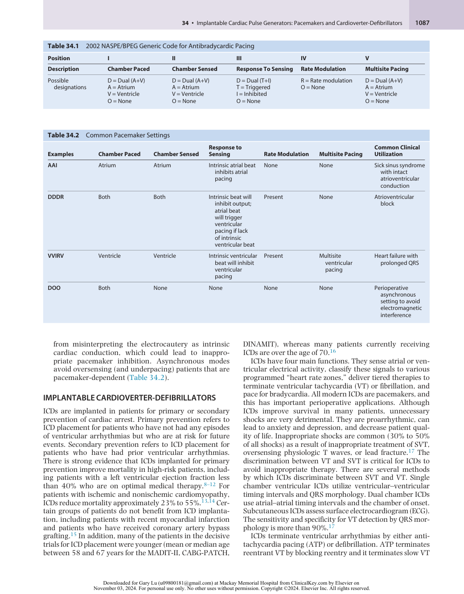
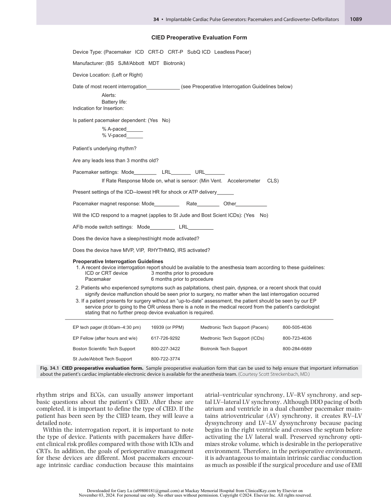
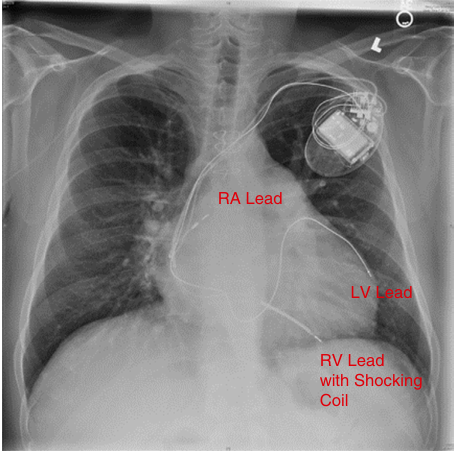
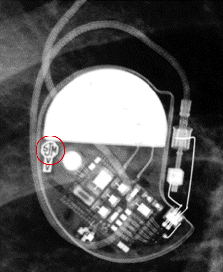
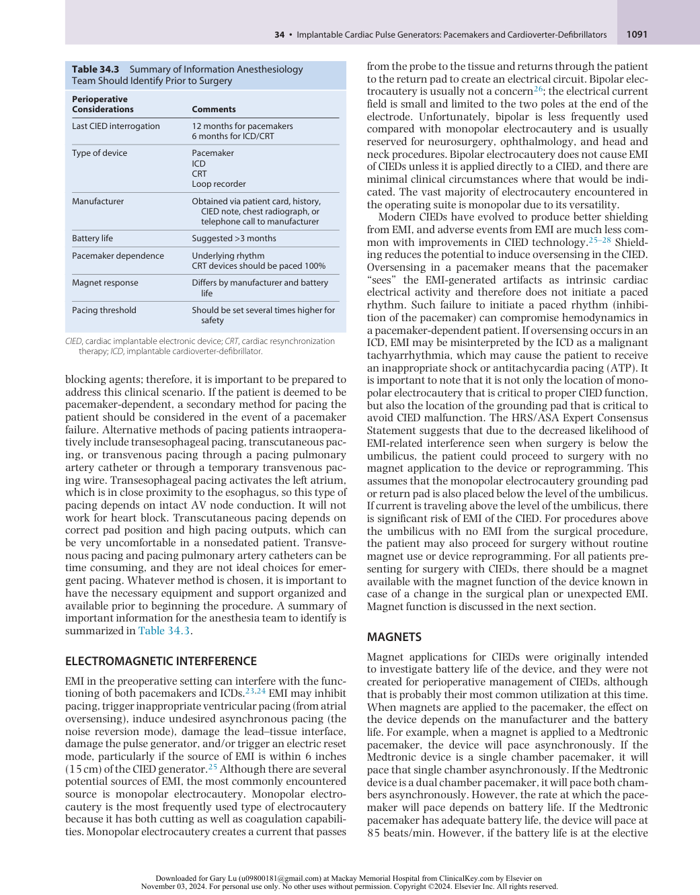
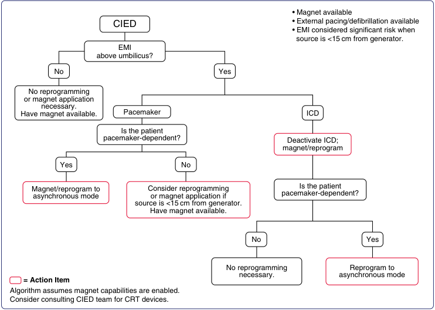
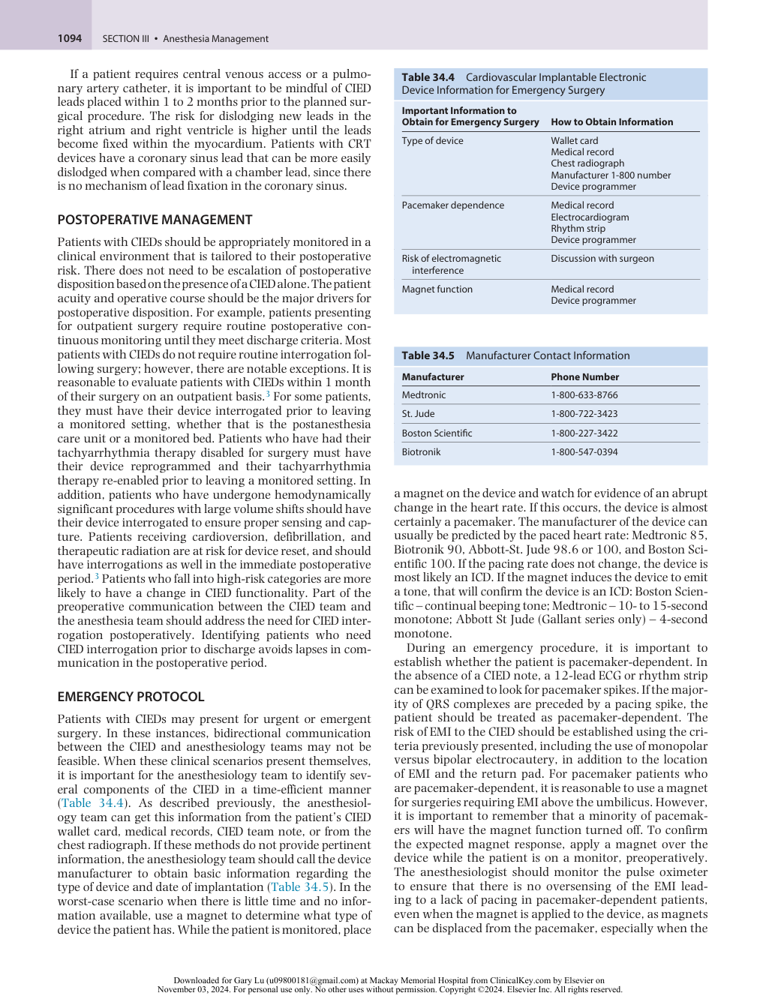
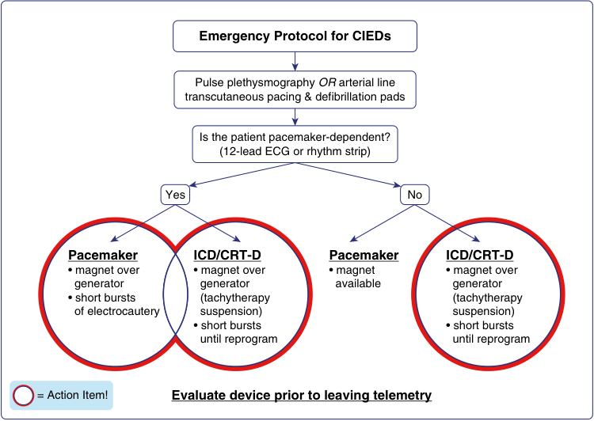
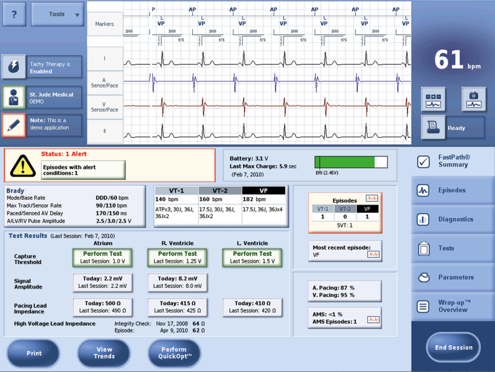

# Implantable Cardiac Pulse Generators: Pacemakers and Cardioverter-Defibrillators

<!-- PDF page 1 -->

AMAN MAHAJAN, JACQUES PRINCE NEELANKAVIL, and SCOTT STRECKENBACH

### KEY POINTS

- Identify the type of cardiovascular implantable electronic device (CIED) (pacemaker, transvenous defibrillator, subcutaneous defibrillator), as well as the generator manufacturer and model of the CIED.

- Contact the physician or clinic managing the patient’s CIED in the preoperative period to obtain appropriate records and a perioperative recommendation (Heart Rhythm Society [HRS]).

- Obtain a copy of this interrogation and the perioperative recommendation from the CIED physician (HRS). Ensure that the implantable cardioverter- defibrillator (ICD) treatment settings are appropriate and that the CIED will pace the heart.

- Consider replacing any CIED near its elective replacement period in a patient scheduled to undergo either a major surgical procedure or a surgical procedure where monopolar electrosurgery will be used within 15 cm of the generator (or leads).

- Determine the patient’s underlying rate and rhythm to determine the need for backup (external) pacing support.

- Ensure that all magnet behavior (pacing, suspension of shock therapy) is appropriate if magnet use is planned.

- Program minute ventilation rate responsiveness “off,” if present. ᑏ Consider increasing the lower rate limit to provide optimal oxygen delivery for major procedures.

- If electromagnetic interference is likely, (1) disable antitachycardia therapy if a defibrillator is present and (2) consider asynchronous pacing for some pacing- dependent patients. Magnet application may be acceptable for some ICDs (disable antitachycardia therapy) or pacemakers (provide asynchronous pacing). Asynchronous pacing from an ICD always requires reprogramming.

- Monitor cardiac rhythm with the pulse oximeter (plethysmography) or arterial waveform analysis.

- Use a bipolar electrosurgical unit (ESU), if possible; if not possible, then pure “cut” electrosurgery is better than “blend” or “coag,” and ESU should be applied in short bursts (&lt;4 seconds) separated by at least 2 seconds.

- Place the ESU dispersive electrode in such a way to prevent electricity from crossing the generator–heart circuit.

- If the ESU causes ventricular oversensing with pacing quiescence or atrial oversensing with inappropriate ventricular pacing, limit the effect by using short ESU bursts, reducing the output of the ESU, relocating the dispersive electrode, or placing a magnet over the pacemaker (not indicated for ICDs).

- Some patients require postoperative interrogation, especially if preoperative reprogramming took place. For “low- risk cases,” HRS states that this interrogation can take place in an ambulatory setting up to 1 month postoperatively. Some rate enhancements can be reinitiated, and a determination of optimum heart rate and pacing parameters should be made. Any patient with disabled antitachycardia therapy must be monitored until the antitachycardia therapy is restored.

<!-- PDF page 2 -->

## Introduction

Cardiac implantable electronic devices (CIEDs) refer to a permanently implanted cardiac pacemaker, an implantable cardioverter- defibrillator (ICD), or a cardiac resynchronization therapy (CRT) device. Evolving technology for CIEDs and their widespread use for bradyarrhythmias, tachyarrhythmias, and congestive heart failure management have made the perioperative management of these devices critical for anesthesiologists. It is estimated that more than 3 million people in the United States have a pacemaker and more than 300,000 people have an ICD.1 With approximately 1 million patients worldwide receiving a pacemaker or ICD every year, patients with CIEDs are a growing population in the perioperative arena.1,2 The prevalence of cardiovascular disease in an aging population is an important driver for the increased utilization of CIEDs.

Historically, there was little guidance for anesthesiologists caring for patients with CIEDs because of the conflicting consensus statements regarding the perioperative management of CIEDs. In 2011, the Heart Rhythm Society (HRS)/ American Society of Anesthesiologists (ASA) published an Expert Consensus Statement on the perioperative management of patients with CIEDs. This statement was in collaboration with the American Heart Association (AHA) and the Society of Thoracic Surgeons (STS).3 The ASA practice advisory was since updated in 2020.4 This article provides information and a guided team approach to best manage this patient population, and it has become an important piece of literature for anesthesiologists. In this chapter, we will review basic CIED function, the perioperative management of these devices, and emerging technology of CIEDs.

## Basic Cardiac Implantable Electronic Device Function

### PACEMAKERS

Pacemakers are devices placed for bradyarrhythmias, and they remain the only effective treatment for ameliorating symptomatic bradycardia due to sinus node dysfunction (e.g., sick sinus syndrome) or a failure of impulse propagation (e.g., complete heart block). Advances in technology and understanding of cardiac conduction physiology have led to the development of more physiologic pacing. Pacemakers have become sophisticated at maintaining the normal atrial–ventricular activation over various heart rate ranges, varying the heart rate in response to metabolic demands, and preserving natural ventricular activation. Pacemakers have many additional features that correspond to the changing needs of patients throughout the day, including rate responsiveness to increase pacing during times of increased physical exertion and sleep functions to decrease pacing rate during times of rest. Standard pacemakers have either one or two (atrial and ventricular) leads. A patient is considered to be pacemaker- dependent if they suffer significant symptoms or even cardiac arrest upon the cessation of pacing.5,6 The dual chamber pacemakers are capable of pacing and sensing in both the ventricle and the atrium. Such capability permits the pacemaker not only to ensure an adequate

ventricular rate, but also to preserve the atrial contraction before each ventricular contraction. These pacemakers guarantee a minimum atrial rate and also ensure that a ventricular contraction occurs within a specified amount of time after each atrial contraction. Limitations on ventricular rate are usually built in the circuitry and are programmable. Most pacemakers have the capability of varying the pacing rate. In the rate adaptive mode, the pacemakers sense the patient’s level of activity and accordingly adjust the pacing rate using sensors that are typically piezoelectric and detect body motion transmitted from underlying muscles. Another method of determining the presence of physical activity utilizes detection of the respiratory rate and/or volume using bioimpedance sensors. More recently, ventricular impedance sensors have been employed in some pacemakers to determine the chronotropic response.

All pacemakers generate a pulse of current to depolarize a small region of the myocardium; the wave then spontaneously spreads to the rest of the myocardium. The pacing capture threshold is the minimum electrical energy needed to consistently capture the heart outside of the refractory period and is determined by (1) the intrinsic excitability of the myocardium, (2) the current density at the electrode– tissue interface, and (3) the duration of the electric pulse.

The North American Society of Pacing and Electrophysiology (NASPE) and the British Pacing and Electrophysiology Group (BPEG) initially published a generic pacemaker code (NBG code) in 1987. In 2002 the NBG code was subsequently revised (Table 34.1).7 Common perioperative pacing modes include dual chamber, adaptive- rate pacing (DDDR), dual chamber pacing without atrium synchronous ventricular pacing (DDIR), and dual chamber asynchronous pacing with no rate modulation or multisite pacing (DOO).

1.  DDDR pacing defines a pacemaker programmed to pace the atrium and/or ventricle, sense the atrium and/or ventricle, inhibit or trigger pacing output in response to a sensed event, and have a rate responsive sensor that is able to alter paced rates due to changes in perceived metabolic demand. DDDR is a very common program configuration for patients with sick sinus syndrome and/or heart block.

2.  DDIR is a common pacing mode for patients with supraventricular tachyarrhythmias (SVTs). If a patient is set to DDD, the ventricle response depends on the atrial rate and rapid ventricular pacing may occur. In DDI, the pacemaker paces and senses both the atrium and ventricle; however, the device will not pace the ventricle at a fast rate if the patient has SVT. The response to a fast rate in the atrium will lead to inhibition of triggering in the ventricle – hence the _I_ in the third designation. Most modern pacemakers have built- in automatic mode switching during episodes of SVT. They will switch from DDD to DDI(R) or VVI(R) to avoid SVT- induced rapid ventricular pacing.

3.  For some perioperative care, devices will be placed in an asynchronous mode like DOO. An asynchronous mode or nontracking mode will pace the atrium and ventricle at a set rate, regardless of the underlying rate and rhythm. This is advantageous in the perioperative environment in order to avoid the pacemaker

<!-- PDF page 3 -->

**Table 34.1** 2002 NASPE/BPEG Generic Code for Antibradycardic Pacing

|**Position**|**I**|**II**|**III**|**IV**|**V**|
|---|---|---|---|---|---|
|**Description**|**Chamber Paced**|**Chamber Sensed**|**Response To Sensing**|**Rate Modulation**|**Multisite Pacing**|
|Possible|D = Dual (A+V)|D = Dual (A+V)|D = Dual (T+I)|R = Rate modulation|D = Dual (A+V)|
|designations|A = Atrium|A = Atrium|T = Triggered|O = None|A = Atrium|
||V = Ventricle|V = Ventricle|I = Inhibited||V = Ventricle|
||O = None|O = None|O = None||O = None|

|**Table 34.2**|Common Pacemaker|Settings|||||
|---|---|---|---|---|---|---|
|**Examples**|**Chamber Paced**|**Chamber Sensed**|**Response to** **Sensing**|**Rate Modulation**|**Multisite Pacing**|**Common Clinical** **Utilization**|
|**AAI**|Atrium|Atrium|Intrinsic atrial beat inhibits atrial pacing|None|None|Sick sinus syndrome with intact atrioventricular conduction|
|**DDDR**|Both|Both|Intrinsic beat will inhibit output; atrial beat will trigger ventricular pacing if lack of intrinsic ventricular beat|Present|None|Atrioventricular block|
|**VVIRV**|Ventricle|Ventricle|Intrinsic ventricular beat will inhibit ventricular pacing|Present|Multisite ventricular pacing|Heart failure with prolonged QRS|
|**DOO**|Both|None|None|None|None|Perioperative asynchronous setting to avoid electromagnetic interference|

from misinterpreting the electrocautery as intrinsic cardiac conduction, which could lead to inappropriate pacemaker inhibition. Asynchronous modes avoid oversensing (and underpacing) patients that are pacemaker- dependent (Table 34.2).

### IMPLANTABLE CARDIOVERTER- DEFIBRILLATORS

ICDs are implanted in patients for primary or secondary prevention of cardiac arrest. Primary prevention refers to ICD placement for patients who have not had any episodes of ventricular arrhythmias but who are at risk for future events. Secondary prevention refers to ICD placement for patients who have had prior ventricular arrhythmias. There is strong evidence that ICDs implanted for primary prevention improve mortality in high- risk patients, including patients with a left ventricular ejection fraction less than 40% who are on optimal medical therapy.8–12 For patients with ischemic and nonischemic cardiomyopathy, ICDs reduce mortality approximately 23% to 55%.13,14 Certain groups of patients do not benefit from ICD implantation, including patients with recent myocardial infarction and patients who have received coronary artery bypass grafting.15 In addition, many of the patients in the decisive trials for ICD placement were younger (mean or median age between 58 and 67 years for the MADIT- II, CABG- PATCH,

DINAMIT), whereas many patients currently receiving ICDs are over the age of 70.16

ICDs have four main functions. They sense atrial or ventricular electrical activity, classify these signals to various programmed “heart rate zones,” deliver tiered therapies to terminate ventricular tachycardia (VT) or fibrillation, and pace for bradycardia. All modern ICDs are pacemakers, and this has important perioperative applications. Although ICDs improve survival in many patients, unnecessary shocks are very detrimental. They are proarrhythmic, can lead to anxiety and depression, and decrease patient quality of life. Inappropriate shocks are common (30% to 50% of all shocks) as a result of inappropriate treatment of SVT, oversensing physiologic T waves, or lead fracture.17 The discrimination between VT and SVT is critical for ICDs to avoid inappropriate therapy. There are several methods by which ICDs discriminate between SVT and VT. Single chamber ventricular ICDs utilize ventricular–ventricular timing intervals and QRS morphology. Dual chamber ICDs use atrial–atrial timing intervals and the chamber of onset. Subcutaneous ICDs assess surface electrocardiogram (ECG). The sensitivity and specificity for VT detection by QRS morphology is more than 90%.17

ICDs terminate ventricular arrhythmias by either antitachycardia pacing (ATP) or defibrillation. ATP terminates reentrant VT by blocking reentry and it terminates slow VT

::: details 原始表格與符號（PDF 第 3 頁）

:::

<!-- PDF page 4 -->

(&lt;188 to 200) approximately 90% of the time. ATP is desirable because it reduces inappropriate shocks and prolongs battery life. For VT that is not terminated by ATP or for ventricular fibrillation (VF), defibrillation is the treatment of choice. The energy for defibrillation may be incrementally increased or set to maximum energy for each shock.18

### CARDIAC RESYNCHRONIZATION THERAPY DEVICES

CRT plays an important role in the management of heart failure and is becoming a device commonly encountered by anesthesiologists because of the large prevalence of heart failure in this country. These devices are indicated in select patients with heart failure, systolic dysfunction, and a prolonged QRS. Conduction abnormalities are frequently seen in systolic heart failure, with approximately 25% to 40% of these patients having a prolonged QRS complex (>120 ms).19 In these patients, cardiac depolarization spreads slowly through the myocardium without a healthy Purkinje conduction system, leading to intraventricular dyssynchrony. During intraventricular dyssynchrony, the left ventricular (LV) septal wall contracts earlier than the lateral wall, which leads to less efficient ejection from the left ventricle in addition to decreased diastolic filling. The goal of CRT is to restore synchronous contraction of the left ventricle and to optimize timing of LV and right ventricular (RV) ejection. This is accomplished through biventricular pacing using a standard RV lead and an LV lead placed adjacent to the lateral wall via the coronary sinus. Biventricular pacing in the right ventricle and the left ventricle leads to improved hemodynamic variables, including systolic blood pressure, stroke volume, cardiac output, and rate of rise of LV pressure (d _P_ /d _t_ ). In contrast to pharmacologic means of improving systolic function, CRT improves cardiac performance with reductions rather than with increases in myocardial metabolic demand. In addition, CRT has been shown to improve mitral regurgitation and New York Heart Association (NYHA) function class because of reverse ventricular remodeling over time.20 Standard indications for CRT are LV ejection fraction (LVEF) less than 35% with QRS greater than 120 ms, sinus rhythm, and NYHA class III or IV after optimal medical therapy. Left bundle branch block is the most common conduction abnormality in patients undergoing CRT. Approximately 30% of patients meeting selection criteria for CRT do not respond to biventricular pacing. Risk factors for failure to respond to CRT include ischemic cardiomyopathy, sustained VT, severe mitral regurgitation, and dilated LV cavity.21 CRT has been shown to reduce mortality, heart failure symptoms, and also heart failure hospitalizations. Patients with CRT should be considered dependent upon their pacemaker for optimal cardiac function because of the constant pacing they undergo to synchronize the ventricle.

## Perioperative Considerations

### PREOPERATIVE ASSESSMENT

As perioperative physicians, the preoperative assessment of patients with CIEDs is critical to safe and time- efficient care.

The key to the preoperative assessment is timely communication between the anesthesia provider and the CIED team that usually manages the device programming and function. The CIED team may include a cardiologist, an electrophysiologist, and/or a physician extender such as a nurse or nurse practitioner. The CIED team needs to know various information about the surgical case and postoperative disposition in order to create an individualized care plan for the patient. The anesthesiology provider must communicate the specifics of perioperative care to the CIED team in order to ensure a proper plan specific to that patient and the surgical case. Unfortunately, there is no single prescription for CIED management that can be applied to all patients coming for surgery. In addition, it is not recommended that an industry- employed allied professional determine the perioperative plan for a particular CIED.22

The perioperative team must convey to the CIED team important information regarding the presence of electromagnetic interference (EMI), the likelihood of cardioversion or defibrillation, patient position, location of surgery that may damage or encroach upon the CIED leads, and postoperative disposition. The CIED team must communicate with the anesthesiology team the date of last interrogation, the type of CIED device, the indication for CIED placement, the pacing mode and rates and the type of RRM sensor, the battery life, pacemaker dependence, and magnet response. Each of these vital perioperative parameters are discussed in detail in this chapter.

The goal of a thorough preoperative evaluation between the CIED and anesthesia teams is to avoid CIED complications in the perioperative period, such as damage to the device, inability of the device to deliver pacing or shocks, lead- tissue interface damage, changes in pacing behavior, electrical reset to the backup pacing mode, or inappropriate ICD therapies. Any of these complications can lead to poor patient outcomes, including hypotension, arrhythmias, and myocardial ischemia. A sample CIED preoperative evaluation form is shown in Fig. 34.1.

### PREOPERATIVE INFORMATION TRANSFER

The ACCF/AHA/HRS 2011 guidelines and ASA practice advisory 2020 emphasize that a team approach should be utilized when caring for patients with CIEDs. Patients coming for surgery with CIEDs do not need routine interrogations prior to surgery unless there has been a change in clinical presentation. For patients with a pacemaker, they should have an interrogation report within the last 12 months; patients with an ICD or CRT should have a report within the previous 6 months. The different time courses for interrogations between pacemakers and ICDs and CRT devices reflect the overall cardiovascular comorbidities of these respective patient populations. Patients with poor systolic function with CRT devices or ICDs implanted for increased risk of sudden cardiac death have severely reduced ejection fraction, and they are more likely to have clinical decompensation compared to patients with isolated pacemakers. Worsening cardiovascular function might negatively impact CIED performance. The preoperative evaluation begins with general considerations, such as establishing whether a patient has a CIED and defining the type of device. A focused history and physical, including

<!-- PDF page 5 -->

### ���������������������������������

��������������������������������������������������������������������������

�������������������������������������������������

��������������������������������

��������������������������������� ������������������������������������������������� ������� ������������� ������������������������� ������������������������������������������ ��������� ��������� ����������������������������

������������������������������������� ������������������������� ��� ��� ������������������������������������������������������������������������������

����������������������������������������������������������������

������������������������������� ���� �����

�������������������������������������������������������������������������������������� ��������������������������������� ���

�������������������������������������������������������

��������������������������������������������������������

### �������������������������������������

- ����������������������������������������������������������������������������������������������������������������� ����������������� ��������������������������� ��������� ���������������������������

- ������������������������������������������������������������������������������������������������������������ ����������������������������������������������������������������������������������������������������������

- ������������������������������������������������������������������������������������������������������������� ������������������������������������������������������������������������������������������������������������� ������������������������������������������������������������

|������������������������������|��������������|�������������������������������|������������|
|---|---|---|---|
|�������������������������������|������������|�����������������������������|������������|
|������������������������������|������������|����������������������|������������|
|���������������������������|������������|||

**Fig. 34.1 CIED preoperative evaluation form.** Sample preoperative evaluation form that can be used to help ensure that important information about the patient’s cardiac implantable electronic device is available for the anesthesia team. (Courtesy Scott Streckenbach, MD.)

rhythm strips and ECGs, can usually answer important basic questions about the patient’s CIED. After these are completed, it is important to define the type of CIED. If the patient has been seen by the CIED team, they will leave a detailed note.

Within the interrogation report, it is important to note the type of device. Patients with pacemakers have different clinical risk profiles compared with those with ICDs and CRTs. In addition, the goals of perioperative management for these devices are different. Most pacemakers encourage intrinsic cardiac conduction because this maintains

atrial–ventricular synchrony, LV–RV synchrony, and septal LV–lateral LV synchrony. Although DDD pacing of both atrium and ventricle in a dual chamber pacemaker maintains atrioventricular (AV) synchrony, it creates RV–LV dyssynchrony and LV–LV dyssynchrony because pacing begins in the right ventricle and crosses the septum before activating the LV lateral wall. Preserved synchrony optimizes stroke volume, which is desirable in the perioperative environment. Therefore, in the perioperative environment, it is advantageous to maintain intrinsic cardiac conduction as much as possible if the surgical procedure and use of EMI

::: warning 符號需核對
此頁有符號無法完整擷取，請展開下方原始頁面核對。
:::

::: details 原始表格與符號（PDF 第 5 頁）

:::

<!-- PDF page 6 -->

permits. In contrast, CRT devices attempt to ensure pacing 100% of the time in order to optimize stroke volume.

The manufacturer and model should be noted, along with the indication for placement of the CIED, in order to troubleshoot problems. Theoretically, all patients with CIEDs should carry identification cards that identify the type of CIED, the manufacturer, the model, and date of implantation. In practice, many patients do not carry their CIED cards, and it is left to the anesthesia provider to identify these parameters. There are several methods for obtaining this information. Frequently an interrogation note from the CIED team will identify all these parameters. Occasionally, patients present for elective surgery without CIED team communication. In this subset of patients, there are several options. One option for identifying the type of device and manufacturer is the use of chest radiographs (Fig. 34.2). Chest radiographs can identify pacemakers versus ICDs, due to the increased thickness of the shocking coil in ICDs. Chest radiographs can also identify CRT devices due to the lead in the coronary sinus. With some training, the manufacturer can also be identified via chest radiograph (Fig. 34.3). In situations where the patient does not have his or her card, or there is no CIED note and there is no chest radiograph available or it cannot be interpreted, then contact with the CIED manufacturers can be initiated, since they all keep clinical records of their patients. Communicating directly with the manufacturer can disclose information about the type of CIED, date of implantation, and original settings. Unfortunately, current information about pacemaker dependence and battery life is not usually available by phone.

Battery longevity is important to consider as an anesthesia provider. Three months of battery duration is reasonable in the perioperative period. This time point is chosen because battery life depends on the amount of pacing and the number of shocks delivered for pacemakers and ICDs, respectively. The burden of pacing in the perioperative period may be very different than the patient’s normal requirements. Sinoatrial (SA) and AV nodal suppressing agents such as opioids, beta blockers, and calcium channel blockers administered in the hospital may increase pacing requirements; therefore, it is prudent to have several months of battery life remaining. In addition, there may be unexpected postoperative complications leading to the increased duration of hospitalization. If a patient is presenting for elective surgery with a diminished battery life, the patient’s electrophysiologist should be contacted prior to proceeding to determine if the generator needs to be replaced prior to the procedure.

It is important to establish if the patient is pacemakerdependent, which is defined as the absence of a perfusing rhythm without pacing. In order to establish pacemaker dependence, a history and chart review may identify an episode of bradyarrhythmia leading to syncope. In addition, for patients with refractory SVT, they will occasionally have an AV nodal ablation. This is a therapeutic procedure that establishes complete heart block to eliminate rapid ventricular response to SVT. This patient population is pacemakerdependent. Patients with CRT devices can be considered pacemaker- dependent even if they have a normal sinus rate and intact AV conduction due to the hemodynamic deterioration they suffer with dyssynchrony of the RV–LV and LV– LV. Pacemaker dependence can be established by the CIED

RA Lead LV Lead RV Lead with Shocking Coil 

**Fig. 34.2 Chest radiograph: the pulse generator is located in the left deltopectoral groove.** There are three leads visualized: a lead in the right atrium (RA), a lead in the left ventricle (LV) via the coronary sinus, and a lead in the right ventricle (RV). The RV lead has a thicker diameter toward the tip, indicating it is an implantable cardioverterdefibrillator lead.

**Fig. 34.3 Chest radiograph of the cardiovascular implantable electronic device generator.** The letter designation on the generator allows the physician to identify this manufacturer as St. Jude Medical.

team preoperatively. They can decrease the pacing rate in a stepwise fashion to search for intrinsic electrical activity. If no intrinsic rate is present around 40 to 45 beats/min or the patient develops symptoms, the patient may be considered pacemaker- dependent. Some patients who are not pacemaker- dependent may become pacemaker- dependent in the perioperative period due to SA and AV nodal

<!-- PDF page 7 -->

**Table 34.3** Summary of Information Anesthesiology Team Should Identify Prior to Surgery

|**Perioperative** **Considerations**|**Comments**|
|---|---|
|Last CIED interrogation|12 months for pacemakers 6 months for ICD/CRT|
|Type of device|Pacemaker ICD CRT Loop recorder|
|Manufacturer|Obtained via patient card, history, CIED note, chest radiograph, or telephone call to manufacturer|
|Battery life|Suggested >3 months|
|Pacemaker dependence|Underlying rhythm CRT devices should be paced 100%|
|Magnet response|Differs by manufacturer and battery life|
|Pacing threshold|Should be set several times higher for safety|

_CIED_ , cardiac implantable electronic device; _CRT_ , cardiac resynchronization therapy; _ICD_ , implantable cardioverter- defibrillator.

blocking agents; therefore, it is important to be prepared to address this clinical scenario. If the patient is deemed to be pacemaker- dependent, a secondary method for pacing the patient should be considered in the event of a pacemaker failure. Alternative methods of pacing patients intraoperatively include transesophageal pacing, transcutaneous pacing, or transvenous pacing through a pacing pulmonary artery catheter or through a temporary transvenous pacing wire. Transesophageal pacing activates the left atrium, which is in close proximity to the esophagus, so this type of pacing depends on intact AV node conduction. It will not work for heart block. Transcutaneous pacing depends on correct pad position and high pacing outputs, which can be very uncomfortable in a nonsedated patient. Transvenous pacing and pacing pulmonary artery catheters can be time consuming, and they are not ideal choices for emergent pacing. Whatever method is chosen, it is important to have the necessary equipment and support organized and available prior to beginning the procedure. A summary of important information for the anesthesia team to identify is summarized in Table 34.3.

### ELECTROMAGNETIC INTERFERENCE

EMI in the preoperative setting can interfere with the functioning of both pacemakers and ICDs.23,24 EMI may inhibit pacing, trigger inappropriate ventricular pacing (from atrial oversensing), induce undesired asynchronous pacing (the noise reversion mode), damage the lead–tissue interface, damage the pulse generator, and/or trigger an electric reset mode, particularly if the source of EMI is within 6 inches (15 cm) of the CIED generator.25 Although there are several potential sources of EMI, the most commonly encountered source is monopolar electrocautery. Monopolar electrocautery is the most frequently used type of electrocautery because it has both cutting as well as coagulation capabilities. Monopolar electrocautery creates a current that passes

from the probe to the tissue and returns through the patient to the return pad to create an electrical circuit. Bipolar electrocautery is usually not a concern26 ; the electrical current field is small and limited to the two poles at the end of the electrode. Unfortunately, bipolar is less frequently used compared with monopolar electrocautery and is usually reserved for neurosurgery, ophthalmology, and head and neck procedures. Bipolar electrocautery does not cause EMI of CIEDs unless it is applied directly to a CIED, and there are minimal clinical circumstances where that would be indicated. The vast majority of electrocautery encountered in the operating suite is monopolar due to its versatility. Modern CIEDs have evolved to produce better shielding from EMI, and adverse events from EMI are much less common with improvements in CIED technology.25–28 Shielding reduces the potential to induce oversensing in the CIED. Oversensing in a pacemaker means that the pacemaker “sees” the EMI- generated artifacts as intrinsic cardiac electrical activity and therefore does not initiate a paced rhythm. Such failure to initiate a paced rhythm (inhibition of the pacemaker) can compromise hemodynamics in a pacemaker- dependent patient. If oversensing occurs in an ICD, EMI may be misinterpreted by the ICD as a malignant tachyarrhythmia, which may cause the patient to receive an inappropriate shock or antitachycardia pacing (ATP). It is important to note that it is not only the location of monopolar electrocautery that is critical to proper CIED function, but also the location of the grounding pad that is critical to avoid CIED malfunction. The HRS/ASA Expert Consensus Statement suggests that due to the decreased likelihood of EMI- related interference seen when surgery is below the umbilicus, the patient could proceed to surgery with no magnet application to the device or reprogramming. This assumes that the monopolar electrocautery grounding pad or return pad is also placed below the level of the umbilicus. If current is traveling above the level of the umbilicus, there is significant risk of EMI of the CIED. For procedures above the umbilicus with no EMI from the surgical procedure, the patient may also proceed for surgery without routine magnet use or device reprogramming. For all patients presenting for surgery with CIEDs, there should be a magnet available with the magnet function of the device known in case of a change in the surgical plan or unexpected EMI. Magnet function is discussed in the next section.

### MAGNETS

Magnet applications for CIEDs were originally intended to investigate battery life of the device, and they were not created for perioperative management of CIEDs, although that is probably their most common utilization at this time. When magnets are applied to the pacemaker, the effect on the device depends on the manufacturer and the battery life. For example, when a magnet is applied to a Medtronic pacemaker, the device will pace asynchronously. If the Medtronic device is a single chamber pacemaker, it will pace that single chamber asynchronously. If the Medtronic device is a dual chamber pacemaker, it will pace both chambers asynchronously. However, the rate at which the pacemaker will pace depends on battery life. If the Medtronic pacemaker has adequate battery life, the device will pace at 85 beats/min. However, if the battery life is at the elective

::: details 原始表格與符號（PDF 第 7 頁）

:::

<!-- PDF page 8 -->

replacement interval, the device will pace at 65 beats/min. The change in rate is binary, meaning that the rate goes from 85 to 65 beats/min when the battery enters its elective replacement interval. Different manufacturers have different responses to magnet application. Abbott (previously St. Jude) pacemakers will pace asynchronously during magnet application if the magnet response is turned on. It is important to note that magnet application is programmable – that is, with some devices, magnet application will have no effect. The effect of magnet response is an important piece of information to obtain from the CIED team. For an Abbott (previously St. Jude) pacemaker with magnet response programmed on, magnet application will program the device to pace asynchronously at a rate of 100 beats/min if the battery life is normal or a rate of 85 beats/min if the device is at its battery elective replacement interval. Unlike Medtronic devices, the rate change from 100 to 85 beats/min is not binary; it is a gradual reduction from 100 to 85 beats/min.3

Magnet use continues to be very popular in everyday practice for the management of CIEDs. This is a relatively easy way to render the pacemaker asynchronous, with the added benefit of the device reverting to its programmed settings once the magnet is removed. Most magnet rates are typically around 90 beats/min, which may not be appropriate for a subset of patients: those with aortic stenosis or coronary artery disease. On the other hand, when patients need a higher heart rate in order to increase tissue oxygen delivery, the relatively high magnet- induced rate may be beneficial. These variables make it important to confirm the magnet effect on each individual patient’s device before the procedure, and to have an individualized plan for each patient.

The choice of reprogramming versus magnet application largely depends on the type of surgery, patient position, accessibility of a programmer, and knowledge of magnet function of a particular patient’s device. It should be emphasized that a magnet has different effects when applied to a pacemaker or to an ICD. In a majority of pacemakers, magnet application induces an asynchronous mode. Magnet application to an ICD inhibits tachyarrhythmia detection, thus preventing therapy (i.e., delivery of shocks). However, it does _not_ change the mode of the underlying pacemaker. Therefore, a magnet placed over an ICD will not induce asynchronous pacing in the underlying pacemaker. For patients with an ICD who are pacemaker- dependent, reprogramming is the preferred option if EMI is a significant concern. One advantage of reprogramming is that if the patient is not in the supine position, it may be difficult to maintain the magnet in a location over the device to render it asynchronous. This is particularly true in the prone position. If the patient has a normal sinus rate, adequate chronotropy, and intact AV node conduction, magnet application may compete with the patient’s own heart rate if surgical stimulation increases the sinus rate. This can lead to significant arrhythmias caused by depolarization of the ventricle by the pacemaker during a refractory period, due to intrinsic electrical activity. The principal disadvantage of reprogramming versus magnet application is that the changes made with the programmer are not as easily reversed. If the patient develops an arrhythmia or has an increased sinus rate, it may be difficult to reprogram the device intraoperatively, depending on programmer availability and

CIED team presence. The other disadvantage of reprogramming a CIED compared with magnet application involves the human factor. Failure to re- enable tachyarrhythmia therapy following surgery can lead to catastrophic consequences for patients with CIEDs. It is important to understand the risks and benefits of magnet application versus reprogramming and create a perioperative plan that suits the patient.

### ELECTROMAGNETIC INTERFERENCE DAMAGE TO THE CARDIAC IMPLANTABLE ELECTRONIC DEVICE

It is uncommon for modern CIEDs to be damaged by EMI from the operative environment; however, some particular complications will be discussed. Monopolar electrocautery that is done in very close proximity to the pulse generator may directly damage the myocardium at the interface with the CIED lead. This can trigger arrhythmias or loss of pacing capture due to increases in pacing thresholds.29 Therefore, it is recommended that bipolar electrocautery should be used when electrocautery is performed in close proximity to the pulse generator. Another complication that may happen due to ionizing radiation is device reset.30,31 It is uncommon for even monopolar electrocautery to cause reset. In the perioperative setting, this very rarely occurs when an energy surge directly contacts the pulse generator, resulting in a major hardware/software failure. The reset mode is unique to each manufacturer and serves as a safety backup in the case of catastrophic failure. Unfortunately, magnet application and device reprogramming will not prevent electrical reset. The best way to prevent reset is to ensure that EMI is as far as possible from the pulse generator and leads (ideally >15 cm). If a patient’s CIED does go into reset mode, the pacemaker will commonly revert to a ventricular demand pacing (VVI) mode between 65 and 70 beats/min. Magnet response in reset mode will also vary among manufacturers. ICDs will have a wide range of rate cutoffs for VT detection in the reset mode. ICD pacing will be typically in a VVI mode again around 65 to 70 beats/min. Electrical reset should prompt consultation with a CIED team to ensure proper device functionality.

### INTRAOPERATIVE MANAGEMENT

The intraoperative management of CIEDs naturally evolves from a thoughtful preoperative plan. A pathway for management of CIEDs during nonemergent surgery is outlined in Fig. 34.4. Pacemaker patients who are pacemakerdependent and who are having surgery with monopolar electrocautery within 15 cm of the generator should have their device reprogrammed to avoid pacemaker oversensing of electrocautery as intrinsic cardiac function. This could lead to underpacing and hemodynamic collapse in pacemaker- dependent patients. For patients in the supine position with known magnet function who have magnet rates appropriate for their concurrent comorbidities, placement of a magnet over a pacemaker is a reasonable approach for patients at risk for monopolar electrocautery oversensing. Whether the prescription plan is reprogramming or magnet application, the rate responsive features of the device should be disabled when the sensor is a minute

<!-- PDF page 9 -->

• Magnet available CIED • External pacing/defibrillation available • EMI considered significant risk when   source is &lt;15 cm from generator. EMI above umbilicus? No Yes No reprogramming or magnet application necessary. Have magnet available. Pacemaker ICD Is the patient pacemaker-dependent? Deactivate ICD; magnet/reprogram Yes No Magnet/reprogram to Consider reprogramming Is the patient asynchronous mode or magnet application if pacemaker-dependent? source is &lt;15 cm from generator. Have magnet available. No Yes No reprogramming Reprogram to = Action Item necessary. asynchronous mode Algorithm assumes magnet capabilities are enabled. Consider consulting CIED team for CRT devices. 

**Fig. 34.4 Cardiovascular implantable electronic device pathway for nonemergent surgery.** _CIED_ , cardiovascular implantable electronic device; _CRT_ , cardiac resynchronization therapy; _ICD_ , implantable cardioverter- defibrillator; _EMI_ , electromagnetic interference. (From Thompson A, Neelankavil JP, Mahajan A. _Curr Anesthesiol Rep_ . 2013;3(3):139–143; Courtesy Dr. Annemarie Thompson.)

ventilation (transthoracic impedance) sensor. The rate response is the fourth letter in the 2002 NASPE guidelines and refers to increasing the heart rate above the lower rate limit when the patient has increased metabolic demand (e.g., exercise). Rate response sensors commonly use accelerometers or minute ventilation (thoracic impedance) to increase rate, and both may be affected intraoperatively. Patients on mechanical ventilation will see increases in heart rate if the minute ventilation is increased with these sensors. For patients with thoracic impedance sensors, electrocautery may lead to increases in heart rate. Although these increases in heart rate may be transient, they may be detrimental for patients in whom strict heart rate control is optimal. In addition, these changes in heart rate may be distracting for the anesthesia provider, who may perceive the heart rate fluctuations as CIED malfunction. Patients with ICDs should have their tachyarrhythmia therapies disabled to avoid inappropriate shocks from monopolar cautery oversensing by either reprogramming or magnet application if EMI (or the return pad) is used above the umbilicus. Patients with ICDs who are pacemaker- dependent with close EMI to the generator are a special group that must have their devices reprogrammed. Magnet application is not a reasonable strategy in these patients since the magnet will not make the pacemaker asynchronous. Patients who have CRT devices are another special classification of patients presenting for surgery. Again, most dual chamber pacemakers are programmed to minimize RV pacing. CRT devices, however, are programmed to achieve ventricular pacing 100% of the time to improve cardiac output, systolic, and diastolic function. Even though CRT devices are pacing the ventricle 100% of the time, they will not have the characteristic wide complex QRS found in RV pacing alone. Programming the CRT device to an asynchronous

mode above the intrinsic rate is a reasonable intraoperative management strategy. Since almost all CRT devices are ICDs, magnet application to the device will deactivate tachyarrhythmia therapy but will not make the CRT device asynchronous. Brief periods of monopolar electrocautery may be tolerated in patients with CRT devices who have a reasonable sinus rate and normal conduction if the device is not reprogrammed. However, prolonged use of monopolar electrocautery will lead to hemodynamic deterioration due to a loss of synchrony between the RV and LV and the LV septal and lateral walls.

Intraoperative monitoring mirrors standard American Society of Anesthesiology (ASA) guidelines. Plethysmographic pulse oximetry is invaluable for patients with CIEDs undergoing surgery because it is the best clinical indicator that the pacemaker is capturing and creating cardiac output. With monopolar electrocautery, monitoring for pacemaker capture with ECG can be challenging. Due to ECG technology, the ECG rate will sometimes double count the heart rate due to counting of a pacemaker spike and the resulting QRS complex. Double counting of the heart rate may lead to erroneous patient management. In addition, pacemaker spikes may be difficult to see due to their low voltage. Pacemaker spikes may be accentuated with various patient monitors; however, they may inaccurately identify a pacemaker spike. It is important to ensure that each pacemaker spike is capturing the myocardium. Ensuring the paced rate of the device is the same as the pulse oximetry rate ensures proper capture of the myocardium and appropriate cardiac output. While arterial lines accurately display pacemaker capture and cardiac output, patients with CIEDs do not need routine arterial line placement unless patient acuity or surgical complexity deems it necessary.

<!-- PDF page 10 -->

If a patient requires central venous access or a pulmonary artery catheter, it is important to be mindful of CIED leads placed within 1 to 2 months prior to the planned surgical procedure. The risk for dislodging new leads in the right atrium and right ventricle is higher until the leads become fixed within the myocardium. Patients with CRT devices have a coronary sinus lead that can be more easily dislodged when compared with a chamber lead, since there is no mechanism of lead fixation in the coronary sinus.

### POSTOPERATIVE MANAGEMENT

Patients with CIEDs should be appropriately monitored in a clinical environment that is tailored to their postoperative risk. There does not need to be escalation of postoperative disposition based on the presence of a CIED alone. The patient acuity and operative course should be the major drivers for postoperative disposition. For example, patients presenting for outpatient surgery require routine postoperative continuous monitoring until they meet discharge criteria. Most patients with CIEDs do not require routine interrogation following surgery; however, there are notable exceptions. It is reasonable to evaluate patients with CIEDs within 1 month of their surgery on an outpatient basis.3 For some patients, they must have their device interrogated prior to leaving a monitored setting, whether that is the postanesthesia care unit or a monitored bed. Patients who have had their tachyarrhythmia therapy disabled for surgery must have their device reprogrammed and their tachyarrhythmia therapy re- enabled prior to leaving a monitored setting. In addition, patients who have undergone hemodynamically significant procedures with large volume shifts should have their device interrogated to ensure proper sensing and capture. Patients receiving cardioversion, defibrillation, and therapeutic radiation are at risk for device reset, and should have interrogations as well in the immediate postoperative period.3 Patients who fall into high- risk categories are more likely to have a change in CIED functionality. Part of the preoperative communication between the CIED team and the anesthesia team should address the need for CIED interrogation postoperatively. Identifying patients who need CIED interrogation prior to discharge avoids lapses in communication in the postoperative period.

### EMERGENCY PROTOCOL

Patients with CIEDs may present for urgent or emergent surgery. In these instances, bidirectional communication between the CIED and anesthesiology teams may not be feasible. When these clinical scenarios present themselves, it is important for the anesthesiology team to identify several components of the CIED in a time- efficient manner (Table 34.4). As described previously, the anesthesiology team can get this information from the patient’s CIED wallet card, medical records, CIED team note, or from the chest radiograph. If these methods do not provide pertinent information, the anesthesiology team should call the device manufacturer to obtain basic information regarding the type of device and date of implantation (Table 34.5). In the worst- case scenario when there is little time and no information available, use a magnet to determine what type of device the patient has. While the patient is monitored, place

**Table 34.4** Cardiovascular Implantable Electronic Device Information for Emergency Surgery

|**Important Information to** **Obtain for Emergency Surgery**|**How to Obtain Information**|
|---|---|
|Type of device|Wallet card Medical record Chest radiograph Manufacturer 1- 800 number Device programmer|
|Pacemaker dependence|Medical record Electrocardiogram Rhythm strip Device programmer|
|Risk of electromagnetic interference|Discussion with surgeon|
|Magnet function|Medical record Device programmer|

**Table 34.5** Manufacturer Contact Information

|**Manufacturer**|**Phone Number**|
|---|---|
|Medtronic|1- 800- 633- 8766|
|St. Jude|1- 800- 722- 3423|
|Boston Scientific|1- 800- 227- 3422|
|Biotronik|1- 800- 547- 0394|

a magnet on the device and watch for evidence of an abrupt change in the heart rate. If this occurs, the device is almost certainly a pacemaker. The manufacturer of the device can usually be predicted by the paced heart rate: Medtronic 85, Biotronik 90, Abbott- St. Jude 98.6 or 100, and Boston Scientific 100. If the pacing rate does not change, the device is most likely an ICD. If the magnet induces the device to emit a tone, that will confirm the device is an ICD: Boston Scientific – continual beeping tone; Medtronic – 10- to 15- second monotone; Abbott St Jude (Gallant series only) – 4- second monotone.

During an emergency procedure, it is important to establish whether the patient is pacemaker- dependent. In the absence of a CIED note, a 12- lead ECG or rhythm strip can be examined to look for pacemaker spikes. If the majority of QRS complexes are preceded by a pacing spike, the patient should be treated as pacemaker- dependent. The risk of EMI to the CIED should be established using the criteria previously presented, including the use of monopolar versus bipolar electrocautery, in addition to the location of EMI and the return pad. For pacemaker patients who are pacemaker-dependent, it is reasonable to use a magnet for surgeries requiring EMI above the umbilicus. However, it is important to remember that a minority of pacemakers will have the magnet function turned off. To confirm the expected magnet response, apply a magnet over the device while the patient is on a monitor, preoperatively. The anesthesiologist should monitor the pulse oximeter to ensure that there is no oversensing of the EMI leading to a lack of pacing in pacemaker- dependent patients, even when the magnet is applied to the device, as magnets can be displaced from the pacemaker, especially when the

::: details 原始表格與符號（PDF 第 10 頁）

:::

<!-- PDF page 11 -->

Emergency Protocol for CIEDs Pulse plethysmography  OR  arterial line transcutaneous pacing & defibrillation pads Is the patient pacemaker-dependent? (12-lead ECG or rhythm strip) Yes No Pacemaker ICD/CRT-D Pacemaker ICD/CRT-D • magnet over • magnet over • magnet • magnet over   generator   generator   available   generator • short bursts   (tachytherapy   (tachytherapy   of electrocautery   suspension)   suspension) • short bursts • short bursts   until reprogram   until reprogram = Action Item! Evaluate device prior to leaving telemetry 

**Fig. 34.5 Cardiovascular implantable electronic device (CIED) pathway for emergency surgery.** _CRT_ , cardiac resynchronization therapy; _ECG_ , electrocardiogram; _ICD_ , implantable cardioverter- defibrillator. (Courtesy Dr. Annemarie Thompson.)

patient is in the lateral or prone position, or when the surgical field is close to the pacemaker. For patients who are not pacemaker- dependent, it is reasonable to have a magnet available in case the patient requires asynchronous pacing. For patients with ICDs, defibrillator pads should be placed on the patient during emergency procedures. Magnet application should be applied for cases with EMI above the level of the umbilicus. Since this will not render the pacemaker asynchronous, if monopolar EMI is used above the umbilicus, it is critical for the surgeon to use short bursts (&lt;5 seconds) of monopolar electrocautery to avoid pacemaker oversensing. Interrogation of the CIED under the direction of a physician knowledgeable in the function of these devices should be done as soon as possible. The emergency protocol is described in the HRS/ASA Expert Consensus Statement. A suggested emergency algorithm is shown in Fig. 34.5.

It may be challenging for anesthesiology providers to feel comfortable reprogramming CIEDs in the perioperative environment. Having a structured CIED team that is willing to work with anesthesiologists is a great way to learn how to reprogram devices.32 Even if one does not feel comfortable reprogramming CIEDs in the perioperative environment, it may be very important for the anesthesiologist to know how to turn on a programmer to obtain important information about a device during an emergency procedure. Interrogating a device and simply reading the home screen can provide critical information regarding the type of device (pacemaker, ICD, CRT), the pacemaker mode, histograms of percentage of time the patient is being paced, battery life, and lead impedance. This is relatively easy to do if one has access to a device programmer in one’s institution. Sample images of home screens are shown in Fig. 34.6.

### SPECIFIC SURGICAL PROCEDURES

The general perioperative recommendations as outlined earlier cover the majority of clinical scenarios encountered by anesthesia providers caring for patients with CIEDs. However, there are specific surgical procedures that convey increased risk for CIED malfunction or damage due to high therapeutic energy transfer to the CIED.

### Cardioversion

External cardioversion may occur as a planned procedure or as part of advanced cardiovascular life support (ACLS) to treat unstable arrhythmias. Historically, there was increased concern for CIED function because of the use of unipolar leads. With these older leads, the current traveled from the generator (one pole) to the tip of the lead (second pole). There were reports of loss of capture and electrical reset when the cardioversion pads were placed in an anterior and lateral orientation.33,34 With newer leads, which have a bipolar configuration (both poles located in the tip of the lead), it is uncommon for cardioversion to affect CIED function. In a study with 44 patients, no CIED malfunction was observed during cardioversion with an anterior–posterior pad orientation with the anterior pad more than 8 cm from the CIED generator.35 For patients requiring emergent cardioversion or defibrillation who have a CIED with antitachycardia therapy, remove the magnet to re- enable CIED therapy if a magnet has been applied. If removing the magnet does not result in antitachycardia therapy or if the device cannot be reprogrammed to resume antitachycardia therapy, proceed with emergency external cardioversion or defibrillation.

<!-- PDF page 12 -->

**Fig. 34.6 Representative image of pacemaker programmer.** Battery life, pacemaker settings, implantable cardioverter- defibrillator therapy, and percentage of atrial and ventricular pacing are readily found on the home screen.

### Radiofrequency Ablation

Many patients with CIEDs present to the electrophysiology laboratory for electrophysiology studies and catheter ablation. It is uncommon to have CIED malfunction with radiofrequency ablation (RFA); however, if complications occur, they involve electrical reset, oversensing, and undersensing due to energy delivery near CIEDs. Recommendations include avoiding direct contact between the ablation catheter and the pulse generator and leads and keeping the path of radiofrequency current (electrode tip to current return pad) as far away from the pulse generator and leads as possible.36,37

### Lithotripsy

Extracorporeal shockwave lithotripsy is used for disintegrating renal calculi. From the initial use of lithotripsy, there was theoretical concern that the shockwaves and EMI would damage CIEDs; therefore, CIED presence was originally a contraindication to lithotripsy. As technology has evolved, current lithotripsy requires less energy transfer to the patient with improved focus of energy as well to the renal calculi. Guidelines from Canada recommend a distance of

15 cm from the device to treatment area and that abdominal CIEDs are contraindicated.38 Another study suggests that with improved technology for lithotripsy, most CIEDs do not have complications; however, if complications arise, the device should be reprogrammed immediately by a member of the CIED team.39

### Radiation

Diagnostic radiation usually does not significantly affect CIEDs. On the other hand, therapeutic radiation can significantly affect CIED function if directed onto the pulse generator.40–42 If radiation therapy is performed, position the device outside the field of radiation. The concern with therapeutic radiation and CIEDs is that the circuit of the CIED may be damaged directly by the radiation. Direct radiation of CIEDs should be avoided, and accumulated doses should be kept under 5 Gy.3 In some instances, the pulse generator will require surgical relocation prior to commencing radiation.

### Electroconvulsive Therapy

Electroconvulsive therapy (ECT) involves direct electric current to the brain for the treatment of depression. There are

<!-- PDF page 13 -->

no reports of direct damage to the CIED; however, the concern is pacemaker oversensing of the electric current leading to underpacing in pacemaker- dependent patients. The medical decision to use ECT should consider the duration of its application. If the therapy is going to be short (&lt;5 seconds), it is unlikely that hemodynamically significant oversensing will occur. It is also unlikely that the patient will receive an inappropriate shock, however, it may be prudent to suspend all antitachycardia therapies in an ICD with a magnet or programming.

If prolonged ECT exposure is required, the device should be placed in asynchronous pacing mode and antitachyarrhythmia function should be disabled. A discussion between the CIED team and the psychiatrist may facilitate treatment plans, since these patients usually undergo multiple treatments of ECT. ECT may lead to significant hemodynamic effects unrelated to the CIED, including sinus tachycardia from the seizure and ventricular arrhythmias. A magnet should be available for all patients undergoing ECT in the event that oversensing of myopotentials or inappropriate therapy for sinus tachycardia occurs.3

### Endoscopy

Most upper and lower endoscopies do not use electrocautery, and for those cases, CIED management is straightforward. However, occasionally, electrocautery is used for some patients. There are case reports of inappropriate ICD therapy in these patients. When electrocautery is planned for endoscopy, the same guidelines as previously presented apply with regard to CIED team communication and the assessment of EMI risk to the CIED.

### Magnetic Resonance Imaging (MRI)

CIED technology has evolved to include devices that are MR conditional. This refers to a device that can be safely utilized in an MRI environment under specific conditions. CIEDs that do not meet MR conditional criteria are labeled MR nonconditional. During an MRI, CIED potential complications include generator movement, tissue heating, electromagnetic interference, and device reset. The perioperative management of CIEDs depends on whether the device is MR conditional or MR nonconditional.

The ASA practice advisory for CIEDs from 2020 recommends that MR- conditional devices should be interrogated prior to MRI and programmed to magnetic resonance imaging mode. The device should be placed in an asynchronous pacing mode for pacemaker- dependent patients with suspension of antitachycardia therapy. The CIED should be interrogated after the MRI, and the permanent settings should be restored. The recommendations for MR- nonconditional CIEDs are similar with respect to asynchronous pacing for pacemakerdependent patients with suspension of antitachycardia therapy. The Heart Rhythm Society 2017 guidelines also recommend that for MR- nonconditional CIEDs, one should consider programming to nonpacing modes (e.g. ODO) or inhibiting modes (e.g. DDI) for patients that are not pacemaker- dependent. The HRS also states that it is reasonable for MR- nonconditional CIEDs to have an MRI if there are no fractured, epicardial, or abandoned leads

and MRI is the best diagnostic test to answer the clinical question. The guidelines also recommend that there should be an institutional protocol and a responsible MR and CIED physician.

Perioperative guidelines for CIED care in the MRI environment also include:

- ECG and pulse oximetry monitoring

- Personnel able to perform ACLS

- External defibrillator immediately available outside zone 4

- Personnel able to program CIED available as defined by institutional protocol

### Emerging Technologies

The past couple of years have seen the advent of a new, leadless pacemaker. The impetus for the development of a leadless pacemaker stems from the fact that many pacemaker complications are related to the leads themselves, including lead fracture and infection. The Medtronic Micra was the first and the only leadless pacemaker approved for use in the United States.43 The Micra is a single chamber device placed in the right ventricle via the femoral vein. Its modes include VVIR, VVI, VOO, OVO, and device off. The rate response mode (VVIR) is possible because the Micra has a built- in accelerometer. The Medtronic Micra AV uses its accelerometer to sense atrial mechanical activity and can therefore also provide VDD pacing. The Micra AV can detect intrinsic atrial contractions and then sequentially pace the ventricle. Unfortunately, neither Medtronic leadless pacemaker will respond to a magnet. If VOO pacing is indicated during surgery, a standard Medtronic programmer will be needed to reprogram the pacing mode.

Abbott subsequently released a leadless pacemaker, the AVEIR VR. It can provide the same pacing options as the Medtronic Micra. It cannot provide AV sequential pacing (VDD) like the Micra AV. It has a temperature- based rateresponse sensor. Unlike Medtronic leadless pacemakers, the AVEIR VR does respond to a magnet. When placed directly over the heart, the magnet induces VOO pacing at 100 beats/min × 5 beats and then at the magnet rate. The magnet rate starts at 100 and then gradually decreases with battery depletion, just as with standard Abbott pacemakers. Since the magnet response can be programmed on or off, anesthesiologists should confirm the magnet response is programmed on by either having the device interrogated or by placing a magnet over the device and confirming the onset of pacing at 100.

A new type of ICD is now on the market, and its use continues to grow: the subcutaneous ICD (S- ICD) manufactured by Boston Scientific Inc. A driving force for the design of this ICD is similar to the leadless pacemakers. Transvenous systems such as the most common CIEDs on the market may be challenging in patients with difficult vascular anatomy. In addition, the removal of transvenous systems can be complicated in the setting of long- standing CIED placement, requiring a laser lead extraction. This system was initially approved in 2012 as defibrillation therapy and is being used in patients at risk for malignant ventricular arrhythmias who do not

<!-- PDF page 14 -->

have a need for bradycardia pacing, or antitachycardia pacing to manage VT.44 Although this device is not able to provide long- term pacing, it is capable of pacing at 50 pulses/min for 30 seconds after a defibrillatory shock, should the patient become profoundly bradycardic posttreatment.45

The S- ICD consists of a pulse generator and a single subcutaneous lead. Both the pulse generator and the lead are implanted in the subcutaneous tissue and are extrathoracic.46 Currently, the S- ICD can only be implanted in the left chest. The pulse generator is usually implanted between the anterior and midaxillary lines at the level of the sixth intercostal space. The lead is then tunneled medially from the pulse generator pocket to the xiphoid process and then superiorly along the left parasternal border.

Although different in its makeup, the S- ICD has a similar response to a magnet as a traditional Boston Scientific ICD, that is, magnet application over the pulse generator will turn off the antiarrhythmic features of the device, and removing the magnet will revert the device to its prior programmed state. A feature the S- ICD has that ensures the magnet is properly positioned is a beeping sound that indicates that arrhythmia detection and shock therapy have been suspended (the beeping tone stops after 60 seconds, but the therapy remains suspended, assuming the magnet remains in the same position). If the beep is not heard with magnet application, the magnet should be repositioned over the device until a beep is elicited. Due to the location of the ICD at the midaxillary line, it is best to reprogram this device in the perioperative setting to turn off the antitachycardic function. When the device is reprogrammed, defibrillator pads should be placed on the patient.

Boston Scientific is trialing its own leadless pacemaker, the Empower LP. This device will be able to communicate with the company’s S- ICD. This wireless communication will allow the S- ICD to deliver ATP through the leadless pacemaker when the patient is in VT. This so- called modular cardiac rhythm management device will provide a fully leadless alternative for an ICD.

### Acknowledgment

The editors and publisher would like to recognize the late Dr. Marc A. Rozner for contributing a chapter on this topic in an earlier edition of this work. It has served as the foundation for the current chapter.

**Complete references available online at expertconsult.com.**

### References

1.  Porkorney SD, et al. _JAMA_ . 2015;313(24):2433.

2.  Kremers MS, et al. _Heart Rhythm_ . 2013;10(4):e59.

3.  Crossley GH, et al. _Heart Rhythm_ . 2011;8(7):1114.

4. _Anesthesiology_ . 2020;132:225.

5.  Levine PA, Isaeff DM. In: Kusumoto FM, Goldschlager NF, eds. _Cardiac Pacing for the Clinician_ . 2nd ed. Springer; 2008:647.

6.  Levine PA. _Cardiol J_ . 2007;14:318.

7.  Bernstein AD, et al. _J Pacing Clin Electrophysiol_ . 2002;25.

8.  Lambiase PD, Srinivasan NT. _Curr Cardiol Rep_ . 2014;16:516.

9.  Hernandez AF, et al. _Circ Heart Fail_ . 2010;3:7.

10.  Al- Khatib SM, et al. _JAMA_ . 2014;311:2209.

11.  Mezu U, et al. _Am J Cardiol_ . 2011;108:718.

12.  Pokorney SD, et al. _Circ Arrhythm Electrophysiol_ . 2015;8:145.

13.  Khazanie P, et al. _J Am Heart Assoc_ . 2015;4(8):e002061.

14.  Goldenberg I, et al. _Circulation_ . 2010;122:1265.

15.  Hiremath S, et al. _Am J Nephrol_ . 2010;32:305.

16.  Kusumoto FM, et al. _J Am Coll Cardiol_ . 2018;72(14):1653.

17.  Kramer DB, et al. _Circ Cardiovasc Qual Outcomes_ . 2013;6:488.

18.  Madhavan M, et al. _Circulation_ . 2013;128:659.

19.  Ho J, Mahajan A. _A&A;_ . 2010.

20.  Ypenburg C, et al. _Eur Heart J_ . 2008;29:757.

21.  Kanzaki H, et al. _J Am Coll Cardiol_ . 2004;44:1619.

22.  Lindsay BD, et al. _Heart Rhythm_ . 2008;5(11):e8.

23.  Niehous M, Tebbenjohanns J. _Heart_ . 2001;86:246.

24.  Lee D, et al. _Urology_ . 2005;66:194.

25.  Wilson JH, et al. _Ann Thorac Surg_ . 1991;51:225.

26.  Bayes J. _Anesth Analg_ . 2010;103:1615.

27.  Lamas GA, et al. _Ann Thorac Surg_ . 1986;41:155.

28.  Mangar D, et al. _Br J Anaesth_ . 1991;38:616.

29.  Snow JS, et al. _J Invasive Cardiol_ . 1995;7:25.

30.  Furman S, Fisher JD. _Pacing Clin Electrophysiol_ . 1982;5:486.

31.  Katzenberg CA, et al. _Pacing Clin Electrophysiol_ . 1982;5:156.

32.  Streckenbach S, et al. _J Cardiothorac Vasc Anesth_ . 2021;35(4):1006.

33.  Levine PA, et al. _J Am Coll Cardiol_ . 1983;1:1413.

34.  Altamura G, et al. _Pacing Clin Electrophysiol_ . 1995;18:1.

35.  Manegold JC, et al. _Eur Heart J_ . 2007;28:1731.

36.  Lakkireddy D, et al. _Heart Rhythm_ . 2005;2:1309.

## Conclusions

Anesthesiologists should have a basic understanding of CIEDs and also the nuances of managing this subset of patients in the perioperative period. As technology continues to evolve, and as the population lives longer and indications for CIED therapy continue to grow, perioperative physicians will encounter this patient population more frequently. It should also be noted that, at times, trained CIED experts (cardiologists, manufacturer representatives) are not available, making it the anesthesiologist’s duty as a true perioperative physician to be able to fully care for these patients.

37.  Ellenbogen KA, et al. _Pacing Clin Electrophysiol_ . 1996;19:1287.

38.  Health Canada Health Products and Food Branch. Notice to Hospitals – interactions between active implantable medical devices and systems and other medical devices. http://www.healthycanadians.gc.ca /recall- alert- rappel- avis/hc- sc/2005/14340a- eng.php.

39.  Platonov M, et al. _J Endourol_ . 2008;22(2):243.

40.  Hayes DL, et al. _J Am Coll Cardiol_ . 1987;10:782.

41.  Brook C, Mutter M. _Am J Emerg Med_ . 1988;6:591.

42.  Adamec R, et al. _Pacing Clin Electrophysiol_ . 1982;5:145.

43.  Medtronic Micra Model MC1VR01 Manual. http://manuals.medtroni c.com/wcm/groups/mdtcom_sg/@emanuals/@era/@crdm/docume nts/documents/contrib_231758.pdf.

44.  Burke MC, et al. _J Am Coll Cariol_ . 2015;65:1605.

45.  Weiss R, et al. _Circulation_ . 2013;128:944.

46.  Lambiase PD, Srinivasan NT. _Curr Cardiol Rep_ . 2014;16:516.

<!-- PDF page 15 -->

### References

1.  Porkorney SD, Miller AL, Chen AY, et al. Implantable cardioverterdefibrillator use among medicare patients with low ejection fraction after acute myocardial infarction. _JAMA_ . 2015;313(24):2433–2440.

2.  Kremers MS, Hammill SC, Berul CI. The National ICD Registry Report: version 2.1 including leads and pediatrics for years 2010 and 2011. _Heart Rhythm_ . 2013;10(4):e59–65.

3.  Crossley GH, Poole JE, Rozner MA, et al. The Heart Rhythm Society (HRS)/American Society of Anesthesiologists (ASA) Expert Consensus Statement on the perioperative management of patients with implantable defibrillators, pacemakers, and arrhythmia monitors: facilities and patient management this document was developed as a joint project with the American Society of Anesthesiologists (ASA), and in collaboration with the American Heart Association (AHA), and the Society of Thoracic Surgeons (STS). _Heart Rhythm_ . 2011;8(7):1114–1154.

4.  Practice advisory for the perioperative management of patients with cardiac implantable electronic devices: pacemakers and implantable cardioverter- defibrillators 2020: an updated report by the American Society of Anesthesiologists task force on perioperative management of patients with cardiac implantable electronic devices. _Anesthesiology_ . 2020;132:225–252.

5.  Levine PA, Isaeff DM. Follow- up management of the paced patient. In: Kusumoto FM, Goldschlager NF, eds. _Cardiac Pacing for the Clinician_ . 2nd ed. New York: Springer; 2008:647–694.

6.  Levine PA. Pacemaker dependency after pacemaker implantation. _Cardiol J_ . 2007;14:318–320.

7.  Bernstein AD, Daubert J- C, Fletcher RD, et al. The revised NASPE/ BPEG generic code for antibradycardia, adaptive- rate, and multisite pacing. _J Pacing Clin Electrophysiol_ . 2002;25.

8.  Lambiase PD, Srinivasan NT. Early experience with the subcutaneous ICD. _Curr Cardiol Rep_ . 2014;16:516.

9.  Hernandez AF, Fonarow GC, Hammill BG, et al. Clinical effectiveness of implantable cardioverter- defibrillators among medicare beneficiaries with heart failure. _Circ Heart Fail_ . 2010;3:7–13.

10.  Al- Khatib SM, Hellkamp AS, Fonarow GC, et al. Association between prophylactic implantable cardioverter- defibrillators and survival in patients with left ventricular ejection fraction between 30% and 35. _JAMA_ . 2014;311:2209–2215.

11.  Mezu U, Adelstein E, Jain S, et al. Effectiveness of implantable defibrillators in octogenarians and nonagenarians for primary prevention of sudden cardiac death. _Am J Cardiol_ . 2011;108:718–722.

12.  Pokorney SD, Hellkamp AS, Yancy CW, et al. Primary prevention implantable cardioverter- defibrillators in older racial and ethnic minority patients. _Circ Arrhythm Electrophysiol_ . 2015;8:145–151.

13.  Khazanie P, Hellkamp AS, Fonarow GC, et al. Association between comorbidities and outcomes in heart failure patients with and without an implantable cardioverter- defibrillator for primary prevention. _J Am Heart Assoc_ . 2015;4(8):e002061.

14.  Goldenberg I, Gillespie J, Moss AJ, et al. Long- term benefit of primary prevention with an implantable cardioverter- defibrillator: an extended 8- year follow- up study of the Multicenter Automatic Defibrillator Implantation Trial II. _Circulation_ . 2010;122:1265–1271.

15.  Hiremath S, Punnam SR, Brar SS, et al. Implantable defibrillators improve survival in end- stage renal disease: results from a multicenter registry. _Am J Nephrol_ . 2010;32:305–310.

16.  Kusumoto FM, Bailey KR, Chaouki AS, et al. Systematic review for the 2017 AHA/ACC/HRS guideline for management of patients with ventricular arrhythmias and the prevention of sudden cardiac death: a report of the American College of Cardiology Foundation/American Heart Association Task Force on clinical practice guidelines and the Heart Rhythm Society. _J Am Coll Cardiol_ . 2018;72(14):1653–1676.

17.  Kramer DB, Kennedy KF, Noseworthy PA, et al. Characteristics and outcomes of patients receiving new and replacement implantable cardioverter- defibrillators: results from the NCDR. _Circ Cardiovasc Qual Outcomes_ . 2013;6:488–497.

18.  Madhavan M, Friedman PA, et al. Optimal programming of implantable cardiac defibrillators. _Circulation_ . 2013;128:659–672.

19.  Ho J, Mahajan A. Cardiac resynchronization therapy. _A&A;_ . 2010.

20.  Ypenburg C, Lancellotti P, Tops LF, et al. Mechanism of improvement in mitral regurgitation after cardiac resynchronization therapy. _Eur Heart J_ . 2008;29:757–765.

21.  Kanzaki H, Bazaz R, Schwartzman D, et al. A mechanism for immediate reduction in mitral regurgitation after cardiac resynchronization therapy: insights from mechanical activation strain mapping. _J Am Coll Cardiol_ . 2004;44:1619–1625.

22.  Lindsay BD, Estes III NA, Maloney JD, Reynolds DW. Heart Rhythm Society policy statement update: recommendations on the role of industry employed allied professionals. _Heart Rhythm_ . 2008;5(11):e8–10.

23.  Niehous M, Tebbenjohanns J. Electromagnetic interference in patients with implanted pacemakers or cardioverter- defibrillators. _Heart_ . 2001;86:246–248.

24.  Lee D, Sharp VJ, Konety BR. Use of bipolar power source for transurethral resection of bladder tumor in patient with implanted pacemaker. _Urology_ . 2005;66:194.

25.  Wilson JH, Lattner S, Jacob R, Stewart R. Electrocautery does not interfere with the function of the automatic implantable cardioverter defibrillator. _Ann Thorac Surg_ . 1991;51:225–226.

26.  Bayes J. A survey of ophthalmic anesthetists on managing pacemakers and implanted cardiac defibrillators. _Anesth Analg_ . 2010;103:1615–1616.

27.  Lamas GA, Antman EM, Gold JP, et al. Pacemaker backup mode reversion and injury during cardiac surgery. _Ann Thorac Surg_ . 1986;41:155–157.

28.  Mangar D, Atlas GM, Kane PB. Electrocautery-induced pacemaker malfunction during surgery. _Br J Anaesth_ . 1991;38:616–618.

29.  Snow JS, Kalenderian D, Colasacco JA, et al. Implanted devices and electromagnetic interference: case presentation and review. _J Invasive Cardiol_ . 1995;7:25–32.

30.  Furman S, Fisher JD. Endless loop tachycardia in an AV universal DDD pacemaker. _Pacing Clin Electrophysiol_ . 1982;5:486–489.

31.  Katzenberg CA, Marcu FI, Heusinkveld RS, Mammana RB. Pacemaker failure due to radiation therapy. _Pacing Clin Electrophysiol_ . 1982;5:156–159.

32.  Streckenbach S, Lai Y, Bas H, et al. Starting an anesthesia- based perioperative device management service: a practical guide to training anesthesiologists. _J Cardiothorac Vasc Anesth_ . 2021;35(4):1006–1017.

33.  Levine PA, Barold SS, Fletcher RD, Talbot P. Adverse acute and chronic effects of electrical defibrillation and cardioversion on implanted unipolar cardiac pacing systems. _J Am Coll Cardiol_ . 1983;1: 1413–1422.

34.  Altamura G, Glanconi L, Lo B. Transthoracic DC shock may represent a serious hazard in pacemaker dependent patients. _Pacing Clin Electrophysiol_ . 1995;18:1–8.

35.  Manegold JC, Israel CW, Ehrlich JR, et al. External cardioversion of atrial fibrillation in patients with implanted pacemaker or cardioverter defibrillator systems: a randomized comparison of monophasic and biphasic shock energy application. _Eur Heart J_ . 2007;28:1731–1738.

36.  Lakkireddy D, Patel D, Ryschon K, et al. Safety and efficacy of radiofrequency energy catheter ablation of atrial fibrillation in patients with pacemakers and implantable cardiac defibrillators. _Heart Rhythm_ . 2005;2:1309–1316.

37.  Ellenbogen KA, Wood MA, Stambler BS. Acute effects of radiofrequency ablation of atrial arrhythmias on implanted permanent pacing systems. _Pacing Clin Electrophysiol_ . 1996;19:1287–1295.

38.  Health Canada Health Products and Food Branch. Notice to Hospitals – interactions between active implantable medical devices and systems and other medical devices. http://www.healthycanadians.gc.ca /recall- alert- rappel- avis/hc- sc/2005/14340a- eng.php.

39.  Platonov M, Gillis A, Kavanagh K. Pacemakers, ICDs and extracorporeal shockwave lithotripsy: evidence-based guidelines for the modern era. _J Endourol_ . 2008;22(2):243–247.

40.  Hayes DL, Holmes DR, Gray JE. Effect of 1.5 tesla nuclear magnetic resonance imaging scanner on implanted permanent pacemakers. _J Am Coll Cardiol_ . 1987;10:782–786.

41.  Brook C, Mutter M. Pacemaker failure associated with therapeutic radiation. _Am J Emerg Med_ . 1988;6:591–593.

42.  Adamec R, Haefliger JM, Killiscch JP, et al. Damaging effect of therapeutic radiation on programmable pacemakers. _Pacing Clin Electrophysiol_ . 1982;5:145–150.

43.  Medtronic Micra Model MC1VR01 Manual. http://manuals.medtroni c.com/wcm/groups/mdtcom_sg/@emanuals/@era/@crdm/docume nts/documents/contrib_231758.pdf.

44.  Burke MC, Gold MR, Knight BP, et al. Safety and efficacy of the totally subcutaneous implantable defibrillator: 2- year results from a pooled analysis of the IDE Study and EFFORTLESS Registry. _J Am Coll Cariol_ . 2015;65:1605–1615.

45.  Weiss R, Knight BP, Gold MR, et al. Safety and efficacy of a totally subcutaneous implantable- cardioverter defibrillator. _Circulation_ . 2013;128:944–953.

46.  Lambiase PD, Srinivasan NT. Early experience with the subcutaneous ICD. _Curr Cardiol Rep_ . 2014;16:516.
