# Neurophysiologic Monitoring

<!-- PDF page 1 -->

CHRISTOPH N. SEUBERT and MICHALE SUNG- JIN OK

|**KEY POINTS**|ᑏThere are four key principles of intraoperative neurophysiologic monitoring: ᑏThe pathway at risk during the surgical procedure must be amenable to monitoring. ᑏThe monitor must provide reliable and reproducible data. ᑏIf evidence of injury to the pathway is detected, there must be some intervention possible. ᑏIf changes in the neurophysiologic monitor are detected, and no intervention is possible, the monitor may only be of prognostic value to the current patient. Nonetheless, the monitor may identify surgical steps that may be altered in future surgeries for the benefit of those patients.|
|---|---|
||ᑏFor simple techniques, such as monitoring of the facial or recurrent laryngeal nerve, there is good evidence supporting their clinical use. For more complex monitoring approaches, such as multimodality monitoring involving dedicated technologists and neurophysiologists, evidence for the benefit of monitoring is sparser, reflecting the fact that effectiveness depends on the specific context and that tools for studying such complex interventions are still under development. ᑏAnesthesiologists can improve the efficacy of monitoring by maintaining good physiologic homeostasis and stable levels of anesthesia during parts of the surgical procedure that place the nervous system at greatest risk. ᑏGood communication between surgeon, anesthesiologist, and neurophysiologist is essential to optimizing the utility of monitoring. ᑏBased on clinical experience and nonrandomized studies, four practice patterns for use of neurologic monitoring have emerged: ᑏThere are procedures for which monitoring is recommended and used by most centers. ᑏThere are procedures for which monitoring is used frequently in some centers, but not in others. ᑏThere are procedures for which there is no clear clinical experience or evidence indicating that monitoring is useful. ᑏThere are procedures in which monitoring is used selectively for patients believed to be at higher- than- usual risk for intraoperative neurologic injury.|

Intraoperative neurophysiologic monitoring (IONM) is used to assess and monitor the integrity of critical neural structures that are placed at risk during the perioperative period. Neurophysiologic monitoring encompasses several distinct techniques or modalities that are used during diverse surgical procedures and even postoperative settings.

Techniques for monitoring fall into two broad categories: techniques that assess metabolic integrity of the nervous system and those that assess functional integrity. Techniques that monitor metabolic integrity assess global or regional blood flow/oxygen delivery to the nervous system while techniques that monitor functional integrity assess the actual function of a limited number of defined anatomic structures and pathways in the nervous system. The term neurophysiologic monitoring implies that the data for the assessment of the integrity of the nervous system are acquired on a continuous or frequent intermittent basis rather than just at the beginning and end of a procedure.

The procedures and settings in which neurophysiologic monitoring is typically applied share the characteristic that changes detected in the monitored signals can be corrected or minimized by either modifying the surgical approach or manipulating physiologic and pharmacological parameters under the control of the anesthesiologist. During certain procedures, the monitoring may help direct the surgical approach, such as localization of the motor cortex during tumor resection surgery or the neurologic examination during “awake” craniotomy. In other procedures, the monitoring is used more passively to detect unwanted insults to the nervous system that is placed at risk.

In many procedures that require neurophysiologic monitoring, the monitored target is also susceptible to drugs administered during the course of an anesthetic. The anesthesiologist and the surgeon should be aware of the limitations inherent in individual monitoring techniques and of nonsurgical factors that influence the monitoring results.

::: details 原始表格與符號（PDF 第 1 頁）

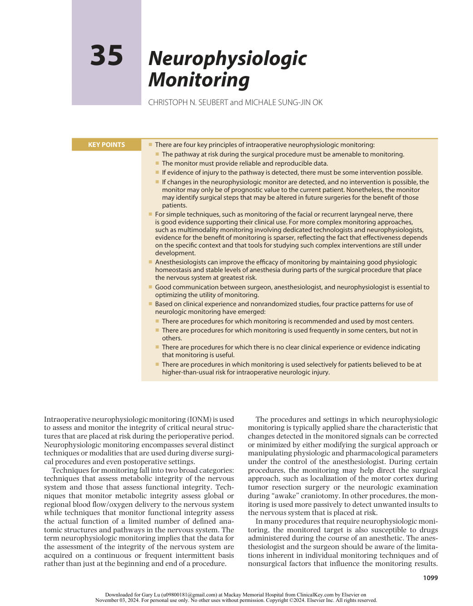

:::

<!-- PDF page 2 -->

The monitoring approach ideally should anticipate nonsurgical factors and provide a degree of redundancy using multiple techniques that can help distinguish a localized surgical trespass from a systemic event. Likewise, the anesthetic approach should facilitate the neurophysiologic monitoring techniques in a particular case and anticipate periods of particular risk by providing a stable level of anesthesia and physiologic support for the patient.

The application of neurophysiologic monitoring to a surgical procedure may be organized in different ways. In some instances, that may be as simple as setting up a piece of monitoring equipment, such as a facial nerve electromyography (EMG) monitor that provides acoustic feedback to surgeons when they get close to a nerve that innervates muscles. At the other end of the spectrum, it may require the dedicated services of a technologist and a neurophysiologist during the operation, as would be the case during the mapping phase of a brain tumor resection. Between those extremes are a variety of delivery models for IONM that may entail components of telemedicine. Regardless of the organizational structure, the utility of IONM will depend on a shared understanding of surgical objectives, anesthetic constraints, and limitations of monitoring. This shared understanding will then need to be supported by open lines of communications among the entire perioperative team, particularly during critical phases of an operation.1,2

For some surgical procedures, neurophysiologic monitoring is routinely employed because outcome data clearly support its use. Examples include correction of scoliosis and resection of vestibular schwannoma. In other cases, the approach to monitoring is based on local conventions and surgical expectations, rather than being supported by robust scientific evidence. In the latter case, monitoring utility depends even more on a good understanding of the technique’s capabilities and limitations by the perioperative team members. Good communication and mutual collaboration between anesthesiologists, surgeons, and the intraoperative monitoring team are paramount to allow timely corrective action in the face of signal changes and minimize false alarms that unnecessarily disrupt surgery. This chapter first discusses individual monitoring modalities so that the clinician can appreciate the inherent strengths and weaknesses of each technique. Subsequent sections apply this information by describing suitable approaches to various clinical settings that combine and integrate individual techniques to optimize neurologic outcome for patients, followed by a discussion of how to tailor the anesthetic approach to optimize the utility of neurophysiologic monitoring. The chapter ends with a brief discussion of how neurophysiologic monitoring is believed to be useful today, and where more work is needed to determine whether monitoring has a role for surgical patients in the future.

## Monitoring Modalities

### MONITORS OF ADEQUACY OF NERVOUS SYSTEM BLOOD FLOW

Adequacy of cerebral blood flow (CBF) can be monitored by two principal methods. The first method assesses blood flow

itself with the implicit assumption that “normal” flow provides adequately for the metabolic needs of the brain. The second approach assesses local or global oxygen delivery with the assumption that normal oxygen delivery at the site of measurement implies adequate blood supply throughout the central nervous system (CNS). To illustrate the limitations imposed by such implicit assumptions, let us examine global or hemispheric CBF in the context of a patient’s disease process.

In the normal brain, values of hemispheric CBF of approximately 50 mL/100 g/min reflect adequate oxygen delivery for maintaining structural integrity and function. Values of less than 20 to 25 mL/100 g/min are first associated with failure of function and on further decrease with structural damage.3 It is important to note that in neurosurgical patients, CNS structural integrity and function may be altered by disease processes and anesthetics, which have an impact on the interpretation of measured CBF. For example, a CBF of 40 mL/100 g/min in a patient in a barbiturate coma after resection of an arteriovenous malformation may represent hyperemia (because metabolic demand is very low), whereas the same CBF in a patient with a mass lesion may reflect a modest decrease in cerebral perfusion pressure secondary to increasing intracranial pressure (ICP). Thus, the clinical response to an abnormal CBF value requires context and clinical judgment.

### Global Blood Flow Monitoring Techniques (Noninvasive)

**Intravascular Tracer Compounds.** Direct measurement of CBF is possible by determining the kinetics of wash- in and/ or wash- out of an inert tracer compound, a method originally described by Kety and Schmidt.4 A widely used modern variation of this concept is the imaging of the first passage of intravascular contrast agents during computer tomography (CT) or magnetic resonance imaging (MRI) for determining locoregional blood flow (Fig. 35.1). A less quantitative use of the same principles occurs during neurointerventional procedures, when the progression of a bolus dose of contrast agent is observed as it distributes through the arteries to a tissue phase followed by a venous phase, all imaged via X- ray at a fixed frame rate. While useful, these techniques share the limitation of providing a snapshot of CBF in time instead of continuous assessment of flow over time.

**Transcranial Doppler Ultrasound.** Transcranial Doppler (TCD) ultrasound is a technique that infers CBF from measurements of the blood flow velocity in the large conducting arteries of the brain. The TCD probe transmits pulses of sound waves through the thin temporal bone in a variation of the pulsed wave Doppler technique. When these sound waves are reflected off the red blood cells back toward the TCD probe, the velocity of the reflected sound waves is changed because the blood cells themselves are in motion toward or away from the probe. This phenomenon is known as the “Doppler shift,” and is directly related to flow velocity and flow direction of the blood cells. Blood flow is faster during systole and in the center of a vessel, whereas it is slower in diastole and near the vessel wall. TCD records a spectrum of flow velocities whose outline resembles an arterial waveform tracing. These concepts are illustrated in Fig. 35.2.

<!-- PDF page 3 -->

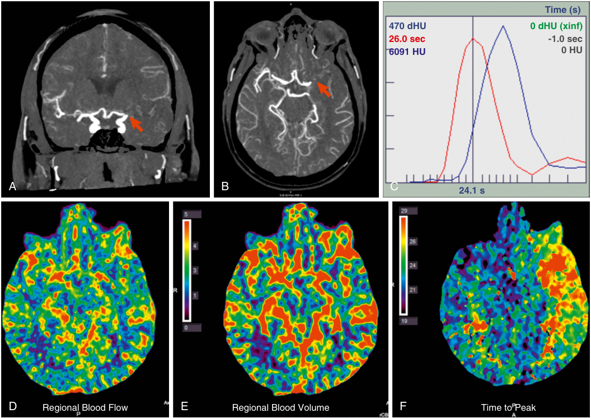

Time (s) 470 dHU 0 dHU (xinf) 26.0 sec -1.0 sec 6091 HU 0 HU A B C 24.1 s D Regional Blood Flow E Regional Blood Volume F Time to Peak 

**Fig. 35.1 Determination of cerebral blood flow by means of an intravascular tracer.** Shown are computer tomographic images of a patient 90 minutes after onset of a left middle cerebral artery stroke. The site of the occlusion in coronal (A) and axial (B) planes is indicated by a _red arrow_ . Panel C shows the arterial inflow function and venous outflow function derived by repeated imaging of the passage of radiopaque contrast through a volume element (voxel) representative of arterial and venous territory, respectively. The A2 segment of the anterior cerebral artery is typically chosen as a voxel for the arterial inflow function and the superior sagittal sinus for the venous outflow function. Based on these functions, blood flow, volume, and flow kinetics can be calculated for other areas of the image. The cerebral blood flow map (D) shows symmetrical flow in both hemispheres, with _warmer colors_ indicating areas of higher flow consistent with gray matter. Blood volume (E) is symmetrical as well, but the time to the peak concentration of contrast (F) is significantly delayed for brain affected by the stroke.

Intraoperatively, TCD measurements are most commonly made by continuous monitoring of the middle cerebral artery for the purpose of detecting either significant changes in flow velocity or the presence of particulate emboli.5 As a diagnostic study, segments of all proximal intracranial arteries and the internal carotid artery of the neck can be insonated. An important limitation of TCD results from the fact that most of the examination is done through the temporal bone, which may be thick enough to preclude an adequate examination in 10% to 20% of patients.6,7

Two assumptions that are intuitive and plausible, but ultimately unproven, must be made for TCD- measured blood flow velocity to have a direct relationship to CBF. First, blood flow velocity is directly related to blood flow only if the diameter of the artery where the flow velocity is measured and the measurement angle of the Doppler probe remain constant. In practical terms, the difficulty with this assumption lies in finding a method to affix the TCD probe in a way that prevents dislodgement or movement during

monitoring. The second assumption requires that CBF in the basal arteries of the brain is directly related to cortical CBF. It is easy to understand how these two assumptions can constrain the utility of TCD as a stand- alone monitor of CBF. However, the changes in flow velocity seen in typical applications (discussed subsequently) are large enough to provide useful clinical information.

Some important advantages of TCD monitoring are that it is the only continuous technique that can provide early warning for hyperperfusion and that it detects the number of emboli delivered to the brain during various phases of an operation. Because of their high echogenicity, emboli show up in the TCD spectrum as high- intensity transient signals (HITS, see Fig. 35.2) and are easily identified as brief beeps or chirps within the background of the Doppler sounds.

**Jugular Bulb Venous Oxygen Saturation.** The degree of oxygen extraction by an organ can be monitored by following the oxygen saturation of the mixed venous blood that drains that organ. In the case of the brain, jugular bulb

<!-- PDF page 4 -->

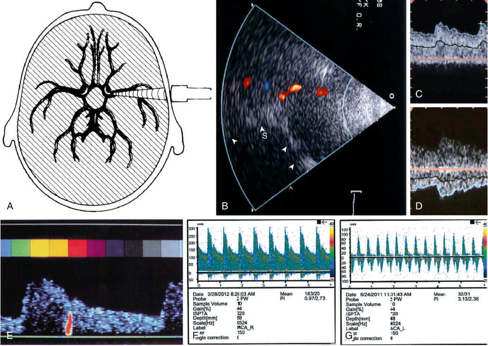

C S A B D E F G 

**Fig. 35.2** (A) Transcranial Doppler monitoring is done by insonating the arteries at the base of the brain through a thin part of the temporal bone. (B) If this procedure is performed with an imaging probe, some intracranial structures, such as the cerebral peduncles _(white triangles)_ or the sella complex _(white triangle labeled “S”)_ , can be visualized. The captured Doppler signals originate from the right middle, right anterior, and left anterior cerebral arteries. (C) Normal Doppler spectrum obtained from the middle cerebral artery. By convention, flow toward the probe is displayed as a waveform above the baseline. (D) Doppler profile of the bifurcation of the terminal internal carotid artery as it branches into the middle cerebral artery (flowing toward the transducer) and the anterior cerebral artery (flowing away). This flow signal can be obtained if the transducer is focused as shown in A. (E–G) Examples of three clinical applications of transcranial Doppler. (E) Emboli are highly echogenic and appear as high- energy transient signals. On the audible output, these emboli are easily noticed as brief beeps or chirps. (F) Doppler profile of a middle cerebral artery in a patient with severe vasospasm after an aneurysmal subarachnoid hemorrhage (compare with C). (G) Transcranial Doppler examination consistent with intracranial circulatory arrest. There is a brief systolic inflow followed by retrograde flow during diastole.

venous oxygen saturation (Sjvo2) is believed to measure the degree of oxygen extraction by the brain and to represent the balance between cerebral oxygen supply and demand. To monitor Sjvo2, a fiberoptic catheter is placed in a retrograde fashion into the jugular bulb through the internal jugular vein under fluoroscopic guidance. Correct tip placement is crucial to minimize admixture of extracranial venous blood. To decrease the risk of complications, usually only one side is monitored.

Several theoretical limitations of the technique must be considered to interpret Sjvo2 values and trends properly. Although nearly all blood from the brain drains via the jugular veins, intracranial mixing of venous blood is incomplete and may result in differences between rightsided and left- sided measurements. The dominant jugular vein (i.e., the right for most patients) drains predominantly cortical venous blood, whereas the contralateral jugular vein drains more of the subcortical regions.8 Despite such regional differences, Sjvo2 must be considered a monitor of global cerebral oxygenation because inadequate perfusion

to a focal brain region may not decrease Sjvo2 values below the normal range of 55% to 75%. Because Sjvo2 represents the balance between supply and demand, interpretation of the absolute value of Sjvo2 must take the clinical circumstances into account.

**Cerebral Oximetry.** Cerebral oximetry is a noninvasive technique that uses reflectance oximetry to measure the oxygen saturation of the tissues underneath the sensor. Typically, two sensors are applied to both sides of the forehead. The light passes from a fiberoptic light source through the skull, scalp, and parts of the frontal brain and arrives back at the sensors. Contamination of the oximetry signal by extracranial blood sources is a concern, although the use of two sensing diodes with different distances from the light source within one sensor patch and adjustments of the algorithm of the oximeter help minimize this problem.9,10

Because 66% to 80% of the cerebral blood volume is venous blood, cerebral oximetry determines predominantly “local venous oxygen saturation.” The simplicity of its use,

<!-- PDF page 5 -->

and the familiarity with the principles of treating decreases in systemic mixed venous oxygen saturation, have made cerebral oximetry a popular trend monitor in operations that potentially cause decreases in blood flow to the vessels of the head.11,12 There are some significant limitations to consider during its use. First, adequacy of global cerebral perfusion is inferred from measurements over the frontopolar brain. This assumption may not hold if, for example, the territory of the middle cerebral artery is at the center of an ischemic core as would be the case during clamping the carotid artery. Second, data on normal values or allowable changes for cerebral oximetry are largely absent. Therefore, rather than relying on absolute numbers, preoperative application of the sensors and obtaining initial measurements in conjunction with a neurologic baseline examination are important, so monitoring the trend during the procedure can be more meaningful.13

An example of how these limitations can be demonstrated is provided by a study of the use of cerebral oximetry during 100 carotid endarterectomies in awake patients.14 Cerebral oximetry was able to identify 97.4% of patients with adequate CBF as indicated by the absence of clinical symptoms. Conversely, however, the monitor frequently indicated inadequate CBF, defined as a 20% decrease in cerebral oxygen saturation from the pre- clamp baseline, in patients without clinical symptoms of inadequate CBF. This false- positive rate of 66.7% may simply illustrate the fact that cerebral oxygen extraction increases before function fails. The real problem is that the lower limit for acceptable regional oxygen saturation is unknown in a large population of patients.15 Acceptable values may be different from patient to patient, and addition of anesthetic drugs that influence cerebral oxygen metabolism may further complicate accurate interpretation.

### Tissue- Level Blood Flow Monitoring Techniques (Invasive)

Tissue- level monitoring for the brain is, by definition, invasive. All monitors in current clinical or research use are implanted through a burr hole, extend either into the white matter or ventricular system, and typically use a bolt for stabilization. They all share a 1% to 2% risk of bleeding, infection, or ischemia owing to the implantation procedure.15 A second shared feature is their limited spatial resolution (i.e., each monitoring probe monitors only a limited area of brain surrounding the probe). When these monitors were first developed, there was considerable debate regarding the optimal placement of the device given such limited spatial resolution. Based on today’s appreciation for the impact of secondary neurologic insults on the ultimate outcome, there is growing agreement that tissue- level monitoring is best performed in morphologically and functionally normal tissue that is part of the penumbra or vulnerable zone of interest.16–18

Of the tissue- level monitors, tissue partial pressure of oxygen (Po2) monitoring has undergone sufficient refinement to be in wider clinical use. Thermal diffusion blood flow measurement,19 laser Doppler flow measurement, and microdialysis are experimental and not in widespread clinical use.

### Tissue Partial Pressure of Oxygen Monitoring

Localized monitoring of tissue Po2 is based on an oxygensensitive electrode originally described by Clark.20 The

diffusion of oxygen molecules through an oxygenpermeable membrane into an electrolyte solution causes an electric current that is proportional to Po2. Currently available catheter- based electrodes placed into the subcortical white matter provide stable recording conditions over long periods.

Most of the data on brain tissue oxygen levels (PBro2) come from studies in patients with head trauma.21 Comparison with stable xenon CT for assessment of CBF and studies during temporal clipping in aneurysm surgery show good correlation between PBro2 and CBF.22,23 Similarly, the time course of changes in PBro2 after traumatic brain injury resembles that of CBF.24,25 Critics of the technique argue that PBro2 values are highly influenced by the partial pressure of arterial oxygen (Pao2) and are merely an elaborate indicator of the quality of patient ventilation. This view is supported by the observation that increasing the fraction of inspired oxygen (Fio2) increases PBro2, but likely represents an oversimplification.26 Concurrent microdialysis studies have shown that increasing Fio2 not only increases PBro2, but also decreases tissue lactate levels, suggesting a true improvement in the metabolic milieu of the brain tissue itself.27,28 While decreases in PBro2 are associated with worse outcomes in traumatic brain injury patients and the role of PBro2 -directed therapy is still investigational, there is evidence that ICP and PBro2- guided management of severe TBI may lower mortality and improve neurologic outcomes compared to ICP-guided management.29

### MONITORS OF NERVOUS SYSTEM FUNCTION

The most commonly used monitors of CNS function are the electroencephalogram (EEG), sensory evoked responses (SERs), motor evoked responses, and the electromyogram (EMG). The EEG is a surface recording of the summation of excitatory and inhibitory postsynaptic potentials spontaneously generated by the pyramidal cells in the cerebral cortex. The signals are very small, and each recording electrode records information both directly beneath the electrode and information volume conducted from deeper tissue.30 Monitoring the EEG is usually directed toward one or more of four perioperative uses. First, the EEG is used to help identify inadequate blood flow to the cerebral cortex caused by either a surgically induced (e.g., retraction on cerebral tissue) or anesthetic- induced reduction in blood flow. Second, it may be used to guide an anesthetic- induced reduction of cerebral metabolism either in anticipation of a loss of CBF or in the treatment of high ICP. Third, the EEG may be used to predict the neurologic outcome after a brain insult. Finally, the EEG, particularly in the form of processed EEG, may be used to optimize anesthetic delivery (see Chapter 36).

Evoked responses or potentials are electrical activity generated in response to either a sensory or a motor stimulus along a neural pathway that goes beyond a single nerve and incorporates part(s) of the CNS. Measurements of evoked responses may be made at multiple points along the pathway. Sensory evoked responses are generally smaller than other electric activity generated in nearby tissue (muscle or brain) and are readily obscured by these other biologic signals. In the case of SERs, repeated sampling and sophisticated electronic summation and averaging techniques are

<!-- PDF page 6 -->

needed to extract the desired evoked potential signal from background biologic signals. There are three basic types of SERs: somatosensory evoked potentials (SSEPs), brainstem auditory evoked potentials (BAEPs), and visual evoked potentials (VEPs). Motor evoked potentials (MEPs) are larger and commonly do not require averaging.

### Electroencephalogram

**Basic Unprocessed Electroencephalogram Concepts.** The EEG is produced by a summation of excitatory and inhibitory postsynaptic potentials produced in cortical gray matter. Because the EEG signal is much smaller than action potentials recorded over nerves or from heart muscle, excellent electrical contact is necessary to avoid significant signal loss. Excellent contact may be achieved for surface electrodes by prepping the skin and using conductive gel, by placement of subdermal needles, or by saturating electrodes placed on the brain with an electrolyte solution.

EEG electrodes generally are placed according to a mapping system that relates surface head anatomy to underlying brain cortical regions. The placement pattern of recording electrodes is called a montage. Use of a standard recording montage permits anatomic localization of signals produced by the brain and allows development of normative EEG patterns and comparison of EEG recordings made at different times. The standard EEG “map” is called the 10 to 20 system for EEG electrode placement (Fig. 35.3). This system is a symmetric array of scalp electrodes placed systematically based on the distance from the nasion to the inion and from the pretragal bony indentations associated with both

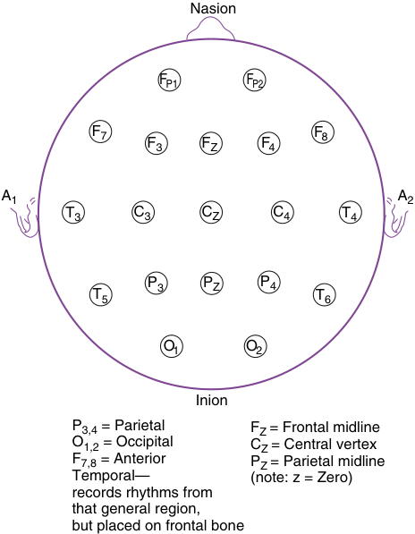

Nasion FP1 FP2 F7 F8 F3 FZ F4 A1 A2 T3 C3 CZ C4 T4 P3 PZ P4 T5 T6 O1 O2 Inion P3,4 = Parietal FZ = Frontal midline O1,2 = Occipital CZ = Central vertex F7,8 = Anterior PZ = Parietal midline Temporal— (note: z = Zero) records rhythms from that general region, but placed on frontal bone 

**Fig. 35.3** International 10 to 20 system of electrode placement for recording electroencephalogram and sensory evoked responses. (From Hughes JR. _EEG in Clinical Practice_ . 2nd ed. Newton, MA: ButterworthHeinemann; 1994.)

temporomandibular joints. Based on 10% or 20% of these distances, recording electrodes are placed over the frontal (F), parietal (P), temporal (T), and occipital (O) regions at increasing distances from the midline. Left- sided electrodes are given odd number subscripts, and right- sided electrodes are given even number subscripts. Increasing numbers indicate a greater distance from the midline. Midline electrodes are designated with a “Z” subscript. The standard diagnostic EEG uses at least 16 channels of information,31 but intraoperative recordings have been reported using 1 to 32 discreet channels.

The intraoperative EEG is commonly recorded from electrodes placed on the scalp. Recordings may also be made from electrodes placed directly on the surface of the brain (electrocorticography), or from microelectrodes placed transcortically to record from individual neurons (e.g., during surgery for Parkinson disease).32,33 The EEG signal is described using three basic parameters: amplitude, frequency, and time. Amplitude is the size, or voltage, of the recorded signal and ranges commonly from 5 to 500 μV (vs. 1–2 mV for the electrocardiogram signal). Because neurons are irreversibly lost during normal brain development and aging, EEG amplitude decreases with age, starting in infancy. Frequency can be thought of simply as the number of times per second the signal oscillates or crosses the zerovoltage line. Time is the duration of the sampling of the signal. Time is continuous and without delay during standard digital EEGs but may be broken into sampling “epochs” during processed EEGs (see later).

**Normal Electroencephalogram.** Normal patterns seen on the EEG vary among normal individuals but are consistent enough to allow for accurate recognition of normal and pathologic patterns. The usual base frequency in an awake patient is the beta range (>13 Hz). This highfrequency and usually low- amplitude signal is common from an alert attentive brain and may be recorded from all regions. With eye closure, higher amplitude signals in the alpha frequency range (8–13 Hz), seen best in the occipital region, appear (Fig. 35.4). This “eyes closed” resting pattern is considered the baseline awake pattern when anesthetic effects on the EEG are described. When events that lead the brain to produce higher frequencies and larger amplitudes occur, the EEG is described as “activated,” and when slower frequencies are produced (theta = 4 to &lt;8 Hz, and delta &lt;4 Hz), the EEG is said to be “depressed.” The EEG during natural sleep may contain all these frequencies at various times. The slower frequencies occur during deep natural sleep with “sleep spindles” (Fig. 35.5), but during light sleep or rapid eye movement sleep, the EEG becomes activated, and the eye muscle EMG appears on the EEG.

In the normal EEG in awake and asleep patients, patterns recorded from corresponding electrodes on each hemisphere are symmetric in terms of frequency and amplitude, the patterns are predictable if clinical states are known, and spike (epileptic) waveforms are absent. In most cases, normal EEG patterns are associated with normal underlying brain function in awake and asleep patients.

**Abnormal Electroencephalogram.** General characteristics of the “abnormal” EEG include asymmetry with respect to frequency, amplitude, or both, recorded from

<!-- PDF page 7 -->

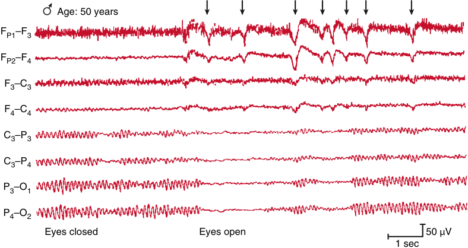

Age: 50 years FP1–F3 FP2–F4 F3–C3 F4–C4 C3–P3 C3–P4 P3–O1 P4–O2 Eyes closed Eyes open 50 μV 1 sec 

**Fig. 35.4** The loss and return of alpha activity as the eyes open and close can be seen. The large spikes (↓) are muscle artifact from eye blinks and hence are best visible in channels that incorporate frontal electrodes (designated F).

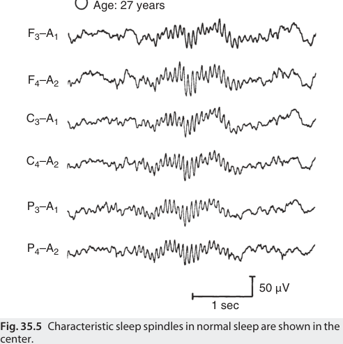

Age: 27 years F3–A1 F4–A2 C3–A1 C4–A2 P3–A1 P4–A2 50 µV 1 sec Fig. 35.5  Characteristic sleep spindles in normal sleep are shown in the center. 

corresponding electrodes on each hemisphere, and patterns of amplitude and frequency that are unpredictable or unexpected in the normal recording. These abnormal patterns reflect either anatomic or metabolic alterations in the underlying brain. Regional asymmetry can be seen with tumors, epilepsy, and cerebral ischemia or infarction. Epilepsy may be recognized by high- voltage spike and slow waves, whereas cerebral ischemia manifests first with EEG slowing with preservation of voltage. Further slowing and loss of voltage occurs as ischemia becomes more severe. Factors affecting the entire brain may produce symmetric abnormalities of the signal. It is important to note that many of the normal global pattern changes produced by anesthetic drugs are similar to pathologic patterns produced by

ischemia or hypoxemia. Therefore, careful control of anesthetic technique is very important when the EEG is being used for clinical monitoring of the integrity of the nervous system.

**Processed Electroencephalogram Concepts.** Numerous limitations are introduced when moving from interpreting raw EEG data to understanding processed EEG. First, during processed EEG, artifacts are processed in many cases along with the desired signal, leading to a perfectly believable processed EEG result that is materially incorrect. Second, most available processed EEG devices use four or fewer channels of information – translating to at most two channels per hemisphere. Therefore, processed EEG devices generally monitor less cerebral territory than a standard 16- channel EEG. Third, some intraoperative changes are unilateral (e.g., regional ischemia owing to carotid artery clamping), and some are bilateral (e.g., EEG depression by bolus administration of an anesthetic). This means that processed EEG should have an adequate number of leads over both hemispheres to delineate unilateral from bilateral changes.

Most early studies validating intraoperative EEG monitoring used continuous visual inspection of a 16- to 32- channel analogue EEG by an experienced electroencephalographer – such monitoring was considered the gold standard.34,35 Adequate studies comparing the processed EEG with fewer channels with this gold standard across multiple uses and operations have not been done. Limited data using processed EEG monitoring during carotid surgery suggest that two- or four- channel instruments typically detect significant hemispheric ischemia,36,37 provided that the electrodes are appropriately placed over watershed areas of blood supply.

**Fourier Transformation of EEG.** EEG processing for intraoperative monitoring is typically based on power analysis of a segment of raw EEG over a specific period of time, referred to as an epoch. Power analysis uses Fourier

<!-- PDF page 8 -->

transformation to convert the digitized raw EEG signal into component sine waves of identifiable frequency and amplitude. The raw EEG data, which is a plot of voltage versus time, is converted to a plot of frequency and amplitude versus time. The data are then displayed either as a compressed spectral array or a density spectral array. In the compressed spectral array, frequency is displayed along the x- axis, and power is displayed along the y- axis with the height of the waveform equal to the power at that frequency. Time is displayed along the z- axis. Tracings overlap each other, with the most recent information in front (Fig. 35.6). Density spectral array also displays frequency along the x- axis, time is displayed along the y- axis, and power is reflected either by the density of the dots at each frequency or by a spectrum of colors. There is a relationship between epoch length and spectral resolution. A longer epoch may produce less epoch- to- epoch variability and allow more precise description of frequency and power. However, the longer epoch increases the delay before new information is processed and displayed, reducing the timeliness of information available for clinical decision- making. Many commercially available devices have used two- second epoch lengths, updated at varying user- selected intervals.

**Anesthesia and The Electroencephalogram.** Anesthetic drugs affect the frequency and amplitude of EEG waveforms. Although each drug class and each specific drug has some specific, dose- related EEG effects (Table 35.1),

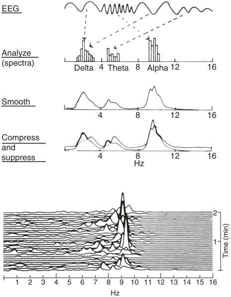

EEG Analyze (spectra) Delta 4 Theta 8 Alpha 12 16 Smooth 4 8 12 16 Compress and suppress 4 8 12 16 Hz 2 1 1 2 3 4 5 6 7 8 9 10 11 12 13 14 15 16 Hz Time (min) 

**Fig. 35.6 Diagram of a technique used to generate compressed spectral array.** Example at the bottom of the figure shows compressed spectra of the alpha rhythm from a normal subject. _EEG_ , electroencephalogram. (From Stockard JJ, Bickford RG. The neurophysiology of anaesthesia. In: Gordon E, ed. _A Basis and Practice of Neuroanesthesia_ . New York: Elsevier; 1981:3.)

some basic anesthesia- related EEG patterns may be described (see Fig. 35.18; for further details please see Chapter 36).38 Subanesthetic doses of intravenous and inhaled anesthetics usually produce an increase in frontal beta activity and abolish the alpha activity normally seen in the occipital leads in an awake, relaxed patient with the eyes closed. As the patient loses consciousness with general anesthesia, the brain waves become larger in amplitude and slower in frequency. In the frontal areas, small beta activity seen in an awake patient slows to the alpha range and increases in size. In combination with the loss of the occipital alpha activity, this phenomenon produces the appearance of a “shift” of the alpha activity from the posterior cortex to the anterior cortex. Further increases in the dose of inhaled or intravenous anesthetic drugs produce further slowing of the EEG. Some anesthetic drugs suppress EEG activity totally at sufficient doses (see Table 35.1). Other anesthetic drugs never produce burst suppression or an isoelectric EEG, despite increasing doses, either because they are incapable of completely suppressing the EEG (e.g., opioids, benzodiazepines) or because cardiovascular toxicity of the drug (e.g., halothane) prevents administration of a large enough dose.

A critical concept for the use of EEG in neurophysiologic monitoring is that the progression of EEG changes caused by increasing doses of volatile and most intravenous anesthetics closely parallels EEG changes caused by progressive cerebral ischemia. Therefore, using the EEG to monitor for ischemia not only requires an anesthetic plan that retains an active EEG, but also a stable level of anesthesia during phases of the operation where cerebral ischemia is a risk. Because of age- related changes in number and connectivity of neurons, retaining an active EEG is more difficult at the extremes of age.39 Conversely, metabolic suppression of neuronal activity is more easily achieved. If EEG suppression is targeted during a surgical procedure to extend ischemia time, suppression of EEG activity for 50%–80% of an EEG epoch is typically targeted.

### Evoked Potentials

**Sensory Evoked Responses.** SERs are electric CNS responses to electric, auditory, or visual stimuli. SERs are produced by stimulating a sensory system and recording the resulting electric responses at various sites along the sensory pathway up to and including the cerebral cortex. Because of the very low amplitude of SERs (0.1–10 μV), it is often impossible to distinguish SERs from other background biologic signals, such as the EEG or EMG, which in this case may be considered undesirable “noise.” To extract the SER from the electrical background, the recorded signal is digitized, and signal averaging is applied. To accomplish this, signal recording is time- locked to the application of the sensory stimulus. For example, during intraoperative posterior tibial nerve SER monitoring, signal information occurring within 90 ms after nerve stimulation at the ankle is recorded (Fig. 35.7). Whereas the SER occurs at a constant time after stimulus application, other electric activity, such as spontaneous EEG, occurs at random intervals after the sensory stimulus. Repeated recordings – typically 50 to 500 – allow the electrical background noise to be averaged out. This signal averaging technique eliminates random elements and enhances the SER by improving the signalto- noise ratio.40

<!-- PDF page 9 -->

**Table 35.1** Anesthetic Drugs and Electroencephalogram

|**Drug**|**Effect on EEG Frequency**|**Effect on EEG Amplitude**|**Burst Suppression?**|
|---|---|---|---|
|Isoflurane, Sevoflurane, Desflurane|||Yes, >1.5 MAC|
|Subanesthetic|Loss of alpha,↑frontal beta|||
|Anesthetic|Frontal 4–13 Hz activity|||
|Increasing dose >1.5 MAC|Diffuse theta and delta→burst suppression →silence|↓0||
|Nitrous oxide (alone)|Frontal fast oscillatory activity (>30 Hz)|↓, especially with inspired concentration >50%|No|
|Barbiturates|||Yes, with high doses|
|Low dose|Fast frontal↑beta activity|Slight||
|Moderate dose|↑Frontal alpha frequency spindles|||
|Increasing high dose|Diffuse delta→burst suppression→silence|↓0||
|Etomidate|||Yes, with high doses|
|Low dose|Fast frontal beta activity|||
|Moderate dose|Frontal alpha frequency spindles|||
|Increasing high dose|Diffuse delta→burst suppression→silence|↓0||
|Propofol|||Yes, with high doses|
|Low dose|Loss of alpha; frontal beta|||
|Moderate dose|Frontal delta; waxing/waning alpha|||
|Increasing high dose|Diffuse delta→burst suppression→silence|↓0||
|Ketamine|||No|
|Low dose|Loss of alpha, variability|↓||
|Moderate dose|Frontal rhythmic delta|||
|High dose|Polymorphic delta; some beta|Beta is low amplitude||
|Benzodiazepines|||No|
|Low dose|Loss of alpha; increased frontal beta activity|||
|High dose|Frontally dominant delta and theta|||
|Opioids|||No|
|Low dose|Loss of beta; alpha slows|None||
|Moderate dose|Diffuse theta, some delta|||
|High dose|Delta, often synchronized|||
|Dexmedetomidine|Moderate slowing, prominent spindles||No|

Alpha = 8–13 Hz frequency; beta ≥13 Hz frequency; delta ≤4 Hz frequency; theta = 4–7 Hz frequency. _EEG_ , electroencephalogram; _MAC_ , minimum alveolar concentration.

SER recordings are of two general types determined by the distance of the recording electrode from the neural generator of the evoked response. SERs recorded from electrodes close to the neural generators (within approximately 3–4 cm in the average adult) are termed “near- field potentials.”41 Near- field potentials are recorded from electrodes placed very close to the actual signal generator site,42 and the morphology is directly affected by electrode location.41 Far- field potentials are recorded from electrodes located a greater distance from the neural generator and are conducted to the recording electrode through a volume conductor (brain, cerebrospinal fluid (CSF), and membranes). Because the current spreads diffusely throughout the conducting medium, it is more difficult to locate the source

of the recorded signal and the electrode position has less effect on the morphology of the recorded evoked potential (see Fig. 35.7).41,42 As the distance between the recording electrode and the neural generator increases, the recorded SER becomes smaller. More responses must be averaged to record far- field potentials (e.g., several thousand) than near- field potentials (50–100).41,42

Depending on the source of a recorded potential, SERs also may be described as cortical or subcortical in origin. Cortical SERs are generated when the volley of action potentials initiated by the sensory stimulus arrives at the cortex. Because they are recorded as near- field potentials, they are typically easy to identify by elapsed time, waveform morphology, and amplitude. Subcortical responses may

::: details 原始表格與符號（PDF 第 9 頁）

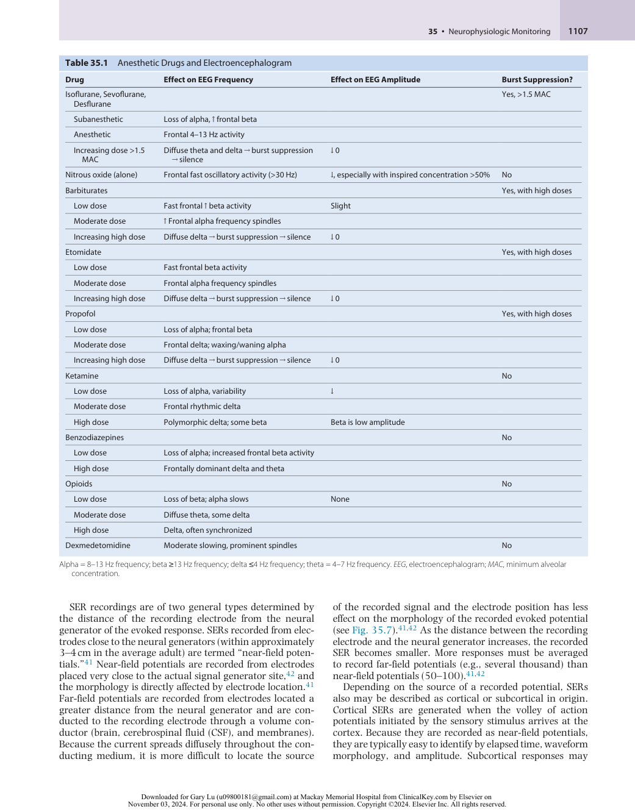

:::

<!-- PDF page 10 -->

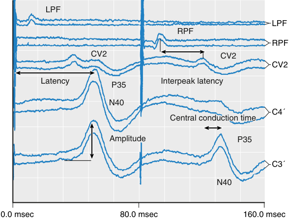

LPF LPF RPF RPF CV2 CV2 CV2 Latency P35 Interpeak latency N40 C4´ Central conduction time Amplitude P35 C3´ N40 0.0 msec 80.0 msec 160.0 msec 

**Fig. 35.7** Sensory evoked responses are described in terms of latency and amplitude. Interpeak latency is the measured time between two peaks. Interpeak latency may be measured between two peaks in the same channel or between peaks in different channels (shown in figure). Note that the polarity of peaks is displayed contrary to standard convention (see text). The example shows a recording of posterior tibial somatosensory evoked potentials. Each tracing is reproduced twice because reproducibility of a waveform helps distinguish signal from artifact. Left and right posterior tibial nerves are stimulated at 0 and 90 ms, respectively. The first evoked response is recorded from left and right popliteal fossa (LPF and RPF, respectively). The peak labeled CV2 represents the brainstem response recorded at the craniocervical junction. As a far- field potential, the potential looks similar for right- and left- sided stimulation. The primary cortical responses are recorded from the contralateral hemisphere (labeled P35 and N40).

arise from many different structures depending on the type of response, including peripheral nerves, spinal cord, brainstem, thalamus, cranial nerves, and others. Cortical SERs are usually recorded from scalp electrodes placed according to the standard 10 to 20 system for EEG recordings (see Fig. 35.3). Subcortical evoked responses may also be recorded as far- field potentials from scalp electrodes or, as appropriate, from electrodes placed over the spinal column or peripheral nerve as near- field potentials.

Evoked potentials of all types (sensory or motor) are described in terms of latency and amplitude (see Fig. 35.7). Latency is defined as the time measured from the application of the stimulus to the onset or peak (depending on convention used) of the response. The amplitude is simply the voltage of the recorded response. According to convention, deflections below the baseline are labeled “positive (P),” and deflections above the baseline are labeled “negative (N).” Because amplitude and latency change with recording circumstances, normal values must be established for each neurologic monitoring laboratory and may differ from values recorded in other laboratories.

SERs used for intraoperative monitoring include SSEPs, BAEPs, and rarely VEPs. For all these techniques, cortical recording electrodes are placed on the scalp, using the same standard 10 to 20 system as for recording the EEG, whereas recordings for subcortical and peripheral signals are placed in various standardized anatomic locations. The location of the surgical incision and the need for sterility may necessitate nonstandard electrode placements. It is important to remember that the same patient may have different recordings from case to case due to the variability in electrode placement. Such deviations must be considered when interpreting baseline and subsequent SERs. In the case of MEPs, stimulating electrodes also are placed according to the 10 to

20 system of electrode placement, but over the motor cortex instead. Recording electrodes may be placed over the spinal column, peripheral nerve, and (most commonly) within innervated muscle.

One of the most important principles of recording SERs intraoperatively is that reproducible, reliable tracings must be obtained at baseline before any intervention likely to cause changes in the evoked response occurs. If good- quality tracings with identifiable waveforms cannot be recorded and reproduced at baseline, evoked- response monitoring would be of little use in monitoring the integrity of the CNS intraoperatively. If significant variability exists, or waveforms are difficult to identify, it will be impossible intraoperatively to distinguish SER changes that are clinically significant from the preexisting baseline variability of waveforms. When good, reproducible responses cannot be recorded at baseline, monitoring should not be used for clinical decision- making. It is helpful to discuss the quality of the baseline SERs during the pre- incision time- out so that the whole perioperative team is better positioned to interpret changes in SERs.

**Somatosensory Evoked Potentials.** SSEPs are recorded after electric stimulation of a peripheral mixed nerve using needles or surface gel electrodes and recording the evoked responses along various points along the sensory pathway. Cortical short- latency SSEPs are most commonly recorded intraoperatively because they are less influenced by changes in anesthetic drug levels. The pathway involved in the generation of upper extremity short-latency SSEPs begin with large-fiber sensory nerves that have their cell bodies in the dorsal root ganglia and central processes that travel rostrally in the ipsilateral posterior column of the spinal cord. These first-order neurons synapse in the dorsal

<!-- PDF page 11 -->

column nuclei at the cervicomedullary junction. From there, second-order fibers decussate and travel to the contralateral thalamus via the medial lemniscus and third-order fibers project from the thalamus to the frontoparietal sensorimotor cortex. These primary cortical evoked responses, which are recordable with most anesthetic techniques, result from the earliest electric activity generated by the cortical neurons and are thought to arise from the postcentral sulcus parietal neurons. While there are longer latency secondary cortical waves that are thought to arise in the association cortex, these are not usually monitored intraoperatively because they are severely suppressed by general anesthesia.41

Although most evidence indicates that upper extremity evoked potentials are conducted rostrally in the spinal cord through dorsal column pathways, some data suggest that lower extremity SSEPs are conducted at least partially by the lateral funiculus.43 Stimulation of the posterior tibial nerve or common peroneal nerve at or above motor threshold activates group I fibers that synapse and travel rostrally through the dorsal spinocerebellar tract. After synapsing in nucleus Z at the spinomedullary junction, the pathway decussates and projects onto the ventral posterolateral thalamic nucleus.44 This pathway difference is important because the dorsal lateral funiculus is supplied primarily by the anterior spinal artery, the artery that also supplies the descending motor pathway as well as neurons in gray matter of the spinal cord. Manipulations, such as distraction of the spinal column to correct scoliosis, which may secondarily compress or distort radicular blood supply to the anterior spinal cord, could cause changes in the SSEP in the event blood supply is reduced to critical levels. This hypothesis is verified by the very low, but not zero, incidence of postoperative paraplegia on awakening without any intraoperative changes in SSEPs.

To record SSEPs after median or ulnar nerve stimulation, stimulating electrodes are placed over the distal nerve(s) and the first recording electrodes are placed at Erb’s point, just above the midpoint of the clavicle. This point overlies the brachial plexus, and signals recorded here assure the clinician that the electrical stimulus is being delivered properly to the patient. The next electrodes are placed midline posteriorly over the neck at the level of the second cervical vertebra, near the dorsal column nuclei. Signals recorded here ensure proper transmission of the response from the peripheral nervous system into the spinal cord and rostral along the spinal cord to the lower medulla. The final electrodes are placed on the scalp overlying the sensory (parietal) cortex contralateral to the stimulated limb. Signals recorded here ensure the integrity of the pathway through the brainstem, thalamus, and internal capsule. They may be helpful in assessing the adequacy of CBF in this area of the cortex.45–49

To record SSEPs after posterior tibial nerve stimulation, the stimulating electrodes are placed over the distal tibial nerve and the first recording electrodes are placed over the popliteal fossa to ensure proper stimulus delivery. The next recording electrodes may be placed over the lower lumbar spine to ensure proper transmission of the signal into the spinal cord, but this site is not commonly used because of its proximity to the sterile surgical field. Cervical spine and scalp recording electrodes are placed in a similar location as described previously, although different sites may be used

**Table 35.2** Generators of Somatosensory Evoked Potentials After Median Nerve Stimulation

|**Peak**|**Generators**|
|---|---|
|N9 (EP)|Brachial plexus*|
|N11|Posterior columns or spinal roots|
|N13/P13|Dorsal column nuclei*|
|N14, 15|Brainstem or thalamus|
|N19/P22|Parietal sensory cortex*|

*Indicates sites commonly recorded during surgical procedures. All other waveforms indicated are not commonly monitored.

as required by the location of the surgical incision. More invasive recording methods, such as epidural electrodes, may be used intraoperatively. Such sterile electrodes are placed by the surgeon after proper exposure.

Purported generators for short- latency SSEPs are listed in Table 35.2 and shown in Fig. 35.8.41,50 The morphology of SSEPs may be significantly altered by anesthesia, a patient’s neurologic disease, age, and variations in the location of recording electrodes (montage). In some cases, attribution of a particular generator to a given wave on the tracing may be challenging. Therefore, during neurologic monitoring, rather than focusing on attaining absolute precision in any given waveform, it is more important to compare recorded waveforms with those that were obtained at baseline for that specific procedure.51

After lower limb stimulation, it is expected that absolute latencies are increased compared to those of the upper limb because of the greater distance the response to stimulation must travel along the peripheral sensory nerve and spinal cord. Interpeak latencies (see Fig. 35.7) between waveform peaks, are also evaluated to assess conduction times between the corresponding neural generators. For example, the N9 to N14 interpeak latency reflects transmission from the brachial plexus to the brainstem while the N14 to N20 interpeak latency reflects transmission between the dorsal column nuclei and the primary sensory cortex.52 Latencies are significantly affected by age at both extremes of life, height, and many neurologic disorders that may affect conduction time of the nervous system.

**Brainstem Auditory Evoked Potentials.** BAEPs are usually produced in the diagnostic laboratory by delivering repetitive clicks or tones via headphones. Headphones are not practical for intraoperative monitoring. Therefore, foam ear inserts that are attached to stimulus transducers are most often used to deliver click stimuli (Fig. 35.9). Stimulus intensity should be set at 60 to 70 dB above the patient’s click- hearing threshold, but for practical reasons, many intraoperative laboratories begin monitoring after induction of anesthesia with a stimulus intensity of 90 dB nHL (normal hearing level). The duration of the click is approximately 100 μs, and the stimulus is given usually 10 to 15 times per second. Clicks are delivered using different “polarities,” meaning that the click may cause initial movement of the tympanic membrane away from the transducer (rarefaction) or toward the transducer (condensation). Use of these two different methods commonly produces very different waveforms, amplitudes, and latencies in individual

::: details 原始表格與符號（PDF 第 11 頁）

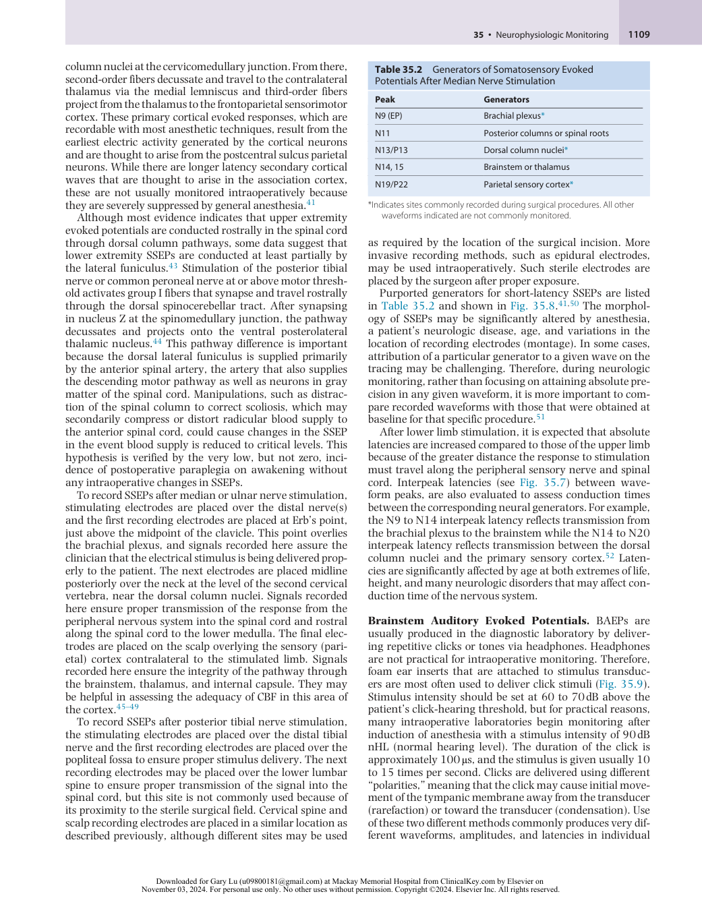

:::

<!-- PDF page 12 -->

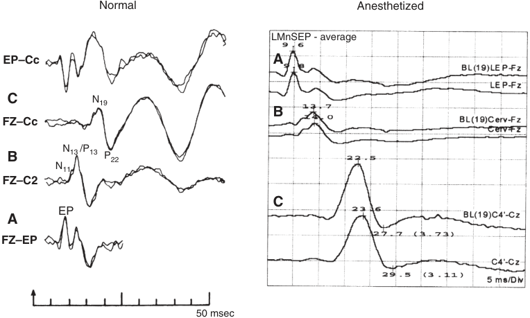

Normal Anesthetized LMnSEP - average EP–Cc A C N19 B FZ–Cc N13 /P13 B P22 N11 FZ–C2 C EP A FZ–EP 50 msec 

**Fig. 35.8** Short- latency somatosensory evoked potentials (SEP) produced by stimulation of the left median nerve (LMn) at the wrist. The ability to identify each of the labeled peaks shown in the tracing from the awake patient is compromised by the anesthetic state and use of different recording electrode locations (A–C). Corresponding tracings are labeled with the same letter. (From Chiappa KH, Ropper AH. Evoked potentials in clinical medicine. _N Engl J Med_ . 1982;306:1205.)

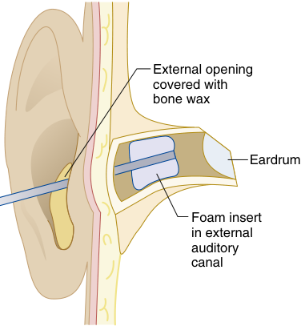

External opening covered with bone wax Eardrum Foam insert in external auditory canal 

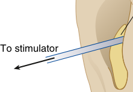

To stimulator 

**Fig. 35.9 Schematic of brainstem auditory evoked potentialstimulating apparatus.** Loud click stimuli are delivered directly to the eardrum through the ear insert.

vertex).53 White noise may be delivered to the contralateral ear to prevent bone conduction of stimuli from the ipsi- to the contralateral ear. On average, 500 to 2000 repetitions are required to improve the signal to-noise ratio because BAEPs recorded from the scalp are far- field potentials and extremely small (often &lt;0.3 μV).41,53

Peaks in BAEP waveforms are designated I through VII. The purported neural generators for these peaks and the auditory pathway are shown in Fig. 35.10. The anatomic auditory pathway would predict that BAEP monitoring is most useful for surgical procedures which risk injuring the auditory nerve, or affecting the structures in the posterior fossa, upper medulla, pons, and midbrain. As with other SERs, amplitude, absolute latencies, and interpeak latencies are evaluated to assess integrity of the auditory system, localize the functional defect, and assess peripheral and central conduction times. Because waves VI and VII are inconsistent and variable under general anesthesia, they are not routinely monitored in the operating room.53 For this reason, most articles reporting the use of BAEPs in the operating room discuss monitoring only up to wave V.54–56

patients, and the method that produces the largest reproducible response is chosen for the remaining procedure. If stimulus artifact becomes problematic, clicks of alternating polarity may be used to decrease it, but the waveforms produced in this fashion are an average of those produced by either stimulating technique alone and may be more difficult to monitor.

BAEP waveforms are affected by the rate and intensity of auditory stimulus delivery.41,53 Unilateral stimulation is used intraoperatively because responses from the other ear may obscure any abnormal responses from the monitored ear. Recording electrodes are placed on the lobe of the stimulated ear and on the top of the head (denoted as the

**Visual Evoked Potentials.** VEPs are recorded after monocular visual stimulation with recording electrodes over the occipital, parietal, and central scalp.57 Flash stimulation of the retina using light- emitting diodes embedded in soft plastic goggles through closed eyelids is provided. VEPs are cortical SERs, which vary with the type of stimulus, part of the retina stimulated, degree of pupil dilation, and patient’s attention level.41 Because some of these factors change commonly and even constantly during the course of an anesthetic, VEPs would be expected to be highly variable during surgery even when no surgical trespass on the visual system occurs. For these reasons, VEPs are the least commonly used evoked- response monitoring technique intraoperatively. It is important to note that flash stimuli

<!-- PDF page 13 -->

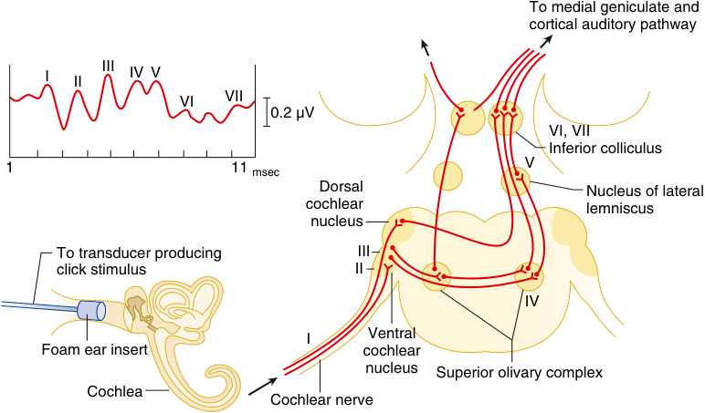

To medial geniculate and cortical auditory pathway III I IV V II VI VII 0.2 µV VI, VII Inferior colliculus 1 11 msec V Dorsal Nucleus of lateral cochlear lemniscus nucleus To transducer producing III click stimulus II IV I Ventral Foam ear insert cochlear nucleus Superior olivary complex Cochlea Cochlear nerve 

**Fig. 35.10 Schematic of auditory neural pathway.** The brainstem auditory evoked potential is initiated by stimulation of the cochlea with a broadband click stimulus given through an ear insert in the external auditory canal. Neural generators of the brainstem auditory evoked potential peaks are shown.

generate evoked potentials in all areas of the primary visual cortex at once, making it difficult to detect an injury localized to a small area of the cortex. Nonetheless, some centers report a degree of reproducibility and clinical utility.58

**Transcranial Motor Evoked Potentials.** Although SSEP monitoring became widely adopted during scoliosis surgery and was credited with improving surgical outcomes, reports of postoperative paraplegia despite normal intraoperative SSEPs demonstrated the need for directly monitoring the integrity of the corticospinal motor tracts. MEPs are generated by applying a train of electric stimuli to the scalp and recording evoked responses along the spinal cord (D- waves) and most typically in peripheral muscles. The recording from the spinal cord requires placement of an epidural electrode, which is typically done by the surgeon after a laminectomy to access a spinal tumor, with one electrode cephalad and one caudad to the operative site. An advantage of such an epidural recording is that it only requires activation of the corticospinal tract, unlike muscle recordings, which require integration of diverse motor inputs at the level of the spinal alpha motor neuron as well as transmission at the neuromuscular junction. Since muscle activation involves passing the stimuli across the neuromuscular junction, neuromuscular blocking agents (NMBAs) may obliterate MEPs entirely or significantly reduce their reliability. MEPs are especially useful during spinal surgery which risks directly injuring the nervous system because nerve transmission across the operative field can be assessed. MEPs may also be useful during aortic surgery because they can monitor for potential compromise to the blood supply to the anterior spinal cord.

Relative to SER monitoring, transcranial MEP monitoring requires much higher stimulus intensity (usually ≥400 V). This is because the applied electrical stimulus from the scalp electrodes must travel through scalp, skull, and CSF before reaching the pyramidal cells in the cortex to produce action

potentials that activate muscles. Very young children and adults with some degree of neurologic compromise at baseline are more challenging to monitor with MEPs and special adjustments to the stimulation parameters may be necessary.

Several variants of MEP monitoring exist. The most common method involves transcranial electrical stimulation.59 During transcranial MEP (tcMEP) monitoring, stimulating electrodes (usually small, metallic screw- type electrodes like those used in fetal monitoring) are placed into the scalp overlying the motor cortex, and a train of electric stimuli (usually around 400–500 V) is applied to the scalp. This stimulation strongly activates muscles of mastication, and bilateral bite- blocks must be placed to prevent serious damage to the tongue during the recording of MEPs. If the precentral gyrus or motor strip is exposed during surgery, stimulating electrodes may be placed directly onto the cortex. Because approximately 80%–90% of the transcranial stimulus dissipates across the scalp and skull, stimulus intensities for direct cortical stimulation are significantly reduced to approximately 40 to 50 V.

Even though stimulation activates pyramidal cell axons, where they originate from the cell body, it is important to note that both stimulating methods also activate surrounding cortical structures and deeper subcortical white matter pathways (sensory and motor). In fact, tcMEPs can frequently be recorded from patients with cerebral palsy, despite the disruption of their cortical neuronal architecture, suggesting that the stimulation may directly activate structures deeper to the cortex. Distal antidromic propagation of the transcranially applied stimulus is blocked by synapses in all the ascending sensory pathways. The stimulus is propagated easily orthodromically through descending motor pathways. It is important to note that only the largestdiameter fibers, which comprise approximately 2% to 3% of all fibers in the corticospinal tract, propagate the impulses associated with tcMEPs. To enhance the waveforms, MEPs may be averaged in the same manner as SERs, but averaging

<!-- PDF page 14 -->

is almost always unnecessary. Activation of the corticospinal tract well below the motor cortex may limit the utility of tcMEP to assess the adequacy of CBF to the motor cortex, because activation may be distal to the site of ischemia in a part of the CNS perfused by the posterior cerebral circulation.

Transcranial electrical stimulation can also activate the corticobulbar tract, yielding compound muscle action potential (CMAP) responses from muscles innervated by motor branches of cranial nerves. These recordings present several challenges that limit their widespread adoption: (1) the muscle response is recorded in close proximity to the site of the stimulating electrodes and follows the stimulus with a short latency, making it difficult to separate stimulus artifact from response; (2) a large portion of the stimulating current dissipates around the scalp and may activate a cranial nerve after its exit from the cranial vault, thus providing no information about the corticobulbar tract or the intracranial portion of the monitored cranial nerve. Nonetheless, several authors have reported success and clinical utility of such recordings, especially for the facial nerve.60–62

**Anesthesia and Evoked Responses.** Many drugs used in the perioperative period can influence the ability to monitor evoked responses accurately (Table 35.3). Detailed reviews of individual drug effects on specific evoked responses are available,63,64 which are beyond the scope of this chapter. Table 35.3 does not aim to quantify drug effects, but rather lists whether an individual drug can produce a change in any part of an evoked response that could be mistaken for a surgically induced change. A “no” designation in this table does not mean that there is no effect of a given drug on SERs. The “no” designation indicates that any effects that do occur would not be called clinically significant by clinicians experienced in intraoperative monitoring.

SSEPs are the most completely studied with respect to the effects of anesthetic drugs. The effects of the currently used volatile anesthetics on cortical SSEPs are dose- dependent increases in latency, conduction times and a decrease in

amplitude of cortically, but not subcortically, recorded signals.65 In neurologically normal patients, 0.5 to 1 MAC (minimum alveolar concentration) of any of the potent inhaled agents in the presence of nitrous oxide is compatible with monitoring of cortical SSEPs (Fig. 35.11).66 Neurologically impaired patients may show a significantly greater sensitivity to inhaled agents, even to the point of not tolerating any recordable level of inhaled agent.

The volatile anesthetics result in increases in latency of BAEPs without significantly affecting the amplitude.67–69 Adequate monitoring of BAEPs is possible with any clinically useful concentrations of inhaled agents (with or without nitrous oxide) (Fig. 35.12).

Use of the volatile anesthetic drugs during monitoring of VEPs results in dose- dependent increases in latency with or without changes in amplitude.70 More recent studies report some success in recording intraoperative VEPs from patients with normal eyesight, but waveform variability and potent depression of waveforms by volatile agents remain problematic.71,72

As with the volatile anesthetics, nitrous oxide causes differing effects on the SERs depending on the sensory system monitored. It causes decreases in amplitude without significant changes in latency in SSEPs when used alone or when added to a narcotic- based or volatile anesthetic.66,73,74 The addition of nitrous oxide to a maintenance volatile anesthetic during the monitoring of BAEPs causes no further change.67 Likewise, use of nitrous oxide alone causes no change in BAEPs, unless gas accumulates in the middle ear.74 Use of nitrous oxide alone results in an increase in latency and a decrease in amplitude in VEPs, but when it is added to a volatile anesthetic technique, it causes no further changes in VEPs.70,74

The effects of intravenous anesthetics on SERs have been studied in many different settings. Propofol may serve as a prototypical example. At typical clinical doses required for general anesthesia, propofol has minimal effects on somatosensory evoked responses recorded along the somatosensory pathway up to the early cortical potentials.75,76 Thus

**Table 35.3** Ability of an Individual Anesthetic Drug to Produce a Change in Sensory and Motor Evoked Potentials That Could Be Mistaken for a Surgically Induced Change

|**Drug**|**SSEPs**|**BAEPs**|**VEPs**|**tcMEPs**|
|---|---|---|---|---|
|Isoflurane Sevoflurane Desflurane||No|Yes|Yes|
|Nitrous oxide*|Yes|No|Yes|Yes|
|Barbiturates|Yes|No|Yes|Yes|
|Etomidate|No|No|Yes|No|
|Propofol|Yes|No|Yes|Yes|
|Midazolam|Yes|No|Yes|Yes|
|Ketamine|No|No|Yes|No|
|Opioids|No|No|No|No|
|Dexmedetomidine|No|No|No|Yes|

_Note_ . This table is not quantitative. “Yes” or “No” designations indicate whether an individual drug is capable of producing an effect on any portion of the evoked response that could be mistaken for a surgically induced change. _BAEPs,_ brainstem auditory evoked potentials; _tcMEPs,_ transcranial motor evoked potentials; _ND,_ no data available from the literature; _SSEPs,_ somatosensory evoked potentials; _VEPs,_ visual evoked potentials. *Increases the anesthetic effect of the drug or drugs with which it is used.

::: details 原始表格與符號（PDF 第 14 頁）

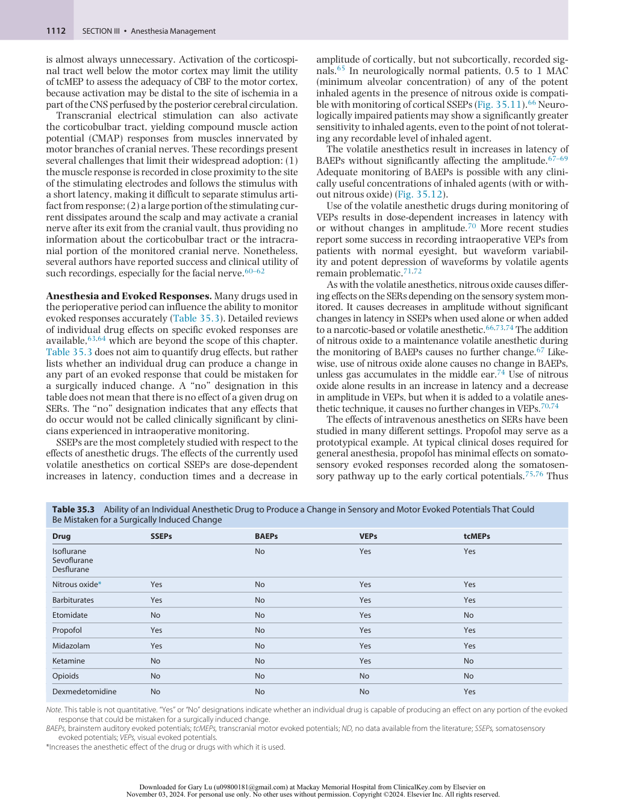

:::

<!-- PDF page 15 -->

propofol- based anesthetic is frequently used as the preferred technique to optimize signal- to- noise ratio for SSEPs and provide rapid feedback to the surgeon.77 BAEPs under propofol anesthesia show minor increases in interpeak latencies

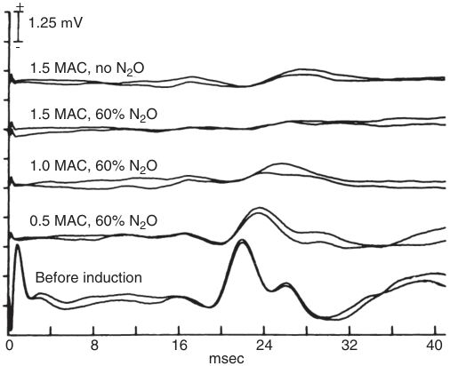

+ 1.25 mV - 1.5 MAC, no N2O 1.5 MAC, 60% N2O 1.0 MAC, 60% N2O 0.5 MAC, 60% N2O Before induction 0 8 16 24 32 40 msec 

**Fig. 35.11** Representative somatosensory evoked potential cortical responses (C- 3, C- 4- FPz) at various minimum alveolar concentration (MAC) levels of isoflurane. (From Peterson DO, Drummond JC, Todd MM. Effects of halothane, enflurane, isoflurane, and nitrous oxide on somatosensory- evoked potentials in humans. _Anesthesiology_ . 1986;65:35.)

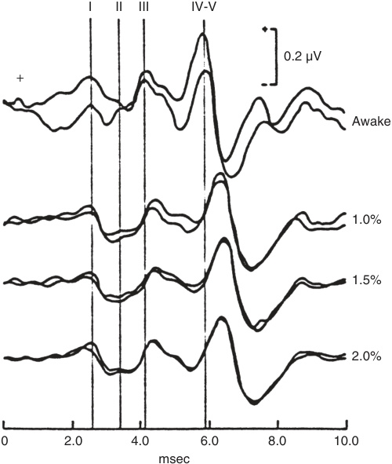

I II III IV-V 0.2 µV + Awake 1.0% 1.5% 2.0% 0 2.0 4.0 6.0 8.0 10.0 msec 

**Fig. 35.12 Influence of isoflurane alone on brainstem auditory evoked potential in a typical subject.** Latency of peaks III and IV to V increased at 1.0% but stabilized with increasing anesthetic depth. (From Manninen PH, Lam AM, Nicholas JF. The effects of isoflurane–nitrous oxide anesthesia on brainstem auditory evoked potentials in humans. _Anesth Analg._ 1985;64:43.)

and decreases in amplitude that are insufficient to interfere with clinical monitoring of auditory function.78,79 Effects of barbiturates parallel those of propofol. At doses of thiopental far greater than doses producing an isoelectric EEG, adequate monitoring of early cortical and subcortical SSEPs and BAEPs was preserved.80 This observation, which also holds for propofol, is important, especially when attempting to monitor the adequacy of CBF during cerebrovascular surgery when the patient has been given large, “protective” doses of barbiturates. The EEG is isoelectric and not helpful for monitoring. The early cortical SSEP waveforms are still preserved, however, and may be very helpful in determining adequacy of CBF. VEPs are much more sensitive to intravenous agents. After bolus administration and intravenous infusions, etomidate causes increases in latency of all waves and prolongation of central conduction time in SSEPs. In contrast to virtually all other commonly used anesthetics, etomidate causes increases in amplitude of the cortical SSEP.81,82 This effect may be due to an alteration in the balance of inhibitory and excitatory influences or an increase in the irritability of the CNS. This effect seems to be present in the cortex, but not in the spinal cord. Etomidate infusions have been used to enhance SSEP recording in patients when it was impossible to obtain reproducible responses at the beginning of intraoperative monitoring because of the pathology (Fig. 35.13). Following baseline responses that could not be monitored, the etomidate augmentation of the SSEP allowed adequate monitoring and detection of intraoperative events leading to compromise of the spinal cord.82 The effects of etomidate on BAEPs are dose- dependent increases in latency and decreases in amplitude that are not clinically significant.83 Based on several case reports and small series, dexmedetomidine is compatible with all types of sensory evoked potential monitoring.84

Generally, opioids cause small dose- dependent increases in latency and decreases in amplitude of SSEPs. These changes are not clinically significant. Effects on amplitude are more variable than the latency increases.85,86 Opioids can be used even in high doses in patients requiring intraoperative SSEP monitoring without impairment of ability to monitor neurologic function adequately. Opioid- induced changes must be considered, however, when evaluating the recordings. Large intravenous bolus administration of opioids should be avoided at times of potential surgical compromise to neurologic function to prevent confusing the interpretation of SEP changes if they develop. BAEPs were resistant to doses of fentanyl of 50 mcg/kg with no changes observed in absolute latency, interpeak latency, or amplitude.87

Effects of anesthetics on tcMEPs recorded from muscle are surprisingly profound (see Table 35.3).88–92 This profound effect occurs, because the spinal α- motor neuron integrates input not just from the corticospinal tract, but also from propriospinal, cerebellar, and subcortical inputs. These latter inputs are typically inhibitory and thus augmented by anesthetics. Anesthetic techniques typically used by most anesthesiologists for spine surgery would produce prohibitive depression of the MEP.93,94 Investigators showed in several studies that intravenous anesthetic drugs produce significantly less depression, and techniques using any of a combination of ketamine, opiates, etomidate, and propofol have been described.90,91,95–98 Fig. 35.14 shows the dramatic effect of introduction of 0.3 MAC isoflurane to a total

<!-- PDF page 16 -->

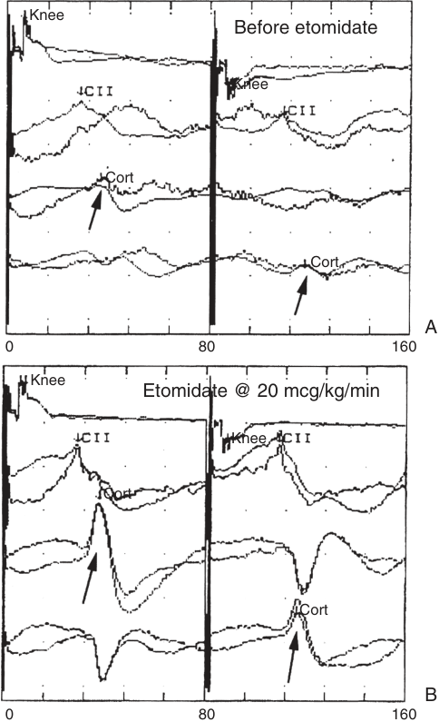

Knee Before etomidate Knee Cort Cort A 0 80 160 Knee Etomidate @ 20 mcg/kg/min Knee Cort Cort B 0 80 160 

**Fig. 35.13 Effects of etomidate on somatosensory evoked potential.** (A) These tracings were obtained from a mildly mentally impaired patient with severe kyphoscoliosis during the early maintenance phase of anesthesia using isoflurane and fentanyl. (B) These tracings were obtained after discontinuing isoflurane and instituting an etomidate infusion at 20 mcg/kg/minute. Note dramatically increased amplitude and clarity of the signal in the cortical (Cort) channels (marked by _arrows_ ), which both are recorded with the same amplification scale.

intravenous technique using propofol and remifentanil. The authors have had excellent experience with a combination of propofol and opiate, which also is supported in the literature. There is also support for the use of ketamine and lidocaine. One study demonstrated significant attenuation of tcMEPs during scoliosis surgery when dexmedetomidine was used as an adjunct to propofol and remifentanil.99 In general, if adjuncts are used, it is important to reduce the doses of other depressant anesthetics to optimize the recording conditions for tcMEPs. The use of neuromuscular blocking agents during tcMEP recording is typically not advised.

**Electromyography.** Intraoperative monitoring of electromyography (EMG) responses generated by cranial and peripheral motor nerves allows early detection of surgically induced nerve damage and assessment of nerve function intraoperatively. During EMG, the ability of a nerve to produce a response in the innervated muscle is used to assess

the health of a cranial or peripheral nerve at risk during surgery. Recordings are typically made from needle electrodes placed directly in the innervated muscle of interest. Surface electrodes and subdermal needle electrodes may completely miss neurotonic discharges that indicate damage to a nerve.100 The most experience with this monitoring modality has been obtained during its use in facial nerve monitoring.101

EMG monitoring may be either active or passive. During active monitoring, a cranial or peripheral nerve is stimulated electrically, and the evoked muscle activity (a CMAP) is recorded. Stimulation of the nerve proximal to the operative area or tumor can be used to assess the functional integrity of the nerve.102 Nerve function may also be assessed by noting the intensity of the electrical stimulus needed to evoke a muscle response and by the morphology of the CMAP. Passively, nerve function may be monitored during surgery through continuously recording all responses from innervated muscle groups. Very brief or “popcorn” EMG discharges are produced by simple, benign contact with the monitored nerve. Response trains are produced by more significant nerve irritation. Neurotonic discharges are produced by significant nerve irritation, damage, or both (Fig. 35.15).100,103 When these EMG responses reach a certain voltage threshold, they are usually converted into audible signals that provide immediate feedback to the surgeon and warn of impending nerve damage in real time. Real- time feedback is critical because density and frequency of neurotonic discharges may correlate with the degree of postoperative nerve dysfunction, as shown by data obtained from patients undergoing resection of acoustic tumors.102 One important limitation of passive EMG monitoring is that sharp section of a nerve may produce no EMG discharge at all, and thus this injury can go undetected.

Intraoperative EMG monitoring of the motor component of cranial nerves has been successfully performed. EMG monitoring of the trigeminal nerve can be accomplished with electrodes placed in the temporalis or masseter muscles. Trigeminal nerve motor monitoring has been used during nerve section for tic douloureux to ensure preservation of the motor branch of the trigeminal nerve and in combination with facial nerve monitoring during resection of large posterior fossa lesions.103 EMG monitoring of the eye muscles (cranial nerve III, IV, and VI) can be performed using tiny hook electrodes for recording. Needle electrodes placed in the stylopharyngeus muscle will monitor the glossopharyngeal nerve. Several muscles can be used to monitor motor branches of the vagus nerve. Most commonly, an electrode affixed to the endotracheal tube is used to monitor laryngeal muscles, which can be activated from the intracranial vagus as well as the superior and recurrent laryngeal nerves. Alternatively, electrodes placed in the striated muscles of the soft palate can monitor the vagus nerve.104 Using recording electrodes placed in or over the trapezius or sternocleidomastoid muscles, the spinal accessory nerve has been successfully monitored during resection of large meningioma, glomus jugulare tumor, and neck carcinoma.103 EMG monitoring of the hypoglossal nerve with needle electrodes placed in the tongue has been used for large posterior fossa lesions and clivus tumor.103

Monitoring of peripheral motor nerves has been performed by placing needle electrodes in or over the muscles

<!-- PDF page 17 -->

### Surgical change

|L then–(Avg) Left MEP–triggered|Right MEP–triggered R then–(Avg)|
|---|---|
|L quad–(Avg) ~~L ant tib–(Avg)~~|Rquad–(Avg) ~~R ant tib–(Avg)~~|
|L gast–(Avg) ~~L foot–(Avg)~~ 10 msec/div|~~R gast–(Avg)~~ ~~R foot–(Avg)~~ 10 msec/div|
|Before distraction||
|Left MEP–triggered|Right MEP–triggered|
|L then–(Avg)|R then–(Avg)|
|~~L quad–(Avg)~~|~~R quad–(Avg)~~|
|L ant tib–(Avg)|R ant tib–(Avg)|
|~~L gast–(Avg)~~|~~R gast–(Avg)~~|
|L foot–(Avg)|R foot–(Avg)|
|10 msec/div|10 msec/div|
|After distraction||
|Left MEP–triggered|Right MEP–triggered Rthen–(Avg)|
|L then–(Avg) L quad–(Avg)|Rquad–(Avg)|
|~~L ant tib–(Avg)~~ Lgast–(Avg)|Rant tib–(Avg) R gast–(Avg)|
|L foot–(Avg) 10 msec/div| R foot–(Avg) 10 msec/div|
|Distraction released A||

### Anesthetic change

|Right MEP–triggered|R then–(Avg)|~~L then–(Avg)~~ Left MEP–triggered|
|---|---|---|
||R quad–(Avg)|L quad–(Avg)|
||R ant tib–(Avg)|L ant tib–(Avg)|
||R gast–(Avg)|L gast–(Avg)|
||10 msec/div R foot–(Avg)|L foot–(Avg) 10 msec/div|
|Baseline|||
|Right MEP–triggered||Left MEP–triggered|
||~~R then–(Avg)~~|L then–(Avg)|
||10 msec/div ~~R quad–(Avg)~~ ~~R ant tib–(Avg)~~ R gast–(Avg) R foot–(Avg)|10 msec/div Lquad–(Avg) ~~L ant tib–(Avg)~~ Lgast–(Avg) L foot–(Avg)|

End-tidal isoflurane 0.3% B

**Fig. 35.14** (A) Transcranial electrical motor evoked potential (MEP) recording showing surgically induced change during spine surgery (scoliosis repair). (B) MEP with an anesthetic- induced change. Note similarity of the change pattern, except that in the anesthetic- induced change, the responses in the upper extremity also changed. Left- sided and right- sided responses are shown on the corresponding panel. A single upper extremity response is shown (top tracing) in each panel. Responses from four muscle groups in each lower extremity are shown directly below. _Ant tib,_ M tibialis anterior; _gast,_ m gastrocnemius; _L,_ left; _quad,_ m quadriceps femoris; _R,_ right; _then,_ thenar.

innervated by nerves that traverse the operative area and are at risk from the planned surgical procedure. Auditory feedback from EMG monitoring can warn the surgeon of unexpected surgical trespass of the nerve, help locate a nerve within the field (e.g., during tethered spinal cord release operations), and localize the level of any conduction block or delay. Because radiculopathies have been reported after spine surgery, particularly because of incorrect pedicle screw placement, EMG monitoring of peripheral nerves has been used in patients undergoing spine surgery to decrease the risk of nerve root injury during the procedure.103 During pedicle screw placement, the surgeon can stimulate the screw directly with a small amount of current using a ball- tip probe that can deliver an electrical stimulus. If EMG responses are produced with only a small amount

of current, the possibility that the screw has breached the bony pedicle near the spinal canal must be considered. Pedicle screws placed in healthy bone typically require stimulation at well more than 8 mA to elicit muscle responses.

## Clinical Applications of Neurophysiologic Monitoring

### INTRACRANIAL NEUROSURGERY – SUPRATENTORIAL

### Seizure Surgery

Patients with epilepsy who have seizures that generalize from an anatomically distinct focus may benefit greatly

::: details 原始表格與符號（PDF 第 17 頁）

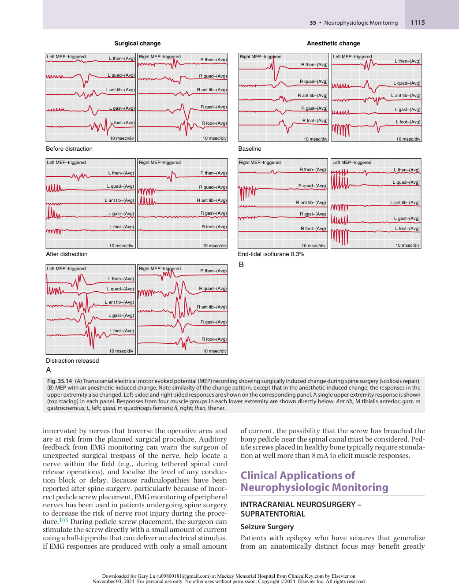

:::

<!-- PDF page 18 -->

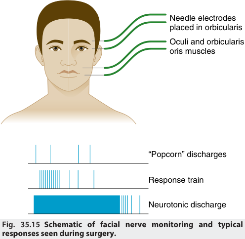

Needle electrodes placed in orbicularis Oculi and orbicularis oris muscles “Popcorn” discharges Response train Neurotonic discharge Fig. 35.15 Schematic of facial nerve monitoring and typical responses seen during surgery. 

from the surgical resection of that seizure focus.105 Precise localization of a seizure focus is important for achieving the therapeutic objective of seizure control and for minimizing complications from the resection. With sensitive magnetic resonance tomography techniques, neuronavigation, and recordings of typical seizure activity in the awake patient after placement of subdural and depth electrodes, the anatomic location and the appropriate extent of the resection frequently can be determined preoperatively.106 These developments have diminished the role of intraoperative recordings from the epileptogenic zone using electrocorticography.

Electrocorticography is done by placing a grid of subdural electrodes onto the exposed brain surface and recording spontaneous electrical activity. Electrocorticography is constrained by several limitations. The duration of such recordings is limited to a few minutes; recordings are limited to interictal discharges, which may not correlate with the epileptogenic focus; and recordings need to be obtained from a brain that is under the effects of general anesthetic agents, which alter the EEG.

To provide good conditions during the recording, the level of anesthesia is lightened (e.g., by use of a strict nitrous oxide–narcotic technique or low concentrations of volatile anesthetic drugs). Provocative techniques, such as hyperventilation or administration of a small dose of methohexital, may be useful to activate the seizure focus. Intraoperative seizure mapping requires the involvement of an expert electroencephalographer familiar with this technique.

### Awake Craniotomies

Perhaps the most comprehensive approach to localize and preserve critical brain structures and thus allow a good balance between aggressive resection and neurologic morbidity is to perform supratentorial craniotomies in an awake patient. During “awake” craniotomies, the patient undergoes repeated neurologic examinations targeted to assess

the eloquent area at risk. Such procedures are typically divided into exposure, mapping, and resection phases, and can be done with the patient entirely awake or awake only during periods when the neurologic examination must be assessed.107 Common to all these approaches is the need for meticulous locoregional anesthesia of the scalp at the craniotomy site and the pin sites of the head holder. A second requirement is a patient who is well informed about the awake parts of the procedure and is willing and able to cooperate. Dexmedetomidine, propofol, and remifentanil are the agents most frequently incorporated into the anesthetic regimens for awake craniotomy.108 Complications of awake craniotomy include nausea, vomiting, respiratory problems, and “tight” brain, but are typically mild and occur in less than 10% of cases in experienced centers.

Mapping is done by systematic electrical stimulation of the cortical surface to localize cortical areas that subserve specific neurologic functions such as movement or elements of speech. The plan for mapping is frequently aided by functional MRI images that localize eloquent cortex based on the increase in blood flow required by functional tasks executed during scanning. Cortical stimulation either triggers motor output or disrupts task performance. Cortical stimulation is combined with electrocorticography, i.e., the recording of EEG from an electrode array placed on an adjacent area of exposed cortex, to look for afterdischarges that may progress to seizure activity (Fig. 35.16). Seizures triggered by cortical stimulation can be stopped by the application of iced saline to the exposed cortex or a small amount of barbiturate or propofol.

### Craniotomies Under General Anesthesia

### Motor Strip Localization and Monitoring of the

**Corticospinal Tract.** Electrophysiologic monitoring of the somatosensory system in anesthetized patients can provide a simple guide to the anatomic location of the Rolandic fissure, which separates the parietal primary sensory and frontal primary motor cortex. This can be particularly useful when a tumor leads to anatomic distortion of the brain, making it difficult for a surgeon to visibly identify the Rolandic fissure. The fissure is located by recording cortical SSEPs from a subdural strip electrode that is placed perpendicular to the presumed location of the fissure. The location of the fissure is characterized by a reversal in the polarity (direction of waveforms) of the primary cortical response between the electrodes straddling the fissure, as illustrated in the clinical example in Fig. 35.17. Subsequent placement of the electrode strip onto the primary motor area of the precentral gyrus allows monitoring of the corticospinal tract with motor evoked potentials through direct cortical stimulation. This process of locating the motor cortex and the motor pathway utilizing neurophysiologic monitoring is referred to as motor mapping.

Motor mapping can also be used during a craniotomy under general anesthesia with an anesthetic that is optimized towards recording motor evoked potentials. Intermittent stimulation of the resection cavity or the use of instruments, such as a suction probe, designed to deliver motor stimulation, allows maximal tumor resection, while providing information on the distance between the edges of the resection cavity and the corticospinal tract. The

<!-- PDF page 19 -->

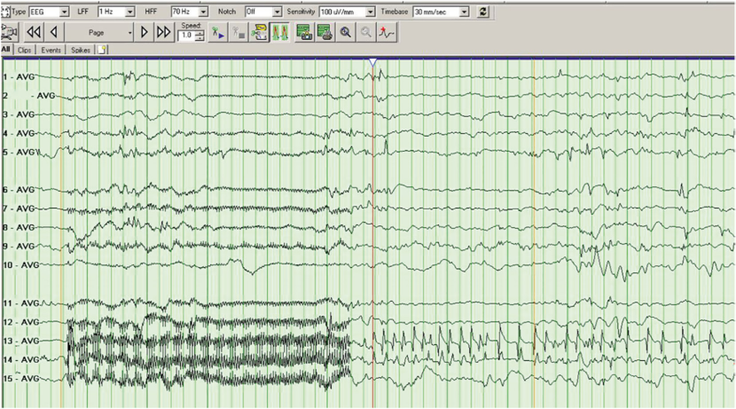

**Fig. 35.16 Afterdischarges during cortical stimulation mapping with a bipolar stimulator at 60 Hz.** The stimulus artifact (most evident in channels 12–15) can be seen in the left half of the tracings of electroencephalogram (EEG) recorded from a 3 × 5 grid of electrodes placed on the exposed cortex. Cortical stimulation is followed by afterdischarges in the form of sharp waves of decreasing frequency in channels 13 and 14. (Image courtesy of Tara Stewart, PhD.)

operative principle, namely that stimulator output relates to distance of the structure to be activated, is familiar to anesthesiologists from the use of stimulating needles for nerve blocks.

### INTRACRANIAL NEUROSURGERY – POSTERIOR FOSSA

The posterior fossa is a narrow space around the brainstem that contains the cerebellum, ascending and descending sensorimotor pathways, cranial nerve nuclei, cardiorespiratory centers, reticular activating system, and the neural networks that underlie crucial protective reflexes such as eyeblink, swallowing, gag, and cough. Surgery within the posterior fossa is therefore considered highly risky, and even small injuries can leave significant neurologic deficits. Although some of these neural structures, such as the sensory, voluntary motor, or auditory pathway, can be monitored consistently, many elements within the posterior fossa cannot be directly monitored during surgery. Instead, the integrity of these other neural structures is frequently only inferred from the well- being of neighboring structures amenable to monitoring.

### Microvascular Decompression of Cranial Nerves V, VII, and IX

Microvascular decompression is done most frequently for trigeminal neuralgia (cranial nerve V) in patients who present acceptable medical risks for a posterior fossa craniotomy. More rarely, the same approach is used to treat hemifacial spasm or neurovascular compromise of lower cranial nerves. The surgery entails dissecting along the intracranial portion of the nerve, identifying offending blood vessels that encroach on the nerve, and placing an insulating Teflon pad between vessel and nerve. The surgery risks ischemic damage to perforating vessels arising from the offending arteries and cerebellar retraction–related damage

to cranial nerves. The facial and vestibulocochlear nerves are at particular risk for stretch- induced injury caused by medial retraction of the cerebellum. Retraction- induced stretch produces a prolongation of the interpeak latency between peaks I and V of the BAEP waveform, which may ultimately lead to a complete loss of all waves beyond wave I (Fig. 35.18). Failure to release retraction in a timely manner results in postoperative hearing loss. BAEP monitoring therefore increases the chances for preserved hearing after microvascular decompression.109–113 During microvascular decompression of the facial nerve for hemifacial spasm, recent developments using stimulated EMG monitoring have enabled better documentation of the adequacy of nerve decompression and lessened the likelihood of persistence/recurrence of hemifacial spasm postoperatively. This new technique monitors the so- called lateral spread response (LSR) of the facial nerve. First, a peripheral branch of the facial nerve is stimulated. In the normal patient, this stimulation would not result in a recordable EMG response in a muscle innervated by a different branch of the facial nerve. In patients with hemifacial spasm, stimulated EMG responses can be recorded in muscles innervated by a different branch of the facial nerve (an LSR) indicating abnormal crossover of electrical activity. Decompression of the facial nerve has been shown in multiple studies to result in a great decrease or elimination of this LSR, and studies have indicated that elimination of the LSR is highly predictive of immediate postoperative relief of hemifacial spasm.114

### Vestibular Nerve Schwannoma

Vestibular nerve schwannoma is the most common tumor located in the cerebellopontine angle. Because of the common origin of the cochlear component of cranial nerve VIII and the essentially identical intracranial trajectory of the facial nerve, hearing loss and facial nerve palsy are concerns during surgical resection of these tumors. Size of the tumor and preoperative auditory function are the

<!-- PDF page 20 -->

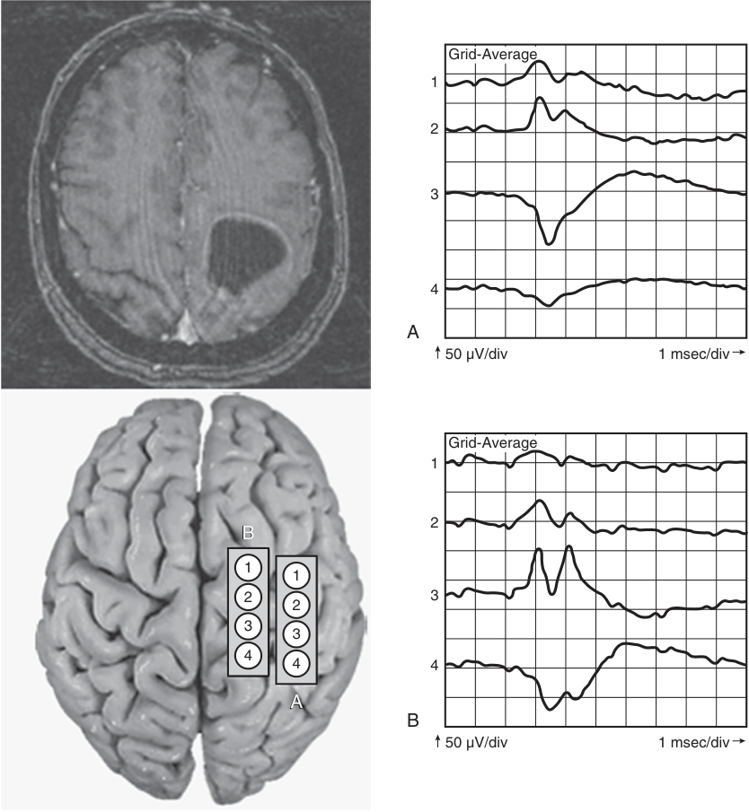

Gri d-Average 1 2 3 4 A 50 µV/div 1 msec/div Gri d-Average 1 2 B 1 1 2 3 2 3 3 4 4 4 A B 50 µV/div 1 msec/div 

**Fig. 35.17 Intraoperative localization of the Rolandic fissure separating the primary sensory and motor cortex.** The clinical example is from a patient with a large parietal tumor shown in the scan. Two of the recordings made from a four- contact subdural electrode strip are shown. The relative positions of the strip electrode are labeled B and A. In recording A, the primary cortical response from the electrodes anterior to the Rolandic fissure shows an upward deflection, whereas the response from electrodes posterior to the fissure shows a downward deflection. Moving the strip electrode anteriorly (recording B) moves this “phase reversal” between electrodes 3 and 4.

best predictors of postoperative hearing.115 For tumors up to about 1.5 cm in diameter, monitoring of BAEPs can increase the chances of preserving hearing.116 In addition to BAEPs, the facial nerve is monitored through spontaneous and stimulated EMG. Prospective trials have shown a higher percentage of patients with a functional facial nerve 1 year after surgery if facial nerve monitoring is used. Neurotonic discharges on EMG warn of impending damage caused by stretch or compression. Once again, it is important to remember that sharp section of the nerve may elicit no EMG discharge, and neuromuscular blockade may eliminate the ability to monitor EMG completely. If the course of the nerve is displaced by the tumor, the surgeon can map its course with a handheld stimulator and real- time auditory feedback.

### Other Posterior Fossa Neoplasms and Skull Base Surgery

Monitoring for operations on other neoplasms located in the brainstem typically is individualized to each case or to the surgical approach. EMG and compound muscle action potentials may be recorded not only from the territory of the facial nerve but also in principle from any cranial nerve that has a motor component. For example, EMG can be recorded from the tongue to monitor the hypoglossal nerve, and from the glottis through electrodes embedded into a specialized endotracheal tube to monitor the vagus nerve. Such a setup can be used to map motor nuclei on the floor of the fourth ventricle functionally, if it is distorted by a tumor.117 It is important to remember that EMG monitoring may be insufficient to preserve vital reflexes because only the efferent

<!-- PDF page 21 -->

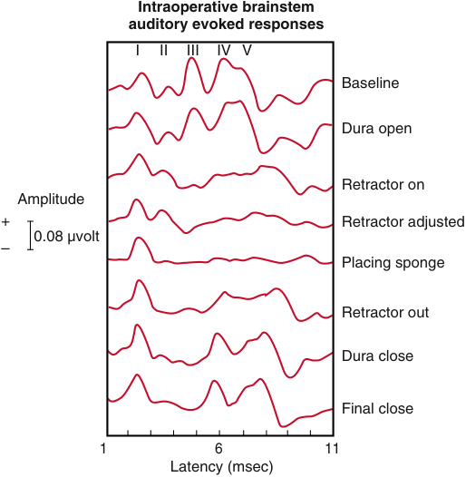

Intraoperative brainstem auditory evoked responses I II III IV V Baseline Dura open Retractor on Amplitude + Retractor adjusted – 0.08 µvolt Placing sponge Retractor out Dura close Final close 1 6 11 Latency (msec) 

**Fig. 35.18 Intraoperative monitoring of brainstem auditory evoked responses during microvascular decompression.** The baseline recording shows the typical five waves of the brainstem auditory evoked potential response. Intraoperative events are designated to the right of each trace. Placement of the retractor causes a severe increase in latency of wave V even after adjustment of retraction. During placement of the sponge, all waves after wave I, which originates in the inner ear, are nearly completely lost. Removal of the retractor causes brainstem auditory evoked potentials to revert toward baseline.

limb of these reflexes to innervated muscle is monitored. Recording from motor nerves by stimulating the corticobulbar tract through transcranial stimulation is still considered experimental because of the short latency of the responses and the difficulty of excluding extracranial activation of the distal cranial nerve.

Use of neurophysiologic monitoring to detect brainstem ischemia, although done in some centers, is not well documented or supported by clinical studies. Global well- being of the brainstem may be monitored by combining multiple modalities of evoked potentials, such as BAEPs, SSEPs, and MEPs. Each modality monitors a function whose integrity would be considered important for the functional outcome of an individual patient. As illustrated in Fig. 35.19, the cross  section monitored by combining all these modalities still leaves out crucial areas. Given that perfusion occurs through perforating vessels, it is easy to see that monitoring may indicate that all is well or, more likely, that a therapeutic intervention was helpful in restoring signals, when clinically the patient is still left with a significant deficit. This occurrence does not invalidate monitoring or the therapeutic intervention but indicates that the monitored pathway was not located in an area at risk from the surgical procedure. A presence of such obligatory “false- negative” results means few studies address the utility of such monitoring. Given that each individual monitoring modality comes with its own constraints, such an approach typically requires a dedicated neurophysiologist for interpretation and troubleshooting.

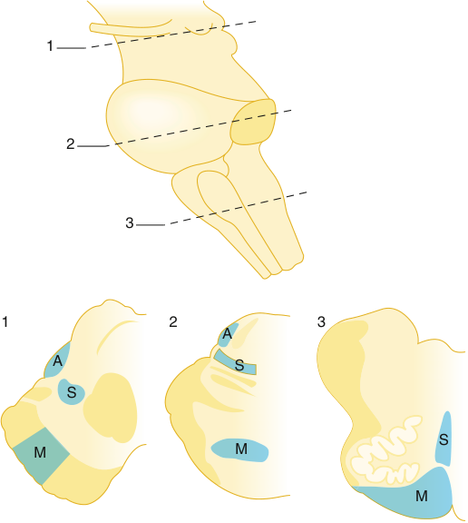

1 2 3 1 2 3 A A S S S M M M 

**Fig. 35.19 Monitoring of the brainstem with evoked potentials.** Evoked potentials monitor specific tracts that encompass defined areas in the brainstem. This is shown in three transverse sections approximately at the levels indicated in the drawings. The areas directly monitored by a given modality are indicated in _blue_ and labeled _M_ (motor), _S_ (somatosensory), and _A_ (auditory). Conclusions about the well- being of the remainder of the brainstem are made by inference from the monitored areas.

### Intracranial Neurovascular Surgery for Aneurysms

SSEPs have been extensively studied during cerebral aneurysm surgery. During these procedures, the surgical incision and brain retraction diminishes the utility of placing scalp or brain surface EEG electrodes that could detect cerebral ischemia in at- risk cortex. Recording electrodes placed on the surface of the brain have been used successfully, but they are commonly considered “in the way” by neurosurgeons. Thus, EEG is typically used only to confirm metabolic suppression during temporary clip placement. Scalp electrodes for SSEP monitoring may be placed more easily, although the recording montage is frequently not the same as that used in an awake patient.

For aneurysms involving the anterior cerebral circulation, SSEP monitoring has an excellent, but not perfect, record for predicting postoperative neurologic function. Most patients without surgically induced SSEP changes during the procedure awaken with an unchanged neurologic examination. Patients with significant SSEP changes that do not revert to normal typically awaken with a new neurologic deficit. Patients with significant intraoperative SSEP changes that return to normal intraoperatively may show at least a transient postoperative deficit, with the severity and duration of that deficit increasing as the severity of the SSEP change increases.118 Many authors have reported significant utility of SSEP monitoring in detecting improper aneurysm clip placement (Fig. 35.20) and in

<!-- PDF page 22 -->

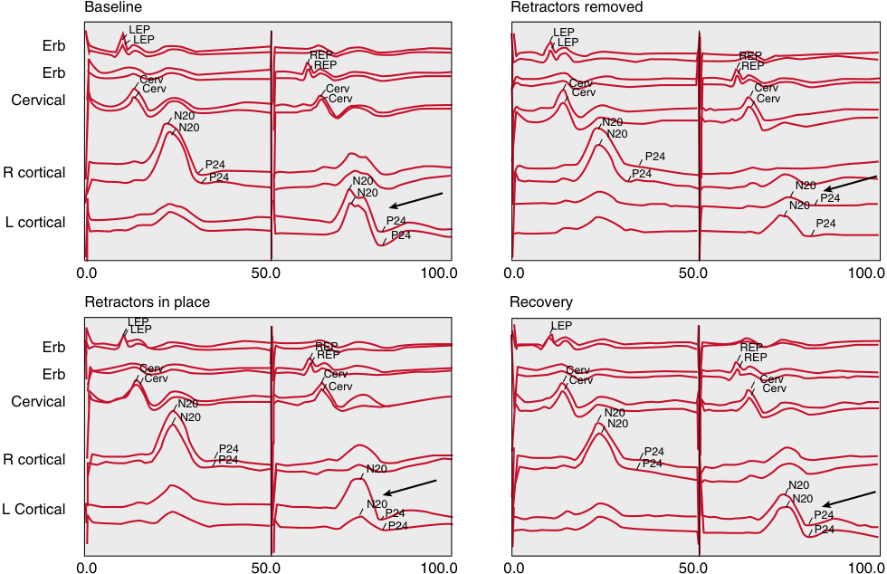

Baseline Retractors removed LEP LEP Erb LEP LEP REP REP CervicalErb CervCerv REPCervCerv CervCerv REPCervCerv N20 N20 N20 N20 P24 P24 R cortical P24 N20 P24 N20 N20 P24 N20 L cortical P24 P24 P24 0.0 50.0 100.0 0.0 50.0 100.0 Retractors in place Recovery LEPLEP LEP Erb REP REP REP REP Erb CervCerv Cerv CervCerv Cerv Cerv Cerv Cervical N20 N20 N20N20 P24 P24 R cortical P24 N20 P24 N20 L Cortical N20P24 N20P24 P24 P24 0.0 50.0 100.0 0.0 50.0 100.0 

**Fig. 35.20 Somatosensory evoked potentials during aneurysm clipping.** Responses generated by the cortex at risk are indicated by _arrows_ . Baseline, after retractor placement, after retractor removal, and recovery traces are shown. The initial evoked response change occurred 4 minutes after retractor placement. Note loss of voltage of cortical evoked response caused by inadvertent compression of the middle cerebral artery. _Cerv,_ cervical; _LEP,_ left Erb’s point; _REP,_ right Erb’s point.

guiding intraoperative blood pressure management, particularly in patients already having, or at significant risk for, vasospasm after subarachnoid hemorrhage.48,119–124 More recently, tcMEP monitoring has been incorporated into the monitoring approach for anterior circulation aneurysms and has improved the sensitivity of detecting ischemia.125,126 The same success cannot be reported, however, for posterior circulation aneurysms. In these cases, many areas of the cortex and subcortical structures are at risk for damage and cannot be monitored at all by somatosensory pathway function. A significant false- negative monitoring pattern exists for these patients, but changes can still be detected when a surgical insult is sufficiently severe to involve large portions of the brain.127–130

An important concern during aneurysm surgery is injury to perforating vessels near the aneurysm, which risks damage to subcortical pathways in the internal capsule and may account for half the new neurologic deficits in the immediate postoperative period.131 Anatomically, the motor pathway runs anterior to the sensory pathway in the internal capsule and is at greater risk if the anterior choroidal artery, lenticulostriate perforator vessels, or even perforating branches of the anterior cerebral artery are injured during dissection and clip placement. Two concerns need to be addressed if tcMEP is to be incorporated successfully in these cases. First, motion caused by stimulation needs to be minimized to not interfere with the surgery. Second, and more importantly, stimulus parameters need to be set

to limit deep current spread that would activate the corticospinal tract distal to the internal capsule. If not properly set, ischemia to the motor pathway and internal capsule may go undetected because the stimulation will directly activate the corticospinal tract distal to the internal capsule. The use of longer stimulus trains at stimulation intensities close to the motor threshold addresses both concerns132 and has made tcMEP monitoring a useful adjunct during aneurysm surgery in many centers.133

### SPINE SURGERY

The risk of injury to neural structures varies widely between different types of spine surgery. Neurophysiologic techniques can provide early warning of such injury, but their full potential is only realized in procedures characterized by modifiable or reversible steps.134 For example, a laminar hook used as part of spinal instrumentation will narrow the spinal canal at the level it is placed. If the placement of the hook compromises local spinal cord perfusion resulting in a change in SSEPs or tcMEPs, the surgeon can alter the construct and prevent potential injury to the patient. Note that for some of these modifiable steps, alternatives to neurophysiologic techniques exist that may minimize the risk of neurologic injury. For example, safely positioning a patient with an unstable cervical spine in the prone position, can be done while monitoring SSEPs and tcMEPs. Alternatively, positioning the patient awake after airway anesthesia or under fluoroscopic

<!-- PDF page 23 -->

evaluation of spine alignment may similarly serve to minimize neurologic injury of this step in the procedure.

### Scoliosis, Adult Correction, and Spinal Cord Surgery

Intraoperative monitoring of SSEPs has been used most extensively in patients undergoing surgical procedures involving the spinal column, spinal cord, or both. Extensive experience has been gained in patients who have decompressive laminectomies or who have undergone corrective procedures for scoliosis. Intraoperative changes in SSEPs have been noted in 2.5% to 65% of patients undergoing surgical procedures on the spine or spinal cord.135–138 When these changes are promptly reversed either spontaneously or with interventions by the surgeon or anesthesiologist (e.g., lessening the degree of spine straightening in scoliosis surgery or increasing arterial blood pressure), the patients most often have preserved neurologic function postoperatively. However, when these changes persisted without resolution intraoperatively, the patients most often awakened with worsened neurologic function.

False- negative (rare) and false- positive (common) results have been reported with SSEP monitoring during spine surgery. There have been reports of patients with intact SSEPs throughout the procedure that have awakened with a new significant neurologic deficit, but the total reported incidence of this finding is less than 1% of all cases monitored. Overall, the reliability of properly performed SSEP monitoring to predict the postoperative sensory and motor function has been reported to be excellent.41,138,139 However, as previously discussed, it is important to remember that motor tracts are not directly monitored by SSEPs. The sensory and motor tracts are in different areas of the spinal cord and have distinct anatomic blood supply. The blood supply to the dorsal columns of the spinal cord, which carries all the upper extremity SSEPs and at least a portion of the lower extremity SSEPs, is derived primarily from the posterior spinal arteries. The blood supply to motor tracts is derived primarily from the anterior spinal artery. Therefore, it is possible for a significant motor deficit to develop postoperatively in patients with intact SSEPs throughout the surgery and such events have been reported.140,141 The reason why local injury typically affects both sensory and motor tracts is because of collateral circulation across the surface of the spinal cord and along ventral and dorsal spinal nerve roots.

Many case series confirm that simultaneous recording of sensory and motor evoked potentials increases sensitivity for detecting intraoperative changes and reduces false negatives, i.e., patients without significant monitoring changes who nonetheless awaken with a postoperative deficit.142–147 In a consensus statement, the American Society of Neurophysiologic Monitoring concluded that use of MEP monitoring in combination with SSEP monitoring is well established to prevent injury to sensory and motor tracts during spinal column surgery.148

The most frequent component of spinal instrumentation is a pedicle screw. Ideally it is placed into the vertebral body while making good contact with the cortical bone of the pedicle, thus permitting the application of significant corrective force at each instrumented level. A risk of pedicle screw placement is the breach of the pedicle resulting in a weakened construct or postoperative radicular pain.

Pedicle screw testing may help prevent malpositioned screws.149,150 Typically, the pilot hole or, less desirable, the shank of an implanted pedicle screw is repeatedly stimulated with a ball- tip probe or an electrified pedicle probe with increasing current to determine the threshold for eliciting a myotomal CMAP. The interpretation of responses is complicated by the fact that the anatomic relationship between pedicles and nerve roots depends on the level of the spinal cord because the spinal cord is shorter than the bony spinal column. Thus, a medially misplaced screw in the lumbar region will come to lie next to a nerve root, whereas in the thoracic spine, a medial misplacement puts the screw next to the corticospinal tract, which cannot be activated by single stimuli. Because thresholds vary among cervical, thoracic, and lumbar spine, as well as between healthy and diseased nerve roots or bone, this technique has limitations but is widely thought to be useful.151

Surgery on the spinal cord may also benefit from neurophysiologic monitoring.152,153 Sensory evoked potentials may be elicited after opening the dura by stimulating the dorsal column and identifying the anatomic midline.154 During resection of tumor, motor evoked potential monitoring can limit trauma to the unaffected cord even without sacrificing oncologic results. It is important to note that the improvement in neurologic outcome with the use of neuromonitoring is incremental, e.g., one grade in muscle strength on the five-grade McCormick scale.153 For the patient’s quality of life, such improvements may nonetheless be clinically meaningful.

### Lumbar Spine Surgery

The bulk of lumbar spine procedures occur below the level of the spinal cord, which terminates at L1 in normal adults. Therefore, the cauda equina and nerve roots are the neural structures most at risk for injury. Dermatomal and myotomal overlap reduces the sensitivity for detecting nerve root injury through SSEPs and tcMEPs, respectively.155 Sensory fibers from the posterior tibial nerve, for example, enter the spinal canal through the L5–S2 nerve roots, while the gastrocnemius muscle derives innervation from L5–S2 nerve roots. Likewise, spontaneous EMG is less sensitive to mechanical nerve irritation or injury, because, unlike cranial nerves, nerve roots are well protected by myelin. Thus, anterior and posterior approaches to the lumbar spine are frequently performed without neurophysiologic monitoring. The lateral approach to the lumbar spine is minimally invasive and may offer biomechanical advantages, explaining its increasing popularity. This approach puts the lumbar plexus in the path of the surgical approach. Therefore, many surgeons use triggered EMG to map proximity to the lumbar plexus as they establish the working corridor to the disc space.156 Despite such monitoring, nerve injuries – typically of a neurapraxic type – are not uncommon. Motor evoked potential monitoring and saphenous SSEP monitoring have both shown promise to reduce such injuries and are incorporated into the monitoring approach in some centers.157,158

### Peripheral Nerve Surgery

Neurologic monitoring for surgeries involving peripheral nerves can be done in two different settings. In the first setting, the peripheral nerve is intact, but threatened by the surgery. Examples would be an intrinsic nerve tumor,

<!-- PDF page 24 -->

such as a schwannoma or an extensive soft tissue tumor, particularly if it displaces the normal anatomic course of a nerve. Monitoring of spontaneous and stimulated muscle responses from muscle groups innervated by the nerve in question can be used to guide the resection. Spontaneous EMG discharges can be generated by stretch or compression of the nerve, by local heating from electrocautery, or from ischemia. Two caveats apply to the monitoring of spontaneous EMG. First, the neuromuscular junction is part of the monitored pathway, and muscle relaxation decreases/abolishes the sensitivity of monitoring in a dose- dependent manner. Second, sharp section of the nerve may not result in a noticeable discharge. To search out the course of the nerve intraoperatively, the surgeon may stimulate the wound area with a handheld probe and listen for stimulated EMG or palpate for muscle contraction. The underlying concept should be familiar to anesthesiologists from the use of nerve stimulators in regional anesthesia.

A second setting where monitoring of peripheral nerves is used is in patients with prolonged weakness and sensory loss after nerve injury undergoing nerve exploration.159 The aim is to determine whether nerve reconstruction may improve outcome. The area of the lesion is determined by preoperative nerve conduction studies. Intraoperatively, the nerve is first stimulated proximal to the lesion, and a recording of the nerve action potential is made directly from the nerve distal to the lesion, as illustrated in Fig. 35.21. If there is nerve conduction across the lesion, lysis of scar is performed, and the incision is closed. Natural recovery by means of axonal regrowth produces the best outcome. If conduction does not occur across the lesion,

resection of the damaged nerve and nerve cable grafting is performed.103,160,161

### NEUROPHYSIOLOGIC MONITORING DURING VASCULAR AND CARDIOVASCULAR SURGERY

### Carotid Vascular Surgery

Carotid vascular surgery (see also Chapter 52) typically requires transient interruption of blood flow to the brain through the affected carotid artery. Although the risk of stroke associated with carotid vascular surgery has been declining,162 the residual risk varies greatly based on the indication for the procedure. It is lowest for asymptomatic patients and highest after a recent revascularization for ischemic stroke.163

The use of the EEG as a monitor of the adequacy of hemispheric blood flow during carotid endarterectomy has been established for many years. In a large series of patients undergoing carotid endarterectomy at the Mayo Clinic,35 the EEG was compared with regional CBF using the Xe washout method. This study validated the EEG as an indicator of the adequacy of regional CBF. Normal CBF in gray and white matter averages 50 mL/100 g/min. With most anesthetic techniques, the EEG begins to become abnormal when CBF decreases to 20 mL/100 g/min. Cellular survival is not threatened until CBF decreases to 12 mL/100 g/min. The difference in blood flow between when the EEG becomes abnormal and the blood flow at which cellular damage begins to occur provides a rational basis for monitoring the EEG during carotid surgery. In many cases, prompt detection of EEG changes may allow intervention (e.g., shunting, increasing cerebral perfusion pressure) to restore CBF

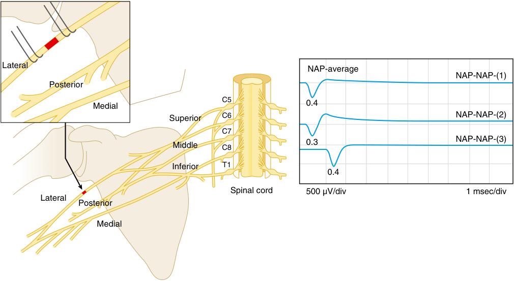

Lateral NAP-average NAP-NAP-(1) Posterior C5 0.4 Medial C6 NAP-NAP-(2) Superior C7 Middle C8 0.3 NAP-NAP-(3) Inferior T1 0.4 Spinal cord 500 µV/div 1 msec/div Lateral Posterior Medial 

**Fig. 35.21 Recording a nerve action potential (NAP) during a brachial plexus exploration.** The site of the injury on the lateral fascicle is indicated in _red_ . As shown in the inset, the surgeon places hook electrodes on either side of the exposed part of the nerve. If the injury is limited to an axonotmesis, proximal stimulation will result in a distal NAP similar to the ones shown in the recording to the right. The delay in the response in the third tracing is simply the result of a change in technical settings.

<!-- PDF page 25 -->

before onset of permanent neurologic damage. Continuous EEG monitoring may be used to evaluate the effectiveness of therapy instituted to correct ischemia.

Should the patient undergoing carotid endarterectomy have EEG monitoring? That question cannot be answered based on available data. EEG monitoring provides information about CBF that would not otherwise be available. Based on EEG changes, the clinician has an opportunity to recognize and intervene to increase inadequate blood flow when it occurs. Anecdotally, many clinicians have found such monitoring useful and use it routinely. Population studies do not support routine use, reflecting the fact that strokes during carotid vascular surgery are infrequent and the majority are caused by embolism, which may not be adequately treated by simply increasing CBF.

In a large series of patients undergoing carotid endarterectomy with selective shunting who were monitored with 16- channel unprocessed EEG, no patient awakened with a new neurologic deficit that was not predicted by EEG.164 While transient, correctable EEG changes were not associated with stroke, persistent changes were associated with stroke. This study had no comparison group for analyzing stroke rates when EEG monitoring was not used during surgery. Conversely, in the North American Symptomatic Carotid Endarterectomy Trial and the European Carotid Surgery Trial, retrospective comparisons of patients receiving EEG monitoring and patients not receiving EEG monitoring failed to show a significant difference in outcome.165,166

Even more difficult to prove is that EEG monitoring is useful when all patients are shunted during carotid clamping. Such monitoring has detected correctable shunt malfunction, and investigators have described hypotension- related EEG changes in patients with critical stenoses and poor collateral circulation.167 Advocates of selective shunting based on EEG (or other monitoring) criteria claim that inserting a shunt unnecessarily through a region of diseased vessel would surely increase embolization. A multicenter study of 1495 carotid endarterectomies provides some evidence that shunting of patients without evidence of decreased cerebral perfusion increases the incidence of stroke more than sixfold.168 Although this study and other more recent studies169–171 advocate that selective shunting using some form of monitoring of the adequacy of CBF should improve perioperative stroke rate, an analysis by the Cochrane Stroke Group172 failed to show sufficient evidence to advocate for routine shunting, selective shunting, or even no shunting at all. In addition, this review failed to demonstrate that any type of monitoring for cerebral ischemia was superior to another.

Processed EEG also has been used during carotid vascular surgery. Two issues affect the efficacy and reliability of processed EEG as a monitor for cerebral ischemia. First, it is unclear what is the minimum number of channels (or areas of the brain) that should be monitored. Clinical experience and clinical investigations suggest that four channels (two per side) are the minimum number of channels for adequate sensitivity and specificity.36 Interestingly, when a limited number of channels were compared with 16- channel EEG monitoring, 100% sensitivity and specificity were obtained using two channels per hemisphere, provided that those channels monitored the middle cerebral artery territory. These results were obtained with a frontoparietal channel combined with a frontotemporal channel.36

The second issue is the experience level of the observer monitoring the processed EEG. Is a dedicated, experienced technician or electroencephalographer needed? In a study addressing this question, the 16- channel unprocessed EEG monitored by a dedicated technician was compared with a processed EEG reviewed by three anesthesiologists of differing levels of experience with processed EEG.37 The three anesthesiologists interpreted the tracings without knowledge of the case. They were presented only with the written trace with an indication of the point at which the carotid artery was clamped. In these cases, the most important interpretation pitfall to avoid is the “false- negative” pattern. If the clinician interprets the EEG as showing adequate CBF when in fact it does not, the surgeon may fail to shunt an ischemic patient. A false- positive result may be less of a problem because that patient is not ischemic but is given a shunt anyway. In this case, only the risk of emboli from the “unnecessary” shunt is incurred. The positive predictive value of the anesthesiologist correctly interpreting the trace as unchanged after clamping was 91% to 98%, which indicates that the device can be used by novice interpreters with fair accuracy to determine the presence of cerebral ischemia at the time of carotid occlusion (Fig. 35.22).

SSEP monitoring also has been used to gauge adequacy of CBF to the cerebral cortex and subcortical pathways during carotid vascular surgery.49,173,174 SSEPs have been found in the laboratory to have a similar but slightly lower threshold for electrical failure compared with the EEG when CBF is reduced. SSEPs are generally intact until the cortical blood flow decreases to less than 15 mL/100 g/min.47 A recent review (meta- analysis) of shunting during carotid vascular surgery suggests that selective shunting based on SSEP monitoring results in a perioperative stroke rate similar to when EEG monitoring is used as the basis for shunting.175 Combining SSEP and EEG increases the sensitivity for detecting ischemia.176,177

TCD monitoring during carotid vascular surgery is based on measurement of two primary parameters: blood flow velocity and the number of emboli detected in the middle cerebral artery. The hypothesis justifying the use of this monitoring during carotid vascular surgery has two components: blood flow velocity correlates with CBF and increasing numbers of emboli increase the likelihood of embolic stroke. Intraoperative use of TCD has not been widely adopted for many reasons. As previously noted, good TCD signals cannot be obtained in up to 20% of individuals who could benefit from monitoring. Also, TCD probe motion during surgery causes major problems with loss of signal or with angle of insonation- induced changes in the relationship between blood flow velocity and blood flow. Nonetheless, multiple series of carotid endarterectomies with TCD monitoring have been reported with good success, quoting a critical blood flow velocity reduction around 50% as indicative of inadequate CBF requiring intervention (shunt or increased blood pressure or both).178–184 The relationship between emboli count and stroke is better established. Multiple studies conducted in the preoperative, intraoperative, and postoperative periods indicate that higher emboli counts are associated with higher stroke risk and warrant intervention.178–184 It is worth noting that TCD is the only monitor that can detect dangerous hyperemia, also known as normal perfusion pressure breakthrough, after repair of

<!-- PDF page 26 -->

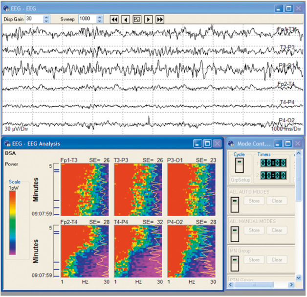

**Fig. 35.22 Hemispheric ischemia after clamping of the internal carotid artery.** The top panel shows three channels of electroencephalogram (EEG) for each hemisphere. The right- sided channels (bottom three tracings) show nearly suppressed EEG activity due to ischemia. The bottom panel shows the corresponding density spectral array, where EEG power in each frequency is coded in color, with _red_ indicating greater power. The oldest data is at the top of each field and the most recent at the bottom. The lower row of three density spectral array (DSA) panels corresponds to the right- sided EEG leads. Halfway through the panel there is a dramatic reduction in EEG power after clamp placement. The bottom spectrum corresponds to the raw EEG tracings shown in the top panel. (Image courtesy of Reza Gorji, MD.)

severe flow- limiting carotid stenosis. Typically, a sustained doubling of flow velocity after unclamping should prompt the anesthesiologist to consider lowering the blood pressure. There are no good outcome data supporting TCD use intraoperatively, but data regarding emboli count and risk of stroke suggest that if technical issues with probe attachment to the patient are overcome, TCD may be useful as a predictor of impending stroke in the preoperative, postoperative, and perhaps intraoperative periods.

Near- infrared spectroscopy (NIRS) is an attractive monitor during carotid endarterectomy because of its ease of application and lack of training required for interpretation. The hypothesis governing its use is very simple: as oxygen delivery to the brain decreases, oxygen extraction from arterial blood increases, and the oxygen saturation in cerebral venous blood will decrease. Multiple case reports and series document the use of cerebral oximetry during neurovascular surgery, but several major questions surrounding use of NIRS during carotid surgery remain unanswered.

The first and most important question is what degree of decrease in oxygen saturation can be tolerated before intervention is necessary. Because most interventions involve some risk (e.g., shunting leads to higher risk of emboli and increasing blood pressure may lead to myocardial ischemia), the answer to this question is important. It is likely that this tolerance may vary from patient to patient. Two studies in awake patients showed that the saturation value at which any patient would develop symptoms varied in

individual patients,14,15 and an absolute value that required shunting could not be determined. Another study showed that cerebral oxygen saturation decreased before the EEG developed changes, and the authors used this observation to claim superiority for NIRS monitoring of the brain during carotid surgery.185 This finding should not be surprising, however, because function of the brain (in this case, electric function) does not fail until increased extraction of oxygen no longer meets metabolic demands for the tissue. If metabolic demands are being met by increased extraction, it is unclear that any intervention is needed.

Finally, a study by Friedell and colleagues186 compared NIRS with EEG and SSEP monitoring during carotid surgery. In 24 of 323 patients, significant differences were observed between NIRS and the monitors of electric function. Seventeen patients showed no changes in electric function with significant decreases in cerebral oxygen saturation. In seven patients, no change in cerebral oxygen saturation occurred despite significant change in the EEG and SSEP. The latter finding may be because NIRS and EEG/ SSEP monitor different vascular territories. These data in combination with the data from studies in awake patients suggest that use of NIRS alone during carotid vascular surgery may be inappropriate. In addition, an aggregate of studies and case reports available in the literature suggest that there is no clear cutoff value of regional oxygen saturation which would mandate shunt placement or increasing the cerebral perfusion pressure.

<!-- PDF page 27 -->

### Aortic Surgery

One of the feared complications of aortic surgery is spinal cord ischemia (see also Chapter 52) resulting in immediate or delayed postoperative paraplegia. Aortic disease and previous grafts reduce collateral blood supply to the spinal cord. Reduced collateral flow risks ischemia particularly in the territory of the anterior spinal artery, which supplies the bulk of the spinal cord gray matter as well as the motor tracts. Therefore, patients with neurologic dysfunction after thoracic aortic vascular surgery frequently show intact posterior spinal cord function (proprioception, vibration, light touch) when motor and other sensory functions (pain, temperature) are impaired. This result occurred in 32% of patients with neurologic injury after aortic aneurysm repair in one series,187 with similar results in several other series. Intraoperative SSEP monitoring in these patients carries a significant risk for false- negative results, and as a result, such monitoring is not widely used. Conversely, the literature shows mixed but improving support for the use of MEP monitoring. Recent clinical series have shown much greater success in correctly detecting inadequate spinal cord blood flow with the use of MEPs and in improving operative outcome. The technique has proven useful, particularly when operative strategies such as reimplantation of crucial intercostal vessels based on results of MEP monitoring, alteration of spinal cord perfusion pressure (blood pressure increase or CSF drainage or both), spinal cord cooling, and other methods are used.188 Additional studies, particularly during endovascular stent repair of thoracoabdominal aneurysms, have found MEPs very useful in guiding therapy and improving outcome.189,190 One caveat is that failure to elicit compound muscle action potentials in the lower extremities may be due either to spinal cord ischemia or ischemia of the leg muscle itself. Placement of stimulating electrodes over a peripheral nerve of the lower extremity allows to quickly distinguish between those possibilities.191

### Cardiopulmonary Bypass

Cardiopulmonary bypass (CPB; see also Chapter 50) requires cannulation of large proximal arteries. Cannulation creates a risk of embolic stroke and cannula- associated complications can jeopardize cerebral perfusion. Because of these risks, there is an interest in monitoring the brain during these cases. In humans, changes that occur with the institution of CPB may alter the EEG by multiple different mechanisms. Plasma and brain concentrations of anesthetic drugs may be altered by CPB or by anesthetic drugs commonly given during CPB. Alterations in arterial carbon dioxide tension and arterial blood pressure may occur during CPB, and hemodilution with hypothermic perfusate nearly always occurs. These effects, all of which may produce EEG changes similar to pathologic changes seen with ischemia, make it difficult to interpret EEG changes occurring during CPB. Levy and others192,193 tried to distinguish the normal effects of hypothermia from other events occurring at the institution and conclusion of CPB. Initially, they concluded that only a qualitative relationship could be determined, but later, with the use of a much more sophisticated EEG analysis technique (approximate entropy), EEG changes associated with changes in temperature could be quantified.

Chabot and colleagues194 and Edmonds and colleagues195 have attempted to use quantitative (processed, multiplechannel) EEG during CPB to detect cerebral hypoperfusion and relate these changes to postoperative neurologic function. Some minimal work has been done with intervention after detection of cerebral hypoperfusion using quantitative EEG but only a few patients have been studied with very few corroborating studies. In addition, this type of monitoring is extremely costly in time, personnel, and equipment. Given the lack of convincing outcome data, the cost- to- benefit ratio is unclear at best.

TCD ultrasound can monitor the cerebral circulation during CPB. Anecdotal reports and case series document the use of TCD for determining adequacy of CBF, detection of emboli, and detection of improper cannula placement.196 As previously mentioned, probe placement instability and inability to obtain signals in some patients limit its use. Only very limited outcome data exist, and use of TCD ultrasound during CPB does not stand up to evidence- based examination, primarily because of lack of information.

As is the case with EEG monitoring during CPB, there are multiple case reports and several series that advocate the use of NIRS or jugular venous oxygen saturation (Sjvo2) as indicators of adequate perfusion of the brain during CPB.197,198 Incorrect placement of CPB cannulae have been detected clinically. One series of patients undergoing CPB for coronary bypass surgery showed a higher incidence of major organ system dysfunction and longer hospital stays in patients with lower baseline and intraoperative cerebral oxygen saturation values.199 The same questions exist for this application of NIRS as for the use of NIRS during carotid vascular surgical procedures. Although a recent systematic review of the use of NIRS during CPB showed that data are insufficient to conclude that interventions based on low cerebral oxygen saturation values prevent either stroke or postoperative cognitive dysfunction,200 several more recent studies suggest significant promise for this modality when used in combination with TCD ultrasound. Use of NIRS and TCD ultrasound together identified a significant percentage of patients undergoing CPB with impaired autoregulation who were at higher risk for postoperative cognitive dysfunction and/or stroke.201–203 This patient population may benefit from higher mean arterial pressure during CPB. Use of NIRS during CPB clearly provides information that would not otherwise be available, but more work is needed before we fully understand the role of this monitor during CPB.

Based on current information, no neurologic monitoring techniques, either alone or in combination, are clearly useful in improving outcome during surgical procedures requiring CPB. That said, processed EEG and NIRS are both noninvasive and comparatively simple to interpret, while providing information not otherwise obtainable during CPB. They can be usefully integrated into the armamentarium of the cardiac anesthesiologist. Whether dedicated neuromonitoring personnel and further techniques add meaningfully beyond that is at present unclear.

### APPLICATIONS OF INTRAOPERATIVE MONITORING TO PEDIATRIC PATIENTS

In recent years, many of the techniques described above have been used during surgery on children as young as

<!-- PDF page 28 -->

**Table 35.4** Additional Considerations When Monitoring Infants and Young Children

|**Modality**|**Observation**|**Developmental Neurophysiology**|**Compensation Strategy**|
|---|---|---|---|
|SSEPs – MN & UN SSEP – PTN|Prolonged Erb’s to cortical or cervical to cortical inter- peak latency Difficult to obtain; low amplitude|Incomplete myelination of medial lemniscus and thalamocortical pathways Incomplete myelination of dorsal columns; asynchronous volleys|Avoid volatile anesthetic drugs, avoid burst suppression, reduce stimulation rate As above, increase pulse length; optimize signal: noise ratio|
|tcMEP||Cortical and spinal cord motor neurons very susceptible to effects of volatile agents. Variance in conduction velocity of large CST fibers exceeds mean conduction velocity|TIVA, may need low- dose ketamine to help support blood pressure Double- train stimulation with unequal train lengths, optimizing inter- train interval|
|D- wave|Difficult to obtain in children under 24 months of age|Signal dispersion due to large variance in conduction velocities|Electrodes with larger surface area may be helpful|
|ABR|Low-quality signals with volatile agents|Uncertain|TIVA for ABR for less than 24 months|
|Bulbocavernosus reflex|Very susceptible to effects of volatile agents|Oligosynaptic reflex; sensitivity to volatile agents persists|Double pulse train with large inter- train interval|

_ABR,_ auditory brainstem response; _D- wave,_ positive or negative deflection recorded from electrodes placed directly over the spinal cord; _SSEPs,_ somatosensory evoked potentials; _tcMEP,_ transcranial motor evoked potential; _TIVA_ , total intravenous anesthesia. Modified from Francis L, Busso V, McAuliffe JJ. Intraoperative neuromonitoring in pediatric surgery. In: Koth A, Sloan TB, Toleikis JR, eds. _Monitoring the Nervous System for Anesthesiologists and Other Health Care Professionals_ . Cham: Springer Int; 2017.

6 weeks of age. Very young children present special challenges during neurophysiologic monitoring due to the immaturity of the CNS. Incomplete myelination of specific tracts that carry sensory or motor signals is the primary source of the challenges. While light anesthesia (0.5 MAC volatile anesthetic) allows MEPs to be elicited from healthy adolescents, infants and young children are exquisitely sensitive to the effects of volatile anesthetic drugs. Therefore total intravenous anesthesia (TIVA) techniques are the anesthetics of choice when recording evoked potentials from these patients. In addition, adaptive strategies need to be applied by the monitoring team to overcome the effects of myelination delays and other developmental factors (Table 35.4).

Some monitored surgical procedures are performed almost exclusively in children. One example is selective dorsal rhizotomies for relief of spasticity associated with cerebral palsy. This procedure involves interrogation of lower extremity sensory dorsal root subdivisions (rootlets) and evaluating the compound action potentials generated in response. This technique is best performed with a TIVA technique. Another example of a procedure commonly performed only in children is infant/toddler hearing exams by administering auditory brainstem response tests under anesthesia. Recently, a study reported that anesthesia with sevoflurane was more likely to lead to a false-positive diagnosis of hearing loss and exaggerate the severity of hearing loss compared to a propofol infusion.204 A third example is surgery involving the conus medullaris and sacral nerve roots such as untethering of the spinal cord or resection of a lipoma of the filum terminale. For these, tcMEPs can be recorded from the anal sphincter. In addition, the reflex arc of the bulbocavernosus reflex can be recorded by stimulating the pudendal nerve and recording a motor response from the anal sphincter.205

It is important to recognize that the EEG patterns associated with an anesthetic state in adults are different from those of infants under anesthesia. Infants less than 3

months have almost no change in their EEGs when transitioning from a quiet resting state to an anesthetized state as slow wave patterns dominate both states. Alpha and theta patterns emerge under anesthesia at 4 months of age but differ from those of older children and adults.206 Infants and young children can benefit from intraoperative neurophysiologic monitoring if both monitoring and anesthetic techniques are appropriately modified.

## Nonsurgical Factors Influencing Monitoring Results

### PATHOPHYSIOLOGIC EFFECTS ON THE ELECTROENCEPHALOGRAM

### Hypoxia

Hypoxia in the cerebral cortex may lead to EEG changes that are similar to those produced by ischemia. Initially, hypoxemia may not result in any EEG changes because the brain can increase cerebral blood flow to compensate. When the hypoxemia becomes severe enough, and further increases in blood flow are impossible, EEG changes will occur. “Slowing” of the EEG during hypoxia is a nonspecific global effect. Fast frequencies are lost, and low frequencies dominate. Eventually, the EEG is abolished as the brain shuts down electric activity and diverts all oxygen delivered to maintenance of cellular integrity.

### Hypotension

In a normal, awake patient, significant levels of hypotension are needed to cause the earliest signs of CNS compromise, as measured by discrimination tests such as the flicker- fusion test. This test examines the flicker rate at which the observer perceives the light to be continuous. In the early days of deliberate hypotension, this test was part of the preoperative evaluation to judge how far the pressure could be reduced during the operation. Clear signs of

::: details 原始表格與符號（PDF 第 28 頁）

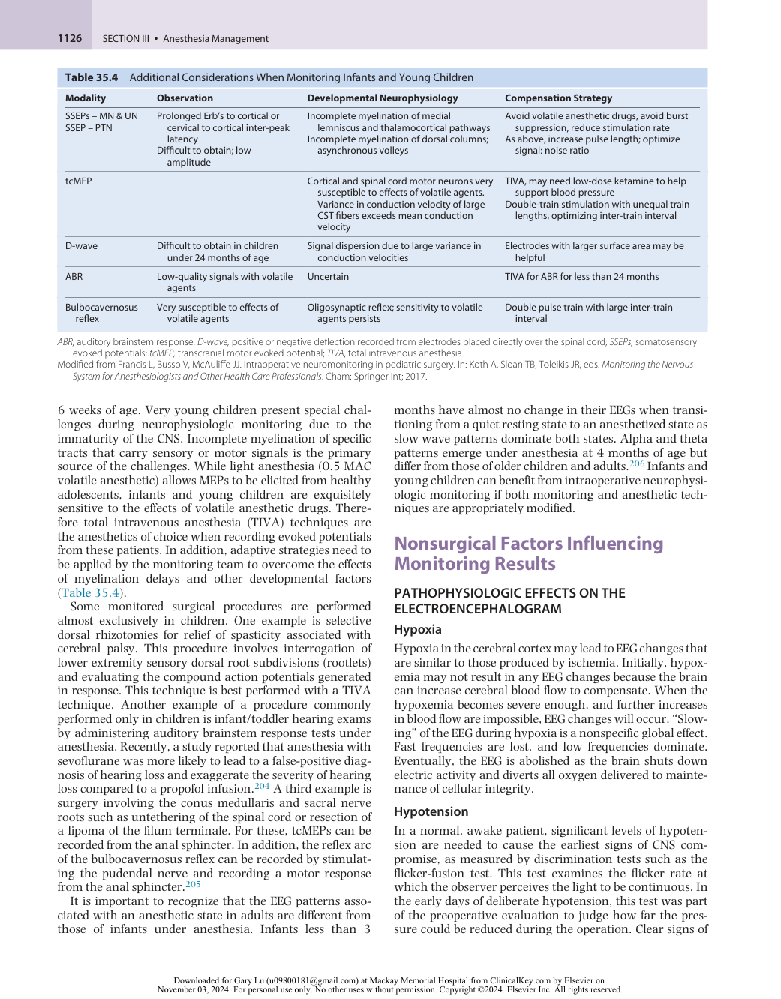

:::

<!-- PDF page 29 -->

confusion and inability to concentrate or respond properly to simple commands generally represent very low levels of cerebral perfusion when caused by hypotension because the normal cerebral circulation has a large capacity to vasodilate and maintain normal flow in the face of significant hypotension.

The EEG changes associated with even this level of hypotension are not dramatic, although they are clear by comparison with a previously active recording. Herein lies the problem with using intraoperative EEG to determine whether a given level of hypotension has resulted in brain ischemia. EEG changes are not very pronounced and are bilateral. These changes also are nearly identical to the changes caused by increasing doses of many anesthetic drugs. EEG changes associated with hypotension can be detected, but when the hypotension is induced slowly and associated with changes in anesthetic drugs (e.g., use of isoflurane to reduce blood pressure), the changes are very difficult to interpret. EEG changes associated with acute and severe hypotension such as those during sudden arrhythmias, are easier to read. It is also important to consider the fact that many patients undergoing surgery do not have normal cerebral circulation. In these individuals, even mild hypotension may result in significant cerebral ischemia. Therefore, monitoring the EEG during planned hypotension for those patients may be helpful, provided that other causes of similar EEG changes are carefully controlled. There remains little literature to support the use of EEG monitoring during hypotension, but in our opinion, when the EEG is being monitored (e.g., during carotid surgery), EEG changes secondary to hypotension really do represent cerebral ischemia of a significant degree and should be considered an important finding.

### Hypothermia

During cooling on CPB, the total power and peak power frequency of the high- frequency band derived from Fourier analysis and spectral edge data were highly correlated with temperature. However, significant variability was noted among subjects, especially during cooling.207 Complete EEG suppression usually develops at 15°C to 18°C. Levy and colleagues193 showed an improved ability to quantify the effects of hypothermia on the EEG using an EEG processing technique known as “approximate entropy.”

### Hypercarbia and Hypocarbia

Hypocapnia is known to activate excitable seizure foci and in rare cases may produce EEG evidence of cerebral ischemia even in awake subjects.208 Hypercapnia, unless severe and associated with hypoxemia, has only indirect effects secondary to increased CBF. In an anesthetized patient, hypercarbia- associated increases in CBF may have similar effects to the effects seen with increasing end- tidal tension of volatile anesthetics.209

### Untoward Events

One of the suggested reasons for monitoring the brain of an anesthetized patient is to enable detection of injuries to the nervous system that would not be otherwise apparent. Although hundreds of such case reports are in the literature, as well as many in our experience, cost- effectiveness of such monitoring is unclear. In a case example at our institution,

severe EEG changes occurred at the beginning of a carotid endarterectomy, before surgical incision, that were unassociated with any other vital sign changes or hypotension. Immediate angiography revealed acute carotid occlusion, completely changed the operation performed with this patient, and facilitated a complete recovery of the patient. There are intraoperative events that could lead to a CNS insult, which, if detected early, could be rapidly reversed or treated to prevent permanent injury. Given the rarity of such events, however, it is extremely unlikely that such monitoring would be shown to be beneficial in any foreseeable randomized trial. Also, routine implementation of EEG monitoring for all patients to prevent such rare events may not be cost- effective. If the “at- risk” patient could be identified preoperatively, perhaps the EEG or other types of neuromonitoring could be useful in detecting untoward CNS events during anesthesia, such as a new stroke after elective general surgery.

### PHYSIOLOGIC FACTORS INFLUENCING SENSORY EVOKED RESPONSES

Numerous physiologic variables, including systemic arterial blood pressure, temperature (local and systemic), and blood gas tensions, can influence SEP recordings. Decreases in mean arterial blood pressure to below levels of cerebral autoregulation lead to progressive changes in SERs. SSEP changes observed in this scenario are progressive decreases in amplitude until loss of the waveform with no changes in latency.210,211 BAEPs are resistant to even profound levels of hypotension (mean arterial pressure of 20 mm Hg in dogs).210 Cortical SERs, which are produced as a result of multiple synaptic transmissions, seem to be more sensitive to hypoperfusion than SERs produced by the spinal cord, brainstem, or non- synaptic transmission.211 Rapid decreases in arterial blood pressure to levels above the lower limit of autoregulation have also been associated with transient SSEP changes of decreased amplitude that resolve after several minutes of continued hypotension at the same level.212 Reversible SSEP changes at systemic pressures within the normal range have been observed in patients undergoing spinal distraction during scoliosis surgery. These changes resolved with increases of systemic arterial blood pressure to slightly higher than the patient’s normal pressure, suggesting that the combination of surgical manipulation with levels of hypotension generally considered “safe” could result in spinal cord ischemia.213

Changes in temperature also affect SERs. Hypothermia causes increases in latency and decreases in amplitude of cortical and subcortical SERs after all types of stimulation.214–216 Hyperthermia also alters SERs, with increases in temperature leading to decreases in amplitude in SSEPs and loss of SSEPs at 42°C during induced hyperthermia.217

Changes in arterial blood gas tensions can alter SERs, probably in relation to changes in blood flow or oxygen delivery to neural structures.218,219 Hypoxia produces SSEP changes (decreased amplitude) similar to the changes seen with ischemia.219 Decreased oxygen delivery associated with anemia during isovolemic hemodilution results in progressive increases in latency of SSEPs and VEPs that become significant at hematocrit values lower than 15%. Changes in amplitude were variable until very low hematocrit

<!-- PDF page 30 -->

values (approximately 7%) were reached, at which point the amplitude of all waveforms decreased.220

## Anesthetic Optimization During Multimodality Neurophysiologic Monitoring

Anesthetic agent choice, patient- specific comorbidities, and management of physiologic variables affect both the quality and interpretability of IONM signals. To plan for an optimal anesthetic approach for neurophysiologic monitoring, a good understanding of the neural pathways that are at risk during a given procedure is essential. Once atrisk pathways are determined, multiple IONM modalities are usually selected to provide some degree of redundancy for assessing those pathways throughout the procedure. The patient’s allergies and medical history are taken into consideration when selecting anesthetic agents that are compatible with those modalities. The level of anesthesia can affect the function of the nervous system and systemic physiologic variables, which in turn impact neurophysiologic monitoring signals. Therefore, it is recommended to maintain a consistent steady state of anesthesia as much as possible throughout the procedure to minimize falsepositive IONM alerts. When significant adjustments to the anesthetic agents must be made, clear communication with the IONM team is important to avoid unnecessary interruptions to the procedure. When signal changes do occur, timely open communication between all members of the perioperative surgical team allows for early detection and intervention to prevent or minimize permanent deficits to the nervous system.

From an anesthetic perspective, IONM modalities can be divided into four groups depending on whether they are significantly affected by neuromuscular blocking agents or volatile anesthetic agents. When motor evoked potentials or electromyography are utilized, neuromuscular blocking agents should be minimized or avoided altogether. Volatile anesthetics significantly impede the ability to obtain motor evoked potentials and in higher doses can degrade SSEPs. It is for this reason that when motor evoked potentials are utilized, total intravenous anesthesia (TIVA) without the use of NMBA is commonly implemented. TIVA is usually composed of an opioid infusion (e.g., remifentanil or sufentanil) and a sedative infusion (most commonly propofol). These infusions are titratable and, more importantly, readily permit a steady- state anesthetic concentration throughout the procedure. Opioid infusions block noxious stimuli and are thought to provide immobility during the procedure by interrupting the motor reflex pathway to those stimuli at the level of the spinal cord. Sedative infusions such as propofol can be titrated according to EEG activity and should be periodically adjusted during the procedure to avoid over- anesthetizing the patient, which may lead to degradation in signals and false-positive alerts. Ketamine and etomidate use may improve the quality of evoked potentials and are often used as adjuncts to propofol infusions. Dexmedetomidine use has been described in addition to propofol infusions without significantly affecting SSEPs, but its effects on motor evoked potentials

have been mixed. Once a steady state is reached, avoiding sudden large boluses of anesthetics as much as possible is recommended.

Although volatile anesthetics can be used with many modalities, it is important to note that the amount of volatile anesthetic that can be tolerated to produce adequate evoked potentials varies from patient to patient. The amount of volatile anesthetic that can be used is affected by several variables such as extremes of age, other medications, and pathologic conditions that affect the nervous system. For instance, in very young children with incomplete myelination, it can be more challenging to generate adequate somatosensory evoked potentials without special adjustments to stimulating parameters. In patients with peripheral neuropathies, such as those which result from diabetes, higher stimulation parameters may be needed to generate motor evoked potentials. In addition, the monitorability of evoked potentials with volatile anesthetics degrades in a nonlinear fashion over a narrow dose range. Therefore, the admonition that 0.5 MAC of a volatile anesthetic agent should be compatible with neurophysiologic monitoring is too simplistic and may not be true for a given patient.

EEG monitoring during IONM is useful for maintaining unconsciousness and titrating hypnotic agents such as propofol while avoiding excessive accumulation in lipidrich tissues. Accumulation of anesthetic agents during prolonged infusions will lead to a progressive degradation in evoked potentials over time.221 Clinicians can utilize EEG monitoring to gradually reduce the rate of infusions during the procedure to avoid excessively deep anesthesia.

Whether NMBAs can be used during the procedure should be determined prior to induction because it may have implications for the medications used during intubation. For example, if a procedure will not utilize motor evoked potentials or electromyography, NMBAs may be used during the case and other anesthetics can be titrated to optimize for EEG monitoring and generating somatosensory potentials. When NMBAs will not be utilized, it is common to utilize opioid infusions to help ensure immobility.

Optimization of anesthesia and physiologic homeostasis is most important when the plan is to use neuromonitoring for surgical decision- making. For instance, when the anatomy of the brain is distorted due to a tumor, the surgeon may utilize brain mapping to identify the borders of the motor cortex and the underlying corticospinal tract. Anesthetic optimization is important for correctly identifying critical motor pathway structures before tumor resection and continuously assessing their integrity throughout the operation. Anesthetic optimization will minimize falsepositive IONM changes and thus potentially reduce incomplete resections. Another example is the correction phase of a spinal deformity. This correction, particularly in severe deformities, typically occurs after spinal osteotomies, which may cause significant blood loss. This blood loss may simultaneously cause hypotension and increase the concentration of anesthetic by decreasing spinal cord perfusion and reducing the volume of distribution of an anesthetic infusion, respectively. In this setting careful management of both anesthesia administration and hemodynamics may affect the degree of correction achievable and thus the functional outcome of the surgery.

<!-- PDF page 31 -->

### TROUBLESHOOTING IONM ALERTS

For many monitoring modalities, thresholds of “tolerable” changes have been described beyond which the operative team must be alerted. Examples include a 0.5 ms increase in latency of wave V of a BAER,222 a 50% reduction in amplitude of a cortical SSEP waveform,51 or an 80% reduction in the CMAP response to tcMEP stimulation.223 Clearly there are clinical scenarios where waveform changes cross such thresholds quickly and prompt corrective action is required. Examples may be the placement of a cerebellar retractor followed by a latency increase in the BAER to ipsilateral stimulation or placement of a laminar hook followed by a loss of cortical SSEP responses to posterior tibial nerve stimulation. On the other hand, simply assessing changes in signals in comparison to a baseline based on rigid definition of thresholds for “IONM alerts” risks both creating unnecessary alerts as well as missing subtle changes that are clinically significant. Cortical SSEP amplitudes, for example, may diminish over the course of a long spine surgery by 50% from a baseline acquired after induction, but before incision, without raising concern for a new neurologic deficit.51 Likewise, the threshold for tcMEPs may gradually increase during a surgical procedure, a phenomenon so prevalent that it is referred to as “anesthetic fade”.224 A 0.5-ms increase in latency of wave V of a BAER has different implications for the welfare of a healthy auditory nerve during a microvascular decompression compared to an auditory nerve displaced by a vestibular schwannoma.225 In order to best capture such clinical nuances and optimize the sensitivity of IONM, it is important to strive for pharmacologic and physiologic stability during phases of the operation when neural structures are at risk. In this case any change in IONM signals that exceeds baseline variability of responses recorded prior to this phase can serve as a starting point to investigate potential causes.

When changes in IONM signals occur during a procedure, a systematic approach to investigate the cause is needed. Early detection and identification of the etiology will lead to timely intervention, which may minimize or prevent permanent deficits in the patient. For this to happen, it is essential that open communication occurs between all members of the surgical, anesthesia, and IONM teams.226 Most often, the investigation and intervention occur simultaneously, with each member of the team performing their respective roles. Changes in IONM signals may not always represent a true neurologic insult to the patient, but it is important to respond with vigilance until the cause is determined.

Causes of IONM changes can be divided into five categories: surgical insult, anesthetic effect, positioning injury, physiologic disturbance, and technical problem. Since there are many factors that must be investigated, having a predetermined plan may improve efficiency and decrease the likelihood of omitting important interventions. Fig. 35.23 is an example of an algorithm for all members of the perioperative team to refer to during IONM alerts.

Anesthesia- related changes to IONM tend to cause global changes in IONM signals rather than focal changes. For example, it is unlikely that unilateral changes to EEG or evoked potentials are due to excessive anesthesia. It is worth noting that certain modalities such as cortical SSEPs and MEPs are more sensitive to anesthesia, whereas modalities

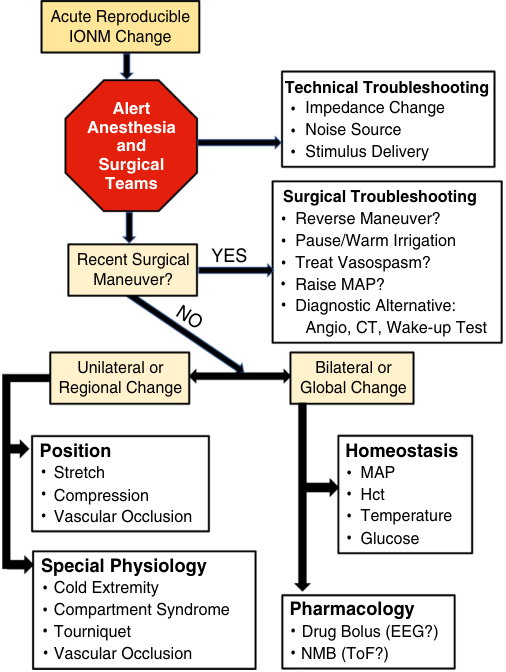

Acute Reproducible IONM Change Technical Troubleshooting Alert Impedance Change Anesthesia Noise Source and ��� Stimulus Delivery Surgical Teams Surgical Troubleshooting Reverse Maneuver? Pause/Warm Irrigation Recent Surgical YES Treat Vasospasm? Maneuver? Raise MAP? ����� Diagnostic Alternative: Angio, CT, Wake-up Test Unilateral or Bilateral or Regional Change Global Change Position Homeostasis Stretch MAP Compression Hct ��� Vascular Occlusion Temperature ���� Glucose Special Physiology Cold Extremity Compartment Syndrome Pharmacology Tourniquet Drug Bolus (EEG?) ���� Vascular Occlusion �� NMB (ToF?) NO 

**Fig. 35.23 Algorithm for troubleshooting changes in intraoperative neurophysiologic monitoring (IONM).** A reproducible or concerning change should prompt acknowledgment by the entire team and context- based simultaneous activity aimed at clarifying and rectifying the cause for the change or mitigating the adverse consequences of a likely injury. _MAP_ , mean arterial pressure; _angio_ , angiography (which may be done with radiopaque contrast or indocyanine green); _CT_ , intraoperative computer tomography; _Hct_ , hematocrit; _EEG_ , electroencephalographic assessment of anesthetic effect; _NMB_ , neuromuscular blocking agent; _ToF_ , train- of- four.

such as BAEPs, subcortical SSEPs, and EMG are much more resistant. If acute, anesthesia- related changes in IONM tend to occur shortly after an adjustment in anesthetic levels or bolus dose administration. When significant signal changes occur, any recent change in anesthesia delivery should be considered as possible etiology and decreasing the dose should be considered.

IONM signal changes due to physiologic disturbances are related to neural tissue ischemia and may be global or focal in nature. As delivery of oxygen depends on adequate perfusion to the nervous system, blood pressure, heart rate, and oxygen content must be maintained for proper generation of IONM signals. While decreases to mean arterial blood pressure will lead to global ischemia, a unilateral retractor that stretches cranial nerves, or a vascular clip placed during aneurysm surgery will lead to focal ischemia. Therefore, it is important to consider the mechanism and location for compromise in blood flow that may occur during each specific surgery. When IONM changes occur, raising the mean blood pressure is one of the key interventions that an anesthesiologist can do to improve global oxygen delivery to compromised neural tissue. Also, correcting hypoxia

::: warning 符號需核對
此頁有符號無法完整擷取，請展開下方原始頁面核對。
:::

::: details 原始表格與符號（PDF 第 31 頁）

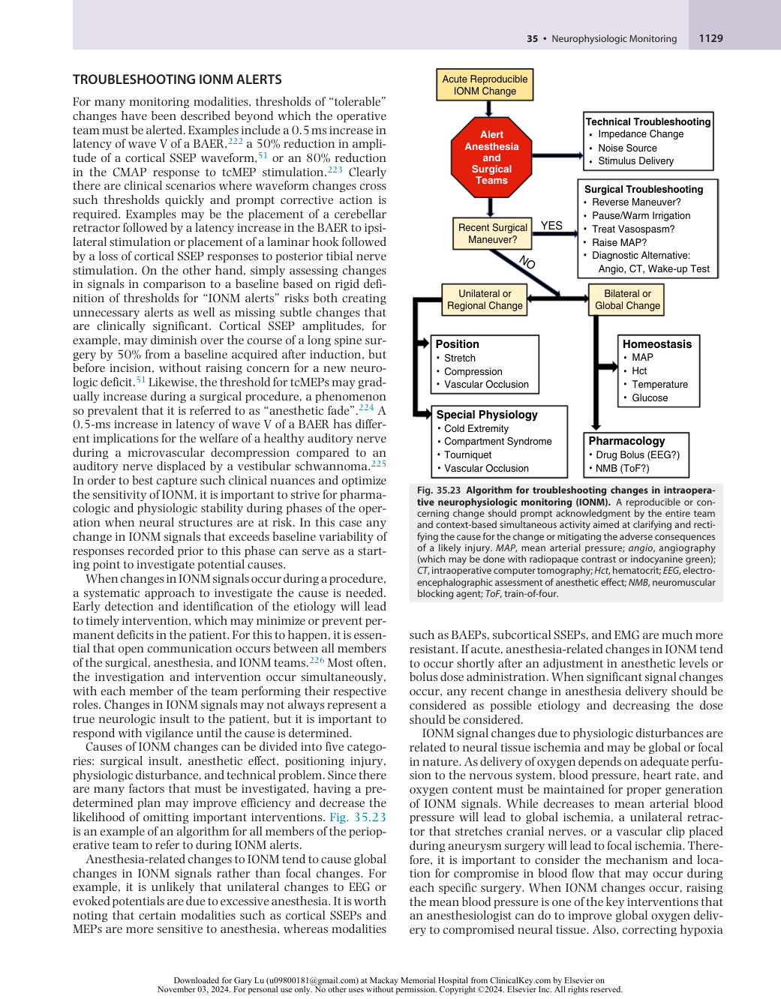

:::

<!-- PDF page 32 -->

and anemia is important, especially during surgeries with significant blood loss.

Positioning injuries during procedures are another potential source of IONM signal changes. Positioning injuries can be due to excessive stretch or compression on neural structures. Changes in signals due to positioning problems tend to be limited to a particular region of the body. All members of the operating room should be vigilant to properly pad and secure the patient’s body during positioning. Often IONM signal changes due to improper positioning tend to develop slowly over time. If an unexplained change in evoked potentials affects only one extremity, it is prudent to assess and potentially reposition that extremity. Another example of compression that can lead to signal changes is a tourniquet used during intravenous placement accidently left on an extremity during surgery. If discovered early, position- related injuries can often be reversed before permanent injury occurs. Although signal changes due to technical problems related to IONM equipment are most often addressed by the neuromonitoring team, anesthesiologists should be aware of the location of electrodes and the interference that other electrical equipment can cause. A detailed discussion about IONM equipment and electrical signal generation is beyond the scope of this chapter but anesthesiologists should be aware of some basic principles. Any electrical equipment that is placed near recording electrodes or recording amplifiers can introduce electrical noise, which will degrade IONM signals. A fluid warmer placed near the patient’s electrodes is a common offending piece of equipment. Lifting other electrical cables away from the electrodes or amplifiers or moving or rotating an offending piece of equipment further away may help minimize electrical noise. Excessive noise can also be a sign that some of the electrodes are partially or completely dislodged.

## Summary

Neurophysiologic monitoring utilizes several modalities, with the goal of assessing the metabolic and functional

integrity of the various components of the nervous system. When monitoring detects changes, the aim is to lead the perioperative team to early intervention and prevent or minimize the loss of neurologic function in the patient. Regardless of the type of intraoperative neurologic monitor, several principles must be observed for neurologic monitoring to provide potential benefit to the patient. First, the pathway at risk during the surgical procedure must be amenable to monitoring. Second, if evidence of injury to the pathway is detected, some intervention must be possible. If changes in the neurologic monitor are detected, and no intervention is possible, although the monitor may be of prognostic value, it does not have the potential to provide direct benefit to the patient from early detection of impending neurologic injury. Third, the monitor must provide reliable and reproducible data. If the data have a high degree of variability in the absence of clinical interventions, their utility for detecting clinically significant events is limited.

Ideally, clinical studies would provide outcome data on the efficacy of a neurologic monitor in a given procedure to improve neurologic outcome. Although there is a wealth of clinical experience with many of these monitoring modalities, there is little in the way of randomized prospective studies evaluating the efficacy of neurologic monitoring. Based on clinical experience with neurologic monitoring and nonrandomized clinical studies in which neurologic monitoring is used and generally compared with historical controls, practice patterns for use of neurologic monitoring have developed. In certain procedures, neurologic monitoring is recommended and used by most centers; in other procedures, monitoring is used almost routinely in some centers, but not in others; and in some procedures, no clear clinical experience or evidence indicates that monitoring is useful at all (experimental use). Finally, there are procedures in which monitoring is used selectively for patients believed to be at higher- than- usual risk for intraoperative neurologic injury. Table 35.5 provides a summary of current clinical practice.

**Complete references available online at expertconsult.com.**

**Table 35.5** Current Practices in Neurophysiologic Monitoring

|**Procedure**|**Monitors**|**Current Practice**|
|---|---|---|
|Carotid endarterectomy|Awake patient neurologic examination, EEG, SSEP, TCD|NIH recommends use of one of these four available monitors|
||Cerebral oximetry|Threshold value not determined, inadequate normative population data|
|Scoliosis surgical treatment|SSEP|Monitoring recommended and may substitute for wake- up testing|
||Wake- up test|Largely abandoned in centers using electrophysiologic monitoring; monitoring is not continuous, and false- negative monitoring patterns reported|
||tcMEP EMG|Increased clinical use now that transcranial electrical stimulation is FDA approved; useful in combination with SSEP Limited utility for detecting nerve root damage|
||Triggered EMG|Used in some centers for pedicle screw placement|
|Acoustic neuroma|Spontaneous and triggered facial nerve EMG|Facial nerve monitoring recommended|
||Cranial nerve EMG for cranial nerves V, IX, X, XI or XII|Used in some centers for large tumors or particular approaches|
||Facial tcMEP|Used in some centers|
||BAEP|BAEP showing some clinical evidence of improved hearing preservation|

_Continued_

::: details 原始表格與符號（PDF 第 32 頁）

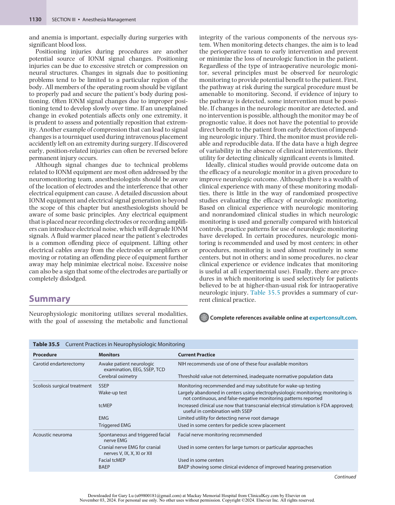

:::

<!-- PDF page 33 -->

**Table 35.5** Current Practices in Neurophysiologic Monitoring—cont’d

|**Procedure**|**Monitors**|**Current Practice**|
|---|---|---|
|Intracranial aneurysm clipping|SSEP, EEG, tcMEP|Used routinely in some centers; limited clinical data on outcome, but appears clinically useful during anterior circulation procedures|
|Cranial nerve V decompression|BAEP Cranial nerve EMG|Used in some centers; reduces hearing loss Used in some centers|
|Cranial nerve VII decompression|BAEP, spontaneous and triggered facial nerve EMG, lateral spread response|Data from small series showing improved hearing preservation|
|Supratentorial mass lesions|SSEP, tcMEP Mapping and in- field monitoring|Used in some centers in selected high- risk procedures Used in some centers for lesions adjacent to the primary motor area|
|Infratentorial mass lesions|BAEP, SSEP, tcMEP, raw and triggered cranial nerve EMG|BAEP to detect retractor- related cranial nerve VIII injury; SSEP and tcMEP in rare, high- risk lesions adjacent to ascending sensory or descending motor pathways|
|Decompression of spinal stenosis|SSEP, tcMEP Triggered and raw EMG|Used in some centers in high- risk procedures (more often cervical) Used in some centers, limited data on utility|
|Spinal cord trauma|SSEP, MEP|Used in some centers in high- risk procedures|
|Cardiopulmonary bypass|EEG, TCD, Sjvo2, cerebral oximetry|Used routinely in some centers; actively studied, but no outcome data yet|
|Aortic coarctation|SSEP and tcMEP|Used routinely in a few centers; no widespread acceptance|
|Aortic aneurysm repair|SSEP, tcMEP|Used routinely in a few centers; no widespread acceptance|

_BAEP,_ brainstem auditory evoked potential; _EEG,_ electroencephalogram; _FDA,_ U.S. Food and Drug Administration; _MEP,_ motor evoked potential; _NIH,_ National Institutes of Health; _Sjvo2,_ jugular bulb venous oxygen saturation; _SSEP,_ somatosensory evoked potential; _TCD,_ transcranial Doppler; _tcMEP,_ transcranial motor evoked potential.

### References

1.  Skinner S, et al. _J Clin Neurophysiol_ . 2017;34(6):477.

2.  Skinner S, et al. _J Neurosurg Spine_ . 2017;27(1):1.

3.  Martin NA, et al. _Neurosurg Clin N Am_ . 1994;5:607.

4.  Kety SS, et al. _Am J Physiol_ . 1945;143:53.

5.  Udesh R, et al. _J Ultrasound Med_ . 2017;36:621.

6.  Bass A, et al. _J Vasc Surg_ . 1989;10:549.

7.  Manno EM. _Crit Care Clin_ . 1997;13:79.

8.  White H, et al. _Can J Anaesth_ . 2002;49:623.

9.  Hongo K, et al. _Neurol Res_ . 1995;17:89.

10.  Davie SN, et al. _Anesthesiology_ . 2012;116:834. 11.  Zheng F, et al. _Anesth Analg_ . 2013;116:663.

12.  Thiele RH, et al. _Anesth Analg_ . 2020;131:1444.

13.  Bickler P, et al. _Anesth Analg_ . 2017;124:72.

14.  Samra SK, et al. _Anesthesiology_ . 2000;93:964.

15.  Rigamonti A, et al. _J Clin Anesth_ . 2005;17:426.

16.  Dings J, et al. _Neurosurgery_ . 1998;43:1082.

17.  Vajkoczy P, et al. _J Neurosurg_ . 2003;98:1227.

18.  Lang EW, et al. _Neurosurg Rev_ . 2007;30:99.

19.  Vajkoczy P, et al. _J Neurosurg_ . 2000;93:265.

20.  Clark LC. _Trans Am Soc Artif Int Org_ . 1956;2:41.

21.  Ngwenya LB, et al. _Respir Care_ . 2016;61:1232.

22.  Menzel M, et al. _J Neurosurg Anesthesiol_ . 1999;11(4):240.

23.  Gopinath SP, et al. _Crit Care Med_ . 1999;27:2337.

24.  Valadka AB, et al. _Crit Care Med_ . 1998;26:1576.

25.  Sarrafzadeh AS, et al. _Acta Neurochir_ . 1998;71(suppl):186.

26.  Rosenthal G, et al. _Crit Care Med_ . 2008;36:1917.

27.  Menzel M, et al. _J Neurosurg_ . 1999;91:1.

28.  Menzel M, et al. _J Neurosurg Anesthesiol_ . 1999;11:240.

29.  Okonkwo DO, et al. _Crit Care Med_ . 2017;45(11):1907.

30.  Gloor P. In: Wieser HG, Elger CE, eds. _Presurgical Evaluation of Epileptics_ . Springer; 1987.

31.  Hughes JR. _EEG in Clinical Practice_ . 2nd ed. Butterworth- Heinemann; 1994.

32.  Vitek JL, et al. _J Neurosurg_ . 1998;88:1027.

33.  Garonzik IM, et al. _Mov Disord_ . 2002;17:S135.

34.  Martin JT, et al. _Anesthesiology_ . 1959;20:359.

35.  Sharbrough FW, et al. _Stroke_ . 1973;4:674.

36.  Craft RM, et al. _J Neurosurg Anesthesiol_ . 1994;6:301.

37.  Spackman TN, et al. _Anesthesiology_ . 1987;66:229.

38.  Purdon PL, et al. _Anesthesiology_ . 2015;123(4):937.

39.  Purdon PL, et al. _Br J Anaesth_ . 2015;115(suppl 1):i46.

|40.  MacDonald DB, et al._Clin Neurophysiol_. 2009;120(2):315.|
|---|

41.  Grundy BL. _Neurosurgery_ . 1982;11:556.

42.  Greenberg RP, et al. _J Neurosurg_ . 1982;56:1.

43.  Cohen AR, et al. _Neurosurgery_ . 1981;9:157.

44.  York DH. _Progr Neurobiol_ . 1985;25:1.

45.  Bundo M, et al. _Stroke_ . 2002;33:61.

46.  Symon L. _Br J Anaesth_ . 1985;57:34.

47.  Brainston NM, et al. _J Cereb Blood Flow Metab_ . 1984;4:68.

48.  Lopez JR, et al. _J Neurol Neurosurg Psychiatry_ . 1999;66:189. 49.  Guerit JM, et al. _Electroencephalogr Clin Neurophysiol_ . 1997;104:459. 50.  Chiappa KH, et al. _N Engl J Med_ . 1982;306:1205.

51.  MacDonald DB, et al. _Clin Neurophysiol_ . 2019;130(1):161.

52.  Ganes T. _Electroencephalogr Clin Neurophysiol_ . 1980;49:446.

53.  Chiappa KH, et al. _N Engl J Med_ . 1982;306:1140.

54.  Grundy BL, et al. _J Neurosurg_ . 1982;57:674.

55.  Raudzens PA, et al. _J Neurosurg_ . 1982;57:341.

56.  Duncan PG, et al. _Can Anaesth Soc J_ . 1979;26:492.

57.  Sasaki T, et al. _J Neurosurg_ . 2010;112:273.

58.  Gutzwiller EM, et al. _J Neurosurg_ . 2018;130(2):654.

59.  Legatt AD, et al. _J Clin Neurophysiol_ . 2016;33(1):42.

60.  Greve T, et al. _J Clin Monit Comput_ . 2020;34(6):1331.

61.  Bovo N, et al. _J Neurol Surg Cent Eur Neurosurg_ . 2021;82(4):317.

62.  Hendriks T, et al. _Acta Neurochir (Wien)_ . 2020;162(5):1197.

63.  Kasuya Y, et al. _Anesth Analg_ . 2009;109:1811.

64.  Shils JL, et al. _Int Anesthesiol Clin_ . 2015;53(1):53.

65.  Samra SK, et al. _Anesthesiology_ . 1987;66:29.

66.  Banoub M, et al. _Anesthesiology_ . 2003;99:716.

67.  Manninen PH, et al. _Anesth Analg_ . 1985;64:43.

68.  Thornton C, et al. _Br J Anaesth_ . 1983;55:479.

69.  Matsushita S, et al. _J Clin Monit Comput_ . 2015;29:621.

70.  Chi OZ, et al. _Anesthesiology_ . 1986;65:328.

71.  Soffin EM, et al. _J Clin Monit Comput_ . 2018;32(5):889.

72.  Uribe AA, et al. _Clin Neurophysiol_ . 2017;128:2006.

73.  Peterson DO, et al. _Anesthesiology_ . 1986;65:35.

74.  Sebel PS, et al. _Br J Anaesth_ . 1984;56:1403.

75.  Liu EH, et al. _Br J Anaesth_ . 2005;94:193.

76.  Boisseau N, et al. _Br J Anaesth_ . 2002;88:785.

77.  Taniguchi M, et al. _Neurosurgery_ . 1992;31:891.

78.  Chassard D, et al. _Br J Anaesth_ . 1989;62:522.

79.  Purdie JA, et al. _Anaesthesia_ . 1993;48:192.

80.  Drummond JC, et al. _Anesthesiology_ . 1985;63:249.

81.  Koht A, et al. _Anesth Analg_ . 1988;67:435.

82.  Sloan TB, et al. _Anesth Analg_ . 1988;67:582.

::: details 原始表格與符號（PDF 第 33 頁）

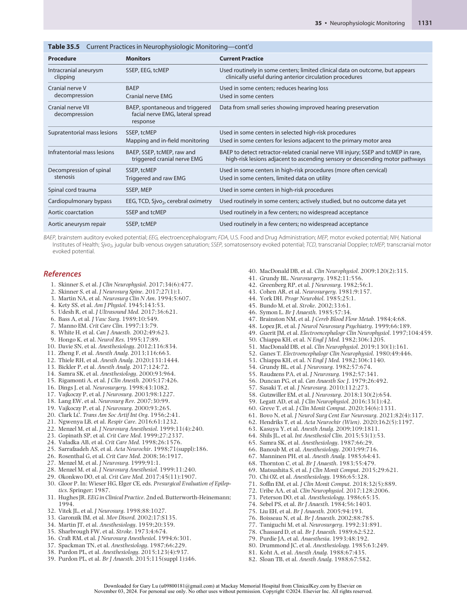

:::

<!-- PDF page 34 -->

83.  Heneghan CPH, et al. _Br J Anaesth_ . 1985;57:554. 84.  Bala E, et al. _Anesthesiology_ . 2008;109:417. 85.  Pathak KS, et al. _Anesth Analg_ . 1984;63:833. 86.  Schubert A, et al. _Anesth Analg_ . 1986;65:S136. 87.  Samra SK, et al. _Anesthesiology_ . 1961:261. 88.  Zentner J, et al. _Neurosurgery_ . 1989;24:253. 89.  Jellinek D, et al. _Neurosurgery_ . 1991;29:551. 90.  Taniguchi M, et al. _Neurosurgery_ . 1993;33:407. 91.  Ubags LH, et al. _J Neurosurg Anesthesiol_ . 1997;9:228. 92.  Kalkman CJ, et al. _Neurosurgery_ . 1994;35:1066.

93.  Sloan TB, et al. _J Clin Neurophysiol_ . 2002;19:430. 94.  Zentner J, et al. _Spine_ . 1997;22:1002.

95.  Nathan N, et al. _Br J Anaesth_ . 2003;91:493.

96.  Ghaly RF, et al. _Neurol Res_ . 2001;23:881.

97.  Scheufler KM, et al. _J Neurosurg_ . 2002;96:571.

98.  Pechstein U, et al. _Electroencephalogr Clin Neurophysiol_ . 1998; 108:175.

99.  Mahmoud M, et al. _Anesthesiology_ . 2010;112:1364.

100.  Skinner SA, et al. _J Clin Monit Comput_ . 2008;22:131.

101.  Kartush JM, et al. _Laryngoscope_ . 2021;131(suppl 4):S1.

102.  Harner SG, et al. _Mayo Clin Proc_ . 1987;62:92.

103.  Harper CM, et al. In: Desmedt JE, ed. _Neuromonitoring in Surgery_ . Elsevier Science; 1989:275.

104.  Singh R, et al. _J Clin Neurophysiol_ . 2011;28(6):582.

105.  West S, et al. _Epileptic Disord_ . 2016;18:113.

106.  Ryvlin P, et al. _Lancet Neurol_ . 2014;13:1114.

107.  Meng L, et al. _Can J Anaesth_ . 2017;64:517.

108.  Stevanovic A, et al. _PLoS One_ . 2016;11:e0156448.

109.  Ramnarayan R, et al. _Neurol India_ . 2006;54:250.

110.  Sindou MP. _Acta Neurochir (Wien)_ . 2005;147:1019. 111.  Brock S, et al. _Stereotact Funct Neurosurg_ . 2004;82:199. 112.  Sindou M, et al. _Laryngoscope_ . 1992;102:678. 113.  Friedman WA, et al. _J Neurosurg_ . 1985;62:552.

114.  Thirumala PD, et al. _J Clin Neurophys_ . 2011;28:56. 115.  Khrais T, et al. _J Laryngol Otol_ . 2006;120:366. 116.  Vivas EX, et al. _Neurosurgery_ . 2018;82:E44–E46. 117.  Sala F, et al. _Childs Nerv Syst_ . 2015;31:1791.

118.  Kashkoush AI, et al. _J Clin Monit Comput_ . 2020;34(4):811. 119.  Friedman WA, et al. _Neurosurgery_ . 1991;29:83. 120.  Mizoi K, et al. _Neurol Med - Chir (Tokyo)_ . 1991;31:318. 121.  Misoi K, et al. _Neurosurgery_ . 1993;33:434.

122.  Holland NR. _J Clin Neurophysiol_ . 1998;15:439. 123.  Schramm J, et al. _Neurol Res_ . 1994;16:20.

124.  Wiedemayer H, et al. _J Neurosurg_ . 2002;96:255. 125.  Raabe A, et al. _J Neurosurg Sci_ . 2016;60(1):95. 126.  Szelényi A, et al. _Handb Clin Neurol_ . 2022;186:375. 127.  Manninen PH, et al. _Can J Anaesth_ . 1994;41:92.

128.  Manninen PH, et al. _Can J Anaesth_ . 1990;37(4 Pt 2):S23. 129.  Friedman WA, et al. _Neurosurgery_ . 1987;20:678. 130.  Little JR, et al. _Neurosurgery_ . 1987;20:421.

131.  Sasaki T, et al. _J Neurosurg_ . 2007;107:60.

132.  Hemmer LB, et al. _World Neurosurg_ . 2014;81:99.

133.  Thomas B, et al. _World Neurosurg_ . 2017;103:829. 134.  Rabai F, et al. _Best Pract Res Clin Anaesthesiol_ . 2016;30(1):53.

135.  McCallum JE, et al. _Surg Forum_ . 1975;26:469.

136.  Maccabee PJ, et al. _Electroencephalogr Clin Neurophysiol_ . 1982;53:32. 137.  Luederes H, et al. _Spine_ . 1982;7:110.

138.  Raudzens PA. _Ann N Y Acad Sci_ . 1982;388:308.

139.  Grundy BL. In: Nodar RH, Barber C, eds. _Evoked Potentials I_ . Butterworth; 1984:624.

140.  Deutsch H, et al. _J Neurosurg_ . 2000;92(suppl 2):155. 141.  Ben- David B, et al. _Spine_ . 1987;12:536.

142.  Edmonds HL, et al. _Spine_ . 1989;14:683.

143.  Boyd SG, et al. _J Neurol Neurosurg Psychiatry_ . 1986;49:251. 144.  Sloan TB, et al. _Curr Opin Anesthesiol_ . 2008;21:560. 145.  Padberg AM, et al. _Spine_ . 1998;23:1392.

146.  Schwartz DM, et al. _J Bone Jt Surg Am_ . 2007;89:2440.

147.  MacDonald DB, et al. _Spine_ . 2003;28:194.

148.  MacDonald DB, et al. _Clin Neurophysiol_ . 2013;124:2291. 149.  Raynor BL, et al. _Spine_ . 2007;32:2673.

150.  Shi YB, et al. _Spine_ . 2003;28:595.

151.  Isley MR, et al. _Neurodiag J_ . 2012;52:100.

152.  Choi I, et al. _Yonsei Med J_ . 2014;55(4):1063. 153.  Sala F, et al. _Neurosurgery_ . 2006;58(6):1129.

154.  Simon MV, et al. _Neurosurgery_ . 2012;70(3):E783.

155.  Macdonald DB, et al. _J Clin Neurophysiol_ . 2012;29(2):118.

156.  Alluri R, et al. _Neurospine_ . 2021;18(3):430.

157.  Riley MR, et al. _Spine J_ . 2018;18(10):1763.

158.  Silverstein J, et al. _Spine_ . 2014;39(15):1254.

159.  Shin AY, et al. _J Am Acad Orthop Surg_ . 2005;13:382.

160.  Kline DG, et al. _J Neurosurg_ . 1998;89:13.

161.  Kim DH, et al. _J Neurosurg_ . 2003;98:1005.

162.  Lokuge K, et al. _Br J Surg_ . 2018;105:26.

163.  De Rango P, et al. _Stroke_ . 2015;46:3423.

164.  Sundt TW, et al. _Mayo Clin Proc_ . 1981;56:533.

165.  Bond R, et al. _Eur J Vasc Endovasc Surg_ . 2002;23:117.

166.  Kalkman CJ. _J Cardiothorac Vasc Anesth_ . 2004;18:381.

167.  Plestis KA, et al. _J Vasc Surg_ . 1997;25:620.

168.  Halsey JH. _Stroke_ . 1992;23:1583.

169.  Roseborough GS. _J Cardiothorac Vasc Anesth_ . 2004;18:375.

170.  Schneider JR, et al. _J Vasc Surg_ . 2002;35:1114.

171.  Woodworth GF, et al. _Neurosurgery_ . 2007;61:1170.

172.  Chongruksut W, et al. _Cochrane Database Syst Rev_ . 2014;6:CD000190.

173.  Lam AM, et al. _Anesthesiology_ . 1991;75:15.

174.  Ackerstaff RG, et al. _J Cardiothorac Vasc Anesth_ . 1998;12:341.

175.  AbuRahma AF, et al. _J Vasc Surg_ . 2011;54:1502.

176.  Thiagarajan K, et al. _World Neurosurg_ . 2015;84(6):1941.

177.  Nwachuku EL, et al. _JAMA Neurol_ . 2015;72(1):73.

178.  Ackerstaff RG, et al. _Stroke_ . 2000;31:1817.

179.  Ogasawara K, et al. _Stroke_ . 2008;39:3088.

180.  Mueller M, et al. _Acta Neurol Scand_ . 1998;97:110.

181.  Abbott AL, et al. _Cerebrovasc Dis_ . 2007;23:362.

182.  Dunne VG, et al. _J Clin Neurosci_ . 2001;8:140.

183.  Spencer MP. _Stroke_ . 1997;28:685.

184.  Gaunte ME. _Ann R Coll Surg Engl_ . 1998;80:377.

185.  Calderon- Arnulphi M, et al. _J Neurosurg_ . 2007;106:283.

186.  Friedell ML, et al. _J Vasc Surg_ . 2008;48:601.

187.  Szilagyi DE, et al. _Surgery_ . 1978;83:38.

188.  Conrad MF, et al. _J Vasc Surg_ . 2011;53:1195.

189.  Weigang E, et al. _Ann Thorac Surg_ . 2006;82:1679.

190.  Etz CD, et al. _Ann Thorac Surg_ . 2006;82:1670.

191.  Tozzi P, et al. _Thorac Cardiovasc Surg_ . 2017;65(2):126.

192.  Levy WJ. _Anesthesiology_ . 1984;60:291.

193.  Levy WJ, et al. _Anesthesiology_ . 2003;98:53.

194.  Chabot RJ, et al. _Clin Electroencephalogr_ . 1997;28:98.

195.  Edmonds HL, et al. _J Thorac Cardiovasc Surg_ . 1992;103:555. 196.  Doblar DD. _Semin CardioThorac Vasc Anesth_ . 2004;8:127.

197.  Sakamoto T, et al. _J Cardiothorac Vasc Anesth_ . 2004;18:293.

198.  Kussman BD, et al. _Anesth Analg_ . 2005;101:1294.

199.  Murkin JM, et al. _Anesth Analg_ . 2007;104:51.

200.  Zheng F, et al. _Anesth Analg_ . 2013;116:663.

201.  Ono M, et al. _Br J Anesth_ . 2012;109:391.

202.  Colak Z, et al. _Eur J Cardiothoracic Surg_ . 2015;47:447.

203.  Brady K, et al. _Stroke_ . 2010;41:1951.

204.  Kandil AI, et al. _Anesth Analg_ . 2022;134(4):802.

205.  Skinner SA, et al. _J Clin Neurophysiol_ . 2014;31:313.

206.  Cornelissen L, et al. _Elife_ . 2015;4:e06513.

207.  Stockard JJ, et al. In: Gordon E, ed. _A Basis and Practice of Neuroanesthesia_ . Elsevier; 1981:3.

208.  Kraaier V, et al. _Electroencephalogr Clin Neurophysiol_ . 1988;70:377. 209.  Clowes GHA, et al. _Ann Surg_ . 1953;138:558.

210.  Eng DY, et al. _Anesthesiology_ . 1980;53:S92.

211.  Kobrine AI, et al. _J Neurol Sci_ . 1980;45:65.

212.  Bunegin L, et al. _Anesthesiology_ . 1981;55:A232.

213.  Grundy BL, et al. _Anesthesiology_ . 1981;54:249.

214.  Russ W, et al. _Anesthesiology_ . 1984;61:207.

215.  Stockard JJ, et al. _Ann Neurol_ . 1978;3:368.

216.  Spetzler RF, et al. _J Neurosurg_ . 1988;68:868.

217.  Dubois M, et al. _Electroencephalogr Clin Neurophysiol_ . 1981;52:157.

218.  Nakagawa Y, et al. _Stroke_ . 1984;25:275.

219.  Grundy BL, et al. _Anesth Analg_ . 1981;60:437.

220.  Nagao S, et al. _J Surg Res_ . 1978;25:S30.

221.  Lyon R, et al. _J Neurosurg Anesthiol_ . 2005;17(1):13.

222.  Youssef AS, et al. _Neurosurg Focus_ . 2009;27(4):E9.

223.  MacDonald DB. _J Clin Neurophysiol_ . 2017;34(1):4.

224.  Ugawa R, et al. _J Orthop Surg Res_ . 2018;13(1):227.

225.  Sprenghers L, et al. _Br J Neurosurg_ . 2022;36(3):346.

226.  Skinner S, et al. _J Clin Neurophysiol_ . 2017;34:477.

<!-- PDF page 35 -->

### References

1.  Skinner S, Holdefer R, McAuliffe JJ, Sala F. Medical error avoidance in intraoperative neurophysiological monitoring: the communication imperative. _J Clin Neurophysiol_ . 2017;34(6):477–483.

2.  Skinner S, Sala F. Communication and collaboration in spine neuromonitoring: time to expect more, a lot more, from the neurophysiologists. _J Neurosurg Spine_ . 2017;27(1):1–6.

3.  Martin NA, Doberstein C. Cerebral blood flow measurement in neurosurgical intensive care. _Neurosurg Clin N Am_ . 1994;5:607–618.

4.  Kety SS, Schmidt CF. The determination of cerebral blood flow in man by the use of nitrous oxide in low concentrations. _Am J Physiol_ . 1945;143:53–66.

5.  Udesh R, Natarajan P, Thiagarajan K. Transcranial Doppler monitoring in carotid endarterectomy. A systematic review and metaanalysis. _J Ultrasound Med_ . 2017;36:621–630.

6.  Bass A, Krupski WC, Schneider PA, et al. Intraoperative transcranial Doppler. Limitations of the method. _J Vasc Surg_ . 1989;10:549–553.

7.  Manno EM. Transcranial Doppler ultrasonography in the neurocritical care unit. _Crit Care Clin_ . 1997;13:79–104.

8.  White H, Baker A. Continuous jugular venous oximetry in the neurointensive care unit. A brief review. _Can J Anaesth_ . 2002;49:623– 629.

9.  Hongo K, Kobayashi S, Okudera H, et al. Noninvasive cerebral optical spectroscopy. Depth- resolved measurements of cerebral haemodynamics using indocyanine green. _Neurol Res_ . 1995;17:89–93.

10.  Davie SN, Grocott HP. Impact of extracranial contamination on regional cerebral oxygen saturation. A comparison of three cerebral oximetry technologies. _Anesthesiology_ . 2012;116:834–840.

11.  Zheng F, Sheinberg R, Yee MS, et al. Cerebral near- infrared spectroscopy monitoring and neurologic outcomes in adult cardiac surgery patients. A systematic review. _Anesth Analg_ . 2013;116:663–676.

12.  Thiele RH, Shaw AD, Bartels K, et al. American Society for Enhanced Recovery and Perioperative quality Initiative joint consensus statement on the role of neuromonitoring in perioperative outcomes: cerebral near- infrared spectroscopy. _Anesth Analg_ . 2020;131:1444–1455.

13.  Bickler P, Feiner J, Rollins M, Meng L. Tissue oximetry and clinical outcomes. _Anesth Analg_ . 2017;124:72–82.

14.  Samra SK, Dy EA, Welch K, et al. Evaluation of a cerebral oximeter as a monitor of cerebral ischemia during carotid endarterectomy. _Anesthesiology_ . 2000;93:964–970.

15.  Rigamonti A, Scandroglio M, Minicucci F, et al. A clinical evaluation of near- infrared cerebral oximetry in the awake patient to monitor cerebral perfusion during carotid endarterectomy. _J Clin Anesth_ . 2005;17:426–430.

16.  Dings J, Meixensberger J, Jager A, et al. Clinical experience with 118 brain tissue oxygen partial pressure catheter probes. _Neurosurgery_ . 1998;43:1082–1095.

17.  Vajkoczy P, Horn P, Thome C, et al. Regional cerebral blood flow monitoring in the diagnosis of delayed ischemia following aneurysmal subarachnoid hemorrhage. _J Neurosurg_ . 2003;98:1227–1234.

18.  Lang EW, Mulvey JM, Mudaliar Y, et al. Direct cerebral oxygenation monitoring. A systematic review of recent publications. _Neurosurg Rev_ . 2007;30:99–107.

19.  Vajkoczy P, Roth H, Horn P, et al. Continuous monitoring of regional cerebral blood flow. Experimental and clinical validation of a novel thermal diffusion microprobe. _J Neurosurg_ . 2000;93:265–274.

20.  Clark LC. Monitor and control of blood and tissue oxygen tensions. _Trans Am Soc Artif Int Org_ . 1956;2:41–45.

21.  Ngwenya LB, Burke JF, Manley GT. Brain tissue oxygen monitoring and the intersection of brain and lung. A comprehensive review. _Respir Care_ . 2016;61:1232–1244.

22.  Menzel M, Doppenberg EM, Zauner A, et al. Cerebral oxygenation in patients after severe head injury. Monitoring and effects of arterial hyperoxia on cerebral blood flow, metabolism and intracranial pressure. _J Neurosurg Anesthesiol_ . 1999;11(4):240–251.

23.  Gopinath SP, Valadka AB, Uzura M, Robertson CS. Comparison of jugular venous oxygen saturation and brain tissue PO2 as monitors of cerebral ischemia after head injury. _Crit Care Med_ . 1999;27:2337–2345.

24.  Valadka AB, Gopinath SP, Contant CF, et al. Relation of brain tissue PO2 to outcome after severe head injury. _Crit Care Med_ . 1998;26:1576–1581.

25.  Sarrafzadeh AS, Kiening KL, Bardt TF, et al. Cerebral oxygenation in contusioned vs. Nonlesioned brain tissue. Monitoring of PtiO2 with Licox and Paratrend. _Acta Neurochir_ . 1998;71(suppl):186–189.

26.  Rosenthal G, Hemphill JC, Sorani M, et al. Brain tissue oxygen tension is more indicative of oxygen diffusion than oxygen delivery and metabolism in patients with traumatic brain injury. _Crit Care Med_ . 2008;36:1917–1924.

27.  Menzel M, Doppenberg EM, Zauner A, et al. Increased inspired oxygen concentration as a factor in improved brain tissue oxygenation and tissue lactate levels after severe human head injury. _J Neurosurg_ . 1999;91:1–10.

28.  Menzel M, Doppenberg EM, Zauner A, et al. Cerebral oxygenation in patients after severe head injury. Monitoring and effects of arterial hyperoxia on cerebral blood flow, metabolism and intracranial pressure. _J Neurosurg Anesthesiol_ . 1999;11:240–251.

29.  Okonkwo DO, Shutter LA, Moore C, et al. Brain oxygen optimization in severe traumatic brain injury phase- II: a phase ii randomized trial. _Crit Care Med_ . 2017;45(11):1907–1914.

30.  Gloor P. Volume conductor principles. Their application to the surface and depth electroencephalogram. In: Wieser HG, Elger CE, eds. _Presurgical Evaluation of Epileptics_ . Berlin: Springer; 1987.

31.  Hughes JR. _EEG in Clinical Practice_ . 2nd ed. Newton, MA: Butterworth- Heinemann; 1994.

32.  Vitek JL, Bakay RAE, Hashimoto T, et al. Microelectrode- guided pallidotomy. Technical approach and its application in medically intractable Parkinson’s disease. _J Neurosurg_ . 1998;88:1027.

33.  Garonzik IM, Hua SE, Ohara S, et al. Intraoperative microelectrode and semi- microelectrode recording during the physiological localization of the thalamic nucleus ventral intermediate. _Mov Disord_ . 2002;17:S135.

34.  Martin JT, Faulconer A, Bickford RG. Electroencephalography in anesthesiology. _Anesthesiology_ . 1959;20:359.

35.  Sharbrough FW, Messick JM, Sundt TM. Correlation of continuous electroencephalograms with cerebral blood flow measurements during carotid endarterectomy. _Stroke_ . 1973;4:674.

36.  Craft RM, Losasso TJ, Perkins WJ, et al. EEG monitoring for cerebral ischemia during carotid endarterectomy (CEA). How much is enough? _J Neurosurg Anesthesiol_ . 1994;6:301.

37.  Spackman TN, Faust RJ, Cucchiara RF, et al. A comparison of a periodic analysis of the EEG with standard EEG and cerebral blood flow for detection of ischemia. _Anesthesiology_ . 1987;66:229.

38.  Purdon PL, Sampson A, Pavone KJ, Brown EN. Clinical electroencephalography for anesthesiologists: part i: background and basic signatures. _Anesthesiology_ . 2015;123(4):937–960.

39.  Purdon PL, Pavone KJ, Akeju O, et al. The ageing brain. _Br J Anaesthesia_ . 2015;115(suppl 1):i46–i57.

40.  MacDonald DB, Al- Zayed Z, Stigsby B, Al- Homoud I. Median somatosensory evoked potential intraoperative monitoring: recommendations based on signal- to- noise ratio analysis. _Clin Neurophysiol_ . 2009;120(2):315–328.

41.  Grundy BL. Monitoring of sensory evoked potentials during neurosurgical operation. Methods and applications. _Neurosurgery_ . 1982;11:556.

42.  Greenberg RP, Ducker TB. Evoked potentials in the clinical neurosciences. _J Neurosurg_ . 1982;56:1.

43.  Cohen AR, Young W, Ransohoff J. Intraspinal localization of the somatosensory evoked potential. _Neurosurgery_ . 1981;9:157.

44.  York DH. Somatosensory evoked potentials in man. Differentiation of spinal pathways responsible for conduction from the forelimb vs. hindlimb. _Progr Neurobiol_ . 1985;25:1.

45.  Bundo M, Inao S, Nakamura A, et al. Changes of neural activity correlate with the severity of cortical ischemia in patients with unilateral major cerebral artery occlusion. _Stroke_ . 2002;33:61.

46.  Symon L. Flow thresholds in brain ischaemia and the effects of drugs. _Br J Anaesth_ . 1985;57:34.

47.  Brainston NM, Ladds A, Symon L, et al. Comparison of the effects of ischaemia on early components of the somatosensory evoked potential in brainstem, thalamus, and cerebral cortex. _J Cereb Blood Flow Metab_ . 1984;4:68.

48.  Lopez JR, Chang SD, Steinberg GK. The use of electrophysiological monitoring in the intraoperative management of intracranial aneurysms. _J Neurol Neurosurg Psychiatry_ . 1999;66:189.

49.  Guerit JM, Witdoeckt C, de Tourtchaninoff M, et al. Somatosensory evoked potential monitoring in carotid surgery, I. Relationships between qualitative SEP alterations and intraoperative events. _Electroencephalogr Clin Neurophysiol_ . 1997;104:459.

50.  Chiappa KH, Ropper AH. Evoked potentials in clinical medicine. _N Engl J Med_ . 1982;306:1205.

<!-- PDF page 36 -->

51.  MacDonald DB, Dong C, Quatrale R, et al. Recommendations of the International Society of Intraoperative Neurophysiology for intraoperative somatosensory evoked potentials. _Clin Neurophysiol_ . 2019;130(1):161–179.

52.  Ganes T. A study of peripheral, cervical, and cortical evoked potentials and afferent conduction times in the somatosensory pathway. _Electroencephalogr Clin Neurophysiol_ . 1980;49:446.

53.  Chiappa KH, Ropper AH. Evoked potentials in clinical medicine. _N Engl J Med_ . 1982;306:1140.

54.  Grundy BL, Jannetta PJ, Procopio PT, et al. Intraoperative monitoring of brain- stem auditory evoked potentials. _J Neurosurg_ . 1982;57:674.

55.  Raudzens PA, Shetter AG. Intraoperative monitoring of brain- stem auditory evoked potentials. _J Neurosurg_ . 1982;57:341.

56.  Duncan PG, Sanders RA, McCollough DW. Preservation of auditoryevoked responses in anaesthetized children. _Can Anaesth Soc J_ . 1979;26:492.

57.  Sasaki T, Itakura T, Suzuki K, et al. Intraoperative monitoring of visual evoked potential. Introduction of a clinically useful method. _J Neurosurg_ . 2010;112:273–284.

58.  Gutzwiller EM, Cabrilo I, Radovanovic I, et al. Intraoperative monitoring with visual evoked potentials for brain surgeries. _J Neurosurg_ . 2018;130(2):654–660.

59.  Legatt AD, Emerson RG, Epstein CM, et al. ACNS guideline: transcranial electrical stimulation motor evoked potential monitoring. _J Clin Neurophysiol_ . 2016;33(1):42–50.

60.  Greve T, Wang L, Thon N, et al. Prognostic value of a bilateral motor threshold criterion for facial corticobulbar MEP monitoring during cerebellopontine angle tumor resection. _J Clin Monit Comput_ . 2020;34(6):1331–1341.

61.  Bovo N, Momjian S, Gondar R, et al. Sensitivity and negative predictive value of motor evoked potentials of the facial nerve. _J Neurol Surg Cent Eur Neurosurg_ . 2021;82(4):317–324.

62.  Hendriks T, Kunst HPM, Huppelschoten M, et al. TcMEP threshold change is superior to A- train detection when predicting facial nerve outcome in CPA tumour surgery. _Acta Neurochir (Wien)_ . 2020;162(5):1197–1203.

63.  Kasuya Y, et al. The correlation between bispectral index and observational sedation scale in volunteers sedated with dexmedetomidine and propofol. _Anesth Analg_ . 2009;109:1811–1815.

64.  Shils JL, Sloan TB. Intraoperative neuromonitoring. _Int Anesthesiol Clin_ . 2015;53(1):53–73.

65.  Samra SK, Vanderzant CW, Domer PA, et al. Differential effects of isoflurane on human median nerve somatosensory evoked potentials. _Anesthesiology_ . 1987;66:29.

66.  Banoub M, Tetzlaff JE, Schubert A. Pharmacologic and physiologic influences affecting sensory evoked potentials. _Anesthesiology_ . 2003;99:716.

67.  Manninen PH, Lam AM, Nicholas JF. The effects of isofluranenitrous oxide anesthesia on brainstem auditory evoked potentials in humans. _Anesth Analg_ . 1985;64:43.

68.  Thornton C, Catley DM, Jordan C, et al. Enflurane anaesthesia causes graded changes in the brainstem and early cortical auditory evoked response in man. _Br J Anaesth_ . 1983;55:479.

69.  Matsushita S, Oda S, Otaki K, et al. Change in auditory evoked potential index and bispectral index during induction of anesthesia with anesthetic drugs. _J Clin Monit Comput_ . 2015;29:621–626.

70.  Chi OZ, Field C. Effects of isoflurane on visual evoked potentials in humans. _Anesthesiology_ . 1986;65:328.

71.  Soffin EM, Emerson RG, Cheng J, et al. A pilot study to record visual evoked potentials during prone spine surgery using the SightSaver™ photic visual stimulator. _J Clin Monit Comput_ . 2018;32(5):889–895.

72.  Uribe AA, Mendel E, Peters ZA, et al. Comparison of visual evoked potential monitoring during spine surgeries under total intravenous anesthesia versus balanced general anesthesia. _Clin Neurophysiol_ . 2017;128:2006–2013.

73.  Peterson DO, Drummond JC, Todd MM. Effects of halothane, enflurane, isoflurane, and nitrous oxide on somatosensory evoked potentials in humans. _Anesthesiology_ . 1986;65:35.

74.  Sebel PS, Flynn PJ, Ingram DA. Effect of nitrous oxide on visual, auditory, and somatosensory evoked potentials. _Br J Anaesth_ . 1984;56:1403.

75.  Liu EH, Wong HK, Chia CP, et al. Effects of isoflurane and propofol on cortical somatosensory evoked potentials during comparable depth of anaesthesia as guided by bispectral index. _Br J Anaesth_ . 2005;94:193–197.

76.  Boisseau N, Madany M, Staccini P, et al. Comparison of the effects of sevoflurane and propofol on cortical somatosensory evoked potentials. _Br J Anaesth_ . 2002;88:785–789.

77.  Taniguchi M, Nadstawek J, Pechstein U, Schramm J. Total intravenous anesthesia for improvement of intraoperative monitoring of somatosensory evoked potentials during aneurysm surgery. _Neurosurgery_ . 1992;31:891–897.

78.  Chassard D, Joubaud A, Colson A, et al. Auditory evoked potentials during propofol anaesthesia in man. _Br J Anaesth_ . 1989;62:522–526.

79.  Purdie JA, Cullen PM. Brainstem auditory evoked response during propofol anaesthesia in children. _Anaesthesia_ . 1993;48:192–195.

80.  Drummond JC, Todd MM, Sang H. The effect of high dose sodium thiopental on brain stem auditory and median nerve somatosensory evoked responses in humans. _Anesthesiology_ . 1985;63:249.

81.  Koht A, Schutz W, Schmidt G, et al. Effects of etomidate, midazolam, and thiopental on median nerve somatosensory evoked potentials and the additive effects of fentanyl and nitrous oxide. _Anesth Analg_ . 1988;67:435.

82.  Sloan TB, Ronai AK, Toleikis JR, et al. Improvement of intraoperative somatosensory evoked potentials by etomidate. _Anesth Analg_ . 1988;67:582.

83.  Heneghan CPH, Thornton C, Navaratnarajah M, et al. Effect of etomidate on the auditory evoked response in man. _Br J Anaesth_ . 1985;57:554–561.

84.  Bala E, Sessler DI, Nair DR, et al. Motor and sensory evoked potentials are well- maintained in patients given dexmedetomidine during spine surgery. _Anesthesiology_ . 2008;109:417–425.

85.  Pathak KS, Brown RH, Cascorbi HF, et al. Effects of fentanyl and morphine on intraoperative somatosensory cortical- evoked potentials. _Anesth Analg_ . 1984;63:833.

86.  Schubert A, Peterson DO, Drummond JC, et al. The effect of high- dose fentanyl on human median nerve somatosensory evoked responses. _Anesth Analg_ . 1986;65:S136.

87.  Samra SK, Lilly DJ, Rush NL, et al. Fentanyl anesthesia and human brain- stem auditory evoked potentials. _Anesthesiology_ . 1961:261.

88.  Zentner J, Kiss I, Ebner A. Influence of anesthetics—nitrous oxide in particular—on electromyographic response evoked by transcranial electrical stimulation of the cortex. _Neurosurgery_ . 1989;24:253.

89.  Jellinek D, Jewkes D, Symon L. Noninvasive intraoperative monitoring of motor evoked potentials under propofol anesthesia. Effects of spinal surgery on the amplitude and latency of motor evoked potentials. _Neurosurgery_ . 1991;29:551.

90.  Taniguchi M, Nadstawek J, Langenbach U, et al. Effects of four intravenous anesthetic agents on motor evoked potentials elicited by magnetic transcranial stimulation. _Neurosurgery_ . 1993;33:407.

91.  Ubags LH, Kalkman CJ, Been HD, et al. The use of ketamine or etomidate to supplement sufentanil/N2O anesthesia does not disrupt monitoring of myogenic transcranial motor evoked responses. _J Neurosurg Anesthesiol_ . 1997;9:228.

92.  Kalkman CJ, Drummond JC, Patel PM, et al. Effects of droperidol, pentobarbital and ketamine on myogenic motor evoked responses in humans. _Neurosurgery_ . 1994;35:1066.

93.  Sloan TB, Heyer EJ. Anesthesia for intraoperative neurophysiologic monitoring of the spinal cord. _J Clin Neurophysiol_ . 2002;19:430.

94.  Zentner J, Thees C, Pechstein U, et al. Influence of nitrous oxide on motor- evoked potentials. _Spine_ . 1997;22:1002.

95.  Nathan N, Tabaraud F, Lacroix F, et al. Influence of propofol concentrations on multipulse transcranial motor evoked potentials. _Br J Anaesth_ . 2003;91:493.

96.  Ghaly RF, Ham JH, Lee JJ. High- dose ketamine hydrochloride maintains somatosensory and magnetic motor evoked potentials in primates. _Neurol Res_ . 2001;23:881.

97.  Scheufler KM, Zentner J. Total intravenous anesthesia for intraoperative monitoring of the motor pathways. An integral view combining clinical and experimental data. _J Neurosurg_ . 2002;96:571.

98.  Pechstein U, Nadstawek J, Zentner J, et al. Isoflurane plus nitrous oxide versus propofol for recording of motor evoked potentials after high frequency repetitive electrical stimulation. _Electroencephalogr Clin Neurophysiol_ . 1998;108:175.

99.  Mahmoud M, Sadhasivam S, Salisbury S, et al. Susceptibility of transcranial electric motor- evoked potentials to varying targeted blood levels of dexmedetomidine during spine surgery. _Anesthesiology_ . 2010;112:1364–1373.

100.  Skinner SA, Transfeldt EE, Savik K. Surface electrodes are not sufficient to detect neurotonic discharges. Observations in a porcine

<!-- PDF page 37 -->

- model and clinical review of deltoid electromyographic monitoring using multiple electrodes. _J Clin Monit Comput_ . 2008;22:131.

- 101.  Kartush JM, Rice KS, Minahan RE, et al. Best practices in facial nerve monitoring. _Laryngoscope_ . 2021;131(suppl 4):S1–S42.

102.  Harner SG, Daube JR, Beatty CW. Improved preservation of facial nerve function with use of electrical monitoring during removal of acoustic neuromas. _Mayo Clin Proc_ . 1987;62:92.

103.  Harper CM, Daube RJ. Surgical monitoring with evoked potentials. The Mayo Clinic experience. In: Desmedt JE, ed. _Neuromonitoring in Surgery_ . New York: Elsevier Science; 1989:275.

104.  Singh R, Husain AM. Neurophysiologic intraoperative monitoring of the glossopharyngeal and vagus nerves. _J Clin Neurophysiol_ . 2011;28(6):582–586.

105.  West S, Nolan SJ, Newton R. Surgery for epilepsy. A systematic review of current evidence. _Epileptic Disord_ . 2016;18:113–121.

106.  Ryvlin P, Cross JH, Rheims S. Epilepsy surgery in children and adults. _Lancet Neurol_ . 2014;13:1114–1126.

107.  Meng L, McDonagh DL, Berger MS, Gelb AW. Anesthesia for awake craniotomy. A how- to guide for the occasional practitioner. _Can J Anaesth_ . 2017;64:517–529.

108.  Stevanovic A, Rossaint R, Veldeman M, et al. Anaesthesia management for awake craniotomy. Systematic review and meta- analysis. _PLoS One_ . 2016;11. :e0156448.

109.  Ramnarayan R, Mackenzie I. Brain- stem auditory evoked responses during microvascular decompression for trigeminal neuralgia. predicting postoperative hearing loss. _Neurol India_ . 2006;54:250–254.

110.  Sindou MP. Microvascular decompression for primary hemifacial spasm. Importance of intraoperative neurophysiological monitoring. _Acta Neurochir (Wien)_ . 2005;147:1019–1026.

111.  Brock S, Scaioli V, Ferroli P, Broggi G. Neurovascular decompression in trigeminal neuralgia. Role of intraoperative neurophysiological monitoring in the learning period. _Stereotact Funct Neurosurg_ . 2004;82:199–206.

112.  Sindou M, Fobé JL, Ciriano D, Fischer C. Hearing prognosis and intraoperative guidance of brainstem auditory evoked potential in microvascular decompression. _Laryngoscope_ . 1992;102:678–682.

113.  Friedman WA, Kaplan BJ, Gravenstein D, Rhoton AL. Intraoperative brain- stem auditory evoked potentials during posterior fossa microvascular decompression. _J Neurosurg_ . 1985;62:552–557.

114.  Thirumala PD, Shah AC, Nikonow TN, et al. Microvascular decompression for hemifacial spasm. evaluating outcome prognosticators including the value of intraoperative lateral spread response monitoring and clinical characteristics in 293 patients. _J Clin Neurophys_ . 2011;28:56–66.

115.  Khrais T, Sanna M. Hearing preservation surgery in vestibular schwannoma. _J Laryngol Otol_ . 2006;120:366–370.

116.  Vivas EX, Carlson ML, Neff BA, et al. Congress of Neurological Surgeons systematic review and evidence- based guidelines on intraoperative cranial nerve monitoring in vestibular schwannoma surgery. _Neurosurgery_ . 2018;82:E44–E46.

117.  Sala F, Coppola A, Tramontano V. Intraoperative neurophysiology in posterior fossa tumor surgery in children. _Childs Nerv Syst_ . 2015;31:1791–1806.

118.  Kashkoush AI, Nguyen C, Balzer J, et al. Diagnostic accuracy of somatosensory evoked potentials during intracranial aneurysm clipping for perioperative stroke. _J Clin Monit Comput_ . 2020;34(4):811– 819.

119.  Friedman WA, Chadwick GM, Verhoeven FJ, et al. Monitoring of somatosensory evoked potentials during surgery for middle cerebral artery aneurysms. _Neurosurgery_ . 1991;29:83.

120.  Mizoi K, Yoshimoto T. Intraoperative monitoring of the somatosensory evoked potentials and cerebral blood flow during aneurysm surgery. Safety evaluation for temporary vascular occlusion. _Neurol Med - Chir (Tokyo)_ . 1991;31:318.

121.  Misoi K, Yoshimoto T. Permissible temporary occlusion time in aneurysm surgery as evaluated by evoked potential monitoring. _Neurosurgery_ . 1993;33:434.

122.  Holland NR. Subcortical strokes from intracranial aneurysm surgery. Implications for intraoperative neuromonitoring. _J Clin Neurophysiol_ . 1998;15:439.

123.  Schramm J, Zentner J, Pechstein U. Intraoperative SEP monitoring in aneurysm surgery. _Neurol Res_ . 1994;16:20.

124.  Wiedemayer H, Fauser B, Sandalcioglu IE. The impact of neurophysiological intraoperative monitoring on surgical decisions. A critical analysis of 423 cases. _J Neurosurg_ . 2002;96:255.

125.  Raabe A, Seidel K. Prevention of ischemic complications during aneurysm surgery. _J Neurosurg Sci_ . 2016;60(1):95–103.

126.  Szelényi A, Fernández- Conejero I, Kodama K. Surgery and intraoperative neurophysiologic monitoring for aneurysm clipping. _Handb Clin Neurol_ . 2022;186:375–393.

127.  Manninen PH, Patterson S, lam AM, et al. Evoked potential monitoring during posterior fossa aneurysm surgery. A comparison of two modalities. _Can J Anaesth_ . 1994;41:92.

128.  Manninen PH, Cuillerier DJ, Gelb AW, et al. Monitoring of brain stem function during posterior fossa surgery. _Can J Anaesth_ . 1990;37(4 Pt 2):S23.

129.  Friedman WA, Kaplan BL, Day AL. Evoked potential monitoring during aneurysm operation. Observations after fifty cases. _Neurosurgery_ . 1987;20:678.

130.  Little JR, Lesser RP, Luders H. Electrophysiological monitoring during basilar aneurysm operation. _Neurosurgery_ . 1987;20:421.

131.  Sasaki T, Kodama N, Matsumoto M, et al. Blood flow disturbance in perforating arteries attributable to aneurysm surgery. _J Neurosurg_ . 2007;107:60–67.

132.  Hemmer LB, Zeeni C, Bebawy JF, et al. The incidence of unacceptable movement with motor evoked potentials during craniotomy for aneurysm clipping. _World Neurosurg_ . 2014;81:99–104.

133.  Thomas B, Guo D. The diagnostic accuracy of evoked potential monitoring techniques during intracranial aneurysm surgery for predicting postoperative ischemic damage. A systematic review and meta- analysis. _World Neurosurg_ . 2017;103:829–840.

134.  Rabai F, Sessions R, Seubert CN. Neurophysiological monitoring and spinal cord integrity. _Best Pract Res Clin Anaesthesiol_ . 2016;30(1):53–68.

135.  McCallum JE, Bennett MH. Electrophysiologic monitoring of spinal cord function during intraspinal surgery. _Surg Forum_ . 1975;26:469.

136.  Maccabee PJ, Pinkhasov EI, Tsairis P, et al. Spinal and short latency scalp derived somatosensory evoked potentials during corrective spinal column surgery. _Electroencephalogr Clin Neurophysiol_ . 1982;53:32.

137.  Luederes H, Gurd A, Hahn J, et al. A new technique for intraoperative monitoring of spinal cord function. Multichannel recording of spinal cord and subcortical evoked potentials. _Spine_ . 1982;7:110.

138.  Raudzens PA. Intraoperative monitoring of evoked potentials. _Ann N Y Acad Sci_ . 1982;388:308.

139.  Grundy BL. Intraoperative monitoring of sensory evoked potentials. In: Nodar RH, Barber C, eds. _Evoked Potentials I_ . Boston: Butterworth; 1984:624.

140.  Deutsch H, Arginteanu M, Manhart K, et al. Somatosensory evoked potential monitoring in anterior thoracic vertebrectomy. _J Neurosurg_ . 2000;92(suppl 2):155–161.

141.  Ben- David B, Haller G, Taylor P. Anterior spinal fusion complicated by paraplegia. A case report of a false- negative somatosensoryevoked potential. _Spine_ . 1987;12:536–539.

142.  Edmonds HL, Paloheimo MP, Backman MH, et al. Transcranial magnetic motor evoked potentials for functional monitoring of motor pathways during scoliosis surgery. _Spine_ . 1989;14:683.

143.  Boyd SG, Rothwell JC, Cowan JMA, et al. A method of monitoring function in corticospinal pathways during scoliosis surgery with a note on motor conduction velocities. _J Neurol Neurosurg Psychiatry_ . 1986;49:251.

144.  Sloan TB, Janik D, Jameson L. Multimodality monitoring of the central nervous system using motor- evoked potentials. _Curr Opin Anesthesiol_ . 2008;21:560–564.

145.  Padberg AM, Wilson- Holden TJ, Lenke LG, Bridwell KH. Somatosensory and motor evoked potential monitoring without a wake- up test during idiopathic scoliosis surgery. An accepted standard of care. _Spine_ . 1998;23:1392–1400.

146.  Schwartz DM, Auerbach JD, Dormans JP, et al. Neurophysiologic detection of impending spinal cord injury during scoliosis surgery. _J Bone Jt Surg Am_ . 2007;89:2440–2449.

147.  MacDonald DB, Al Zayed Z, Khoudeir I, Stigsby B. Monitoring scoliosis surgery with combined multiple pulse transcranial electric motor and cortical somatosensory- evoked potentials from the lower and upper extremities. _Spine_ . 2003;28:194–203.

148.  MacDonald DB, Skinner S, Shils J, Yingling C. Intraoperative motor evoked potential monitoring. A position statement by the American Society of Neurophysiological Monitoring. _Clin Neurophysiol_ . 2013;124:2291–2316.

149.  Raynor BL, Lenke LG, Bridwell KH, et al. Correlation between low triggered electromyographic thresholds and lumbar pedicle screw malposition. Analysis of 4857 screws. _Spine_ . 2007;32:2673–2678.

<!-- PDF page 38 -->

150.  Shi YB, Binette M, Martin WH, et al. Electrical stimulation for intraoperative evaluation of thoracic pedicle screw placement. _Spine_ . 2003;28:595–601.

151.  Isley MR, Zhang XF, Balzer JR, Leppanen RE. Current trends in pedicle screw stimulation techniques. Lumbosacral, thoracic, and cervical levels. _Neurodiag J_ . 2012;52:100–175.

152.  Choi I, Hyun SJ, Kang JK, Rhim SC. Combined muscle motor and somatosensory evoked potentials for intramedullary spinal cord tumour surgery. _Yonsei Med J_ . 2014;55(4):1063–1071.

153.  Sala F, Palandri G, Basso E, et al. Motor evoked potential monitoring improves outcome after surgery for intramedullary spinal cord tumors: a historical control study. _Neurosurgery_ . 2006;58(6):1129– 1143; discussion 1129–1143.

154.  Simon MV, Chiappa KH, Borges LF. Phase reversal of somatosensory evoked potentials triggered by gracilis tract stimulation: case report of a new technique for neurophysiologic dorsal column mapping. _Neurosurgery_ . 2012;70(3):E783–E788.

155.  Macdonald DB, Stigsby B, Al Homoud I, et al. Utility of motor evoked potentials for intraoperative nerve root monitoring. _J Clin Neurophysiol_ . 2012;29(2):118–125.

156.  Alluri R, Mok JK, Vaishnav A, et al. Intraoperative neuromonitoring during lateral lumbar interbody fusion. _Neurospine_ . 2021;18(3):430–436.

157.  Riley MR, Doan AT, Vogel RW, et al. Use of motor evoked potentials during lateral lumbar interbody fusion reduces postoperative deficits. _Spine J_ . 2018;18(10):1763–1778.

158.  Silverstein J, Mermelstein L, DeWal H, Basra S. Saphenous nerve somatosensory evoked potentials: a novel technique to monitor the femoral nerve during transpsoas lumbar lateral interbody fusion. _Spine_ . 2014;39(15):1254–1260.

159.  Shin AY, Spinner RJ, Steinmann SP, Bishop AT. Adult traumatic brachial plexus injuries. _J Am Acad Orthop Surg_ . 2005;13:382–396.

160.  Kline DG, Kim D, Midha R, et al. Management and results of sciatic nerve injuries. A 24- year experience. _J Neurosurg_ . 1998;89:13.

161.  Kim DH, Cho YJ, Tiel RL, et al. Outcomes of surgery in 1019 brachial plexus lesions treated at Louisiana State University Health Sciences Center. _J Neurosurg_ . 2003;98:1005.

162.  Lokuge K, de Waard DD, Halliday A, et al. Meta- analysis of the procedural risks of carotid endarterectomy and carotid artery stenting over time. _Br J Surg_ . 2018;105:26–36.

163.  De Rango P, Brown MM, Chaturvedi S, et al. Summary of evidence on early carotid intervention for recently symptomatic stenosis based on meta- analysis of current risks. _Stroke_ . 2015;46:3423–3436.

164.  Sundt TW, Sharbrough FW, Piepgras DG, et al. Correlation of cerebral blood flow and electroencephalographic changes during carotid endarterectomy. With results of surgery and hemodynamics of cerebral ischemia. _Mayo Clin Proc_ . 1981;56:533.

165.  Bond R, Warlow CP, Naylor AR, Rothwell PM; European Carotid Surgery Trialists’ Collaborative Group. Variation in surgical and anesthetic technique and associations with operative risk in the European Carotid Surgery Trial. Implications for trials of ancillary techniques. _Eur J Vasc Endovasc Surg_ . 2002;23:117–126.

166.  Kalkman CJ. Con. Routine shunting is not the optimal management of the patient undergoing carotid endarterectomy, but neither is neuromonitoring. _J Cardiothorac Vasc Anesth_ . 2004;18:381–383.

167.  Plestis KA, Loubser P, Mizrahi EM, et al. Continuous electroencephalographic monitoring and selective shunting reduces neurologic morbidity rates in carotid endarterectomy. _J Vasc Surg_ . 1997;25:620.

168.  Halsey JH. Risks and benefits of shunting in carotid endarterectomy. The International Transcranial Doppler Collaborators. _Stroke_ . 1992;23:1583–1587.

169.  Roseborough GS. Pro. Shunting is the optimal management of the patient undergoing carotid endarterectomy. _J Cardiothorac Vasc Anesth_ . 2004;18:375–380.

170.  Schneider JR, Droste JS, Schindler N, et al. Carotid endarterectomy with routine electroencephalography and selective shunting. Influence of contralateral internal carotid artery occlusion and utility in prevention of postoperative strokes. _J Vasc Surg_ . 2002;35:1114– 1122.

171.  Woodworth GF, McGirt MJ, Than KD, et al. Selective versus routine intraoperative shunting during carotid endarterectomy. A multivariate outcome analysis. _Neurosurgery_ . 2007;61:1170–1177.

172.  Chongruksut W, Vaniyapong T, Rerkasem K. Routine or selective carotid artery shunting for carotid endarterectomy (and different

   - methods of monitoring in selective shunting). _Cochrane Database Syst Rev_ . 2014;6:CD000190.

173.  Lam AM, Manninen PH, Ferguson GG, et al. Monitoring of electrophysiologic function during carotid endarterectomy. A comparison of somatosensory evoked potentials and conventional electroencephalogram. _Anesthesiology_ . 1991;75:15.

174.  Ackerstaff RG, van de Vlasakker CJ. Monitoring of brain function during carotid endarterectomy. An analysis of contemporary methods. _J Cardiothorac Vasc Anesth_ . 1998;12:341.

175.  AbuRahma AF, Mousa AY, Stone PA. Shunting during carotid endarterectomy. _J Vasc Surg_ . 2011;54:1502–1510.

176.  Thiagarajan K, Cheng HL, Huang JE, et al. Is two really better than one? examining the superiority of dual modality neurophysiological monitoring during carotid endarterectomy: a meta- analysis. _World Neurosurg_ . 2015;84(6):1941–1949.e1.

177.  Nwachuku EL, Balzer JR, Yabes JG, et al. Diagnostic value of somatosensory evoked potential changes during carotid endarterectomy: a systematic review and meta- analysis. _JAMA Neurol_ . 2015;72(1):73–80.

178.  Ackerstaff RG, Moons KG, van de Vlasakker CJ, et al. Association of intraoperative transcranial Doppler monitoring variables with stroke from carotid endarterectomy. _Stroke_ . 2000;31:1817–1823.

179.  Ogasawara K, Suga Y, Sasaki M, et al. Intraoperative microemboli and low middle cerebral artery blood flow velocity are additive in predicting development of cerebral ischemic events after carotid endarterectomy. _Stroke_ . 2008;39:3088–3091.

180.  Mueller M, Behnke S, Walter P, et al. Microembolic signals and intraoperative stroke in carotid endarterectomy. _Acta Neurol Scand_ . 1998;97:110–117.

181.  Abbott AL, Levi CR, Stork J, et al. Timing of clinically significant microembolism after carotid endarterectomy. _Cerebrovasc Dis_ . 2007;23:362–367.

182.  Dunne VG, Besser M, Ma WJ. Transcranial Doppler in carotid endarterectomy. _J Clin Neurosci_ . 2001;8:140–145.

183.  Spencer MP. Transcranial Doppler monitoring and causes of stroke from carotid endarterectomy. _Stroke_ . 1997;28:685–691.

184.  Gaunte ME. Transcranial Doppler. Preventing stroke during carotid endarterectomy. _Ann R Coll Surg Engl_ . 1998;80:377–387.

185.  Calderon- Arnulphi M, Alaraj A, Amin- Janjani S, et al. Detection of cerebral ischemia in neurovascular surgery using quantitative frequency- domain near- infrared spectroscopy. _J Neurosurg_ . 2007;106:283–290.

186.  Friedell ML, Clark JM, Graham DA, et al. Cerebral oximetry does not correlate with electroencephalography and somatosensory evoked potentials in determining the need for shunting during carotid endarterectomy. _J Vasc Surg_ . 2008;48:601–606.

187.  Szilagyi DE, Hageman JH, Smith RF, et al. Spinal cord damage in surgery of the abdominal aorta. _Surgery_ . 1978;83:38.

188.  Conrad MF, Ergul EA, Patel VI, et al. Evolution of operative strategies in open thoracoabdominal aneurysm repair. _J Vasc Surg_ . 2011;53:1195–1201.

189.  Weigang E, Hartert M, Siegenthaler MP, et al. Perioperative management to improve neurologic outcome in thoracic or thoracoabdominal aortic stent grafting. _Ann Thorac Surg_ . 2006;82:1679–1687.

190.  Etz CD, Halstead JC, Spielvogel D, et al. Thoracic and thoracoabdominal aneurysm repair. Is reimplantation of spinal cord arteries a waste of time. _Ann Thorac Surg_ . 2006;82:1670–1677.

191.  Tozzi P, Pralong E, Gronchi F, Siniscalchi G. A new combined technique reducing the risk of paraplegia during thoracoabdominal aorta replacement. _Thorac Cardiovasc Surg_ . 2017;65(2):126–129.

192.  Levy WJ. Quantitative analysis of EEG changes during hypothermia. _Anesthesiology_ . 1984;60:291.

193.  Levy WJ, Pantin E, Mehta S, et al. Hypothermia and the approximate entropy of the electroencephalogram. _Anesthesiology_ . 2003;98:53.

194.  Chabot RJ, Gugino LD, Aglio LS, et al. QEEG and neuropsychological profiles of patients after undergoing cardiopulmonary bypass surgical procedures. _Clin Electroencephalogr_ . 1997;28:98.

195.  Edmonds HL, Griffiths LK, van der Laken J, et al. Quantitative electroencephalographic monitoring during myocardial revascularization predicts postoperative disorientation and improves outcome. _J Thorac Cardiovasc Surg_ . 1992;103:555.

196.  Doblar DD. Intraoperative transcranial ultrasonic monitoring for cardiac and vascular surgery. _Semin CardioThorac Vasc Anesth_ . 2004;8:127–145.

197.  Sakamoto T, Duebener LF, Laussen PC, Jonas RA. Cerebral ischemia caused by obstructed superior vena cava cannula is

<!-- PDF page 39 -->

detected by near- infrared spectroscopy. _J Cardiothorac Vasc Anesth_ . 2004;18:293–303.

198.  Kussman BD, Wypij D, DiNardo JA, et al. An evaluation of bilateral monitoring of cerebral oxygen saturation during pediatric cardiac surgery. _Anesth Analg_ . 2005;101:1294–1300.

199.  Murkin JM, Adams SJ, Novick RJ, et al. Monitoring brain oxygen saturation during coronary bypass surgery. A randomized prospective study. _Anesth Analg_ . 2007;104:51–58.

200.  Zheng F, Sheinberg R, Yee MS, et al. Cerebral near- infrared spectroscopy monitoring and neurologic outcomes in adult cardiac surgery patients. A systematic review. _Anesth Analg_ . 2013;116:663–676.

201.  Ono M, Joshi B, Brady K, et al. Risks for impaired cerebral autoregulation during cardiopulmonary bypass and postoperative stroke. _Br J Anesth_ . 2012;109:391–398.

202.  Colak Z, Borojevic M, Bogovic A, et al. Influence of intraoperative cerebral oximetry monitoring on neurocognitive function after coronary artery bypass surgery. A randomized prospective study. _Eur J Cardiothoracic Surg_ . 2015;47:447–454.

203.  Brady K, Joshi B, Zweifel C, et al. Real- time continuous monitoring of cerebral blood flow autoregulation using near- infrared spectroscopy in patients undergoing cardiopulmonary bypass. _Stroke_ . 2010;41:1951–1956.

204.  Kandil AI, Ok MS, Baroch KA, et al. Why a propofol infusion should be the anesthetic of choice for auditory brainstem response testing in children. _Anesth Analg_ . 2022;134(4):802–809.

205.  Skinner SA, Vodušek DB. Intraoperative recording of the bulbocavernosus reflex. _J Clin Neurophysiol_ . 2014;31:313–322.

206.  Cornelissen L, Kim SE, Purdon PL, et al. Age- dependent electroencephalogram (EEG) patterns during sevoflurane general anesthesia in infants. _Elife_ . 2015;4:e06513.

207.  Stockard JJ, Bickford RG. The neurophysiology of anaesthesia. In: Gordon E, ed. _A Basis and Practice of Neuroanesthesia_ . New York: Elsevier; 1981:3.

208.  Kraaier V, van Huffelen AC, Wieneke GH. Changes in quantitative EEG and blood flow velocity due to standardized hyperventilation. A model of transient ischaemia in young human subjects. _Electroencephalogr Clin Neurophysiol_ . 1988;70:377.

209.  Clowes GHA, Kretchmer HE, McBurney RW, et al. The electroencephalogram in the evaluation of the effects of anesthetic agents and carbon dioxide accumulation during surgery. _Ann Surg_ . 1953;138:558.

210.  Eng DY, Dong WK, Bledsoe SW, et al. Electrical and pathological correlates of brain hypoxia during hypotension. _Anesthesiology_ . 1980;53:S92.

211.  Kobrine AI, Evans DE, Rizzoli HV. Relative vulnerability of the brain and spinal cord to ischemia. _J Neurol Sci_ . 1980;45:65.

212.  Bunegin L, Albin MS, Helsel P, et al. Evoked responses during trimethaphan hypotension. _Anesthesiology_ . 1981;55:A232.

213.  Grundy BL, Nash CL, Brown RH. Arterial pressure manipulation alters spinal cord function during correction of scoliosis. _Anesthesiology_ . 1981;54:249.

214.  Russ W, Kling D, Loesevitz A, et al. Effect of hypothermia on visual evoked potential (VEP) in humans. _Anesthesiology_ . 1984;61:207.

215.  Stockard JJ, Sharbrough FW, Tinker JA. Effects of hypothermia on the human brainstem auditory response. _Ann Neurol_ . 1978;3:368.

216.  Spetzler RF, Hadley MN, Rigamonti D, et al. Aneurysms of the basilar artery treated with circulatory arrest, hypothermia, and barbiturate cerebral protection. _J Neurosurg_ . 1988;68:868.

217.  Dubois M, Loppola R, Buchsbaum MS, et al. Somatosensory evoked potentials during whole body hyperthermia in humans. _Electroencephalogr Clin Neurophysiol_ . 1981;52:157.

218.  Nakagawa Y, Ohtsuka T, Tsura M, et al. Effects of mild hypercapnia on somatosensory evoked potentials in experimental cerebral ischemia. _Stroke_ . 1984;25:275.

219.  Grundy BL, Heros RC, Tung AS, et al. Intraoperative hypoxia detected by evoked potential monitoring. _Anesth Analg_ . 1981;60:437.

220.  Nagao S, Roccaforte P, Moody RA. The effects of isovolemic hemodilution and reinfusion of packed erythrocytes on somatosensory and visual evoked potentials. _J Surg Res_ . 1978;25:S30.

221.  Lyon R, Feiner J, Lieberman JA. Progressive suppression of motor evoked potentials during general anesthesia: the phenomenon of “anesthetic fade”. _J Neurosurg Anesthiol_ . 2005;17(1):13–19.

222.  Youssef AS, Downes AE. Intraoperative neurophysiological monitoring in vestibular schwannoma surgery: advances and clinical implications. _Neurosurg Focus_ . 2009;27(4):E9.

223.  MacDonald DB. Overview on criteria for MEP monitoring. _J Clin Neurophysiol_ . 2017;34(1):4–11.

224.  Ugawa R, Takigawa T, Shimomiya H, et al. An evaluation of anesthetic fade in motor evoked potential monitoring in spinal deformity surgeries. _J Orthop Surg Res_ . 2018;13(1):227.

225.  Sprenghers L, Lemmens R, van Loon J. Usefulness of intraoperative monitoring in microvascular decompression for hemifacial spasm: a systematic review and meta- analysis. _Br J Neurosurg_ . 2022;36(3):346–357.

226.  Skinner S, Holdefer R, McAuliffe JJ, Sala F. Medical error avoidance in intraoperative neurophysiological monitoring. The communication imperative. _J Clin Neurophysiol_ . 2017;34:477–483.
