# Monitoring the Brain’s Response to Anesthesia and Surgery

<!-- PDF page 1 -->

JAMIE SLEIGH, AMY GASKELL, and DARREN HIGHT

- **KEY POINTS** The reasons for monitoring the brain’s response to anesthesia are to aid and confirm optimal personalized precision drug delivery, and to prevent or detect adverse events such as unintended consciousness.

   - In response to surgical nociceptive input, cardiovascular responses, somatic movement, and consciousness are controlled by different systems and are not closely correlated with each other.

   - The spectrogram presents the totality of the frontal electroencephalogram (EEG) in one glance. ᑏ An alpha- delta EEG pattern is the primary target for most anesthesia drug delivery because it indicates adequate drug- induced thalamocortical hyperpolarization in the face of surgical nociceptive stimulation.

   - For the same EEG pattern, a somatic response to noxious stimulation is common with propofol anesthesia, less common with sevoflurane, and least common with the addition of an opioid.

   - Use of EEG monitoring decreases intraoperative awareness, with recall by more than a half as compared to using clinical monitoring, but the advantage is much less when compared to endtidal agent monitoring.

   - EEG is very sensitive to all sorts of noise. Muscle (EMG) activity has a huge effect on all EEG indices, and is a signal that the patient is grimacing.

   - Clinicians should be aware that EEG indices are less reliable in the elderly, who may have an acceptable level of anesthesia even at relatively high index values.

   - To use EEG monitoring effectively, anesthesia providers need to fully understand its failings.

## Why Should we Monitor the Brain During Anesthesia?

Before considering the methods of brain monitoring in detail, it is essential to consider the underlying rationale for such monitoring. The vast majority of general anesthetics are delivered using only the most rudimentary behavioral assessment of brain state. However, modern anesthesia is characterized by intense technological monitoring of almost all of the other organ systems of the body.1 In a recent British study, depth of anesthesia monitors were used in only 2.8% cases,2 which may be astonishing to any person from outside the specialty, but there are reasons for this situation. Firstly, modern anesthetic drugs have a reasonably wide therapeutic ratio and an acceptably quick offset – so it is possible to follow population- based drug delivery schemas and overdose healthy patients with relative impunity. When using this regimen, the devastating complication of intraoperative explicit recall is very rare. Secondly, it is still unclear whether relative anesthesia overdose actually causes significant adverse intraoperative or postoperative outcomes. Finally, the existing methods of brain

monitoring are demonstrably imperfect in many respects, largely because of our incomplete understanding of the strangeness of the brain.

General anesthesia constitutes an ethical pact with our patients who, quite reasonably, expect absence of experience of intraoperative events. General anesthesia can be defined as a drug- induced syndrome of suppressed responses to surgery. Optimal general anesthesia encompasses explicit amnesia, perceptual disconnection (and maybe full unconsciousness), autonomic stability, immobility, and prevention of hyperalgesia, neuronal apoptosis, stress responses, and immune suppression. To achieve this for every patient requires titration of specific drugs to their effect in individuals, rather than crude estimation of doses from population averages. The main argument in favor of brain monitoring rests on this idea of targeted personalized precision drug delivery. The anesthesia provider needs to be able to accurately titrate drug dosage for the extremes of the probability distribution (i.e., to the “at- risk” very sick patients and to the very resistant patients). Since this chapter addresses brain monitoring, we concentrate on the hypnosis and amnesia dimensions of the anesthesia syndrome, but we reiterate that the pervasive idea of a single “depth

<!-- PDF page 2 -->

### Box 36.1 Awareness With Recall During General Anesthesia

Incidence between 1:500 to 1:20,000 Higher risk with neuromuscular blocking drugs, cardiac and

- cesarean section surgery, thiopental, rapid sequence induction, intravenous anesthesia, female, early middle- aged adults, out of hours, junior operator, previous awareness. Most episodes (2⁄3) occurred during induction/emergence phase

- Etiology

- Failure of drug delivery (human/machine error/tissued line)

- Deliberate dose limitation for clinical reasons (obstetrics, emergency, etc.)

- Increased requirements (substance misuse, surgical stimulation, genetic)

- Masking of clinical movement or autonomic signs of arousal (muscle relaxants) (often in conjunction with at least one of above)

of anesthesia” metric is an inadequate simplification that leads inevitably to many errors and problems. The primary reason for electroencephalographic (EEG) monitoring of the brain’s response to anesthesia is to gain a broad picture of the state of the patient’s brain. It is crucial to see the EEG monitor as one component in a multidimensional evaluation of the state of the patient.

### THE HARMS OF GIVING TOO LITTLE ANESTHESIA

Insufficient anesthesia may result in incomplete amnesia, unconsciousness, and autonomic overactivity. Although awareness with recall is rare, it often has devastating psychological consequences for the patient,3 so any incidence is unacceptable. Some notable aspects are listed in Box 36.1. The question of whether the use of brain monitoring reduces the incidence of accidental intraoperative awareness and recall caused by relative underdosing of hypnotic anesthetic drugs is addressed in later sections.

### THE HARMS OF GIVING TOO MUCH ANESTHESIA

If hypnotic drug delivery is based on clinical judgment and population estimates then, by definition, many patients will be receiving excessive hypnotic drug. This raises the question of whether overdose of general anesthetic drug is harmful to the brain (contributing to delayed emergence and impaired cognitive recovery), or to the immune system (contributing to increased risk of cancer spread and infection). These are open questions, and the focus of much ongoing research, but could clearly be prevented by using brain monitoring during anesthesia.

## What Would we Like from an Ideal Monitor of Anesthetic Effect?

Anesthesia causes a progressive global neurological depression and the concept of “depth of anesthesia” has been around since the times of diethyl ether. It is widely believed that as anesthetic dose is increased, the effects on the central nervous system and other body systems progress

monotonically, which is more or less true when increasing doses of anesthesia are given to unstimulated individuals. However, in clinical settings anesthetic requirement also depends upon the intensity of surgical stimulation. Interindividual variation in baseline physiology and pharmacodynamic responses bring further difficulty in establishing what constitutes sufficient but not excessive dosing – the elusive “sweet spot” that clinicians seek. It is therefore worth pausing to consider precisely what features are clinically desirable from a monitoring system. It is crucial that our monitoring objectives are clear.

1.  A continuous index that reflects the effects of increasing concentration of hypnotic drug

2.  An individualized measure of anesthetic brain state reliably reflecting risk of conscious experience

   - a.  Definite positive identification of episodes of conscious experience in real time to allow treatment and prevention of recall

   - b.  A warning that the patient is approaching a state where subjective experience is possible

   - c.  A reliable indication of when anesthesia may be safely wound back with low risk of inadvertent awareness to minimize undesirable systemic drug effects, reduce economic and environmental costs, and facilitate faster emergence from anesthesia and health service efficiency

3.  Prediction of (absence) of autonomic or motor responses to stimulus

4.  Other brain pathology

   - a.  An individualized measure of brain frailty to predict postoperative cognitive complications

   - b.  Diagnosis of other neurological conditions such as seizures and ischemia

## Consciousness Terminology

Since anesthesia is generally equated with unconsciousness, some working terminology is required to distinguish between brain states. The modern description of consciousness is discussed in more detail in Chapter 8. However, in order to understand the EEG correlates of anesthesia, it is necessary to be cognizant of some aspects of consciousness.4 If we define consciousness phenomenologically as _subjective awareness of existence_ , then as patients become more wakeful they are able to perform more diverse and complex cognitive tasks. This is usually conceptualized as a progressive increase in the _contents_ of consciousness.5 Endogenous conscious experiences—such as dreaming— are described as “ _disconnected” consciousness_6 (it is not connected to the body or outside world and is a failure of attention mechanisms). In contrast, _“connected” consciousness_ can be used to describe experience of the environment or one’s body (extero- or interoception). _Wakefulness_ is characterized by connected consciousness and the functional engagement of cognitive and behavioral responses to the external world. _Sleep_ is characterized by reduced or disconnected consciousness and relatively inhibited sensory activity but can be overcome with sufficient stimulation. _Anesthesia_ is a reversible drug- induced unconscious state that cannot be overcome by stimulation, whereas _sedation_

<!-- PDF page 3 -->

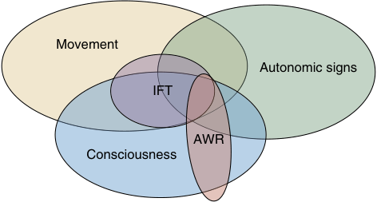

Movement Autonomic signs IFT AWR Consciousness 

**Fig. 36.1 Potential clinical states during general anesthesia.** Consciousness may take many forms including connected (interoceptive or exteroceptive) or disconnected (dreaming) and be vivid or muted. Episodes of connected consciousness can be unveiled by the isolated forearm technique (IFT) or by awareness report if explicit recall is present (AWR). Both of these measures likely underestimate intraoperative connected consciousness due to amnesia (AWR) or non- neuromuscular blocking drug–related immobility (such as impairment of motor effector limbs at a central nervous system level), or lack of volition (IFT) or partial (muted) consciousness (both). The IFT may also reveal reflex movements normally masked by neuromuscular blockade. Movement and autonomic signs are unreliable and may be present or absent in these states. Occasionally AWR may present absent of conscious experience at the time.

can be considered a drug- induced hypnotic state that can be overcome with sufficient stimulation. The term awareness in conjunction with anesthesia usually refers to _awareness with recall_ (AWR), defined as subjective intraoperative experience with explicit episodic memory, whereas _wakefulness during anesthesia_ is not necessarily associated with memory formation (Fig. 36.1).

The presence of a subjective sensation of existence in a patient can only be detected by some motor or verbal response at the time, or later by explicit or implicit memory. Lack of response may indicate true lack of consciousness, but alternatively could simply reflect that anesthesia has impaired the reporting mechanisms that normally indicate the presence of consciousness. The term “level of consciousness” is widely used in medicine to describe the level of _arousal_ (behavioral responses to different types of stimuli). Whether consciousness itself is a graded or all- or- none phenomenon remains contentious, but conscious experience certainly encompasses many qualitatively different states, most of which can be induced by various anesthetic agents. For example, the patient’s conscious experience may be vivid or muted, may or may not be accompanied by emotion or sense of self, may have absent volition (cognitive– motor dissociation), and core interoceptive senses of pain and bodily conditions may not reach conscious awareness.

### NOCICEPTION AND ANTINOCICEPTION

“The patient had a depth of anesthesia index of 42 and then they suddenly sat up in the middle of the thyroidectomy. The EEG is useless!” Versions of this common observation are the primary reason for the failure of widespread uptake of EEG monitoring. In this respect the EEG is like all the other monitors used during anesthesia: they can be used effectively only if all their limitations are properly recognized and understood. For example, blood pressure is universally monitored during anesthesia, but the numerical value of

the arterial blood pressure is merely a proxy for adequate organ perfusion. Any experienced anesthesiologist knows that there might be situations of extreme vasoconstriction and tissue ischemia in the presence of a normal blood pressure or, conversely, acceptable tissue perfusion in a vasodilated patient with a low blood pressure, or that preexisting arteriopathy might result in dangerous heterogeneity of tissue perfusion. Similar principles need to be applied for the correct interpretation of EEG patterns.

The cardinal feature that separates anesthesia from sleep is lack of response to noxious stimuli with anesthesia. It is important to acknowledge that the response to nociceptive input has several somewhat independent dimensions:

1. **Somatic movements.** Mediated at spinal cord level.

2. **Generalized autonomic system response.** Usually the sympathetic branch predominates, but not uncommonly extreme vagal effects are seen (e.g., fainting). Although much of the sympathetic nervous system is peripheral, there are important mediating circuits within the central nervous system, and it is on these that anesthetic drugs exert beneficial modulation.

3. **Arousal.** In the brain, noxious input tends to cause wakefulness and demand attention. Sufficient general anesthesia with hypnotic drugs might prevent wakefulness, but it is important to realize that the presence of unblocked underlying nociceptive stimulation induces brain excitatory aminergic and glutamatergic activity that may have various deleterious effects.

## Clinical Signs in Anesthesia Monitoring

### NEUROLOGICAL AND CLINICAL OBSERVATIONS OF ANESTHETIC EFFECT

Since the seminal work by Snow, and later Guedel, the predominant method of giving general anesthesia has been titration to clinically observable end points. Typically, these have consisted of somatic responsiveness to noxious stimulation; brainstem reflexes (respiration, eye movements and reflexes, lacrimation, pupil size and reaction, and laryngeal and pharyngeal reflexes); and autonomic nervous system signs (sweating, blood pressure, and heart rate). Although these observations were derived using historical singleagent anesthesia (chloroform and ether), these clinical signs have been updated by Brown7 to be applicable in modern multidrug anesthesia and linked with putative brain circuit mechanisms of action for various drugs. The main pressure for the development of specific brain monitoring technology has been the fact that these signs are not reliable indicators of consciousness.

### Responsiveness

Before the advent of neuromuscular blocking drugs, somatic responses were an obvious indication of inadequate anesthesia. Deep paralysis made intraoperative wakefulness without any ability to communicate this to the anesthesia provider possible. Importantly, however, a sizable proportion of awareness reports occur in patients who have not received neuromuscular blocking drugs. Reports of distress

<!-- PDF page 4 -->

are uncommon in these cases. They are examples of various states of dissociation between a subjective experience of consciousness and the ability to produce a motor response to communicate this to the outside world. The underlying neuropharmacological mechanisms for these states are not well understood. By analogy to other neurological pathologies, they could include anesthetic impairment of volition (i.e., drug- induced impairment of motivation or akinetic mutism); inability to link with self (disembodied states, often linked to inhibition of the insula); drug- induced malfunction of various midbrain (antidopaminergic catatonia/ Parkinsonian); and cholinergic brainstem systems required for purposeful motor activity (sleep paralysis).

With the aforementioned provisos, a number of formal sedation scoring scales have been developed, which are sometimes used in anesthesiology research to quantify anesthetic effects and recovery from anesthesia. The scales include the Glasgow Coma Scale,8 the Observers Assessment of Alertness/Sedation Scale,9 the Ramsay Sedation Scale,10 and the Richmond Agitation Sedation Scale.11 The scales generally assess responses to verbal and noxious stimuli and sometimes have a component for scoring agitation.

### Brainstem Reflexes

Induction of general anesthesia is associated with loss of response to verbal command and, concomitantly, loss of vestibular–oculocephalic and corneal reflexes. These are signs of dysfunction in regions of the upper pons and midbrain that control cranial nerves III, IV, V, and VI. Loosely based on clinical observations of the coincidence of loss of reflexes and responsiveness to verbal command—and the proximity of these nuclei with important brainstem arousal centers—it is suggested that loss of these reflexes are indicators of unconsciousness. However, large- scale epidemiological studies to confirm the reliability of these observations are lacking. Nevertheless, it is important for the clinician to realize that disrupted brainstem mechanisms underlie the atonia and disturbed respiratory patterns that are commonly induced by anesthetic doses of hypnotic drugs. With increasing dose of anesthesia there is inhibition of progressively more caudal pontomedullary regions. Thus, gag and cough reflexes (cranial nerves IX and X) become impaired, and apnea supervenes, at higher doses of anesthesia than those required for loss of responsiveness to verbal command.

### The Isolated Forearm Technique

The isolated forearm technique (IFT) was first described by Tunstall in 197712 for use during cesarean section, which carries a higher risk of intraoperative awareness. A tourniquet or blood pressure cuff is placed on the patient’s arm prior to administration of neuromuscular blocking drugs, so that the isolated limb remains neuromuscularly intact. This allows detection of wakeful episodes, which are indicated with appropriate motor responses to commands such as “squeeze my hand.” Brainstem or spinal cord level somatic reflexes, perhaps reflecting inadequate antinociception, may also be unmasked. Although intuitively appealing for clinical use, and arguably the gold standard in awareness monitoring, the IFT has largely remained a research tool. Nevertheless, there is no reason why clinicians shouldn’t employ the technique, and directions are given in Box 36.2.

### Box 36.2 How to Perform the Isolated Forearm Technique

|Counsel and reassure patient preoperatively|
|---|
|Apply blood pressure cuff or tourniquet on contralateral arm to intravenous access site|
|Apply nerve stimulator|
|Inflate cuff to 200 mm Hg prior to administration of neuromuscular blockade|
|Verify intact train- of- four count 2–3 minutes after neuromuscular blocking drug is given|
|Give command e.g., “[Name of patient], if you can hear my voice open and close the finger of your right arm.” This can be given intermittently by the clinician, or a prerecording and headphones can be used for sustained monitoring.|
|If spontaneous movements are seen, question patient to ascertain if purposeful response.|
|ᑏManage purposeful responses by increasing hypnotic agent|
|ᑏManages reflex responses by increasing analgesia|
|After 30 minutes, release tourniquet to prevent limb ischemia and re- verify train- of- four|
|With top- up muscle relaxant doses, reinflate cuff, regularly checking neuromuscular integrity with train- of- four.|

For instance, it could be used in a patient with a previous history of awareness (or any patient with a particularly strong fear of awareness), providing reassurance to both the patient and the anesthesia provider.

The clinical importance of IFT responses remains unclear, since responses are not usually associated with explicit memory formation; however, clearly there is a failure to meet the level of hypnosis or perceptual disconnection expected during general anesthesia, and some patients have indicated the presence of pain.13 There are a few potential barriers to general use of the technique, such as unfamiliarity, limited access to limbs (to isolate) or head (to give commands), and potential distraction from other aspects of patient care.14 The duration of tourniquet application is limited by potential limb ischemia, and reinflation may be needed with top- up doses of neuromuscular blocking drug. The feasibility of a reverse technique, using sugammadex, has also been shown, which might be useful in the event of suspected intraoperative awareness where the IFT was not initially planned.15

### Autonomic Nervous System Signs, Measures, and Indices

During anesthesia, it is almost universal practice to titrate analgesic and hypnotic drugs to reduce overactive sympathetic autonomic nervous system responses to noxious stimuli. Unfortunately, autonomic responses are not specific to noxious signaling, and have many other potential intraoperative causes. Intraoperative tachycardia and hypertension are largely mediated by hypothalamic and brainstem mechanisms, and so are a window on function in these parts of the brain. These autonomic responses clearly play a significant role in important adverse perioperative outcomes, such as myocardial ischemia and strokes, and possibly have other long- term consequences such as impairment of immune responses, hypercoagulability, and the development of chronic pain. However, it is a pernicious myth among clinicians that autonomic responses are good

::: details 原始表格與符號（PDF 第 4 頁）

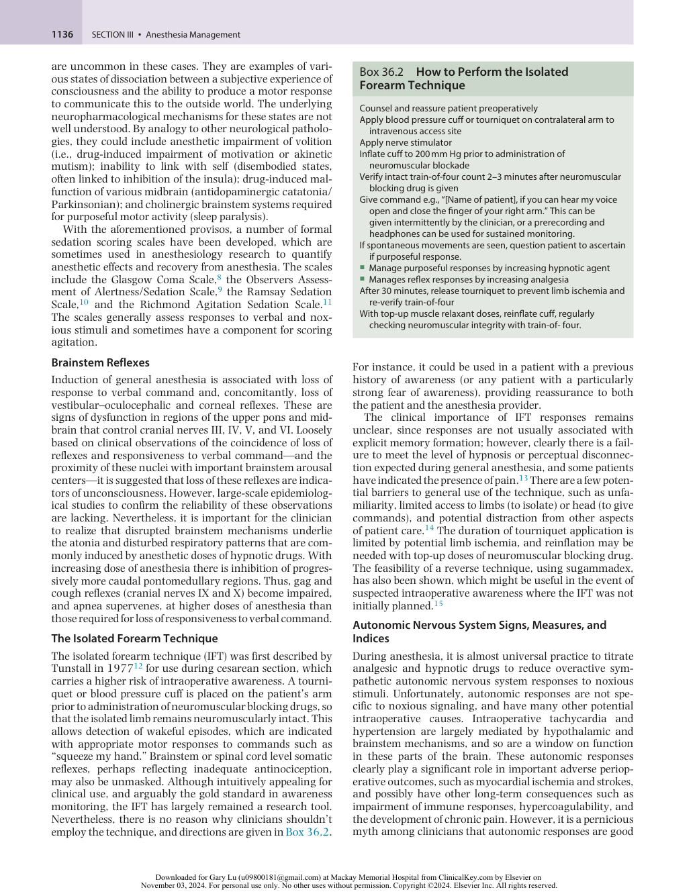

:::

<!-- PDF page 5 -->

indicators of the presence of consciousness and recall. It has been repeatedly shown that patients can demonstrate autonomic instability with no conscious recall, and conversely, that distressing awareness and recall can occur in the absence of any sympathetic nervous system signs.

In the absence of surgical noxious input, anesthesia causes a reduction in sympathetic nervous system outflow and a reduction in parasympathetic activity.16 This manifests as reduced systemic vascular resistance and hypotension. The reduction in parasympathetic activity decreases salivation and tearing. Most anesthetic agents have direct vasodilatory and cardiovascular depressant effects, which can activate compensatory autonomic responses to varying degrees. With noxious stimulation, a hypertensive and tachycardic sympathetic nervous system response is observed, although vagal responses are not uncommon.

The pupils are under parasympathetic and sympathetic nervous system control in the awake state. During anesthesia, pupils are typically small with a maintained but reduced light reflex,17 which reduces further with increasing doses of anesthesia. With noxious stimulation, pupillary dilation occurs, a reflex which persists during general anesthesia.18 In the awake state, reflex dilation is mediated by the sympathetic nervous system; however, during anesthesia it is unchanged by peripheral sympathetic blockade with dapiprazole,19 suggesting the reflex is mediated by inhibition of the Edinger–Westphal nucleus.

### Nociceptive Indices

A number of indices have been developed to quantify autonomic nervous system activation, with the hope that these can guide analgesic drug delivery during anesthesia and hence provide better postoperative analgesia. The exact clinical efficacy and role of these indices has yet to be determined.20 Heart rate variability refers to the variation of the interval between heart beats and reflects the balance between parasympathetic and sympathetic nervous system activity. Higher variability is associated with increased parasympathetic nervous system activity, whereas lower variability is associated with sympathetic nervous system predominance. Frequency analysis can differentiate between high-frequency (0.2–0.4 Hz) and low-frequency (0.04–0.15 Hz) components of heart rate variability.21 High- frequency variability is thought to specifically represent changes in the parasympathetic nervous system and is linked to respiration, whereas low- frequency variability is reflective of both divisions. The high- frequency component of heart rate variability is one of the components of the commercially available analgesia–nociception index.22 The “surgical pleth index” has also been developed as a measure of intraoperative nociception.23 This algorithm analyzes the plethysmographic pulse wave to quantify sympathetically mediated vasoconstriction. Galvanic skin responses24 have also been used as a marker of nociception- related sympathetic nervous system activity, which causes microfluctuations in sweat gland filling.

## Electroencephalography

The greatest advance in monitoring the effects of anesthesia on the brain has been the advent of EEG monitoring.

The EEG provides a window to the effects of anesthesia on the cortex (and thalamus), noninvasively capturing the dynamics of electrical activity with changing doses of different agents. However, to correctly interpret the significance of the EEG, it is essential that we understand in some detail how it is produced and displayed, and how it is affected by anesthesia.

### WHERE DOES THE EEG SIGNAL ORIGINATE?

The EEG measures population- level neuronal activity (as voltage potential, in microvolts (μV)) from electrodes placed on the scalp. Transmembrane ion flows are the mechanism by which action potentials propagate rapidly along axons, but also underlie the longer-lasting response of the postsynaptic membrane.25 The ion flows create electrical potentials and hence currents in the extracellular medium, the average of which is the fundamental activity contributing to the EEG,25,26 although nonsynaptic neural sources and glial cells can also contribute.25,27

Large pyramidal neurons in the cortex have multiple aligned dendritic processes that are oriented perpendicular to the scalp in the gyri. Tens of thousands of synapses attach along each of these dendritic lengths. For voltage potentials to be detected at the scalp, individual neuronal voltages need to summate; hence, the scalp EEG is detecting the synchronous activity of a large number of synapses in networks of many neurons.28 The signal from the cortex must pass through cerebrospinal fluid, the skull and scalp, and is thus a diminished and smeared measure of cortical activity. An average- sized EEG electrode of around 1 cm2 will detect a voltage potential from an area of cortex approximately 6 cm2 in size,26 meaning that the EEG signal has an excellent temporal resolution (in milliseconds), but poor spatial resolution.

Although the EEG detects signals from the cortex, it is important to note that cortical activity itself is modulated by subcortical structures, such as the thalamus29 and the arousal- promoting structures located in the brainstem,30 so the EEG can be considered to be an indirect marker of activity in these deeper structures. Also, strong electrical activity from more distant (“far field”) brain sources (tens of centimeters) can sometimes directly contribute to the EEG signal (volume conduction31 ).

The signal from each active electrode and the reference electrode is differentially amplified by the EEG recording system, and the amplified signal is passed through a filter and then digitized via an analog-to-digital converter before being displayed on the monitor. The choice of electrode placement can have significant effects on any resultant EEG analysis.

### FROM RAW EEG TO THE SPECTROGRAM

Effective monitoring of the brain during general anesthesia requires that clinicians can read and interpret the EEG. The raw EEG signal is displayed almost instantaneously, typically over a continuously updating 5- to 10- second window. In this view, where voltage changes are shown over time, one can see various waveform morphologies in detail. For example, increasing anesthesia dose causes the EEG to shift from a low amplitude while awake, to a pattern with a larger amplitudes and slower waves, and then to burst

<!-- PDF page 6 -->

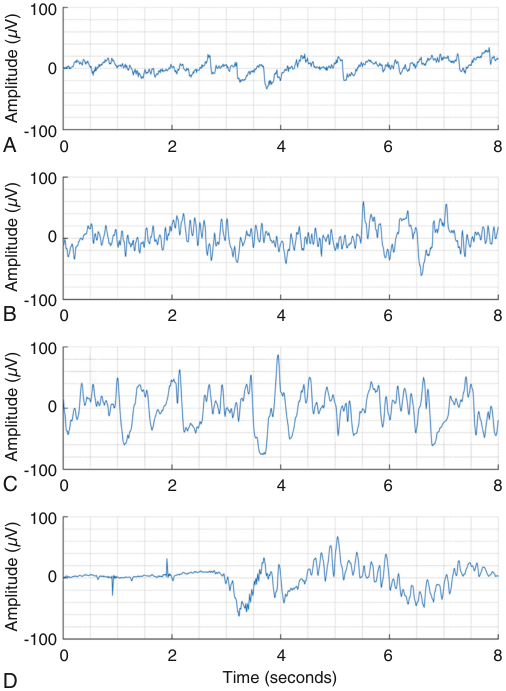

100 0 -100 A 0 2 4 6 8 100 0 -100 B 0 2 4 6 8 100 0 -100 C 0 2 4 6 8 100 0 -100 0 2 4 6 8 D Time (seconds) Amplitude (V) µ Amplitude (V) µ Amplitude (V) µ Amplitude (V) µ 

**Fig. 36.2 Example raw electroencephalographic (EEG) sections with increasing anesthetic dose.** (A) An awake patient typically shows low-amplitude waveforms with blink and muscle artifacts. (B) With drowsiness, some slower waveforms appear, before showing (C) higher amplitude and slower waveforms during maintenance anesthesia. (D) At higher anesthetic doses, the signal alternates between periods of suppression and high-amplitude activity (burst suppression).

suppression (Fig. 36.2). Because the raw EEG is constantly updating, it only provides a fleeting glimpse of a patient’s brain state, and clinicians can only clumsily estimate the frequency of waveforms by counting individual wave peaks over one second. A few monitors also display a segment of EEG as a power spectrum, where the power (proportional to amplitude, in μV2 or decibels (dB)) of an EEG section is shown at each frequency (in Hz) (Fig. 36.3). In this perspective, the underlying broadband characteristic of the EEG can be clearly seen, where power decreases with increasing frequency, and oscillations such as the alpha and delta waveforms show as additional narrow peaks of power at particular frequencies32 (Fig. 36.4). Many monitors currently show the spectrogram, also known as a density spectral array (DSA). Here, concurrent power–frequency spectra are stacked over time (typically around 1 hour) on the x- axis, with frequency shown on the y- axis, and EEG power portrayed as a color scale, where red is high power and blue is low power. The advantage of this format is that it presents the totality of the EEG in one glance. It allows trends in all aspects of the EEG, over the whole operation, to be easily detected visually (see Figs. 36.3 and 36.5). The spectrogram is as fundamentally important for EEG monitoring of anesthesia as cardiac ultrasound is for cardiology.

Of note the estimated propofol effect- site concentrations required for the patient in Fig. 36.5 were quite high (around 5 mcg/mL), and they opened their eyes to command during emergence when the concentrations were 3 mcg/mL. This patient would have almost certainly been underdosed if anesthesia had been titrated on clinical signs, without the use of the EEG. By way of contrast would be a typical septic patient, whose EEG might show delta waves, who is verging on burst suppression when given only 0.6% end- tidal isoflurane. It is only EEG monitoring that can safely guide hypnotic delivery in this situation.

### ANESTHETIC DRUG EFFECTS ON THE FRONTAL EEG

Different classes of drugs have widely varying effects on the EEG, mostly in proportion to how sedative the drug is. Anesthetic adjunct drugs that have effects on brainstem arousal systems—such as antimuscarinic drugs like hyoscine—occasionally cause quite marked intra- and perioperative EEG changes,33 but in this section we concentrate on more generic effects of agents that act (at least partially) via gamma- aminobutyric acid (GABA) receptors. Because adequate monitoring of the EEG requires visualization of the raw signal and the spectrogram, we describe each drug effect in terms of its characteristic spectrogram signature. We also concentrate on the simple single frontal channel, which is the one that clinicians will commonly see in their day- to- day practice. The degree to which anesthetic agents alter derived EEG indices of hypnotic depth can usually be deduced from knowledge of these underlying spectral changes.

### Induction

When general anesthesia is induced in a patient using a GABA- ergic anesthetic (such as propofol or volatile agents) and they transition from an awake state to one that allows surgery, an EEG signal from frontal areas shows characteristic amplitude and frequency changes. During the awake state, the EEG is characterized by small-amplitude and highfrequency activity33,34 (∼5 to 10 μV). The EEG is also often interspersed with artifactual activity originating from eye blinks, head movement, and muscle activity (see section entitled Noise and Artifacts in the EEG).

At anesthetic doses sufficient to induce mild sedation, oscillations in the beta frequency range (roughly 12–30 Hz) begin to occur – the “beta buzz.” Table 36.1 shows the historical names of each frequency band. This activity in the beta range is not normally characterized by a tightly constrained oscillation, but is spread over a broader frequency band ranging from about 15 to 25 Hz. It is often an indication of an excitatory phase. When responsiveness is lost, the alpha oscillation present at occipital areas when eyes are closed disappears, and activity in the alpha frequency range (8–12 Hz) becomes visible in frontal areas – the socalled “anteriorization” phenomenon.35,36

The usefulness of EEG brain monitoring during procedural sedation is currently under debate. There have been some studies investigating whether various EEG methods could be used to guide nurse- administered sedation with propofol,37 and the EEG does correlate reasonably well with the behavioral arousal scores.38 The spectrogram of sedation

<!-- PDF page 7 -->

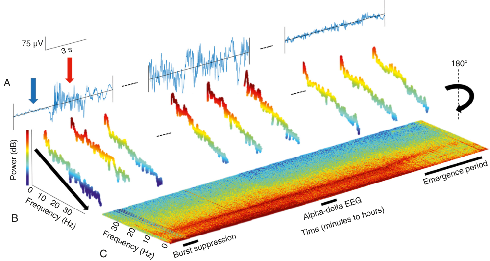

75 µV 180° A B C 3 s Time (minutes to hours) Emergence period Alpha-delta EEG Frequency (Hz) Burst suppression Frequency (Hz) 0 10 20 30 30 20 10 0 Power (dB) 

**Fig. 36.3 Three basic steps of how a spectrogram is constructed.** (A) Raw electroencephalograph (EEG) is shown in microvolts (μV) over time. (B) Power spectra are created from a few seconds of EEG using the fast Fourier transform. Here, power (which is amplitude squared) is shown for each frequency bin. Power on the y- axis is also coded by a color scale, here ranging from _red_ (high power) to _blue_ (low power). Generally, spectra are marked by decreasing power with increasing frequency (the broadband, or 1/f effect, see _black arrow_ on the leftmost power spectrum), with sinusoidal oscillations (such as the delta and alpha oscillations) displaying as peaks of power additional to the broadband effect (see also Fig. 36.4). (C) For the spectrogram, all successive spectra are rotated 180 degrees around a vertical axis and viewed from above (so the 1- Hz waves are closest to the viewer, and 50- Hz waves furthest). The leftmost EEG and spectra shows an example period of suppression (marked by the _blue arrow_ above the raw EEG) followed by a burst (marked by the _red arrow_ ). In the spectrogram, this shows as vertical stripes of low power ( _blue_ ) alternating with periods of high power ( _red_ ); see Fig. 36.6 for more details. The middle EEG section and three spectra shows an example of intraoperative “alpha- delta” EEG; Fig. 36.4 shows a similar “alpha- delta” power spectrum in more detail. In the spectrogram, the alpha oscillations are shown by a _dark red band_ of power at around 10 Hz, and the delta oscillations are the _dark red band_ at the bottom of the plot. The rightmost EEG and spectra shows an example from during the emergence period, where the spectral slope is less steep (with power spectra showing more _orange_ and _light green_ power levels), and the alpha oscillation is shifting to a higher frequency.

typically shows signals characteristic of early induction (increased beta power and initial loss of posterior alpha), but often shows a classical waking pattern in response to a painful stimulus.39 Current EEG measures cannot give the clinician reliable information about whether the patient will respond to a new increased noxious stimulus, and cannot tell the clinician if the patient is in danger of oversedation and loss of airway patency.

### Maintenance

**The “Alpha- Delta” Pattern.** At doses sufficient for surgery there is a “red shift” to a predominance of slow frequencies in the EEG spectrum. There is a marked decrease in beta and gamma power, and the EEG signal is dominated by oscillations in the slow- wave (0.1–2 Hz) or delta frequency bands (0.5–4 Hz), usually together with an oscillation in the alpha range – the “alpha- delta” pattern. Fig. 36.5 shows the spectrogram of a typical patient undergoing GABA- ergic anesthesia. The alpha- delta pattern is clearly distinguished by high power (red horizontal bands) in the delta and alpha frequency bands that remain until the emergence process begins at around 2.2 hours. The details of the spectrum from the middle of the maintenance period are shown in Fig. 36.4.

It is difficult to overstate the importance of the alpha- delta pattern as the primary target for the titration of anesthesia

in almost all cases. This pattern is easily recognized in the spectrogram, has some similarities with natural sleep patterns, and is the signature of appropriate thalamocortical hyperpolarization. Its appearance usually correlates with loss of responsiveness36 and suppression of cortical responses to noxious stimuli, and is a good indicator that the patient has a resilient brain40 which is unlikely to suffer postoperative cognitive disturbances.41 While representing an “ideal” state, it must be recognized that this alpha-delta pattern does not completely preclude connected consciousness,42,43 and whether it guarantees amnesia also remains to be elucidated.

The EEG during maintenance is also characterized by an underlying non- oscillatory broadband background, where slower waves have larger amplitudes and faster waves smaller amplitudes. This is shown by the straight black regression line in Fig. 36.4. The decay rate (or negative slope in the power spectrum) of this aperiodic component of the EEG is sensitive to drug dosage.44 It is difficult to visually detect in the raw EEG, but can be easily seen in a power spectrum.

**Burst Suppression.** At higher doses of anesthesia, the EEG signal becomes non- stationary and begins to alternate between low-amplitude (&lt;5 μV) suppressed sections and high-amplitude bursts. This is termed burst suppression

<!-- PDF page 8 -->

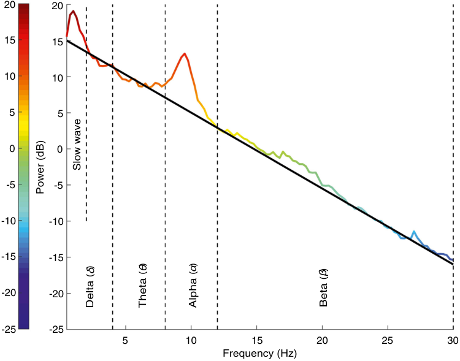

20 20 15 15 10 10 5 5 0 0 -5 -5 -10 -10 -15 -15 -20 -20 -25 -25 5 10 15 20 25 30 Frequency (Hz) Slow wave Power (dB) Delta (  )δ Theta (  )θ Alpha (  )α βBeta (  ) 

**Fig. 36.4** A typical power spectrum taken from during maintenance anesthesia with a gamma amino- butyric acid (GABA)- ergic anesthesia. The power spectrum is well described by noting high power ( _red color_ ) in the slow- wave/delta and alpha frequency bands (see also Table 36.1), above an underlying broadband spectral slope ( _straight black line_ ), where signal power decreases with increasing frequency.

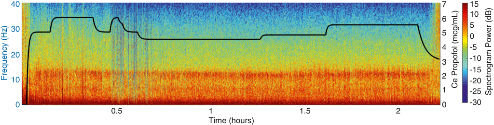

40 7 15 10 6 5 30 5 0 4 -5 20 -10 3 -15 2 10 -20 1 -25 0 0 -30 0.5 1 1.5 2 Time (hours) Frequency (Hz) Ce Propofol (mcg/mL) Spectrogram Power (dB) 

**Fig. 36.5** A typical spectrogram of a patient undergoing gamma amino- butyric acid (GABA)- ergic anesthesia for surgery. Time is on the x- axis, and frequency on the y- axis. The power (dB) in each frequency band is depicted by color. The _solid black line_ is the changing effect- site propofol concentration through the course of the anesthesia.

**Table 36.1** Nomenclature of Classic Electroencephalograph (EEG) Frequency Bands

|**Frequency** **Band**|**Common** **Name**|**Proposed Neurobiological Origins**|
|---|---|---|
|0.1–2 Hz|Slow wave|Intracortical149|
|0.5–4 Hz|Delta|Thalamocortical and cortical150,151|
|4–8 Hz|Theta|Thalamocortical as alpha slows into this range,152otherwise unknown.|
|8–12 Hz|Alpha|Thalamocortical153|
|12–30 Hz|Beta|Intracortical154|

(Fig. 36.6). The length of the suppression period increases with dose, until at the highest doses, the EEG becomes entirely suppressed (isoelectric). In all EEG- based brain monitors for anesthesia a “suppression ratio” or equivalent is shown. Here, the ratio of time that the EEG spends in suppression is compared to time in normal or bursting EEG, over a 30- to 60- second window. There is also a “forme fruste” EEG state prior to full onset of burst suppression where power at all frequencies higher than ∼2 Hz begins to decrease abruptly for short periods. In the bispectral index (BIS) monitor this state is detected using the QUAZI suppression subalgorithm,45 and contributes to the final BIS index. In the spectrogram, this state shows as vertical

::: details 原始表格與符號（PDF 第 8 頁）

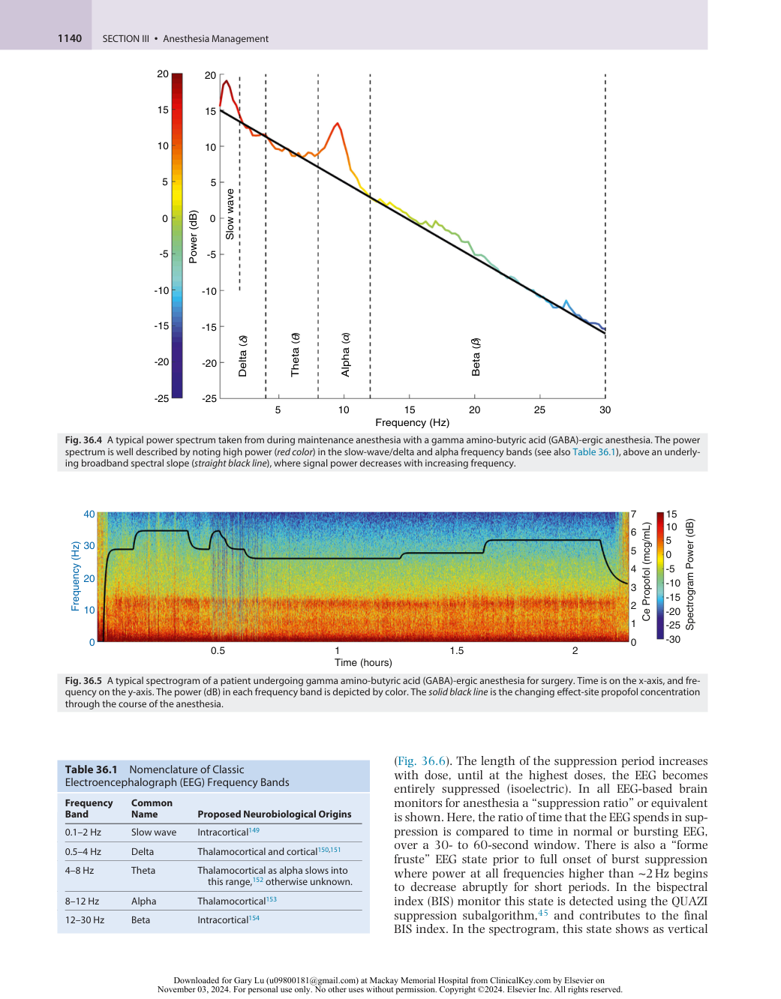

:::

<!-- PDF page 9 -->

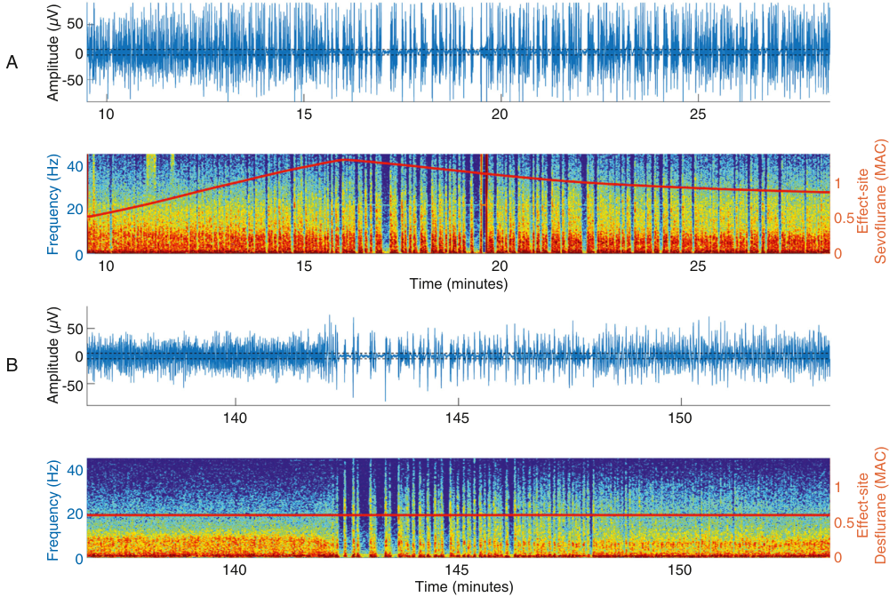

50 0 A -50 10 15 20 25 40 1 20 0.5 0 0 10 15 20 25 Time (minutes) 50 0 B -50 140 145 150 40 1 20 0.5 0 0 140 145 150 Time (minutes) Amplitude (V) µ Effect-site Frequency (Hz) Sevoflurane (MAC) Amplitude (V) µ Effect-site Frequency (Hz) Desflurane (MAC) 

**Fig. 36.6 Two examples of burst suppression in the raw electroencephalograph (EEG) and spectrogram.** In patient A, power at higher frequencies (> ∼2 Hz) begins to drop out episodically from around 10 minutes onwards, as shown by the onset of subtle _lighter- color vertical stripes_ in the spectrogram – the forme fruste of burst suppression mentioned in the text. From around 15 minutes onwards, this patient develops full burst suppression as can be seen in the low-amplitude (&lt;5 μV) periods in the raw EEG, and the distinctive low-power ( _blue_ ) _vertical stripes_ in the spectrogram. The EEG of patient B is marked by ongoing high alpha- delta power until the abrupt onset of burst suppression at around 142 minutes, when a bolus of fentanyl was given.

“stripes” of decreased power over all frequencies displayed except for sustained power in the 0.5–2 Hz range (see Fig. 36.5). In the raw EEG, a large-amplitude delta- slow wave continues, but looks “cleaner” due to the absence of other frequency waveforms; these signs portend impending full burst suppression. Burst suppression is an interesting example of an EEG waveform that is not physiological. It can result from high doses of anesthetic, other toxic causes, and from hypothermia, hypoxia, and ischemia. The clinical significance of intraoperative burst suppression is presently hotly debated. Observational studies demonstrate a clear link between intraoperative burst suppression and impaired postoperative cognitive recovery.46,47 However, there are mixed conclusions from interventional studies as to whether reducing intraoperative burst suppression is effective in lessening postoperative delirium.48,49 The purposeful induction of burst suppression is used to quantify reduced cerebral metabolic rate and hence is believed to offer some brain protection in ischemic episodes. The presence of burst suppression guarantees patient unconsciousness, but does not guarantee lack of somatic movement for propofol anesthesia. The median propofol target concentration required to achieve burst suppression is about 5 mcg/mL, whereas the propofol concentration required to prevent movement to incision is at least 15 mcg/mL. This

can be reduced 80% in the presence of 3 ng/mL of target concentration of fentanyl.50,51 For example, it is easy to imagine a situation where, during propofol anesthesia, the patient makes a non- purposive movement, and the surgeon complains to the anesthesiologist that the patient is “waking up.” The slightly worried anesthesiologist has not noticed that the EEG monitor shows burst suppression, and erroneously decides to increase the propofol dose. It would be much more effective to give some opioid in this situation. In contrast, for volatile agents, the concentration required to achieve burst suppression is about 30% more than the concentration needed to prevent somatic movement.

**EEG Effects of Noxious Stimulation During Anesthesia.** The reported EEG responses to noxious stimulation during anesthesia are quite variable and poorly understood.52 In some instances, there is a shift to higher-frequency desynchronized activity, consistent with the sort of cortical arousal seen at the end of a case that typically precedes awakening. Both increases and decreases53,54 in alpha band activity—or more specifically the alpha oscillation—have been reported. There are also numerous reports of “arousal” to noxious stimuli, marked by increased delta,55,56 abrupt onset of burst suppression, and dips in processed EEG index values. The variety of these responses possibly reflects

<!-- PDF page 10 -->

variations in pre- stimulus patient state, the types of stimuli, and the anesthetic agents and adjuncts administered. The clinical significance of nociceptive- induced disturbance of the EEG is not entirely clear. Obviously, a shift in EEG power toward a wakeful pattern would suggest that the anesthetic delivery is inadequate to maintain unconsciousness, and therefore should be increased. Other EEG changes certainly indicate that the anesthetic suppression of surgical stimuli is incomplete, but it is unknown whether these result in long- term adverse effects for the patient.

**Transition Periods During Maintenance Anesthesia.** Knowing the optimal EEG pattern for maintenance anesthesia allows clinicians to keep track of what is happening in the brain when anesthetic dosing is difficult to estimate, such as transition periods when end- tidal volatile readings are often unreliable. Such transitions include when an anesthetized patient is transferred from the induction room to the operating room, or when a patient undergoing cardiac surgery is weaned from the heart–lung bypass machine back to the anesthetic ventilator.57 In a retrospective analysis of a prospective cardiac study, we found that EEG patterns very similar to those seen during emergence were occurring in around 5% of patients during ongoing surgery, mainly around the time of being transferred from the heart–lung bypass machine back to the ventilator.57

### Emergence

During the emergence period, the EEG changes represent the process of the return to, or reconstitution of,58,59 connected consciousness. Brain monitoring during this period may give clinicians valuable hints as to the probable state of their patient after they regain responsiveness. The classic spectral EEG changes during emergence have been documented by a number of groups,33,36,60–62 and show generally converging results. Over the emergence period, power in the slow- delta and alpha bands decreases and the peak frequency of the alpha oscillation increases before alpha power dissipates. During late emergence, there is commonly a significant period where delta and alpha power is absent, but the patient is unresponsive. At this stage they are in a state of disconnected consciousness (often dreaming32 ). In contrast, around a third of patients will suddenly lose high delta power and transition directly to responsiveness.61 Immediately on return of responsiveness, alpha activity reoccurs at occipital areas, if patients have their eyes closed.63 During emergence, the EEG also shows an increase in beta power and thus a shift to a more uniform underlying power distribution (a decrease in slope of the power spectrum).

**Neural Inertia During Emergence.** Neuropharmacological responses as estimated by EEG or behavioral state64–66 often differ between the induction and emergence. Patients need higher concentrations of hypnotic drugs to become unresponsive at induction than the concentrations at which they emerge – and this difference cannot be fully accounted for by pharmacokinetic effect- site lag. This hysteresis effect is so- called “neural inertia,” which is defined as the resistance to changes in state of the brain or of consciousness.67–70 The inability to directly measure effect- site concentrations in humans has led to some debate as to

the role of pharmacokinetic estimates in determining the incidence of neural inertia,71–73 but pharmacodynamic responses consistently show differences between the induction and emergence.61,64 It may arise from generic network effects,74–77 but there has also been a large focus on the role of ascending arousal system malfunction.67,69,78 In essence, the active brainstem arousal systems—as seen in the young and those with analeptic drugs—tend to reduce hysteresis, while suppression of brainstem arousal systems (for example as seen in the elderly, and with dexmedetomidine) will enhance hysteresis.61 Although it might seem that neural inertia is an arcane pharmacokinetic- dynamic concept, this resistance to change has profound consequences in the practical delivery of anesthesia. The clinician should be aware that the simple sigmoid drug dose–response curve does not always pertain. Sometimes the patient does not change their brain state as expected in response to drug delivery, and sometimes they will maintain their existing brain state even after the hypnotic drug has been withdrawn. Neural inertia explains the classic case of an unresponsive patient at the end of the operation whose end- tidal sevoflurane has been 0.1% for 20 minutes, and who has persistently large delta waves, and then suddenly sits up and expels their laryngeal mask airway.

**Muscle Activity (EMG).** It is also worth noting that scalp electromyographic (EMG) activity is often present during the induction and emergence periods. There is often a covert increase in muscle tone that cannot be observed clinically. EMG can be identified on a spectrogram as an additive increase in power (color) over a wide range of frequencies (a broadband effect, see Fig. 36.4), and in the raw EEG as an increase in small- amplitude, high- frequency waveforms, making the EEG trace appear “fuzzy.” EMG mostly shows up later in the emergence process, often induced by endotracheal tube irritation.79 Any dissociation between genuine EEG markers (such as an ongoing alphadelta waveform) and additive EMG can be easily seen in the spectrogram. During maintenance of anesthesia these same principles regarding EMG also apply. However, increased EMG should not be considered as “noise.” It is essentially giving the clinician a signal that the patient is grimacing, and probably would benefit from increased anesthesia or analgesia delivery.

### Specific GABA- ergic Drug Effects on the EEG

As a general principle, hypnotic anesthetic drugs can be classified into those that primarily cause significant thalamocortical hyperpolarization (commonly used intravenous and volatile anesthetic agents, and dexmedetomidine) and those in which other mechanisms dominate (e.g. nitrous oxide and ketamine).

**Volatile ethers.** Volatile ethers act on a multiplicity of molecular targets, including by GABAA receptor and potassium channel agonism and functional glutamate antagonism. An example of an EEG response to increasing concentrations of volatile ether- based anesthesia is shown in Fig. 36.7.

It can be seen that the progressively increasing concentration of sevoflurane causes the loss of high-frequency power (seen as the shift in >20 Hz frequency band from

<!-- PDF page 11 -->

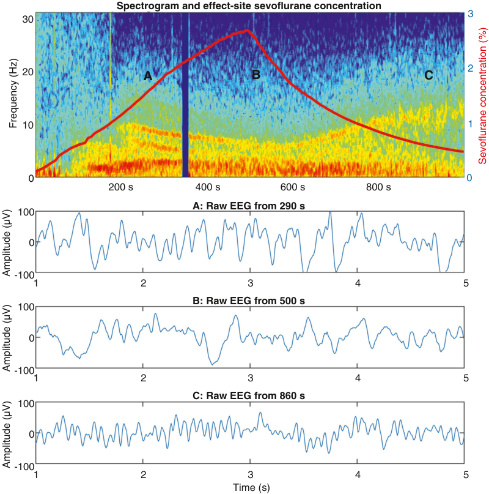

Spectrogram and effect-site sevoflurane concentration 3 30 20 A B C 2 10 1 0 0 200 s 400 s 600 s 800 s A: Raw EEG from 290 s 100 0 -100 1 2 3 4 5 B: Raw EEG from 500 s 100 0 -100 1 2 3 4 5 C: Raw EEG from 860 s 100 0 -100 1 2 3 4 5 Time (s) Frequency (Hz) Sevoflurane concentration (%) Amplitude (µV) Amplitude (µV) Amplitude (µV) 

**Fig. 36.7** Spectrogram showing changes in power with progressive increase and decrease in effect- site sevoflurane concentration ( _red line_ ). Examples of raw electroencephalograph (EEG) segments in subplots A, B, and C correspond to the times A, B, and C in the spectrogram.

pale turquoise to dark blue after about 200 seconds) and increased narrowband oscillations in delta, theta, and alpha wavebands. These features manifest as narrow bands of red (∼3 Hz, ∼8 Hz, and ∼11 Hz) that start at about 200–270 seconds, which are indicative of some thalamocortical hyperpolarization. As the sevoflurane concentration increases above about 1.7%, the peak alpha frequency slows from about 10 Hz to below the traditional definitions of the alpha frequency band (about 7–8 Hz), and the alpha power fades, so that almost all the activity lies in the broadened delta band. This shift from alpha to delta dominance is pathognomonic of a more deeply hyperpolarized thalamocortical system, analogous to the shift from light to deep slow- wave sleep.80 The alpha waves show widespread synchrony across the cortex and their amplitude is linked to the phase of the delta waves. Spatially, the delta waves are not synchronous. At higher concentrations, burst suppression may occur. In this patient, the pattern of EEG responses more or less reverses as the sevoflurane concentration deceases.

This pattern is common to all ethers. However, sevoflurane and enflurane differ slightly in that they tend to induce more sharp waves (epileptiform spikes) than desflurane

and isoflurane.81 The pro- epileptic effects are most marked with high concentrations, hypocapnia, and the absence of nitrous oxide or opioids.81 Other GABA- ergic drugs have a similar overall pattern, but with different “flavors,” as described below.

**Propofol, Barbiturates, Etomidate, and Benzodiazepines.** These intravenous drugs are much more potent than the volatile agents, and are generally considered to have more specific GABAA receptor agonist actions, and less off- target molecular effects. The EEG pattern in response to propofol is comparable to that of volatile agents except that the narrowband alpha and delta EEG oscillations tend to be more pronounced, a theta peak is less common, and the alpha peak frequency does not generally slow below 10 Hz (see Fig. 36.5).

Barbiturates, etomidate, and neurosteroids also produce EEG patterns similar to propofol, with the exception that etomidate and methohexitone can cause epileptiform activity similar to sevoflurane.81 Benzodiazepines are also GABAergic, but have different binding sites and act on different GABA receptor subtypes, with a lower maximal effect. So, their EEG effects are broadly similar to those of modest doses

<!-- PDF page 12 -->

of propofol: mainly an increased beta power, and initially loss of alpha, but then increased alpha or spindle patterns at higher sedating doses. Although a reliable EEG signature of amnesia would be very useful clinically, there has been surprisingly little work in this regard. Alpha/beta ratio seems to be best correlated with amnesia in a small study.82

### Specific Non- GABA- ergic Drug Effects on the EEG

**Nitrous Oxide.** Nitrous oxide has completely different actions on the EEG to those of the aforementioned GABAergic drugs, which makes its contribution to anesthesia difficult to detect with most indices.83 When given alone at atmospheric pressure it usually does not result in full unconsciousness, so the EEG changes are minimal, inconsistent, and rather subtle. However large abrupt increases or decreases in nitrous oxide concentration have been shown to cause large short- lived delta waves and loss of alpha waves.84 This pattern can occur with an abrupt withdrawal of nitrous oxide in the wakeful patient,85 but also when nitrous oxide is suddenly introduced on top of etherbased anesthesia.86 It has been suggested that nitrous oxide–induced differential _N_ - methyl- d- asparate (NMDA) blockade in some brainstem nuclei is the origin of this phenomenon.

**Xenon.** Xenon is not commonly used in clinical practice, but has a distinctive EEG signature which is dominated by delta power, and with reductions in all other frequency bands.87

**Ketamine.** The EEG effects of ketamine are complex, and depend on the dose given, and whether the drug is used alone or in conjunction with other anesthetic drugs. In a sub- hypnotic dose ketamine causes loss of alpha power and some increased theta and gamma activity,88 but if given in doses sufficient to induce loss of responsiveness it also produces huge slow waves89,90 alternating with gamma bursts. In contemporary practice, ketamine is more commonly administered in smaller boluses (25–50 mg) or infusions to supplement volatile or propofol anesthesia, with the purpose of augmenting analgesia. As can be seen in Fig. 36.8,

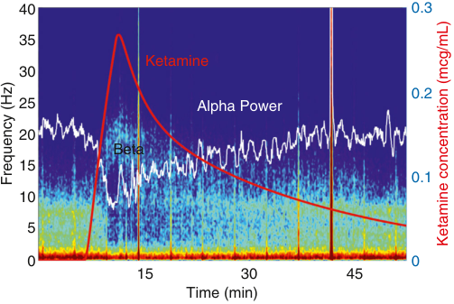

40 0.3 35 Ketamine 30 0.2 25 Alpha Power 20 Beta 15 0.1 10 5 0 0 15 30 45 Time (min) Frequency (Hz) Ketamine concentration (mcg/mL) 

**Fig. 36.8** Effect of ketamine (50 mg over 10 minutes) on background of 0.7 minimum alveolar concentration (MAC) sevoflurane anesthesia. The estimated ketamine concentrations are shown by the _red line_ , and the change in alpha power by the _white line_ (arbitrary scaled dB*2+10 for display purposes).

a slow bolus of ketamine given in this fashion sometimes increases beta and gamma power, but the most consistent effect is to decrease the alpha oscillatory activity. This is presumably mediated via thalamocortical depolarization that is secondary to ketamine’s actions that cause cholinergic, aminergic, and glutamatergic dysregulation. All these changes in the EEG tend to cause spurious elevation of the depth of anesthesia indices in the face of real increases in intraoperative antinociception.91

**Dexmedetomidine.** Wakefulness is maintained by subcortical nuclei exciting the cortex with a variety of neuromodulators. Loss of this tonic depolarizing excitation results in natural sleep. Because of its unique molecular mechanisms of action—the suppression of aminergic arousal resulting in thalamocortical hyperpolarization—dexmedetomidine tends to replicate natural sleep EEG patterns most closely. It is also well known that patients are much more easily wakened from dexmedetomidine sedation than from equivalent levels of propofol sedation. Presumably this is because dexmedetomidine is acting primarily subcortically, whereas propofol has both subcortical and direct cortical inhibitory actions. As seen in Fig. 36.9, a concentration of dexmedetomidine necessary to obtund response to verbal stimuli will cause an alpha- delta pattern. However, the alpha wave- band oscillations are fragmented into short bursts (an example from a small, highlighted section in time is shown by the white rectangles). These are very similar in morphology to natural sleep spindles.92 In contrast, the alpha band oscillations of propofol and sevoflurane tend to be longer – often almost continuous.

**Opioids.** The contributions of opioids to the intraoperative EEG are less well characterized than for GABA- ergic drugs, and often surprisingly minimal. When given alone, highdose opioids (equivalent fentanyl concentration >8 ng/ mL) cause increased delta power and a decrease in median frequency of the EEG93 (and other indices), but at these concentrations the problems of apnea and rigidity predominate. With the more routine doses of opioids in conjunction

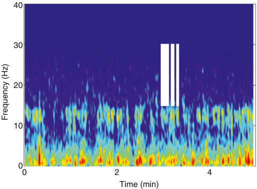

40 30 20 10 0 0 2 4 Time (min) Frequency (Hz) 

**Fig. 36.9** Spectrogram of dexmedetomidine electroencephalograph (EEG) (plasma concentration 2.09 ng/mL, no arousal stimulus) showing the transient intermittent sleep spindle waves in the ∼12 Hz alpha wave band.

<!-- PDF page 13 -->

with hypnotic drugs during general anesthesia, the EEG effects are much more nuanced. Opioids tend to stabilize the EEG rather than alter it. Most of the time there is very little change in the EEG pattern when intraoperative boluses of fentanyl are given; sometimes there is a small increase in the delta power and a decrease in BIS. The EEG effects of opioids are most obvious in the context of increased surgical noxious stimulation, where high concentrations (>4 ng/ mL fentanyl) can either prevent or treat surgically induced beta arousal or alpha dropout.53,56 Most obviously, the addition of opioids allows increased tolerance of noxious stimuli at relatively higher BIS values (i.e. at a more wakeful EEG pattern). For example, if given alone, the dose of propofol necessary to allow laryngeal mask airway insertion will probably result in a deep burst suppression pattern in the EEG. But, if given with fentanyl, enough propofol to achieve a typical mid- range alpha- delta EEG pattern is usually sufficient to allow insertion. In essence, the addition of opioids causes a therapeutic behavioral–EEG dissociation. They increase the behavioral “depth” of anesthesia (they impair the somatic and autonomic responses to the challenge of noxious stimuli), without changing the EEG much (the state of cortical activity). These modest effects on the EEG are not unexpected, given that the mechanisms of action of opioids are predominantly subcortical (periaqueductal gray, the spinal cord, amygdala, rostral ventral medulla) blockade of nociceptive transmission and activation of descending antinociceptive pathways. The sedative contribution of opioid inhibition of ascending cholinergic arousal pathways is relatively modest.30

### The Effects of Age and Preexisting Neurological Disease on EEG Monitoring

The process of aging induces a number of physiological brain changes that can influence the EEG signal, such as reduced cortical thickness, reduced number of dendritic spines on pyramidal neurons, reduced capacity for neural synchrony, and increased skull impedance and levels of neural noise.94–96 In general, increasing age is associated with decreases in EEG amplitudes at all frequencies often giving an indeterminate EEG pattern.94 Aging also flattens the slope of the power spectrum95 by about 20%, so that there is a relative dominance of higher frequencies in both the anesthetized and awake EEG.96 This decrease in power spectrum slope is associated with an increase in signal complexity,95 so that intraoperative entropy measures and other indices tend to be higher in the elderly at the point of loss of behavioral response, and for a given age- adjusted hypnotic dose – the so- called “paradox of age.”97 These effects can also be seen with increasing comorbidity load,98 giving rise to the concept of “functional brain age” that might be distinct from chronological age.99 The effects of aging on the frontal alpha oscillation are less clear. While peak alpha frequencies are known to slow with age,94,100 there are inconsistent results as to age- related changes in relative alpha power.94,95,100 The likelihood of burst suppression increases with age,94 and bursts have smaller amplitudes than in younger patients.101 Thus, optimal delivery of anesthesia in elderly patients is often less well defined and there is more variability between patients. Clinicians should be aware that the indices are less reliable in the elderly, who may have an acceptable level of

anesthesia even at relatively high index values. A plausible anesthesia titration strategy is to increase hypnotics until there are significant slow or delta waves seen in the EEG signal (or spectrogram). If burst suppression supervenes, it would be possible to reduce hypnotic drugs until the burst suppression ceases. Older patients are more likely to show abrupt changes in EEG state during the emergence period, which is an EEG manifestation of the neural inertia concept.61

The EEGs of children above about 12 months old under anesthesia are broadly similar to those of young adults, except that they are usually of much higher amplitude. Those of neonates and younger infants are markedly different, and the differences between anesthetized and unanesthetized states are not easily discerned. Depending on gestational age, neonates may show “tracé alternant,” a pattern of low-amplitude activity interspersed with bursts. During anesthesia the EEG is dominated by slow- delta waves, and they do not really develop characteristic anterior alpha rhythms until about 4 months of age.102,103 There are disappointingly few formal investigations as to how preexisting neurological conditions might alter intraoperative EEG monitoring and drug titration. Whether there is minimal effect is unknown. Certainly, if the cortex underlying the EEG electrode is abnormal, ischemic, or scarred, there will be change in amplitude, and often increased slow waves present.

### TECHNICAL CONSIDERATIONS

### Scaling of the EEG Display

In all three ways of viewing the EEG (raw, spectrum, spectrogram), the scale chosen is vitally important for correct interpretation. In the raw EEG, if the y- axis μV/division scale is too large (e.g., set at 200 μV per 1 cm division) an alpha- delta waveform with peak amplitudes of around 40 μV will appear visually small, and could be mistaken for a low- amplitude awake EEG, or even an isoelectric trace. Likewise, if the μV/division scale is too small (e.g., set at 5 μV per division for a young adult), the same waveform would visually resemble a chaos of near vertical lines, and could be falsely interpreted as noise.

Likewise, most monitors that display a spectrogram have a few basic color scaling options for EEG power. Here, the general principle holds that for younger patients, who have higher-amplitude EEGs, the power value of the maximal color in the scale (in μV2 or dB) will need to be set higher; elderly patients, in contrast, have smaller EEG amplitudes, and the power value of the maximal color will need to be set lower to see clear detail in the spectrogram.

### Noise and Artifacts in the EEG

The EEG is subject to multiple sources of noise, which distort the biological signal, and act as an important limitation for interpretation. The body acts as an antenna and picks up powerline signals and noise from surgical diathermy and other electrical devices in the operating theater. In general, impedance values of the skin to EEG electrode connection (which are displayed in all monitors) must be low, usually below 5 or 8 kΩ, and need to be at similar values at all electrodes to ensure a reliable EEG signal. High impedance values can occur due to dead skin layers or poor contact and

<!-- PDF page 14 -->

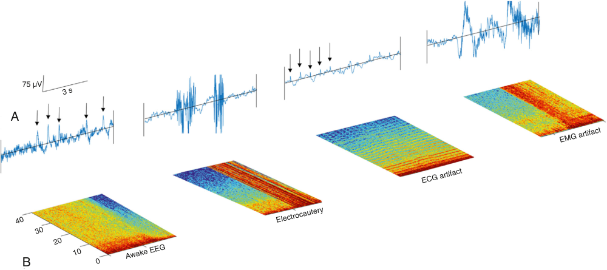

75 µV A B Electrocautery Awake EEG EMG artifact ECG artifact 3 s 40 30 20 10 0 

**Fig. 36.10** Examples of noise artifacts in the electroencephalograph (EEG) prior to and during general anesthesia in the raw EEG (A) and the spectrogram (B). In the leftmost example, _arrows_ in the raw EEG indicate eye- blink artifact. They are seen in the corresponding spectrogram as _vertical thin red lines._ The middle- left example shows the high frequency and amplitude artifact arising from electrocautery seen as bursts of high amplitude in the raw EEG and the block of cross- frequency _red regions_ in the spectrogram. The middle- right raw EEG shows the regular sharp peaks of power originating from the electrocardiogram (ECG) that can lead to horizontal stripes of power in the spectrogram. The rightmost example shows the onset of electromyographic (EMG) activity during the emergence period following cessation of surgery. This is seen as high-amplitude fuzzy activity in the raw EEG and as the _vertical red bands_ in the spectrogram.

can often be reduced by firmly cleaning the skin with an alcohol wipe or by adjusting electrode placement.

While a patient is still awake, eye blinks cause large shifts in EEG amplitude strongest at frontal locations (Fig. 36.10). Sustained blinking and eye or head movements cause large amplitude swings at frontal locations, which can be mistaken for strong delta power. Likewise, during surgery, electrical activity from electrocautery can sometimes reach the scalp areas, causing high- amplitude and high- frequency activity that will show up as strongly increased power over all frequencies in a spectrogram (see Fig. 36.10). In some patients—particularly those with thick, short necks—electrical artifact originating from electrocardiographic (ECG) activity can be detected in the EEG; this pattern is characterized by sharp spikes in the raw EEG aligned to the frequency of the heart rate (see Fig. 36.10), and is especially noticeable during periods of burst suppression. In the spectrogram, this artifact often shows itself as horizontal “stripes” of power that all drift to higher and lower frequencies with increasing or decreasing heart rate; these “stripes” of power result from an inability of the Fourier transform to model regular sharp events, which results in spurious power at multiples of the base frequency. Fig. 36.10 shows examples of such artifacts in the raw EEG and spectrogram.

### CLINICAL APPLICATION OF EEG MONITORING

### EEG- Based Indices

In the 1970s and 1980s several indices were designed to capture the anesthesia- induced EEG shift to low frequencies as a pseudo- continuous unidimensional scale. An early example was the spectral edge frequency, which tracks anesthesia quite well, but is sensitive to eye movement artifacts when the patient is awake. Middle latency auditory evoked potentials were also shown to diminish

with increasing anesthetic depth, and predict movement responses during inhalational anesthesia; however, simpler EEG- based methods have gained ascendency. The advent of the BIS in the early 1990s made routine EEG monitoring possible in the operating room. This index—and more importantly, the hardware that implements it—was a big advance in operating room monitoring, because it was relatively robust to noise and showed reasonable correlation with commonly used GABA- ergic anesthetic drugs. It could also reliably detect burst suppression and detect and reject artifacts. A large number of company- associated and independent trials have been done to correlate the BIS values with various clinical signs of anesthesia (lack of movement, unconsciousness, and amnesia104 ) and with different drugs and surgical situations105–107 . The results show mixed correlations with the BIS (as described in the rest of this section). Since the turn of the millennium, a number of competitors have entered the market.108,109 These indices have played an important historical role in introducing anesthesia providers to the EEG. However, it is our contention that there is much more useful clinical information about the state of the brain contained in the EEG signal than can be captured by a single number. EEG indices are analogous to obtaining just the heart rate (and no other information) from the ECG signal. With this caveat in mind, it is useful to consider some of the philosophy behind, and results obtained from, the use of EEG indices.

**Derivation and Design of EEG Indices.** The ideal index would measure some aspect of brain function that is an important part of the mechanisms by which consciousness is maintained. Ideally the output from such indices would simply be “the probability of the patient being conscious.” Because of our fragmentary existing knowledge of the mechanisms of consciousness, this is not possible at present.

<!-- PDF page 15 -->

**Table 36.2** Study Designs to Assess Performance of Electroencephalograph (EEG) Indices

|**Subjects**|**Observations**|**Anesthetic Regimens**|**Context of Observations**|**End Points** **(Unranked)**|
|---|---|---|---|---|
|Healthy young volunteers|Predominantly within individual|Single hypnotic agent|Awake vs. deeply anesthetized|Movements to noxious stimulation|
|Mixed volunteer population||Multiple hypnotic agents|Slow induction and emergence from anesthesia|Autonomic responses Response to verbal command (with or without isolated forearm|
|Surgical populations (tight inclusion criteria)|Multiple within and between individual|Simple adjuvants: muscle relaxants, opioids|Experimental noxious stimulation|technique) Awareness with recall|
|Surgical patients at high risk of awareness||Complex adjuvants, e.g., ketamine|Multiple transitions between states||
|Unselected surgical patients|Between individual only|Routine uncontrolled clinical practice|Clinical noxious stimulations, e.g., intubation or incision||

Moving from higher to lower rows leads to increasing population complexity and decreasing predictive performance of an index.

Most indices have been derived by empirical observations of transitions into and out of anesthesia, and specialist opinion, using statistical algorithms to maximize prediction of consciousness vs. unconsciousness. Of note, correlation of EEG indices with future response to surgical incision is poor. The indices typically incorporate several EEG components with different weightings, such as power values from different frequency bands, burst suppression, coherence, and autoregression parameters, but the details usually remain a proprietary secret. The study populations used to generate the data on which the indices are based are typically young and relatively healthy, as such studies usually have relatively tight inclusion and exclusion criteria. The reader should be cognizant that application to wider surgical populations is contingent on assumptions that population averages are relevant to the individual patient.

**Validation of Indices.** There is substantial, conflictriddled literature on the value of EEG indices in anesthesia, so it is germane to step back and consider some of the significant methodological difficulties involved in these studies. The ability of indices to correctly diagnose unintended discrete episodes of intraoperative awareness subtly contrasts with the ability of indices to correlate with a broad spread of increasing anesthetic drug effect- site concentrations, or the corresponding sedative behavioral consequences, across a full range from the normal alert state to anesthetic overdose. The statistical assessment of “performance” requires a classification of individuals as either conscious or unconscious, which clashes with both the concept of graded consciousness and the pseudo- quantitative nature of index values. For an index to be diagnostically useful there must be a large difference between index values of those individuals who are conscious and those who are unconscious. With a “perfect” index there would be no overlap (i.e., complete distinction), whereas a useless index will have an extensive overlap in values.

**Volunteer and Early Clinical Studies.** Volunteer studies typically show consistent EEG changes with increasing concentrations of anesthetic agents. The correlations between EEG indices and behavioral state are usually extremely high in carefully controlled unstimulated volunteer or healthy

patient conditions with slowly changing anesthetic doses; typically with predictive values >0.9,110,111 although there are often notable differences between induction and emergence from anesthesia. This is important because most unplanned awareness is likely to be an unexpected emergence rather than primary failure of anesthesia from the outset. As studies start to more resemble clinical practice (Table 36.2), with heterogeneous populations and the incorporation of anesthetic adjuncts and surgery, weaker correlations between EEG features and consciousness level are observed – usually with predictive values between 0.7 and 0.9.105,112,113 In routine clinical practice there is even more variation in agents, adjuncts, and stimulation, and even weaker correlation between EEG and behavior. The problem being that a BIS of 50 in one patient does not necessarily equate with a BIS of 50 in another, and different individuals will become aware at BIS values varying from 40 to 90.

### The Gold Standard for Anesthetic Failure: Awareness with Recall or Intraoperative Consciousness?

Most clinical trials have studied awareness with recall, using a modified version of the Brice questionnaire114 to screen for awareness events. The original Brice study included a recording of church bells played to the patient intraoperatively; however, this is rarely practical for clinical practice or research. The other questions are shown in Box 36.3. The clinical diagnosis of intraoperative awareness requires further discussion with the patient and corroboration with actual intraoperative events; in some cases, the experiences reported are simply part of the emergence or recovery process. It can be appreciated that classifying cases into

### Box 36.3 Modified Brice Interview Questions

1.  What is the last thing you remembered before going to sleep? 2.  What is the first thing you remembered when you woke up?

3.  Can you remember anything between these two periods?

4.  Did you dream during your operation?

5.  What was the worst thing about your operation?

::: details 原始表格與符號（PDF 第 15 頁）

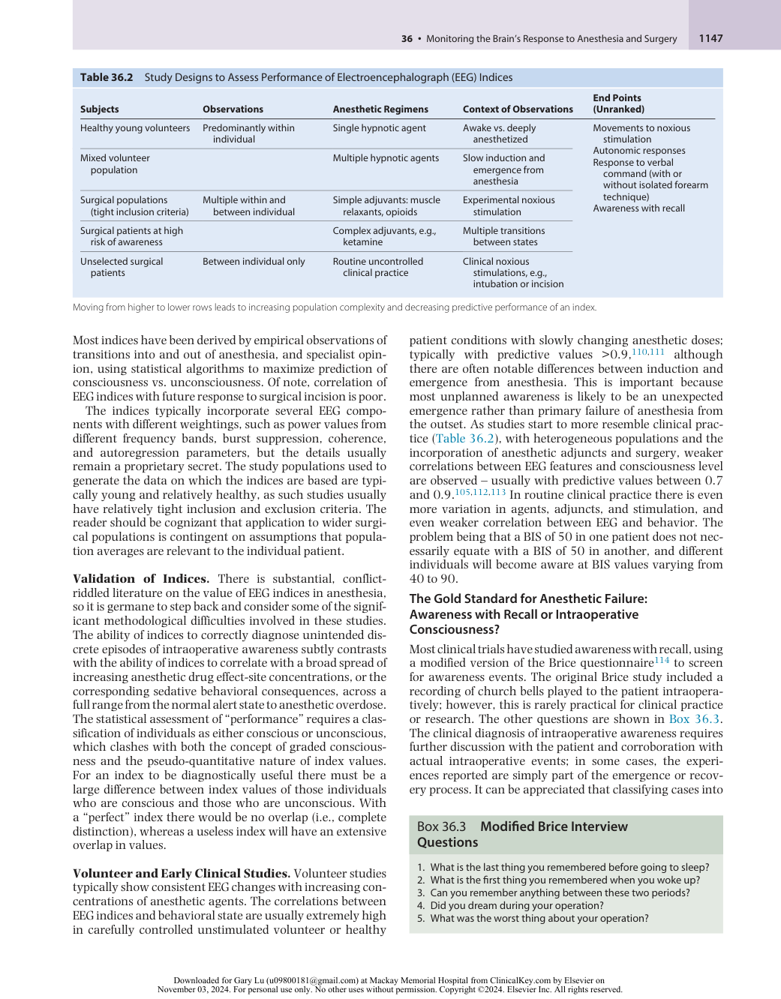

:::

<!-- PDF page 16 -->

a binary outcome of “aware” or “not” can be difficult and subjective, and to overcome this problem adjudication panels have been used in most of the major awareness trials.

Awareness with recall following anesthesia requires both failure of hypnosis and failure of amnesia. However, since most anesthetic agents cause amnesia even at sub- hypnotic doses, it follows that many patients could have conscious experiences during anesthesia, but with no subsequent explicit recall. To probe for intraoperative consciousness in real time, the isolated forearm technique (IFT), described earlier in the chapter, allows the detection of purposeful motor responses to commands which would normally be masked by neuromuscular blockade. Despite rare application in clinical practice, the isolated forearm technique has been argued as gold standard for monitoring conscious state while muscle relaxants are administered during anesthesia.115 The isolated forearm technique overcomes the issue of amnesia, and since the responsive state occurs about two orders of magnitude more frequently than awareness with recall,13,116 it is a more efficient method for testing the performance of purported measures of conscious state.

### “Diagnosing Consciousness” – EEG Index Performance Against IFT Responses

Studies using the IFT have revealed significant deficiencies in the ability of EEG indices to differentiate between the IFT responsive state (connected consciousness) and unresponsiveness, typically showing predictive values around 0.7, and sensitivities and specificities between 40% and 85%.105,117–119 Additionally, it has been observed that even the classic alpha- delta pattern during GABA- ergic anesthesia does not preclude IFT responses,42 suggesting that this is not simply a problem of algorithmic failing or noise that could be overcome by further index refinement.

Another major limitation, detected in an elegant study by Schuller,120 is that the loss of EMG activity caused by administration of neuromuscular blockade is sufficient to drop BIS values significantly in awake subjects (in many cases to within the target range for general anesthesia) – a truly unacceptable “false-negative” scenario. It should be noted, though, that even cursory visual inspection of the raw EEGs or spectrograms in this study immediately demonstrates lack of alpha- delta pattern, and hence correctly diagnoses the covert state of wakefulness.

## Epidemiology of Index- Based Monitoring

### WHAT ARE THE POPULATION BENEFITS AND COSTS?

The clinician is tasked with responding (or not) to index values in individual patients. Predictive values are highly important in such decision- making: “What is the certainty the patient is conscious or unconscious?” Application of monitoring as a widespread population measure requires additional considerations. From an epidemiological perspective, the highly pertinent metric is sensitivity (“What proportion of conscious episodes can we expect to detect and treat?”) and therefore “By how much could we reduce the disease burden?” Confirming patients are unconscious

**Table 36.3** Some False-Positive and False-Negative Example Electroencephalograph (EEG) Monitoring Scenarios

|FALSE NEGATIVE|Awake muscle relaxant administered (e.g., syringe swap) Loss of EMG activity results in index value within target range of general anesthesia and failure to recognize awake paralysis.|
|---|---|
|FALSE NEGATIVE|Connected consciousness (isolated forearm technique response) in presence of seemingly sufficient anesthesia and class alpha- delta pattern with normal index values (no recall)|
|FALSE NEGATIVE|EEG scaling on the monitor incorrect. A good alpha- delta waveform thought to be representing small- amplitude awake, or unreadable noise|
|FALSE POSITIVE|Burst suppression with noisy baseline is misinterpreted as “awake” with high index values. The patient (who is already very deep) is given even more anesthetic|
|FALSE POSITIVE|Low-amplitude waveforms in older patient result in high index values and surplus anesthetic is administered in response|

is reassuring for the clinician, however won’t necessarily change management to prevent outcomes, whereas positive identification of the rare conscious individual will. Specificity is still important to limit the burden of falsepositive cases and maintain reasonable predictive values: “How many unconscious individuals would have the same index value and receive unnecessary additional anesthesia?” Another pragmatic problem with excessive false alarms is that they may cause alarm fatigue and be ignored.

The other obvious and important cost is the false negatives (“How many conscious individuals are missed?”). The clinician will have been falsely reassured that the patient was unconscious when this was not the case. One might argue that these individuals would be missed in the absence of monitoring anyway, but what if reassurance from the monitor resulted in misplaced dismissal of other potential signs of inadequate anesthesia? Some false-positive and false-negative scenarios are shown in Table 36.3.

The financial burden of monitoring is also important: for example, “How many patients must be monitored for each conscious individual identified or prevented?” and, “In how many patients does monitoring not affect outcome?” Another important consideration is the introduction of clinical uncertainty. What if the monitor displays an index value suggestive of greater than baseline risk of consciousness, but which is not convincing enough to warrant a change in practice? This information might be considered worse than no information at all.

### THE PROBLEM OF RARE EVENTS

Because we are interested in unintentional events arising from a highly efficacious technique, the number of conscious individuals during general anesthesia will always be very low compared to unconscious individuals. As far as we are aware, neither the raw EEG, nor index values, have been

::: details 原始表格與符號（PDF 第 16 頁）

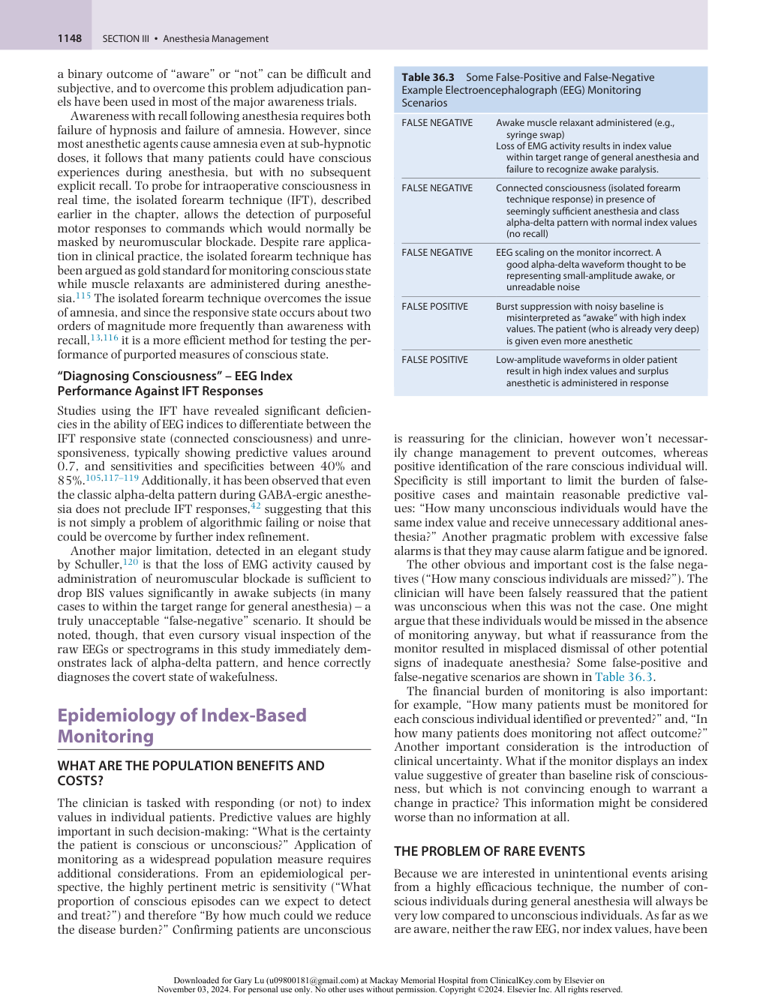

:::

<!-- PDF page 17 -->

convincingly captured during an actual awareness with recall event. From simple Bayesian principles, the low incidence has a particularly limiting effect on positive predictive values and therefore the epidemiological performance of the monitor. The typically quoted rate of awareness with recall is 1:1000, which emerged from cohort studies deliberately screening for awareness,121 and similar incidences typically occur in large randomized studies of AWR.122,123 The diagnostic performance of an “excellent” index (with sensitivity and specificity of 90% for detecting awareness events) would reduce the burden of awareness in the population by 90%; but at the price of 111 false alarms per case detected. The rate of spontaneous reporting of awareness is at least an order of magnitude lower than this.2 The low incidence also means that comparative studies with AWR as the primary outcome need huge numbers of participants. The last large- scale study was terminated for futility,124 and it is likely to prove difficult to justify funding in future for studies of the size needed to compare different monitors or indices.

## Clinical Outcome Research

### AWARENESS WITH RECALL

AWR is one of the most feared complications of anesthesia and was arguably the main driver of the development of EEG monitoring. Despite the methodological difficulties elaborated on in the previous section, a lot of epidemiological research has been done in this area. A recent meta- analysis125 has summarized the clinical status of the

effectiveness of EEG monitors, specifically the BIS monitor, which is by far the most clinically studied of the available EEG monitors. After including 52 studies with 41,331 participants, the authors concluded that there is evidence that the use of brain monitoring more than halves the incidence of AWR when compared with clinical monitoring (odds ratio = 0.36, 95% confidence interval [CI] 0.21 to 0.60; 27 studies; 9765 participants). However, events were rare, with only 5 of 27 studies having reported incidences. When the BIS was used, the incidence of intraoperative awareness was three per 1000 compared to nine per 1000 when anesthesia was guided by clinical signs, but no significant difference when compared with end- tidal anesthetic agent monitoring. The review graded the level of evidence as low certainty due to presumed imprecision of effect estimates because of the infrequency of AWR.

The five major awareness studies are detailed in Table 36.4. The B- Aware Trial122 was a landmark study that suggested that EEG monitoring reduced the incidence of AWR significantly; however, the study has been criticized because the control group was simply “standard care” and the fragility index of the study was low (just one additional event could alter the interpretation of the trial). The B- Unaware123 and BAG- RECALL126 trials both failed to replicate a reduction in AWR with BIS monitoring when compared to end- tidal agent monitoring (maintenance of ≥0.7 MAC) in high- risk populations. Mashour et al.124 published a similar but larger randomized controlled trial (RCT) of 18,836 unselected patients and again found no significant difference between BIS and end- tidal anesthetic agent alarms. However, they reported equipment failure in almost a third of their BIS- monitored patients,

**Table 36.4** Description of the Major Randomized Controlled Trials (RCTs) Assessing the Effect of Bispectral Index (BIS) Monitoring on Awareness With Recall

|**Study**|**Study Population**|**Active Group**|**Comparator Group**|**Findings**|
|---|---|---|---|---|
|B- Aware122 Myles et al. 2004 _n_= 2463|“At risk” adult surgical patients undergoing relaxant general anesthesia No restrictions|BIS monitoring with titration of anesthesia to maintain BIS 40–60|Routine care (clinical signs)|Favor BIS monitoring 2 (0.17%) vs. 11 (0.91%) OR = 0.18; 95% CI 0.02–0.84,_P_= .022|
|B- Unaware123 Avidan et al. 2008 _n_= 1941|High-risk adult surgical patients Inhalational anesthesia|BIS  guidance (target 40–60). Audible alarm of BIS fell outside these limits|Maintenance of ETAG 0.7–1.3 MAC with alarms BIS monitored but clinicians blinded to BIS number|No difference in definite awareness between groups (absolute difference 0%; 95% CI −0.56% to 0.57%)|
|BAG- RECALL126 Avidan et al. 2011 _n_= 5713|High-risk adult surgical patients Inhalational anesthesia|BIS  guidance (target 40–60). Audible alarm of BIS fell outside these limits|Maintenance of ETAG 0.7– 1.3 MAC with alarms. BIS monitored but clinicians blinded to BIS number|No difference 7 (0.245) vs. 2 (0.07%) (+0.17%; 95% CI −0.03 to 0.38)|
|Zhang et al. 2011127 _n_= 5228|Unselected Total intravenous anesthesia|Anesthesia adjusted to BIS 40–60|Clinicians blinded to BIS|Favor BIS monitoring 4 (0.14%) vs 15 (0.65%) OR = 0.21; 95% CI 0.07–0.63|
|Michigan Awareness Control Study124 Mashour et al. 2012 _n_= 18,836|Unselected|Electronic alerts for median BIS (5 min) more than 60|Electronic alerts for median age- adjusted MAC less than 0.5 Blinded to BIS|Study terminated early due to futility No difference 11 (0.12%) ETAC vs. 8 (0.08%) BIS, _P_= .48 _Post hoc_analysis showed 4.7 (95% CI 1.7–13.1) risk in cohort who received no intervention compared with BIS|

_CI_ , confidence interval; _OR_ , odds ratio; _ETAG_ , end- tidal anesthetic gas; _MAC_ , minimum alveolar concentration.

::: details 原始表格與符號（PDF 第 17 頁）

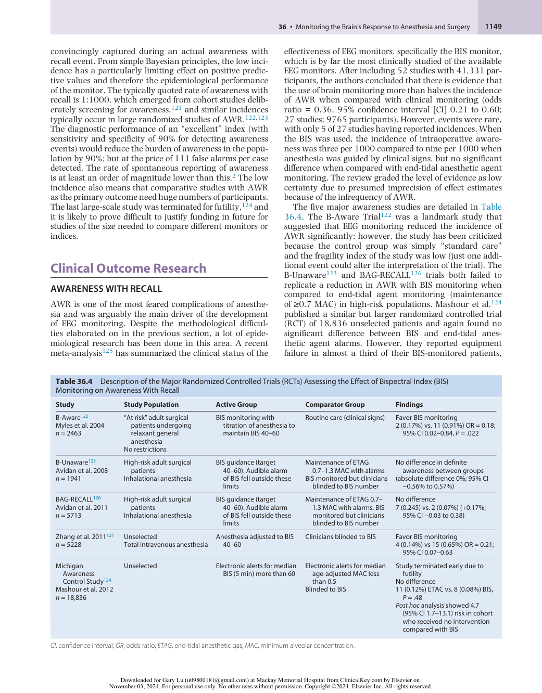

:::

<!-- PDF page 18 -->

and when cases with equipment failure were excluded in a _post hoc_ analysis, there was a significantly lower rate of awareness in the BIS cohort compared with those receiving no intervention. The only large trial specifically examining propofol- maintained intravenous anesthesia did demonstrate a marked reduction in awareness from 0.65% to 0.14% with BIS guidance.127 There was also evidence for improved early postoperative recovery (time to eye opening and discharge from the postanesthesia care unit) in the BISguided group.

Keep in mind that EEG monitoring could “work” by mechanisms other than the detection of conscious episodes, and this may explain some of the seemingly conflicting findings of the large RCTs and IFT studies. EEG monitoring could prevent awareness by providing reliable information about the delivery of and dose of anesthetic agents. This is generally superfluous in the case of inhalational anesthesia, as robust end- tidal measurement of the agents is incorporated into modern day machines; however, it is clearly advantageous for intravenous anesthesia, where effect- site concentration estimations may be unreliable and other failures of anesthetic delivery such as tissued lines and disconnections might occur (see Box 36.1).

### IS ‘DEEP’ ANESTHESIA HARMFUL?

While the main driver of routine EEG monitoring was the prevention of inadequate anesthesia, attention has also turned to the potential role of EEG monitoring in preventing excessive anesthesia. EEG guidance certainly can reduce total drug consumption and facilitate faster recovery from general anesthesia, but whether it can prevent more serious adverse outcomes remains uncertain. The question of the role of general anesthesia in postoperative cognition is covered in more detail in Chapter 78, but there is a considerable body of evidence suggesting anesthetic agents cause neuronal apoptosis,128 which could be compounded by surgical stressors. Developing and aging brains are deemed most at risk of cognitive and behavioral sequelae; however, compelling evidence of poor clinical outcomes is lacking. In older populations, deep anesthesia, defined by the burst suppression pattern or low processed EEG index values, has been associated with postoperative delirium and neurocognitive decline. It is unclear whether this is a case of the EEG during anesthesia revealing more sensitive brains, or if relative overdose of anesthesia worsens outcomes.129 Clinical studies on the effects of anesthesia on developing brains have also been inconclusive, but suggest only minor, if any, harmful global neurological effects of anesthesia.

Aside from effects on the central nervous system, general anesthetics have detrimental effects on most bodily systems. The cardiovascular effects of anesthesia include myocardial depression and reduced cardiac output, decreased sympathetic tone and vasodilation, and subsequent hypotension, redistribution of blood flow, and impaired perfusion of important organs. Anesthetic agents also have immune effects and have been implicated in postoperative infection and cancer recurrence.130 Observational data consistently demonstrate an association between deeper anesthesia (defined by EEG parameters) and poorer clinical outcomes, although whether this is due to confounding by factors such as age and comorbidity- induced sensitivity to anesthesia or

is a true causal effect remains to be established.131 The Balanced Anaesthesia study132 failed to demonstrate a difference in mortality between patients randomized to deep or light BIS values.

### OTHER PUTATIVE FRONTAL EEG MEASURES OF ANESTHETIC EFFECT

In recent years there has been an explosion of new ideas about understanding the mechanisms of anesthesia. While these have not become commercialized into routine practice yet, the reader should be aware of their existence and rationales. These include phase amplitude coupling,133 which can differentiate between states of sedation and deep anesthesia134 ; slow- wave activity saturation, which has been linked to functional brain imaging evidence of loss of thalamic and cortical activation to auditory and noxious stimuli61,135 ; and Lempel–Ziv complexity, which measures the diversity of patterns present in the signal.136

### MULTICHANNEL EEG MONITORING OF ANESTHESIA

At present, almost all routine EEG monitoring equipment is based on one or a few frontal channels. This is largely predicated by ease of use and electrode placement. It is also convenient that most anesthetic drugs cause marked anteriorization of alpha EEG activity, thus maximizing the signal in a part of the head with the best electrode impedance. However, there is increasing evidence that the ability for brain regions to communicate and coordinate with each other is a cardinal feature of alterations in consciousness. Information flow between different brain areas underlying multiple EEG channels might be a better marker of state of consciousness than merely gathering information from a single channel. A plethora of different ways to quantify spatial coupling of brain regions have been proposed.137 Many of these coupling indices show strong correlations with changes in responsiveness.36,138,139 But it is as yet unproven whether these methods offer sufficient benefits that would be needed to outweigh the substantial technical difficulties associated with putting on the complex caps and getting good electrode impedance. Multichannel EEG allows us to answer the questions: “Are other, more posterior, regions of the brain more important than frontal regions as mediators of consciousness?”, and “Is it the coordination of activity between a network of far- flung brain regions that is actually the underlying mechanism necessary for consciousness?” This has been referred to as the “connectionist” paradigm.137

In principle the functional connectivity between cortical regions can be quantified by whether the EEG signals between regions have a consistent phase relationship between EEG waves, or correlations of the envelope of the wave activity, or direct estimation of flow of information. This has been termed “effective” connectivity,137 and is estimated using symbolic transfer entropy,138 Granger causality,140 and dynamic causal modelling.141 Without going into the myriad of technical details, these metrics involve communication over a variety of different time scales ranging from milliseconds to minutes. Loss of responsiveness is usually associated with some sort of decreased cortical

<!-- PDF page 19 -->

functional connectivity, which has been interpreted as the anesthesia causing loss of “integration” between different brain modules. This is most marked over slower EEG scales and when connectivity is estimated by brain imaging such as functional magnetic resonance imaging (MRI).142 In particular, there seems to be quite consistent loss of frontoparietal feedback loops and isolation of posterior parietal midline structures like the precuneus (the so- called “posterior hot zone”).143,144 These data have sparked a vigorous—but unresolved—debate about whether the seat of consciousness lies predominantly in the front or back of the cortex.43 The resolution of this question obviously has extremely important clinical consequences if we are relying on frontal electrodes for monitoring unconsciousness under anesthesia, and may explain some of the anomalous observations.42 When examining the EEG at the level of phase relationships between individual waves at higher frequencies (5–15 Hz), a different picture emerges of a profound frontal hypersynchrony after loss of responsiveness during propofol and volatile agent anesthesia.36,145 Somewhat counterintuitively, both hypersynchrony and dis- integration cause impaired information flow between cortical regions. It has been suggested that the changes in alpha connectivity at loss of responsiveness are stronger than in alpha power.74,146–148 It has also been claimed that alpha- connectivity measures also show greater levels of hysteresis than spectral alpha measures.74

The output from multichannel EEG monitoring is a network of electrode activity, whose complexities can be summarized using various graph- theory statistics. General anesthesia usually causes the brain’s complexity in time and space to decrease.58 An awake brain needs to be flexible and agile to represent the streaming multitude of cognitive events and experiences that make up wakefulness. By constraining this diverse repertoire, anesthesia reduces consciousness by rendering most conscious content inaccessible to representation. As with functional connectivity, the details of the optimal metric of complexity are still undefined. The idea of complexity is also linked with the idea of the wakeful brain being in a state of so- called “criticality.”145 A system in a state of criticality is one in which it can easily access and move between a wide repertoire of states – similar to that previously described of the wakeful brain. It is also in a state where events at a small (&lt;mm) scale events can produce changes in activity over large (>cm) scales. Loss of criticality has been shown to occur with loss of responsiveness, but whether these will translate into improvements in clinical monitoring is unknown.

difficult to study; however, use of a suitable EEG index to guide drug delivery reduces the occurrence of awareness by more than half compared to titration of anesthesia on clinical signs alone. The advantage of EEG- guided anesthesia is less apparent if end- tidal anesthetic agent concentrations are monitored. However, EEG monitoring should clearly be employed when the patient’s illness precludes giving the usual doses of hypnotic (MAC >0.7) or when total intravenous anesthesia is being used. EEG can also prevent inadvertent anesthetic overdose, and hence possibly ameliorate postoperative adverse effects.

### Complete references available online at expertconsult.com.

### References

1.  Mashour GA. _Anesthesiology_ . 2013;119(5):1003.

2.  Pandit JJ, et al. _Br J Anaesth_ . 2014;113(4):549.

3.  Ghoneim M. _Anesth Analg_ . 2010;110(3):666.

4.  Seth AK, et al. _Nat Rev Neurosci_ . 2022;0123456789.

5.  Mashour GA, et al. _Front Neural Circ_ . 2017;11.

6.  Sanders RD, et al. _Anesthesiology_ . 2012;116(4):946.

7.  Reshef ER, et al. _Anesthesiology_ . 2019;130(3):462.

8.  Teasdale G, et al. _Lancet_ . 1974;304(7872):81.

9.  Chernik DA, et al. _J Clin Psychopharmacol_ . 1990;10(4):244.

10.  Ramsay MA, et al. _Br Med J_ . 1974;2(5920):656.

11.  Rasheed AM, et al. _Dimens Crit Care Nurs_ . 2019;38(2):90.

12.  Tunstall ME. _Br Med J_ . 1977;1(6072):1321.

13.  Lennertz R, et al. _Br J Anaesth_ . 2022:1.

14.  Sleigh JW. _Anaesthesia_ . 2013;68(7):681.

15.  Hamp T, et al. _Br J Anaesth_ . 2016;116(6):797.

16.  Pichot V, et al. _Can J Anesth_ . 2001;48(9):859.

17.  Belani KG, et al. _Anesthesiology_ . 1993;79(1):23.

18.  Larson MD, et al. _Anesth Analg_ . 1993;76(5):1072.

19.  Larson MD, et al. _Anesthesiology_ . 1996;85(4):748.

20.  Ledowski T. _Br J Anaesth_ . 2019;123(2):e312.

21.  Estévez M, et al. _Int J Disabil Hum Dev_ . 2016;15(1):5.

22.  Daccache G, et al. _Anesth Analg_ . 2017;125(1):15.

23.  Huiku M, et al. _Br J Anaesth_ . 2007;98(4):447.

24.  Ledowski T, et al. _Anaesthesia_ . 2010;65(10):1001.

25.  Buzsáki G, et al. _Nat Rev Neurosci_ . 2012;13(6):407.

26.  Nunez PL, et al. _Electric Fields of the Brain: The Neurophysics of EEG_ . 2nd ed. Oxford University Press; 2009.

27.  Speckmann E- J, et al. _Niedermeyer’s Electroencephalography: Basic Principles, Clinical Applications, and Related Fields_ . 6th ed. Lippincott Williams & Wilkins; 2011:1.

28.  Cohen MX. _Trends Neurosci_ . 2017;40(4):208.

29.  Constantinople CM, et al. _Science_ . 2013;340(6140):1591.

30.  Brown EN, et al. _Annu Rev Neurosci_ . 2011;34(1):601.

31.  Lopes da Silva FH. In: Mulert C, Lemieux L, eds. _EEG – FMRI Physiological Basis, Technique, and Applications_ . Springer; 2010:19.

32.  Leslie K, et al. _Anesthesiology_ . 2009;111(3):547.

33.  Purdon PL, et al. _Anesthesiology_ . 2015;123(4):937.

34.  Bennett C, et al. _Anesth Analg_ . 2009;109(2):539.

35.  John ER, et al. _Conscious Cognit_ . 2001;10(2):165.

## Conclusions

36.  Purdon PL, et al. _Proc Natl Acad Sci U S A_ . 2013;110(12):E1142.

37.  Drake LM, et al. _Am J Gastroenterol_ . 2006;101(9):2003.

38.  Kasuya Y, et al. _Anesth Analg_ . 2009;109(6):1811.

Monitoring anesthetic effects on the brain is accomplished both clinically and with the EEG. The EEG is a window into effects of anesthesia on the cortex, and the spectrogram is the best window into the EEG. The effects of surgical nociception are seen in somatic reflex movement, autonomic activation, and various EEG changes such as beta activation and alpha dropout. Any of these phenomena should trigger some sort of increase in anesthesia or analgesia delivery on the part of the anesthesia provider. The occurrence of intraoperative awareness with recall is rare and

39.  Sleigh JW, et al. _Anesth Analg_ . 2018;127(4):951.

40.  Giattino CM, et al. _Front Syst Neurosci_ . 2017;11:24.

41.  Touchard C, et al. _Front Aging Neurosci_ . 2020;12:1.

42.  Gaskell AL, et al. _Br J Anaesth_ . 2017;119(4):664.

43.  Sanders RD, et al. _Br J Anaesth_ . 2018;3:1.

44.  Colombo MA, et al. _Neuroimage_ . 2019;189:631.

45.  Rampil IJ. _Anesthesiology_ . 1998;89(4):980.

46.  Fritz BA, et al. _Anesth Analg_ . 2016;122(1):234.

47.  Fritz BA, et al. _Br J Anaesth_ . 2018;121(1):241.

48.  Wildes TS, et al. _JAMA_ . 2019;321(5):473.

49.  Ackland GL, et al. _Br J Anaesth_ . 2019;123(2):112.

50.  Pilge S, et al. _Br J Anaesth_ . 2014;112(6):1067.

51.  Smith C, et al. _Anesthesiology_ . 1994;81(4):820.

<!-- PDF page 20 -->

52.  García PS, et al. _Br J Anaesth_ . 2021;126(2):445.

53.  Hagihira S, et al. _Anesthesiology_ . 2004;100(4):818. 54.  Hight DF, et al. _Br J Anaesth_ . 2019;122(5):635. 55.  Kochs E, et al. _Anesthesiology_ . 1994;80(5):1026.

56.  MacKay EC, et al. _Anaesth Intensive Care_ . 2010;38(1):102. 57.  Kaiser HA, et al. _Br J Anaesth_ . 2020;125(3):1. 58.  Mashour GA, et al. _Elife_ . 2021;10:1.

59.  Hudson AE, et al. _Proc Natl Acad Sci U S A_ . 2014;111(25):9283. 60.  Chander D, et al. _PLoS One_ . 2014;9(9):e106291. 61.  Warnaby CE, et al. _Anesthesiology_ . 2017;127(4):645. 62.  Hesse S, et al. _Br J Anaesth_ . 2019;122(5):622. 63.  Blain- Moraes S, et al. _Front Hum Neurosci_ . 2017;11:1. 64.  McKay IDH, et al. _Anesth Analg_ . 2006;102(1):91. 65.  Olofsen E, et al. _Br J Anaesth_ . 2008;101(6):810. 66.  Kennedy R, et al. _Anesth Analg_ . 2013;117(4):786. 67.  Friedman EB, et al. _PLoS One_ . 2010;5(7):e11903.

68.  Kelz MB, et al. _Proc Natl Acad Sci U S A_ . 2008;105(4):1309. 69.  Hu FY, et al. _Anesthesiology_ . 2012;117(5):1006.

70.  Joiner WJ, et al. _PLoS Genet_ . 2013;9(9). :e1003605. 71.  Colin PJ, et al. _Anesthesiology_ . 2018;129:371. 72.  Proekt A, et al. _Br J Anaesth_ . 2021;126(1):265. 73.  Eleveld DJ, et al. _Br J Anaesth_ . 2021;126(1):31.

74.  Kim H, et al. _PLoS Comput Biol_ . 2018;14(8):1. 75.  Steyn- Ross ML, et al. _Prog Biophys Mol Biol_ . 2004;85(2–3):369. 76.  Proekt A, et al. _Br J Anaesth_ . 2018;9:1. 77.  Su C, et al. _Phys Rev Res_ . 2020;2(2):23289. 78.  Kelz MB, et al. _Anesth Analg_ . 2019;128(4):726. 79.  Hight DF, et al. _J Clin Monit Comput_ . 2017;31(4):813. 80.  Steriade M. _Front Biosci_ . 2003;8(4):878. 81.  Voss LJ, et al. _Anesth Analg_ . 2008;107(5):1689. 82.  Veselis RA, et al. _Anesthesiology_ . 1991;74:866. 83.  Sleigh JW, et al. _Br J Anaesth_ . 2004;92(2):159. 84.  Vrijdag XCE, et al. _Anesthesiology_ . 2021;(2):202. 85.  Foster BL, et al. _Clin Neurophysiol_ . 2013;124(2):417. 86.  Pavone KJ, et al. _Clin Neurophysiol_ . 2016;127(1):556. 87.  McGuigan S, et al. _Anesth Analg_ . 2021;133(5):1269. 88.  Li D, et al. _Neuroimage_ . 2019;196:32. 89.  Akeju O, et al. _Clin Neurophysiol_ . 2016;127(6):2414. 90.  Sleigh J, et al. _Br J Anaesth_ . 2019;123(5):592. 91.  Hahm EY, et al. _PAIN Reports_ . 2021;6(2):e936. 92.  Akeju O, et al. _PLoS One_ . 2016;11(10):e0163431. 93.  Scott JC, et al. _Anesthesiology_ . 1991;74(1):34. 94.  Purdon PL, et al. _Br J Anaesth_ . 2015;115(suppl 1):i46. 95.  Kreuzer M, et al. _Anesthesiology_ . 2020;132(5):1003. 96.  Voytek B, et al. _J Neurosci_ . 2015;35(38):13257. 97.  Ni K, et al. _Br J Anaesth_ . 2019;123(3):288. 98.  Kaiser HA, et al. _Br J Anaesth_ . 2020;125(4):456. 99.  Ye E, et al. _JAMA Netw Open_ . 2020;3(9):e2017357. 100.  Hight DF, et al. _Front Syst Neurosci_ . 2017;11:1. 101.  Kratzer S, et al. _Front Syst Neurosci_ . 2020;14:1. 102.  Cornelissen L, et al. _Elife_ . 2015;4:1.

103.  Davidson AJ, et al. _Paediatr Anaesth_ . 2008;18(1):60.

104.  Kissin I. _Anesth Analg_ . 2000;90(5):1114.

105.  Schneider G, et al. _Br J Anaesth_ . 2003;91(3):329.

106.  Hans P, et al. _Br J Anaesth_ . 2005;94(3):336.

107.  Flaishon R, et al. _Anesthesiology_ . 1997;86(3):613.

108.  Kurita T, et al. _Anesthesiology_ . 2001;95(2):364.

109.  Davies FW, et al. _Anaesthesia_ . 1996;51(2):107.

110.  Kearse LA, et al. _Anesthesiology_ . 1998;88(1):25.

111.  Vakkuri A, et al. _Acta Anaesthesiol Scand_ . 2004;48(2):145.

112.  Vanluchene ALG, et al. _Br J Anaesth_ . 2004;93(5):645.

113.  Glass PS, et al. _Anesthesiology_ . 1997;86(4):836.

114.  Brice DD, et al. _Br J Anaesth_ . 1970;42(6):535.

115.  Russell IF. _Anaesthesia_ . 2013;68(7):677.

116.  Sanders RD, et al. _Anesthesiology_ . 2017;126(2):214.

117.  Russell IF. _Br J Anaesth_ . 2006;96(3):346.

118.  Russell IF. _Anaesthesia_ . 2013;68(10):1010.

119.  Schneider G, et al. _J Neurosurg Anesthesiol_ . 2002;14(1):7.

120.  Schuller PJ, et al. _Br J Anaesth_ . 2015;115(suppl 1):i95.

121.  Sandin RH, et al. _Lancet_ . 2000;355(9205):707.

122.  Myles PS, et al. _Lancet_ . 2004;363(9423):1757.

123.  Avidan MS, et al. _N Engl J Med_ . 2008;358(11):1097.

124.  Mashour GA, et al. _Anesthesiology_ . 2012;117(4):717.

125.  Lewis SR, et al. _Cochrane Database Syst Rev_ . 2019;2019(9).

126.  Avidan MS, et al. _N Engl J Med_ . 2011;365(7):591. 127.  Zhang C, et al. _Chin Med J (Engl)_ . 2011;124(22):3664. 128.  Hudson AE, et al. _Br J Anaesth_ . 2011;107(1):30.

129.  Vlisides PE, et al. _Br J Anaesth_ . 2019;122(4):421.

130.  Snyder GL, et al. _Br J Anaesth_ . 2010;105(2):106. 131.  Leslie K, et al. _Can J Anesth_ . 2016;63(2):233.

132.  Short TG, et al. _Lancet_ . 2019;394(10212):1907.

133.  Tort ABL, et al. _J Neurophysiol_ . 2010;104(2):1195.

134.  Mukamel EA, et al. _J Neurosci_ . 2014;34(3):839.

135.  Mhuircheartaigh RN, et al. _Sci Transl Med_ . 2013;5(208):208ra148.

136.  Bai Y, et al. _Biomed Signal Process Control_ . 2015;19:102.

137.  Hudetz AG, et al. _Anesth Analg_ . 2016;123(5):1228.

138.  Lee U, et al. _Anesthesiology_ . 2013;118(6):1264.

139.  Scheinin A, et al. _Anesthesiology_ . 2018;129(1):22.

140.  Barrett AB, et al. _PLoS One_ . 2012;7(1).

141.  Sanders RD, et al. _Br J Anaesth_ . 2018;121(5):1084.

142.  Hudetz AG. _Brain Connect_ . 2012;2(6):291.

143.  Pal D, et al. _Curr Biol_ . 2018;28(13):2145.

144.  Boly M, et al. _J Neurosci_ . 2017;37(40):9603.

145.  Pullon RM, et al. _Anesthesiology_ . 2022;136(3):420.

146.  Kallionpää RE, et al. _Br J Anaesth_ . 2020;125(4):518.

147.  Chennu S, et al. _PLoS Comput Biol_ . 2016;12(1):1.

148.  Banks MI, et al. _Neuroimage_ . 2020;211. :116627.

149.  Sanchez- Vives MV, et al. _Neuron_ . 2017;94(5):993.

150.  Amzica F, et al. _Electroencephalogr Clin Neurophysiol_ . 1998;107(2):69.

151.  Murphy M, et al. _Sleep_ . 2011;34(3):283.

152.  John ER, et al. _Anesthesiology_ . 2005;102(2):447.

153.  Ching S, et al. _Proc Natl Acad Sci U S A_ . 2010;107(52):22665. 154.  McCarthy MM, et al. _J Neurosci_ . 2008;28(50):13488.

<!-- PDF page 21 -->

### References

1.  Mashour GA. Consciousness and the 21st century operating room. _Anesthesiology_ . 2013;119(5):1003–1005.

2.  Pandit JJ, Andrade J, Bogod DG, et al. 5th National Audit Project (NAP5) on accidental awareness during general anaesthesia: summary of main findings and risk factors. _Br J Anaesth_ . 2014;113(4):549–559.

3.  Ghoneim M. The trauma of awareness: history, clinical features, risk factors, and cost. _Anesth Analg_ . 2010;110(3):666–667.

4.  Seth AK, Bayne T. Theories of consciousness. _Nat Rev Neurosci_ . 2022;0123456789.

5.  Mashour GA, Hudetz AG. Bottom- up and top- down mechanisms of general anesthetics modulate different dimensions of consciousness. _Front Neural Circ_ . 2017;11.

6.  Sanders RD, Tononi G, Laureys S, Sleigh JW. Unresponsiveness ≠ unconsciousness. _Anesthesiology_ . 2012;116(4):946–959.

7.  Reshef ER, Schiff ND, Brown EN. A neurologic examination for anesthesiologists. _Anesthesiology_ . 2019;130(3):462–471.

8.  Teasdale G, Jennett B. Assessment of coma and impaired consciousness: a practical scale. _Lancet_ . 1974;304(7872):81–84.

9.  Chernik DA, Gillings D, Laine H, et al. Validity and reliability of the observer’s assessment of alertness/sedation scale: study with intravenous midazolam. _J Clin Psychopharmacol_ . 1990;10(4):244–251.

10.  Ramsay MA, Savege TM, Simpson BR, Goodwin R. Controlled sedation with alphaxalone- alphadolone. _Br Med J_ . 1974;2(5920):656– 659. http://www.pubmedcentral.nih.gov/articlerender.fcgi?artid= 1613102&tool=pmcentrez&rendertype=abstract.

11.  Rasheed AM, Amirah MF, Abdallah M. Ramsay sedation scale and Richmond agitation sedation scale: a cross- sectional study. _Dimens Crit Care Nurs_ . 2019;38(2):90–95.

12.  Tunstall ME. Detecting wakefulness during general anaesthesia for caesarean section. _Br Med J_ . 1977;1(6072):1321.

13.  Lennertz R, Pryor KO, Raz A, et al. Connected consciousness after tracheal intubation in young adults: an international multicentre cohort study. _Br J Anaesth_ . 2022:1–8.

14.  Sleigh JW. The place of the isolated forearm technique in modern anaesthesia: yet to be defined. _Anaesthesia_ . 2013;68(7):681–683.

15.  Hamp T, Mairweck M, Schiefer J, et al. Feasibility of a “reversed” isolated forearm technique by regional antagonization of rocuroniuminduced neuromuscular block: a pilot study. _Br J Anaesth_ . 2016;116(6):797–803.

16.  Pichot V, Buffière S, Gaspoz JM, et al. Wavelet transform of heart rate variability to assess autonomic nervous system activity does not predict arousal from general anesthesia. _Can J Anesth_ . 2001;48(9):859– 863.

17.  Belani KG, Sessler DI, Larson MD, et al. The pupillary light reflex: effects of anesthetics and hyperthermia. _Anesthesiology_ . 1993;79(1):23–27.

18.  Larson MD, Sessler DI, Washington DE, et al. Pupillary response to noxious stimulation during isoflurane and propofol anesthesia. _Anesth Analg_ . 1993;76(5):1072–1078.

19.  Larson MD, Tayefeh F, Sessler DI, et al. Sympathetic nervous system does not mediate reflex pupillary dilation during desflurane anesthesia. _Anesthesiology_ . 1996;85(4):748–754.

20.  Ledowski T. Objective monitoring of nociception: a review of current commercial solutions. _Br J Anaesth_ . 2019;123(2):e312–e321.

21.  Estévez M, Machado C, Leisman G, et al. Spectral analysis of heart rate variability. _Int J Disabil Hum Dev_ . 2016;15(1):5–17.

22.  Daccache G, Jeanne M, Fletcher D. The analgesia nociception index: tailoring opioid administration. _Anesth Analg_ . 2017;125(1):15–17.

23.  Huiku M, Uutela K, van Gils M, et al. Assessment of surgical stress during general anaesthesia. _Br J Anaesth_ . 2007;98(4):447–455.

24.  Ledowski T, Pascoe E, Ang B, et al. Monitoring of intra- operative nociception: skin conductance and surgical stress index versus stress hormone plasma levels. _Anaesthesia_ . 2010;65(10):1001–1006.

25.  Buzsáki G, Anastassiou CA, Koch C. The origin of extracellular fields and currents- EEG, ECoG, LFP and spikes. _Nat Rev Neurosci_ . 2012;13(6):407–420.

26.  Nunez PL, Srinivasan R. _Electric Fields of the Brain: The Neurophysics of EEG_ . 2nd ed. Oxford: Oxford University Press; 2009.

27.  Speckmann E- J, Elger CE, Gorji A. Neurophysiologic basis of EEG and DC potentials. In: _Niedermeyer’s Electroencephalography: Basic Principles, Clinical Applications, and Related Fields_ . 6th ed. Lippincott Williams & Wilkins; 2011:1–16.

28.  Cohen MX. Where does EEG come from and what does it mean? _Trends Neurosci_ . 2017;40(4):208–218.

29.  Constantinople CM, Bruno RM. Deep cortical layers are activated directly by thalamus. _Science_ . 2013;340(6140):1591–1595.

30.  Brown EN, Purdon PL, Van Dort CJ. General anesthesia and altered states of arousal: a systems neuroscience analysis. _Annu Rev Neurosci_ . 2011;34(1):601–628.

31.  Lopes da Silva FH. EEG: origin and measurement. In: Mulert C, Lemieux L, eds. _EEG – FMRI Physiological Basis, Technique, and Applications_ . Springer; 2010:19–39.

32.  Leslie K, Sleigh JW, Paech MJ, et al. Dreaming and electroencephalographic changes during anesthesia maintained with propofol or desflurane. _Anesthesiology_ . 2009;111(3):547–555.

33.  Purdon PL, Sampson AL, Pavone KJ, Brown EN. Clinical electroencephalography for anesthesiologists – part i – background and basic signatures. _Anesthesiology_ . 2015;123(4):937–960.

34.  Bennett C, Voss LJ, Barnard JPM, Sleigh JW. Practical use of the raw electroencephalogram waveform during general anesthesia: the art and science. _Anesth Analg_ . 2009;109(2):539–550.

35.  John ER, Prichep LS, Kox W, et al. Invariant reversible QEEG effects of anesthetics. _Conscious Cognit_ . 2001;10(2):165–183.

36.  Purdon PL, Pierce ET, Mukamel EA, et al. Electroencephalogram signatures of loss and recovery of consciousness from propofol. _Proc Natl Acad Sci U S A_ . 2013;110(12):E1142–E1151.

37.  Drake LM, Chen SC, Rex DK. Efficacy of bispectral monitoring as an adjunct to nurse- administered propofol sedation for colonoscopy: a randomized controlled trial. _Am J Gastroenterol_ . 2006;101(9):2003–2007.

38.  Kasuya Y, Govinda R, Rauch S, et al. The correlation between bispectral index and observational sedation scale in volunteers sedated with dexmedetomidine and propofol. _Anesth Analg_ . 2009;109(6):1811– 1815.

39.  Sleigh JW, Vacas S, Flexman AM, Talke PO. Electroencephalographic arousal patterns under dexmedetomidine sedation. _Anesth Analg_ . 2018;127(4):951–959.

40.  Giattino CM, Gardner JE, Sbahi FM, et al. Intraoperative frontal alpha- band power correlates with preoperative neurocognitive function in older adults. _Front Syst Neurosci_ . 2017;11:24.

41.  Touchard C, Cartailler J, Levé C, et al. Propofol requirement and EEG alpha band power during general anesthesia provide complementary views on preoperative cognitive decline. _Front Aging Neurosci_ . 2020;12:1–9.

42.  Gaskell AL, Hight DF, Winders J, et al. Frontal alpha- delta EEG does not preclude volitional response during anaesthesia: prospective cohort study of the isolated forearm technique. _Br J Anaesth_ . 2017;119(4):664–673.

43.  Sanders RD, Mostert N, Lindroth H, et al. Is consciousness frontal? Two perioperative case reports that challenge that concept. _Br J Anaesth_ . 2018;3:1–3.

44.  Colombo MA, Napolitani M, Boly M, et al. The spectral exponent of the resting EEG indexes the presence of consciousness during unresponsiveness induced by propofol, xenon, and ketamine. _Neuroimage_ . 2019;189:631–644.

45.  Rampil IJ. A primer for EEG signal processing in anesthesia. _Anesthesiology_ . 1998;89(4):980–1002.

46.  Fritz BA, Kalarickal PL, Maybrier HR, et al. Intraoperative electroencephalogram suppression predicts postoperative delirium. _Anesth Analg_ . 2016;122(1):234–242.

47.  Fritz BA, Maybrier HR, Avidan MS. Intraoperative electroencephalogram suppression at lower volatile anaesthetic concentrations predicts postoperative delirium occurring in the intensive care unit. _Br J Anaesth_ . 2018;121(1):241–248.

48.  Wildes TS, Mickle AM, Ben Abdallah A, et al. Effect of electroencephalography- guided anesthetic administration on postoperative delirium among older adults undergoing major surgery. _JAMA_ . 2019;321(5):473.

49.  Ackland GL, Pryor KO. Electroencephalography- guided anaesthetic administration does not impact postoperative delirium among older adults undergoing major surgery: an independent discussion of the ENGAGES trial. _Br J Anaesth_ . 2019;123(2):112–117.

50.  Pilge S, Jordan D, Kreuzer M, et al. Burst suppression- MAC and burst suppression-CP50 as measures of cerebral effects of anaesthetics. _Br J Anaesth_ . 2014;112(6):1067–1074.

51.  Smith C, McEwan A, Jhaveri R, et al. The interaction of fentanyl on the Cp50 of propofol for loss of consciousness and skin incision. _Anesthesiology_ . 1994;81(4):820–828.

<!-- PDF page 22 -->

52.  García PS, Kreuzer M, Hight D, Sleigh JW. Effects of noxious stimulation on the electroencephalogram during general anaesthesia: a narrative review and approach to analgesic titration. _Br J Anaesth_ . 2021;126(2):445–457.

53.  Hagihira S, Takashina M, Mori T, et al. Electroencephalographic bicoherence is sensitive to noxious stimuli during isoflurane or sevoflurane anesthesia. _Anesthesiology_ . 2004;100(4):818–825.

54.  Hight DF, Gaskell AL, Kreuzer M, et al. Transient electroencephalographic alpha power loss during maintenance of general anaesthesia. _Br J Anaesth_ . 2019;122(5):635–642.

55.  Kochs E, Bischoff P, Pichlmeier U, Am Esch JS. Surgical stimulation induces changes in brain electrical activity during isoflurane/ nitrous oxide anesthesia: a topographic electroencephalographic analysis. _Anesthesiology_ . 1994;80(5):1026–1034.

56.  MacKay EC, Sleigh JW, Voss LJ, Barnard JP. Episodic waveforms in the electroencephalogram during general anaesthesia: a study of patterns of response to noxious stimuli. _Anaesth Intensive Care_ . 2010;38(1):102–112.

57.  Kaiser HA, Peus M, Luedi MM, et al. Frontal electroencephalogram

- reveals emergence- like brain activity occurring during transition periods in cardiac surgery. _Br J Anaesth_ . 2020;125(3):1–7.

- 58.  Mashour GA, Palanca BJA, Basner M, et al. Recovery of consciousness and cognition after general anesthesia in humans. _Elife_ . 2021;10:1–21.

59.  Hudson AE, Calderon DP, Pfaff DW, Proekt A. Recovery of consciousness is mediated by a network of discrete metastable activity states. _Proc Natl Acad Sci U S A_ . 2014;111(25):9283–9288.

60.  Chander D, García PS, MacColl JN, et al. Electroencephalographic variation during end maintenance and emergence from surgical anesthesia. _PLoS One_ . 2014;9(9):e106291.

61.  Warnaby CE, Sleigh JW, Hight DF, et al. Investigation of slow- wave activity saturation during surgical anesthesia reveals a signature of neural inertia in humans. _Anesthesiology_ . 2017;127(4):645–657.

62.  Hesse S, Kreuzer M, Hight D, et al. Association of electroencephalogram trajectories during emergence from anaesthesia with delirium in the postanaesthesia care unit: an early sign of postoperative complications. _Br J Anaesth_ . 2019;122(5):622–634.

63.  Blain- Moraes S, Tarnal V, Vanini G, et al. Network efficiency and posterior alpha patterns are markers of recovery from general anesthesia: a high- density electroencephalography study in healthy volunteers. _Front Hum Neurosci_ . 2017;11:1–8.

64.  McKay IDH, Voss LJ, Sleigh JWJW, et al. Pharmacokineticpharmacodynamic modeling the hypnotic effect of sevoflurane using the spectral entropy of the electroencephalogram. _Anesth Analg_ . 2006;102(1):91–97.

65.  Olofsen E, Sleigh JW, Dahan A. Permutation entropy of the electroencephalogram: a measure of anaesthetic drug effect. _Br J Anaesth_ . 2008;101(6):810–821.

66.  Kennedy R, McKellow M, French R, Sleigh JW. Sevoflurane endtidal to effect- site equilibration in women determined by response to laryngeal mask airway insertion. _Anesth Analg_ . 2013;117(4):786– 791.

67.  Friedman EB, Sun Y, Moore JT, et al. A conserved behavioral state barrier impedes transitions between anesthetic- induced unconsciousness and wakefulness: evidence for neural inertia. In: van Swinderen B, ed. _PLoS One_ . 2010;5(7):e11903.

68.  Kelz MB, Sun Y, Chen J, et al. An essential role for orexins in emergence from general anesthesia. _Proc Natl Acad Sci U S A_ . 2008;105(4):1309–1314.

69.  Hu FY, Hanna GM, Han W, et al. Hypnotic hypersensitivity to volatile anesthetics and dexmedetomidine in dopamine β- hydroxylase knockout mice. _Anesthesiology_ . 2012;117(5):1006–1017.

70.  Joiner WJ, Friedman EB, Hung HT, et al. Genetic and anatomical basis of the barrier separating wakefulness and anesthetic- induced unresponsiveness. _PLoS Genet_ . 2013;9(9):e1003605.

71.  Colin PJ, Kuizenga MH, Vereecke HEM, Struys MMRF. Pharmacokinetic pharmacodynamic perspective on the detection of signs of neural inertia in humans. _Anesthesiology_ . 2018;129:371–387.

72.  Proekt A, Kelz MB. Explaining anaesthetic hysteresis with effect- site equilibration. _Br J Anaesth_ . 2021;126(1):265–278.

73.  Eleveld DJ, Colin PJ, Absalom AR, Struys MMRF. Resisting neural inertia: an exercise in floccinaucinihilipilification? _Br J Anaesth_ . 2021;126(1):31–34.

74.  Kim H, Moon JY, Mashour GA, Lee UC. Mechanisms of hysteresis in human brain networks during transitions of consciousness and

unconsciousness: theoretical principles and empirical evidence. _PLoS Comput Biol_ . 2018;14(8):1–22.

75.  Steyn- Ross ML, Steyn- Ross DA, Sleigh JW. Modelling general anaesthesia as a first- order phase transition in the cortex. _Prog Biophys Mol Biol_ . 2004;85(2–3):369–385.

76.  Proekt A, Hudson AE. A stochastic basis for neural inertia in emergence from general anaesthesia. _Br J Anaesth_ . 2018;9:1–9.

77.  Su C, Zheng L, Li Y, et al. Hysteresis in anesthesia and recovery: experimental observation and dynamical mechanism. _Phys Rev Res_ . 2020;2(2):23289.

78.  Kelz MB, García PS, Mashour GA, Solt K. Escape from oblivion: neural mechanisms of emergence from general anesthesia. _Anesth Analg_ . 2019;128(4):726–736.

79.  Hight DF, Voss LJ, García PS, Sleigh JW. Electromyographic activation reveals cortical and sub- cortical dissociation during emergence from general anesthesia. _J Clin Monit Comput_ . 2017;31(4):813–823.

80.  Steriade M. The corticothalamic system in sleep. _Front Biosci_ . 2003;8(4):878–899.

81.  Voss LJ, Sleigh JW, Barnard JPM, Kirsch HE. The howling cortex: seizures and general anesthetic drugs. _Anesth Analg_ . 2008;107(5):1689–1703.

82.  Veselis RA, Reinsel RA, Alagesan R, et al. The EEG as a monitor of midazolam amnesia: changes in power and topography as a function of amnesic state. _Anesthesiology_ . 1991;74:866–874.

83.  Sleigh JW, Barnard JPM. Entropy is blind to nitrous oxide. Can we see why? _Br J Anaesth_ . 2004;92(2):159–161.

84.  Vrijdag XCE, Van Waart H, Mitchell SJ, Sleigh JW. An electroencephalogram metric of temporal complexity tracks psychometric impairment caused by low- dose nitrous oxide. _Anesthesiology_ . 2021;(2):202–218.

85.  Foster BL, Liley DTJ. Effects of nitrous oxide sedation on resting electroencephalogram topography. _Clin Neurophysiol_ . 2013;124(2):417–423.

86.  Pavone KJ, Akeju O, Sampson AL, et al. Nitrous oxide- induced slow and delta oscillations. _Clin Neurophysiol_ . 2016;127(1):556–564.

87.  McGuigan S, Evered L, Silbert B, et al. Comparison of the spectral features of the frontal electroencephalogram in patients receiving xenon and sevoflurane general anesthesia. _Anesth Analg_ . 2021;133(5):1269–1279.

88.  Li D, Mashour GA. Cortical dynamics during psychedelic and anesthetized states induced by ketamine. _Neuroimage_ . 2019;196:32–40.

89.  Akeju O, Song AH, Hamilos AE, et al. Electroencephalogram signatures of ketamine anesthesia- induced unconsciousness. _Clin Neurophysiol_ . 2016;127(6):2414–2422.

90.  Sleigh J, Pullon RM, Vlisides PE, Warnaby CE. Electroencephalographic slow wave dynamics and loss of behavioural responsiveness induced by ketamine in human volunteers. _Br J Anaesth_ . 2019;123(5):592–600.

91.  Hahm EY, Chamadia S, Locascio JJ, et al. Dissociative and analgesic properties of ketamine are independent and unaltered by sevoflurane general anesthesia. _PAIN Reports_ . 2021;6(2):e936.

92.  Akeju O, Kim SE, Vazquez R, et al. Spatiotemporal dynamics of dexmedetomidine- induced electroencephalogram oscillations. _PLoS One_ . 2016;11(10). :e0163431.

93.  Scott JC, Cooke JE, Stanski DR. Electroencephalographic quantitation of opioid effect: comparative pharmacodynamics of fentanyl and sufentanil. _Anesthesiology_ . 1991;74(1):34–42.

94.  Purdon PL, Pavone KJ, Akeju O, et al. The Ageing Brain: Agedependent changes in the electroencephalogram during propofol and sevoflurane general anaesthesia. _Br J Anaesth_ . 2015;115(suppl 1): i46–i57.

95.  Kreuzer M, Stern MA, Hight D, et al. Spectral and entropic features are altered by age in the electroencephalogram in patients under sevoflurane anesthesia. _Anesthesiology_ . 2020;132(5):1003–1016.

96.  Voytek B, Kramer MA, Case J, et al. Age- related changes in 1/f neural electrophysiological noise. _J Neurosci_ . 2015;35(38):13257–13265.

97.  Ni K, Cooter M, Gupta DK, et al. Paradox of age: older patients receive higher age- adjusted minimum alveolar concentration fractions of volatile anaesthetics yet display higher bispectral index values. _Br J Anaesth_ . 2019;123(3):288–297.

98.  Kaiser HA, Hirschi T, Sleigh C, et al. Comorbidity- dependent changes in alpha and broadband electroencephalogram power during general anaesthesia for cardiac surgery. _Br J Anaesth_ . 2020;125(4):456–465.

99.  Ye E, Sun H, Leone MJ, et al. Association of sleep electroencephalography- based brain age index with dementia. _JAMA Netw Open_ . 2020;3(9):e2017357.

<!-- PDF page 23 -->

100.  Hight DF, Voss LJ, García PS, Sleigh JW. Changes in alpha frequency and power of the electroencephalogram during volatile- based general anesthesia. _Front Syst Neurosci_ . 2017;11:1–10.

101.  Kratzer S, Schneider M, Obert DP, et al. Age- related EEG features of bursting activity during anesthetic- induced burst suppression. _Front Syst Neurosci_ . 2020;14:1–9.

102.  Cornelissen L, Kim SE, Purdon PL, et al. Age- dependent electroencephalogram (EEG) patterns during sevoflurane general anesthesia in infants. _Elife_ . 2015;4:1–25.

103.  Davidson AJ, Sale SM, Wong C, et al. The electroencephalograph during anesthesia and emergence in infants and children. _Paediatr Anaesth_ . 2008;18(1):60–70.

104.  Kissin I. Depth of anesthesia and bispectral index monitoring. _Anesth Analg_ . 2000;90(5):1114–1117.

105.  Schneider G, Gelb AW, Schmeller B, et al. Detection of awareness in surgical patients with EEG- based indices – bispectral index and patient state index. _Br J Anaesth_ . 2003;91(3):329–335.

106.  Hans P, Dewandre PY, Brichant JF, Bonhomme V. Comparative effects of ketamine on Bispectral Index and spectral entropy of the electroencephalogram under sevoflurane anaesthesia. _Br J Anaesth_ . 2005;94(3):336–340.

107.  Flaishon R, Windsor A, Sigl J, Sebel PS. Recovery of consciousness after thiopental or propofol. _Anesthesiology_ . 1997;86(3):613–619.

108.  Kurita T, Doi M, Katoh T, et al. Auditory evoked potential index predicts the depth of sedation and movement in response to skin incision during sevoflurane anesthesia. _Anesthesiology_ . 2001;95(2):364–370.

109.  Davies FW, Mantzaridis H, Kenny GN, Fisher AC. Middle latency auditory evoked potentials during repeated transitions from consciousness to unconsciousness. _Anaesthesia_ . 1996;51(2):107–113.

110.  Kearse LA, Rosow C, Zaslavsky A, et al. Bispectral analysis of the electroencephalogram predicts conscious processing of information during propofol sedation and hypnosis. _Anesthesiology_ . 1998;88(1):25–34.

111.  Vakkuri A, Yli- Hankala A, Talja P, et al. Time- frequency balanced spectral entropy as a measure of anesthetic drug effect in central nervous system during sevoflurane, propofol, and thiopental anesthesia. _Acta Anaesthesiol Scand_ . 2004;48(2):145–153.

112.  Vanluchene ALG, Struys MMRF, Heyse BEK, Mortier EP. Spectral entropy measurement of patient responsiveness during propofol and remifentanil. A comparison with the bispectral index. _Br J Anaesth_ . 2004;93(5):645–654.

113.  Glass PS, Bloom M, Kearse L, et al. Bispectral analysis measures sedation and memory effects of propofol, midazolam, isoflurane, and alfentanil in healthy volunteers. _Anesthesiology_ . 1997;86(4):836– 847.

114.  Brice DD, Hetherington RR, Utting JE. A simple study of awareness and dreaming during anaesthesia. _Br J Anaesth_ . 1970;42(6):535– 542.

115.  Russell IF. Fourteen fallacies about the isolated forearm technique, and its place in modern anaesthesia. _Anaesthesia_ . 2013;68(7):677– 681.

116.  Sanders RD, Gaskell A, Raz A, et al. Incidence of connected consciousness after tracheal intubation. _Anesthesiology_ . 2017;126(2):214– 222.

117.  Russell IF. The Narcotrend “depth of anaesthesia” monitor cannot reliably detect consciousness during general anaesthesia: an investigation using the isolated forearm technique. _Br J Anaesth_ . 2006;96(3):346–352.

118.  Russell IF. The ability of bispectral index to detect intra- operative wakefulness during isoflurane/air anaesthesia, compared with the isolated forearm technique. _Anaesthesia_ . 2013;68(10):1010–1020.

119.  Schneider G, Wagner K, Reeker W, et al. Bispectral index (BIS) may not predict awareness reaction to intubation in surgical patients. _J Neurosurg Anesthesiol_ . 2002;14(1):7–11.

120.  Schuller PJ, Newell S, Strickland PA, Barry JJ. Response of bispectral index to neuromuscular block in awake volunteers. _Br J Anaesth_ . 2015;115(suppl 1):i95–i103.

121.  Sandin RH, Enlund G, Samuelsson P, Lennmarken C. Awareness during anaesthesia: a prospective case study. _Lancet_ . 2000;355(9205):707–711.

122.  Myles PS, Leslie K, McNeil J, et al. Bispectral index monitoring to prevent awareness during anaesthesia: the B- Aware randomised controlled trial. _Lancet_ . 2004;363(9423):1757–1763.

123.  Avidan MS, Zhang L, Burnside BA, et al. Anesthesia awareness and the bispectral index. _N Engl J Med_ . 2008;358(11):1097–1108.

124.  Mashour GA, Shanks A, Tremper KK, et al. Prevention of intraoperative awareness with explicit recall in an unselected surgical population: a randomized comparative effectiveness trial. _Anesthesiology_ . 2012;117(4):717–725.

125.  Lewis SR, Pritchard MW, Fawcett LJ, Punjasawadwong Y. Bispectral index for improving intraoperative awareness and early postoperative recovery in adults. _Cochrane Database Syst Rev_ . 2019;2019(9).

126.  Avidan MS, Jacobsohn E, Glick D, et al. Prevention of intraoperative awareness in a high- risk surgical population. _N Engl J Med_ . 2011;365(7):591–600.

127.  Zhang C, Xu L, Ma YQ, et al. Bispectral index monitoring prevent awareness during total intravenous anesthesia: a prospective, randomized, double- blinded, multi- center controlled trial. _Chin Med J (Engl)._ 2011;124(22):3664–3669.

128.  Hudson AE, Hemmings HC. Are anaesthetics toxic to the brain? _Br J Anaesth_ . 2011;107(1):30–37.

129.  Vlisides PE, Ioannidis JPA, Avidan MS. Hypnotic depth and postoperative death: a Bayesian perspective and an Independent Discussion of a clinical trial. _Br J Anaesth_ . 2019;122(4):421–427.

130.  Snyder GL, Greenberg S. Effect of anaesthetic technique and other perioperative factors on cancer recurrence. _Br J Anaesth_ . 2010;105(2):106–115.

131.  Leslie K, Short TG. Anesthetic depth and long- term survival: an update. _Can J Anesth_ . 2016;63(2):233–240.

132.  Short TG, Campbell D, Frampton C, et al. Anaesthetic depth and complications after major surgery: an international, randomised controlled trial. _Lancet_ . 2019;394(10212):1907–1914.

133.  Tort ABL, Komorowski R, Eichenbaum H, Kopell N. Measuring phase- amplitude coupling between neuronal oscillations of different frequencies. _J Neurophysiol_ . 2010;104(2):1195–1210.

134.  Mukamel EA, Pirondini E, Babadi B, et al. A transition in brain state during propofol- induced unconsciousness. _J Neurosci_ . 2014;34(3):839–845.

135.  Mhuircheartaigh RN, Warnaby C, Rogers R, et al. Slow- wave activity saturation and thalamocortical isolation during propofol anesthesia in humans. _Sci Transl Med_ . 2013;5(208):208ra148–208ra148.

136.  Bai Y, Liang Z, Li X. A permutation Lempel- Ziv complexity measure for EEG analysis. _Biomed Signal Process Control_ . 2015;19:102–114.

137.  Hudetz AG, Mashour GA. Disconnecting consciousness: is there a common anesthetic end point? _Anesth Analg_ . 2016;123(5):1228– 1240.

138.  Lee U, Ku S, Noh G, et al. Disruption of frontal-parietal communication by ketamine, propofol, and sevoflurane. _Anesthesiology_ . 2013;118(6):1264–1275.

139.  Scheinin A, Kallionpää RE, Li D, et al. Differentiating drug- related and state- related effects of dexmedetomidine and propofol on the electroencephalogram. _Anesthesiology_ . 2018;129(1):22–36.

140.  Barrett AB, Murphy M, Bruno MA, et al. Granger causality analysis of steady- state electroencephalographic signals during propofolinduced anaesthesia. _PLoS One_ . 2012;7(1).

141.  Sanders RD, Banks MI, Darracq M, et al. Propofol- induced unresponsiveness is associated with impaired feedforward connectivity in cortical hierarchy. _Br J Anaesth_ . 2018;121(5):1084–1096.

142.  Hudetz AG. General anesthesia and human brain connectivity. _Brain Connect_ . 2012;2(6):291–302.

143.  Pal D, Dean JG, Liu T, et al. Differential role of prefrontal and parietal cortices in controlling level of consciousness. _Curr Biol_ . 2018;28(13):2145–2152.e5.

144.  Boly M, Massimini M, Tsuchiya N, et al. Are the neural correlates of consciousness in the front or in the back of the cerebral cortex? Clinical and neuroimaging evidence. _J Neurosci_ . 2017;37(40):9603– 9613.

145.  Pullon RM, Warnaby CE, Sleigh JW. Propofol- induced unresponsiveness is associated with a brain network phase transition. _Anesthesiology_ . 2022;136(3):420–433.

146.  Kallionpää RE, Valli K, Scheinin A, et al. Alpha band frontal connectivity is a state- specific electroencephalographic correlate of unresponsiveness during exposure to dexmedetomidine and propofol. _Br J Anaesth_ . 2020;125(4):518–528.

147.  Chennu S, O’Connor S, Adapa R, et al. Brain connectivity dissociates responsiveness from drug exposure during propofol- induced transitions of consciousness. _PLoS Comput Biol_ . 2016;12(1):1–17.

148.  Banks MI, Krause BM, Endemann CM, et al. Cortical functional connectivity indexes arousal state during sleep and anesthesia. _Neuroimage_ . 2020;211:116627.

<!-- PDF page 24 -->

149.  Sanchez- Vives MV, Massimini M, Mattia M. Shaping the default activity pattern of the cortical network. _Neuron_ . 2017;94(5):993– 1001.

150.  Amzica F, Steriade M. Electrophysiological correlates of sleep delta waves. _Electroencephalogr Clin Neurophysiol_ . 1998;107(2):69–83.

151.  Murphy M, Bruno MA, Riedner BA, et al. Propofol anesthesia and sleep: a high- density EEG study. _Sleep_ . 2011;34(3):283–291.

   153.  Ching S, Cimenser A, Purdon PL, et al. Thalamocortical model for a propofol- induced α- rhythm associated with loss of consciousness. _Proc Natl Acad Sci U S A_ . 2010;107(52):22665–22670.

   154.  McCarthy MM, Brown EN, Kopell N. Potential network mechanisms mediating electroencephalographic beta rhythm changes during propofol- induced paradoxical excitation. _J Neurosci_ . 2008;28(50):13488–13504.

152.  John ER, Prichep LS. The anesthetic cascade: a theory of how anesthesia suppresses consciousness. _Anesthesiology_ . 2005;102(2):447– 471.
