# Respiratory Monitoring

<!-- PDF page 1 -->

DAVID W. KACZKA, HOVIG V. CHITILIAN, and MARCOS F. VIDAL MELO

|**KEY POINTS** ᑏIntraoperative respiratory monitoring is a fundamental component of the American Society of Anesthesiologists’ standards for basic anesthetic monitoring. Monitoring of oxygenation and ventilation is essential for the safe conduct of an anesthetic. ᑏA thorough understanding of the physiologic and technologic principles underlying respiratory monitoring is essential for its appropriate clinical application. ᑏThe majority of respiratory monitors in clinical use provide information at the systemic and whole- lung level from which inferences are made regarding the regional lung and tissue- level conditions. ᑏThe degree of invasiveness of utilized monitors should be determined by clinical requirements. ᑏPulse oximetry is a noninvasive, reliable, and simple method for continuously monitoring the fractional arterial oxygen saturation. ᑏVentilation–perfusion mismatch, shunt, and hypoventilation are the most common causes of hypoxemia in the perioperative period. Monitoring of gas exchange, and its response to various interventions, may differentiate etiologies of hypoxemia. ᑏMixed venous oxygen saturation (Sv–O2) allows for monitoring of the global balance between oxygen delivery and oxygen consumption. Its measurement provides information on gas exchange, cardiac output, and global oxygen consumption. ᑏSystems utilizing near- infrared spectroscopy are used clinically to monitor regional tissue oxygenation, particularly in the brain. The value of regional tissue oxygenation monitoring for clinical management is currently being established. ᑏCapnography is the primary quantitative method to assess ventilation in the perioperative period. Besides providing physiologic information on ventilation, pulmonary blood flow, and aerobic metabolism, capnography is important for verifying the endotracheal tube positioning, and determining the integrity of the breathing circuit. ᑏEnd- tidal carbon dioxide (CO2) is not always a reliable approximation of arterial CO2tension, especially in the presence of significant heterogeneity in the distribution of ventilation and perfusion. ᑏMeasurement of the pressures, flows, and volumes associated with ventilation is necessary to optimize mechanical ventilation, as well as to detect pathophysiologic mechanical derangements of the respiratory system (i.e., increased airway resistance or reduced lung compliance). ᑏImaging techniques have emerged as important tools for respiratory monitoring. Lung ultrasonography is increasingly utilized in emergency and perioperative settings, allowing for prompt bedside assessments of pulmonary abnormalities such as pneumothorax, lung edema, consolidation, and pleural effusions. Electrical impedance tomography is another noninvasive imaging technique that provides information on lung aeration and recruitment. ᑏCurrent approaches to respiratory monitoring primarily assess pulmonary mechanical and global gas exchange processes. The monitoring of tissue and subcellular respiration remains a desirable goal for future innovation.|
|---|

## Overview of Respiratory Monitoring

Respiratory monitoring is essential to the administration of every anesthetic. Its major relevance for maintenance of homeostasis and patient safety is acknowledged by its mandatory position in national and international standards for anesthesia monitoring.1,2 Through the decades, advances in respiratory monitoring have resulted in substantial

reduction in anesthesia morbidity and mortality and opened a new era of safe anesthesia practice.3

Respiration is the transport of oxygen (O2) from the environment to the body cells and the transport of carbon dioxide (CO2) from those cells to the environment. The concept includes a component of cellular respiration, the process by which cells obtain energy in the form of adenosine triphosphate from the controlled reaction of hydrogen with O2 to form water.4 Thus, in its broadest sense, respiratory monitoring refers to the continuous or periodic assessment

::: details 原始表格與符號（PDF 第 1 頁）

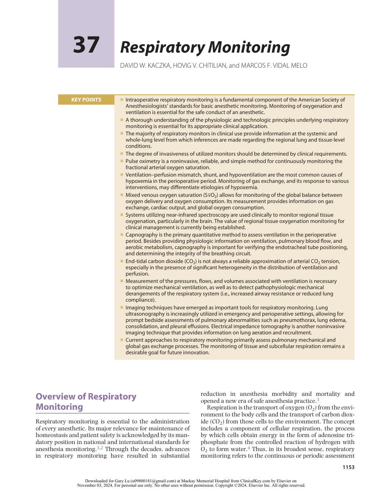

:::

<!-- PDF page 2 -->

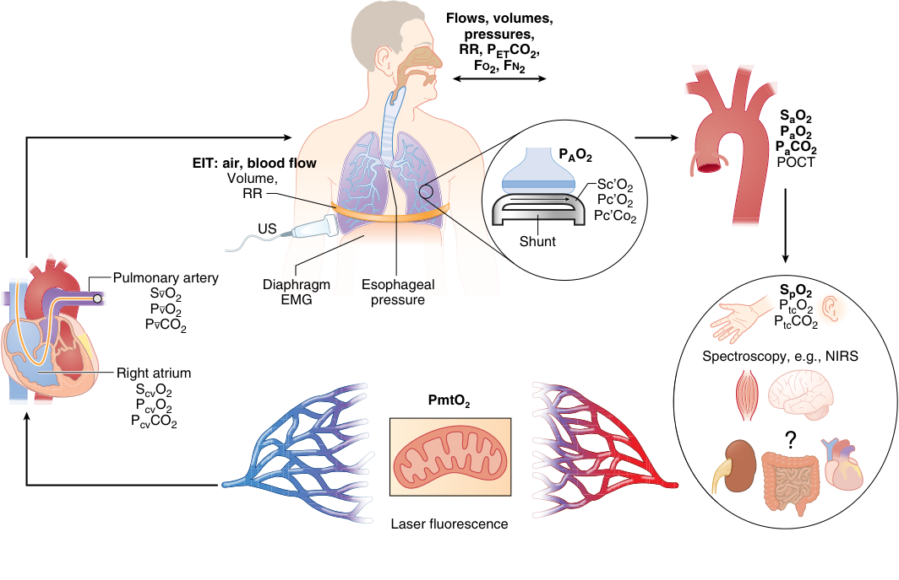

Flows, volumes, pressures, RR, PETCO2, FO2, FN2 SaO2 PaO2 PaCO2 EIT: air, blood flow PAO2 POCT Volume, Sc’O2 RR Pc’O2 Pc’Co2 US Shunt Pulmonary artery PSvvOO 22 DiaphragmEMG Esophagealpressure P S tc pO O 2 2 PvC O2 PtcCO2 Spectroscopy, e.g., NIRS Right atrium ScvO2 PcvO2 PmtO2 PcvCO2 ? Laser fluorescence 

**Fig. 37.1 Respiratory processes and measurement sites for current respiratory monitoring techniques.** Most monitored variables are derived from sites at the entrance of the airway and systemic blood ( **bold** ) and assess the elements of respiration related to global pulmonary mechanics and gas exchange. Pulse oximetry represents a transition between systemic and local tissue oxygenation assessment. Methods for routine and reliable clinical monitoring of respiratory processes at the tissue, cellular, and subcellular levels are limited. _EMG,_ electromyography; _EIT_ , electrical impedance tomography; _FN2,_ nitrogen fraction; _FO2,_ oxygen fraction; _NIRS,_ near- infrared spectroscopy; _PaCO2,_ arterial partial pressure of carbon dioxide; _PaO2,_ arterial partial pressure of oxygen; _PAO2,_ alveolar partial pressure of oxygen; _Pc'CO2,_ end- capillary partial pressure of carbon dioxide; _Pc'O2,_ end- capillary partial pressure of oxygen; _PcvCO2,_ central venous partial pressure of carbon dioxide; _PcvO2,_ central venous partial pressure of oxygen; _PETCO2,_ end- tidal partial pressure of carbon dioxide; _Pv_&#95;–&#95; _CO2,_ mixed venous partial pressure of carbon dioxide; _Pv_&#95;–&#95; _O2,_ mixed venous partial pressure of oxygen; _POCT,_ pointof- care testing; _PtcCO2,_ transcutaneous partial pressure of carbon dioxide; _PtcO2,_ transcutaneous partial pressure of oxygen; _RR,_ respiratory rate; _SaO2,_ arterial oxygen saturation; _Sc'O2,_ end- capillary oxygen saturation; _ScvO2,_ central venous oxygen saturation; _Sv_&#95;–&#95; _O2_ , mixed venous oxygen saturation; _SpO2,_ peripheral oxygen saturation; _US,_ ultrasound.

of processes involved with the exchange of respiratory gases between the environment and the subcellular pathways where those gases are utilized and produced (Fig. 37.1).4 Respiratory monitoring includes assessment of (1) convective and diffusive gas transport through the branching airway tree and alveoli, (2) equilibration of gases between alveoli and pulmonary capillary blood, (3) mass balance of the distinct regional ventilation and perfusion contributions to produce expired gases and arterial and mixed venous blood, (4) gas transport between the blood and body tissues through the microcirculation, (5) gas diffusion between tissues and mitochondria, and (6) cellular respiration with O2 use and CO2 production.

Advances in physiologic measurements have enhanced our understanding of these stages of respiratory function during anesthesia. This chapter provides an overview of current and emerging techniques of respiratory monitoring. Despite these technical advancements, current instrumentation is limited in providing accurate and comprehensive information on respiratory function in anesthetized and critically ill patients. The area is therefore rich for

research to advance the monitoring of all components of respiration.5,6

### AMERICAN SOCIETY OF ANESTHESIOLOGISTS STANDARDS

The word _monitoring_ is often associated with electronic instrumentation, and it is noteworthy that the current American Society of Anesthesiologists (ASA) Standards for Basic Anesthetic Monitoring states in Standard I that “Qualified anesthesia personnel shall be present in the room throughout the conduct of all general anesthetics, regional anesthetics, and monitored anesthesia care” (Box 37.1). This precedes reliance on any instrumentation (as implied in Standard II), and clearly indicates that anesthesiologists bring essential expertise and interpretation to monitoring beyond information provided by equipment. Increased safety in our specialty lies primarily in high- quality training and environments that encourage continuing education, and not exclusively on new technology.7 The ASA Standards for Basic Anesthetic Monitoring reflect monitoring

<!-- PDF page 3 -->

### Box 37.1 American Society of Anesthesiologists Standards for Basic Anesthetic Monitoring Related to Respiratory Monitoring

### Standard I

|Qualified anesthesia personnel shall be present in the room throughout the conduct of all general anesthetics, regional anesthetics, and monitored anesthesia care.|
|---|
|**Standard II** During all anesthetics, the patient**’**s oxygenation, ventilation, circulation, and temperature shall be continually†evaluated.|
|**Oxygenation**|
|Objective: To ensure adequate oxygen concentration in the inspired gas and the blood during all anesthetics. **_Methods_**|
|Inspired gas: During every administration of general anesthesia using an anesthesia machine, the concentration of oxygen in the patient breathing system shall be measured by an oxygen analyzer with a low oxygen concentration limit alarm in use.* Blood oxygenation: During all anesthetics, a quantitative method of assessing oxygenation such as pulse oximetry will be employed.*When the pulse oximeter is utilized, the variable pitch pulse tone and the low threshold alarm will be audible to the anesthesiologist or the anesthesia care team personnel.* Adequate illumination and exposure of the patient are necessary to assess color.* **Ventilation**|
|Objective: To ensure adequate ventilation of the patient during all anesthetics.|

### Methods

Every patient receiving general anesthesia will have the adequacy of ventilation continually evaluated. Qualitative clinical signs such as chest excursion, observation of the reservoir breathing bag, and auscultation of breath sounds are useful. Continual monitoring for the presence of expired carbon dioxide will be performed unless invalidated by the nature of the patient, procedure, or equipment. Quantitative monitoring of the volume of expired gas is strongly encouraged.* When an endotracheal tube or laryngeal mask is inserted, its correct positioning must be verified by clinical assessment and by identification of carbon dioxide in the expired gas. Continual end- tidal carbon dioxide analysis, in use from the time of endotracheal tube/laryngeal mask placement, until extubation/ removal or initiating transfer to a postoperative care location, will be performed using a quantitative method such as capnography, capnometry, or mass spectroscopy.* When capnography or capnometry is utilized, the end-tidal CO2 alarm will be audible to the anesthesiologist or the anesthesia care team personnel.† When ventilation is controlled by a mechanical ventilator, there will be in continuous use a device that is capable of detecting disconnection of components of the breathing system. The device must give an audible signal when its alarm threshold is exceeded. During regional anesthesia (with no sedation) or local anesthesia (with no sedation), the adequacy of ventilation will be evaluated by continual observation of qualitative clinical signs. During moderate or deep sedation, the adequacy of ventilation will be evaluated by continual observation of qualitative clinical signs and monitoring for the presence of exhaled carbon dioxide unless precluded or invalidated by the nature of the patient, procedure, or equipment.

†Note that “continual” is defined as “repeated regularly and frequently in steady rapid succession” whereas “continuous” means “prolonged without any interruption at any time.”

*Under extenuating circumstances, the responsible anesthesiologist may waive the requirements marked with an asterisk (*); it is recommended that when this is done, it should be so stated (including the reasons) in a note in the patient’s medical record.

principles during anesthesia established in the 1980s3 and should be systematically followed. The standards represent a foundation to additional monitoring according to clinical requirements.

## The Physical Examination

Physical examination remains an essential component of perioperative respiratory monitoring. It provides fundamental information on the diagnosis and treatment of many respiratory disorders and may be the first indication of changes in patient status requiring intervention(s). Physical examination has limitations, but it routinely allows for detection of information relevant for management of the patients.

Respiratory monitoring starts with inspection of the patient, either awake or during anesthesia. In elective cases, anesthesiologists will have time to investigate causes for abnormal presentations. In emergent situations, careful inspection may be the only source of information for timely and accurate anesthesia management. The observation of respiratory distress should prompt immediate search for specific causes. Assessment of the respiratory rate provides a measure of the breathing pattern. For example, during sepsis, respiratory rate is

significantly correlated with disease severity.8 Anatomic signs relevant to respiration include (but are not limited to) deformities of the chest wall and spine, goiter, tracheostomy scar, and tracheal deviation. Functional elements to be noticed include the components of inspiration and expiration (diaphragmatic versus thoracic), duration and difficulty of inspiration and expiration, paradoxical chest wall motion, use of accessory muscles, central and peripheral cyanosis, pallor, wheezing, stridor, cough and sputum, aphonia, splinting, and clubbed fingers. Neck vein distention should be examined for a potential cardiovascular contribution to respiratory distress, noting that it is a less reliable indicator of central venous pressure during significant dyspnea. Attention should be paid to painful respiration in trauma patients, as well as the possibility of flail chest, pericardial tamponade, hemothorax, pneumothorax, pulmonary contusion, or tension pneumothorax.

Auscultation of the lung during anesthesia is another essential skill in physical diagnosis. Ambient noise, individual hearing limitations, and the acoustic properties of the stethoscope all influence the anesthesiologist’s clinical judgment. A stethoscope of sufficient quality will allow for identification of distinctive normal and abnormal breath sounds: vesicular sounds, rhonchi, wheezes, fine and coarse crackles, inspiratory stridor, and pleural

::: details 原始表格與符號（PDF 第 3 頁）

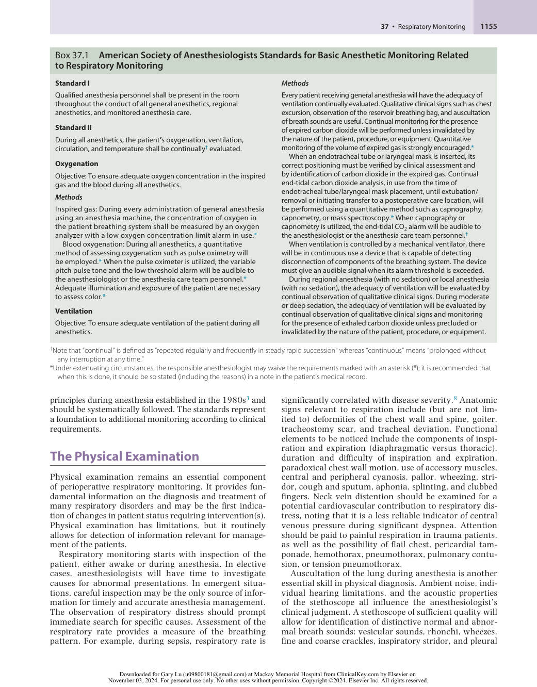

:::

<!-- PDF page 4 -->

friction. A clear understanding of the acoustic mechanisms for each of these sounds is essential for adequate clinical assessment.9,10

## Pulse Oximetry

### PHYSIOLOGIC FUNDAMENTALS

The primary role of the cardiorespiratory system is the transport of O2 and CO2 throughout the body. O2 delivery is quantified as the product of arterial O2 content and cardiac output (see Chapter 12). Arterial O2 content (CaO2, in mL of O2 per 100 mL of blood [hemoglobin—Hb], mL/100 mL) is calculated as

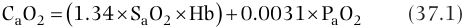

CaO2   1.34  SaO2  Hb   0.0031  P Oa 2 (37.1) 

where 1.34 mL/g is the O2 binding capacity of Hb (i.e., Hüfner constant, theoretically equal to 1.39 mL/g but experimental range between 1.31 and 1.37 mL/g because of the presence of small amounts of other Hb species11 ); SaO2 is the O2 saturation of Hb in the arterial blood (percent saturation/100); Hb is the concentration of Hb in the arterial blood (g/dL); 0.0031 is the solubility of O2 in blood (mL/100 mL/ mm Hg); and PaO2 is the arterial partial pressure of O2 (mm Hg). As can be inferred from Eq. 37.1, SaO2 and Hb are the major determinants of O2 content in the blood and consequently O2 delivery to the tissues.

Five species of Hb are found in adult blood: oxygenated Hb (O2Hb), deoxygenated Hb (deO2Hb); carboxyhemoglobin (COHb); methemoglobin (MetHb); and sulfhemoglobin (SHb). Under normal circumstances, the concentrations of COHb, MetHb, and SHb are small (1%–3% for COHb and less than 1% for MetHb and SHb). _Functional_ O2 saturation (SaO2) refers to the amount of O2Hb as a fraction of the total amount of O2Hb and deO2Hb and is expressed as

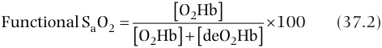

Functional SaO2   O2Hb   100 (37.2)  O2Hb  deO2Hb  

The O2Hb fraction or _fractional_ saturation is defined as the amount of O2Hb as a fraction of the total amount of Hb12 :

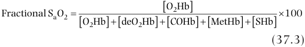

Fractional SaO2   O2Hb  deO2Hb  OCOHb2Hb   MetHb  SHb   100 (37.3) 

SaO2 is a function of the PaO2. The relationship between SaO2 and PaO2 is described by the oxyhemoglobin dissociation curve (Fig. 37.2). As can be appreciated by inspection of the curve, the relationship is not linear. This has important consequences. First, a high SaO2 cannot discriminate between normoxic and hyperoxic conditions; this can be relevant when attempting to limit O2 exposure in neonates or patients at risk for O2 toxicity. Second, a large numeric change in PaO2 at the flat portion of the curve (PaO2 above approximately 70 mm Hg) has relatively small consequences in terms of blood O2 content. Furthermore, changes in temperature, pH, PaCO2, and erythrocyte 2,3- diphosphoglycerate concentration can shift the curve such that the same SaO2 can be present under a range of different oxygen partial pressures (PO2). This may be relevant, given that diffusion from the microcirculation to tissue depends on PO2 gradients.

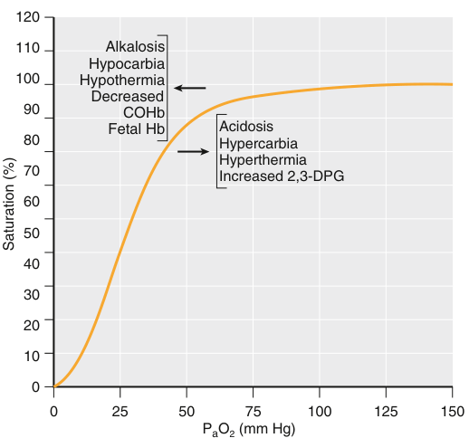

120 110 Alkalosis Hypocarbia 100 Hypothermia Decreased 90 COHb Fetal Hb Acidosis 80 Hypercarbia Hyperthermia 70 Increased 2,3-DPG 60 50 40 30 20 10 0 0 25 50 75 100 125 150 PaO2 (mm Hg) Saturation (%) 

**Fig. 37.2 Oxyhemoglobin dissociation curve.** The relationship between oxyhemoglobin saturation and arterial partial pressure of oxygen (PaO2) is nonlinear and affected by a number of different factors such as pH, PCO2, and temperature. Given the nonlinear nature of the curve, it is difficult to determine the partial pressure of oxygen at the higher range of oxygen saturations. _2,3- DPG,_ 2,3- diphospoglycerate; _COHb_ , carboxyhemoglobin. (Redrawn from Longnecker DE, Brown DL, Newman MF, Zapol WM, eds. _Anesthesiology,_ 2nd ed. New York, NY: McGraw- Hill; 2012.)

### MEASUREMENT PRINCIPLES

### Oximetry

Oximetry is the measurement of the O2 saturation of Hb. It is an application of the Beer–Lambert law (Eq. 37.4), which relates the transmission of light through a solution to the concentration of the solute in the solution.13 For each solute in a solution,

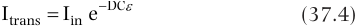

Itrans  Iin e  DC  (37.4) 

where Itrans is the intensity of transmitted light, Iin is the intensity of the incident light, e is the base of the natural logarithm, D is the distance the light is transmitted through the solution, C is the concentration of the solute, and ε is the extinction coefficient of the solute.

The concentration of a single solute in solution can be calculated by measuring the amount of light transmitted through the solution as long as the other variables are known. For a solution containing multiple solutes, the calculation of the concentrations of the different solutes requires that light absorption be measured at a number of different wavelengths at least equal to the number of solutes. In a sample of blood in a cuvette, the absorption of a given wavelength of light passing through the blood will depend on the concentrations of the different species of Hb. Fig. 37.3A illustrates the absorption spectra of the five species of Hb for wavelengths of light along the visible spectrum. To measure the concentrations of all five species of Hb in a sample of blood, light absorption of at least five different wavelengths must be measured. This measurement is typically conducted using a co- oximeter. A co- oximeter uses the principle of oximetry to measure the SaO2 as well

<!-- PDF page 5 -->

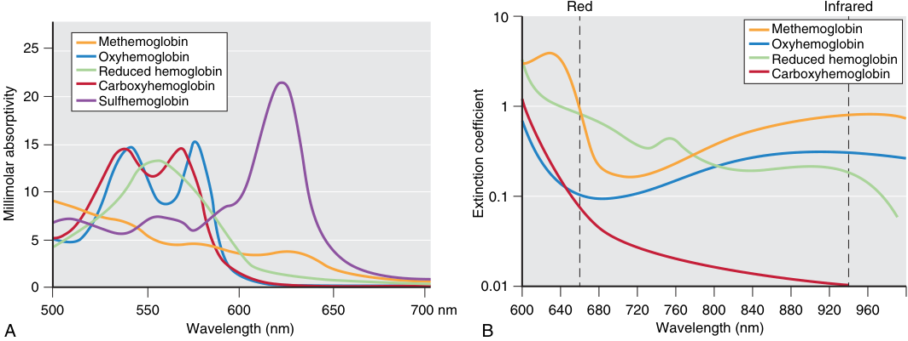

Red Infrared 10 Methemoglobin 25 Methemoglobin Oxyhemoglobin Oxyhemoglobin Reduced hemoglobin Reduced hemoglobin Carboxyhemoglobin Carboxyhemoglobin 20 Sulfhemoglobin 1 15 10 0.1 5 0 0.01 500 550 600 650 700 nm 600 640 680 720 760 800 840 880 920 960 A Wavelength (nm) B Wavelength (nm) Millimolar absorptivity Extinction coefficient 

**Fig. 37.3** (A) Absorption spectra of five species of hemoglobin for wavelengths of light across the visible spectrum. (B) Extinction coefficients of the most frequently measured hemoglobin species extending to infrared wavelengths used for pulse oximetry. The _vertical lines_ indicate specific wavelengths for red and infrared light applied in pulse oximeters. The differences in the extinction coefficients of oxyhemoglobin and reduced hemoglobin (deoxygenated hemoglobin) are pronounced at these wavelengths. Note that the extinction coefficients of carboxyhemoglobin and methemoglobin are similar to those of oxyhemoglobin and reduced hemoglobin, respectively, at 660 nm. (A, Redrawn from Zwart A, van Kampen EJ, Zijlstram WG. Results of routine determination of clinically significant hemoglobin derivatives by multicompartment analysis. _Clin Chem_ . 1986;32:972–978. B, Modified from Tremper KK, Barker SJ. Pulse oximetry. _Anesthesiology_ . 1989;70:98–108.)

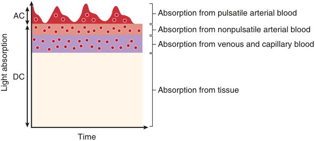

AC Absorption from pulsatile arterial blood Absorption from nonpulsatile arterial blood Absorption from venous and capillary blood DC Absorption from tissue Time Light absorption 

**Fig. 37.4 Schematic of the pulse principle.** Absorption of light passing through tissue is characterized by a pulsatile component (AC) and a nonpulsatile component (DC). The pulsatile component of absorption is due to arterial blood. The nonpulsatile component is due to venous blood and the remainder of the tissues. (Redrawn from Severinghaus JW. Nomenclature of oxygen saturation. _Adv Exp Med Biol_ . 1994;345:921–923.)

as the concentrations of other Hb species in a blood sample. Co- oximetry is considered the gold standard for SaO2 measurements and is relied on in circumstances when pulse oximetry readings are inaccurate or unobtainable.

### Pulse Oximetry

Standard pulse oximetry aims to provide a noninvasive, _in vivo_ , and continuous assessment of functional SaO2. Estimates of SaO2 based on pulse oximetry are denoted as SpO2. The history of the development of pulse oximetry has been reviewed in detail elsewhere.14

Pulse oximetry takes advantage of the pulsatility of arterial blood flow to provide an estimate of SaO2 by differentiating light absorption by arterial blood from light absorption by other components. When compared with _in vitro_ oximetry of an arterial blood sample, the challenge of obtaining arterial O2 saturation _in vivo_ is to ensure that the light is sampling arterial blood and to account for its absorption by other tissues. As illustrated in Fig. 37.4, light absorption by tissue can be divided into a time- varying (pulsatile)

component, historically referred to as “AC” (from “alternating current”), and a steady (nonpulsatile) component, referred to as “DC” (“direct current”). In conventional pulse oximetry, the ratio (R) of AC and DC light absorption at two different wavelengths is calculated. The wavelengths of light are selected to maximize the difference between the ratios of the absorbances of O2Hb and deO2Hb (see Fig. 37.3B). The most commonly used wavelengths of light are 660 nm and 940 nm. At 660 nm, there is greater light absorption by deO2Hb than by O2Hb. At 940 nm, there is greater light absorption by O2Hb than by deO2Hb,

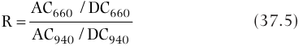

AC660 / DC660 R  (37.5) AC940 / DC940 

where AC660, AC940, DC660, and DC940 denote the corresponding AC and DC components of the 640- nm and 940nm wavelengths.

The ratio R is then empirically related to O2 saturation based on a calibration curve internal to each pulse oximeter (Fig. 37.5).13 Each manufacturer develops its own calibration

<!-- PDF page 6 -->

curve by having volunteers breathe hypoxic gas mixtures to create a range of SaO2 values between 70% and 100%. The Food and Drug Administration (FDA) recommends root mean square differences between measured values (SpO2) and reference values (SaO2) under normal conditions ranging from 70% to 100% SpO2 of ≤3.0% for transmittance, wrap and clip pulse oximeter sensors and of ≤3.5% for ear clip and reflectance sensors.15 Most manufacturing literature reports an accuracy of ± 2% to 3% SpO2 over this range.16 The dependence of SpO2 on pulsatility may result in inaccurate estimates of SaO2 when pulsatility is reduced or absent.

A pulse oximeter probe is composed of a light emitter and a photodetector. Transmission pulse oximetry involves the placement of the emitter and detector on opposite sides of the tissue being measured, usually of a finger. Reflectance pulse oximetry probes have the emitters and detector arranged on the same side. They are typically placed on the forehead. In a typical pulse oximeter, two lightemitting diodes (LEDs) are used to emit light at the two wavelengths. During operation, each LED is turned on and off in sequence. The photodetector measures transmission of light from each LED. When both LEDs are turned off, the photodetector measures ambient light and subtracts it from the signals obtained throughout the remainder of the cycle.17

Pulse oximetry has been an integral component of intraoperative anesthetic management since the first anesthesia monitoring standards were introduced in 1986.3 It was adopted as a minimum monitoring standard by the ASA the same year and has subsequently been defined as a minimum standard for intraoperative monitoring by the World Federation of Societies of Anaesthesiologists and the World Health Organization (WHO).18 The use of pulse oximetry is a part of the WHO safe surgery checklist.19

Multiwavelength pulse oximeters—that is, pulse oximeters with additional wavelengths of light to allow for the continuous noninvasive measurement of total hemoglobin concentration (SpHb)20 —as well as concentrations of

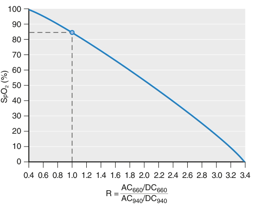

100 90 80 70 60 50 40 30 20 10 0 0.4 0.6 0.8 1.0 1.2 1.4 1.6 1.8 2.0 2.2 2.4 2.6 2.8 3.0 3.2 3.4 R = AC660/DC660 AC940/DC940 SO (%)p2 

**Fig. 37.5 Typical pulse oximeter calibration curve relating oxygen saturation to the R value.** These curves are developed using healthy volunteers and incorporated into the pulse oximeter. _R_ , ratio of AC and DC light absorption; _SpO2_ , peripheral oxygen saturation. (From Tremper KK, Barker SJ. Pulse oximetry. _Anesthesiology_ . 1989;70:90–108.)

MetHb and COHb utilizing up to 12 wavelengths have been developed.21,22 SpHb in the surgical and intensive care unit (ICU) settings has shown reasonable bias and precision when compared with laboratory measurements.23–25 However, few of the measurements were obtained in patients with Hb concentrations within the clinically relevant range of 6 to 10 mg/dL.26 Another limitation of SpHb may be its absent or unreliable signal under conditions of low peripheral perfusion.27 To date, noninvasive COHb measurements have not shown enough precision to replace laboratory measurements.27,28 Accuracy has improved at low oxygen levels, but detecting COHb for SaO2 less than 87% is still unreliable.29,30 Pulse oximetry–based MetHb measurements with a newer device are accurate, even under conditions of hypoxia.31

Universal pulse oximetry has been recommended by the US Secretary of Health and Human Services to screen newborns for critical congenital heart disease.32,33 Use of a clinical algorithm based on detection of SpO2 lower than 95% in either right upper or lower limbs, or more than a 2% difference, led to a sensitivity of 75% in suspected cases and 58% in cases that were not suspected. When this modality is combined with a routine anomaly scan and newborn physical examination screening, 92% of critical congenital heart disease lesions can be identified.34,35 The COVID- 19 pandemic emphasized the applicability of pulse oximetry as an important tool for remote patient monitoring.36 This emerging area could gain major relevance for pre- and postoperative patient assessment.

**Photoplethysmography.** Along with measuring O2 saturation, the pulse oximeter can also be used as a photoplethysmograph. Because the absorption of light is proportional to the amount of blood between the transmitter and photodetector, changes in the blood volume are reflected in the pulse oximeter trace (Fig. 37.6).37 During anesthesia, the plethysmographic trace is affected by changes in blood volume pulsations, which depend on the distensibility of the vessel wall, as well as on the intravascular pulse pressure.37 Variations in the amplitude of the pulse oximetry plethysmographic waveform (ΔPOP) have been shown to predict fluid responsiveness in mechanically ventilated patients.38 An index derived from the percent difference between the maximum and minimum amplitudes of the plethysmographic waveform during a respiratory cycle (PVI, Pleth Variability Index) has been incorporated into a commercially available pulse oximeter and used to quantify ΔPOP and predict fluid responsiveness.39,40 A number of studies have shown it to be a reasonably reliable

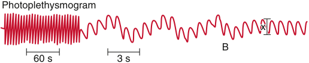

Photoplethysmogram x B 60 s 3 s 

**Fig. 37.6 Photoplethysmograph recorded at two speeds demonstrating respiratory variation.** At time point B, ventilation has been stopped, and no variation is observed. The plot illustrates the effect of intrathoracic blood volume in the pulse oximeter trace. The variation in the trace with respiration is associated with the fluid responsiveness of the patient. (Redrawn from Dorlas JC, Nijboer JA. Photo- electric plethysmography as a monitoring device in anaesthesia. Application and interpretation. _Br J Anaesth_ . 1985;57:524–530.)

<!-- PDF page 7 -->

indicator of fluid responsiveness perioperatively and in critically ill patients.41,42 The technique does have greater reliability in mechanically ventilated patients compared with spontaneously breathing patients, but its accuracy may be compromised by the presence of cardiac arrhythmias.41 Its accuracy has also been shown to be better for 500 mL fluid challenges compared with 250 mL.43 Goal- directed fluid management based on PVI has been shown to improve outcomes in major abdominal surgery.44

### LIMITATIONS AND SOURCES OF ERROR

SpO2 is an estimate of SaO2 of circulating hemoglobin. As a consequence, it does not provide information about _tissue_ oxygenation. Because SpO2 is a measurement of functional and not fractional SaO2, the presence of other Hb variants can significantly affect its accuracy. The nonlinearity of the Hb dissociation curve prevents the detection of hyperoxia with SpO2 for high SaO2, whereas for low saturations such as at altitude, small changes in PaO2 can produce large changes in SpO2. There is significant variability in the actual _in vivo_ Hb dissociation curve.45 Thus changes in SpO2 are not necessarily well correlated with changes in SaO2.46,47 These measurements illustrate that knowledge of the individual Hb dissociation curve is important for correct interpretation of SaO2 and PaO2. More importantly, pulse oximetry does not provide information about ventilation or acid–base status. A number of conditions can lead to inaccuracies in pulse oximeter readings (Table 37.1). These conditions include decreased perfusion, motion artifact, venous pulsation, low SaO2, variant Hb species, the presence of intravascular dyes, and the presence of nail polish. Despite the recommendations of numerous boards and guidelines, there is no evidence that the use of pulse oximetry improves patient outcomes, not during transfers to ICUs nor in terms of improving patient mortality.48,49 There is evidence that pulse oximetry reduces the incidence of hypoxemia,48 and the duration and cost of ICU stay, suggesting it allows for early intervention.50 The calibration of pulse oximeters is based on curves obtained in normal individuals under experimental conditions with SaO2 as low as 70%. As such, pulse oximeters have limited accuracy for SaO2 values less than 70%. Moreover, systematic errors in SpO2 tend to increase as SaO2 falls below 90%.51 At SaO2 levels under 70%, a positive or negative bias of the SpO2 value can be observed, depending on the manufacturer of the pulse oximeter.52 Manufacturers have developed pulse oximeters with increased accuracy at saturations as low as 60%. Preliminary data suggest that these probes may be useful in neonates with cyanotic congenital heart disease.53

Hypoperfusion leads to a reduction in the amplitude of the pulsatile component of the light absorbance waveform, the essential signal for pulse oximetry, consequently giving rise to absent or inaccurate readings. Significantly erroneous reductions in SpO2 may be observed for systolic blood pressures lower than 80 mm Hg.54 Motion artifact can produce considerable error in the pulse oximeter reading. Manufacturers have developed advanced proprietary signal processing algorithms that effectively filter out noise caused by motion.55,56

With continued clinical use, the performance of the LEDs in the probe may be degraded, leading to inaccuracy in the SpO2 value outside of the range specified by the manufacturer. These inaccuracies are expected to be more pronounced at lower saturations (i.e., less than 90%).16

Venous pulsations may result in the detection of venous O2Hb saturation by the pulse oximeter, resulting in artifactual reduction of the presumed arterial SpO2 being measured. Venous pulsations can be due to excessively tight placement of adhesive finger probes, severe tricuspid regurgitation, probe placement in dependent positions (e.g., forehead during Trendelenburg position), and possibly in distributive shock when vasodilation may result in physiologic arteriovenous shunting.19,20,57

The presence of additional species of Hb can also generate erroneous pulse oximeter readings. As outlined earlier, the function of the pulse oximeter is predicated on the assumption that the only components present in the blood capable

**Table 37.1** Potential Sources of Artifacts in Pulse Oximetry and Their Effects on Measurements

|**Source of Error**|**Effect on SpO2 Relative to SaO2**|
|---|---|
|Hypotension|↓|
|Anemia|↓|
|Polycythemia|No significant effect|
|Motion|↓|
|Low SaO2|Variable|
|Methemoglobinemia|↓/↑(SpO2approaches 85%)|
|Carboxyhemoglobinemia|↑|
|Cyanmethemoglobin|No significant effect|
|Sulfhemoglobin|No significant effect|
|Hemoglobin F|No significant effect|
|Hemoglobin H|No significant effect|
|Hemoglobin K|↓|
|Hemoglobin S|No significant effect|
|Methylene blue|↓|
|Indigo carmine|↓|
|Indocyanine green|↓|
|Isosulfan blue|No significant effect/↓|
|Fluorescein|No significant effect|
|Nail polish|Black, dark blue, purple↓|
|Acrylic fingernails|No significant effect|
|Henna|Red – No significant effect ↓|
|Skin pigmentation|At SaO2>80%, no significant effect At SaO2&lt;80%,↑|
|Jaundice|No significant effect|
|Ambient light|No significant effect|
|Sensor contact|↓|
|IABP|↑|

_IABP_ , intra- aortic balloon pump; _SaO2_ , arterial oxygen saturation; _SpO2_ , peripheral oxygen saturation.

::: details 原始表格與符號（PDF 第 7 頁）

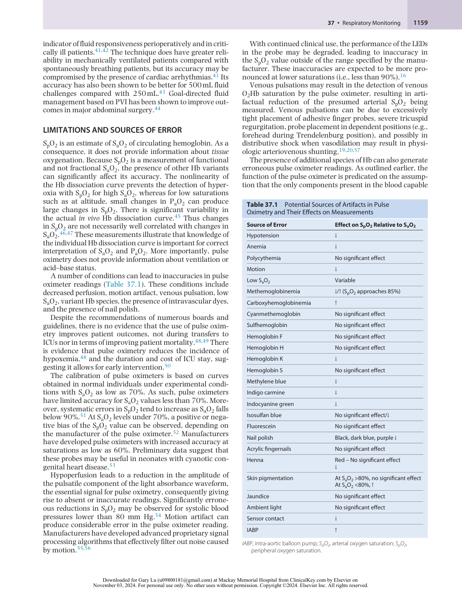

:::

<!-- PDF page 8 -->

of absorbing light at the two wavelengths used are O2Hb and deO2Hb. Under normal circumstances, this assumption is valid, and the SpO2 readings accurately reflect the SaO2. However, the presence of significant concentrations of other Hb species or substances absorbing light at the used wavelengths will lead to erroneous SpO2 readings. As illustrated in Fig. 37.3, both COHb and MetHb absorb light at one or both of the wavelengths used by the pulse oximeter. Accordingly, the presence of these Hb species will produce errors in SpO2. The absorption of light at 660 nm by COHb is similar to that of O2Hb. At 940 nm, COHb absorbs virtually no light. Thus, in a patient with carbon monoxide poisoning, the SpO2 will be falsely elevated.58 MetHb absorbs a significant amount of light at both 660 nm and 940 nm. As a result, in its presence, the ratio of light absorption R (Eq. 37.5) approaches unity. An R- value of 1 represents the presence of equal concentrations of O2Hb and deO2Hb and corresponds to an SpO2 of 85%. Thus, in a patient with methemoglobinemia, the SpO2 will be 80% to 85%, irrespective of the SaO2.59 SHb absorbs red light (660 nm) more than deoxyhemoglobin (HHb) or MetHb, and likely as much near the infrared spectrum.57 This results in SpO2 values close to 85% in severe cases of sulfhemoglobinemia. Although newer generations of co- oximeters can detect SHb, most existing co- oximeters cannot; consequently, additional clinical laboratory testing may be required if sulfhemoglobinemia is suspected.57

With normal SaO2, anemia has little effect on SpO2.60 However, in the presence of hypoxia, SpO2 readings underestimate SaO2 in anemic patients with true hypoxemia.61 Pulse oximeters are sufficiently accurate in adult patients with sickle cell disease,62 as well as in the presence of fetal Hb.63 However, caution is warranted when using pulse oximetry in patients with sickle cell disease, because heme metabolism may result in elevated COHb.57 Some studies also suggest that SpO2 may overestimate SaO2 during vaso- occlusive crises.64,65 Another relevant point is that in patients with sickle cell disease, the affinity of O2 for Hb is normal under normoxic conditions but becomes low during hypoxia.

A relatively uncommon cause for reduced SpO2 readings is the presence of congenital variants of Hb. Some variants, such as Hb Bassett, Hb Rothschild, and Hb Canabiere, have a reduced affinity for O2, and changes in SpO2 appropriately reflect changes in SaO2.66 Other variants, such as Hb Lansing, Hb Bonn, Hb Koln, Hb Cheverly, and Hb Hammersmith, have altered absorption spectra (closer to HHb) that result in low SpO2 readings in the setting of normal SaO2.66

The administration of intravenous dyes can result in inaccurate SpO2 readings. Methylene blue leads to a transient, marked decrease in SpO2 down to 65% due to its peak light absorption at 668 nm, which is very close to that of HHb. Indigo carmine and indocyanine green also artificially decrease SpO2 measurements, although to a lesser extent than methylene blue, because they do not substantially absorb red light.67 Isosulfan blue can produce a prolonged reduction at higher doses.67

Although all colors of nail polish can reduce the calculated value of SpO2, black, purple, and dark blue colors have the greatest effect. Nonetheless, the error generally remains within 2%.68 Depending on the brand of pulse oximeter, artificial acrylic nails may impair SpO2 readings,

although generally not to a clinically significant extent.69 Under conditions of normal SaO2, skin pigmentation has no effect on SpO2 estimates.70 However, increased skin pigmentation is associated with SpO2 values that overestimate SaO2 by as much as 8% for SaO2 less than 80%.52,71 Such effect produces a high prevalence of occult hypoxemia in patient subsets, e.g., substantially higher in Black patients with respiratory failure than White patients and may be an important source of racial bias in pulse oximetry.72–75

In the presence of severe hyperbilirubinemia (30 mg/ dL or greater) caused by increased hemolysis or liver disease, the fraction of oxygenated hemoglobin (FO2Hb) may be falsely low by artifactual increase in MetHb and COHb, resulting in more accurate SpO2 than FO2Hb measurements.57 Although earlier case reports and small studies have suggested that ambient light may interfere with the accuracy of SpO2 readings,76,77 a large prospective study found no significant effect on SpO2 accuracy with exposure to five types of light sources: quartz–halogen, incandescent, fluorescent, infant bilirubin lamp, and infrared.78 Infrared light pulses from image guidance systems used for navigational neurosurgery can interfere with pulse oximetry readings by causing decreased readings or disruptions in SpO2 waveform detection.79 Different pulse oximeters show variable susceptibility to such interference.80 Shielding the probe with a single layer of aluminum foil can protect from this effect.79,80 Misplacement of the probe can allow for direct detection of LED light by the photodetector. This optical shunt gives rise to an SpO2 reading of 85%.81

In patients with intra- aortic balloon pump support, SpO2 accuracy depends on the brand of pulse oximeter used as well as the support ratio. Accuracy is generally reduced in the setting of higher support ratios.82 In patients with continuous flow ventricular assist devices, pulse oximetry may not be possible because of the absence of pulsatile flow. In these cases, the use of cerebral oximetry as an adjunct is advocated.83

### Pulse Oximeter Probes

Probes are usually applied to accessible body areas with high vascularity, such as the finger, nose, ear lobe, or forehead. The probes may be reusable or disposable. The advantages of reusable clip probes are that they are more cost- effective compared with disposable adhesive probes, can be rapidly applied, and are amenable to multiple applications in cases of low signal- to- noise ratio at the specified wavelengths. However, disposable probes allow for more secure placement (in case of patient movement) and provide the capability of monitor sites other than acral areas. Although reduced infectious transmission is a purported benefit of disposable probes, evidence is limited, and one must consider that pulse oximetry probes represent a small fraction of anesthesia equipment requiring decontamination.84 Accordingly, different probe models may be advantageous in specific conditions. For instance, ear and forehead probes may be more reliable during vasoconstriction compared to finger probes, given that the arterial vessels of such regions are less responsive to circulating catecholamines. For example, in hypotensive patients that require vasopressors, ear and forehead probes may provide more accurate value of SpO2 than figures and toes, because these areas are less likely to vasoconstrict with endogenous and

<!-- PDF page 9 -->

exogenous catecholamines compared to fingers or toes.85,86 During hypothermia with secondary vasoconstriction, the forehead probe is more reliable compared with the finger probe.87,88

**Emerging Techniques.** Pulse spectroscopy is a new technique that utilizes hundreds of wavelengths to assess normal and dysfunctional hemoglobins. Initial results are promising with accurate SpO2 determinations, as well as COHb and MetHb assessment during normoxia and hypoxia.89

## Mixed Venous Oxygen Saturation

### PHYSIOLOGIC FUNDAMENTALS

Mixed venous oxygen saturation (S ~~v~~ O2) is the O2 saturation of blood at the proximal pulmonary artery. It has been a frequently monitored variable in critically ill patients, since it reflects the average O2 saturation of the blood returning from the body to the right heart, weighted by the respective regional blood flows. As such, it is a measure of the balance between global oxygen delivery (DO2) and global oxygen uptake (V O2), and a useful resuscitation target.90 Factors that influence the S ~~v~~ O2 can be illustrated through a derivation of the mixed venous O2 content equation.

V  O2 (mL/min) is defined as

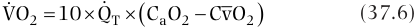

  VO2  10  QT   CaO2  CvO 2  (37.6) 

where Q T is the cardiac output (L/min), and C ~~v~~ O2 is the O2 content of the mixed venous blood (mL/100 mL). Rearranging Eq. 37.6 to solve for C ~~v~~ O2 yields

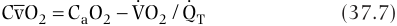

  CvO 2  CaO2  VO2 /QT (37.7) 

The contribution of dissolved O2 to the blood O2 content is small. By expanding the definition of O2 content (Eq. 37.1) and ignoring the term for dissolved O2, Eq. 37.7 can be rewritten as

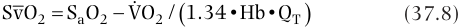

S vO 2  SaO2  VO  2 /  1.34•Hb•QT  (37.8) 

Normal values of S ~~v~~ O2 range between 65% and 80%.91,92 Values close to 40% are associated with tissue hypoxia, anaerobic metabolism, and lactate production. P ~~v~~ O2 can be derived from S ~~v~~ O2 values by utilizing the O2Hb dissociation curve adjusted to mixed- venous pH, PCO2, and temperature (see Fig. 37.2). The normal value of P ~~v~~ O2 is 40 mm Hg.

DO2 is defined as

DO2  QT  CaO2 (37.9) 

As is evident from Eq. 37.8, a low S ~~v~~ O2 indicates either a reduction in DO2 secondary to low SaO2, low Hb, or low Q T, or an increase in V O2. The association among S ~~v~~ O2, DO2, and V O2 can be illustrated by expressing S ~~v~~ O2 as a function of the O2 extraction ratio, ERO2.

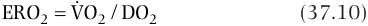

ERO2  VO  2 / DO2 (37.10) 

Expanding the terms yields

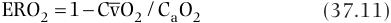

ERO2  1 CvO 2 /CaO2 (37.11) 

Assuming that the O2 dissolved in plasma is a negligible component to total O2 content dissolved in the arterial or mixed venous blood, Eq. 37.11 can be rewritten as

ERO2  1 ~~CvO~~ 2 /CaO2 (37.12)

For conditions in which the arterial blood is fully saturated, Eq. 37.12 may be further simplified:

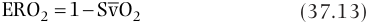

ERO2  1 SvO 2 (37.13) 

Solving for S v O2 yields 

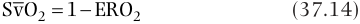

SvO 2  1  ERO2 (37.14) 

Thus a reduction in S ~~v~~ O2 results from an increase in ERO2, from either an increased V O2 or a decreased DO2 (Fig. 37.7). A decrease in DO2 occurs in conditions such as hemorrhagic or hypovolemic shock. An increase in V  O2 may occur in conditions such as stress, pain, shivering, sepsis, and thyrotoxicosis. Conversely, an increase in S ~~v~~ O2 indicates either an increase in O2 supply (elevated SaO2, Hb, or Q T) or a reduction in V O2, as occurs during hypothermia.

There are some subtle considerations in the interpretation of changes in S ~~v~~ O2. At PO2 values typical of venous blood, small increases in the fraction of inspired oxygen (FIO2) can cause significant increases in S ~~v~~ O2 because of the shape of the O2Hb dissociation curve (see Fig. 37.2). Therefore, when S ~~v~~ O2 is tracked as a measure of cardiac function, changes in FIO2 must be considered during its interpretation.93 In the setting of septic shock, impairment in O2 extraction may yield normal S ~~v~~ O2 values, despite the presence of tissue hypoxia.

Direct measurement of S ~~v~~ O2 requires the insertion of a pulmonary artery catheter, a procedure associated with some morbidity. However, in most clinical situations, the O2 saturation of a blood sample drawn from a central venous catheter will suffice. Thus, the use of central venous saturation can be a surrogate for S ~~v~~ O2. The saturation of blood at the level of a central venous catheter placed in the superior vena cava (SCVO2) reflects the balance between O2 supply and O2 demand in the brain and upper extremities. Under normal physiologic conditions, SCVO2 is typically 2% to 5% less than S ~~v~~ O2, primarily because of the higher O2 content of splanchnic and renal venous blood.94 However, during hemodynamic instability, as circulation is redistributed to the upper body, the relationship between S ~~v~~ O2 and SCVO2 may reverse, and the difference between the two may increase significantly.95–97 Although trends in SCVO2 may

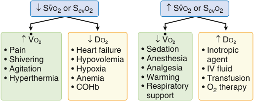

� Sv- O2 or ScvO2 � Sv- O2 or ScvO2 � V• O2 � DO2 � V• O2 � DO2 • Pain • Heart failure • Sedation • Inotropic • Shivering • Hypovolemia • Anesthesia agent • Agitation • Hypoxia • Analgesia • IV fluid • Hyperthermia • Anemia • Warming • Transfusion • COHb • Respiratory • O2 therapy support 

**Fig. 37.7** Mixed venous saturation is a measure of the balance between global oxygen delivery and uptake. Conditions which increase V˙ O2 or decrease DO2 will lead to a reduction in Sv– O2. Conversely, conditions which decrease V˙ O2 or improve DO2 will lead to an increase in the Sv– O2. (Modified from Shepherd SJ, Pearse RM. Role of central and mixed venous oxygen saturation measurement in perioperative care. _Anesthesiology_ . 2009;111:649–656.)

::: warning 符號需核對
此頁有符號無法完整擷取，請展開下方原始頁面核對。
:::

::: details 原始表格與符號（PDF 第 9 頁）

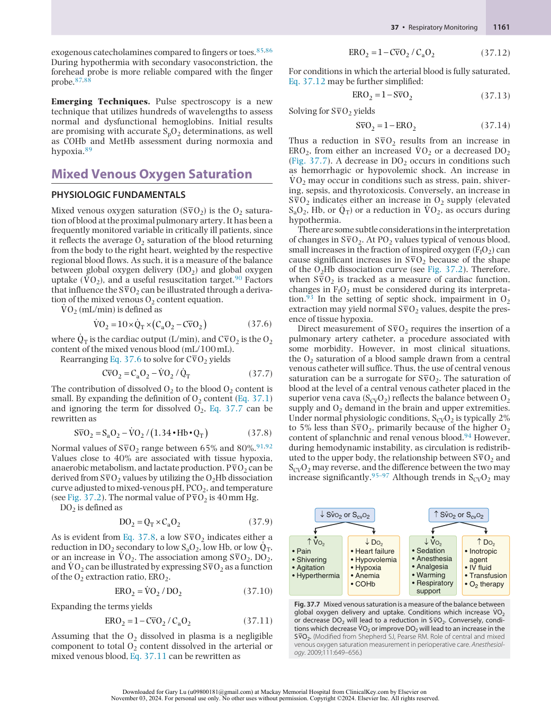

:::

<!-- PDF page 10 -->

reflect those in S ~~v~~ O2, the two measures cannot be used interchangeably.97–105

Mixed venous CO2 has been used to compute the arteriovenous CO2 difference (ΔPCO2 = P ~~v~~ CO2 − PaCO2). In conditions of steady- state CO2 production, ΔPCO2 changes inversely and nonlinearly with cardiac output as a result of the Fick equation.106 Accordingly, ΔPCO2 is an indicator of the adequacy of cardiac output to provide adequate clearance of tissue CO2. However, because of several limitations, the parameter has not yet found widespread clinical use.106

### MEASUREMENT PRINCIPLES

The measurement of venous O2 saturation can be performed intermittently by co- oximetry of blood sampled from the distal tip of a pulmonary artery catheter (S ~~v~~ O2) or a central venous catheter SCVO2. Falsely increased values can occur in the presence of a wedged pulmonary artery tip, mitral regurgitation, or left- to- right shunts.107 Venous saturations can also be measured continuously by spectrophotometry using specialized fiberoptic catheters, which transmit infrared light and detect the amount of light reflected from red blood cells.108,109 Specialized venous oximetry catheters are available for both pulmonary artery and central venous monitoring and have the advantage of providing continuous measurements of O2 saturation. Their disadvantage is the cost. Although continuous venous oximetry catheters trend changes, their reported absolute values are not equivalent to concurrently obtained co- oximetry measurements.110–112

### APPLICATIONS AND INTERPRETATION

In patients undergoing major abdominal or cardiac surgery, intraoperative reductions in S ~~v~~ O2 and SCVO2 have been associated with postoperative complications.113–117 Protocol- based interventions that target specific values of S ~~v~~ O2 or SCVO2 have been shown to reduce the length of stay, organ dysfunction, and mortality in patients undergoing major surgery and patients presenting with sepsis.118–120 Goal- directed therapy based on SCVO2 has been advocated for the management of sepsis, and the implementation of such protocols is associated with improvements in mortality.121,122 The use of SCVO2 as a therapeutic end point remains controversial for several reasons: SCVO2 may be increased in sepsis because of impaired tissue O2 extraction123 ; the increased cost associated with the use of SCVO2- measuring catheters124 ; and other measures, such as lactate clearance, are less costly while leading to similar outcomes.125 Furthermore, the management of sepsis without an SCVO2 end point can yield equally favorable results.124 The difference between S ~~v~~ O2 and SCVO2 has been proposed as a marker of complications after cardiac surgery.126

## Tissue Oxygenation

Arterial and venous O2 saturations are measures of DO2 and uptake by the whole body. Although useful, these global measures do not provide information regarding organ or tissue oxygenation, which reflects the important local balance between O2 supply and demand. Regional

O2 balance can differ both among organs as well as within regions of the same organ.127 Current noninvasive methods for the assessment of microcirculatory oxygenation make use of reflectance spectroscopy using light either in the visible spectrum (VLS) or in the near- infrared spectrum (NIRS). A recent technique based on the protoporphyrin IX triplet state lifetime aims at the assessment of mitochondrial O2 tension _in vivo_ , and opens the prospect of future clinical monitoring (see Fig. 37.1).128

Reflectance spectroscopy probes have light emitters and receivers positioned in line (Fig. 37.8). When they are placed on a tissue surface, light transmission through the tissue is affected by reflection, absorption, and scatter. Reflection depends on the angle of incidence of the light beam and the wavelength of light, whereas scatter depends on the number and type of tissue interfaces. As previously outlined, the Beer–Lambert law relates the absorption of light by the tissue to the concentration of tissue chromophores, the extinction coefficient of each, and the pathlength of the light through the tissue.129 The predominant tissue chromophore is hemoglobin. The pathlength of the light is affected by both reflection and scatter, so it cannot be measured directly, but rather must be estimated. Most of the detected photons travel in an arc between the two detectors (see Fig. 37.8). The depth of penetration of the arc into the tissue is proportional to the wavelength of light and the distance between the transmitter and detector.129,130

VLS makes use of white light with wavelengths of 500 to 800 nm, whereas NIRS employs light in the 700 to 1100 nm range.131 In general, the depth of penetration of VLS is less than that of NIRS, thus allowing superficial measurements of up to 16 mm and making it suitable for measurements of small subsurface volumes. NIRS can penetrate tissue to a depth of several centimeters and allows sampling of a larger volume of tissue.132 The O2 saturation displayed is that of a

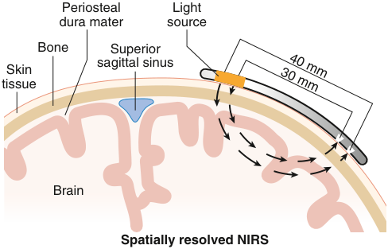

Periosteal Light dura mater source Bone Superior Skin sagittal sinus tissue Brain Spatially resolved NIRS 40 mm 30 mm 

**Fig. 37.8 Near- infrared spectroscopy applied to cerebral oximetry.** In this case, a reflectance oximeter is placed on the forehead. Near- infrared wavelength light is emitted from the light source and enters the underlying tissue. Light is scattered, reflected, and absorbed. Light that reaches the photodetector travels an arc- shaped path. The depth of the path is a function of the distance between the emitter and the detector. The measured value is the oxygen saturation of the tissue through which the light travels on its way to the detector. It is a primarily venous- weighted value. _NIRS_ , near- infrared spectroscopy. (Redrawn from Casati A, Spreafico E, Putzu M, et al. New technology for noninvasive brain monitoring: continuous cerebral oximetry. _Minerva Anestesiol._ 2006;72:605–625.)

<!-- PDF page 11 -->

volume of tissue. This volume includes arteries, capillaries, and veins, and has a predominantly venous weighting.133

### CLINICAL APPLICATIONS

A number of applications have been described for VLS. Buccal microvascular Hb saturation is associated with survival in patients with sepsis.134 VLS has also been used for monitoring flap viability following reconstructive surgery.135 During gastrointestinal and esophageal surgery, reductions in gastrointestinal tissue saturation, measured by VLS, are associated with postoperative anastomotic complications.136,137 Endoscopic VLS differentiates between normal and ischemic areas of colon,138 and it may be useful for the diagnosis of mesenteric ischemia.139 In addition, mucosal O2 saturation of the gastric conduit following esophagectomy is useful and explores the benefits of ischemic preconditioning.140

The most widespread application of NIRS has been in cerebral oximetry,127 with probes placed on the forehead to measure frontal cortical oxygenation (rSO2). Several NIRS systems are commercially available, with each manufacturer offering a different specific technology. As there is no gold standard for cerebral oximetry, it is difficult to compare the accuracy of the devices. Furthermore, each device has its own set of “normal” values. For this reason, acquisition of baseline values for each patient at the start of the procedure has been recommended.141 Typical values of rSO2 range from 51% to 82% with a mean baseline of 66%.142 A reduction of rSO2 below 20% to 25% of the baseline, or lower than an absolute value of 50%, is a suggested threshold for intervention.143,144

The utility of cerebral oximetry has been explored in cardiovascular, abdominal, thoracic, and orthopedic surgery. In the cardiac surgical setting, intraoperative reductions in rSO2 are associated with early postoperative cognitive dysfunction and prolonged ICU and length of hospital of stay.144–147 Baseline rSO2 measurements are associated with 30- day mortality after left ventricular assist device surgery.148 As a guide to therapy, interventions for rSO2 reductions less than 75% of baseline in patients undergoing coronary artery bypass graft surgery have been shown to significantly reduce the incidence of major organ morbidity and mortality, as well as ICU length of stay.143 Yet, results are still not supportive of clinical benefits of cerebral NIRSbased algorithms in cardiac surgery.149

During carotid endarterectomy, intraoperative reductions in rSO2 correlate well with changes in transcranial Doppler measurements,150–154 electroencephalographic waveforms,155–157 and stump pressure,154,158,159 which are consistent with ischemia. Although some studies indicate that reductions in rSO2 that are less than 20% of baseline are well tolerated, data are lacking for a clear rSO2 threshold for carotid shunt placement.160,161

In elderly patients undergoing major abdominal surgery, protocol- based reductions in rSO2 are associated with a reduction in postoperative cognitive decline and length of hospital stay.162 In patients undergoing thoracic surgery with single- lung ventilation, intraoperative reductions in rSO2 are also associated with declines in early postoperative cognitive function.163 Patients undergoing shoulder surgery in the beach chair position have a lower baseline

rSO2 and a larger number of episodes of cerebral desaturation, although the clinical implications of these findings are unclear.164–166

NIRS has also been preliminarily used during and following open thoracoabdominal aortic aneurysm repair for continuous monitoring of spinal cord oxygenation.167 Applications to assess gastrocnemius muscle oxygenation during blood loss and transfusion have also been done.168,169 Shock is a condition in which patients may have inadequate _regional_ perfusion in the setting of normal _global_ perfusion parameters. In such circumstances, the use of NIRS to monitor tissue perfusion holds some promise. Values obtained by the application of an NIRS probe to the thenar eminence (StO2) discriminate between healthy volunteers and patients with shock.170 Furthermore, in patients with major trauma who present with shock, StO2 values can identify patients who proceed to develop multiorgan dysfunction or actually die.171,172

Overall, available information is still limited to warrant clinical decision- making exclusively based on NIRS measurements. Currently there is insufficient evidence to support the use of perioperative NIRS monitoring in adults to reduce short- term or mild postoperative cognitive dysfunction, postoperative stroke, delirium, or death.149,173 Of note, in a 2015 retrospective study, patients who self- identified as African American had lower rSO2 compared with those who self- identified as Caucasian, a finding attributed to light attenuation by skin pigmentation.174 Further investigations are necessary to improve our understanding of NIRS and its relevance for clinical management.

## Capnometry and Capnography

### GENERAL CONCEPTS

The presence CO2 in exhaled breath reflects the fundamental physiologic processes of ventilation, pulmonary blood flow, and aerobic metabolism. Its continued monitoring assures anesthesiologists of correct placement of an endotracheal tube (ETT) or laryngeal mask airway (LMA), as well as the integrity of a breathing circuit. Exhaled CO2 provides information primarily on ventilation. It is also used to estimate the adequacy of cardiac output. In combination with PaCO2, exhaled CO2 can be used to estimate the ratio of physiologic dead space (VD) to tidal volume (VT) by using the Bohr equation175 :

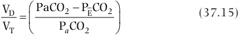

VD  PaCO2  P ECO2  (37.15)   VT  P CO a 2  

where ~~P~~ ECO2 is the mixed expired CO2 partial pressure, such as measured in exhaled air collected in a mixing bag chamber or computed from a volumetric capnogram. The ability to detect and quantify CO2 is a crucial component of respiratory monitoring in anesthesia and critical care medicine.

Considerable confusion arises from inconsistent and interchangeable terminology as applied to medical CO2 gas analysis.175–177 In a very general sense, _capnometry_ refers to the measurement and quantification of inhaled or exhaled CO2 concentrations at the airway opening. _Capnography_ , however, refers not only to the method of CO2 measurement, but also to its graphic display as a function of time or volume. A _capnometer_ is simply a device that measures

<!-- PDF page 12 -->

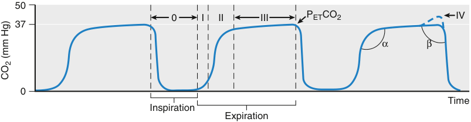

50 0 I II III PETCO2 IV 37 α β 0 Time Inspiration Expiration CO (mm Hg)2 

**Fig. 37.9 Representative time capnogram for three breaths.** The expiratory segment is divided into phases I, II, III, and IV. The inspiratory segment is referred to as phase 0 in this figure; α denotes the angle between phases II and III, whereas β denotes the angle between phase III and the descending limb of phase 0. Phase IV ( _dashed line_ in third breath) denotes the upstroke observed at the end of phase III in some patients. _PETCO2_ , partial pressure of end- tidal carbon dioxide. (Courtesy Respironics, Inc., Murraysville, PA, with permission.)

CO2 concentrations. A capnometer may display a numeric value for inspired or exhaled CO2. A _capnograph_ , however, is a device that records and displays CO2 concentrations, usually as a function of time. A _capnogram_ refers to the graphic display that the capnograph generates. Fig. 37.9 illustrates a typical CO2 concentration profile for three breaths as a function of time.

### MEASUREMENT PRINCIPLES

Various methods exist for detecting and quantifying CO2 concentrations in respiratory gases, such as mass spectrometry, Raman spectrometry, or gas chromatography.178,179 The most commonly used method in clinical environments relies on nondispersive infrared absorption.180 With this technique, a beam of infrared light is passed through a gas sample, and the resulting intensity of the transmitted light is measured by a photodetector.176 Gaseous CO2 absorbs light over a very narrow bandwidth centered around 4.26 μm. Its presence in the sample cell decreases the amount of infrared light at this wavelength that reaches the detector in proportion to its concentration. Because the absorption spectrum for CO2 partially overlaps with the spectra of other gaseous species commonly encountered in anesthesia (i.e., water and nitrous oxide181 ), infrared filters and compensation algorithms are used to minimize this interference and improve accuracy.182

Most capnometers rely on infrared light source that is focused on a chopper disk that rotates at approximately 60 revolutions per second. The chopper allows the beam to be alternately directed through (1) the sample cell with the gas to be analyzed and (2) a reference cell with no detectable CO2. In addition, the light source is completely blocked at various points during the revolution of the chopper disk. The photodetector and associated circuitry process these three signals to estimate the changes in CO2 concentration continuously in the sample cell. Alternatively, CO2 concentration may be estimated with solid- state technology, using a beam splitter instead of a chopper wheel. The splitter allows for the measurement of infrared energy at wavelengths within and outside the absorption spectrum of CO2.

Capnometers fall into two general categories: sidestream (diverting) and mainstream (nondiverting). Sidestream analyzers are more frequently used in clinical environments. Their CO2 sensors are physically located away from the airway gases to be measured. Sidestream analyzers incorporate a pump or compressor that aspirates gases into a sample cell located at the unit’s console (Fig. 37.10A).

Typical tubing length for this aspiration may be 6 feet, and gas withdrawal rates may vary from 30 to 500 mL/min. This lost gas volume may need to be considered during closed- circuit anesthesia or during ventilation of neonates and infants. The volume can be returned to the circuit, or it can be routed to a scavenger to prevent contamination of the environment with anesthetic or waste gases. Gases must also pass through various filters and water traps before they are presented to the sample cell.176 Sidestream capnometers have a transport delay time corresponding to the rate at which gas is sampled and the washout of the analyzing chamber (Fig. 37.10B). The capnograms generated by sidestream analyzers also have an associated rise time, defined as the time required for the analyzer to respond to a sudden change in CO2 concentration.183 By convention, this is usually the time interval required for the analyzer output to change from 10% to 70% of its final value.*,183 Typical rise times for commercially available capnometers range from 10 to 400 ms, and they can depend on the rotation of the chopper wheel, the rate of gas aspiration, the volume of aspiration tubing and water traps, and the dynamic response of the infrared filters and other electronics.

With mainstream analyzers, the sample cell is placed directly into the patient’s breathing circuit. Thus the inspiratory or expiratory gases pass directly through the infrared light path (Fig. 37.10C). An advantage of mainstream analyzers is that they have no delay time (Fig. 37.10D). Moreover, their rise time is generally faster than that of sidestream analyzers.183 A disadvantage is the potential increase in dead space, although recent developments in solid- state electronics have made this much less of an issue.184 In addition, the sample cell is usually heated to 40°C to minimize the condensation of water vapor, which can bias the measurement. This increase in temperature, combined with the proximity of the sensor to the patient’s airway, can potentially increase the risk of facial burns.

### TIME CAPNOGRAM

The simplest and most widely used form of display for exhaled CO2 is the _time capnogram_ . The time capnogram displays both inspiratory and expiratory phases. Fig. 37.9 shows a typical time capnogram for three breaths. The expiratory phase is divided into three distinct components. Phase I corresponds to the exhalation of dead space gas from

> *Rise time may also be defined as the time required for the analyzer output to change from 10% to 90% of its final value.

<!-- PDF page 13 -->

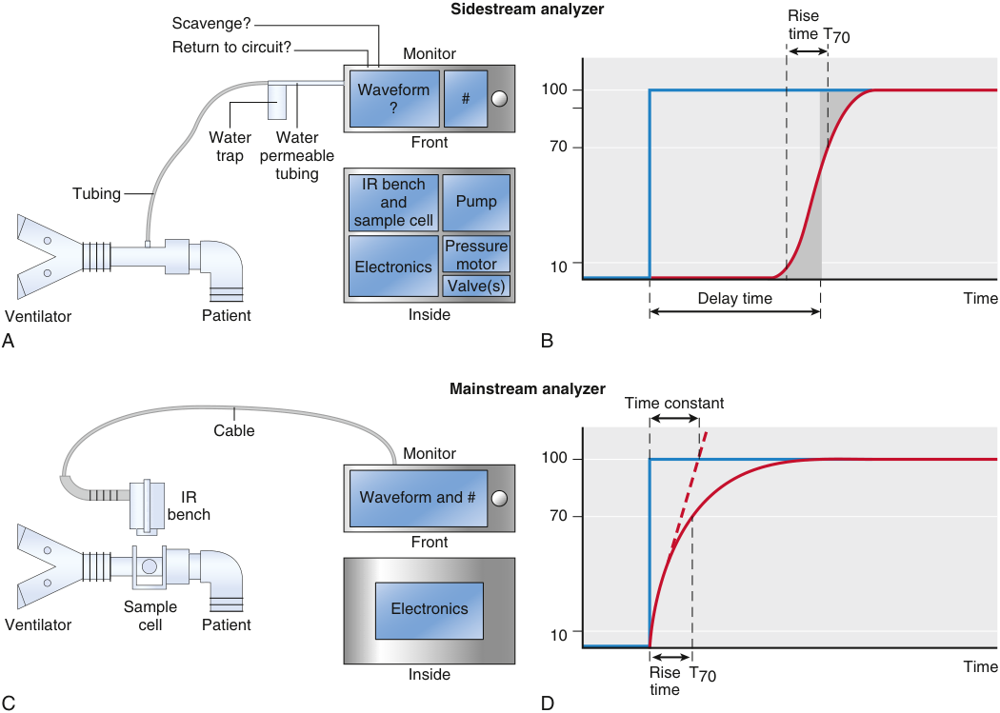

Sidestream analyzer Rise Scavenge? time T70 Return to circuit? Monitor Waveform 100 # ? Water Water Front 70 trap permeable tubing IR bench Tubing and Pump sample cell Pressure Electronics motor 10 Valve(s) Delay time Time Ventilator Patient Inside A B Mainstream analyzer Time constant Cable Monitor 100 IR Waveform and # bench 70 Front Sample Electronics Ventilator cell Patient 10 Inside Rise T70 Time time C D 

**Fig. 37.10** Schematics of sidestream (A) and mainstream (C) capnometry sampling methods, along with corresponding representative time capnograms ( _curves_ in B and D) following a step increase in CO2 concentration ( _blue lines_ ). Rise time (T70) corresponds to the time required for either sensor to change from 10% to 70% of its final value. A delay time is observed for the sidestream analyzer, corresponding to the aspiration rate of the sampled gas and the washout of the analyzing chamber. _IR_ , infrared. (Modified from Jaffe MB. Mainstream or sidestream capnography? Technical considerations. Wallingford, CT: Respironics Novametric, Inc; 2002; and Brunner JX, Westenskow DR. How the rise time of carbon dioxide analysers influences the accuracy of carbon dioxide measurements. _Br J Anaesth._ 1988;61:628–638.)

the central conducting airways or any equipment distal to the sampling site, which ideally should have no detectable CO2 (i.e., partial pressure of CO2, PCO2 ∼ 0). During phase II, a sharp rise in PCO2 to a plateau indicates the sampling of transitional gas between the airways and alveoli. The plateau region of the capnogram, phase III, corresponds to the PCO2 in the alveolar compartment. For lungs with relatively homogeneous ventilation, phase III is approximately flat throughout expiration. In fact, various mechanisms contribute to the slight upsloping of CO2 concentration versus time during phase III. Most of these mechanisms reflect a heterogeneous distribution of ventilation–perfusion (V /Q ) or alveolar CO2 partial pressure (PACO2) throughout the lung. Well- ventilated and well- matched (V /Q = 0) regions tend to have lower PCO2 and shorter time constants, and they empty earlier during the expiratory phase. Less wellventilated and poorly matched V /Q regions have higher CO2 levels, and they empty later in the expiratory cycle. Respiratory pathologies associated with an increase in ventilation heterogeneity, such as asthma, chronic obstructive pulmonary disease (COPD), or acute lung injury,185 yield a steeper upslope of phase III. Interventions that improve

ventilation homogeneity, such as positive end- expiratory pressure (PEEP) or bronchodilators, flatten phase III. Mechanical disturbances may also be present during phase III, reflecting processes such as spontaneous breathing efforts, cardiogenic oscillations, or surgical manipulation (Fig. 37.11). Following phase III, a sharp downstroke of PCO2 occurs as fresh inspired gas moves past the sampling site and washes out the remaining CO2. This is referred to as the beginning of phase 0 by some authors,177,186 or phase IV by others.178 Occasionally, a sharp upstroke in PCO2 is observed at the very end of phase III, which is termed phase IV or IV′, depending on the author.187 This upstroke probably results from the closure of lung units with relatively low PCO2 and allows for regions of higher CO2 to contribute a greater proportion of the exhaled gas to be sampled.177 Additional insights into various abnormalities in ventilation or perfusion are also obtained by trending time capnograms over many breaths for long periods (Fig. 37.12).

The term “end- tidal” CO2 (PETCO2) generally refers to the final value of the exhaled PCO2 curve, at the very end of the expiratory phase. The method used to determine this number is not universal and varies according to the manufacturer

<!-- PDF page 14 -->

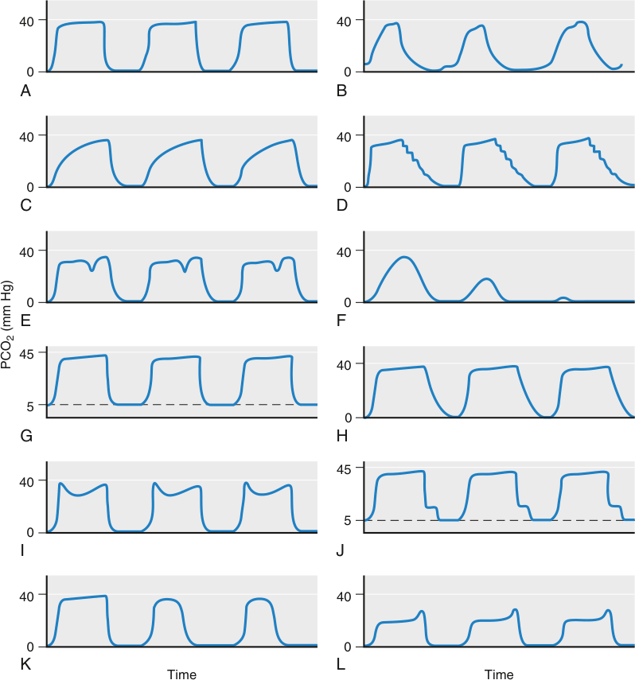

40 40 0 0 A B 40 40 0 0 C D 40 40 0 0 E F 45 40 5 0 G H 45 40 5 0 I J 40 40 0 0 K L Time Time PCO (mm Hg)2 

**Fig. 37.11 Representative time capnograms under normal and abnormal conditions.** (A) Normal capnogram during controlled mechanical ventilation; (B) normal capnogram during spontaneous breathing; (C) increased upslope of phase III, as may occur during bronchospasm (asthma, chronic obstructive pulmonary disease), or partially obstructed endotracheal tube/breathing circuit; (D) cardiogenic oscillations at the end of exhalation as flow decreases to zero and the beating heart causes emptying of different lung regions and back- and- forth motion between exhaled and fresh gas; (E) clefts during phase III indicating spontaneous breathing efforts during controlled mechanical ventilation; (F) esophageal intubation; (G) rebreathing of CO2, as may occur with faulty expiratory valve or exhausted absorber system. Inspiratory CO2 is consistently above 0; (H) faulty inspiratory valve, resulting in a slower downslope, which extends into the inhalation phase (phase 0) as CO2 in the inspiratory limb is rebreathed; (I) two peaks in phase III suggestive of sequential emptying of two heterogeneous compartments, as may be seen in a patient with a single-lung transplant; (J) faulty inspiratory valve; (K) sudden shortening of the duration of phase III during controlled mechanical ventilation, suggesting the abrupt onset of a ruptured or leaking endotracheal tube cuff; (L) dual plateau in phase III, suggesting the presence of a leak in a sidestream sample line. Early portion of phase III abnormally low due to dilution of exhaled gas with ambient air. The sharp increase in CO2 at the end of phase III reflects a diminished leak resulting from the increased circuit pressure at the onset of inspiration. _PCO2_ , partial pressure of carbon dioxide. (Modified from Hess D. Capnometry and capnography: technical aspects, physiologic aspects, and clinical applications. _Respir Care_ . 1990;35:557–576; Roberts WA, Maniscalco WM, Cohen AR, et al. The use of capnography for recognition of esophageal intubation in the neonatal intensive care unit. _Pediatr Pulmonol_ . 1995;19:262–268; and Eskaros SM, Papadakos PJ, Lachmann B. Respiratory monitoring. In: Miller RD, Eriksson LI, Fleisher LA, eds. _Miller’s Anesthesia._ 7th ed. New York, NY: Churchill Livingstone; 2010:1427.)

of the particular capnograph in use. For example, PETCO2 may simply be (1) the PCO2 value just before inspiration, (2) the largest PCO2 value during a single exhalation cycle, or (3) the PCO2 value at a specified time in the capnogram averaged across several breaths. If PETCO2 is measured during a reasonably flat and undistorted phase III, it may be well correlated with PaCO2.182 This may not be the case if the duration of phase III is truncated, or if CO2 is measured from gas that is contaminated with room or O2- enriched air (i.e., during spontaneous breathing with a nasal cannula

or facemask). Potential causes of increased or decreased PETCO2 are listed in Table 37.2. In healthy individuals with homogeneous ventilation, the difference between PaCO2 and PETCO2 is usually less than 5 mm Hg, thereby expressing the equilibration between alveolar and pulmonary capillary blood. Several disease states compromise this equilibration and produce increased PaCO2 – PETCO2 difference (Box 37.2). There are situations in which PETCO2 can be greater than PaCO2, especially in the presence of severe ventilation heterogeneity and lung units with very low

<!-- PDF page 15 -->

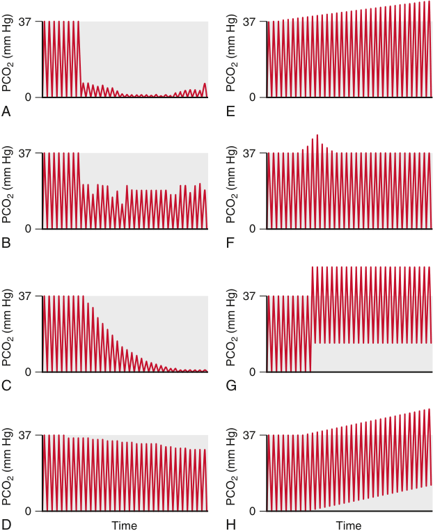

37 37 0 0 A E 37 37 0 0 B F 37 37 0 0 C G 37 37 0 0 D Time H Time PCO (mm Hg)2 PCO (mm Hg)2 PCO (mm Hg)2 PCO (mm Hg)2 PCO (mm Hg)2 PCO (mm Hg)2 PCO (mm Hg)2 PCO (mm Hg)2 

**Fig. 37.12 Representative time capnograms trended over many breaths, illustrating various abnormalities in ventilation and/or perfusion.** (A) Sudden drop in CO2 due to catastrophic loss of ventilation; (B) leak or partial obstruction in breathing circuit; (C) sudden interruption in pulmonary perfusion, as may occur during cardiac arrest; (D) gradual decrease in CO2 due to hyperventilation, decreased metabolism, or decreased pulmonary perfusion; (E) gradual increase in CO2 as may occur during hypoventilation, laparoscopic insufflation, increased metabolism, or increased pulmonary perfusion; (F) transient rise in CO2 indicated acute increase in CO2 delivery to the lungs, as may occur during release of a tourniquet or administration of a bicarbonate bolus; (G) rise in both the baseline and end- tidal CO2, consistent with a contaminated sample cell; (H) gradual rise in baseline and end- tidal CO2, consistent with rebreathing. _PCO2_ , partial pressure of CO2. (Modified from Swedlow DB. Capnometry and capnography: the anesthesia disaster early warning system. _Semin Anesth_ . 1986;5:194–205.)

V  /Q  . For steady- state conditions, the PETCO2 usually reflects the relative balance between CO2 production and alveolar ventilation.

### VOLUME CAPNOGRAM

Although time capnography is relatively straightforward to monitor in clinical environments, a major limitation of the technique is its lack of information regarding respiratory flows or volumes.186 The _volume capnogram_ is a graphic display of CO2 concentration or partial pressure versus exhaled volume.178 The inspiratory phase is not defined in a volume capnogram. Similar to its temporal counterpart, it is also partitioned into three distinct phases (I, II, and III) corresponding to anatomic dead space, transitional, and alveolar gas samples (Fig. 37.13). However, it possesses several advantages over the time capnogram. First, it allows for estimation of the relative contributions of anatomic and alveolar components of physiologic dead

space.188,189 Second, it is more sensitive than the time capnogram in detecting subtle changes in dead space that are caused by alterations in PEEP, pulmonary blood flow, or ventilation heterogeneity (Fig. 37.14). Moreover, the volume capnogram may also provide useful information on cardiac output and intravascular volume responsiveness.190–192 Finally, the numeric integral of PCO2 as a function of volume allows for determination of the total mass of CO2 exhaled during a breath and provides for the estimation of VCO2.

## Blood Gas Analysis

### PHYSIOLOGIC FUNDAMENTALS

Arterial blood gas analysis is used to assess oxygenation, ventilation, and acid–base status. This section focuses on the use of arterial blood gases to assess oxygenation and ventilation. For a discussion of acid–base status, see Chapter 44.

<!-- PDF page 16 -->

**Table 37.2** Causes of Changes in Partial Pressure of End- Tidal Carbon Dioxide

|**↑PETCO2**|**↓PETCO2**|
|---|---|
|↑**CO2 PRODUCTION AND** **DELIVERY TO THE LUNGS**|↓**CO2 PRODUCTION AND** **DELIVERY TO THE LUNGS**|
|Increased metabolic rate|Hypothermia|
|Fever|Pulmonary hypoperfusion|
|Sepsis|Cardiac arrest|
|Seizures|Pulmonary embolism|
|Malignant hyperthermia|Hemorrhage|
|Thyrotoxicosis|Hypotension|
|Increased cardiac output (e.g., during CPR)||
|Bicarbonate administration||
|↓**ALVEOLAR VENTILATION**|↑**ALVEOLAR VENTILATION**|
|Hypoventilation Respiratory center depression Partial muscular paralysis Neuromuscular disease High spinal anesthesia COPD|Hyperventilation|
|**EQUIPMENT MALFUNCTION**|**EQUIPMENT MALFUNCTION**|
|Rebreathing|Ventilator disconnect|
|Exhausted CO2absorber|Esophageal intubation|
|Leak in ventilator circuit|Complete airway obstruction|
|Faulty inspiratory/expiratory valve|Poor sampling Leak around endotracheal tube cuff|

_CO2_ , carbon dioxide; _COPD_ , chronic obstructive pulmonary disease; _CPR_ , cardiopulmonary resuscitation; _PETCO2_ , partial pressure of end- tidal carbon dioxide. Modified from Hess D. Capnometry and capnography: technical aspects, physiologic aspects, and clinical applications. _Respir Care_ . 1990;35:557–576.

### Box 37.2 Causes of Increased Arterial- toEnd- Tidal Carbon Dioxide Pressure Difference P(a- ET)CO2

Increased ventilation–perfusion heterogeneity, particularly with high V/Q regions Pulmonary hypoperfusion Pulmonary embolism Cardiac arrest Positive pressure ventilation (especially with PEEP) High- rate low- tidal- volume ventilation

_PEEP_ , positive end- expiratory pressure.

Modified from Hess D. Capnometry and capnography: technical aspects, physiologic aspects, and clinical applications. _Respir Care_ . 1990;35:557– 576.

Oxygenation is reflected in the PaO2, which is a function of the alveolar partial pressure of O2 (PAO2) and the efficiency of O2 transfer from alveoli to the pulmonary capillary blood. In healthy adults breathing room air at sea level, PaO2 ranges between 80 and 100 mm Hg. The normal value of PaO2 decreases with increasing age and increasing altitude. Hypoxemia is defined as a PaO2 less than 80 mm Hg. There are five physiologic causes of hypoxemia: (1) hypoventilation, (2) V /Q mismatching, (3) right- to- left shunt, (4) diffusion limitation, and (5) diffusion–perfusion mismatch. The first three causes explain the majority of hypoxemia in the perioperative setting. Reduced inspired PO2 (e.g., in faulty

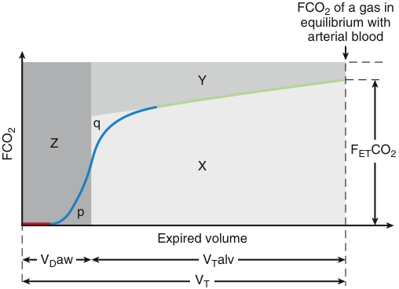

FCO2 of a gas in equilibrium with arterial blood Y q Z FETCO2 X p Expired volume V D aw V T alv V T FCO2 

**Fig. 37.13** The volume capnogram is a plot of the fraction of CO2 (FCO2) in exhaled gas versus exhaled volume. It is divided into three phases, which reflect the same sources of expired gas as present in the time capnograph: anatomic dead space (phase I, _red_ ), transitional (phase II, _blue_ ), and alveolar gas (phase III, _green_ ). The volume capnogram allows for the partition of total tidal volume (VT) into airway dead space volume (VDaw) and an effective alveolar tidal volume (VTalv) by a vertical line through phase II, positioned such that the approximately triangular areas p and q are equal. It also provides the slope of phase III as a quantitative measure of the heterogeneity of alveolar ventilation. The total area below the horizontal line (denoting the FCO2 of a gas in equilibrium with arterial blood) can be divided into three distinct areas: X, Y, and Z. Area X corresponds to the total volume of CO2 exhaled over a tidal breath. This value can be used to compute the CO2 production (V˙ CO2), and the mixed expired CO2 fraction or partial pressure to be used in the Bohr equation (Eq. 37.15) based on the division of the exhaled CO2 volume by the exhaled tidal volume. Area Y represents wasted ventilation due to alveolar dead space, while area Z corresponds to wasted ventilation due to anatomic deadspace (VDaw). Thus areas Y + Z represent the total physiologic dead space. The volume capnogram can also be plotted as a PCO2 versus exhaled volume curve. _FETCO2_ , fraction of end- tidal carbon dioxide. (Modified from Fletcher R, Jonson B, Cumming G, et al. The concept of deadspace with special reference to the single breath test for carbon dioxide. _Br J Anaesth_ . 1981;53:77–88.)

closed or partially closed anesthesia breathing circuits or at high altitude) is an additional cause of hypoxemia.

These factors produce hypoxemia by affecting different steps of O2 transport from the environment to the arterial blood. A low inspired PO2, as well as hypoventilation, reduces the PAO2. V /Q mismatch, right- to- left shunt, and alveolar diffusion limitation affect the efficiency of O2 exchange. Diffusion limitation plays a role in conditions that thicken the alveolar–capillary barrier, such as interstitial lung diseases, and in hypoxemia induced by exercise or altitude.193,194 In the clinical setting, impairment of diffusion of O2 or CO2 rarely occurs to a significant extent. The remainder of this section focuses on V /Q mismatch and right- to- left shunt.

V  /Q  mismatch is the most common cause of hypoxemia in the clinical setting. Ventilation and perfusion are nonuniformly distributed throughout the normal lung, with worsening mismatch in the setting of lung disease, general anesthesia, and mechanical ventilation. Areas with low or zero V /Q yield low end- capillary PO2, whereas areas with normal or high V /Q produce higher end- capillary PO2. However, because of the plateau of the O2Hb dissociation curve (see Fig. 37.2), the normal and high V /Q regions are limited in the extent to which they increase the O2 content

::: details 原始表格與符號（PDF 第 16 頁）

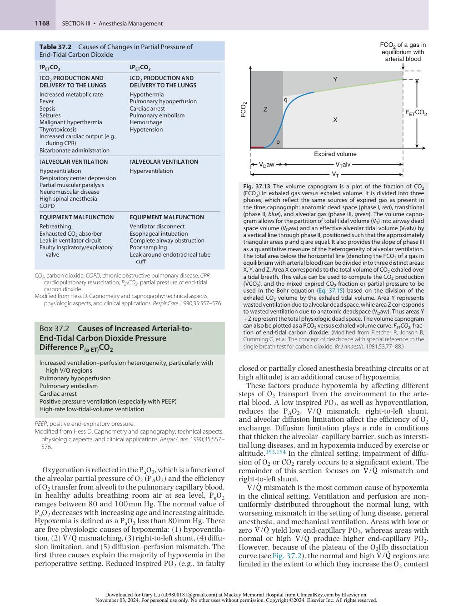

:::

<!-- PDF page 17 -->

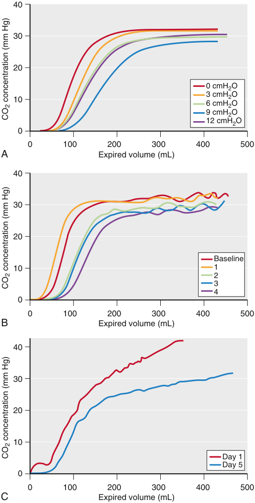

40 30 20 0 cmH2O 3 cmH2O 10 6 cmH2O 9 cmH2O 12 cmH2O 0 0 100 200 300 400 500 A Expired volume (mL) 40 30 20 Baseline 10 1 2 3 4 0 0 100 200 300 400 500 B Expired volume (mL) 40 30 20 10 Day 1 Day 5 0 0 100 200 300 400 500 C Expired volume (mL) CO concentration (mm Hg)2 CO concentration (mm Hg)2 CO concentration (mm Hg)2 

**Fig. 37.14 Representative single- breath volume capnograms, illustrating various abnormalities in ventilation or perfusion.** (A) Alterations in phases II and III with corresponding changes in positive end- expiratory pressure (0, 3, 6, 9, and 12 cmH2O) during positive pressure ventilation; (B) alterations in phases II and III with corresponding changes in pulmonary perfusion (increasing numbers correspond to decreasing pulmonary blood flow); (C) pronounced positive slope of phase III during acute bronchospasm (Day 1). Following resolution (Day 5), there is a noticeable reduction in the slope phase III. _CO2_ , carbon dioxide. (Modified from Thompson JE, Jaffe MB. Capnographic waveforms in the mechanically ventilated patient. _Respir Care_ . 2005;50:100–108.)

and compensate for the low V /Q regions (Fig. 37.15). Consequently, V /Q mismatch results in hypoxemia.

Right- to- left shunt is the amount of blood that flows from the pulmonary artery to the systemic arterial circulation without undergoing pulmonary gas exchange. It represents an extreme case of V /Q mismatch in which the ratio equals zero and the end- capillary gas partial pressures are equal to

the values found in mixed venous blood. In healthy, awake, spontaneously breathing subjects, intrapulmonary shunt is negligible,195 and a small (&lt;1% of cardiac output) extrapulmonary shunt results from drainage of the bronchial and Thebesian veins into the arterial side of the circulation.196 During general anesthesia, a right- to- left shunt can develop as a result of atelectasis.197,198 Right- to- left shunt can also be seen in pathologic conditions such as pneumonia and acute lung injury. The effect of the shunt on PaO2 is a function of the magnitude of the shunt, FIO2, and the cardiac output (Fig. 37.16). Importantly, increases in FIO2 have a small effect on PaO2 in the presence of large true right- to- left shunt (see Fig. 37.16).

The traditional method to estimate flow through shunting regions (Q s) as a fraction of the total cardiac output (Q T) is based on the modeling of the lung as a three- compartment system (Fig. 37.17).199 The three compartments represent (1) lung regions receiving both ventilation and perfusion, (2) a shunt compartment (V /Q = 0), and (3) a dead space compartment with ventilation but no perfusion (V /Q = infinity). The application of the concept of mass balance to this model yields the shunt fraction (Q s/Q T) expression

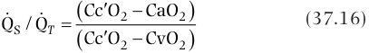

Q  S / Q  T   Cc OCc O  22  CaOCvO22  (37.16) 

where Q s is the shunted blood flow, and Cc′O2 is the endcapillary O2 content. Cc′O2 is calculated using Eq. 37.1, assuming equilibration between the end- capillary blood and alveolar gas. The PAO2 is calculated using the ideal alveolar gas equation:

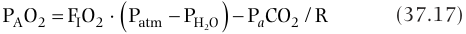

PAO2  F OI 2   Patm  PH2O   P CO a 2 /R (37.17) 

where FIO2 is the inspired O2 fraction, Patm is barometric pressure (typically assumed to be the pressure of one standard atmosphere at sea level, 760 mm Hg), and Ph2o is partial pressure of water vapor (47 mm Hg at 37°C). R, the respiratory quotient, is the ratio of pulmonary CO2 elimination to O2 uptake (R = V CO2/V O2), which equals the value of 0.8 under normal diet and metabolic conditions.

The three- compartment model is a simplification of the real lung. As a result, under conditions of FIO2 less than 100%, Q S/Q T computed with Eq. 37.16 represents a combination of all factors producing hypoxemia, predominantly true right- to- left shunt and V /Q mismatch. Under such conditions, Q S/Q T is referred to as venous admixture. When FIO2 is 100%, the effects of V /Q heterogeneity on O2 exchange are eliminated and the equation exclusively yields the right- to- left shunt fraction.200 The administration of 100% O2 (i.e., FIO2 of 1.0) can lead to the development of absorption atelectasis in compartments with very low V /Q , thus leading to an increase in true right- to- left shunt.200

If the assumptions are made that end- capillary blood has an O2 saturation of 100% and the O2 content of blood is predominantly determined by Hb saturation, the shunt fraction equation can be simplified to

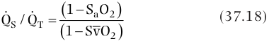

Q  S /Q  T   11  SvO SaO22  (37.18) 

where SaO2 is arterial saturation, and S ~~v~~ O2 is mixed venous saturation.

<!-- PDF page 18 -->

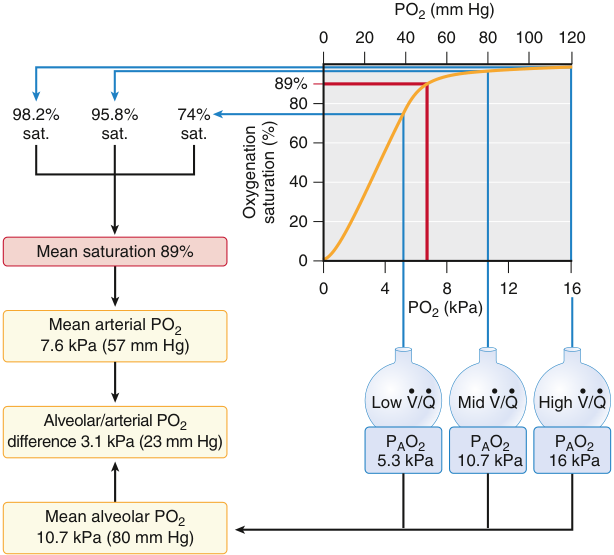

PO2 (mm Hg) 0 20 40 60 80 100 120 89% 80 98.2% 95.8% 74% sat. sat. sat. 60 40 20 Mean saturation 89% 0 0 4 8 12 16 PO2 (kPa) Mean arterial PO2 7.6 kPa (57 mm Hg) • • • • • • Low V/Q Mid V/Q High V/Q Alveolar/arterial PO2 difference 3.1 kPa (23 mm Hg) PAO2 PAO2 PAO2 5.3 kPa 10.7 kPa 16 kPa Mean alveolar PO2 10.7 kPa (80 mm Hg) Oxygenation saturation (%) 

**Fig. 37.15 Effect of different ventilation- perfusion (V**˙ **/Q**˙ **) regions on partial pressure of arterial oxygen (PaO2).** Because of the shape of the oxyhemoglobin dissociation curve, regions of lung with low V˙ /Q˙ have a disproportionately greater effect on lowering the arterial saturation than do regions of lung with normal or higher V˙ /Q˙ to increase PaO2. Assuming equal blood flow, the average partial pressure of alveolar oxygen (PAO2) of the V˙ /Q ˙ regions represented in the illustration is 10.7 kPa (80 mm Hg). Based on the oxyhemoglobin dissociation curve, however, the average saturation of the arterial blood is 89%, producing an average PaO2 equal to 7.6 kPa (57 mm Hg). _PO2_ , partial pressure of oxygen. (Modified from Lumb AB. _Nunn’s Applied Respiratory Physiology_ . 6th ed. Philadelphia: Elsevier/Butterworth Heinemann; 2005.)

### Other indices of oxygenation

The calculation of the shunt fraction is a fundamental measure of O2 exchange impairment. However, a pulmonary artery catheter is required for the measurement of S ~~v~~ O2. For this reason, indices of oxygenation that rely on less invasive measures have been developed. An ideal index should reflect the efficiency of oxygenation, change with changes in lung function, remain constant with changes in extrapulmonary conditions (such as FIO2), and provide clinically useful diagnostic and prognostic information.201 Although PaO2 certainly reflects arterial blood oxygenation, it is limited in providing a measure of the magnitude of the O2 exchange deficiency because of its dependence on the FIO2 and to the nonlinear relationship between PaO2 and blood O2 content.201 As a consequence, several indices based on the PaO2 that account for the FIO2 or the PAO2 have been developed: the alveolar–arterial partial pressure gradient of O2 ([A- a]PO2), the respiratory index ([A- a]PO2/PaO2), the arterial–alveolar ratio of O2 partial pressures (PaO2/PAO2), and the ratio between PaO2 and FIO2 (PaO2/FIO2).201

The advantages of indices based on PaO2 are that their calculations are fairly simple and require only arterial blood sampling. However, an important limitation is that these indices vary with the FIO2, PaCO2, Hb, and O2 consumption (V O2).202,203 Consequently, changes in those variables can lead to changes in the values of the indices in the absence of any change in lung gas exchange function. Another limitation is the failure of these indices to account for changes in V /Q matching resulting from changes in the FIO2. In addition, indices that use PAO2 rely on the assumptions of

the alveolar gas equation, including PACO2 = PaCO2, which may not hold true in pathologic conditions.

An early index developed to assess oxygenation that used only peripheral blood sampling was the (A- a)PO2.204 The (A- a)PO2 can help to differentiate V /Q mismatch, shunt, and diffusion limitation from hypoventilation and low FIO2 as causes of hypoxemia. This is because the (A- a)PO2 is unchanged under conditions of decreased FIO2 and hypoventilation but increased with V /Q mismatch, shunt, and diffusion limitation.

The A- a gradient of O2 is calculated as

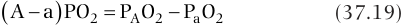

 A  a  PO2  PAO2  P Oa 2 (37.19) 

The normal value of the (A- a)PO2 is less than 10 mm Hg in young adults breathing room air, and it increases with age and the administration of supplemental O2. The change in (A- a)PO2 with age can be estimated by205

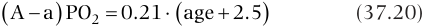

 A  a  PO2  0.21   age  2.5  (37.20) 

The (A- a)PO2 varies significantly with the FIO2 such that the application of supplemental O2 can lead to an increase in the (A- a)PO2 independent of pulmonary disease.202 Like the (A- a)PO2, the respiratory index (A- a)PO2/PaO2 and the PaO2/PAO2 are sensitive to FIO2, especially in the presence of a high degree of V /Q mismatch, such as during acute respiratory distress syndrome (ARDS), and less so in the absence of true shunt or when low V /Q regions are minimal (e.g., in healthy lung or pulmonary embolus).206

Unlike the other indices based on partial pressures, the PaO2/FIO2 ratio does not use the PAO2 and its associated assumptions. This index is more stable, particularly under

<!-- PDF page 19 -->

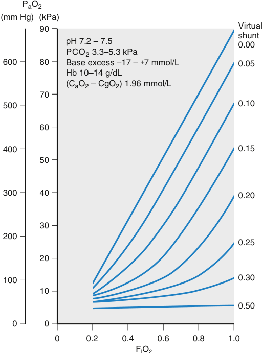

PaO2 (mm Hg) (kPa) Virtual 90 shunt pH 7.2 – 7.5 0.00 PCO2 3.3–5.3 kPa 600 80 Base excess –17 –  + 7 mmol/L 0.05 Hb 10–14 g/dL (CaO2 – CgO2) 1.96 mmol/L 70 500 0.10 60 400 0.15 50 300 40 0.20 30 200 0.25 20 100 0.30 10 0.50 0 0 0 0.2 0.4 0.6 0.8 1.0 FIO2 

**Fig. 37.16** Relationship between partial pressure of arterial oxygen _(PaO2)_ and fraction of inspired oxygen (FIO2) for different values of shunt fraction computed for normal values of barometric pressure, pH, partial pressure of carbon dioxide (PCO2), base excess, hemoglobin (Hb) concentration, and arterial–mixed venous oxygen content difference (CaO2 − CgO2). Note the small increase in PaO2 with FIO2 in the presence of large shunt. This graph corresponds to the so- called isoshunt diagram presented by Lawler and Nunn. (From Welsby PD, Earis JE. Some high pitched thoughts on chest examination. _Postgrad Med J_ . 2001;77:617–620.)

conditions relevant to ARDS such as PaO2 lower than 100 mm Hg in the setting of an FIO2 greater than 0.5.202,203 PaO2/FIO2 values are part of the diagnostic criteria for ARDS and have been correlated with outcomes in these patients.207 When repeated arterial blood sampling is not possible, the SpO2/FIO2 (also referred to as SF) ratio may be useful. SF ratio values have shown good correlation with PaO2/FIO2 values in both adults and children with respiratory failure who have SpO2 values in the range of 80% to 97%.208,209

The PaO2/FIO2 ratio does not characterize factors associated with the severity of respiratory failure such as ventilator settings or respiratory system mechanics.210–212 Another drawback of the PaO2/FIO2 ratio is its dependence on PEEP or mean airway pressure, because increases in these variables result in lung recruitment and improved oxygenation. As a consequence, the oxygenation index (OI) was proposed as a more robust alternative to the PaO2/FIO2 ratio213 :

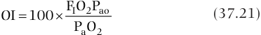

OI  100  F OI 2Pao (37.21) P Oa 2 

where Pao denotes the mean airway pressure. The OI has been used as a prognostic indicator in pediatric patients with acute hypoxemic respiratory failure,214 as a predictor of mortality in adult ARDS,212,215 and as an index of enhanced lung recruitment during oscillatory ventilation.216 An alternative “oxygenation saturation index” (OSI) has also been recently proposed:

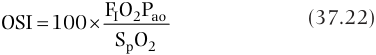

OSI  100  F OI 2Pao (37.22) SpO2 

Similar to the pulse oximetric saturation SpO2/FIO2 (SF) ratio, the OSI eliminates the need for invasive arterial blood gas sampling by using pulse oximetry. When computed on the day of ARDS diagnosis, it correlates well with the OI and is associated with increased mortality and fewer ventilatorfree days.210

Unlike PaO2, PaCO2 can be maintained in the normal range in the presence of significant V /Q mismatching. The reason is that the CO2 content curve has no plateau. In this way, compensatory hyperventilation can be used to reduce elevations in PaCO2.217 The dependence of PaCO2 on CO2 elimination (V CO2) and alveolar ventilation (V A), with k in the equation as a conversion factor equal to 0.863, is expressed by

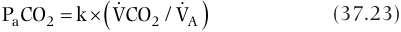

 P COa 2  k  VCO  2 / VA  (37.23) 

In steady- state conditions (constant V CO2), PaCO2 changes inversely with the alveolar ventilation. The traditional measure of ventilation inefficiency has been the fraction of dead space to tidal volume (VD/VT) as calculated using the Bohr equation (Eq. 37.15) and the assumption that the arterial and alveolar partial pressures of CO2 are equivalent (i.e., PACO2 = PaCO2). The dead space fraction determined in this manner includes alveolar (i.e., nonperfused alveoli) and anatomic dead space, as well as regions of high V /Q ratio. As with the discussion on shunt, the dead space fraction characterizes not only real anatomic dead space, but also areas of inefficient ventilation (see Fig. 37.17).

### MEASUREMENT PRINCIPLES

PaO2 is measured using a Clark electrode. The electrode consists of a cathode (either platinum or gold) and an anode in an electrolytic bath, surrounded by a thin O2 permeable membrane. The electrode is inserted into the sample, and O2 diffuses through the membrane and is reduced by the cathode, generating a current. The current is proportional to the PO2 in the sample.218 The PCO2 electrode measures the change in pH brought about by the equilibration of blood with a bicarbonate solution.219

### Effect of Temperature

The solubility of CO2 and O2 in blood is affected by temperature. At lower temperatures, solubility is increased, leading to a reduction in partial pressure. Blood gas analyzers measure gas partial pressures at 37°C. As blood from a hypothermic patient is warmed to 37°C by the analyzer, CO2 and O2 will come out of solution, leading to PaCO2 and PaO2 higher than those present in the patient. Blood gas analyzers make use of algorithms to correct the reported values to the patient’s actual temperature.220 The temperature effects on blood gas analysis are most relevant during management of

<!-- PDF page 20 -->

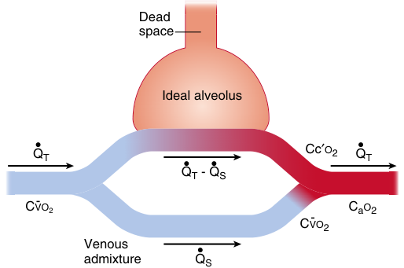

Dead space Ideal alveolus Q• T • • Cc′O2 Q• T QT - QS CVO- 2 CaO2 CVO2- Venous • admixture QS 

**Fig. 37.17 Three- compartment model of gas exchange.** The lung is represented as three functional units: alveolar dead space, “ideal” alveoli, and venous admixture (shunt). Note that the model doesn’t differentiate between true shunt or true dead space and components of shunt and dead space that are caused by ventilation–perfusion (V˙ /Q˙ ) mismatch. _CaO2_ , arterial oxygen content; _Cc′O2_ , oxygen content of end pulmonary capillary blood; Cv– O2, mixed venous oxygen content; Q˙ s, shunted blood flow; Q˙ T, total blood flow. (From Lumb AB. _Nunn’s Applied Respiratory Physiology_ , 6th ed. Philadelphia: Elsevier/Butterworth Heinemann; 2005.)

hypothermic patients, such as during hypothermic cardiopulmonary bypass (HCPB) or deep hypothermic circulatory arrest (DHCA).

Two strategies have been developed for the management of arterial gas partial pressures under these conditions: alpha- stat and pH- stat. During alpha- stat management, blood gas measurements obtained after the analyzer warms the sample to 37°C are used for acid–base and gas exchange management. Potential benefits of alpha- stat management include the preservation of cerebral autoregulation and the maintenance of protein function.221 During pH- stat management, measurements are corrected to the patient’s temperature before they are used for acid–base and gas exchange management. Because patients are hypothermic, the PaO2 and PaCO2 at the patient’s temperature are lower and the pH higher than those measured in the analyzer at 37°C. CO2 is usually added to the oxygenator to maintain the temperature- corrected PaCO2 and pH at normothermic values. The theoretical benefits of pH- stat management are increased cerebral vasodilation leading to more homogeneous cerebral cooling.222

Studies have compared the two strategies with respect to outcomes with varying results.223–230 In general, clinical studies support the use of pH- stat management in pediatric cardiac surgical procedures during HCPB or DHCA.225,229,231 In adult patients, the use of alpha- stat management is supported for HCPB.232 For procedures involving DHCA in adults, the use of pH- stat management has been suggested to increase the rate and uniformity of cooling and alpha- stat management during rewarming.233

### LIMITATIONS AND SOURCES OF ERRORS

Proper handling of arterial blood gas samples is important to prevent errors. Two common sources of error are delays in sample analysis and the presence of air in the sampling syringe.234 A delay in sample analysis by 20 minutes at

room temperature or at 4°C can lead to a decline in PaO2.234 The decline is attributed to the metabolic activity of leukocytes and is not observed in samples placed on ice. The presence of an air bubble in the syringe can lead to a change in the measured PaO2 toward the PO2 of the bubble and decline in PaCO2.234

## Monitoring Lung Flows, Volumes, and Pressures

As an organ of gas exchange, the human respiratory system relies on convective and diffusive gas transport processes for VO2 and elimination of CO2. The transport of air to the alveoli and alveolar gas to the environment requires the creation of a pressure gradient, which results in volume changes in the elastic components of the respiratory system, flow in the airways, velocity of moving tissues, and acceleration of air and tissues. The lung consists of a complex branching network of airway segments and viscoelastic tissues that, during the processes of spontaneous breathing or mechanical ventilation, gives rise to tremendous variations in gas velocities and flow regimens. The movement of gas flow (V ) into and out of the lungs requires pressure (P) to overcome the resistive (PR), elastic (PE), and at times inertial (PI) forces offered by the airway tree, parenchymal tissues, and chest wall:

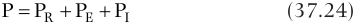

P  PR  PE  PI (37.24) 

Eq. 37.24 can be used to describe the mechanical behavior of the total respiratory system, the lungs alone, or the chest wall, depending on whether P refers to airway pressure relative to atmosphere (transrespiratory pressure), airway pressure relative to pleural pressure (transpulmonary pressure), or pleural pressure alone.235–237

### DYNAMIC RESPIRATORY MECHANICS

As a first approximation to Eq. 37.24, the mechanical behavior of the respiratory system during breathing or ventilation can be described according to the simple equation of motion that encompasses its resistive (R), elastic (E), and inertial (I) properties235,238 :

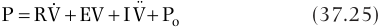

 ¨ P  RV  EV  IV  Po (37.25) 

where V is volume, V¨ denotes volume acceleration (i.e., the first time- derivative of flow or the second time- derivative of volume), and Po is the distending pressure at end expiration. The coefficients R, E, and I in Eq. 37.25 may refer to the mechanical properties of the total respiratory system (rs), the lungs alone (L), or the chest wall (cw), depending on whether P refers to transrespiratory pressure, transpulmonary pressure, or intrapleural pressure, respectively.237 The resistive properties of the respiratory system ( _Rrs_ ) are generally assumed to arise from viscous and turbulent losses associated with gas flowing through the airway tree and the deformation of parenchymal and chest wall tissues. Hence, airway resistance may reflect airway caliber.239 Provided that variations in flow are small, resistive pressure losses are assumed to be linearly related to flow according to the first term of Eq. 37.25. With more rapid flow rates, as may be seen during exercise or forced vital capacity maneuvers,

<!-- PDF page 21 -->

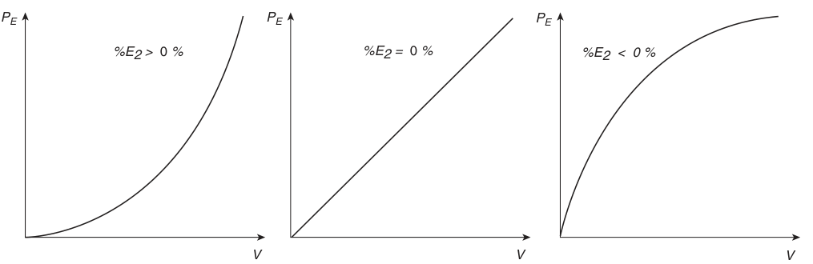

PE PE PE %E2 >   0  % %E2 =   0  % %E2  &lt;  0 % V V V 

**Fig. 37.18** Example elastic pressure ( _PE_ ) versus volume ( _V_ ) curves and corresponding percentage of volume- dependent respiratory system elastance ( _%E2_ ) values. (Modified from D’Antini D, Huhle R, Herrmann J, et al. Respiratory system mechanics during low versus high positive end- expiratory pressure in open abdominal surgery: a substudy of PROVHILO randomized controlled trial. _Anesth Analg._ 2018;126:143–149.)

resistive losses vary nonlinearly with flow, which may more accurately be described according to240

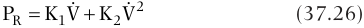

  2 PR  K1V  K2V (37.26) 

where K1 and K2 are empirically determined constants. Additional energy losses arise from the tension within the alveolar surface film,241 friction within the pleural space, and various tissue components of the parenchyma and chest wall,236 as well as cross- bridge cycling of contractile elements within the airway walls and lung tissues.242,243 Such losses are collectively termed “tissue resistance.”244,245 If these tissue resistive losses are assumed to be proportional to flow according to Eq. 37.25, one will observe that they vary inversely with breathing frequency,242,246 a phenomenon commonly associated with viscoelastic materials.236 In adult patients, lung tissue resistance comprises about 60% of subglottal total lung resistance at typical breathing rates.247 During volumecycled ventilation with an end- inspiratory pause, resistance can quickly be estimated from the difference between the peak (Ppeak) and plateau (Pplat) airway pressures (i.e., the resistive pressure loss PR) divided by the inspiratory flow (V I) immediately before the end- inspiratory pause:

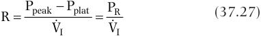

R  PpeakV  I Pplat  PV  RI (37.27) 

Thus, for a specified flow rate, alterations in PR may reflect changes in airway caliber, as may occur during an intraoperative asthma exacerbation (Fig. 37.18, center panel), or obstruction within the ETT or breathing circuit.

Elastic pressures arise from the recoil of the lungs and chest wall when their normal anatomic configurations are deformed, either by contraction of the diaphragm and intercostal muscles, or by some external force such as a ventilator.248 Elastance is defined as the change in distending pressure (transrespiratory, transpulmonary, or intrapleural) for a given change in volume. _Dynamic elastance_ refers to the change in elastic (i.e., nonresistive) distending pressure per unit volume during the process of breathing or ventilation† . Elastance of the total respiratory

> †Certain conventions of nomenclature incorrectly define dynamic elastance as the peak airway pressure divided by tidal volume. However, such a definition of dynamic elastance includes both resistive and elastic pressures, and thus is not an index of purely elastic processes.

system (Ers) comprises both lung (EL) and chest wall (Ecw) elastances:

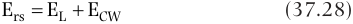

Ers  EL  ECW (37.28) 

In clinical settings, elastance is usually expressed as its reciprocal, compliance (i.e., change in volume per unit change in pressure). This leads to an alternate form of Eq. 37.28, expressing the relationships of the compliant components of the total respiratory system (Crs), lungs (CL), and chest wall (Ccw):

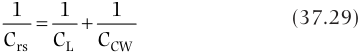

1 1 1   (37.29) Crs CL CCW 

Factors that increase total respiratory or lung elastance (or likewise reduce the corresponding total respiratory or lung compliance) include consolidation, pulmonary edema, pneumothorax, atelectasis, interstitial disease, pneumonectomy or surgical resection, lung overdistention, and mainstem intubation. Lung compliance generally increases in emphysema. Factors that reduce chest wall compliance are abdominal distention, abdominal compartment syndrome, chest wall edema, thoracic deformity, muscle tone, and extensive thoracic or abdominal scar (e.g., from burns); Ccw is reduced with muscle relaxation and flail chest.

In some situations, the magnitude of VT, relative to the functional lung size, may be such that the linear dependence of PE on V (Eqs. 37.24 and 37.25) is no longer an accurate description of the pressure–volume (PV) relationship of the lungs and/or chest wall. In these cases, elastic pressure may be more accurately described by a quadratic relationship with volume249,250 :

2 PE  E1V  E2V (37.30) 

in which E1 and E2 denote the so- called volumeindependent and volume- dependent components of elastance, respectively, since PE will be reduced to E1V when E2 is negligible (Eq. 37.23). An advantage of using Eq. 37.30 is that it readily allows for the determination of the percentage of volume- dependent elastance contributing to PE251 :

E2  E2VT  100 (37.31) E1  E2VT 

<!-- PDF page 22 -->

b  = 0.48 b  = 1.01 b  = 1.51 30 40 60 P (cmH20) 5 15 10 - VI Flow 0 TI TI 2TI Inspiratory time A B C 

**Fig. 37.19** Conceptual example of the stress index during constant inspiratory flow levels of V˙ I over durations of TI and 2TI, assuming that the power law (P = atb + c) can describe the pressure–time (P- t) curve. (A) b &lt;1.0, yielding a convex P- t curve, suggesting the dominance of intratidal recruitment; (B) b ∼1.0, yielding a straight P- t line, suggesting minimal recruitment or overdistention; and (C) b >1.0, yielding a concave P- t curve, suggesting the dominance of parenchymal overdistention. (Modified from Ranieri VM, Zhang H, Mascia L, et al. Pressure- time curve predicts minimally injurious ventilatory strategy in an isolated rat lung model. _Anesthesiology._ 2000:93:1320–1328.)

Since the %E2 index quantifies the deviation of linearity between PE and V, it may provide quantitative information on the degree of intratidal recruitment or overdistention occurring during a mechanical breath.252 For example, positive values of %E2 (see Fig. 37.18A) indicate a convex PE–V relationship, with probable overdistention occurring for %E2 greater than 30%.251 By contrast, negative values of %E2 (see Fig. 37.18C) indicate concave PE–V relationship, with likely intratidal recruitment occurring during the breath.253

For the special case of constant inspiratory flow during volume- cycled ventilation, the curvature of the inspiratory pressure–time profile can also be used to infer the processes of intratidal recruitment and overdistention. Raneiri and associates254 described this relationship using a simple power law expression:

P  atb  c (37.32) 

where, similar to Eq. 37.24, P may refer to either transrespiratory or transpulmonary pressure, and t is time. The constants a, b, and c can be estimated from the inspiratory pressure profile using various nonlinear regression techniques.255 The exponent b is referred to as the “stress index,” and its estimated value characterizes the convexity (b &lt;1.0), concavity (b >1.0), or linearity (b = 1.0) of the inspiratory pressure with time (Fig. 37.19). Similar to %E2, b may also provide some insight into the relative contributions of intratidal recruitment (b &lt;1.0) and parenchymal overdistention (b >1.0) to inspiratory pressure, or when these processes may be appropriately balanced (b ∼ 1). However, as noted, the stress index is only interpretable during volume- cycled ventilation with constant inspiratory flows, in contrast to the %E2 index, which can be used during other ventilatory modalities.256 Moreover, the interpretation of the stress index may be obscured during certain clinical situations, such as abdominal insufflation, abdominal compartment syndrome, or pleural effusion.257–259

Similar to Eq. 37.27 to estimate Rrs, linear approximations to respiratory system elastance (Ers) can be easily determined during volume- cycled ventilation for periods of zero flow (i.e., during an end- inspiratory pause, when resistive pressures are zero) as the difference between Pplat and PEEP (i.e., the elastic pressure PE) divided by the VT:

Ers  Pplat V  TPEEP  VPET (37.33) 

Since the value of Ers in Eq. 37.33 is obtained during zero flow, it is often referred to as “static elastance.” The corresponding static Crs is usually between 50 and 100 mL/ cmH2O in normal mechanically ventilated lungs. Alterations in PE for a specified VT may be observed during processes that alter lung or chest wall elastance, such as a pneumothorax during thoracotomy or abdominal insufflation during laparoscopic surgical procedures (Fig. 37.20, _right panel_ ). In contrast to static Ers, dynamic Ers is estimated during periods of nonzero flow by using multiple linear regression techniques (see later), and is higher than static elastance because of viscoelasticity238 and gas redistribution.260 Both the apparent static or dynamic Ers will decrease following a recruitment maneuver because of an increase in aerated or functional lung volume. However, Ers may also be increased due to _strain stiffening_ of the lung tissues,261 in which collagen fibers within the extracellular matrix of the parenchyma become progressively recruited with increasing strain. Recruitment of stiff collagen fibers results in their dominance of load- bearing within the lung, in contrast to the more stretchable elastin fibers that are the main loadbearing elements during low levels of tissue strain.262 Such behavior may allow for titration of PEEP to achieve an optimal balance between intratidal recruitment and parenchymal overdistention – that is, the PEEP for which Ers is minimized or, equivalently, Crs is maximized.249,250,263–266

The clinical utility of such PEEP titration in patients with ARDS is still not entirely established.265,267 Finally, inertial

<!-- PDF page 23 -->

Normal Increased resistance Increased elastance PR PR PR PE Pplat Ppeak PE Pplat Ppeak PE Pplat Ppeak PEEP PEEP PEEP 0 • • • VI VI VI 0 VT VT VT 0 Time Time Time Pressure Flow Volume 

**Fig. 37.20 Airway pressure, flow, and volume waveforms during constant- flow volume- cycled ventilation with an end- inspiratory pause.** The components of the peak inspiratory pressure (Ppeak) and the plateau pressure (Pplat) are presented: _PR_ , resistive pressure; _PE_ , elastic pressure; and _PEEP_ , positive end- expiratory pressure. The same peak flow (V˙ I) and tidal volume (VT) are delivered by the mechanical ventilator in each case. Leftmost panels represent waveforms in a healthy patient. There is a small resistive pressure component, with most of the peak pressure composed of elastic pressure. Expiratory flow decreases to zero before the start of the next inspiration, indicating appropriate I:E ratio and the absence of slowly emptying lung regions. Volume, as the integral of flow, also returns to zero before the initiation of the next breath. Middle panels represent waveforms in a patient with an increase in airways resistance. There is a significant increase in the resistive component PR, and consequently Ppeak. The elastic component is unchanged, as reflected in identical Pplat as compared with the healthy condition. Because increased resistance slows the process of lung emptying, the expiratory phase of the flow and volume curves now take longer to reach the zero. In several cases, the zero will not be reached, and a change in the I:E ratio will be necessary to avoid volume trapping and auto- PEEP. Rightmost panels represent a subject with increased PE, as may occur during laparoscopic insufflation or pneumothorax. There is an increase in Pplat consistent with the increased elastance of the respiratory system, and a fast emptying of the lungs during exhalation.

pressures are associated with the kinetic energy of accelerating the gas column in the central airways, as well as the motion of the respiratory tissues.268 Inertial pressures are typically expressed as the product of a lumped “inertia” parameter and volume acceleration (Eq. 37.25). Inertia is usually not a significant contributor to the apparent airway pressure or the work of breathing, except during sudden changes in air flow, as may occur during inspiratory step profiles or various modalities of high- frequency ventilation (HFV).269–271

Eqs. 37.27 and 37.33 cannot be used to estimate Rrs and Ers if an end- inspiratory pause is not present in the ventilator waveform. This is because one cannot easily separate the resistive and elastic pressures by visual inspection alone. For example, during pressure- controlled

ventilation (PCV), the airway opening is exposed to a constant inflation pressure during inspiration (Fig. 37.21). Airway flow and VT during PCV are determined not by the ventilator, but rather by the gradient between airway and alveolar pressures. Thus, a more robust method of estimating respiratory Rrs and Ers involves multiple linear regression of the coefficients in Eq. 37.25 on sampled flow and pressure data.272–274 Such numerical approaches are present in commercially available respiratory mechanics monitors, and they can be used on almost all ventilator waveforms. Moreover, estimates of mechanical properties based on linear regression are not restricted to volume- or time- cycled waveforms with an end- inspiratory pause. One can separately estimate Rrs and Ers during the inspiratory and expiratory phases, which may be different in

<!-- PDF page 24 -->

Normal Increased resistance Increased elastance P insp P insp P insp PEEP PEEP PEEP 0 0 VT VT VT 0 Time Time Time Pressure Flow Volume 

**Fig. 37.21** Airway pressure, flow, and volume waveforms during pressure- controlled ventilation for the same patients depicted in Fig. 37.18. In this ventilatory mode, the ventilator delivers a fixed pressure during the inspiratory phase, irrespective of the resistance and compliance. Airflow and tidal volume will consequently change with changes in those parameters. Leftmost panels represent waveforms in a patient with normal lungs. Middle panels represent waveforms in a patient with airway obstruction. Note the absence of a peak- plateau difference as compared with the volume- controlled mode, a lower VT, and a prolonged time for airflow to reach zero during exhalation as compared to the normal patient. Rightmost panels represent a subject with increased elastance, as may occur during laparoscopic insufflation or pneumothorax. Note a reduction in VT and a shorter time to reach zero flow consistent with a more rigid lung. _PEEP,_ positive end- expiratory pressure; _Pinsp,_ inspiratory pressure; _VT_ , tidal volume.

some patients because of dynamic airway compression or derecruitment.275,276

Dynamic estimates of total respiratory Rrs and Ers based on positive airway opening pressures are valid only during controlled modes of ventilation when the chest wall is relaxed. Although this is certainly the case during general anesthesia with neuromuscular blockade, the situation is more complicated during spontaneous breathing or assisted modes of ventilation. In such situations, the mechanics of the chest wall can be accounted for, if transpulmonary pressure is estimated using esophageal manometry, as described later.

### STATIC RESPIRATORY MECHANICS

As previously illustrated, elastance (or compliance) is most easily measured during periods of zero flow because during these conditions the measured distending pressure is exclusively associated with elastic processes. However, a

more comprehensive characterization of elastance can be obtained by plotting cumulative inspired or expired lung volume against the distending pressure across the lungs or total respiratory system. This quasi- static PV curve can be constructed during very slow inflations or deflations277 (when resistive pressures are negligible), or during periodic flow occlusions.278 For example, the expiratory limb of the PV curve can be constructed by inflating the lungs to a specified volume (usually total lung capacity) and then allowing a passive deflation with flow interruptions of 1 to 2 seconds.

The quasi- static PV curves of the lungs or total respiratory system are inherently nonlinear (Fig. 37.22); that is, compliance, defined as the local slope (dP/dV) of the PV curve, varies with lung volume. Empirically, PV curves are described using single exponential279 or sigmoidal280 functions. When they are described using sigmoidal functions, two points are usually demarcated on such curves, which have traditionally been termed the upper inflection

<!-- PDF page 25 -->

UIP Zone of overdistention Safe zone Zone of derecruitment and atelectasis LIP Pressure Volume 

**Fig. 37.22 Schematic of a pressure–volume curve for the lungs or total respiratory system, demonstrating hysteresis between inspiratory and expiratory limbs.** Upper inflection point (UIP) and lower inflection point (LIP) are demarcated on the inspiratory limb. During mechanical ventilation, lung regions should be in the safe zone for optimal lung protection.

point (UIP) and lower inflection point (LIP).‡ The UIP is thought to represent the point at which lung overdistention occurs, as during parenchymal strain- stiffening.203 The LIP is thought to reflect the process of maximum alveolar recruitment. During protective ventilation, one seeks to ventilate a patient in the most linear region of the PV curve.

Enough PEEP needs to be applied to avoid the LIP, where cyclic recruitment and derecruitment occur, along with lower VTs to avoid the UIP and overdistention.278 Also, PV curves exhibit hysteresis, a phenomenon in which the lung volume at a specified pressure depends on the direction from which the distending pressure is approached (i.e., either inspiration or expiration). The reasons that the PV curve of the lungs or total respiratory system exhibits hysteresis are numerous and complex, and include the biophysical properties of surfactant,281 time- dependent recruitment or derecruitment,282 as well as contact friction among various connective tissue elements.283

There are a number of problems with managing ventilation based on quasi- static PV curves. First, PV curves are constructed only during periods of zero flow or near zero flow, and they do not reflect the mechanics of the lungs or total respiratory system during the dynamic processes of breathing or mechanical ventilation. In fact, the dynamic PV relationships for the same patient may be very different. Second, the UIP and LIP are not always visually apparent. Finally, a PV curve for the lungs or total respiratory system represents the averaged static behavior of a population of many lung units, with each operating on different portions of their own individual PV curves.

> ‡The formal mathematical definition of an inflection point is a point on a curve at which its concavity (i.e., its second derivative) changes sign from positive to negative or vice versa.

### WORK OF BREATHING AND MECHANICAL POWER

The work of breathing (W) represents the energy required to inflate or deflate the lungs, or chest wall, or both, by a specified volume. In its simplest form, it can be represented as the product of the applied distending pressure and resulting volume change:

W  PV (37.34) 

However, when pressure and volume vary as functions of time (as during the course of a spontaneous or controlled breath), work may be expressed as the cumulative product284

W  PdV (37.35) 

or equivalently as the integral of the pressure- flow product with respect to time285

T W   P  t V  t dt (37.36) t  0 

where T is the duration over which W is determined. For example, if T corresponds to the duration of inspiratory period and P the transpulmonary pressure, then W corresponds to the work required to overcome both the resistive and elastic forces opposing the entry of air into the lungs (Fig. 37.23). If T corresponds to the duration of an entire breath, the energy initially stored in the elastic recoil of the lung tissues will be recovered during a passive exhalation. In this case, the area of the resulting PV loop represents the work performed (i.e., energy lost) overcoming purely resistive losses in the airways and tissues. In general, W is assessed during inspiration only because the respiratory musculature (or a ventilator) must overcome both elastic and resistive pressures to bring air into the lungs. For a given VT, W varies as a function of respiratory rate and, in most cases, achieves a minimum at a specified frequency. This frequency is termed the _energetically optimum breathing frequency_ ,285 as this is the rate at which energy expenditure is minimized. The derivative of W with respect to time is referred to as the _instantaneous mechanical power,_ P,

dW P  (37.37) dt 

which, based on Eq. 37.31, can simply be expressed as the pressure- flow product with respect to time:

 P  t  P  t V t (37.38) 

Mechanical power, as an index of the _rate_ of energy dissipation, can be used to assess the risk of developing ventilatorinduced lung injury,286 particularly with changes in transpulmonary pressure during ventilation.287 Moreover, if the relationship between pressure and flow during ventilation can be described by relatively simple mathematical expressions (e.g., Eqs. 37.25–37.27), the mechanical power likewise can be embodied by simple analytic formulæ.288,289 However, whether mechanical power may be predictive of ventilator- induced lung injury, or any meaningful clinical outcomes in ventilated patients with ARDS, is still a matter of contention.290–296

<!-- PDF page 26 -->

Inspiration Expiration Pressure Air injection transducer Balloon A E Fig. 37.24 Example of an esophageal balloon catheter.  The proxi- mal end of the catheter is connected to a pressure transducer, and air is injected into the balloon via a three- way stopcock. (Modified from Bates JHT.  Lung Mechanics: an Inverse Modeling Approach . Cambridge: Cam- bridge University Press; 2009:220.) MONITORING OF RESPIRATORY PRESSURES Fundamental to any quantitative assessment of respiratory mechanics is the measurement of pressure. Such pressures may include those measured in the inspiratory or expiratory B F limb of the anesthesia machine, at the proximal end of an ETT, or within the trachea or esophagus. Pressure allows for the inference of the forces associated with the movement of gases through the airway tree, as well as the distention of the parenchymal tissues and chest wall, according to the elements described in Eq. 37.24. The most accessible and familiar pres-Eq. 37.24. The most accessible and familiar pres-. The most accessible and familiar pres- sure to the anesthesiologist or intensivist is the airway pressure during controlled mechanical ventilation. Ideally, this should be the pressure measured in the trachea or at the airway open- ing, exclusive of any distortions from airway devices or breath- ing circuits. However, for practical reasons, this “airway” pressure is not the actual pressure at the airway opening or within the trachea, but is the pressure transduced at the anes- C G thesia machine or ventilator and reflects the resistive and com- pliant properties of the breathing circuit and face mask or ETT, as well as the mechanical properties of the respiratory system. Although many ventilators now use computer algorithms to provide some compensation for flow and pressure losses in the breathing circuit, 297  such approaches often rely on idealized, linear models that do not truly reflect the complex processes of turbulent air flow, polytropic gas compression, or viscoelas- tic tubing walls. 298,299,299299  Therefore, one must use caution when making physiologic inferences based on airway pressures and volumes reported by a ventilator. Often airway pressure is improperly used as a surrogate D H for lung distention.  Transrespiratory pressure  refers to the Pressure pressure drop across the lungs and chest wall, which during Volume 

Fundamental to any quantitative assessment of respiratory mechanics is the measurement of pressure. Such pressures may include those measured in the inspiratory or expiratory limb of the anesthesia machine, at the proximal end of an ETT, or within the trachea or esophagus. Pressure allows for the inference of the forces associated with the movement of gases through the airway tree, as well as the distention of the parenchymal tissues and chest wall, according to the elements described in Eq. 37.24. The most accessible and familiar pres-Eq. 37.24. The most accessible and familiar pres-. The most accessible and familiar pressure to the anesthesiologist or intensivist is the airway pressure during controlled mechanical ventilation. Ideally, this should be the pressure measured in the trachea or at the airway opening, exclusive of any distortions from airway devices or breathing circuits. However, for practical reasons, this “airway” pressure is not the actual pressure at the airway opening or within the trachea, but is the pressure transduced at the anesthesia machine or ventilator and reflects the resistive and compliant properties of the breathing circuit and face mask or ETT, as well as the mechanical properties of the respiratory system. Although many ventilators now use computer algorithms to provide some compensation for flow and pressure losses in the breathing circuit,297 such approaches often rely on idealized, linear models that do not truly reflect the complex processes of turbulent air flow, polytropic gas compression, or viscoelastic tubing walls.298,299,299299 Therefore, one must use caution when making physiologic inferences based on airway pressures and volumes reported by a ventilator.

Often airway pressure is improperly used as a surrogate for lung distention. _Transrespiratory pressure_ refers to the pressure drop across the lungs and chest wall, which during positive- pressure ventilation is usually determined by the difference between airway pressure and atmospheric pressure. Several processes that may contribute to increased transrespiratory pressure do not correspond to excessive lung inflation. For example, obesity, abdominal insufflation, or steep Trendelenburg position all may contribute to high airway opening pressures, but they do not necessarily indicate parenchymal overdistention.

**Fig. 37.23 Volume plotted against transpulmonary or (transrespiratory) pressure during the course of a single breath.** Plots are shown during inspiration (panels A through D) and expiration (panels E through H). _Orange area_ denotes the work of breathing due to tissue elasticity, while the _blue area_ denotes the work of breathing due to airways and tissue resistance. Energy stored in elastic recoil at the end of inspiration will be entirely recovered during expiration. However, resistive energy will always be lost during both inspiration and expiration.

<!-- PDF page 27 -->

By contrast, _transpulmonary pressure_ refers to the distending pressure across the lungs alone. Its determination requires not only measurement of airway opening pressure, but also estimates of the pressure within the pleural space. This can be obtained relatively noninvasively using an esophageal balloon catheter, because the pressure measured within the esophagus is relatively close to intrapleural pressure.300,301 Such catheters are typically 100 cm long, with side holes in the distal tip covered by a thin- walled balloon (Fig. 37.24). The catheter can be placed through the mouth or nares and positioned in the middle- to- distal third of the esophagus. The catheter is connected to a transducer by a three- way stopcock, and a small amount of air is injected into the balloon such that its walls remain flaccid and do not contribute an additional recoil pressure to the measurement. Because the local values of pleural pressure vary depending on gravity, the balloon should be several centimeters in length to provide an average estimate of the pressure field surrounding the lungs. Estimating pleural pressure based on esophageal manometry has several limitations, including mediastinal compression of the balloon in supine patients, catheter migration, and cardiac artifact on the tracing.302,303 Nonetheless, its use in critically ill patients and under certain special conditions such as obesity, abdominal hypertension (primary or during laparoscopic insufflation), and extreme Trendelenburg position may be valuable in the adjustment of appropriate levels of PEEP.304,305 Peak and plateau pressures, which are typical in clinical practice, are obtained from the _transrespiratory_ pressure. Accordingly, they do not characterize the pressures acting exclusively on the lungs, but on the whole respiratory system. Current recommendations suggest limiting transrespiratory plateau pressures to 26 to 30 cmH2O, to minimize alveolar overdistention.306 However, such recommendations should be applied in appropriate clinical context, given that the same plateau pressure could correspond to very different transpulmonary pressures, and consequently to very different degrees of risk for lung injury, depending on the partitioning between lung and chest wall pressure components.307,308

More recent studies suggest that the “driving pressure” – that is, the VT normalized by the respiratory system compliance (ΔP = VT/Crs) – may be one of the most important ventilatory variables to consider when stratifying mortality risk during ARDS.309,310 Its relationship to postoperative pulmonary complications in surgical patients has also been demonstrated.311,312 In practice, driving pressure may be computed as the difference between Pplat and PEEP.309

_Auto- PEEP_ or _intrinsic- PEEP_ is the positive pressure present within the alveoli at end- exhalation and is typically observed in ventilated patients with COPD, who demonstrate dynamic airway compression and expiratory flow limitation, as well as a significant portion of patients with ARDS, sepsis, and respiratory muscle weakness.313 AutoPEEP can promote significant respiratory and hemodynamic compromise. It is usually caused by a combination of increased airway resistance and reduced lung elastic recoil (i.e., an increase in the expiratory time constant of the respiratory system). Other factors are a decrease in expiratory time, an increase in VT, an increase in external expiratory resistance, and persistent inspiratory muscle activity during exhalation. The amount of auto- PEEP can be estimated in mechanically ventilated patients by occluding the airway

at end exhalation, and observing a rise in airway pressure during the occlusion maneuver until a plateau is visible (&lt;4 seconds) (Fig. 37.25). Auto- PEEP is then defined as the difference between end- occlusion to preocclusion airway pressures. Other methods can be used to assess auto- PEEP under dynamic conditions, as well as in spontaneously breathing patients with the use of an esophageal balloon.313,314

Any measurement of pressure requires pressure transducers. Most pressure transducers are differential sensors with two input channels, and they produce an electrical output that is proportional to the pressure difference between these channels (Fig. 37.26A). Such transducers exhibit a high common- mode rejection ratio, defined as the tendency of the transducer to produce zero output if both of its inputs are exposed to identical pressures. Many pressure waveforms are transduced relative to atmosphere with one of the two inputs left opened to ambient air (Fig. 37.26B), otherwise referred to as gauge configuration. In clinical settings, pressure is most commonly measured using relatively inexpensive, piezoresistive transducers.238 These devices rely on a pressure- sensing diaphragm whose electrical resistance changes when it is deformed in response to a differential pressure. This change in electrical resistance can be sensed with a standard Wheatstone bridge circuit, which produces an output- voltage signal appropriate for amplification and filtering. In general, piezoresistive transducers have adequate frequency responses sufficient for most respiratory applications.315,316 However, this frequency response can be easily degraded if the transducer is connected to the pressure- sensing location with long, compliant tubing.317

### MONITORING OF RESPIRATORY FLOWS

Ideally, any measurement of flow should indicate the exact rate at which gas is entering and leaving the patient’s lungs. This can be most easily accomplished by placing the flow- measuring device as close to the patient as possible, such as between the circuit Y- connector and the proximal end of the ETT or LMA. However, for practical reasons, most ventilators and anesthesia machines measure flow close to the machine console. This flow can be considerably different from that close to the patient because of the effects of gas compression, wall distention of the breathing circuit, and changes in gas humidity.

An important clinical use of flow monitoring is the detection of nonzero end- expiratory flows. This indicates that a gradient of pressure exists between alveolar regions and the upper airway with incomplete lung emptying at endexpiration, characteristic of auto- PEEP (PVolFl- 7). As a consequence, end- expiratory lung volumes would be larger than those in the absence of auto- PEEP, with risk of dynamic lung hyperinflation and reduction of venous return. Increase in expiratory time and reduction of VT or respiratory rate should be considered to eliminate the issue.

During ventilation, airway flow can often be inferred according to time- dependent changes in delivered or inspired VT or from the displacement waveform of a piston or cylinder arrangement or bellows.318–320 Preferably, flow is measured using transducers designed specifically for this task. The most common method involves the measurement of a differential pressure decrease (ΔP) across a fluid resistive element. Ideally, this ΔP is linearly related to the

<!-- PDF page 28 -->

Expiratory port open Expiratory port occluded No flow 8 MV 8 8 MV 8 0 0 30 20 10 0 Dynamic auto-PEEP Static auto-PEEP (4 cmH2O) (8 cmH2O) 1 0 O)(cmH2 Tracheal pressure Flow (L/s) 

**Fig. 37.25 Concept of intrinsic positive end- expiratory pressure (auto- PEEP).** Shown are tracheal pressure and flow waveforms during controlled mechanical ventilation. Dynamic auto- PEEP can be estimated at the beginning of inspiration as the tracheal pressure when the flow trace equals zero. Static auto- PEEP can be estimated as the tracheal pressure following a prolonged expiratory occlusion. (Modified from Blanch L, Bernabé F, Lucangelo U. Measurement of air trapping, intrinsic positive end- expiratory pressure, and dynamic hyperinflation in mechanically ventilated patients. _Respir Care_ . 2005;50:110–123; and Moon RE, Camporesi EM. Respiratory monitoring. In: Miller RD, Fleisher LA, Johns RA, eds. _Miller’s Anesthesia,_ 6th ed. New York, NY: Churchill Livingstone; 2005:1255, 1295.)

Deformable element Pressure Port to atmosphere Pressure 1 Pressure 2 Differential configuration Gauge configuration A B Fig. 37.26 Pressure transducers arranged in differential (A) or gauge (B) configurations. (Modified from Bates JHT.  Lung Mechanics: An Inverse Modeling Approach . Cambridge: Cambridge University Press; 2009:220.) 

corresponding flow through the device. Such a principle forms the basis for one of the oldest and most widely used flowmeters, the pneumotachograph. Although the instruments provide accurate measurement of flow, pneumotachographs are very sensitive to changes in temperature, humidity, and gas composition,321 and require frequent calibration using various electronic or software- based techniques to ensure accurate measurements.322,323 This sensitivity, combined with difficulties in cleaning and sterilization, limits the routine use of these instruments in clinical environments. Orifice flowmeters also have the advantage of having relatively large internal diameters that limit the formation of condensation and minimize obstruction with secretions. Given that these devices can be manufactured using inexpensive plastic injection molding techniques,

many orifice flowmeters are designed to be disposable, thus making their use increasingly popular for respiratory applications in clinical environments.324

Most anesthesia machines use hot wire anemometers for flow measurement,325 which rely on temperaturedependent changes in the electrical resistance of a current carrying wire. When gas flows past the wire, the corresponding temperature drop changes the conductivity of the filament, which can be sensed with appropriate electronic circuits.326 Because a single wire filament cannot sense the direction of flow, two different anemometers can be used in the ventilator circuit: one for the inspiratory limb, and the other for the expiratory limb. Alternatively, two wires in series must be used for sensing bidirectional flow through a single conduit,327 with the flow direction determined according to which wire is cooled first. In general, hot wire anemometers have a better dynamic response compared with pneumotachographs or orifice flowmeters,328 making them ideal for flow measurement during HFV.270,329 However, these devices must also be calibrated to account for variations in gas density or humidity as well.330

### MONITORING OF RESPIRATORY VOLUME

Similar to flow measurement, the ideal measurement of volume should be an accurate accounting of the gas quantity moving into and out of the patient. However, delivered or exhaled VT measurement is subjected to the same

<!-- PDF page 29 -->

limitations of flow measurement because most anesthesia machines and ventilators determine volume by electrically or numerically integrating the corresponding flow signal.238 Care must be taken to ensure any drifts or offsets from the flow transducer are minimized, given that their integration will result in errors in estimated volume. This may be accomplished by appropriately zeroing the transducer periodically, such as at the end of a breath. Although electronic or digital high- pass filters may be used to remove drifts and offsets in real- time, these tend to have long transient responses.331,332

Finally, besides the pathophysiologic and monitoring applications described in this section, monitoring of pressures, volumes, and flows has been applied to monitoring, training, and education for neonatal resuscitation.333

## Plethysmographic Monitoring

Respiratory inductance plethysmography (RIP) is a noninvasive respiratory monitoring technique that quantifies changes in the cross- sectional area of the chest wall and the abdominal compartments. The method is used to assess VT, respiratory rate, adequacy of high- frequency oscillatory ventilation (HFOV), lung volume changes during tracheobronchial suctioning, and thoracoabdominal synchrony.334 RIP relies on the principle that a current applied through a loop of wire generates a magnetic field normal to the orientation of the loop (Faraday’s law) and that a change in the area enclosed by the loop creates an opposing current within the loop directly proportional to the change in the area (Lenz’s law). Two elastic bands containing a conductor are used: one typically placed around the patient’s chest, 3 cm above the xiphoid process; and the other around the abdomen. Each of these bands produces an independent signal representative of the thoracic and abdominal cross- sectional area, and the sum of these two signals calibrated against a known gas volume yields lung volume change.

There have been several pediatric applications of RIP to monitor VT, respiratory rate, and breathing patterns aiming at postoperative apnea, building on the advantage that a face mask, LMA, or ETT is not required for measurements.335–338 The technique could also guide lung- protective ventilation strategies by facilitating the construction of PV curves for individual patients. These can be used to optimize lung recruitment, maintain an open lung, and limit overdistention (see the section on Static Respiratory Mechanics, above). RIP has found several applications in sleep studies.

Intraoperatively, RIP may be useful in areas for which accurate monitoring of VT is required but not possible with the usual anesthesia machine monitors. This could occur with a shared airway (e.g., laryngotracheal surgery,339 flexible and rigid bronchoscopy340 ), or a patient whose trachea is not intubated (e.g., monitored anesthesia care and noninvasive pressure support ventilation).

Limitations of intraoperative RIP include the fact that it cannot be used during thoracic and abdominal surgery, because of the need for the measurement bands. Also, the calibration characteristics of the device are affected by changes in the pattern of breathing.341

## Respiratory Rate Monitoring: Apnea Monitoring

Apnea and bradypnea are life- threatening events frequently observed in the intraoperative and postoperative periods of anesthesia. Prematurity, morbid obesity, age, obstructive sleep apnea, and central nervous system depressant medications have been associated with risk of apnea or bradypnea.342,343 Accordingly, many different approaches have been developed for detecting those events.344,345 Two main types of apnea are observed: central and obstructive. Central apnea is defined as apnea resulting from a failure of the central nervous system to drive respiration. Obstructive apnea is that resulting from upper airway obstruction. Current monitors assess at least one of three processes occurring during breathing to detect apnea345 : chest wall expansion, gas flow, and gas exchange.

_Chest wall expansion_ is usually measured as follows:

1.  Changes in thoracic electrical impedance (impedance pneumography) of the chest wall. The method is based on the changes in electrical conductivity of the chest to an electrical current as air moves in and out of the lungs during breathing and blood volume changes in the same period. This is because air is a poor electrical conductor and blood is a good electrical conductor. A low electrical current at high frequency is applied in two chest electrodes, corresponding changes in voltage of the chest are measured, and the impedance is continuously calculated from these. The technique is implemented in several commercial systems using routine electrocardiographic leads and is also used in home monitoring of neonatal apnea.

2.  Inductive plethysmography (as described earlier).

3.  Abdominal and chest fiberoptic and resistive strain gauges (a pressure pad placed alongside the infant’s rib cage, pneumatic abdominal sensors) are used.

4.  Electromyographic signal of respiratory muscles is not frequently used because of the low signal- to- noise ratio.

An important drawback of techniques based on chest expansion is their inaccuracy in the presence of movement. Thus, obstructive apnea may be falsely assessed as normal respirations.346

_Gas flow methods_ are based on measurements of different variables directly related to the presence of air flow in the airway:

1.  Pressure gradients along the breathing circuit. This approach uses the Poiseuille principle (ΔP = k × V) and differential pressure transducers to detect flow.

2.  Temperature of the breathed air in the nose or mouth is used.

3.  Rapid response hygrometer is based on assessment of humidity in the exhaled air.

_Techniques based on gas exchange_ focus essentially on exhaled CO2, as routinely used in intubated patients in the operating room. In nonintubated patients, the use of specifically designed cannulae combining DO2 and breathed gas sampling facilitates the monitoring of exhaled CO2. Capnography allows for early detection of respiratory depression

<!-- PDF page 30 -->

before O2 desaturation, particularly when supplemental O2 is administered.347,348 Off- line or in- line infrared sensors are the most common technique. Respiratory rate measurements using these techniques were more accurate than those obtained with thoracic impedance tomography in extubated patients in postanesthesia care units, even with supplemental O2 at high flows.349 Accurate end- tidal CO2 measurements through a nasal cannula may be difficult in mouth breathers, including obese patients and those with obstructive sleep apnea. In such cases, a nasal cannula with an oral guide may improve measurement accuracy.350 Simulation studies indicated that respiratory rate can be accurately monitored during esophagogastroduodenoscopies using a CO2 sampling bite block or a nasal cannula with oral cup. The accuracy of PETCO2 measurements depends on the device used, O2 flow, the intensity of oral breathing, and minute ventilation.351

Pulse oximetry cannot be used as the primary monitor of apnea or bradypnea because O2 desaturation occurs only late in a well- oxygenated apneic patient. However, pulse oximetry adds an additional level of safety combined with primary monitors of ventilation. For example, in a study using pulse oximetry and noninvasive capnography for continuous monitoring of 178 patients receiving patientcontrolled analgesia, respiratory depression measured by O2 desaturation occurred in 12% of the patients, in line with previous studies.342 In contrast to previous estimates, episodes of bradypnea (respiratory rate &lt;10 breaths/min) were present in 41% of patients, far more frequently than the previously reported 1% to 2%.352–354

Respiratory rate monitoring is also critical to infant apnea monitoring. Combinations of transthoracic impedance and pulse oximetry may maximize the detection of true episodes of apnea in home monitors for neonatal apnea.355 This is because pulse oximetry provides an additional level of monitoring in cases of poor performance of transthoracic impedance secondary to motion artifacts. The value of combining monitors of ventilation such as capnography with pulse oximetry to maximize the detection of alveolar hypoventilation has been confirmed.356 Capnography allowed for early detection of arterial O2 desaturation in cases of alveolar hypoventilation in the presence of supplemental O2.

False- positive and false- negative alarms occur during apnea monitoring. The most dangerous conditions occur when artifacts are detected as breathing and alarms are not activated. Such artifacts include vibrations, cardiac motion, patient movement, and electromagnetic interference from other instrumentation. Impedance pneumographs are subject to cardiovascular artifacts, whereas pressure pads are subject to patient motion artifacts. A more common (yet less dangerous) problem is when an alarm sounds in a patient without apnea. Frequent causes include inadequate sensitivity settings, malfunctioning electrodes, and movement of the patient. Motion transducers based on sensing of acceleration were used in neonates undergoing HFOV, and results showed that monitoring of regional tidal displacement may enable the early recognition of deteriorating ventilation during HFOV that eventually leads to hypoxemia.357 This study found that in approximately half of the cases, hypoxemia had causes other than slowly deteriorating ventilation.357

Current recommendations of the Anesthesia Patient Safety Foundation for Essential Monitoring Strategies to Detect Clinically Significant Drug- Induced Respiratory Depression in the Postoperative Period (http://www.apsf. org/initiatives.php), including opioid- induced ventilatory impairment, state that continuous electronic monitoring of oxygenation and ventilation should be available and considered for all patients, not only those at risk for postoperative respiratory insufficiency. This is because selective monitoring is likely to miss respiratory depression in patients without risk factors. These recommendations stress that maintaining _status quo_ while awaiting newer technology is not acceptable, and that intermittent “spot checks” of oxygenation (pulse oximetry) and ventilation (nursing assessment) are not adequate for reliably recognizing clinically significant evolving drug- induced respiratory depression. Continuous electronic monitoring should not replace traditional intermittent nursing assessment and vigilance. All patients should have oxygenation continuously monitored by pulse oximetry. Capnography or other monitoring modalities that measure ventilation and airflow are indicated when supplemental O2 is needed to maintain acceptable O2 saturations. The recommendations also call attention to threshold- based alarm limits on individual physiologic variables, which may result in failure to recognize early signs of progressive hypoventilation by being either insufficiently, or too, sensitive (excess false alarms).

Unexpected death has been associated with three patterns of respiratory depression.358–360 (1) Hyperventilation compensated respiratory distress (e.g., from sepsis, pulmonary embolus, or congestive heart failure): patients present initially with stable SpO2 and decreasing PaCO2 as metabolic acidosis develops with associated compensatory hyperventilation. High respiratory rate is typical of this pattern. Ultimately, a slow desaturation is followed by an abrupt fall in oxygenation as the ventilatory response to worsening acidosis fails. (2) Progressive unidirectional hypoventilation or CO2 narcosis: frequently due to opioid or other sedative overdose, it is characterized by a rise in PaCO2 (and PETCO2) initially because of decreased minute ventilation, often while SpO2 remains above 90%. (3) Sentinel rapid airflow/ O2 saturation reduction with precipitous SpO2 fall observed in patients with obstructive sleep apnea, who are dependent on the arousal state to maintain oxygenation. Sleep results in precipitous hypoxemia during apnea with potential sudden arrest.

## Imaging for Respiratory Monitoring

Imaging as a monitoring technique provides tremendous insight into pulmonary structure, function, and inflammation in both health and disease.361–363 However, exposure to radiation and bulky devices has prevented its use at the bedside. Technologic advances have led to the introduction of new modalities with more compact equipment for clinical use. This may herald an important shift in respiratory monitoring toward the increased use of bedside imaging. Such improvements come with the advantages of less radiation exposure, noninvasiveness, and more detailed physiologic information.

<!-- PDF page 31 -->

### CHEST RADIOGRAPHY

Chest radiography has been the traditional imaging method to assess intrathoracic conditions in the operating room, postoperative anesthesia care unit, and ICUs. Anesthesiologists should be familiar with basic radiologic findings representative of important pulmonary conditions such as interstitial infiltrates, hyperinflation, pneumothorax, pleural effusion, and consolidation. The image during chest radiography, as well as computed tomography, is based on the physical principle that X- rays reaching a detector (e.g., film) depend on tissue absorption, which varies linearly with tissue density. However, radiation exposure restricts frequency of use. Furthermore, technical difficulties limit image quality. These difficulties include reduced resolution caused by patient movement during acquisition, and image distortion related to proximity of the X- ray beam source to the film/detector and posterior position of the film cassette.

### ULTRASONOGRAPHY

Lung ultrasonography is a technique increasingly used in the perioperative, critical care, and emergency settings in adults and children.364–367 Critical and systematic approaches have proven that important clinical information can be obtained with lung ultrasonography at levels comparable to computed tomography.367 Such features add to the advantages of practicality, low cost, and absence of radiation or other significant biologic side effects. Excellent reviews have been published, and the reader should refer to those for additional learning.366,367

Lung ultrasonography has been applied successfully in the assessment of pneumothorax, interstitial syndrome (i.e., cardiogenic and permeability pulmonary edema), lung consolidation, and pleural effusion. Currently available multipurpose ultrasonography probes can be used for specific portions of the pulmonary exam according to their characteristics. For instance, the high- frequency (10– 12 MHz) linear array probe allows for detailed examination of the pleura and superficial changes, such as pneumothorax. This probe’s limitations include its size, which impedes access to larger areas of lung tissue because of the interference of the ribs, and high frequency, which limits assessment of deeper structures. A lower-frequency (1–5 MHz) probe provides improved depth penetration and is used to assess supradiaphragmatic structures (pleural space, lung). To optimize lung visualization with a single probe, frequently probes with emission frequencies of 5 to 7 MHz are used and are usually small with a tip shaped so that an acoustic window on the lung parenchyma can be obtained on intercostal spaces. The 5-MHz microconvex probe is frequently favored,364,365 although curvilinear and phasedarray probes are also appropriate.366

When examining the patient, a methodical approach should be used to ensure comprehensive assessment of lung structure and function. Different approaches have been proposed for point- of- care lung ultrasound.366,368 A complete exam involves the bilateral assessment of the anterior, lateral, and posterior lung. Although protocols vary, in the supine patient, each hemithorax should be assessed in at least six zones during emergencies: two anterior (separated by the third intercostal space), two lateral, and two

posterior. In routine assessments, 8- zone and 12- zone protocols are most commonly used.366,368–370 Because of the significant acoustic impedance differences between air, tissue, and bone (ribs), thoracic ultrasound is based primarily on characteristic artifacts and not only on the visualization of anatomic structures.371 Videos of 1 to 2 breaths should be acquired to take advantage of the lung dynamics in the findings. Machine settings should be optimized at the start of the examination.366 Usually, studies are initiated with the identification of the ribs as hyperechoic lines producing significant ultrasonography shadow (Fig. 37.27A), followed by visualization of the pleural line approximately 0.5 to 1.0 cm deeper and between the ribs. This is typically a bright, slightly curved line. These are major structures to be identified because many pathologies of relevance to the anesthesiologist affect their observed pattern. In the normal lung, lung sliding represents the movement of the visceral on the parietal pleura during respiration and is another key sonographic finding to be appreciated. The magnitude of the movement is larger in regions closer to the diaphragm than those near the lung apex.

Below the pleura, hyperechoic horizontal reverberation artifacts at regular distances are referred to as A- lines (see Fig. 37.27A). Another artifact is the B- line, a discrete laserlike vertical hyperechoic reverberation artifact that arises from the pleural line (previously described as “comet tails”), extends to the bottom of the screen without fading, moves synchronously with lung sliding, and erases A-lines (see Fig. 37.27B,C). Solitary B- lines are a normal finding in the normal lung, and increased numbers are observed in disease. Based on the recognition of such artifacts, pathologic conditions are identified.364–366,372 Most acute disorders involve the lung surface, and this explains the utility of thoracic ultrasound in visualizing them. Ultrasonography findings for pneumothorax are the absence of lung sliding, B- lines, and lung pulse, and the presence of lung points.

Pleural effusions are characterized by a usually anechoic space between the parietal and visceral pleurae (see Fig. 37.27C,F) and by respiratory movement of the lung within the effusion (“sinusoid sign”). The presence of echogenic material within the effusion suggests an exudate or hemorrhage, although some exudates are anechoic. Most transudates are anechoic. The M- mode ultrasound scan shows parallel lines indicative of no moving structure underlying the probe. The ultrasonographic finding designated as a lung point is found in the presence of pneumothorax and represents the imaging of the cyclic transition during breathing from the absence of any sliding or moving B- lines at a physical location (i.e., air with no lung parenchyma) to the visualization of lung sliding, B- lines, or altered A- lines indicative of lung tissue (see Fig. 37.27D).365,373 Bedside ultrasound scans can detect pneumothorax with sensitivity similar to a computed tomography scan.364,365

An interstitial syndrome is characterized by the presence of multiple B- lines, a pattern potentially associated with the water/gas ratio in lung tissue.374 A positive region is defined by three or more B- lines in a longitudinal plane between two ribs (see Fig. 37.27E).365 Lung consolidation is characterized sonographically by a subpleural echopoor region or one with tissue- like echo- texture (see Fig. 37.27F). Lung consolidations may be caused by infection, pulmonary embolism, lung cancer and metastasis,

<!-- PDF page 32 -->

A B C D E F 

**Fig. 37.27** (A) Typical thoracic view depicting adjacent ribs (R) producing acoustic shadowing. The white echogenic pleural line _(block arrow)_ is approximately 0.5 cm below the ribs. A- line artifacts _(line arrows)_ are seen at equidistant spaces below the pleural line. (B) B- line, or comet- tail artifact _(line arrow)_ , is the hyperechoic artifact extending from the pleural line to the edge of the screen, erasing the A- line. A solitary B- line is a usual finding in normal lungs. (C) Pleural effusion: image obtained at the posterolateral region showing the parietal pleural _(upper horizontal arrows)_ , the rib shadows _(vertical arrows)_ , and the visceral pleura (line indicated by the _lower horizontal arrows_ ) with the underlying lung. The dark anechoic region between the parietal and visceral pleura represents the pleural effusion. A B- line artifact _(asterisk)_ originates from the lung and not from the pleural line, implying the presence of aeration. (D) M- mode of lung ultrasound illustrative of the “lung point” for diagnosis of pneumothorax. The sudden inspiratory transition from a parallel line pattern indicative of absence of lung motion (pneumothorax) to a granular pattern indicative of lung tissue can be observed _(arrow)_ . (E) Interstitial syndrome case showing B- lines 7 mm or less apart. Notice the increased number of B- lines as compared to panel (B). The pleural line _(arrow)_ and ribs are also appreciated. (F) Lung consolidation with pleural effusion. As in (C), the image was obtained at the posterolateral region showing the parietal pleura _(upper horizontal arrows)_ and the visceral pleura and lung _(lower horizontal arrows)_ with an anechoic pleural effusion between them. Lung tissue denser than that presented in (C) with gas barriers _(vertical arrows)._ This indicates pleural fluid with alveolar fluid often seen in critically ill patients. (A, B, D, E, From Turner JP, Dankoff J. Thoracic ultrasound. _Emerg Med Clin North Am_ . 2012;30:451–473, ix. C, F, From Lichtenstein DA. BLUE- protocol and FALLS- protocol: two applications of lung ultrasound in the critically ill. _Chest._ 2015;147[6]:1659–1670.)

compression atelectasis, obstructive atelectasis, and lung contusion. Additional sonographic signs that may help determine the cause of lung consolidation include the quality of the deep margins of the consolidation, the presence of comet- tail reverberation artifacts at the far- field margin, the presence of air or fluid bronchograms, and the vascular pattern within the consolidation. Advances in clinical research and experience in lung ultrasonography allowed for the proposal of an algorithm to assess severe dyspnea in the acute setting (Fig. 37.28). The denominated BLUE protocol is a stepwise ultrasonographic approach to the patient with acute respiratory failure that aims at expeditious diagnosis with 90.5% accuracy.367,372,375 Several scoring systems have been developed to extend bedside lung ultrasound from a diagnostic to a monitoring modality.368

### ELECTRICAL IMPEDANCE TOMOGRAPHY

Electrical impedance tomography (EIT) is a noninvasive and radiation- free imaging modality used to assess regional lung function at the bedside. The method is clinically available and has moderate-to-low spatial resolution but high temporal resolution, thus allowing for assessment of regional ventilation in real- time.270,363,376 Its use in estimating regional lung volume and optimizing mechanical ventilation settings brought significant attention to applications in ICUs and operating rooms.363

EIT is based on electrical impedance, a physical variable that reflects the opposition to the passage of a current

through an object when a voltage is applied across it.377 The impedance of biologic tissues depends on the tissue composition. High concentrations of electrolytes, extracellular water content, large cells, and number of cell connections by gap junctions as present in blood and muscles reduce impedance. Air, fat, and bone have high electrical impedance. Pathologic changes of tissue composition influence impedance. These include extravascular lung water (EVLW) (e.g., pulmonary edema), intrathoracic blood volume, fluid in cavities (pleural effusion, pericardial effusion, bronchial and alveolar fluid), foreign bodies (pleural drain), and lung fibrosis (e.g., after ARDs or as a primary disorder). During the breathing cycle, thoracic bioimpedance is influenced fundamentally by both ventilation and perfusion.

EIT relies on an array of electrodes (typically 16–32) around the chest region of interest. The location is chosen based on the clinical information desired, usually at the fifth intercostal space for standard lung assessment. The impedance information is provided in the form of a functional EIT image, or EIT waveforms that quantify changes in lung volume or perfusion in the studied thoracic cross section. Usually, images are presented with pixels representing relative impedance change, so- called functional EIT, because air corresponds to high impedances and fluid and tissue to low impedances, and the image represents regional lung ventilation. Absolute EIT (a- EIT) is the modality in which the image represents the actual impedance values. Direct assessment of lung conditions can be accomplished by comparing low impedance (e.g., hemothorax, pleural effusion, atelectasis,

<!-- PDF page 33 -->

The BLUE protocol Lung sliding Present Any Abolished B  profile A  profile A/B  or  C  profile A -lines Pulmonary Venous analysis Pneumonia Pneumonia Plus lung point Without lung point edema Thrombosed vein Free veins Pneumothorax Need for other diagnosis modalities Pulmonary Stage 3 embolism This decision tree does not aim PLAPS No PLAPS at providing the diagnosis; it indicates a way for reaching a 90.5% accuracy when using Pneumonia COPD or asthma lung ultrasound. 

**Fig. 37.28 The BLUE protocol algorithm based on the particular ultrasound profile of the different kinds of respiratory failure.** It uses three lung ultrasound signs with binary answers: anterior lung sliding, multiple B- lines visible between two ribs in the anterior lung, and posterior and/or lateral alveolar and/or pleural syndrome. These are combined with venous analysis to yield 90.5% accuracy in the diagnosis of respiratory failure. _COPD_ , chronic obstructive pulmonary disease; _PLAPS_ , posterolateral alveolar and/or pleural syndrome. (Redrawn from Lichtenstein DA, Mezière GA. Relevance of lung ultrasound in the diagnosis of acute respiratory failure: the BLUE protocol. _Chest_ . 2008;134:117–125; Milner QJ, Mathews GR. An assessment of the accuracy of pulse oximeters. _Anaesthesia_ . 2012;67:396–401; and Pologe JA. Pulse oximetry: technical aspects of machine design. _Int Anesthesiol Clin_ . 1987;25:137–153.)

and lung edema) with high impedance (e.g., pneumothorax, emphysema).378 EIT has compared successfully with standard methods, including computed tomography.379

Because the technique provides direct real- time assessment of changes in regional aeration, several applications related to regional lung function have been identified.376,379 The main clinical use of EIT of relevance to anesthesiologists is monitoring and optimization of mechanical ventilation. EIT has been used to assess the effect of induction and intubation on expiratory lung ventilation in children (Fig. 37.29),380 the distribution of ventilation during HFOV,270,334,381 the magnitude of bedside lung recruitment and PEEP titration with quantification of alveolar collapse and hyperdistention in ARDS382 and obese patients.383 Measurements with EIT allowed for demonstration of the ventral distribution of ventilation during controlled breathing384–386 and its prevention by spontaneous breathing,387 the loss of aeration of the dorsal lung during laparoscopic surgery,385 the variable homogenizing effects of PEEP and recruitment maneuvers on regional ventilation during laparoscopic surgery,388 the variable individual PEEP requirements during abdominal surgery,389 and the effect of open lung strategies in increasing the dorsal fraction of ventilation early during cardiac surgery but not after chest closure of 2 days after extubation.386 Measurements with EIT allowed for demonstration of the ventral distribution of ventilation during controlled breathing322,385,386 and its prevention by spontaneous breathing,321 the loss of aeration of the dorsal lung during laparoscopic surgery,385 the variable homogenizing effects of PEEP and recruitment maneuvers on regional ventilation during laparoscopic surgery,324 the

variable individual PEEP requirements during abdominal surgery,389 and the effect of open lung strategies in increasing the dorsal fraction of ventilation early during cardiac surgery but not after chest closure of 2 days after extubation.386 EIT may also allow for real- time detection of pneumothorax.390 Recent advances show the potential of EIT to provide measurements of regional perfusion,379,391 which could be valuable for bedside assessment of V /Q matching during spontaneous and mechanical ventilation.

## Point- of- Care Tests

Point- of- care testing (POCT) is the performance of laboratory measurements near the site of patient care. POCT technology includes portable analyzers and use of small blood samples. For the anesthesiologist, it implies the availability of rapid, precise, and accurate measurements in operating rooms and ICUs. POCT yields improvements in patient outcome through expeditious detection of physiologic deterioration and prompt treatment. Respiratory monitoring is a major element of POCT and includes analysis of arterial blood gases (PaO2, PaCO2, pH), Hb, and lactate.

Blood gas measurements can be obtained with acceptable levels of accuracy and precision with POCT.392–394 For instance, different platforms for arterial blood gases and Hb were found to show coefficients of variation of approximately 3% to 6%.393,394 Accuracy is present in wide ranges of PaO2 and pH392–394 and shows bias of some devices for PaCO2.394

Hb is measured using either conductivity- based methods where hematocrit is assessed and the Hb concentration

<!-- PDF page 34 -->

**Fig. 37.29 Relative impedance signal at five key stages during induction of anesthesia in children.** At _a_ , there is a small impedance signal during spontaneous breathing (SB) as muscle paralysis develops. Effective hand bagging (HB) produces a high- intensity signal, which is zeroed during tracheal intubation (INT). Distribution of regional impedances during hand bagging with the endotracheal tube (ETT) and conventional mechanical ventilation (CMV) are also visualized. (From Humphreys S, Pham TM, Stocker C, Schibler A. The effect of induction of anesthesia and intubation on end- expiratory lung level and regional ventilation distribution in cardiac children. _Paediatr Anaesth_ . 2011;21:887–893.)

calculated (Hb [g/dL] = hematocrit × 0.34) or with optical methods, such as using the azide–metHb reaction and photometry absorbance.395 Conductivity- based Hb measurements can be less than those reported by standard systems, with a clinically significant bias of at least −1.2 g/dL in the Hb range of 8.5 to 14.2 g/dL and a trend to underestimate the Hb value at low ranges.393,394 Variable measurement agreement across devices, and bias resulting from inspired O2 fraction are issues that still limit noninvasive Hb assessment.394,396,397

The site of blood sampling can influence POCT results. For capillary blood samples obtained from finger and ear punctures, a significant correlation exists between opticalbased and automated laboratory Hb analysis, with a nonsignificant bias. Fingerstick samples may approximate standard laboratory Hb measurements better than earlobe samples.23 Capillary blood samples (lancet puncture to middle or ring finger and fourth drop used) in patients with gastrointestinal bleeding resulted in high deviations (>1 g/ dL) in 21% of cases and very high deviations (>2 g/dL) in 4% of cases.398 In critically ill patients, poor agreement with reference measurements is reported,399 especially with capillary blood samples and in patients with extremity pitting edema. POCT proved relevant in the assessment of arterial blood gases during pseudohypoxemia (also called “spurious hypoxemia” and “leukocyte larceny”). This is a known cause of inaccurate blood gas measurements and occurs when PaO2 is reduced by increased O2 consumption as a result of markedly elevated white blood cell counts in the arterial blood sample. Measurement error is further aggravated by delayed laboratory analysis or incorrect sampling. Pseudohypoxemia occurs not only in hyperleukocytosis but also in thrombocytosis associated with polycythemia vera.

As POCT progresses, relevant limitations will need to be addressed, including cost, accuracy, data management, and evidence for improved outcomes. Contrary to some expectations, availability of POCT in academic centers does not increase the number of tests performed.400 Characteristics of individual institutions should be considered before POCT is implemented. For instance, POCT blood gas analysis may offer minimal time savings and cost benefits

compared with central laboratory analysis in an institution with short turnaround time.

## Respiratory Monitoring in Special Conditions

As methods for life support are advanced, the physiologic patterns that serve as the basis for assessment of gas exchange and respiratory mechanics can be dramatically changed. This occurs, for instance, during HFV when significant reductions in VT are combined with large increases in respiratory rate. During rigid bronchoscopy or laryngeal interventions, the anesthesiologist is required to share management of the airway with the surgeon. This may result in intermittent loss of information regarding airway flow, volume, and pressure, as well as end- tidal gas concentration. In these situations, clinical assessment based on physical examination (i.e., inspection, auscultation) becomes paramount. Specific considerations for respiratory monitoring in special conditions are detailed in the next section.

### HIGH- FREQUENCY VENTILATION

HFV is a ventilatory mode using VT smaller than the anatomic dead space, 10- fold to 50- fold higher respiratory frequencies, and high instantaneous flow rates. The HFV is a broad term encompassing various modalities. These include high- frequency jet ventilation (HFJV) and high- frequency percussive ventilation (HFPV), both of which allow for passive exhalation, as well as HFOV, in which exhalation is actively driven by the device. The mechanisms for gas exchange during HFV are complex and include convective transport, turbulence, pendelluft, velocity profile distortion and asymmetry, Taylor dispersion, molecular diffusion, collateral ventilation, and cardiogenic mixing.401–403 This method results in a fundamentally different relationship for CO2 elimination (V CO2) compared with conventional ventilation.404 For example, during conventional ventilation,

 VCO2  f  VT  VD  (37.39) 

<!-- PDF page 35 -->

where f is the breathing frequency and VD is dead space volume. However, during HFOV,405,406

2 V  CO2  VT (37.40) f VD 

The use of HFOV for neonates in respiratory distress failing conventional ventilation is common.407–409 However, its use in adult patients with ARDS has been limited in light of recent clinical trials,410,411 despite the sound physiologic rationale of using high mean airway pressures and low VT to achieve alveolar recruitment without overdistention.412–416

Most high- frequency oscillators use pistons to actively drive flow into and out of the airway at respiratory rates between 3 and 20 Hz.417,418 However, some oscillators, and most jet ventilators, rely on solenoid valves.419–421 With HFOV, fresh gas and CO2 may be removed by a continuous bias flow of warmed, humidified gas past the proximal end of the ETT, and mean airway pressure is regulated by an adjustable valve venting the bias flow and exhaled gas from the circuit. These devices may be either pressure or time cycled, and both the mean airway pressure and oscillatory pressure amplitude are displayed on the console to the clinician. However, for the frequencies used during HFV, a significant portion of the oscillatory pressure amplitude results from the inertia of the gas column contained in the breathing circuit and the patient’s airways, and thus it should not be used as a surrogate for lung distention.

Clinically useful physiologic information inferred from airway flow and pressure measurements is somewhat limited during HFV. During conventional mechanical ventilation, airway pressure and flow are related according to basic mechanical properties of the respiratory system, such as airway resistance and tissue compliance. However, during HFV, airway pressure and flow reflect complex resistive and inertial gas properties in the central airways. Many investigators have assessed respiratory mechanics during HFV by transiently switching patients to conventional mechanical ventilation to obtain basic estimates of resistance and compliance,422 or even making intermittent low- frequency oscillatory measurements to measure airway and tissue properties.423 The pressure transmission index, defined as the ratio of the pressure measured directly in the trachea to the pressure at the proximal end of the breathing circuit (i.e., the pressure amplitude measured at the oscillator), is strongly correlated with tissue elastance.423,424

An important component of monitoring during any form of HFV is the assessment of mechanical function. Many important physiologic parameters, such as mean airway pressure and VT, are not explicitly controlled by most highfrequency ventilators.425,426 Thus the relationship between pressure transduced at the proximal end of the breathing circuit and the VT delivered to the patient is difficult to assess. Indeed, this relationship is highly nonlinear,407 and it depends on frequency, gas composition and inertia, and the overall mechanics of the patient’s respiratory system.269,329 Given the important role that VT plays in CO2 elimination during HFV (Eq. 37.40), accurate measurement of airway flow is important for the development and standardization of clinical trials.427 Hot wire anemometry yields the most accurate estimates of airway flow and delivered VT during HFOV compared with other measuring devices.269,329

Adequacy of gas exchange is essential during HFV. Analysis of arterial blood gas measurements should be performed within 30 minutes of any change in ventilator settings, and at least twice per day on stable settings.412 Whereas oxygenation is usually assessed with continuous pulse oximetry, CO2 elimination is more technically challenging to monitor. Attempts have been made to incorporate various forms of capnography into HFV circuits,428–431 with varying degrees of success. Depending on where exhaled gases are sampled, there may be adequate correlation between PETCO2 and PaCO2 during HFV.430,431 This is often a reflection of the slower response time of many sidestream CO2 analyzers.183 The PCO2 sampled at the airway opening may thus underestimate the true alveolar CO2 levels.429 The most accurate measurement of alveolar PCO2 is obtained when it is measured at the very distal tip of the ETT,432 although this is not always clinically feasible. Transcutaneous measurements of PCO2 may hold considerable promise for assessment of CO2 clearance during HFV.433

Although HFOV has not been shown to improve outcomes in adult patients with ARDS,410,411 this finding may reflect the variable effects of frequency, amplitude, and mean airway pressure with oscillating of a heterogeneously injured lung,406,414 as well as the poorly understood phenomena of gas distribution, volume recruitment, and V  /Q  matching in individual patients. Recent studies suggest that oscillation using multiple simultaneous frequencies may improve the efficiency of gas exchange, reduce the heterogeneity of parenchymal strain, and maintain lung recruitment at lower mean airway pressures.270,434 Despite significant gaps in our understanding of the use of HFOV in acute respiratory failure, this modality may still have some clinical application as part of a lung- protective ventilatory strategy, particularly in patients with severe hypoxemia.348 Future clinical trials will guide both therapy and technologic development of HFOV,413 thus providing a scientific basis for the rational use of this technology in critically ill patients.

### JET VENTILATION

Jet ventilation is commonly used for procedures in which the surgeon requires unobstructed access to the airway.435 During inspiration, O2 or an O2–air mixture is applied under high pressure to the airway through either a specialized catheter or a rigid bronchoscope. This jet of gas, along with entrained air from the surrounding environment, leads to insufflation of the lungs. Expiration takes place through passive recoil. The entire system is open to the environment, thus leading to significant escape of respiratory gases.420

Oxygenation during jet ventilation can be adequately monitored using pulse oximetry. Ascertaining the presence and adequacy of ventilation, especially during HFJV, is more challenging because the composition and volume of the exhaled gases cannot be directly measured. Arterial sampling of PaCO2 is accurate but intermittent and invasive. Gas can be sampled at the distal end of the catheter or rigid bronchoscope through a dedicated channel. Quantitative capnography during HFJV does not accurately reflect PaCO2 because VT is smaller than dead space.436 This problem can be overcome by the intermittent suspension of HFJV or reduction in frequency to 10 breaths/min or less. PETCO2

<!-- PDF page 36 -->

measurements obtained in this manner accurately reflect the PaCO2 and allow the intermittent monitoring of ventilation.431,437–439 The measurement of transcutaneous PCO2 (PtcCO2) is noninvasive and continuous. Although PtcCO2 is not as accurate as capnometry and has a slower response time to changes in PaCO2, its use may allow for tracking of changes in PaCO2.439 The absence of VT and continuous PETCO2 monitoring precludes standard ventilator disconnect monitoring during intraoperative HFJV. RIP, which uses changes in the inductance of bands placed around the chest to monitor respirations, has been demonstrated to discriminate reliably between the presence and absence of HFJV and may be developed as a monitor to detect disconnect or the absence of adequate thoracic excursion during HFJV.339

### PATIENT TRANSPORT

Intrahospital transport of critically ill patients is a frequent occurrence. Transport of adult and pediatric patients from locations with advanced monitoring to more remote locations is fraught with difficulty, ranging from simple equipment malfunction to major disasters.440–442 Complex monitoring and numerous pieces of equipment are often required for safe transfer, especially when additional devices such as extracorporeal membrane oxygenators and ventricular assist devices are present. The lack of standardized monitoring techniques and terminology explains the widely reported discrepancies in the incidence of adverse events. Overall, a high incidence of respiratory complications following transport has been reported.441–443

Respiratory monitoring during transport should ideally be the same as that in the operating room or ICU before relocation. In practice, at least clinical signs (e.g., skin color, chest expansion, auscultation, endotracheal secretions), pulse oximetry, and respiratory rate, together with EKG and blood pressure, should be monitored throughout intrahospital transport. If a transport ventilator is used, airway pressures should be readily available in numeric or graphic formats. Human factors are essential during transport, and a specialized transport team using standardized management procedures with preparatory, transfer, and posttransport stabilization phases likely limits the frequency of adverse events.444–446 This is particularly important when high- risk patients are involved.445 Equipment and medications needed to establish and maintain a secure airway and hemodynamics should be available during any transfer. Adequate O2 supply with functioning low- pressure alarms should be verified during pretransport preparation. A transport ventilator can provide better oxygenation and reduce variability in pH and PCO2 compared with manual ventilation.443,447 The transfer phase may require several professionals under the coordination and supervision of an attending anesthesiologist.

## Automated Data Systems

Electronic anesthesia records are part of routine clinical practice in many institutions. Such systems provide data from medical devices, clinical information management systems, and laboratory data. The availability of large

amounts of real- time data in digital form allows for introduction of new approaches to monitoring that may have been conceptualized, but not yet clinically implemented. In fact, although decision- support research has been done for years, little progress has been made in clinical decision support for the acute management of unstable patients, a major challenge in the operating room and ICU.448–450 Computerized monitoring has significant potential to improve clinical monitoring.448,451 However, it has limitations resulting from typical requirements not well- suited for human performance, such as monitoring graphic displays over extended periods, or the execution of overt responses to low- probability events. Humans are limited in their ability to analyze large quantities of data accurately and continuously. Accordingly, computer algorithms that identify subtle but meaningful trends in physiologic data are desirable. Such tools require relevant contextualization of measurement to improve accuracy, as well as minimization of false- negative and false- positive alarms. This automated monitoring should depend not only on timely measurements, but also on prior information. Alarms should not be fixed to specified thresholds, but rather dynamically adapted to information as it becomes available. Algorithms with established clinical rules provide the opportunity to detect subtle changes in time- series data,452 which exceed human discrimination.453 Such automated systems minimize monitoring failures and promote timely responses, thus enhancing the performance of anesthesia delivery during long periods. Some tools of respiratory monitoring have been assessed in adult and pediatric populations.448,454–456 Data banks have been developed for research.450 Another potential interest in these systems is that of creating closedloop systems, such as those currently implemented to adjust settings in commercial mechanical ventilators.455,457

Although these methods are not currently established for clinical use, they are expected to find increasing application as reliable monitoring algorithms are implemented and validated. Such automated systems allow for the implementation of additional levels of safety. The detection of potentially dangerous events, such as continuously low SaO2 or the absence of PETCO2 measurements for several breaths, can generate an automated alarm, a screen alert, or an automated page to the supervising anesthesiologist.458 In a different condition, for example when changes in oxygenation occur over a period of minutes, improved processes should be directed to the anesthesia provider in direct contact with the patient, to initiate prompt treatment, assess artifacts, and/or call for assistance.458

## Additional Monitored Variables

### NITROGEN WASHOUT AND END- EXPIRATORY LUNG VOLUME

There has been a resurgence of interest in the use of nitrogen washout methods for adult459,460 and pediatric461 patients. Nitrogen washout techniques are found in commercial mechanical ventilators for intensive care use. The main parameter of interest has been the end- expiratory lung volume, a potentially valuable measurement to optimize lung expansion during mechanical ventilation, and

<!-- PDF page 37 -->

for the assessment of ventilatory interventions such as PEEP adjustment.460 The measurements are performed by introducing a step change in the inspired air (traditionally from room air to 100% O2, in current systems a nitrogen washout/wash- in method with 10% to 20% change in FIO2) and solving mass balance equations for the lung volume. In patients with ARDS, measurements of end- expiratory lung volume demonstrated good accuracy and reproducibility, with a coefficient of variation of less than 4%.460 In 30 intensive care patients undergoing computed tomography for clinical reasons, the end- expiratory lung volume measured with the modified nitrogen washout/wash- in technique was well correlated (r2 = 0.89) with computed tomography measurements with a bias of 94 ± 143 mL (15 ± 18%, _P_ = .001), within the limits of accuracy provided by the manufacturer.459 Nitrogen washouts can also provide measures of ventilation heterogeneity.461

### TRANSCUTANEOUS MEASUREMENTS OF PARTIAL PRESSURES OF OXYGEN AND CARBON DIOXIDE

Gas exchange is a dynamic and at times rapidly changing process. Conventional direct measurements of arterial blood gases, although still the gold standard for PaO2, PaCO2, and pH monitoring, provide only an isolated picture of that process. Expeditious assessment of circulating blood gases could facilitate faster initiation of required therapy and adjustment of implemented ventilation. A method for noninvasive continuous monitoring of PaO2 and PaCO2 is a current clinical need.

Transcutaneous measurements of PCO2 (PtcCO2), in addition to transcutaneous PO2 (PtcO2), aim to provide noninvasive estimates of arterial CO2 and O2, or at least trends associated with them. These measurements have been useful in intensive care management of neonates and infants,462 and in the fields of wound healing and hyperbaric O2 therapy. An advantage is that transcutaneous monitoring can be applied when expired gas sampling is limited such as during HFOV, apnea testing, and noninvasive ventilation. The measurements are based on the diffusion of O2 and CO2 through the skin. Because the skin is not entirely permeable to gases, warming is used to facilitate gas diffusion. Such an increase in temperature (usually 42°C–45°C) promotes increased O2 and CO2 partial pressure at the skin surface resulting from changes in structure of the stratum corneum that increase diffusion and dermal hyperemia and shift the Hb dissociation curve. This process ultimately results in arterialization of the regional blood. PtcO2 and PtcCO2 are influenced not only by the arterial gas partial pressures but also by skin O2 consumption, CO2 production, and regional blood flow. Accordingly, PtcO2 is usually lower than PaO2, and PtcCO2 is usually higher than PaCO2.

O2 transducers are electrochemical polarographic Clarktype electrodes in which the rate of chemical reaction is related to an electrical signal proportional to the O2 concentration. For CO2, a transducer using a pH electrode to measure PCO2 (Stow–Severinghaus electrode) is used, where a change in pH is proportional to the logarithm of the PCO2 change. For CO2 monitors, a temperature correction factor is used to estimate PaCO2 from PtcCO2. _In vivo_ correction is available in some devices based on arterial blood gases.

The thin epidermal layer of infants facilitates the measurements, in contrast to the diffusion barrier introduced by the thicker adult skin. A lower electrode temperature in PtcCO2 monitoring produces systematic bias of the transcutaneous electrode. However, in very preterm babies, monitoring at 40°C or 41°C to reduce the risk of burns is possible, provided a bias correction of 12% to 15% is applied.463

The main application of PtcCO2 is in the neonatal ICU population.462 Even in very low- birth- weight infants, the mean difference between PtcCO2 and PaCO2 is 3.0 mm Hg (95% confidence interval, 0.2 to 6.0 mm Hg; _P_ &lt; .05).464 In addition, PtcCO2 may be used to assess the efficacy of mechanical ventilation continuously during respiratory failure. In this setting, in children 1 to 16 years, PtcCO2 was more accurate and precise than PETCO2 in relation to PaCO2. PtcCO2–PaCO2 differences were 2.3 ± 1.3 mm Hg in children 1 to 3.4 years old and 2.6 ± 2.0 mm Hg in children 4 to 16 years old.462 PETCO2–PaCO2 differences were larger (6.8 ± 5.1 and 6.4 ± 6.3 mm Hg) for the same age ranges. When compared with PETCO2, PtcCO2 monitoring is equally accurate in patients with normal respiratory function. Accuracy and precision in the perioperative period of cardiac surgery for congenital heart disease in infants and children were better for PtcCO2 than PETCO2 in relation to PaCO2, with the exception of patients receiving significant amounts of vasoactive medications and in low cardiac output states.

In adults, PtcCO2 has proven to be a less accurate and precise surrogate for PaCO2. Nonetheless, PtcCO2 could be suitable for specific conditions. Laparoscopic surgery with prolonged pneumoperitoneum is one condition in which PtcCO2 may be a more accurate estimate of PaCO2 compared with PETCO2,465 even for trending PaCO2.466 During deep sedation for ambulatory hysteroscopy in healthy patients, earlobe PtcCO2 agreed better with PaCO2 than did nasal sidestream PETCO2, with lower bias (1.7 vs. −7.0 mm Hg) and smaller mean differences to PaCO2 (3.2 ± 2.6 vs. 8.0 ± 6.0 mm Hg).467 The sensitivity of the PtcCO2 monitor for detecting PaCO2 values higher than 50 mm Hg was also greater than for PETCO2 (66.7% vs. 33.3%; _P_ &lt; .01).467 PtcCO2 is also helpful during weaning from mechanical ventilation after off- pump coronary artery bypass graft.468 In adults admitted to an emergency department for acute respiratory failure, agreement between PaCO2 and PtcCO2 was 0.1 mm Hg, and the limits of agreement were from −6.0 to 6.2 mm Hg). In patients undergoing noninvasive ventilation, unacceptably wide variability may be observed.469 In mechanically ventilated ICU patients, PtcCO2 correlated better and with less bias to PaCO2 than PETCO2 even if still with sizeable variability (mean PtcCO2 − PaCO2 = 2.2 ± 5.7 mm Hg).470 PtcCO2 does not replace PETCO2 monitoring, which remains the standard of care to confirm intratracheal placement of the ETT following intubation, or to actuate a disconnect alarm in the operating room.

PtcO2 from normal to extremely low- birth- weight infants agreed well with PaO2 measurements, with mean PtcO2–PaO2 difference 2.3 (−1.5 to 6.8) mm Hg clinically acceptable in current neonational ICUs. PtcO2 in neonates is additionally important to detect hyperoxia, which is not feasible with pulse oximetry. The use of PtcO2 in adults has been focused on wound management, peripheral vascular disease, and hyperbaric medicine. Although attempts for applications in adults were promising, such as the use

<!-- PDF page 38 -->

of PtcO2 to support resuscitative efforts,471 measurements following off- pump coronary artery surgical procedures still present very high variability.472 The dependence of PtcO2 on low- flow states has been used in conjunction with analysis of arterial blood gases to estimate adequacy of cutaneous blood flow and, by inference, hemodynamic stability.473,474

In summary, transcutaneous measurements are favorably positioned for continuous gas exchange monitoring in neonates and infants. In contrast, widespread applications of transcutaneous techniques in the perioperative settings are still hindered by limitations, such as poor cutaneous blood flow, need for frequent calibration, slow response time, and risk for skin burns with prolonged application.

### LUNG WATER

Pulmonary edema is a hallmark of lung injury. It can result from increased hydrostatic pressure in the pulmonary capillaries (cardiogenic), increased permeability of the alveolar capillary membrane (noncardiogenic), and reduced lymphatic drainage from the lungs. Such mechanisms can be caused by pulmonary or extrapulmonary factors. For these reasons, interest in the development of methods to quantify EVLW has been considered, because this may assist in the diagnosis and management of those conditions, including early detection, differential diagnosis, fluid therapy, diuretics, and mechanical ventilation.475 In patients, assessment of pulmonary edema is made with imaging techniques (e.g., chest radiography, ultrasonography, and computed tomography), thermodilution, bioimpedance, bioreactance, and remote dielectric sensing.

### Imaging Techniques

The method used primarily in clinical practice remains bedside chest radiograph. It allows for semiquantitative assessment of EVLW, its distribution, and its possible etiology. The chest radiograph has limited diagnostic accuracy. This is because (1) edema may not be visible until the amount of lung water increases by 30%476 ; (2) any radiolucent material that fills the air spaces (e.g., alveolar hemorrhage, pus, and bronchoalveolar carcinoma) will produce a radiographic image similar to that of pulmonary edema; (3) technical issues including rotation, inspiration, positive- pressure ventilation, patient position, and underpenetration or overpenetration can reduce sensitivity and specificity; and (4) substantial interobserver variability exists in interpretation of chest radiographs.477,478 Computed tomography is another radiographic technique to quantify EVLW. In animal experiments, computed tomography densitometry could detect an increase in EVLW by as little as 50%.174 Computed tomography- based studies indicated that significant hypoxemia secondary to pulmonary edema may not develop until the increase in EVLW approaches 200% to 300%.175 Lack of portability and high radiation exposure limit the use of computed tomography as a continuous intraoperative monitor. Positron emission tomography177 and nuclear magnetic resonance178 are imaging techniques that can assess lung water. However, they are not amenable for routine clinical use in the

perioperative setting. Lung ultrasonography is garnering greater acceptance as another method for assessing lung edema.

### Indicator Dilution Methods

Such measurements of EVLW have been expected to be superior to blood oxygenation and chest radiography. They are based on the kinetics of one or two tracers injected centrally and measured in an artery. Initial techniques were based on a double- indicator dilution method. These techniques gained renewed attention with the introduction of a clinical device to assess EVLW using the transpulmonary thermodilution technology, which facilitated bedside measurements.479 The device uses cold saline as the single indicator injected in a central venous line. EVLW and additional hemodynamic parameters (i.e., cardiac output) are computed from the curve of temperature in the peripheral artery.480 Good reproducibility and correlation can occur with gravimetric methods and can be a useful clinical and research tool. EVLW may be a predictor of mortality in patients with severe sepsis481 and ARDS.482,483 It is a diagnostic tool in detecting early pulmonary edema,484,485 including reperfusion edema after pulmonary endarterectomy,486 after lung transplantation,487 and in evaluating the effect of ventilatory modes during esophagectomy.488 The measurement has also been proposed to guide fluid therapy in ARDS489 and subarachnoid hemorrhage,490 as well as assess the effect of steroids during cardiac surgery.491 EVLW was the primary outcome variable in clinical trials to study the efficacy of salbutamol to resolve pulmonary edema in patients with ARDS (the Beta- Agonist Lung Injury Trial)492 and lung resection.493

The limitations on this technique derive from the considerable and at times conflicting assumptions.480,494 Measurement premises include that the thermal indicator reaches all lung regions and equilibrates in all of them and that the central circulation volumes between the injection and temperature measurement sites can be described as a small number of individual well- mixed compartments, each showing a monoexponential decay of temperature with time. Experimental evidence indicated that assumptions for the method do not apply to all conditions; an important factor is the changes in the regional distribution of perfusion during lung injury.480,491,495 These changes may compromise the measurement.494 Indeed, redistribution of lung perfusion can produce measurement changes larger than those seen in the Beta- Agonist Lung Injury Trial between treatment and control groups.492,496 Such results are also consistent with the influence of the type of lung injury on the accuracy of EVLW measurements,497–499 as well as with the poor correlation between transpulmonary thermodilution EVLW and computed tomographic estimates of EVLW.500,501 Thus, the expected reliability of transpulmonary thermodilution EVLW to follow trends502 cannot be taken for granted, and it requires interpretation in light of potential simultaneous changes in regional perfusion. Finally, the technique requires placement of arterial and central venous catheters, thereby increasing invasiveness.

### Complete references available online at expertconsult.com.

<!-- PDF page 39 -->

### References

1.  American Society of Anesthesiologists. _Standards for Basic Anesthetic Monitoring_ ; 2011.

2.  International Task Force on Anaesthesia Safety. _World Federation of Societies of Anaesthesiologists_ . International Standards for a Safe Practice of Anaesthesia; 2010.

3.  Eichhorn JH, et al. _JAMA_ . 1986;256:1017.

4.  Botham KM, Mayes PA. In: Murray RK, et al., ed. _Harper’s Illustrated Biochemistry_ . 28th ed. McGraw- Hill Medical; 2009:98.

5.  Severinghaus JW. _J Clin Monit Comput_ . 2011;25:155.

6.  Severinghaus JW. _Anesthesiology_ . 2009;110:721.

7.  Campbell S, et al. _Paediatr Anaesth_ . 2011;21:815.

8.  Kenzaka T, et al. _Intern Med_ . 2012;51:871.

9.  Welsby PD, Earis JE. _Postgrad Med J_ . 2001;77:617.

10.  Epstein O, et al. _Clinical Examination_ . Elsevier Health Sciences; 2008. 11.  Thomas C, Lumb AB. _Contin Educ Anaesth Crit Care Pain_ . 2012;12:251.

12.  Severinghaus JW. _Adv Exp Med Biol_ . 1994;345:921.

13.  Tremper KK, Barker SJ. _Anesthesiology_ . 1989;70:98.

14.  Severinghaus JW, Honda Y. _Int Anesthesiol Clin_ . 1987;25:205.

15.  U.S. Food and Drug Administration (FDA). _Pulse Oximeters - Premarket Notification Submissions [510(k)s]: Guidance for Industry and Food and Drug Administration Staff_ ; 2013.

16.  Milner QJ, Mathews GR. _Anaesthesia_ . 2012;67:396.

17.  Pologe JA. _Int Anesthesiol Clin_ . 1987;25:137.

18.  Merry AF, et al. _Can J Anaesth_ . 2010;57:1027.

19.  Haynes AB, et al. _N Engl J Med_ . 2009;360:491.

20.  Macknet MR, et al. _Anesth Analg_ . 2010;111:1424.

21.  Barker SJ, et al. _Anesthesiology_ . 2006;105:892.

22.  Roth D, et al. _Ann Emerg Med_ . 2011;58:74.

23.  Lamhaut L, et al. _Anesthesiology_ . 2011;115:548.

24.  Frasca D, et al. _Crit Care Med_ . 2011;39:2277.

25.  Berkow L, et al. _Anesth Analg_ . 2011;113:1396.

26.  Morey TE, et al. _Anesth Analg_ . 2011;113:1289.

27.  Shamir MY, et al. _Anesth Analg_ . 2012;114:972.

28.  Maisel WH, Lewis RJ. _Ann Emerg Med_ . 2010;56:389.

29.  Caboot JB, et al. _Pediatr Pulmonol_ . 2012;47:808.

30.  Feiner JR, et al. _Anesth Analg_ . 2013;117:847.

31.  Feiner JR, Bickler PE. _Anesth Analg_ . 2010;111:1160.

32.  Mahle WT, et al. _Circulation_ . 2009;120:447.

33.  Mahle WT, et al. _Pediatrics_ . 2012;129:190.

34.  Ewer AK, et al. _Lancet_ . 2011;378:785.

35.  Thangaratinam S, et al. _Lancet_ . 2012;379:2459.

36.  Alboksmaty A, et al. _Lancet Digit Health_ . 2022;4(4):e279.

37.  Dorlas JC, Nijboer JA. _Br J Anaesth_ . 1985;57:524.

38.  Cannesson M, et al. _Anesthesiology_ . 2007;106:1105.

39.  Cannesson M, et al. _Anesth Analg_ . 2008;106:1189.

40.  Cannesson M, et al. _Anesth Analg_ . 2008;106:1195.

41.  Yin JY, Ho KM. _Anaesthesia_ . 2012;67:777.

42.  Wu CY, et al. _Eur J Anaesthesiol_ . 2016;33:645.

43.  Sandroni C, et al. _Intensive Care Med_ . 2012;38:1429.

44.  Forget P, et al. _Anesth Analg_ . 2010;111:910.

45.  Gothgen IH, et al. _Scand J Clin Lab Invest Suppl_ . 1990;203:87.

46.  Perkins GD, et al. _Crit Care_ . 2003;7:R67.

47.  Van de Louw A, et al. _Intensive Care Med_ . 2001;27:1606.

48.  Pedersen T, et al. _Cochrane Database Syst Rev_ . 2014;3:CD002013.

49.  Moller JT, et al. _Anesthesiology_ . 1993;78(3):445.

50.  Ochroch EA, et al. _Anesth Analg_ . 2006;102(3):868.

51.  Mannheimer PD. _Anesth Analg_ . 2007;105:S10.

52.  Feiner JR, et al. _Anesth Analg_ . 2007;105:S18.

53.  Cox P. _Anesthesiology_ . 2007;107:A1540.

54.  Hinkelbein J, et al. _Resuscitation_ . 2005;64:315.

55.  Barker SJ. _Anesth Analg_ . 2002;95:967.

56.  Shah N, et al. _J Clin Anesth_ . 2012;24:385.

57.  Chan ED, et al. _Respir Med_ . 2013;107:789.

58.  Hampson NB. _Chest_ . 1998;114:1036.

59.  Eisenkraft JB. _Anesthesiology._ 1988;68:279.

60.  Jay GD, et al. _Ann Emerg Med_ . 1994;24:32.

61.  Severinghaus JW, Koh SO. _J Clin Monit_ . 1990;6:85.

62.  Ortiz FO, et al. _Am J Respir Crit Care Med_ . 1999;159:447.

63.  Rajadurai VS, et al. _J Paediatr Child Health_ . 1992;28:43.

64.  Ahmed S, et al. _Eur J Haematol_ . 2005;309:74.

65.  Comber JT, Lopez BL. _Am J Emerg Med_ . 1996;14:16.

66.  Verhovsek M, et al. _Am J Hematol_ . 2010;85:882.

67.  Scheller MS, et al. _Anesthesiology_ . 1986;65:550.

68.  Hinkelbein J, et al. _Resuscitation_ . 2007;72:82.

69.  Hinkelbein J, et al. _Resuscitation_ . 2007;74:75.

70.  Adler JN, et al. _Acad Emerg Med_ . 1998;5:965.

71.  Bickler PE, et al. _Anesthesiology_ . 2005;102:715.

72.  Fawzy A, et al. _JAMA Intern Med_ . 2022;182(7):730.

73.  Sjoding MW, et al. _N Engl J Med_ . 2020;383(25):2477.

74.  Valbuena VSM, et al. _JAMA Intern Med_ . 2022;182(7):699.

75.  Wong AI, et al. _JAMA Netw Open_ . 2021;4(11):e2131674.

76.  Amar D, et al. _J Clin Monit_ . 1989;5:135.

77.  Trivedi NS, et al. _J Clin Anesth_ . 1997;9:179.

78.  Fluck Jr RR, et al. _Respir Care_ . 2003;48:677.

79.  van Oostrom JH, et al. _Can J Anaesth_ . 2005;52:379.

80.  Mathes AM, et al. _Anesth Analg_ . 2008;107:541.

81.  Kelleher JF, Ruff RH. _Anesthesiology_ . 1989;71:787.

82.  Zoremba N, et al. _Acta Anaesthesiol Scand_ . 2011;55:322.

83.  Oleyar M, et al. _J Cardiothorac Vasc Anesth_ . 2010;24:820.

84.  Mabadeje O, et al. _J Hosp Infect_ . 2010;76:93.

85.  Evans ML, Geddes LA. _Med Instrum_ . 1988;22:29.

86.  Sinex JE. _Am J Emerg Med_ . 1999;17:59.

87.  Berkenbosch JW, Tobias JD. _Respir Care_ . 2006;51:726.

88.  MacLeod DB, et al. _Anaesthesia_ . 2005;60:65.

89.  Kulcke A, et al. _Anesth Analg_ . 2016;122:1856.

90.  Smit M, et al. _J Cardiothorac Vasc Anesth_ . 2016;30:379.

91.  Jenstrup M, et al. _Acta Anaesthesiol Scand Suppl_ . 1995;107:29.

92.  Harms MP, et al. _Exp Physiol_ . 2003;88:611.

93.  Ho KM, et al. _Shock_ . 2008;29:3.

94.  Dahn MS, et al. _Intensive Care Med_ . 1988;14:373.

95.  Martin C, et al. _Intensive Care Med_ . 1992;18:101.

96.  Varpula M, et al. _Intensive Care Med_ . 2006;32:1336.

97.  Ho KM, et al. _J Cardiothorac Vasc Anesth_ . 2010;24:434.

98.  Reinhart K, et al. _Chest_ . 1989;95:1216.

99.  Chawla LS, et al. _Chest_ . 2004;126:1891.

100.  Dueck MH, et al. _Anesthesiology_ . 2005;103:249.

101.  Lorentzen AG, et al. _J Cardiothorac Vasc Anesth_ . 2008;22:853.

102.  Grissom CK, et al. _Crit Care Med_ . 2009;37:2720.

103.  Kopterides P, et al. _Shock_ . 2009;31:561.

104.  Dahmani S, et al. _Eur J Anaesthesiol_ . 2010;27:714.

105.  Lequeux PY, et al. _Eur J Anaesthesiol_ . 2010;27:295.

106.  Lamia B, et al. _Minerva Anestesiol_ . 2006;72:597.

107.  Suter PM, et al. _Crit Care Med_ . 1975;3:175.

108.  Pond CG, et al. _J Cardiothorac Vasc Anesth_ . 1992;6:280.

109.  Maddirala S, Khan A. _Crit Care Clin_ . 2010;26:323.

110.  Scuderi PE, et al. _Anesthesiology_ . 1994;81:245.

111.  Baulig W, et al. _J Clin Monit Comput_ . 2008;22:183.

112.  Baulig W, et al. _Eur J Anaesthesiol_ . 2010;27:720.

113.  Schmidt CR, et al. _Crit Care Med_ . 1984;12:523.

114.  Routsi C, et al. _Anesth Analg_ . 1993;77:1104.

115.  Polonen P, et al. _Acta Anaesthesiol Scand_ . 1997;41:810.

116.  Pearse R, et al. _Crit Care_ . 2005;9:R694.

117.  Collaborative Study Group on Perioperative Scvo2 Monitoring. _Crit Care_ . 2006;10:R158.

118.  Polonen P, et al. _Anesth Analg_ . 2000;90:1052.

119.  Rivers E, et al. _N Engl J Med_ . 2001;345:1368.

120.  Donati A, et al. _Chest_ . 2007;132:1817.

121.  Dellinger RP, et al. _Crit Care Med_ . 2008;36:296.

122.  Otero RM, et al. _Chest_ . 2006;130:1579.

123.  Bellomo R, et al. _Crit Care_ . 2008;12:130.

124.  Peake SL, et al. _Resuscitation_ . 2009;80:811.

125.  Jones AE, et al. _JAMA_ . 2010;303:739.

126.  Suehiro K, et al. _J Cardiothorac Vasc Anesth_ . 2014;28:528. 127.  Bickler P, et al. _Anesth Analg_ . 2017;124:72.

128.  Ubbink R, et al. _J Clin Monit Comput_ . 2017;31:1143. 129.  Wahr JA, et al. _J Cardiothorac Vasc Anesth_ . 1996;10:406. 130.  Cui W, et al. _Opt Lett_ . 1991;16:1632.

131.  Schober P, Schwarte LA. _J Clin Monit Comput_ . 2012;26:255. 132.  Jobsis FF. _Science_ . 1977;198:1264.

133.  Watzman HM, et al. _Anesthesiology_ . 2000;93:947.

134.  Sakr Y, et al. _Eur J Anaesthesiol_ . 2010;27:388. 135.  Holzle F, et al. _Int J Oral Maxillofac Surg_ . 2010;39:21. 136.  Karliczek A, et al. _Colorectal Dis_ . 2010;12:1018. 137.  Pham TH, et al. _Ann Thorac Surg_ . 2011;91:380. 138.  Friedland S, et al. _Gastrointest Endosc_ . 2003;57:492. 139.  Friedland S, et al. _Gastrointest Endosc_ . 2007;65:294. 140.  Bludau M, et al. _Ann Thorac Surg_ . 2010;90:1121.

<!-- PDF page 40 -->

141.  Highton D, et al. _Curr Opin Anaesthesiol_ . 2010;23:576. 142.  Chan MJ, et al. _J Cardiothorac Vasc Anesth_ . 2017;31:1155. 143.  Murkin JM, et al. _Anesth Analg_ . 2007;104:51. 144.  Slater JP, et al. _Ann Thorac Surg_ . 2009;87:36. 145.  Yao FS, et al. _J Cardiothorac Vasc Anesth_ . 2004;18:552. 146.  Fischer GW, et al. _J Thorac Cardiovasc Surg_ . 2011;141:815.

147.  de Tournay- Jette E, et al. _J Cardiothorac Vasc Anesth_ . 2011;25:95. 148.  Ghosal S, et al. _J Cardiothorac Vasc Anesth_ . 2018;32:1185. 149.  Serraino GF, et al. _BMJ Open_ . 2017;7(9):e016613. 150.  Kirkpatrick PJ, et al. _J Neurosurg_ . 1998;89:389. 151.  Grubhofer G, et al. _Anesth Analg_ . 2000;91:1339. 152.  Vets P, et al. _Acta Anaesthesiol Belg_ . 2004;55:215. 153.  Al- Rawi PG, Kirkpatrick PJ. _Stroke_ . 2006;37:2720. 154.  Moritz S, et al. _Anesthesiology_ . 2007;107:563. 155.  de Letter JA, et al. _Neurol Res_ . 1998;20(suppl 1):S23. 156.  Hirofumi O, et al. _J Clin Neurosci_ . 2003;10:79. 157.  Rigamonti A, et al. _J Clin Anesth_ . 2005;17:426. 158.  Yamamoto K, et al. _Int Angiol_ . 2007;26:262. 159.  Jonsson M, et al. _Eur J Vasc Endovasc Surg_ . 2017;53:783. 160.  Samra SK, et al. _Anesthesiology_ . 2000;93:964. 161.  Mille T, et al. _Eur J Vasc Endovasc Surg_ . 2004;27:646. 162.  Casati A, et al. _Anesth Analg_ . 2005;101:740. 163.  Tang L, et al. _Br J Anaesth_ . 2012;108:623. 164.  Murphy GS, et al. _Anesth Analg_ . 2010;111:496. 165.  Moerman AT, et al. _Eur J Anaesthesiol_ . 2012;29:82. 166.  Tange K, et al. _Minerva Anestesiol_ . 2010;76:485. 167.  Boezeman RP, et al. _Ann Thorac Surg_ . 2015;99:1267. 168.  Torella F, et al. _J Surg Res_ . 2003;110(1):217. 169.  Torella F, et al. _Minerva Med_ . 2004;95(5):461. 170.  Crookes BA, et al. _J Trauma_ . 2005;58:806.

171.  Cohn SM, et al. _J Trauma_ . 2007;62:44. 172.  Ikossi DG, et al. _J Trauma_ . 2006;61:780.

173.  Yu Y, et al. _Cochrane Database Syst Rev_ . 2018;1:CD010947. 174.  Sun X, et al. _Br J Anaesth_ . 2015;114:276.

175.  Bohr C. _Skandinavisches Archiv Für Physiologie._ 1891;2:236. 176.  Mogue LR, Rantala B. _J Clin Monit_ . 1988;4:115.

177.  Bhavani- Shankar K, et al. _J Clin Monit_ . 1995;11:175. 178.  Gravenstein JS, et al. _Capnography in Clinical Practice_ . Butterworth; 1989.

179.  Gravenstein JS, et al. _Gas Monitoring in Clinical Practice_ . ButterworthHeinemann; 1995.

180.  Jaffe MB. _Anesth Analg_ . 2008;107:890.

181.  Raemer DB, Calalang I. _J Clin Monit_ . 1991;7:195.

182.  Hess D. _Respir Care_ . 1990;35:557.

183.  Brunner JX, Westenskow DR. _Br J Anaesth_ . 1988;61:628.

184.  Jaffe MB. _Mainstream or Sidestream Capnography? Technical Considerations_ . Respironics Novametric; 2002.

185.  Kaczka DW, et al. _J Appl Physiol_ . 2011;110:1473.

186.  Bhavani- Shankar K, Philip JH. _Anesth Analg_ . 2000;91:973. 187.  Moon RE, Camporesi EM. In: Miller RD, ed. _Miller’s Anesthesia_ . 6th ed. Churchill Livingstone; 2005:1255.

188.  Mondoñedo JR, et al. _J Eng Sci Med Diagn Ther_ . 2018; 1(031003):031003.

189.  Fletcher R, et al. _Br J Anaesth_ . 1981;53:77. 190.  Hoff IE, et al. _Crit Care Res Pract_ . 2019;2019:6393649. 191.  Kreit JW. _Ann Am Thorac Soc_ . 2019;16(4):409. 192.  Kremeier P, et al. _J Clin Monit Comput_ . 2020;34(1):7. 193.  McKenzie DC. _Br J Sports Med_ . 2012;46:381. 194.  Grocott MP, et al. _N Engl J Med_ . 2009;360:140. 195.  Wagner PD, et al. _J Clin Invest_ . 1974;54:54. 196.  Ravin MB, et al. _J Appl Physiol_ . 1965;20:1148. 197.  Brismar B, et al. _Anesthesiology_ . 1985;62:422. 198.  Rothen HU, et al. _Br J Anaesth_ . 1998;81:681. 199.  Riley RL, Cournand A. _J Appl Physiol_ . 1949;1:825. 200.  Whiteley JP, et al. _Br J Anaesth_ . 2002;88:771. 201.  Gould MK, et al. _Crit Care Med_ . 1997;25:6. 202.  McCahon RA, et al. _Br J Anaesth_ . 2008;101:358.

203.  Kathirgamanathan A, et al. _Br J Anaesth_ . 2009;103:291. 204.  Lilienthal Jr JL, Riley RL. _Am J Physiol_ . 1946;147:199. 205.  Mellemgaard K. _Acta Physiol Scand_ . 1966;67:10.

206.  Gowda MS, Klocke RA. _Crit Care Med_ . 1997;25:41. 207.  Ranieri VM, et al. _JAMA_ . 2012;307:2526. 208.  Rice TW, et al. _Chest_ . 2007;132:410.

209.  Khemani RG, et al. _Crit Care Med_ . 2012;40:1309. 210.  DesPrez K, et al. _Chest_ . 2017;152:1151.

211.  Villar J, et al. _BMJ Open_ . 2015;5:e006812.

212.  Balzer F, et al. _BMC Anesthesiol_ . 2016;16:108.

213.  Ortiz RM, et al. _Pediatr Clin North Am_ . 1987;34:39.

214.  Trachsel D, et al. _Am J Respir Crit Care Med_ . 2005;172:206.

215.  Gajic O, et al. _Crit Care_ . 2007;11:R53.

216.  Kaczka DW, et al. _Anesthesiology_ . 2015;123:1394.

217.  Christiansen J, et al. _J Physiol_ . 1914;48:244.

218.  Severinghaus JW, Astrup PB. _J Clin Monit_ . 1986;2:125.

219.  Severinghaus JW. _Anesthesiology_ . 2002;97:253.

220.  Andritsch RF, et al. _Anesthesiology_ . 1981;55:311.

221.  Kern FH, Greeley WJ. _J Cardiothorac Vasc Anesth_ . 1995;9:215.

222.  Burrows FA. _J Cardiothorac Vasc Anesth_ . 1995;9:219.

223.  Patel RL, et al. _J Thorac Cardiovasc Surg_ . 1996;111:1267.

224.  Engelhardt W, et al. _Acta Anaesthesiol Scand_ . 1996;40:457.

225.  du Plessis AJ, et al. _J Thorac Cardiovasc Surg_ . 1997;114:991.

226.  Bellinger DC, et al. _J Thorac Cardiovasc Surg_ . 2001;121:374.

227.  Kiziltan HT, et al. _Anesth Analg_ . 2003;96:644.

228.  Piccioni MA, et al. _Artif Organs_ . 2004;28:347.

229.  Sakamoto T, et al. _J Thorac Cardiovasc Surg_ . 2004;127:12.

230.  Hoover LR, et al. _Anesth Analg_ . 2009;108:1389.

231.  Nagy ZL, et al. _Circulation_ . 2003;108:577.

232.  Murkin JM, et al. _J Thorac Cardiovasc Surg_ . 1995;110:349.

233.  Svyatets M, et al. _J Cardiothorac Vasc Anesth_ . 2010;24:644.

234.  Biswas CK, et al. _Br Med J (Clin Res Ed)_ . 1982;284:923.

235.  Kaczka DW, et al. In: Chandran KB, et al., ed. _Image- Based Computational Modeling of the Human Circulatory and Pulmonary Systems: Methods and Applications_ . 1st ed. Springer; 2011:375,402.

236.  Kaczka DW, Smallwood JL. _Respir Physiol Neurobiol_ . 2012;183:75.

237.  Warner DO. _J Clin Monit Comput_ . 2000;16:417.

238.  Bates JHT. _Lung Mechanics: An Inverse Modeling Approach_ . Cambridge University Press; 2009:220.

239.  Pedley TJ, et al. _Respir Physiol_ . 1970;9:387.

240.  Rohrer F. _Pfluegers Arch Gesamte Physiol Menschen Tiere_ . 1915;162:225.

241.  Mora R, et al. _Am J Physiol Lung Cell Mol Physiol_ . 2000;279:L342.

242.  Fredberg JJ, Stamenovic D. _J Appl Physiol_ . 1989;67:2408.

243.  Fredberg JJ, et al. _Am J Respir Crit Care Med_ . 1997;156:1752.

244.  McIlroy MB, et al. _J Appl Physiol_ . 1955;7:485.

245.  Bachofen H. _J Appl Physiol_ . 1968;24:296.

246.  Hantos Z, et al. _J Appl Physiol_ . 1992;72:168.

247.  Kaczka DW, et al. _J Appl Physiol_ . 1997;82:1531.

248.  Hoppin Jr FG, Hildebrandt J. In: West JB, ed. _Bioengineering Aspects of the Lung_ . Marcel Dekker; 1977:83.

249.  Kano S, et al. _J Appl Physiol (1985)_ . 1994;77:1185.

250.  Amini R, et al. _IEEE Trans Biomed Eng_ . 2017;64:681.

251.  Carvalho AR, et al. _Intensive Care Med_ . 2008;34:2291.

252.  Carvalho AR, et al. _Anesth Analg_ . 2013;116:677.

253.  D’Antini D, et al. _Anesth Analg_ . 2018;126:143.

254.  Ranieri VM, et al. _Anesthesiology_ . 2000;93:1320.

255.  Motulsky H, Christopoulos A. _Fitting Models to Biological Data Using Linear and Nonlinear Regression. A Practical Guide to Curve Fitting_ . Oxford University Press; 2004:351.

256.  Huhle R, et al. _Anesth Analg_ . 2018;126:725.

257.  Formenti P, et al. _Intensive Care Med_ . 2011;37:561.

258.  Chiumello D, Gattinoni L. _Intensive Care Med_ . 2011;37:561.

259.  Henzler D, et al. _Anesth Analg_ . 2007;105:1072.

260.  Otis AB, et al. _J Appl Physiol_ . 1956;8:427.

261.  Kaczka DW, et al. _Ann Biomed Eng_ . 2011;39:1112.

262.  Suki B, Bates JHT. _J Appl Physiol (1985)_ . 2011;110:1111.

263.  Carvalho AR. _Crit Care_ . 2007;11:R86.

264.  Dellacà RL. _Intensive Care Med_ . 2011;37:1021.

265.  Zannin E, et al. _Crit Care_ . 2012;16:R217.

266.  Cavalcanti AB, et al. _JAMA_ . 2017;318:1335.

267.  Fumagalli J, et al. _Crit Care Med_ . 2017;45(8):1374.

268.  Mead J. _J Appl Physiol_ . 1956;9:208.

269.  Hager DN, et al. _Crit Care Med_ . 2007;35:1522.

270.  Kaczka DW, et al. _Anesthesiology_ . 2015;123:1394.

271.  Amini R, Kaczka DW. _Ann Biomed Eng_ . 2013;41:2699.

272.  Kaczka DW, et al. _Ann Biomed Eng_ . 1995;23:135.

273.  Peslin R, et al. _Eur Respir J_ . 1992;5:871.

274.  Ruiz- Ferron F, et al. _Intensive Care Med_ . 2001;27:1487.

275.  Kaczka DW, et al. _J Appl Physiol_ . 2001;90:1833.

276.  Kaczka DW, et al. _Ann Biomed Eng_ . 2011;39:1112.

277.  Downie JM, et al. _Am J Respir Crit Care Med_ . 2004;169:957. 278.  Lu Q, Rouby JJ. _Crit Care_ . 2000;4:91.

<!-- PDF page 41 -->

279.  Salazar E, Knowles JH. _J Appl Physiol_ . 1964;19:97.

280.  Venegas JG, et al. _J Appl Physiol_ . 1998;84:389.

281.  Mead J, et al. _J Appl Physiol_ . 1957;10:191.

282.  Bates JH, Irvin CG. _J Appl Physiol_ . 2002;93:705.

283.  Hildebrandt J. _J Appl Physiol_ . 1970;28:365.

284.  Otis AB, et al. _J Appl Physiol_ . 1950;2:592.

285.  Bates JHT, Milic- Emili J. _Ann Biomed Eng_ . 1993;21:489.

286.  Moraes L, et al. _Front Physiol_ . 2018;9:318.

287.  Cressoni M, et al. _Anesthesiology_ . 2016;124:1100.

288.  Gattinoni L, et al. _Intensive Care Med_ . 2016;42:1567.

289.  Santos RS, et al. _Anesthesiology_ . 2018;128:1193.

290.  Coppola S, et al. _Crit Care_ . 2020;24(1):246.

291.  Costa ELV, et al. _Am J Respir Crit Care Med_ . 2021;204(3):303.

292.  Dianti J, et al. _Respir Care_ . 2021;66(2):221.

293.  Haudebourg AF, et al. _Crit Care_ . 2022;26(1):185.

294.  Huhle R, et al. _Ann Transl Med_ . 2018;6(19):394.

295.  Serpa Neto, et al. _Intensive Care Med_ . 2018;44(11):1914.

296.  Wu HP, et al. _Diagnostics (Basel)_ . 2021;11(10):1862.

297.  Masselli GM, et al. _Conf Proc IEEE Eng Med Biol Soc_ . 2006;1:5603.

298.  Jensen A, et al. _Proceedings of the First Joint BMES/EMBS Conference._ 1999;1:337.

299.  Lancaster CT, et al. _Proceedings of the American Society of Anesthesiologists 2005 Annual Meeting_ . 2005:A863.

300.  Loring SH, et al. _J Appl Physiol_ . 2010;108:512.

301.  Akoumianaki E, et al. _Am J Respir Crit Care Med_ . 2014;189:520.

302.  Schuessler TF, et al. _Ann Biomed Eng_ . 1998;26:260.

303.  Hager DN, Brower RG. _Crit Care Med_ . 2006;34:1544.

304.  Talmor D, et al. _N Engl J Med_ . 2008;359:2095.

305.  Eichler L, et al. _Obes Surg_ . 2018;28:122.

306.  Schultz MJ, et al. _Anesthesiology_ . 2007;106:1226.

307.  Mauri T, et al. _Intensive Care Med_ . 2016;42:1360.

308.  Yoshida T, et al. _Am J Respir Crit Care Med_ . 2018;197(1018).

309.  Amato MB, et al. _N Engl J Med_ . 2015;372:747.

310.  Bugedo G, et al. _Crit Care_ . 2017;21:199.

311.  Ladha K, et al. _BMJ_ . 2015;351:h3646.

312.  Neto AS, et al. _Lancet Respir Med_ . 2016;4:272.

313.  Laghi F, Goyal A. _Minerva Anestesiol_ . 2012;78:201.

314.  Brochard L. _Intensive Care Med_ . 2002;28:1552.

315.  McCall CB, et al. _J Appl Physiol_ . 1957;10:215.

316.  Lutchen KR, et al. _J Appl Physiol_ . 1993;75:2549.

317.  Jackson AC, Vinegar A. _J Appl Physiol_ . 1979;47:462.

318.  Schuessler TF, Bates JHT. _IEEE Trans Biomed Eng_ . 1995;42:860.

319.  Schuessler TF, Bates JHT, Maksym GN. _Proceedings of the 15th Annual International Conference of the IEEE_ . 1993:560.

320.  Simon BA, Mitzner W. _IEEE Trans Biomed Eng_ . 1991;38:214.

321.  Sullivan WJ, et al. _Respir Care_ . 1984;29:736.

322.  Yeh MP, et al. _J Appl Physiol_ . 1982;53:280.

323.  Renzi PE, et al. _J Appl Physiol_ . 1990;68:382.

324.  Jaffe MB. _IEEE Eng Med Biol Mag_ . 2010;29:44.

325.  Plakk P, et al. _Med Biol Eng Comput_ . 1998;36(17).

326.  Ligeza P. _Rev Sci Instrum_ . 2008;79(096105).

327.  Al- Salaymeh A, et al. _Med Eng Phys_ . 2004;26:623.

328.  Ligeza P. _Rev Sci Instrum_ . 2007;78(075104).

329.  Hager DN, et al. _Crit Care Med_ . 2006;34:751.

330.  Mondonedo JR, et al. _J Clin Monit Comput_ . 2017;31:1263.

331.  Farre R, et al. _Med Biol Eng Comput_ . 1991;29:18.

332.  Jandre FC, et al. _Respir Physiol Neurobiol_ . 2005;148:309.

333.  Schmolzer GM, et al. _Arch Dis Child Fetal Neonatal Ed_ . 2010;95:F295.

334.  Wolf GK, Arnold JH. _Crit Care Med_ . 2005;33:S163.

335.  Stick SM, et al. _Pediatr Pulmonol_ . 1992;14:187.

336.  van Vonderen JJ, et al. _Arch Dis Child Fetal Neonatal Ed_ . 2015;100:F514.

337.  Khemani RG, et al. _Am J Respir Crit Care Med_ . 2016;193:198.

338.  Robles- Rubio CA, et al. _PLoS One_ . 2020;15(9):e0238402.

339.  Atkins JH, et al. _Anesth Analg_ . 2010;111:1168.

340.  Greenstein YY, et al. _J Bronchology Interv Pulmonol_ . 2017;24:206.

341.  Mandel JE, Atkins JH. _Anesth Analg_ . 2016;122:126.

342.  Overdyk FJ, et al. _Anesth Analg_ . 2007;105:412.

343.  Walther- Larsen S, Rasmussen LS. _Acta Anaesthesiol Scand_ . 2006;50:888.

344.  Folke M, et al. _Med Biol Eng Comput_ . 2003;41:377.

345.  Al- Khalidi FQ, et al. _Pediatr Pulmonol_ . 2011;46:523.

346.  Wiklund L, et al. _J Clin Anesth_ . 1994;6:182.

347.  Lam T, et al. _Anesth Analg_ . 2017;125:2019.

348.  Meade MO, et al. _Am J Respir Crit Care Med_ . 2017;196:727.

349.  Gaucher A, et al. _Br J Anaesth_ . 2012;108:316.

350.  Kasuya Y, et al. _Anesthesiology_ . 2009;111:609.

351.  Chang KC, et al. _J Clin Monit Comput_ . 2016;30:169.

352.  Cashman JN, Dolin SJ. _Br J Anaesth_ . 2004;93:212.

353.  Walder B, et al. _Acta Anaesthesiol Scand_ . 2001;45:795.

354.  Shapiro A, et al. _J Clin Anesth_ . 2005;17:537.

355.  Nassi N, et al. _Arch Dis Child_ . 2008;93:126.

356.  Lightdale JR, et al. _Pediatrics_ . 2006;117:e1170.

357.  Waisman D, et al. _Intensive Care Med_ . 2011;37:1174.

358.  Curry J, Lynn L. _APSF Newsletter_ . 2011;26:32.

359.  Gupta R, Edwards D. _APSF Newsletter_ . 2018;32:70–72.

360.  Gupta K, et al. _Curr Opin Anaesthesiol_ . 2018;31:110.

361.  Simon BA, et al. _J Appl Physiol_ . 2012;113:647.

362.  Harris RS, Schuster DP. _J Appl Physiol_ . 2007;102:448.

363.  Bodenstein M, et al. _Crit Care Med_ . 2009;37:713.

364.  Turner JP, Dankoff J. _Emerg Med Clin North Am_ . 2012;30:451.

365.  Volpicelli G, et al. _Intensive Care Med_ . 2012;38:577.

366.  Kruisselbrink R, et al. _Anesthesiology_ . 2017;127:568.

367.  Lichtenstein DA. _Chest_ . 2015;147:1659.

368.  Mongodi S, et al. _Anesthesiology_ . 2021;134(6):949.

369.  Lichtenstein DA, et al. _Intensive Care Med_ . 2004;30:276.

370.  Lichtenstein D, et al. _Anesthesiology_ . 2004;100:9. 371.  Lichtenstein DA. _Crit Care Med_ . 2007;35:S250.

372.  Lichtenstein D. _Minerva Anestesiol_ . 2009;75:313.

373.  Lichtenstein D, et al. _Intensive Care Med_ . 2000;26:1434. 374.  Steinberg I, et al. _Crit Care Med_ . 2022;50(7):e630.

375.  Lichtenstein DA, Meziere GA. _Chest_ . 2008;134:117.

376.  Adler A, et al. _Physiol Meas_ . 2012;33:679.

377.  Costa EL, et al. _Curr Opin Crit Care_ . 2009;15:18.

378.  Hahn G, et al. _Physiol Meas_ . 2006;27:S187.

379.  Frerichs I, et al. _Thorax_ . 2017;72:83.

380.  Humphreys S, et al. _Paediatr Anaesth_ . 2011;21:887.

381.  Frerichs I, et al. _J Crit Care_ . 2012;27:172.

382.  Costa EL, et al. _Intensive Care Med_ . 2009;35:1132.

383.  Nestler C, et al. _Br J Anaesth_ . 2017;119:1194.

384.  Radke OC, et al. _Anesthesiology_ . 2012;116:1227.

385.  Brandao JC, et al. _Anesth Analg_ . 2019;129(6):1564.

386.  Lagier D, et al. _Anesthesiology_ . 2020;133(5):1029.

387.  Victorino JA, et al. _Am J Respir Crit Care Med_ . 2004;169:791. 388.  Karsten J, et al. _Acta Anaesthesiol Scand_ . 2011;55:878. 389.  Pereira SM, et al. _Anesthesiology_ . 2018;129(6):1070.

390.  Costa EL, et al. _Crit Care Med_ . 2008;36:1230.

391.  Borges JB, et al. _J Appl Physiol_ . 2012;112:225.

392.  Kok J, et al. _Pathology_ . 2015;47:405.

393.  Leino A, Kurvinen K. _Clin Chem Lab Med_ . 2011;49:1187.

394.  Luukkonen AA, et al. _Clin Chem Lab Med_ . 2016;54:585.

395.  Hopfer SM, et al. _Ann Clin Lab Sci_ . 2004;34:75.

396.  Gayat E, et al. _Anesth Analg_ . 2017;124:1820.

397.  Allardet- Servent J, et al. _PLoS One_ . 2017;12:e0169593.

398.  Van de Louw A, et al. _Intensive Care Med_ . 2007;33:355.

399.  Seguin P, et al. _J Crit Care_ . 2011;26:423.

400.  Wax DB, Reich DL. _Anesth Analg_ . 2007;105:1711.

401.  Chang HK. _J Appl Physiol_ . 1984;56:553.

402.  Pillow JJ. _Crit Care Med_ . 2005;33:S135.

403.  Fredberg JJ. _J Appl Physiol_ . 1980;49:232.

404.  Hurst JM, et al. _Ann Surg_ . 1990;211:486.

405.  Venegas JG, et al. _J Appl Physiol_ . 1986;60:1025.

406.  Herrmann J, et al. _J Appl Physiol (1985)_ . 2016;121:1306. 407.  Pillow JJ. _Eur Respir J_ . 2012;40:291.

408.  Courtney SE, et al. _N Engl J Med_ . 2002;347:643.

409.  Johnson AH, et al. _N Engl J Med_ . 2002;347:633. 410.  Ferguson ND, et al. _N Engl J Med_ . 2013;368:795.

411.  Young D, et al. _N Engl J Med_ . 2013;368:806.

412.  Fessler HE, Brower RG. _Crit Care Med_ . 2005;33:S223. 413.  Fessler HE, et al. _Crit Care Med_ . 2007;35:1649.

414.  Krishman JA, Brower RG. _Chest_ . 2000;118:795.

415.  Ali S, Ferguson ND. _Crit Care Clin_ . 2011;27:487.

416.  Ip T, Mehta S. _Curr Opin Crit Care_ . 2012;18:70.

417.  Custer JW, et al. _Pediatr Crit Care Med_ . 2011;12:e176. 418.  Pillow JJ, et al. _Am J Respir Crit Care Med_ . 2001;164:1019. 419.  Kaczka DW, Lutchen KR. _Ann Biomed Eng_ . 2004;32:596. 420.  Biro P. _Anesth Clin_ . 2010;28:397.

421.  Hess DR, et al. _Respir Care Clin North Am_ . 2001;7:577.

422.  Kalenga M, et al. _J Appl Physiol_ . 1998;84:1174.

423.  Pillow JJ, et al. _Pediatr Crit Care Med_ . 2004;5:172.

<!-- PDF page 42 -->

424.  Pillow JJ, et al. _Pediatr Res_ . 2002;52:538.

425.  Harcourt ER, et al. _Pediatr Crit Care Med_ . 2014;15(5):e234. 426.  Tingay DG, et al. _Neonatology_ . 2015;108:220.

427.  Hager DN. _Curr Opin Anaesthesiol_ . 2012;25:17.

428.  Lucangelo U, et al. In: Gravenstein JS, et al., ed. _Capnography_ . 2nd ed. Cambridge University Press; 2011:169.

429.  Kil HK, et al. _Yonsei Med J_ . 2002;43:20.

430.  Kugelman A, et al. _Pediatr Pulmonol_ . 2012;47:876.

431.  Frietsch T, et al. _Acta Anaesthesiol Scand_ . 2000;44:391.

432.  Nishimura M, et al. _Chest_ . 1992;101:1681.

433.  Biro P, et al. _Anesth Analg_ . 1998;87:180.

434.  Herrmann J, et al. _J Appl Physiol (1985)_ . 2018;124:653. 435.  Evans KL, et al. _J Laryngol Otol_ . 1994;108:23.

436.  Miodownik S, et al. _Crit Care Med_ . 1984;12:718. 437.  Algora- Weber A, et al. _Crit Care Med_ . 1986;14:895. 438.  Sehati S, et al. _Br J Anaesth_ . 1989;63:47S.

439.  Simon M, et al. _Acta Anaesthesiol Scand_ . 2003;47:861. 440.  Wallen E, et al. _Crit Care Med_ . 1995;23:1588.

441.  Waydhas C, et al. _Intensive Care Med_ . 1995;21:784. 442.  Bercault N, et al. _Crit Care Med_ . 2005;33:2471.

443.  Nakamura T, et al. _Chest_ . 2003;123:159.

444.  Kue R, et al. _Am J Crit Care_ . 2011;20:153.

445.  Prodhan P, et al. _Pediatr Crit Care Med_ . 2010;11:227. 446.  Szem JW, et al. _Crit Care Med_ . 1995;23:1660.

447.  Tobias JD, et al. _Pediatr Emerg Care_ . 1996;12:249.

448.  Ansermino JM, et al. _Anesth Analg_ . 2009;108:873.

449.  Lee J, et al. _Conf Proc IEEE Eng Med Biol Soc_ . 2011;2011:8315. 450.  Saeed M, et al. _Crit Care Med_ . 2011;39:952. 451.  Imhoff M, Kuhls S. _Anesth Analg_ . 2006;102:1525. 452.  Melek WW, et al. _IEEE Trans Biomed Eng_ . 2005;52:639. 453.  Simons DJ, Rensink RA. _Trends Cogn Sci_ . 2005;9:16. 454.  Dosani M, et al. _Br J Anaesth_ . 2009;102:686.

455.  Schadler D, et al. _Am J Respir Crit Care Med_ . 2012;185:637. 456.  Blount M, et al. _IEEE Eng Med Biol Mag_ . 2010;29:110. 457.  Chatburn RL, Mireles- Cabodevila E. _Respir Care_ . 2011;56:85. 458.  Epstein RH, Dexter F. _Anesth Analg_ . 2012;115:929. 459.  Chiumello D, et al. _Crit Care_ . 2008;12:R150.

460.  Dellamonica J, et al. _Crit Care_ . 2011;15:R294.

461.  Pillow JJ, et al. _Pediatr Pulmonol_ . 2006;41:105.

462.  Tobias JD. _Paediatr Anaesth_ . 2009;19:434. 463.  Sorensen LC, et al. _Scand J Clin Lab Invest_ . 2011;71:548.

464.  Sandberg KL, et al. _Acta Paediatr_ . 2011;100:676.

465.  Xue Q, et al. _Anesth Analg_ . 2010;111:417.

466.  Klopfenstein CE, et al. _Acta Anaesthesiol Scand_ . 2008;52:700.

467.  De Oliveira Jr GS, et al. _Br J Anaesth_ . 2010;104:774.

468.  Chakravarthy M, et al. _J Cardiothorac Vasc Anesth_ . 2010;24:451.

469.  Kelly AM, Klim S. _Respir Med_ . 2011;105:226.

470.  Spelten O, et al. _J Clin Monit Comput_ . 2017;31:153.

471.  Yu M, et al. _Shock_ . 2007;27:615.

472.  Chakravarthy M, et al. _J Clin Monit Comput_ . 2009;23:363.

473.  He HW, et al. _Shock_ . 2012;37:152.

474.  Yu M, et al. _Shock_ . 2006;26:450.

475.  Michard F. _J Clin Monit Comput_ . 2019;33(1):1.

476.  Pistolesi M, Giuntini C. _Radiol Clin North Am_ . 1978;16:551.

477.  Rubenfeld GD, et al. _Chest_ . 1999;116:1347.

478.  Meade MO, et al. _Am J Respir Crit Care Med_ . 2000;161:85.

479.  Sakka SG, et al. _Intensive Care Med_ . 2000;26:180.

480.  Isakow W, Schuster DP. _Am J Physiol Lung Cell Mol Physiol_ . 2006;291:L1118.

481.  Martin GS, et al. _Crit Care_ . 2005;9:R74.

482.  Kuzkov VV, et al. _Crit Care Med_ . 2006;34:1647.

483.  Phillips CR, et al. _Crit Care Med_ . 2008;36:69.

484.  Fernandez- Mondejar E, et al. _J Trauma_ . 2005;59:1420.

485.  Assaad S, et al. _J Cardiothorac Vasc Anesth_ . 2017;31:1471.

486.  Stephan F, et al. _Crit Care Med_ . 2017;45:e409.

487.  Pottecher J, et al. _Transplantation_ . 2017;101:112.

488.  Michelet P, et al. _Anesthesiology_ . 2006;105:911.

489.  Mitchell JP, et al. _Am Rev Respir Dis_ . 1992;145:990.

490.  Mutoh T, et al. _Stroke_ . 2009;40:2368.

491.  von Spiegel T, et al. _Anesthesiology_ . 2002;96:827.

492.  Perkins GD, et al. _Am J Respir Crit Care Med_ . 2006;173:281.

493.  Licker M, et al. _Chest_ . 2008;133:845.

494.  Effros RM, et al. _Am J Physiol Lung Cell Mol Physiol_ . 2008;294:L1023.

495.  de Prost N, et al. _J Appl Physiol_ . 2011;111:1249.

496.  Easley RB, et al. _Anesthesiology_ . 2009;111:1065.

497.  Roch A, et al. _Crit Care Med_ . 2004;32:811.

498.  Carlile PV, Gray BA. _J Appl Physiol_ . 1984;57:680.

499.  Kuntscher MV, et al. _J Burn Care Rehabil_ . 2003;24:142.

500.  Saugel B, et al. _Scand J Trauma Resusc Emerg Med_ . 2011;19:31. 501.  Saugel B, et al. _J Clin Monit Comput_ . 2019;33(1):5. 502.  Rossi P, et al. _Crit Care Med_ . 2006;34:1437.

<!-- PDF page 43 -->

### References

1.  American Society of Anesthesiologists. _Standards for Basic Anesthetic Monitoring_ ; 2011.

2.  International Task Force on Anaesthesia Safety. _World Federation of Societies of Anaesthesiologists: International Standards for a Safe Practice of Anaesthesia_ ;2010; 2010.

3.  Eichhorn JH, Cooper JB, Cullen DJ, et al. Standards for patient monitoring during anesthesia at harvard medical school. _JAMA_ . 1986;256:1017–1020.

4.  Botham KM, Mayes PA. Biologic oxidation. In: Murray RK, Rodwell VW, Bender D, et al., eds. _Harper’s Illustrated Biochemistry_ . 28th ed. McGraw- Hill Medical; 2009:98.

5.  Severinghaus JW. Monitoring oxygenation. _J Clin Monit Comput_ . 2011;25:155–161.

6.  Severinghaus JW. Gadgeteering for health care: the John W. Severinghaus lecture on translational science. _Anesthesiology_ . 2009;110:721–728.

7.  Campbell S, Wilson G, Engelhardt T. Equipment and monitoring – what is in the future to improve safety? _Paediatr Anaesth_ . 2011;21:815–824.

8.  Kenzaka T, Okayama M, Kuroki S, et al. Importance of vital signs to the early diagnosis and severity of sepsis: association between vital signs and sequential organ failure assessment score in patients with sepsis. _Intern Med_ . 2012;51:871–876.

9.  Welsby PD, Earis JE. Some high pitched thoughts on chest examination. _Postgrad Med J_ . 2001;77:617–620.

10.  Epstein O, Perkin GG, et al. The respiratory system. In: _Clinical Examination_ . Elsevier Health Sciences; 2008.

11.  Thomas C, Lumb AB. Physiology of haemoglobin. _Cont Ed Anaesth Crit Care Pain_ . 2012;12:251–256.

12.  Severinghaus JW. Nomenclature of oxygen saturation. _Adv Exp Med Biol_ . 1994;345:921–923.

13.  Tremper KK, Barker SJ. Pulse oximetry. _Anesthesiology_ . 1989;70:98– 108.

14.  Severinghaus JW, Honda Y. Pulse oximetry. _Int Anesthesiol Clin_ . 1987;25:205–214.

15.  U.S. Food and Drug Administration (FDA). _Pulse Oximeters – Premarket Notification Submissions [510(k)s]: Guidance for Industry and Food and Drug Administration Staff_ ; 2013. https://www.fda.gov/regulatory- information/search- fda- guidancedocuments/pulse- oximeters- premarket- notification- submissions510ks- guidance- industry- and- food- and- drug;.

16.  Milner QJ, Mathews GR. An assessment of the accuracy of pulse oximeters. _Anaesthesia_ . 2012;67:396–401.

17.  Pologe JA. Pulse oximetry: technical aspects of machine design. _Int Anesthesiol Clin_ . 1987;25:137–153.

18.  Merry AF, Cooper JB, Soyannwo O, et al. International standards for a safe practice of anesthesia 2010. _Can J Anaesth_ . 2010;57:1027– 1034.

19.  Haynes AB, Weiser TG, Berry WR, et al.; Safe Surgery Saves Lives Study Group. A surgical safety checklist to reduce morbidity and mortality in a global population. _N Engl J Med_ . 2009;360:491–499.

20.  Macknet MR, Allard M, Applegate 2nd RL, Rook J. The accuracy of noninvasive and continuous total hemoglobin measurement by pulse co- oximetry in human subjects undergoing hemodilution. _Anesth Analg_ . 2010;111:1424–1426.

21.  Barker SJ, Curry J, Redford D, Morgan S. Measurement of carboxyhemoglobin and methemoglobin by pulse oximetry: a human volunteer study. _Anesthesiology_ . 2006;105:892–897.

22.  Roth D, Herkner H, Schreiber W, et al. Accuracy of noninvasive multiwave pulse oximetry compared with carboxyhemoglobin from blood gas analysis in unselected emergency department patients. _Ann Emerg Med_ . 2011;58:74–79.

23.  Lamhaut L, Apriotesei R, Combes X, et al. Comparison of the accuracy of noninvasive hemoglobin monitoring by spectrophotometry (SpHb) and HemoCue(R) with automated laboratory hemoglobin measurement. _Anesthesiology_ . 2011;115:548–554.

24.  Frasca D, Dahyot- Fizelier C, Catherine K, et al. Accuracy of a continuous noninvasive hemoglobin monitor in intensive care unit patients. _Crit Care Med_ . 2011;39:2277–2282.

25.  Berkow L, Rotolo S, Mirski E. Continuous noninvasive hemoglobin monitoring during complex spine surgery. _Anesth Analg_ . 2011;113:1396–1402.

26.  Morey TE, Gravenstein N, Rice MJ. Assessing point- of- care hemoglobin measurement: be careful we don’t bias with bias. _Anesth Analg_ . 2011;113:1289–1291.

27.  Shamir MY, Avramovich A, Smaka T. The current status of continuous noninvasive measurement of total, carboxy, and methemoglobin concentration. _Anesth Analg_ . 2012;114:972–978.

28.  Maisel WH, Lewis RJ. Noninvasive measurement of carboxyhemoglobin: how accurate is accurate enough? _Ann Emerg Med_ . 2010;56:389–391.

29.  Caboot JB, Jawad AF, McDonough JM, et al. Non- invasive measurements of carboxyhemoglobin and methemoglobin in children with sickle cell disease. _Pediatr Pulmonol_ . 2012;47:808–815.

30.  Feiner JR, Rollins MD, Sall JW, et al. Accuracy of carboxyhemoglobin detection by pulse co- oximetry during hypoxemia. _Anesth Analg_ . 2013;117:847–858.

31.  Feiner JR, Bickler PE. Improved accuracy of methemoglobin detection by pulse co- oximetry during hypoxia. _Anesth Analg_ . 2010;111:1160–1167.

32.  Mahle WT, Newburger JW, Matherne GP, et al.; American Heart Association Congenital Heart Defects Committee of the Council on Cardiovascular Disease in the Young, Council on Cardiovascular Nursing, and Interdisciplinary Council on Quality of Care and Outcomes Research, American Academy of Pediatrics Section on Cardiology and Cardiac Surgery, and Committee on Fetus and Newborn. Role of pulse oximetry in examining newborns for congenital heart disease: a scientific statement from the American Heart Association and American Academy of Pediatrics. _Circulation_ . 2009;120:447–458.

33.  Mahle WT, Martin GR, Beekman 3rd RH, Morrow WR,; Section on Cardiology and Cardiac Surgery Executive Committee. Endorsement of Health and Human Services recommendation for pulse oximetry screening for critical congenital heart disease. _Pediatrics_ . 2012;129:190–192.

34.  Ewer AK, Middleton LJ, Furmston AT, et al. Pulse oximetry screening for congenital heart defects in newborn infants (PulseOx): a test accuracy study. _Lancet_ . 2011;378:785–794.

35.  Thangaratinam S, Brown K, Zamora J, et al. Pulse oximetry screening for critical congenital heart defects in asymptomatic newborn babies: a systematic review and meta- analysis. _Lancet_ . 2012;379:2459–2464.

36.  Alboksmaty A, Beaney T, Elkin S, et al. Effectiveness and safety of pulse oximetry in remote patient monitoring of patients with COVID- 19: a systematic review. _Lancet Digit Health_ . 2022;4(4):e279–e289.

37.  Dorlas JC, Nijboer JA. Photo- electric plethysmography as a monitoring device in anaesthesia. Application and interpretation. _Br J Anaesth_ . 1985;57:524–530.

38.  Cannesson M, Attof Y, Rosamel P, et al. Respiratory variations in pulse oximetry plethysmographic waveform amplitude to predict fluid responsiveness in the operating room. _Anesthesiology_ . 2007;106:1105–1111.

39.  Cannesson M, Delannoy B, Morand A, et al. Does the Pleth variability index indicate the respiratory- induced variation in the plethysmogram and arterial pressure waveforms? _Anesth Analg_ . 2008;106(94):1189.

40.  Cannesson M, Slieker J, Desebbe O, et al. The ability of a novel algorithm for automatic estimation of the respiratory variations in arterial pulse pressure to monitor fluid responsiveness in the operating room. _Anesth Analg_ . 2008;106(200):1195.

41.  Yin JY, Ho KM. Use of plethysmographic variability index derived from the Massimo((R)) pulse oximeter to predict fluid or preload responsiveness: a systematic review and meta- analysis. _Anaesthesia_ . 2012;67:777–783.

42.  Wu CY, Cheng YJ, Liu YJ, et al. Predicting stroke volume and arterial pressure fluid responsiveness in liver cirrhosis patients using dynamic preload variables: a prospective study of diagnostic accuracy. _Eur J Anaesthesiol_ . 2016;33:645–652.

43.  Sandroni C, Cavallaro F, Marano C, et al. Accuracy of plethysmographic indices as predictors of fluid responsiveness in mechanically ventilated adults: a systematic review and meta- analysis. _Intensive Care Med_ . 2012;38:1429–1437.

44.  Forget P, Lois F, de Kock M. Goal- directed fluid management based on the pulse oximeter- derived pleth variability index reduces lactate levels and improves fluid management. _Anesth Analg_ . 2010;111:910–914.

<!-- PDF page 44 -->

45.  Gothgen IH, Siggaard- Andersen O, Kokholm G. Variations in the hemoglobin- oxygen dissociation curve in 10079 arterial blood samples. _Scand J Clin Lab Invest Suppl_ . 1990;203:87–90.

46.  Perkins GD, McAuley DF, Giles S, et al. Do changes in pulse oximeter oxygen saturation predict equivalent changes in arterial oxygen saturation? _Crit Care_ . 2003;7:R67.

47.  Van de Louw A, Cracco C, Cerf C, et al. Accuracy of pulse oximetry in the intensive care unit. _Intensive Care Med_ . 2001;27:1606–1613.

48.  Pedersen T, Nicholson A, Hovhannisyan K, et al. Pulse oximetry for perioperative monitoring. _Cochrane Database Syst Rev_ . 2014;3:CD002013.

49.  Moller JT, Johannessen NW, Espersen K, et al. Randomized evaluation of pulse oximetry in 20,802 patients: II. Perioperative events and postoperative complications. _Anesthesiology_ . 1993;78(3):445– 453.

50.  Ochroch EA, Russell MW, Hanson 3rd WC, et al. The impact of continuous pulse oximetry monitoring on intensive care unit admissions from a postsurgical care floor. _Anesth Analg_ . 2006;102(3):868–875.

51.  Mannheimer PD. The light- tissue interaction of pulse oximetry. _Anesth Analg_ . 2007;105:S10–S17.

52.  Feiner JR, Severinghaus JW, Bickler PE. Dark skin decreases the accuracy of pulse oximeters at low oxygen saturation: the effects of oximeter probe type and gender. _Anesth Analg_ . 2007;105(23):S18.

53.  Cox P. New pulse oximetry sensors with low saturation accuracy claims – a clinical evaluation. _Anesthesiology_ . 2007;107:A1540.

54.  Hinkelbein J, Genzwuerker HV, Fiedler F. Detection of a systolic pressure threshold for reliable readings in pulse oximetry. _Resuscitation_ . 2005;64:315–319.

55.  Barker SJ. “Motion- resistant” pulse oximetry: a comparison of new and old models. _Anesth Analg_ . 2002;95(72):967.

56.  Shah N, Ragaswamy HB, Govindugari K, Estanol L. Performance of three new- generation pulse oximeters during motion and low perfusion in volunteers. _J Clin Anesth_ . 2012;24:385–391.

57.  Chan ED, Chan MM, Chan MM. Pulse oximetry: understanding its basic principles facilitates appreciation of its limitations. _Respir Med_ . 2013;107:789–799.

58.  Hampson NB. Pulse oximetry in severe carbon monoxide poisoning. _Chest_ . 1998;114:1036–1041.

59.  Eisenkraft JB. Pulse oximeter desaturation due to methemoglobinemia. _Anesthesiology_ . 1988;68:279–282.

60.  Jay GD, Hughes L, Renzi FP. Pulse oximetry is accurate in acute anemia from hemorrhage. _Ann Emerg Med_ . 1994;24:32–35.

61.  Severinghaus JW, Koh SO. Effect of anemia on pulse oximeter accuracy at low saturation. _J Clin Monit_ . 1990;6:85–88.

62.  Ortiz FO, Aldrich TK, Nagel RL, Benjamin LJ. Accuracy of pulse oximetry in sickle cell disease. _Am J Respir Crit Care Med_ . 1999;159:447– 451.

63.  Rajadurai VS, Walker AM, Yu VY, Oates A. Effect of fetal haemoglobin on the accuracy of pulse oximetry in preterm infants. _J Paediatr Child Health_ . 1992;28:43–46.

64.  Ahmed S, Siddiqui AK, Sison CP, et al. Hemoglobin oxygen saturation discrepancy using various methods in patients with sickle cell vaso- occlusive painful crisis. _Eur J Haematol_ . 2005;74:309–314.

65.  Comber JT, Lopez BL. Evaluation of pulse oximetry in sickle cell anemia patients presenting to the emergency department in acute vasoocclusive crisis. _Am J Emerg Med_ . 1996;14:16–18.

66.  Verhovsek M, Henderson MP, Cox G, et al. Unexpectedly low pulse oximetry measurements associated with variant hemoglobins: a systematic review. _Am J Hematol_ . 2010;85:882–885.

67.  Scheller MS, Unger RJ, Kelner MJ. Effects of intravenously administered dyes on pulse oximetry readings. _Anesthesiology_ . 1986;65:550– 552.

68.  Hinkelbein J, Genzwuerker HV, Sogl R, Fiedler F. Effect of nail polish on oxygen saturation determined by pulse oximetry in critically ill patients. _Resuscitation_ . 2007;72:82–91.

69.  Hinkelbein J, Koehler H, Genzwuerker HV, Fiedler F. Artificial acrylic finger nails may alter pulse oximetry measurement. _Resuscitation_ . 2007;74:75–82.

70.  Adler JN, Hughes LA, Vivilecchia R, Camargo Jr CA. Effect of skin pigmentation on pulse oximetry accuracy in the emergency department. _Acad Emerg Med_ . 1998;5:965–970.

71.  Bickler PE, Feiner JR, Severinghaus JW. Effects of skin pigmentation on pulse oximeter accuracy at low saturation. _Anesthesiology_ . 2005;102:715–719.

72.  Fawzy A, Wu TD, Wang K, et al. Racial and ethnic discrepancy in pulse oximetry and delayed identification of treatment eligibility among patients with COVID- 19. _JAMA Intern Med_ . 2022;182(7):730–738.

73.  Sjoding MW, Dickson RP, Iwashyna TJ, et al. Racial bias in pulse oximetry measurement. _N Engl J Med_ . 2020;383(25):2477–2478.

74.  Valbuena VSM, Merchant RM, Hough CL. Racial and ethnic bias in pulse oximetry and clinical outcomes. _JAMA Intern Med_ . 2022;182(7):699–700.

75.  Wong AI, Charpignon M, Kim H, et al. Analysis of discrepancies between pulse oximetry and arterial oxygen saturation measurements by race and ethnicity and association with organ dysfunction and mortality. _JAMA Netw Open_ . 2021;4(11):e2131674.

76.  Amar D, Neidzwski J, Wald A, Finck AD. Fluorescent light interferes with pulse oximetry. _J Clin Monit_ . 1989;5:135–136.

77.  Trivedi NS, Ghouri AF, Shah NK, et al. Effects of motion, ambient light, and hypoperfusion on pulse oximeter function. _J Clin Anesth_ . 1997;9:179–183.

78.  Fluck Jr RR, Schroeder C, Frani G, et al. Does ambient light affect the accuracy of pulse oximetry? _Respir Care_ . 2003;48:677–680.

79.  van Oostrom JH, Mahla ME, Gravenstein D. The stealth station image guidance system may interfere with pulse oximetry. _Can J Anaesth_ . 2005;52:379–382.

80.  Mathes AM, Kreuer S, Schneider SO, et al. The performance of six pulse oximeters in the environment of neuronavigation. _Anesth Analg_ . 2008;107:541–544.

81.  Kelleher JF, Ruff RH. The penumbra effect: vasomotion- dependent pulse oximeter artifact due to probe malposition. _Anesthesiology_ . 1989;71:787–791.

82.  Zoremba N, Brulls C, Thiel V, et al. Pulse oximetry during intraaortic balloon pump application. _Acta Anaesthesiol Scand_ . 2011;55:322– 327.

83.  Oleyar M, Stone M, Neustein SM. Perioperative management of a patient with a nonpulsatile left ventricular- assist device presenting for noncardiac surgery. _J Cardiothorac Vasc Anesth_ . 2010;24:820– 823.

84.  Mabadeje O, Agwu A, Passaretti K, et al. Do disposable pulse oximeter sensors impact infection rates? A review of the literature. _J Hosp Infect_ . 2010;76:93–94.

85.  Evans ML, Geddes LA. An assessment of blood vessel vasoactivity using photoplethysmography. _Med Instrum_ . 1988;22:29–32.

86.  Sinex JE. Pulse oximetry: principles and limitations. _Am J Emerg Med_ . 1999;17:59–67.

87.  Berkenbosch JW, Tobias JD. Comparison of a new forehead reflectance pulse oximeter sensor with a conventional digit sensor in pediatric patients. _Respir Care_ . 2006;51:726–731.

88.  MacLeod DB, Cortinez LI, Keifer JC, et al. The desaturation response time of finger pulse oximeters during mild hypothermia. _Anaesthesia_ . 2005;60:65–71.

89.  Kulcke A, Feiner J, Menn I, et al. The accuracy of pulse spectroscopy for detecting hypoxemia and coexisting methemoglobin or carboxyhemoglobin. _Anesth Analg_ . 2016;122:1856–1865.

90.  Smit M, Levin AI, Coetzee JF. Comparison of minimally and more invasive methods of determining mixed venous oxygen saturation. _J Cardiothorac Vasc Anesth_ . 2016;30:379–388.

91.  Jenstrup M, Ejlersen E, Mogensen T, Secher NH. A maximal central venous oxygen saturation (SvO2max) for the surgical patient. _Acta Anaesthesiol Scand Suppl_ . 1995;107:29–32.

92.  Harms MP, van Lieshout JJ, Jenstrup M, et al. Postural effects on cardiac output and mixed venous oxygen saturation in humans. _Exp Physiol_ . 2003;88:611–616.

93.  Ho KM, Harding R, Chamberlain J. The impact of arterial oxygen tension on venous oxygen saturation in circulatory failure. _Shock_ . 2008;29:3–6.

94.  Dahn MS, Lange MP, Jacobs LA. Central mixed and splanchnic venous oxygen saturation monitoring. _Intensive Care Med_ . 1988;14:373–378.

95.  Martin C, Auffray JP, Badetti C, et al. Monitoring of central venous oxygen saturation versus mixed venous oxygen saturation in critically ill patients. _Intensive Care Med_ . 1992;18:101–104.

96.  Varpula M, Karlsson S, Ruokonen E, Pettila V. Mixed venous oxygen saturation cannot be estimated by central venous oxygen saturation in septic shock. _Intensive Care Med_ . 2006;32:1336–1343.

97.  Ho KM, Harding R, Chamberlain J, Bulsara M. A comparison of central and mixed venous oxygen saturation in circulatory failure. _J Cardiothorac Vasc Anesth_ . 2010;24:434–439.

<!-- PDF page 45 -->

98.  Reinhart K, Rudolph T, Bredle DL, et al. Comparison of centralvenous to mixed- venous oxygen saturation during changes in oxygen supply/demand. _Chest_ . 1989;95:1216–1221.

99.  Chawla LS, Zia H, Gutierrez G, et al. Lack of equivalence between central and mixed venous oxygen saturation. _Chest_ . 2004;126:1891– 1896.

100.  Dueck MH, Klimek M, Appenrodt S, et al. Trends but not individual values of central venous oxygen saturation agree with mixed venous oxygen saturation during varying hemodynamic conditions. _Anesthesiology_ . 2005;103:249–257.

101.  Lorentzen AG, Lindskov C, Sloth E, Jakobsen CJ. Central venous oxygen saturation cannot replace mixed venous saturation in patients undergoing cardiac surgery. _J Cardiothorac Vasc Anesth_ . 2008;22:853–857.

102.  Grissom CK, Morris AH, Lanken PN, et al.; National Institutes of Health/National Heart, Lung and Blood Institute Acute Respiratory Distress. Association of physical examination with pulmonary artery catheter parameters in acute lung injury. _Crit Care Med_ . 2009;37:2720–2726.

103.  Kopterides P, Bonovas S, Mavrou I, et al. Venous oxygen saturation and lactate gradient from superior vena cava to pulmonary artery in patients with septic shock. _Shock_ . 2009;31:561–567.

104.  Dahmani S, Paugam- Burtz C, Gauss T, et al. Comparison of central and mixed venous saturation during liver transplantation in cirrhotic patients: a pilot study. _Eur J Anaesthesiol_ . 2010;27:714–719.

105.  Lequeux PY, Bouckaert Y, Sekkat H, et al. Continuous mixed venous and central venous oxygen saturation in cardiac surgery with cardiopulmonary bypass. _Eur J Anaesthesiol_ . 2010;27:295–299.

106.  Lamia B, Monnet X, Teboul JL. Meaning of arterio- venous PCO2 difference in circulatory shock. _Minerva Anestesiol_ . 2006;72:597–604.

107.  Suter PM, Lindauer JM, Fairley HB, Schlobohm RM. Errors in data derived from pulmonary artery blood gas values. _Crit Care Med_ . 1975;3:175–181.

108.  Pond CG, Blessios G, Bowlin J, et al. Perioperative evaluation of a new mixed venous oxygen saturation catheter in cardiac surgical patients. _J Cardiothorac Vasc Anesth_ . 1992;6:280–282.

109.  Maddirala S, Khan A. Optimizing hemodynamic support in septic shock using central and mixed venous oxygen saturation. _Crit Care Clin_ . 2010;26(33):323.

110.  Scuderi PE, MacGregor DA, Bowton DL, James RL. A laboratory comparison of three pulmonary artery oximetry catheters. _Anesthesiology_ . 1994;81:245–253.

111.  Baulig W, Dullenkopf A, Kobler A, et al. Accuracy of continuous central venous oxygen saturation monitoring in patients undergoing cardiac surgery. _J Clin Monit Comput_ . 2008;22:183–188.

112.  Baulig W, Bettex D, Burki C, et al. The PediaSat continuous central SvO2 monitoring system does not reliably indicate state or course of central venous oxygenation. _Eur J Anaesthesiol_ . 2010;27:720–725.

113.  Schmidt CR, Frank LP, Forsythe SB, Estafanous FG. Continuous S vO2 measurement and oxygen transport patterns in cardiac surgery patients. _Crit Care Med_ . 1984;12:523–527.

114.  Routsi C, Vincent JL, Bakker J, et al. Relation between oxygen consumption and oxygen delivery in patients after cardiac surgery. _Anesth Analg_ . 1993;77:1104–1110.

115.  Polonen P, Hippelainen M, Takala R, et al. Relationship between intra- and postoperative oxygen transport and prolonged intensive care after cardiac surgery: a prospective study. _Acta Anaesthesiol Scand_ . 1997;41:810–817.

116.  Pearse R, Dawson D, Fawcett J, et al. Changes in central venous saturation after major surgery, and association with outcome. _Crit Care_ . 2005;9:R694–R699.

117.  Collaborative Study Group on Perioperative ScvO2 Monitoring. Multicentre study on peri- and postoperative central venous oxygen saturation in high- risk surgical patients. _Crit Care_ . 2006;10:R158.

118.  Polonen P, Ruokonen E, Hippelainen M, et al. A prospective, randomized study of goal- oriented hemodynamic therapy in cardiac surgical patients. _Anesth Analg_ . 2000;90:1052–1059.

119.  Rivers E, Nguyen B, Havstad S, et al.; Early Goal- Directed Therapy Collaborative Group. Early goal- directed therapy in the treatment of severe sepsis and septic shock. _N Engl J Med_ . 2001;345:1368–1377.

120.  Donati A, Loggi S, Preiser JC, et al. Goal- directed intraoperative therapy reduces morbidity and length of hospital stay in high- risk surgical patients. _Chest_ . 2007;132:1817–1824.

121.  Dellinger RP, Levy MM, Carlet JM, et al.; American Association of Critical- Care Nurses, American College of Chest Physicians,

   - American College of Emergency Physicians, Canadian Critical Care Society, European Society of Clinical Microbiology and Infectious Diseases, European Society of Intensive Care Medicine, European Respiratory Society, International Sepsis Forum, Japanese Association for Acute Medicine, Japanese Society of Intensive Care Medicine, Society of Critical Care Medicine, Society of Hospital Medicine, Surgical Infection Society, World Federation of Societies of Intensive and Critical Care Medicine. Surviving sepsis campaign: international guidelines for management of severe sepsis and septic shock: 2008. _Crit Care Med_ . 2008;36:296–327.

122.  Otero RM, Nguyen HB, Huang DT, et al. Early goal- directed therapy in severe sepsis and septic shock revisited: concepts, controversies, and contemporary findings. _Chest_ . 2006;130:1579–1595.

123.  Bellomo R, Reade MC, Warrillow SJ. The pursuit of a high central venous oxygen saturation in sepsis: growing concerns. _Crit Care_ . 2008;12:130.

124.  Peake SL, Bailey M, Bellomo R, et al.; ARISE Investigators for the Australian and New Zealand Intensive Care Society Clinical Trials Group. Australasian resuscitation of sepsis evaluation (ARISE): a multi- centre, prospective, inception cohort study. _Resuscitation_ . 2009;80:811–818.

125.  Jones AE, Shapiro NI, Trzeciak S, et al.; Emergency Medicine Shock Research Network (EMShockNet) Investigators. Lactate clearance vs central venous oxygen saturation as goals of early sepsis therapy: a randomized clinical trial. _JAMA_ . 2010;303:739–746.

126.  Suehiro K, Tanaka K, Matsuura T, et al. Discrepancy between superior vena cava oxygen saturation and mixed venous oxygen saturation can predict postoperative complications in cardiac surgery patients. _J Cardiothorac Vasc Anesth_ . 2014;28:528–533.

127.  Bickler P, Feiner J, Rollins M, Meng L. Tissue oximetry and clinical outcomes. _Anesth Analg_ . 2017;124:72–82.

128.  Ubbink R, Bettink MAW, Janse R, et al. A monitor for Cellular Oxygen METabolism (COMET): monitoring tissue oxygenation at the mitochondrial level. _J Clin Monit Comput_ . 2017;31:1143–1150.

129.  Wahr JA, Tremper KK, Samra S, Delpy DT. Near- infrared spectroscopy: theory and applications. _J Cardiothorac Vasc Anesth_ . 1996;10:406–418.

130.  Cui W, Wang N, Chance B. Study of photon migration depths with time- resolved spectroscopy. _Opt Lett_ . 1991;16:1632–1634.

131.  Schober P, Schwarte LA. From system to organ to cell: oxygenation and perfusion measurement in anesthesia and critical care. _J Clin Monit Comput_ . 2012;26:255–265.

132.  Jobsis FF. Noninvasive, infrared monitoring of cerebral and myocardial oxygen sufficiency and circulatory parameters. _Science_ . 1977;198:1264–1267.

133.  Watzman HM, Kurth CD, Montenegro LM, et al. Arterial and venous contributions to near- infrared cerebral oximetry. _Anesthesiology_ . 2000;93:947–953.

134.  Sakr Y, Gath V, Oishi J, et al. Characterization of buccal microvascular response in patients with septic shock. _Eur J Anaesthesiol_ . 2010;27:388–394.

135.  Holzle F, Rau A, Loeffelbein DJ, et al. Results of monitoring fasciocutaneous, myocutaneous, osteocutaneous and perforator flaps: 4- year experience with 166 cases. _Int J Oral Maxillofac Surg_ . 2010;39:21–28.

136.  Karliczek A, Benaron DA, Baas PC, et al. Intraoperative assessment of microperfusion with visible light spectroscopy for prediction of anastomotic leakage in colorectal anastomoses. _Colorectal Dis_ . 2010;12:1018–1025.

137.  Pham TH, Perry KA, Enestvedt CK, et al. Decreased conduit perfusion measured by spectroscopy is associated with anastomotic complications. _Ann Thorac Surg_ . 2011;91:380–385.

138.  Friedland S, Benaron D, Parachikov I, Soetikno R. Measurement of mucosal capillary hemoglobin oxygen saturation in the colon by reflectance spectrophotometry. _Gastrointest Endosc_ . 2003;57:492– 497.

139.  Friedland S, Benaron D, Coogan S, et al. Diagnosis of chronic mesenteric ischemia by visible light spectroscopy during endoscopy. _Gastrointest Endosc_ . 2007;65:294–300.

140.  Bludau M, Holscher AH, Vallbohmer D, et al. Ischemic conditioning of the gastric conduit prior to esophagectomy improves mucosal oxygen saturation. _Ann Thorac Surg_ . 2010;90:1121–1126.

141.  Highton D, Elwell C, Smith M. Noninvasive cerebral oximetry: is there light at the end of the tunnel? _Curr Opin Anaesthesiol_ . 2010;23:576– 581.

<!-- PDF page 46 -->

142.  Chan MJ, Chung T, Glassford NJ, Bellomo R. Near- infrared spectroscopy in adult cardiac surgery patients: a systematic review and meta- analysis. _J Cardiothorac Vasc Anesth_ . 2017;31:1155–1165.

143.  Murkin JM, Adams SJ, Novick RJ, et al. Monitoring brain oxygen saturation during coronary bypass surgery: a randomized, prospective study. _Anesth Analg_ . 2007;104:51–58.

144.  Slater JP, Guarino T, Stack J, et al. Cerebral oxygen desaturation predicts cognitive decline and longer hospital stay after cardiac surgery. _Ann Thorac Surg_ . 2009;87(36):44; discussion 44–45.

145.  Yao FS, Tseng CC, Ho CY, et al. Cerebral oxygen desaturation is associated with early postoperative neuropsychological dysfunction in patients undergoing cardiac surgery. _J Cardiothorac Vasc Anesth_ . 2004;18:552–558.

146.  Fischer GW, Lin HM, Krol M, et al. Noninvasive cerebral oxygenation may predict outcome in patients undergoing aortic arch surgery. _J Thorac Cardiovasc Surg_ . 2011;141:815–821.

147.  de Tournay- Jette E, Dupuis G, Bherer L, et al. The relationship between cerebral oxygen saturation changes and postoperative cognitive dysfunction in elderly patients after coronary artery bypass graft surgery. _J Cardiothorac Vasc Anesth_ . 2011;25:95–104.

148.  Ghosal S, Trivedi J, Chen J, et al. Regional cerebral oxygen saturation level predicts 30- day mortality rate after left ventricular assist device surgery. _J Cardiothorac Vasc Anesth_ . 2018;32:1185–1190.

149.  Serraino GF, Murphy GJ. Effects of cerebral near- infrared spectroscopy on the outcome of patients undergoing cardiac surgery: a systematic review of randomised trials. _BMJ Open_ . 2017;7(9): e016613.

150.  Kirkpatrick PJ, Lam J, Al- Rawi P, et al. Defining thresholds for criti-

   - cal ischemia by using near- infrared spectroscopy in the adult brain. _J Neurosurg_ . 1998;89:389–394.

151.  Grubhofer G, Plochl W, Skolka M, et al. Comparing Doppler ultrasonography and cerebral oximetry as indicators for shunting in carotid endarterectomy. _Anesth Analg_ . 2000;91:1339–1344.

152.  Vets P, ten Broecke P, Adriaensen H, et al. Cerebral oximetry in patients undergoing carotid endarterectomy: preliminary results. _Acta Anaesthesiol Belg_ . 2004;55:215–220.

153.  Al- Rawi PG, Kirkpatrick PJ. Tissue oxygen index: thresholds for cerebral ischemia using near- infrared spectroscopy. _Stroke_ . 2006;37:2720–2725.

154.  Moritz S, Kasprzak P, Arlt M, et al. Accuracy of cerebral monitoring in detecting cerebral ischemia during carotid endarterectomy: a comparison of transcranial Doppler sonography, near- infrared spectroscopy, stump pressure, and somatosensory evoked potentials. _Anesthesiology_ . 2007;107:563–569.

155.  de Letter JA, Sie HT, Thomas BM, et al. Near- infrared reflected spectroscopy and electroencephalography during carotid endarterectomy – in search of a new shunt criterion. _Neurol Res_ . 1998;20(suppl 1):S23–S27.

156.  Hirofumi O, Otone E, Hiroshi I, et al. The effectiveness of regional cerebral oxygen saturation monitoring using near- infrared spectroscopy in carotid endarterectomy. _J Clin Neurosci_ . 2003;10:79–83.

157.  Rigamonti A, Scandroglio M, Minicucci F, et al. A clinical evaluation of near- infrared cerebral oximetry in the awake patient to monitor cerebral perfusion during carotid endarterectomy. _J Clin Anesth_ . 2005;17:426–430.

158.  Yamamoto K, Miyata T, Nagawa H. Good correlation between cerebral oxygenation measured using near infrared spectroscopy and stump pressure during carotid clamping. _Int Angiol_ . 2007;26:262– 265.

159.  Jonsson M, Lindstrom D, Wanhainen A, et al. Near infrared spectroscopy as a predictor for shunt requirement during carotid endarterectomy. _Eur J Vasc Endovasc Surg_ . 2017;53:783–791.

160.  Samra SK, Dy EA, Welch K, et al. Evaluation of a cerebral oximeter as a monitor of cerebral ischemia during carotid endarterectomy. _Anesthesiology_ . 2000;93:964–970.

161.  Mille T, Tachimiri ME, Klersy C, et al. Near infrared spectroscopy monitoring during carotid endarterectomy: which threshold value is critical? _Eur J Vasc Endovasc Surg_ . 2004;27:646–650.

162.  Casati A, Fanelli G, Pietropaoli P, et al. Continuous monitoring of cerebral oxygen saturation in elderly patients undergoing major abdominal surgery minimizes brain exposure to potential hypoxia. _Anesth Analg_ . 2005;101(7):740.

163.  Tang L, Kazan R, Taddei R, et al. Reduced cerebral oxygen saturation during thoracic surgery predicts early postoperative cognitive dysfunction. _Br J Anaesth_ . 2012;108:623–629.

164.  Murphy GS, Szokol JW, Marymont JH, et al. Cerebral oxygen desaturation events assessed by near- infrared spectroscopy during shoulder arthroscopy in the beach chair and lateral decubitus positions. _Anesth Analg_ . 2010;111:496–505.

165.  Moerman AT, De Hert SG, Jacobs TF, et al. Cerebral oxygen desaturation during beach chair position. _Eur J Anaesthesiol_ . 2012;29:82– 87.

166.  Tange K, Kinoshita H, Minonishi T, et al. Cerebral oxygenation in the beach chair position before and during general anesthesia. _Minerva Anestesiol_ . 2010;76:485–490.

167.  Boezeman RP, van Dongen EP, Morshuis WJ, et al. Spinal nearinfrared spectroscopy measurements during and after thoracoabdominal aortic aneurysm repair: a pilot study. _Ann Thorac Surg_ . 2015;99:1267–1274.

168.  Torella F, Haynes SL, McCollum CN. Cerebral and peripheral oxygen saturation during red cell transfusion. _J Surg Res_ . 2003;110(1):217– 221.

169.  Torella F, McCollum CN. Regional haemoglobin oxygen saturation during surgical haemorrhage. _Minerva Med_ . 2004;95(5):461–467.

170.  Crookes BA, Cohn SM, Bloch S, et al. Can near- infrared spectroscopy identify the severity of shock in trauma patients?. _J Trauma_ . 2005;58(13):806; discussion 813–816.

171.  Cohn SM, Nathens AB, Moore FA, et al.; StO2 in Trauma Patients Trial Investigators. Tissue oxygen saturation predicts the development of organ dysfunction during traumatic shock resuscitation. _J Trauma_ . 2007;62(54):44; discussion 54–55.

172.  Ikossi DG, Knudson MM, Morabito DJ, et al.; Continuous muscle tissue oxygenation in critically injured patients: a prospective observational study. _J Trauma_ . 2006;61(8):780; discussion 788–790.

173.  Yu Y, Zhang K, Zhang L, et al. Cerebral near- infrared spectroscopy (NIRS) for perioperative monitoring of brain oxygenation in children and adults. _Cochrane Database Syst Rev_ . 2018;1:CD010947.

174.  Sun X, Ellis J, Corso PJ, et al. Skin pigmentation interferes with the clinical measurement of regional cerebral oxygen saturation. _Br J Anaesth_ . 2015;114:276–280.

175.  Bohr C. Ueber die Lungenathmung. _Skandinavisches Archiv Für Physiologie_ . 1891;2:236–268.

176.  Mogue LR, Rantala B. Capnometers. _J Clin Monit._ 1988;4:115–121. 177.  Bhavani- Shankar K, Kumar AY, Moseley HS, Ahyee- Hallsworth R. Terminology and the current limitations of time capnography: a brief review. _J Clin Monit_ . 1995;11:175–182.

178.  Gravenstein JS, Paulus DA, Hayes TJ. _Capnography in Clinical Practice_ . 1st ed. Boston: Butterworth Publishers; 1989.

179.  Gravenstein JS, Paulus DA, Hayes TJ. _Gas Monitoring in Clinical Practice_ . Boston: Butterworth- Heinemann; 1995.

180.  Jaffe MB. Infrared measurement of carbon dioxide in the human breath: “breathe- through” devices from Tyndall to the present day. _Anesth Analg_ . 2008;107:890–904.

181.  Raemer DB, Calalang I. Accuracy of end- tidal carbon dioxide tension analyzers. _J Clin Monit_ . 1991;7:195–208.

182.  Hess D. Capnometry and capnography: technical aspects, physiologic aspects, and clinical applications. _Respir Care_ . 1990;35:557–576.

183.  Brunner JX, Westenskow DR. How the rise time of carbon dioxide analysers influences the accuracy of carbon dioxide measurements. _Br J Anaesth_ . 1988;61:628–638.

184.  Jaffe MB. _Mainstream or Sidestream Capnography? Technical Considerations_ . Wallingford, CT: Respironics Novametric, Inc; 2002.

185.  Kaczka DW, Lutchen KR, Hantos Z. Emergent behavior of regional heterogeneity in the lung and its effects on respiratory impedance. _J Appl Physiol_ . 2011;110:1473–1481.

186.  Bhavani- Shankar K, Philip JH. Defining segments and phases of a time capnogram. _Anesth Analg_ . 2000;91:973–977.

187.  Moon RE, Camporesi EM. In: Miller RD, ed. _Miller’s Anesthesia_ . New York: Elsevier; 2005:1255, 1295.

188.  Mondoñedo JR, McNeil JS, Herrmann J, et al. Targeted versus continuous delivery of volatile anesthetics during cholinergic bronchoconstriction. _J Eng Sci Med Diagn Ther_ . 2018;1(031003): 031003–031012.

189.  Fletcher R, Jonson B, Cumming G, Brew J. The concept of deadspace with special reference to the single breath test for carbon dioxide. _Br J Anaesth_ . 1981;53:77–88.

190.  Hoff IE, Høiseth L, Kirkebøen KA, Landsverk SA. Volumetric and end- tidal capnography for the detection of cardiac output changes in mechanically ventilated patients early after open heart surgery. _Crit Care Res Pract_ . 2019;2019:6393649.

<!-- PDF page 47 -->

191.  Kreit JW. Volume capnography in the intensive care unit: potential clinical applications. _Ann Am Thorac Soc_ . 2019;16(4):409–420.

192.  Kremeier P, Böhm SH, Tusman G. Clinical use of volumetric capnography in mechanically ventilated patients. _J Clin Monit Comput_ . 2020;34(1):7–16.

193.  McKenzie DC. Respiratory physiology: adaptations to high- level exercise. _Br J Sports Med_ . 2012;46:381–384.

194.  Grocott MP, Martin DS, Levett DZ, Caudwell Xtreme Everest Research Group, et al. Arterial blood gases and oxygen content in climbers on Mount Everest. _N Engl J Med_ . 2009;360:140–149.

195.  Wagner PD, Laravuso RB, Uhl RR, West JB. Continuous distributions of ventilation- perfusion ratios in normal subjects breathing air and 100 per cent O2. _J Clin Invest_ . 1974;54:54–68.

196.  Ravin MB, Epstein RM, Malm JR. Contribution of thebesian veins to the physiologic shunt in anesthetized man. _J Appl Physiol_ . 1965;20:1148–1152.

197.  Brismar B, Hedenstierna G, Lundquist H, et al. Pulmonary densities during anesthesia with muscular relaxation – a proposal of atelectasis. _Anesthesiology_ . 1985;62:422–428.

198.  Rothen HU, Sporre B, Engberg G, et al. Airway closure, atelectasis and gas exchange during general anaesthesia. _Br J Anaesth_ . 1998;81:681–686.

199.  Riley RL, Cournand A. Ideal alveolar air and the analysis of ventilation- perfusion relationships in the lungs. _J Appl Physiol_ . 1949;1:825–847.

200.  Whiteley JP, Gavaghan DJ, Hahn CE. Variation of venous admixture, SF6 shunt, PaO2, and the PaO2/FIO2 ratio with FIO2. _Br J Anaesth_ . 2002;88:771–778.

201.  Gould MK, Ruoss SJ, Rizk NW, et al. Indices of hypoxemia in patients with acute respiratory distress syndrome: reliability, validity, and clinical usefulness. _Crit Care Med_ . 1997;25:6–8.

202.  McCahon RA, Columb MO, Mahajan RP, Hardman JG. Validation and application of a high- fidelity, computational model of acute respiratory distress syndrome to the examination of the indices of oxygenation at constant lung- state. _Br J Anaesth_ . 2008;101:358– 365.

203.  Kathirgamanathan A, McCahon RA, Hardman JG. Indices of pulmonary oxygenation in pathological lung states: an investigation using high- fidelity, computational modelling. _Br J Anaesth_ . 2009;103:291–297.

204.  Lilienthal Jr JL, Riley RL. An experimental analysis in man of the oxygen pressure gradient from alveolar air to arterial blood during rest and exercise at sea level and at altitude. _Am J Physiol_ . 1946;147:199–216.

205.  Mellemgaard K. The alveolar- arterial oxygen difference: its size and components in normal man. _Acta Physiol Scand_ . 1966;67:10–20.

206.  Gowda MS, Klocke RA. Variability of indices of hypoxemia in adult respiratory distress syndrome. _Crit Care Med_ . 1997;25:41–45.

207.  Ranieri VM, Rubenfeld GD, Thompson BT, et al. Acute respiratory distress syndrome: the Berlin definition. _JAMA_ . 2012;307:2526– 2533.

208.  Rice TW, Wheeler AP, Bernard GR, et al.; For The National Institutes of Health, National Heart, Lung, and Blood Institute ARDS Network. Comparison of the SpO2/FIO2 ratio and the PaO2/FIO2 ratio in patients with acute lung injury or ARDS. _Chest_ . 2007;132:410–417.

209.  Khemani RG, Thomas NJ, Venkatachalam V, et al.; Pediatric Acute Lung Injury and Sepsis Network Investigators (PALISI). Comparison of SpO2 to PaO2 based markers of lung disease severity for children with acute lung injury. _Crit Care Med_ . 2012;40:1309–1316.

210.  DesPrez K, McNeil JB, Wang C, et al. Oxygenation saturation index predicts clinical outcomes in ARDS. _Chest_ . 2017;152:1151–1158.

211.  Villar J, Blanco J, del Campo R, et al.; Spanish Initiative for Epidemiology, Stratification & Therapies for ARDS (SIESTA) Network. Assessment of PaO2/FiO2 for stratification of patients with moderate and severe acute respiratory distress syndrome. _BMJ Open_ . 2015;5:e006812.

212.  Balzer F, Menk M, Ziegler J, et al. Predictors of survival in critically ill patients with acute respiratory distress syndrome (ARDS): an observational study. _BMC Anesthesiol_ . 2016;16:108.

213.  Ortiz RM, Cilley RE, Bartlett RH. Extracorporeal membrane oxygenation in pediatric respiratory failure. _Pediatr Clin North Am_ . 1987;34:39–46.

214.  Trachsel D, McCrindle BW, Nakagawa S, Bohn D. Oxygenation index predicts outcome in children with acute hypoxemic respiratory failure. _Am J Respir Crit Care Med_ . 2005;172:206–211.

215.  Gajic O, Afessa B, Thompson BT, et al.; Second International Study of Mechanical Ventilation and ARDS- net Investigators. Prediction of death and prolonged mechanical ventilation in acute lung injury. _Crit Care_ . 2007;11:R53.

216.  Kaczka DW, Herrmann J, Zonneveld CE, et al. Multifrequency oscillatory ventilation in the premature lung: effects on gas exchange, mechanics, and ventilation distribution. _Anesthesiology_ . 2015;123:1394–1403.

217.  Christiansen J, Douglas CG, Haldane JS. The absorption and dissociation of carbon dioxide by human blood. _J Physiol_ . 1914;48:244– 271.

218.  Severinghaus JW, Astrup PB. History of blood gas analysis. IV. Leland Clark’s oxygen electrode. _J Clin Monit_ . 1986;2:125–139.

219.  Severinghaus JW. The invention and development of blood gas analysis apparatus. _Anesthesiology_ . 2002;97:253–256.

220.  Andritsch RF, Muravchick S, Gold MI. Temperature correction of arterial blood- gas parameters: a comparative review of methodology. _Anesthesiology_ . 1981;55:311–316.

221.  Kern FH, Greeley WJ. Pro: pH- stat management of blood gases is not preferable to alpha- stat in patients undergoing brain cooling for cardiac surgery. _J Cardiothorac Vasc Anesth_ . 1995;9:215–218.

222.  Burrows FA. Con: pH- stat management of blood gases is preferable to alpha- stat in patients undergoing brain cooling for cardiac surgery. _J Cardiothorac Vasc Anesth_ . 1995;9:219–221.

223.  Patel RL, Turtle MR, Chambers DJ, et al. Alpha- stat acid- base regulation during cardiopulmonary bypass improves neuropsychologic outcome in patients undergoing coronary artery bypass grafting. _J Thorac Cardiovasc Surg_ . 1996;111:1267–1279.

224.  Engelhardt W, Dierks T, Pause M, Hartung E. Early cerebral functional outcome after coronary artery bypass surgery using different acid- base management during hypothermic cardiopulmonary bypass. _Acta Anaesthesiol Scand_ . 1996;40:457–465.

225.  du Plessis AJ, Jonas RA, Wypij D, et al. Perioperative effects of alphastat versus pH- stat strategies for deep hypothermic cardiopulmonary bypass in infants. _J Thorac Cardiovasc Surg_ . 1997;114(1000):991; discussion 1000–1001.

226.  Bellinger DC, Wypij D, du Plessis AJ, et al. Developmental and neurologic effects of alpha- stat versus pH- stat strategies for deep hypothermic cardiopulmonary bypass in infants. _J Thorac Cardiovasc Surg_ . 2001;121:374–383.

227.  Kiziltan HT, Baltali M, Bilen A, et al. Comparison of alpha- stat and pH- stat cardiopulmonary bypass in relation to jugular venous oxygen saturation and cerebral glucose- oxygen utilization. _Anesth Analg_ . 2003;96(50):644.

228.  Piccioni MA, Leirner AA, Auler Jr JO. Comparison of pH- stat versus alpha- stat during hypothermic cardiopulmonary bypass in the prevention and control of acidosis in cardiac surgery. _Artif Organs_ . 2004;28:347–352.

229.  Sakamoto T, Kurosawa H, Shin’oka T, et al. The influence of pH strategy on cerebral and collateral circulation during hypothermic cardiopulmonary bypass in cyanotic patients with heart disease: results of a randomized trial and real- time monitoring. _J Thorac Cardiovasc Surg_ . 2004;127:12–19.

230.  Hoover LR, Dinavahi R, Cheng WP, et al. Jugular venous oxygenation during hypothermic cardiopulmonary bypass in patients at risk for abnormal cerebral autoregulation: influence of alpha- stat versus pHstat blood gas management. _Anesth Analg_ . 2009;108:1389–1393.

231.  Nagy ZL, Collins M, Sharpe T, et al. Effect of two different bypass techniques on the serum troponin- T levels in newborns and children: does pH- Stat provide better protection? _Circulation_ . 2003;108:577–582.

232.  Murkin JM, Martzke JS, Buchan AM, et al. A randomized study of the influence of perfusion technique and pH management strategy in 316 patients undergoing coronary artery bypass surgery. II. Neurologic and cognitive outcomes. _J Thorac Cardiovasc Surg_ . 1995;110:349–362.

233.  Svyatets M, Tolani K, Zhang M, et al. Perioperative management of deep hypothermic circulatory arrest. _J Cardiothorac Vasc Anesth_ . 2010;24:644–655.

234.  Biswas CK, Ramos JM, Agroyannis B, Kerr DN. Blood gas analysis: effect of air bubbles in syringe and delay in estimation. _Br Med J (Clin Res Ed)_ . 1982;284:923–927.

235.  Kaczka DW, Colletti AA, Tawhai MH, Simon BA. Computational analyses of airway flow and lung tissue dynamics. In: Chandran KB, Udaykumar HS, Reinhardt JM, eds. _Image- Based Computational Modeling of the Human Circulatory and Pulmonary Systems: Methods and Applications_ . 1st ed. New York: Springer; 2011:375–402.

<!-- PDF page 48 -->

236.  Kaczka DW, Smallwood JL. Constant- phase descriptions of canine lung, chest wall, and total respiratory viscoelasticity: effects of distending pressure. _Respir Physiol Neurobiol_ . 2012;183:75–84.

237.  Warner DO. So you want to be a pulmonary mechanic: a clinical guide. _J Clin Monit Comput_ . 2000;16:417–423.

238.  Bates JHT. _Lung Mechanics: An Inverse Modeling Approach._ Cambridge. Cambridge University Press; 2009:220.

239.  Pedley TJ, Schroter RC, Sudlow MF. The prediction of pressure drop and variation of resistance within the human bronchial airways. _Respir Physiol_ . 1970;9:387–405.

240.  Rohrer F. Der Strömungswiderstand in den menschlichen Atemwegen und der Einfluss der unregelmässigen Verzweigung des Bronchialsystems auf den Atmungsverlauf in verschiedenen Lungenbezirken. _Pfluegers Arch Gesamte Physiol Menschen Tiere_ . 1915;162:225–299.

241.  Mora R, Arold S, Marzan Y, et al. Determinants of surfactant function in acute lung injury and early recovery. _Am J Physiol Lung Cell Mol Physiol_ . 2000;279:L342–L349.

242.  Fredberg JJ, Stamenovic D. On the imperfect elasticity of lung tissue. _J Appl Physiol_ . 1989;67:2408–2419.

243.  Fredberg JJ, Inouye D, Miller B, et al. Airway smooth muscle, tidal stretches, and dynamically determined contractile states. _Am J Respir Crit Care Med_ . 1997;156:1752–1759.

244.  McIlroy MB, Mead J, Selverstone NJ, Radford Jr EP. Measurement of lung tissue viscous resistance using gases of equal kinematic viscosity. _J Appl Physiol_ . 1955;7:485–490.

245.  Bachofen H. Lung tissue resistance and pulmonary hysteresis. _J Appl Physiol_ . 1968;24:296–301.

246.  Hantos Z, Daroczy B, Suki B, et al. Input impedance and peripheral inhomogeneity of dog lungs. _J Appl Physiol_ . 1992;72:168–178.

247.  Kaczka DW, Ingenito EP, Suki B, Lutchen KR. Partitioning airway and lung tissue resistances in humans: effects of bronchoconstriction. _J Appl Physiol_ . 1997;82:1531–1541.

248.  Hoppin Jr FG, Hildebrandt J. Mechanical properties of the lung. In: West JB, ed. _Bioengineering Aspects of the Lung_ . New York: M. Dekker; 1977:83–162.

249.  Kano S, Lanteri CJ, Duncan AW, Sly PD. Influence of nonlinearities on estimates of respiratory mechanics using multilinear regression analysis. _J Appl Physiol (1985)_ . 1994;77:1185–1197.

250.  Amini R, Herrmann J, Kaczka DW. Intratidal overdistention and derecruitment in the injured lung: a simulation study. _IEEE Trans Biomed Eng_ . 2017;64:681–689.

251.  Carvalho AR, Spieth PM, Pelosi P, et al. Ability of dynamic airway pressure curve profile and elastance for positive end- expiratory pressure titration. _Intensive Care Med_ . 2008;34:2291–2299.

252.  Carvalho AR, Pacheco SA, de Souza Rocha PV, et al. Detection of tidal recruitment/overdistension in lung- healthy mechanically ventilated patients under general anesthesia. _Anesth Analg_ . 2013;116:677–684.

253.  D’Antini D, Huhle R, Herrmann J, et al. Respiratory system mechanics during low versus high positive end- expiratory pressure in open abdominal surgery: a substudy of PROVHILO randomized controlled trial. _Anesth Analg_ . 2018;126:143–149.

254.  Ranieri VM, Zhang H, Mascia L, et al. Pressure- time curve predicts minimally injurious ventilatory strategy in an isolated rat lung model. _Anesthesiology_ . 2000;93:1320–1328.

255.  Motulsky H, Christopoulos A. _Fitting Models to Biological Data using Linear and Nonlinear Regression. A Practical Guide to Curve Fitting_ . New York: Oxford University Press; 2004:351.

256.  Huhle R, D’Antini D, Herrmann J, et al. Intratidal analysis of intraoperative respiratory system mechanics: keep it simple. _Anesth Analg_ . 2018;126:725–726.

257.  Formenti P, Graf J, Santos A, et al. Non- pulmonary factors strongly influence the stress index. _Intensive Care Med_ . 2011;37:594–600.

258.  Chiumello D, Gattinoni L. Stress index in presence of pleural effusion: does it have any meaning? _Intensive Care Med_ . 2011;37:561–563.

259.  Henzler D, Hochhausen N, Dembinski R, et al. Parameters derived from the pulmonary pressure volume curve, but not the pressure time curve, indicate recruitment in experimental lung injury. _Anesth Analg_ . 2007;105:1072–1078.

260.  Otis AB, McKerrow CB, Bartlett RA, et al. Mechanical factors in the distribution of pulmonary ventilation. _J Appl Physiol_ . 1956;8:427–443.

261.  Kaczka DW, Cao K, Christensen GE, et al. Analysis of regional mechanics in canine lung injury using forced oscillations and 3D image registration. _Ann Biomed Eng_ . 2011;39:1112–1124.

262.  Suki B, Bates JHT. Lung tissue mechanics as an emergent phenomenon. _J Appl Physiol (1985)_ . 2011;110:1111–1118.

263.  Carvalho AR, Jandre FC, Pino AV, et al. Positive end- expiratory pressure at minimal respiratory elastance represents the best compromise between mechanical stress and lung aeration in oleic acid induced lung injury. _Crit Care_ . 2007;11:R86.

264.  Dellacà RL, Zannin E, Kostic P, et al. Optimisation of positive endexpiratory pressure by forced oscillation technique in a lavage model of acute lung injury. _Intensive Care Med_ . 2011;37:1021–1030.

265.  Zannin E, Dellaca RL, Kostic P, et al. Optimizing positive endexpiratory pressure by oscillatory mechanics minimizes tidal recruitment and distension: an experimental study in a lavage model of lung injury. _Crit Care_ . 2012;16:R217.

266.  Cavalcanti AB, Suzumura EA, Laranjeira LN, et al.; Writing Group for the Alveolar Recruitment for Acute Respiratory Distress Syndrome Trial (ART) Investigators. Effect of lung recruitment and titrated positive end- expiratory pressure (PEEP) vs low PEEP on mortality in patients with acute respiratory distress syndrome: a randomized clinical trial. _JAMA_ . 2017;318:1335–1345.

267.  Fumagalli J, Berra L, Zhang C, et al. Transpulmonary pressure describes lung morphology during decremental positive end- expiratory pressure trials in obesity. _Crit Care Med_ . 2017;45(8):1374–1381.

268.  Mead J. Measurement of inertia of the lungs at increased ambient pressure. _J Appl Physiol_ . 1956;9:208–212.

269.  Hager DN, Fessler HE, Kaczka DW, et al. Tidal volume delivery during high- frequency oscillatory ventilation in adults with acute respiratory distress syndrome. _Crit Care Med_ . 2007;35:1522–1529.

270.  Kaczka DW, Herrmann J, Zonneveld CE, et al. Multifrequency oscillatory ventilation in the premature lung: effects on gas exchange, mechanics, and ventilation distribution. _Anesthesiology_ . 2015;123:1394–1403.

271.  Amini R, Kaczka DW. Impact of ventilation frequency and parenchymal stiffness on flow and pressure distribution in a canine lung model. _Ann Biomed Eng_ . 2013;41:2699–2711.

272.  Kaczka DW, Barnas GM, Suki B, Lutchen KR. Assessment of timedomain analyses for estimation of low- frequency respiratory mechanical properties and impedance spectra. _Ann Biomed Eng_ . 1995;23:135–151.

273.  Peslin R, Felico de Silva J, Chabot F, Duvivier C. Respiratory mechanics studied by multiple linear regression in unsedated ventilated patients. _Eur Respir J_ . 1992;5:871–878.

274.  Ruiz- Ferron F, Rucabado Aguilar L, Ruiz Navarro S, et al. Results of respiratory mechanics analysis in the critically ill depend on the method employed. _Intensive Care Med_ . 2001;27:1487–1495.

275.  Kaczka DW, Ingenito EP, Body SC, et al. Inspiratory lung impedance in COPD: effects of PEEP and immediate impact of lung volume reduction surgery. _J Appl Physiol_ . 2001;90:1833–1841.

276.  Kaczka DW, Cao K, Christensen GE, et al. Analysis of regional mechanics in canine lung injury using forced oscillations and 3D image registration. _Ann Biomed Eng_ . 2011;39:1112–1124.

277.  Downie JM, Nam AJ, Simon BA. Pressure- volume curve does not predict steady- state lung volume in canine lavage lung injury. _Am J Respir Crit Care Med_ . 2004;169:957–962.

278.  Lu Q, Rouby JJ. Measurement of pressure- volume curves in patients on mechanical ventilation: methods and significance. _Crit Care_ . 2000;4:91–100.

279.  Salazar E, Knowles JH. An analysis of pressure- volume characteristics of the lungs. _J Appl Physiol_ . 1964;19:97–104.

280.  Venegas JG, Harris RS, Simon BA. A comprehensive equation for pulmonary pressure- volume curve. _J Appl Physiol_ . 1998;84:389– 395.

281.  Mead J, Whittenberger JL, Radford Jr EP. Surface tension as a factor in pulmonary hysteresis. _J Appl Physiol_ . 1957;10:191–196.

282.  Bates JH, Irvin CG. Time dependence of recruitment and derecruitment in the lung: a theoretical model. _J Appl Physiol_ . 2002;93:705– 713.

283.  Hildebrandt J. Pressure- volume data of the cat determined by a plastoelastic, linear viscoelastic model. _J Appl Physiol_ . 1970;28:365– 372.

284.  Otis AB, Fenn WO, Rahn H. Mechanics of breathing in man. _J Appl Physiol_ . 1950;2:592–607.

285.  Bates JHT, Milic- Emili J. Influence of the viscoelastic properties of the respiratory system on the energetically optimum breathing frequency. _Ann Biomed Eng_ . 1993;21:489–499.

<!-- PDF page 49 -->

286.  Moraes L, Silva PL, Thompson A, et al. Impact of different tidal volume levels at low mechanical power on ventilator- induced lung injury in rats. _Front Physiol_ . 2018;9:318.

287.  Cressoni M, Gotti M, Chiurazzi C, et al. Mechanical power and development of ventilator- induced lung injury. _Anesthesiology_ . 2016;124:1100–1108.

288.  Gattinoni L, Tonetti T, Cressoni M, et al. Ventilator- related causes of lung injury: the mechanical power. _Intensive Care Med_ . 2016;42:1567–1575.

289.  Santos RS, Maia LA, Oliveira MV, et al. Biologic impact of mechanical power at high and low tidal volumes in experimental mild acute respiratory distress syndrome. _Anesthesiology_ . 2018;128:1193– 1206.

290.  Coppola S, Caccioppola A, Froio S, et al. Effect of mechanical power on intensive care mortality in ARDS patients. _Crit Care_ . 2020;24(1):246.

291.  Costa ELV, Slutsky AS, Brochard LJ, et al. Ventilatory variables and mechanical power in patients with acute respiratory distress syndrome. _Am J Respir Crit Care Med_ . 2021;204(3):303–311.

292.  Dianti J, Matelski J, Tisminetzky M, et al. Comparing the effects of tidal volume, driving pressure, and mechanical power on mortality in trials of lung- protective mechanical ventilation. _Respir Care_ . 2021;66(2):221–227.

293.  Haudebourg AF, Tuffet S, Perier F, et al. Driving pressure- guided ventilation decreases the mechanical power compared to predicted body weight- guided ventilation in the acute respiratory distress syndrome. _Crit Care_ . 2022;26(1):185.

294.  Huhle R, Serpa Neto A, Schultz MJ, Gama de Abreu M. Is mechanical power the final word on ventilator- induced lung injury? – No. _Ann Transl Med_ . 2018;6(19):394.

295.  Serpa Neto A, Deliberato RO, Johnson AEW, et al. Mechanical power of ventilation is associated with mortality in critically ill patients: an analysis of patients in two observational cohorts. _Intensive Care Med_ . 2018;44(11):1914–1922.

296.  Wu HP, Chu CM, Chuang LP, et al. The association between mechanical power and mortality in patients with pneumonia using pressuretargeted ventilation. _Diagnostics (Basel)_ . 2021;11(10):1862.

297.  Masselli GM, Silvestri S, Sciuto SA, Cappa P. Circuit compliance compensation in lung protective ventilation. _Conf Proc IEEE Eng Med Biol Soc_ . 2006;1:5603–5606.

298.  Jensen A, Lutchen KR, Kaczka DW, et al. Estimation of respiratory dynamic mechanical properties during clinically used mechanical ventilation. _Proceedings of the First Joint BMES/EMBS Conference,_ 1999. 1999;1:337.

299.  Lancaster CT, Boyle PM, Kaczka DW. Delivered tidal volume from the fabius gs depends upon breathing circuit configuration despite compliance compensation. _Proceedings of the American Society of Anesthesiologists 2005 Annual Meeting._ 2005:A863.

300.  Loring SH, O’Donnell CR, Behazin N, et al. Esophageal pressures in acute lung injury: do they represent artifact or useful information about transpulmonary pressure, chest wall mechanics, and lung stress? _J Appl Physiol_ . 2010;108:512–522.

301.  Akoumianaki E, Maggiore SM, Valenza F, et al. The application of esophageal pressure measurement in patients with respiratory failure. _Am J Respir Crit Care Med_ . 2014;189:520–531.

302.  Schuessler TF, Gottfried SB, Goldberg P, et al. An adaptive filter to reduce cardiogenic oscillations on esophageal pressure signals. _Ann Biomed Eng_ . 1998;26:260–267.

303.  Hager DN, Brower RG. Customizing lung- protective mechanical ventilation strategies. _Crit Care Med_ . 2006;34:1544–1555.

304.  Talmor D, Sarge T, Malhotra A, et al. Mechanical ventilation guided by esophageal pressure in acute lung injury. _N Engl J Med_ . 2008;359:2095–2104.

305.  Eichler L, Truskowska K, Dupree A, et al. Intraoperative ventilation of morbidly obese patients guided by transpulmonary pressure. _Obes Surg_ . 2018;28:122–129.

306.  Schultz MJ, Haitsma JJ, Slutsky AS, Gajic O. What tidal volumes should be used in patients without acute lung injury? _Anesthesiology_ . 2007;106:1226–1231.

307.  Mauri T, Yoshida T, Bellani G, et al. Esophageal and transpulmonary pressure in the clinical setting: meaning, usefulness and perspectives. _Intensive Care Med_ . 2016;42:1360–1373.

308.  Yoshida T, Amato MBP, Grieco DL, et al. Esophageal manometry and regional transpulmonary pressure in lung injury. _Am J Respir Crit Care Med_ . 2018;197:1018–1026.

309.  Amato MB, Meade MO, Slutsky AS, et al. Driving pressure and survival in the acute respiratory distress syndrome. _N Engl J Med_ . 2015;372:747–755.

310.  Bugedo G, Retamal J, Bruhn A. Driving pressure: a marker of severity, a safety limit, or a goal for mechanical ventilation? _Crit Care_ . 2017;21:199.

311.  Ladha K, Vidal Melo MF, McLean DJ, et al. Intraoperative protective mechanical ventilation and risk of postoperative respiratory complications: hospital based registry study. _BMJ_ . 2015;351:h3646.

312.  Neto AS, Hemmes SN, Barbas CS, et al.; PROVE Network Investigators. Association between driving pressure and development of postoperative pulmonary complications in patients undergoing mechanical ventilation for general anaesthesia: a meta- analysis of individual patient data. _Lancet Respir Med_ . 2016;4:272–280.

313.  Laghi F, Goyal A. Auto- PEEP in respiratory failure. _Minerva Anestesiol_ . 2012;78:201–221.

314.  Brochard L. Intrinsic (or auto- ) positive end- expiratory pressure during spontaneous or assisted ventilation. _Intensive Care Med_ . 2002;28:1552–1554.

315.  McCall CB, Hyatt RE, Noble FW, Fry DL. Harmonic content of certain respiratory flow phenomena of normal individuals. _J Appl Physiol_ . 1957;10:215–218.

316.  Lutchen KR, Kaczka DW, Suki B, et al. Low- frequency respiratory mechanics using ventilator- driven forced oscillations. _J Appl Physiol_ . 1993;75:2549–2560.

317.  Jackson AC, Vinegar A. A technique for measuring frequency response of pressure, volume, and flow transducers. _J Appl Physiol_ . 1979;47:462–467.

318.  Schuessler TF, Bates JHT. A computer- controlled research ventilator for small animals: design and evaluation. _IEEE Trans Biomed Eng_ . 1995;42:860–866.

319.  Schuessler TF, Bates JHT, Maksym GN. Estimating tracheal flow in small animals. Engineering in Medicine and Biology Society, 1993. _Proceedings of the 15th Annual International Conference of the IEEE_ . 1993:560–561.

320.  Simon BA, Mitzner W. Design and calibration of a high- frequency oscillatory ventilator. _IEEE Trans Biomed Eng_ . 1991;38:214– 218.

321.  Sullivan WJ, Peters GM, Enright PL. Pneumotachographs: theory and clinical application. _Respir Care_ . 1984;29:736–749.

322.  Yeh MP, Gardner RM, Adams TD, Yanowitz FG. Computerized determination of pneumotachometer characteristics using a calibrated syringe. _J Appl Physiol_ . 1982;53:280–285.

323.  Renzi PE, Giurdanella CA, Jackson AC. Improved frequency response of pneumotachometers by digital compensation. _J Appl Physiol_ . 1990;68:382–386.

324.  Jaffe MB. Continuous monitoring of respiratory flow and CO2: challenges of on- airway measurements. _IEEE Eng Med Biol Mag_ . 2010;29:44–52.

325.  Plakk P, Liik P, Kingisepp PH. Hot- wire anemometer for spirography. _Med Biol Eng Comput_ . 1998;36:17–21.

326.  Ligeza P. Construction and experimental testing of the constantbandwidth constant- temperature anemometer. _Rev Sci Instrum_ . 2008;79:096105.

327.  Al- Salaymeh A, Jovanović J, Durst F. Bi- directional flow sensor with a wide dynamic range for medical applications. _Med Eng Phys_ . 2004;26:623–637.

328.  Ligeza P. Constant- bandwidth constant- temperature hot- wire anemometer. _Rev Sci Instrum_ . 2007;78:075104.

329.  Hager DN, Fuld M, Kaczka DW, et al. Four methods of measuring tidal volume during high- frequency oscillatory ventilation. _Crit Care Med_ . 2006;34:751–757.

330.  Mondonedo JR, Herrmann J, McNeil JS, Kaczka DW. Comparison of pneumotachography and anemometery for flow measurement during mechanical ventilation with volatile anesthetics. _J Clin Monit Comput_ . 2017;31:1263–1271.

331.  Farre R, Rotger M, Navajas D. Time- domain digital filter to improve signal- to- noise ratio in respiratory impedance measurements. _Med Biol Eng Comput_ . 1991;29:18–24.

332.  Jandre FC, Carvalho ARS, Pino AV, Giannella- Neto A. Effects of filtering and delays on the estimates of a nonlinear respiratory mechanics model. _Respir Physiol Neurobiol_ . 2005;148:309–314.

333.  Schmolzer GM, Kamlin OC, Dawson JA, et al. Respiratory monitoring of neonatal resuscitation. _Arch Dis Child Fetal Neonatal Ed_ . 2010;95:F295–303.

<!-- PDF page 50 -->

334.  Wolf GK, Arnold JH. Noninvasive assessment of lung volume: respiratory inductance plethysmography and electrical impedance tomography. _Crit Care Med_ . 2005;33:S163–S169.

335.  Stick SM, Ellis E, LeSouef PN, Sly PD. Validation of respiratory inductance plethysmography (“Respitrace”) for the measurement of tidal breathing parameters in newborns. _Pediatr Pulmonol_ . 1992;14:187– 191.

336.  van Vonderen JJ, Lista G, Cavigioli F, et al. Effectivity of ventilation by measuring expired CO2 and RIP during stabilisation of preterm infants at birth. _Arch Dis Child Fetal Neonatal Ed_ . 2015;100:F514– F518.

337.  Khemani RG, Hotz J, Morzov R, et al. Evaluating risk factors for pediatric post- extubation upper airway obstruction using a physiologybased tool. _Am J Respir Crit Care Med_ . 2016;193:198–209.

338.  Robles- Rubio CA, Kearney RE, Bertolizio G, Brown KA. Automatic unsupervised respiratory analysis of infant respiratory inductance plethysmography signals. _PLoS One_ . 2020;15(9):e0238402.

339.  Atkins JH, Mandel JE, Weinstein GS, Mirza N. A pilot study of respiratory inductance plethysmography as a safe, noninvasive detector of jet ventilation under general anesthesia. _Anesth Analg_ . 2010;111:1168–1175.

340.  Greenstein YY, Shakespeare E, Doelken P, Mayo PH. Defining a ventilation strategy for flexible bronchoscopy on mechanically ventilated patients in the medical intensive care unit. _J Bronchology Interv Pulmonol_ . 2017;24:206–210.

341.  Mandel JE, Atkins JH. Hilbert- Huang transform yields improved minute volume estimates from respiratory inductance plethysmography during transitions to paradoxical breathing. _Anesth Analg_ . 2016;122:126–131.

342.  Overdyk FJ, Carter R, Maddox RR, et al. Continuous oximetry/capnometry monitoring reveals frequent desaturation and bradypnea during patient- controlled analgesia. _Anesth Analg_ . 2007;105:412– 418.

343.  Walther- Larsen S, Rasmussen LS. The former preterm infant and risk of post- operative apnoea: recommendations for management. _Acta Anaesthesiol Scand_ . 2006;50:888–893.

344.  Folke M, Cernerud L, Ekstrom M, Hok B. Critical review of noninvasive respiratory monitoring in medical care. _Med Biol Eng Comput_ . 2003;41:377–383.

345.  Al- Khalidi FQ, Saatchi R, Burke D, et al. Respiration rate monitoring methods: a review. _Pediatr Pulmonol_ . 2011;46:523–529.

346.  Wiklund L, Hok B, Stahl K, Jordeby- Jonsson A. Postanesthesia monitoring revisited: frequency of true and false alarms from different monitoring devices. _J Clin Anesth_ . 1994;6:182–188.

347.  Lam T, Nagappa M, Wong J, et al. Continuous pulse oximetry and capnography monitoring for postoperative respiratory depression and adverse events: a systematic review and meta- analysis. _Anesth Analg_ . 2017;125:2019–2029.

348.  Meade MO, Young D, Hanna S, et al. Severity of hypoxemia and effect of high- frequency oscillatory ventilation in acute respiratory distress syndrome. _Am J Respir Crit Care Med_ . 2017;196:727–733.

349.  Gaucher A, Frasca D, Mimoz O, Debaene B. Accuracy of respiratory rate monitoring by capnometry using the Capnomask(R) in extubated patients receiving supplemental oxygen after surgery. _Br J Anaesth_ . 2012;108:316–320.

350.  Kasuya Y, Akca O, Sessler DI, et al. Accuracy of postoperative endtidal Pco2 measurements with mainstream and sidestream capnography in non- obese patients and in obese patients with and without obstructive sleep apnea. _Anesthesiology_ . 2009;111:609–615.

351.  Chang KC, Orr J, Hsu WC, et al. Accuracy of CO2 monitoring via nasal cannulas and oral bite blocks during sedation for esophagogastroduodenoscopy. _J Clin Monit Comput_ . 2016;30:169–173.

352.  Cashman JN, Dolin SJ. Respiratory and haemodynamic effects of acute postoperative pain management: evidence from published data. _Br J Anaesth_ . 2004;93:212–223.

353.  Walder B, Schafer M, Henzi I, Tramer MR. Efficacy and safety of patient- controlled opioid analgesia for acute postoperative pain. A quantitative systematic review. _Acta Anaesthesiol Scand_ . 2001;45:795–804.

354.  Shapiro A, Zohar E, Zaslansky R, et al. The frequency and timing of respiratory depression in 1524 postoperative patients treated with systemic or neuraxial morphine. _J Clin Anesth_ . 2005;17:537–542.

355.  Nassi N, Piumelli R, Lombardi E, et al. Comparison between pulse oximetry and transthoracic impedance alarm traces during home monitoring. _Arch Dis Child_ . 2008;93:126–132.

356.  Lightdale JR, Goldmann DA, Feldman HA, et al. Microstream capnography improves patient monitoring during moderate sedation: a randomized, controlled trial. _Pediatrics_ . 2006;117:e1170–e1178.

357.  Waisman D, Levy C, Faingersh A, et al. A new method for continuous monitoring of chest wall movement to characterize hypoxemic episodes during HFOV. _Intensive Care Med_ . 2011;37:1174–1181.

358.  Curry J, Lynn L. Threshold monitoring, alarm fatigue, and the patterns of unexpected hospital death. _APSF Newsletter_ . 2011;26:32–35.

359.  Gupta R, Edwards D. Monitoring for opioid- induced respiratory depression. _APSF Newsletter_ . 2018;32:70–72.

360.  Gupta K, Prasad A, Nagappa M, et al. Risk factors for opioid- induced respiratory depression and failure to rescue: a review. _Curr Opin Anaesthesiol_ . 2018;31:110–119.

361.  Simon BA, Kaczka DW, Bankier AA, Parraga G. What can computed tomography and magnetic resonance imaging tell us about ventilation? _J Appl Physiol_ . 2012;113:647–657.

362.  Harris RS, Schuster DP. Visualizing lung function with positron emission tomography. _J Appl Physiol_ . 2007;102:448–458.

363.  Bodenstein M, David M, Markstaller K. Principles of electrical impedance tomography and its clinical application. _Crit Care Med_ . 2009;37:713–724.

364.  Turner JP, Dankoff J. Thoracic ultrasound. _Emerg Med Clin North Am_ . 2012;30(451):73.

365.  Volpicelli G, Elbarbary M, Blaivas M, et al.; International Liaison Committee on Lung Ultrasound (ILC- LUS) for International Consensus Conference on Lung Ultrasound (ICC- LUS). International evidence- based recommendations for point- of- care lung ultrasound. _Intensive Care Med_ . 2012;38:577–591.

366.  Kruisselbrink R, Chan V, Cibinel GA, et al. I- AIM (Indication, Acquisition, Interpretation, Medical Decision- making) framework for point of care lung ultrasound. _Anesthesiology_ . 2017;127:568–582.

367.  Lichtenstein DA. BLUE- protocol and FALLS- protocol: two applications of lung ultrasound in the critically ill. _Chest_ . 2015;147:1659– 1670.

368.  Mongodi S, De Luca D, Colombo A, et al. Quantitative lung ultrasound: technical aspects and clinical applications. _Anesthesiology_ . 2021;134(6):949–965.

369.  Lichtenstein DA, Lascols N, Meziere G, Gepner A. Ultrasound diagnosis of alveolar consolidation in the critically ill. _Intensive Care Med_ . 2004;30:276–281.

370.  Lichtenstein D, Goldstein I, Mourgeon E, et al. Comparative diagnostic performances of auscultation, chest radiography, and lung ultrasonography in acute respiratory distress syndrome. _Anesthesiology_ . 2004;100:9–15.

371.  Lichtenstein DA. Ultrasound in the management of thoracic disease. _Crit Care Med_ . 2007;35:S250–S261.

372.  Lichtenstein D. Lung ultrasound in acute respiratory failure an introduction to the BLUE- protocol. _Minerva Anestesiol_ . 2009;75:313– 317.

373.  Lichtenstein D, Meziere G, Biderman P, Gepner A. The “lung point”: an ultrasound sign specific to pneumothorax. _Intensive Care Med_ . 2000;26:1434–1440.

374.  Steinberg I, Pasticci I, Busana M, et al. Lung ultrasound and electrical impedance tomography during ventilator- induced lung injury. _Crit Care Med_ . 2022;50(7):e630–e637.

375.  Lichtenstein DA, Meziere GA. Relevance of lung ultrasound in the diagnosis of acute respiratory failure: the BLUE protocol. _Chest_ . 2008;134:117–125.

376.  Adler A, Amato MB, Arnold JH, et al. Whither lung EIT: where are we, where do we want to go and what do we need to get there? _Physiol Meas_ . 2012;33:679–694.

377.  Costa EL, Lima RG, Amato MB. Electrical impedance tomography. _Curr Opin Crit Care_ . 2009;15:18–24.

378.  Hahn G, Just A, Dudykevych T, et al. Imaging pathologic pulmonary air and fluid accumulation by functional and absolute EIT. _Physiol Meas_ . 2006;27:S187–S198.

379.  Frerichs I, Amato MB, van Kaam AH, et al.; TREND Study Group. Chest electrical impedance tomography examination, data analysis, terminology, clinical use and recommendations: consensus statement of the TRanslational EIT developmeNt stuDy group. _Thorax_ . 2017;72:83–93.

380.  Humphreys S, Pham TM, Stocker C, Schibler A. The effect of induction of anesthesia and intubation on end- expiratory lung level and regional ventilation distribution in cardiac children. _Paediatr Anaesth_ . 2011;21:887–893.

<!-- PDF page 51 -->

381.  Frerichs I, Achtzehn U, Pechmann A, et al. High- frequency oscillatory ventilation in patients with acute exacerbation of chronic obstructive pulmonary disease. _J Crit Care_ . 2012;27:172–181.

382.  Costa EL, Borges JB, Melo A, et al. Bedside estimation of recruitable alveolar collapse and hyperdistension by electrical impedance tomography. _Intensive Care Med_ . 2009;35:1132–1137.

383.  Nestler C, Simon P, Petroff D, et al. Individualized positive endexpiratory pressure in obese patients during general anaesthesia: a randomized controlled clinical trial using electrical impedance tomography. _Br J Anaesth_ . 2017;119:1194–1205.

384.  Radke OC, Schneider T, Heller AR, Koch T. Spontaneous breathing during general anesthesia prevents the ventral redistribution of ventilation as detected by electrical impedance tomography: a randomized trial. _Anesthesiology_ . 2012;116:1227–1234.

385.  Brandao JC, Lessa MA, Motta- Ribeiro G, et al. Global and regional respiratory mechanics during robotic- assisted laparoscopic surgery: a randomized study. _Anesth Analg_ . 2019;129(6):1564–1573.

386.  Lagier D, Velly LJ, Guinard B, et al. Perioperative open- lung approach, regional ventilation, and lung injury in cardiac surgery. _Anesthesiology_ . 2020;133(5):1029–1045.

387.  Victorino JA, Borges JB, Okamoto VN, et al. Imbalances in regional lung ventilation: a validation study on electrical impedance tomography. _Am J Respir Crit Care Med_ . 2004;169:791–800.

388.  Karsten J, Luepschen H, Grossherr M, et al. Effect of PEEP on regional ventilation during laparoscopic surgery monitored by electrical impedance tomography. _Acta Anaesthesiol Scand_ . 2011;55:878–886.

389.  Pereira SM, Tucci MR, Morais CCA, et al. Individual positive endexpiratory pressure settings optimize intraoperative mechanical ventilation and reduce postoperative atelectasis. _Anesthesiology_ . 2018;129(6):1070–1081.

390.  Costa EL, Chaves CN, Gomes S, et al. Real- time detection of pneumothorax using electrical impedance tomography. _Crit Care Med_ . 2008;36:1230–1238.

391.  Borges JB, Suarez- Sipmann F, Bohm SH, et al. Regional lung perfusion estimated by electrical impedance tomography in a piglet model of lung collapse. _J Appl Physiol_ . 2012;112:225–236.

392.  Kok J, Ng J, Li SC, et al. Evaluation of point- of- care testing in critically unwell patients: comparison with clinical laboratory analysers and applicability to patients with Ebolavirus infection. _Pathology_ . 2015;47:405–409.

393.  Leino A, Kurvinen K. Interchangeability of blood gas, electrolyte and metabolite results measured with point- of- care, blood gas and core laboratory analyzers. _Clin Chem Lab Med_ . 2011;49:1187–1191.

394.  Luukkonen AA, Lehto TM, Hedberg PS, Vaskivuo TE. Evaluation of a hand- held blood gas analyzer for rapid determination of blood gases, electrolytes and metabolites in intensive care setting. _Clin Chem Lab Med_ . 2016;54:585–594.

395.  Hopfer SM, Nadeau FL, Sundra M, Makowski GS. Effect of protein on hemoglobin and hematocrit assays with a conductivity- based pointof- care testing device: comparison with optical methods. _Ann Clin Lab Sci_ . 2004;34:75–82.

396.  Gayat E, Imbert N, Roujansky A, et al. Influence of fraction of inspired oxygen on noninvasive hemoglobin measurement: parallel assessment of 2 monitors. _Anesth Analg_ . 2017;124:1820–1823.

397.  Allardet- Servent J, Lebsir M, Dubroca C, et al. Point- of- care versus central laboratory measurements of hemoglobin, hematocrit, glucose, bicarbonate and electrolytes: a prospective observational study in critically ill patients. _PLoS One_ . 2017;12:e0169593.

398.  Van de Louw A, Lasserre N, Drouhin F, et al. Reliability of HemoCue in patients with gastrointestinal bleeding. _Intensive Care Med_ . 2007;33:355–358.

399.  Seguin P, Kleiber A, Chanavaz C, et al. Determination of capillary hemoglobin levels using the HemoCue system in intensive care patients. _J Crit Care_ . 2011;26:423–427.

400.  Wax DB, Reich DL. Changes in utilization of intraoperative laboratory testing associated with the introduction of point- ofcare testing devices in an academic department. _Anesth Analg_ . 2007;105(3):1711.

401.  Chang HK. Mechanisms of gas transport during ventilation by highfrequency oscillation. _J Appl Physiol_ . 1984;56:553–563.

402.  Pillow JJ. High- frequency oscillatory ventilation: mechanisms of gas exchange and lung mechanics. _Critical Care Med_ . 2005;33:S135– S141.

403.  Fredberg JJ. Augmented diffusion in the airways can support pulmonary gas exchange. _J Appl Physiol_ . 1980;49:232–238.

404.  Hurst JM, Branson RD, Davis K, et al. Comparison of conventional mechanical ventilation and high- frequency ventilation: a prospective, randomized trial in patients with respiratory failure. _Ann Surg_ . 1990;211:486–491.

405.  Venegas JG, Hales CA, Strieder DJ. A general dimensionless equation of gas transport by high- frequency ventilation. _J Appl Physiol_ . 1986;60:1025–1030.

406.  Herrmann J, Tawhai MH, Kaczka DW. Regional gas transport in the heterogeneous lung during oscillatory ventilation. _J Appl Physiol (1985)_ . 2016;121:1306–1318.

407.  Pillow JJ. Tidal volume, recruitment and compliance in HFOV: same principles, different frequency. _Eur Respir J_ . 2012;40:291–293.

408.  Courtney SE, Durand DJ, Asselin JM, et al. High- frequency oscillatory ventilation versus conventional mechanical ventilation for very- low- birth- weight infants. _N Engl J Med_ . 2002;347:643–652.

409.  Johnson AH, Peacock JL, Greenough A, et al.; Group United Kingdom Oscillation Study. High- frequency oscillatory ventilation for the prevention of chronic lung disease of prematurity. _N Engl J Med_ . 2002;347:633–642.

410.  Ferguson ND, Cook DJ, Guyatt GH, et al. High- frequency oscillation in early acute respiratory distress syndrome. _N Engl J Med_ . 2013;368:795–805.

411.  Young D, Lamb SE, Shah S, et al. High- frequency oscillation for acute respiratory distress syndrome. _N Engl J Med_ . 2013;368:806–813.

412.  Fessler HE, Brower RG. Protocols for lung protective ventilation. _Crit Care Med_ . 2005;33:S223–S227.

413.  Fessler HE, Derdak S, Ferguson ND, et al. A protocol for highfrequency oscillatory ventilation in adults: results from a roundtable discussion. _Crit Care Med_ . 2007;35:1649–1654.

414.  Krishman JA, Brower RG. High- frequency ventilation for acute lung injury and ARDS. _Chest_ . 2000;118:795–807.

415.  Ali S, Ferguson ND. High- frequency oscillatory ventilation in ALI/ ARDS. _Crit Care Clin_ . 2011;27:487–499.

416.  Ip T, Mehta S. The role of high- frequency oscillatory ventilation in the treatment of acute respiratory failure in adults. _Curr Opin Crit Care_ . 2012;18:70–79.

417.  Custer JW, Ahmed A, Kaczka DW, et al. In vitro performance comparison of the Sensormedics 3100A and B high- frequency oscillatory ventilators. _Pediatr Crit Care Med_ . 2011;12.

418.  Pillow JJ, Wilkinson MH, Neil HL, Ramsden CA. In vitro performance characteristics of high- frequency oscillatory ventilators. _Am J Respir Crit Care Med_ . 2001;164:1019–1024.

419.  Kaczka DW, Lutchen KR. Servo- controlled pneumatic pressure oscillator for respiratory impedance measurements and high frequency ventilation. _Ann Biomed Eng_ . 2004;32:596–608.

420.  Biro P. Jet ventilation for surgical interventions in the upper airway. _Anesth Clin_ . 2010;28:397–409.

421.  Hess DR, Mason S, Branson R. High- frequency ventilation: design and equipment issues. _Respir Care Clin N Am_ . 2001;7:577–598.

422.  Kalenga M, Battisti O, François A, et al. High- frequency oscillatory ventilation in neonatal RDS: initial volume optimization and respiratory mechanics. _J Appl Physiol_ . 1998;84:1174–1177.

423.  Pillow JJ, Sly PD, Hantos Z. Monitoring of lung volume recruitment and derecruitment using oscillatory mechanics during highfrequency oscillatory ventilation in the preterm lamb. _Pediatr Crit Care Med_ . 2004;5:172–180.

424.  Pillow JJ, Sly PD, Hantos Z, Bates JHT. Dependence of intrapulmonary pressure amplitudes on respiratory mechanics during highfrequency oscillatory ventilation in preterm lambs. _Pediatr Res_ . 2002;52:538–544.

425.  Harcourt ER, John J, Dargaville PA, et al. Pressure and flow waveform characteristics of eight high- frequency oscillators. _Pediatr Crit Care Med_ . 2014;15(5):e234–240.

426.  Tingay DG, John J, Harcourt ER, et al. Are all oscillators created equal? In vitro performance characteristics of eight high- frequency oscillatory ventilators. _Neonatology_ . 2015;108:220–228.

427.  Hager DN. High- frequency oscillatory ventilation in adults with acute respiratory distress syndrome. _Curr Opin Anaesthesiol_ . 2012;25:17–23.

428.  Lucangelo U, Bernabe F, Blanch L. Capnography and adjuncts of mechanical ventilation. In: Gravenstein JS, Jaffe MB, Gravenstein N, Paulus DA, eds. _Capnography_ . 2nd ed. Cambridge: Cambridge University Press; 2011:169–181.

429.  Kil HK, Kim WO, Choi HS, Nam YT. Monitoring of PETCO2 during high frequency jet ventilation for laryngomicrosurgery. _Yonsei Med J_ . 2002;43:20–24.

<!-- PDF page 52 -->

430.  Kugelman A, Riskin A, Shoris I, et al. Continuous integrated distal capnography in infants ventilated with high frequency ventilation. _Pediatr Pulmonol_ . 2012;47:876–883.

431.  Frietsch T, Krafft P, Becker HD, et al. Intermittent capnography during high- frequency jet ventilation for prolonged rigid bronchoscopy. _Acta Anaesthesiol Scand_ . 2000;44:391–397.

432.  Nishimura M, Imanaka H, Tashiro C, et al. Capnometry during highfrequency oscillatory ventilation. _Chest_ . 1992;101:1681–1683.

433.  Biro P, Eyrich G, Rohling RG. The efficiency of CO2 elimination during high- frequency jet ventilation for laryngeal microsurgery. _Anesth Analg_ . 1998;87:180–184.

434.  Herrmann J, Tawhai MH, Kaczka DW. Parenchymal strain heterogeneity during oscillatory ventilation: why two frequencies are better than one. _J Appl Physiol (1985)_ . 2018;124:653–663.

435.  Evans KL, Keene MH, Bristow AS. High- frequency jet ventilation – a review of its role in laryngology. _J Laryngol Otol_ . 1994;108:23–25.

436.  Miodownik S, Ray Jr C, Carlon GC, et al. High- frequency jet ventilation: technical implications. _Crit Care Med_ . 1984;12:718–720.

437.  Algora- Weber A, Rubio JJ, Dominguez de Villota E, et al. Simple and accurate monitoring of end- tidal carbon dioxide tensions during high- frequency jet ventilation. _Crit Care Med_ . 1986;14:895–897.

438.  Sehati S, Young JD, Sykes MK, McLeod CN. Monitoring of end- tidal carbon dioxide partial pressure during high frequency jet ventilation. _Br J Anaesth_ . 1989;63:47S–52S.

439.  Simon M, Gottschall R, Gugel M, et al. Comparison of transcutaneous and endtidal CO2 monitoring for rigid bronchoscopy during highfrequency jet ventilation. _Acta Anaesthesiol Scand_ . 2003;47:861– 867.

440.  Wallen E, Venkataraman ST, Grosso MJ, et al. Intrahospital transport of critically ill pediatric patients. _Crit Care Med_ . 1995;23:1588– 1595.

441.  Waydhas C, Schneck G, Duswald KH. Deterioration of respiratory function after intra- hospital transport of critically ill surgical patients. _Intensive Care Med_ . 1995;21:784–789.

442.  Bercault N, Wolf M, Runge I, et al. Intrahospital transport of critically ill ventilated patients: a risk factor for ventilator- associated pneumonia – a matched cohort study. _Crit Care Med_ . 2005;33:2471–2478.

443.  Nakamura T, Fujino Y, Uchiyama A, et al. Intrahospital transport of critically ill patients using ventilator with patient- triggering function. _Chest_ . 2003;123:159–164.

444.  Kue R, Brown P, Ness C, Scheulen J. Adverse clinical events during intrahospital transport by a specialized team: a preliminary report. _Am J Crit Care_ . 2011;20:153–161; quiz 162.

445.  Prodhan P, Fiser RT, Cenac S, et al. Intrahospital transport of children on extracorporeal membrane oxygenation: indications, process, interventions, and effectiveness. _Pediatr Crit Care Med_ . 2010;11:227–233.

446.  Szem JW, Hydo LJ, Fischer E, et al. High- risk intrahospital transport of critically ill patients: safety and outcome of the necessary “road trip”. _Crit Care Med_ . 1995;23:1660–1666.

447.  Tobias JD, Lynch A, Garrett J. Alterations of end- tidal carbon dioxide during the intrahospital transport of children. _Pediatr Emerg Care_ . 1996;12:249–251.

448.  Ansermino JM, Daniels JP, Hewgill RT, et al. An evaluation of a novel software tool for detecting changes in physiological monitoring. _Anesth Analg_ . 2009;108:873–880.

449.  Lee J, Scott DJ, Villarroel M, et al. Open- access MIMIC- II database for intensive care research. _Conf Proc IEEE Eng Med Biol Soc_ . 2011;2011:8315–8318.

450.  Saeed M, Villarroel M, Reisner AT, et al. Multiparameter Intelligent Monitoring in Intensive Care II: a public- access intensive care unit database. _Crit Care Med_ . 2011;39:952–960.

451.  Imhoff M, Kuhls S. Alarm algorithms in critical care monitoring. _Anesth Analg_ . 2006;102:1525–1537.

452.  Melek WW, Lu Z, Kapps A, Fraser WD. Comparison of trend detection algorithms in the analysis of physiological time- series data. _IEEE Trans Biomed Eng_ . 2005;52:639–651.

453.  Simons DJ, Rensink RA. Change blindness: past, present, and future. _Trends Cogn Sci_ . 2005;9:16–20.

454.  Dosani M, Lim J, Yang P, et al. Clinical evaluation of algorithms for context- sensitive physiological monitoring in children. _Br J Anaesth_ . 2009;102:686–691.

455.  Schadler D, Engel C, Elke G, et al. Automatic control of pressure support for ventilator weaning in surgical intensive care patients. _Am J Respir Crit Care Med_ . 2012;185:637–644.

456.  Blount M, Ebling MR, Eklund JM, et al. Real- time analysis for intensive care: development and deployment of the artemis analytic system. _IEEE Eng Med Biol Mag_ . 2010;29:110–118.

457.  Chatburn RL, Mireles- Cabodevila E. Closed- loop control of mechanical ventilation: description and classification of targeting schemes. _Respir Care_ . 2011;56:85–102.

458.  Epstein RH, Dexter F. Implications of resolved hypoxemia on the utility of desaturation alerts sent from an anesthesia decision support system to supervising anesthesiologists. _Anesth Analg_ . 2012;115(4):929–933.

459.  Chiumello D, Cressoni M, Chierichetti M, et al. Nitrogen washout/ washin, helium dilution and computed tomography in the assessment of end expiratory lung volume. _Crit Care_ . 2008;12:R150.

460.  Dellamonica J, Lerolle N, Sargentini C, et al. Accuracy and precision of end- expiratory lung- volume measurements by automated nitrogen washout/washin technique in patients with acute respiratory distress syndrome. _Crit Care_ . 2011;15:R294.

461.  Pillow JJ, Frerichs I, Stocks J. Lung function tests in neonates and infants with chronic lung disease: global and regional ventilation inhomogeneity. _Pediatr Pulmonol_ . 2006;41:105–121.

462.  Tobias JD. Transcutaneous carbon dioxide monitoring in infants and children. _Paediatr Anaesth_ . 2009;19:434–444.

463.  Sorensen LC, Brage- Andersen L, Greisen G. Effects of the transcutaneous electrode temperature on the accuracy of transcutaneous carbon dioxide tension. _Scand J Clin Lab Invest_ . 2011;71:548–552.

464.  Sandberg KL, Brynjarsson H, Hjalmarson O. Transcutaneous blood gas monitoring during neonatal intensive care. _Acta Paediatr_ . 2011;100:676–679.

465.  Xue Q, Wu X, Jin J, et al. Transcutaneous carbon dioxide monitoring accurately predicts arterial carbon dioxide partial pressure in patients undergoing prolonged laparoscopic surgery. _Anesth Analg_ . 2010;111:417–420.

466.  Klopfenstein CE, Schiffer E, Pastor CM, et al. Laparoscopic colon surgery: unreliability of end- tidal CO2 monitoring. _Acta Anaesthesiol Scand_ . 2008;52:700–707.

467.  De Oliveira Jr GS, Ahmad S, Fitzgerald PC, McCarthy RJ. Detection of hypoventilation during deep sedation in patients undergoing ambulatory gynaecological hysteroscopy: a comparison between transcutaneous and nasal end- tidal carbon dioxide measurements. _Br J Anaesth_ . 2010;104:774–778.

468.  Chakravarthy M, Narayan S, Govindarajan R, et al. Weaning mechanical ventilation after off- pump coronary artery bypass graft procedures directed by noninvasive gas measurements. _J Cardiothorac Vasc Anesth_ . 2010;24:451–455.

469.  Kelly AM, Klim S. Agreement between arterial and transcutaneous PCO2 in patients undergoing non- invasive ventilation. _Respir Med_ . 2011;105:226–229.

470.  Spelten O, Fiedler F, Schier R, et al. Transcutaneous PTCCO2 measurement in combination with arterial blood gas analysis provides superior accuracy and reliability in ICU patients. _J Clin Monit Comput_ . 2017;31:153–158.

471.  Yu M, Chapital A, Ho HC, et al. A prospective randomized trial comparing oxygen delivery versus transcutaneous pressure of oxygen values as resuscitative goals. _Shock_ . 2007;27:615–622.

472.  Chakravarthy M, Narayan S, Govindarajan R, Jawali V. Improvement in accuracy of transcutaneous measurement of oxygen with resumption of spontaneous ventilation in mechanically ventilated patients after off pump coronary artery bypass procedure: a prospective study. _J Clin Monit Comput_ . 2009;23:363–368.

473.  He HW, Liu DW, Long Y, et al. The transcutaneous oxygen challenge test: a noninvasive method for detecting low cardiac output in septic patients. _Shock_ . 2012;37:152–155.

474.  Yu M, Morita SY, Daniel SR, et al. Transcutaneous pressure of oxygen: a noninvasive and early detector of peripheral shock and outcome. _Shock_ . 2006;26:450–456.

475.  Michard F. Lung water assessment: from gravimetry to wearables. _J Clin Monit Comput_ . 2019;33:1–4.

476.  Pistolesi M, Giuntini C. Assessment of extravascular lung water. _Radiol Clin North Am_ . 1978;16:551–574.

477.  Rubenfeld GD, Caldwell E, Granton J, et al. Interobserver variability in applying a radiographic definition for ARDS. _Chest_ . 1999;116:1347–1353.

478.  Meade MO, Cook RJ, Guyatt GH, et al. Interobserver variation in interpreting chest radiographs for the diagnosis of acute respiratory distress syndrome. _Am J Respir Crit Care Med_ . 2000;161:85–90.

<!-- PDF page 53 -->

479.  Sakka SG, Ruhl CC, Pfeiffer UJ, et al. Assessment of cardiac preload and extravascular lung water by single transpulmonary thermodilution. _Intensive Care Med_ . 2000;26:180–187.

480.  Isakow W, Schuster DP. Extravascular lung water measurements and hemodynamic monitoring in the critically ill: bedside alternatives to the pulmonary artery catheter. _Am J Physiol Lung Cell Mol Physiol_ . 2006;291:L1118–L1131.

481.  Martin GS, Eaton S, Mealer M, Moss M. Extravascular lung water in patients with severe sepsis: a prospective cohort study. _Crit Care_ . 2005;9:R74–82.

482.  Kuzkov VV, Kirov MY, Sovershaev MA, et al. Extravascular lung water determined with single transpulmonary thermodilution correlates with the severity of sepsis- induced acute lung injury. _Crit Care Med_ . 2006;34:1647–1653.

483.  Phillips CR, Chesnutt MS, Smith SM. Extravascular lung water in sepsis- associated acute respiratory distress syndrome: indexing with predicted body weight improves correlation with severity of illness and survival. _Crit Care Med_ . 2008;36:69–73.

484.  Fernandez- Mondejar E, Rivera- Fernandez R, Garcia- Delgado M, et al. Small increases in extravascular lung water are accurately detected by transpulmonary thermodilution. _J Trauma_ . 2005;59(3):1420; discussion 1424.

485.  Assaad S, Shelley B, Perrino A. Transpulmonary thermodilution: its role in assessment of lung water and pulmonary edema. _J Cardiothorac Vasc Anesth_ . 2017;31:1471–1480.

486.  Stephan F, Mazeraud A, Laverdure F, et al. Evaluation of reperfusion pulmonary edema by extravascular lung water measurements after pulmonary endarterectomy. _Crit Care Med_ . 2017;45:e409–e417.

487.  Pottecher J, Roche AC, Degot T; Groupe de Transplantation Pulmonaire des Hopitaux Universitaires de Strasbourg. Increased extravascular lung water and plasma biomarkers of acute lung injury precede oxygenation impairment in primary graft dysfunction after lung transplantation. _Transplantation_ . 2017;101:112–121.

488.  Michelet P, D’Journo XB, Roch A, et al. Protective ventilation influences systemic inflammation after esophagectomy: a randomized controlled study. _Anesthesiology_ . 2006;105:911–919.

489.  Mitchell JP, Schuller D, Calandrino FS, Schuster DP. Improved outcome based on fluid management in critically ill patients requiring pulmonary artery catheterization. _Am Rev Respir Dis_ . 1992;145:990–998.

490.  Mutoh T, Kazumata K, Ishikawa T, Terasaka S. Performance of bedside transpulmonary thermodilution monitoring for goal- directed hemodynamic management after subarachnoid hemorrhage. _Stroke_ . 2009;40:2368–2374.

491.  von Spiegel T, Giannaris S, Wietasch GJ, et al. Effects of dexamethasone on intravascular and extravascular fluid balance in patients undergoing coronary bypass surgery with cardiopulmonary bypass. _Anesthesiology_ . 2002;96:827–834.

492.  Perkins GD, McAuley DF, Thickett DR, Gao F. The beta- agonist lung injury trial (Balti): a randomized placebo- controlled clinical trial. _Am J Respir Crit Care Med_ . 2006;173:281–287.

493.  Licker M, Tschopp JM, Robert J, et al. Aerosolized salbutamol accelerates the resolution of pulmonary edema after lung resection. _Chest_ . 2008;133:845–852.

494.  Effros RM, Pornsuriyasak P, Porszasz J, Casaburi R. Indicator dilution measurements of extravascular lung water: basic assumptions and observations. _Am J Physiol Lung Cell Mol Physiol_ . 2008;294:L1023– L1031.

495.  de Prost N, Costa EL, Wellman T, et al. Effects of surfactant depletion on regional pulmonary metabolic activity during mechanical ventilation. _J Appl Physiol_ . 2011;111:1249–1258.

496.  Easley RB, Mulreany DG, Lancaster CT, et al. Redistribution of pulmonary blood flow impacts thermodilution- based extravascular lung water measurements in a model of acute lung injury. _Anesthesiology_ . 2009;111:1065–1074.

497.  Roch A, Michelet P, Lambert D, et al. Accuracy of the double indicator method for measurement of extravascular lung water depends on the type of acute lung injury. _Crit Care Med_ . 2004;32:811–817.

498.  Carlile PV, Gray BA. Type of lung injury influences the thermal- dye estimation of extravascular lung water. _J Appl Physiol_ . 1984;57:680– 685.

499.  Kuntscher MV, Czermak C, Blome- Eberwein S, et al. Transcardiopulmonary thermal dye versus single thermodilution methods for assessment of intrathoracic blood volume and extravascular lung water in major burn resuscitation. _J Burn Care Rehabil_ . 2003;24:142–147.

500.  Saugel B, Holzapfel K, Stollfuss J, et al. Computed tomography to estimate cardiac preload and extravascular lung water. A retrospective analysis in critically ill patients. _Scand J Trauma Resusc Emerg Med_ . 2011;19:31.

501.  Saugel B, Wildgruber M, Staudt A, et al. Quantitative computed tomography in comparison with transpulmonary thermodilution for the estimation of pulmonary fluid status: a clinical study in critically ill patients. _J Clin Monit Comput_ . 2019;33(1):5–12.

502.  Rossi P, Wanecek M, Rudehill A, et al. Comparison of a single indicator and gravimetric technique for estimation of extravascular lung water in endotoxemic pigs. _Crit Care Med_ . 2006;34:1437–1443.
