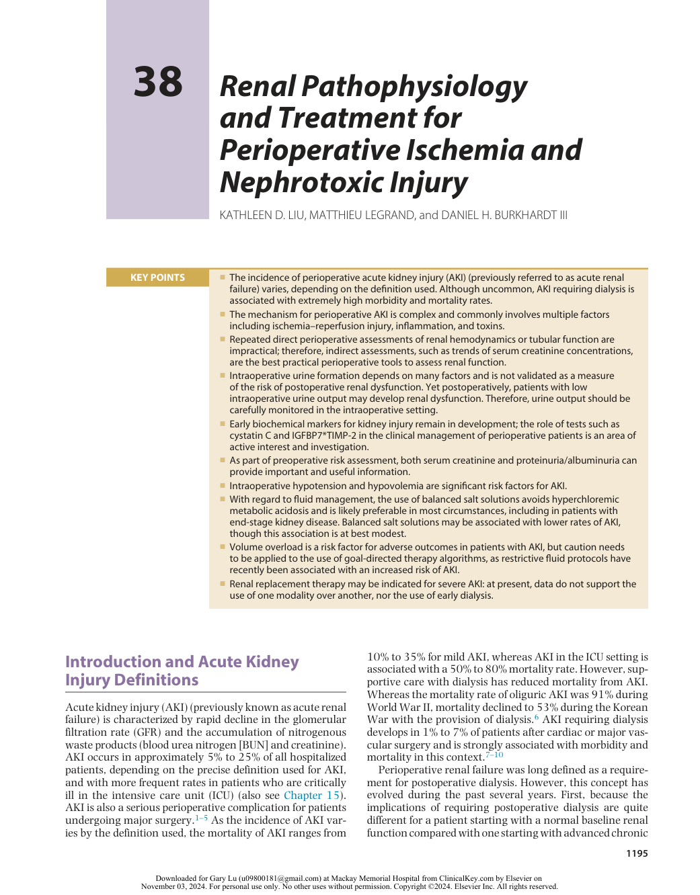
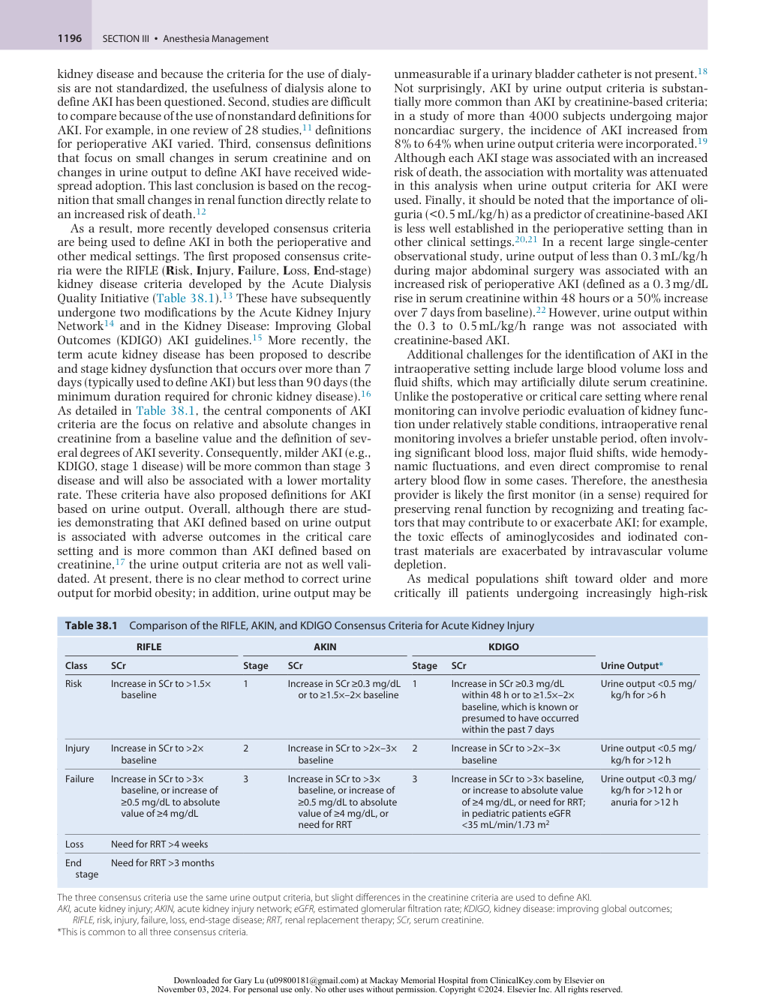
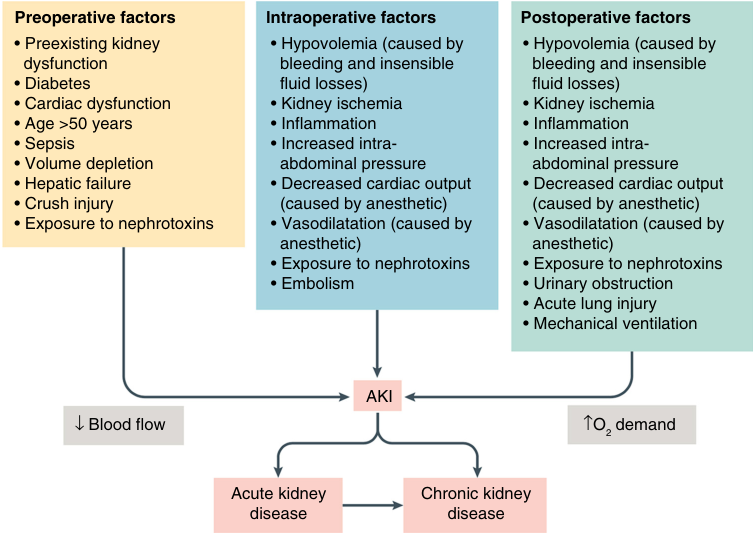
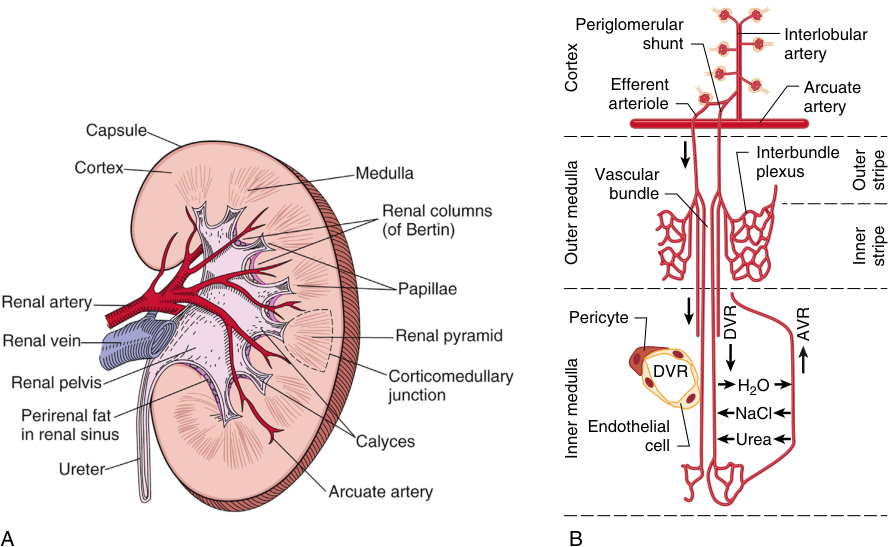
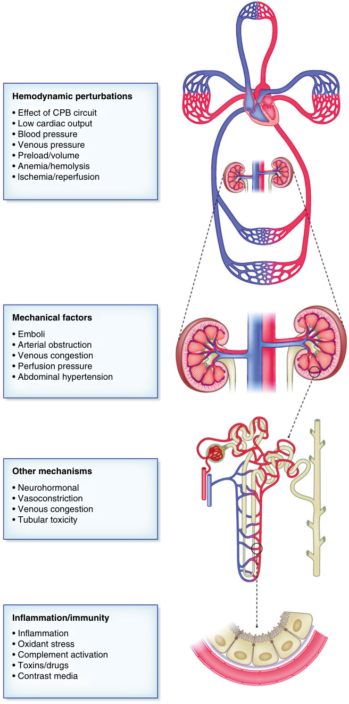
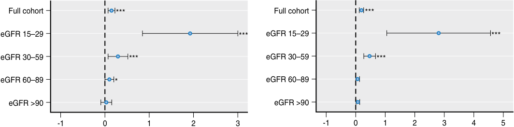

# Renal Pathophysiology and Treatment for Perioperative Ischemia and Nephrotoxic Injury

<!-- PDF page 1 -->

KATHLEEN D. LIU, MATTHIEU LEGRAND, and DANIEL H. BURKHARDT III

### KEY POINTS

|ᑏThe incidence of perioperative acute kidney injury (AKI) (previously referred to as acute renal failure) varies, depending on the definition used. Although uncommon, AKI requiring dialysis is associated with extremely high morbidity and mortality rates.|
|---|
|ᑏThe mechanism for perioperative AKI is complex and commonly involves multiple factors including ischemia–reperfusion injury, inflammation, and toxins.|
|ᑏRepeated direct perioperative assessments of renal hemodynamics or tubular function are impractical; therefore, indirect assessments, such as trends of serum creatinine concentrations, are the best practical perioperative tools to assess renal function.|
|ᑏIntraoperative urine formation depends on many factors and is not validated as a measure of the risk of postoperative renal dysfunction. Yet postoperatively, patients with low intraoperative urine output may develop renal dysfunction. Therefore, urine output should be carefully monitored in the intraoperative setting.|
|ᑏEarly biochemical markers for kidney injury remain in development; the role of tests such as cystatin C and IGFBP7*TIMP- 2 in the clinical management of perioperative patients is an area of active interest and investigation.|
|ᑏAs part of preoperative risk assessment, both serum creatinine and proteinuria/albuminuria can provide important and useful information.|
|ᑏIntraoperative hypotension and hypovolemia are significant risk factors for AKI.|
|ᑏWith regard to fluid management, the use of balanced salt solutions avoids hyperchloremic metabolic acidosis and is likely preferable in most circumstances, including in patients with end- stage kidney disease. Balanced salt solutions may be associated with lower rates of AKI, though this association is at best modest.|
|ᑏVolume overload is a risk factor for adverse outcomes in patients with AKI, but caution needs to be applied to the use of goal-directed therapy algorithms, as restrictive fluid protocols have recently been associated with an increased risk of AKI.|
|ᑏRenal replacement therapy may be indicated for severe AKI: at present, data do not support the use of one modality over another, nor the use of early dialysis.|

## Introduction and Acute Kidney Injury Definitions

Acute kidney injury (AKI) (previously known as acute renal failure) is characterized by rapid decline in the glomerular filtration rate (GFR) and the accumulation of nitrogenous waste products (blood urea nitrogen [BUN] and creatinine). AKI occurs in approximately 5% to 25% of all hospitalized patients, depending on the precise definition used for AKI, and with more frequent rates in patients who are critically ill in the intensive care unit (ICU) (also see Chapter 15). AKI is also a serious perioperative complication for patients undergoing major surgery.1–5 As the incidence of AKI varies by the definition used, the mortality of AKI ranges from

10% to 35% for mild AKI, whereas AKI in the ICU setting is associated with a 50% to 80% mortality rate. However, supportive care with dialysis has reduced mortality from AKI. Whereas the mortality rate of oliguric AKI was 91% during World War II, mortality declined to 53% during the Korean War with the provision of dialysis.6 AKI requiring dialysis develops in 1% to 7% of patients after cardiac or major vascular surgery and is strongly associated with morbidity and mortality in this context.7–10

Perioperative renal failure was long defined as a requirement for postoperative dialysis. However, this concept has evolved during the past several years. First, because the implications of requiring postoperative dialysis are quite different for a patient starting with a normal baseline renal function compared with one starting with advanced chronic

::: details 原始表格與符號（PDF 第 1 頁）

:::

<!-- PDF page 2 -->

kidney disease and because the criteria for the use of dialysis are not standardized, the usefulness of dialysis alone to define AKI has been questioned. Second, studies are difficult to compare because of the use of nonstandard definitions for AKI. For example, in one review of 28 studies,11 definitions for perioperative AKI varied. Third, consensus definitions that focus on small changes in serum creatinine and on changes in urine output to define AKI have received widespread adoption. This last conclusion is based on the recognition that small changes in renal function directly relate to an increased risk of death.12

As a result, more recently developed consensus criteria are being used to define AKI in both the perioperative and other medical settings. The first proposed consensus criteria were the RIFLE ( **R** isk, **I** njury, **F** ailure, **L** oss, **E** nd- stage) kidney disease criteria developed by the Acute Dialysis Quality Initiative (Table 38.1).13 These have subsequently undergone two modifications by the Acute Kidney Injury Network14 and in the Kidney Disease: Improving Global Outcomes (KDIGO) AKI guidelines.15 More recently, the term acute kidney disease has been proposed to describe and stage kidney dysfunction that occurs over more than 7 days (typically used to define AKI) but less than 90 days (the minimum duration required for chronic kidney disease).16 As detailed in Table 38.1, the central components of AKI criteria are the focus on relative and absolute changes in creatinine from a baseline value and the definition of several degrees of AKI severity. Consequently, milder AKI (e.g., KDIGO, stage 1 disease) will be more common than stage 3 disease and will also be associated with a lower mortality rate. These criteria have also proposed definitions for AKI based on urine output. Overall, although there are studies demonstrating that AKI defined based on urine output is associated with adverse outcomes in the critical care setting and is more common than AKI defined based on creatinine,17 the urine output criteria are not as well validated. At present, there is no clear method to correct urine output for morbid obesity; in addition, urine output may be

unmeasurable if a urinary bladder catheter is not present.18 Not surprisingly, AKI by urine output criteria is substantially more common than AKI by creatinine- based criteria; in a study of more than 4000 subjects undergoing major noncardiac surgery, the incidence of AKI increased from 8% to 64% when urine output criteria were incorporated.19 Although each AKI stage was associated with an increased risk of death, the association with mortality was attenuated in this analysis when urine output criteria for AKI were used. Finally, it should be noted that the importance of oliguria (&lt;0.5 mL/kg/h) as a predictor of creatinine- based AKI is less well established in the perioperative setting than in other clinical settings.20,21 In a recent large single- center observational study, urine output of less than 0.3 mL/kg/h during major abdominal surgery was associated with an increased risk of perioperative AKI (defined as a 0.3 mg/dL rise in serum creatinine within 48 hours or a 50% increase over 7 days from baseline).22 However, urine output within the 0.3 to 0.5 mL/kg/h range was not associated with creatinine- based AKI.

Additional challenges for the identification of AKI in the intraoperative setting include large blood volume loss and fluid shifts, which may artificially dilute serum creatinine. Unlike the postoperative or critical care setting where renal monitoring can involve periodic evaluation of kidney function under relatively stable conditions, intraoperative renal monitoring involves a briefer unstable period, often involving significant blood loss, major fluid shifts, wide hemodynamic fluctuations, and even direct compromise to renal artery blood flow in some cases. Therefore, the anesthesia provider is likely the first monitor (in a sense) required for preserving renal function by recognizing and treating factors that may contribute to or exacerbate AKI; for example, the toxic effects of aminoglycosides and iodinated contrast materials are exacerbated by intravascular volume depletion.

As medical populations shift toward older and more critically ill patients undergoing increasingly high- risk

**Table 38.1** Comparison of the RIFLE, AKIN, and KDIGO Consensus Criteria for Acute Kidney Injury

||**RIFLE**||**AKIN**||**KDIGO**||
|---|---|---|---|---|---|---|
|**Class**|**SCr**|**Stage**|**SCr**|**Stage**|**SCr**|**Urine Output***|
|Risk|Increase in SCr to >1.5× baseline|1|Increase in SCr≥0.3 mg/dL or to≥1.5×–2× baseline|1|Increase in SCr≥0.3 mg/dL within 48 h or to≥1.5×–2× baseline, which is known or presumed to have occurred within the past 7 days|Urine output &lt;0.5 mg/ kg/h for >6 h|
|Injury|Increase in SCr to >2× baseline|2|Increase in SCr to >2×–3× baseline|2|Increase in SCr to >2×–3× baseline|Urine output &lt;0.5 mg/ kg/h for >12 h|
|Failure|Increase in SCr to >3× baseline, or increase of ≥0.5 mg/dL to absolute value of≥4 mg/dL|3|Increase in SCr to >3× baseline, or increase of ≥0.5 mg/dL to absolute value of≥4 mg/dL, or need for RRT|3|Increase in SCr to >3× baseline, or increase to absolute value of≥4 mg/dL, or need for RRT; in pediatric patients eGFR &lt;35 mL/min/1.73 m2|Urine output &lt;0.3 mg/ kg/h for >12 h or anuria for >12 h|
|Loss|Need for RRT >4 weeks||||||
|End stage|Need for RRT >3 months||||||

The three consensus criteria use the same urine output criteria, but slight differences in the creatinine criteria are used to define AKI. _AKI,_ acute kidney injury; _AKIN,_ acute kidney injury network; _eGFR,_ estimated glomerular filtration rate; _KDIGO,_ kidney disease: improving global outcomes; _RIFLE,_ risk, injury, failure, loss, end- stage disease; _RRT,_ renal replacement therapy; _SCr,_ serum creatinine. *This is common to all three consensus criteria.

::: details 原始表格與符號（PDF 第 2 頁）

:::

<!-- PDF page 3 -->

procedures, patients are at an increased risk of AKI in the perioperative setting, and the role of the anesthesia provider becomes even more critical. Indeed, a study of dialysis after elective major surgery suggests that the incidence of dialysis- requiring AKI is rising from 0.2% in 1995 to 0.6% in 2009, with the majority of the increase occurring after vascular and cardiac surgery.23 Although ischemic causes may be primarily responsible for perioperative AKI,24 the successful development of renoprotective strategies has not occurred. Furthermore, other pathophysiologic contributors to perioperative AKI may include contrast- induced nephropathy, pigment nephropathy (e.g., hemoglobin, myoglobin), cholesterol emboli (e.g., atheroembolic renal disease), aminoglycoside toxicity, and sepsis. Animal studies of such pure nephropathies treated with logical renoprotective interventions often demonstrate success; unfortunately, this success has not extended to equivalent renoprotection in humans. It may not be surprising that a specific treatment for a pure nephropathy nonselectively applied to a mixture of nephropathies, variably expressed in different patients, would be unsuccessful. Postoperative AKI, rather than being a single entity, is likely a mosaic of several pure nephropathies, each of varying importance for a particular patient and procedure (Fig. 38.1).

## Pathophysiologic Processes of Ischemic Acute Kidney Injury

In general, the causes for AKI can be divided into prerenal, intrinsic renal, and postrenal sources. In the perioperative setting, patients may be at increased risk for prerenal AKI, either attributable to volume depletion or to exacerbation of associated chronic prerenal physiologic conditions, such

as congestive heart failure, that are exacerbated by volume overload. Intraoperatively, hypotension due to vasodilation and negative inotropy/chronotropy from anesthetic agents may lead to prerenal physiology. Depending on the nature of the surgical procedure, the patient may also be at increased risk of postrenal AKI attributable to obstruction of the ureters, bladder, or urethra. However, the primary cause of perioperative AKI is _acute tubular necrosis_ (ATN). Defining the cause of AKI is also critical because treatment of the underlying cause is critical for the reversal of AKI and potential renal recovery.

The two primary mechanisms of ATN are ischemia– reperfusion and nephrotoxic effects, with three sources of insult common to many surgical procedures during which postoperative AKI is prevalent: hypoperfusion, inflammation, and atheroembolism. Other renal insults in selected patients may include rhabdomyolysis and specific drugrelated effects. Certain classes of medications may also contribute to hypoperfusion by virtue of their hemodynamic effects (notably angiotensin- converting enzyme [ACE] inhibitor 1, angiotensin- receptor blockers [ARBs], and nonsteroidal anti- inflammatory drugs [NSAIDs]), and, consequently, the risk of ATN. The impact of continuation or discontinuation of ACE/ARB in the perioperative setting is controversial and is under investigation.25

Ischemic renal failure related to shock or severe dehydration is typically preceded by _prerenal azotemia,_ during which the kidney maximizes activities at the expense of the retention of nitrogenous end- products to preserve the internal environment through retention of solutes and water (Figs. 15.2 and 38.2). In studies of community- acquired AKI, the incidence of prerenal azotemia may be as frequent as 70%.26 In contrast, in a classic study of hospital- acquired AKI, although hypoperfusion accounted for 42% of cases of

Preoperative factors lntraoperative factors Postoperative factors • Preexisting kidney • Hypovolemia (caused by • Hypovolemia (caused by   dysfunction   bleeding and insensible   bleeding and insensible • Diabetes   fluid losses)   fluid losses) • Cardiac dysfunction • Kidney ischemia • Kidney ischemia • Age >50 years • Inflammation • Inflammation • Sepsis • Increased intra- • Increased intra- • Volume depletion   abdominal pressure   abdominal pressure • Hepatic failure • Decreased cardiac output • Decreased cardiac output • Crush injury   (caused by anesthetic)   (caused by anesthetic) • Exposure to nephrotoxins • Vasodilatation (caused by • Vasodilatation (caused by   anesthetic)   anesthetic) • Exposure to nephrotoxins • Exposure to nephrotoxins • Embolism • Urinary obstruction • Acute lung injury • Mechanical ventilation AKI ↓ Blood flow ↑O2 demand Acute kidney Chronic kidney disease disease 

**Fig. 38.1 Preoperative, intraoperative, and postoperative factors contributing to the risk of perioperative acute kidney injury (AKI) and postoperative morbidity and mortality.** (Modified from Prowle JR, Forni LG, Bell M, et al. Postoperative acute kidney injury in adult non- cardiac surgery: joint consensus report of the Acute Disease Quality Initiative and PeriOperative Quality Initiative. _Nat Rev Nephrol_ . 2021;17:605–618. Used with permission.)

<!-- PDF page 4 -->

Periglomerular Interlobular shunt artery Efferent Arcuate arteriole artery Interbundle Vascular plexus bundle Pericyte DVR H2O NaCl Endothelial cell Urea A B Cortex Outer stripe Outer medulla Inner stripe DVR AVR Inner medulla 

**Fig. 38.2** (A) The internal structure of the kidney includes the vasculature, cortex and medulla regions, and urinary tract structures. (B) The vascular anatomy of the kidney is highly organized, and the medullary microcirculation is part of the mechanism that permits countercurrent exchange. _AVR,_ ascending vasa recta; _DCT,_ distal convoluted tubule; _DVR,_ descending vasa recta; _NaCl,_ sodium chloride; _PCT,_ proximal convoluted tubule. (A, From Chertow GM, Luyckx VA, et al., eds. _Brenner and Rector’s The Kidney._ 11th ed. Philadephia: Elsevier; 2020. Fig. 2.4. B, From Pallone TL, Zhang Z, Rhinehart K. Physiology of the renal medullary microcirculation. _Am J Physiol Renal Physiol._ 2003;284:F253–F266. Used with permission.)

AKI, only 41% of these cases of hypoperfusion were attributable to inadequate intravascular volume.27

Although prerenal azotemia is ominous and typically accompanied by oliguria (&lt;0.5 mL/kg/h), it is reversible. At a critical tilting point, as conditions go beyond the compensatory mechanisms that maintain renal perfusion, ischemia leads to irreversible renal cell necrosis or ATN.28 This represents the pure form of ischemic AKI. Other forms of ATN are due to toxins, including medications (e.g., aminoglycosides, cisplatinum), pigments (e.g., hemoglobin, myoglobin), and iodinated contrast dye. These forms of ATN do not involve the typical pattern of preceding prerenal azotemia with associated oliguria since the insult is sudden. Importantly, most cases of perioperative AKI are the result of numerous renal insults, rather than being attributable to one pure source (see Fig. 38.1). In particular, patients with prerenal azotemia are likely at increased risk for toxic ATN.

Interruption of blood flow to the kidneys for more than 30 to 60 minutes results in ATN and irreversible cell damage. The kidneys receive 1000 to 1250 mL/min of blood or 3 to 5 mL/min/g of tissue for the average adult, and this amount far exceeds what is needed to provide the kidney’s intrinsic oxygen requirement. Intracortical blood flow may not be evenly distributed.29 Because the renal cortex contains most of the glomeruli and depends on oxidative metabolism for energy, ischemic hypoxia injures the renal cortical structures, particularly the pars recta of the proximal tubules. As ischemia persists, the supply of glucose and substrates continues to decrease; glycogen is consumed, and the medulla, which depends to a great

extent on glycolysis for its energy sources, becomes more adversely affected. Early cell changes such as the swelling of cell organelles (especially the mitochondria) are reversible. As ischemia progresses, a lack of adenosine triphosphate interferes with the sodium pump mechanism, water and sodium accumulate in the endoplasmic reticulum of tubular cells, and the cells begin to swell. Onset of tubular damage usually occurs within 25 minutes of ischemia as the microvilli of the proximal tubular cell brush borders begin to change. Within an hour, they slough off into the tubular lumen, and membrane bullae protrude into the straight portion of the proximal tubule. After a few hours, intratubular pressure rises, and tubular fluid passively backflows. Within 24 hours, obstructing casts appear in the distal tubular lumen.

### RENAL RESPONSE TO HYPOPERFUSION: AUTOREGULATION AND DISTRIBUTION OF CARDIAC OUTPUT TO THE KIDNEYS

A common intraoperative stress that puts patients at risk for AKI is hypoperfusion due to hypotension and/or hypovolemia. The fraction of cardiac output perfusing the kidneys depends on the ratio of renal vascular resistance to systemic vascular resistance.28 In general, the response to renal hypoperfusion involves three major regulatory mechanisms that support renal function: (1) afferent arteriolar dilation increases the proportion of cardiac output that perfuses the kidney; (2) efferent arteriolar resistance increases the filtration fraction and preserves GFR; and (3) hormonal and neural responses improve renal perfusion by increasing

<!-- PDF page 5 -->

intravascular volume, thereby indirectly increasing cardiac output.

The kidney produces vasodilator prostaglandins to counteract the effects of systemic vasoconstrictor hormones such as angiotensin II. In a state of low cardiac output when systemic blood pressure is preserved by the action of systemic vasopressors, renal blood flow (RBF) is not depressed because the effect of the vasopressors is blunted within the kidney. Studies using specific inhibitors of angiotensin II have shown that efferent arteriolar resistance largely results from the action of angiotensin II.30 At low concentrations, norepinephrine has a vasoconstricting effect on efferent arterioles, indicating that the adrenergic system may also be important for maintaining the renal compensatory response.31

Reductions in cardiac output are accompanied by the release of vasopressin and by increased activity of the sympathetic nervous system and the renin–angiotensin– aldosterone system. These regulatory mechanisms to preserve RBF conserve salt and water. Changes known to occur at the initiation of cardiopulmonary bypass (CPB) surgery include greater reduction in renal perfusion than systemic perfusion, loss of RBF autoregulation, and stress hormone and inflammatory responses known to be harmful to the kidney.32,33 These effects may explain why the duration of CPB surgery independently predicts postcardiac surgery renal impairment.

## Detection of Acute Kidney Injury

### LABORATORY TESTS OF SERUM AND URINE AS MARKERS OF RENAL FUNCTION

Standard serum and urine markers of renal function are discussed in Chapter 15. It should be emphasized that at present, repeated serum creatinine determinations (relative or absolute changes) are most often used to identify AKI. An inherent limitation of almost all currently available tools to detect AKI is the obligate delay between the onset of AKI and the diagnosis of AKI. One striking difference between the management of AKI and acute myocardial infarction is the lack of early biomarkers for AKI in routine clinical practice to guide prompt recognition and intervention when tissue is threatened. Thus, significant ongoing efforts are testing the value of early AKI biomarkers and of real- time measurement of GFR.

### NOVEL (EARLY) BIOMARKERS OF ACUTE KIDNEY INJURY

Limited progress in the care for AKI has fueled an enormous interest in new early biomarkers.34–37 Although a few of the new tools represent attempts to find a filtration marker that is better than creatinine (e.g., cystatin C, penKid), most novel AKI biomarkers take advantage of one of the three early consequences of AKI: (1) tubular cell damage, (2) tubular cell dysfunction, and (3) adaptive stress response of the kidney. The hope is that such biomarkers will allow timely AKI identification, diagnosis (e.g., prerenal azotemia vs. ATN), and prognosis.

### New Filtration- Based Markers of Renal Dysfunction

Of the most novel filtration- based markers of renal dysfunction, the most advanced is cystatin C, a member of the cystatin superfamily of cysteine- proteinase inhibitors that is produced by all nucleated cells at a constant rate. Cystatin C has been clinically available for longer than 15 years and can be rapidly determined on high- throughput, clinical laboratory- based analyzers. Similar to creatinine, cystatin C accumulates in the circulation with renal impairment and can be used as a marker of glomerular filtration. Serum cystatin C has theoretical advantages over creatinine, particularly as an indicator of mild chronic kidney disease and its sequelae.38 Several GFR estimating equations have been proposed, based on cystatin C alone or cystatin C and creatinine for use in chronic kidney disease.39 With the recent recognition that GFR estimating equations should be race free,40 there has been increased effort to use cystatin C in the clinical setting as a marker of GFR.

However, although cystatin C outperformed creatinine in detecting AKI after cardiac surgery in some small studies,41 this sensitivity has not consistently been the case. Furthermore, thresholds for the detection of AKI by cystatin C have not been clearly defined. Indeed, a large multicenter prospective observational study of AKI after cardiac surgery suggested that serum cystatin C was less, not more, sensitive for the detection of AKI. This study, conducted by the Translational Research Investigating Biomarker Endpoints in Acute Kidney Injury (TRIBEAKI) Consortium, prospectively enrolled more than 1200 adults undergoing cardiac surgery and has rapidly advanced the field of novel biomarkers in this context. Of note, the subset of patients who had AKI by cystatin C and creatinine had more frequent risk of dialysis and death than those who had AKI by creatinine alone.42 Conditions such as malignancy, human immunodeficiency viral infection, or corticosteroid or thyroid hormone therapy are associated with increased serum levels of cystatin C without changes in renal function. A more recent marker of interest is proenkephalin A 119- 159 (penKid), a peptide derived from enkephalins that has been correlated with GFR.43 In the setting of critical illness, elevated penKid levels are associated with adverse outcomes, and it has been proposed that penKid may identify patients with “subclinical” AKI.44 However, the role of penKid in the perioperative setting needs to be developed further.

### Biomarkers Reflecting Renal Tubular Cell Damage (Tubular Enzymuria)

Renal tubular cells contain enzymes that are highly specific to their location within the kidney and even tubule region. Under conditions of cellular stress, these enzymes are shed into the urine, making these potentially appealing markers of kidney dysfunction. These markers include α and π isomers of glutathione S- transferase (GST), which are cytosolic enzymes from proximal and distal tubular cells, respectively, and _N_ - acetyl- β- d- glucosaminidase, a proximal tubule lysosomal enzyme. However, although enhanced urinary excretion of tubular enzymes can signal damaged tubular cells, it can also reflect an increased turnover of

<!-- PDF page 6 -->

tubular cells; at present, these biomarkers have limited clinical utility.

### Biomarkers Reflecting Renal Tubular Cell Dysfunction (Tubular Proteinuria)

When small proteins are filtered by the glomerulus, binding and endocytic reuptake in the proximal tubule normally returns these substances to the body through a megalinmediated transport system. So- called tubular proteinuria results from functional impairment of this process and the escape of small proteins into the urine. Endogenous lowmolecular- weight proteins that are normally taken up in this way include β2- and α1- microglobulin, retinol- binding protein, lysozyme, ribonuclease, immunoglobulin G (IgG), transferrin, ceruloplasmin, and lambda (λ) and kappa (κ) light chains. Appearance of any of these substances in the urine heralds abnormal proximal nephron function consistent with AKI. However, lysine and its analogue (e.g., ε- aminocaproic acid, tranexamic acid) can cause a profound but reversible inhibition of low- molecular- weight protein reuptake45 that is transient and apparently benign, making these biomarkers less clinically useful.46,47

### Biomarkers Reflecting Renal Tubular Cell

### Response to Stress

Examples of markers that assess the response of the kidney to stress include neutrophil gelatinase–associated lipocalin (NGAL), kidney injury molecule–1 (KIM1), liver fatty acid–binding protein, and interleukin- 18 (IL- 18). These have each been extensively reviewed in detail in recent literature.33–36 Two markers of G1- cell cycle arrest have been shown to be upregulated in AKI, insulin- like growth factor–binding protein 7 (IGFBP- 7) and tissue inhibitor of metalloproteinases–2 (TIMP- 2).48 A test that combines levels of IGFBP- 7 and TIMP- 2 has received US Food and Drug Administration (FDA) clearance as a biomarker for the identification of patients at high risk of AKI.

NGAL is a protein with a critical role in iron scavenging. A transcriptome- wide interrogation for genes induced very early after renal ischemia identified NGAL as a protein generated by ischemic renal tubular cells.49 Administration of exogenous NGAL in animal models attenuates renal injury.50 Enthusiasm for NGAL as a biomarker of AKI was fueled by a study in pediatric patients who underwent cardiac surgery, suggesting that plasma and urinary NGAL could predict AKI before elevations in serum creatinine.51 Although increased NGAL levels are associated with adverse outcomes,52,53 studies in the adult perioperative literature have not consistently shown NGAL to predict AKI before elevations in serum creatinine.

KIM- 1 is a transmembrane protein expressed at low levels under normal conditions that is significantly upregulated in proximal renal tubular cells in response to ischemic or nephrotoxic AKI.54 In studies conducted by the Predictive Testing Safety Consortium, an academic–industrial partnership that has worked closely with the FDA to develop novel biomarkers of kidney injury for use in the preclinical setting (in particular, as markers of drug toxicity), KIM- 1 outperformed a number of traditional markers of kidney injury in a variety of preclinical models.55 More recently, assays have been developed to detect plasma KIM- 1, which

appears to correlate with urinary KIM- 1 in the setting of both acute and chronic kidney disease.56

Finally, cell cycle arrest has been implicated in models of AKI; more recently, two proteins that induce cell cycle arrest, IGFBP- 7 and TIMP- 2, have both been shown in a multicenter study to predict the development of KDIGO stage 2 and 3 AKI in critically ill patients.57 In a validation cohort, these biomarkers had an impressive area under the ROC curve of 0.80 for subsequent AKI. There has been tremendous interest in the use of these biomarkers for perioperative risk stratification,58,59 with clinical trials enrolling patients based on elevated levels of IGFBP- 7 and TIMP- 2 (typically expressed as the product of these two biomarkers).60–62 However, the precise role of these biomarkers in perioperative management remains controversial. Overall, there is tremendous research interest in identifying patients who may not have AKI by creatinine or urine- based criteria, but who have elevated levels of these injury biomarkers. Such individuals appear to be at higher risk for adverse clinical outcomes.

## Preoperative Evaluation of Renal Function and Risk Stratification

The greater the magnitude and duration of the surgical insult and the number of acute and chronic risk factors, the greater the likelihood of perioperative renal compromise and hence the need for preoperative identification of highrisk individuals.1,63–65 Common risk factors for AKI include intravascular volume depletion, aminoglycoside use, radiocontrast dye exposure, use of NSAIDs, septic shock, and pigmenturia. ACE inhibitors and ARBs, respectively, may contribute to intraoperative hypotension and may exacerbate AKI in the setting of impaired hemodynamics (volume depletion, NSAID use). In general, patients undergoing emergency surgery or with higher American Society of Anesthesiologists (ASA) classification are at higher risk of AKI. Patients with preexisting chronic kidney disease are clearly at increased risk for AKI and should be identified in the perioperative evaluation through measurement of serum creatinine and urinalysis (to evaluate for albuminuria/proteinuria).2 Chronic kidney disease affects more than 10% of the United States population. Common risk factors for chronic kidney disease include advanced age, diabetes, and hypertension. The potential value of understanding the genetic makeup of patients has yet to be fully explored and is likely to be important. For example, several genetic polymorphisms known to affect inflammation and vasoconstriction demonstrate strong associations with AKI after cardiac surgery,66 including the IL- 6 572C and angiotensinogen 842C polymorphisms. In the future, identification of such polymorphisms may improve perioperative risk stratification.

Large multicenter epidemiologic studies have identified a relationship between markers of abnormal central aortic compliance, such as preoperative isolated systolic hypertension (>160 mm Hg) and wide pulse pressure hypertension (>40 mm Hg),67,68 and postoperative AKI and dialysis, in particular in patients undergoing cardiac surgery. Pulse pressure is an index of the effects of large artery stiffness and the rate of pressure on propagation and reflection within

<!-- PDF page 7 -->

the arterial tree. Early return of reflected arterial waves during late systolic rather than early diastolic pressure (from increased propagation velocity in stiff vessels) increases systolic blood pressure (i.e., afterload) and decreases diastolic blood pressure (i.e., perfusion pressure). Perfusion pressure and the risk of perioperative renal dysfunction are linked by the preexisting capacity of the vasculature to compensate for low pressure as it determines flow. Those with a predisposition to low flow attributable to abnormal central aortic compliance (e.g., those with wide pulse pressure) may represent patients who require higher pressure to maintain adequate flow and minimize renal risk compared with normotensive patients.

In the context of specific surgery types (e.g., cardiac surgery), perioperative risk prediction tools have been developed. In general, these tend to effectively identify low- risk populations, but discrimination for higher-risk patients is more modest. This may reflect the fact that intraoperative factors play a major role in the pathogenesis of AKI in a vulnerable patient. In addition, a number of these risk prediction tools focus on dialysis- requiring AKI, which is only the “tip of the iceberg” with regard to disease burden. More recently developed tools incorporate numerous perioperative characteristics, including laboratory studies, and have better discrimination.69 However, these models are more complex to implement at the bedside, and more work is needed to understand how to use these models to best optimize perioperative care.

## Perioperative Acute Kidney Injury: Mechanisms and Treatment

As described in Chapter 15, anesthesia and surgery influence normal renal function primarily through changes in GFR and urine flow that are attributable to changes in blood pressure and cardiac output. Fluctuations in blood pressure have a major effect on RBF and glomerular filtration.21,32,70 Here, we will briefly discuss considerations for several anesthetic techniques, followed by several specific perioperative considerations.

AKI. Rodgers and colleagues conducted a systematic review of 107 randomized clinical trials of intraoperative neuraxial blockade and demonstrated a 30% reduction in the odds of postoperative mortality.74 This reduction was associated with decreases in the incidence of deep venous thrombosis, pulmonary embolism, transfusion, pneumonia, and respiratory depression, as well as renal failure, although the confidence limits for the renal failure estimates were very wide, in part due to the small number of cases of renal failure observed. Moraca and associates conducted a metaanalysis and reported on the association of thoracic epidural anesthesia with improved surgical outcomes attributable, in part, to a reduction of perioperative morbidity, including reductions in infection, ileus, blood loss, and AKI.74 Other studies have examined the impact of epidural anesthesia during cardiac surgery and have suggested a benefit with regards to renal failure, although the confidence intervals were wide.75 Unfortunately, renal failure was not an outcome of several recently published meta- analyses focused on epidural anesthesia during cardiac surgery.76,77 Finally, with regard to postoperative analgesia, a recent Cochrane meta- analysis that focused on abdominal aortic surgery suggested better postoperative analgesia and a reduction in other complications including myocardial infarction and respiratory failure with epidural analgesia but no effect on AKI or postoperative mortality.78

### EFFECTS OF INHALED ANESTHETICS

From a historic perspective, older volatile inhaled anesthetics including methoxyflurane and enflurane (no longer clinically used) when used for prolonged periods lead to significant generation of inorganic fluoride79–81 and were associated with polyuric renal insufficiency. However, despite significant fluoride generation with sevoflurane and the generation of compound A (a metabolite associated with renal injury in experimental models), there is no reported association with AKI.80 This may be due to the shorter duration of elevated fluoride levels with sevoflurane and the site of metabolism (intrarenal metabolism of methoxyflurane is fourfold greater than that of sevoflurane).

### EFFECTS OF INTRAVENOUS ANESTHETICS

### REGIONAL ANESTHESIA

Regional anesthetics and the kidneys interact in a complex manner that varies according to the underlying cardiovascular, renal, fluid, and electrolyte status of the patient.71 In general, epidural and spinal anesthesia reduce systemic and renal vascular sympathetic tone. Spinal cord segments T4 through L1 contribute to the sympathetic innervation of the renal vasculature, which is mediated by sympathetic fibers from the celiac and renal plexus.72,73 Autonomic blockade above the fourth thoracic level also blocks cardioaccelerator sympathetic innervation to the heart. If neuraxial blockade reduces arterial blood pressure and cardiac output, then the RBF will be decreased with matching reductions in glomerular filtration and urine output.

Although controversial, intraoperative neuraxial blockade and postoperative epidural analgesia decrease rates of

Propofol and dexmedetomidine may have antiinflammatory effects that are renoprotective. Propofol increases production of bone morphogenetic protein–7 (BMP- 7), which suppresses the tumor necrosis factor α–induced inflammatory cascade during sepsis- induced AKI,82 as well as decreased injury during ischemia–reperfusion83,84 and unilateral ureteral obstruction.85 Similarly, in addition to altering RBF and sodium and water handling, the α2- adrenoreceptor agonists such as dexmedetomidine may stimulate BMP- 7 production in the setting of sepsis and ischemia–reperfusion.86–88 There has been significant interest in the use of dexmedetomidine, with a recent metaanalysis suggesting a reduction in postoperative AKI with the use of dexmedetomidine (odds ratio [OR] 0.43; 95% confidence interval [CI], 0.29–0.63) which was associated with lower NGAL levels and higher creatinine clearance.89

<!-- PDF page 8 -->

### SPECIFIC PERIOPERATIVE PERTURBATIONS AND RENAL FUNCTION

Several surgical interventions can affect RBF and, consequently, renal function. Whereas aortic cross- clamping above the renal arteries has obvious influence on glomerular filtration, infrarenal aortic cross- clamping and unclamping also have significant indirect effects on glomerular filtration and urine formation through changes in myocardial function, sympathetic activity, neuronal and hormonal activity (e.g., renin and angiotensin production), intravascular volume, and systemic vascular resistance.90 During standard CPB surgery, cardiorenal relationships are approximately as expected. RBF decreases to 12% to 13% of total pump flow and is predicted by flow rate and perfusion pressure; however, only mean pressure correlates with urine output.32,91

AKI after coronary artery bypass surgery continues to be a devastating complication that is associated with multiorgan dysfunction, increased resource utilization, high cost, and increased mortality. Annually, approximately 350,000 patients in the United States undergo coronary artery bypass graft (CABG) surgery. In a multicenter observational study focused on AKI after cardiac surgery, 5% of participants developed AKI as defined by the need for acute dialysis or a doubling of serum creatinine from baseline.92 The mechanism of perioperative AKI during cardiac surgery is multifactorial. Significant risk factors for AKI include underlying patient characteristics, such as age older than 75 years, history of diabetes, hypertension, pulse pressure, ventricular dysfunction, myocardial infarction, renal disease, perioperative medication exposures (e.g., aprotinin, hetastarch), and surgical characteristics such as intraoperative use of multiple inotropes, insertion of intra- aortic balloon pump, and extended duration of the CPB surgery (Fig. 38.3).67,93–96

The role of CPB surgery in postoperative AKI remains controversial. In their comprehensive guidelines on AKI, KDIGO reviewed the literature on postoperative AKI between patients undergoing off- pump and on- pump coronary revascularization surgeries and ultimately recommended that “off- pump CABG surgery not be selected solely for the purpose of reducing perioperative AKI or need for renal replacement therapy (RRT).”15 However, patients with chronic kidney disease, who are at the highest risk for AKI after CPB surgery, have often been excluded from randomized clinical trials of off- pump versus on- pump CABG. For example, in the Randomized On/Off Bypass (ROOBY) trial, in which 2303 patients were randomized to off- pump versus on- pump CABG, only approximately 7.5% of patients had a preoperative serum creatinine level ≥1.5 mg/dL.97

A large observational study of 742,909 non- emergent, isolated CABG cases (including 158,561 off- pump cases) from the Society of Thoracic Surgery Database suggests a benefit to off- pump CABG in those with chronic kidney disease.98 Propensity methods were used to adjust for patientand center- level imbalances. The primary end point was death or dialysis. In those with lower estimated GFR (eGFR), the risk difference (i.e., number of patients with the outcome per 100 patients in those who underwent CPB minus the number with the outcome in those who underwent offpump CABG) for the primary end point was 0.66 (95% CI,

0.45–0.87) for eGFR 30 to 59 mL/min/1.73 m2 and 3.66 (95% CI, 2.14–5.18) for eGFR 15 to 29 mL/min/1.73 m2 . Both component end points followed the same trend. Highlighting the importance of chronic kidney disease as a risk factor for AKI after cardiac surgery, whereas slightly less than 1% of the overall cohort received dialysis after cardiac surgery, 2% of those with eGFR 30 to 59 mL/min/1.73 m2 and 12.5% of those with eGFR 15 to 29 mL/min/1.73 m2 required dialysis. The risk difference for dialysis alone in the same groups was 0.47 (95% CI, 0.31–0.62) and 2.79 (95% CI, 1.37–4.20) with on- pump versus off- pump CABG, respectively (Fig. 38.4). Along the same lines, a 2932- patient substudy of the CORONARY clinical trial followed patients after off- or on- pump CABG surgery and demonstrated an interaction between preoperative chronic kidney disease (defined as eGFR &lt;60 mL/min/1.73 m2 ) and AKI (defined as a 50% increase in serum creatinine from prerandomization baseline within 30 days). In those with chronic kidney disease, 19.2% of those in the off- pump arm had AKI, compared to 30.2% in those who had on- pump surgery. However, there was no difference in sustained renal dysfunction, defined as a 20% or greater loss in eGFR at 1 year, between the two study arms (17.1% vs. 15.3% in the off- vs. on- pump arms, _P_ = .23). However, when those with AKI were compared to those who did not have AKI (regardless of treatment arm), AKI was independently associated with an increased risk of sustained renal dysfunction, with an adjusted OR of 3.37 (95% CI, 2.65–4.28, _P_ &lt; .001.99 This study highlights the fact that in the setting of chronic kidney disease, AKI is only one of many risk factors for chronic kidney disease progression.

In the setting of CABG, there has been tremendous interest in prevention of AKI, and numerous pharmacologic interventions have been tested. As stated previously, one of the major challenges for AKI prevention is that both pre- and intraoperative factors impact the risk of AKI, so it is difficult to identify _a priori_ those who are at highest risk of AKI. Interventions of recent interest where there is not a sufficient evidence base for widespread adoption include remote ischemic preconditioning, atrial natriuretic peptide (ANP), and fenoldopam, among others.100,101 Recently, there has been significant interest in the impact of acetaminophen on AKI after cardiac surgery because acetaminophen has antioxidant properties that may decrease the toxicity of cell- free hemoglobin.102,103 However, randomized clinical trials are needed in this area to better define the impact of acetaminophen on postoperative AKI in this context.

### INTRAOPERATIVE MANAGEMENT FOR AKI PREVENTION: OXYGEN DELIVERY

### Blood Gas, Acid–Base Balance, and Hematocrit

Severe arterial hypoxemia to a partial arterial pressure of oxygen (PaO2) value of less than 40 mm Hg is associated with decreased RBF and renal vasoconstriction.104,105 Inequalities in oxygen supply and demand are exaggerated and medullary hypoxia is extreme during CPB, effects that last well beyond separation from circulatory support in experimental models.106

The effects of anemia on the kidney have been studied mostly in the context of CPB management. When

<!-- PDF page 9 -->

Hemodynamic perturbations • Effect of CPB circuit • Low cardiac output • Blood pressure • Venous pressure • Preload/volume • Anemia/hemolysis • lschemia/reperfusion Mechanical factors • Emboli • Arterial obstruction • Venous congestion • Perfusion pressure • Abdominal hypertension Other mechanisms • Neurohormonal • Vasoconstriction • Venous congestion • Tubular toxicity Inflammation/immunity • Inflammation • Oxidant stress • Complement activation • Toxins/drugs • Contrast media 

**Fig. 38.3 Perioperative clinical risk factors associated with postoperative kidney injury in the setting of coronary artery bypass surgery.** _CPB,_ cardiopulmonary bypass. (Reprinted with permission from Boyer N, Eldridge J, Prowle JR, et al. Postoperative acute kidney injury. _Clin J Am Soc Nephrol_ . 2022;17:1535–1545.)

<!-- PDF page 10 -->

Full cohort *** Full cohort *** eGFR 15–29 *** eGFR 15–29 *** eGFR 30–59 *** eGFR 30–59 *** eGFR 60–89 * eGFR 60–89 eGFR >90 eGFR >90 -1 0 1 2 3 -1 0 1 2 3 4 5 

Results >0 favor off-pump techniques, while those &lt;0 favor on-pump techniques

**Fig. 38.4** Estimates of adverse outcomes associated with on- pump versus off- pump coronary artery bypass grafting by baseline estimated glomerular filtration rate (eGFR). For both mortality ( _left panel_ ) and renal replacement therapy ( _right panel_ ), off- pump CABG techniques appear to confer a benefit in those with lower eGFR. * _P_ &lt; .05, ** _P_ &lt; .01, *** _P_ &lt; .001. (Redrawn from Chawla LS, Zhao Y, Lough FC, et al. Off- pump versus on- pump coronary artery bypass grafting outcomes stratified by preoperative renal function. _J Am Soc Nephrol._ 2012;23:1389–1397.)

crystalloid and colloid solutions are used to prime an extracorporeal circuit, the initiation of CPB surgery obligates an acute decrease of approximately 30% in oxygen- carrying capacity. Animal studies endorse moderate hemodilution (hematocrit 20% to 30%) as renoprotective during CPB surgery through a reduction of blood viscosity and improved regional blood flow.107 However, although hematocrit values less than 20% during CPB surgery are commonly accepted clinically (extreme hemodilution), very low hematocrit values are linked with adverse outcomes, including AKI.108–110 The Society of Thoracic Surgeons and the Society of Cardiovascular Anesthesiologists guidelines suggest that transfusion triggers should be conservative, except in those at risk for end organ ischemia, in whom a higher trigger may be reasonable.111

The solution may not be as simple as transfusion because blood transfusions themselves have been linked to AKI. In a systematic review, Karkouti found 22 studies that examined the association between blood transfusions and AKI post cardiac surgery. An independent association between transfusions and AKI was found in 18 of the 22 studies.112 The association of perioperative anemia with AKI was further examined in 14 studies, and 9 of the studies found an independent association of perioperative anemia with AKI. Proposed mechanisms for transfusion- associated AKI include exacerbation of inflammation and oxidative stress, which occur during the CPB surgery.

There has been tremendous interest in the impact of the age of stored blood on the risk of AKI. Old blood may result in higher circulating levels of free hemoglobin and free iron, and there has been interest in the impact of the “storage lesion” on AKI. However, at present, data do not support the selective use of fresh blood in the perioperative setting to reduce the risk of AKI.113–115

## Perioperative Blood Pressure and Fluid Management

There has been significant interest in perioperative blood pressure targets and the impact on AKI. Several large observational cohort studies have suggested that even transient hypotension was associated with postoperative AKI.116–120 One prospective randomized trial compared

an individualized blood pressure management strategy targeted at maintaining systolic blood pressure within 10% of baseline versus a standard management strategy (treatment of systolic blood pressure &lt;80 mm Hg or lower than 40% from baseline) with early use of norepinephrine (starting at induction of general anesthesia) and demonstrated a significant reduction in the primary composite end point (systemic inflammatory response and at least one organ dysfunction within 7 days). This modest- sized clinical trial demonstrated a nonsignificant trend toward reduced postoperative AKI in the individualized blood pressure management arm.121 Two subsequent large multicenter randomized trials investigated low versus high blood pressure targets (mean arterial pressure [MAP] >75 versus >60 mm Hg) and strategies of hypotension avoidance in surgical patients and did not show differences in postoperative complications.122,123 The use of continuous infusion of vasopressors has gained popularity over recent years during surgery to correct anesthesia- induced vasodilation – probably partially reflecting increased awareness of the risk associated with prolonged hypotension.124 The best strategy for vasopressor use is still, however, unclear. A recent pragmatic trial did not reveal differences in outcomes – including AKI – between the use of phenylephrine and norepinephrine, but the trial was underpowered for these outcomes.125 Thus, blood pressure targets, in particular in patients with chronic kidney disease, should take into consideration preoperative blood pressure; however, the optimal targets are still not fully defined.

Intravascular volume depletion, which commonly occurs in fasting patients undergoing surgery, is a risk factor for AKI. For example, the combination of diabetes mellitus and intravascular volume depletion increases the chance of developing AKI by 100- fold.126 The most practical preoperative methods to assess volume status are with preoperative patient history and physical examination and by assessing changes in arterial blood pressure in response to changing conditions and dynamic maneuvers. For example, an awake patient normally does not have significant orthostatic changes in arterial blood pressure unless an autonomic or intravascular volume deficit exists. During anesthesia, a similarly dehydrated patient may demonstrate paradoxical arterial pulse changes with positive- pressure inspiration. Nonetheless, there has been tremendous interest in the use

<!-- PDF page 11 -->

1205 

of intravascular monitoring techniques in the perioperative setting to reduce the risk of AKI.

The decision to use any monitor should depend on the patient’s functional cardiac reserve status and the extent of the proposed surgical insult. Although maintaining adequate cardiac output is necessary for maintaining adequate RBF, adequate flow may still not occur. The use of intravascular volume monitoring techniques must include cautious identification of physiologic conditions that influence their validity as a reflection of preload in a particular patient. For example, monitoring central venous pressure to assess preload involves assumptions about normal left and right ventricular function; pulmonary vascular resistance; and mitral, pulmonary, and tricuspid valve function. Similarly, monitoring pulmonary artery pressure or pulmonary capillary wedge pressure assumes normal left ventricular compliance, mitral valve function, and normal airway pressure.

Direct measurements of left atrial pressure may offer insight into the kidney pressure–flow relationship because left atrial hypotension is a powerful stimulus for renal vasoconstriction. Despite equivalent reductions in cardiac output and arterial blood pressure, RBF decreases significantly more when left atrial pressure is decreased (e.g., hemorrhagic shock), compared with left atrial pressure when it is increased (e.g., cardiogenic shock).127 Left atrial pressure receptors modulate renal vasoconstriction through the release of ANP, a hormone secreted by the cardiac atria in response to intravascular volume expansion.128 ANP acts on the arterial and venous systems, the adrenal glands, and the kidneys to reduce intravascular volume and decrease blood pressure.129 Within the kidney, the hormone increases hydraulic pressure in the glomerular capillaries through afferent arteriolar dilation and efferent arteriolar vasoconstriction. ANP reduces arterial blood pressure by relaxing smooth muscle and reducing sympathetic vascular stimulation and also inhibits renin and aldosterone secretion, causing renal vasodilation, natriuresis, and diuresis.

Despite the direct relationship of left atrial pressure and renal vasoconstriction, static monitors of intravascular volume status are gradually being replaced by echocardiographic and dynamic monitors of intravascular volume status. Intraoperatively, one of the most direct ways to monitor intravascular volume may be by direct assessment of the left ventricular end- diastolic area with transesophageal echocardiography. However, monitoring with invasive devices, such as pulmonary artery catheters, arterial cannulas, and transesophageal echocardiography, has not been demonstrated to reduce the incidence of AKI.

_Guided fluid optimization_ has recently garnered significant interest as a step beyond traditional, somewhat unreliable guides to fluid administration (e.g., central venous pressure).130,131 The principle behind fluid optimization is to maximize tissue- oxygen delivery by achieving a maximum stroke volume. Intravascular fluid management is typically guided by the physiologic response to dynamic measures; proposed measures include systolic pressure variation, pulse pressure variation, continuous cardiac output monitoring, and esophageal Doppler ultrasonography fluid boluses.132 Some maneuvers to assess fluid responsiveness may be useful in patients undergoing abdominal surgery.133 Given the improved outcomes in patients who are critically ill with the acute respiratory distress syndrome and are managed

with a restrictive fluid management strategy,134 fluid restriction in the perioperative setting has gained attention. A meta- analysis of seven randomized clinical trials in the setting of intra- abdominal surgery suggested a restrictive fluid strategy offered no benefit; however, there was also no evidence of harm, including AKI. In some studies, excessive fluid restriction was associated with harm, including an increased risk of anastomotic breakdown and sepsis, and should clearly be avoided.135 However, more recently, the RELIEF clinical trial randomized 3000 patients undergoing major abdominal surgery to a restrictive or liberal fluid strategy during surgery and up to 24 hours afterward; the restrictive fluid strategy was designed to provide a net even fluid balance.136 There was no difference in the primary end point of disability- free survival at 1 year. However, the restrictive fluid strategy was associated with an increased rate of AKI (8.6% vs. 5.0%, _P_ &lt; .001) and surgical site infections (16.5% vs. 13.6%, unadjusted _P_ = .02), though the comparison for surgical site infections was not considered significant after adjustment for multiple comparisons. Similarly, a retrospective analysis of major abdominal surgeries at 26 hospitals in the United States from 2015 to 2019 demonstrated that, over time, there was a decrease in the proportion of patients receiving more than 10 mL/kg/h of crystalloid. In this analysis, those who received less than 10 mL/kg/h of crystalloid had an increased risk of AKI, and the overall incidence of AKI increased from 2016 to 2019.137 Thus, at present, fluid management strategies should avoid markedly positive fluid balance, but also need to be wary of underresuscitation.

There has been considerable interest in the use of balanced salt solutions instead of chloride- rich solutions to prevent AKI; the rationale is that chloride- rich solutions reduce renal perfusion in animal models.138 Subsequently, a pre- post study of chloride- rich versus balanced salt solutions demonstrated a reduced incidence of stage 2 and 3 AKI during the balanced salt solution period.139 However, a subsequent clinical trial, the SPLIT trial, suggested that there was no decrease in AKI with the use of Plasma- Lyte 148 in ICU patients.140 Of note, 72% of the trial population was enrolled after surgery, with 49% enrolled after cardiac surgery. More recently, the SALT- ED and SMART trials were pragmatic clinical trials that randomized patients to receive balanced salt solutions or normal saline in alternating months in the emergency department and intensive care units, respectively, at a single clinical center.141,142 Both studies demonstrated a statistically significant reduction in the rate of major adverse kidney events at 30 days, a composite end point of death, dialysis, and persistent doubling of creatinine. In SMART, approximately 20% of subjects were admitted in the postoperative setting; there was no evidence of an interaction between treatment effect and type of ICU, but the study was underpowered to observe a difference within this subgroup. The more recent PLUS and BASICS studies143,144 suggested that there was no benefit to balanced salt solutions. Approximately 40% of the PLUS study population and over 60% of the BASICS study population were admitted to the ICU after surgery; in neither study was there benefit to balanced salt solution administration in the surgical subgroup. That said, a propensity- matched study of patients undergoing major abdominal surgery suggested that patients who received balanced salt solutions

<!-- PDF page 12 -->

had fewer interventions related to metabolic acidosis in the perioperative period (blood gas and lactate testing, use of buffers, and dialysis).145

Finally, are these solutions safe in patients who are prone to hyperkalemia? Because balanced salt solutions contain a physiologic amount of potassium, there has been concern that the administration of balanced salt solutions might lead to hyperkalemia in patients with reduced renal function. However, in small randomized clinical trials of intraoperative fluid selection in end- stage kidney disease patients undergoing kidney transplantation, there was no increase in the incidence of hyperkalemia.146–148 In a recent large pragmatic clinical trial of more than 800 patients undergoing kidney transplantation, balanced crystalloids were well tolerated, with the balanced crystalloid group receiving a larger mean volume of study fluids (8143 ± 4077 mL vs. 7180 ± 3448 mL).149 The receipt of balanced crystalloid solutions was associated with a decreased rate of delayed graft function (30% vs. 40%, adjusted relative risk of 0.74 [95% CI, 0.66–0.84]). Thus, given their safety profile and the likely reduced need for interventions for metabolic acidosis with balanced salt solutions, these should likely at present be the default solution of choice in the perioperative setting. Thus, at reasonable doses, balanced salt solutions appear safe across a wide variety of patient populations and are associated with a decreased risk of AKI.

### EXCESSIVE INTRAVASCULAR VOLUME AND THE ABDOMINAL COMPARTMENT SYNDROME

The abdominal compartment syndrome was first defined in 1985; since then, it has been progressively recognized as a common contributor to renal dysfunction in the setting of excessive intravascular volume.150–152 Not surprisingly, excessive intravascular volume and mechanical ventilation with high airway pressures are significant contributors to the abdominal compartment syndrome. Abdominal compartment syndrome is defined as a sustained increase in intra- abdominal pressures to greater than 20 mm Hg that causes organ dysfunction; in contrast, intra- abdominal hypertension is typically defined as intra- abdominal pressures ≥12 mm Hg without organ dysfunction. This increase in intra- abdominal pressure decreases abdominal perfusion pressure (which is MAP – intra- abdominal pressure), and results in a functional prerenal state attributable to reduced renal perfusion.

The intra- abdominal pressure can easily be measured using an indwelling Foley catheter and the same pressure tubing setup used for arterial line blood pressure monitoring.153 The Foley catheter is clamped distal to the instillation port, and up to 25 mL of saline is instilled into the bladder. The transducer should be zeroed at the midaxillary line, and the pressure should be measured at end- expiration approximately 30 to 60 seconds after fluid is instilled into the bladder to allow for detrusor muscle relaxation. Of note, intra- abdominal pressure may be chronically elevated to as high as 12 mm Hg in the obese adult but is not associated with end organ dysfunction in this context.154 Prompt recognition of the abdominal compartment syndrome and treatment via decompression in the appropriate clinical context is critical.

## Nephrotoxins and Acute Kidney Injury

Recently, there has been significant controversy regarding the impact of iodinated contrast on AKI, with a number of observational studies suggesting that, at a population level, iodinated contrast is not associated with an increased risk of AKI.155,156 However, iodinated contrast is associated with intense renal vasoconstriction and causes significant AKI in the vulnerable subject. There has been significant interest in pharmacologic prevention of contrast- associated AKI. Clinical trials have demonstrated that pharmacologic interventions, including fenoldopam, _N_ -acetylcysteine, and sodium bicarbonate, do not reduce the incidence of contrast- associated AKI.157,158 Volume depletion and concomitant exposure to other nephrotoxins are key, preventable risk factors for AKI.

Other nephrotoxins commonly encountered in the perioperative setting include aminoglycosides and NSAIDs. In addition, there has been increasing interest in antibiotic nephrotoxicity. Specifically, the combination of vancomycin and piperacillin–tazobactam has been associated with an increased rate of AKI.159 When possible, avoiding combinations of nephrotoxins is likely beneficial for AKI prevention.160

## Renal Replacement Therapy

Despite best supportive care, at times, AKI progresses, and RRT is indicated. Conventional indications for dialysis include acidosis, electrolyte abnormalities (in particular, hyperkalemia), ingestions, volume overload, and uremia. There has been considerable interest in the optimal timing of dialysis initiation in critically ill and postoperative patients. A provocative, single- center study suggested that after cardiac surgery, there was significant benefit to initiation of dialysis for stage 2 AKI (doubling of sCr from baseline or urine output &lt;0.5 mL/kg/h for 12 hours) versus waiting until stage 3 AKI (tripling of sCr from baseline, sCr ≥4 mg/dL with an acute rise of ≥0.5 mg/dL, or urine output &lt;0.3 mL/kg/h for 24 hours).161 Early RRT was associated with a lower incidence of death (39.3% vs. 54.7%, _P_ = .03) and a greater rate of renal recovery at 90 days (53.6% vs. 38.7%, _P_ = .02). It should be noted that 90% of patients in the delayed arm received RRT, and the median difference in time to dialysis initiation was only 21 hours, so this is a remarkably large effect size that should be interpreted with caution. This study is in marked contrast to three large randomized clinical trials in critically ill patients suggesting that dialysis can be safely delayed in a number of patients.162–164 In these clinical trials, patients were randomized to receive dialysis when they met criteria for stage 2 or 3 AKI or to initiate dialysis only after prespecified electrolyte/metabolic criteria were met or after AKI exceeded a prespecified duration. There was no difference in mortality between the two treatment arms; in addition, a significant proportion of subjects in the delayed therapy arm recovered and never required dialysis (29% in the IDEAL- ICU trial). That said, dialysis should not be delayed too long – delaying dialysis until a mandatory indication (acidosis,

<!-- PDF page 13 -->

hyperkalemia, pulmonary edema) or BUN >140 mg/dL was associated with an increased risk of death (HR 1.60, 95% CI, 1.09–2.50, _P_ = .018) in the AKIKI- 2 trial.165

There has also been considerable interest in dialysis modality and the impact on outcomes. At present, four modalities of dialysis are possible in the ICU. Peritoneal dialysis requires placement of a catheter in the intra- abdominal space; this is typically performed laparoscopically but can be inserted at the bedside if needed. Dextrose- containing fluids drive fluid and solute removal. Thus a significant risk of peritoneal dialysis is infection (e.g., peritonitis). Furthermore, this modality cannot be used in patients who have had recent intra- abdominal surgery, so in general, its role is quite limited in the perioperative setting, with the exception of patients who are maintained on this therapy for end- stage renal disease preoperatively. With regard to hemodialysis, modalities are typically divided into intermittent hemodialysis (IHD), prolonged intermittent RRT (PIRRT)/slow low efficiency dialysis (SLED), and continuous renal replacement therapies (CRRT). As the name implies, IHD is typically performed over a 3- to 4- hour period, 3 to 6 days/week. PIRRT/SLED is typically performed over 6 to 12 hours/day, 3 to 6 days/week; there is no standard dialysis machine for PIRRT/SLED, so dialysis programs may use this therapy quite differently. CRRT is performed on a continuous, 24 hours/day basis.

With regard to modality and outcomes, it has been specifically hypothesized that intradialytic hypotension might prolong AKI and delay renal recovery. However, no randomized clinical trials have demonstrated clear benefit to continuous RRT with regards to mortality or renal recovery.166 Clinical trials have also examined the impact of dialysis dose and membrane on outcomes. These studies have established that there is a minimum dose of dialysis that should likely be measured and delivered,167,168 and that modern dialysis membranes are all relatively biocompatible and there is no benefit of one membrane over another.

To maintain circuit patency, anticoagulation is often needed. At present, the two most common forms of anticoagulation are low- dose heparin (100 to 500 units/h) and regional citrate. In both cases, the anticoagulant is infused prefilter to minimize systemic effects. Even though the goal of heparin anticoagulation is to not affect systemic coagulation parameters such as partial thromboplastin time, there is a small increase in bleeding risk.169,170 The goal of regional citrate anticoagulation is to reduce the ionized calcium concentration in the dialysis filter, since calcium is a required cofactor in the coagulation cascade. Thus, citrate is infused prefilter and titrated to maintain a low postfilter ionized calcium. One of the challenges in the United States to the routine use of citrate anticoagulation is the lack of a citrate solution approved by the FDA for use with RRT; thus, each center typically has developed its own protocol for titration and monitoring. That said, regional citrate anticoagulation is typically recommended in favor of other forms of anticoagulation.15,170,171

Occasionally, RRT is indicated in the operating room, typically during prolonged cases with significant blood product transfusion (e.g., liver transplantation). Close coordination between the nephrologist and the anesthesiologist is needed.

## Summary

In patients with or at risk for developing AKI, perioperative management continues to be challenging. Numerous factors contribute to the heterogeneous condition referred to as perioperative AKI, but insults collectively combine through ischemic and toxic mechanisms. Recent research efforts directed to the investigation of AKI will likely lead to rapid developments in the field of renal function monitoring. At present, serum creatinine continues to be the mainstay of most renal function monitoring strategies, along with urine output. Best supportive care for perioperative AKI includes preoperative risk stratification with quantitation of serum creatinine and proteinuria/albuminuria for moderate–high risk surgeries, avoidance of hypotension and hypovolemia, along with judicious use of nephrotoxins. In the setting of severe AKI, support with RRT may be needed. At present, the timing of dialysis initiation is controversial, but early initiation does not appear to be associated with improved outcomes in critically ill patients.

### Acknowledgment

The editors, publisher, and authors, Drs. Kathleen D. Liu, Matthieu Legrand, and Daniel H. Burkhardt III, would like to thank Drs. Rupert Pearse, Mark Stafford- Smith, and Andrew Shaw for their contribution to this chapter in the earlier editions of this work. It has served as the foundation for the current chapter.

### Complete references available online at expertconsult.com.

### References

1.  Boyer N, et al. _Clin J Am Soc Nephrol_ . 2022;17:1535.

2.  Prowle JR, et al. _Nat Rev Nephrol_ . 2021;17:605.

3.  Chaudery H, et al. _Anesth Analg_ . 2019;128(5):1022.

4.  O’Connor ME, et al. _Br J Surg_ . 2017;104:868.

5.  Zarbock A, et al. _Anesth Analg_ . 2018;127:1236.

6.  Smith Jr LH, et al. _Am J Med_ . 1955;18:187.

7.  Hoste EAJ, Vandenberghe W. _Best Pract Res Clin Anaesthesiol_ . 2017;31:299.

8.  Fuhrman DY, Kellum JA. _Curr Opin Anaesthesiol_ . 2017;30:60.

9.  Hobson C, et al. _J Vasc Surg_ . 2018;68:916.

10.  Nadim MK, et al. _J Am Heart Assoc_ . 2018;7.

11.  Novis BK, et al. _Anesth Analg_ . 1994;78:143.

12.  Chertow GM, et al. _J Am Soc Nephrol_ . 2005;16:3365.

13.  Bellomo R, et al. _Crit Care_ . 2004;8:R204.

14.  Mehta RL, et al. _Crit Care_ . 2007;11:R31.

15.  Kidney Disease: Improving Global Outcomes (KDIGO) Acute Kidney Injury Work Group. _Kidney Int Suppl_ . 2012;2:1.

16.  Chawla LS, et al. _Nat Rev Nephrol_ . 2017;13:241.

17.  Kellum JA, et al. _J Am Soc Nephrol_ . 2015;26:2231.

18.  Palevsky PM, et al. _Am J Kidney Dis_ . 2013;61:649.

19.  Quan S, et al. _Nephrol Dial Transplant_ . 2016;31:2049.

20.  Alpert RA, et al. _Surgery_ . 1984;95:707.

21.  Knos GB, et al. _J Clin Anesth_ . 1989;1:181.

22.  Mizota T, et al. _Br J Anaesth_ . 2017;119:1127.

23.  Siddiqui NF, et al. _CMAJ_ . 2012;184:1237.

24.  Myers BD, Moran SM. _N Engl J Med_ . 1986;314:97.

25.  Legrand M, et al. _Trials_ . 2019;20:160.

26.  Kaufman J, et al. _Am J Kidney Dis_ . 1991;17:191.

27.  Hou SH, et al. _Am J Med_ . 1983;74:243.

28.  Badr KF, Ichikawa I. _N Engl J Med_ . 1988;319:623.

29.  Barger A, Herd J. In: Orlaff J, Berliner R, eds. _Handbook of Physiology_ . Williams and Wilkins; 1973.

30.  Packer M, et al. _Circulation_ . 1986;74:766.

31.  Edwards RM. _Am J Physiol_ . 1983;244:F526.

32.  Andersson LG, et al. _Eur J Cardiothoracic Surg_ . 1994;8:597.

<!-- PDF page 14 -->

33.  Laffey JG, et al. _Anesthesiology_ . 2002;97:215.

34.  Srisawat N, Kellum JA. _Crit Care Clin_ . 2020;36:125. 35.  Koyner JL, et al. _Nephrol Dial Transplant_ . 2020;35:1295. 36.  Ostermann M, et al. _JAMA Netw Open_ . 2020;3:e2019209. 37.  Parikh CR, Mansour SG. _J Am Soc Nephrol_ . 2017;28:1677. 38.  Shlipak MG, et al. _Am J Kidney Dis_ . 2013;62(3):595. 39.  Inker LA, et al. _N Engl J Med_ . 2021;385:1737. 40.  Delgado C, et al. _J Am Soc Nephrol_ . 2021;32:2994. 41.  Zappitelli M, et al. _Kidney Int_ . 2011;80:655. 42.  Spahillari A, et al. _Am J Kidney Dis_ . 2012;60:922. 43.  Khorashadi M, et al. _Nephron_ . 2020;144:655. 44.  Depret F, et al. _Am J Respir Crit Care Med_ . 2020;202:822. 45.  Mogensen CE, Sølling. _Scand J Clin Lab Invest_ . 1977;37:477. 46.  Smith MS. _Anesthesiology_ . 1999;90:928. 47.  Stafford- Smith M. _Am J Kidney Dis_ . 2011;57:960. 48.  Kashani K, et al. _Crit Care_ . 2013;17:R25. 49.  Mishra J, et al. _J Am Soc Nephrol_ . 2003;14:2534. 50.  Mishra J, et al. _J Am Soc Nephrol_ . 2004;15:3073. 51.  Mishra J, et al. _Lancet_ . 2005;365:1231. 52.  Haase- Fielitz A, et al. _Ann Clin Biochem_ . 2014;51:335. 53.  Haase M, et al. _J Am Coll Cardiol_ . 2011;57:1752.

54.  Ichimura T, et al. _Am J Physiol Renal Physiol_ . 2004;286:F552. 55.  Vaidya VS, et al. _Nat Biotechnol_ . 2010;28:478. 56.  Sabbisetti VS, et al. _J Am Soc Nephrol_ . 2014;25:2177. 57.  Bihorac A, et al. _Am J Respir Crit Care Med_ . 2014;189:932. 58.  Gunnerson KJ, et al. _J Trauma Acute Care Surg_ . 2016;80:243. 59.  Meersch M, et al. _PLoS One_ . 2014;9:e93460. 60.  Meersch M, et al. _Intensive Care Med_ . 2017;43:1151. 61.  Zarbock A, et al. _Anesth Analg_ . 2021;133:292. 62.  Li Z, et al. _Br J Anaesth_ . 2022;128:e24. 63.  Wang Y, Bellomo R. _Nat Rev Nephrol_ . 2017;13:697. 64.  Wilson T, et al. _Nephrol Dial Transplant_ . 2016;31:231. 65.  Hobson C, et al. _Crit Care Clin_ . 2017;33:379. 66.  Stafford- Smith M, et al. _Am J Kidney Dis_ . 2005;45:519. 67.  Aronson S, et al. _Circulation_ . 2007;115:733. 68.  Chertow GM, et al. _Circulation_ . 1997;95:878. 69.  Demirjian S, et al. _JAMA_ . 2022;327:956. 70.  Everett GB, et al. _Anesth Analg_ . 1973;52:470. 71.  Mark JB, Steele SM. _Int Anesthesiol Clin_ . 1989;27:31. 72.  Kennedy Jr WF, et al. _Acta Anaesthesiol Scand Suppl_ . 1969;37:163. 73.  Kennedy Jr WF, et al. _Anesthesiology_ . 1969;31:414. 74.  Moraca RJ, et al. _Ann Surg_ . 2003;238:663.

75.  Bignami E, et al. _J Cardiothorac Vasc Anesth_ . 2010;24:586. 76.  Landoni G, et al. _Br J Anaesth_ . 2015;115:25.

77.  Svircevic V, et al. _Cochrane Database Syst Rev_ . 2013;6:CD006715. 78.  Guay J, Kopp S. _Cochrane Database Syst Rev_ . 2016:CD005059. 79.  Cousins MJ, Mazze RI. _JAMA_ . 1973;225:1611. 80.  Mazze RI. _Anesthesiology_ . 2006;105:843. 81.  Mazze RI, et al. _Anesthesiology_ . 1977;46:265. 82.  Hsing CH, et al. _Nephrol Dial Transplant_ . 2011;26:1162. 83.  Yuzbasioglu MF, et al. _Ren Fail_ . 2010;32:578. 84.  Sanchez- Conde P, et al. _Anesth Analg_ . 2008;106:371. 85.  Dikmen B, et al. _J Anesth_ . 2010;24:73.

86.  Hsing CH, et al. _Am J Physiol Renal Physiol_ . 2012;303:F1443. 87.  Sugita S, et al. _J Nippon Med Sch_ . 2013;80:131. 88.  Gu J, et al. _Crit Care_ . 2011;15:R153. 89.  Loomba RS, et al. _J Clin Pharm Ther_ . 2022;47:287. 90.  Gamulin Z, et al. _Anesthesiology_ . 1984;61:394. 91.  Szabo G, et al. _Injury_ . 1977;9:146. 92.  Parikh CR, et al. _J Am Soc Nephrol_ . 2011;22:1748. 93.  Rioux JP, et al. _Crit Care Med_ . 2009;37:1293. 94.  Myburgh JA, et al. _N Engl J Med_ . 2012;367:1901. 95.  Rosner MH, Okusa MD. _Clin J Am Soc Nephrol_ . 2006;1:19. 96.  Mangano DT, et al. _N Engl J Med_ . 2006;354:353. 97.  Shroyer AL, et al. _N Engl J Med_ . 2009;361:1827.

98.  Chawla LS, et al. _J Am Soc Nephrol_ . 2012;23:1389. 99.  Garg AX, et al. _JAMA_ . 2014;311:2191.

100.  Deferrari G, et al. _Nephrol Dial Transplant_ . 2018;33:813.

101.  Romagnoli S, et al. _Curr Opin Anaesthesiol_ . 2017;30:92.

103.  Xiong C, et al. _Am J Kidney Dis_ . 2023;81:675.

104.  Kilburn KH, et al. _Arch Intern Med_ . 1971;127:754.

105.  Pelletier CL, Shepherd JT. _Am J Physiol_ . 1975;228:331. 106.  Stafford- Smith M, Grocott HP. _Perfusion_ . 2005;20:53. 107.  Utley JR, et al. _Ann Thorac Surg_ . 1981;31:121.

108.  Karkouti K, et al. _J Thorac Cardiovasc Surg_ . 2005;129:391.

109.  Swaminathan M, et al. _Ann Thorac Surg_ . 2003;76:784. 110.  Mehta RH, et al. _Ann Thorac Surg_ . 2013;96(1):133. 111.  Tibi P, et al. _Ann Thorac Surg_ . 2021;112:981. 112.  Karkouti K. _Br J Anaesth_ . 2012;109(suppl 1):i29.

113.  Hovaguimian F, Myles PS. _Anesthesiology_ . 2016;125:46. 114.  Curley GF, et al. _Crit Care Med_ . 2014;42:2611. 115.  Mazer CD, et al. _N Engl J Med_ . 2017;377:2133. 116.  Walsh M, et al. _Anesthesiology_ . 2013;119:507. 117.  Sun LY, et al. _Anesthesiology_ . 2015;123:515.

   118.  Salmasi V, et al. _Anesthesiology_ . 2017;126:47. 119.  Hallqvist L, et al. _Eur J Anaesthesiol_ . 2018;35:273. 120.  Vernooij LM, et al. _Br J Anaesth_ . 2018;120:1080. 121.  Futier E, et al. _JAMA_ . 2017;318:1346. 122.  Wanner PM, et al. _J Am Coll Cardiol_ . 2021;78:1753. 123.  Marcucci M, et al. _Ann Intern Med_ . 2023;176:605. 124.  Antonucci E, et al. _Nephron_ . 2023;147(12):737. 125.  Legrand M, et al. _Br J Anaesth_ . 2023;130:519. 126.  Shusterman N, et al. _Am J Med_ . 1987;83:65. 127.  Gorfinkel HJ, et al. _Am J Physiol_ . 1972;222:1260. 128.  Kahl FR, et al. _Am J Physiol_ . 1974;226:240. 129.  Cogan MG. _Annu Rev Physiol_ . 1990;52:699.

   130.  Beitler JR, et al. _Crit Care Med_ . 2015;43:1026.

   131.  Vincent JL, et al. _Crit Care_ . 2015;19:224. 132.  Busse L, et al. _Adv Chronic Kidney Dis_ . 2013;20:21. 133.  Boland MR, et al. _World J Surg_ . 2013;37:1193. 134.  Wiedemann HP, et al. _N Engl J Med_ . 2006;354:2564. 135.  Futier E, et al. _Arch Surg_ . 2010;145:1193. 136.  Myles PS, et al. _N Engl J Med_ . 2018;378:2263. 137.  Chiu C, et al. _Br J Anaesth_ . 2022;129:317. 138.  Wilcox CS. _J Clin Invest_ . 1983;71:726.

   139.  Yunos NM, et al. _JAMA_ . 2012;308:1566.

   140.  Young P, et al. _JAMA_ . 2015;314:1701.

   141.  Self WH, et al. _N Engl J Med_ . 2018;378:819.

   142.  Semler MW, et al. _N Engl J Med_ . 2018;378:829.

   143.  Finfer S, et al. _N Engl J Med_ . 2022;386:815.

   144.  Zampieri FG, et al. _JAMA_ . 2021;326:1.

   145.  Shaw AD, et al. _Ann Surg_ . 2012;255:821.

   146.  Wan S, et al. _Cochrane Database Syst Rev_ . 2016:CD010741.

   147.  Potura E, et al. _Anesth Analg_ . 2015;120:123.

   148.  O’Malley CM, et al. _Anesth Analg_ . 2005;100:1518.

   149.  Collins MG, et al. _Lancet_ . 2023;402:105.

   150.  Mohmand H, Goldfarb S. _J Am Soc Nephrol_ . 2011;22:615. 151.  Carr JA. _J Am Coll Surg_ . 2013;216:135.

   152.  Rogers WK, Garcia L. _Chest_ . 2018;153:238.

   153.  Malbrain ML, et al. _Intensive Care Med_ . 2006;32:1722.

   154.  Lambert D, et al. _Obes Surg_ . 2005;15:1225. 155.  Wilhelm- Leen E, et al. _J Am Soc Nephrol_ . 2017;28:653. 156.  Luk L, et al. _Adv Chronic Kidney Dis_ . 2017;24:169. 157.  Weisbord SD, et al. _N Engl J Med_ . 2018;378:603.

   158.  Weisbord SD, et al. _Clin J Am Soc Nephrol_ . 2013;8:1618. 159.  Luther MK, et al. _Crit Care Med_ . 2018;46:12. 160.  Goldstein SL, et al. _Kidney Int_ . 2016;90:212.

   161.  Zarbock A, et al. _JAMA_ . 2016;315:2190.

   162.  Gaudry S, et al. _N Engl J Med_ . 2016;375:122.

   163.  Barbar SD, et al. _N Engl J Med_ . 2018;379:1431.

   164.  STARRT- AKI Investigators, et al. _N Engl J Med_ . 2020;383:240.

   165.  Gaudry S, et al. _Lancet_ . 2021;397:1293.

   166.  Nash DM, et al. _J Crit Care_ . 2017;41:138.

   167.  Palevsky PM, et al. _N Engl J Med_ . 2008;359:7.

   168.  Bellomo R, et al. _N Engl J Med_ . 2009;361:1627.

   169.  Oudemans- van Straaten HM, et al. _Crit Care Med_ . 2009;37:545. 170.  Brandenburger T, et al. _Best Pract Res Clin Anaesthesiol_ . 2017;31:387. 171.  Oudemans- van Straaten HM. _Semin Thromb Hemost_ . 2015;41:91.

102.  Young AM, et al. _J Thorac Cardiovasc Surg_ . 2022; online ahead of print.

<!-- PDF page 15 -->

### References

1.  Boyer N, Eldridge J, Prowle JR, Forni LG. Postoperative acute kidney injury. _Clin J Am Soc Nephrol_ . 2022;17:1535–1545.

2.  Prowle JR, Forni LG, Bell M, et al. Postoperative acute kidney injury in adult non- cardiac surgery: joint consensus report of the Acute Disease Quality Initiative and PeriOperative Quality Initiative. _Nat Rev Nephrol_ . 2021;17:605–618.

3.  Chaudery H, MacDonald N, Ahmad T, et al. Acute kidney injury and risk of death after elective surgery: prospective analysis of data from an international cohort study. _Anesth Analg_ . 2019;128(5):1022– 1029.

4.  O’Connor ME, Hewson RW, Kirwan CJ, et al. Acute kidney injury and mortality 1 year after major non- cardiac surgery. _Br J Surg_ . 2017;104:868–876.

5.  Zarbock A, Koyner JL, Hoste EAJ, Kellum JA. Update on perioperative acute kidney injury. _Anesth Analg_ . 2018;127:1236–1245.

6.  Smith Jr LH, Post RS, Teschan PE, et al. Post- traumatic renal insufficiency in military casualties. II. Management, use of an artificial kidney, prognosis. _Am J Med_ . 1955;18:187–198.

7.  Hoste EAJ, Vandenberghe W. Epidemiology of cardiac surgeryassociated acute kidney injury. _Best Pract Res Clin Anaesthesiol_ . 2017;31:299–303.

8.  Fuhrman DY, Kellum JA. Epidemiology and pathophysiology of cardiac surgery- associated acute kidney injury. _Curr Opin Anaesthesiol_ . 2017;30:60–65.

9.  Hobson C, Lysak N, Huber M, et al. Epidemiology, outcomes, and management of acute kidney injury in the vascular surgery patient. _J Vasc Surg_ . 2018;68:916–928.

10.  Nadim MK, Forni LG, Bihorac A, et al. Cardiac and vascular surgeryassociated acute kidney injury: the 20th International Consensus Conference of the ADQI (Acute Disease Quality Initiative) Group. _J Am Heart Assoc_ . 2018;7.

11.  Novis BK, Roizen MF, Aronson S, Thisted RA. Association of preoperative risk factors with postoperative acute renal failure. _Anesth Analg_ . 1994;78:143–149.

12.  Chertow GM, Burdick E, Honour M, et al. Acute kidney injury, mortality, length of stay, and costs in hospitalized patients. _J Am Soc Nephrol_ . 2005;16:3365–3370.

13.  Bellomo R, Ronco C, Kellum J, et al. Acute renal failure – definition, outcome measures, animal models, fluid therapy and information technology needs: the Second International Consensus Conference of the Acute Dialysis Quality Initiative Group. _Crit Care_ . 2004;8:R204– 212.

14.  Mehta RL, Kellum JA, Shah SV, et al. Acute Kidney Injury Network: report of an initiative to improve outcomes in acute kidney injury. _Crit Care_ . 2007;11:R31.

15.  Kidney Disease: Improving Global Outcomes (KDIGO) Acute Kidney Injury Work Group. KDIGO clinical practice guideline for acute kidney injury. _Kidney Int Suppl_ . 2012;2:1–138.

16.  Chawla LS, Bellomo R, Bihorac A, et al. Acute kidney disease and renal recovery: consensus report of the Acute Disease Quality Initiative (ADQI) 16 Workgroup. _Nat Rev Nephrol_ . 2017;13:241–257.

17.  Kellum JA, Sileanu FE, Murugan R, et al. Classifying AKI by urine output versus serum creatinine level. _J Am Soc Nephrol_ . 2015;26:2231– 2238.

18.  Palevsky PM, Liu KD, Brophy PD, et al. KDOQI US commentary on the 2012 KDIGO clinical practice guideline for acute kidney injury. _Am J Kidney Dis_ . 2013;61:649–672.

19.  Quan S, Pannu N, Wilson T, et al. Prognostic implications of adding urine output to serum creatinine measurements for staging of acute kidney injury after major surgery: a cohort study. _Nephrol Dial Transplant_ . 2016;31:2049–2056.

20.  Alpert RA, Roizen MF, Hamilton WK, et al. Intraoperative urinary output does not predict postoperative renal function in patients undergoing abdominal aortic revascularization. _Surgery_ . 1984;95:707–711.

21.  Knos GB, Berry AJ, Isaacson IJ, Weitz FI. Intraoperative urinary output and postoperative blood urea nitrogen and creatinine levels in patients undergoing aortic reconstructive surgery. _J Clin Anesth_ . 1989;1:181–185.

22.  Mizota T, Yamamoto Y, Hamada M, et al. Intraoperative oliguria predicts acute kidney injury after major abdominal surgery. _Br J Anaesth_ . 2017;119:1127–1134.

23.  Siddiqui NF, Coca SG, Devereaux PJ, et al. Secular trends in acute dialysis after elective major surgery – 1995 to 2009. _CMAJ_ . 2012;184:1237–1245.

24.  Myers BD, Moran SM. Hemodynamically mediated acute renal failure. _N Engl J Med_ . 1986;314:97–105.

25.  Legrand M, Futier E, Leone M, et al. Impact of renin- angiotensin system inhibitors continuation versus discontinuation on outcome after major surgery: protocol of a multicenter randomized, controlled trial (STOP- or- NOT trial). _Trials_ . 2019;20:160.

26.  Kaufman J, Dhakal M, Patel B, Hamburger R. Community- acquired acute renal failure. _Am J Kidney Dis_ . 1991;17:191–198.

27.  Hou SH, Bushinsky DA, Wish JB, et al. Hospital- acquired renal insufficiency: a prospective study. _Am J Med_ . 1983;74:243–248.

28.  Badr KF, Ichikawa I. Prerenal failure: a deleterious shift from renal compensation to decompensation. _N Engl J Med_ . 1988;319:623– 629.

29.  Barger A, Herd J. Renal vascular anatomy and distribution of blood flow. In: Orlaff J, Berliner R, eds. _Handbook of Physiology_ . Baltimore: Williams and Wilkins; 1973.

30.  Packer M, Lee WH, Kessler PD. Preservation of glomerular filtration rate in human heart failure by activation of the renin- angiotensin system. _Circulation_ . 1986;74:766–774.

31.  Edwards RM. Segmental effects of norepinephrine and angiotensin II on isolated renal microvessels. _Am J Physiol_ . 1983;244:F526–534.

32.  Andersson LG, Bratteby LE, Ekroth R, et al. Renal function during cardiopulmonary bypass: influence of pump flow and systemic blood pressure. _Eur J Cardiothoracic Surg_ . 1994;8:597–602.

33.  Laffey JG, Boylan JF, Cheng DC. The systemic inflammatory response to cardiac surgery: implications for the anesthesiologist. _Anesthesiology_ . 2002;97:215–252.

34.  Srisawat N, Kellum JA. The role of biomarkers in acute kidney injury. _Crit Care Clin_ . 2020;36:125–140.

35.  Koyner JL, Zarbock A, Basu RK, Ronco C. The impact of biomarkers of acute kidney injury on individual patient care. _Nephrol Dial Transplant_ . 2020;35:1295–1305.

36.  Ostermann M, Zarbock A, Goldstein S, et al. Recommendations on acute kidney injury biomarkers from the Acute Disease Quality Initiative Consensus Conference: a consensus statement. _JAMA Netw Open_ . 2020;3:e2019209.

37.  Parikh CR, Mansour SG. Perspective on clinical application of biomarkers in AKI. _J Am Soc Nephrol_ . 2017;28:1677–1685.

38.  Shlipak MG, Mattes MD, Peralta CA. Update on cystatin c: incorporation into clinical practice. _Am J Kidney Dis_ . 2013;62(3):595–603.

39.  Inker LA, Eneanya ND, Coresh J, et al. New creatinine- and cystatin c- based equations to estimate GFR without race. _N Engl J Med_ . 2021;385:1737–1749.

40.  Delgado C, Baweja M, Crews DC, et al. A unifying approach for GFR estimation: recommendations of the Nkf- Asn Task Force on reassessing the inclusion of race in diagnosing kidney disease. _J Am Soc Nephrol_ . 2021;32:2994–3015.

41.  Zappitelli M, Krawczeski CD, Devarajan P, et al. Early postoperative serum cystatin C predicts severe acute kidney injury following pediatric cardiac surgery. _Kidney Int_ . 2011;80:655–662.

42.  Spahillari A, Parikh CR, Sint K, et al. Serum cystatin C- versus creatinine- based definitions of acute kidney injury following cardiac surgery: a prospective cohort study. _Am J Kidney Dis_ . 2012;60:922– 929.

43.  Khorashadi M, Beunders R, Pickkers P, Legrand M. Proenkephalin: a new biomarker for glomerular filtration rate and acute kidney injury. _Nephron_ . 2020;144:655–661.

44.  Depret F, Hollinger A, Cariou A, et al. Incidence and outcome of subclinical acute kidney injury using penKid in critically ill patients. _Am J Respir Crit Care Med_ . 2020;202:822–829.

45.  Mogensen CE, Sølling. Studies on renal tubular protein reabsorption: partial and near complete inhibition by certain amino acids. _Scand J Clin Lab Invest_ . 1977;37:477–486.

46.  Smith MS. Antifibrinolytic agents make alpha1- and beta2microglobulinuria poor markers of postcardiac surgery renal dysfunction. _Anesthesiology_ . 1999;90:928–929.

47.  Stafford- Smith M. Antifibrinolytic use during cardiac and hepatic surgery makes tubular proteinuria- based early biomarkers poor tools to diagnose perioperative acute kidney injury. _Am J Kidney Dis_ . 2011;57:960.

<!-- PDF page 16 -->

48.  Kashani K, Al- Khafaji A, Ardiles T, et al. Discovery and validation of cell cycle arrest biomarkers in human acute kidney injury. _Crit Care_ . 2013;17:R25.

49.  Mishra J, Ma Q, Prada A, et al. Identification of neutrophil gelatinaseassociated lipocalin as a novel early urinary biomarker for ischemic renal injury. _J Am Soc Nephrol_ . 2003;14:2534–2543.

50.  Mishra J, Mori K, Ma Q, et al. Amelioration of ischemic acute renal injury by neutrophil gelatinase- associated lipocalin. _J Am Soc Nephrol_ . 2004;15:3073–3082.

51.  Mishra J, Dent C, Tarabishi R, et al. Neutrophil gelatinase- associated lipocalin (NGAL) as a biomarker for acute renal injury after cardiac surgery. _Lancet_ . 2005;365:1231–1238.

52.  Haase- Fielitz A, Haase M, Devarajan P. Neutrophil gelatinaseassociated lipocalin as a biomarker of acute kidney injury: a critical evaluation of current status. _Ann Clin Biochem_ . 2014;51:335–351.

53.  Haase M, Devarajan P, Haase- Fielitz A, et al. The outcome of neutrophil gelatinase- associated lipocalin- positive subclinical acute kidney injury: a multicenter pooled analysis of prospective studies. _J Am Coll Cardiol_ . 2011;57:1752–1761.

54.  Ichimura T, Hung C, Yang C, et al. Kidney injury molecule- 1: a tissue and urinary biomarker for nephrotoxicant- induced renal injury. _Am J Physiol Renal Physiol_ . 2004;286:F552–F563.

55.  Vaidya VS, Ozer JS, Dieterle F, et al. Kidney injury molecule- 1 outperforms traditional biomarkers of kidney injury in preclinical biomarker qualification studies. _Nat Biotechnol_ . 2010;28:478–485.

56.  Sabbisetti VS, Waikar SS, Antoine DJ, et al. Blood kidney injury molecule- 1 is a biomarker of acute and chronic kidney injury and predicts progression to ESRD in type I diabetes. _J Am Soc Nephrol_ . 2014;25:2177–2186.

57.  Bihorac A, Chawla LS, Shaw AD, et al. Validation of cell- cycle arrest biomarkers for acute kidney injury using clinical adjudication. _Am J Respir Crit Care Med_ . 2014;189:932–939.

58.  Gunnerson KJ, Shaw AD, Chawla LS, et al. TIMP2*IGFBP7 biomarker panel accurately predicts acute kidney injury in high- risk surgical patients. _J Trauma Acute Care Surg_ . 2016;80:243–249.

59.  Meersch M, Schmidt C, Van Aken H, et al. Urinary TIMP- 2 and IGFBP7 as early biomarkers of acute kidney injury and renal recovery following cardiac surgery. _PLoS One_ . 2014;9:e93460.

60.  Meersch M, Schmidt C, Hoffmeier A, et al. Prevention of cardiac surgery- associated AKI by implementing the KDIGO guidelines in high risk patients identified by biomarkers: the PrevAKI randomized controlled trial. _Intensive Care Med_ . 2017;43:1151–1161.

61.  Zarbock A, Kullmar M, Ostermann M, et al. Prevention of cardiac surgery- associated acute kidney injury by implementing the KDIGO guidelines in high- risk patients identified by biomarkers: the PrevAKI- Multicenter Randomized Controlled Trial. _Anesth Analg_ . 2021;133:292–302.

62.  Li Z, Tie H, Shi R, et al. Urinary [TIMP- 2].[IGFBP7]- guided implementation of the KDIGO bundle to prevent acute kidney injury: a meta- analysis. _Br J Anaesth_ . 2022;128:e24–e26.

63.  Wang Y, Bellomo R. Cardiac surgery- associated acute kidney injury: risk factors, pathophysiology and treatment. _Nat Rev Nephrol_ . 2017;13:697–711.

64.  Wilson T, Quan S, Cheema K, et al. Risk prediction models for acute kidney injury following major noncardiac surgery: systematic review. _Nephrol Dial Transplant_ . 2016;31:231–240.

65.  Hobson C, Ruchi R, Bihorac A. Perioperative acute kidney injury: risk factors and predictive strategies. _Crit Care Clin_ . 2017;33:379– 396.

66.  Stafford- Smith M, Podgoreanu M, Swaminathan M, et al. Association of genetic polymorphisms with risk of renal injury after coronary bypass graft surgery. _Am J Kidney Dis_ . 2005;45:519– 530.

67.  Aronson S, Fontes ML, Miao Y, Mangano DT. Risk index for perioperative renal dysfunction/failure: critical dependence on pulse pressure hypertension. _Circulation_ . 2007;115:733–742.

68.  Chertow GM, Lazarus JM, Christiansen CL, et al. Preoperative renal risk stratification. _Circulation_ . 1997;95:878–884.

69.  Demirjian S, Bashour CA, Shaw A, et al. Predictive accuracy of a perioperative laboratory test- based prediction model for moderate to severe acute kidney injury after cardiac surgery. _JAMA_ . 2022;327:956–964.

70.  Everett GB, Allen GD, Kennedy Jr WF, et al. Renal hemodynamic effects of general anesthesia in outpatients. _Anesth Analg_ . 1973;52:470–479.

71.  Mark JB, Steele SM. Cardiovascular effects of spinal anesthesia. _Int Anesthesiol Clin_ . 1989;27:31–39.

72.  Kennedy Jr WF, Sawyer TK, Gerbershagen HU, et al. Simultaneous systemic cardiovascular and renal hemodynamic measurements during high spinal anaesthesia in normal man. _Acta Anaesthesiol Scand Suppl_ . 1969;37:163–171.

73.  Kennedy Jr WF, Sawyer TK, Gerbershagen HY, et al. Systemic cardiovascular and renal hemodynamic alterations during peridural anesthesia in normal man. _Anesthesiology_ . 1969;31:414–421.

74.  Moraca RJ, Sheldon DG, Thirlby RC. The role of epidural anesthesia and analgesia in surgical practice. _Ann Surg_ . 2003;238:663–673.

75.  Bignami E, Landoni G, Biondi- Zoccai GG, et al. Epidural analgesia improves outcome in cardiac surgery: a meta- analysis of randomized controlled trials. _J Cardiothorac Vasc Anesth_ . 2010;24:586–597.

76.  Landoni G, Isella F, Greco M, et al. Benefits and risks of epidural analgesia in cardiac surgery. _Br J Anaesth_ . 2015;115:25–32.

77.  Svircevic V, Passier MM, Nierich AP, et al. Epidural analgesia for cardiac surgery. _Cochrane Database Syst Rev_ . 2013;6:CD006715.

78.  Guay J, Kopp S. Epidural pain relief versus systemic opioid- based pain relief for abdominal aortic surgery. _Cochrane Database Syst Rev_ . 2016:CD005059.

79.  Cousins MJ, Mazze RI. Methoxyflurane nephrotoxicity. A study of dose response in man. _JAMA_ . 1973;225:1611–1616.

80.  Mazze RI. Methoxyflurane revisited: tale of an anesthetic from cradle to grave. _Anesthesiology_ . 2006;105:843–846.

81.  Mazze RI, Calverley RK, Smith NT. Inorganic fluoride nephrotoxicity: prolonged enflurane and halothane anesthesia in volunteers. _Anesthesiology_ . 1977;46:265–271.

82.  Hsing CH, Chou W, Wang JJ, et al. Propofol increases bone morphogenetic protein- 7 and decreases oxidative stress in sepsis- induced acute kidney injury. _Nephrol Dial Transplant_ . 2011;26:1162–1172.

83.  Yuzbasioglu MF, Aykas A, Kurutas EB, Sahinkanat T. Protective effects of propofol against ischemia/reperfusion injury in rat kidneys. _Renal Failure_ . 2010;32:578–583.

84.  Sanchez- Conde P, Rodriguez- Lopez JM, Nicolas JL, et al. The comparative abilities of propofol and sevoflurane to modulate inflammation and oxidative stress in the kidney after aortic cross- clamping. _Anesth Analg_ . 2008;106:371–378.

85.  Dikmen B, Yagmurdur H, Akgul T, et al. Preventive effects of propofol and ketamine on renal injury in unilateral ureteral obstruction. _J Anesth_ . 2010;24:73–80.

86.  Hsing CH, Lin CF, So E, et al. Alpha2- Adrenoceptor agonist dexmedetomidine protects septic acute kidney injury through increasing BMP- 7 and inhibiting HDAC2 and HDAC5. _Am J Physiol Renal Physiol_ . 2012;303:F1443–1453.

87.  Sugita S, Okabe T, Sakamoto A. Continuous infusion of dexmedetomidine improves renal ischemia- reperfusion injury in rat kidney. _J Nippon Med Sch_ . 2013;80:131–139.

88.  Gu J, Sun P, Zhao H, et al. Dexmedetomidine provides renoprotection against ischemia- reperfusion injury in mice. _Crit Care_ . 2011;15:R153.

89.  Loomba RS, Villarreal EG, Dhargalkar J, et al. The effect of dexmedetomidine on renal function after surgery: a systematic review and meta- analysis. _J Clin Pharm Ther_ . 2022;47:287–297.

90.  Gamulin Z, Forster A, Morel D, et al. Effects of infrarenal aortic cross- clamping on renal hemodynamics in humans. _Anesthesiology_ . 1984;61:394–399.

91.  Szabo G, Posch E, Rosivall L, et al. The effect of haemorrhage on renal blood flow and intrarenal flow distribution. _Injury_ . 1977;9:146–150.

92.  Parikh CR, Coca SG, Thiessen- Philbrook H, et al. Postoperative biomarkers predict acute kidney injury and poor outcomes after adult cardiac surgery. _J Am Soc Nephrol_ . 2011;22:1748–1757.

93.  Rioux JP, Lessard M, De Bortoli B, et al. Pentastarch 10% (250 kDa/0.45) is an independent risk factor of acute kidney injury following cardiac surgery. _Crit Care Med_ . 2009;37:1293–1298.

94.  Myburgh JA, Finfer S, Bellomo R, et al. Hydroxyethyl starch or saline for fluid resuscitation in intensive care. _N Engl J Med_ . 2012;367:1901–1911.

95.  Rosner MH, Okusa MD. Acute kidney injury associated with cardiac surgery. _Clin J Am Soc Nephrol_ . 2006;1:19–32.

96.  Mangano DT, Tudor IC, Dietzel C. The risk associated with aprotinin in cardiac surgery. _N Engl J Med_ . 2006;354:353–365.

97.  Shroyer AL, Grover FL, Hattler B, et al. On- pump versus off- pump coronary- artery bypass surgery. _N Engl J Med_ . 2009;361:1827– 1837.

<!-- PDF page 17 -->

98.  Chawla LS, Zhao Y, Lough FC, et al. Off- pump versus on- pump coronary artery bypass grafting outcomes stratified by preoperative renal function. _J Am Soc Nephrol_ . 2012;23:1389–1397.

99.  Garg AX, Devereaux PJ, Yusuf S, et al. Kidney function after offpump or on- pump coronary artery bypass graft surgery: a randomized clinical trial. _JAMA_ . 2014;311:2191–2198.

100.  Deferrari G, Bonanni A, Bruschi M, et al. Remote ischaemic preconditioning for renal and cardiac protection in adult patients undergoing cardiac surgery with cardiopulmonary bypass: systematic review and meta- analysis of randomized controlled trials. _Nephrol Dial Transplant_ . 2018;33:813–824.

101.  Romagnoli S, Ricci Z, Ronco C. Therapy of acute kidney injury in the perioperative setting. _Curr Opin Anaesthesiol_ . 2017;30:92–99.

102.  Young AM, Strobel RJ, Rotar EP, et al. Perioperative acetaminophen is associated with reduced acute kidney injury after cardiac surgery. _J Thorac Cardiovasc Surg_ . 2022; online ahead of print.

103.  Xiong C, Jia Y, Wu X, et al. Early postoperative acetaminophen administration and severe acute kidney injury after cardiac surgery. _Am J Kidney Dis_ . 2023;81:675–683.e1.

104.  Kilburn KH, Dowell AR. Renal function in respiratory failure. Effects of hypoxia, hyperoxia, and hypercapnia. _Arch Intern Med_ . 1971;127:754–762.

105.  Pelletier CL, Shepherd JT. Effect of hypoxia on vascular responses to the carotid baroreflex. _Am J Physiol_ . 1975;228:331–336.

106.  Stafford- Smith M, Grocott HP. Renal medullary hypoxia during experimental cardiopulmonary bypass: a pilot study. _Perfusion_ . 2005;20:53–58.

107.  Utley JR, Wachtel C, Cain RB, et al. Effects of hypothermia, hemodilution, and pump oxygenation on organ water content, blood flow and oxygen delivery, and renal function. _Ann Thorac Surg_ . 1981;31:121–133.

108.  Karkouti K, Beattie WS, Wijeysundera DN, et al. Hemodilution during cardiopulmonary bypass is an independent risk factor for acute renal failure in adult cardiac surgery. _J Thorac Cardiovasc Surg_ . 2005;129:391–400.

109.  Swaminathan M, Phillips- Bute BG, Conlon PJ, et al. The association of lowest hematocrit during cardiopulmonary bypass with acute renal injury after coronary artery bypass surgery. _Ann Thorac Surg_ . 2003;76:784–791; discussion 792.

110.  Mehta RH, Castelvecchio S, Ballotta A, et al. Association of gender and lowest hematocrit on cardiopulmonary bypass with acute kidney injury and operative mortality in patients undergoing cardiac surgery. _Ann Thorac Surg_ . 2013;96(1):133–140.

111.  Tibi P, McClure RS, Huang J, et al. STS/SCA/AmSECT/SABM update to the clinical practice guidelines on patient blood management. _Ann Thorac Surg_ . 2021;112:981–1004.

112.  Karkouti K. Transfusion and risk of acute kidney injury in cardiac surgery. _Br J Anaesth_ . 2012;109(suppl 1):i29–i38.

113.  Hovaguimian F, Myles PS. Restrictive versus liberal transfusion strategy in the perioperative and acute care settings: a contextspecific systematic review and meta- analysis of randomized controlled trials. _Anesthesiology_ . 2016;125:46–61.

114.  Curley GF, Shehata N, Mazer CD, et al. Transfusion triggers for guiding RBC transfusion for cardiovascular surgery: a systematic review and meta- analysis. _Crit Care Med_ . 2014;42:2611–2624.

115.  Mazer CD, Whitlock RP, Fergusson DA, et al. Restrictive or liberal red- cell transfusion for cardiac surgery. _N Engl J Med_ . 2017;377:2133–2144.

116.  Walsh M, Devereaux PJ, Garg AX, et al. Relationship between intraoperative mean arterial pressure and clinical outcomes after noncardiac surgery: toward an empirical definition of hypotension. _Anesthesiology_ . 2013;119:507–515.

117.  Sun LY, Wijeysundera DN, Tait GA, Beattie WS. Association of intraoperative hypotension with acute kidney injury after elective noncardiac surgery. _Anesthesiology_ . 2015;123:515–523.

118.  Salmasi V, Maheshwari K, Yang D, et al. Relationship between intraoperative hypotension, defined by either reduction from baseline or absolute thresholds, and acute kidney and myocardial injury after noncardiac surgery: a retrospective cohort analysis. _Anesthesiology_ . 2017;126:47–65.

119.  Hallqvist L, Granath F, Huldt E, Bell M. Intraoperative hypotension is associated with acute kidney injury in noncardiac surgery: an observational study. _Eur J Anaesthesiol_ . 2018;35:273–279.

120.  Vernooij LM, van Klei WA, Machina M, et al. Different methods of modelling intraoperative hypotension and their association with postoperative complications in patients undergoing non- cardiac surgery. _Br J Anaesth_ . 2018;120:1080–1089.

121.  Futier E, Lefrant JY, Guinot PG, et al. Effect of individualized vs standard blood pressure management strategies on postoperative organ dysfunction among high- risk patients undergoing major surgery: a randomized clinical trial. _JAMA_ . 2017;318:1346–1357.

122.  Wanner PM, Wulff DU, Djurdjevic M, et al. Targeting higher intraoperative blood pressures does not reduce adverse cardiovascular events following noncardiac surgery. _J Am Coll Cardiol_ . 2021;78:1753–1764.

123.  Marcucci M, Painter TW, Conen D, et al. Hypotension- avoidance versus hypertension- avoidance strategies in noncardiac surgery: an international randomized controlled trial. _Ann Intern Med_ . 2023;176:605–614.

124.  Antonucci E, Prado VE, Legrand M. Breaking down the evidence: does perioperative hypotension cause kidney injury? _Nephron_ . 2023;147(12):737–742.

125.  Legrand M, Kothari R, Fong N, et al. Norepinephrine versus phenylephrine for treating hypotension during general anaesthesia in adult patients undergoing major noncardiac surgery: a multicentre, openlabel, cluster- randomised, crossover, feasibility, and pilot trial. _Br J Anaesth_ . 2023;130:519–527.

126.  Shusterman N, Strom BL, Murray TG, et al. Risk factors and outcome of hospital- acquired acute renal failure. Clinical epidemiologic study. _Am J Med_ . 1987;83:65–71.

127.  Gorfinkel HJ, Szidon JP, Hirsch LJ, Fishman AP. Renal performance in experimental cardiogenic shock. _Am J Physiol_ . 1972;222:1260–1268.

128.  Kahl FR, Flint JF, Szidon JP. Influence of left atrial distention on renal vasomotor tone. _Am J Physiol_ . 1974;226:240–246.

129.  Cogan MG. Renal effects of atrial natriuretic factor. _Annu Rev Physiol_ . 1990;52:699–708.

130.  Beitler JR, Thompson BT, Matthay MA, et al. Estimating dead- space fraction for secondary analyses of acute respiratory distress syndrome clinical trials. _Crit Care Med_ . 2015;43:1026–1035.

131.  Vincent JL, Pelosi P, Pearse R, et al. Perioperative cardiovascular monitoring of high- risk patients: a consensus of 12. _Crit Care_ . 2015;19:224.

132.  Busse L, Davison DL, Junker C, Chawla LS. Hemodynamic monitoring in the critical care environment. _Adv Chronic Kidney Dis_ . 2013;20:21–29.

133.  Boland MR, Noorani A, Varty K, et al. Perioperative fluid restriction in major abdominal surgery: systematic review and meta- analysis of randomized, clinical trials. _World J Surg_ . 2013;37:1193–1202.

134.  Wiedemann HP, Wheeler AP, Bernard GR, et al. Comparison of two fluid- management strategies in acute lung injury. _N Engl J Med_ . 2006;354:2564–2575.

135.  Futier E, Constantin JM, Petit A, et al. Conservative vs restrictive individualized goal- directed fluid replacement strategy in major abdominal surgery: a prospective randomized trial. _Arch Surg_ . 2010;145:1193–1200.

136.  Myles PS, Bellomo R, Corcoran T, et al. Restrictive versus liberal fluid therapy for major abdominal surgery. _N Engl J Med_ . 2018;378:2263–2274.

137.  Chiu C, Fong N, Lazzareschi D, et al. Fluids, vasopressors, and acute kidney injury after major abdominal surgery between 2015 and 2019: a multicentre retrospective analysis. _Br J Anaesth_ . 2022;129:317–326.

138.  Wilcox CS. Regulation of renal blood flow by plasma chloride. _J Clin Invest_ . 1983;71:726–735.

139.  Yunos NM, Bellomo R, Hegarty C, et al. Association between a chloride- liberal vs chloride- restrictive intravenous fluid administration strategy and kidney injury in critically ill adults. _JAMA_ . 2012;308:1566–1572.

140.  Young P, Bailey M, Beasley R, et al. Effect of a buffered crystalloid solution vs saline on acute kidney injury among patients in the intensive care unit: the SPLIT Randomized Clinical Trial. _JAMA_ . 2015;314:1701–1710.

141.  Self WH, Semler MW, Wanderer JP, et al. Balanced crystalloids versus saline in noncritically ill adults. _N Engl J Med_ . 2018;378:819–828.

142.  Semler MW, Self WH, Wanderer JP, et al. Balanced crystalloids versus saline in critically ill adults. _N Engl J Med_ . 2018;378:829–839.

143.  Finfer S, Micallef S, Hammond N, et al. Balanced multielectrolyte solution versus saline in critically ill adults. _N Engl J Med_ . 2022;386:815–826.

144.  Zampieri FG, Machado FR, Biondi RS, et al. Effect of intravenous fluid treatment with a balanced solution vs 0.9% saline solution on mortality in critically ill patients: the BaSICS Randomized Clinical Trial. _JAMA_ . 2021;326:1–12.

<!-- PDF page 18 -->

145.  Shaw AD, Bagshaw SM, Goldstein SL, et al. Major complications, mortality, and resource utilization after open abdominal surgery: 0.9% saline compared to Plasma- Lyte. _Ann Surg_ . 2012;255:821–829.

146.  Wan S, Roberts MA, Mount P. Normal saline versus lower- chloride solutions for kidney transplantation. _Cochrane Database Syst Rev_ . 2016:CD010741.

147.  Potura E, Lindner G, Biesenbach P, et al. An acetate- buffered balanced crystalloid versus 0.9% saline in patients with end- stage renal disease undergoing cadaveric renal transplantation: a prospective randomized controlled trial. _Anesth Analg_ . 2015;120:123–129.

148.  O’Malley CM, Frumento RJ, Hardy MA, et al. A randomized, doubleblind comparison of lactated Ringer’s solution and 0.9% NaCl during renal transplantation. _Anesth Analg_ . 2005;100:1518–1524.

149.  Collins MG, Fahim MA, Pascoe EM, et al. Balanced crystalloid solution versus saline in deceased donor kidney transplantation (BESTFluids): a pragmatic, double- blind, randomised, controlled trial. _Lancet_ . 2023;402:105–117.

150.  Mohmand H, Goldfarb S. Renal dysfunction associated with intraabdominal hypertension and the abdominal compartment syndrome. _J Am Soc Nephrol_ . 2011;22:615–621.

151.  Carr JA. Abdominal compartment syndrome: a decade of progress. _J Am Coll Surg_ . 2013;216:135–146.

152.  Rogers WK, Garcia L. Intraabdominal hypertension, abdominal compartment syndrome, and the open abdomen. _Chest_ . 2018;153:238– 250.

153.  Malbrain ML, Cheatham ML, Kirkpatrick A, et al. Results from the International Conference of Experts on Intra- Abdominal Hypertension and Abdominal Compartment Syndrome. I. Definitions. _Intensive Care Med_ . 2006;32:1722–1732.

154.  Lambert D, Marceau S, Forse R. Intra- abdominal pressure in the morbidly obese. _Obes Surg_ . 2005;15:1225–1232.

155.  Wilhelm- Leen E, Montez- Rath ME, Chertow G. Estimating the risk of radiocontrast- associated nephropathy. _J Am Soc Nephrol_ . 2017;28:653–659.

156.  Luk L, Steinman J, Newhouse JH. Intravenous contrast- induced nephropathy – the rise and fall of a threatening idea. _Adv Chronic Kidney Dis_ . 2017;24:169–175.

157.  Weisbord SD, Gallagher M, Jneid H, et al. Outcomes after angiography with sodium bicarbonate and acetylcysteine. _N Engl J Med_ . 2018;378:603–614.

158.  Weisbord SD, Gallagher M, Kaufman J, et al. Prevention of contrastinduced AKI: a review of published trials and the design of the prevention of serious adverse events following angiography (PRESERVE) trial. _Clin J Am Soc Nephrol_ . 2013;8:1618–1631.

159.  Luther MK, Timbrook TT, Caffrey AR, et al. Vancomycin plus piperacillin- tazobactam and acute kidney injury in adults: a systematic review and meta- analysis. _Crit Care Med_ . 2018;46:12–20.

160.  Goldstein SL, Mottes T, Simpson K, et al. A sustained quality improvement program reduces nephrotoxic medication- associated acute kidney injury. _Kidney Int_ . 2016;90:212–221.

161.  Zarbock A, Kellum JA, Schmidt C, et al. Effect of early vs delayed initiation of renal replacement therapy on mortality in critically ill patients with acute kidney injury: the ELAIN Randomized Clinical Trial. _JAMA_ . 2016;315:2190–2199.

162.  Gaudry S, Hajage D, Schortgen F, et al. Initiation strategies for renal- replacement therapy in the intensive care unit. _N Engl J Med_ . 2016;375:122–133.

163.  Barbar SD, Clere- Jehl R, Bourredjem A, et al. Timing of renalreplacement therapy in patients with acute kidney injury and sepsis. _N Engl J Med_ . 2018;379:1431–1442.

164.  STARRT- AKI Investigators, Canadian Critical Care Trials Group, Australian and New Zealand Intensive Care Society Clinical Trials Group, et al. Timing of initiation of renal- replacement therapy in acute kidney injury. _N Engl J Med_ . 2020;383:240–251.

165.  Gaudry S, Hajage D, Martin- Lefevre L, et al. Comparison of two delayed strategies for renal replacement therapy initiation for severe acute kidney injury (AKIKI 2): a multicentre, open- label, randomised, controlled trial. _Lancet_ . 2021;397:1293–1300.

166.  Nash DM, Przech S, Wald R, O’Reilly D. Systematic review and metaanalysis of renal replacement therapy modalities for acute kidney injury in the intensive care unit. _J Crit Care_ . 2017;41:138–144.

167.  Palevsky PM, Zhang JH, O’Connor TZ, et al. Intensity of renal support in critically ill patients with acute kidney injury. _N Engl J Med_ . 2008;359:7–20.

168.  Bellomo R, Cass A, Cole L, et al. Intensity of continuous renalreplacement therapy in critically ill patients. _N Engl J Med_ . 2009;361:1627–1638.

169.  Oudemans- van Straaten HM, Bosman RJ, Koopmans M, et al. Citrate anticoagulation for continuous venovenous hemofiltration. _Crit Care Med_ . 2009;37:545–552.

170.  Brandenburger T, Dimski T, Slowinski T, Kindgen- Milles D. Renal replacement therapy and anticoagulation. _Best Pract Res Clin Anaesthesiol_ . 2017;31:387–401.

171.  Oudemans- van Straaten HM. Hemostasis and thrombosis in continuous renal replacement treatment. _Semin Thromb Hemost_ . 2015;41:91–98.
