# Spinal, Epidural, and Caudal Anesthesia

<!-- PDF page 1 -->

ALAN J.R. MACFARLANE, DAVID W. HEWSON, and RICHARD BRULL

|**KEY POINTS**|ᑏThe distal termination of the spinal cord varies from L3 in infants to the lower border of L1 in adults.|
|---|---|
||ᑏThe speed of neural blockade depends on the size, surface area, and degree of myelination of the nerve fibers exposed to the local anesthetic. i|
||ᑏBlockade of the peripheral (T1–L2) and cardiac (T1–T4) sympathetic fibers is responsible for the decrease in arterial blood pressure (systemic vascular resistance and cardiac output) associated with neuraxial techniques. l|
||ᑏCerebrospinal fluid volume and local anesthetic baricity are the most important determinants for the spread (i.e., block height) of spinal anesthesia.|
||ᑏThe use of smaller-gauge needles decreases the incidence of post-dural puncture headache. ᑏSerious neurologic complications associated with neuraxial blockade are rare, but the risk increases in the elderly and those with preexisting spinal pathology. ᑏThe use of low- molecular- weight heparin and potent platelet inhibitors increases the risk of epidural hematoma from neuraxial blockade.|
||ᑏEpidural blood patches are greater than 90% effective in relieving post–dural puncture headache.|
||ᑏLocal anesthetic systemic toxicity can result from unintentional administration of the drug into an epidural vein.|
||ᑏUse of neuraxial blockade, particularly when used as the sole anesthetic, can reduce perioperative morbidity and may reduce mortality.|

## Principles

Spinal, epidural, and caudal neuraxial blocks result in one or a combination of sympathetic blockade, sensory blockade, or motor blockade depending on the dose, concentration, or volume of local anesthetic administered. Despite these similarities, there are significant technical, physiologic, and pharmacologic differences. Spinal anesthesia requires a small mass (i.e., volume) of drug that is almost devoid of systemic pharmacologic effects to produce rapid, profound and reproducible sensory analgesia. In contrast, epidural and caudal anesthesia progress more slowly after a large mass of local anesthetic that produces pharmacologically active systemic blood concentrations, which may be associated with side effects and complications unknown to spinal anesthesia. The introduction of combined spinal and epidural techniques blurs some of these differences, but also adds flexibility to clinical care.

## Practice

Neuraxial blockade has a wide range of clinical applications for surgery, obstetrics, acute postoperative pain management, and chronic pain relief. Single- injection spinal or epidural anesthesia with local anesthetic is most commonly

used for surgery to the lower abdomen, pelvic organs (e.g., prostate), lower limbs, and for cesarean deliveries. Continuous catheter- based epidural infusions of dilute local anesthetics and opioids are used for obstetric labor analgesia and postoperative pain relief after major surgery (e.g., thoracic, abdominal, and less commonly lower limb) to provide analgesia for days if required. Caudal blocks are mostly performed for surgical anesthesia and analgesia in children, and for therapeutic analgesia in adults with chronic pain. Indwelling spinal catheters can be used for intraoperative anesthesia and can be applied long term (from months to years) for the treatment of chronic malignant and nonmalignant pain.

## Historical Perspectives

The first case of spinal anesthesia in humans was performed by August Bier in 1898 using the local anesthetic cocaine.1 Subsequently, spinal anesthesia was successfully performed using procaine by Braun in 1905, tetracaine by Sise in 1935, lidocaine by Gordh in 1949, chloroprocaine by Foldes and McNall in 1952, mepivacaine by Dhunér and Sternberg in 1961, and bupivacaine by Emblem in 1966. Spinal anesthesia using ropivacaine and levobupivacaine was introduced in the 1980s. The year 1901 marked the

::: details 原始表格與符號（PDF 第 1 頁）

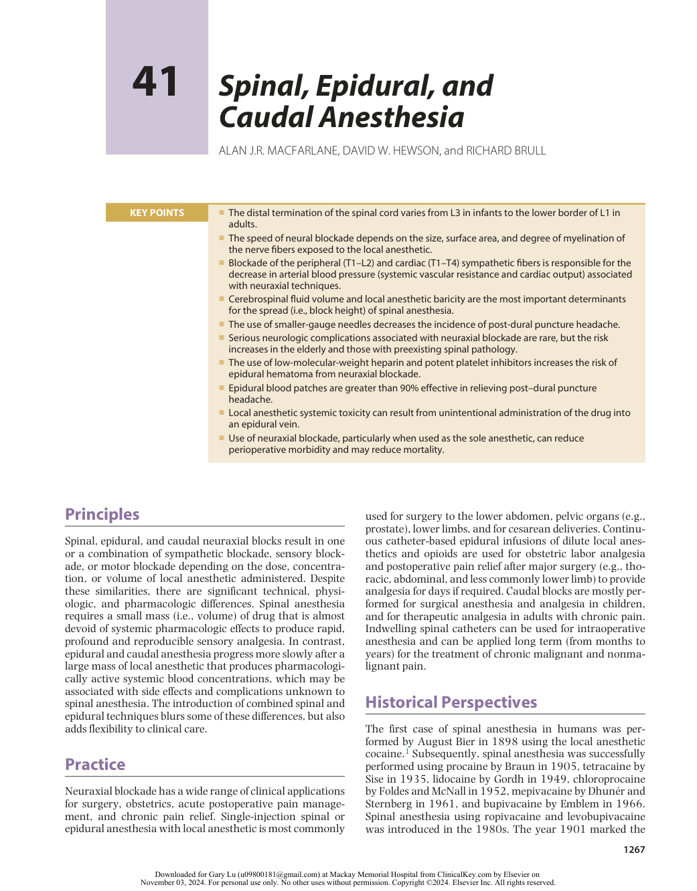

:::

<!-- PDF page 2 -->

first reported use of intrathecal morphine described by Racoviceanu- Pitesti, as well as the first description of caudal anesthesia reported by Cathelin. Lumbar epidural anesthesia in humans was first described by Pagés in 1921, the loss- of- resistance technique by Dogliotti in the 1930s, continuous caudal for obstetrics by Hingson in 1941, and lumbar epidural catheterization for surgery by Curbelo in 1947.2 The use of epidural morphine analgesia was first reported by Behar in 1979.

Despite the extensive experience using neuraxial techniques throughout the past century, several events caused major setbacks along the way, including the Woolley and Roe case detailing paraplegia after spinal anesthesia in 1947,3 the reports of persistent neurologic deficits and adhesive arachnoiditis associated with spinal chloroprocaine in the early 1980s, and cauda equina syndrome associated with continuous spinal lidocaine anesthesia in the early 1990s.4 More recently, the potential for catastrophic epidural hematoma with potent anticoagulants (e.g., low- molecular- weight heparin [LMWH]), antiplatelet agents (e.g., clopidogrel) and newer direct- acting oral anticoagulants remains a cause for concern.5 Along with some unwanted physiologic effects of neuraxial anesthesia and the evolution of ultrasound-guided regional anesthesia, we have seen a modest decline in the use of neuraxial techniques in some centers over the past decade in favor of alternative analgesic strategies.

## Anatomy

The spinal cord is continuous with the brainstem proximally and terminates distally in the conus medullaris as the filum terminale (fibrous extension) and the cauda equina (neural extension). This distal termination varies from L3 in infants to the lower border of L1 in adults because of differential growth rates between the bony vertebral canal and the central nervous system.

Surrounding the spinal cord in the bony vertebral column are three membranes (from innermost to outermost): the pia mater, the arachnoid mater, and the dura mater (Fig. 41.1). The cerebrospinal fluid (CSF) resides in the space between the pia mater and the arachnoid mater, termed the _subarachnoid_ (or _intrathecal_ ) _space_ . The pia mater is a highly vascular membrane that closely invests the spinal cord and brain. Approximately 500 mL of CSF is formed daily by the choroid plexuses of the cerebral ventricles, with 30 to 80 mL occupying the subarachnoid space from T11 to T12 downward. The arachnoid mater is a delicate, nonvascular membrane that functions as the principal barrier to drugs crossing into (and out of) the CSF and is estimated to account for 90% of the resistance to drug migration.6 The outermost layer is the dura.

Surrounding the dura mater is the epidural space, which extends from the foramen magnum to the sacral hiatus and surrounds the dura mater anteriorly, laterally, and posteriorly. The epidural space is bound anteriorly by the posterior longitudinal ligament, laterally by the pedicles and intervertebral foramina, and posteriorly by the ligamentum flavum. Contents of the epidural space include the nerve roots and fat, areolar tissue, lymphatics, and blood vessels including the well- organized Batson venous plexus.

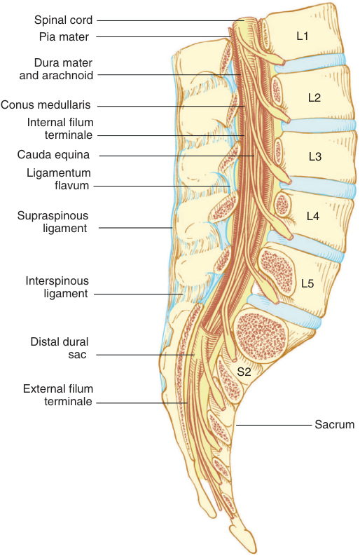

Spinal cord Pia mater L1 Dura mater and arachnoid L2 Conus medullaris Internal filum terminale Cauda equina L3 Ligamentum flavum Supraspinous L4 ligament Interspinous L5 ligament Distal dural sac S2 External filum terminale Sacrum 

**Fig. 41.1 Spinal cord anatomy.** Notice the termination of the spinal cord (i.e., conus medullaris) at L1–L2 and termination of the dural sac at S2.

Posterior to the epidural space is the ligamentum flavum (the so- called yellow ligament), which extends from the foramen magnum to the sacral hiatus. Although classically portrayed as a single ligament, it is actually comprised of two ligamenta flava—the right and the left—which join in the middle and form an acute angle with a ventral opening (Fig. 41.2).7,8 The ligamentum flavum is not uniform from skull to sacrum, nor even within an intervertebral space. Ligament thickness, distance to the dura, and skin- to- dura distance vary with the area of the vertebral canal. The vertebral canal is triangular and largest in area at the lumbar levels, and it is circular and smallest in area at the thoracic levels. The two ligamenta flava are variably joined (fused) in the midline, and this fusion or lack of fusion of the ligamenta flava occurs at different vertebral levels in individual patients.7 Immediately posterior to the ligamentum flavum are the lamina and spinous processes of vertebral bodies or the interspinous ligaments. The supraspinous ligament connects spinous processes between the 7th cervical and 4th lumbar vertebrae. Superiorly the supraspinous ligament is contiguous with the nuchal ligament to the occipital protuberance. Inferiorly it is contiguous with the lumbar fascia (see Fig. 41.2).

There are 7 cervical vertebrae, 12 thoracic vertebrae, 5 lumbar vertebrae, and a sacrum. The vertebral arch,

<!-- PDF page 3 -->

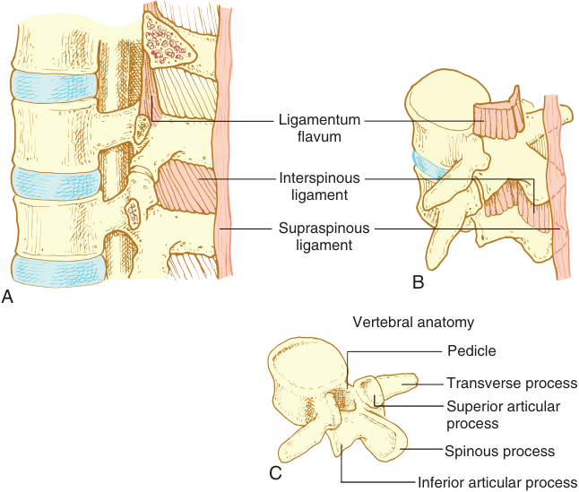

Ligamentum flavum Interspinous ligament Supraspinous ligament B A Vertebral anatomy Pedicle Transverse process Superior articular process Spinous process C Inferior articular process 

**Fig. 41.2 Vertebral anatomy.** (A) Sagittal view. (B) Oblique view of the lumbar vertebrae showing the ligamentum flavum thickening in the caudad extent of the intervertebral space and in the midline. (C) Oblique view of a single lumbar vertebra.

spinous process, pedicles, and laminae form the posterior elements of the vertebra, and the vertebral body forms the anterior element. The vertebrae are joined together anteriorly by the fibrocartilaginous joints with the central disks containing the nucleus pulposus, and posteriorly by the zygapophyseal (facet) joints. The thoracic spinous process is angulated steeply caudad as opposed to the almost horizontal angulation of the lumbar spinous process. This is a clinically important distinction for needle insertion and advancement in the thoracic versus lumbar levels.

The sacral canal contains the terminal portion of the dural sac, which typically ends at S2. Variation is found in this feature as well, with the termination of the dural sac being lower in children. In addition to the dural sac, the sacral canal contains a venous plexus, which is part of the valveless internal vertebral venous plexus. The volume of the caudal canal in adults, excluding the foramina and dural sac ranges, is about 10 to 27 mL. This wide variability in volume may account for some of the variation in block height with caudal anesthesia (Fig. 41.3).9

the lower thoracic and upper lumbar regions. The anterior two-thirds of the spinal cord is supplied by the anterior arterial branches and the posterior one-third by the posterior branches. The anterior and deep portion of the cord (gray matter) is most prone to ischemia (leading to anterior horn motor neuron injury, or anterior spinal artery syndrome) because there are fewer anterior medullary feeder vessels than posterior feeder vessels. Likewise, the midthoracic part of the spinal cord (from T3 to T9) is most at risk where segmental medullary feeder vessels are rare. Venous drainage of the spinal cord follows a similar distribution as the spinal arteries. There are three longitudinal anterior spinal veins and three posterior spinal veins that communicate with the segmental anterior and posterior radicular veins before draining into the internal vertebral venous plexus in the medial and lateral components of the epidural space. There are no veins in the posterior epidural space except those caudal to the L5–S1 disk.

## Anatomic Variations

### NERVE ROOTS

### BLOOD SUPPLY

Blood is supplied to the spinal cord from one anterior spinal artery (originating from the vertebral artery), two posterior spinal arteries (originating from the inferior cerebellar artery), and the segmental spinal arteries (originating from the intercostal and lumbar arteries).10 The spinal arteries enter the spinal canal at each intervertebral foramen and give off branches to both the nerve roots and the medullary branches to the spinal cord; one of the major branches is the artery of Adamkiewicz, variably entering between T7 and L4 on the left, which supplies

The spinal nerve roots are not uniform in size and structure,11,12 which may help to explain the interpatient differences in neuraxial block quality when equivalent techniques are used on seemingly similar patients. Although generally larger than the ventral (motor) roots, the dorsal (sensory) roots are often blocked more easily. This apparent paradox is explained by organization of the dorsal roots into component bundles, which creates a much larger surface area on which the local anesthetics act, possibly explaining why larger sensory nerves are blocked more easily than smaller motor nerves.13

<!-- PDF page 4 -->

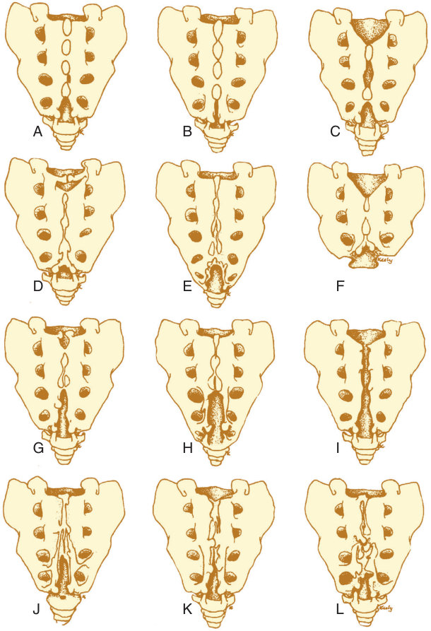

A B C D E F G H I J K L 

**Fig. 41.3 Anatomic variants of the sacrum and sacral hiatus.** (A) Normal. (B) Longitudinal slitlike hiatus. (C) Second midline hiatus. (D) Transverse hiatus. (E) Large hiatus with absent cornua. (F) Transverse hiatus with absent coccyx, two prominent cornua, and two proximal “decoy hiatuses lateral to the cornua.” (G–I) Large midline defects contiguous with the sacral hiatus. (J–L) Enlarged longitudinal hiatuses, each with an overlying decoy hiatus. (From Willis RJ. Caudal epidural block. In: Cousins MN, Bridenbaugh PO, eds. _Neural Blockade in Clinical Anesthesia and Management of Pain_ . 2nd ed. Philadelphia: JB Lippincott; 1988:365.)

### CEREBROSPINAL FLUID

Lumbosacral CSF has a constant pressure of approximately 15 cm H2O, but its volume varies by patient, in part because of differences in body habitus and weight.14 It is estimated that CSF volume accounts for 80% of the variability in peak block height and regression of sensory and motor blockade. Nevertheless, except for body weight (less CSF in subjects with high body mass index [BMI]), the volume of CSF does not correlate with other anthropomorphic measurements available clinically.15 (See section on Factors Affecting Block Height later in the chapter.)

### EPIDURAL SPACE

Hogan’s7 study of frozen cryomicrotome cadaver sections suggests that the epidural space is more segmented and less

uniform than previously believed from indirect anatomic analysis. Another study by Hogan16 has also shown in cadavers that the spread of solution after epidural injection into the tissues of the epidural space is nonuniform, possibly accounting for the clinical unpredictability of epidural drug spread. This lack of uniformity also extends to age- related differences. There is evidence that adipose tissue in the epidural space diminishes with age,17 and this decrease in epidural space in adipose tissue may dominate the age- related changes in epidural dose requirements (see Chapter 61).

## Mechanism of Action

Local anesthetic binding to nerve tissue disrupts nerve transmission, resulting in neural blockade. Local

<!-- PDF page 5 -->

anesthetics are known to cause a dose-dependent disruption to nerve histology and homeostasis, although the degree to which this intrinsic cellular neurotoxicity is clinically relevant remains unclear (see Chapter 25). For spinal and epidural anesthesia, the target binding sites for local anesthetics are located within the spinal cord (superficial and deep portions) and on the spinal nerve roots in the subarachnoid and epidural spaces. The spinal nerve roots and dorsal root ganglia are considered the most important sites of action. Nerves in the subarachnoid space are highly accessible and easily anesthetized, even with a small dose of local anesthetic, compared with the extradural nerves. The speed of neural blockade depends on the size, surface area, and degree of myelination of the nerve fibers exposed to the local anesthetic. Anatomic studies show that the S1 and L5 posterior roots are the largest and thus most resistant to blockade during epidural anesthesia.12 Smaller nerves are more sensitive to the effects of local anesthetics because of their relatively high membrane surface area to axon unit volume ratio. For example, the small preganglionic sympathetic fibers (B fibers, 1–3 μm, minimally myelinated) are most sensitive to local anesthetic blockade. Among the sensory nerves, the C fibers (0.3–1 μm, unmyelinated), which conduct cold temperature sensation, are blocked more readily or earlier than the A- delta fibers (1–4 μm, myelinated), which conduct pinprick sensation. The A- beta fibers (5–12 μm, myelinated), which conduct touch sensation, are the last to be affected among the sensory fibers. The larger A- alpha motor fibers (12–20 μm, myelinated) are more resistant than any of the sensory fibers. Regression of blockade (“recovery”) follows in the reverse order: motor function followed first by touch, then pinprick, and finally cold sensation.18 Another manifestation of relative sensitivity or susceptibility to the effects of local anesthetics is the observed differences in the peak block height (highest or most cephalad level of anesthesia) according to each sensory modality, which is termed _differential sensory block_ . For example, the level of anesthesia to cold sensation (also an approximate level of sympathetic blockade) is most cephalad and is on average one to two spinal segments higher than the level of pinprick anesthesia, which in turn is one to two segments higher than the level of touch anesthesia.19

### DRUG UPTAKE

When local anesthetic is injected directly into the subarachnoid space during spinal anesthesia, it diffuses through the pia mater and penetrates through the spaces of Virchow– Robin (extensions of the subarachnoid space accompanying the blood vessels that invaginate the spinal cord from the pia mater) to reach the deeper dorsal root ganglia.20 Furthermore, a portion of the subarachnoid drug diffuses outward through the arachnoid and dura mater to enter the epidural space,21 whereas some is taken up by the blood vessels of the pia and dura maters.22

Drug penetration and uptake is directly proportional to the drug mass, CSF drug concentration, contact surface area, lipid content (high in spinal cord and myelinated nerves), and local tissue vascular supply, but is inversely related to nerve root size. The concentration of local

anesthetic in the CSF is highest at the site of subarachnoid injection in the case of spinal anesthesia (generally L2–L4 levels).

For epidural anesthesia, drug uptake is more complex. Some of the injected local anesthetic will move from the epidural space through the dura and arachnoid membranes into the CSF to exert its neural blocking effect, whereas some will be lost through vascular absorption into the capillary vessels and into the systemic circulation and uptake into epidural fat. The bioavailability of local anesthetics found in the CSF after epidural administration is low (&lt;20%).

### DRUG DISTRIBUTION

Diffusion is the primary mechanism of local anesthetic distribution in the CSF from areas of high concentration (i.e., at the site of injection) toward other segments of the spinal cord with low drug concentration.23 Rostral spread after the administration of a small local anesthetic dose, often evident within 10 to 20 minutes, is related to the CSF circulation time. Longitudinal oscillations generated by the pulsations of the arteries in the skull are believed to be responsible for CSF bulk flow. This likely facilitates the cephalad distribution of local anesthetic from the lumbar subarachnoid space to the basal cisterns within 1 hour of injection.

Drug distribution in the epidural space is again more complex, with possible contributions from one, some, or all of the following mechanisms: (1) crossing the dura and arachnoid mater into the subarachnoid space, (2) rostral and caudal (longitudinal) spread within the epidural space, (3) circumferential spread within the epidural space, (4) exit of the epidural space through the intervertebral foramina, (5) binding to epidural fat, and (6) vascular absorption into the epidural vessels. Longitudinal spread of local anesthetic by bulk flow within the epidural space may occur after the administration of a larger dose (i.e., volume). Factors that may enhance the distribution of local anesthetic within the epidural space are small caliber (greater spread in the thoracic space), increased epidural space compliance,24 decreased epidural fat content, decreased local anesthetic leakage through the intervertebral foramina (e.g., in the elderly and with spinal stenosis), and increased epidural pressure (e.g., pregnancy).25 Drug is also preferentially distributed from areas of high to low concentration. Finally, the direction of drug spread varies with the vertebral level – that is, epidural spread is mostly cephalad in the lumbar region, caudad after a high thoracic injection, and spread mostly cephalad after a low thoracic injection.25

### DRUG ELIMINATION

Regression of neural blockade results from a decline in the CSF drug concentration, which in turn is caused by non- neural tissue uptake and, most importantly, vascular absorption. Time for block regression is also inversely correlated with CSF volume.26 Drug is absorbed by the vessels in the pia mater or the epidural vessels through back diffusion before entering the systemic circulation. No drug metabolism takes place in the CSF. The rate of elimination is also dependent on the distribution of local anesthetic; greater spread will expose the drug to a larger area for vascular

<!-- PDF page 6 -->

absorption and thus a shorter duration of action. Lipidsoluble local anesthetics (e.g., bupivacaine) bind to epidural fat to form a depot that can slow vascular absorption.

## Physiologic Effects

Safe conduct of spinal, epidural, and caudal anesthesia requires an appreciation of their physiologic effects. Neuraxial anesthesia evokes blockade of the sympathetic and somatic (sensory and motor) nervous systems, along with compensatory reflexes and unopposed parasympathetic activity.27 The physiologic effects of epidural anesthesia are similar to those of spinal anesthesia, with the exception that local anesthetic blood levels reach concentrations sufficient enough to produce systemic effects on their own.

### CARDIOVASCULAR

The effects of neuraxial blocks on blood pressure are similar in some ways to the combined use of intravenous α1- and β- adrenergic blockers on systemic vascular resistance and cardiac output; decreased systemic vascular resistance, stroke volume and heart rate (see Chapter 13) caused by blockade of the peripheral (T1–L2) and cardiac (T1–T4) sympathetic fibers as well as adrenal medullary secretion. The decrease in arterial blood pressure is believed to be more gradual and of less magnitude with epidural than with spinal anesthesia at comparable sensory block levels. Of prime importance, the extent to which arterial blood pressure decreases with either technique depends on multiple factors, including patient age and intravascular volume status.

### Stroke Volume

Sympathectomy usually decreases stroke volume. Venous and arterial vasodilation reduces preload (venous return) and afterload (systemic vascular resistance), respectively. Because of the large amount of blood that resides in the venous system (approximately 75% of the total blood volume), the venodilation effect predominates, owing to the limited amount of smooth muscle in venules; in contrast, the vascular smooth muscle on the arterial side of the circulation retains a considerable degree of autonomous tone. Cardiac output is thought to be either maintained or slightly decreased during the onset of spinal anesthesia. Yet a biphasic response, characterized by an early transient increase followed by an eventual decrease in cardiac output,28 has been observed. This initial increase is caused by a greater magnitude of decline in the systemic vascular resistance than by venous return, especially in elderly patients with preexisting hypertension and high baseline systemic vascular resistance (see also Chapter 61).

The vasodilatory changes after neuraxial blockade that can affect cardiac output depend on each patient’s baseline sympathetic tone (i.e., higher sympathetic tone in the elderly equates to a greater hemodynamic change) and the extent of the sympathectomy (i.e., the height of the block). The extent of the sympathectomy is typically described as extending for two to six dermatomes above the sensory block level with spinal anesthesia and at the same level with epidural anesthesia.29 If normal cardiac output is maintained, systemic vascular resistance should decrease only

15% to 18% after neuraxial blockade in healthy normovolemic patients, even with nearly total sympathectomy. In elderly patients with cardiac disease, systemic vascular resistance may decrease almost 25% after spinal anesthesia, whereas cardiac output decreases only 10%.30

### Heart Rate

Heart rate may decrease during a high neuraxial block as a result of blockade of the thoracic sympathetic fibers (preganglionic cardiac accelerator fibers originating at T1–T4), as well as reflexive slowing of the heart rate as vasodilation reduces venous return to the right atrium. Factors that may increase the likelihood of exaggerated bradycardia (40–50 beats/min) include a baseline heart rate less than 60 beats/ min, age younger than 37 years, male sex, nonemergency status, β- adrenergic blockade, and prolonged case duration. Severe bradycardia (&lt;40 beats/min) is associated with a baseline heart rate less than 60 beats/min and male sex.31 Heart rate may also decrease in the presence of extensive peripheral sympathectomy (T5–L2), with venous pooling in the lower extremity and the abdominal and pelvic viscera. Although hypotension will trigger a compensatory baroreceptor sympathetic response (vasoconstriction and increased heart rate) above the level of blockade, the reduction in venous return and right atrial filling cause a decrease in signal output from intrinsic chronotropic stretch receptors located in the right atrium and great veins,29 leading to a marked increase in parasympathetic activity (vagal tone). The two opposing responses are usually in check with a minimal change in heart rate (or a slight reduction). However, when neuraxial anesthesia is extended to the T1 level, blockade of the cardioaccelerator fibers in addition to a marked reduction in venous return may result in severe bradycardia and even asystole because of unopposed parasympathetic activity. However rare, the likelihood of cardiac arrest appears to be more likely in young, healthy, and conscious patients.32 The Bezold–Jarisch reflex may be a possible cause of profound bradycardia and circulatory collapse after spinal anesthesia, especially in the presence of hypovolemia, when a small end- systolic left ventricular volume may trigger a mechanoreceptor- mediated bradycardia.33

### Coronary Blood Flow

When coronary artery blood flow and myocardial metabolism were measured during spinal anesthesia to T4 in hypertensive and normotensive patients, decreases in coronary blood flow paralleled the decrease in mean arterial blood pressure, and the percent extraction of myocardial oxygen was unchanged. Extraction of oxygen was unchanged because myocardial work paralleled the decrease in mean arterial blood pressure and coronary blood flow.34 A high thoracic block in patients with cardiac ischemia can improve global and regional myocardial function and reverse ischemic changes, likely as a result of reduced myocardial oxygen demand and left ventricular afterload.35 Both infarction size and ischemia- induced arrhythmias improved in coronary occlusion experiments in animals, with no apparent vasodilatory effect on the coronary vessels.36 These data support previous observations37 but still do not provide a patient- by- patient indication of the organ most at risk for flow- related ischemia.

<!-- PDF page 7 -->

The clinical question of what level of decrease in arterial blood pressure after a neuraxial block is acceptable without a significant decrease in organ perfusion (e.g., brain, liver, gut) remains to be answered, although some human and animal data are available (see respective sections). Once arterial blood pressure decreases to a level at which treatment is believed to be necessary, ephedrine, a mixed adrenergic agonist, provides more appropriate therapy for the noncardiac circulatory sequelae of neuraxial block than does a pure α- adrenergic agonist (see Chapter 13), unless the patient has a specific and defined arterial blood pressure requirement.38 That the decrease in arterial blood pressure after neuraxial block can be minimized by the administration of crystalloids intravenously is probably not a valid concept. Specifically, 250- to 2000- mL pre- block hydration regimens may temporarily increase preload and cardiac output but do not consistently increase arterial blood pressure or prevent hypotension and are not recommended for routine use.13,39 Useful techniques to prevent hypotension include the repeated low- dose local anesthetic boluses through a continuous spinal catheter,40 small- dose unilateral spinal anesthesia, and selective small- dose spinal anesthesia. Although prevention of hypotension caused by vasodilatation using a prophylactic (“preloading”) infusion of colloid or crystalloid during the performance of the neuraxial block (“coloading”) has been reported, this is no longer observed as a routine practice.39

### CENTRAL NERVOUS SYSTEM

Spinal anesthesia–induced hypotension may decrease regional cerebral blood flow (CBF) in elderly patients and those with preexisting hypertension. In a study of elderly patients who had hypotension during bupivacaine spinal anesthesia, Minville and colleagues demonstrated a significant but transient decrease of middle cerebral artery blood flow velocity and an increase in cerebral vascular resistance, both of which suggest a decrease in cerebral perfusion.41 There was no change in cognitive function after surgery in any of these patients. Both CBF and velocity decline as a result of changes in the cerebral vasculature, especially in the elderly. Whether cerebral autoregulation is impaired in the elderly is still debatable (see Chapter 61).

Kety and colleagues42 demonstrated that producing spinal anesthesia to the midthoracic levels with procaine, even in patients with essential hypertension, results in a decrease in mean arterial blood pressure of 26% (155 to 115 mm Hg) accompanied by a 12% (52 to 46 mL/100 g per minute) decrease in CBF. When the level of spinal anesthesia was purposely increased to produce higher levels of block (T4) in normotensive and hypertensive patients, CBF was unchanged in the normotensive group (45–46 mL/100 g per minute), whereas a 19% decrease occurred in the apparently untreated hypertensive patients (46.5–37.5 mL/100 g per minute).43

### RESPIRATORY

Alterations in pulmonary variables in healthy and even in elderly patients during neuraxial block are usually of little clinical consequence.44 A decrease in vital capacity follows a reduction in expiratory reserve volume related

to paralysis of the abdominal muscles necessary for forced exhalation rather than a decrease in phrenic or diaphragmatic function.45 Despite this decrease in vital capacity, blockade of the intercostal and abdominal muscles during neuraxial anesthesia is adequately compensated by unaltered function of the diaphragm and other accessory respiratory muscles (e.g., sternomastoid, scalenes), especially for forceful inspiration and expiration.46 Nonetheless, neuraxial block should be used cautiously in the setting of severe respiratory disease because paralysis of the intercostal and abdominal muscles is common. However rare, respiratory arrest associated with spinal anesthesia is often unrelated to phrenic or inspiratory dysfunction but rather to hypoperfusion of the respiratory centers in the brainstem. Supportive evidence for this concept is observed after resuscitation, when apnea almost always disappears as soon as pharmacologic and intravascular fluid therapies have restored cardiac output and arterial blood pressure.

### Pregnancy

In young healthy pregnant people undergoing cesarean delivery, spinal bupivacaine, ropivacaine, and levobupivacaine affect pulmonary function minimally, irrespective of the peak sensory block level.47 However, in overweight pregnant people, vital capacity declines to a greater extent and recovers more slowly compared with normal- weight pregnant people after hyperbaric spinal bupivacaine administration (see also Chapter 58).48

### Obesity (see also Chapter 54)

The impact of spinal anesthesia on lung volume variables is significantly more in overweight patients than in normalweight patients.48 The magnitude of decline in vital capacity is proportional to the BMI value (vital capacity 19% for BMI 30–40 kg/m2 vs. 33% for BMI >40 kg/m2 ).49

### GASTROINTESTINAL

Neuraxial blockade from T6 to L1 disrupts splanchnic sympathetic innervation to the gastrointestinal tract, resulting in a contracted gut and hyperperistalsis. Nausea and vomiting may be associated with neuraxial block in as much as 20% of patients and is primarily related to gastrointestinal hyperperistalsis caused by unopposed parasympathetic (vagal) activity.50 Atropine is effective in treating nausea associated with high (T5) subarachnoid anesthesia.51

Thoracic epidural anesthesia (TEA) has a direct blood pressure–dependent effect on intestinal perfusion.52 TEA improves anastomotic mucosal blood flow in patients undergoing esophagectomy when mean arterial blood pressure is minimally altered but worsens local perfusion when arterial blood pressure is decreased by about 50%. In colorectal surgery, TEA decreases anastomotic blood flow but improves gastric and transverse colonic blood flow.53 Correction of systemic hypotension by vasopressor therapy (e.g., norepinephrine) has been found to reverse impaired colonic perfusion. TEA may also reduce the rate of anastomotic leak after emergency laparotomy, esophageal surgery,54 and other gastrointestinal interventions.55

A reduction in hepatic blood flow parallels the reduction in mean systemic arterial pressure in the setting of spinal anesthesia.56 Although lumbar epidural anesthesia also

<!-- PDF page 8 -->

results in a decline in hepatic perfusion despite colloid preloading in young and elderly patients, hepatic perfusion can slightly increase with TEA after major abdominal surgery.

### RENAL

Despite a predictable decrease in renal blood flow accompanying neuraxial blockade, this decrease is of little physiologic importance.57,58 One aspect of genitourinary function of clinical importance is the belief that neuraxial blocks are a frequent cause of urinary retention, which delays discharge of outpatients and necessitates routine bladder catheterization in inpatients (see section on Complications – Urinary Retention, later in the chapter). While some studies do suggest that neuraxial techniques, especially when inclusive of opioids, can increase the likelihood of urinary retention compared to general anesthesia and systemic analgesia, the causes of perioperative urinary retention are multifactorial.59 Nonetheless, avoiding excessive intraoperative fluids and using shorter-acting neuraxial local anesthetics can help to mitigate the risk of urinary retention. In patients undergoing hip or knee replacement surgery, the routine use of urinary catheters is not recommended since catheterization has been associated with a higher prevalence of urinary tract infection in this population.60

severe cardiac disease when the reliability of a single- shot spinal anesthetic must be combined with more hemodynamically stable incremental dosing.

### NEURAXIAL ANALGESIA

Local anesthetics (as well as other additives, discussed later) applied to the neuraxis in subanesthetic doses can provide potent, long- lasting analgesia for a variety of indications, including intraoperative analgesia, acute postsurgical pain,64 and chronic pain associated with malignancy. The use of intrathecal and/or epidural opioids either alone or in combination with local anesthetics can provide excellent quality pain relief.65–67 Neuraxial opioids are a mainstay in labor and delivery,68,69 but are also used in laparotomies,70 thoracotomies,71 cardiac surgery,72 and lower limb arthroplasty.73,74 Some of the most important benefits of epidural analgesia are realized in patients with preexisting respiratory disease undergoing abdominal surgery.75 Neuraxial analgesia may have other beneficial outcomes beyond analgesia and these are reviewed later.

## Contraindications

### ABSOLUTE

## Indications

At the most basic level, neuraxial blockade is indicated when the surgical procedure can be accomplished with a sensory level of anesthesia that does not produce adverse patient outcomes. The level of anesthesia or analgesia required is of prime importance because the physiologic effects of a high- level block may be untenable.

There are few absolute contraindications to neuraxial blockade. Some of the most important include patient refusal, localized sepsis, and an allergy to any of the drugs planned for administration. A patient’s inability to maintain stillness during needle puncture, which can expose the neural structures to traumatic injury,76 as well as raised intracranial pressure, which may theoretically predispose to brainstem herniation,77 should also be considered absolute contraindications to a neuraxial technique.

### NEURAXIAL ANESTHESIA

When considering neuraxial anesthesia, the nature and duration of surgery, patient comorbidities, the ease of spinal insertion (i.e., positioning and spinal pathology), and the relative benefits and risks to the patient are important. Spinal anesthesia is most commonly used for patients who require surgical anesthesia for procedures of known duration that involve the lower extremities, perineum, pelvic girdle, or lower abdomen. Descriptions of spinal anesthesia as the primary surgical anesthetic also include lumbar spine surgery,61 as well as upper abdominal procedures, such as laparoscopic cholecystectomy.62 Spinal anesthesia may be useful when patients wish to remain conscious or when comorbidities such as severe respiratory disease or a difficult airway increase the risks of using general anesthesia. Epidural anesthesia can also be used for the lower extremities, perineum, pelvic girdle, or lower abdomen, but by virtue of intermittent or continuous catheter- based local anesthetic delivery, the duration of surgical anesthesia is not necessarily finite as it is with single- injection spinal anesthesia. Continuous catheter- based spinal anesthesia is both less conventional and less commonly used than either single- shot spinal anesthesia or catheter- based epidural anesthesia, but may be especially useful when insertion of an epidural catheter is challenging63 or in the setting of

### RELATIVE

Relative contraindications must be weighed against the potential benefits of neuraxial blockade. Relative contraindications can be approached by system.

### Neurologic

**Myelopathy or Peripheral Neuropathy.** A preexisting neurologic deficit can in theory worsen the extent of any injury in this group of patients (so- called doublecrush phenomenon). While many reports suggest central neuraxial techniques may be used safely, there is no definitive evidence.76,78–80 Chronic low back pain without neurologic deficit is not a contraindication to neuraxial blockade. The association between neuraxial techniques and the exacerbation of back pain symptoms is not documented.

**Spinal Stenosis.** Patients with spinal stenosis appear to be at increased risk of neurologic complications after neuraxial blockade,81 but the relative contribution of surgical factors and natural history of the spinal pathology itself is unknown. Using a lower mass of local anesthetic may in theory reduce the risk if spinal anesthesia is undertaken in the setting of spinal stenosis.

<!-- PDF page 9 -->

**Spine Surgery.** Previous spine surgery has not been shown to predispose patients to an increased risk of neurologic complications after neuraxial blockade.81,82 However, depending on postsurgical anatomy and the presence of scar tissue, adhesions, hardware, and/or bone grafts, needle access to the CSF, or epidural space and/or epidural catheter insertion may be challenging or impossible. In addition, the resultant spread of local anesthetic in the CSF or epidural space can be unpredictable and incomplete.

**Multiple Sclerosis.** Patients with multiple sclerosis (MS) may be more sensitive to neuraxial local anesthetics and thus exhibit a prolonged duration of motor and sensory blockade; however, any association between neuraxial anesthesia and exacerbation of MS symptoms is not based in evidence.83,84 Given that demyelinated fibers may be more prone to the neurotoxic effects of local anesthetics, it seems prudent to use a lower dose and concentration of spinal local anesthetic in this group of patients, or else consider epidural rather than spinal anesthesia.

**Spina Bifida.** Spina bifida comprises a wide spectrum of congenital spinal cord malformations. Depending on the severity of the neural tube defect, patients with spina bifida may have a tethered cord and the ligamentum flavum may be absent, thereby increasing the potential for traumatic needle injury to the spinal cord. In patients who have undergone repair of open spinal dysraphisms, the spread of local anesthetic in the CSF and epidural space (if present) can be highly variable. Neuraxial techniques have been successfully used in isolated spina bifida patients,85 but are not advised in the setting of severe neural tube defects such as diastematomyelia or tethered cord.

If, after consideration of risks and benefits, a neuraxial technique is to be undertaken for a patient with a neural tube defect, a careful clinical and radiologic evaluation of neurologic status must first be undertaken and noted along with documentation of the discussion of the risks and benefits.

### Cardiac (see also Chapter 50)

**Aortic Stenosis or Fixed Cardiac Output.** The unpredictable speed and extent to which systemic vascular resistance is reduced after spinal anesthesia may cause many providers to avoid spinal anesthesia in preloaddependent patients and try to prevent a dangerous decrease in coronary perfusion. This concern is borne of theoretic risk and a great deal of caution rather than evidence.86 Clinical practice mandates that neuraxial anesthesia be considered individually for each patient with aortic stenosis in the context of their own disease severity, left ventricular function, and case urgency. A catheter- based neuraxial anesthetic, whether it is an epidural or intrathecal catheter, allows for the repeated administration of small doses of local anesthetic, with potentially more control over hemodynamic changes, and may be a logical alternative choice.

**Hypovolemia.** An extension of patients who are preloaddependent, hypovolemic patients may exhibit an exaggerated hypotensive response to the vasodilatory effects of neuraxial blockade.

### Hematologic

**Thromboprophylaxis.** Borne of the catastrophic cases of spinal hematoma causing paralysis associated with the introduction and use of LMWH in the United States,87 the American Society of Regional Anesthesia and Pain Medicine (ASRA) first published a practice advisory to guide the provision of neuraxial techniques in patients receiving antithrombotic or thrombolytic therapy in 2004. Now addressing a myriad of novel potent oral anticoagulants, the ASRA practice advisory5 is an invaluable resource for providers performing neuraxial techniques in this challenging and ever- growing patient population. A summary of the ASRA guidelines is reproduced in Table 41.1.

**Inherited Coagulopathy.** The safety of neuraxial techniques in patients with common bleeding diatheses is not well documented. Hemorrhagic complications after neuraxial techniques in patients with known hemophilia, von Willebrand disease, or idiopathic thrombocytopenic purpura appear infrequently when factor levels are more than 0.5 IU/mL for factor VIII, von Willebrand factor, and ristocetin cofactor activity, or when the platelet count is greater than 50 × 109 /L1 before block performance.88 The minimum safe factor levels and platelet count for neuraxial blockade, however, remain undefined in both the obstetric and general populations.88

### Infection

Theoretic concerns based on animal data and laboratory and case reports in humans89–91 suggest iatrogenic seeding of the neuraxis in the setting of a systemic infection can occur. Some providers avoid neuraxial techniques in febrile patients. A definitive causative relationship between existing systemic infection and meningitis or epidural abscess after a neuraxial technique has never been shown. In fact, a lumbar puncture is a critical component of the investigation of fever of unknown origin, yet there are no definitive data linking lumbar puncture to increased risk of neuraxial infection in this setting.92 Although the profound vasodilation may be sufficient reason to avoid neuraxial techniques in patients with profound bacteremia or septic shock, the theoretic risk of seeding the intrathecal or epidural spaces by performing neuraxial techniques in patients with untreated systemic infection further supports using another technique. Patients with evidence of systematic infection may safely undergo neuraxial anesthesia once antibiotic therapy has been initiated and the patient has demonstrated a response to the antibiotics.92

## Spinal Anesthesia

### FACTORS AFFECTING BLOCK HEIGHT

The dermatomal level required for various surgical procedures is outlined in Table 41.2. The provider must recall that intra- abdominal structures such as the peritoneum (T4), bladder (T10), and uterus (T10) have a spinal segment innervation that may be much more cephalad compared with that of the corresponding skin incision used to operate on these structures.

<!-- PDF page 10 -->

### Table 41.1 ASRA Evidence- Based Guidelines for Neuraxial Anesthesia in the Patient Receiving Thromboprophylaxis

|**DRUG**|**NEURAXIAL N**|**EEDLE/CATHETER PL**|**ACEMENT**|**NEURAXIAL CA**|**THETER REMOVAL**|**COMMENTS**|
|---|---|---|---|---|---|---|
||**Discontinuation** **Prior to Placement**|**Restart Following** **Needle Placement**|**Indwelling** **Catheter** **Placement**|**Discontinuation** **Prior to Removal**|**Restart Following** **Removal**||
|**ANTIPLATELET**|**AGENTS**||||||
|Aspirin|_Safe for all categories_||||||
|NSAIDs|_Safe for all categories but_|_caution with concomita_|_nt drugs that may_|_affect coagulation_|||
|Clopidogrel|5–7 d|Immediately |Catheters may be |maintained |Immediately ||
|Ticlopidine|10 d|_If loading dose_: 6 h|for 1–2 days af Clopidogrel or|ter restarting ticlopidine|_If loading dose_: 6 h||
|Prasugrel|7–10 d||Avoid catheters||||
|Ticagrelor|5–7 d||||||
|Dipyridamole|24 h|6 h|Avoid catheters||6 h||
|_GP IIa/IIIb_ _inhibitors_ Abciximab Eptifibatide Tirofiban|_Avoid until platelet_ _function returns to_ _normal_|_These drugs are gener_|_ally contraindicated_|_for 4 weeks postsurg_|_ery_||
|**UNFRACTIONAT**|**ED HEPARIN**||||||
|_Intravenous_|4–6 h and confirm normal coagulation|1 h|Safe|4–6 h and confirm normal coagulation|1 h|_Check platelet count_ _before needle_ _placement or_ _catheter removal if_ _duration of LMWH_ _>4 d_|
|_Subcutaneous_|||||||
|Low- dose prophylaxis|4–6 h or confirm normal coagulation|1 h|Safe|4–6 h and confirm normal coagulation|1 h|_5000 U SC bid or tid_|
|Higher- dose prophylaxis|12 h and confirm normal coagulation||Safety of cathete|rs not established||_7500–10,000 U SC bid or_ ≤_20,000 U/d_|
|Therapeutic|24 h and confirm normal coagulation||Avoid catheters|||_>10,000 U SC/dose or_ _>20,000 U/d_|
|**LOW- MOLECUL**|**AR- WEIGHT HEPARIN**||||||
|_Once daily_ _prophylaxis_|12 h|12 h|Safe|12 h|4 h|_Check platelet count_ _before needle_ |
|_Twice daily_ _prophylaxis_|||Avoid catheters|||_placement or_ _catheter removal if_ _duration of LMWH_|
|_Therapeutic dose_|24 h|24–72 h|Avoid catheters|||_>4 d_|
|**ORAL ANTICOA**|**GULANTS**||||||
|Coumarins|Ideally 5 d and INR &lt;1.5|No delay|Monitor INR daily and check sensory/ motor function routinely|INR &lt;1.5|No delay||
|Apixaban Rivaroxaban|72 h|6 h 6 h|Avoid catheters||6 h|_Refer to ASRA guidelines_ _if unanticipated_ _indwelling catheter_|

_ASRA,_ American Society of Regional Anesthesia and Pain Medi cine; _bid_ , twice a day; _tid_ , three times a day; _d_ , day(s); _GP,_ glycoprotein; _h_ , hour(s); _INR,_ international normalized ratio; _LMWH,_ low-molecular-weight heparin; _NSAIDs,_ nonsteroidal anti-inflammatory drugs; _SC_ , subcutaneous; _U_ , unit(s). From Horlocker TT, Vandermeuelen E, Kopp SL, et al. Regional anesthesia in the patient receiving antithrombotic or thrombolytic therapy: American Society of Regional Anesthesia and Pain Medicine Evidence- Based Guidelines (Fourth Edition). _Reg Anesth Pain Med_ . 2018;43:263–309.

::: details 原始表格與符號（PDF 第 10 頁）

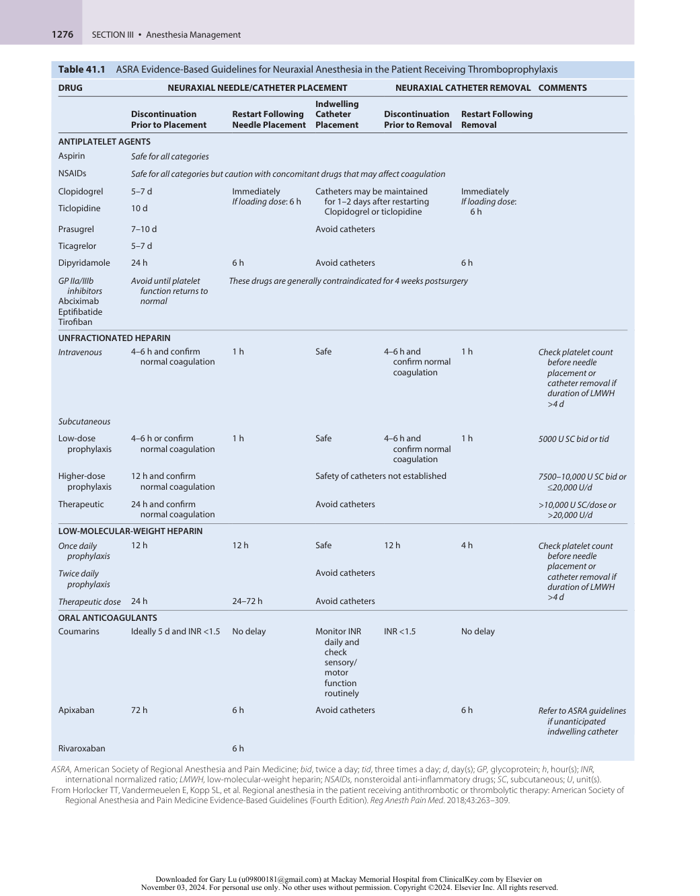

:::

<!-- PDF page 11 -->

Drug, patient, and procedural factors can all affect the distribution of local anesthetic spread within the intrathecal space, some of which are more clinically relevant than others.23,93 Many of these factors are not controllable by the anesthesiologist, leading to significant interpatient variability (Table 41.3).

### Drug Factors

The adjustable factors for any given local anesthetic solution are dose, volume, concentration, temperature, and baricity. Baricity and dose are most important to affect distribution.

**Baricity.** Baricity is the ratio of the density of a local anesthetic solution to the density of CSF. Density is defined as the mass per unit volume of solution (g/mL) at a specific temperature. Density may be compared between different substances by calculating the specific gravity, which is the ratio of the density of a solution to the density of water. Because density varies inversely with temperature, the baricity of a local anesthetic solution is conventionally defined at 37°C. The density of CSF is 1.00059 g/mL.94 Local anesthetic solutions that have the same density as CSF are termed _isobaric_ , those that have a higher density than CSF are termed _hyperbaric_ , and those with a lower density than CSF are termed _hypobaric_ . The spread of hyperbaric solutions is more predictable,95 with less interpatient variability.96 To make a drug hyperbaric to CSF, it must be denser than CSF, with a baricity appreciably more than 1.0000 or a density appreciably more than 1.00059 g/mL. The reverse is true for making a drug hypobaric to the CSF. Dextrose and sterile water are commonly added to render local anesthetic solutions either hyperbaric or hypobaric, respectively.

**Table 41.2** Dermatomal Level Required for Various Common Surgical Procedures

|**Type of Surgery**|**Dermatomal Level**|
|---|---|
|Upper abdominal surgery|T4|
|Cesarean delivery|T4|
|Transurethral resection of prostate|T10|
|Hip surgery|T10|
|Foot and ankle surgery|L2|

The clinical importance of baricity is the ability to influence the distribution of local anesthetic spread based on gravity. Hyperbaric solutions will preferentially spread to the dependent regions of the spinal canal, whereas hypobaric solutions will spread to nondependent regions. Isobaric solutions tend not to be influenced by gravitational forces.97 Anesthesiologists can capitalize on this phenomenon by altering the position of the patient. For example, the administration of hyperbaric local anesthetic to patients in the lateral decubitus position will result in a preferential anesthetic effect on the dependent side, whereas the opposite is true for the administration of a hypobaric solution. A thoughtful understanding of the natural curvatures of the vertebral column can help predict local anesthetic spread in patients placed in the horizontal supine position immediately after intrathecal administration. Hyperbaric local anesthetics injected, while sitting, at the L3–L4 or L4–L5 interspace will spread with gravity from the height of the lumbar lordosis down toward the trough of the thoracic kyphosis in the horizontal supine position, resulting in a higher level of anesthetic effect than isobaric or hypobaric solutions.93 Hyperbaric solutions are also useful in small doses for a saddle block and to achieve unilateral anesthesia. CSF and local anesthetic density change with temperature. Plain bupivacaine 0.5%, for example, may be isobaric at 24°C but is slightly hypobaric at 37°C. A small volume of drug at room temperature injected intrathecally quickly equilibrates after injection and increases to the temperature of the CSF. Nevertheless, increasing temperature decreases density of a solution and warming of local anesthetic solution to body temperature, therefore making it more hypobaric, increases the block height in patients who remain seated for several minutes after injection.98

**Dose, Volume, and Concentration.** The dose, volume, and concentration are inextricably linked (Volume × Concentration = Dose), but dose is the most reliable determinant of local anesthetic spread (and thus block height) when compared with either volume or concentration for isobaric and hypobaric local anesthetic solutions.99,100 Hyperbaric local anesthetic injections are primarily influenced by baricity.

The choice of local anesthetic itself does not influence spread if all other factors are controlled. Additive drugs, other than opioids, also do not affect spread. However,

**Table 41.3** Factors Affecting Local Anesthetic Distribution and Block Height

||**More Important**|**Less Important**|**Not Important**|
|---|---|---|---|
|Drug factors|Dose Baricity|Volume Concentration Temperature of injection Viscosity|Additives other than opioids|
|Patient factors|CSF volume Advanced age Pregnancy|Weight Height Spinal anatomy Intra- abdominal pressure|Menopause Sex|
|Procedure factors|Patient position Epidural injection post spinal|Level of injection (hypobaric more than hyperbaric) Fluid currents Needle orifice direction Needle type||

_CSF,_ cerebrospinal fluid. Modified from Greene NM. Distribution of local anesthetic solutions within the subarachnoid space. _Anesth Analg_ . 1985;64(7):715–730.

::: details 原始表格與符號（PDF 第 11 頁）

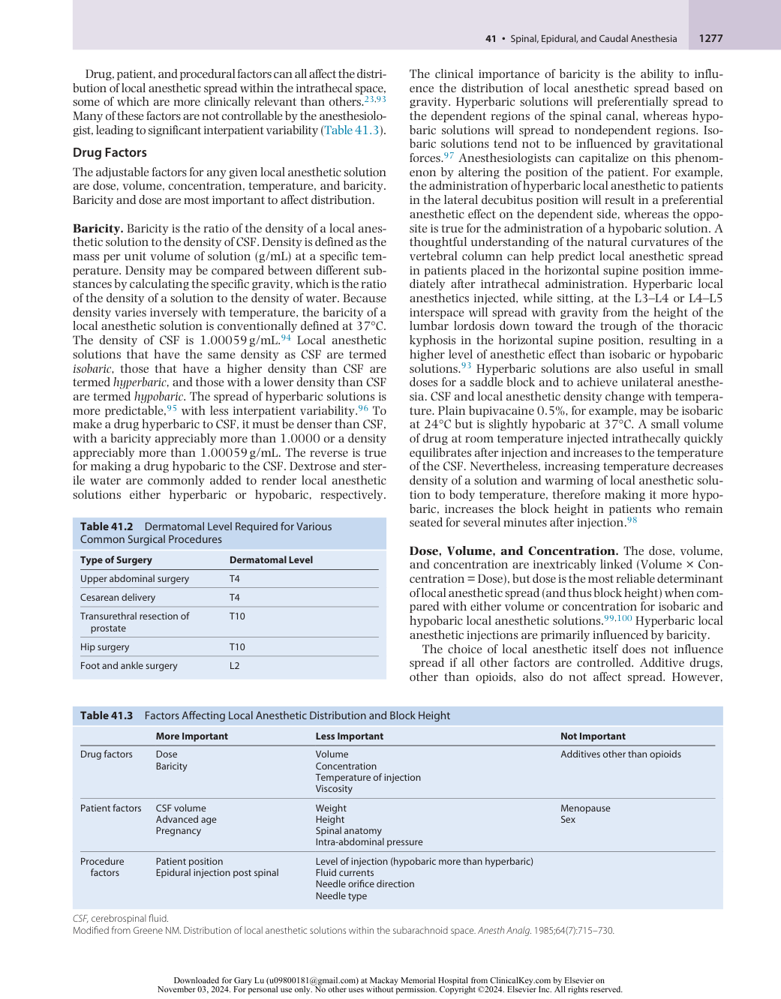

:::

<!-- PDF page 12 -->

opioids do seem to increase mean spread,93,101 possibly as a result of pharmacologic enhancement at the extremes of the spread where the local anesthetic block alone would have been subclinical.102,103

### Patient Factors

Patient characteristics that may influence block height include patient height, weight, age, sex, pregnancy, anatomic configuration of the spine, and the CSF properties (volume and composition). Within the range of “normalsized” adults, patient height does not seem to affect the spread of spinal anesthesia. This is likely because the length of the lower limb bones rather than the vertebral column contributes most to adult height. A correlation has been found between the vertebral column length and local anesthetic spread104 and, at extremes of height, consideration should be given to altering the dose accordingly.

The CSF volume is an important patient- related factor that significantly influences peak block height and regression of sensory and motor blockade.15 Lumbosacral CSF has a fairly constant pressure of approximately 15 cm H2O but its volume varies from patient to patient, in part because of differences in body habitus and weight.14 In a small sample of patients, block height varied indirectly with CSF volume.15 Unfortunately, CSF volume does not correlate well with anthropomorphic measurements available clinically other than body weight.15 In theory, the increased abdominal mass in obese patients, and possible increased epidural fat, may decrease the CSF volume and therefore increase the spread of local anesthetic and block height. This has indeed been demonstrated using hypobaric solutions,105,106 which are characterized by more variable spread anyway, but not hyperbaric solutions (see Chapter 54).105,107

CSF density can also vary between and within individuals depending on sex, menopausal status, and pregnancy (see Chapter 58).94 The density of CSF is lower in women compared with men, premenopausal compared with postmenopausal patients, and pregnant compared with nonpregnant people. Although this may affect relative baricity of local anesthetics, the clinical variation in spread is probably unimportant.

Advanced age is associated with increased block height (see Chapter 61).108,109 In older patients, CSF volume decreases, whereas its specific gravity increases. Furthermore, the nerve roots appear more sensitive to local anesthetic in the aged population.

Biological sex can theoretically affect block height by several mechanisms. CSF density is higher in males, thereby reducing the baricity of local anesthetic solution and possibly limiting the extent of cephalad spread. In the lateral position, the broader shoulders of males relative to their hips make the lateral position slightly more head- up. The reverse is true in females who have a slightly head- down tilt in the lateral position compared with males. Despite this, there is little objective data that males have a slightly less cephalad spread than females in the lateral position.

Variations of the spine may be an important contributor to block height. Scoliosis, although it possibly makes insertion of the needle more difficult, will have little effect on local anesthetic spread if the patient is positioned supine. Kyphosis, however, in a supine patient may affect the spread of a hyperbaric solution. Spread of local

anesthetic is enhanced by changes in the lumbar lordosis during pregnancy, as well as by the volume and density of CSF, by twin pregnancies compared with singletons, by intra- abdominal pressure increases (possibly), and by a progesterone- mediated increase in neuronal sensitivity.

### Procedure Factors

Patient position, needle type and alignment, and the level of injection are each procedure- related factors that can affect block height. Combined with the baricity and local anesthetic dose, patient position is the most important factor in determining the block height. Position should not affect the spread of a truly isobaric solution.97 Intrathecal local anesthetic appears to stop spreading 20 to 25 minutes after injection, thus positioning of the patient is most important during this time period, but particularly in the initial few minutes. However, marked changes in patient posture up to two hours after injection can still result in significant changes in the block level, probably because of bulk movement of CSF.110,111 Although a 10- degree head- up tilt can reduce the spread of hyperbaric solutions without hemodynamic compromise,112 a head- down tilt does not always increase the spread of hyperbaric bupivacaine.113 Flexion of the hips in combination with the Trendelenburg position flattens the lumbar lordosis and increases cephalad spread of hyperbaric solutions.114 A “saddle block” where only the sacral nerve roots are anesthetized can be achieved by using a small dose of hyperbaric local anesthetic while the patient remains in the sitting position for up to 30 minutes. Doses as low as 1.5 mg of long- acting local anesthetic (bupivacaine or levobupivacaine) or 3 mg of short- acting agents (chloroprocaine, mepivacaine, or prilocaine) can achieve reliable saddle block anesthesia.115 When larger hyperbaric doses are administered, however, the block can still extend cephalad despite maintaining the sitting position for a prolonged period of time.116 The reverse holds true for hypobaric solutions, where block height is greater (than hyperbaric solutions) if they are administered in a sitting position.117

The specific needle type and orientation of the orifice may affect block quality. With hypobaric, but not hyperbaric, solutions, cephalad alignment of the non- cutting needle orifice may produce greater spread.118–120 By directing the needle orifice to one side, a more marked unilateral block can be achieved.121

The level of injection affects block height. Most studies have demonstrated that, even when the difference is only one interspace more cephalad, the block height is greater122–125 when using isobaric bupivacaine. The level of injection does not appear to influence the spread of hyperbaric solutions.116,126 Injection rate and barbotage (repeated aspiration and reinjection of CSF) of isobaric and hyperbaric solutions have not consistently been shown to affect block height.93 A slower injection may actually increase spread, and this is perhaps also safer because forceful injection may cause the syringe to disconnect from the needle. Other maneuvers that do not appear to affect block height are coughing and straining after local anesthetic injection. This is related to the physics of injecting drugs into a closed column of CSF, which instantaneously transmits pressure changes throughout the CSF column, such as those that occur with coughing or straining.23 The injection of local anesthetic or even saline into the epidural space after a spinal anesthetic increases the

<!-- PDF page 13 -->

block height. This is discussed separately in the Combined Spi nal–Epidural (CSE) section.

### DURATION

The duration of a spinal anesthetic depends on how this variable is defined. For example, the duration of surgical anesthesia is less than the time for complete block resolution. In addition, surgical anesthesia depends on the surgical site because anesthesia is more prolonged at the lower lumbar and sacral levels than at those more cephalad from where the block regresses first. Duration is affected primarily by the dose,99,127 the intrinsic properties of the local anesthetic (which affect elimination from the subarachnoid space), and the use of additives (if applicable). The latter two are described later. Hyperbaric solutions have a shorter duration of action than isobaric solutions.127

### PHARMACOLOGY

The clinical effects of intrathecal local anesthetics are mediated by drug uptake and distribution within the CSF and elimination. These in turn are dictated in part by the p _K_ a, lipid solubility, and protein binding of the local anesthetic solution. Rather than their pharmacologic structure (i.e., amide or ester), it is the duration of action—short- acting (i.e., procaine, chloroprocaine, articaine), intermediate- acting (i.e., lidocaine, prilocaine, mepivacaine), and long- acting (i.e., tetracaine, bupivacaine, levobupivacaine, ropivacaine)—that is most often used to classify local anesthetics in the clinical setting. The choice and dose of local anesthetic depend on both the expected duration and the nature (e.g., location, ambulatory) of surgery. Table 41.4 shows a range of local anesthetics used for spinal anesthesia with corresponding doses, onset times, and durations of action.128–136

### Short- and Intermediate- Acting Local Anesthetics

**Procaine.** Procaine is a short- acting ester local anesthetic and one of the oldest spinal anesthetics, having originally replaced cocaine as the drug of choice for spinal anesthesia

in the early 20th century. Procaine itself was then replaced by lidocaine, but with concerns about lidocaine and transient neurologic symptoms (TNS), procaine has been reexamined as an alternative fast- acting local anesthetic. However, it is not commonly used because of a more frequent failure rate than lidocaine, significantly more nausea, and a slower time to recovery.137 If used, it is often administered as a hyperbaric drug in a dose ranging between 50 and 200 mg.

**Chloroprocaine.** Chloroprocaine is an ultra- short- acting ester local anesthetic that was introduced in the 1950s. Its initial popularity stemmed from its rapid metabolism by pseudocholinesterase, which translated into minimal systemic or fetal effects in the setting of epidural labor analgesia. However, its reputation as a spinal anesthetic has been tarnished because of reports of neurologic injury associated with the preservative once used in older preparations of the drug (see Complications, discussed later).138–141 Recently, interest in chloroprocaine has increased for use in spinal anesthesia for ambulatory surgery (see Chapter 68). Modern, preservative- free preparations of chloroprocaine administered in small doses (30–60 mg) produce reliable, short- duration spinal anesthesia,128 with a faster recovery time than procaine, lidocaine, and bupivacaine.142–146 TNS may still occur with modern chloroprocaine preparations and the likelihood may be similar to that of lidocaine.147–149

**Articaine.** Articaine is a relatively novel amide local anesthetic that also has an ester linkage. The ester linkage allows for metabolism by nonspecific cholinesterases. It has been widely used since 1973 for dental nerve blocks with a good safety profile. Intrathecal articaine has not been extensively investigated, but studies suggest that doses of 50 to 80 mg with or without glucose appear to provide rapid- onset spinal anesthesia lasting about 1 hour, with a recovery profile faster than bupivacaine.150,151

**Lidocaine.** Lidocaine is a hydrophilic, relatively poorly protein- bound amide local anesthetic. It has a rapid onset

**Table 41.4** Dose, Block Height, Onset Times, and Duration of Commonly Used Spinal Anesthetics

|||**DOSE (mg)**||**DURATION (min)**||
|---|---|---|---|---|---|
|**Local Anesthetic Mixture**|**To T10**|**To T4**|**Plain**|**Epinephrine (0.2 mg)**|**Onset (min)**|
|Lidocaine 5% (with/without dextrose)*|40–75|75–100|60–150†|20%–50%|3–5|
|Mepivacaine 1.5% (no dextrose)|30–45‡|60–80§|120–180¶¶|–|2–4|
|Chloroprocaine 3% (with/without dextrose)|30–40|40–60|40–90¶|N/R|2–4|
|Bupivacaine 0.5%–0.75% (no dextrose)|10–15|12–20|130–230#|20%–50%|4–8|
|Levobupivacaine 0.5% (no dextrose)|10–15|12–20|140–230#|–|4–8|
|Ropivacaine 0.5%–1% (with/without dextrose)|12–18|18–25|80–210**|–|3–8|

_N/R,_ not recommended. Note that duration depends on how the regression of the block is measured, which varies widely between studies. *Lidocaine is not commonly used now. †Regression to T12. ‡Note peak with these doses was T12, and not in all cases. §Median peak block height in this study with 60 mg was T5, not T4. ¶¶Regression to S1 for block duration. ¶Regression to L1. #Regression to L2. **Regression to S2.

::: details 原始表格與符號（PDF 第 13 頁）

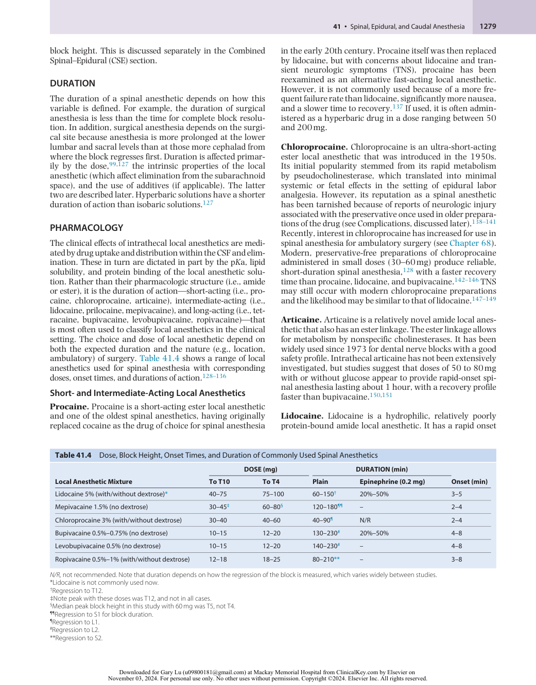

:::

<!-- PDF page 14 -->

and intermediate duration and is used in doses of 50 to 100 mg for shorter procedures that can be completed in 1.5 hours or less. It was traditionally prepared as a 5% solution in 7.5% dextrose; this preparation has been associated with both TNS and permanent nerve injury (see section on Complications, discussed later). Despite efforts to reduce the concentration of both the drug and dextrose,152,153 the popularity of intrathecal lidocaine has declined although it remains in use by some practitioners.

**Prilocaine.** Prilocaine is an amide local anesthetic based on the structure of lidocaine. Prilocaine was introduced in 1965 and has an intermediate duration of action that may lend itself to use in the ambulatory surgery setting.154 A dose of 40 to 60 mg of 2% hyperbaric prilocaine can provide a block to T10 for 100 to 130 minutes, whereas as little as 20 mg combined with fentanyl has been successfully used for ambulatory arthroscopic knee surgery.155 Prilocaine is rarely associated with TNS.156,157 In large doses (>600 mg), prilocaine can result in methemoglobinemia. This should not be an issue with doses used for spinal anesthesia, but it has been reported after epidural infusion.158

**Mepivacaine.** Mepivacaine is another short- acting amide local anesthetic. It was first introduced for spinal anesthesia in 1962 and was initially prepared as a hyperbaric solution. The use of spinal mepivacaine has declined because the incidence of TNS after hyperbaric mepivacaine was reportedly similar to that of lidocaine,159 although TNS were less frequent with the isobaric preparation of mepivacaine.160–162 Doses of 30 to 80 mg with and without additives have been used (see Table 41.4). When compared with lidocaine, mepivacaine has a slightly longer duration of action.163 Spinal mepivacaine has been shown to facilitate earlier postoperative ambulation compared to patients receiving isobaric or hyperbaric bupivacaine.164

### Long- Acting Local Anesthetics

**Tetracaine.** Tetracaine is an ester local anesthetic with a rate of metabolism one- tenth that of chloroprocaine. It is packaged either as Niphanoid crystals or as an isobaric solution. Tetracaine is usually combined with a vasoconstrictor additive because the duration of tetracaine alone can be unreliable. Although such combinations can provide up to 5 hours of anesthesia,165–168 the addition of phenylephrine in particular has been associated with TNS.169

**Bupivacaine.** Bupivacaine was introduced in 1963 and is a highly protein- bound amide local anesthetic with a slow onset because of its relatively high p _K_ a. It is appropriate for procedures lasting up to 2.5 to 3 hours (see Table 41.4).170,171 At room temperature, plain bupivacaine is actually slightly hypobaric compared with CSF. Recovery profiles using small doses appear to be similar to that of lidocaine172–174 and thus low- dose bupivacaine may be used in ambulatory procedures. Hyperbaric bupivacaine 4–5 mg combined with unilateral positioning can be adequate for short knee arthroscopy procedures.175 Bupivacaine is rarely associated with TNS.

**Levobupivacaine.** Levobupivacaine is the pure S(−) enantiomer of racemic bupivacaine. Although it is used in

similar doses to bupivacaine and has a similar onset and duration, levobupivacaine potency appears to be slightly less than bupivacaine.131 Nevertheless, the majority of clinical studies using identical doses of levobupivacaine and bupivacaine have found no significant clinical difference for spinal anesthesia.131,176–178 The main advantage of levobupivacaine is that it is less cardiotoxic than bupivacaine,179–181 which is more of a theoretic than a real risk in the setting of spinal anesthesia.

**Ropivacaine.** Ropivacaine was introduced in 1996 and is another highly protein- bound amide local anesthetic. It is structurally related to bupivacaine, with the same p _K_ a (8.1) and so it is also characterized by slow onset and a long duration of action. Compared to bupivacaine, the proposed advantages of spinal ropivacaine were less cardiotoxicity and greater motor- sensory block differentiation, resulting in less motor block. Subsequently, the potency of ropivacaine was found to be 0.6 that of bupivacaine.182–184 When ropivacaine is given in an equivalent dose to bupivacaine, there is slightly less motor block and earlier recovery with ropivacaine.13,185–187

### Spinal Additives

Whether administered into the CSF in conjunction with a local anesthetic or alone, a variety of medications may exert a direct analgesic effect on the spinal cord and nerve roots or prolong the duration of sensory and motor blockade. As such, the co- administration of these agents often allows for a reduction in the required dose of local anesthetic, with the advantage of motor block sparing and faster recovery while still producing the same degree of analgesia.

**Opioids.** The effects of opioids within the CSF are complex, because of a combination of direct spinal cord dorsal horn opioid receptor activation, cerebral opioid receptor activation after CSF transport, and peripheral and central systemic effects after vascular uptake. The effect at each of these sites depends on both the dose administered and the physicochemical properties of the opioid, particularly lipid solubility. Highly lipid- soluble drugs such as fentanyl and sufentanil have a more rapid onset and shorter duration of action than more hydrophilic opioids. In addition to increasing uptake into neural tissue, greater lipid solubility results in rapid uptake into both blood vessels (with a resultant systemic effect) and fatty tissue. The spread of lipophilic opioids within the CSF is therefore more limited than hydrophilic opioids such as morphine, which demonstrate greater spread as a result of slower uptake and elimination from the CSF. As a result, hydrophilic opioids have a greater risk of late respiratory depression, which is one of the rare but most serious consequences of intrathecal opioid administration. The extent of neural tissue and vascular uptake also affects the potency of intrathecal opioids. For example, the relative intrathecal to intravenous potency of morphine is 200 to 300 to 1, whereas for fentanyl and sufentanil it is only 10 to 20 to 1.188 In addition to respiratory depression, intrathecal opioids have other side effects including nausea and vomiting, pruritus, and urinary retention. These are discussed later in the Complications section.

<!-- PDF page 15 -->

**Hydrophilic Opioids.** Preservative- free morphine is the most widely used hydrophilic opioid in spinal anesthesia. It has a slow onset but provides analgesia for up to 24 hours.189 Adequate analgesia is achieved with 100 mcg, with minimal side effects for cesarean deliveries, whereas the most efficacious dose for major orthopedic surgery is less clear.190 Doses as high as 1000 mcg may be used for major abdominal surgery or thoracotomies, where it is becoming increasingly common to administer spinal opioids alone as a simple alternative to epidural local anesthetic–based analgesia. The magnitude of the analgesic response and the optimal dose remain unclear. Given adverse effects increase at higher doses it has been suggested that the lowest effective dose (&lt;300 mcg) should be used.67 Overall, the beneficial effects of intrathecal morphine seem most marked in abdominal surgery, particularly within the first 24 hours.189,191

Diamorphine is available for use in the United Kingdom only. It is a lipid-soluble pro-drug that is cleared from the CSF faster than morphine. Once in the dorsal horn of the spinal cord, it is converted to morphine and 6- monoacetyl morphine, both of which are μ- agonists with a relatively long duration of action. It is used in doses of 0.3 to 0.4 mg for cesarean delivery and is widely used instead of morphine in the United Kingdom.

There are only limited data related to the use of hydromorphone for spinal analgesia. It is more commonly used epidurally, as discussed later. Limited data suggest that intrathecal hydromorphone 50 to 100 mcg provides comparable analgesia with similar side effects to 100 to 200 mcg of morphine, with a similar duration of action. However, it has not undergone full neurotoxicity screening and does not provide any advantage compared with morphine.192

Meperidine is an opioid of intermediate lipid solubility, but it also has some local anesthetic properties and has been used as the sole intrathecal agent (doses ranging from 0.5 to 1.8 mg/kg) in both obstetric and general surgery.193,194 Smaller doses are used in combination with local anesthetics. Both 10 mg and 20 mg improve analgesia compared with placebo after cesarean delivery,195 although side effects were more frequent with the larger dose. However, this drug is used infrequently because of the availability of other opioids and its unknown neurotoxicity profile.

**Lipophilic Opioids.** Fentanyl and sufentanil are used frequently in obstetrics for labor analgesia and cesarean delivery, as discussed elsewhere (see also Chapter 58). Fentanyl in doses of 10 to 30 mcg is commonly used in ambulatory surgery because of its rapid onset time of 10 to 20 minutes and relatively short duration of 4 to 6 hours. Although the local anesthetic dose can be reduced and analgesia prolonged,196 the addition of fentanyl to bupivacaine may increase side effects and delay discharge.175

**Vasoconstrictors.** Vasoconstrictors, such as epinephrine and phenylephrine, prolong the duration of sensory and motor blockade when added to local anesthetics. The mechanism of action is reduced systemic local anesthetic uptake caused by an α1- mediated vasoconstriction. Epinephrine may also enhance analgesia via a direct α2- mediated effect. Traditionally, epinephrine 0.1 to 0.6 mg was thought to

prolong tetracaine spinal anesthesia, but not bupivacaine or lidocaine spinal anesthesia.20 This theory was postulated because of differences in the vasodilatory action of the local anesthetic drugs; plain lidocaine and bupivacaine cause vasodilation, whereas plain tetracaine does not. However, lidocaine spinal anesthesia can be prolonged by epinephrine when measured by both two- dermatome regression in the lower thoracic dermatomes and by occurrence of pain at the operative site for procedures carried out at the level of the lumbosacral dermatomes.197,198 Similarly, bupivacaine spinal duration may be increased, but because of the already long duration, epinephrine is not generally added to bupivacaine. There is a concern that potent vasoconstrictive action places the blood supply of the spinal cord at risk. However, there are no human data supporting this theory, and in animal studies,168,199–201 administering either subarachnoid epinephrine (0.2 mg) or phenylephrine (5 mg) does not decrease spinal cord blood flow. Phenylephrine 2 to 5 mg prolongs both lidocaine and tetracaine spinal anesthesia to a similar extent as epinephrine.198,202 Bupivacaine spinal anesthesia is not prolonged by phenylephrine.203,204 The addition of phenylephrine has declined in popularity because of its association with TNS.169,205

**α2- Agonists.** Clonidine, dexmedetomidine, and epinephrine all act on prejunctional and postjunctional α2 receptors in the dorsal horn of the spinal cord. Activation of presynaptic receptors reduces neurotransmitter release, whereas postjunctional receptor activation results in hyperpolarization and reduction of pulse transmission.206 In doses of 15 to 225 mcg, clonidine prolongs the duration of sensory and motor blockade by approximately 1 hour and improves analgesia, reducing morphine consumption by up to 40%.207–211 It appears to cause less urinary retention than morphine but, as with intravenous clonidine administration, spinal clonidine can also cause hypotension. A systematic review concluded that the hypotension associated with spinal clonidine was not dose- related and that the risk of bradycardia with clonidine was not increased.212 Sedation can also occur with spinal clonidine,213 peaking within 1 to 2 hours and lasting up to 8 hours.206 Dexmedetomidine is approximately 10- fold more α2- selective than clonidine.214 As little as 3 mcg of dexmedetomidine can prolong motor and sensory block without hemodynamic compromise.215,216 Intrathecal dexmedetomidine appears to prolong sensory blockade for a similar duration as fentanyl, but with fewer episodes of pruritis,217 and can reduce the incidence of postoperative shivering in patients undergoing spinal anesthesia.218 Dexmedetomidine has been administered in doses of 3 to 10 mcg intrathecally.219 **Other Drugs.** Neostigmine in doses of 10 to 50 mcg has analgesic effects after intrathecal administration.220,221 Intrathecal neostigmine has been shown to prolong motor and sensory blockade and reduce postoperative analgesic requirements. Neostigmine inhibits the breakdown of acetylcholine, thereby increasing acetylcholine concentration, which itself is antinociceptive. It also appears to stimulate the release of nitric oxide in the spinal cord. Its benefits, however, are limited by nausea, vomiting, bradycardia, and, in higher doses, lower extremity weakness,222,223 and therefore it is not in widespread use.224 Midazolam is

<!-- PDF page 16 -->

a γ- aminobutyric acid receptor agonist that in doses of 1 to 2 mg appears to increase sensory and motor block and decrease analgesic requirements postoperatively, without the adverse effects observed with α2-agonists or opioids. Early work raised concerns of spinal cord toxicity, but more recent studies suggest that it is safe.225 Ketamine, adenosine, tramadol, magnesium, and nonsteroidal antiinflammatory drugs (NSAIDs) have also all been administered intrathecally, but further work is required to establish safety and whether these drugs have any clinical value.

### Drug Preservatives and Excipients

Many classes of drug (notably including local anesthetics and opioids) are commercially prepared in combination with antioxidants (e.g., sodium bisulfite, sodium metabisulfite, disodium ethylenediaminetetraacetate [EDTA]), preservatives (e.g., methylparaben, benzyl alcohol), or excipients (e.g., polyethylene glycol). Whether an individual additive is safe when applied to the neuraxis is often a complex issue, relying on varying combinations of _in vivo_ and _in vitro_ animal data, human volunteer or postmortem studies, and the after- market reporting of drug side effects from clinical practice.226 The preparation of chloroprocaine with sodium bisulfite was withdrawn following after- market safety concerns of injury following intrathecal injection (see Complications, below). Preservative- free drug preparations are usually preferred for neuraxial use, and practitioners should exercise caution to check drug additives before undertaking intrathecal injection of unfamiliar drug preparations.

### Technique

Technique should be classified into a series of steps (i.e., the four Ps): preparation, position, projection, and puncture.

**Preparation.** Informed consent must be obtained, with adequate documentation of the discussion of risk (see Complications, discussed later). Resuscitation equipment must always be readily available whenever a spinal anesthetic procedure is performed. The patient should have adequate intravenous access and at a minimum, be monitored with pulse oximetry, noninvasive arterial blood pressure, and electrocardiogram. Preprepared packs are now commonly used and often contain fenestrated drapes, swabs and towels, syringes, needles, filters, spinal needles, sterilizing solution, and local anesthetic for skin infiltration. When the local anesthetic for subarachnoid injection is chosen, the duration of block should be matched with both the surgical procedure and patient variables (see Table 41.4).

The most important characteristics of a spinal needle are the shape of the tip and the needle diameter. Needle tip shapes fall into two main categories: those that cut the dura and those with a conical, atraumatic (“non- cutting” or “pencil- point”) tip. The former include the Pitkin and the Quincke–Babcock needle, and the Whitacre, Sprotte, and Pencan needles belong to the latter group (Fig. 41.4). If a continuous spinal technique is chosen, use of a Tuohy or other thin- walled needle can facilitate passage of the catheter. Atraumatic needles provide better tactile sensation of the various tissue layers encountered during needle insertion but, more importantly, they reduce the incidence of post–dural puncture headache.227 The use of small-gauge

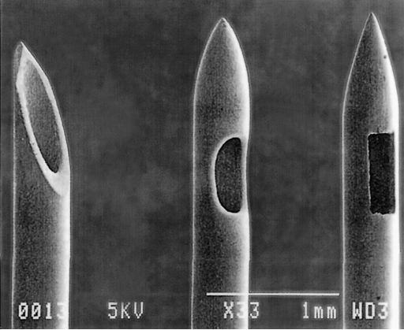

**Fig. 41.4** Scanning electron micrographs of spinal needle tip designs: Quincke ( _left_ ), Sprotte ( _middle_ ), and Whitacre ( _right_ ). (Modified from Puolakka R, Andersson LC, Rosenberg PH. Microscopic analysis of three different spinal needle tips after experimental subarachnoid puncture. _Reg Anesth Pain Med_ . 2000;25:163–169.)

needles reduces the incidence of post–dural puncture headache from 40% with a 22- G needle to less than 2% with a 29- G needle. The use of larger needles, however, improves the tactile sense of needle placement, and so although 29- G needles result in a very low rate of post–dural puncture headache, the rate of procedural failure is increased. The probability of post–dural puncture headache or procedure failure is reportedly lowest with 26- G atraumatic needles.228 An introducer needle can assist with guidance of smaller- gauge spinal needles in particular. Non- Luer needles and syringes (so- called “NR- Fit”) for spinal kits are now available. These have been designed to prevent inadvertent intrathecal injection but still rely on the correct drug being drawn up into the non- Luer syringe (see Complications – Wrong Route Administration, below).

Sterility is an issue of utmost importance. One of the most common organisms responsible for postspinal bacterial meningitis is _Streptococcus viridans_ , which is an oral commensal, emphasizing the purpose of wearing a mask as part of a full aseptic technique. Hands and forearms must be washed, and all jewelry removed. A variety of solutions may be used to clean the patient’s back prior to skin puncture, such as chlorhexidine or alcohol (alone or in combination), or povidone–iodine solutions. Chlorhexidine and alcohol together have been concluded to be most effective.229–231 Different concentrations of chlorhexidine in alcohol (ranging from 0.5% to 2% solutions) are in use, depending on local practice and jurisdiction. It is important that chlorhexidine is allowed to dry completely before skin puncture because chlorhexidine is neurotoxic (see Complications – Arachnoiditis, below).

The most recent Practice Advisory for the Prevention, Diagnosis, and Management of Infectious Complications Associated with Neuraxial Techniques by the American Society of Anesthesiologists (ASA) Task Force on Infectious Complications Associated with Neuraxial Techniques and the ASRA229 recommends that to prevent infection, it is important to identify patients at increased risk of infection

<!-- PDF page 17 -->

(e.g., known bacteremia, immunocompromised) and consider alternatives, consider preprocedure antibiotics in patients with bacteremia, ensure full asepsis including masks, and use antiseptic solution such as chlorhexidine, sterile occlusive dressings, and bacterial filters.

**Position (** see also **Chapter 30).** The three most common patient positions to facilitate needle insertion are the lateral decubitus, sitting, and prone positions, each of which has advantages in specific situations. The superiority of any one particular position in non- obstetric patients is unclear. In the obstetric population, there have been small studies demonstrating that block operator performance was faster in the sitting position, albeit this benefit was offset by a slower onset time compared with the lateral decubitus position (see Chapter 58).232 Current consensus guidelines recommend that neuraxial blocks should not be routinely performed with the patient anesthetized or deeply sedated,76 except in those circumstances where the physician and patient conclude that benefit outweighs the risk. General anesthesia or heavy sedation can prevent a patient from recognizing warning signs of pain or paresthesia if the needle is in close proximity to nervous tissue.

A patient in the lateral decubitus position facilitates the administration of sedative medication if required, is less dependent on a well- trained assistant than for a patient in the sitting position, and is arguably more comfortable. Patients are placed with their back parallel to the edge of the operating table nearest the anesthesiologist, thighs flexed onto the abdomen, with the neck flexed to allow the forehead to be as close as possible to the knees in an attempt to “open up” the vertebral spaces. The assistant may still be invaluable during this positioning by encouraging and assisting the patient in assuming the ideal lateral decubitus position. Providing patients with visual aids demonstrating ideal positioning reduces procedural time and increases procedural success.233 Because of the differing proportional sizes of hips and shoulders, the spine may slope down toward the head in females, with the opposite occurring in males. The patient should be positioned so that spread of hypobaric, isobaric, or hyperbaric solution to the operative site is optimized. The vertical height of the table on which the patient is positioned should be optimized based on ergonomic considerations of the operator.234

Identification of the midline may be easier when the patient is placed in the sitting position, especially when obesity or scoliosis renders midline anatomy difficult to examine. Ultrasound may also be used to identify the midline (see later discussion). When placing patients in this position, a stool can be provided as a footrest and a pillow placed in the lap, or a specially designed stand may be used. The assistant helps to maintain the patient in a vertical plane while flexing the patient’s neck and arms over the pillow, relaxing the shoulders, and asking the patient to “push out” the lower back to open up the lumbar vertebral spaces. Care must be taken not to over- sedate a patient in this position. Hypotension may also be more common for a person in the sitting position.

The prone position is rarely used but may be chosen when the patient is to be maintained in that position (often with the jack- knife modification) during the surgical procedure. Such cases may include rectal, perineal, or lumbar

procedures. The anesthesiologist may have to aspirate for CSF due to the added effect of gravity when the needle is inserted in this position.

**Projection and Puncture.** The midline approach relies on the ability of patients and assistants to minimize lumbar lordosis and allow access to the subarachnoid space between adjacent spinous processes, usually at the L3–L4, or the L4–L5 space. The spinal cord ends at the level of L1– L2 and so needle insertion above this level should generally be avoided although thoracic spinal anesthesia has been described. The intercristal line is the line drawn between the two iliac crests and traditionally corresponds to the level of the L4 vertebral body or the L4–L5 interspace, but the reliability of this landmark is questionable as demonstrated by ultrasonography studies.235 Once the appropriate space has been selected, a subcutaneous skin wheal of local anesthetic is developed over this space, and the introducer is inserted at a slight cephalad angle of 10 to 15 degrees through skin, subcutaneous tissue, and supraspinous ligament to reach the substance of the interspinous ligament. The spinal needle, with its bevel parallel to the midline, is advanced slowly to heighten the sense of tissue planes traversed and to prevent skewing of nerve roots, until the characteristic change in resistance is noted as the needle passes through the ligamentum flavum and dura. On passing through the dura, there is often a slight “click” or “pop” sensation. The stylet is then removed, and CSF should appear at the needle hub. The smaller the needle diameter, the longer the wait for CSF flow, particularly if the patient is not in the sitting position. If the CSF does not flow, the needle might be obstructed and rotation in 90- degree increments can be undertaken until CSF appears. If CSF does not appear in any quadrant, the needle should be advanced a few millimeters and rechecked in all four quadrants. If CSF still has not appeared and the needle is at a depth appropriate for the patient, the needle and introducer should be withdrawn together, and the insertion steps should be repeated. A common reason for failure is insertion of the needle off the midline (Fig. 41.5).

After CSF is freely obtained, the dorsum of the anesthesiologist’s nondominant hand steadies the spinal needle against the patient’s back while the syringe containing the therapeutic dose is attached to the needle. CSF is again freely aspirated into the syringe, and the anesthetic dose is injected at a rate of approximately 0.2 mL/s. After completion of the injection, 0.2 mL of CSF can be aspirated into the syringe and reinjected into the subarachnoid space to reconfirm location and clear the needle of the remaining local anesthetic.

The paramedian approach exploits the larger “subarachnoid target” that exists if a needle is inserted slightly lateral to the midline (Fig. 41.6). The paramedian approach may be especially useful in the setting of diffuse calcification of the interspinous ligament. The most common error when using the paramedian technique is that the needle entry site is placed too far from the midline, which makes the vertebral laminae barriers to insertion of the needle. In the paramedian approach, a skin wheal is raised 1 cm lateral from the superior edge of the inferior spinous process.236 A longer needle (e.g., 3–5 cm) is then used to infiltrate deeper tissues in a cephalomedial plane. The spinal introducer and needle are next inserted 10 to 15 degrees off the sagittal

<!-- PDF page 18 -->

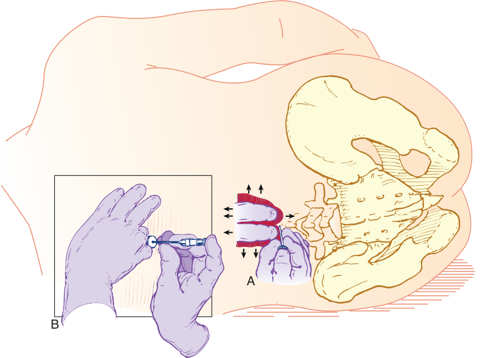

A B 

**Fig. 41.5 Insertion of the spinal needle.** (A) The palpating fingers are “rolled” in a side- to- side and a cephalad- to- caudad direction to identify the interspinous space. (B) During needle insertion, the needle should be stabilized in a tripod fashion while placed in the hand, similar to a dart being thrown.

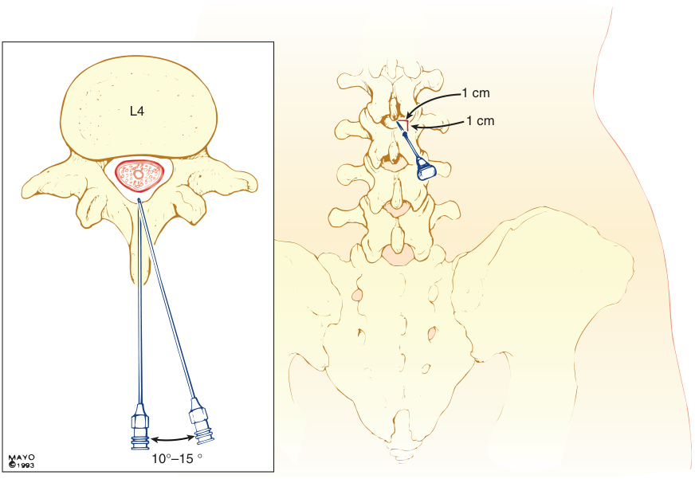

1 cm L4 1 cm 10°–15 ° 

**Fig. 41.6 Vertebral anatomy of the midline and paramedian approaches to central neuraxial blocks.** The midline approach highlighted in the inset requires anatomic projection in only two planes: sagittal and horizontal. The paramedian approach shown in the inset and in the posterior view requires an additional oblique plane to be considered, although the technique may be easier in patients who are unable to cooperate in minimizing their lumbar lordosis. The paramedian needle is inserted 1 cm lateral and 1 cm caudad to the caudad edge of the more superior vertebral spinous process. The paramedian needle is inserted approximately 15 degrees off the sagittal plane, as shown in the inset. (Courtesy the Mayo Foundation, Rochester, MN.)

<!-- PDF page 19 -->

plane in a cephalomedial plane (see Fig. 41.6). Similar to the midline approach, the most common error is to angle the needle too far cephalad on initial insertion. Nevertheless, if the needle contacts bone, it is redirected slightly in a cephalad direction. If bone is again contacted, but at a deeper level, the slight cephalad angulation is continued because it is likely that the needle is being “walked up” the lamina. As in the midline approach, the characteristic feel of the ligaments and dura is possible, but only once the ligamentum flavum is reached because the needle this time is not passing through the supraspinous and interspinous ligaments. After CSF is obtained, the block is carried out in a manner similar to that described for the midline approach.

### USE OF ULTRASONOGRAPHY

There is evidence to support the role of ultrasound imaging to guide needle insertion during the performance of spinal anesthesia, especially for lumbar techniques.237 Ultrasound can accurately identify the intervertebral levels,238 the midline spinous process, the midline interspinous window, and the paramedian interlaminar window (see also Chapter 42).235 Bone does not permit ultrasound beam transmission, thus casting a hypoechoic (dark) shadow on the image. Conversely, passage of the ultrasound beam through the interspinous and interlaminar windows allows visualization of the hyperechoic dura (a bright line), the subarachnoid space, and the posterior aspect of the vertebral body. Visualization of the ligamentum flavum and epidural space is often more difficult. Successful transverse or longitudinal scan facilitates identification of the optimal location for proper needle insertion during spinal block and an estimation of the skin- to- dura distance. This is particularly useful in patients with difficult surface anatomic landmarks (e.g., obesity), spine pathology (e.g., scoliosis), and previous spine

surgery (e.g., laminectomy).239 Preprocedural ultrasound scanning is easier to perform than real- time scanning during spinal anaesthesia.240

Ultrasonography in the pediatric population is impressive because the vertebral column with limited ossification not only permits visualization of the spinal canal sonoanatomy but also the inserted needle and catheter tip, dural displacement, and the extent of cranial spread can be visualized during a fluid bolus injection in young infants and children (also see Chapter 72).241,242 Several outcome studies have confirmed the utility of ultrasonography when neuraxial block is performed by the novice and in patients with difficult anatomic landmarks.243 Any increased procedural time associated with the use of neuraxial ultrasound is short and not usually clinically relevant.238

### SPECIAL SPINAL TECHNIQUES

### Continuous Spinal Anesthesia

Continuous spinal anesthesia allows incremental dosing of local anesthetic and therefore predictable titration of the block to an appropriate level, with better hemodynamic stability than a single- shot spinal.40 It is useful in controlling arterial blood pressure in patients with severe aortic stenosis or pregnant people with complex cardiac disease. In obstetrics, it may also be used in patients with morbid obesity and where previous spinal surgery may hinder epidural spread. Spinal catheters also serve as an alternative to the CSE technique for prolonged cases and have been used in selected patients for laparotomies where general anesthesia may be too great a risk.244 If a continuous spinal anesthetic is undertaken, a needle with a laterally facing opening may be used to perform the lumbar puncture (Fig. 41.7). A midline or paramedian approach may be used. The catheter should be threaded 2 to 3 cm

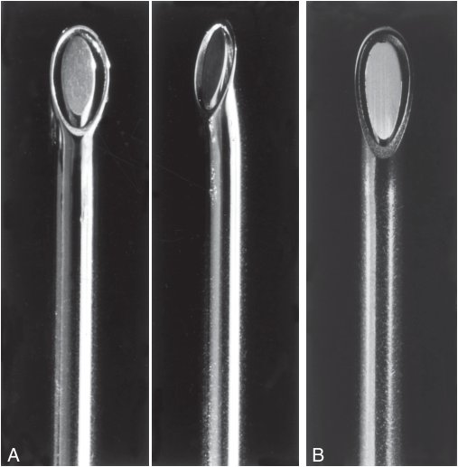

A B 

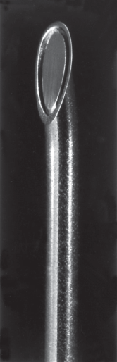

**Fig. 41.7** Examples of continuous spinal needles, including a disposable, 18- G Hustead (A) and a 17- G Tuohy (B) needle. Both have distal tips designed to direct the catheters inserted through the needles along the course of the bevel opening; 20- G epidural catheters are used with these particular needle sizes.

<!-- PDF page 20 -->

into the subarachnoid space and the needle withdrawn over the catheter. The catheter must never be withdrawn back into the needle shaft in case a piece of the catheter is sheared off and left in the subarachnoid space. Care must also be taken to ensure that the catheter is not inserted more deeply into the subarachnoid space when the needle is withdrawn over the catheter. Spinal microcatheters exist, but these have been associated with cauda equina syndrome,4 probably because of lumbosacral pooling of local anesthetic. Catheter- over- the- needle devices are also available for use with continuous spinal anesthesia, with the advantage of minimizing leakage of CSF around the catheter, but these may be more difficult to insert.245 Strict attention must be paid to appropriate dosing and sterile technique when managing spinal catheters.

### Unilateral Spinal Anesthesia and Selective Spinal Anesthesia

The terms _unilateral spinal anesthesia_ and _selective spinal anesthesia_ overlap slightly, but both refer to small- dose techniques that capitalize on baricity and patient positioning to hasten recovery. A systematic review found that a dose of 4 to 5 mg of hyperbaric bupivacaine with unilateral positioning was adequate for knee arthroscopy.175 This technique has also been used for unilateral inguinal hernia repair with a dose of 8 mg bupivacaine. In selective spinal anesthesia, minimal local anesthetic doses are used with the goal of anesthetizing only the sensory fibers to a specific area.246,247 Spinal anesthesia for ambulatory surgery is discussed in more detail in the chapter on anesthesia for ambulatory surgery (see Chapter 68).

### BLOCK MONITORING

Once the spinal anesthetic has been administered, the onset, extent, and quality of the sensory and motor blocks must be assessed while heart rate and arterial blood pressure are also being monitored for any resultant sympathetic blockade. There are many methods of assessing sensory block, but cold sensation and pinprick representing C- and A- delta fibers, respectively, are used more often than mechanical stimuli such as touch, pressure, and von Frey hairs, which reflect the A- beta nerves. Loss of sensation to cold usually occurs first, verified using an ethyl chloride spray, ice, or alcohol, followed by the loss of sensation to pinprick, verified using a needle that does not pierce the skin.18 Finally, loss of sensation to touch occurs. Dermatomal block height also varies with the method of assessment, but in general, peak height is measured most cephalad using loss of cold, and is measured lower with pinprick, and lowest with touch.248 Assessing dermatomal block height assumes that absence of sensation to these stimuli equates to blockade of the nociceptive fibers, but this is not necessarily the case.249 Other electrical and experimental chemical methods of assessing pain have been used but gentle pinprick remains the simplest.250 Motor block may also be measured in a variety of ways. The modified Bromage scale (Box 41.1) is most commonly used, although this represents only lumbosacral motor fibers.251 Electromyography and pulmonary function tests have been used to measure abdominal and thoracic motor function, but these are neither practical nor specific.

### Box 41.1 Modified Bromage Scale

- 0: No motor block

- 1: Inability to raise extended leg; able to move knees and feet

- 2: Inability to raise extended leg and move knee; able to move feet

- 3: Complete block of motor limb

In practice, the combination of sympathetic block with an adequate sensory level and motor block (inability to straight- leg raise ensures at least that lumbar nerves are blocked) is used to confirm spinal efficacy. Ensuring that the level of block using cold or pinprick is two to three segments above the expected level of surgical stimulus is commonly considered adequate.

## Epidural Anesthesia

### FACTORS AFFECTING EPIDURAL BLOCK HEIGHT

The epidural space is a collapsible, distensible reservoir through which drugs spread and are removed by diffusion, vascular transport, and leakage. Spread of anesthetic within the epidural space, and subsequent block height, is related to a variety of factors, not all of which can be manipulated by the anesthesiologist (Table 41.5).25

### Drug Factors

The volume and total mass of injectate are the most important drug- related factors that affect block height after the administration of local anesthetic in the epidural space. As a general principle, 1 to 2 mL of solution should be injected per segment to be blocked. Although additives such as bicarbonate, epinephrine, and opioids influence onset, quality, and duration of analgesia and anesthesia, these do not affect spread.

### Patient Factors

Age can influence epidural block height.25 There appears to be a stronger correlation with age and block height in thoracic epidurals, with one study suggesting that 40% less volume is required in the elderly (see Chapter 61).252 Possible reasons include decreased leakage of local anesthetic through intervertebral foramina, increased compliance of the epidural space in the elderly resulting in greater spread,24 or an increased sensitivity of the nerves in the elderly. As with spinal anesthesia, it appears that only the extremes of patient height influence local anesthetic spread in the epidural space. Weight is not well correlated with block height in the settings of either lumbar or TEA.253 Less local anesthetic is required to produce the same epidural spread of anesthesia in pregnant patients. Although this may be in part a result of engorgement of epidural veins secondary to increased abdominal pressure, the effect also occurs in early pregnancy.254 Also, continuous positive airway pressure increases the height of a thoracic epidural block.255,256

### Procedure Factors

The level of injection is the most important procedurerelated factor that affects epidural block height. In the upper

<!-- PDF page 21 -->

**Table 41.5** Factors Affecting Epidural Local Anesthetic Distribution and Block Height

||**More Important**|**Less Important**|**Not Important**|
|---|---|---|---|
|Drug factors|Volume Dose|Concentration|Additives|
|Patient factors|Elderly age Pregnancy|Weight Height Pressure in adjacent body cavities||
|Procedure factors|Level of injection|Patient position|Speed of injection Needle orifice direction|

Modified from Visser WA, Lee RA, Gielen MJ. Factors affecting the distribution of neural blockade by local anesthetics in epidural anesthesia and a comparison of lumbar versus thoracic epidural anesthesia. _Anesth Analg_ . 2008;107:708–721.

cervical region, spread of injectate is mostly caudal, in the midthoracic region spread is equally cephalad and caudal, and in the low thoracic region spread is primarily cephalad.257 After a lumbar epidural, spread is more cephalad than caudal. Some studies suggest that the total number of segments blocked is less in the lumbar region compared with thoracic levels for a given volume of injectate. Patient position has been shown to affect spread of lumbar epidural injections, with preferential spread and faster onset to the dependent side in the lateral decubitus position.258 The sitting and supine positions do not affect epidural block height. However, the head- down tilt position does increase cephalad spread in obstetric patients.259 Needle bevel direction and speed of injection also do not appear to influence the spread of a bolus injection.

### PHARMACOLOGY

Local anesthetics for epidural use may be classified into short- , intermediate- , and long- acting drugs. A single bolus dose of local anesthetic in the epidural space can provide surgical anesthesia ranging from 45 minutes up to 4 hours depending on the type of local anesthetic administered and the use of any additives (Table 41.6). Most commonly, an epidural catheter is left _in situ_ so that local anesthetic–based anesthesia or regular analgesia can be extended indefinitely.

### Short- Acting and Intermediate- Acting Local Anesthetics

**Procaine.** Similar to spinal anesthesia, procaine is not commonly used for epidural anesthesia. Five- percent procaine has a slow onset, and the resultant block can be unreliable and of poor quality.

**Chloroprocaine.** Chloroprocaine is available preservativefree in 2% and 3% concentrations for epidural injection, with the latter preferable for surgical anesthesia because the former may not produce muscle relaxation. The 3% preparation has an onset time of 10 to 15 minutes and a duration of up to 60 minutes. Adding epinephrine prolongs the block for up to 90 minutes. Before the development of preservative- free preparations, large volumes (>25 mL) of chloroprocaine had been associated with deep, aching, burning lumbar back pain.260 This was thought to be secondary to the EDTA that chelated calcium and caused a localized hypocalcemia. In addition, chloroprocaine can antagonize the effects of epidural morphine.261 This may be a result of opioid receptor antagonism by either the

chloroprocaine or a metabolite. Antagonism of an intracellular messenger and decreased morphine availability caused by a reduction in perineural pH are also proposed mechanisms. However, morphine and chloroprocaine seem like an illogical combination because the beneficial ultrashort duration of action of chloroprocaine is offset by the addition of morphine.

**Articaine.** Articaine is not widely used for epidural anesthesia and has not been studied extensively. When 2% articaine was compared with epidural lidocaine in one study, it had a similar latency, spread, duration, and motor block.262 It has also been used for obstetric epidural analgesia.150

**Lidocaine.** Lidocaine is available in 1% and 2% solutions; it has an onset time of 10 to 15 minutes and a duration of up to 120 minutes, which can be extended to 180 minutes with the addition of epinephrine. Unlike spinal anesthesia, TNS are not commonly associated with epidural lidocaine.263

**Prilocaine.** Prilocaine is available in 2% and 3% solutions. The 2% solution produces a sensory block with minimal motor block. Onset time is approximately 15 minutes, with a duration of approximately 100 minutes. When compared with lidocaine, prilocaine has a more marked sensory blockade and a longer duration.251 In large doses, prilocaine is associated with methemoglobinemia.158,264

**Mepivacaine.** Mepivacaine is available as 1%, 1.5%, and 2% preservative- free solutions. The 2% preparation has an onset time similar to lidocaine of approximately 15 minutes, but a slightly longer duration (up to 200 minutes with epinephrine), making it a preferred option by some centers for surgery of an intermediate duration.

### Long- Acting Local Anesthetics

**Tetracaine.** Tetracaine is not widely used for epidural anesthesia because of unreliable block height and, in larger doses, systemic toxicity.

**Bupivacaine.** Bupivacaine is available in 0.25%, 0.5%, or 0.75% preservative- free solutions. The onset time is around 20 minutes with a duration of up to 225 minutes, which is prolonged only slightly by the addition of epinephrine (to 240 minutes). More diluted concentrations such as 0.125% to 0.25% can be used for analgesia. However, disadvantages include cardiac and central nervous system toxicity

::: details 原始表格與符號（PDF 第 21 頁）

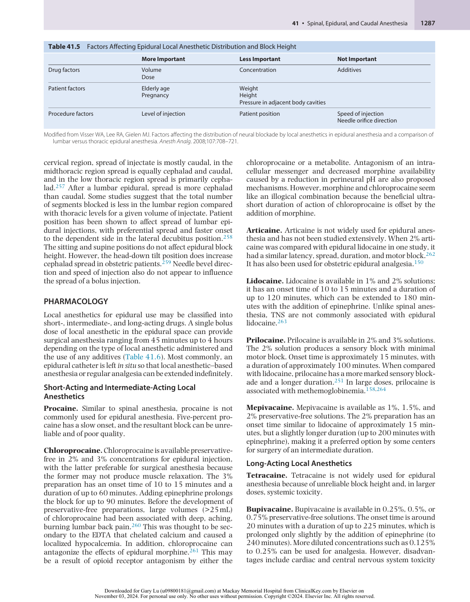

:::

<!-- PDF page 22 -->

**Table 41.6** Comparative Onset Times and Analgesic Durations of Local Anesthetics Administered Epidurally in 20- to 30- mL Volumes

|||||**DURATION (min)**|
|---|---|---|---|---|
|**Drug**|**Concentration (%)**|**Onset (min)**|**Plain**|**1:200,000 Epinephrine**|
|2- Chloroprocaine|3|10–15|45–60|60–90|
|Lidocaine|2|15|80–120|120–180|
|Mepivacaine|2|15|90–140|140–200|
|Bupivacaine|0.5–0.75|20|165–225|180–240|
|Ropivacaine|0.75–1.0|15–20|140–180|150–200|
|Levobupivacaine|0.5–0.75|15–20|150–225|150–240|

Modified from Cousins MJ, Bromage PR. Epidural neural blockade. In: Cousins MJ, Bridenbaugh PO, eds. _Neural Blockade in Clinical Anesthesia and Management of Pain_ . Philadelphia: JB Lippincott; 1988;255.

and the potential for motor block from larger doses. Solutions of 0.5% and 0.75% are used to provide surgical anesthesia. While it is not approved by the US Food and Drug Administration (FDA) for any neuraxial route of administration, liposomal bupivacaine (Exparel) is currently under investigation for epidural use. An epidural bolus of liposomal 0.5% bupivacaine provided similar onset but longerlasting analgesia to boluses of plain bupivacaine.265 It does not appear to be more toxic than plain bupivacaine or to have a differing cardiac safety profile. The benefit, as with extended- release morphine (discussed later), is the avoidance of an indwelling epidural catheter. Conversely, such extended- release boluses are less titratable if for any reason the epidural needs to be terminated early.

**Levobupivacaine.** Levobupivacaine can be used as an epidural local anesthetic in 0.5% to 0.75% concentrations for surgical anesthesia, whereas analgesia can be achieved with concentrations of 0.125% to 0.25%. Levobupivacaine administered epidurally has the same clinical characteristics as bupivacaine.131,266,267 The advantage of levobupivacaine is that it is less cardiotoxic compared with bupivacaine.179,268

**Ropivacaine.** Ropivacaine is available in 0.2%, 0.5%, 0.75%, and 1.0% preservative- free preparations. For surgical anesthesia, 0.5% to 1.0% is used, whereas 0.1% to 0.2% is used for analgesia. Ropivacaine is associated with a superior safety profile compared with bupivacaine.269,270 Data from animal models suggest that bupivacaine has a 1.5 to 2.5 lower seizure threshold than ropivacaine. Ropivacaine is also less cardiotoxic. When compared with bupivacaine and levobupivacaine, ropivacaine at equivalent concentrations has a relatively similar clinical profile. Ropivacaine has a slightly shorter duration of action and less motor block, although the reduced motor block may in fact reflect different potencies of the drugs rather than a true motorsparing effect of ropivacaine. Epidurally administered ropivacaine is 40% less potent than bupivacaine.182,183,271

### Epidural Additives

**Vasoconstrictors.** Epinephrine reduces vascular absorption of local anesthetics in the epidural space. The local anesthetics vary in their responsiveness to epinephrine. The effect is the most with lidocaine,272 mepivacaine, and

chloroprocaine (up to 50% prolongation), with a lesser effect with bupivacaine and levobupivacaine, and a limited effect with ropivacaine, which already has intrinsic vasoconstrictive properties (see Table 41.6). Epinephrine itself may also have some analgesic benefits because it is absorbed into the CSF, where it can act on dorsal horn α2-receptors.273 Phenylephrine has been used in epidural anesthesia less widely than in spinal anesthesia, perhaps because it does not reduce peak blood levels of local anesthetic as effectively as epinephrine does during epidural use.274

**Opioids.** Opioids synergistically enhance the analgesic effects of epidural local anesthetics, without prolonging motor block. A combination of local anesthetic and opioid reduces the dose- related adverse effects of each drug independently. The analgesic benefits of neuraxial opioids must be balanced against the dose- dependent side effects. As with intrathecal opioids, there appears to be a therapeutic ceiling effect above which only side effects increase. Opioids may also be used alone, particularly when there are concerns regarding hemodynamic instability. Epidural opioids work by crossing the dura and arachnoid membrane to reach the CSF and spinal cord dorsal horn. Lipophilic opioids, such as fentanyl and sufentanil, partition into epidural fat and therefore are found in lower concentrations in CSF than hydrophilic opioids, such as morphine and hydromorphone. Fentanyl and sufentanil are also readily absorbed into the systemic circulation, and several studies suggest that this is the principal analgesic mechanism.275,276

Epidural morphine is administered as a bolus of 1 to 5 mg, with an onset time of 30 to 60 minutes and duration of up to 24 hours. The optimal dose that balances analgesia while minimizing side effects is 2.5 to 3.75 mg.277 Alternatively, morphine can be administered continuously in doses of 0.1 to 0.4 mg/h through an epidural catheter. Hydromorphone is more hydrophilic than fentanyl but more lipophilic than morphine. It can be administered as a bolus of 0.4 to 1.5 mg, with onset at 15 to 30 minutes and a duration of 18 hours. It can be administered as a bolus of 0.4 to 1.5 mg, with onset at 15 to 30 minutes and a duration of 18 hours, or as an infusion. The onset of epidural fentanyl and sufentanil is 5 to 15 minutes and lasts only 2 to 3 hours. Bolus doses of 10 to 100 mcg may be used to provide analgesia. Diamorphine is used in doses of 2 to 3 mg as epidural boluses, or can be administered as an infusion.

::: details 原始表格與符號（PDF 第 22 頁）

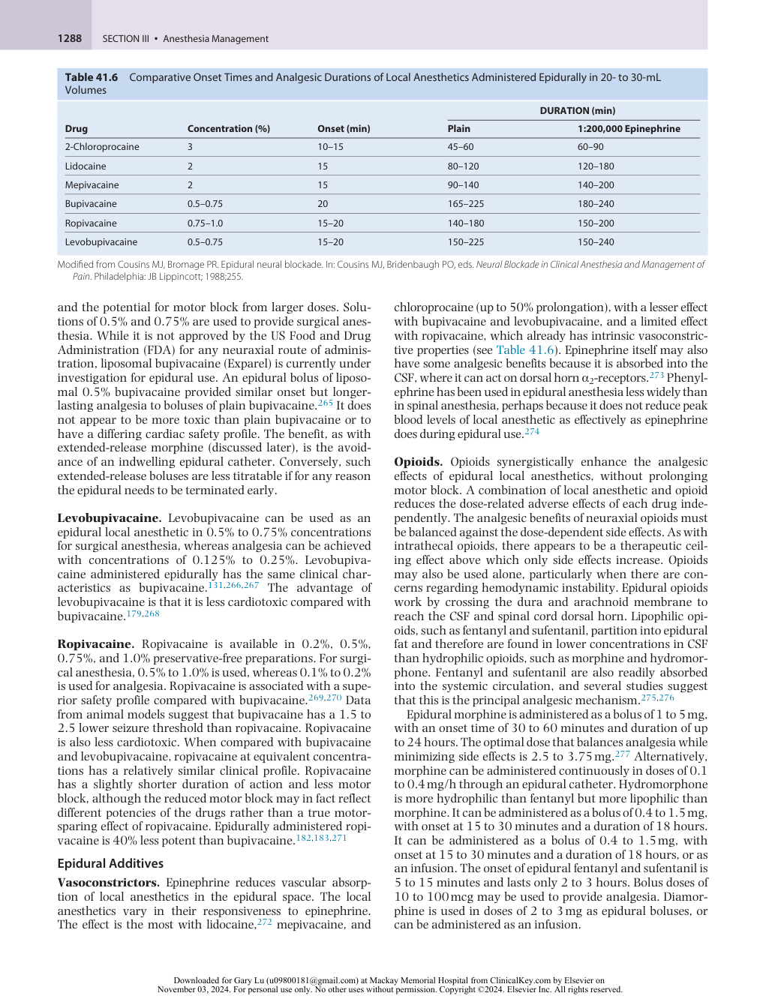

:::

<!-- PDF page 23 -->

DepoDur is an extended- release liposomal formulation of morphine used as a single- shot lumbar epidural dose, thereby avoiding issues and side effects of a continuous local anesthetic infusion and indwelling catheters, particularly in patients receiving anticoagulants. When administered before surgery (or after clamping of the cord in cesarean deliveries), DepoDur can provide up to 48 hours of pain relief.278,279 A dose of 10 to 15 mg is recommended for lower abdominal surgery, and 15 mg is recommended for major lower limb orthopedic surgery.

**α2- Agonists.** Epidural clonidine can prolong sensory block to a greater extent than motor block. The mechanism in peripheral nerves appears to be mediated by the opening of potassium channels and subsequent membrane hyperpolarization280 rather than an α2- agonist effect. The addition of clonidine reduces both epidural local anesthetic and opioid requirements.281–283 Other benefits of clonidine may include a reduced immune stress and cytokine response.284 Epidural clonidine does have a variety of side effects including hypotension, bradycardia, dry mouth, and sedation. The cardiovascular effects may be greatest when clonidine is administered in the epidural space at the thoracic level.285 In preliminary studies, epidural dexmedetomidine has also been shown to reduce intraoperative anesthetic requirements, improve postoperative analgesia, and prolong both sensory and motor block.286

**Other Drugs.** Conflicting reports exist regarding the benefit of epidural ketamine applied to the neuraxis and whether it is neurotoxic.287–290 Epidural neostigmine provides labor analgesia without causing respiratory depression, hypotension, or motor impairment.291 Epidural midazolam, tramadol, dexamethasone, and droperidol have also been studied but are not commonly used.

**Carbonation and Bicarbonate.** Many local anesthetic preparations have a pH between 3.5 and 5.5 for chemical stability and bacteriostasis. At these low pHs, a higher proportion of the drug is in the ionized form and is therefore unable to cross nerve membranes to reach the internal binding site on sodium channels. Both carbonation of the solution and adding bicarbonate have been used in an attempt to increase the solution pH, and therefore the nonionized free- base proportion of local anesthetic. Carbonation increases the speed of onset and quality of the epidural block by producing more rapid intraneural diffusion and more rapid penetration of connective tissue surrounding the nerve trunk.292,293 Carbonated solutions are most commonly used for rapid extension of epidural analgesia to surgical anesthesia for emergency cesarean delivery, where they more rapidly establish anesthesia compared to nonalkalinized solutions.294,295

### EPIDURAL TECHNIQUE

### Preparation

Patient preparation, as previously described for spinal anesthesia, must equally be applied to epidural anesthesia, namely consent, monitoring, and resuscitation equipment, intravenous access, and choosing the patient and drugs appropriately depending on comorbidities and the

nature of surgery. Sterility is arguably even more important than in spinal anesthesia because a catheter is often left _in situ_ . The extent of the surgical field must be understood so that the epidural may be inserted at the appropriate level – that is, the lumbar, low- , mid- , or high- thoracic, or less commonly, cervical.25 A variety of epidural needles have been used for epidural anesthesia, but Tuohy needles are most common (Fig. 41.8). These needles are usually 16- to 18- G in size and have a 15- to 30- degree curved, blunt “Huber” tip designed to both reduce the risk of accidental dural puncture and guide the catheter cephalad.296 The needle shaft is marked in 1- cm intervals so that depth of insertion can be identified. The catheter is made of a flexible, calibrated, durable, radiopaque plastic with either a single end hole or multiple side orifices near the tip. Several investigators have found that multiple- orifice catheters are superior, with a reduced incidence of inadequate analgesia.297–299 However, the use of multi- orifice catheters in pregnant patients resulted in a more frequent incidence of epidural vein cannulation.300

The method of identifying the epidural space must also be predetermined. Most practitioners use a loss- of- resistance technique to either saline or air, rather than the hangingdrop technique, both of which are described later. If a lossof- resistance technique is used, an additional decision about the type of syringe (i.e., glass vs. low- resistance plastic and Luer- lock vs. Luer- slip) is required.

### Position

The sitting and lateral decubitus positions necessary for epidural puncture are the same as those for spinal anesthesia (see also Chapter 58). As before, inadequate positioning of the patient can complicate an otherwise meticulous technique. Shorter insertion times occur in the sitting position for thoracic epidurals compared with the lateral decubitus position, but ultimately, success rates are comparable.301 As with spinal anesthesia, epidurals are performed with the patient awake.76

### Projection and Puncture

The level of needle insertion depends on the location of surgery (Table 41.7). Important surface landmarks include the intercristal line (corresponding to the L4–L5 interspace), the inferior angle of the scapula (corresponding to the T7 vertebral body), the root of the scapular spine (T3), and the vertebra prominens (C7). Ultrasonography may be useful to identify the correct thoracic space235 ; it is less commonly used for thoracic epidural insertion, however, because the acoustic shadows make visualization of landmarks such as the ligamentum flavum and intrathecal space more difficult.302 A variety of different needle approaches exist: midline, paramedian, modified paramedian (Taylor approach), and caudal.

A midline approach is commonly chosen for lumbar and low thoracic approaches. After local anesthetic infiltration of the skin, the nondominant hand can be rested on the back of the patient, with the thumb and index finger holding the needle hub or wing. The angle of approach should be only slightly cephalad in the lumbar and low- thoracic regions, whereas in the midthoracic region, the approach should be more cephalad because of the significant downward angulation of the spinous processes (Fig. 41.9). In a controlled fashion, the needle should be advanced with the

<!-- PDF page 24 -->

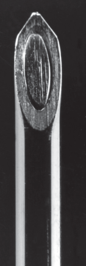

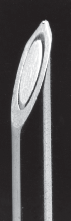

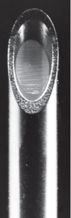

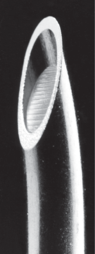

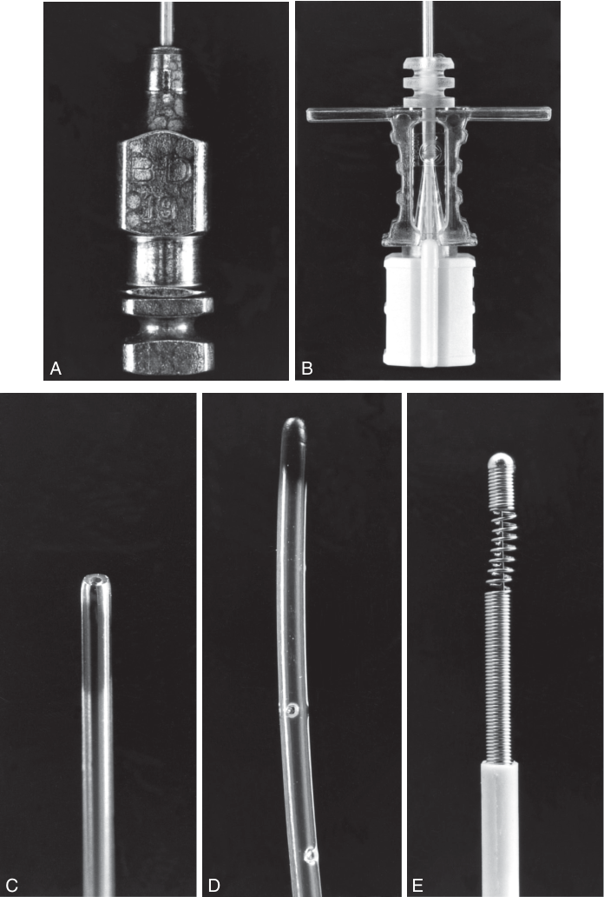

A B C D E 

**Fig. 41.8 Epidural needles with catheter assortment.** (A) A 19- G reusable Crawford epidural needle. (B) A 19- G disposable Tuohy needle. (C) Singleend- hole epidural catheter. (D) Closed- tip, multiple- side- hole catheter. (E) Spring wire–reinforced, polymer- coated epidural catheter.

<!-- PDF page 25 -->

**Table 41.7** Suggested Epidural Insertion Sites for Common Surgical Procedures

|**Nature of Surgery**|**Suggested Level of** **Insertion**|**Remarks**|
|---|---|---|
|Hip surgery Lower extremity Obstetric analgesia|Lumbar L2–L5||
|Colectomy, anterior resection Upper abdominal surgery|Lower thoracic T6–T8|Spread more cranial than caudal|
|Thoracic|T2–T6|Midpoint of surgical incision|

Modified from Visser WA, Lee RA, Gielen MJ. Factors affecting the distribution of neural blockade by local anesthetics in epidural anesthesia and a comparison of lumbar versus thoracic epidural anesthesia. _Anesth Analg_ . 2008;107:708–721.

stylet in place through the supraspinous ligament and into the interspinous ligament, at which point the stylet can be removed and the syringe attached. If it is in the correct location, the needle should rest firmly in the tissues. Some advocate needle placement in the ligamentum flavum for both the loss- of- resistance and hanging- drop methods before attaching the syringe, but this may be difficult, particularly for novices; however, this may allow an improved appreciation of epidural anatomy for the operator. If the needle is merely inserted into the supraspinous ligament and then loss- of- resistance or hanging- drop insertion is begun, there is an increased chance of false loss of resistance, possibly because of defects in the interspinous ligament.303 Such false- positive rates can be as high as 30%.

Air or saline are the two most common noncompressible media used to detect a loss of resistance when identifying the epidural space. Each involves intermittent (for air) or constant (for saline) gentle pressure applied to the bulb of the syringe with the dominant thumb while the needle is advanced with the nondominant hand. A combination of air and saline may also be used, incorporating 2 mL of saline and a small (0.25 mL) air bubble. Usually, the ligamentum flavum is identified as a tougher structure with increased resistance, and when the epidural space is subsequently entered, the pressure applied to the syringe plunger allows the solution to flow without resistance into the epidural space. There are reports that air is less reliable in identifying the epidural space, results in a higher chance of incomplete block, and may also cause both pneumocephalus (which can result in headaches) and venous air embolism in rare cases. If air is chosen, the amount of air injected after loss of resistance should be minimized. Evidence suggests that there is no difference in adverse outcome in the obstetric population when air or saline is used.304 Another metaanalysis found that fluid inserted through the epidural needle before catheter insertion reduces the risk of epidural vein cannulation by the catheter.300 One proposed disadvantage of using saline is that it may be more difficult to readily detect an accidental dural puncture.

An alternative method of identifying the epidural space is the hanging- drop technique. After the needle is placed into the ligamentum flavum, a drop of solution such as saline is placed within the hub of the needle. When the needle is

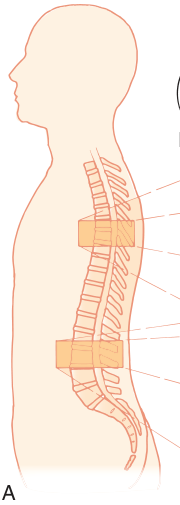

A 

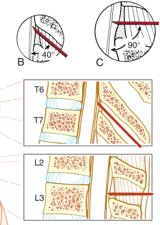

90° 40° B C T6 T7 L2 L3 

**Fig. 41.9** (A) Lumbar and thoracic epidural technique. The increased angle of needle insertion during thoracic epidural cannulation may provide a slightly longer distance of “needle travel” before entering the subarachnoid space. In contrast to lumbar epidural cannulation (B), the distance traveled is modified by a more perpendicular angle of needle insertion (C).

advanced into the epidural space, the solution should be “sucked in.” The theory behind this maneuver has traditionally been attributed to subatmospheric pressure in the epidural space, although experimental evidence in the cervical region suggests that negative- pressure methods are poorly reliable and only useful in the sitting position.305 The subatmospheric pressure has been related to expansion of the epidural space as the needle pushes the dura away from the ligamentum flavum.306 The negative intrathoracic pressure may influence the pressure in the epidural space in the thoracic region and should be maximal during inspiration. Timing needle advancement to coincide with inspiration may be difficult, however.

When a lumbar midline approach is used, the depth from skin to the ligamentum flavum commonly reaches 4 cm, with the depth in most (80%) patients being between 3.5 and 6 cm; it can be longer or shorter in obese or very thin patients, respectively. Ultrasonography may be useful to predict the depth before needle insertion.235 In the lumbar region, the ligamentum flavum is 5 to 6 mm thick in the midline. When a thoracic approach is chosen, needle control is of equal or greater importance because injury to the spinal cord is possible if the needle is advanced too far, although there are no data to suggest that approaching the epidural space at the lumbar level is any more or less safe than at the thoracic level. This may be partly because those using the thoracic technique are most often anesthesiologists with considerable experience in lumbar epidural anesthesia.307 In addition, the increased angle of needle insertion in the thoracic region may theoretically provide an element of safety in that the more acute angle necessary to gain access to the epidural space provides some margin of safety (see Fig. 41.9).

::: details 原始表格與符號（PDF 第 25 頁）

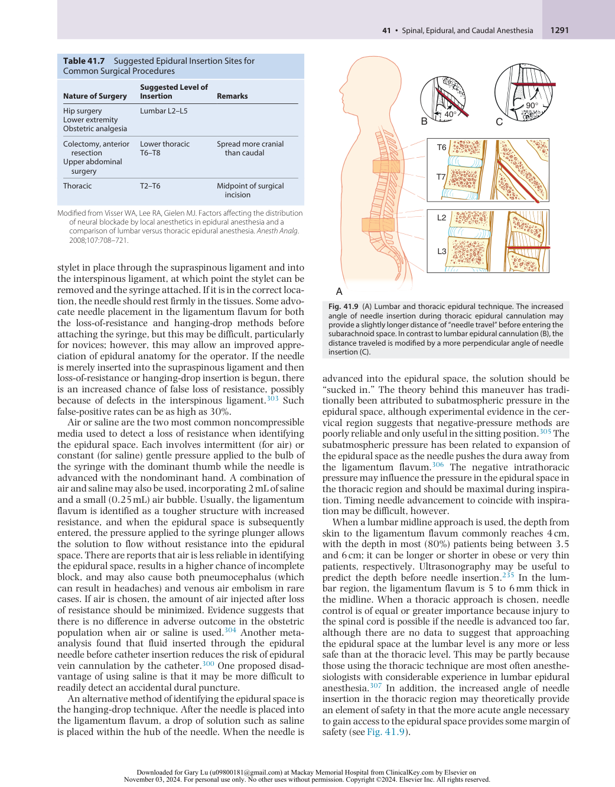

:::

<!-- PDF page 26 -->

When the epidural space is identified, note the depth of the needle at the skin. The syringe can then be removed, and a catheter gently threaded to approximately the 15- to 18- cm mark to ensure a sufficient length has entered the epidural space. The needle can then be carefully withdrawn, and the catheter is withdrawn to leave 4 to 6 cm in the space. Catheter space less than 4 cm in length in the epidural space may increase the risk of catheter dislodgement and inadequate analgesia, whereas threading more catheter may increase the likelihood of catheter malposition or complications.308–311

As described earlier, a false loss of resistance can occur and is one of the causes of a failed block. The Tsui test may be used to confirm the epidural catheter position.312 This test stimulates the spinal nerve roots with a low electrical current conducted through normal saline in the epidural space and an electrically conducting catheter. A metalcontaining catheter must be used, with the cathode lead of the nerve stimulator connected to the catheter via an electrode adapter, whereas the anode lead is connected to an electrode on the patient’s skin. At currents of approximately 1 to 10 mA, corresponding muscle twitches (i.e., intercostal or abdominal wall muscles for thoracic epidural catheters) can be used to identify catheter tip location. Subarachnoid and subdurally positioned epidural catheters elicit motor responses at a much lower threshold current (&lt;1 mA), because the stimulating catheter is in very close or direct contact with highly conductive CSF.313,314 If appropriate electrical stimulation occurs following a loss of resistance, there is a high probability that the catheter is successfully located in the epidural space.315,316 Epidural waveform pressure analysis and epidurography are alternative confirmatory techniques of epidural catheter placement317,318 ; however, neither are in routine clinical use.

When the catheter is positioned at the desired depth, it must be secured to the skin. Commercial fixation devices exist, and some are superior to adhesive dressings alone.319 Tunneling can reduce catheter migration and improve lasting block success.320 However, the procedure can risk damage to the epidural catheter and is typically associated with some procedural patient discomfort. Tunneling has not been definitively compared with noninvasive catheter fixation devices with regard to catheter migration, analgesic failure, or infection; therefore, fixation practice is usually dictated by local experience and available equipment. Disconnection and reconnection of epidural catheters should be minimized and catheters should not remain _in situ_ longer than clinically necessary. Patients should be evaluated daily for signs of infection and if suspected then this should be promptly investigated and treated appropriately.

### Paramedian Approach

The paramedian approach is particularly useful in the midto high- thoracic region, where the angulation of the spine and the narrow spaces render the midline approach problematic (Video 41.1). The needle should be inserted 1 to 2 cm lateral to the inferior tip of the spinous process corresponding to the vertebra above the desired interspace. The needle is then advanced horizontally until the lamina is reached and then redirected medially and cephalad to enter the epidural space. The Taylor approach is a modified paramedian approach via the L5–S1 interspace, which may be useful in trauma patients who cannot tolerate or are not able to maintain a sitting position. The needle is inserted 1 cm medial

and 1 cm inferior to the posterior superior iliac spine and is angled medially and cephalad at a 45- to 55- degree angle.

Before initiating an epidural local anesthetic infusion, a test dose may be administered. The purpose of this is to exclude intrathecal or intravascular catheter placement. A small volume of lidocaine 1.5% with epinephrine is traditionally used for this purpose. One systematic review found reasonable evidence that 10 to 15 mcg of epinephrine alone in nonpregnant adult patients was the best pharmacologic method of detecting intravascular placement, using end points of an increase in systolic blood pressure more than 15 mm Hg or an increase in heart rate more than 10 beats/ min. The optimal method of detecting intrathecal or subdural placement, however, could not be ascertained.321

### USE OF ULTRASONOGRAPHY

As with spinal anesthesia, preprocedural ultrasound imaging can assist in the siting of epidural anesthesia, especially in patients whose surface landmarks are difficult to discern or who have spinal deformities.322 Sonographic imaging of the thoracic spine is more challenging than that of the lumbar spine due to narrower interspinous and interlaminar windows, especially at T5–T8 levels.323 Nonetheless, ultrasound scanning prior to needle insertion (i.e. pre- scanning) can help identify the optimal site for needle insertion, predict the skin- to- dura distance, and reduce the rate of lumbar epidural block failure rate.237 Moreover, lumbar epidural ultrasonography by experienced practitioners may improve block efficacy.324 Real- time ultrasound guidance is a more challenging technique. Real- time ultrasound- guided epidural needle insertion is relatively easier in the pediatric population because of limited ossification of the vertebral column. The epidural catheter tip, dural displacement, and the extent of cranial spread of a fluid bolus can all be visualized.

## Combined Spinal–Epidural

CSE anesthesia was first described in 1937 but has subsequently been modified over the past 40 years325–329 and the CSE technique remains popular with some practitioners. A CSE allows flexibility in a number of clinical settings because the more rapid onset of spinal block compared with epidural anesthesia allows the operative procedure to begin earlier, whereas the epidural catheter still provides both effective postoperative analgesia and allows anesthesia to be extended as the spinal resolves. This is particularly useful during labor, where opioid and a small dose of local anesthetic may be injected through a small spinal needle to provide rapid analgesia, whereas the epidural catheter can be used thereafter for both analgesia and surgical anesthesia if an operative delivery becomes necessary. Another significant advantage of CSE is the ability to use a low dose of intrathecal local anesthetic, with the knowledge that the epidural catheter may be used to extend the block if necessary. The addition of either local anesthetic or saline alone to the epidural space via the catheter compresses the dural sac and increases the block height. This latter technique is called epidural volume extension (EVE) and has been shown in cesarean delivery to provide a comparable sensory block to larger doses of intrathecal local anesthetic (with no EVE) but with significantly faster motor recovery.330 The aim of

<!-- PDF page 27 -->

using a lower dose of spinal anesthetic and titrating the epidural dose after the spinal anesthetic to reach the appropriate block height is a reduction in side effects331 and faster recovery, which can in turn potentially hasten discharge. This sequential technique also provides greater hemodynamic stability for high- risk patients using a lower initial mass of drug for spinal anesthetic, with subsequent gradual extension of the block if necessary, using the epidural.

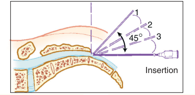

1 2 45° 3 Insertion 

### TECHNIQUE

The CSE technique most commonly involves placement of the epidural needle first, followed by either a “needlethrough-needle” technique to reach the subarachnoid space or an altogether separate spinal needle insertion at either the same or different interspace. Some but not all studies have demonstrated greater success and lower failure rates with the separate needle insertion technique.332–335 This method has the potential advantage of being able to confirm that the epidural catheter is functional before spinal anesthesia is administered, which, although it is time consuming, may be advantageous if the epidural catheter is to be relied upon for anesthesia when the spinal component resolves. Conversely, this method theoretically risks shearing the epidural catheter that is already _in situ_ . If a needle- through- needle technique is chosen, special CSE kits are available with long spinal needles, some of which can be locked in place for the subarachnoid injection.

## Caudal Anesthesia

Caudal anesthesia is popular in pediatric anesthesia (see Chapter 72), most commonly in the age range of 12 months up to 3 years.336 The technique also can be used in adults, although it is unpredictable when upper abdominal or thoracic spread is required. Its indications in adults therefore are essentially the same as those for lumbar epidural anesthesia, although it may be particularly useful when sacral anesthetic spread is desired (e.g., perineal, anal, rectal procedures), where a spinal surgery scar may prevent a lumbar anesthetic technique and, more commonly, in chronic pain and cancer pain management (see Chapter 47). The use of fluoroscopic guidance and, more recently, ultrasonography can help guide correct needle placement and reduce the rate of a failed block.337 Ultrasonography is of even greater benefit in children because the lack of bony ossification allows visualization of both local anesthetic spread and the position of caudal epidural catheters.338–340

### PHARMACOLOGY

The local anesthetics used are similar to those described for epidural anesthesia and analgesia. However, in adults approximately twice the lumbar epidural dose is required to achieve a similar block with the caudal approach. The spread is also variable, making this technique in adults unreliable for procedures above the umbilicus.

### TECHNIQUE

Patient preparation as described before for spinal and epidural anesthesia must be equally applied to caudal

**Fig. 41.10 Caudal technique.** Palpating fingers locate the sacral cornua by using the equilateral triangle. Needle insertion is completed by insertion and withdrawal in a stepwise fashion ( _inset,_ so- called 1- 2- 3 insertion) until the needle can be advanced into the caudal canal and the solution can be injected easily (without creation of a subcutaneous “lump” of fluid).

anesthesia, namely consent, monitoring and resuscitation equipment, intravenous access, and the same asepsis precautions. Caudal anesthesia requires identification of the sacral hiatus. The sacrococcygeal ligament (i.e., extension of ligamentum flavum) overlies the sacral hiatus between the two sacral cornua. To facilitate locating the cornua, the posterior superior iliac spines should be located and, by using the line between them as one side of an equilateral triangle, the location of the sacral hiatus should be approximated (Fig. 41.10). Three positions (see Chapter 30) are available for caudal anesthesia, with the prone position most often chosen in adults, the lateral decubitus position most chosen in children, and the knee–chest position the most infrequently used. The lateral decubitus position is used in children because it is easier to maintain a patent airway in this position than in the prone position, and the landmarks are more easily palpable than they are in adults (see Chapter 74). This consideration is valuable because caudal anesthesia is often combined with general anesthesia in pediatric patients to decrease the amount of volatile agent used intraoperatively or to provide postoperative analgesia. In contrast, a caudal block is often administered during preoperative sedation in adults and when the prone position is applicable. When placing a patient in the prone position, a pillow should be inserted beneath the iliac crests to rotate the pelvis and make cannulation of the caudal canal easier. An additional aid is to spread the lower extremities about 20 degrees with the heels rotated

<!-- PDF page 28 -->

laterally, which minimizes gluteal muscle contraction and eases needle insertion.

After the sacral hiatus is identified, the index and middle fingers of the palpating hand are placed on the sacral cornua, and after local infiltration, the caudal needle (or Tuohy needle if a catheter is to be placed) is inserted at an angle of approximately 45 degrees to the sacrum. While the needle is advanced, a decrease in resistance to needle insertion should be appreciated as the needle enters the caudal canal. The needle is advanced until bone (i.e., the dorsal aspect of the ventral plate of the sacrum) is contacted and then is slightly withdrawn, and the needle is redirected so that the angle of insertion relative to the skin surface is decreased. In male patients, this angle is almost parallel to the coronal plane; in female patients, a slightly steeper angle (15 degrees) is necessary. During redirection of the needle, loss- of- resistance is sought to confirm entry into the epidural space, and the needle advanced no more than approximately 1 to 2 cm into the caudal canal. In adults, the tip should never be advanced beyond the S2 level (approximately 1 cm inferior to the posterior superior iliac spine), which is the level to which the dural sac extends. Additional advancement of the needle increases the risk of dural puncture, and unintentional intravascular cannulation becomes more likely. One method of increasing the likelihood of correct caudal needle placement is to inject 5 mL of saline rapidly through the caudal needle while palpating the skin overlying the sacrum. If no midline bulge is detected, the needle is probably positioned correctly. In contrast, if a midline bulge is detected during saline injection, the needle is positioned incorrectly.

After ensuring correct needle position and before injection of the therapeutic dose of caudal anesthetic, aspiration should be performed and a test dose administered because, as in lumbar epidural anesthesia, a vein or the subarachnoid space can be entered unintentionally.

## Complications

The physiologic effects of neuraxial blocks may be misinterpreted as complications; however, clear distinction should be made between the physiologic effects of the neuraxial technique and complications, which imply some harm to the patient.341 The material risks associated with neuraxial anesthesia must be intimately understood and respected because catastrophic injury is not unknown and serves to remind us that a person’s nervous system is at the other end of the needle.342

### NEUROLOGIC

Serious neurologic complications associated with neuraxial anesthesia are rare. As such, prohibitively large numbers of patients are required for study to estimate the frequency of these events. The true incidence of most neurologic injury after neuraxial anesthesia is unknown, with published accounts of neurologic complications invariably influenced by the differing identification and reporting processes. ASRA comprehensively addresses this important topic in their updated Practice Advisory on Neurologic Complications.76

### Paraplegia

The frequency of paraplegia related to neuraxial anesthesia is reported to be approximately 0.1/10,000,343,344 and the mechanism of such a severe injury is likely multifactorial and difficult to identify for certain.345 Although injury resulting from direct needle trauma to the spinal cord346–350 may be self- evident, historical cases highlight the fundamental danger that accompanies the injection of a foreign substance into the CSF. The highly publicized cases of Woolley and Roe, two healthy, middle- aged men who became paraplegic after spinal anesthesia by the same anesthesiologist using the same drug on the same day for minor surgery at the same hospital in the United Kingdom in 1947, arguably set back the practice of spinal anesthesia for decades despite evidence that contamination by the descaling liquid used to cleanse the procedure tray had most likely been responsible. Another example of catastrophic injury related to intrathecal injectate was the chloroprocaine neurotoxicity experience in the early 1980s, during which several patients developed adhesive arachnoiditis, cauda equina syndrome, or permanent paresis thought to be related to a combination of low pH and the antioxidant sodium bisulfite preservative used in early (and discontinued) preparations of the short- acting ester local anesthetic chloroprocaine.138–141,351

Profound hypotension or ischemia of the spinal cord can be important contributing factors in cases of paraplegia associated with neuraxial anesthesia. Anterior spinal artery syndrome, characterized by painless loss of motor and sensory function, is associated with anterior cord ischemia or infarction with sparing of proprioception, which is carried by the posterior column. The anterior cord is believed to be especially vulnerable to ischemic insult because of its single and tenuous source of arterial blood supply (the artery of Adamkiewicz). Ischemia caused by any one or a combination of profound hypotension, mechanical obstruction, vasculopathy, or hemorrhage can contribute to irreversible anterior cord damage.352–354

### Cauda Equina Syndrome

The rate of cauda equina syndrome is approximately 0.1/10,000 and may results in permanent neurologic deficit.343 The lumbosacral roots of the spinal cord may be particularly vulnerable to direct exposure to large doses of local anesthetic, whether it is administered as a single injection of relatively highly concentrated local anesthetic (e.g., 5% lidocaine)355 or prolonged exposure to a local anesthetic through a continuous catheter.356,357 The FDA withdrew approval for spinal catheters smaller than 24 G in size in 1992 because of concerns about a perceived association between the small- bore catheters and the development of cauda equina syndrome.358 Although small- bore catheters can reduce the risk of headache, they can predispose to pooling of local anesthetic around the lumbosacral nerve roots, possibly because of slow injectate flow through the fine- bore catheter, thereby exposing them to high concentrations of local anesthetic. However, small- bore spinal catheters are being used effectively in Europe, and they are beginning to reappear in the United States, although it has taken nearly 15 years for them to emerge from the regulatory cloud of the early 1990s.359 Another risk factor for cauda equina

<!-- PDF page 29 -->

syndrome may be spinal stenosis wherein local anesthetic distribution may be limited, thus exposing the cauda equina to higher concentrations of local anesthetic.

### Epidural Hematoma

Bleeding within the vertebral canal can cause ischemic compression of the spinal cord and lead to permanent neurologic deficit if not recognized and evacuated expeditiously. Many risk factors have been associated with the development of an epidural hematoma, including difficult or traumatic needle or catheter insertion,360 coagulopathy, elderly age, and female sex.361 Radicular back pain, prolonged blockade longer than the expected duration of the neuraxial technique, and bladder or bowel dysfunction are features commonly associated with a space- occupying lesion within the vertebral canal and should prompt magnetic resonance imaging on an urgent basis. Before the United Kingdom Royal College of Anaesthetists (RCoA) National Audit Project 3 (NAP3), the largest contemporary studies reported rates of epidural hematoma of less than 0.06/10,000 after spinal anesthesia, whereas the reported rates of epidural hematoma after epidural blockade in the audit were as much as 10- fold higher.307,362–366 The United Kingdom RCoA NAP3 arguably provides the most accurate rates of neurologic complications associated with neuraxial anesthesia in contemporary practice. This unique prospective nationwide audit found five cases of epidural hematoma among 707,455 neuraxial techniques (0.07/10,000), all of which occurred among 97,925 perioperative epidural techniques (0.5/10,000) performed over the course of 1 year.344

### Nerve Injury

In 1955, Vandam and Dripps were the first to capture data prospectively on nerve injury from more than 10,000 patients who underwent spinal anesthesia.367 No severe neurologic injuries occurred in this population. In 1969, Dawkins published the classic review of neurologic complications after 32,718 epidural anesthetics and reported the frequency of transient and permanent nerve injury to be 0.1% and 0.02%, respectively.368 Despite interim advances in practice and research methodology, some of the largest contemporary studies available362,365,369–371 suggest that the rate of neurologic injury related to neuraxial anesthesia is mostly unchanged compared with that reported nearly a half century ago. Most notable from these contemporary data are that epidural (including CSE) anesthesia is likely associated with a more frequent rate of radiculopathy or peripheral neuropathy compared with spinal anesthesia,343 and that neuraxial anesthesia performed in adults for the purposes of perioperative anesthesia or analgesia is apparently associated with a higher likelihood of neurologic complications compared with that performed in the obstetric, pediatric, and chronic pain settings.344,362,372,373 The rate of permanent nerve injury after neuraxial blockade is even more difficult to determine because methods of investigation and diagnosis, determination of causation, and reporting of outcomes are highly variable within the literature.374 NAP3 found the overall rate of permanent nerve injury to be 7 in 707,455 or 0.1/10,000,344 which is remarkably similar to studies published a half century earlier by Dawkins. Three cases of nerve injury occurred among 293,050 epidurals (0.1/10,000), 3 among 324,950

spinal anesthetics (0.1/10,000), and 1 among 41,875 CSEs (0.2/10,000), mostly in young, healthy patients. Procedure- related risk factors traditionally associated with nerve injury after neuraxial anesthesia in the perioperative setting include radicular pain or paresthesia occurring during the procedure.342,365,375,376

### Arachnoiditis

Arachnoiditis, an inflammatory reaction of the meninges, is rare after neuraxial anesthesia and its true incidence is unknown. The potential contributory effects of chlorhexidine in alcohol disinfectant solution to several cases of severe arachnoiditis following epidural catheterization377 has led to the recommendation that chlorhexidine in alcohol must dry fully before needle puncture,378,379 and measures must also be taken to avoid splashing of any chlorhexidine solution onto the needles or syringes, and especially contamination of the injectate drugs. To further reduce the risk of inadvertent introduction of chlorhexidine into the neuraxis, chlorhexidine solutions are commonly tinted with artificial coloring agents to distinguish the antiseptic from colorless solutions also used in neuraxial procedures such as saline and local anesthetics.

### Post–Dural Puncture Headache

A relatively common complication of neuraxial anesthesia is post–dural puncture headache (PDPH). As the name implies, post–dural puncture headache is believed to result from unintentional or intentional puncture of the dura membrane in the setting of neuraxial anesthesia or after myelography and diagnostic lumbar puncture. There are two possible explanations for the cause of the headache, neither of which has ever been proven. First, the loss of CSF through the dura is proposed to cause traction on pain- sensitive intracranial structures as the brain loses support and sags. Alternatively, the loss of CSF initiates compensatory yet painful intracerebral vasodilation to offset the reduction in intracranial pressure.380 The characteristic feature of a post–dural puncture headache is a frontal or occipital headache that worsens with the upright or seated posture and is relieved by lying supine. Associated symptoms can include nausea, vomiting, neck pain, dizziness, tinnitus, diplopia, hearing loss, cortical blindness, cranial nerve palsies, and even seizures. In more than 90% of cases, the onset of characteristic post–dural puncture headache symptoms will begin within 3 days of the procedure,381 and 66% start within the first 48 hours.382 Spontaneous resolution usually occurs within 7 days in the majority (72%) of cases, whereas 87% of cases resolve by 6 months.383 Post–dural puncture headache is associated with a substantially increased risk of cerebral venous thrombosis and subdural hematoma (composite adjusted odds ratio [aOR] 19.0 [95% confidence interval (CI) 11.2–32.1]) and bacterial meningitis (aOR 39.7 (95% CI 13.6–115.1)]. Therefore recognizing, treating and monitoring patients who suffer PDPH is vitally important.384

Post–dural puncture headache can occur in the setting of either spinal or epidural anesthesia, the former associated with certain modifiable risk factors during intentional dural puncture and the latter associated with unintentional puncture of the dura by advancing the Tuohy needle. Orienting a needle bevel parallel with the axis of the spine, such that the longitudinal fibers of the dura would more likely be

<!-- PDF page 30 -->

### Box 41.2 Relationships Among Variables and Post–Spinal Puncture Headache

**Factors That Can Increase the Incidence of Headache After Spinal Puncture**

- Age: Younger, more frequent

- Sex: Females > males

- Needle size: Larger > smaller

- Needle bevel: Less when the needle bevel is placed in the long axis of the neuraxis

blood injection.400 As a result, these authors recommend inserting the blood patch needle at or caudad to the level of the previous culprit dural puncture. These findings have since been validated by magnetic resonance imaging of epidural blood patch spread.401 One multinational, multicenter, randomized, blinded trial suggested that 20 mL of blood is a reasonable starting target volume.402 A second epidural blood patch may be performed 24 to 48 hours after the first in the case of ineffective or incomplete relief of symptoms.

- Pregnancy: More when pregnant

- Dural punctures: More with multiple punctures

**Factors That Do Not Increase the Incidence of Headache After Spinal Puncture**

- Insertion and use of catheters for continuous spinal anesthesia

- Timing of ambulation

separated than cut, results in a lower incidence of post–spinal puncture headache.385 This clinical observation is supported by laboratory investigations showing that simulated spinal puncture with cone- shaped (pencil- point) spinal needle tips produces slower transdural loss of fluid than a similar puncture with cutting- tipped needles.386 Indeed meta- analysis has confirmed that noncutting needle tip designs have a lower frequency of post–dural puncture headache than do cutting spinal needle tip designs.387 Other studies suggest that the collagen layers of the dura are oriented in a multidirectional fashion, not always in a cephalocaudad direction, and are variable in thickness, leading to the suggestion that damage to the longitudinal cells of the arachnoid membrane is more likely to be influenced by the type of bevel and may even be the predominant factor affecting post–dural puncture headache.388 Reports vary as to whether the incidence of post–dural puncture headache is increased with the CSE technique compared with epidural alone.389,390

Aside from the type of needle tip (cutting vs. pencil- point) and the bevel direction, there are additional risk factors common to the performance of both spinal and epidural anesthesia that contribute to the likelihood of developing a post–dural puncture headache. These risk factors are listed in Box 41.2.391

Conservative management for post–dural puncture headache includes supine positioning, hydration, caffeine, and oral analgesics. Sumatriptan has also been used with varying effect but is not without side effects.392,393 Epidural blood patch is the definitive therapy for post–dural puncture headache.394 This therapy was introduced by Gormley395 ; its safety and efficacy have been well documented, and contemporary practice has validated that a single epidural blood patch has up to a 90% initial improvement rate and persistent resolution of symptoms in 61% to 75% of cases.396,397

Epidural blood patch is ideally performed 24 hours after dural puncture and after the development of classic post–dural puncture headache symptoms. The efficacy of prophylactic epidural blood patching is not supported by evidence.398,399 By injecting radionuclide- labeled red blood cells epidurally, Szeinfeld and co- workers demonstrated that approximately 15 mL of blood will spread over a mean distance of nine spinal segments, and that the direction of spread was preferentially cephalad relative to the level of

### TRANSIENT NEUROLOGIC SYMPTOMS

Traditionally associated with lidocaine, TNS have been described after intrathecal administration of every local anesthetic used for spinal anesthesia. TNS, previously known as transient radicular irritation,403 are usually characterized by bilateral or unilateral pain in the buttocks radiating to the legs or, less commonly, isolated buttock or leg pain. Symptoms occur within 24 hours of the resolution of an otherwise uneventful spinal anesthetic and are not associated with any neurologic deficits or laboratory abnormalities.404 The pain can range from mild to severe and typically resolves spontaneously in 1 week or less.405 The condition is not associated with motor weakness or abnormal neurologic examination.406 Compared to intrathecal lidocaine, the risk ratio (RR) of TNS is lower for bupivacaine, levobupivacaine, prilocaine, procaine, and ropivacaine (with RRs in the range of 0.10 to 0.23). The relative risk of TNS does not appear to differ between 2- chloroprocaine and mepivacaine compared to lidocaine, although this analysis was based on only a small number of low- quality evidence studies.149 The phenomenon is not related to the concentration of lidocaine,149 the addition of dextrose or epinephrine, or solution osmolarity. The type of needle can influence the likelihood of TNS, with the rate reduced by a double- orifice needle,407 possibly because single- orifice needles increase the risk of injecting anesthetic caudally in the thecal sac. TNS are not commonly associated with epidural procedures but have occurred with epidural lidocaine and other local anesthetics.263,408 Finally, TNS occur more commonly in patients who are placed in the lithotomy position for surgery. NSAIDs are the first line of treatment, but pain can be severe and may even require opioids.

### CARDIOVASCULAR

### Hypotension

Hypotension may be considered a complication of neuraxial blockade if the patient faces harm. Recent guidance has placed more emphasis on avoiding hypotension during neuraxial anesthesia (defined as 20%–30% below baseline) in order to reduce the possibility of spinal cord ischemia or infarction.76 In the setting of spinal anesthesia, hypotension (defined as systolic blood pressure &lt;90 mm Hg) is more likely to occur with a variety of factors including peak block height greater than or equal to T5, age older than or equal to 40 years, baseline systolic blood pressure less than 120 mm Hg, combined spinal and general anesthesia, spinal puncture at or above the L2–L3 interspace, and the addition of phenylephrine to the local anesthetic.50 Hypotension (defined as a reduction in mean arterial blood

<!-- PDF page 31 -->

pressure >30%) is independently associated with chronic alcohol consumption, history of hypertension, BMI, and the urgency of surgery.409 Nausea is a common symptom of hypotension in the setting of neuraxial anesthesia, as are vomiting, dizziness, and dyspnea.

### Cardiac Arrest (see also Chapter 82)

In a review of closed insurance claims, Caplan and associates identified 14 cases of sudden cardiac arrest in healthy patients receiving spinal anesthesia.410 The etiology of sudden cardiac arrest after spinal anesthesia is not understood. Whether these catastrophic events represented lack of vigilant monitoring and treatment as opposed to some mysterious physiologic explanation is not known.411 The latter notwithstanding, it is clear that hypoxemia and over- sedation are complicit in the severe bradycardia and asystole that can occur suddenly during well- conducted spinal anesthesia.412,413 Curiously, these rare events seem to be preferentially associated with spinal anesthesia rather than epidural techniques. In their inaugural survey of French anesthesiologists, Auroy and colleagues reported the rate of cardiac arrest to be 6.4/10,000 after spinal anesthesia compared with 1/10,000 for all other neuraxial and peripheral regional anesthesia techniques combined.365 In their larger follow- up survey of all anesthesiologists in France, Auroy and colleagues reported 10 cases of cardiac arrest after 35,439 spinal anesthetics (2.5/10,000) and none after 5561 epidural techniques.371 Most recently, Cook and colleagues uncovered three cases of cardiovascular collapse among 707,425 neuraxial blocks (0.04/10,000) during their nationwide audit, two of which were during spinal anesthesia and one in the setting of CSE.344

### RESPIRATORY

Neuraxial opioids are commonly added to local anesthetic solutions to improve the quality and duration of neuraxial anesthesia and analgesia. The risk of respiratory depression associated with neuraxial opioids is dose dependent, with a reported frequency that approaches 3% after the administration of 0.8 mg of intrathecal morphine.414 The prevalence of clinically relevant respiratory depression following neuraxial opioid administration in the obstetric population is 5.96–8.67 cases per 10,000.415 Respiratory depression may stem from rostral spread of opioids within the CSF to the chemosensitive respiratory centers in the brainstem.65 With lipophilic anesthetics, respiratory depression is generally an early phenomenon occurring within the first 30 minutes; respiratory depression has never been described more than 2 hours after the administration of intrathecal fentanyl or sufentanil.225 With intrathecal morphine, there is a risk of late respiratory depression, occurring as much as 24 hours after injection. Respiratory monitoring for the first 24 hours after the administration of intrathecal morphine is therefore advisable. Patients with sleep apnea can be especially sensitive to the potent respiratory- depressant effects of opioid medications and although definitive safety data evidence are lacking, the decision to administer neuraxial opioids to these patients is made with considerable caution.416,417 Older patients also have a higher risk of respiratory depression, and the dose of neuraxial opioids should be reduced in this population (see Chapter 61). Coadministration of systemic sedatives also increases this risk.

### INFECTION

Bacterial meningitis and epidural abscess are rare, but potentially catastrophic, infectious complications of all neuraxial techniques. Sources of infection in neuraxial procedures include the equipment, the patient, or the practitioner. Staphylococcal infections arising from the patient’s skin are one of the most common epidural- related infections, whereas oral bacteria such as _Streptococcus viridans_ are a common cause of infection after spinal anesthesia, underscoring the need for the clinician to wear a face mask when performing neuraxial procedures. Other factors that may increase the likelihood of infection include the presence of a concomitant systemic infection, diabetes, immunocompromised states,92 and prolonged maintenance of an indwelling epidural (or spinal) catheter.418 Large contemporary studies estimate the rate of serious neuraxial infection to be less than 0.3/10,000 for spinal anesthesia,362,369,371 whereas infectious complications after epidural techniques may be at least twice as common.362,369,371,419–421 Obstetric patients are less likely to develop deep infections related to epidural analgesia. The United Kingdom RCoA NAP3 reported no cases of meningitis and eight cases of epidural abscess after 707,455 neuraxial techniques, five of which occurred among 293,050 epidural techniques, two among 324,950 spinal anesthetics, and one among 47,550 caudal blocks.344

In 2017, the ASA and ASRA published a practice advisory regarding infectious complications associated with neuraxial anesthesia,229 specifically addressing (1) prevention, (2) diagnosis, and (3) management. Previous publications have addressed infectious risks of neuraxial anesthesia in the febrile or infected patient,92 the immunocompromised patient,422 and in the setting of chronic pain treatments.423

Aseptic meningitis occurred mostly in the early 20th century, likely secondary to chemical contamination and detergents, which are no longer present in modern preservative- free preparations.

### BACKACHE

Back injury is perhaps the most feared complication of neuraxial anesthesia among patients. Evidence indicates that the incidence of back pain after spinal anesthesia is not different from general anesthesia.424 Indeed, up to 25% of all surgical patients undergoing anesthesia, regardless of anesthetic technique, experience backache, the incidence of which increases to 50% when surgery lasts 4 to 5 hours.425 There is also no association between epidural analgesia and newonset back pain up to 6 months postpartum.426,427 Preexisting back pain does appear to be a risk factor for persistent back pain after neuraxial anesthesia, although the severity of the pain does not appear to be worsened. Other risk factors include immobilization during surgery greater than 2.5 hours, lithotomy position, BMI greater than 32 kg/m2 , and multiple attempts at block placement.424

### NAUSEA AND VOMITING

There are multiple possible mechanisms that contribute to nausea and vomiting in the setting of neuraxial anesthesia, including direct exposure of the chemoreceptive

<!-- PDF page 32 -->

trigger zone in the brain to emetogenic drugs (e.g., opioids), as well as hypotension associated with generalized vasodilation and gastrointestinal hyperperistalsis secondary to unopposed parasympathetic activity (see also Chapter 76).428 Although regional anesthesia is often recommended as an alternative to general anesthesia for patients at risk for postoperative nausea and vomiting, there are few studies that have primarily investigated the effects of neuraxial anesthesia on postoperative nausea and vomiting with sufficient statistical power. Factors associated with developing nausea or vomiting after spinal anesthesia include the addition of phenylephrine or epinephrine to the local anesthetic, peak block height greater than or equal to T5, baseline heart rate greater than 60 beats/min, use of procaine, history of motion sickness, and the development of hypotension during spinal anesthesia. Among the opioids commonly added to intrathecal or epidural local anesthetics, morphine administration has the most frequent risk of nausea or vomiting, whereas fentanyl and sufentanil carry the least frequent risk.428 Neuraxial opioid- related nausea and vomiting appears to be dose dependent. Using less than 0.1 mg morphine reduces the risk of nausea and vomiting, without compromising the analgesic effect.225,429

### URINARY RETENTION

Urinary retention can occur in as many as one-third of patients after neuraxial anesthesia. Local anesthetic blockade of the S2, S3, and S4 nerve roots inhibits urinary function as the detrusor muscle is weakened. Neuraxial opioids can further complicate urinary function by suppressing detrusor contractility and reducing the sensation of urge.430 Spontaneous return of normal bladder function is expected once the sensory level decreases to below S2–3.431 Although male sex and age have been (albeit inconsistently) linked to urinary retention after neuraxial anesthesia, the administration of intrathecal morphine is strongly associated with this complication.430,432,433

### SHIVERING

The rate of shivering related to neuraxial anesthesia is as frequent as 55%.435 The intensity of shivering is likely related more to epidural anesthesia than spinal.436 Although there are multiple possible explanations for the difference in shivering intensity, this observation may simply be related to the inability to shiver because of the profound motor block associated with spinal anesthesia compared with epidural techniques. Another explanation may be the relatively cold temperature of the epidural injectate, which can affect the thermosensitive basal sinuses.435 The addition of neuraxial opioids, specifically fentanyl and meperidine, reduces the likelihood of shivering.435 Recommended strategies to prevent shivering after neuraxial anesthesia include prewarming the patient with a forced air warmer for at least 15 minutes and avoiding the administration of cold epidural and intravenous fluids.

### WRONG ROUTE ADMINISTRATION

Wrong route administration refers to the infusion or injection of a drug into the wrong body compartment and small- bore medical connection syringe systems carry an inherent risk of inadvertent wrong- route drug administration. In addition to epidural catheter migration or inadvertent intravascular placement (described below), an epidural infusion may be mistakenly connected to an intravascular device. Such errors can have catastrophic consequences including death.437 Prevention is paramount and the International Organization for Standardization (ISO) has published a group of standards for medical small- bore connectors, including ISO 803696:2016 which addresses connectors (so- called NR- Fit) for neuraxial applications and peripheral nerve blocks. Such devices make regional anesthesia and intravenous connections technically incompatible. Using less cardiotoxic local anesthetics may reduce the risk of harm if wrong route administration does occur.

### TOTAL SPINAL

### PRURITUS

Pruritus can be distressing to the patient. It is the most common side effect related to the intrathecal administration of opioids, with rates between 30% and 100%.225 Pruritus occurs more commonly after intrathecal opioid administration than after intravenous opioid administration and is not dependent on the type or dose of opioid administered. Reducing the dose of intrathecal sufentanil from 5 mcg to as little as 1.5 mcg can reduce the likelihood of pruritus without compromising analgesia when added to hyperbaric bupivacaine for cesarean delivery (see Chapter 58).434 The mechanism of pruritus is unclear but is likely related to the central opioid receptor activation rather than histamine release because naloxone, naltrexone, or the partial agonist nalbuphine can be used for treatment. Ondansetron and propofol are also useful therapies. Some anti- inflammatories have been shown to reduce pruritus (e.g., diclofenac and tenoxicam), while mirtazapine, an antidepressant with 5HT3 antagonism properties like ondansetron, may also be helpful if administered preoperatively.

Total spinal anesthesia is a rare but serious complication occurs after excessive rostral spread of intrathecal local anesthetic, administered either during spinal anesthesia or from inadvertent local anesthetic spread from the epidural space. Hypotension, bradycardia, and possible cardiac arrest develop secondary to a loss of sympathetic tone and blockade of the cardiac T1–T4 supply. Respiratory function also progressively worsens as the local anesthetic exerts effects on the thoracic spinal levels. Intercostal muscles are affected initially, followed by some of the accessory respiratory muscles as the lower cervical nerve roots are anesthetized (the patient may also complain of tingling or weakness of the hands or arms at this stage); the diaphragm, as cervical nerve roots C3–5 are anesthetized; and finally, the brainstem respiratory centers, resulting in respiratory arrest. Loss of consciousness also occurs with intracranial spread. Intracranial spread of local anesthetic distinguishes a total spinal from a high spinal block. The exact incidence of a total spinal is unclear as it was not included in NAP3 or other major retrospective case series as a separate category.

<!-- PDF page 33 -->

Risk factors are related to those described earlier which influence block height and include obesity, short stature, a spinal following a failed epidural, epidural after a dural puncture, as well as the dose of local administered and level of insertion. Management is supportive and includes psychological support and reassurance initially, cardiovascular support, and intubation and ventilation if necessary until the block resolves.

### COMPLICATIONS UNIQUE TO EPIDURAL ANESTHESIA

### Intravascular Injection

Epidural anesthesia can produce local anesthetic–induced systemic toxicity (see Chapter 25), primarily through the unintentional administration of drug into an epidural vein. The frequency of vascular puncture with the needle or cannulation with the catheter can reportedly approach 10%, with the highest rates seen in the obstetric population, where these vessels are relatively dilated and more vulnerable to entry.300,438 The rate of seizures related to epidural anesthesia may be as frequent as 1%.307,365,371 In obstetrics (see also Chapter 58), the likelihood of intravascular injection is decreased by placing the patient in the lateral (as opposed to the sitting) position during needle and catheter insertion, administering fluid through the epidural needle before catheter insertion, using a single- orifice type rather than a multi- orifice catheter or a wire- embedded polyurethane type compared with polyamide epidural catheter, and advancing the catheter less than 6 cm into the epidural space. The paramedian as opposed to the midline needle approach, and the use of a smaller- gauge epidural needle or catheter, does not reduce the risk of epidural vein cannulation.300

One of the most controversial issues related to epidural anesthesia has been the use of an epinephrine- containing test dose.439 Epinephrine (15 mcg) in 3 mL of local anesthetic is an effective pharmacologic method of detecting intravascular placement in nonpregnant adult patients.321 However, controversy surrounds the use of epinephrine in obstetric patients, in whom uterine blood flow may be decreased by the intravascular injection, thereby putting the fetus at risk, and where the cardiovascular changes occurring in active labor may represent a false- positive response to epinephrine. Although epinephrine may place the fetus at risk in theory,440 no such case has been described. The epidural epinephrine test dose can be unreliable in patients receiving β- adrenergic blockers441 or if the test dose is administered during general anesthesia.442 Because there is no fail- safe method of guaranteeing an extravascular location of an epidural local anesthetic, prevention of systemic toxicity should also involve aspiration of the catheter and incremental administration of the local anesthetic. The onset of block, quality of the block, and block height are unaffected by administration of the epidural drug in 5 mL fractions.443

### Subdural Injection

Blomberg used a fiberoptic technique to demonstrate that the subdural extra- arachnoid space is easily entered in 66% of autopsy attempts in humans.444 Despite this being an infrequent clinical problem with epidural anesthesia

(&lt;1%), it does allow a visual understanding of the subdural complications of epidural anesthesia.445 This space, unlike the epidural space, also extends intracranially. When an epidural block is performed and a higher- than- expected block develops, but only after a delay of 15 to 30 minutes (unlike a total spinal), subdural placement of local anesthetic must be considered. With a subdural block, the motor block will be modest compared to the extent of the sensory block, and the sympathetic block may be exaggerated. The treatment is symptomatic and the subdural catheter should be removed.

### Management of Accidental Dural Puncture

In the event of an unintended dural puncture there are two main options other than abandoning the procedure. One is to remove the epidural needle and attempt to re- site the epidural at a different vertebral interspace. The other is to advance the epidural catheter through the needle into the intrathecal space, removing the possibility of a second accidental dural puncture and reducing the risk of a subsequent post–dural puncture headache.446–449 Intrathecal catheters offer rapidly titratable analgesia or anesthesia but extreme care must be taken not to confuse these with an epidural catheter, with the attendant risk of administering large “epidural” doses of local anesthetic or other neurotoxic agents into the intrathecal space.

### COMPLICATIONS UNIQUE TO COMBINED SPINAL–EPIDURALS

The risk of metal toxicity from abraded spinal needle particles using the needle- through- needle technique has not been confirmed.450

## Outcomes

### POSTOPERATIVE MORTALITY

While the relative risk reduction in overall mortality in patients receiving neuraxial blockade has been reported to approach 30% for all types of surgery,451 these studies are now over 40 years old, which may not reflect contemporary anesthetic practice and enhanced recovery after surgery pathways. Recent work has focused on large prospective and retrospective database analyses as well as randomized controlled trials with some analyses including over 1 million patients.452 Although these too must be treated with caution, there still appear to be benefits of neuraxial anesthesia beyond superior analgesia, particularly when neuraxial is used instead of, rather than combined with, general anesthesia.453 Furthermore, the specific surgical procedure may also influence outcome and it may be that any mortality benefit is both procedurespecific and technique- specific (i.e., thoracic epidural may be more advantageous than lumbar epidural, and epidural local anesthetic may be more advantageous than epidural opioid). As general anesthesia has become safer over time, demonstrating a mortality benefit is more challenging. Some large retrospective studies do show a relative reduction in mortality, but the absolute difference is small.454

<!-- PDF page 34 -->

### CARDIAC SURGERY

Compared with systemic analgesia, epidural analgesia following cardiac surgery may reduce the risk of myocardial infarction, respiratory depression, and atrial arrhythmia, as well as the duration of tracheal intubation and pain, in adults undergoing cardiac surgery.455 There is little or no difference in mortality or pneumonia.

### THORACIC SURGERY

For major thoracic and abdominal surgery, thoracic epidural analgesia can reduce mortality, along with reductions in respiratory complications, opioid consumption, and improvements in cough and time to ambulation.452,456,457 Epidural analgesia appears to reduce persistent postoperative pain between 3 and 18 months following thoracotomy.458 Conversely, there is evidence that myocardial infarction rates may be increased when epidural and general anesthesia are combined.452 For less invasive thoracic surgery, such as video- assisted thoracoscopy, the role of thoracic epidural analgesia is controversial, since less invasive techniques (such as paravertebral blockade or truncal fascial plane blocks) provide similar analgesic effect, but with fewer side effects.459

### ABDOMINAL SURGERY

In patients undergoing major vascular and abdominal surgery, thoracic epidural local anesthetic infusion can reverse postoperative paralytic ileus associated with pain- induced sympathetic overactivity and systemic opioid.460 Lumbar epidural infusion or thoracic epidural opioid infusion alone does not speed intestinal function recovery. For fast- track laparoscopic colon resection, TEA provides superior pain relief but fails to speed intestinal function recovery or hospital discharge time. In one meta- analysis, which compared neuraxial to general anesthesia for all major limb and truncal surgery combined, there was a reduction in length of stay in hospital, but this was measured in hours rather than days.452 Compared to transversus abdominis plane block following abdominal surgery, epidural analgesia reduces the need for intravenous opioids in the first 24 postoperative hours; however, this comes at the expense of increased hypotension at 72 hours.461 Similarly, when compared to intravenous patient- controlled techniques, epidural analgesia reduces pain on movement following abdominal surgery, but at the cost of increased pruritus, hypotension, and analgesic failure.462 Older patients undergoing major thoracic or abdominal surgery may experience fewer episodes of postoperative delirium when epidural analgesia is combined with general anesthesia versus general anesthesia alone.463

### ORTHOPEDIC SURGERY

For patients undergoing primary hip and knee arthroplasty, neuraxial anesthesia is associated with lower (or no difference) odds of mortality, pulmonary or renal complications, thromboembolic events, blood transfusion, and infection risk compared to general anesthesia.464 Neuraxial

anesthesia is also associated with increased odds of being discharged to home rather than to other facilities, as well as decreased 30- day readmission rates, following elective lower limb arthroplasty.465

For surgery following hip fracture, there is no difference in mortality at 30, 60 or 90 days between patients undergoing spinal or general anesthesia466 ; however, differences in morbidity may exist, with patients receiving spinal anesthesia appearing at lower risk of blood transfusion and urinary tract infection compared to propensity- matched patients who receive general anesthesia.467 In these patients, neuraxial anesthesia is not superior to general anesthesia with respect to recovery of ambulation at 60 days and does not appear to reduce the incidence of postoperative delirium compared with general anesthesia.468 The impact of neuraxial techniques on venous thromboembolism remains uncertain, with some evidence of decreased risk demonstrated in large studies that included elective orthopedic surgeries.469

## Recent Advances

### CANCER RECURRENCE

What are the potential effects of neuraxial anesthesia on stress response, the immune system, and cancer recurrence?470–473 Functional cell- mediated immunity is required for monitoring and eradicating cancer cell growth. Lymphocytes, such as the natural killer (NK) cells and the cytotoxic T- lymphocytes, can lyse the cancer cell through the perforin and granzyme pathway or through secretion of cytokines (e.g., interferons) to induce cancer cell apoptosis. In addition, the helper T- cells control tumor angiogenesis through interferons, inhibit oncogenic signaling, and stimulate tumor destruction by engaging macrophages and granulocytes through interleukin production. There is an inverse relationship between NK- cell activity at the time of surgery and the development of metastatic disease. Systemic cancer cell seeding happens during surgical dissection and manipulation. Unfortunately, this happens at a time of significant immunosuppression. Surgically induced stress hormone (e.g., corticosteroids), as well as inhaled volatile anesthetics and systemic opioids (morphine and fentanyl), can diminish NK- cell function. Morphine also has proangiogenic properties that may promote dissemination of angiogenesis- dependent tumors. TEA and analgesia may be beneficial by virtue of its opioid and general anesthetic–sparing and surgical stress–alleviating properties. Some encouraging early data indicated a possible reduction of cancer recurrence associated with the use of perioperative epidural anesthesia and analgesia in patients undergoing retropubic prostatectomy,474,475 rectal cancer,476 and ovarian cancer resection.477,478 More recently published retrospective analyses and prospective randomized trials have reported no significant association between neuraxial techniques and cancer recurrence.479–482 Volatile, but not intravenous, anesthetics have also been shown to have a negative effect on immune function and cancer spread and therefore any apparent benefit of regional anesthesia may simply be due to a reduction or avoidance in the use of volatile anesthetic drugs. In the same manner, this potential

<!-- PDF page 35 -->

effect on the immune system may explain why surgical site infection has been shown to be reduced when using neuraxial compared general anesthesia in some, but not all, studies.452

45.  Greene NM. _Reg Anesth Pain Med_ . 1982;7(2):55.

46.  Groeben H. _J Anesth_ . 2006;20(4):290.

47.  Lirk P, et al. _Int J Obstet Anesth_ . 2010;19(3):287.

48.  von Ungern- Sternberg BS, et al. _Br J Anaesth_ . 2005;94(1):121.

49.  Regli A, et al. _Anaesthesia_ . 2006;61(3):215.

50.  Carpenter RL, et al. _Anesthesiology_ . 1992;76(6):906.

### ENVIRONMENT

The contribution of perioperative care to greenhouse gas emissions, including carbon dioxide production, is a topic of increasing professional interest.483,484 Making evidencebased decisions on the role of various anesthetic techniques can be difficult, since methodologies to comprehensively account for environmental impact (for example “life cycle assessments”) are continually being refined. Although the negative environmental cost of nitrous oxide and the halogenated ethers is well described, whether neuraxial anesthesia is more environmentally sustainable remains unclear given the complexities and underlying assumptions underpinning environmental impact studies.485

51.  Ward RJ, et al. _Anesth Analg_ . 1966;45(5):621.

52.  Freise H, et al. _Curr Opin Anaesthesiol_ . 2009;22:644.

53.  Sutcliffe NP, et al. _Anaesthesia_ . 1996;51:37.

54.  Michelet P, et al. _Chest_ . 2005;128:3461.

55.  Zu¨gel N, et al. _Chirurgie_ . 2002;73:262.

56.  Greene N, et al. _Ann Surg_ . 1954;140:641.

57.  Suleiman MY, et al. _Anesth Analg_ . 1997;84(5):1076.

58.  Papper EM. _Acta Anaesthesiol Scand Suppl_ . 1966;24:105.

59.  Baldini G, et al. _Anesthesiology_ . 2009;110(5):1139.

60.  Wainwright TW, et al. _Acta Orthop_ . 2020;91(1):3.

61.  Jellish WS, et al. _Anesth Analg_ . 1996;83:559.

62.  van Zundert AAJ, et al. _Br J Anaesth_ . 2007;98:682.

63.  Denny NM, et al. _Br J Anaesth_ . 1998;81:590.

64.  Block BM, et al. _JAMA_ . 2003;290:2455.

65.  Cousins MJ, et al. _Anesthesiology_ . 1984;61:276.

66.  Wang JK, et al. _Anesthesiology_ . 1979;50:149.

67.  Schug SA, et al. _Acute Pain Management: Scientific Evidence_ . 5th ed. Australian and New Zealand College of Anaesthetists; 2020.

68.  Hawkins JL. _N Engl J Med_ . 2010;362:1503.

### Complete references available online at expertconsult.com.

69.  Apfelbaum JL, et al. _Anesthesiology_ . 2016;124(2):270.

70.  Nishimori M, et al. _Cochrane Database Syst Rev_ . 2006;3(3):CD005059.

71.  Joshi GP, et al. _Anesth Analg_ . 2008;107:1026.

### References

1.  Mandabach M. _Int Congr_ . 2002:163.

2.  Franco A, et al. _Curr Anaesth Crit Care_ . 2000;11(5):274.

3.  Maltby JR, et al. _Br J Anaesth_ . 2000;84(1):121.

4.  Rigler ML, et al. _Anesth Analg_ . 1991;72(3):275.

5.  Horlocker TT, et al. _Reg Anesth Pain Med_ . 2018;43:263.

6.  Bernards CM, et al. _Anesthesiology_ . 1990;73(6):1214.

7.  Hogan QH. _Anesthesiology_ . 1991;75(5):767.

8.  Zarzur E. _Anesth Analg_ . 1984;63(5):499.

9.  Crighton IM, et al. _Br J Anaesth_ . 1997;78(4):391.

10.  Martirosyan NL, et al. _J Neurosurg Spine_ . 2011;15(3):238.

11.  Hogan Q, et al. _Reg Anesth Pain Med_ . 1999;24(4):303.

12.  Hogan Q. _Anesthesiology_ . 1996;85(1):37.

13.  Liu SS, et al. _Anesthesiology_ . 2001;94(5):888.

14.  Hogan QH, et al. _Anesthesiology_ . 1996;84(6):1341.

15.  Carpenter RL, et al. _Anesthesiology_ . 1998;89(1):24.

16.  Hogan Q. _Reg Anesth Pain Med_ . 2002;27(2):150.

17.  Igarashi T, et al. _Br J Anaesth_ . 1997;78:149.

18.  Liu S, et al. _Anesthesiology_ . 1995;82(1):60.

19.  Brull SJ, et al. _Anesth Analg_ . 1989;69(3):342.

20.  Greene NM. _Anesth Analg_ . 1983;62(11):1013.

21.  Cohen EN. _Anesthesiology_ . 1968;29(5):1002.

22.  Vandenabeele F, et al. _J Anat_ . 1996;189(2):417.

23.  Greene NM. _Anesth Analg_ . 1985;64(7):715.

24.  Hirabayashi Y, et al. _Br J Anaesth_ . 1990;65(4):508.

25.  Visser WA, et al. _Anesth Analg_ . 2008;107(2):708.

26.  Higuchi H, et al. _Anesthesiology_ . 2004;100(1):106.

27.  Butterworth J. _Reg Anesth Pain Med_ . 1998;23(4):370.

28.  Meyhoff CS, et al. _Eur J Anaesthesiol_ . 2007;24(9):770.

29.  Greene NM. _Physiology of Spinal Anesthesia_ . 3rd ed. Williams & Wilkins; 1981.

30.  Rooke GA, et al. _Anesth Analg_ . 1997;85(1):99.

31.  Lesser JB, et al. _Anesthesiology_ . 2003;99(4):859.

32.  Kopp SL, et al. _Anesth Analg_ . 2005;100(3):855.

33.  Crystal GJ, et al. _Anesth Analg_ . 2012;114(3):520.

34.  Hackel DB, et al. _Circulation_ . 1956;13(1):92.

35.  Olausson K, et al. _Circulation_ . 1997;96(7):2178.

36.  Nygård E, et al. _Circulation_ . 2005;111(17):2165.

37.  Stanley GD, et al. _Reg Anesth_ . 1997;22(1):53.

38.  Butterworth JF, et al. _Anesth Analg_ . 1986;65(6):612.

39.  Loubert C. _Can J Anesth_ . 2012;59(6):604.

40.  Moore JM. _Am J Ther_ . 2009;16(4):289.

41.  Minville V, et al. _Anesth Analg_ . 2009;108(4):1291.

42.  Kety SS, et al. _J Clin Invest_ . 1950;29(4):402.

43.  Kleinerman J, et al. _J Clin Invest_ . 1958;37(2):285.

44.  Sakura S, et al. _Anesth Analg_ . 1996;82(2):306.

72.  Svircevic V, et al. _Anesthesiology_ . 2011;114:262.

73.  Macfarlane AJR, et al. _Br J Anaesth_ . 2009;103:335.

74.  Macfarlane AJR, et al. _Clin Orthop Relat Res_ . 2009;467:2379.

75.  van Lier F, et al. _Anesthesiology_ . 2011;115:315.

76.  Neal JM, et al. _Reg Anes Pain Med_ . 2015;40:401.

77.  Hilt H, et al. _Br J Anaesth_ . 1986;58:676.

78.  Upton AR, et al. _Lancet_ . 1973;2:359.

79.  Hebl JR, et al. _Anesth Analg_ . 2006;103:223.

80.  Vercauteren M, et al. _Acta Anaesthesiol Scand_ . 2011;55(8):910.

81.  Hebl JR, et al. _Anesth Analg_ . 2010;111(6):1511.

82.  Berkowitz S, et al. _Anesth Analg_ . 1980;59(11):881.

83.  Bamford C, et al. _Can J Neurol Sci_ . 1978;5(1):41.

84.  Perlas A, et al. _Can J Anaesth_ . 2005;52(5):454.

85.  Nuyten F, et al. _Anaesthesia_ . 1990;45(10):846.

86.  McDonald SB. _Reg Anesth Pain Med_ . 2004;29(5):496.

87.  Lumpkin MM. _Anesthesiology_ . 1998;88(2):27A.

88.  Choi S, et al. _Anesth Analg_ . 2009;109(2):648.

89.  Ready LB, et al. _Anesthesiology_ . 1989;71(6):988.

90.  Baker AS, et al. _N Engl J Med_ . 1975;293(10):463.

91.  Ericsson M, et al. _Scand J Infect Dis_ . 1990;22(3):249.

92.  Wedel DJ, et al. _Reg Anesth Pain Med_ . 2006;31(4):324.

93.  Hocking G, et al. _Br J Anaesth_ . 2004;93(4):568.

94.  Lui AC, et al. _Can J Anaesth_ . 1998;45(4):297.

95.  Tetzlaff JE, et al. _Reg Anesth_ . 1995;20(6):533.

96.  Brown DT, et al. _Br J Anaesth_ . 1980;52(6):589.

97.  Wildsmith JA, et al. _Br J Anaesth_ . 1981;53(3):273.

98.  Stienstra R, et al. _Anesth Analg_ . 1988;67(3):272.

99.  Sheskey MC, et al. _Anesth Analg_ . 1983;62(10):931. 100.  Van Zundert AA, et al. _Reg Anesth_ . 1996;21(2):112. 101.  Henderson DJ, et al. _Br J Anaesth_ . 1995;74(5):610. 102.  Singh H, et al. _Can J Anaesth_ . 1995;42(11):987. 103.  Sarantopoulos C, et al. _Anesth Analg_ . 1994;79(1):94. 104.  Hartwell BL, et al. _Reg Anesth_ . 1991;16(1):17.

105.  Pitkänen MT. _Anesth Analg_ . 1987;66(2):127.

106.  Taivainen T, et al. _Br J Anaesth_ . 1990;64(5):542.

107.  Norris MC. _Anesthesiology_ . 1990;72(3):478.

108.  Pitkänen M, et al. _Br J Anaesth_ . 1984;56(3):279.

109.  Cameron AE, et al. _Anaesthesia_ . 1981;36(3):318.

110.  Niemi L, et al. _Br J Anaesth_ . 1993;71(6):807.

111.  Povey HM, et al. _Acta Anaesthesiol Scand_ . 1989;33(4):295.

112.  GPY L, et al. _Anaesthesia_ . 2002;57(2):169.

113.  Sinclair CJ, et al. _Br J Anaesth_ . 1982;54(5):497.

114.  Kim J- T, et al. _Br J Anaesth_ . 2007;98(3):396.

115.  Yung EM, et al. _Reg Anesth Pain Med_ . 2020;45(9):733.

116.  Veering BT, et al. _Br J Anaesth_ . 1996;77(3):343.

117.  Loubert C, et al. _Anesth Analg_ . 2011;113(4):811.

118.  McShane FJ, et al. _AANA J (Am Assoc Nurse Anesth)_ . 2000;68(1):67.

<!-- PDF page 36 -->

119.  James KS, et al. _Br J Anaesth_ . 1996;77(2):150. 120.  Urmey WF, et al. _Anesth Analg_ . 1997;84(2):337. 121.  Casati A, et al. _Anesth Analg_ . 1998;87(2):355. 122.  Chin KW, et al. _Med J Malaysia_ . 1994;49(2):142. 123.  Logan MR, et al. _Br J Anaesth_ . 1986;58(3):292. 124.  Sanderson P, et al. _Br J Anaesth_ . 1994;73(6):744. 125.  Taivainen T, et al. _Br J Anaesth_ . 1990;65(2):234. 126.  Konishi R, et al. _Masui_ . 1997;46(2):184. 127.  Malinovsky JM, et al. _Anesthesiology_ . 1999;91(5):1260. 128.  Goldblum E, et al. _Acta Anaesthesiol Scand_ . 2013;57:545. 129.  Salinas FV, et al. _Best Pract Res Clin Anaesthesiol_ . 2002;16(2):195. 130.  Urmey WF, et al. _Anesthesiology_ . 1995;83(3):528. 131.  Sanford M, et al. _Drugs_ . 2010;70(6):761. 132.  Whiteside JB, et al. _Br J Anaesth_ . 2001;86(2):241. 133.  O’Donnell D, et al. _Can J Anesth_ . 2010;57(1):32. 134.  Zayas VM, et al. _Anesth Analg_ . 1999;89(5):1167. 135.  Lee YY, et al. _Anesth Analg_ . 2007;105:520. 136.  McNamee DA, et al. _Br J Anaesth_ . 2002;89(5):702. 137.  Hodgson PS, et al. _Reg Anesth Pain Med_ . 2000;25(3):218. 138.  Ravindran RS, et al. _Anesth Analg_ . 1980;59(6):447. 139.  Reisner LS, et al. _Anesth Analg_ . 1980;59(6):452. 140.  Drasner K. _Anesth Analg_ . 2005;100(2):549. 141.  Taniguchi M, et al. _Anesthesiology_ . 2004;100(1):85. 142.  Gonter AF, et al. _Anesth Analg_ . 2005;100(2):573. 143.  Yoos JR, et al. _Anesth Analg_ . 2005;100(2):566. 144.  Casati A, et al. _Anesth Analg_ . 2007;104(4):959. 145.  Casati A, et al. _Anesth Analg_ . 2006;103(1):234. 146.  Hejtmanek MR, et al. _Acta Anaesthesiol Scand_ . 2011;55(3):267. 147.  Pollock JE. _Int Anesthesiol Clin_ . 2012;50(1):93. 148.  Vaghadia H, et al. _Acta Anaesthesiol Scand_ . 2012;56(2):217. 149.  Forget P, et al. _Cochrane Database Syst Rev_ . 2019:CD003006. 150.  Snoeck M. _Local Reg Anesth_ . 2012;5:23. 151.  Dijkstra T, et al. _Br J Anaesth_ . 2008;100(1):104. 152.  Douglas MJ. _Can J Anaesth_ . 1995;42(3):181. 153.  Liu S, et al. _Anesth Analg_ . 1995;81(4):697. 154.  Camponovo C, et al. _Anesth Analg_ . 2010;111(2):568. 155.  Black AS, et al. _Br J Anaesth_ . 2011;106(2):183. 156.  de Weert K, et al. _Anaesthesia_ . 2000;55(10):1020. 157.  Martínez- Bourio R, et al. _Anesthesiology_ . 1998;88(3):624. 158.  Climie CR, et al. _Br J Anaesth_ . 1967;39(2):155. 159.  Zaric D, et al. _Cochrane Database Syst Rev_ . 2009:CD003006. 160.  Salazar F, et al. _Acta Anaesthesiol Scand_ . 2001;45(2):240. 161.  Salmela L, et al. _Acta Anaesthesiol Scand_ . 1998;42(7):765. 162.  Liguori GA, et al. _Anesthesiology_ . 1998;88(3):619. 163.  Pawlowski J, et al. _J Clin Anesth_ . 2012;24(2):109. 164.  Schwenk ES, et al. _Anesthesiology_ . 2020;133(4):801. 165.  Smith HS, et al. _Anesthesiology_ . 1986;65:A193. 166.  Caldwell C, et al. _Anesthesiology_ . 1985;62(6):804. 167.  Abouleish E. _Anesthesiology_ . 1986;65:A375. 168.  Kozody R, et al. _Can Anaesth Soc J_ . 1985;32(1):23. 169.  Sakura S, et al. _Anesthesiology_ . 1997;87(4):771. 170.  Moore DC. _Anesth Analg_ . 1980;59(10):743. 171.  Casati A, et al. _Curr Opin Anaesthesiol_ . 2002;15(5):543. 172.  Ben- David B, et al. _Anesth Analg_ . 1996;83(4):716. 173.  Kuusniemi KS, et al. _Reg Anesth Pain Med_ . 2001;26(1):30. 174.  Fanelli G, et al. _Can J Anaesth_ . 2000;47(8):746. 175.  Nair GS, et al. _Br J Anaesth_ . 2009;102(3):307. 176.  Frawley G, et al. _Br J Anaesth_ . 2009;103(5):731. 177.  Alley EA, et al. _Anesth Analg_ . 2002;94(1):188. 178.  Glaser C, et al. _Anesth Analg_ . 2002;94(1):194. 179.  Bardsley H, et al. _Br J Clin Pharmacol_ . 1998;46(3):245. 180.  Gristwood RW. _Drug Saf_ . 2002;25(3):153. 181.  Groban L, et al. _Anesth Analg_ . 2001;92(1):37. 182.  Polley LS, et al. _Anesthesiology_ . 1999;90(4):944. 183.  Capogna G, et al. _Br J Anaesth_ . 1999;82(3):371. 184.  Camorcia M, et al. _Anesthesiology_ . 2005;102(3):646. 185.  Kallio H, et al. _Anesth Analg_ . 2004;99(3):713. 186.  Gautier P, et al. _Br J Anaesth_ . 2003;91(5):684. 187.  Whiteside JB, et al. _Br J Anaesth_ . 2003;90(3):304. 188.  Hamber EA, et al. _Reg Anesth Pain Med_ . 1999;24(3):255. 189.  Meylan N, et al. _Br J Anaesth_ . 2009;102(2):156. 190.  Murphy PM, et al. _Anesth Analg_ . 2003;97(6):1709. 191.  Pöpping DM, et al. _Pain_ . 2012;153(4):784. 192.  Li Y, et al. _Cochrane Database Syst Rev_ . 2021;8:CD011108. 193.  Nguyen TT, et al. _Reg Anesth Pain Med_ . 1994;19:386.

194.  Hansen D, et al. _Anesth Analg_ . 1999;88:827.

195.  Yu SC, et al. _Br J Anaesth_ . 2002;88:379.

196.  Liu S, et al. _Anesth Analg_ . 1995;80(4):730.

197.  Moore DC, et al. _Anesthesiology_ . 1987;67(3):416.

198.  Leicht CH, et al. _Anesth Analg_ . 1986;65(4):365.

199.  Kozody R, et al. _Can Anaesth Soc J_ . 1985;32(5):472.

200.  Kozody R, et al. _Can Anaesth Soc J_ . 1984;31(5):503.

201.  Porter SS, et al. _Acta Anaesthesiol Scand_ . 1985;29(3):330.

202.  Vaida GT, et al. _Anesth Analg_ . 1986;65(7):781. 203.  Chambers WA, et al. _Anesth Analg_ . 1982;61(1):49.

204.  Feldman HS, et al. _Reg Anesth_ . 1986;10:133. 205.  Maehara Y, et al. _Hiroshima J Med Sci_ . 2001;50(2):47.

206.  Eisenach JC, et al. _Anesthesiology_ . 1996;85(3):655.

207.  Dobrydnjov I, et al. _Acta Anaesthesiol Scand_ . 2002;46(7):806. 208.  De Kock M, et al. _Anesthesiology_ . 2001;94(4):574.

209.  Dobrydnjov I, et al. _Anesth Analg_ . 2003;96(5):1496.

210.  Eisenach JC, et al. _Anesth Analg_ . 1998;87(3):591.

211.  Bedder MD, et al. _Can Anaesth Soc J_ . 1986;33(5):591. 212.  Elia N, et al. _Reg Anesth Pain Med_ . 2008;33(2):159.

213.  Allen TK, et al. _Br J Anaesth_ . 2018;120(2):228.

214.  Kalso EA, et al. _Pharmacol Toxicol_ . 1991;68(2):140.

215.  Kanazi GE, et al. _Acta Anaesthesiol Scand_ . 2006;50(2):222. 216.  Brull R, et al. _Br J Anaesth_ . 2013;110:915. 217.  Sun SJ, et al. _Drug Des Devel Ther_ . 2017;11:3413. 218.  Paramasivan A, et al. _Eur J Pain_ . 2020;24(7):1215.

219.  Marhofer P, et al. _Curr Opin Anaesthesiol_ . 2016;29(5):632. 220.  Liu SS, et al. _Anesthesiology_ . 1999;90(3):710.

221.  Xu Z, et al. _Anesthesiology_ . 1996;85(1):107.

222.  Eisenach JC, et al. _Anesth Analg_ . 1997;85(4):842.

223.  Habib AS, et al. _CNS Drugs_ . 2006;20(10):821.

224.  Lauretti GR, et al. _Anesthesiology_ . 1998;89(4):913.

225.  Rathmell JP, et al. _Anesth Analg_ . 2005;101(suppl 5):S30. 226.  Hodgson PS, et al. _Anesth Analg_ . 1999;88(4):797. 227.  Nath S, et al. _Lancet_ . 2018;391(10126):1197. 228.  Maranhao B, et al. _Anaesthesia_ . 2021;76(8):1098. 229. _Anesthesiology_ . 2017;126:585.

230.  Scott M, et al. _Br J Anaesth_ . 2009;103(3):456.

231.  Sviggum HP, et al. _Reg Anesth Pain Med_ . 2012;37(2):139.

232.  Inglis A, et al. _Anaesthesia_ . 1995;50(4):363.

233.  Gurunathan U, et al. _BMC Anesthesiol_ . 2018;18(1):1. 234.  Sohn HM, et al. _Anesth Analg_ . 2018;126(4):1349. 235.  Chin KJ, et al. _Anesthesiology_ . 2011;114(6):1459. 236.  Porto LR, et al. _Can J Anaesth_ . 2020;67(9):1152. 237.  Perlas A, et al. _Reg Anesth Pain Med_ . 2016;41(2):251. 238.  Boselli E, et al. _Eur J Anaesthesiol_ . 2021;38(3):219. 239.  Chin KJ, et al. _Anesth Analg_ . 2010;110(1):252. 240.  Chen L, et al. _Anesth Analg_ . 2022;134(2):400. 241.  Triffterer L, et al. _Br J Anaesth_ . 2012;108(4):670. 242.  Tsui BCH, et al. _Anesthesiology_ . 2010;112(3):719. 243.  Chin KJ, et al. _Anesthesiology_ . 2011;115(1):94. 244.  Jaitly VK, et al. _Curr Anaesth Crit Care_ . 2009;20(2):60.

245.  Puolakka R, et al. _Reg Anesth Pain Med_ . 2000;25(6):584. 246.  Gudaityte J, et al. _Medicina (Kaunas)_ . 2005;41(8):675. 247.  Vaghadia H, et al. _Can J Anaesth_ . 2001;48(3):256. 248.  Rocco AG, et al. _Anesth Analg_ . 1985;64(9):917.

249.  Liu SS, et al. _Anesth Analg_ . 1997;84(1):115.

250.  Curatolo M, et al. _Anesthesiology_ . 2000;93(6):1517.

251.  Bromage PR. _Acta Anaesthesiol Scand Suppl_ . 1965;16:55. 252.  Hirabayashi Y, et al. _Br J Anaesth_ . 1993;71(3):445. 253.  Duggan J, et al. _Br J Anaesth_ . 1988;61(3):324. 254.  Fagraeus L, et al. _Anesthesiology_ . 1983;58(2):184. 255.  Visser WA, et al. _Anesth Analg_ . 2006;102(1):268. 256.  Visser WA, et al. _Anesth Analg_ . 2007;105(3):868. 257.  Visser WA, et al. _Anesth Analg_ . 1998;86(2):332. 258.  Seow LT, et al. _Anaesth Intensive Care_ . 1983;11(2):97. 259.  Setayesh AR, et al. _Can J Anaesth_ . 2001;48(9):890.

260.  Stevens RA, et al. _Anesthesiology_ . 1993;78(3):492. 261.  Karambelkar DJ, et al. _Acta Anaesthesiol Scand_ . 1997;41(6):774. 262.  Brinklov MM. _Acta Anaesthesiol Scand_ . 1977;21(1):5.

263.  Wong CA, et al. _Reg Anesth_ . 1996;21(6):600.

264.  Konietzke D, et al. _Reg Anaesth_ . 1985;8(4):67.

265.  Chahar P, et al. _J Pain Res_ . 2012;5:257.

266.  Cox CR, et al. _Br J Anaesth_ . 1998;80(3):289.

267.  Kopacz DJ, et al. _Anesth Analg_ . 2000;90(3):642.

268.  Huang YF, et al. _Anesth Analg_ . 1998;86(4):797.

<!-- PDF page 37 -->

269.  McClure JH. _Br J Anaesth_ . 1996;76(2):300.

270.  Moller R, et al. _Anesthesiology_ . 1990;72(2):322.

271.  Lacassie HJ, et al. _Anesth Analg_ . 2002;95(1):204.

272.  Marinacci AA. _Bull Los Angel Neuro Soc_ . 1960;25:170.

273.  Niemi G, et al. _Anesth Analg_ . 2002;94(6):1598.

274.  Stanton- Hicks M, et al. _Anesthesiology_ . 1973;39(3):308.

275.  Loper KA, et al. _Anesth Analg_ . 1990;70(1):72.

276.  Miguel R, et al. _Anesthesiology_ . 1994;81(2):346.

277.  Sultan P, et al. _Drugs_ . 2011;71(14):1807.

278.  Carvalho B, et al. _Anesth Analg_ . 2007;105(1):176.

279.  Hartrick CT, et al. _J Bone Joint Surg Am_ . 2006;88(2):273.

280.  Kroin JS, et al. _Anesthesiology_ . 2004;101(2):488.

281.  Dobrydnjov I, et al. _Acta Anaesthesiol Scand_ . 2005;49(4):538.

282.  Milligan KR, et al. _Anesth Analg_ . 2000;91(2):393.

283.  Farmery AD, et al. _Anesth Analg_ . 2009;108(2):631.

284.  Wu C- T, et al. _Anesth Analg_ . 2004;99(2):502.

285.  De Kock M. _Anesthesiology_ . 1991;75(4):715.

286.  Grewal A. _J Anaesthesiol Clin Pharmacol_ . 2011;27(3):297.

287.  Yanli Y, et al. _Anaesthesia_ . 1996;51(1):84.

288.  Himmelseher S, et al. _Anesth Analg_ . 2001;92(5):1290.

289.  Malinovsky JM, et al. _Anesthesiology_ . 1993;78(1):109.

290.  Sohnen S, et al. _J Clin Anesth_ . 2021;73:110331.

291.  Roelants F, et al. _Anesthesiology_ . 2005;102(6):1205.

292.  Park WY, et al. _Reg Anesth Pain Med_ . 1986;11(3):128.

293.  Bokesch PM, et al. _Anesth Analg_ . 1987;66(1):9.

294.  Allam J, et al. _Anaesthesia_ . 2008;63(3):243.

295.  Lam DTC, et al. _Anaesthesia_ . 2001;56:777.

296.  Martini JA, et al. _Reg Anesth Pain Med_ . 2002;27(5):520.

297.  Segal S, et al. _J Clin Anesth_ . 1997;9(2):109.

298.  Collier CB, et al. _Reg Anesth_ . 1994;19(6):378.

299.  D’Angelo R, et al. _Anesth Analg_ . 1997;84(6):1276.

300.  Mhyre JM, et al. _Anesth Analg_ . 2009;108(4):1232.

301.  Nishi M, et al. _J Cardiothorac Vasc Anesth_ . 2006;20(5):656.

302.  Grau T, et al. _Reg Anesth Pain Med_ . 2002;27(2):200.

303.  Sharrock NE. _Br J Anaesth_ . 1979;51(3):253.

304.  Schier R, et al. _Anesth Analg_ . 2009;109(6):2012.

305.  Moon JY, et al. _Anesthesiology_ . 2010;113(3):666.

306.  Zarzur E. _Anaesthesia_ . 1984;39(11):1101.

307.  Paech MJ, et al. _Int J Obstet Anesth_ . 1998;7(1):5.

308.  Afshan G, et al. _Anaesthesia_ . 2011;66(10):913.

309.  Beilin Y, et al. _Anesth Analg_ . 1995;81(2):301.

310.  D’Angelo R, et al. _Anesthesiology_ . 1996;84(1):88.

311.  Hamilton CL, et al. _Anesthesiology_ . 1997;86(4):778.

312.  Tsui BC, et al. _Can J Anaesth_ . 1998;45(7):640.

313.  Tsui BC, et al. _Can J Anaesth_ . 1999;46(7):675.

314.  Tsui BC, et al. _Can J Anaesth_ . 2000;47(5):471.

315.  Dobson SW, et al. _BMC Anesthesiol_ . 2022;22(1):1.

316.  Balki M, et al. _Can J Anaesth_ . 2019;66(4):380.

317.  De Medicis E, et al. _Anesth Analg_ . 2005;101(6):1830.

318.  Coleman JR, et al. _Reg Anesth Pain Med_ . 2022;47(7):445.

319.  Clark MX, et al. _Anaesthesia_ . 2001;56(9):865.

320.  Burstal R, et al. _Anaesth Intensive Care_ . 1998;26(2):147.

321.  Guay J. _Anesth Analg_ . 2006;102(3):921.

322.  Young B, et al. _Anaesthesia_ . 2021;76(6):818.

323.  Avramescu S, et al. _Reg Anesth Pain Med_ . 2012;37(3):349.

324.  Grau T, et al. _J Clin Anesth_ . 2002;14(3):169.

325.  Soresi AL. _Anesth Analg_ . 1937;16(6):306.

326.  Rawal N, et al. _Acta Anaesthesiol Scand_ . 1988;32(1):61.

327.  Dennison B. _Can J Anaesth_ . 1987;34(1):105. 1987.

328.  Carrie LE. _Acta Anaesthesiol Scand_ . 1988;32(7):595.

329.  Brownridge P. _Anaesthesia_ . 1981;36(1):70.

330.  Lew E, et al. _Anesth Analg_ . 2004;98(3):810.

331.  Fan SZ, et al. _Anesth Analg_ . 1994;78(3):474.

332.  McAndrew CR, et al. _Anaesth Intensive Care_ . 2003;31(5):514.

333.  Lyons G, et al. _Anaesthesia_ . 1992;47(3):199.

334.  Casati A, et al. _Reg Anesth Pain Med_ . 1998;23(4):390.

335.  Rawal N, et al. _Reg Anesth_ . 1997;22(5):406.

336.  Wiegele M, et al. _Br J Anaesth_ . 2019;122(4):509.

337.  Chen CPC, et al. _Anesthesiology_ . 2004;101(1):181.

338.  Roberts SA, et al. _Paediatr Anaesth_ . 2005;15(5):429.

339.  Brenner L, et al. _Br J Anaesth_ . 2011;107(2):229.

340.  Adler AC, et al. _Anesth Analg_ . 2020;130(4):1002.

341.  Mackey D. In: Brown DL, ed. _Regional Anesthesia and Analgesia_ . Saunders; 1996.

342.  Fettes PDW, et al. _Br J Anaesth_ . 2002;88(6):760.

343.  Brull R, et al. _Anesth Analg_ . 2007;104(4):965.

344.  Cook TM, et al. _Br J Anaesth_ . 2009;102(2):179.

345.  Skouen JS, et al. _Acta Neurol Scand_ . 1985;72(4):437.

346.  Reynolds F. _Anaesthesia_ . 2000;55(11):1045.

347.  Mayall MF, et al. _Anaesthesia_ . 1999;54(10):990.

348.  Katz N, et al. _Anesth Analg_ . 1993;77(5):1064.

349.  Takii Y, et al. _Anesth Analg_ . 2006;103(2):513.

350.  Kasai T, et al. _Anesth Analg_ . 2003;96(1):65.

351.  Moore DC, et al. _Anesth Analg_ . 1982;61(2):155.

352.  Eastwood DW. _Anesth Analg_ . 1991;73(1):90.

353.  Hong DK, et al. _Anaesth Intensive Care_ . 2001;29(1):62.

354.  Linz SM, et al. _Can J Anaesth_ . 1997;44(11):1178.

355.  Gerancher JC. _Anesthesiology_ . 1997;87(3):687.

356.  Drasner K, et al. _Anesthesiology_ . 1994;80(4):847.

357.  Lambert DH, et al. _Anesth Analg_ . 1991;72(6):817.

358.  Benson J, FDA Safety Alert. _Cauda Equina Syndrome Associated with the Use of Small- Bore Catheters in Continuous Spinal Anesthesia_ . Food and Drug Administration; 1992.

359.  Förster JG, et al. _Br J Anaesth_ . 2006;97(3):393.

360.  Vandermeulen EP, et al. _Anesth Analg_ . 1994;79(6):1165.

361.  Horlocker TT. _Can J Anaesth_ . 2004;51(6):527.

362.  Moen V, et al. _Anesthesiology_ . 2004;101(4):950.

363.  Ruppen W, et al. _Anesthesiology_ . 2006;105(2):394.

364.  Horlocker TT, et al. _Anesth Analg_ . 2003;96(6):1547.

365.  Auroy Y, et al. _Anesthesiology_ . 1997;87(3):479.

366.  Giebler RM, et al. _Anesthesiology_ . 1997;86(1):55.

367.  Vandam L, et al. _Surgery_ . 1955;38(3):463.

368.  Dawkins CJ. _Anaesthesia_ . 1969;24(4):554.

369.  Aromaa U, et al. _Acta Anaesthesiol Scand_ . 1997;41(4):445.

370.  Scott DB, et al. _Int J Obstet Anesth_ . 1995;4(3):133.

371.  Auroy Y, et al. _Anesthesiology_ . 2002;97(5):1274.

372.  Lee LA, et al. _Anesthesiology_ . 2004;101(1):143.

373.  Wong CA, et al. _Obstet Gynecol_ . 2003;101(2):279.

374.  Price JM, et al. _Anesthesiology_ . 1998;89(3):790.

375.  Cheney FW, et al. _Anesthesiology_ . 1999;90(4):1062.

376.  Reynolds F. _Anaesthesia_ . 2001;56(3):238.

377.  Bogod D. _Anaesthesia_ . 2012;67(12):1305.

378.  Campbell J, et al. _Anaesthesia_ . 2014;69(11):1279.

379. _Anesthesiology_ . 2010;112:530.

380.  Turnbull DK, et al. _Br J Anaesth_ . 2003;91(5):718.

381.  Reynolds F. _BMJ_ . 1993;306(6882):874.

382.  Leibold RA, et al. _Ann Emerg Med_ . 1993;22(12):1863.

383.  Vandam L, et al. _JAMA_ . 1956;161(7):586.

384.  Guglielminotti J, et al. _Anesth Analg_ . 2019;129(5):1328.

385.  Mihic DN. _Reg Anesth_ . 1965;10(2):76.

386.  Ready LB, et al. _Anesth Analg_ . 1989;69(4):457.

387.  Halpern S, et al. _Metaanalyses Anesthesiol_ . 1994;81(6):1376.

388.  Bernards CM. _Reg Anesth Pain Med_ . 2005;30(1):56. 389.  Rawal N, et al. _Anesthesiol Clin N Am_ . 2000;18(2):267. 390.  Dunn SM, et al. _Anesth Analg_ . 2000;90(5):1249. 391.  Denny N, et al. _Anesth Analg_ . 1987;66(8):791.

392.  Connelly NR, et al. _Headache_ . 2000;40(4):316. 393.  Carp H, et al. _Anesth Analg_ . 1994;79(1):180. 394.  Harrington BE. _Reg Anesth Pain Med_ . 2004;29:136.

395.  Gormley JB. _Anesthesiology_ . 1960;21:565. 396.  Safa- Tisseront V, et al. _Anesthesiology_ . 2001;95(2):334. 397.  Duffy PJ, et al. _Can J Anaesth_ . 1999;46(9):878.

398.  Boonmak P, et al. _Cochrane Database Syst Rev_ . 2010;1:CD001791. 399.  Scavone BM, et al. _Anesthesiology_ . 2004;101(6):1422. 400.  Szeinfeld M, et al. _Anesthesiology_ . 1986;64(6):820. 401.  Beards SC, et al. _Br J Anaesth_ . 1993;71(2):182. 402.  Paech MJ, et al. _Anesth Analg_ . 2011;113(1):126. 403.  Hampl KF, et al. _Reg Anesth_ . 1995;20(5):363. 404.  Pollock JE, et al. _Anesthesiology_ . 1999;90(2):445. 405.  Tarkkila P, et al. _Br J Anaesth_ . 1995;74(3):328. 406.  Pollock JE. _Reg Anesth Pain Med_ . 2002;27(6):581. 407.  Evron S, et al. _Anesth Analg_ . 2007;105(5):1494. 408.  Markey JR, et al. _Anesth Analg_ . 2000;90(2):437. 409.  Hartmann B, et al. _Anesth Analg_ . 2002;94(6):1521. 410.  Caplan RA, et al. _Anesthesiology_ . 1988;68(1):5. 411.  Zornow M, et al. _Anesthesiology_ . 1988;68:970. 412.  Hogan QH, et al. _Anesthesiology_ . 1998;88(3):761. 413.  Mackey DC, et al. _Anesthesiology_ . 1989;70(5):866. 414.  Gwirtz KH, et al. _Anesth Analg_ . 1999;88(3):599. 415.  Sharawi N, et al. _Anesth Analg_ . 2018;127(6):1385.

<!-- PDF page 38 -->

416.  Gross JB, et al. _Anesthesiology_ . 2006;104(5):1081. 417.  Horlocker TT, et al. _Anesthesiology_ . 2009;110(2):218. 418.  Bomberg H, et al. _Anesthesiology_ . 2018;128(4):764. 419.  Phillips JMG, et al. _Br J Anaesth_ . 2002;89(5):778. 420.  Wang LP, et al. _Anesthesiology_ . 1999;91(6):1928.

421.  Kindler CH, et al. _Acta Anaesthesiol Scand_ . 1998;42(6):614. 422.  Horlocker TT, et al. _Reg Anesth Pain Med_ . 2006;31(4):334. 423.  Rathmell JP, et al. _Reg Anesth Pain Med_ . 2006;31(4):346. 424.  Benzon HT, et al. _Anesth Analg_ . 2016;122(6):2047.

425.  Brown E, et al. _Anesth Analg_ . 1961;40:683.

426.  Dickinson JE, et al. _Aust N Z J Obstet Gynaecol_ . 2002;42(1):59. 427.  Breen TW, et al. _Anesthesiology_ . 1994;81(1):29. 428.  Borgeat A, et al. _Anesthesiology_ . 2003;98(2):530. 429.  Gonvers E, et al. _Anaesthesia_ . 2021;76(12):1648. 430.  Kuipers PW, et al. _Anesthesiology_ . 2004;100(6):1497. 431.  Kamphuis ET, et al. _Anesth Analg_ . 2008;107(6):2073. 432.  Izard JP, et al. _Can J Urol_ . 2006;13(3):3158.

433.  Griesdale DEG, et al. _Can J Anaesth_ . 2011;58(12):1097. 434.  Demiraran Y, et al. _J Anesth_ . 2006;20(4):274.

435.  Crowley LJ, et al. _Reg Anesth Pain Med_ . 2008;33(3):241. 436.  Saito T, et al. _Reg Anesth Pain Med_ . 1998;23(4):418. 437.  Patel S, et al. _Anaesthesia_ . 2019;74(7):904. 438.  Bell DN, et al. _Anaesth Intensive Care_ . 2007;35(3):335. 439.  Moore DC, et al. _Anesthesiology_ . 1981;55(6):693. 440.  Hood DD, et al. _Anesthesiology_ . 1986;64(5):610. 441.  Horn M, et al. _Anesthesiology_ . 1987;67(3):A268. 442.  Liu SS, et al. _Anesthesiology_ . 1996;84(1):81.

443.  Okutomi T, et al. _Reg Anesth Pain Med_ . 2001;26(5):450. 444.  Blomberg R. _Anesth Analg_ . 1986;65(7):747.

445.  Blomberg RG. _Anesth Analg_ . 1987;66(2):177.

446.  Heesen M, et al. _Int J Obstet Anesth_ . 2013;22(1):26.

447.  Verstraete S, et al. _Acta Anaesthesiol Scand_ . 2014;58(10):1233. 448.  Rana K, et al. _Int J Obstet Anesth_ . 2018;36:11. 449.  Deng J, et al. _PLoS One_ . 2017;12(7):e0180504. 450.  Holst D, et al. _Anesth Analg_ . 1999;88(2):393. 451.  Rodgers A, et al. _BMJ_ . 2000;321(7275):1493.

452.  Smith LM, et al. _Anesth Analg_ . 2017;125(6):1931.

453.  Perlas A, et al. _Anesthesiology_ . 2016;125:724.

454.  Vester‐Andersen M, et al. _Acta Anaesthesiol Scand_ . 2020;64(1):104.

455.  Guay J, et al. _Cochrane Database Syst Rev_ . 2019;3:CD006715.

456.  Pöpping DM, et al. _Arch Surg_ . 2008;143(10):990.

457.  Wu CL, et al. _J Clin Anesth_ . 2006;18(7):515.

458.  Weinstein EJ, et al. _Cochrane Database Syst Rev_ . 2018;4:CD007105.

459.  Feray S, et al. _Anaesthesia_ . 2022;77(3):311.

460.  Freise H, et al. _Br J Anaesth_ . 2011;107(6):859.

461.  Desai N, et al. _Anaesthesia_ . 2020;76(1):101.

462.  Salicath JH, et al. _Cochrane Database Syst Rev_ . 2018;8:CD010434.

463.  Li YW, et al. _Anesthesiology_ . 2021;135(2):218.

464.  Memtsoudis SG, et al. _Br J Anaesth_ . 2019;123(3):269.

465.  Duque M, et al. _Anesth Analg_ . 2021;133(6):1379.

466.  Neuman MD, et al. _N Engl J Med_ . 2021;385:2025.

467.  Morgan L, et al. _Anaesthesia_ . 2020;75(9):1173.

468.  Li T, et al. _JAMA_ . 2022;327(1):50.

469.  Turan A, et al. _Anesth Analg_ . 2019;128(3):494.

470.  Tavare AN, et al. _Int J Cancer_ . 2012;130(6):1237.

471.  Heaney A, et al. _Br J Anaesth_ . 2012;109(suppl 1):i17.

472.  Snyder GL, et al. _Br J Anaesth_ . 2010;105(2):106.

473.  Sekandarzad MW, et al. _Anesth Analg_ . 2017;124:1697. 474.  Biki B, et al. _Anesthesiology_ . 2008;109(2):180. 475.  Wuethrich PY, et al. _Anesthesiology_ . 2010;113(3):570.

476.  Gupta A, et al. _Br J Anaesth_ . 2011;107(2):164. 477.  de Oliveira GS, et al. _Reg Anesth Pain Med_ . 2011;36(3):271. 478.  Lin L, et al. _Br J Anaesth_ . 2011;106(6):814.

479.  Du YT, et al. _Anesthesiology_ . 2021;135(2):233.

480.  Buggy DJ, et al. _Br J Anaesth_ . 2021;127(1):5.

481.  Hasselager RP, et al. _Anesthesiology_ . 2022;136(3):459. 482.  Xu ZZ, et al. _Anesthesiology_ . 2021;135(3):419.

483.  White SM, et al. _Anaesthesia_ . 2021;77(2):201. 484.  Struys MM, et al. _Anesthesiology_ . 2021;135(6):937. 485.  McGain F, et al. _Anesthesiology_ . 2021;135(6):976.

<!-- PDF page 39 -->

### References

1.  Mandabach M. The early history of spinal anesthesia. _Int Congr_ . 2002:163–168.

2.  Franco A, Diz JC. The history of the epidural block. _Curr Anaesth Crit Care_ . 2000;11(5):274–276.

3.  Maltby JR, Hutter CD, Clayton KC. The Woolley and Roe case. _Br J Anaesth_ . 2000;84(1):121–126.

4.  Rigler ML, Drasner K, Krejcie TC, et al. Cauda equina syndrome after continuous spinal anesthesia. _Anesth Analg_ . 1991;72(3):275–281.

5.  Horlocker TT, Vandermeuelen E, Kopp SL, et al. Regional anesthesia in the patient receiving antithrombotic or thrombolytic therapy: American Society of Regional Anesthesia and Pain Medicine Evidence- Based Guidelines (Fourth Edition). _Reg Anesth Pain Med_ . 2018;43:263–309.

6.  Bernards CM, Hill HF. Morphine and alfentanil permeability through the spinal dura, arachnoid, and pia mater of dogs and monkeys. _Anesthesiology_ . 1990;73(6):1214–1219.

7.  Hogan QH. Lumbar epidural anatomy. A new look by cryomicrotome section. _Anesthesiology_ . 1991;75(5):767–775.

8.  Zarzur E. Anatomic studies of the human ligamentum flavum. _Anesth Analg_ . 1984;63(5):499–502.

9.  Crighton IM, Barry BP, Hobbs GJ. A study of the anatomy of the caudal space using magnetic resonance imaging. _Br J Anaesth_ . 1997;78(4):391–395.

10.  Martirosyan NL, Feuerstein JS, Theodore N, et al. Blood supply and vascular reactivity of the spinal cord under normal and pathological conditions. _J Neurosurg Spine_ . 2011;15(3):238–251.

11.  Hogan Q, Toth J. Anatomy of soft tissues of the spinal canal. _Reg Anesth Pain Med_ . 1999;24(4):303–310.

12.  Hogan Q. Size of human lower thoracic and lumbosacral nerve roots. _Anesthesiology_ . 1996;85(1):37–42.

13.  Liu SS, McDonald SB. Current issues in spinal anesthesia. _Anesthesiology_ . 2001;94(5):888.

14.  Hogan QH, Prost R, Kulier A, et al. Magnetic resonance imaging of cerebrospinal fluid volume and the influence of body habitus and abdominal pressure. _Anesthesiology_ . 1996;84(6):1341–1349.

15.  Carpenter RL, Hogan QH, Liu SS, et al. Lumbosacral cerebrospinal fluid volume is the primary determinant of sensory block extent and duration during spinal anesthesia. _Anesthesiology_ . 1998;89(1):24– 29.

16.  Hogan Q. Distribution of solution in the epidural space: examination by cryomicrotome section. _Reg Anesth Pain Med_ . 2002;27(2):150– 156.

17.  Igarashi T, Hirabayashi Y, Shimizu R, et al. The lumbar extradural structure changes with increasing age. _Br J Anaesth_ . 1997;78:149– 152.

18.  Liu S, Kopacz DJ, Carpenter RL. Quantitative assessment of differential sensory nerve block after lidocaine spinal anesthesia. _Anesthesiology_ . 1995;82(1):60–63.

19.  Brull SJ, Greene NM. Time- courses of zones of differential sensory blockade during spinal anesthesia with hyperbaric tetracaine or bupivacaine. _Anesth Analg_ . 1989;69(3):342–347.

20.  Greene NM. Uptake and elimination of local anesthetics during spinal anesthesia. _Anesth Analg_ . 1983;62(11):1013–1024.

21.  Cohen EN. Distribution of local anesthetic agents in the neuraxis of the dog. _Anesthesiology_ . 1968;29(5):1002–1005.

22.  Vandenabeele F, Creemers J, Lambrichts I. Ultrastructure of the human spinal arachnoid mater and dura mater. _J Anat_ . 1996;189(2):417–430.

23.  Greene NM. Distribution of local anesthetic solutions within the subarachnoid space. _Anesth Analg_ . 1985;64(7):715–730.

24.  Hirabayashi Y, Shimizu R, Matsuda I, Inoue S. Effect of extradural compliance and resistance on spread of extradural analgesia. _Br J Anaesth_ . 1990;65(4):508–513.

25.  Visser WA, Lee RA, Gielen MJM. Factors affecting the distribution of neural blockade by local anesthetics in epidural anesthesia and a comparison of lumbar versus thoracic epidural anesthesia. _Anesth Analg_ . 2008;107(2):708–721.

26.  Higuchi H, Hirata J- I, Adachi Y, Kazama T. Influence of lumbosacral cerebrospinal fluid density, velocity, and volume on extent and duration of plain bupivacaine spinal anesthesia. _Anesthesiology_ . 2004;100(1):106–114.

27.  Butterworth J. Physiology of spinal anesthesia: what are the implications for management? _Reg Anesth Pain Med_ . 1998;23(4):370–373.

28.  Meyhoff CS, Hesselbjerg L, Koscielniak- Nielsen Z, Rasmussen LS. Biphasic cardiac output changes during onset of spinal anaesthesia in elderly patients. _Eur J Anaesthesiol_ . 2007;24(9):770–775.

29.  Greene NM. _Physiology of Spinal Anesthesia_ . 3rd ed. Baltimore: Williams & Wilkins; 1981.

30.  Rooke GA, Freund PR, Jacobson AF. Hemodynamic response and change in organ blood volume during spinal anesthesia in elderly men with cardiac disease. _Anesth Analg_ . 1997;85(1):99–105.

31.  Lesser JB, Sanborn KV, Valskys R, Kuroda M. Severe bradycardia during spinal and epidural anesthesia recorded by an anesthesia information management system. _Anesthesiology_ . 2003;99(4):859– 866.

32.  Kopp SL, Horlocker TT, Warner ME, et al. Cardiac arrest during neuraxial anesthesia: frequency and predisposing factors associated with survival. _Anesth Analg_ . 2005;100(3):855–865.

33.  Crystal GJ, Salem MR. The Bainbridge and the “reverse” Bainbridge reflexes: history, physiology, and clinical relevance. _Anesth Analg_ . 2012;114(3):520–532.

34.  Hackel DB, Sancetta SM, Kleinerman J. Effect of hypotension due to spinal anesthesia on coronary blood flow and myocardial metabolism in man. _Circulation_ . 1956;13(1):92–97.

35.  Olausson K, Magnusdottir H, Lurje L, et al. Anti- ischemic and anti- anginal effects of thoracic epidural anesthesia versus those of conventional medical therapy in the treatment of severe refractory unstable angina pectoris. _Circulation_ . 1997;96(7):2178– 2182.

36.  Nygård E, Kofoed KF, Freiberg J, et al. Effects of high thoracic epidural analgesia on myocardial blood flow in patients with ischemic heart disease. _Circulation_ . 2005;111(17):2165–2170.

37.  Stanley GD, Pierce ET, Moore WJ, et al. Spinal anesthesia reduces oxygen consumption in diabetic patients prior to peripheral vascular surgery. _Reg Anesth_ . 1997;22(1):53–58.

38.  Butterworth JF, Piccione W, Berrizbeitia LD, et al. Augmentation of venous return by adrenergic agonists during spinal anesthesia. _Anesth Analg_ . 1986;65(6):612–616.

39.  Loubert C. Fluid and vasopressor management for Cesarean delivery under spinal anesthesia: continuing professional development. _Can J Anesth_ . 2012;59(6):604–619.

40.  Moore JM. Continuous spinal anesthesia. _Am J Ther_ . 2009;16(4):289– 294.

41.  Minville V, Asehnoune K, Salau S, et al. The effects of spinal anesthesia on cerebral blood flow in the very elderly. _Anesth Analg_ . 2009;108(4):1291–1294.

42.  Kety SS, King BD, Horvath SM, et al. The effects of an acute reduction in blood pressure by means of differential spinal sympathetic block on the cerebral circulation of hypertensive patients. _J Clin Invest_ . 1950;29(4):402–407.

43.  Kleinerman J, Sancetta SM, Hackel DB. Effects of high spinal anesthesia on cerebral circulation and metabolism in man. _J Clin Invest_ . 1958;37(2):285–293.

44.  Sakura S, Saito Y, Kosaka Y. The effects of epidural anesthesia on ventilatory response to hypercapnia and hypoxia in elderly patients. _Anesth Analg_ . 1996;82(2):306–311.

45.  Greene NM. Perspectives in spinal anesthesia. _Reg Anesth Pain Med_ . 1982;7(2):55.

46.  Groeben H. Epidural anesthesia and pulmonary function. _J Anesth_ . 2006;20(4):290–299.

47.  Lirk P, Kleber N, Mitterschiffthaler G, et al. Pulmonary effects of bupivacaine, ropivacaine, and levobupivacaine in parturients undergoing spinal anaesthesia for elective caesarean delivery: a randomised controlled study. _Int J Obstet Anesth_ . 2010;19(3):287–292.

48.  von Ungern- Sternberg BS, Regli A, Reber A, Schneider MC. Effect of obesity and thoracic epidural analgesia on perioperative spirometry. _Br J Anaesth_ . 2005;94(1):121–127.

49.  Regli A, von Ungern- Sternberg BS, Reber A, Schneider MC. Impact of spinal anaesthesia on perioperative lung volumes in obese and morbidly obese female patients. _Anaesthesia_ . 2006;61(3):215–221.

50.  Carpenter RL, Caplan RA, Brown DL, et al. Incidence and risk factors for side effects of spinal anesthesia. _Anesthesiology_ . 1992;76(6):906– 916.

51.  Ward RJ, Kennedy WF, Bonica JJ, et al. Experimental evaluation of atropine and vasopressors for the treatment of hypotension of high subarachnoid anesthesia. _Anesth Analg_ . 1966;45(5):621–629.

52.  Freise H, Fischer LG. Intestinal effects of thoracic epidural anesthesia. _Curr Opin Anaesthesiol_ . 2009;22:644–648.

<!-- PDF page 40 -->

53.  Sutcliffe NP, Mostafa SM, Gannon J, Harper SJ. The effect of epidural blockade on gastric intramucosal pH in the peri- operative period. _Anaesthesia_ . 1996;51:37–40.

54.  Michelet P, D’Journo X- B, Roch A, et al. Perioperative risk factors for anastomotic leakage after esophagectomy: influence of thoracic epidural analgesia. _Chest_ . 2005;128:3461–3466.

55.  Zügel N, Bruer C, Breitschaft K, Angster R. Effect of thoracic epidural analgesia on the early postoperative phase after interventions on the gastrointestinal tract. _Chirurgie_ . 2002;73:262–268.

56.  Greene N, Bunker JP, Kerr WS, et al. Hypotensive spinal anesthesia:

   - respiratory, metabolic, hepatic, renal and cerebral effects. _Ann Surg_ . 1954;140:641–651.

57.  Suleiman MY, Passannante AN, Onder RL, et al. Alteration of renal blood flow during epidural anesthesia in normal subjects. _Anesth Analg_ . 1997;84(5):1076–1080.

58.  Papper EM. Spinal and epidural anesthesia. Effects on renal function. _Acta Anaesthesiol Scand Suppl_ . 1966;24:105–110.

59.  Baldini G, Bagry H, Aprikian A, et al. Postoperative urinary retention: anesthetic and perioperative considerations. _Anesthesiology_ . 2009;110(5):1139–1157.

60.  Wainwright TW, Gill M, McDonald DA, et al. Consensus statement for perioperative care in total hip replacement and total knee replacement surgery: enhanced Recovery after Surgery (ERAS) Society recommendations. _Acta Orthop_ . 2020;91(1):3–19.

61.  Jellish WS, Thalji Z, Stevenson K, Shea J. A prospective randomized study comparing short- and intermediate- term perioperative outcome variables after spinal or general anesthesia for lumbar disk and laminectomy surgery. _Anesth Analg_ . 1996;83:559–564.

62.  van Zundert AAJ, Stultiens G, Jakimowicz JJ. Laparoscopic cholecystectomy under segmental thoracic spinal anaesthesia: a feasibility study. _Br J Anaesth_ . 2007;98:682–686.

63.  Denny NM, Selander DE. Continuous spinal anaesthesia. _Br J Anaesth_ . 1998;81:590–597.

64.  Block BM, Liu SS, Rowlingson AJ, et al. Efficacy of postoperative epidural analgesia: a meta- analysis. _JAMA_ . 2003;290:2455–2463.

65.  Cousins MJ, Mather LE. Intrathecal and epidural administration of opioids. _Anesthesiology_ . 1984;61:276–310.

66.  Wang JK, Nauss LA, Thomas JE. Pain relief by intrathecally applied morphine in man. _Anesthesiology_ . 1979;50:149–151.

67.  Schug SA, Palmer GM, Scott DA, et al., eds. _Acute Pain Management: Scientific Evidence_ . 5th ed. Australian and New Zealand College of Anaesthetists; 2020.

68.  Hawkins JL. Epidural analgesia for labor and delivery. _N Engl J Med_ . 2010;362:1503–1510.

69.  Apfelbaum JL, Hawkins JL, Agarkar M, et al. Practice guidelines for obstetric anesthesia: an updated report by the American Society of Anesthesiologists Task Force on Obstetric Anesthesia and the Society for Obstetric Anesthesia and Perinatology. _Anesthesiology_ . 2016;124(2):270–300.

70.  Nishimori M, Ballantyne JC, Low JHS. Epidural pain relief versus systemic opioid- based pain relief for abdominal aortic surgery. _Cochrane Database Syst Rev_ . 2006;3(3):CD005059.

71.  Joshi GP, Bonnet F, Shah R, et al. A systematic review of randomized trials evaluating regional techniques for postthoracotomy analgesia. _Anesth Analg_ . 2008;107:1026–1040.

72.  Svircevic V, Nierich AP, Moons KGM, et al. Thoracic epidural anesthesia for cardiac surgery: a randomized trial. _Anesthesiology_ . 2011;114:262–270.

73.  Macfarlane AJR, Prasad GA, Chan VWS, Brull R. Does regional anaesthesia improve outcome after total hip arthroplasty? A systematic review. _Br J Anaesth_ . 2009;103:335–345.

74.  Macfarlane AJR, Prasad GA, Chan VWS, Brull R. Does regional anesthesia improve outcome after total knee arthroplasty? _Clin Orthop Relat Res_ . 2009;467:2379–2402.

75.  van Lier F, van der Geest PJ, Hoeks SE, et al. Epidural analgesia is associated with improved health outcomes of surgical patients with chronic obstructive pulmonary disease. _Anesthesiology_ . 2011;115:315–321.

76.  Neal JM, Barrington MJ, Brull R, et al. The Second ASRA Practice Advisory on Neurologic Complications in Regional Anesthesia and Pain Medicine. _Reg Anes Pain Med_ . 2015;40:401–430.

77.  Hilt H, Gramm HJ, Link J. Changes in intracranial pressure associated with extradural anaesthesia. _Br J Anaesth_ . 1986;58:676–680.

78.  Upton AR, McComas AJ. The double crush in nerve entrapment syndromes. _Lancet_ . 1973;2:359–362.

79.  Hebl JR, Horlocker TT, Schroeder DR. Neuraxial anesthesia and analgesia in patients with preexisting central nervous system disorders. _Anesth Analg_ . 2006;103:223–228.

80.  Vercauteren M, Waets P, Pitkänen M, Förster J. Neuraxial techniques in patients with pre- existing back impairment or prior spine interventions: a topical review with special reference to obstetrics. _Acta Anaesthesiol Scand_ . 2011;55(8):910–917.

81.  Hebl JR, Horlocker TT, Kopp SL, Schroeder DR. Neuraxial blockade in patients with preexisting spinal stenosis, lumbar disk disease, or prior spine surgery: efficacy and neurologic complications. _Anesth Analg_ . 2010;111(6):1511–1519.

82.  Berkowitz S, Gold MI. Spinal anesthesia for surgery in patients with previous lumbar laminectomy. _Anesth Analg_ . 1980;59(11):881– 882.

83.  Bamford C, Sibley W, Laguna J. Anesthesia in multiple sclerosis. _Can J Neurol Sci_ . 1978;5(1):41–44.

84.  Perlas A, Chan VWS. Neuraxial anesthesia and multiple sclerosis. _Can J Anaesth_ . 2005;52(5):454–458.

85.  Nuyten F, Gielen M. Spinal catheter anaesthesia for caesarean section in a patient with spina bifida. _Anaesthesia_ . 1990;45(10):846–847.

86.  McDonald SB. Is neuraxial blockade contraindicated in the patient with aortic stenosis? _Reg Anesth Pain Med_ . 2004;29(5):496–502.

87.  Lumpkin MM. From the FDA. _Anesthesiology_ . 1998;88(2):27A– 28A.

88.  Choi S, Brull R. Neuraxial techniques in obstetric and nonobstetric patients with common bleeding diatheses. _Anesth Analg_ . 2009;109(2):648–660.

89.  Ready LB, Helfer D. Bacterial meningitis in parturients after epidural anesthesia. _Anesthesiology_ . 1989;71(6):988–990.

90.  Baker AS, Ojemann RG, Swartz MN, Richardson EP. Spinal epidural abscess. _N Engl J Med_ . 1975;293(10):463–468.

91.  Ericsson M, Algers G, Schliamser SE. Spinal epidural abscesses in adults: review and report of iatrogenic cases. _Scand J Infect Dis_ . 1990;22(3):249–257.

92.  Wedel DJ, Horlocker TT. Regional anesthesia in the febrile or infected patient. _Reg Anesth Pain Med_ . 2006;31(4):324–333.

93.  Hocking G, Wildsmith JAW. Intrathecal drug spread. _Br J Anaesth_ . 2004;93(4):568–578.

94.  Lui AC, Polis TZ, Cicutti NJ. Densities of cerebrospinal fluid and spinal anaesthetic solutions in surgical patients at body temperature. _Can J Anaesth_ . 1998;45(4):297–303.

95.  Tetzlaff JE, O’Hara J, Bell G, et al. Influence of baricity on the outcome of spinal anesthesia with bupivacaine for lumbar spine surgery. _Reg Anesth_ . 1995;20(6):533–537.

96.  Brown DT, Wildsmith JA, Covino BG, Scott DB. Effect of baricity on spinal anaesthesia with amethocaine. _Br J Anaesth_ . 1980;52(6):589– 596.

97.  Wildsmith JA, McClure JH, Brown DT, Scott DB. Effects of posture on the spread of isobaric and hyperbaric amethocaine. _Br J Anaesth_ . 1981;53(3):273–278.

98.  Stienstra R, van Poorten JF. The temperature of bupivacaine 0.5% affects the sensory level of spinal anesthesia. _Anesth Analg_ . 1988;67(3):272–276.

99.  Sheskey MC, Rocco AG, Bizzarri- Schmid M, et al. A doseresponse study of bupivacaine for spinal anesthesia. _Anesth Analg_ . 1983;62(10):931–935.

100.  Van Zundert AA, Grouls RJ, Korsten HH, Lambert DH. Spinal anesthesia. Volume or concentration – what matters? _Reg Anesth_ . 1996;21(2):112–118.

101.  Henderson DJ, Jones G. Effect of i.v. diamorphine on the regression of spinal block. _Br J Anaesth_ . 1995;74(5):610–611.

102.  Singh H, Yang J, Thornton K, Giesecke AH. Intrathecal fentanyl prolongs sensory bupivacaine spinal block. _Can J Anaesth_ . 1995;42(11):987–991.

103.  Sarantopoulos C, Fassoulaki A. Systemic opioids enhance the spread of sensory analgesia produced by intrathecal lidocaine. _Anesth Analg_ . 1994;79(1):94–97.

104.  Hartwell BL, Aglio LS, Hauch MA, Datta S. Vertebral column length and spread of hyperbaric subarachnoid bupivacaine in the term parturient. _Reg Anesth_ . 1991;16(1):17–19.

105.  Pitkänen MT. Body mass and spread of spinal anesthesia with bupivacaine. _Anesth Analg_ . 1987;66(2):127–131.

106.  Taivainen T, Tuominen M, Rosenberg PH. Influence of obesity on the spread of spinal analgesia after injection of plain 0.5% bupivacaine at the L3- 4 or L4- 5 interspace. _Br J Anaesth_ . 1990;64(5):542–546.

<!-- PDF page 41 -->

107.  Norris MC. Patient variables and the subarachnoid spread of hyperbaric bupivacaine in the term parturient. _Anesthesiology_ . 1990;72(3):478–482.

108.  Pitkänen M, Haapaniemi L, Tuominen M, Rosenberg PH. Influence of age on spinal anaesthesia with isobaric 0.5% bupivacaine. _Br J Anaesth_ . 1984;56(3):279–284.

109.  Cameron AE, Arnold RW, Ghorisa MW, Jamieson V. Spinal analgesia using bupivacaine 0.5% plain. Variation in the extent of the block with patient age. _Anaesthesia_ . 1981;36(3):318–322.

110.  Niemi L, Tuominen M, Pitkänen M, Rosenberg PH. Effect of late posture change on the level of spinal anaesthesia with plain bupivacaine. _Br J Anaesth_ . 1993;71(6):807–809.

111.  Povey HM, Jacobsen J, Westergaard- Nielsen J. Subarachnoid analgesia with hyperbaric 0.5% bupivacaine: effect of a 60- min period of sitting. _Acta Anaesthesiol Scand_ . 1989;33(4):295–297.

112.  GPY L, Chan EHY, Sia ATH. The effect of 10 degrees head- up tilt in the right lateral position on the systemic blood pressure after subarachnoid block for caesarean section. _Anaesthesia_ . 2002;57(2):169–172.

113.  Sinclair CJ, Scott DB, Edström HH. Effect of the Trendelenberg position on spinal anaesthesia with hyperbaric bupivacaine. _Br J Anaesth_ . 1982;54(5):497–500.

114.  Kim J- T, Shim J- K, Kim S- H, et al. Trendelenburg position with hip flexion as a rescue strategy to increase spinal anaesthetic level after spinal block. _Br J Anaesth_ . 2007;98(3):396–400.

115.  Yung EM, Abdallah FW, Todaro C, et al. Optimal local anesthetic regimen for saddle block in ambulatory anorectal surgery: an evidence- based systematic review. _Reg Anesth Pain Med_ . 2020;45(9):733–739.

116.  Veering BT, Riet Ter PM, Burm AG, et al. Spinal anaesthesia with 0.5% hyperbaric bupivacaine in elderly patients: effect of site of injection on spread of analgesia. _Br J Anaesth_ . 1996;77(3):343– 346.

117.  Loubert C, Hallworth S, Fernando R, et al. Does the baricity of bupivacaine influence intrathecal spread in the prolonged sitting position before elective cesarean delivery? A prospective randomized controlled study. _Anesth Analg_ . 2011;113(4):811–817.

118.  McShane FJ, Burgos N, Kapp M, Wieczorek C. Influence of Whitacre spinal needle orifice direction on the level of sensory blockade. _AANA J (Am Assoc Nurse Anesth)_ . 2000;68(1):67–72.

119.  James KS, Stott SM, McGrady EM, et al. Spinal anaesthesia for caesarean section: effect of Sprotte needle orientation. _Br J Anaesth_ . 1996;77(2):150–152.

120.  Urmey WF, Stanton J, Bassin P, Sharrock NE. The direction of the Whitacre needle aperture affects the extent and duration of isobaric spinal anesthesia. _Anesth Analg_ . 1997;84(2):337–341.

121.  Casati A, Fanelli G, Cappelleri G, et al. Effects of spinal needle type on lateral distribution of 0.5% hyperbaric bupivacaine. _Anesth Analg_ . 1998;87(2):355–359.

122.  Chin KW, Chin NM, Chin MK. Spread of spinal anaesthesia with 0.5% bupivacaine: influence of the vertebral interspace and speed of injection. _Med J Malaysia_ . 1994;49(2):142–148.

123.  Logan MR, McClure JH, Wildsmith JA. Plain bupivacaine: an unpredictable spinal anaesthetic agent. _Br J Anaesth_ . 1986;58(3):292– 296.

124.  Sanderson P, Read J, Littlewood DG, et al. Interaction between baricity (glucose concentration) and other factors influencing intrathecal drug spread. _Br J Anaesth_ . 1994;73(6):744–746.

125.  Taivainen T, Tuominen M, Rosenberg PH. Spinal anaesthesia with hypobaric 0.19% or plain 0.5% bupivacaine. _Br J Anaesth_ . 1990;65(2):234–236.

126.  Konishi R, Mitsuhata H, Saitoh J, et al. The spread of subarachnoid hyperbaric dibucaine in the term parturient. _Masui_ . 1997;46(2):184–187.

127.  Malinovsky JM, Renaud G, Le Corre P, et al. Intrathecal bupivacaine in humans: influence of volume and baricity of solutions. _Anesthesiology_ . 1999;91(5):1260–1266.

128.  Goldblum E, Atchabahian A. The use of 2- chloroprocaine for spinal anaesthesia. _Acta Anaesthesiol Scand_ . 2013;57:545–552.

129.  Salinas FV, Liu SS. Spinal anaesthesia: local anaesthetics and adjuncts in the ambulatory setting. _Best Pract Res Clin Anaesthesiol_ . 2002;16(2):195–210.

130.  Urmey WF, Stanton J, Peterson M, Sharrock NE. Combined spinalepidural anesthesia for outpatient surgery. Dose- response characteristics of intrathecal isobaric lidocaine using a 27- gauge Whitacre spinal needle. _Anesthesiology_ . 1995;83(3):528–534.

131.  Sanford M, Keating GM. Levobupivacaine: a review of its use in regional anaesthesia and pain management. _Drugs_ . 2010;70(6):761–791.

132.  Whiteside JB, Burke D, Wildsmith JA. Spinal anaesthesia with ropivacaine 5 mg ml- 1 in glucose 10 mg ml- 1 or 50 mg ml- 1 . _Br J Anaesth_ . 2001;86(2):241–244.

133.  O’Donnell D, Manickam B, Perlas A, et al. Spinal mepivacaine with fentanyl for outpatient knee arthroscopy surgery: a randomized controlled trial. _Can J Anesth_ . 2010;57(1):32–38.

134.  Zayas VM, Liguori GA, Chisholm MF, et al. Dose response relationships for isobaric spinal mepivacaine using the combined spinal epidural technique. _Anesth Analg_ . 1999;89(5):1167–1171.

135.  Lee YY, Ngan Kee W, Chang HK, et al. Spinal ropivacaine for lower limb surgery: a dose–response study. _Anesth Analg_ . 2007;105:520– 523.

136.  McNamee DA, McClelland AM, Scott S, et al. Spinal anaesthesia: comparison of plain ropivacaine 5 mg ml- 1 with bupivacaine 5 mg ml- 1 for major orthopaedic surgery. _Br J Anaesth_ . 2002;89(5):702– 706.

137.  Hodgson PS, Liu SS, Batra MS, et al. Procaine compared with lidocaine for incidence of transient neurologic symptoms. _Reg Anesth Pain Med_ . 2000;25(3):218–222.

138.  Ravindran RS, Bond VK, Tasch MD, et al. Prolonged neural blockade following regional analgesia with 2- chloroprocaine. _Anesth Analg_ . 1980;59(6):447–451.

139.  Reisner LS, Hochman BN, Plumer MH. Persistent neurologic deficit and adhesive arachnoiditis following intrathecal 2- chloroprocaine injection. _Anesth Analg_ . 1980;59(6):452–454.

140.  Drasner K. Chloroprocaine spinal anesthesia: back to the future? _Anesth Analg_ . 2005;100(2):549–552.

141.  Taniguchi M, Bollen AW, Drasner K. Sodium bisulfite: scapegoat for chloroprocaine neurotoxicity? _Anesthesiology_ . 2004;100(1):85–91.

142.  Gonter AF, Kopacz DJ. Spinal 2- chloroprocaine: a comparison with procaine in volunteers. _Anesth Analg_ . 2005;100(2):573–579.

143.  Yoos JR, Kopacz DJ. Spinal 2- chloroprocaine: a comparison with small- dose bupivacaine in volunteers. _Anesth Analg_ . 2005;100(2):566–572.

144.  Casati A, Fanelli G, Danelli G, et al. Spinal anesthesia with lidocaine or preservative- free 2- chlorprocaine for outpatient knee arthroscopy: a prospective, randomized, double- blind comparison. _Anesth Analg_ . 2007;104(4):959–964.

145.  Casati A, Danelli G, Berti M, et al. Intrathecal 2- chloroprocaine for lower limb outpatient surgery: a prospective, randomized, doubleblind, clinical evaluation. _Anesth Analg_ . 2006;103(1):234–238.

146.  Hejtmanek MR, Pollock JE. Chloroprocaine for spinal anesthesia: a retrospective analysis. _Acta Anaesthesiol Scand_ . 2011;55(3):267– 272.

147.  Pollock JE. Intrathecal chloroprocaine — not yet “safe” by US FDA parameters. _Int Anesthesiol Clin_ . 2012;50(1):93–100.

148.  Vaghadia H, Neilson G, Lennox PH. Selective spinal anesthesia for outpatient transurethral prostatectomy (TURP): randomized controlled comparison of chloroprocaine with lidocaine. _Acta Anaesthesiol Scand_ . 2012;56(2):217–223.

149.  Forget P, Borovac JA, Thackeray EM, Pace NL. Transient neurological symptoms (TNS) following spinal anaesthesia with lidocaine versus other local anaesthetics in adult surgical patients: a network meta‐analysis. _Cochrane Database Syst Rev_ . 2019:CD003006.

150.  Snoeck M. Articaine: a review of its use for local and regional anesthesia. _Local Reg Anesth_ . 2012;5:23.

151.  Dijkstra T, Reesink JA, Verdouw BC, et al. Spinal anaesthesia with articaine 5% vs bupivacaine 0.5% for day- case lower limb surgery: a double- blind randomized clinical trial. _Br J Anaesth_ . 2008;100(1):104–108.

152.  Douglas MJ. Neurotoxicity of lidocaine – does it exist? _Can J Anaesth_ . 1995;42(3):181–185.

153.  Liu S, Pollock JE, Mulroy MF, et al. Comparison of 5% with dextrose, 1.5% with dextrose, and 1.5% dextrose- free lidocaine solutions for spinal anesthesia in human volunteers. _Anesth Analg_ . 1995;81(4):697–702.

154.  Camponovo C, Fanelli A, Ghisi D, et al. A prospective, doubleblinded, randomized, clinical trial comparing the efficacy of 40 mg and 60 mg hyperbaric 2% prilocaine versus 60 mg plain 2% prilocaine for intrathecal anesthesia in ambulatory surgery. _Anesth Analg_ . 2010;111(2):568–572.

<!-- PDF page 42 -->

155.  Black AS, Newcombe GN, Plummer JL, et al. Spinal anaesthesia for ambulatory arthroscopic surgery of the knee: a comparison of lowdose prilocaine and fentanyl with bupivacaine and fentanyl. _Br J Anaesth_ . 2011;106(2):183–188.

156.  de Weert K, Traksel M, Gielen M, et al. The incidence of transient neurological symptoms after spinal anaesthesia with lidocaine compared to prilocaine. _Anaesthesia_ . 2000;55(10):1020–1024.

157.  Martínez- Bourio R, Arzuaga M, Quintana JM, et al. Incidence of transient neurologic symptoms after hyperbaric subarachnoid anesthesia with 5% lidocaine and 5% prilocaine. _Anesthesiology_ . 1998;88(3):624–628.

158.  Climie CR, McLean S, Starmer GA, Thomas J. Methaemoglobinaemia in mother and foetus following continuous epidural analgesia with prilocaine. Clinical and experimental data. _Br J Anaesth_ . 1967;39(2):155–160.

159.  Zaric D, Pace NL. Transient neurologic symptoms (TNS) following spinal anaesthesia with lidocaine versus other local anaesthetics. _Cochrane Database Syst Rev_ . 2009:CD003006.

160.  Salazar F, Bogdanovich A, Adalia R, et al. Transient neurologic symptoms after spinal anaesthesia using isobaric 2% mepivacaine and isobaric 2% lidocaine. _Acta Anaesthesiol Scand_ . 2001;45(2):240– 245.

161.  Salmela L, Aromaa U. Transient radicular irritation after spinal anesthesia induced with hyperbaric solutions of cerebrospinal fluiddiluted lidocaine 50 mg/ml or mepivacaine 40 mg/ml or bupivacaine 5 mg/ml. _Acta Anaesthesiol Scand_ . 1998;42(7):765–769.

162.  Liguori GA, Zayas VM, Chisholm MF. Transient neurologic symptoms after spinal anesthesia with mepivacaine and lidocaine. _Anesthesiology_ . 1998;88(3):619–623.

163.  Pawlowski J, Orr K, Kim K- M, et al. Anesthetic and recovery profiles of lidocaine versus mepivacaine for spinal anesthesia in patients undergoing outpatient orthopedic arthroscopic procedures. _J Clin Anesth_ . 2012;24(2):109–115.

164.  Schwenk ES, Kasper VP, Smoker JD, et al. Mepivacaine versus bupivacaine spinal anesthesia for early postoperative ambulation: a randomized controlled trial. _Anesthesiology_ . 2020;133(4):801–811.

165.  Smith HS, Carpenter RL, Bridenbaugh LD. Failure rate of tetracaine spinal anesthesia with and without epinephrine. _Anesthesiology_ . 1986;65:A193.

166.  Caldwell C, Nielsen C, Baltz T, et al. Comparison of high- dose epinephrine and phenylephrine in spinal anesthesia with tetracaine. _Anesthesiology_ . 1985;62(6):804–807.

167.  Abouleish E. Epinephrine improves the quality of spinal anesthesia of bupivacaine. _Anesthesiology_ . 1986;65:A375.

168.  Kozody R, Palahniuk RJ, Cumming MO. Spinal cord blood flow following subarachnoid tetracaine. _Can Anaesth Soc J_ . 1985;32(1):23– 29.

169.  Sakura S, Sumi M, Sakaguchi Y, et al. The addition of phenylephrine contributes to the development of transient neurologic symptoms after spinal anesthesia with 0.5% tetracaine. _Anesthesiology_ . 1997;87(4):771–778.

170.  Moore DC. Spinal anesthesia: bupivacaine compared with tetracaine. _Anesth Analg_ . 1980;59(10):743–750.

171.  Casati A, Vinciguerra F. Intrathecal anesthesia. _Curr Opin Anaesthesiol_ . 2002;15(5):543–551.

172.  Ben- David B, Levin H, Solomon E, et al. Spinal bupivacaine in ambulatory surgery: the effect of saline dilution. _Anesth Analg_ . 1996;83(4):716–720.

173.  Kuusniemi KS, Pihlajamäki KK, Kirvelä OA, Korkeila JE. Spinal anesthesia with hypobaric bupivacaine for knee arthroscopies: effect of posture on motor block. _Reg Anesth Pain Med_ . 2001;26(1):30–34.

174.  Fanelli G, Borghi B, Casati A, et al. Unilateral bupivacaine spinal anesthesia for outpatient knee arthroscopy. Italian study group on unilateral spinal anesthesia. _Can J Anaesth_ . 2000;47(8):746– 751.

175.  Nair GS, Abrishami A, Lermitte J, Chung F. Systematic review of spinal anaesthesia using bupivacaine for ambulatory knee arthroscopy. _Br J Anaesth_ . 2009;102(3):307–315.

176.  Frawley G, Smith KR, Ingelmo P. Relative potencies of bupivacaine, levobupivacaine, and ropivacaine for neonatal spinal anaesthesia. _Br J Anaesth_ . 2009;103(5):731–738.

177.  Alley EA, Kopacz DJ, McDonald SB, Liu SS. Hyperbaric spinal levobupivacaine: a comparison to racemic bupivacaine in volunteers. _Anesth Analg_ . 2002;94(1):188–193.

178.  Glaser C, Marhofer P, Zimpfer G, et al. Levobupivacaine versus racemic bupivacaine for spinal anesthesia. _Anesth Analg_ . 2002;94(1):194–198.

179.  Bardsley H, Gristwood R, Baker H, et al. A comparison of the cardiovascular effects of levobupivacaine and rac- bupivacaine following intravenous administration to healthy volunteers. _Br J Clin Pharmacol_ . 1998;46(3):245–249.

180.  Gristwood RW. Cardiac and CNS toxicity of levobupivacaine: strengths of evidence for advantage over bupivacaine. _Drug Saf_ . 2002;25(3):153–163.

181.  Groban L, Deal DD, Vernon JC, et al. Cardiac resuscitation after incremental overdosage with lidocaine, bupivacaine, levobupivacaine, and ropivacaine in anesthetized dogs. _Anesth Analg_ . 2001;92(1):37– 43.

182.  Polley LS, Columb MO, Naughton NN, et al. Relative analgesic potencies of ropivacaine and bupivacaine for epidural analgesia in labor: implications for therapeutic indexes. _Anesthesiology_ . 1999;90(4):944–950.

183.  Capogna G, Celleno D, Fusco P, et al. Relative potencies of bupivacaine and ropivacaine for analgesia in labour. _Br J Anaesth_ . 1999;82(3):371–373.

184.  Camorcia M, Capogna G, Columb MO. Minimum local analgesic doses of ropivacaine, levobupivacaine, and bupivacaine for intrathecal labor analgesia. _Anesthesiology_ . 2005;102(3):646–650.

185.  Kallio H, Snäll E- VT, Kero MP, Rosenberg PH. A comparison of intrathecal plain solutions containing ropivacaine 20 or 15 mg versus bupivacaine 10 mg. _Anesth Analg_ . 2004;99(3):713–717.

186.  Gautier P, De Kock M, Huberty L, et al. Comparison of the effects of intrathecal ropivacaine, levobupivacaine, and bupivacaine for caesarean section. _Br J Anaesth_ . 2003;91(5):684–689.

187.  Whiteside JB, Burke D, Wildsmith JAW. Comparison of ropivacaine 0.5% (in glucose 5%) with bupivacaine 0.5% (in glucose 8%) for spinal anaesthesia for elective surgery. _Br J Anaesth_ . 2003;90(3):304– 308.

188.  Hamber EA, Viscomi CM. Intrathecal lipophilic opioids as adjuncts to surgical spinal anesthesia. _Reg Anesth Pain Med_ . 1999;24(3):255– 263.

189.  Meylan N, Elia N, Lysakowski C, Tramèr MR. Benefit and risk of intrathecal morphine without local anaesthetic in patients undergoing major surgery: meta- analysis of randomized trials. _Br J Anaesth_ . 2009;102(2):156–167.

190.  Murphy PM, Stack D, Kinirons B, Laffey JG. Optimizing the dose of intrathecal morphine in older patients undergoing hip arthroplasty. _Anesth Analg_ . 2003;97(6):1709–1715.

191.  Pöpping DM, Elia N, Marret E, et al. Opioids added to local anesthetics for single- shot intrathecal anesthesia in patients undergoing minor surgery: a meta- analysis of randomized trials. _Pain_ . 2012;153(4):784–793.

192.  Li Y, Ma J, Lu G, et al. Hydromorphone for cancer pain. _Cochrane Database Syst Rev_ . 2021;8:CD011108.

193.  Nguyen TT, Orliaguet G, Ngû TH, Bonnet F. Spinal anesthesia with meperidine as the sole agent for cesarean delivery. _Reg Anesth Pain Med_ . 1994;19:386–389.

194.  Hansen D, Hansen S. The effects of three graded doses of meperidine for spinal anesthesia in African men. _Anesth Analg_ . 1999;88:827– 830.

195.  Yu SC, Ngan Kee W, Kwan A. Addition of meperidine to bupivacaine for spinal anaesthesia for caesarean section. _Br J Anaesth_ . 2002;88:379–383.

196.  Liu S, Chiu AA, Carpenter RL, et al. Fentanyl prolongs lidocaine spinal anesthesia without prolonging recovery. _Anesth Analg_ . 1995;80(4):730–734.

197.  Moore DC, Chadwick HS, Ready LB. Epinephrine prolongs lidocaine spinal: pain in the operative site the most accurate method of determining local anesthetic duration. _Anesthesiology_ . 1987;67(3):416– 418.

198.  Leicht CH, Carlson SA. Prolongation of lidocaine spinal anesthesia with epinephrine and phenylephrine. _Anesth Analg_ . 1986;65(4):365–369.

199.  Kozody R, Swartz J, Palahniuk RJ, et al. Spinal cord blood flow following sub- arachnoid lidocaine. _Can Anaesth Soc J_ . 1985;32(5):472– 478.

200.  Kozody R, Palahniuk RJ, Wade JG, et al. The effect of subarachnoid epinephrine and phenylephrine on spinal cord blood flow. _Can Anaesth Soc J_ . 1984;31(5):503–508.

<!-- PDF page 43 -->

201.  Porter SS, Albin MS, Watson WA, et al. Spinal cord and cerebral blood flow responses to subarachnoid injection of local anesthetics with and without epinephrine. _Acta Anaesthesiol Scand_ . 1985;29(3):330–338.

202.  Vaida GT, Moss P, Capan LM, Turndorf H. Prolongation of lidocaine spinal anesthesia with phenylephrine. _Anesth Analg_ . 1986;65(7):781–785.

203.  Chambers WA, Littlewood DG, Scott DB. Spinal anesthesia with hyperbaric bupivacaine: effect of added vasoconstrictors. _Anesth Analg_ . 1982;61(1):49–52.

204.  Feldman HS, Covino BG. Effect of vasoconstrictor agents on the duration of action of intrathecal tetracaine, bupivacaine and lidocaine in the dog. _Reg Anesth_ . 1986;10:133–137.

205.  Maehara Y, Kusunoki S, Kawamoto M, et al. A prospective multicenter trial to determine the incidence of transient neurologic symptoms after spinal anesthesia with phenylephrine added to 0.5% tetracaine. _Hiroshima J Med Sci_ . 2001;50(2):47–51.

206.  Eisenach JC, De Kock M, Klimscha W. alpha(2)- Adrenergic agonists for regional anesthesia. A clinical review of clonidine (1984- 1995). _Anesthesiology_ . 1996;85(3):655–674.

207.  Dobrydnjov I, Axelsson K, Samarütel J, Holmström B. Postoperative pain relief following intrathecal bupivacaine combined with intrathecal or oral clonidine. _Acta Anaesthesiol Scand_ . 2002;46(7):806–814.

208.  De Kock M, Gautier P, Fanard L, et al. Intrathecal ropivacaine and clonidine for ambulatory knee arthroscopy: a dose- response study. _Anesthesiology_ . 2001;94(4):574–578.

209.  Dobrydnjov I, Axelsson K, Thörn S- E, et al. Clonidine combined with small- dose bupivacaine during spinal anesthesia for inguinal herniorrhaphy: a randomized double- blinded study. _Anesth Analg_ . 2003;96(5):1496–1503.

210.  Eisenach JC, Hood DD, Curry R. Intrathecal, but not intravenous, clonidine reduces experimental thermal or capsaicin- induced pain and hyperalgesia in normal volunteers. _Anesth Analg_ . 1998;87(3):591–596.

211.  Bedder MD, Kozody R, Palahniuk RJ, et al. Clonidine prolongs canine tetracaine spinal anaesthesia. _Can Anaesth Soc J_ . 1986;33(5):591– 596.

212.  Elia N, Culebras X, Mazza C, et al. Clonidine as an adjuvant to intrathecal local anesthetics for surgery: systematic review of randomized trials. _Reg Anesth Pain Med_ . 2008;33(2):159–167.

213.  Allen TK, Mishriky BM, Klinger RY, Habib AS. The impact of neuraxial clonidine on postoperative analgesia and perioperative adverse effects in women having elective Caesarean section — a systematic review and meta- analysis. _Br J Anaesth_ . 2018;120(2):228–240.

214.  Kalso EA, Pöyhiä R, Rosenberg PH. Spinal antinociception by dexmedetomidine, a highly selective alpha 2- adrenergic agonist. _Pharmacol Toxicol_ . 1991;68(2):140–143.

215.  Kanazi GE, Aouad MT, Jabbour- Khoury SI, et al. Effect of low- dose dexmedetomidine or clonidine on the characteristics of bupivacaine spinal block. _Acta Anaesthesiol Scand_ . 2006;50(2):222–227.

216.  Brull R, Abdallah F. The facilitatory effects of perineural dexmedetomidine on neuraxial and peripheral nerve blockade: a systematic review and meta- analysis. _Br J Anaesth_ . 2013;110:915–925.

217.  Sun SJ, Wang JM, Bao NR, et al. Comparison of dexmedetomidine and fentanyl as local anesthetic adjuvants in spinal anesthesia: a systematic review and meta- analysis of randomized controlled trials. _Drug Des Devel Ther_ . 2017;11:3413–3424.

218.  Paramasivan A, Lopez- Olivo MA, Foong TW, et al. Intrathecal dexmedetomidine and postoperative pain: a systematic review and meta- analysis of randomized controlled trials. _Eur J Pain_ . 2020;24(7):1215–1227.

219.  Marhofer P, Brummett CM. Safety and efficiency of dexmedetomidine as adjuvant to local anesthetics. _Curr Opin Anaesthesiol_ . 2016;29(5):632–637.

220.  Liu SS, Hodgson PS, Moore JM, et al. Dose- response effects of spinal neostigmine added to bupivacaine spinal anesthesia in volunteers. _Anesthesiology_ . 1999;90(3):710–717.

221.  Xu Z, Tong C, Eisenach JC. Acetylcholine stimulates the release of nitric oxide from rat spinal cord. _Anesthesiology_ . 1996;85(1):107–111.

222.  Eisenach JC, Hood DD, Curry R. Phase I human safety assessment of intrathecal neostigmine containing methyl- and propylparabens. _Anesth Analg_ . 1997;85(4):842–846.

223.  Habib AS, Gan TJ. Use of neostigmine in the management of acute postoperative pain and labour pain: a review. _CNS Drugs_ . 2006;20(10):821–839.

224.  Lauretti GR, Hood DD, Eisenach JC, Pfeifer BL. A multi- center study of intrathecal neostigmine for analgesia following vaginal hysterectomy. _Anesthesiology_ . 1998;89(4):913–918.

225.  Rathmell JP, Lair TR, Nauman B. The role of intrathecal drugs in the treatment of acute pain. _Anesth Analg_ . 2005;101(suppl 5):S30–S43.

226.  Hodgson PS, Neal JM, Pollock JE, Liu SS. The neurotoxicity of drugs given intrathecally (spinal). _Anesth Analg_ . 1999;88(4):797–809.

227.  Nath S, Koziarz A, Badhiwala JH, Alhazzani W, et al. Atraumatic versus conventional lumbar puncture needles: a systematic review and meta- analysis. _Lancet_ . 2018;391(10126):1197–1204.

228.  Maranhao B, Liu M, Palanisamy A, et al. The association between post‐dural puncture headache and needle type during spinal anaesthesia: a systematic review and network meta‐analysis. _Anaesthesia_ . 2021;76(8):1098–1110.

229.  Practice advisory for the prevention, diagnosis, and management of infectious complications associated with neuraxial techniques: an updated report by the American Society of Anesthesiologists Task Force on Infectious Complications Associated with Neuraxial Techniques and the American Society of Regional Anesthesia and Pain Medicine. _Anesthesiology_ . 2017;126:585–601.

230.  Scott M, Stones J, Payne N. Antiseptic solutions for central neuraxial blockade: which concentration of chlorhexidine in alcohol should we use?. _Br J Anaesth_ . 2009;103(3):456. Author reply 456–457.

231.  Sviggum HP, Jacob AK, Arendt KW, et al. Neurologic complications after chlorhexidine antisepsis for spinal anesthesia. _Reg Anesth Pain Med_ . 2012;37(2):139–144.

232.  Inglis A, Daniel M, McGrady E. Maternal position during induction of spinal anaesthesia for caesarean section. A comparison of right lateral and sitting positions. _Anaesthesia_ . 1995;50(4):363–365.

233.  Gurunathan U, Kunju SM, Hay KE, van Alphen S. Usefulness of a visual aid in achieving optimal positioning for spinal anesthesia: a randomized trial. _BMC Anesthesiol_ . 2018;18(1):1–7.

234.  Sohn HM, Kim H, Hong JP, et al. Higher operating table for optimal needle- entry angle and less discomfort during spinal anesthesia. _Anesth Analg_ . 2018;126(4):1349–1352.

235.  Chin KJ, Karmakar MK, Peng P. Ultrasonography of the adult thoracic and lumbar spine for central neuraxial blockade. _Anesthesiology_ . 2011;114(6):1459–1485.

236.  Porto LR, Tang R, Sawka A, et al. A comparative study on position and paramedian neuraxial access on healthy volunteers using threedimensional models registered to lumbar spine ultrasound. _Can J Anaesth_ . 2020;67(9):1152–1161.

237.  Perlas A, Chaparro LE, Chin KJ. Lumbar neuraxial ultrasound for spinal and epidural anesthesia: a systematic review and meta- analysis. _Reg Anesth Pain Med_ . 2016;41(2):251–260.

238.  Boselli E, Hopkins P, Lamperti M, et al. European Society of Anaesthesiology and Intensive Care Guidelines on perioperative use of ultrasound for regional anaesthesia (PERSEUS regional anesthesia): peripheral nerves blocks and neuraxial anaesthesia. _Eur J Anaesthesiol_ . 2021;38(3):219–250.

239.  Chin KJ, Chan V. Ultrasonography as a preoperative assessment tool: predicting the feasibility of central neuraxial blockade. _Anesth Analg_ . 2010;110(1):252–253.

240.  Chen L, Huang J, Zhang Y, et al. Real- time ultrasound–guided versus ultrasound- assisted spinal anesthesia in elderly patients with hip fractures: a randomized controlled trial. _Anesth Analg_ . 2022;134(2):400–409.

241.  Triffterer L, Machata A- M, Latzke D, et al. Ultrasound assessment of cranial spread during caudal blockade in children: effect of the speed of injection of local anaesthetics. _Br J Anaesth_ . 2012;108(4):670– 674.

242.  Tsui BCH, Suresh S. Ultrasound imaging for regional anesthesia in infants, children, and adolescents: a review of current literature and its application in the practice of neuraxial blocks. _Anesthesiology_ . 2010;112(3):719–728.

243.  Chin KJ, Perlas A, Chan V, et al. Ultrasound imaging facilitates spinal anesthesia in adults with difficult surface anatomic landmarks. _Anesthesiology_ . 2011;115(1):94–101.

244.  Jaitly VK, Kumar CM. Continuous spinal anaesthesia for laparotomy. _Curr Anaesth Crit Care_ . 2009;20(2):60–64.

245.  Puolakka R, Pitkänen MT, Rosenberg PH. Comparison of three catheter sets for continuous spinal anesthesia in patients undergoing total hip or knee arthroplasty. _Reg Anesth Pain Med_ . 2000;25(6):584–590.

<!-- PDF page 44 -->

246.  Gudaityte J, Marchertiene I, Pavalkis D, et al. Minimal effective dose of spinal hyperbaric bupivacaine for adult anorectal surgery: a doubleblind, randomized study. _Medicina (Kaunas)_ . 2005;41(8):675–684.

247.  Vaghadia H, Viskari D, Mitchell GW, Berrill A. Selective spinal anesthesia for outpatient laparoscopy. I: characteristics of three hypobaric solutions. _Can J Anaesth_ . 2001;48(3):256–260.

248.  Rocco AG, Raymond SA, Murray E, et al. Differential spread of blockade of touch, cold, and pinprick during spinal anesthesia. _Anesth Analg_ . 1985;64(9):917–923.

249.  Liu SS, Ware PD. Differential sensory block after spinal bupivacaine in volunteers. _Anesth Analg_ . 1997;84(1):115–119.

250.  Curatolo M, Petersen- Felix S, Arendt- Nielsen L. Sensory assessment of regional analgesia in humans: a review of methods and applications. _Anesthesiology_ . 2000;93(6):1517–1530.

251.  Bromage PR. A comparison of the hydrochloride and carbon dioxide salts of lidocaine and prilocaine in epidural analgesia. _Acta Anaesthesiol Scand Suppl_ . 1965;16:55–69.

252.  Hirabayashi Y, Shimizu R. Effect of age on extradural dose requirement in thoracic extradural anaesthesia. _Br J Anaesth_ . 1993;71(3):445–446.

253.  Duggan J, Bowler GM, McClure JH, Wildsmith JA. Extradural block with bupivacaine: influence of dose, volume, concentration and patient characteristics. _Br J Anaesth_ . 1988;61(3):324–331.

254.  Fagraeus L, Urban BJ, Bromage PR. Spread of epidural analgesia in early pregnancy. _Anesthesiology_ . 1983;58(2):184–187.

255.  Visser WA, Gielen MJM, Giele JLP. Continuous positive airway pressure breathing increases the spread of sensory blockade after low- thoracic epidural injection of lidocaine. _Anesth Analg_ . 2006;102(1):268–271.

256.  Visser WA, van Eerd MJPG, van Seventer R, et al. Continuous positive airway pressure breathing increases cranial spread of sensory blockade after cervicothoracic epidural injection of lidocaine. _Anesth Analg_ . 2007;105(3):868–871.

257.  Visser WA, Liem TH, van Egmond J, Gielen MJ. Extension of sensory blockade after thoracic epidural administration of a test dose of lidocaine at three different levels. _Anesth Analg_ . 1998;86(2):332–335.

258.  Seow LT, Lips FJ, Cousins MJ. Effect of lateral posture on epidural blockade for surgery. _Anaesth Intensive Care_ . 1983;11(2):97–102.

259.  Setayesh AR, Kholdebarin AR, Moghadam MS, Setayesh HR. The Trendelenburg position increases the spread and accelerates the onset of epidural anesthesia for cesarean section. _Can J Anaesth_ . 2001;48(9):890–893.

260.  Stevens RA, Urmey WF, Urquhart BL, Kao TC. Back pain after epidural anesthesia with chloroprocaine. _Anesthesiology_ . 1993;78(3):492–497.

261.  Karambelkar DJ, Ramanathan S. 2- Chloroprocaine antagonism of epidural morphine analgesia. _Acta Anaesthesiol Scand_ . 1997;41(6):774–778.

262.  Brinklov MM. Clinical effects of carticaine, a new local anesthetic. A survey and a double- blind investigation comparing carticaine with lidocaine in epidural analgesia. _Acta Anaesthesiol Scand_ . 1977;21(1):5–16.

263.  Wong CA, Benzon H, Kim C. Bilateral radicular pain after epidural lidocaine. _Reg Anesth_ . 1996;21(6):600–601.

264.  Konietzke D, Leyser KH, Lanz E. Comparison of prilocaine 2% versus lidocaine 2% with adrenaline in peridural anesthesia. A clinical double- blind study. _Reg Anaesth_ . 1985;8(4):67–72.

265.  Chahar P, Cummings KC. Liposomal bupivacaine: a review of a new bupivacaine formulation. _J Pain Res_ . 2012;5:257–264.

266.  Cox CR, Faccenda KA, Gilhooly C, et al. Extradural S(- )- bupivacaine: comparison with racemic RS- bupivacaine. _Br J Anaesth_ . 1998; 80(3):289–293.

267.  Kopacz DJ, Allen HW, Thompson GE. A comparison of epidural levobupivacaine 0.75% with racemic bupivacaine for lower abdominal surgery. _Anesth Analg_ . 2000;90(3):642–648.

268.  Huang YF, Pryor ME, Mather LE, Veering BT. Cardiovascular and central nervous system effects of intravenous levobupivacaine and bupivacaine in sheep. _Anesth Analg_ . 1998;86(4):797–804.

269.  McClure JH. Ropivacaine. _Br J Anaesth_ . 1996;76(2):300–307.

270.  Moller R, Covino BG. Cardiac electrophysiologic properties of bupivacaine and lidocaine compared with those of ropivacaine, a new amide local anesthetic. _Anesthesiology_ . 1990;72(2):322–329.

271.  Lacassie HJ, Columb MO, Lacassie HP, Lantadilla RA. The relative motor blocking potencies of epidural bupivacaine and ropivacaine in labor. _Anesth Analg_ . 2002;95(1):204–208.

272.  Marinacci AA. Neurological aspects of complications of spinal anesthesia, with medicolegal implications. _Bull Los Angel Neuro Soc_ . 1960;25:170–192.

273.  Niemi G, Breivik H. Epinephrine markedly improves thoracic epidural analgesia produced by a small- dose infusion of ropivacaine, fentanyl, and epinephrine after major thoracic or abdominal surgery: a randomized, double- blinded crossover study with and without epinephrine. _Anesth Analg_ . 2002;94(6):1598–1605.

274.  Stanton- Hicks M, Berges PU, Bonica JJ. Circulatory effects of peridural block. IV. Comparison of the effects of epinephrine and phenylephrine. _Anesthesiology_ . 1973;39(3):308–314.

275.  Loper KA, Ready LB, Downey M, et al. Epidural and intravenous fentanyl infusions are clinically equivalent after knee surgery. _Anesth Analg_ . 1990;70(1):72–75.

276.  Miguel R, Barlow I, Morrell M, et al. A prospective, randomized, double- blind comparison of epidural and intravenous sufentanil infusions. _Anesthesiology_ . 1994;81(2):346–352. Discussion 25A– 26A.

277.  Sultan P, Gutierrez MC, Carvalho B. Neuraxial morphine and respiratory depression: finding the right balance. _Drugs_ . 2011;71(14):1807–1819.

278.  Carvalho B, Roland LM, Chu LF, et al. Single- dose, extended- release epidural morphine (DepoDur) compared to conventional epidural morphine for post- cesarean pain. _Anesth Analg_ . 2007;105(1):176– 183.

279.  Hartrick CT, Martin G, Kantor G, et al. Evaluation of a single- dose, extended- release epidural morphine formulation for pain after knee arthroplasty. _J Bone Jt Surg Am_ . 2006;88(2):273–281.

280.  Kroin JS, Buvanendran A, Beck DR, et al. Clonidine prolongation of lidocaine analgesia after sciatic nerve block in rats is mediated via the hyperpolarization- activated cation current, not by alphaadrenoreceptors. _Anesthesiology_ . 2004;101(2):488–494.

281.  Dobrydnjov I, Axelsson K, Gupta A, et al. Improved analgesia with clonidine when added to local anesthetic during combined spinal- epidural anesthesia for hip arthroplasty: a double- blind, randomized and placebo- controlled study. _Acta Anaesthesiol Scand_ . 2005;49(4):538–545.

282.  Milligan KR, Convery PN, Weir P, et al. The efficacy and safety of epidural infusions of levobupivacaine with and without clonidine for postoperative pain relief in patients undergoing total hip replacement. _Anesth Analg_ . 2000;91(2):393–397.

283.  Farmery AD, Wilson- MacDonald J. The analgesic effect of epidural clonidine after spinal surgery: a randomized placebo- controlled trial. _Anesth Analg_ . 2009;108(2):631–634.

284.  Wu C- T, Jao S- W, Borel CO, et al. The effect of epidural clonidine on perioperative cytokine response, postoperative pain, and bowel function in patients undergoing colorectal surgery. _Anesth Analg_ . 2004;99(2):502–509.

285.  De Kock M. Site of hemodynamic effects of alpha 2- adrenergic agonists. _Anesthesiology_ . 1991;75(4):715–716.

286.  Grewal A. Dexmedetomidine: new avenues. _J Anaesthesiol Clin Pharmacol_ . 2011;27(3):297–302.

287.  Yanli Y, Eren A. The effect of extradural ketamine on onset time and sensory block in extradural anaesthesia with bupivacaine. _Anaesthesia_ . 1996;51(1):84–86.

288.  Himmelseher S, Ziegler- Pithamitsis D, Argiriadou H, et al. Smalldose S(+)- ketamine reduces postoperative pain when applied with ropivacaine in epidural anesthesia for total knee arthroplasty. _Anesth Analg_ . 2001;92(5):1290–1295.

289.  Malinovsky JM, Lepage JY, Cozian A, et al. Is ketamine or its preservative responsible for neurotoxicity in the rabbit? _Anesthesiology_ . 1993;78(1):109–115.

290.  Sohnen S, Dowling O, Shore- Lesserson L. Single dose perioperative intrathecal ketamine as an adjuvant to intrathecal bupivacaine: a systematic review and meta- analysis of adult human randomized controlled trials. _J Clin Anesth_ . 2021;73:110331.

291.  Roelants F, Lavand’homme PM, Mercier- Fuzier V. Epidural administration of neostigmine and clonidine to induce labor analgesia: evaluation of efficacy and local anesthetic- sparing effect. _Anesthesiology_ . 2005;102(6):1205–1210.

292.  Park WY, Hagins FM. Comparison of lidocaine hydrocarbonate with lidocaine hydrochloride for epidural anesthesia. _Reg Anesth Pain Med_ . 1986;11(3):128–131.

293.  Bokesch PM, Raymond SA, Strichartz GR. Dependence of lidocaine potency on pH and PCO2. _Anesth Analg_ . 1987;66(1):9–17.

<!-- PDF page 45 -->

294.  Allam J, Malhotra S, Hemingway C, Yentis SM. Epidural lidocaine‐bicarbonate‐adrenaline vs levobupivacaine for emergency Caesarean section: a randomised controlled trial. _Anaesthesia_ . 2008;63(3):243–249.

295.  Lam DTC, Ngan Kee WD, Khaw KS. Extension of epidural blockade in labour for emergency Caesarean section using 2% lidocaine with epinephrine and fentanyl, with or without alkalinisation. _Anaesthesia_ . 2001;56(8):777–798.

296.  Martini JA, Bacon DR, Vasdev GM. Edward Tuohy: the man, his needle, and its place in obstetric analgesia. _Reg Anesth Pain Med_ . 2002;27(5):520–523.

297.  Segal S, Eappen S, Datta S. Superiority of multi- orifice over singleorifice epidural catheters for labor analgesia and cesarean delivery. _J Clin Anesth_ . 1997;9(2):109–112.

298.  Collier CB, Gatt SP. Epidural catheters for obstetrics. Terminal hole or lateral eyes? _Reg Anesth_ . 1994;19(6):378–385.

299.  D’Angelo R, Foss ML, Livesay CH. A comparison of multiport and uniport epidural catheters in laboring patients. _Anesth Analg_ . 1997;84(6):1276–1279.

300.  Mhyre JM, Greenfield MLVH, Tsen LC, Polley LS. A systematic review of randomized controlled trials that evaluate strategies to avoid epidural vein cannulation during obstetric epidural catheter placement. _Anesth Analg_ . 2009;108(4):1232–1242.

301.  Nishi M, Usukaura A, Kidani Y, et al. Which is a better position for insertion of a high thoracic epidural catheter: sitting or lateral decubitus? _J Cardiothorac Vasc Anesth_ . 2006;20(5):656–658.

302.  Grau T, Leipold RW, Delorme S, et al. Ultrasound imaging of the thoracic epidural space. _Reg Anesth Pain Med_ . 2002;27(2):200–206.

303.  Sharrock NE. Recordings of, and an anatomical explanation for, false positive loss of resistance during lumbar extradural analgesia. _Br J Anaesth_ . 1979;51(3):253–258.

304.  Schier R, Guerra D, Aguilar J, et al. Epidural space identification: a meta- analysis of complications after air versus liquid as the medium for loss of resistance. _Anesth Analg_ . 2009;109(6):2012–2021.

305.  Moon JY, Lee P- B, Nahm FS, et al. Cervical epidural pressure measurement: comparison in the prone and sitting positions. _Anesthesiology_ . 2010;113(3):666–671.

306.  Zarzur E. Genesis of the “true” negative pressure in the lumbar epidural space. A new hypothesis. _Anaesthesia_ . 1984;39(11):1101– 1104.

307.  Paech MJ, Godkin R, Webster S. Complications of obstetric epidural analgesia and anaesthesia: a prospective analysis of 10,995 cases. _Int J Obstet Anesth_ . 1998;7(1):5–11.

308.  Afshan G, Chohan U, Khan FA, et al. Appropriate length of epidural catheter in the epidural space for postoperative analgesia: evaluation by epidurography. _Anaesthesia_ . 2011;66(10):913–918.

309.  Beilin Y, Bernstein HH, Zucker- Pinchoff B. The optimal distance that a multiorifice epidural catheter should be threaded into the epidural space. _Anesth Analg_ . 1995;81(2):301–304.

310.  D’Angelo R, Berkebile BL, Gerancher JC. Prospective examination of epidural catheter insertion. _Anesthesiology_ . 1996;84(1):88–93.

311.  Hamilton CL, Riley ET, Cohen SE. Changes in the position of epidural catheters associated with patient movement. _Anesthesiology_ . 1997;86(4):778–784. Discussion 29A.

312.  Tsui BC, Gupta S, Finucane B. Confirmation of epidural catheter placement using nerve stimulation. _Can J Anaesth_ . 1998;45(7):640– 644.

313.  Tsui BC, Gupta S, Finucane B. Detection of subarachnoid and intravascular epidural catheter placement. _Can J Anaesth_ . 1999;46(7):675–678.

314.  Tsui BC, Gupta S, Emery D, Finucane B. Detection of subdural placement of epidural catheter using nerve stimulation. _Can J Anaesth_ . 2000;47(5):471–473.

315.  Dobson SW, Weller RS, Edwards C, et al. A randomized comparison of loss of resistance versus loss of resistance plus electrical stimulation: effect on success of thoracic epidural placement. _BMC Anesthesiol_ . 2022;22(1):1–7.

316.  Balki M, Malavade A, Ye XY, Tharmaratnam U. Epidural electrical stimulation test versus local anesthetic test dose for thoracic epidural catheter placement: a prospective observational study. _Can J Anaesth_ . 2019;66(4):380–387.

317.  De Medicis E, Tetrault JP, Martin R, et al. A prospective comparative study of two indirect methods for confirming the localization of an epidural catheter for postoperative analgesia. _Anesth Analg_ . 2005;101(6):1830–1833.

318.  Coleman JR, Hartmann P, Kona M, et al. Use of epidurography in the perioperative and acute pain setting. _Reg Anesth Pain Med_ . 2022;47(7):445–448.

319.  Clark MX, O’Hare K, Gorringe J, Oh T. The effect of the Lockit epidural catheter clamp on epidural migration: a controlled trial. _Anaesthesia_ . 2001;56(9):865–870.

320.  Burstal R, Wegener F, Hayes C, Lantry G. Subcutaneous tunnelling of epidural catheters for postoperative analgesia to prevent accidental dislodgement: a randomized controlled trial. _Anaesth Intensive Care_ . 1998;26(2):147–151.

321.  Guay J. The epidural test dose: a review. _Anesth Analg_ . 2006;102(3):921–929.

322.  Young B, Onwochei D, Desai N. Conventional landmark palpation vs. preprocedural ultrasound for neuraxial analgesia and anaesthesia in obstetrics – a systematic review and meta- analysis with trial sequential analyses. _Anaesthesia_ . 2021;76(6):818–831.

323.  Avramescu S, Arzola C, Tharmaratnam U, et al. Sonoanatomy of the thoracic spine in adult volunteers. _Reg Anesth Pain Med_ . 2012;37(3):349–353.

324.  Grau T, Leipold RW, Conradi R, Martin E, Motsch J. Efficacy of ultrasound imaging in obstetric epidural anesthesia. _J Clin Anesth_ . 2002;14(3):169–175.

325.  Soresi AL. Episubdural anesthesia. _Anesth Analg_ . 1937;16(6):306– 310.

326.  Rawal N, Schollin J, Wesstro¨m G. Epidural versus combined spinal epidural block for cesarean section. _Acta Anaesthesiol Scand_ . 1988;32(1):61–66.

327.  Dennison B. Combined subarachnoid and epidural block for caesarean section. _Can J Anaesth_ . 1987;34(1):105–106.

328.  Carrie LE. Epidural versus combined spinal epidural block for caesarean section. _Acta Anaesthesiol Scand_ . 1988;32(7):595–596.

329.  Brownridge P. Epidural and subarachnoid analgesia for elective caesarean section. _Anaesthesia_ . 1981;36(1):70.

330.  Lew E, Yeo S- W, Thomas E. Combined spinal- epidural anesthesia using epidural volume extension leads to faster motor recovery after elective cesarean delivery: a prospective, randomized, double- blind study. _Anesth Analg_ . 2004;98(3):810–814.

331.  Fan SZ, Susetio L, Wang YP, et al. Low dose of intrathecal hyperbaric bupivacaine combined with epidural lidocaine for cesarean section – a balance block technique. _Anesth Analg_ . 1994;78(3):474–477.

332.  McAndrew CR, Harms P. Paraesthesiae during needle- throughneedle combined spinal epidural versus single- shot spinal for elective caesarean section. _Anaesth Intensive Care_ . 2003;31(5):514–517.

333.  Lyons G, Macdonald R, Mikl B. Combined epidural/spinal anaesthesia for caesarean section. Through the needle or in separate spaces? _Anaesthesia_ . 1992;47(3):199–201.

334.  Casati A, D’Ambrosio A, De Negri P, et al. A clinical comparison between needle- through- needle and double- segment techniques for combined spinal and epidural anesthesia. _Reg Anesth Pain Med_ . 1998;23(4):390–394.

335.  Rawal N, van Zundert A, Holmstro¨m B, Crowhurst JA. Combined spinal- epidural technique. _Reg Anesth_ . 1997;22(5):406–423.

336.  Wiegele M, Marhofer P, Lönnqvist PA. Caudal epidural blocks in paediatric patients: a review and practical considerations. _Br J Anaesth_ . 2019;122(4):509–517.

337.  Chen CPC, Tang SFT, Hsu T- C, et al. Ultrasound guidance in caudal epidural needle placement. _Anesthesiology_ . 2004;101(1):181–184.

338.  Roberts SA, Galvez I. Ultrasound assessment of caudal catheter position in infants. _Paediatr Anaesth_ . 2005;15(5):429–432.

339.  Brenner L, Marhofer P, Kettner SC, et al. Ultrasound assessment of cranial spread during caudal blockade in children: the effect of different volumes of local anaesthetics. _Br J Anaesth_ . 2011;107(2):229– 235.

340.  Adler AC, Belon CA, Guffey DM, et al. Real- time ultrasound improves accuracy of caudal block in children. _Anesth Analg_ . 2020;130(4):1002–1007.

341.  Mackey D. Physiologic effects of regional block. In: Brown DL, ed. _Regional Anesthesia and Analgesia_ . Philadelphia: Saunders; 1996.

342.  Fettes PDW, Wildsmith JAW. Somebody else’s nervous system. _Br J Anaesth_ . 2002;88(6):760–763.

343.  Brull R, McCartney CJL, Chan VWS, El- Beheiry H. Neurological complications after regional anesthesia: contemporary estimates of risk. _Anesth Analg_ . 2007;104(4):965–974.

344.  Cook TM, Counsell D, Wildsmith JAW. Royal College of Anaesthetists Third National Audit Project. Major complications of central

<!-- PDF page 46 -->

neuraxial block: report on the Third National Audit Project of the Royal College of Anaesthetists. _Br J Anaesth_ . 2009;102(2):179–190.

345.  Skouen JS, Wainapel SF, Willock MM. Paraplegia following epidural anesthesia. A case report and a literature review. _Acta Neurol Scand_ . 1985;72(4):437–443.

346.  Reynolds F. Logic in the safe practice of spinal anaesthesia. _Anaesthesia_ . 2000;55(11):1045–1046.

347.  Mayall MF, Calder I. Spinal cord injury following an attempted thoracic epidural. _Anaesthesia_ . 1999;54(10):990–994.

348.  Katz N, Hurley R. Epidural anesthesia complicated by fluid collection within the spinal cord. _Anesth Analg_ . 1993;77(5):1064–1065.

349.  Takii Y, Sunouchi K, Tadokoro M, et al. Paraplegia from spinal cord injury after thoracic epidural catheterization performed under general anesthesia. _Anesth Analg_ . 2006;103(2):513.

350.  Kasai T, Yaegashi K, Hirose M, Tanaka Y. Spinal cord injury in a child caused by an accidental dural puncture with a single- shot thoracic epidural needle. _Anesth Analg_ . 2003;96(1):65–67.

351.  Moore DC, Spierdijk J, vanKleef JD, et al. Chloroprocaine neurotoxicity: four additional cases. _Anesth Analg_ . 1982;61(2):155–159.

352.  Eastwood DW. Anterior spinal artery syndrome after epidural anesthesia in a pregnant diabetic patient with scleroderma. _Anesth Analg_ . 1991;73(1):90–91.

353.  Hong DK, Lawrence HM. Anterior spinal artery syndrome following total hip arthroplasty under epidural anaesthesia. _Anaesth Intensive Care_ . 2001;29(1):62–66.

354.  Linz SM, Charbonnet C, Mikhail MS, et al. Spinal artery syndrome masked by postoperative epidural analgesia. _Can J Anaesth_ . 1997;44(11):1178–1181.

355.  Gerancher JC. Cauda equina syndrome following a single spinal administration of 5% hyperbaric lidocaine through a 25- gauge Whitacre needle. _Anesthesiology_ . 1997;87(3):687–689.

356.  Drasner K, Sakura S, Chan VW, et al. Persistent sacral sensory deficit induced by intrathecal local anesthetic infusion in the rat. _Anesthesiology_ . 1994;80(4):847–852.

357.  Lambert DH, Hurley RJ. Cauda equina syndrome and continuous spinal anesthesia. _Anesth Analg_ . 1991;72(6):817–819.

358.  Benson J, FDA Safety Alert. _Cauda Equina Syndrome Associated with the Use of Small- Bore Catheters in Continuous Spinal Anesthesia_ . Rockville, MD: Food and Drug Administration; 1992.

359.  Förster JG, Rosenberg PH, Niemi TT. Continuous spinal microcatheter (28 gauge) technique for arterial bypass surgery of the lower extremities and comparison of ropivacaine with or without morphine for postoperative analgesia. _Br J Anaesth_ . 2006;97(3):393– 400.

360.  Vandermeulen EP, Van Aken H, Vermylen J. Anticoagulants and spinal- epidural anesthesia. _Anesth Analg_ . 1994;79(6):1165–1177.

361.  Horlocker TT. What’s a nice patient like you doing with a complication like this? Diagnosis, prognosis and prevention of spinal hematoma. _Can J Anaesth_ . 2004;51(6):527–534.

362.  Moen V, Dahlgren N, Irestedt L. Severe neurological complications after central neuraxial blockades in Sweden 1990–1999. _Anesthesiology_ . 2004;101(4):950.

363.  Ruppen W, Derry S, McQuay H, Moore RA. Incidence of epidural hematoma, infection, and neurologic injury in obstetric patients with epidural analgesia/anesthesia. _Anesthesiology_ . 2006;105(2):394– 399.

364.  Horlocker TT, Abel MD, Messick JM, Schroeder DR. Small risk of serious neurologic complications related to lumbar epidural catheter placement in anesthetized patients. _Anesth Analg_ . 2003;96(6):1547– 1552.

365.  Auroy Y, Narchi P, Messiah A, et al. Serious complications related to regional anesthesia: results of a prospective survey in France. _Anesthesiology_ . 1997;87(3):479–486.

366.  Giebler RM, Scherer RU, Peters J. Incidence of neurologic complications related to thoracic epidural catheterization. _Anesthesiology_ . 1997;86(1):55–63.

367.  Vandam L, Dripps R. A long- term follow- up of 10,098 spinal anesthetics. II. Incidence and analysis of minor sensory neurological defects. _Surgery_ . 1955;38(3):463–469.

368.  Dawkins CJ. An analysis of the complications of extradural and caudal block. _Anaesthesia_ . 1969;24(4):554–563.

369.  Aromaa U, Lahdensuu M, Cozanitis DA. Severe complications associated with epidural and spinal anaesthesias in Finland 1987- 1993, a study based on patient insurance claims. _Acta Anaesthesiol Scand_ . 1997;41(4):445–452.

370.  Scott DB, Tunstall ME. Serious complications associated with epidural/spinal blockade in obstetrics: a two- year prospective study. _Int J Obstet Anesth_ . 1995;4(3):133–139.

371.  Auroy Y, Benhamou D, Bargues L, et al. Major complications of regional anesthesia in France: the SOS Regional Anesthesia Hotline Service. _Anesthesiology_ . 2002;97(5):1274–1280.

372.  Lee LA, Posner KL, Domino KB, et al. Injuries associated with regional anesthesia in the 1980s and 1990s: a closed claims analysis. _Anesthesiology_ . 2004;101(1):143–152.

373.  Wong CA, Scavone BM, Dugan S, et al. Incidence of postpartum lumbosacral spine and lower extremity nerve injuries. _Obstet Gynecol_ . 2003;101(2):279–288.

374.  Price JM, Carpenter RL. Anesthesia safety, outcomes, and prospective study design. _Anesthesiology_ . 1998;89(3):790–792.

375.  Cheney FW, Domino KB, Caplan RA, Posner KL. Nerve injury associated with anesthesia: a closed claims analysis. _Anesthesiology_ . 1999;90(4):1062–1069.

376.  Reynolds F. Damage to the conus medullaris following spinal anaesthesia. _Anaesthesia_ . 2001;56(3):238–247.

377.  Bogod D. The sting in the tail: antiseptics and the neuraxis revisited. _Anaesthesia_ . 2012;67(12):1305–1309.

378.  Campbell J, Plaat F, Checketts M, Bogod D. Safety guideline: skin antisepsis for central neuraxial blockade. _Anaesthesia_ . 2014;69(11): 1279–1286.

379.  American Society of Anesthesiologists Task Force on Infectious Complications Associated with Neuraxial Techniques. Practice advisory for the prevention, diagnosis, and management of infectious complications associated with neuraxial techniques: a report by the American Society of Anesthesiologists Task Force on Infectious Complications Associated with Neuraxial Techniques. _Anesthesiology_ . 2010;112:530–545.

380.  Turnbull DK, Shepherd DB. Post- dural puncture headache: pathogenesis, prevention and treatment. _Br J Anaesth_ . 2003;91(5):718– 729.

381.  Reynolds F. Dural puncture and headache. _BMJ_ . 1993;306(6882): 874–876.

382.  Leibold RA, Yealy DM, Coppola M, Cantees KK. Post- dural- puncture headache: characteristics, management and prevention. _Ann Emerg Med_ . 1993;22(12):1863–1870.

383.  Vandam L, Dripps R. Long- term follow- up of patients who received 10,098 spinal anesthetics; syndrome of decreased intracranial pressure (headache and ocular and auditory difficulties). _JAMA_ . 1956;161(7):586–591.

384.  Guglielminotti J, Landau R, Li G. Major neurologic complications associated with postdural puncture headache in obstetrics: a retrospective cohort study. _Anesth Analg_ . 2019;129(5):1328–1336.

385.  Mihic DN. Postspinal headache and relationship of needle bevel to longitudinal dural fibers. _Reg Anesth_ . 1965;10(2):76–81.

386.  Ready LB, Cuplin S, Haschke RH, Nessly M. Spinal needle determinants of rate of transdural fluid leak. _Anesth Analg_ . 1989;69(4):457– 460.

387.  Halpern S, Preston R. Postdural puncture headache and spinal needle design. Metaanalyses. _Anesthesiol_ . 1994;81(6):1376–1383.

388.  Bernards CM. Sophistry in medicine: lessons from the epidural space. _Reg Anesth Pain Med_ . 2005;30(1):56–66.

389.  Rawal N, Holmström B, Crowhurst JA, van Zundert A. The combined spinal- epidural technique. _Anesthesiol Clin N Am_ . 2000;18(2):267– 295.

390.  Dunn SM, Connelly NR, Parker RK. Postdural puncture headache (PDPH) and combined spinal- epidural (CSE). _Anesth Analg_ . 2000;90(5):1249–1250.

391.  Denny N, Masters R, Pearson D, et al. Postdural puncture headache after continuous spinal anesthesia. _Anesth Analg_ . 1987;66(8):791– 794.

392.  Connelly NR, Parker RK, Rahimi A, Gibson CS. Sumatriptan in patients with postdural puncture headache. _Headache_ . 2000;40(4):316–319.

393.  Carp H, Singh PJ, Vadhera R, Jayaram A. Effects of the serotoninreceptor agonist sumatriptan on postdural puncture headache: report of six cases. _Anesth Analg_ . 1994;79(1):180–182.

394.  Harrington BE. Postdural puncture headache and the development of the epidural blood patch. _Reg Anesth Pain Med_ . 2004;29:136– 163.

395.  Gormley JB. Treatment of postspinal headache. _Anesthesiology_ . 1960;21:565.

<!-- PDF page 47 -->

396.  Safa- Tisseront V, Thormann F, Malassiné P, et al. Effectiveness of epidural blood patch in the management of post- dural puncture headache. _Anesthesiology_ . 2001;95(2):334–339.

397.  Duffy PJ, Crosby ET. The epidural blood patch. Resolving the controversies. _Can J Anaesth_ . 1999;46(9):878–886.

398.  Boonmak P, Boonmak S. Epidural blood patching for preventing and treating post- dural puncture headache. _Cochrane Database Syst Rev_ . 2010;1:CD001791.

399.  Scavone BM, Wong CA, Sullivan JT, et al. Efficacy of a prophylactic epidural blood patch in preventing post dural puncture headache in parturients after inadvertent dural puncture. _Anesthesiology_ . 2004;101(6):1422–1427.

400.  Szeinfeld M, Ihmeidan IH, Moser MM, et al. Epidural blood patch: evaluation of the volume and spread of blood injected into the epidural space. _Anesthesiology_ . 1986;64(6):820–822.

401.  Beards SC, Jackson A, Griffiths AG, Horsman EL. Magnetic resonance imaging of extradural blood patches: appearances from 30 min to 18 h. _Br J Anaesth_ . 1993;71(2):182–188.

402.  Paech MJ, Doherty DA, Christmas T, Wong CA; Epidural Blood Patch Trial Group. The volume of blood for epidural blood patch in obstetrics: a randomized, blinded clinical trial. _Anesth Analg_ . 2011;113(1):126–133.

403.  Hampl KF, Schneider MC, Thorin D, et al. Hyperosmolarity does not contribute to transient radicular irritation after spinal anesthesia with hyperbaric 5% lidocaine. _Reg Anesth_ . 1995;20(5):363–368.

404.  Pollock JE, Liu SS, Neal JM, Stephenson CA. Dilution of spinal lidocaine does not alter the incidence of transient neurologic symptoms. _Anesthesiology_ . 1999;90(2):445–450.

405.  Tarkkila P, Huhtala J, Tuominen M. Transient radicular irritation after spinal anaesthesia with hyperbaric 5% lignocaine. _Br J Anaesth_ . 1995;74(3):328–329.

406.  Pollock JE. Transient neurologic symptoms: etiology, risk factors, and management. _Reg Anesth Pain Med_ . 2002;27(6):581–586.

407.  Evron S, Gurstieva V, Ezri T, et al. Transient neurological symptoms after isobaric subarachnoid anesthesia with 2% lidocaine: the impact of needle type. _Anesth Analg_ . 2007;105(5):1494–1499.

408.  Markey JR, Naseer OB, Bird DJ, et al. Transient neurologic symptoms after epidural analgesia. _Anesth Analg_ . 2000;90(2):437–439.

409.  Hartmann B, Junger A, Klasen J, et al. The incidence and risk factors for hypotension after spinal anesthesia induction: an analysis with automated data collection. _Anesth Analg_ . 2002;94(6):1521–1529.

410.  Caplan RA, Ward RJ, Posner K, Cheney FW. Unexpected cardiac arrest during spinal anesthesia: a closed claims analysis of predisposing factors. _Anesthesiology_ . 1988;68(1):5–11.

411.  Zornow M, Scheller M. Cardiac arrest during spinal anesthesia. II. _Anesthesiology_ . 1988;68:970.

412.  Hogan QH, Amuzu J, Clifford PS, et al. Hypoxia causes apnea during epidural anesthesia in rabbits. _Anesthesiology_ . 1998;88(3):761– 767.

413.  Mackey DC, Carpenter RL, Thompson GE, et al. Bradycardia and asystole during spinal anesthesia: a report of three cases without morbidity. _Anesthesiology_ . 1989;70(5):866–868.

414.  Gwirtz KH, Young JV, Byers RS, et al. The safety and efficacy of intrathecal opioid analgesia for acute postoperative pain: seven years’ experience with 5969 surgical patients at Indiana University Hospital. _Anesth Analg_ . 1999;88(3):599–604.

415.  Sharawi N, Carvalho B, Habib AS, et al. A systematic review evaluating neuraxial morphine and diamorphine- associated respiratory depression after cesarean delivery. _Anesth Analg_ . 2018;127(6):1385–1395.

416.  Gross JB, Bachenberg KL, Benumof JL, et al. Practice guidelines for the perioperative management of patients with obstructive sleep apnea: a report by the American Society of Anesthesiologists Task Force on Perioperative Management of Patients with Obstructive Sleep Apnea. _Anesthesiology_ . 2006;104(5):1081–1093. Quiz 1117– 1118.

417.  Horlocker TT, Burton AW, Connis RT, et al. Practice guidelines for the prevention, detection, and management of respiratory depression associated with neuraxial opioid administration. _Anesthesiology_ . 2009;110(2):218–230.

418.  Bomberg H, Bayer I, Wagenpfeil S, et al. Prolonged catheter use and infection in regional anesthesia: a retrospective registry analysis. _Anesthesiology_ . 2018;128(4):764–773.

419.  Phillips JMG, Stedeford JC, Hartsilver E, Roberts C. Epidural abscess complicating insertion of epidural catheters. _Br J Anaesth_ . 2002;89(5):778–782.

420.  Wang LP, Hauerberg J, Schmidt JF. Incidence of spinal epidural abscess after epidural analgesia: a national 1- year survey. _Anesthesiology_ . 1999;91(6):1928–1936.

421.  Kindler CH, Seeberger MD, Staender SE. Epidural abscess complicating epidural anesthesia and analgesia. An analysis of the literature. _Acta Anaesthesiol Scand_ . 1998;42(6):614–620.

422.  Horlocker TT, Wedel DJ. Regional anesthesia in the immunocompromised patient. _Reg Anesth Pain Med_ . 2006;31(4):334–345.

423.  Rathmell JP, Lake T, Ramundo MB. Infectious risks of chronic pain treatments: injection therapy, surgical implants, and intradiscal techniques. _Reg Anesth Pain Med_ . 2006;31(4):346–352.

424.  Benzon HT, Asher YG, Hartrick CT. Back pain and neuraxial anesthesia. _Anesth Analg_ . 2016;122(6):2047–2058.

425.  Brown E, Elman D. Postoperative backache. _Anesth Analg_ . 1961;40:683–685.

426.  Dickinson JE, Paech MJ, McDonald SJ, Evans SF. The impact of intrapartum analgesia on labour and delivery outcomes in nulliparous women. _Aust N Z J Obstet Gynaecol_ . 2002;42(1):59–66.

427.  Breen TW, Ransil BJ, Groves PA, Oriol NE. Factors associated with back pain after childbirth. _Anesthesiology_ . 1994;81(1):29–34.

428.  Borgeat A, Ekatodramis G, Schenker CA. Postoperative nausea and vomiting in regional anesthesia: a review. _Anesthesiology_ . 2003;98(2):530–547.

429.  Gonvers E, El- Boghdadly K, Grape S, Albrecht E. Efficacy and safety of intrathecal morphine for analgesia after lower joint arthroplasty: a systematic review and meta- analysis with meta- regression and trial sequential analysis. _Anaesthesia_ . 2021;76(12):1648–1658.

430.  Kuipers PW, Kamphuis ET, van Venrooij GE, et al. Intrathecal opioids and lower urinary tract function: a urodynamic evaluation. _Anesthesiology_ . 2004;100(6):1497–1503.

431.  Kamphuis ET, Kuipers PW, van Venrooij GE, Kalkman CJ. The effects of spinal anesthesia with lidocaine and sufentanil on lower urinary tract functions. _Anesth Analg_ . 2008;107(6):2073–2078.

432.  Izard JP, Sowery RD, Jaeger MT, Siemens DR. Parameters affecting urologic complications after major joint replacement surgery. _Can J Urol_ . 2006;13(3):3158–3163.

433.  Griesdale DEG, Neufeld J, Dhillon D, et al. Risk factors for urinary retention after hip or knee replacement: a cohort study. _Can J Anaesth_ . 2011;58(12):1097–1104.

434.  Demiraran Y, Ozdemir I, Kocaman B, Yucel O. Intrathecal sufentanil (1.5 microg) added to hyperbaric bupivacaine (0.5%) for elective cesarean section provides adequate analgesia without need for pruritus therapy. _J Anesth_ . 2006;20(4):274–278.

435.  Crowley LJ, Buggy DJ. Shivering and neuraxial anesthesia. _Reg Anesth Pain Med_ . 2008;33(3):241–252.

436.  Saito T, Sessler DI, Fujita K, et al. Thermoregulatory effects of spinal and epidural anesthesia during cesarean delivery. _Reg Anesth Pain Med_ . 1998;23(4):418–423.

437.  Patel S, Robertson B, McConachie I. Catastrophic drug errors involving tranexamic acid administered during spinal anaesthesia. _Anaesthesia_ . 2019;74(7):904–914.

438.  Bell DN, Leslie K. Detection of intravascular epidural catheter placement: a review. _Anaesth Intensive Care_ . 2007;35(3):335–341.

439.  Moore DC, Batra MS. The components of an effective test dose prior to epidural block. _Anesthesiology_ . 1981;55(6):693–696.

440.  Hood DD, Dewan DM, James FM. Maternal and fetal effects of epinephrine in gravid ewes. _Anesthesiology_ . 1986;64(5):610–613.

441.  Horn M, Johnson P, Mulroy M. Blood pressure response to an epinephrine test dose in beta- blocked subjects. _Anesthesiology_ . 1987;67(3):A268.

442.  Liu SS, Carpenter RL. Hemodynamic responses to intravascular injection of epinephrine‐containing epidural test doses in adults during general anesthesia. _Anesthesiology_ . 1996;84(1):81.

443.  Okutomi T, Hashiba MM, Hashiba S, et al. The effects of single and fractionated doses of mepivacaine on the extent of thoracic epidural block. _Reg Anesth Pain Med_ . 2001;26(5):450–455.

444.  Blomberg R. The dorsomedian connective tissue band in the lumbar epidural space of humans: an anatomical study using epiduroscopy in autopsy cases. _Anesth Analg_ . 1986;65(7):747–752.

445.  Blomberg RG. The lumbar subdural extraarachnoid space of humans: an anatomical study using spinaloscopy in autopsy cases. _Anesth Analg_ . 1987;66(2):177–180.

446.  Heesen M, Klöhr S, Rossaint R, et al. Insertion of an intrathecal catheter following accidental dural puncture: a meta- analysis. _Int J Obstet Anesth_ . 2013;22(1):26–30.

<!-- PDF page 48 -->

447.  Verstraete S, Walters MA, Devroe S, et al. Lower incidence of postdural puncture headache with spinal catheterization after accidental dural puncture in obstetric patients. _Acta Anaesthesiol Scand_ . 2014;58(10):1233–1239.

448.  Rana K, Jenkins S, Rana M. Insertion of an intrathecal catheter following a recognised accidental dural puncture reduces the need for an epidural blood patch in parturients: an Australian retrospective study. _Int J Obstet Anesth_ . 2018;36:11–16.

449.  Deng J, Wang L, Zhang Y, et al. Insertion of an intrathecal catheter in parturients reduces the risk of post- dural puncture headache: a retrospective study and meta- analysis. _PLoS One_ . 2017;12(7):e0180504.

450.  Holst D, Möllmann M, Schymroszcyk B, et al. No risk of metal toxicity in combined spinal- epidural anesthesia. _Anesth Analg_ . 1999;88(2):393–397.

451.  Rodgers A, Walker N, Schug S, et al. Reduction of postoperative mortality and morbidity with epidural or spinal anaesthesia: results from overview of randomised trials. _BMJ_ . 2000;321(7275):1493.

452.  Smith LM, Cozowicz C, Uda Y, et al. Neuraxial and combined neuraxial/general anesthesia compared to general anesthesia for major truncal and lower limb surgery: a systematic review and metaanalysis. _Anesth Analg_ . 2017;125(6):1931–1945.

453.  Perlas A, Chan VW, Beattie S. Anesthesia technique and mortality after total hip or knee arthroplasty: a retrospective, propensity scorematched cohort study. _Anesthesiology_ . 2016;125:724–731.

454.  Vester‐Andersen M, Lundstrøm LH, Møller MH. The association between epidural analgesia and mortality in emergency abdominal surgery: a population‐based cohort study. _Acta Anaesthesiol Scand_ . 2020;64(1):104–111.

455.  Guay J, Kopp S. Epidural analgesia for adults undergoing cardiac surgery with or without cardiopulmonary bypass. _Cochrane Database Syst Rev_ . 2019;3:CD006715.

456.  Pöpping DM, Elia N, Marret E, et al. Protective effects of epidural analgesia on pulmonary complications after abdominal and thoracic surgery: a meta- analysis. _Arch Surg_ . 2008;143(10):990–999.

457.  Wu CL, Sapirstein A, Herbert R, et al. Effect of postoperative epidural analgesia on morbidity and mortality after lung resection in Medicare patients. _J Clin Anesth_ . 2006;18(7):515–520.

458.  Weinstein EJ, Levene JL, Cohen MS, et al. Local anaesthetics and regional anaesthesia versus conventional analgesia for preventing persistent postoperative pain in adults and children. _Cochrane Database Syst Rev_ . 2018;4:CD007105.

459.  Feray S, Lubach J, Joshi GP, et al. PROSPECT guidelines for videoassisted thoracoscopic surgery: a systematic review and procedurespecific postoperative pain management recommendations. _Anaesthesia_ . 2022;77(3):311–325.

460.  Freise H, Van Aken HK. Risks and benefits of thoracic epidural anaesthesia. _Br J Anaesth_ . 2011;107(6):859–868.

461.  Desai N, El‐Boghdadly K, Albrecht E. Epidural vs. transversus abdominis plane block for abdominal surgery – a systematic review, meta‐analysis and trial sequential analysis. _Anaesthesia_ . 2020;76(1):101–117.

462.  Salicath JH, Yeoh ECY, Bennett MH. Epidural analgesia versus patient- controlled intravenous analgesia for pain following intra- abdominal surgery in adults. _Cochrane Database Syst Rev_ . 2018;8:CD010434.

463.  Li YW, Li HJ, Li HJ, et al. Delirium in older patients after combined epidural–general anesthesia or general anesthesia for major surgery: a randomized trial. _Anesthesiology_ . 2021;135(2):218–232.

464.  Memtsoudis SG, Cozowicz C, Bekeris J, et al. Anaesthetic care of patients undergoing primary hip and knee arthroplasty: consensus recommendations from the International Consensus on AnaesthesiaRelated Outcomes after Surgery group (ICAROS) based on a systematic review and meta- analysis. _Br J Anaesth_ . 2019;123(3):269–287.

465.  Duque M, Schnetz MP, Yates AJ, et al. Impact of neuraxial versus general anesthesia on discharge destination in patients undergoing primary total hip and total knee replacement. _Anesth Analg_ . 2021;133(6):1379–1386.

466.  Neuman MD, Feng R, Carson JL, et al. Spinal anesthesia or general anesthesia for hip surgery in older adults. _N Engl J Med_ . 2021;385:2025–2035.

467.  Morgan L, Mckeever TM, Nightingale J, et al. Spinal or general anaesthesia for surgical repair of hip fracture and subsequent risk of mortality and morbidity: a database analysis using propensity score‐matching. _Anaesthesia_ . 2020;75(9):1173–1179.

468.  Li T, Li J, Yuan L, et al. Effect of regional vs general anesthesia on incidence of postoperative delirium in older patients undergoing hip fracture surgery: the RAGA randomized trial. _JAMA_ . 2022;327(1):50–58.

469.  Turan A, Bajracharya GR, Leung S, et al. Association of neuraxial anesthesia with postoperative venous thromboembolism after noncardiac surgery: a propensity- matched analysis of ACS- NSQIP database. _Anesth Analg_ . 2019;128(3):494–501.

470.  Tavare AN, Perry NJS, Benzonana LL, et al. Cancer recurrence after surgery: direct and indirect effects of anesthetic agents. _Int J Cancer_ . 2012;130(6):1237–1250.

471.  Heaney A, Buggy DJ. Can anaesthetic and analgesic techniques affect cancer recurrence or metastasis? _Br J Anaesth_ . 2012;109(suppl 1):i17–i28.

472.  Snyder GL, Greenberg S. Effect of anaesthetic technique and other perioperative factors on cancer recurrence. _Br J Anaesth_ . 2010;105(2):106–115.

473.  Sekandarzad MW, van Zundert AAJ, Lirk PB, et al. Perioperative anesthesia care and tumor progression. _Anesth Analg_ . 2017;124:1697–1708.

474.  Biki B, Mascha E, Moriarty DC, et al. Anesthetic technique for radical prostatectomy surgery affects cancer recurrence: a retrospective analysis. _Anesthesiology_ . 2008;109(2):180–187.

475.  Wuethrich PY, Hsu Schmitz SF, Kessler TM, et al. Potential influence of the anesthetic technique used during open radical prostatectomy on prostate cancer- related outcome: a retrospective study. _Anesthesiology_ . 2010;113(3):570–576.

476.  Gupta A, Bjo¨rnsson A, Fredriksson M, et al. Reduction in mortality after epidural anaesthesia and analgesia in patients undergoing rectal but not colonic cancer surgery: a retrospective analysis of data from 655 patients in central Sweden. _Br J Anaesth_ . 2011;107(2):164–170.

477.  de Oliveira GS, Ahmad S, Schink JC, et al. Intraoperative neuraxial anesthesia but not postoperative neuraxial analgesia is associated with increased relapse- free survival in ovarian cancer patients after primary cytoreductive surgery. _Reg Anesth Pain Med_ . 2011;36(3):271–277.

478.  Lin L, Liu C, Tan H, et al. Anaesthetic technique may affect prognosis for ovarian serous adenocarcinoma: a retrospective analysis. _Br J Anaesth_ . 2011;106(6):814–822.

479.  Du YT, Li YW, Zhao BJ, et al. Long- term survival after combined epidural–general anesthesia or general anesthesia alone: follow- up of a randomized trial. _Anesthesiology_ . 2021;135(2):233–245.

480.  Buggy DJ, Riedel B, Sessler DI. Can anaesthetic technique influence cancer outcome? The next steps. _Br J Anaesth_ . 2021;127(1):5–7.

481.  Hasselager RP, Hallas J, Gögenur I. Epidural analgesia and recurrence after colorectal cancer surgery: a Danish retrospective registrybased cohort study. _Anesthesiology_ . 2022;136(3):459–471.

482.  Xu ZZ, Li HJ, Li MH, et al. Epidural anesthesia–analgesia and recurrence- free survival after lung cancer surgery: a randomized trial. _Anesthesiology_ . 2021;135(3):419–432.

483.  White SM, Shelton CL, Gelb AW, et al. Principles of environmentally‐sustainable anaesthesia: a global consensus statement from the World Federation of Societies of Anaesthesiologists. _Anaesthesia_ . 2021;77(2):201–212.

484.  Struys MM, Eckelman MJ. Environmental footprint of anesthesia: more than inhaled anesthetics. _Anesthesiology_ . 2021;135(6):937– 939.

485.  McGain F, Sheridan N, Wickramarachchi K, et al. Carbon footprint of general, regional, and combined anesthesia for total knee replacements. _Anesthesiology_ . 2021;135(6):976–991.
