# Perioperative Fluid and Electrolyte Therapy

<!-- PDF page 1 -->

MARK R. EDWARDS and MICHAEL P.W. GROCOTT

|**KEY POINTS**|ᑏIntravenous fluid therapy is a core part of perioperative practice and has the potential to influence patient outcomes. ᑏWater makes up approximately 60% of total body weight, the proportion varying widely with age and body composition. The ratio between the water volume within the intracellular and functional extracellular compartments is approximately 2:1. ᑏThe endothelial glycocalyx forms a protein- poor intravascular fluid layer at the vessel perimeter; it has been integrated into a revised version of the Starling equation and updated model of capillary fluid movement. ᑏSodium is the dominant extracellular cation and is responsible for much of extracellular fluid osmolality. Dysnatremia is typically associated with disturbed extracellular fluid volume. ᑏPotassium is the dominant intracellular cation with a key role in the maintenance of transmembrane potentials. Dyskalemia may be accompanied by impaired function of excitable tissues. ᑏCalcium is a key intracellular second messenger with roles in neuromuscular function, cell division, and oxidative pathways. ᑏMagnesium has a diverse range of physiologic effects and provides many therapeutic applications in the perioperative setting. ᑏAcid–base balance is relevant to fluid therapy because fluids containing supraphysiologic levels of chloride may cause an iatrogenic acidosis; the clinical relevance of this acidosis is debated. ᑏIntravenous fluids have a range of physiologic effects and should be considered drugs with indications, contraindications, dose ranges, cautions, and side effects. ᑏThe physiologic challenge of the perioperative period may lead to a wide variety of disturbances in fluid and electrolyte balance. ᑏClinical evidence to guide perioperative fluid therapy is lacking in many areas and cannot be directly extrapolated from general critical care trials. ᑏA balance must be found between inadequate fluid administration—allowing tissue hypoperfusion—and the adverse effects of excess intravenous fluids and toxicities related to fluid constituents. ᑏGoal- directed fluid therapy (GDT) may help determine fluid needs for an individual patient in the perioperative setting, and some evidence supports its ability to reduce postoperative morbidity. ᑏNo clear consensus exists on which intravenous fluid is associated with the best clinical outcomes in the perioperative setting. Comparisons of “balanced” with “unbalanced” and “crystalloid” with “colloid” fluids are being studied in many clinical settings. ᑏThe approach to fluid and electrolyte management should be adapted based on patient and surgical factors.|
|---|---|

The administration of intravenous (IV) fluid is a core expertise for anesthesia providers and an area in which we have an important role in advising clinical colleagues. Alongside the traditional triad of maintenance of unconsciousness, pain relief, and neuromuscular relaxation, IV fluid therapy is a core element of the perioperative practice of anesthesia. The aims of perioperative fluid administration should be to avoid dehydration, maintain an effective circulating volume, and prevent inadequate tissue perfusion during a period when the

patient is unable to achieve these goals through normal oral fluid intake.

Knowledge of the clinical effects of different fluids has increased substantially in recent years. The choice of fluid type in a variety of clinical situations can be rationally guided by an understanding of the physicochemical and biologic properties of the various crystalloid and colloid solutions available in combination with the available clinical trial data. Each clinical decision about fluid therapy has two key elements: which fluid to use and how much fluid

::: details 原始表格與符號（PDF 第 1 頁）

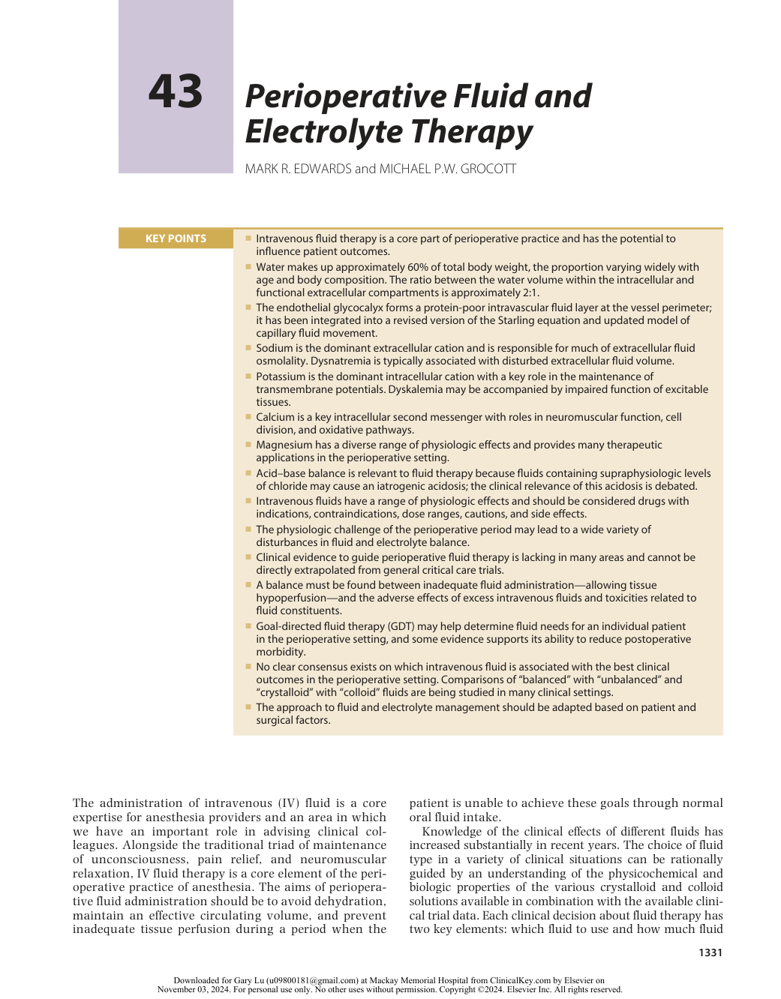

:::

<!-- PDF page 2 -->

**Table 43.1** Age- Related Variation in Total Body Water and Extracellular Fluid as Percent of Body Weight (MULTIPLY by 10 for mL/kg)

|**Age**|**TBW (%)**|**ECF (%)**|**Blood Volume (%)**|
|---|---|---|---|
|Neonate|80|45|9|
|6 months|70|35||
|1 year|60|28||
|5 years|65|25|8|
|Young adult (male)|60|22|7|
|Young adult (female)|50|20|7|
|Elderly|50|20||

In pregnancy, blood and plasma volumes increase by 45% and 50%, respectively, by term. _ECF,_ extracellular fluid; _TBW,_ total body water. Data from Jones JG, Wardrop CA. Measurement of blood volume in surgical and intensive care practice. _Br J Anaesth_ . 2000;84(2):226–235; Chumlea WC, Guo SS, Zeller CM, et al. Total body water data for white adults 18 to 64 years of age: the Fels Longitudinal Study. _Kidney Int_ . 1999;56(1):244–252; Baarsma R, Hof P, Zijlstra WG, et al. Measurement of total bodywater volume with deuterated water in newborn infants. _Biol Neonate_ . 1992;62(2–3):108–112; and Ellis KJ, Shypailo RJ, Abrams SA, et al. The reference child and adolescent models of body composition. A contemporary comparison. _Ann N Y Acad Sci_ . 2000;904:374–382.

to give. Recently, several clinical studies have changed our concepts regarding both these questions. However, we should be cautious about overinterpreting data from nonperioperative contexts. Despite recent high- quality “mega- trials” involving thousands of critically ill patients, key questions remain unresolved in the perioperative setting. Goal- directed fluid therapy (GDT) is a good example of an intervention that is effective in the perioperative phase, but ineffective in established critical illness, and this should alert us to other possible similar distinctions. This chapter reviews the physiology and pharmacology of IV fluid therapy in humans and discusses the impact of fluid and electrolyte management and alternative approaches on clinical outcomes.

## Physiology

### FLUID COMPARTMENTS

Water makes up approximately 60% of total body weight in the average adult, the proportion varying with age, sex, and body composition. Adipose tissue contains little water compared with other tissues, leading to marked variability in total body water (TBW) proportion between lean (75%) and obese (45%) individuals. Variation in adipose tissue also contributes to differences in TBW between adult males and females; these differences are reduced in old age as adipose tissue is reduced. Variations in body composition that occur with age also lead to a wide variation in TBW (Table 43.1). TBW is divided between anatomic and functional fluid compartments within the body, with the major division being between intracellular fluid (ICF) and extracellular fluid (ECF). The size of these compartments and their widely differing compositions are shown in Fig. 43.1 and Table 43.2. The ECF can be subdivided into the following compartments:

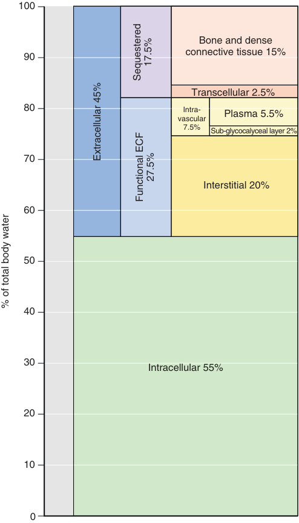

100 Bone and dense connective tissue 15% 90 Transcellular 2.5% 80 Intra- Plasma 5.5% vascular 7.5% Sub-glycocalyceal layer 2% 70 Interstitial 20% 60 50 40 30 Intracellular 55% 20 10 0 17.5% Sequestered Extracellular 45% 27.5% Functional ECF % of total body water 

**Fig. 43.1 Distribution of total body water between fluid compartments.** “Sequestered” extracellular fluid (ECF) refers to water associated with bone and dense connective tissue or within the transcellular compartment and therefore not immediately available for equilibration with the other fluid compartments.

- Interstitial fluid (ISF): Lymphatic fluid and protein- poor fluid occupying cell spaces.

- Intravascular fluid: Plasma volume, including a proportion contained within the subglycocalyx (see later discussion).

- Transcellular fluid: Includes gastrointestinal (GI) tract fluid, bile, urine, cerebrospinal fluid, aqueous humor, joint fluid, and pleural, peritoneal, and pericardial fluid. These are functionally important fluids of widely varying composition contained within epithelial- lined spaces and regulated by active cellular transport (Table 43.3).

- Water in bone and dense connective tissue: Constitutes a substantial proportion of TBW but not part of the functional ECF because of slow kinetics of water distribution between this and other compartments.1

Total blood volume comprises extracellular (plasma and subglycocalyx compartments) and intracellular (blood cells) elements. With the nonfunctional ECF compartment (bone and connective tissue) excluded, the ratio between

::: details 原始表格與符號（PDF 第 2 頁）

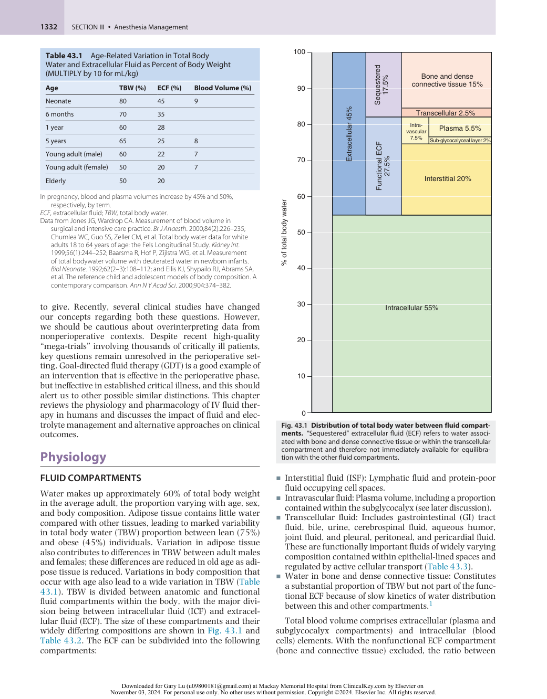

:::

<!-- PDF page 3 -->

ICF and functional ECF is approximately 2:1 (ICF 55% of total body water compared to ECF 27.5%).

### PHYSICOCHEMICAL LAWS GOVERNING FLUID AND ELECTROLYTE MOVEMENT

The movement of water and solutes is governed by a variety of physicochemical and biologic processes, discussed in the following section.

|**Table 43.2**  Extracellular|Composition of Fluid Compartm|Intrace ents (in|llular and mOsm/L **EXTRA**| Water) **CELLULAR**|
|---|---|---|---|---|
||**Intracellular**|**Intrav**|**ascular**|**Interstitial**|
|**CATIONS**|||||
|Na+|10|142||145|
|K+|157|4||4|
|Ca2+|0.5*|2.5||2.5|
|Mg2+|20|0.8||0.7|
|**ANIONS**|||||
|Cl−|10|103||117|
|HCO3−|7|25||27|
|HPO42−/H2PO4|− 11|2||2|
|SO42−|1|0.5||0.5|
|Organic acids||6||6|
|Protein|4|1.2||0.2|

*Total intracellular Ca2+ concentration may be as high as extracellular levels; however, this is largely sequestered or buffered, such that the cytoplasmic ionized Ca2+ concentration is approximately 1000 times lower than extracellular fluid (0.3–2.6 μEq/L). The intracellular content of anions such as PO43− has been difficult to establish for similar reasons. Data from Campbell I. Physiology of fluid balance. _Anaesth Intensive Care Med_ . 2009;10(12):593–596; Hoffer LJ, Hamadeh MJ, Robitaille L, et al. Human sulfate kinetics. _Am J Physiol Regul Integr Comp Physiol_ . 2005;289(5):R1372–R1380; and Hall JE. The body fluid compartments. In: _Guyton and Hall Textbook of Medical Physiology_ . 12th ed. Philadelphia: WB Saunders; 2010:285–300.

### Diffusion

Diffusion is the process by which solute particles fill the available solvent volume by movement from areas of high to low concentration. Diffusion also may occur across permeable membranes, according to Fick’s law of diffusion:

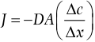

  c  J  DA     x  

where _J_ is the net rate of diffusion, _D_ is the diffusion coefficient, _A_ is the cross- sectional area available for diffusion, and Δ _c_ /Δ _x_ is the concentration (chemical) gradient. Diffusion may be augmented by the tendency of charged solutes to move down electrical gradients.

### Osmosis

If a semipermeable membrane (one that is permeable to water but not a solute) separates pure water from water in which solute is dissolved, water molecules will diffuse across the membrane into the region of higher solute concentration. The hydrostatic pressure required to resist the movement of solvent molecules in this way is osmotic pressure. This is one of the fundamental colligative properties of a solution – that is, it depends on the number rather than the type of osmotically active particles in a solution, which may be complete molecules or dissociated ions. Osmotic pressure in an ideal solution is affected by temperature and volume:

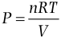

P  nRT V 

where _P_ is the osmotic pressure, _n_ is the number of particles, _R_ is the gas constant, _T_ the absolute temperature, and _V_ the volume. The number of particles _(n)_ can be calculated by multiplying (mass of solute/molecular weight of solute) by the number of particles into which the solute dissociates. However, body fluids are not ideal solutions, because interionic interactions reduce the number of particles free to

**Table 43.3** Composition of Transcellular Fluids (mEq/L Unless Stated)

||**Daily Volume (L)**||**Cat**|**ions**||**Ani**|**ons**|**pH**|
|---|---|---|---|---|---|---|---|---|
|Fluid||Na+|K+|Ca2+|Mg2+|Cl−|HCO3−||
|Gastrointestinal tract|||||||||
|Saliva|1–1.5|30–90|20–40|2.5|0.6|15–35|10–40|6–7|
|Gastric|1.5–2.5|20–60|10–20|||20–160|0|1–3.5|
|Bile|0.7–1.2|130–150|5–12|10–50||25–100|10–45|7–8|
|Pancreatic|1–1.5|125–150|5–10|||30–110|40–115|8–8.3|
|Small bowel (concentrations from proximal to distal)|1.8|140–125|5- 9|||110–60|100–75|7–8|
|Large bowel|0.2 (lost in feces)|20–40|30–90|||0–15|40|7–8|
|Sweat|0.1–0.5|45–60|5–10|||45–60|0|5.2|
|Cerebrospinal fluid||140|2.8|2.1|1.7|120||7.33|

Data from Grădinaru I, Ghiciuc C- M, Popescu E, et al. Blood plasma and saliva levels of magnesium and other bivalent cations in patients with parotid gland tumors. _Magnes Res_ . 2007;20(4):254–258; Sewón LA, Karjalainen SM, Söderling E, et al. Associations between salivary calcium and oral health. _J Clin Periodontol_ . 1998;25(11 Pt 1):915–919; and Lentner C. _Geigy Scientific Tables_ . _Vol. 1. Units of Measurement, Body Fluids, Composition of the Body, Nutrition_ . 8th ed. Basle: CibaGeigy Ltd; 1981.

::: details 原始表格與符號（PDF 第 3 頁）

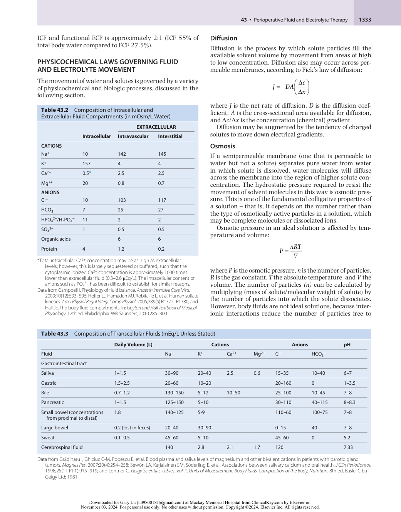

:::

<!-- PDF page 4 -->

exert an osmotic effect. The total osmotic pressure of plasma is approximately 5545 mm Hg.

### Osmolality

Molality is the number of moles (each containing 6 × 1023 particles of a _specific substance_ ) present in 1 kg of solvent. Osmolality may be used to describe solutions containing many different types of particles and is the number of osmoles (each containing 6 × 1023 of _any type of particle present_ ) present in 1 kg of solvent. Normal body osmolality is 275 to 295 mOsm/kg and is the same in intracellular and extracellular compartments because the free movement of water between compartments prevents the development of any osmotic gradients and thereby maintains an equilibrium. The largest contribution to plasma osmolality is made by sodium and its related anions, chloride and bicarbonate. Osmolality of a serum sample can be measured by depression of plasma freezing point or by vapor pressure osmometers.

_Osmolarity_ is the number of osmoles of solute per liter of solution; unlike osmolality, this may be affected by temperature changes because of the volume- expanding effect of increasing temperature. Osmolarity can be estimated if the concentrations of the predominant _in vitro_ osmotically active substances (typically measured in serum) are known:

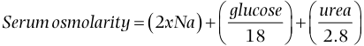

 glucose   urea  Serumosmolarity   2 xNa         18   2.8  

where Na is the serum sodium concentration (mEq/L), glucose is the serum glucose concentration (mg/dL), urea is the blood urea nitrogen concentration (mg/dL), and the (2 × Na) component reflects both Na and its associated anions (predominantly Cl− and HCO3− ).

A difference between measured osmolality and calculated osmolarity may represent the presence of abnormal solutes such as ethanol or methanol, glycols (ethylene, polyethylene, propylene), mannitol, sorbitol, or glycine.

### Tonicity

This is the effective osmolality of a solution with respect to a particular semipermeable membrane and considers solutes that do not exert an _in vivo_ osmotic effect. For example, the ions Na+ and Cl− do not cross cell membranes freely because of their associated charge and therefore exert an effective osmotic force across these membranes, whereas uncharged urea diffuses freely across cell membranes and therefore does not exert an osmotic effect here. Similarly, glucose is normally taken into cells by insulin- stimulated facilitated diffusion, so does not contribute to effective osmolality. Tonicity is important in determining _in vivo_ distribution of fluids across a cell membrane and is sensed by the hypothalamic osmoreceptors. It can be estimated by subtracting urea and glucose concentrations from measured osmolality.

### Oncotic Pressure

Oncotic pressure is the component of total osmotic pressure that is due to the colloids (see below for detailed definition): that is, large- molecular- weight particles, predominantly proteins (albumin, globulins, fibrinogen). Of the total plasma osmotic pressure of 5545 mm Hg, 25 to 28 mm Hg is due to plasma oncotic pressure. The negative charge on

proteins has the net effect of retaining a small excess of Na+ ions within the plasma (the Gibbs–Donnan effect), which effectively increases the oncotic pressure above what would be predicted by calculations based purely on protein concentration. As the most abundant plasma protein, albumin is responsible for 65% to 75% of plasma oncotic pressure.

### FLUID COMPARTMENT BARRIERS AND DISTRIBUTION

The volume and composition of each fluid compartment depends on the barriers separating it from neighboring compartments.

### Cell Membrane

The cell membrane separates the intracellular and extracellular compartments and as a lipid bilayer is impermeable to large hydrophilic molecules and charged particles such as free ions. Other than by passive diffusion of certain molecules, solutes may cross cell membranes in several ways.

### Carrier Proteins

**Primary active transPort.** Solute transport against a concentration gradient requires energy and is therefore directly coupled to adenosine triphosphate (ATP) hydrolysis – for example, by Na+ /K+ –adenosine triphosphatases (ATPases). This is the fundamental mechanism by which ionic concentration gradients are maintained, which in turn drives a variety of biologic processes, including water and solute movement and electrical impulse transmission in excitable tissues.

**secondary active transPort.** The process of secondary active transport uses concentration gradients set up by ATPases to transport a solute driven by an ion, typically Na+ , moving down its concentration gradient. This process is termed cotransport when the solute is also moving down its concentration gradient or countertransport when the solute is being moved against its concentration gradient.

**Solute Channels.** Solute channels allow much faster transport of solutes than is achieved by ATPases or transmembrane diffusion. Examples include voltage- gated Na+ channels and the glucose transporter GLUT1, which when inserted into the plasma membrane, allows glucose to travel down its concentration gradient. This process is termed facilitated diffusion.

**Endocytosis and Exocytosis.** The processes of endocytosis and exocytosis are involved in the transport of large proteins and polypeptides across cell membranes.

### Vascular Endothelium

The barrier function of the vascular endothelium is particularly relevant perioperatively because of its key role in maintaining intravascular fluid volume. Surgical tissue trauma typically leads to loss of intravascular volume through surgical blood loss or inflammation- related shifts to other tissue compartments. The physiologic effect of IV fluid administered to overcome these losses and maintain adequate tissue oxygen delivery is highly dependent on

<!-- PDF page 5 -->

### Table 43.4 Capillary Characteristics

|**Capillary Type**|**Site**|**Large Pores**|**Basement** **Membrane**|**Glycocalyx Layer**|**Notes on Function**|
|---|---|---|---|---|---|
|Nonfenestrated (continuous)|Muscle, connective tissue, lung, nervous tissue|None|Continuous|Continuous|Intercellular clefts are the main route for fluid filtration. These are partly occluded by junctional strands with multiple breaks. In the blood–brain barrier; these breaks are small (1 nm) and infrequent (zona occludens tight junctions), permitting passage of only the smallest non- lipid soluble molecules. In other tissues, the breaks are larger (5–8 nm) and more frequent (macula occludens loose junctions).|
|Fenestrated|Endocrine, gut mucosa, choroid plexus, lymph nodes|Pores within endothelial cells with covering diaphragm 6–12 nm size|Continuous|Continuous|Fenestrations allow capillary reabsorption of fluid from ISF, in contrast to other capillary types.|
||Glomeruli|Endothelial pore size up to 65 nm|Continuous|Discontinuous over pores, reducing _effective_pore size|Numerous pores allow large- volume filtration at the glomerulus. The effective pore size is reduced further to 6 nm by podocytes; thus, proteins not usually filtered.|
|Sinusoidal|Liver, spleen, bone marrow|Large intercellular gaps up to 120 nm|Discontinuous|No effective layer because of endothelial uptake of hyaluronic acid|Large fenestrations allow macromolecules (lipoproteins, chylomicrons) to pass between plasma and ISF; the result is no COP to oppose filtration, and the ISF in these tissues is effectively part of the plasma volume. Large-volume filtration to the ISF here cannot be accommodated by tissue expansion because of fibrous capsules and is returned via lymphatics (e.g., liver lymph production accounts for 50% of total body lymph production).|

_COP,_ colloid oncotic pressure; _ISF,_ interstitial fluid.

Modified from Woodcock TE, Woodcock TM. Revised Starling equation and the glycocalyx model of transvascular fluid exchange: an improved paradigm for prescribing intravenous fluid therapy. _Br J Anaesth_ . 2012;108:384.

fluid handling at the capillary level. Our understanding of this area has been refined by experimental physiologic models and techniques.

**Capillary Structure.** As shown in Table 43.4, the structure of capillaries varies depending on the underlying organ function. The most common capillary type is the nonfenestrated capillary, composed of a continuous basement membrane and a single layer of endothelial cells joined by junctions that are punctuated by breaks or clefts. These intercellular clefts are the primary channel for transcapillary fluid flow. The intravascular aspect of the endothelial cells is covered by a continuous network of glycosaminoglycan (GAG) chains, including syndecan- 1, hyaluronic acid, and glypican, associated with membrane- bound proteoglycans; and glycoproteins, together forming the endothelial glycocalyx layer (EGL). The EGL covers fenestrations and intercellular clefts and has a thickness of up to 1 μm. In addition to its functions in preventing platelet and leukocyte

adhesion, it has emerged as an important semipermeable layer contributing to endothelial barrier function.2 Water and electrolytes can move freely across the vascular endothelial barrier through the EGL and then intercellular clefts or through fenestrations in the more specialized capillaries. Proteins were previously thought to be excluded from the ISF at the level of endothelial cells; however, it now appears that this occurs at the level of the glycocalyx. The subglycocalyceal layer (SGL) therefore contains proteinpoor fluid; slower protein transport into the ISF may occur across the endothelial cells by endocytosis and exocytosis and by transport through a small number of large pores, forming a gradient in protein concentration from SGL to ISF compartments. The volume of the SGL may be as much as 700 to 1000 mL; this volume therefore forms part of the intravascular volume and has an electrolyte composition in equilibrium with the plasma but a much lower protein concentration because of the effective exclusion of larger molecules by the glycocalyx.

::: details 原始表格與符號（PDF 第 5 頁）

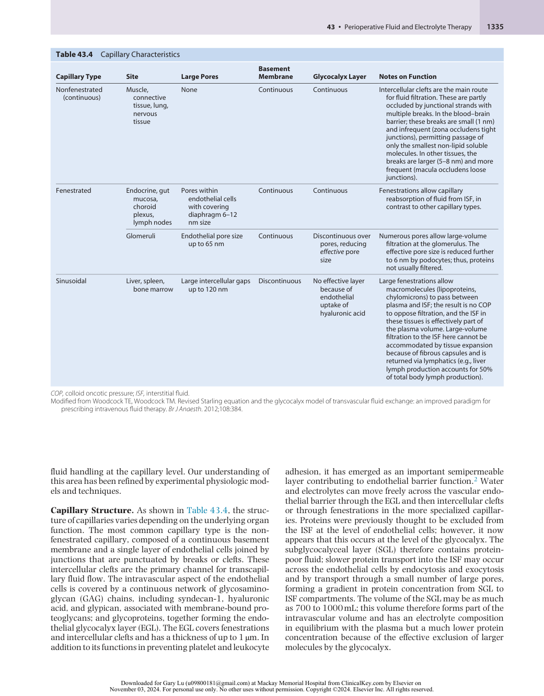

:::

<!-- PDF page 6 -->

**Capillary Function.** The movement of fluid across the capillary membrane was initially described by Starling and then further refined. A hydrostatic pressure gradient at the arteriolar end of the capillary, greater than the inward oncotic pressure gradient, leads to net filtration of water into the ISF. Much of this water was previously thought to be reabsorbed into the vascular space toward the venular end of the capillary, where the outward hydrostatic pressure is lower, and the inward oncotic pressure gradient is increased by exclusion of proteins from the capillary filtrate by the capillary endothelium. The water not reabsorbed by the capillary is removed from the ISF by the lymphatic system.

More recent experimental and modeling techniques have integrated the role of the glycocalyx into a revised Starling equation and updated model of capillary fluid movement:

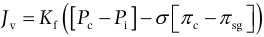

J v  K f  P c  P i   c   sg  

where _J_ v is the transcapillary flow, _K_ f is the filtration coefficient, _P_ c is capillary hydrostatic pressure, _P_ i is the interstitial hydrostatic pressure, _σ_ is the reflection coefficient (the degree to which the tendency of a macromolecule to cross the endothelial barrier is resisted), _π_ c is the capillary oncotic pressure, and _π_ sg is the subglycocalyx oncotic pressure.

The key differences and their clinical relevance are as follows3 :

- At steady state, continuous capillaries do not exhibit fluid reabsorption toward the venous end of the capillary (the “no- absorption” rule). However, overall measured capillary filtration ( _J_ v) is much less than predicted by the Starling principle, consistent with the larger colloid oncotic pressure (COP) gradient between SGL and capillary (opposing filtration) than between ISF and capillary. The smaller volume of filtrate is returned to the circulation by lymphatics.

- Plasma–SGL COP difference, not plasma–ISF COP difference, affects _J_ v. However, the no- absorption rule means that artificially raising COP (e.g., by albumin infusion) may reduce _J_ v but will not lead to reabsorption of fluid from the ISF into the plasma.

- An exception to the no- absorption rule occurs in acutely subnormal capillary pressures; a transient period of autotransfusion may occur, limited to approximately 500 mL. If subnormal pressures persist beyond this, _J_ v will approach zero, but ongoing reabsorption does not occur. Infusion of colloid in this setting will expand plasma volume, whereas infusion of crystalloid will expand total intravascular volume (plasma and EGL); _J_ v will remain close to zero in both cases until capillary pressure rises to normal or supranormal levels.

- At supranormal capillary pressures, COP difference is maintained and _J_ v is proportional to the hydrostatic pressure difference. In this setting, colloid infusion will maintain plasma COP but raise capillary pressure further and increase _J_ v. Crystalloid infusion will also increase capillary pressure but reduce plasma COP and therefore increase _J_ v to a greater extent than colloids.

The revised EGL model of fluid distribution, including the proposal that the intravascular volume effects of crystalloids and colloids are partly dependent on the preexisting

capillary pressures (context sensitivity), helps explain some of the apparently conflicting findings in clinical fluid research.

**crystalloid versus colloid intravascular volume effects.** Infused crystalloid has been thought to distribute evenly throughout the extracellular compartments as a result of capillary filtration ( _J_ v), leaving approximately onefourth or one-fifth of the original volume within the circulating blood volume, whereas colloids were presumed to initially remain largely within the intravascular volume. However, many studies of the effects of fluids on blood volume are based on red blood cell (RBC) dilution and changes in the hematocrit and do not account for the influence of the SGL volume, from which RBCs are excluded. Colloids are also excluded from the SGL; by remaining in the plasma volume, they will have a diluting effect on the hematocrit and appear to remain within the circulating volume. Crystalloids initially distribute throughout the plasma and SGL volumes. As a result, their RBC dilutional effects are less than those of colloids. This has previously been interpreted as crystalloid leaving the circulating compartment and entering the ISF; however, a proportion of the infused crystalloid will remain in the blood volume within the SGL. Furthermore, context sensitivity is responsible for the observation that clearance of crystalloid from its central compartment (the intravascular volume) is slower under anesthesia than in awake subjects.4 It may also explain why the amount of crystalloid required to get intravascular volume effects similar to colloid is in the ratio 1.5:1 rather than the predicted 4:1.5–7 The value of this ratio in the perioperative context is less clear and has been inferred from large clinical trials in critically ill patients. However, it is likely to be closer to the measured values in critical illness than the theoretic values traditionally used.

**failure to reduce edema by increasing caPillary colloid oncotic Pressure.** Hypoalbuminemia is well recognized as a marker of disease severity in critical illness. However, administering exogenous albumin or other colloids to increase capillary COP does not reduce peripheral or pulmonary edema, nor improve overall outcomes in sepsis. The no- absorption rule can provide a partial explanation, because even increasing COP gradient across the capillary wall by administration of albumin will not lead to reabsorption of fluid from edematous tissues. Again, previous studies showing apparent shifts of fluid from the interstitial to the intravascular compartment based on a reduced hematocrit after albumin infusion do not account for the potential role of compaction of the glycocalyx layer and transfer of fluid from the SGL to the plasma volume.

Finally, the importance of the endothelial glycocalyx is highlighted by studies showing that its degradation significantly impairs endothelial barrier function.8 A range of physiologic insults may lead to glycocalyx injury and shedding, with the subsequent appearance of free heparin, chondroitin, and hyaluronic acid in the plasma. These insults include natriuretic peptides (which may be released in acute excessive increased intravascular volume),9 hyperglycemia, and inflammatory mediators released during surgery, trauma, and sepsis, such as C- reactive protein, bradykinin, and tumor necrosis factor (TNF).10 Glycocalyx degradation may make an important contribution to the already well- characterized endothelial

<!-- PDF page 7 -->

dysfunction seen in inflammation, in which phenotypic changes occur in endothelial cells. Here, an increase in the number of large pores, and a reduction in interstitial hydrostatic pressure favor _J_ v, with an increase in edema in compliant tissues such as the lung, muscles, and loose connective tissue. Impaired glycocalyx function will further favor _J_ v and lead to endothelial platelet aggregation and leukocyte adhesion. Maintenance of glycocalyx integrity is therefore gaining interest as a therapeutic target in perioperative fluid management.11

### PHYSIOLOGIC CONTROL OF OVERALL FLUID BALANCE

In health, 60% of daily water loss is through urinary excretion, although this proportion is less when sweating and insensible losses are increased. Integrated cardiovascular and renal neuroendocrine mechanisms attempt to maintain fluid volume homeostasis in response to perioperative challenges, such as reduced oral fluid intake, blood loss, and IV fluid administration.

TBW volume is controlled by a system of sensors, central control, and effectors. The sensors are (1) hypothalamic osmoreceptors that respond to changes in ECF tonicity, (2) low- pressure baroreceptors in the large veins and right atrium that sense central venous pressure (CVP), and (3) high- pressure baroreceptors in the carotid sinus and aortic arch that sense mean arterial pressure. The sensory inputs are integrated within the hypothalamus, which then triggers either increased water intake from thirst or increased water output via antidiuretic hormone (ADH, arginine vasopressin) secretion. Thirst and ADH release may be triggered by increased plasma tonicity, hypovolemia, hypotension, and angiotensin II. ADH release may also be stimulated by stress (including surgery and trauma) and certain drugs (e.g., barbiturates). Water intake does not normally depend on thirst because of social drinking behavior; thirst acts as a backup mechanism when normal intake is inadequate. ADH, produced in the hypothalamus and released from the posterior pituitary, acts on the principal cells of the renal collecting ducts, which in the absence of ADH are relatively impermeable to water. ADH binds to vasopressin 2 (V2) receptors on the basolateral membrane of the cells, triggering cyclic adenosine monophosphate (cAMP)- mediated insertion of aquaporin 2 water channels into the apical membrane. This results in water reabsorption down its osmotic gradient and formation of concentrated urine.

### Acute Disturbances in Circulating Volume

Acute variation in the intravascular volume leads to compensatory mechanisms over minutes to hours to correct the acute abnormality. The homeostatic processes occurring in response to rapid blood loss serve to minimize changes in effective blood volume (venoconstriction and mobilization of venous reservoirs, limited autotransfusion from ISF to plasma, reduced urine production) and maintain cardiac output and arterial pressure (tachycardia, increased inotropy, and vasoconstriction). The sensor organs for the acute change are the low- pressure and highpressure baroreceptors, and initial changes are mediated through increased sympathetic outflow. Renal vasoconstriction leads to a reduced volume of filtrate and activates

the renin–angiotensin–aldosterone (RAA) axis. Renin is released from the juxtaglomerular cells and cleaves angiotensinogen to form angiotensin I, which is rapidly converted to angiotensin II. This induces further sympathetic activity, vasoconstriction, aldosterone release from the adrenal cortex, and hypothalamic ADH production. The overall result is increased renal salt and water retention, increased peripheral vascular resistance, and increased cardiac output. In the absence of ongoing loss, the delayed responses to major blood loss restore plasma volume within 12 to 72 hours, increase hepatic plasma protein synthesis, and restore RBC levels by erythropoiesis within 4 to 8 weeks.

Conversely, the rapid infusion of fluid to a normovolemic healthy adult leads to an initial rise in venous and arterial pressure and cardiac output. Several mechanisms act rapidly to bring these cardiovascular parameters toward normal, including pressure receptor- mediated venodilation and venous blood pooling and reduction in systemic vascular resistance. At a tissue level, autoregulatory responses lead to arteriolar vasoconstriction to maintain constant blood flow in the face of increased perfusion pressure. Multiple mechanisms then act to return circulating volume toward normal. A proportion of the infused fluid will be lost because of capillary filtration, particularly if the infused fluid reduces COP. Low- pressure baroreceptor stimulation leads to a decrease in pituitary ADH secretion, allowing diuresis, and atrial stretch leads to atrial natriuretic peptide (ANP) release, favoring natriuresis. Further ADH- independent renal mechanisms include glomerulotubular imbalance resulting from the marginal reduction in plasma COP; this rapidly increases the glomerular filtration rate (GFR) and reduces proximal tubule water and Na+ reabsorption, increasing urine volume. Finally, increased arterial blood pressure promotes the excretion of excess water and salt (i.e., pressure natriuresis and pressure diuresis). This is the pressure–volume control mechanism, one of the key mechanisms for the long- term maintenance of normal blood volume. However, arterial blood pressure is only slowly restored by cardiovascular reflexes after acute hypervolemia. It may take several days for a 20 mL/kg dose of isotonic salt solution to be fully excreted. Excretion of excess Na+ and water depends more on these passive processes and suppression of the RAA axis than on natriuretic peptide activity.12 The contrast between this inefficiency and the rapid, effective mechanisms for dealing with reduced fluid volume and Na+ content probably reflects the evolution of human physiology in environments with a paucity of salt and variable water availability; excess Na+ intake is a feature of modern diets.

### Long- Term Control of Circulating Intravascular Volume

The Guyton–Coleman model is the archetypal representation of the circulation. Despite calls to refine the mathematic modeling of the long- term control of arterial blood pressure, it remains the most widely used model to explain the chronic control of blood volume and arterial pressure.13–15 In health, short- term variations in blood volume are very small and the cardiovascular system behaves as a closed system with arterial pressure a product of peripheral resistance, vascular compliance, and cardiac output determined by the Starling curve.16 In the chronic setting or in acute

<!-- PDF page 8 -->

alterations in blood volume, as described earlier, the circulating volume will vary and equality of input and output must be restored to avoid chronic fluid retention or dehydration; thus, the circulation acts as an open system. The kidneys are the primary organ regulating this equilibrium, largely through pressure natriuresis and diuresis. Indeed, in the chronic setting, arterial pressure subserves the renal requirement to excrete ingested Na+ and water rather than simply being a product of cardiac output, vascular compliance, and resistance. A recent interpretation integrates the Guyton–Coleman model with experimental observations (Fig. 43.2).16 In health, the pressure–natriuresis curve is relatively flat, and excess intake of salt and water can be excreted without long- term rises in circulating volume or blood pressure. In many models of chronic hypertension, the renal excretion mechanism is reset such that natriuresis occurs only at higher arterial pressures and excessive exogenous water and salt results in higher blood pressure.

### ELECTROLYTE PHYSIOLOGY

### Sodium Physiology

Na+ is the dominant extracellular cation, and along with its associated anions, accounts for nearly all the osmotically active solute in plasma and interstitial fluid. The relatively free movement of water throughout the fluid compartments means that Na+ is therefore the prime determinant of ECF volume. Total body Na+ content is approximately 4000 mmol, of which only 10% is intracellular. The concentration gradient between the intracellular and extracellular compartments (ratio 1:15) is maintained by ATPases and is vital for the function of excitable tissues, including action potentials and membrane potentials, and for the handling of renal solute.

Na+ intake is typically far more than minimum daily requirements, which are 2 to 3 mEq/kg/day at birth and decrease to 1 to 1.5 mEq/kg/day in adulthood.17,18 Na+ is actively absorbed from the small intestine and colon under the influence of aldosterone and the presence of glucose in the gut lumen. Loss is predominantly by the renal route, with minor contributions from feces, sweat, and skin (10 mEq/day each). Na+ is freely filtered at the glomerulus, of which 99.5% is reabsorbed, mainly at the proximal convoluted tubule. Serum Na+ concentrations are maintained within a tight range (138–142 mEq/L) despite wide variation in water intake by the systems involved in the control of circulating volume outlined previously:

- hypothalamic osmoreceptor: ADH release

- atrial volume sensing: ANP release

- juxtaglomerular apparatus (renal arteriolar baroreceptor and filtrate NaCl content sensing): RAA activation

The excretion of total body excess Na+ relies on inefficient passive mechanisms, particularly the pressure–volume effect. Long- term ingestion of excess salt combined with low potassium ingestion contributes to hypertension, a condition not seen in populations with daily salt intake less than 50 mmol. The mechanism involves renal salt retention and initial extracellular volume expansion (later mitigated by pressure natriuresis), with release of an endogenous digitalis- like factor and stimulation of renal Na+ pumps, furthering renal Na+ retention. Low K+ combined with

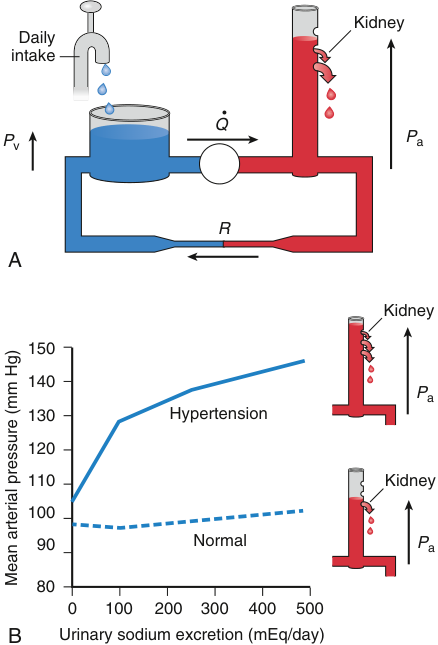

Kidney Daily intake • Q P v P a R A Kidney 150 140 P a 130 Hypertension 120 110 Kidney 100 90 Normal P a 80 0 100 200 300 400 500 B Urinary sodium excretion (mEq/day) Mean arterial pressure (mm Hg) 

**Fig. 43.2 Long- term control of blood volume in health and hypertension.** (A) Representation of the open circulation model. In the chronic setting, arterial pressure ( _P_ a) depends on daily water and sodium intake ( _dripping tap_ ) and the renal pressure–natriuresis relationship ( _represented by the height of the holes in the arterial column_ ) rather than cardiac output ( _Q_&#95;.&#95; ) and peripheral resistance ( _R_ ). (B) Experimental models of hypertension (e.g., long- term angiotensin II infusion) with controlled sodium intake (and therefore excretion) demonstrate a reset pressure–natriuresis curve in hypertension. This may be represented by kidney _holes_ positioned further up the arterial column. Natriuresis occurs to a degree similar to that in normotension, so as to maintain a stable body water volume, but requires a higher arterial pressure to do so. _P_ v, venous pressure. (A, Redrawn from Dorrington KL, Pandit JJ. The obligatory role of the kidney in long- term arterial blood pressure control: extending Guyton’s model of the circulation. _Anaesthesia._ 2009;64:1218. B, Data from Hall JE. The kidney, hypertension, and obesity. _Hypertension._ 2003;41:625.)

the chronic action of digitalis- like factor inhibits vascular smooth muscle cell Na+ /K+ ATPases, resulting in excess Na+ and reduced K+ intracellularly, smooth muscle contraction, and increased peripheral vascular resistance.19

### Potassium Physiology

K+ is the dominant intracellular cation in the body, with a total body content of approximately 4000 mmol, 98% of which is intracellular, particularly in muscle, liver, and RBCs. The ratio of ICF to ECF K+ balance is vital in the maintenance of cellular resting membrane potentials, and K+ therefore has a key role in the behavior of all excitable tissues. Daily requirements reflect age and growth, with more K+ required at higher metabolic rates. Term infants require 2 to 3 mEq/kg/day and adults 1 to 1.5 mEq/kg/day. Nearly all ingested K+ is absorbed by the intestine, and minimal amounts are excreted in feces. The acute and chronic

<!-- PDF page 9 -->

handling of K+ must therefore maintain a stable plasma K+ concentration and resting membrane potential in the face of a daily K+ intake of a similar magnitude to the entire ECF K+ content. Transmembrane potentials particularly depend on K+ permeability, with K+ egress occurring through ion channels down its concentration gradient. This leaves behind intracellular anions, with a resultant negative transmembrane potential. The resting value of this potential is achieved when the tendency of K+ to move extracellularly because of its concentration gradient is matched by the tendency of K+ to move intracellularly because of the electrical gradient.

Acute K+ distribution involves shifts in K+ between the ECF and ICF, performed by ion transport systems under the influence of insulin, catecholamines, and ECF pH. The cell membrane Na+ /K+ ATPase exports three Na+ for every two K+ imported and is how the gradients of these ions are maintained. Insulin, released after ingestion of K+ - containing food, stimulates the Na+ /H+ antiporter, increasing intracellular Na+ , which is then removed by Na+ /K+ ATPase with the net cellular uptake of K+ . Conversely, in the presence of hypokalemia, skeletal muscle expression of Na+ /K+ ATPase is reduced, allowing a “leak” of K+ from the ICF to ECF.20 Catecholamines activate β2- adrenoceptors, which ultimately stimulate Na+ /K+ ATPase activity, leading to increases in ICF K+ , a mechanism that counteracts the release of K+ from muscle cells during exercise.21 ECF pH also has a bearing on K+ handling. The presence of mineral organic acids (where the acid anion is unable to diffuse into the cell) leads to increased cellular H+ uptake in exchange for K+ ions, with consequent increases in ECF K+ . Organic acids (e.g., lactic acid and ketone bodies) are more able to diffuse across cellular membranes so the H+ / K+ exchange is much less. Hyperkalemia may be observed in the setting of organic acidemia resulting from alternative mechanisms, such as insulin deficiency and osmotic drag in diabetic ketoacidosis or a failure of ATP production for Na+ / K+ ATPase in situations typified by anaerobic metabolism and lactic acidosis. Other factors that may influence ECF to ICF K+ balance include aldosterone (which at high levels may induce intracellular K+ shift, beyond its renal effects), hyperosmolar states (solvent drag of K+ along with water efflux), and digoxin (inactivates Na+ /K+ ATPase and may cause hyperkalemia).

Chronic K+ distribution involves renal mechanisms. K+ is freely filtered at the glomerulus, and undergoes extensive unregulated reabsorption along the proximal tubule, with only 10% to 15% reaching the distal nephron, where its reabsorption or secretion is tightly controlled. This occurs predominantly in two cell types found in the collecting ducts.

**Principal Cells.** Principal cells can secrete K+ under the electrochemical gradients set up by basal Na+ /K+ ATPases, which maintain low intracellular Na+ concentrations (aiding Na+ reabsorption from the tubule via Na+ channels) and high intracellular K+ concentrations (favoring K+ secretion into the tubule via K+ channels). Principal cell behavior is influenced by the following:

- Aldosterone, synthesized and released by the adrenal glands in response to raised K+ concentrations. This mineralocorticoid increases the synthesis and activity of both

- basal Na+ /K+ ATPases and luminal K+ channels to drive urinary K+ secretion.

- Tubular Na+ delivery. Increased distal tubular Na+ content leads to a steeper Na+ concentration gradient and increased principal cell reabsorption of Na+ . To maintain electroneutrality of the tubular fluid, K+ efflux into the tubule increases; this is partly responsible for the hypokalemia associated with diuretics that increase delivery of Na+ to the cortical collecting ducts (thiazides and loop diuretics). In contrast, amiloride blocks the principal cell luminal Na+ channel and therefore does not affect K+ efflux here.

**Intercalated Cells.** In addition to basal Na+ /K+ ATPases, these cells have luminal H+ /K+ ATPases that excrete one hydrogen into the tubule for every K+ reabsorbed. Low K+ settings lead to upregulation of this luminal antiporter, reabsorbing more K+ at the expense of renal acid loss.

In addition to mechanisms involving aldosterone in a feedback loop, it is likely that feedforward mechanisms also exist to rapidly modulate renal K+ handling when K+ is sensed in the GI system, even before plasma K+ levels rise.20

### Calcium Physiology

Beyond its role in bone structure, where 98% of body calcium (Ca2+ ) is stored, Ca2+ is one of the body’s most important intracellular second messengers, playing a key role in muscular contraction, neuromuscular transmission, cell division and movement, and oxidative pathways. Intracellular Ca2+ entry may have direct effects in cardiac and skeletal muscle contraction – for example, leading to neurotransmitter release or inducing further large- scale release of Ca2+ from intracellular stores (Ca2+ - induced Ca2+ release). A large ECF- to- ICF gradient of ionized Ca2+ is maintained by ATPases, and cytoplasmic free Ca2+ levels are kept low by pumping into the sarcoplasmic reticulum. Increases in cytoplasmic Ca2+ concentration occurring as a result of cellular energetic failure and impaired Ca2+ transport are a key mediator of cell death pathways.22 Ca2+ also plays a key role in coagulation by linking coagulation factors to the negatively charged plasma membrane of activated platelets.

Homeostatic mechanisms maintain serum Ca2+ concentrations between 4.5 and 5 mEq/L (8.5–10.5 mg/dL), largely under the influence of vitamin D and parathyroid hormone (PTH). Ionized Ca2+ is sensed by the extracellular domain of a G- coupled receptor expressed on parathyroid cells (the Ca2+ /Mg2+ - sensing receptor), inhibiting PTH release.23 When ionized Ca2+ levels decrease, PTH is rapidly released with the following actions:

- Stimulates osteoclast bone resorption, releasing Ca2+ into the ECF

- Stimulates distal tubule calcium reabsorption

- Stimulates the renal conversion of 25- (OH)- vitamin D to 1,25- (OH)2- vitamin D (calcitriol, the most active vitamin D metabolite)

The manufacture of active vitamin D involves cholecalciferol formation in the skin during exposure to ultraviolet light, which then undergoes hepatic hydroxylation to 25- hydroxy- calciferol, then renal hydroxylation under the influence of PTH to 1,25- dihydroxycalciferol (calcitriol). As

<!-- PDF page 10 -->

with PTH, this stimulates osteoclastic bone resorption and additionally stimulates absorption of Ca2+ from the GI tract.

Ca2+ homeostasis is interlinked with that of other anions. Magnesium is also able to modulate PTH levels, and hypocalcemia and hypomagnesemia frequently coexist. The homeostasis of phosphate (PO43− ) is effectively the converse of Ca2+ (e.g., renal hydroxylation of vitamin D is inhibited by hyperphosphatemia), and in health the (calcium × phosphate) product is kept relatively stable. An increase in the (calcium × phosphate) product may be seen in advanced chronic kidney disease and is associated with ectopic bone deposition.

Approximately 50% of circulating Ca2+ is in the biologically active ionized form (the remaining 40% are bound to proteins, predominantly albumin and globulins, and 10% are complexed to anions such as HCO3− , citrate, sulfate, PO43− , and lactate). Hypoalbuminemia decreases the total serum Ca2+ but has less effect on the biologically important ionized form. To calculate the corrected total Ca2+ concentration, 0.8 mg/dL is added per 1 g/dL decrease in albumin concentration below 4 g/dL. The degree of albumin- protein binding is affected by pH, with acidemia reducing protein binding and increasing the ionized fraction. Ionized Ca2+ rises by approximately 0.1 mEq/L per 0.1 decrease in pH.24 Given the approximate nature of corrected total Ca2+ , biologically active ionized Ca2+ should be measured when possible.

Specimens should ideally be taken without the use of a tourniquet, because local acidosis increases the ionized fraction.

### Magnesium Physiology

Mg2+ has a diverse range of cellular actions, including modulation of ion channel activity and as an essential component of ATP production and hydrolysis. It is primarily located intracellularly, where it is sequestered within organelles, bound to phospholipids, proteins, and nucleic acids. Free ionized Mg2+ levels within the cytoplasm and ECF are therefore low (0.8–1.2 mM), and chemical concentration gradients are much less than for other anions. Of total body Mg2+ , 50% is within bone, 20% within muscle, and the rest in liver, heart, and other tissues. Only 1% is within the ECF, and normal plasma levels may be maintained in the face of total body Mg2+ depletion. Within the plasma, total Mg2+ concentration is 1.5 to 2.1 mEq/L, of which approximately 25% is protein (mostly albumin) bound, 65% is in the biologically active ionized form, and the remainder is complexed to phosphates, citrates, and other anions.25 Measurement of ionized Mg2+ can be performed, although correction is required for interference from Ca2+ ions.26 The key roles of Mg2+ (Table 43.5) highlight its diverse range of clinical applications when administered exogenously and stem from the following three main cellular actions:

|**Table 43.5**|Physiologic Roles of|Magnesium|
|---|---|---|
|**System**|**Effect**|**Mechanism and Clinical Relevance**|
|Neurologic|Reduction in pain transmission|NMDA antagonism. Mg2+treatment provides effective perioperative analgesia.250|
||Reduces neuromuscular transmission|Inhibition of neuronal Ca2+influx reduces neuromuscular junction ACh release (and motor end- plate sensitivity to ACh). Hypermagnesemia potentiates the effects of neuromuscular blockade.|
||Sympatholysis|Inhibition of neuronal Ca2+influx reduces catecholamine release from adrenal medulla and adrenergic nerve endings. Pharmacologic use of Mg2+to blunt the pressor response to intubation or during surgery for pheochromocytoma.|
||Anticonvulsant Cortical depression at high levels|Mechanism may relate to NMDA antagonism or cerebral arteriolar vasodilation, possible mechanisms for its efficacy in eclampsia, in which vasospasm has been observed.27|
|Cardiovascular|Vasodilation|Predominantly arteriolar, because of inhibition of Ca2+influx- mediated vascular smooth muscle contraction. Mg2+administration typically leads to a minor reflex increase in inotropy despite the direct action of Mg2+ on reducing cardiac contractility.251|
||Antiarrhythmic effects|Mixed class IV (Ca2+channel inhibition) and weak class I (Na+channel inhibition) effects. Increases atrioventricular nodal conduction time and refractory periods, suppresses accessory pathway transmission, and inhibits early and delayed afterdepolarizations. Clinical use is in supraventricular tachycardias, atrial fibrillation rate control and postoperative prophylaxis, and tachyarrhythmias associated with dyskalemia, digoxin, bupivacaine, or amitriptyline.27|
||Improved myocardial O2supply- to- demand ratio|Coronary vasodilation in combination with reductions in heart rate and contractility; however, no clear evidence of benefit in the setting of acute myocardial infarction.|
|Respiratory|Bronchodilation|Smooth muscle relaxation. Pharmacologic use of Mg2+is in acute bronchospasm.|
|Renal|Renal vasodilation and diuresis|Ca2+antagonism- related smooth muscle relaxation|
|Immune|Anti- inflammatory Adaptive immunity|Pharmacologic doses of magnesium sulfate reduce monocyte inflammatory cytokine production.252 Mg2+is required as a second messenger during T- lymphocyte activation.253|
|Obstetric|Tocolysis|May be due to smooth muscle relaxation.|

ACh, acetylcholine; NMDA, _N_ - methyl- d- aspartate.

::: details 原始表格與符號（PDF 第 10 頁）

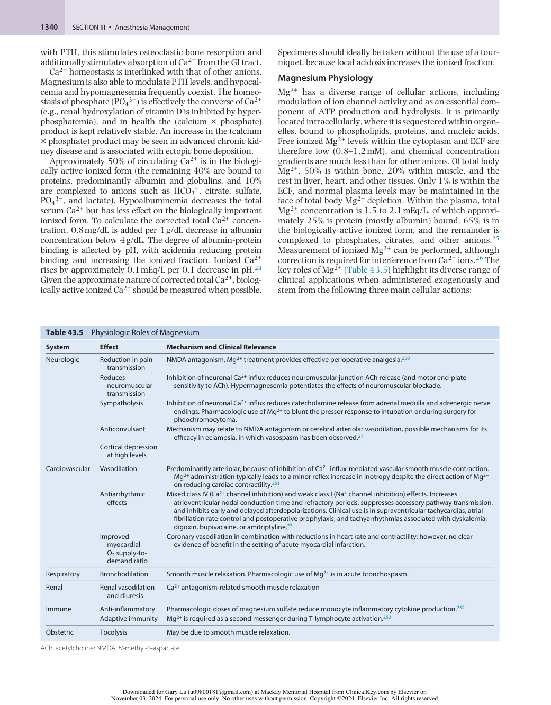

:::

<!-- PDF page 11 -->

1.  Energy metabolism: Mg2+ is required for ATP phosphorylation reactions, interacting with the outer two PO43− groups of ATP. Intracellular Mg2+ deficiency therefore impairs any enzyme systems using high- energy PO43− bonds, such as glucose metabolism.25

2.  Nucleotide and protein production: Mg2+ acts as a cofactor in every step of DNA transcription and replication and messenger RNA (mRNA) translation.

3.  Ion transport: by supporting the activity of ion- pumping ATPases, Mg2+ helps maintain normal transmembrane electrochemical gradients, effectively stabilizing cell membranes and organelles. In addition, effects on ion _channels_ underlie one of the core functions of Mg2+ : namely, physiologic competitive antagonism of Ca2+ . This is mediated through inhibition of L- type Ca2+ channels and extracellular local modification of the membrane potential, preventing the intracytoplasmic influx of Ca2+ from both the ECF and intracellular sarcoplasmic reticulum stores. Mg2+ also effectively antagonizes _N_ - methyl- d- aspartate (NMDA) receptors within the central nervous system, reducing Ca2+ entry by specific ion channels. These effects result in inhibition of a diverse array of excitable tissue cellular actions, including neurotransmitter release, muscular contraction, cardiac pacemaker and action potential activity, and pain signal transmission.

Mg2+ is absorbed from the GI tract by a saturable transport system and passive diffusion, in quantities inversely proportional to the amount ingested. Excretion is via the GI tract (∼60% of the ingested amount) and kidneys. Seventyfive percent is freely filtered at the glomerulus, and proximal tubule reabsorption is minimal, with 60% to 70% being reabsorbed at the thick ascending loop of Henle and 10% reabsorbed under regulation in the distal tubule. The regulation of total body Mg2+ levels by GI uptake and renal excretion is not under the control of a well- defined hormonal feedback loop. Although many factors can influence Mg2+ reabsorption (particularly PTH but also calcitonin, glucagon, acid–base balance, Ca2+ and K+ levels), the main determinant is the plasma Mg2+ concentration, sensed by Ca2+ /Mg2+ - sensor receptors present on the basal aspect of thick ascending loop cells. Catecholamines, acting by both α- and β- adrenoreceptors, and glucagon lead to extrusion of magnesium from intracellular stores. Although experimental models have shown that adrenergic stimulation may increase serum Mg2+ concentrations, decreases in serum Mg2+ concentrations actually occur after stressors such as surgery, trauma, burns, and sepsis.25,27 This may be due to a later phase of catecholamine- driven cellular uptake after the initial Mg2+ efflux.28

### Phosphate Physiology

PO43− is the most abundant intracellular anion and helps form some of the most important biologic molecules, including ATP, DNA, and RNA, membrane phospholipids, 2,3- diphosphoglycerate (2,3- DPG), and hydroxyapatite in bone. PO43− is therefore required for energy metabolism, cellular signaling through phosphorylation reactions, cellular replication and protein synthesis, membrane integrity, and O2 delivery. In addition, the PO43− buffer system is one of the key intracellular buffers. Of total body phosphorus, 80%

to 90% is stored in bone, with the remainder in the intracellular (soft tissues and erythrocytes) and extracellular fluid compartments.29 Normal plasma inorganic phosphates are maintained at 3 to 5 mg/dL, and at normal pH; 80% exists in the divalent (HPO42− ) rather than monovalent (H2PO4− ) form. Plasma phosphates also include lipid phosphates and organic ester phosphates. Most intracellular PO43− is organic.18

The typical daily intake of PO43− (∼1 g) outweighs metabolic requirements, yet 70% is absorbed, leading to postprandial increases in serum PO43− levels that are rapidly dealt with by increased renal excretion. GI uptake occurs predominantly by paracellular diffusion and is unregulated unless PO43− ingestion is reduced, when vitamin D and PTH- stimulated active transport intervene.30,31 Plasma inorganic PO43− is freely filtered at the glomerulus, 80% of which is reabsorbed in the proximal tubule and a smaller amount in the distal tubule. Proximal tubule reabsorption is via Na+ - dependent cotransporters, the expression and activity of which are under the influence of PTH and PO43− intake.

The regulation of normal PO43− levels is mediated primarily by the PTH and vitamin D systems. Low plasma PO43− levels stimulate 1- hydroxylase activity, with the formation of active vitamin D (1,25- dihydroxycalciferol), which increases GI and renal PO43− absorption. Conversely, PTH release (stimulated by reduced plasma Ca2+ ) reduces renal PO43− reabsorption. PO43− plasma levels also may be reduced in the short term by cellular uptake in response to dopamine and adrenergic activity and alkalosis and intestinal factors (phosphatonins) released in response to increased intestinal luminal PO43− .29

### Chloride Physiology

As the second most abundant electrolyte in the extracellular compartment, chloride (Cl− ) has a key role in the maintenance of plasma osmolality, preservation of electrical neutrality, and acid–base status (explained by the Stewart model, see later discussion). Normal plasma values are 97 to 107 mEq/L; Cl− is therefore responsible for nearly a third of plasma osmolality and two-thirds of plasma negative charge.32 Most Cl− intake is derived from dietary NaCl. The GI tract absorbs and secretes large amounts of Cl− , primarily as gastric hydrochloric acid, but also throughout the intestinal lumen. This cellular Cl− secretion leads to paracellular movement of Na+ into the lumen, with water moving down its osmotic gradient to form GI secretions. Cl− excretion is primarily renal, largely in the proximal tubule by passive reabsorption or cotransport. More regulated control of Cl− excretion is performed in the intercalated cells of the distal nephron under the influence of plasma acid–base balance by exchange of HCO3− for Cl− .

### ACID–BASE DISTURBANCES AND FLUID THERAPY

Acid–base balance in general is discussed in Chapter 44; however, the two key areas in which intravascular fluid therapy may affect acid–base balance are iatrogenic acidosis caused by the administration of Cl− - rich fluids and administration of sodium bicarbonate to correct acidosis. In summary, the interpretation of acid–base balance can be

<!-- PDF page 12 -->

viewed in three main ways: by the Henderson–Hasselbach equation, by anion gap, or by Stewart’s strong ion model. The Henderson–Hasselbach equation represents the HCO3− buffer system and has plasma HCO3− concentration as an independent determinant of plasma pH. The anion gap model is consistent with the Henderson–Hasselbach equation because it places changes in plasma HCO3− at the core of plasma acid–base balance. It represents a simple method for differentiating causes of metabolic acidosis and is defined as the difference between the most abundant _measured_ cation and anion concentrations in the plasma ([Na+ ] + [K+ ]) − ([Cl− ] + [HCO3− ]). The normal anion gap is 4 to 11 mEq/L, and this difference is represented by “unmeasured” anions (PO43− , sulfate, and anionic proteins). In the presence of excess organic acids (e.g., lactic acid or ketoacid), the accumulation of unmeasured anions is accompanied by a reduction in HCO3− , leading to an increase in the anion gap. In cases in which Cl− is administered, even if HCO3− falls, the anion gap will remain normal.33

Stewart’s model of acid–base balance has a different approach and proposes that plasma pH is dependent on the following three independent variables:

1.  PCO2 (the plasma CO2 tension)

2.  Atot, the total plasma concentration of all nonvolatile buffers (albumin, globulins, and PO43− )

3.  Strong ion difference (SID), the difference between the total charge of plasma strong cations (Na+ , K+ , Mg2+ , and Ca2+ ) and strong anions (Cl− , lactate, sulfate, and others). In a more simplified approach, apparent SID is defined as ([Na+ ] + [K+ ]) − ([Cl− ] + [lactate]). Normal plasma SID is approximately 42 mEq/L, and reductions in SID will lead to a fall in plasma pH.

The Stewart model has caused some controversy by representing HCO3− as a dependent variable,34 but it has utility in explaining acid–base disturbances caused by fluid administration.35

### Hyperchloremic Acidosis

Administration of fluid with Cl− concentration higher than that of plasma will, in sufficient quantities (e.g., 30 mL/kg/h of 0.9% saline), cause a metabolic acidosis due to the Cl− content.36 This hyperchloremic acidosis may be explained by the Henderson–Hasselbach model of acidosis, where saline infusion causes dilution of bicarbonate and a resultant base deficit, or by the Stewart model. Here, the increasing plasma Cl− concentration reduces apparent SID and therefore reduces plasma pH; the SID of completely ionized saline is zero, therefore its infusion progressively dilutes the normal plasma SID. Similar changes are not seen with solutions containing non- Cl− anions which are metabolized after infusion, such as lactated Ringer solution. Although _in vitro_ lactated Ringer solution is an electroneutral solution that has an SID of zero, following administration, the lactate is metabolized in patients with intact hepatic function, resulting in an effective _in vivo_ SID of approximately 29 mEq/L. This is slightly less than the plasma SID and is enough to counteract any alkalosis caused by dilution of Atot.

Saline- induced hyperchloremic acidosis has a variety of potentially deleterious physiologic effects. These include renal vasoconstriction, reduced GFR and reduced renin

activity in animal models,37–39 and reduced renal cortical perfusion in healthy volunteers.40 Coagulopathy and gastrointestinal dysfunction have also been suggested.41 The clinical impact of these changes is discussed below.

### Bicarbonate Administration

The administration of IV NaHCO3 to treat metabolic acidosis should be reserved for the emergency treatment of select conditions, including severe hyperkalemia and arrhythmias associated with tricyclic antidepressant overdose. In many other situations, clinical benefit is not apparent, a finding that highlights an important pathophysiologic concept. Acidosis alone may not be physiologically deleterious; indeed, it is a normal event during strenuous exercise, in which it may aid O2 offloading to tissues. Perhaps acidosis serves as a marker for the severity of underlying disease processes, such as hypoxia, ischemia, or mitochondrial dysfunction, which cause morbidity without adequate correction.41 HCO3− administration also has the following negative effects18 :

1.  Carbon dioxide production. Most of the HCO3− administered is converted to CO2, with two important consequences. First, excess CO2 requires excretion by hyperventilation. Administration of 100 mEq of HCO3− represents an excess of 2.24 L of CO2 to be exhaled, which may present a significant physiologic challenge to critically ill patients with preexisting ventilatory impairment. Although this is disputed, the excess CO2 may also diffuse into the intracellular space, aggravating intracellular acidosis.18

2.  IV HCO3− brings a significant Na+ content and therefore osmotic load. This may lead to hyperosmolar hypernatremia, ECF expansion, and volume overload.

3.  If renal HCO3− distribution is impaired, there may be an “overshoot” toward metabolic alkalosis once the underlying disease process causing the acidosis is resolved.

In situations in which HCO3− administration is required, the total dose required to correct the base deficit can be calculated using the equation:

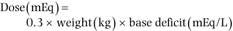

Dose  mEq   0.3  weight  kg   base deficit  mEq/L  

Although half this dose is usually given, because of the problems outlined above, treatment should stop once the pH rises above 7.2.

## Fluid Pharmacology

Given the diverse range of physiologic effects of administered fluids, and the potentially large volumes which can be administered perioperatively, they should be considered as drugs with specific indications, cautions, and side effects. Many of the fluids available currently were developed several decades ago and entered clinical practice without rigorous analysis of their clinical benefits, or knowledge of their effects at an organ or cellular level. Newer colloid solutions have been approved by regulatory authorities and entered widespread clinical usage based on relatively small trials of efficacy. In some cases,

<!-- PDF page 13 -->

safety concerns such as the impact of colloid- related renal dysfunction have only been highlighted by much later adequately powered trials.42 The composition of available fluids is shown in Table 43.6, although not all fluids are available in all countries.

### CRYSTALLOIDS

Crystalloids are solutions of electrolytes in water. They may be classified by their tonicity after infusion or their overall composition. Crystalloids containing electrolytes found in plasma and a buffer such as lactate or acetate may be referred to as balanced or physiologic solutions. Crystalloids are indicated for replacement of free water and electrolytes but also may be used for volume expansion. Conventional concepts of fluid compartments dictate that infused electrolytes will distribute freely throughout the ECF, water will follow down osmotic gradients, and the net result is a distribution of infused crystalloids throughout the entire ECF, with only 20% remaining in the intravascular compartment. This is challenged by large clinical trials and current knowledge of microvascular fluid handling (see the section on Vascular Endothelium, above), which suggest that isotonic crystalloids may have a larger intravascular volume expanding effect than suggested, particularly in patients with low capillary hydrostatic pressures. The study of volume kinetics has quantified the redistribution of crystalloids from the central (intravascular) volume to the larger peripheral (total extracellular) volume. Perhaps up to 70% of a crystalloid infusion remains in the intravascular compartment at the end of a 20- minute continuous infusion, decreasing to 50% after 30 minutes.4 Nevertheless, more fluid will ultimately be filtered out of the capillary with crystalloids than with colloids, owing to the effects of colloids on oncotic pressure. Patients resuscitated with crystalloids have a more positive fluid balance for the same volume expansion effect.43 Tissue edema may increase in compliant tissues such as the lung, gut, and soft tissues, particularly when crystalloid solutions are infused into normovolemic subjects. Large- volume crystalloid infusions also may be associated with a hypercoagulable state caused by dilution of circulating anticoagulant factors; the clinical significance of this is not currently known.44

### Saline Solutions

**0.9% Sodium Chloride.** One of the most administered crystalloids is 0.9% NaCl solution, yet it is not clear historically how it entered routine clinical practice. Although many of the crystalloids being examined for _in vivo_ clinical usage during the 1800s had a composition much closer to that of plasma, Hamburger ascertained through _in vitro_ red cell lysis experiments that 0.9% was the NaCl concentration that was isotonic with human plasma. Therefore, 0.9% saline was not initially developed with the aim of _in vivo_ administration yet has entered widespread clinical use despite having a Na+ and Cl− concentration substantially in excess of plasma.45 Its osmolarity, calculated as the sum of the solutes present, is slightly higher than that of plasma, although the osmolality (measured by freezing point depression) is 285 mOsm/kg, very similar to that of plasma. This discrepancy reflects the nonideal behavior of solutions. Both ions remain in the ECF after infusion, and it can be said

to be isotonic – that is, of a similar effective osmolarity to that of plasma with respect to the cell membrane.

A 2- L infusion of 0.9% NaCl leads to an increase in ECF volume, dilutional decrease in hematocrit and albumin, increase in Cl− and K+ concentrations, and decrease in plasma HCO3− .40 The expansion of the ECF is more persistent than with balanced crystalloid solutions. Although both fluids induce diuresis, 0.9% NaCl has a later onset, and the excess salt and water load may take multiple days for even a healthy subject to excrete.12

A 0.9% NaCl infusion leads to a hyperchloremic metabolic acidosis and reduced renal perfusion. In healthy volunteers, large- volume (50 mL/kg) saline infusions lead to abdominal discomfort, nausea, and vomiting. Studies have tried to determine the clinical impact of these changes. A systematic review and meta- analysis of studies comparing saline with balanced crystalloid perioperative fluid regimes confirmed the presence of hyperchloremia and acidosis postoperatively in the saline groups, but typically these biochemical abnormalities resolved by the first or second postoperative day.36 There were no overall differences in markers of kidney injury or need for renal replacement therapy, nor in other morbidities such as clinically important coagulopathy or gastrointestinal symptoms. However, the available trials were relatively small, and higher- risk surgical groups (patients with preexisting impairment of acid–base status or undergoing emergent or major surgery) were under- represented. Interestingly, in one trial of patients undergoing renal transplant, saline administration was associated with significant hyperkalemia, presumably caused by cellular potassium extrusion due to extracellular acidosis.46 A recent alternating cohort controlled trial in patients undergoing gastrointestinal and orthopedic surgery, receiving modest volumes of fluid, found very small differences in renal and blood transfusion outcomes in favor of balanced solutions.47 It is possible that any adverse effects of saline administration are greater in selected high- risk groups and/or when given in larger volumes. Recent large trials in the emergency department and intensive care settings showed an increase in a composite outcome of death or adverse renal event when patients were given saline rather than balanced crystalloid.48–50 Although these trials did not relate to the perioperative setting, an increasingly cautious approach to saline administration seems appropriate, unless there are compelling indications such as the following:

- Situations in which increased plasma Na+ may be beneficial, such as in the presence of cerebral edema.

- Preexisting Na+ or Cl− total body depletion, such as gastric outlet obstruction (see later discussion). However, 0.9% NaCl is not suitable for the treatment of acute severe hyponatremia, because it has little effect on plasma Na+ levels in this situation.

**Hypertonic Saline.** Solutions of 1.8%, 3%, and 7.5% NaCl are available. Their uses include:

- Plasma volume expansion: The hypertonic nature of these solutions draws water out of the intracellular compartment and into the extracellular (including plasma) volume and may therefore achieve plasma volume expansion while minimizing the volume of fluid administered.

<!-- PDF page 14 -->

|**pH (****_In_** **_Vitro_)**|7.4|6.0|||45|.|4.0||6.5|5.0|6.5|4–6.5|3.5–6|7.4|5.1–5.9|||7.4||
|---|---|---|---|---|---|---|---|---|---|---|---|---|---|---|---|---|---|---|---|
|**Notes**|SID 42|SID 0|||||||||_In vivo_SID 27||||||In vivo SID 33|||
|**Osmolarity**|285|308|616|154|252||406|283|273|525|275|294|389/363|294|309|312||†|†|
|**Other**|—|—|—|||||||||—||NaOH for pH|Maleate 5|||Stabilizer: octanoate (caprylate)|Stabilizer: octanoate (caprylate)|
|**ate** **Glucose** **(g/L)−1**|—|—|—|—|50||50|40|—|50|—|—|50|—|—|—|—|—|—|
|**Glucon**|—|—|—|—||—|—|—|—|—|—|23|—|23|—|—|—|—|—|
|**Acetate**|—|—|—|—||—|—|—|—|—|—|27|16|27|24|47|—|—|—|
|**nate** **Lactate**|1|—|—|—||—|—|—|28|28|29|—|—|—|—|8|3|—|—|
|**Bicarbo**|24|—|—|—||—|—|—|—|—|—|—|—|—|—|—|32|—|—|
|**m** **Magnesium**|2|—|—|—||—|—|—|—|—|—|3|3|3|2|3|1|—|—|
|**Calciu**|4.4|—|—|—||—|—|—|3|3|4|—|—|—|5|5|3.5|—|—|
|**ium** **Chloride**|100|154|308|77||—|77|33|109|109|111|98|40|98|127|103|109.5|†|†|
|**Potass**|5|—|—|—||—|—|—|4|4|5|5|13|5|4|10|—|—|—|
|**Sodium**|140|154|308|77||—|77|33|130|130|131|140|40|140|140|140|140|†|†|
|**Fluid**|Plasma|0.9% NaCl|1.8% NaCl|0.45% NaCl|5% dt|exrose|5% dextrose/ 0.45% NaCl|4% dextrose/ 0.18% NaCl|Lactated Ringer solution (US composition)|5% dextrose in lactated Ringer solution|Hartmann solution/ compound Na+ lactate|Plasma- Lyte 148/ Normosol- R|Plasma- Lyte 56 and 5% dextrose/ Normosol M with 5% dextrose|Plasma- Lyte A pH 7.4|Sterofundin|Plasma- Lyte R|Hemosol|4%–5% albumin|20% albumin|

::: details 原始表格與符號（PDF 第 14 頁）

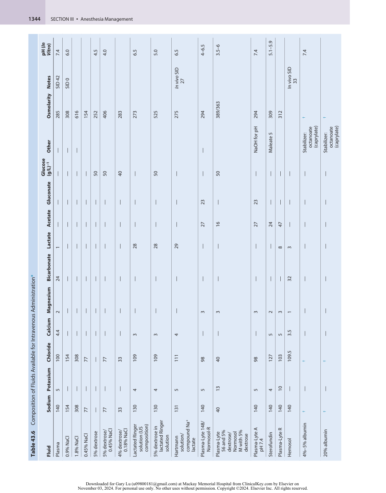

:::

<!-- PDF page 15 -->

|**y** **Notes** **pH (****_In_** **_Vitro_)**|COP 20 mm Hg 7.4|Succinylated gelatin|Succinylated gelatin|Succinylated gelatin|||||5.5|5.0||||4.0|i     , and Tetraspan, B Braun b, Canada; Hemosol, Hosptal,|
|---|---|---|---|---|---|---|---|---|---|---|---|---|---|---|---|
|**Other** **Osmolarit**|88% human albumin, 12%α- /β- globulins|MWw 30 kDa|MWw 30 kDa|MWw 30 kDa|MWw 30 kDa|MWw 35 kDa|308||309|MWw 264 kDa 326|287|||255|i   aspan, Venofundin, Sterofundin aspan from Bristol- Myers Squib|
|**ate** **Glucose** **(g/L)−1**|—|—|—|—|—|—|—|—|—|— —|—|—|—|50|i L; Gelofusine, Gel rkeley, Calif; Pent|
|**e** **Glucon**|—|—|—|—|—|—|—|—|—|— —|—|—|5|—|Deerfield, I ioTime, Be _vitro_.|
|**Acetat**|—|—|—|—|24|—|—|—|—|— —|34|27|24|—|rnational, i Hextend, B culated_in_|
|**Lactate**|—|—|30|25|—|—|—|—|—|28 —|—|—|—|—|Baxter Inte i Germany; lues are cal|
|**Bicarbonate**|—|—|—|—|—|—|—|—|—|— —|—|—|—|—|PlasmaVolume,   i , Bad Homburg, Lake Forest, IL. . Osmolarity va|
|**Magnesium**|—|—|3|1.8|2|—|—|—|—|1 —|3|2|2|—|ht. Plasma- Lyte,    i e, Fresenius- Kabi rmosol, Hospira, nt on formulation|
|**e** **Calcium**|—|—|—|—|2|12.5|—|—|—|5 —|—|1.8|5|—|olecular weig      i , and Volulyt Kingdom; No ies depende|
|**um** **Chlorid**|100|125|100|105|103|145|154|154|154|124 154|110|112|118|—|raged mean m       i plasma, Voluven n, Kent, United in solutions var|
|**Potassi**|0.25|—|5|4|4|5.1|—|—|—|3 —|4|5.4|4|—|weight- ave         i mion, Gelo plex Beaco ere stated. ty of album|
|**Sodium**|145|154|) 150|145|151|145|154|154|154|143   154|137|130|140|—|ch;_MWw,_i any); Plas gdom; Iso except wh d osmolari|
|**Fluid**|Plasmanate: Plasma protein fraction (human) 5%|Gelofusine (4%)|Plasmion/ Geloplasma (3%|Isoplex (4%)|Gelaspan (4%)|Haemaccel (polygeline)|Voluven: Waxy maize HES 6% (130/0.4)|Venofundin: Potato HES 6% (130/0.42)|Hetastarch: Waxy maize HES 6% (670/0.75)|Hextend: Waxy maize HES 6% (670/0.75) Pentaspan: Pentastarch 10%|Volulyte: Waxy maize HES 6% (130/0.4)|Plasma volume: Potato HES 6% (130/0.42)|Tetraspan: Potato HES 6% (130/0.42)|10% Dextran 40|_HES,_hydroxyethyl star (Melsungen, Germ Rugby, United Kin *Presented as mEq/L, †The NaCl content an|

::: details 原始表格與符號（PDF 第 15 頁）

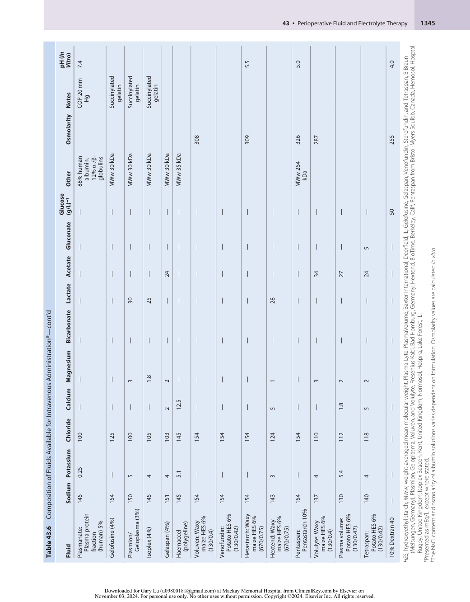

:::

<!-- PDF page 16 -->

Although it has not been studied extensively, use of hypertonic saline for trauma resuscitation, particularly in the prehospital phase, has not shown convincing benefit. In fact, one large trial showed no improvement in outcome and was stopped early.51

- Correction of hypoosmolar hyponatremia (see later discussion)

- Treatment of increased intracranial pressure: The increased plasma osmolality reduces cerebral edema and decreases intracranial pressure. Hypertonic saline may be superior to mannitol in this regard.52 However, hypertonic saline used early in traumatic brain injury without knowledge of intracranial pressure has not been shown to be beneficial in clinical trials.53

NaCl concentrations greater than 7.5% may cause endothelial damage and should therefore be administered into a central vein.

### Balanced Crystalloid Solutions

Intravenous crystalloid solutions were initially used clinically for the management of cholera in 1832 by O’Shaughnessy and Latta. The early solutions were more closely matched to physiologic plasma composition than NaCl solutions and contained 134 mEq/L Na+ , 118 mEq/L Cl− , and 16 mEq/L HCO3− .45 However, clinical interest in more balanced solutions waned until Hartmann in 1932 used a lactated modification of Ringer solution for pediatric patients with acidosis associated with hypovolemia and liver and renal failure.54 By this time, NaCl solutions were already well established for resuscitation from hemorrhage and trauma.45

Currently available balanced crystalloid solutions have lower overall osmolarity than 0.9% NaCl, with a lower Na+ concentration and much lower Cl− concentration (see Table 43.6). The reduction in anionic content is compensated for by the addition of stable organic anionic buffers such as lactate, gluconate, or acetate. The measured osmolality of balanced solutions (265 mOsm/kg) is slightly lower than that of plasma, and they are therefore mildly hypotonic. Fluid compartment distribution of balanced solutions resembles that of other crystalloids. After administration, the buffer is metabolized to produce HCO3− in equimolar quantities by entry into the citric acid cycle. Lactate undergoes predominantly hepatic oxidation or gluconeogenesis to yield HCO3− at a maximum rate of approximately 200 mmol/h.55 Acetate is normally present in trace quantities in the plasma (0.2 mM), because it is rapidly oxidized by liver, muscle, and heart to yield HCO3− at a maximum turnover of 300 mmol/h, beyond which zero- order kinetics intervene.56 A small proportion may be converted to acetoacetate. The metabolism of gluconate is less well characterized in terms of location and kinetics, but it is converted to glucose with subsequent entry into the citric acid cycle.57 Although balanced crystalloids can be constituted with HCO3− as a main anion, this is limited by two factors. First, HCO3− reacts with water to form CO2, which can diffuse out of most packaging materials. This has been addressed by some products, although availability is limited.58,59 Second, the pH shift induced by the presence of HCO3− can lead to precipitation of Ca2+ (and Mg2+ ) if present.

The excretion of the excess water and electrolyte load with balanced crystalloids is more rapid than with isotonic saline.60 This is due to the transient decrease in plasma tonicity after infusion, which suppresses ADH secretion and allows diuresis in response to the increased intravascular circulating volume. Balanced crystalloids do not reduce plasma SID to the same degree as NaCl solutions and therefore do not cause an acidosis; HCO3− concentration is maintained or slightly elevated.

Some potential negative effects have been identified with balanced crystalloid solutions. Lactated Ringer solutions contain racemic (d- and l- ) lactate, although d- lactate is only found in trace quantities _in vivo_ . Concerns that large doses of d- lactate may be associated with encephalopathy and cardiac toxicity in patients with renal failure61,62 have not been confirmed in human studies at plasma levels achievable with racemic lactated Ringer solution. The metabolism of d- lactate appears to be nearly as rapid as that of l- lactate.63 The reliance on hepatic metabolism of most of the infused lactate means that lactated solutions should be avoided in severe liver failure. Concerns over the negative effects of excess exogenous acetate have been raised in patients receiving dialysis with an acetate- based dialysate. The proinflammatory, myocardial depressant, vasodilatory, and hypoxemia- promoting effects of high acetate levels manifest as nausea, vomiting, headaches, and cardiovascular instability and have led to the removal of acetate from contemporary dialysis fluids.56,64–68 Acetate turnover is limited in patients with end- stage kidney disease and in the presence of other substrates for oxidation – for example, during lactic acidosis or proteolysis. It is therefore possible that critically ill patients or those with advanced kidney disease may exhibit biochemical acetate intolerance, although this possibility has not been explored in patients receiving acetate- based balanced crystalloids. Unlike acetate, much less is known about the effects of gluconate- containing fluids.69 Indeed, this area requires investigation at a cellular, organ, and whole organism level, particularly because data in animal studies suggested poorer outcome and late increases in lactate when acetate/gluconate- containing crystalloids were compared with lactated Ringer solution or isotonic saline for resuscitation.70

### Dextrose Solutions

Dextrose solutions have the following two main indications in the perioperative setting:

1.  As a source of free water: An infusion of 5% dextrose effectively represents administration of free water. The _in vitro_ osmolality resembles that of plasma, so the infusion does not lead to hemolysis, but soon after administration, the dextrose is taken up into cells in the presence of insulin, leaving free water. These solutions are therefore hypotonic with respect to the cell membrane and in excess can dilute plasma electrolytes and osmolality. They should therefore be used with care in the postoperative period, during which the relative syndrome of inappropriate antidiuretic hormone secretion (SIADH) leads to water retention, increasing the risk for hyponatremia (see later discussion). Nevertheless, in carefully controlled volumes and with regular monitoring of serum electrolytes, they are a useful source of free water

<!-- PDF page 17 -->

for maintenance requirements postoperatively, particularly if combined with a low concentration of NaCl. Dextrose solutions are less suitable for intravascular plasma volume expansion, because water can move between all fluid compartments, and a very small volume remains in the intravascular space.

2.  Source of metabolic substrate: Although the caloric content of 5% dextrose is inadequate to maintain nutritional requirements, higher concentrations are adequate as a metabolic substrate, such as 4000 kcal/L for 50% glucose. Glucose solutions also may be co- administered with IV insulin to diabetic patients to reduce the risk for hypoglycemia, such as 10% dextrose at 75 mL/h.

### COLLOIDS

Colloids are defined as large molecules or ultramicroscopic particles of a homogeneous noncrystalline substance dispersed in a second substance, typically isotonic saline, or a balanced crystalloid. These particles cannot be separated out by filtration or centrifugation. Although not all solutions are available in all countries, those in production include semisynthetic colloids and human plasma derivatives. Semisynthetic colloids have a range of molecular sizes (polydispersed) in contrast to human albumin solution, which contains more than 95% albumin molecules of a uniform size (monodispersed). Colloid molecules above 70 kDa are too large to pass through the endothelial glycocalyx and are excluded from the subglycocalyx layer, so their initial volume of distribution is the plasma (rather than the entire intravascular) volume (see discussion of vascular endothelium). In contrast to pure electrolyte solutions, colloids have a higher COP and minimize transcapillary filtration, particularly at low capillary hydrostatic pressures. This maximizes their potential intravascular plasma volume expansion effect. However, at normal or supranormal capillary pressures, hydrostatic pressure will be increased and transcapillary filtration will occur.3 In addition, colloid molecules may be lost from circulation in several ways: by filtration across capillaries whose barrier function is impaired by glycocalyx shedding or endothelial cell pore formation in inflammation or other stressors, by renal filtration of smaller colloid molecules, or by removal from the circulation by metabolism. Therefore, colloids have variable effective plasma half- lives, as outlined later. Colloids alter blood rheology, improving blood flow by hemodilution, which leads to reductions in plasma viscosity and red cell aggregation.44 The introduction of a large dose of semisynthetic molecules (typically 40–60 g/L) to a complex physiologic system may bring a variety of undesired effects on the immune, coagulation, and renal systems. To limit these toxicities, maximum dosages are recommended for most colloids, but adverse effects may still occur with lower doses. As the potential clinical relevance of toxicity is highlighted by large clinical trials, the use of colloids, at least in critical care, deserves increasing caution.71

### Semisynthetic Colloids

**Gelatins.** Gelatins are derived from the hydrolysis of bovine collagen, with subsequent modification by succinylation (Gelofusine, B Braun, Bethlehem, PA; Geloplasma, Fresenius, Waltham, MA) or urea- linkage to form polygeline

(Haemaccel, Piramal, Orchard Park, NY). These forms have a similar molecular weight (MW), but the succinylated version undergoes conformational change because of increased negative charges, such that it is a larger molecule. The wide range of MWs means that much of an infused gelatin bolus will rapidly leave the circulation, predominantly by renal filtration. Despite this, a recent study suggests that 60 minutes after the end of infusion, 50% of the infused fluid volume remains in the intravascular space, like larger MW colloids.72 Excretion is primarily by the renal route. In terms of negative effects, the gelatins have the least impact on clinically relevant hemostasis of all the semisynthetic colloids despite reductions in von Willebrand factor (vWF), factor VIIIc, and _ex vivo_ clot strength,73 but the highest estimated incidence of severe anaphylactic and anaphylactoid reactions (&lt;0.35%).44 The high Ca2+ content of Haemaccel is a contraindication to co- administration of citrated blood products in the same infusion set. No known cases of variant Creutzfeldt–Jakob disease transmission have occurred involving pharmaceutical gelatin preparations. Gelatins are commonly used in perioperative practice in Europe but are not approved by the US Food and Drug Administration.

**Hydroxyethyl Starches.** Hydroxyethyl starches (HESs) are modified natural polymers of amylopectin derived from maize or potato. Substitution of hydroxyethyl radicals onto glucose units prevents rapid _in vivo_ hydrolysis by amylase, and the degree of substitution both in terms of hydroxyethyl substitutions per glucose unit (maximum three) and total number of glucose units with substitutions is a determinant of HES elimination kinetics. The degree of substitution (DS) is expressed as the number of substituted glucose molecules present divided by the total number of glucose molecules present. An alternative measure of substitution is the molar substitution (MS) ratio, calculated as the total number of hydroxyethyl groups present divided by the quantity of glucose molecules. MS is used to define starches as hetastarches (MS 0.7), hexastarches (MS 0.6), pentastarches (MS 0.5), or tetrastarches (MS 0.4). The pattern of substitution may vary because hydroxyethylation can occur at carbon positions 2, 3, or 6 of the glucose unit. The substitution type is defined by the C2/C6 hydroxyethylation ratio, with a higher ratio resulting in slower starch metabolism. Starches are also classified by _in vitro_ MW into high (450– 480 kDa), medium (200 kDa), and low (70 kDa). However, HES solutions are very polydispersed and the MW quoted is an average. The size of starch molecule is responsible for both the therapeutic volume effects and adverse side effects. After administration, smaller HES molecules (&lt;50–60 kDa) are rapidly excreted and larger molecules are hydrolyzed to form a greater number of smaller molecules at a rate depending on the degree of substitution and C2/C6 hydroxyethylation ratio. The _in vivo_ MW is therefore smaller and has a narrower distribution.74 Ongoing renal excretion accounts for the elimination of smaller HES molecules, with mediumsized molecules being excreted in the bile and feces. A proportion of larger molecules, particularly those resistant to hydrolysis, are taken up by the mononuclear phagocyte (reticuloendothelial) system, where they may persist for several weeks or more.75 The prolonged metabolism of HESs means that their plasma volume effects typically last longer than those of gelatins or crystalloids. Larger MW starches

<!-- PDF page 18 -->

can increase intravascular volume by approximately 70% to 80% of the infused dose even at 90 minutes.76 Smaller MW starches with a low MS may have even larger volume effects because of the rapid initial metabolism with the formation of many oncotically active molecules,77 but studies in healthy human volunteers suggest a similar volume effect to that of gelatins.72

Starch- related side effects have been associated with adverse outcomes in critical illness. Problems such as coagulopathy, accumulation, and renal dysfunction initially appeared to be related to larger MW starches, but smaller tetrastarches are now a concern as well.

**Coagulation.** As with other synthetic colloids, HES products affect coagulation through dilutional effects in the circulation and MW- dependent reductions in vWF, factor VIII, and clot strength. The effect is most likely to occur with larger MW or slowly degraded medium MW (200 kDa/ MS 0.62 or 200 kDa/MS 0.5/C2:C6 13) HES preparations and larger amounts of perioperative blood loss. This clinical effect is less marked with more rapidly degraded medium and small MW starches.44 In patients with sepsis, even lower MW HES is associated with an increased risk of bleeding and blood transfusion, but it is unclear whether this also occurs in the perioperative setting.78–80

**Accumulation.** The accumulation of HES molecules in the mononuclear phagocyte system, skin, liver, muscle, and gut is a dose- dependent effect that gradually decreases over time. However, the accumulation may persist for several years, and larger amounts of tissue deposition are associated with pruritus.75

**Anaphylactoid Reactions.** The estimated incidence of severe anaphylactoid or anaphylactic reactions with HES products is less than with other colloids (&lt;0.06%).44

**Renal Dysfunction.** HES products with medium- to- high MW are associated with oliguria, increased creatinine, and acute kidney injury in critically ill patients with preexisting renal impairment.6,81 Although newer solutions with low MW (130 kDa/MS 0.4) were initially thought to be safer in this respect, recent large- scale trials have shown a similar effect on the need for renal replacement therapy in severe sepsis, particularly when compared with balanced crystalloids.78,79 A recent large trial in a mixed critical care population comparing HES with isotonic saline also reported an increase in renal replacement therapy with the starch solution. This study is more difficult to interpret, given the potential renal effects of saline, and the possibility that patients were given study fluids after partial resuscitation had already been achieved.43 A meta- analysis of early, small trials examining perioperative use of 6% HES concluded that although no increase in mortality or kidney injury was seen, the available evidence lacked statistical power to definitively answer this question.82 Recent perioperative trials have compared starches with crystalloids used for volume expansion within goal- directed approaches.80,83–85 Although results were mixed, there is no clear evidence of clinical superiority of starches. In the trial that included high-risk surgical patients, a higher incidence of postoperative acute kidney injury was seen in the

HES group, even though the comparator was saline, which itself can be associated with renal dysfunction.80 Meanwhile, the use of starch- based colloids has been restricted or even completely suspended by regulatory authorities in both the United States and Europe.

**Dextrans.** Dextrans are highly branched polysaccharide molecules produced by the bacterium _Leuconostoc mesenteroides_ after conversion of sucrose in the growth medium by bacterial dextran sucrase. The large- MW dextrans produced undergo acid hydrolysis to yield smaller MW molecules, which are then separated by fractionation to produce a solution with a restricted range of MWs. Available dextrans have an average MW of 40 kDa or 70 kDa. As with other colloids, the polydisperse nature of dextran solutions means that a proportion of smaller MW molecules are present that are rapidly filtered at the glomerulus; 70% of a dextran dose is renally excreted within 24 hours. Higher MW molecules are excreted into the GI tract or taken up into the mononuclear phagocyte system, where they are degraded by endogenous dextranases.44 Dextrans have a plasma volume effect like that of starches, with a duration of 6 to 12 hours. In addition to their use in volume expansion, dextran 40 may be used in microvascular surgery, where its dilutional effects on blood viscosity and anticoagulant effects (see later discussion) favor flow in the microcirculation. Overall, the use of dextrans is limited by their range of toxicities.

- Antithrombotic effect: This is particularly marked in lower MW dextrans and is mediated through a range of mechanisms, including red cell coating and inhibition of aggregation, factor VIIIc and vWF reductions, and impaired activity of factor VIII. Platelet aggregation is also inhibited. The result is clinically impaired hemostasis and increased perioperative blood loss.73

- Blood cross- matching: Dextrans coat the erythrocyte cell membrane and may interfere with blood type crossmatching.

- Anaphylactoid reactions: Dextrans have an intermediate risk for serious anaphylactic and anaphylactoid reactions (&lt;0.28%). Preemptive treatment with dextran 1, a hapten inhibitor, may reduce this incidence to less than 0.0015%.44

- Renal dysfunction: Renal dysfunction resulting from osmotic nephrosis is recognized after low- MW dextran infusion.86 The true incidence of this phenomenon in perioperative patients is difficult to estimate because of the limited use of dextrans in contemporary practice.

### Human Plasma Derivatives

The human plasma derivatives include human albumin solutions, plasma protein fractions, fresh frozen plasma, and immunoglobulin solution. Preparation techniques result in relatively purified solutions with the elimination of infective agents, although the theoretic risk for transmission of variant Creutzfeldt–Jakob disease and associated bovine spongiform encephalopathy remains. One UK case of presumed prion transmission has been described in association with factor VIII transfusion.87 The ongoing transmission risk has been mitigated by sourcing many plasma derivatives from non- UK sources.

<!-- PDF page 19 -->

Solutions such as 5% albumin have a near- physiologic COP of 20 mm Hg and are used for volume expansion. Despite the association of hypoalbuminemia with worse outcomes from critical illness, the administration of exogenous albumin does not improve outcome in these situations. Early concerns that resuscitation with albumin may actually increase mortality in critical illness were not confirmed by the large controlled SAFE trial that found no difference in outcomes whether albumin or isotonic saline was used for resuscitation.5 In this heterogeneous population, the albumin group required less fluid to attain similar end points (ratio 1:1.4), although in the subgroup of patients with trauma, and particularly brain injury, albumin may be associated with an increased incidence of mortality.5,88 Conversely, in a subgroup analysis of patients with sepsis, albumin administration trended toward a decreased incidence of mortality that was supported by a subsequent meta- analysis.89

## Clinical Fluid and Electrolyte Management

### PATHOPHYSIOLOGIC FLUID ALTERATIONS IN THE PERIOPERATIVE PHASE

Before recommending practical approaches to administering fluid in the perioperative phase, it is important to consider the pathophysiologic processes, which affect not just the body’s requirement for exogenous fluid and electrolytes but also how fluids are distributed by the body. The patient may enter the perioperative phase with abnormalities of intravascular fluid volume and distribution. Subsequent trauma (including surgery) induces a range of evolutionarily conserved neurohumoral and inflammatory changes, termed the stress response, which may have a significant impact on fluid and electrolyte responses and distribution. When the stress response is of an appropriate magnitude and duration, it can be a beneficial process for recovery from trauma; however, it could become pathologic if it is exaggerated or prolonged or presents a physiologic burden to patients with limited baseline physiologic reserves.

### Preoperative

Patients may enter the perioperative phase with established derangements of fluid and electrolyte balance. Hepatic, renal, and cardiac dysfunction are all associated with disordered Na+ distribution (see later discussion), which has profound secondary effects on ECF volume. Patients with end- stage renal disease depend on dialysis for fluid removal, and the timing of dialysis relative to surgery is critical.90 Chronic treatment with diuretics may also lead to electrolyte depletion. Depending on the treatment, hypertensive patients may have a volume- contracted circulation, making them prone to intraoperative hypovolemia.

The effects of preoperative fasting should also be considered, although its influence on fluid balance has perhaps been overstated. Modern perioperative practice mandates cessation of oral fluids only 2 hours before elective surgery, and overnight fasting usually does not result in changes to normal blood volume when measured using robust

experimental techniques.91 Conversely, bowel preparation can cause a weight loss of 1.5 to 1.7 kg92,93 with a high water and K+ content. The potentially deleterious effects of this should be limited by restricting bowel preparations when possible and compensating for fluid loss with simultaneous IV infusion of 1 to 2 L of crystalloid with K+ supplementation, which can improve hemodynamics and lower serum creatinine.93

More severe disturbances of fluid and electrolyte balance can occur in patients presenting with acute disease requiring surgical intervention:

- Direct intravascular depletion from bleeding.

- Loss of fluid from the GI tract. Excess gastric loss because of obstruction, vomiting, or excess nasogastric suction results in loss of Na+ , K+ , Cl− , and acid. Loss of small bowel secretions results in high losses of Na+ , Cl− , and HCO3− with lower K+ losses. Large bowel losses, such as in diarrhea, deplete large quantities of K+ with lower losses of Na+ and HCO3− . Pathologic fluid sequestration within the bowel lumen without external signs of fluid loss may have similar effects.

- Inflammation- related redistribution from the intravascular to the extracellular compartment (see later discussion).

- Fluid sequestration in the physiologic third space, with edema, pleural effusions, and ascites.

### Intraoperative

Many factors influence intraoperative fluid balance, such as:

- Altered distribution of intravascular volume. Anesthetic agents lead to vasodilation, which can affect both the venous and arterial systems and may reduce cardiac preload and afterload. Cardiac output may also be decreased by the negative inotropic effect of anesthetic drugs. This reduction may be exacerbated by sympatholysis from central neuraxial blocks. The distribution of blood within the vascular system is also influenced by the differential blunting of autoregulatory responses within organ beds caused by anesthesia. Microcirculatory dysfunction related to the effects of anesthesia and the inflammatory response to surgery may result in impaired matching of local O2 delivery with tissue requirements, which may not be responsive to intravascular fluid therapy.

- Direct loss of intravascular volume from hemorrhage. The clinical manifestation of surgical blood loss may vary greatly depending on the volume and time course of the blood loss.

- Insensible losses. The opening of anatomic compartments leads to evaporative fluid loss from mucosal surfaces, although estimating the extent of this loss may be difficult. Humidity chamber studies indicate that the loss may be as little as 1 mL/kg/h even during a major laparotomy with extensive bowel exposure.94

- Inflammation- related redistribution. Major surgery induces an inflammatory response that redistributes fluid from the intravascular to the extracellular compartment. This typically manifests in the postoperative phase (see later discussion), although it may become clinically apparent intraoperatively during surgery of sufficient magnitude and duration.

<!-- PDF page 20 -->

- Renal output. The suppression of renal urine production is related to perioperative ADH secretion and may also be influenced by the effects of positive- pressure ventilation. Increased intrathoracic pressure reduces venous return and cardiac output, which combine with a variety of neurohumoral responses such as sympathetic activation and suppression of ANP release to decrease GFR and urine output.95 As a result, intraoperative urine output may be low regardless of the volume of IV fluid administered.96

The early phase of the stress response is triggered during major surgery. Absolute or relative (redistributive) hypovolemia during the intraoperative phase invokes a range of conservative responses—described in the section on Acute Disturbances in Circulating Volume—that are aimed at redistributing blood away from the periphery and toward vital organs and maintaining circulating volume by retaining salt and water. The tissue trauma of surgery also triggers a well- described inflammatory and immune response, and together these changes may persist into the postoperative phase. The inflammatory response elicited by tissue trauma may be aggravated by periods of hypotension and tissue hypoperfusion.

### Postoperative

As a result of the preoperative and intraoperative factors outlined previously, patients may start the postoperative phase with significant derangements of intravascular volume and fluid compartment distribution. The stress response triggered by surgery may also have an ongoing influence on postoperative fluid balance.

**Inflammation and Immune Response.** Tissue injury leads to local vasodilation, increased endothelial permeability, and influx of leukocytes to the damaged area, with consequent production of proinflammatory cytokines for up to 72 hours, particularly interleukin- 1 (IL- 1), TNF- α, and IL- 6. Cardiopulmonary bypass, extensive tissue trauma, or surgery in areas with subclinical preoperative inflammation, such as tumor or infection, may lead to a postoperative systemic inflammatory response syndrome (SIRS). An alternative trigger for SIRS is GI hypoperfusion. The physiologic response to hypovolemia is preservation of cardiac and brain perfusion at the expense of kidney, gut, and peripheral perfusion. The intestinal villi have a countercurrent blood supply that shunts blood away from the mucosa in this situation, leading to mucosal necrosis and further impairment of gut barrier function by luminal digestive enzymes and bacteria. This allows gut bacterial endotoxin to translocate into the systemic circulation, acting as a potent trigger for systemic inflammation.97,98 The reactive O2 species released on reperfusion of compromised bowel further aggravate the inflammatory cascade.

Systemic inflammation impairs endothelial barrier function through changes in endothelial cell phenotype, increases in endothelial large pores, and degradation of the endothelial glycocalyx.2 Hypervolemia caused by excessive fluid infusion leads to the release of cardiac natriuretic peptides, which may further degrade the endothelial glycocalyx.9,99 In severe cases, inflammation- related endothelial dysfunction leads to a capillary leak syndrome, with loss of

water, electrolytes, and proteins into the interstitial space, causing edema in the lungs, bowel, and connective tissue. Reduced plasma oncotic pressure facilitates ongoing capillary fluid filtration into the extravascular space and consequent hypovolemia.

**Catabolic Metabolism.** The response to tissue injury requires an increase in energy substrate delivery, particularly to leukocytes involved in the acute inflammatory and immune reaction. This metabolic shift is mediated by catecholamine and cortisol release and involves muscle protein catabolism, with associated hepatic gluconeogenesis and acute phase protein production, and increased substrate delivery to damaged tissues. An increase in basal metabolic rate and adequate circulating volume are required to meet the needs of increased fuel mobilization, processing, and delivery.

**Regulation of Salt and Water Balance.** As described in the section on physiologic control of overall fluid balance, ADH release is induced during surgery, leading to postoperative retention of water. This may be a direct result of the acute stress response, which is mediated by IL- 6.100 In addition, periods of hypovolemia and hypotension further stimulate ADH release and activate the RAA system with further water and salt retention and amplified ADH production. This may lead to a temporary period of oliguria despite a restored circulating volume and the risk for postoperative fluid overload and sodium fluctuations. Na+ retention postoperatively is more pronounced in the hypercatabolic state after major surgery, as excess nitrogen competes with Na+ for renal excretion.

In addition to these processes, fluid may be lost from the circulating volume due to reaccumulation into third spaces drained intraoperatively (ascites or pleural effusions), sequestration into the bowel lumen or removal through vomiting, nasogastric drainage, or stoma losses. Intravascular fluid _distribution_ is also a dynamic situation postoperatively because of changes in vascular tone caused by rewarming, evolving epidural sympathetic blockade, or systemic inflammation.

### ASSESSMENT AND TREATMENT OF PERIOPERATIVE FLUID AND ELECTROLYTE IMBALANCE

### Intravascular Volume

As a key variable influencing cardiac output (preload), and therefore tissue O2 delivery, intravascular volume is fundamental to the maintenance of adequate tissue perfusion. Although the assessment of intravascular volume is an important part of perioperative fluid therapy, it may be challenging. Clinical history suggesting abnormal volume status should be sought (see earlier discussion) and accompanied by frequent clinical examinations, although many of the conventional markers of volume status are not reliable when taken in isolation. Obvious hypovolemia may manifest with tachycardia, reduced pulse pressure, hypotension, and increased capillary refill time, but abnormalities of these individual physiologic variables may have numerous causes in the perioperative phase. Conversely, loss of up to 25% of blood volume may not be accompanied by

<!-- PDF page 21 -->

significant hemodynamic alterations in healthy patients.101 Urine output, frequently taken as a measure of adequate end- organ perfusion, may also be reduced postoperatively, even in the presence of normal circulating volume, due to ADH and RAA activation. More invasive measures of intravascular volume also have limitations. CVP is used as a marker of central venous volume, but it is also influenced by venous compliance. CVP may be normal or high in venoconstricted states even when the absolute vascular volume is reduced. Furthermore, the relationship between rightheart and left- heart filling pressures is not reliable in the presence of cardiopulmonary pathologic processes. Trends in CVP values over time may be a more useful marker, because static CVP readings are poorly predictive of subsequent responses to intravascular fluid challenges.102 Stroke volume (SV) and cardiac output may be measured using a variety of techniques and targeting these variables has been widely investigated in perioperative fluid management, as described later. Alternatively, the adequacy of tissue perfusion may be assessed at a whole-organism level using blood lactate concentrations, which may also be elevated during reperfusion of ischemic tissue or in advanced liver failure, or mixed venous O2 saturation, which identifies a mismatch between global O2 delivery (DO2) and O2 usage (VO2). Techniques used to assess the perfusion of individual organs have the potential to detect clinically occult hypovolemia affecting those tissue beds or surgical sites most at risk for hypoperfusion, such as the gut. These include nearinfrared spectroscopy,103 microdialysis,104 and GI CO2 and pH measurement. The latter approach may be achieved by gastric tonometry and is based on the association between inadequate gut perfusion and mucosal hypercarbia and acidosis.105 Such measurements may detect hypovolemia of a magnitude not detectable by changes in systemic blood lactate, SV, or other cardiovascular parameters101 and is associated with increased postoperative morbidity.106 Despite some encouraging findings in early research studies, none of these monitors is currently in routine use for guiding perioperative hemodynamic therapy.

Both excessive and inadequate intravascular volume can have adverse physiologic effects and achieving the fine balance between the two is a key goal of perioperative fluid administration. This concept of the “sweet spot” of fluid volume is supported by large clinical datasets showing associations between both under- and over- resuscitation with postoperative morbidity.107 Modest hypovolemia, through its effects on gut perfusion and stimulation of protective neurohumoral reflexes, may exacerbate the inflammatory and antidiuretic aspects of the surgical stress response. More severe hypovolemia reduces preload, cardiac output, and therefore DO2. The result may be inadequate DO2 to meet metabolic demands, with an increase in O2 extraction ratio (reflected in reduced mixed venous O2 saturation), progressing to inefficient anaerobic ATP production if mitochondrial oxidative phosphorylation cannot be sustained. This situation may be aggravated by insufficient compensatory increases in cardiac output, impaired microvascular blood flow, or failure of cellular O2 usage. Lactate is a by- product of anaerobic metabolism, and its accumulation leads to a metabolic acidosis. ATP production may be inadequate to support normal cell functions in tissues with poor perfusion, leading to cell death and organ dysfunction

in the most extreme circumstances. Inadequate global O2 delivery has been associated with a range of postoperative morbidities and increased mortality and has been the target of numerous clinical trials. At an individual organ level, specific areas that have been manipulated surgically, such as tissue flaps and bowel anastomoses, may be susceptible to poor healing and failure when local perfusion is insufficient.

Hypervolemia also has adverse effects and is often an iatrogenic problem in the perioperative setting. Crystalloids or colloids administered when capillary hydrostatic pressures are normal or increased lead to increased capillary filtration of fluid into the interstitial space. If this exceeds the capacity of the lymphatics to return the excess fluid to the circulation, edema will develop in compliant tissues such as the lungs, muscle, and bowel. The effect is more pronounced if inflammation or deterioration of the glycocalyx reduces the endothelial barrier function opposing the passage of large molecules into the interstitium. The correction of salt and water overload is a slow process because of inefficient renal handling of excess Na+ loads, and the effects of postoperative ADH secretion. Clinically significant edema contributes to postoperative GI dysfunction, although this is not well defined by small clinical trials.108,109 Further potential effects of excessive intravascular fluid include reduced tissue oxygenation with impaired healing, pulmonary congestion predisposing to pulmonary infection, and increased myocardial work resulting from ventricular filling beyond the optimum portion of the Starling curve.110 Side effects may occur that are attributable to the amount of fluid given, such as hyper- or hypocoagulability, hyperchloremic acidosis, and renal dysfunction. A significant positive fluid balance (and weight gain) in the early perioperative period increases postoperative morbidity.111,112

### Electrolyte Imbalance

### Sodium Disorders

**HyPonatremia.** Hyponatremia is classified as mild (130–134 mEq/L), moderate (120–130 mEq/L), or severe (&lt;120 mEq/L). Moderate- to- severe hyponatremia, particularly of acute onset, is associated with significant perioperative morbidity.

**causes.** Assessment of serum osmolality, TBW status, and urinary Na+ concentration is vital for the accurate diagnosis of the underlying cause of hyponatremia.113,114 A diagnostic algorithm with common causes is shown in Fig. 43.3. Na+ is normally the key determinant of serum osmolality, and hyponatremia is usually observed in conjunction with reduced osmolality. In some situations, however, osmolality is normal or raised by the presence of solutes that induce cellular dehydration and translocation of water from cells to the ECF. These include glucose in the absence of adequate insulin, mannitol, maltose, and glycine. Alternatively, hyponatremia may be artifactual (pseudohyponatremia), caused by the presence of high lipid concentrations. In hypoosmolar hyponatremia, imbalanced gains or losses of TBW and Na+ occur such that serum Na+ concentration is reduced.

**PreoPerative HyPonatremia.** Hyponatremia may be an incidental finding during preoperative assessment, with the underlying pathologic mechanisms identified in Fig. 43.3. Even mild preoperative hyponatremia is associated with increased 30- day mortality, major cardiac events,

<!-- PDF page 22 -->

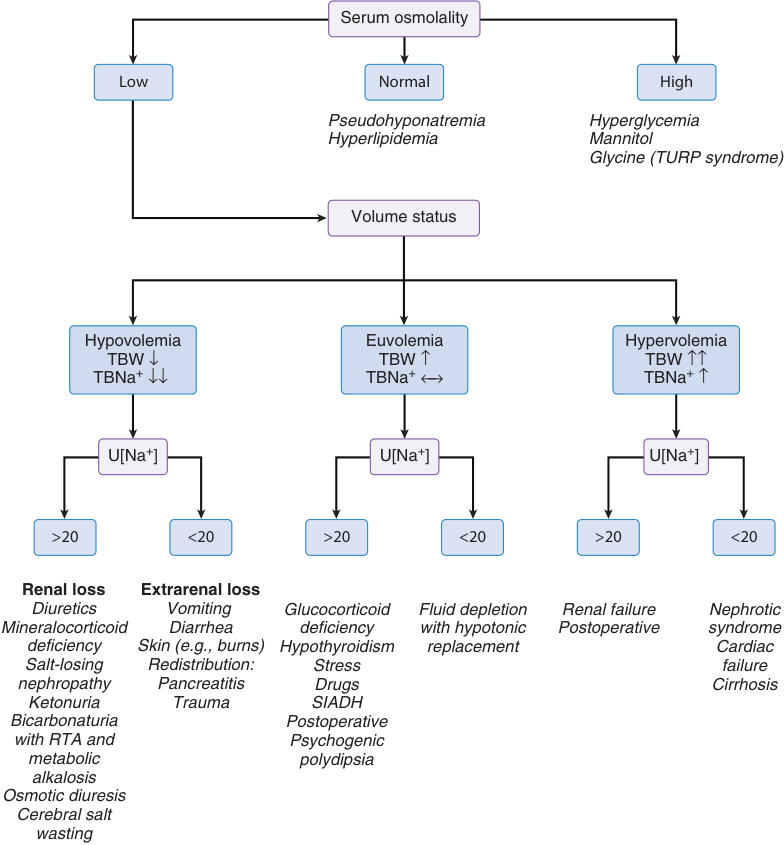

Serum osmolality Low Normal High Pseudohyponatremia Hyperglycemia Hyperlipidemia Mannitol Glycine (TURP syndrome) Volume status Hypovolemia Euvolemia Hypervolemia TBW ↓ TBW ↑ TBW ↑↑ TBNa + ↓↓ TBNa + ←→ TBNa + ↑ U[Na + ] U[Na + ] U[Na + ] >20 &lt;20 >20 &lt;20 >20 &lt;20 Renal loss Extrarenal loss Diuretics Vomiting Glucocorticoid Fluid depletion Renal failure Nephrotic Mineralocorticoid Diarrhea deficiency with hypotonic Postoperative syndrome deficiency Skin (e.g., burns) Hypothyroidism replacement Cardiac Salt-losing Redistribution: Stress failure nephropathy Pancreatitis Drugs Cirrhosis Ketonuria Trauma SIADH Bicarbonaturia Postoperative with RTA and Psychogenic metabolic polydipsia alkalosis Osmotic diuresis Cerebral salt wasting 

**Fig. 43.3 Causes and diagnostic algorithm for hyponatremia.** The diagnostic criteria for the syndrome of inappropriate antidiuretic hormone secretion (SIADH) include exclusion of adrenal, thyroid, and renal disease or diuretic usage, serum hypoosmolality (&lt; 270 mOsmol/kg), clinical euvolemia, increased urinary sodium ([Na+ ]) despite normal water and salt intake and inappropriate urinary concentration (>100 mOsmol/kg). A characteristic response to water restriction occurs, with a 2- to 3- kg fall in weight accompanied by a reduction in salt wasting over 2 to 3 days. _RTA,_ renal tubular acidosis; _TBW,_ total body water; _TURP,_ transurethral resection of the prostate; _U[Na_&#95;+&#95; _],_ urinary sodium concentration in mEq/L. (Modified from Kumar S, Berl T. Sodium. _Lancet._ 1998;352:220; and Tisdall M, Crocker M, Watkiss J, et al. Disturbances of sodium in critically ill adult neurologic patients: a clinical review. _J Neurosurg Anesthesiol._ 2006;18:57.)

wound infection, and pneumonia.115 Whether hyponatremia is a direct causal mechanism in postoperative adverse events or a marker of underlying overt or subclinical pathologic processes, such as cardiac failure, is not clear. Excess risk is seen even in American Society of Anesthesiologists (ASA) class 1 and 2 patients undergoing elective surgery. Interestingly, correcting preoperative hyponatremia does not clearly improve outcomes. The finding of preoperative hyponatremia should prompt a search for, and optimization of, potential underlying diseases. In moderate- tosevere hyponatremia, nonurgent surgery should probably be postponed to allow for gradual correction of hyponatremia (see later discussion).

**PostoPerative HyPonatremia.** The surgical stress response, aggravated by periods of hypotension and painrelated or physiologic stress- related sympathetic activity, can lead to a state of Na+ and water retention similar to

SIADH. Avid water retention puts postoperative patients at risk for hyponatremia, particularly when administration of free water from IV dextrose- containing or other hypotonic solutions is ongoing. The incidence of postoperative hyponatremia is 1% to 5%, with children and premenopausal females at particularly high risk for neurologic symptoms. In these groups, symptoms and neurologic sequelae may occur at Na+ levels as high as 128 mEq/L. Elderly women typically do not become symptomatic until 120 mEq/L, unless the decrease is particularly rapid. The potential impact of postoperative hyponatremia is considerable; 8% of hyponatremic patients may develop encephalopathy, of whom 52% suffer permanent neurologic sequelae or death.116 Failure to recognize hyponatremia as a cause of postoperative symptoms (see later discussion) or inadequate treatment based on fears of causing osmotic demyelination may contribute to these poor outcomes.117

<!-- PDF page 23 -->

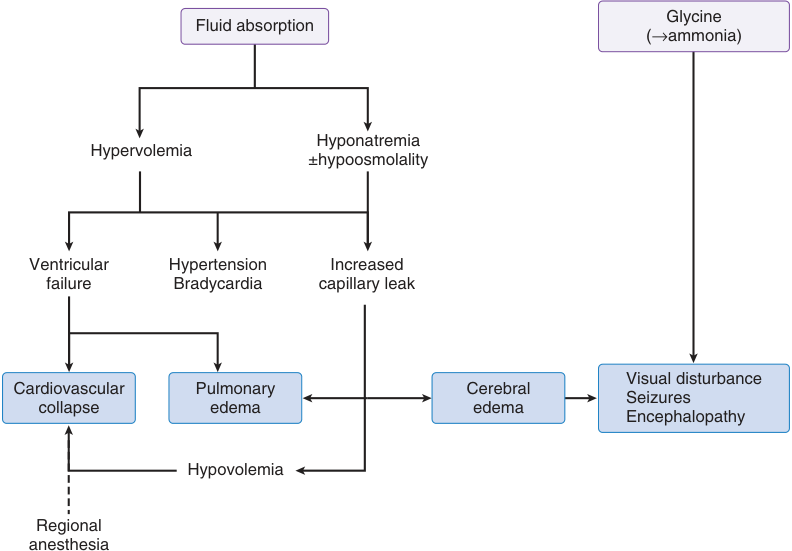

Glycine Fluid absorption (→ammonia) Hyponatremia Hypervolemia ±hypoosmolality Ventricular Hypertension Increased failure Bradycardia capillary leak Visual disturbance Cardiovascular Pulmonary Cerebral Seizures collapse edema edema Encephalopathy Hypovolemia Regional anesthesia 

**Fig. 43.4 The transurethral resection of the prostate (TURP) syndrome.** Early hypervolemia- related hypertension may be followed by profound hypotension as a result of increased capillary filtration with hypovolemia, depressed cardiac function, and sympathetic blockade. Glycine itself may lead to seizures through allosteric activation of the _N-_ methyl- d- aspartate receptor and is thought to cause the visual disturbance of the TURP syndrome. The hepatic deamination of glycine yields ammonia, which can further contribute to encephalopathy. (Modified from Gravenstein D. Transurethral resection of the prostate [TURP] syndrome: a review of the pathophysiology and management. _Anesth Analg._ 1997;84:438.)

Prevention of postoperative hyponatremia should be a key goal of postoperative fluid therapy, based on limiting free water administration to pure maintenance requirements (1–1.2 mL/kg/h), replacing losses of Na+ - containing fluids (e.g., GI) with an appropriate isotonic salt solution, stopping IV therapy as soon as the oral route can be used, and frequent monitoring of serum electrolytes.

**transuretHral resection of tHe Prostate syndrome.**

The transurethral resection of the prostate (TURP) syndrome describes symptomatic hyponatremia and excessive intravascular volume resulting from IV absorption of hypotonic nonconductive (electrolyte- free) irrigation fluid during TURP, transurethral resection of the bladder118 or ureteroscopic or hysteroscopic procedures. The syndrome may complicate 10% to 15% of TURP procedures, with onset between 15 minutes and 24 hours after the onset of resection.119 Risk factors include increased intravesical pressure, prolonged resection, hypotonic irrigants, and open venous sinuses. The clinical features (Fig. 43.4) are related to intravascular volume changes, hyponatremia, and absorption of irrigant solutes. The use of distilled water as an irrigant has largely been replaced by solutions of glycine, sorbitol, or mannitol because of the incidence of massive hemolysis. Hyponatremia resulting from free water absorption may lead to hypoosmolality, although the presence of glycine or other osmotically active solutes may maintain osmolality in the normal range. The following measures may help prevent TURP syndrome:

- The use of conducting (isotonic saline) irrigant with bipolar diathermy.120

- Monitoring fluid absorption by comparing the amount instilled with the amount removed. Surgery should be halted if 750 mL (for females) or 1000 mL (for males) has been absorbed and the patient should be assessed for Na+ levels and neurologic status (if awake). Surgery should be terminated if 1000 to 1500 mL (for females) or more than 2000 mL (for males) has been absorbed. If saline irrigant is used, surgery should be terminated after 2500 mL has been absorbed. Although the risk for hypoosmolar hyponatremia is removed with saline irrigant, the risk for excessive intravascular volume remains.121,122

- Limiting the duration of irrigation. Irrigation should continue only for longer than 1 hour after careful assessment of the patient for possible TURP syndrome.

- Limiting intravesical pressure to less than 15–25 mm Hg or 70 mm Hg for endometrial procedures.

- Monitoring the patient’s neurologic status by using regional anesthetic techniques. Symptoms in the awake patient include nausea and vomiting, visual disturbance, reduced level of consciousness, agitation, confusion, and seizures.

Treatment of the TURP syndrome depends on the patient’s intravascular volume status, Na+ level, and osmolality, but typically involves cessation of irrigation solutions and water restriction. A loop diuretic should be given to promote free water excretion if intravascular volume overload is present. In severe hypoosmolar hyponatremia with neurologic symptoms, hypertonic saline may be used. When osmolality is normal or marginally decreased, hemodialysis is preferred.123 Mg2+ can be given for seizures, because its

<!-- PDF page 24 -->

negative control of NMDA receptors counteracts dilutional hypomagnesemia and the excitatory effects of glycine.119

**Presentation and treatment of HyPonatremia.** The symptoms of hyponatremia are related to cerebral edema and increased intracranial pressure and are highly dependent on how rapidly the hyponatremia occurred. In acute onset, symptoms typically occur when Na+ concentrations are as low as 120–125 mEq/L (higher in children and premenopausal females) with headache, confusion, agitation, vomiting, and lethargy. At Na+ concentrations less than 110 mEq/L, symptoms progress to seizures and coma. In the chronic setting, clinical features may be absent even at concentrations less than 120 mEq/L. In all cases of hyponatremia, potential underlying causes such as steroid deficiency, renal disease, and cardiac disease should be identified and treated. Treatment should be tailored to the patient’s intravascular volume status, the chronicity of onset, and the presence of symptoms. Chronic hyponatremia (>48 hours or of unknown duration) should be treated cautiously because of cerebral compensation for the hypoosmolar state; sudden increases in osmolality lead to cerebral water loss and osmotic demyelination. Treatment options for other scenarios are listed below:

- Hypovolemic hyponatremia: Symptoms are unusual because osmotic shifts in the brain are limited by the loss of both Na+ and water. ECF volume should be restored with isotonic saline, which will also reduce ongoing ADH release.

- Hypervolemic hyponatremia: In chronic cases, this should focus on restriction of water intake and optimization of the underlying disease state, such as improving cardiac output with angiotensin- converting enzyme (ACE) inhibitors to reduce the neurohumoral influence on water retention in cardiac failure. Loop diuretics (rather than thiazides, which impair urinary dilution) can be used to excrete free water once a negative Na+ balance has been achieved.

- Chronic, asymptomatic hyponatremia: No immediate correction of hyponatremia is required, and the underlying cause should be treated. Fluid restriction, ADH antagonists (lithium, demeclocycline), and loop diuretics may be used.

- Moderate symptomatic hyponatremia (confusion, lethargy, nausea, and vomiting): Hypertonic 3% saline may be used at an initial rate of 1 mL/kg/h with the goal of increasing [Na+ ] by 1 mEq/L/h for 3 to 4 hours, after which electrolytes should be rechecked. The infusion rate should be modified to ensure that [Na+ ] is increased by no more than 10 mEq/L in the first 24 hours of treatment.

- Severely symptomatic hyponatremia (coma, seizures): Often patients present with [Na+ ] &lt;120 mEq/L, and the risks of undertreating are more than those of osmotic demyelination. A bolus of 100 mL of 3% saline should initially be given with the aim of acutely increasing [Na+ ] by 2 to 3 mEq/L. If no improvement in neurologic status occurs, this approach may be repeated once or twice at 10- minute intervals. After this, treatment should continue as for moderately symptomatic patients, with a similar goal of increasing [Na+ ] by no more than 10 mEq/L in the first 24 hours.124 Electrolytes and osmolality should be rechecked every few hours, and fluid balance should be carefully monitored.

**HyPernatremia.** Hypernatremia ([Na] >145 mEq/L) is less common than hyponatremia but may affect up to 10% of critically ill patients. If severe ([Na] >160 mEq/L), a 75% mortality may occur depending on the severity of the underlying disease process (Fig. 43.5).113,114 The major mechanisms are excessive water loss with inadequate compensatory intake, lack of ADH, or administration of exogenous sodium. Diabetes insipidus (DI) is caused by a lack of ADH action due to impaired production or release (central DI) or reduced renal sensitivity to ADH (nephrogenic DI) leading to inability to concentrate urine and excretion of large quantities of inappropriately dilute urine. If patients are unable to accept compensatory fluid orally (e.g., because of coma or in the elderly with impaired thirst reflexes), they may rapidly become hypovolemic. Central DI is seen after pituitary surgery, subarachnoid hemorrhage, traumatic brain injury (particularly skull base fractures), and brainstem death. Nephrogenic DI may be due to renal disease, electrolyte disorders, or drugs (lithium, foscarnet, amphotericin B, demeclocycline).

Clinical features of hypernatremia include altered mental status, lethargy, irritability, seizures, hyperreflexia, and spasticity. Diagnosis is based on assessment of intravascular volume status, urinary osmolality, and Na+ concentration. In patients with persistent urine output of more than 100 mL/h and hypernatremia, DI should be considered. Diagnostic criteria include an inappropriately dilute urine (&lt;300 mOsm/kg) in combination with hypernatremia and high serum osmolality (>305 mOsm/kg). Urine specific gravity (SG) may provide a rapid guide to urine osmolality where urgent treatment is being considered. Urine SG less than 1.005 in the context of hypernatremia and a potential underlying cause is consistent with DI.

Treatment is tailored to the intravascular volume status, but as with hyponatremia, correction of the Na+ concentration should be no more rapid than 10 mEq/L/day unless the onset has been very acute.

- Hypovolemic hypernatremia: Correction of the intravascular volume deficit with isotonic saline and correction of the underlying cause (e.g., insulin to reduce hyperglycemia), then correction of the water deficit with 0.45% saline, 5% dextrose, or enteral water to cover the deficit and ongoing losses.

- Euvolemic hypernatremia: Use of 0.45% saline, 5% dextrose, or enteral water to replace the deficit and ongoing losses. In central DI, in which urine output is greater than 250 mL/h and risk exists for hypovolemia, titrated intravenous doses of desmopressin acetate 0.4 to 1 mcg (1- deamino- 8- d- arginine vasopressin [DDAVP], an ADH analogue) should be given to reduce the urine output. Higher acute doses may have a prolonged effect with the risk for water intoxication.113,114

- Hypervolemic hypernatremia: Stop administration of exogenous Na+ , give furosemide with 5% dextrose or enteral water. Dialysis may be indicated in the presence of renal failure.

**Potassium Disorders.** Because of the key role of K+ on excitable tissue resting membrane potential, dyskalemia can lead to life- threatening cardiac arrhythmias in the perioperative period. The normally predominant intracellular

<!-- PDF page 25 -->

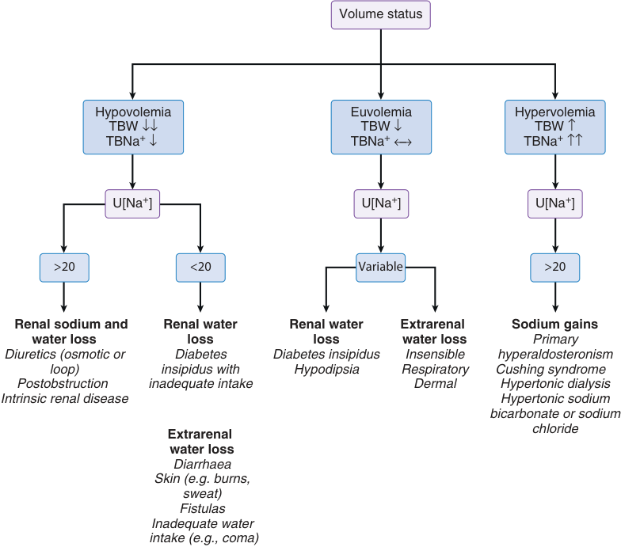

Volume status Hypovolemia Euvolemia Hypervolemia TBW ↓↓ TBW ↓ TBW ↑ TBNa + ↓ TBNa + ←→ TBNa + ↑↑ U[Na + ] U[Na + ] U[Na + ] >20 &lt;20 Variable >20 Renal sodium and Renal water Renal water Extrarenal Sodium gains water loss loss loss water loss Primary Diuretics (osmotic or Diabetes Diabetes insipidus Insensible hyperaldosteronism loop) insipidus with Hypodipsia Respiratory Cushing syndrome Postobstruction inadequate intake Dermal Hypertonic dialysis Intrinsic renal disease Hypertonic sodium bicarbonate or sodium chloride Extrarenal water loss Diarrhaea Skin (e.g. burns, sweat) Fistulas Inadequate water intake (e.g., coma) 

**Fig. 43.5 Causes and diagnostic algorithm for hypernatremia.** _TBW_ , total body water; _U[Na_&#95;+&#95; _]_ , urinary sodium concentration in mEq/L. (Modified from Kumar S, Berl T. Sodium. _Lancet._ 1998;352:220.)

distribution of K+ means that abnormal plasma K+ levels may reflect abnormal ECF to ICF distribution, derangements of total body K+ content, or both. Sampling artifacts may be introduced into laboratory tests for K+ . Anticoagulated samples typically give results 0.4 to 0.5 mEq/L less than those from clotted samples because of erythrocyte K+ release during clotting. Hemolysis also artificially increases K+ levels and may be introduced by poor sampling technique or delayed processing of samples.

**HyPokalemia.** Hypokalemia (&lt;3.5 mEq/L) may be caused by the conditions outlined in Table 43.7. Moderate- to- severe hypokalemia (2–2.5 mEq/L) leads to muscle weakness, electrocardiogram (ECG) abnormalities (STsegment depression, T-wave depression, U-wave elevation), and arrhythmias (atrial fibrillation and ventricular extrasystoles). All logic dictates that hypokalemia (e.g., as low as 2.6 mEq/L) should be associated with an increased rate of perioperative morbidity or mortality; however, no data support this conclusion.18 Hypokalemia should be pragmatically corrected in the perioperative period to optimize neuromuscular function and reduce cardiac irritability. Such treatment is of prime importance when acute arrhythmias exist, and K+ should be maintained at greater than 4 to 4.5 mEq/L. The speed of the infusion should be slow enough to allow equilibration throughout the entire ECF, typically no faster than 0.5 mEq/kg/h. K+ solutions of concentration

more than 40 mEq/L may be an irritant to veins and should be administered via a central venous catheter.

**HyPerkalemia.** Hyperkalemia (>5.5 mEq/L) may result from excess intake, failure of excretion, or shift from the intracellular to extracellular compartment (Table 43.8). Failure of renal secretion is mediated through impaired principal cell function in the cortical collecting duct, which depends on aldosterone- stimulated Na+ /K+ exchange via basal Na+ /K+ ATPases and luminal Na+ and K+ channels. The features of hyperkalemia include muscle weakness, paralysis, and altered cardiac conduction (increased automaticity and enhanced repolarization) with consequent ECG changes as K+ levels increase125 :

- 5.5to 6.5 mEq/L: tall, peaked T- waves

- 6.5 to 7.5 mEq/L: prolonged PR interval

- Greater than 7.5 mEq/L: widened QRS

- Greater than 9.0 mEq/L: sine wave pattern, bradycardia, ventricular tachycardia, cardiac arrest

Chronic hyperkalemia (e.g., chronic renal failure) is better tolerated than acute increases in [K+ ]. Ratios between intracellular and extracellular K+ concentrations may be very abnormal with acute hyperkalemia. With chronic hyperkalemia, these ratios are probably reestablished to normal. Acute hyperkalemia sufficient to induce electrocardiographic changes is a medical emergency that

<!-- PDF page 26 -->

|**Table 43.7**C|auses and Mechanisms|of Hypokalemia|**Table 43.8**C|auses and Mechanism|s of Hyperkalemia|
|---|---|---|---|---|---|
|**Mechanism**|**Cause**|**Notes**|**Mechanism**|**Cause**|**Notes**|
|Inadequate intake|Anorexia nervosa Alcoholism Malnutrition||Increased intake|Excessive K+ treatment Blood transfusion|Usually in patients who also have impaired|
|Gastrointestinal loss|Vomiting Diarrhea Fistulas|Especially secretory diarrhea||Antibiotics containing K+salts|excretion (i.e., severe chronic kidney disease)|
|Excess renal loss|Mineralocorticoid excess|Primary and secondary hyperaldosteronism|Failure of renal secretion|Mineralocorticoid deficiency|Hypoaldosteronism Hyporeninemic, |
||Glucocorticoid excess|High concentration of cortisol overwhelms mineralocorticoid receptor despite lower affinity|||hypoaldosteronemic state (diabetic nephropathy, tubulointerstitial disease)|
||Diuretics Osmotic substances Hypomagnesemia|i Loop or thiazide diuretics deliver increased Na+ load to principal cells Glucose, urea, and mannitol also lead to increased collecting duct Na+delivery Impairs thick ascending limb Na+reabsorption; therefore, increased distal Na+deliver and||Drugs causing mineralocorticoid blockade Collecting duct Na+ channel blockade|Spironolactone (blocks mineralocorticoid receptor) ACE- I and ARBs (reduce aldosterone production) Heparin (selective hypoaldosteronism) Amiloride Trimethoprim Triamterene Pentamidine|
||Renal tubular acidosis|y K+loss via principal cells Failure of principal cell H+/ K+exchange||Tubulointerstitial nephritis Renal obstruction|Cause damage or destruction of the cortical collecting duct|
||Bartter and Gitelman syndromes|Tubule ion transporter mutations mimicking loop or thiazide diuretic effect, respectively|Extracellular K+ shift|Succinylcholine Reperfusion of ischemic tissues|Cellular ischemia reduces ATP production with failure of Na+/K+ATPase|
|Intracellular K+ shift|β2- Agonists Insulin therapy Acute alkalosis |Also seen in sympathetic activity|||activity and K+“leak” to the ECF. Cell lysis further releases K+. On reperfusion, excess ECF K+is rapidly delivered to|
||Lithium overdose Hypokalemic periodic paralysis Vitamin B12therapy||||the systemic circulation. During solid organ transplantation, this may be combined with residual perfusing|
|odified from Kaye     l physiology. In: M _Anesthesia_. 7th e|i   AD, Riopelle JM. Intravasc l iller RD, Eriksson LI, Fleish d. New York: Churchill Livi|i      ular fluid and electrolyte er LA, et al, eds._Miller’s_ ngstone; 2009:1705.||| solution used for_ex vivo_ organ preservation, which contains a high K+content|
|equires rapid alemia involv|treatment. The acu es shifting K+from|te treatment of hyper- the ECF to ICF, antago-||Insulin deficiency Acute acidosis ||
|izing its cardi l|ac toxicity with Ca2 b|+, and increasing renal h  b d||Malignant hyperpyrexia||

Modified from Kaye AD, Riopelle JM. Intravascular fluid and electrolyte physiology. In: Miller RD, Eriksson LI, Fleisher LA, et al, eds. _Miller’s Anesthesia_ . 7th ed. New York: Churchill Livingstone; 2009:1705.

requires rapid treatment. The acute treatment of hyperkalemia involves shifting K+ from the ECF to ICF, antagonizing its cardiac toxicity with Ca2+ , and increasing renal excretion. Elimination by GI resin exchange may be used in more chronic cases (Table 43.9). Hyperkalemia greater than 6.5 mEq/L, in the context of anuric renal failure, is an indication for acute dialysis.

_ACE- I,_ angiotensin- converting enzyme inhibitor; _ARBs,_ angiotensin II receptor blockers; _ATP_ , adenosine triphosphate; _ECF,_ extracellular fluid.

- Chvostek sign (facial twitching induced by tapping on the facial nerve)

### Calcium Disorders

**HyPocalcemia.** The causes of hypocalcemia are related to reduced PTH and/or vitamin D activity, increased bone deposition, Ca2+ chelation, or changes in binding protein concentration or ionized fraction (Table 43.10). The following are characteristic symptoms, some of which will be absent in the anesthetized patient:

   - Trousseau sign (forearm muscular spasm induced by inflating a pressure cuff)

   - Muscle cramps

   - Laryngospasm

   - Tetany

   - Seizures

- Neuromuscular irritability

- Circumoral and peripheral paresthesia

- Cardiac

- Impaired inotropy

::: details 原始表格與符號（PDF 第 26 頁）

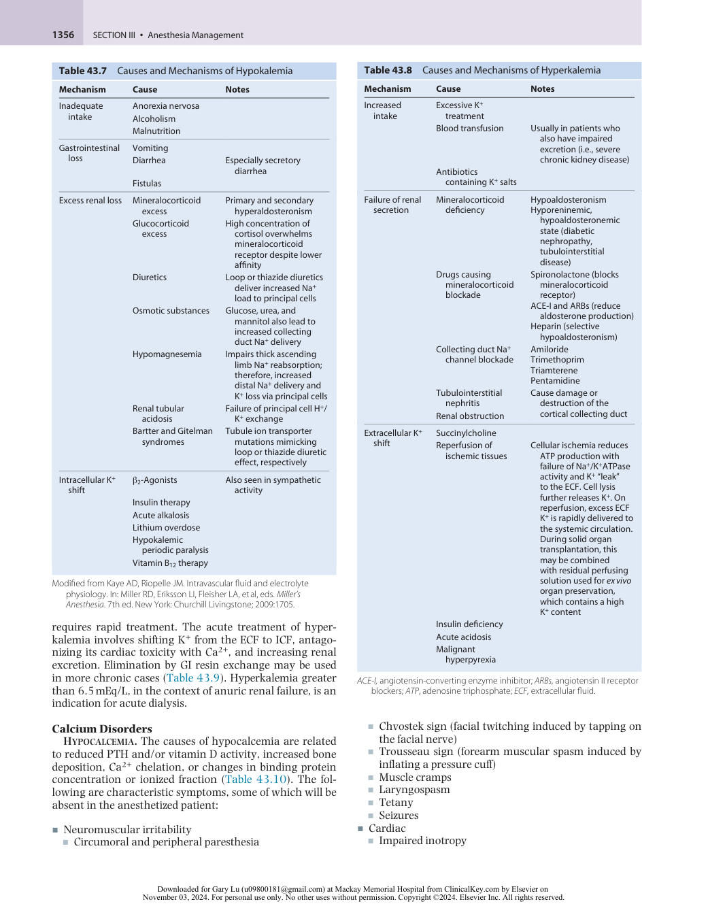

:::

<!-- PDF page 27 -->

**Table 43.9** Treatments for Hyperkalemia

|**Mechanism**|**Treatment**|**Indication**|**Notes**|
|---|---|---|---|
|Antagonize cardiac toxicity|CaCl210% (10 mL) or calcium gluconate|K+>6.5 mEq/L, particularly with ECG changes|Onset of action within a few minutes, duration 30–60 min|
|Intracellular potassium shift|Insulin 10–20 units (administered in 50 mL 50% glucose to avoid hypoglycemia) β2- Agonists (e.g., nebulized albuterol 2.5 mg) Hyperventilation NaHCO31 mEq/kg|K+>6.0 mEq/L K+>6.5 mEq/L|Onset within 10–20 min, duration 4–6 h Induce K+uptake by increasing extracellular pH|
|Increase renal excretion|Furosemide 20–40 mg IV Volume expansion with isotonic saline Fludrocortisone|Moderate- to- severe hyperkalemia|Increases Na+delivery to cortical collecting duct and exchange with K+ Mineralocorticoid effect|
|Other routes of K+elimination|Gastrointestinal resin exchange: sodium polystyrene sulfonate (Kayexalate) 15–30 g PO or per rectum Hemodialysis|Any sustained hyperkalemia Moderate- to- severe hyperkalemia with oliguria||

Hyperkalemia can be defined as mild (5.5–5.9 mEq/L), moderate (6.0–6.4 mEq/L), or severe (>6.5 mEq/L), with or without ECG changes.254 _ECG,_ electrocardiogram.

**Table 43.10** Causes and Mechanisms of Hypocalcemia

|**Mechanism**|**Cause**|**Notes**|
|---|---|---|
|Reduced regulatory hormones|Hypoparathyroidism Pseudohypoparathyroidism|Postparathyroid or thyroid surgery. May be acute effect of reduced PTH or more long- term hypocalcemia during remineralization of bone after surgery for hyperparathyroidism (“hungry bone syndrome”) Hypomagnesemia (suppresses PTH secretion) Reduced receptor response to PTH|
||Reduced vitamin D activity|Hyperphosphatemia (inhibits hydroxylation – e.g., in chronic kidney disease) Dietary/sunlight deficiency Anticonvulsants (increased turnover into inactive forms)|
|Ca2+chelation|Massive transfusion Cell lysis|Caused by citrate in stored red blood cell solutions Phosphate release from tumor lysis syndrome, trauma, or rhabdomyolysis|
||Pancreatitis|Intraperitoneal free fatty acids formed by the action of released pancreatic lipase, which chelate Ca2+salts; further contributions from coexistent hypomagnesemia and hypoalbuminemia|
|Increased bone deposition|Prostate, breast cancer|Increased osteoclastic activity|
|Reduced ionized fraction|Alkalosis|For example, acute intraoperative hyperventilation|
|Reduced bound Ca2+|Hypoalbuminemia|Critical illness (where ionized Ca2+may be normal, and Ca2+replacement not required), poor nutrition|
|Unknown mechanism|Endotoxemic shock||

_PTH,_ parathyroid hormone.

ᑏ Prolonged QT

ᑏ Ventricular fibrillation

ᑏ Heart block

After a rapid large-volume transfusion of citrate- stored blood (>1.5 mL/kg/min) or fresh frozen plasma, ionized hypocalcemia may occur due to citrate chelation. This may be particularly severe and prolonged in patients with hepatic impairment, in whom citrate metabolism is reduced.126 Citrate intoxication has been described for many years but is rarely a clinical problem. Although Ca2+ plays an important role in coagulation, coagulopathy specifically

attributable to hypocalcemia only occurs at ionized Ca2+ concentrations less than 1.2 mEq/L (0.625 mmol/L). Supplemental Ca2+ should be given to support cardiac inotropy and neuromuscular function, aiming for ionized Ca2+ more than 1.8 mEq/L (0.9 mmol/L).127 Ca2+ also may be given during other situations in which myocardial contractility is impaired, such as during cardiac surgery, to optimize ventricular function. After parathyroidectomy, Ca2+ levels should be checked frequently until they have stabilized, because Ca2+ and vitamin D supplementation may be required in both the short and long term. In critical

::: details 原始表格與符號（PDF 第 27 頁）

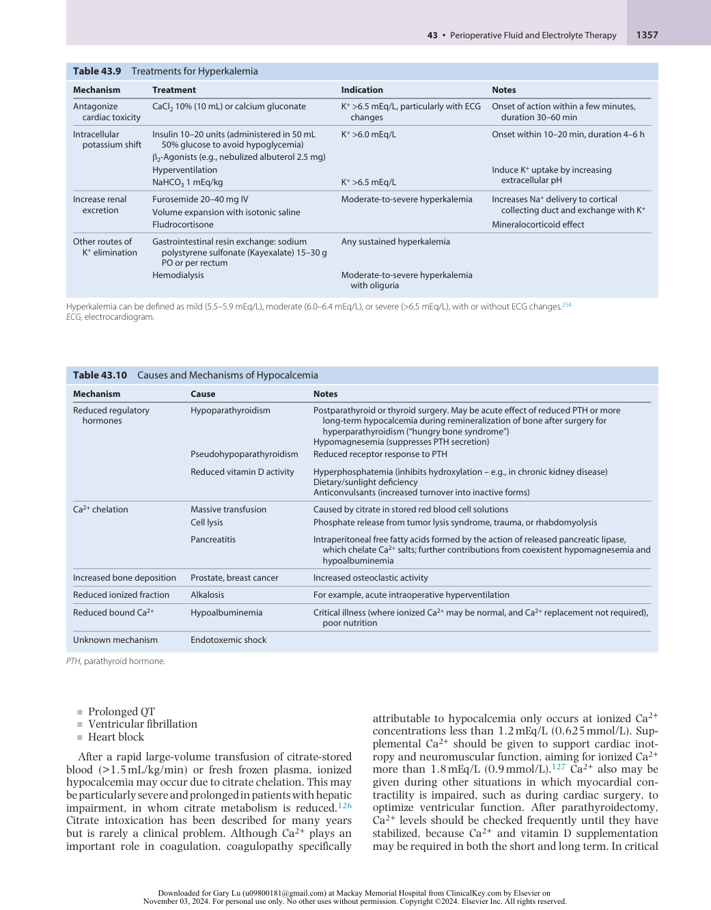

:::

<!-- PDF page 28 -->

**Table 43.11** Causes and Mechanisms of Hypercalcemia

|**Mechanism**|**Cause**|**Notes**|
|---|---|---|
|Increased PTH|Primary hyperparathyroidism|The most common cause typically manifests with mild hypercalcemia resulting from an isolated parathyroid adenoma|
||Secondary and tertiary hyperparathyroidism|The hypocalcemia of kidney disease– related hyperparathyroidism may progress to hypercalcemia with prolonged disease|
|Malignancy|PTH- related peptide secretion|PTH- rP may be secreted by most solid tumors; mimics PTH effects|
||Osteolytic metastases|Breast, lung, lymphoma, thyroid, kidney, prostate, and multiple myeloma|
||Calcitriol production|Typical in lymphoma|
|Excess vitamin D|Ectopic production|Granulomatous disease (e.g., sarcoid), malignancy|
||Excess intake||
|Decreased renal excretion|Thiazide diuretics||
|Increased bone turnover|Hyperthyroidism||
||Immobilization||
|Increased Ca2+intake|Milk–alkali syndrome||

_PTH_ , parathyroid hormone; _PTH- rP_ , parathyroid hormone–related peptide.

illness, total Ca2+ levels may be reduced because of hypoalbuminemia; however, Ca2+ supplementation is necessary only if the ionized levels are low. Ca2+ may be given intravenously as 10% (weight/volume) calcium gluconate or 10% (weight/volume) CaCl2. Although calcium gluconate contains less elemental Ca2+ (0.45 mEq/mL vs. 1.36 mEq/ mL for CaCl2), they are equally efficacious as long as the total Ca content given is equal. Calcium gluconate may be preferable for peripheral administration because the tissue injury from inadvertent extravasation is less severe than with CaCl2. Mg2+ levels are often low during hypocalcemia and should also be corrected, particularly when hypocalcemia has been caused by large-volume infusions of isotonic saline or colloids.

**HyPercalcemia.** Hypercalcemia occurs when ECF Ca2+ influx from the GI tract and/or bone outweighs efflux to bone or renal excretion (Table 43.11). The symptoms are related to the severity and speed of onset, so mild chronic hypercalcemia is usually asymptomatic. More severe hypercalcemia manifests with neurologic symptoms (drowsiness, weakness, depression, lethargy, coma), GI symptoms (constipation, nausea, vomiting, anorexia, peptic ulcers), renal manifestations (nephrogenic diabetes insipidus—which may further aggravate hypercalcemia through dehydration—and renal stones), electrocardiographic abnormalities (shortened QT interval, prolonged PR interval), and potentiation of digoxin toxicity. Treatment should address the underlying cause, including surgical parathyroidectomy in cases of severe hyperparathyroidism, or cessation of thiazide diuretics. Medical treatment should aim to increase renal Ca2+ excretion by volume expansion with isotonic saline and possibly loop diuretics. This combination may reduce Ca2+ by 1 to 3 mg/ dL in 1 to 2 days.24 Bisphosphonates enhance osteoclastic bone deposition and are given if the hypercalcemia is severe or if the response to hydration has been inadequate. A single IV dose of pamidronate 60 mg (moderate hypercalcemia, up to 13.5 mg/dL) or 90 mg (severe hypercalcemia) should return Ca2+ levels to normal within 7 days, and the effect may persist for up to 1 month. Zoledronic acid is a

newer bisphosphonate that may be even more effective.128 Bisphosphonates should only be given when clinical dehydration has been treated to avoid calcium bisphosphonate precipitation and nephrotoxicity. Glucocorticoids may also be given for hypercalcemia associated with lymphoproliferative disease or ectopic vitamin D production.129 Calcitonin increases renal Ca2+ excretion and reduces bone resorption for up to 48 hours when given intramuscularly or intravenously and may contribute to a mild reduction in Ca2+ levels during the rehydration phase.

### Magnesium Disorders

**HyPomagnesemia.** Serum Mg2+ concentration may be a poor indicator of total body content because of its large distribution in the intracellular compartment and slow equilibration with bone stores. Intraerythrocyte or intralymphocyte Mg2+ levels may give a better approximation of total body and tissue stores but are more complex to process.130,131 Both chronic and acute hypomagnesemia are associated with cardiovascular morbidity27 and are particularly prevalent in diverse hospitalized patients (12% of general inpatients, 19% of preoperative cardiac surgery patients, 65% of critical care patients). The causes are related to reduced Mg2+ intake from the GI tract or increased renal losses (Table 43.12), although relative depletion may occur in times of increased cell turnover and protein production (pregnancy, athletes, cold acclimatization). The clinical presentation of hypomagnesemia may be nonspecific; symptoms often relate to common coexisting hypocalcemia or hypokalemia30 :

- Neuromuscular: Trousseau and Chvostek signs, vertigo, seizures, weakness

- Metabolic: Carbohydrate intolerance, hyperinsulinemia, atherosclerosis

- Cardiovascular: Wide QRS, prolonged PR, T- wave inversion, ventricular arrhythmias

- Musculoskeletal: Osteoporosis and osteomalacia

Treatment should be tailored to the severity of symptoms and degree of hypomagnesemia. Asymptomatic patients

::: details 原始表格與符號（PDF 第 28 頁）

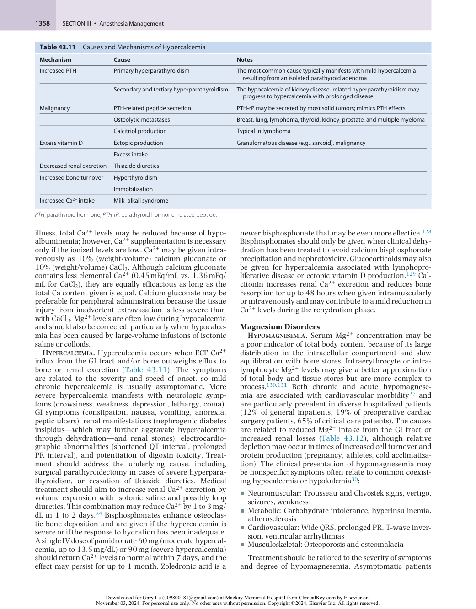

:::

<!-- PDF page 29 -->

**Table 43.12** Causes and Mechanisms of Hypomagnesemia

|**Mechanism**|**Cause**|
|---|---|
|Inadequate gastrointestinal uptake|Malnutrition Prolonged vomiting or diarrhea Intestinal fistula Pancreatitis Prolonged nasogastric suction Malabsorption syndromes Small bowel syndrome Primary intestinal hypomagnesemia|
|Increased renal |Chronic parenteral fluid therapy|
|losses|Hypercalcemia and hypercalciuria|
||Osmotic diuresis|
||Drugs: alcohol, loop and thiazide diuretics, aminoglycosides, cisplatin, amphotericin, cyclosporin, foscarnet|
||Phosphate depletion|
||Hungry bone syndrome|
||Postobstructive nephropathy|
||Renal transplantation|
||Polyuric phase of acute kidney injury|
||Primary hyperparathyroidism|
||Bartter and Gitelman syndromes|

with moderate–severe hypomagnesemia should receive oral supplementation, as acute IV infusions will stimulate the renal Ca2+ /Mg2+ - sensing receptor, reducing Mg2+ reabsorption and leading to renal excretion of much of the acute dose. In the presence of symptoms or Mg2+ concentration of less than 1 mg/dL, IV Mg2+ should be administered (initial dose of 1–2 g over 5 to 10 minutes in the presence of seizures or acute arrhythmias).30 Coexistent hypocalcemia, hypokalemia, or both should also be treated, but they are unlikely to improve without replenishment of Mg2+ . Mg2+ has many other therapeutic indications, even in the absence of hypomagnesemia, as outlined earlier. A few of these patients are likely to have total body Mg2+ depletion that has not been detected by serum Mg2+ levels.

**HyPermagnesemia.** Limited GI absorption and efficient renal excretion mean that hypermagnesemia is typically iatrogenic. Symptoms reflect the effect of Mg2+ on neurologic and cardiac function and relate to the serum concentration18 :

- 5 to 7 mg/dL: Therapeutic levels in the treatment of preeclampsia

- 5 to 10 mg/dL: Impaired cardiac conduction (widened QRS, long PR), nausea

- 20 to 34 mg/dL: Sedation, reduced neuromuscular transmission with hypoventilation, reduced tendon reflexes, and muscle weakness

- 24 to 48 mg/dL: Diffuse vasodilation with hypotension, bradycardia

- 48 to 72 mg/dL: Areflexia, coma, respiratory paralysis

Mg2+ administration should therefore be performed with several important caveats. First, serum Mg2+ levels should be monitored closely during therapeutic administration.

Second, because excretion is renal, doses should be decreased for patients with kidney disease. Third, it should be used with extreme caution in patients with a background impairment of neuromuscular transmission (myasthenia gravis, Lambert–Eaton myasthenic syndrome). Fourth, co- administration of neuromuscular blockers during anesthesia should be performed in reduced doses titrated to neuromuscular monitoring, because Mg2+ potentiates the effects of both depolarizing and nondepolarizing neuromuscular blockers. Treatment of acute hypermagnesemia includes promoting renal excretion by administration of IV fluids and diuresis. IV Ca2+ is given to temporarily antagonize Mg2+ and avoid diuretic- induced hypocalcemia. Definitive treatment, particularly in the presence of renal disease, may require dialysis.

### Phosphate Disorders

**HyPoPHosPHatemia.** Hypophosphatemia may be related to impaired enteral uptake, increased renal excretion, or shifts to the cellular compartment or bone (Table 43.13). Symptoms of hypophosphatemia may be precipitated by hyperventilation in patients with chronic depletion. Refeeding syndrome may be observed on commencement of enteral or parenteral nutrition after a period of prolonged starvation and may manifest postoperatively. Insulin secretion is decreased during starvation. The consequent fat and protein catabolism results in intracellular phosphate depletion despite normal plasma levels. On refeeding, a switch back to carbohydrate metabolism occurs. There is increased insulin secretion, and an increased cellular uptake of PO43− , which may lead to profound hypophosphatemia. In the most severe forms (&lt;1.5 mg/dL), features may include rhabdomyolysis, leukocyte dysfunction, cardiac and respiratory failure, seizures, hypotension, and coma. IV PO43− replacement carries a risk for precipitating severe hypocalcemia, so should be reserved for moderate (&lt;2.2 mg/dL) to severe or symptomatic cases and avoided in cases of ongoing hypocalcemia. Replacement protocols should be based on patient weight and serum PO43− .132

**HyPerPHosPHatemia.** The causes of hyperphosphatemia are shown in Table 43.13. The most common cause in clinical practice is renal failure, in which the filtered PO43− load is reduced. This may be partly compensated for in mild chronic kidney disease by increased PTH secretion and inhibition of tubular PO43− reabsorption, but in more severe kidney disease, hyperphosphatemia must be controlled with oral PO43− binders. The features of hyperphosphatemia may be related to symptomatic hypocalcemia caused by an acute elevation in PO43− levels. Hypocalcemia is mediated via Ca2+ deposition in soft tissues when the (calcium × phosphate) product is elevated, and by inhibition of renal 1α- hydroxylase.30

**Chloride Disorders.** Disorders of Cl− have the potential to affect acid–base balance, although this depends on the other constituents of the SID. As described, exogenous Cl− administration from isotonic saline will increase the plasma Cl− concentration with a lesser effect on Na+ concentration, thus reducing the plasma SID and therefore pH. Conversely, disease states exemplified by both hyperchloremia and hypernatremia or by hypochloremia and hyponatremia

::: details 原始表格與符號（PDF 第 29 頁）

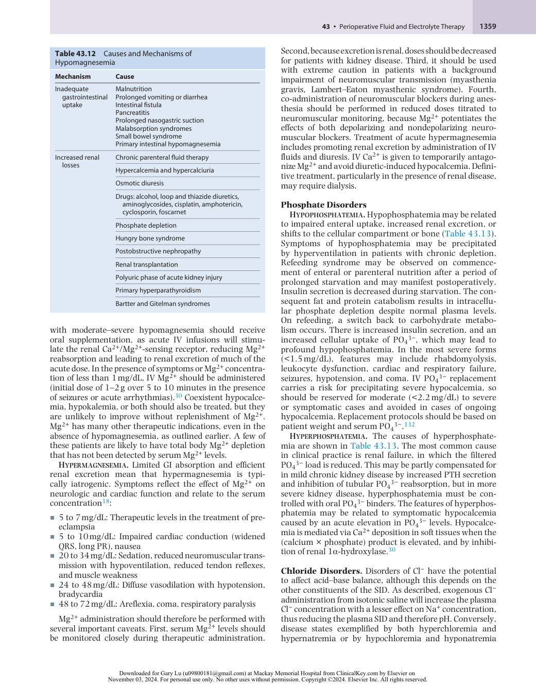

:::

<!-- PDF page 30 -->

**Table 43.13** Causes and Mechanisms of Phosphate Abnormalities

|**Hypop**|**hosphatemia**|**Hype**|**rphosphatemia**|
|---|---|---|---|
|**Mechanism**|**Cause**|**Mechanism**|**Cause**|
|Internal redistribution|Respiratory alkalosis|Increased endogenous load|Tumor lysis syndrome|
||Refeeding||Rhabdomyolysis|
||Hormones (insulin, glucagon, epinephrine, cortisol)||Bowel infarction|
||Sepsis||Malignant hyperthermia|
||Hungry bone syndrome||Hemolysis|
|Increased urinary excretion|Hyperparathyroidism||Acidosis|
||Disorders of vitamin D metabolism|Increased exogenous load|Intravenous infusion|
||Renal transplant||Oral supplementation|
||Volume expansion||Vitamin D intoxication|
||Malabsorption|Reduced urinary excretion|Renal failure|
||Renal tubular defects||Hypoparathyroidism|
||Alcoholism||Acromegaly|
||Metabolic or respiratory acidosis||Tumor calcinosis|
|Decreased intestinal absorption|Dietary restriction||Bisphosphonate therapy|
||Excess antacids||Magnesium deficiency|
||Vitamin D deficiency|Pseudohyperphosphatemia|Multiple myeloma|
||Chronic diarrhea||_In vitro_hemolysis|
||||Hypertriglyceridemia|

Data from Weisinger JR, Bellorín- Font E. Magnesium and phosphorus. _Lancet_ . 1998;352:391.

will not affect the SID and therefore not alter pH. Many of the causes of Cl− abnormalities (Table 43.14) are pathologic processes that also affect Na+ levels. Investigation and treatment of these “matched” electrolyte imbalances should initially target the dysnatremia.

### PRACTICAL MANAGEMENT OF PERIOPERATIVE FLUID THERAPY

At each stage in the perioperative journey, the physician must decide how much and what type of IV fluid is required. Unfortunately, a robust evidence base with answers to these questions is not always available, so a pragmatic approach based on sound physiologic knowledge and the best available evidence is required. To make the process more complicated, fluid and electrolyte requirements change dynamically and there is substantial inter- individual variability. Different fluid requirements are encountered in the preoperative, intraoperative, and postoperative phases, and these vary depending on patient factors, including weight and comorbidity, and on surgical factors, such as the magnitude and site of surgery. Furthermore, the goals of fluid therapy vary, depending on the severity of surgery and its associated morbidity. In “low- risk” minor surgery, fluid strategies may influence the incidence of relatively minor morbidity such as nausea and vomiting,133,134 whereas in major surgery the focus is on the potential for fluid administration to affect postoperative morbidity, length of stay, and mortality.111,135,136

The goals of fluid therapy for major surgery are as follows:

- To ensure adequate circulating volume to support cellular O2 delivery and avoid the deleterious effects of hypoperfusion on cellular function and survival, inflammation, and neurohumoral responses. This may involve manipulation of not just circulating volume but also of cardiac output and vascular resistance.

- To avoid the iatrogenic side effects of fluid administration; excessive intravascular volume, edema, excess Na+ or Cl− load, toxicities related to synthetic compounds, or nonphysiologic quantities of anions (lactate, acetate, gluconate).

Large studies show that even during relatively standardized surgical procedures, there is a large variety in the volumes of fluid administered. This unexplained variability may contribute to postoperative morbidity, when inadequate or excessive fluid volumes are administered, and regrettably appears to be more closely associated with the identity of the individual anesthesia provider rather than patient or surgical factors.107,137 Many approaches are still being investigated in an effort to determine the optimum quantity and type of fluid that should be given for perioperative care.

### Quantity of Fluid

IV fluid quantities may be given in two main ways: (1) by estimating the requirements based on patient weight, the phase of surgery, and nature of losses, or (2) by direct

::: details 原始表格與符號（PDF 第 30 頁）

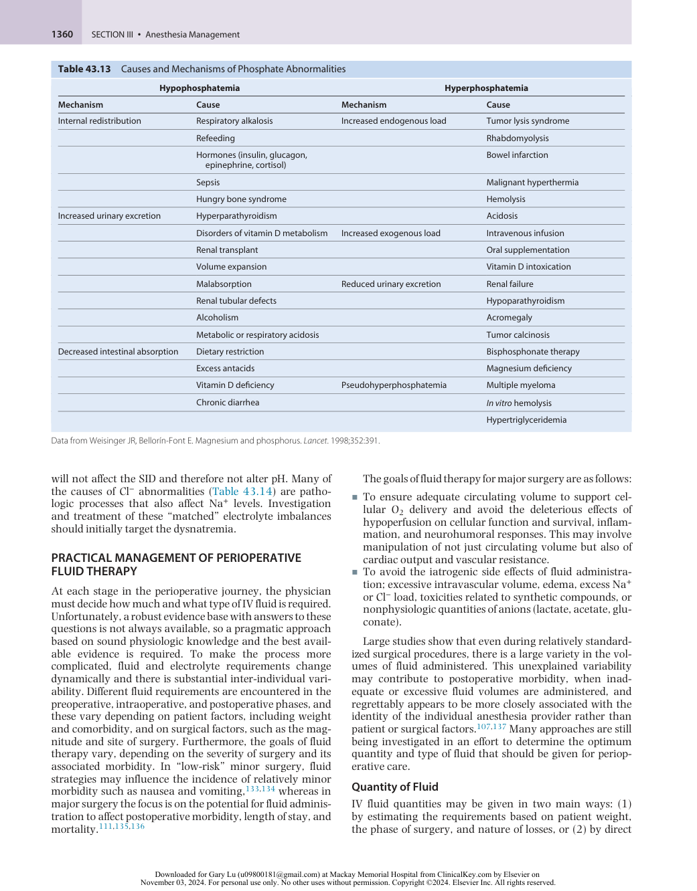

:::

<!-- PDF page 31 -->

**Table 43.14** Causes and Mechanisms of Chloride Abnormalities

|**Hyp**|**ochloremia**|**Hyp**|**erchloremia**|
|---|---|---|---|
|**Mechanism**|**Cause**|**Mechanism**|**Cause**|
|Cl−loss|Diuretics|Cl−infusion|Cl−- rich fluids|
||Gastric drainage||Parenteral nutrition|
||Vomiting|Water loss|Skin|
||Chronic respiratory acidosis||Fever|
||||Renal losses|
|Water balance in excess of Cl−|Congestive cardiac failure||Diabetes insipidus|
||Syndrome of inappropriate antidiuretic hormone secretion|Water loss exceeding Cl−loss (extrarenal)|Diarrhea|
||Infusion of hypotonic fluids||Burns|
|||Water loss exceeding Cl−loss (renal)|Osmotic diuresis Postobstructive diuresis Intrinsic renal disease|
|||Increased tubular chloride reabsorption|Renal tubular acidosis Recovery from diabetic ketoacidosis Early renal failure Acetazolamide Ureteral diversion Posthypocapnia|

Data from Yunos NM, Bellomo R, Story D, et al. Bench- to- bedside review: chloride in critical illness. _Crit Care_ . 2010;14:226.

measurement of an individual’s physiologic response to fluids, so- called goal- directed therapy.

**Targeting Overall Fluid Balance.** Traditional approaches to perioperative fluid administration are based on historical estimates of fluid requirements during fasting (e.g., using the “4- 2- 1” calculation; Table 43.15138 ) and during episodes of excess loss, such as when body cavities are open, or bleeding occurs. The fluid volumes prescribed are then based on perceived knowledge of the movement of fluids between compartments – for example, crystalloid being used to replace blood loss in a 3:1 ratio to account for crystalloid movement into the extravascular compartment.18 However, much of the physiologic basis of this management approach has been questioned.3,11

An extension of the milliliter- per- kilogram approach to fluid administration has been to examine whether higher (e.g., 12–18 mL/kg/h of intraoperative crystalloid) or lower (5–7 mL/kg/h) fluid administration in the immediate perioperative phase is associated with benefit after major surgery. Unfortunately, this work has been hampered by widely varying definitions of fluid replacement, differing fluid types (colloids/crystalloids), and varied time courses. Despite these differences, when fluid is given based on a milliliter- per- kilogram protocol rather than target defined physiologic end points, the administration of more than 3500 to 5000 mL of crystalloid solution is associated with increased postoperative morbidity such as increased weight gain, cardiopulmonary dysfunction, impaired wound healing,111,133 delayed GI function, and increased hospital length of stay.139,140 One study gives apparently conflicting results,141 although this may be partly accounted for by methodologic differences compared with the other studies. In the recent pragmatic international RELIEF trial,142 3000 patients at increased risk for complications during major

**Table 43.15** The 4- 2- 1 Estimation of Maintenance Water Requirements

|**Weight**|**Fluid Prescription**|
|---|---|
|First 10 kg|4 mL/kg/h|
|Second 10 kg|2 mL/kg/h|
|All subsequent kilograms|1 mL/kg/h|

Example: A 25- kg patient would require (4 × 10) + (2 × 10) + (1 × 5) = 65 mL/h “maintenance” water.

Data from Holliday MA, Segar WE. The maintenance need for water in parenteral fluid therapy. _Pediatrics_ . 1957;19:823.

abdominal surgery were randomly assigned to receive a restrictive or “moderately liberal” IV fluid regimen. During and up to 24 hours after surgery, the restrictive group had a median IV fluid intake of 3.7 liters and a median weight gain of 0.3 kg as compared with 6.1 L and 1.6 kg in the liberal fluid group. There was no difference in the primary outcome of disability- free survival at 1 year, but the rates of surgical- site infection (16.5% vs. 13.6%) and renal- replacement therapy (0.9% vs. 0.3%) were increased in the restrictive group. This study provides an important warning of the consequences of excessive fluid restriction, a target for weight change after surgery (+1.5 kg), and a useful benchmark recipe.

Very few studies have robustly examined the specific effects of postoperatively administered fluid volumes. Of those tackling this area, one showed an earlier return to gut function and hospital discharge when postoperative infusions were limited to 2000 mL of water and less than 100 mEq Na+ /24 h,108 whereas another showed no difference.143 Substantial caution is required when interpreting these very small studies with significant methodologic differences.

::: details 原始表格與符號（PDF 第 31 頁）

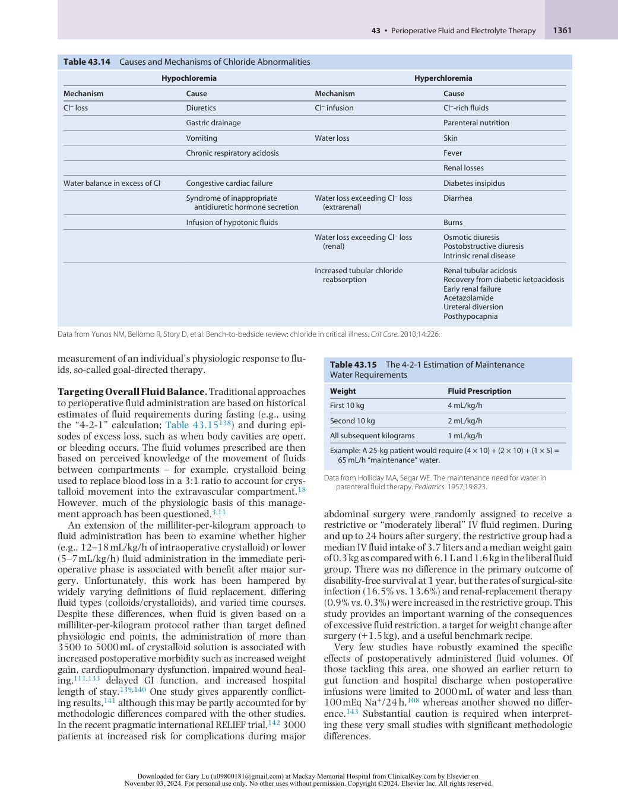

:::

<!-- PDF page 32 -->

Although it seems likely that there exists an optimum fluid volume to be given to maximize perfusion while avoiding excessive intravascular volumes, this volume likely varies widely across patients and in response to different insults. This is the rationale behind individualized therapy, where objective variables are measured and targeted with fluid administration.

**Goal- Directed Therapy.** The practice of GDT is based on measuring key physiologic variables related to cardiac output or global O2 delivery and administering fluids, and possibly inotropes, vasopressors, vasodilators, and RBCs to improve tissue perfusion and clinical outcome. This approach to fluid administration is a continuous dynamic process that targets defined physiologic end points rather than giving fluids without objective assessments of fluid status. GDT, used both in the perioperative and critical care setting, originated from observations that survivors of highrisk surgery achieved a particular elevation in global O2 delivery and utilization in the perioperative period.144 Subsequent trials used hemodynamic manipulation in an effort to replicate these supranormal “survivor values” in patients undergoing major surgery (cardiac index >4.5 L/min/m2 , O2 delivery index [DO2I] >600 mL/min/m2 , O2 consumption index >170 mL/min/m2 ).145,146 The GDT approach has been studied in a wide variety of surgical settings and at various time points, including during preoperative optimization, intraoperative management, and the immediate postoperative period. Various tools to measure the physiologic targets of GDT are discussed below.

- Pulmonary artery catheter (PAC). Considered to be the gold standard hemodynamic monitor, providing measured and derived values for left- heart and right- heart filling pressures, mixed and central venous saturations, cardiac output, DO2, and VO2 while allowing access to the central circulation. This was the tool used in the earlier GDT trials targeting increases in cardiac index and DO2I, but its use is declining because of concerns about catheter- associated morbidity, reduced expertise in insertion and data interpretation, and the availability of lessinvasive tools. In countries such as the United Kingdom, its use is typically restricted to cardiac, major liver, and transplant surgery.

- Esophageal Doppler monitor (EDM, Deltex Medical Ltd, Chichester, UK). This device uses transesophageal ultrasound measurement of descending aorta blood velocity, integrating this with estimated aortic cross- sectional area to derive SV. Other measurements include peak velocity, used as an indicator of ventricular contractility, and corrected flow time (FTc), and the duration of systolic aortic blood flow corrected for heart rate. FTc may be reduced (&lt;330 ms) by increased systemic vascular resistance (SVR), reduced SV, or both. SVR may be calculated by inputting CVP and mean arterial pressure (MAP), helping to identify whether a low FTc is due to inadequate preload or excessive afterload. Variation in SV with positive- pressure ventilation (stroke volume variation, SVV) is also measured by the latest EDM models.

- Arterial pressure and waveform analysis. These monitors analyze the invasive arterial blood pressure, continuous noninvasive blood pressure from a finger cuff, or

plethysmograph trace to yield two types of measurement. First, an estimate of SV (and therefore cardiac output and index) based on the principle that pulse pressure is proportional to SV when arterial compliance is constant. Interpatient variation in arterial compliance may be accounted for by regular calibration steps using lithium dilution (LiDCO Plus), thermodilution (PiCCO, Phillips, Andover, MA), or by reference to EDM measurements (CardioQ- EDM+, Deltex), or ignored in uncalibrated monitors (LiDCO Rapid, Masimo; FloTrac, Edwards, Irvine, CA), which represent SV trends rather than absolute estimates. Second, SVV, a predictor of fluid responsiveness based on systolic pressure variation with intermittent positive- pressure ventilation, can be measured.

- Thoracic bioimpedance, relatively underexplored in perioperative interventional trials.

- CVP: Despite one study that demonstrated improved outcomes from hip fracture surgery when CVP response to intravascular fluid challenges was compared to unmonitored control,147 CVP readings are poorly predictive of intravascular blood volume and fluid responsiveness.148

- Echocardiography: This advanced technique is used for guiding fluid therapy and yielding information on cardiac performance and filling but requires operator expertise and a transesophageal approach in the intraoperative setting.

- Lactate: A reduction in elevated blood lactate concentrations is used clinically as a marker of successful resuscitation.149

- O2 extraction and venous O2 saturation (SvO2) or central venous saturation (ScvO2): Inadequate tissue O2 delivery may be signaled by increased O2 extraction and the resultant mixed or central venous O2 desaturation. Low ScvO2 is associated with poor outcomes after high- risk surgery,150 although it has been targeted in only one interventional study in major noncardiac surgery.151

A typical approach to GDT is to rapidly administer 250mL boluses of colloid or crystalloid, aiming to increase SV by 10% or more each time. This process is continued until there is no further rise in SV, at which point ventricular filling is taken to be on the flatter part of the Starling curve. One example is in Fig. 43.6. Trials have varied in terms of the period during which this intervention is used (intraoperative or intra- and postoperative) and whether fluid loading is combined with protocolized inotrope infusion. Meta- analyses have highlighted the potential benefits of the GDT process. One meta- analysis with the most tightly defined patient group (surgery but not trauma or sepsis) and all time points (preoperative, intraoperative, and postoperative GDT) and GDT tools (PAC, EDM, and arterial waveform analysis) showed GDT to be associated with a reduction in postoperative morbidity and hospital length of stay.136 Specifically, GDT leads to a reduction in the number of patients with postoperative renal impairment,152 respiratory failure, and postoperative wound infection. Many of the individual studies were not powered to detect a mortality difference; however, when analyzed rigorously in the Cochrane systematic review, excluding poorly controlled studies, hospital or 28- day mortality was reduced by GDT.136

More recent trials using minimally invasive arterial waveform or Doppler devices have been completed. Although the

<!-- PDF page 33 -->

Monitor FTc and SV 

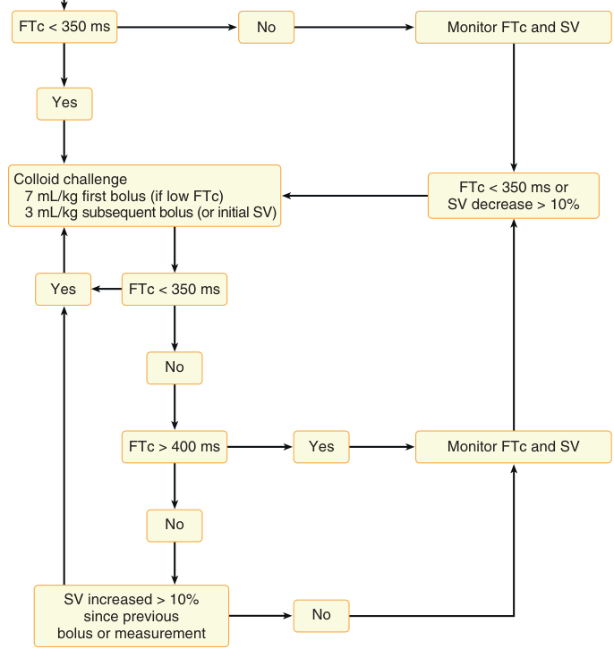

FTc &lt; 350  ms No Monitor FTc and SV Yes Colloid challenge FTc &lt; 350 ms or 7 mL/kg first bolus (if low FTc) SV decrease > 10% 3 mL/kg subsequent bolus (or initial SV) Yes FTc &lt;  350 ms No FTc > 400 ms Yes Monitor FTc and SV No SV increased > 10% since previous No bolus or measurement 

**Fig. 43.6 Protocol for EDM- based intraoperative goal- directed fluid therapy.** _FTc,_ heart rate–corrected descending aorta flow time; _SV,_ stroke volume. (Redrawn from Noblett SE, Snowden CP, Shenton BK, et al. Randomized clinical trial assessing the effect of Doppler- optimized fluid management on outcome after elective colorectal resection. _Br J Surg._ 2006;93:1069.)

results of individual trials are mixed,153,154 many appear to support the potential benefit of using these monitors in elective surgery suggested by the previous Cochrane metaanalysis.155–157 Large clinical effectiveness trials aiming to give a definitive answer on this intervention are currently underway in both elective and emergency gastrointestinal surgery.

In trials, patients treated with GDT typically receive a modest amount of additional fluid (around 500 mL average) compared to standard care controls. A frequent finding is that the timing of the fluid varies, and they typically receive fluid earlier in the postoperative phase, with lower fluid requirements later. However, these differences should not be interpreted as therapeutic targets as it appears to be the individualization of therapy that brings the benefit of this approach.158 This is underlined by the finding that there is no benefit associated with the non- protocolized use of the monitoring devices themselves.159,160

Recent developments include the integration of cardiac output–based resuscitation approaches with haemodynamic algorithms targeting baseline blood pressure.161 In the future it is possible that these approaches may be supported by machine learning within monitoring devices,162

and/or closed loop delivery systems163 to support clinical decision- making and therapy.

### Appropriate Fluid Selection

**Crystalloids or Colloids for Intravascular Plasma Volume Expansion.** Although crystalloids are the most rational choice of fluid for replacement of evaporative losses, maintenance fluid requirements, and expansion of the entire extracellular fluid volume, the choice of crystalloid or colloid for plasma volume replacement in the perioperative phase is less clear. Crystalloid may be effective in plasma volume expansion (PVE) at amounts less than previously reported, although typically 40% to 50% more crystalloid than colloid must be administered to obtain the same clinical volume effect.3 When combined with the increased propensity of crystalloid to filter across the capillary membrane, more extravascular volume expansion occurs, potentially causing tissue edema. When compared with colloids, crystalloids may lead to increased GI mucosal edema164 and the potential for delayed postoperative GI function and bacterial translocation. The differential effect of crystalloids when compared to colloids on tissue O2 tension has no clear consensus.44 However, it is

<!-- PDF page 34 -->

important to consider whether these effects on physiology lead to differences in patient-centered clinical outcomes. A Cochrane review highlighted the lack of improvement in all- cause mortality when colloids were used for intravascular volume expansion in unselected critical care populations.165 In studies specific to patients with sepsis, starch- based colloids, including smaller MW versions, are associated with an increased requirement for renal replacement therapy, blood transfusion, and an increase in severe adverse events.78 These data should be interpreted cautiously in relation to perioperative care, given the trial designs and differences in patient characteristics. The available perioperative trials focusing on starch colloids show more mixed results and have not raised safety concerns to the same degree as in critical care/septic populations.80,83–85 However, a recent perioperative trial in the highest-risk group did suggest an increase in postoperative kidney injury and blood transfusion.85 Less data are available comparing gelatin colloids with crystalloids. Overall, despite the marginal hemodynamic superiority of colloids, there does not appear to be a consistent clinical benefit, and the potential remains for harm in higher-risk surgical patients.

**Saline- Based or Balanced Solutions.** Although its clini-

cal relevance has been debated,41 evidence demonstrates that intraoperative fluid administration based on isotonic saline causes a postoperative hyperchloremic acidosis.36 The excess NaCl and water load associated with isotonic saline is also excreted more slowly than that associated with balanced crystalloids. More focused trials in groups at risk for renal injury and postoperative respiratory failure will help to determine whether these adverse physiologic effects translate into worse clinical outcomes, as has been found in the general critical care population.48 It is currently reasonable to restrict isotonic saline administration to the specific indications (see Saline Solutions, above) and to use balanced crystalloids instead. Very limited data exist on the impact of colloids administered in either saline or balanced crystalloid solutions.

### Typical Practical Approach

The following suggestions represent an assimilation of the available evidence presented in this chapter. However, in many areas of perioperative fluid management, the lack of robust evidence means that the choice of fluid and method of administration remain a clinician’s choice informed by the balance of risks and benefits. The overall themes in prescribing fluids in moderate- to- major surgery are:

- The indication for giving a specific fluid should always be considered. Pure “maintenance” fluid should be given at a low fixed rate, with fluid required for replacement of losses or for resuscitation considered separately.

- Fluids administered should be individualized. This may be as simple as dosing postoperative maintenance fluids on a milliliter- per- kilogram basis or titrating intraoperative plasma volume expansion to objectively measured physiologic variables.

- Fluid status changes constantly throughout the perioperative period and should be frequently reassessed.

- The approach should be adapted to the patient and surgical factors outlined later.

**Preoperative.** In preparing for elective surgery, oral clear fluid intake should continue until 2 hours preoperatively and longer fasting discouraged. The use of preoperative bowel preparation should be restricted to carefully selected cases, and in these cases an infusion of 1 to 2 L of balanced crystalloid with K+ supplementation should be given in the preoperative period. Chronic comorbidities should be assessed for their influence on fluid and electrolyte balance, as outlined later.

Emergency surgery patients are likely to have acute disturbances of fluid compartments. They require timely resuscitation guided by rational physiologic end points such as trends in blood pressure and heart rate, lactate, urine output, and mixed or central venous O2 saturations. Although preoperative fluid administration using cardiac output monitoring makes clinical sense, often logistical implications limit this strategy. A pragmatic approach is required to provide ongoing fluid resuscitation without compromising early surgical intervention. Upper GI losses should be quantified and replaced with isotonic saline, and lower GI losses (fistula, ileus, or obstruction) with balanced crystalloid. K+ should be supplemented as appropriate.

**Intraoperative.** A low background infusion (e.g., 1–1.5 mL/kg/h) of crystalloid should be used for maintenance requirements during surgery. Hypotension caused by general or regional anesthesia is related primarily to vasodilation and reduced inotropy, and unless the patient is hypovolemic, it is more rational to treat with small doses of vasopressors and/or inotropes.11 Fluid therapy in patients considered to be at higher risk should be guided by invasive pressure monitoring to allow for early recognition of overt hypovolemia and global tissue perfusion. Although no universally accepted definitions of a high- risk case exist,166 factors such as major elective or emergency surgery, advanced age, comorbidities, and poor exercise tolerance increase postoperative mortality risk to greater than 5%. In these cases, and in certain orthopedic and intra- abdominal operations, where the evidence is strongest, cardiac output should be optimized by titrating boluses of a suitable colloid or balanced crystalloid to a measured variable such as SV and FTc, or cardiac output and O2 delivery. Stroke volume variation may also be measured, although its ability to accurately predict fluid responsiveness may be limited.167 Blood loss should be replaced with colloid or blood products depending on the volume lost and variables suggesting inadequate tissue O2 delivery. Crystalloid may be used as an alternative for intravascular plasma volume expansion, but the increased volume required and potential for extravascular volume expansion should be considered. Overall, the goal should be to achieve euvolemia.

**Postoperative.** High- risk surgical patients may benefit from an ongoing period of GDT targeting O2 delivery in the early postoperative period.168 In all other patients after major surgery, an assessment of fluid status should be made based on clinical examination and supporting physiologic measurements such as lactate, central or mixed venous saturations, and cardiac output variables, if available. If patients are euvolemic and able to return to oral fluid intake, this is the best way of avoiding the iatrogenic effects of postoperative fluid administration. Early oral intake is typically

<!-- PDF page 35 -->

well tolerated and safe, and early oral nutrition may reduce the incidence of postoperative complications.169

In patients requiring ongoing IV therapy:

- Electrolytes should be checked at least daily to monitor for electrolyte derangements.

- Fluid requirements should be strictly divided into three categories for their ongoing assessment and treatment

- **“Pure” maintenance requirements.** These should be salt- poor and contain a modest volume of free water to account for the postoperative state of salt and water retention. Infusions should therefore consist of the following170 : (1) 1500 to 2500 mL in 24 hours, depending on weight, or 1 to 1.2 mL/kg/h. Given the relative reduction in TBW in obesity (see previous discussions on crystalloids, fluid compartments), consideration should be given to dosing this fluid requirement based on ideal body weight in this setting; (2) 50 to 100 mEq Na+ should be given in 24 hours; and (3) 40 to 80 mEq K+ should be given in 24 hours.

   - It is likely that part of this minimal maintenance vol-

   - ume should comprise hypotonic fluids such as 5% dextrose or 0.18% saline with 4% dextrose. Because of the risk for postoperative hyponatremia, this maintenance intravascular fluid volume should not be increased if suspicion for hypovolemia exists. Rather, the source of the ongoing loss should be identified and treated separately. As oral fluid intake increases, this maintenance fluid should be reduced proportionately.

- **Replacement of ongoing losses.** This fluid requirement requires frequent reassessment to appropriately titrate replacement fluids. Volumes given should reflect measured amounts lost and an assessment of intravascular volume status and adequacy of organ perfusion (mental state, lactate, hemodynamic trends). Losses from the GI tract (vomiting, nasogastric aspirates, stoma) should be replaced with an equal volume of isotonic saline or balanced crystalloid with K+ as appropriate. Losses to third spaces, such as reaccumulation of ascites, should be treated with a mixture of colloid and crystalloid, and blood loss replaced with colloid, blood, or blood products.

- **New requirements (resuscitation).** New requirements may relate to the development of postoperative complications such as hemorrhage (absolute hypovolemia) or acute sepsis (relative or absolute hypovolemia).

Postoperative oliguria should be interpreted cautiously, particularly in the first postoperative day. The patient should be carefully assessed for corroborative evidence of impaired end- organ perfusion and alternative causes of oliguria, including catheter obstruction and intra- abdominal hypertension. In the absence of markers indicating hypovolemia and inadequate tissue perfusion, large volumes of fluid challenge are inappropriate and may aggravate postoperative positive fluid and Na+ balance in the face of a normal surgical stress response.

### Special Considerations

### Patient Factors

**Heart failure.** The diverse pathophysiologic effects of heart failure and their treatment may make perioperative

fluid management particularly challenging. The hemodynamic effects of chronic heart failure are characterized by systolic and diastolic dysfunction of the left, right, or both ventricles with secondary maladaptive neurohumoral responses. These include persistent activation of the RAA axis, with consequent salt and water retention, and chronic sympathetic nervous system (SNS) activation, with persistent tachycardia and vasoconstriction. Undertreated patients may therefore present with edema and increased central blood volume in the face of poor myocardial function.

Treatments for heart failure attempt to correct many of the neurohumoral responses, and many have been shown to improve long- term prognosis in heart failure. They include β- adrenoreceptor antagonists, diuretics, digoxin, and antagonists of aldosterone and angiotensin. In the perioperative phase, these agents may bring challenges to fluid management, including chronic volume depletion, blunting of normal sympathetic responses, and electrolyte disturbances.

Perioperative fluid therapy in patients with heart failure has two goals. The first is to preserve cardiac output, bearing in mind the influence of preload, contractility, and afterload. The ventricles are typically poorly compliant and require adequate preload and adequate diastolic filling time to maintain good cardiac output. However, the flattened Starling curve of the failing heart means that excessive intravascular volume infusion and preload may lead to impaired contractility and worsening cardiac output. This leads to “forward failure,” manifested as inadequate organ perfusion, and “backward failure,” manifested as pulmonary and peripheral edema, particularly in the presence of aberrant salt and water excretion. Striking a balance between hypovolemia and hypervolemia is particularly important in patients with heart failure. The second goal is to minimize the cardiac work to avoid a vicious cycle of increased cardiac O2 demand, inadequate O2 supply, and worsening myocardial function. Tachycardia triggered by hypovolemia and other stimuli should be avoided.

The practical approach to patients with heart failure involves careful preoperative assessment of fluid status and electrolytes and optimization of heart failure treatments when time allows. Patients should be clinically euvolemic before surgery. The complex cardiovascular situation often requires cardiac output monitoring for moderate or major surgery. Invasive modalities include transesophageal echocardiography or pulmonary artery catheterization,171 although less-invasive modalities may also be helpful. Measurement of cardiac filling and contractility is particularly important because the sources of intraoperative hypotension (reduced preload, contractility, or afterload) require different treatments. Infusion of large volumes of any fluid, including blood products, should be undertaken only with objective evidence of intravascular volume loss.

The effects of heart failure therapies should be evaluated carefully in the perioperative phase. Diuretics may leave patients in a chronically volume- contracted state that worsens anesthesia- related hypotension. Loop diuretics frequently cause hypokalemia and hypomagnesemia, whereas aldosterone antagonists cause hyperkalemia, which may be severe when combined with ACE- inhibitor treatment or chronic kidney disease. Normalization of

<!-- PDF page 36 -->

electrolytes is particularly important in patients taking digoxin, in whom hypokalemia may potentiate digoxin toxicity. ACE inhibitors or angiotensin receptor antagonists themselves lead to a blunted sympathetic and angiotensin response to anesthesia- related vasodilation. The hypotension caused by these should be treated with small doses of inotropes or vasopressors, which may include vasopressin analogues.171

**kidney disease.** In general terms, either cardiac outputguided or “moderately liberal” volume approaches appear beneficial in reducing postoperative kidney injury142,152 and are recommended for patients with mild to moderate degrees of chronic kidney disease undergoing major surgery. Patients with dialysis- dependent chronic kidney disease have further pathologic features that must be considered in perioperative fluid therapy. Overall fluid balance may be disturbed by reduced or absent native urine production, with reliance on dialysis to achieve the target “dry” weight, representing estimated euvolemia. Organ O2 delivery may be impaired by various factors, including chronic anemia, endothelial dysfunction, and microvascular perfusion abnormalities. The frequent coexistence of heart failure and systemic or pulmonary hypertension and a bleeding tendency caused by platelet dysfunction further increase the perioperative risk.172

Preoperative assessment should focus on the adequacy of chronic dialysis in attaining euvolemia and estimating the normal volume of native urine output. Comorbidities should be assessed and optimized. Surgery should be undertaken in a facility where preoperative and postoperative dialysis or hemofiltration can be offered in case of intraoperative fluid overload or hyperkalemia. In elective surgery, preoperative dialysis should be timed such that the patient enters the intraoperative phase with a normal blood volume. Surgery in the presence of hypervolemia increases the risk for pulmonary and peripheral edema, hypertension, and poor wound healing, whereas hypovolemia increases the risk for anesthesia- related hypotension and inadequate tissue perfusion. Practically, this means performing dialysis the day before surgery90 to allow for equilibration of fluid and electrolyte compartments and time for dialysis anticoagulants to be metabolized. Electrolytes should be checked on the morning of surgery; sampling too soon after dialysis, before equilibration, may give an artificially low K+ , leading to unnecessary exogenous supplementation. Conversely, fasting may lead to a hyperkalemic state due to the reduced presence of insulin. The ideal K+ value after dialysis is in the low- to- normal range. For emergency surgery, there may not be sufficient time to safely dialyze patients preoperatively. In this case, electrolyte abnormalities must be managed conservatively, with particular care paid to intraoperative fluid balance.

As with other major comorbidities with a critical impact on fluid and electrolyte balance, the importance of avoiding both hypovolemia and hypervolemia and the predisposition to inadequate tissue perfusion mean that detailed monitoring of hemodynamic variables, including invasive central venous and arterial pressure and cardiac output, should be considered for moderate- to- major surgery. The amount of fluid administered intraoperatively should be titrated to objective physiologic measurements, although the type of fluid given is open to debate. Large volumes

of isotonic saline should be avoided, because the induced acidosis favors extrusion of K+ from cells. In contrast, K+ - containing balanced crystalloids did not cause hyperkalemia in clinical trials.46,173 An alternative crystalloid is a K+ - free HCO3− - buffered dialysis solution such as Hemosol. Colloids may be used for intravascular volume replacement, although owing to their predominantly renal excretion, the volume effect and potential toxicities may be exaggerated in these patients. Liaising with the nephrologist is important before considering blood transfusion; if the patient is awaiting renal transplantation, human leukocyte antigen- matched blood may be required to minimize antibody formation and future difficulties with blood and tissue matching.

**uPPer gastrointestinal loss.** Large-volume gastric fluid loss may be caused by congenital or acquired gastric outlet obstruction and lead to a distinct pattern of fluid and acid–base abnormalities (dehydration, reduced total body Cl− , and alkalosis with raised serum HCO3− ). The initial renal response is formation of urine with low Cl− and high HCO3− content. However, progressive dehydration leads to increased aldosterone secretion, aimed at retaining Na+ and water. Na+ is retained at the expense of K+ and H+ ions, leading to hypokalemia, and worsening metabolic alkalosis with a paradoxically acid urine. The alkalosis also reduces the circulating ionized fraction of Ca2+ .

Correction should include gradual rehydration with isotonic saline and K+ supplementation, changing to dextrose- containing saline solutions depending on electrolyte analysis. Any surgery required to treat gastric outlet obstruction should be scheduled after correction of the volume and acid–base status.

**sePsis and acute lung injury.** Patients with infection and sepsis syndromes may be encountered early in their presentations, as surgical source control of infection forms a key part of early sepsis therapy.174 Cardiovascular instability may be a particular problem, contributed to by endothelial dysfunction and intravascular fluid loss, vasodilation with fluid maldistribution, sympathetic redistribution of blood volume away from the peripheral circulation, and impairment of cardiac function. Fluid resuscitation, with the goal of maintaining adequate end- organ perfusion, has historically been a key part of the first six hours of sepsis treatment, which may represent the perioperative period for some patients. Early trials suggested that protocolized fluid resuscitation targeting central venous oxygen saturation was more effective than resuscitation guided by only CVP, MAP, and urine output targets in reducing mortality from sepsis.175 However, more recent large international trials have shown that this approach has similar outcomes to resuscitation based on standard or protocolized care without targeting central venous oxygen saturations.176–178 The following approach is suggested for septic patients with evidence of tissue hypoperfusion179,180 :

- At least 30 mL/kg of balanced crystalloid should be given within the first three hours of resuscitation.

- Further fluids should be guided by frequent reassessment of hemodynamic status. This assessment may incorporate more detailed measurements such as cardiac output, in addition to routinely available physiologic variables (heart rate, blood pressure, urine output). Albumin may

<!-- PDF page 37 -->

- be used in patients who have received large volumes of crystalloids, but other colloids are not recommended.

- Dynamic tests of fluid responsiveness such as passive leg raise or stroke volume response to a fluid challenge are recommended over static targets such as a fixed CVP value.

- Other resuscitation targets may include a MAP >65 mm Hg in those requiring vasopressors, normalization of capillary refill time, and decreasing lactate levels.

These guidelines are based on a limited evidence base and further research is needed to refine this area. For example, some trials have suggested that a fluid bolus strategy may not be helpful in attaining hemodynamic targets180 or may even be harmful in some settings.181

In established sepsis, fluid management becomes even more challenging due to the frequent presence of microvascular dysfunction, extravascular fluid overload, and disturbed neurohumoral responses to variations in intravascular volume.182 There is uncoupling of the O2 delivery and consumption relationship as a result of cellular inability to use O2 (cytopathic hypoxia).183,184 Because of this uncoupling, strategies to elevate global O2 delivery may be of little benefit while exposing patients to potential side effects of excessive fluid and catecholamine administration.185,186 At this stage, a less-positive overall fluid balance is associated with improved outcomes.187 A large recent trial found no differences in outcome when a protocolized “restrictive fluid” approach was used for the duration of intensive care stay following initial resuscitation. However, the differences in overall fluid volumes received were modest, which may reflect that current practice has already moved towards relatively cautious fluid administration in established sepsis.188

Patients with established acute respiratory distress syndrome (ARDS) may also present for surgical procedures. Here the focus of fluid therapy is the fine balance between avoiding an increase in lung edema while maintaining adequate tissue perfusion. ARDS is typified by increased pulmonary endothelial permeability, with extravasation of water and protein. The consequences are interstitial and alveolar edema, reduced pulmonary compliance, increased pulmonary artery pressures, and hypoxemia. Meanwhile, organ perfusion may be impaired by increased intrathoracic pressures and reduced cardiac filling pressures. Observational studies have highlighted an association between overall positive fluid balance and mortality in ARDS,189 backed by a large randomized controlled trial demonstrating a reduction in ventilator and intensive therapy unit days in patients treated with a conservative fluid administration strategy.190 The findings were similar in a subgroup of patients from this trial who had undergone surgery and were treated with lower fluid volumes. There was also no increased kidney injury seen in the low fluid volume group.191 Extravascular lung water (EVLW) seems to be important in predicting the worse outcomes associated with a more positive fluid balance. Thermodilution studies showed excess EVLW has reasonable sensitivity and specificity in predicting intensive care unit (ICU) mortality in patients with ARDS.192 Assuming global organ perfusion appears adequate, as demonstrated by normal lactate levels, intraoperative losses should be replaced but

otherwise be conservative in the volumes of fluid given to patients with ARDS intraoperatively. There is a lack of adequately powered studies on the choice of colloid or crystalloid for intravascular volume replacement in patients with ARDS.

**burns.** Extensive burns create a situation of copious fluid loss from the circulation combined with particular sensitivity to the effects of excess fluid administration. Thermal injury creates an area of necrotic tissue with surrounding ischemic areas. The combination of dead tissue with areas undergoing ischemia and subsequent reperfusion causes localized and systemic inflammatory reactions through histamine, prostaglandin, reactive O2 species, and cytokine release. Local impairment of endothelial barrier function leads to the loss of oncotically active plasma constituents, increased capillary filtration into the interstitial compartment, and evaporative transcutaneous fluid loss due to loss of skin integrity. Through similar mechanisms, extensive burns may lead to the SIRS, with its well- recognized effects on fluid compartments outlined previously. The deleterious role of this inflammatory response is underscored by the reduction in mortality seen with early burn excision compared with conservative care.193 IV fluid therapy is generally instituted for burns of greater than 15% total body surface area in adults and 10% total body surface area in children.194 However, increasing uncertainty exists about the volume and type of fluid that should be given to patients with burns. Fluid administration is largely still based on formulas such as the Parkland formula (Box 43.1) or the Muir and Barclay versions. Although these have given a starting point for resuscitation volumes based on patient weight and extent of burn, myriad other patient and pathologic factors put such a recipe- based approach at odds with modern perioperative fluid therapy based on objective physiologic goals. Although the approaches based on these formulas advocate down- titration of administered fluid volumes if urine output is adequate (0.5–1 mL/kg/h),195 this appears not to be practiced. Indeed, large studies have shown that the majority of burn patients receive fluid volumes in excess of those predicted by the Parkland formula, with a mean of 6 mL/kg/% burn compared with 4 mL/kg/% burn in 24 hours predicted by the formula.196 Conversely, patients with inhaled and other nonburn injuries, electrical burns, or delayed resuscitation are considered to need increased intravascular volumes, yet this is not taken into account by the formulas.

Excessive fluid administration in burned patients (“fluid creep”) is not benign. As in all conditions typified by systemic inflammation, excess administered fluid will collect in compliant compartments. Pulmonary edema requiring ventilatory support, fasciotomies in muscle compartments, raised intraocular pressure, and conversion of superficial to deep burns have been observed and attributed to fluid resuscitation.194 Intra- abdominal hypertension and compartment syndrome are correlated to the volume of fluid administered, with a particular rise when more than 300 mL/kg is administered in 24 hours.197 These concerns have led to renewed efforts to find the optimum regimen for burn resuscitation in terms of crystalloid versus colloid, newer formulas using lower volumes such as the Haifa formula, and targeting objective physiologic parameters such as SV or intrathoracic blood volume. Early trials have suggested

<!-- PDF page 38 -->

### Box 43.1 Parkland Burn Fluid Resuscitation Formula

First 8 h: 2 mL/kg × % TBSA (lactated Ringer solution) Next 16 h: 2 mL/kg × %TBSA (lactated Ringer solution) Next 24 h: 0.8 mL/kg × %TBSA (5% dextrose) + 0.015 mL/kg × %TBSA (5% albumin)

- _%TBSA,_ burn size as % of total body surface area. Time periods refer to the time since the burn occurred.

- Data from Baxter CR. Problems and complications of burn shock resuscitation. _Surg Clin North Am._ 1978;58:1313.

that minimally invasive cardiac output monitoring may have a role, although there are no adequately sized trials to show whether this approach improves outcomes.198 Pending a consensus from this ongoing work, burn resuscitation should be commenced with one of the currently accepted formulas, but be actively down- titrated if urine output of 0.5 to 1 mL/kg/h is obtained. A combination of crystalloids and colloids may be used to reduce the total fluid volume administered,199 although the early use of colloids is controversial due to the perceived risk of extravasation of oncotically active molecules in the presence of severe capillary leak. In addition, patients with burns were included in recent license restrictions on the use of starches.198 Intraabdominal pressure should be monitored, and consideration given to assessing resuscitation end points, such as lactate and cardiac output, in addition to urine output.

**Pediatrics.** Perioperative fluid therapy in pediatric patients has for many years been based on traditional approaches that are increasingly being reexamined. Holliday and Segar138 proposed a quantity and composition of maintenance fluid in hospitalized children in 1957 based on water requirements to sustain average metabolic activity and the electrolyte composition of milk. This developed into the 4- 2- 1 volume calculation for maintenance fluid requirements aimed at replacing insensible and urinary losses with hypotonic crystalloids containing glucose to maintain isoosmolality. These concepts were translated into the perioperative phase and glucose- based solutions were administered intraoperatively to reduce the apparently high risk for preoperative hypoglycemia after prolonged fasting,200 and postoperative maintenance fluids were prescribed based on the 4- 2- 1 calculation using hypotonic crystalloids. Furthermore, the pediatric population was thought to be at risk for clinically significant preoperative dehydration by fasting, as a result of limited urinary concentrating ability and ongoing insensible losses because of the relatively large body surface area. Intraoperative replenishment of these volumes using 25 mL/kg of isotonic salt solution for those 3 years of age and younger or 15 mL/kg for those 4 years of age and older has been recommended.201

Multiple factors have led to a reevaluation of this approach. First, the modern approach to preoperative fasting, such that children may take clear—and potentially carbohydrate- containing—fluids up to 1–2 hours before surgery, reduces the risk for hemodynamically significant preoperative dehydration.202 Second, the incidence of preoperative hypoglycemia is infrequent (&lt;2.5%) and related to inappropriately prolonged fasting or other risk factors,

such as prematurity, small for gestational age, or poor nutritional status.203,204 Surgery itself increases blood glucose concentration, and administering glucose- containing solutions intraoperatively may cause hyperglycemia,205 with the potential for osmotic diuresis and electrolyte abnormalities, or even adverse neurologic outcomes in the event of an ischemic or hypoxic event.204 Glucose- free balanced crystalloid solutions should therefore be used intraoperatively, except in those at particularly high risk for hypoglycemia. Third, increasing awareness of the incidence and potentially disastrous neurologic outcomes from postoperative hyponatremia in pediatric populations has led to a reappraisal of postoperative hypotonic crystalloid maintenance fluids in 4- 2- 1 volumes. The effective SIADH induced by surgical stress and aggravated by the presence of pain and hypovolemia causes water retention and the risk for hypoosmolar hyponatremia if hypotonic solutions continue to be infused in significant volumes. Proposed strategies to avoid this include using one-half to two-thirds of the calculated 4- 2- 1 formula for maintenance fluids,202 avoiding the most hypotonic fluids (4% dextrose with 0.18% NaCl),204 and using balanced isotonic crystalloids (containing glucose if available).206,207 General measures that should be applied to all patients include:

- Returning to oral fluids as early as possible

- Ensuring euvolemia to minimize the ADH response208

- Dividing maintenance requirements from the variable amounts of fluid required because of ongoing losses (e.g., GI or blood), which should typically be replaced by isotonic crystalloids, colloids, or blood

- Checking electrolytes at least daily in those still receiving IV fluids

Although isotonic saline has been advocated as a “safer” fluid for postoperative maintenance, this carries the risk for Na+ overload and hyperchloremic acidosis.

More recent developments in perioperative fluid management remain underexplored in pediatric populations. In particular, there are little data on whether colloid volume expansion is beneficial or harmful in pediatrics when compared with crystalloids, or whether goal- directed fluid therapy may confer the advantages that have been suggested in adult populations.

**HePatic failure.** Progressive liver disease and cirrhosis cause a distinctive pattern of abnormal fluid balance. The combination of peripheral vasodilation and hypotension can mimic decreased intravascular volume despite ascites and edema.209

The widely accepted pathophysiologic mechanisms are that progressive disruption of liver architecture combines with decreased hepatic nitric oxide (NO) bioavailability and increased vasoconstrictor production, leading to sinusoidal hypertension. Compensatory vasodilatory mechanisms, including NO overproduction, lead to splanchnic and systemic vasodilation, relative hypovolemia, and reduced systemic arterial pressure. This triggers baroreceptor- mediated activation of the RAA, SNS, and ADH axes. Although cardiac output increases, reduced systemic vascular resistance persists despite these compensatory mechanisms. The state of hyperaldosteronism causes salt and water retention, but hyponatremia occurs because of a relative excess of water retention. Splanchnic vasodilation and vascular

<!-- PDF page 39 -->

permeability combine with decreased lymphatic drainage to favor the formation of ascites. The neurohumoral response also induces renal artery vasoconstriction, reducing renal blood flow and increasing the risk for hepatorenal syndrome. A range of therapies to maintain patients in a compensated state include dietary fluid and salt restriction, diuretics (particularly spironolactone and loop diuretics), and intermittent or continuous drainage of ascites. However, the perioperative period presents considerable potential for disturbance of this fine balance. Excessive administration of isotonic saline will aggravate the preexisting salt and water overload, leading to further ascites and edema formation. Conversely, periods of hypovolemia are poorly tolerated, leading to a significant deficit in organ perfusion, further stimulation of the RAA, SNS, and ADH axes, and increasing risk for kidney injury. The approach should therefore be to assess volume status carefully, considering cardiac output monitoring, and to replace losses with appropriate volumes of isotonic crystalloid, colloid, or blood but to avoid salt and water overload. In instances of large- volume (>6 L) paracentesis, hemodynamic instability is a risk. Albumin appears to be a more effective prophylactic treatment for this than saline, abrogating the stimulated increase in plasma renin activity and maintaining more stable hemodynamics.210 Lactate and other buffered fluids may be used in hepatic failure, although their metabolism may be slowed in advanced liver disease.

In acute decompensated liver disease with encephalopathy, raised intracranial pressure may be present and osmotherapy, such as hypertonic saline, should be used to bring plasma Na+ into the high- normal range.211 This contrasts with chronic compensated liver disease, in which a degree of hyponatremia is well tolerated and does not require acute correction unless it is severe or symptomatic (see earlier discussion).

**obstetrics: PreeclamPsia.** Preeclampsia is a multisystem disease of pregnancy characterized by hypertension, proteinuria, and multiorgan involvement that may affect the kidneys, liver, lungs, and central nervous system. In contrast to the usual volume- expanded status in pregnancy, patients with preeclampsia have reduced plasma volume, combined with endothelial dysfunction and hypoalbuminemia. Previously, IV volume expansion was thought to be beneficial in treating hypertension in preeclampsia; however, this has not been borne out by later studies.212,213 Furthermore, a clear association exists between positive fluid balance and the incidence of pulmonary edema in this condition.214 Acute pulmonary edema occurs in between 5% and 30% of cases of preeclampsia. It is associated with increased hospital length of stay and is a leading cause of death in preeclamptic patients. Most cases present in the postpartum period, perhaps reflecting the autotransfusion that occurs after delivery. Low COP also contributes.

Patients with preeclampsia should receive restricted volumes of IV crystalloid (80 mL/h, including that received as drug diluents215 ), and fluid balance should be observed carefully. Oliguria should not be treated by administration of large volumes of fluids in the presence of normal renal function. This conservative strategy has not been associated with an increase in renal injury.216 Any blood loss in the peripartum or perioperative period should be replaced with an appropriate volume of crystalloid, colloid, or blood.

Invasive monitoring should be used to direct fluid therapy in cases of severe preeclampsia.

### Surgical Factors

**neurosurgery.** Fluid and electrolyte therapy are a key component in the perioperative management of intracranial pathology. The management may be complicated by disturbances of water and Na+ balance caused by neurosurgical diseases themselves. Much of the current fluid management in this area is based on knowledge of the physiology, experimental models, and data from small trials rather than large randomized studies.

The intact blood–brain barrier (BBB) excludes electrolytes and large molecules but allows passage of water. Extravascular brain water is therefore related to plasma osmolality, with cerebral edema a feature of hypoosmolar hyponatremic conditions. Intracranial diseases may compromise the integrity of the BBB, increasing the predisposition to edema. Cerebral perfusion also may be impaired if systemic blood pressure is inadequate in the face of increased intracranial pressure, particularly in pathologic conditions in which autoregulation is impaired. Rational management of fluids in neurosurgical patients should start with maintaining baseline blood volume and cerebral perfusion and avoiding significant decreases in serum Na+ , osmolality, and oncotic pressure. Several situations may require more specific management:

1.  Increased intracranial pressure: Increasing serum osmolality may reduce total brain water and therefore intracranial pressure by creating brain–blood osmotic gradients. Mannitol and hypertonic saline given by bolus have been the pharmacologic mainstays in this area. The osmotic action of these drugs may be reduced if the BBB is disrupted by brain injury; however, they also have therapeutic benefits beyond simple osmotic effects.217 A meta- analysis of the small studies available suggests that hypertonic saline may be superior to mannitol in reducing intracranial hypertension, but largescale controlled studies are required to confirm this.52 Conversely, using hypertonic saline in all patients with early traumatic brain injury without intracranial pressure monitoring has not been shown to improve outcomes.53 Similarly, continuous infusion of hypertonic saline to induce persistent hypernatremia in the presence of cerebral edema also lacks evidence of benefit.218 Restrictive fluid strategies have been advocated to minimize intracranial hypertension in severe traumatic brain injury. Although retrospective data analysis suggests that positive fluid balance is not associated with refractory intracranial hypertension, an association between hypervolemia and pulmonary edema was observed.219

2.  Cerebral vasospasm: Manipulation of hemodynamics and hematocrit is traditionally used in the treatment of vasospasm after subarachnoid hemorrhage. This “tripleH” therapy (hypervolemia, hemodilution, hypertension) has entered practice based on small studies of efficacy rather than randomized trials.220,221 Some workers, using extensive animal models, have advocated a hematocrit no lower than 30%, below which the benefits of reducing blood viscosity are outweighed by a reduction in O2 delivery. They also caution against hypervolemia,

<!-- PDF page 40 -->

both for its potentially injurious effects in the presence of a dysfunctional BBB and for the extracranial effects such as pulmonary edema.222 “Prophylactic” hypervolemia aiming to prevent vasospasm is not recommended.223

3.  An intracranial pathologic condition may itself be a cause of disturbances of both water and Na+ balance through diabetes insipidus, cerebral salt wasting, or SIADH. This should be assessed and treated as described in the section on electrolyte imbalance.

Clear comparisons of crystalloid and colloid in a variety of neurosurgical settings are lacking. Of the available evidence, albumin is associated with an increase in mortality in traumatic brain injury compared with isotonic saline.5 In the absence of more robust evidence, a mixture of isotonic crystalloids and colloids is advocated in other neurosurgical settings.221,224

**trauma.** In patients with evidence of major traumatic hemorrhage, the key goals are to avoid clot disruption until definitive control of bleeding, to treat the acute coagulopathy of trauma, to maximize tissue O2 delivery by the early use of packed red cell transfusion, and to avoid hypothermia and acidosis. This approach is termed hemostatic resuscitation. In the prehospital setting, restrictive fluid therapy may improve outcomes, particularly in penetrating trauma.225 The approach should initially be one of permissive hypovolemia, with fluid administered to achieve cerebration rather than normotension in awake patients, systolic blood pressure of 70 to 80 mm Hg in penetrating trauma, or 90 mm Hg in blunt trauma.226 The duration of organ hypoperfusion that may be involved with this approach should be minimized by rapid transfer to a hospital for damage control intervention. Large volumes of IV crystalloids or colloids in early resuscitation will cause hemodilution and dilute clotting factors, and saline- based fluids may aggravate the acidosis associated with major blood loss. Rather, packed RBCs (PBRCs), clotting factors (e.g., fresh frozen plasma [FFP]), and platelets should be replaced early. Limited evidence, particularly from military populations and retrospective analyses, suggests “high” ratios of FFP to PRBC (e.g., 1:1–1:2) are associated with the best outcomes in massive transfusion compared with lower ratios (e.g., 1:9).226,227 Active warming should be used, and clot stability improved with tranexamic acid.228 Once hemostasis has been achieved, restoration of normal circulating volume and tissue perfusion is the goal. A small number of trials support the practice of GDT in the immediate perioperative trauma setting, but larger controlled trials are required. After surgery and initial resuscitation, much of the evidence for ongoing fluid approaches is derived from unselected critical care populations. As outlined previously, the evidence suggests that in established critical illness, aggressive GDT may be harmful.225

Patients with traumatic brain injury in addition to major hemorrhage present a dilemma because the raised cerebral perfusion pressure required for adequate cerebral blood flow in the face of raised intracranial pressure is at odds with the hypotensive resuscitation approach. In isolated head injuries, using fluids and vasopressors to achieve a mean arterial pressure above 90 mm Hg is recommended, with avoidance of hyponatremia and hypoosmolality to minimize cerebral edema.217,229 Little evidence

exists to inform resuscitation treatment in patients with mixed intracranial and extracranial trauma, so the strategy should be based on clinical judgment, prioritizing the requirements of the most severe injuries. Control of bleeding is particularly important to allow subsequent normalization of systemic blood pressure to meet the need for adequate cerebral perfusion. Even in general trauma, much of the evidence supporting current resuscitation approaches is derived from animal models and limited randomized trials, predominantly in young otherwise healthy subjects in the prehospital setting.226 The needs of individual patients should therefore be considered, particularly because older patients with comorbidities may tolerate periods of hypoperfusion very poorly.

**free tissue flaP surgery.** Free tissue flaps are frequently used during oncoplastic surgery, typically for breast reconstruction or after resection of head and neck tumors and involve the autologous transplantation of tissue to fill a defect, complete with arterial supply and venous drainage. Transplanted vessels are denervated and lack intrinsic sympathetic tone, but the feeding vessels are not; vasoconstriction in these feeding vessels related to hypothermia and vasopressor use must be avoided because it may threaten the perfusion of the flap. Flap blood flow depends on systemic blood pressure and blood viscosity, and hypervolemic hemodilution has traditionally been used to address these requirements. However, given the reduction in O2carrying capacity and potential for flap edema that this entails, a more conservative fluid strategy should be used, which may improve flap outcome.230 The use of dextrans to improve blood flow is not currently favored, because no benefit has been demonstrated and the risks for medical complications are relatively high.231 Free tissue flaps have disrupted lymphatics, which take several weeks to reconnect, making them particularly prone to interstitial edema. Large volumes of crystalloid—favoring increased capillary filtration—should be avoided. Colloids are preferred for blood volume expansion.232

**intratHoracic Procedures.** Any procedure within the thorax, including upper GI and thoracic surgery, can lead to postoperative respiratory problems, including ARDS and acute lung injury (ALI). The development of ARDS and ALI is partly due to the proinflammatory nature of one- lung ventilation,233,234 modified by a host of other patient and surgical risk factors. In esophagogastrectomy, retrospective studies and case series have suggested reduced pulmonary complications with restrictive fluid strategies.235–238 One retrospective observational study of esophagectomy patients found a cumulative fluid balance greater than 1900 mL from surgery to the second postoperative day to be an independent risk factor for other adverse outcomes, including death.239 The use of diuretics to actively target fluid balance, degree of cardiovascular support, and epidural placement was not explored in this study. More controlled trials of different fluid balance approaches are required in this population. However, the potential benefit of conservative fluid administration in this group is consistent with a large, randomized study of ARDS patients, demonstrating improved pulmonary outcomes in those treated with a restrictive rather than liberal fluid regimen.190 While maintaining adequate tissue perfusion, a cautious approach to fluid administration is recommended, both to

<!-- PDF page 41 -->

minimize pulmonary complications and to avoid anastomotic edema.

**HePatic resection.** Blood loss during liver parenchymal resection, a risk factor for worse outcomes, is associated with high venous pressure and backflow of blood through the valveless hepatic veins. One study has shown that a CVP of 5 cm H2O or lower is associated with significantly lower blood loss and transfusion requirements.240 Several techniques are used to maintain a low CVP, including conservative fluid management, at least until the hepatic resection is completed. Despite evidence that using a low CVP technique does not have adverse effects on renal or liver function,241 a pragmatic compromise must be sought for each patient. Inducing hypovolemia during liver resection risks hemodynamic instability and end- organ hypoperfusion, increases the risk for air embolism, and reduces the physiologic reserve should massive blood loss occur. Once the liver resection is finished, a more generous fluid approach can be taken to ensure adequate circulating volume. Invasive hemodynamic monitoring or minimally invasive cardiac output monitoring can provide guidance for fluid therapy in this phase.

**major intra- abdominal surgery.** Major intraabdominal operations, particularly those involving multiple organ resections for tumor, require careful perioperative fluid management. Major gynecologic operations such as pelvic exenteration or ovarian debulking and urologic procedures including cystectomy, radical nephrectomy, and major retroperitoneal lymph node dissection can involve dramatic fluid shifts in the perioperative period. Fluid losses during surgery are caused by prolonged peritoneal exposure, significant blood loss, and acute drainage of tumorrelated ascites. The total volume lost is difficult to quantify, so cardiac output monitoring is valuable when combined with CVP and arterial pressure monitoring and serial blood gas analysis.242,243 Intraoperative drainage of ascites is followed by fluid shift from the vascular space, as this reaccumulates postoperatively and may require large volumes to replace the ongoing loss. Another consequence of fluid redistribution is electrolyte abnormalities; hypokalemia and hypomagnesemia are frequently seen.

**renal transPlant.** The key goals of fluid therapy in the perioperative management of renal transplant are to ensure adequate renal perfusion to support early graft function and avoid fluid therapy side effects to which patients with impaired renal function may be susceptible. Traditionally, CVP- guided intraoperative fluid therapy has been advocated, using large volumes of crystalloid (up to 60–100 mL/kg) to achieve a CVP of 10 to 12 mm Hg or higher before reperfusion.244 Recently, more conservative goals have been advocated, limiting crystalloid infusion to 15 mL/kg/h, aiming for a CVP of 7 to 9 mm Hg with no apparent increase in graft failure.245 The role of alternative tools such as esophageal Doppler or pulse contour analysis to supplement or replace CVP- guided fluid therapy in this area also has been suggested, but so far only exploratory trials have been conducted.246,247 Patients with renal failure may develop acidosis- related hyperkalemia when isotonic saline is infused during transplant,46 so balanced crystalloid solutions, or even K+ - free, buffered dialysate solutions, should be used. The role of colloids in this population requires further study, although concerns over renal

toxicity of starches may limit their use.246 Postoperative fluid therapy should factor in the baseline maintenance requirements and the ongoing losses resulting from urine production.

**liver transPlant.** Liver transplantation involves a series of major physiologic disruptions that have direct relevance to fluid and electrolyte management.248 Therapy should be guided by data from invasive monitoring, possibly including pulmonary artery catheterization. During phase I (dissection), large volume blood loss and further fluid shifts resulting from drainage of ascites may occur. During phase II (anhepatic), a major reduction in venous return and therefore cardiac output may occur if a bicaval approach is used. Crystalloid and colloid infusion may be required along with vasopressors to maintain arterial pressure during this phase, although excessive volume administration risks right heart failure after unclamping. Lack of citrate and lactate metabolism during this phase contributes to acidosis, hypocalcemia, and hypomagnesemia. On reperfusion and unclamping, cold, acidotic, hyperkalemic fluid is released into the circulation. Preparation for this must include normalizing pH and maintaining plasma K+ in the low–normal range during phase II. This may require Ca2+ , insulin–dextrose, hyperventilation, and even NaHCO3 treatment. Phase III (reperfusion) leads to an acute rise in CVP, possibly with hepatic congestion and right heart strain. Systemic vasodilation and cardiac arrest may occur, leading to hypotension requiring vasopressor or inotrope support. If not given already, a bolus of CaCl2 should be used to prevent hyperkalemia- related arrhythmias. Subsequent uptake of K+ by a working graft may then require aggressive replacement. Ongoing infusion of fluids, red cells, and blood products should be guided by clinical blood loss. Other goals are to maintain a hematocrit of 26% to 32% and to correct the coagulopathy as guided by coagulation testing. There is increasing interest in the role of cardiac output–guided fluid in the perioperative care of patients undergoing liver transplantation.249

### Complete references available online at expertconsult.com.

### References

1.  Brandis K. Fluid & electrolyte physiology. In: _The Physiology Viva: Questions & Answers_ . Author published; 2003.

2.  Levick JR, et al. _Cardiovasc Res_ . 2010;87:198.

3.  Woodcock TE, et al. _Br J Anaesth_ . 2012;108:384.

4.  Hahn RG. _Anesthesiology_ . 2010;113:470.

5.  Finfer S, et al. _N Engl J Med_ . 2004;350:2247.

6.  Brunkhorst FM, et al. _N Engl J Med_ . 2008;358:125.

7.  James MFM, et al. _Br J Anaesth_ . 2011;107:693.

8.  Rehm M, et al. _Anesthesiology_ . 2004;100:1211.

9.  Bruegger D, et al. _Am J Physiol Heart Circ Physiol_ . 2005;289:H1993.

10.  Henry CB, et al. _Am J Physiol Heart Circ Physiol_ . 2000;279:H2815.

11.  Chappell D, et al. _Anesthesiology_ . 2008;109:723.

12.  Drummer C, et al. _Acta Physiol Scand Suppl_ . 1992;604:101.

13.  Montani J- P, et al. _Exp Physiol_ . 2009;94:382.

14.  Hall JE, et al. _Fed Proc_ . 1986;45:2897.

15.  Guyton AC. _Am J Physiol_ . 1990;259:R865.

16.  Dorrington KL, et al. _Anaesthesia_ . 2009;64:1218.

17.  Committee on Medical Aspects of Food Policy. _Rep Health Soc Subj (Lond)_ . 1991;41:1.

18.  Kaye AD, et al. In: Miller RD, et al., ed. _Miller’s Anesthesia_ . 7th ed. Churchill Livingstone; 2009:1705.

19.  Adrogué HJ, et al. _N Engl J Med_ . 2007;356:1966.

<!-- PDF page 42 -->

20.  Greenlee M, et al. _Ann Intern Med_ . 2009;150:619. 21.  Clausen T. _Acta Physiol (Oxf)_ . 2008;192(3):339. 22.  Kroemer G, et al. _Annu Rev Physiol_ . 1998;60:619. 23.  Brown EM, et al. _N Engl J Med_ . 1995;333:234. 24.  Bushinsky DA. _Lancet_ . 1998;352:306. 25.  Dubé L, Granry J- C. _Can J Anaesth_ . 2003;50:732. 26.  Dimeski G, et al. _Clin Chim Acta_ . 2010;411:309. 27.  Gomez MN. _Anesthesiology_ . 1998;89:222. 28.  Günther T, et al. _FEBS Lett_ . 1992;307:333. 29.  Shaikh A, et al. _Pediatr Nephrol_ . 2008;23:1203. 30.  Weisinger JR, et al. _Lancet_ . 1998;352:391. 31.  Sabbagh Y, et al. _J Am Soc Nephrol_ . 2009;20:2348. 32.  Yunos NM, et al. _Crit Care_ . 2010;14:226. 33.  Kraut JA, et al. _Clin J Am Soc Nephrol_ . 2007;2:162. 34.  Morgan TJ. _Clin Biochem Rev_ . 2009;30:41. 35.  Guidet B, et al. _Crit Care_ . 2010;14:325. 36.  Bampoe S, et al. _Cochrane Database Syst Rev_ . 2017;21:9. 37.  Wilcox CS. _J Clin Invest_ . 1983;71:726. 38.  Wilcox CS, et al. _Am J Physiol_ . 1987;253:F734. 39.  Quilley CP, et al. _Br J Pharmacol_ . 1993;108:106. 40.  Chowdhury AH, et al. _Ann Surg_ . 2012;256:18. 41.  Handy JM, et al. _Br J Anaesth_ . 2008;101:141. 42.  Reinhart K, Takala J. _Anesth Analg_ . 2011;112(3):507. 43.  Myburgh JA, et al. _N Engl J Med_ . 2012;367:1901. 44.  Grocott MPW, et al. _Anesth Analg_ . 2005;100:1093. 45.  Awad S, et al. _Clin Nutr_ . 2008;27:179. 46.  O’Malley CMN, et al. _Anesth Analg_ . 2005;100:1518. 47.  Maheshwari K, et al. _Anesthesiology_ . 2020;132(4):614. 48.  Self WH, et al. _N Engl J Med_ . 2018;378(9):819. 49.  Semler MW, et al. _N Engl J Med_ . 2018;378(9):829. 50.  Yunos NM, et al. _JAMA_ . 2012;308:1566. 51.  Bulger EM, et al. _Ann Surg_ . 2011;253:431. 52.  Kamel H, et al. _Crit Care Med_ . 2011;39:554. 53.  Bulger EM, et al. _JAMA_ . 2010;304:1455. 54.  Hartmann AF, et al. _J Clin Invest_ . 1932;11:345. 55.  Kreisberg RA. _Ann Intern Med_ . 1980;92:227. 56.  Vinay P, et al. _Am J Nephrol_ . 1987;7:337. 57.  Stetten MR, et al. _J Biol Chem_ . 1953;203:653. 58.  Satoh K, et al. _Eur J Anaesthesiol_ . 2005;22:703. 59.  Ruttmann TG, et al. _Anesth Analg_ . 2007;104:1475. 60.  Reid F, et al. _Clin Sci_ . 2003;104:17. 61.  Htyte N, et al. _Nephrol Dial Transplant_ . 2011;26:1432. 62.  Chan L, et al. _Integr Physiol Behav Sci_ . 1994;29:383. 63.  Kuze S, et al. _Anesth Analg_ . 1992;75:702. 64.  Bingel M, et al. _Lancet_ . 1987;1:14. 65.  Thaha M, et al. _Acta Med Indones_ . 2005;37:145. 66.  Veech RL, et al. _Adv Enzyme Regul_ . 1988;27:313. 67.  Jacob AD, et al. _Kidney Int_ . 1997;52:755. 68.  Selby NM, et al. _ASAIO J_ . 2006;52:62. 69.  Davies PG, et al. _Crit Care_ . 2011;15:R21. 70.  Traverso LW, et al. _J Trauma_ . 1986;26:168. 71.  Reinhart K, et al. _Intensive Care Med_ . 2012;38:368. 72.  Lobo DN, et al. _Crit Care Med_ . 2010;38:464. 73.  De Jonge E, et al. _Crit Care Med_ . 2001;29:1261. 74.  Treib J, et al. _Intensive Care Med_ . 1999;25:258. 75.  Sirtl C, et al. _Br J Anaesth_ . 1999;82:510. 76.  Lamke LO, et al. _Resuscitation_ . 1976;5:93. 77.  James MFM, et al. _Anaesthesia_ . 2004;59:738. 78.  Haase N, et al. _BMJ_ . 2013;346:f839. 79.  Perner A, et al. _N Engl J Med_ . 2012;367:124. 80.  Futier E, et al. _JAMA_ . 2020;323(3):225. 81.  Dart AB, et al. _Cochrane Database Syst Rev_ . 2010;1:CD007594. 82.  Gillies MA, et al. _Br J Anaesth_ . 2014;112:25. 83.  Yates DRA, et al. _Br J Anaesth_ . 2014;112(2):281. 84.  Joosten A, et al. _Anesthesiology_ . 2018;128(1):55. 85.  Kabon B, et al. _Anaesthesiology_ . 2019;130(5):728. 86.  Dickenmann M, et al. _Am J Kidney Dis_ . 2008;51:491. 87.  Peden A, et al. _Haemophilia_ . 2010;16:296. 88.  Choi PT, et al. _Crit Care Med_ . 1999;27:200. 89.  Delaney AP, et al. _Crit Care Med_ . 2011;39:386. 90.  Fielding- Singh V, et al. _JAMA_ . 2022;328(18):1837. 91.  Jacob M, et al. _Acta Anaesthesiol Scand_ . 2008;52:522. 92.  Ackland GL, et al. _Anesth Analg_ . 2008;106:924. 93.  Sanders G, et al. _Br J Surg_ . 2001;88:1363. 94.  Lamke LO, et al. _Acta Chir Scand_ . 1977;143:279.

95.  Koyner JL, et al. _Blood Purif_ . 2010;29:52.

96.  Mackenzie AI, et al. _Br Med J_ . 1969;3:619.

97.  Mythen MG, et al. _Br J Anaesth_ . 1993;71:858.

98.  Deitch EA. _Arch Surg_ . 1990;125:403.

99.  Lewis H, et al. _Adv Exp Med Biol_ . 1989;247A:281.

100.  Swart RM, et al. _Nephron Physiol_ . 2011;118:45.

101.  Hamilton- Davies C, et al. _Intensive Care Med_ . 1997;23:276.

102.  Osman D, et al. _Crit Care Med_ . 2007;35:64.

103.  Thorniley MS, et al. _Br J Plast Surg_ . 1998;51:218.

104.  Edsander- Nord A, et al. _Plast Reconstr Surg_ . 2002;109:664.

105.  Hameed SM, et al. _Chest_ . 2003;123:475S.

106.  Mythen MG, et al. _Arch Surg_ . 1995;130:423.

107.  Thacker JKM, et al. _Ann Surg_ . 2016;263(3):502.

108.  Lobo DN, et al. _Lancet_ . 2002;359:1812.

109.  Mythen MG. _Anesth Analg_ . 2005;100:196.

110.  Holte K, et al. _Br J Anaesth_ . 2002;89:622.

111.  Brandstrup B, et al. _Ann Surg_ . 2003;238:641.

112.  Corcoran T, et al. _Anesth Analg_ . 2012;114:640.

113.  Kumar S, et al. _Lancet_ . 1998;352:220.

114.  Tisdall M, et al. _J Neurosurg Anesthesiol_ . 2006;18:57.

115.  Leung AA, et al. _Arch Intern Med_ . 2012;172:1474.

116.  Ayus JC, et al. _Neurology_ . 1996;46:323.

117.  Lane N, et al. _BMJ_ . 1999;318:1363.

118.  Dorotta I, et al. _Anesth Analg_ . 2003;97:1536.

119.  Gravenstein D. _Anesth Analg_ . 1997;84:438.

120.  Mamoulakis C, et al. _BJU Int_ . 2012;109:240. 121.  Olsson J, et al. _Acta Anaesthesiol Scand_ . 1995;39:252. 122.  American College of Obstetricians and Gynecologists. _Obstet Gynecol_ . 2005;106:439.

123.  Agarwal R, et al. _Am J Kidney Dis_ . 1994;24:108.

124.  Sterns RH, et al. _Semin Nephrol_ . 2009;29:282.

125.  Alfonzo AVM, et al. _Resuscitation_ . 2006;70:10.

126.  Chung HS, et al. _J Int Med Res_ . 2012;40:572.

127.  Lier H, et al. _J Trauma_ . 2008;65:951.

128.  Major P, et al. _J Clin Oncol_ . 2001;19:558.

129.  Aguilera IM, et al. _Anaesthesia_ . 2000;55:779.

130.  Huijgen HJ, et al. _Am J Clin Pathol_ . 2000;114:688.

131.  Saris NE, et al. _Clin Chim Acta_ . 2000;294:1.

132.  Taylor BE, et al. _J Am Coll Surg_ . 2004;198:198.

133.  Holte K, et al. _Anesth Analg_ . 2007;105:465.

134.  Maharaj CH, et al. _Anesth Analg_ . 2005;100:675.

135.  Rhodes A, et al. _Intensive Care Med_ . 2010;36:1327.

136.  Grocott MPW, et al. _Cochrane Database Syst Rev_ . 2012;11:CD004082.

137.  Lilot M, et al. _Br J Anaesth_ . 2015;114(5):767.

138.  Holliday MA, et al. _Pediatrics_ . 1957;19:823.

139.  Nisanevich V, et al. _Anesthesiology_ . 2005;103:25.

140.  Hübner M, et al. _J Surg Res_ . 2012;173:68.

141.  Futier E, et al. _Arch Surg_ . 2010;145:1193.

142.  Myles PS, et al. _N Engl J Med_ . 2018;378(24):2263.

143.  MacKay G, et al. _Br J Surg_ . 2006;93:1469.

144.  Shoemaker WC, et al. _Arch Surg_ . 1973;106:630.

145.  Shoemaker WC, et al. _Chest_ . 1988;94:1176.

146.  Boyd O, et al. _JAMA_ . 1993;270:2699.

147.  Venn R, et al. _Br J Anaesth_ . 2002;88(1):65.

148.  Marik PE, et al. _Chest_ . 2008;134:172.

149.  Polonen P, et al. _Anesth Analg_ . 2000;90:1052.

150.  Pearse R, et al. _Crit Care_ . 2005;9:R694.

151.  Donati A, et al. _Chest_ . 2007;132:1817.

152.  Giglio M, et al. _Crit Care_ . 2019;23(1):232.

153.  de Waal EEC, et al. _J Clin Anesth_ . 2021;75:110506.

154.  Diaper J, et al. _Surgery_ . 2021;169(5):1164.

155.  Pearse RM, et al. _JAMA_ . 2014;311(21):2181.

156.  Calvo- Vecino JM, et al. _Br J Anaesth_ . 2018;120(4):734.

157.  Pestaña D, et al. _Anesth Analg_ . 2014;119(3):579.

158.  Parker MJ, et al. _Br J Anaesth_ . 2004;92:67.

159.  Harvey S, et al. _Lancet_ . 2005;366:472.

160.  Gillies MA, Edwards MR. _Anaesthesia_ . 2018;73(12):1457.

161.  Futier E, et al. _JAMA_ . 2017;318(14):1346.

162.  Wijnberge M, et al. _JAMA_ . 2020;323(11):1052.

163.  Coeckelenbergh S, et al. _J Anesth_ . 2020;34(1):104.

164.  Prien T, et al. _J Clin Anesth_ . 1990;2:317.

165.  Perel P, et al. _Cochrane Database Syst Rev_ . 2012;6:CD000567. 166.  Ackland GL, et al. _Curr Opin Crit Care_ . 2010;16:339.

167.  MacDonald N, et al. _Br J Anaesth_ . 2015;114(4):598.

168.  Pearse R, et al. _Crit Care_ . 2005;9:R687.

<!-- PDF page 43 -->

169.  Lewis S, et al. _J Gastrointest Surg_ . 2009;13:569.

170.  NICE. _Intravenous Fluid Therapy in Adults in Hospital_ ; 2014 (Clinical Guidance 174) [Internet].

171.  Groban L, et al. _Anesth Analg_ . 2006;103:557.

172.  Trainor D, et al. _Semin Dial_ . 2011;24:314.

173.  Khajavi MR, et al. _Ren Fail_ . 2008;30:535.

174.  Dellinger RP, et al. _Intensive Care Med_ . 2013;39:165.

175.  Rivers E, et al. _N Engl J Med_ . 2001;345(19):1368.

176.  The ProCESS Investigators. _N Engl J Med_ . 2014;370:1683.

177.  ARISE Investigators, et al. _N Engl J Med_ . 2014;371(16):1496.

178.  Mouncey PR, et al. _N Engl J Med_ . 2015;372(14):1301.

179.  Evans L, et al. _Crit Care Med_ . 2021;49(11):e1063.

180.  Bihari S, et al. _Shock_ . 2013;40(1):28.

181.  Maitland K, et al. _N Engl J Med_ . 2011;364(26):2483.

182.  Godin PJ, et al. _Crit Care Med_ . 1996;24(7):1117.

183.  Krafft P, et al. _Chest_ . 1993;103:900.

184.  Singer M. _Clin Chest Med_ . 2008;29:655.

185.  Hayes MA, et al. _N Engl J Med_ . 1994;330:1717.

186.  Gattinoni L, et al. _N Engl J Med_ . 1995;333:1025.

187.  Boyd JH, et al. _Crit Care Med_ . 2011;39:259.

188.  Meyhoff TS, et al. _N Engl J Med_ . 2022;386(26):2459.

189.  Rosenberg AL, et al. _J Intensive Care Med_ . 2009;24:35.

190.  Wiedemann HP, et al. _N Engl J Med_ . 2006;354:2564.

191.  Stewart RM, et al. _J Am Coll Surg_ . 2009;208:725.

192.  Neamu RF, et al. _Curr Opin Crit Care_ . 2013;19:24.

193.  Ong YS, et al. _Burns_ . 2006;32:145.

194.  Tricklebank S. _Burns_ . 2009;35:757.

195.  Baxter CR. _Surg Clin N Am_ . 1978;58:1313.

196.  Cartotto R, et al. _J Burn Care Res_ . 2010;31:551.

197.  Oda J, et al. _Burns_ . 2006;32:151.

198.  Guilabert P, et al. _Br J Anaesth_ . 2016;117(3):284.

199.  O’Mara MS, et al. _J Trauma_ . 2005;58:1011.

200.  Thomas DK. _Br J Anaesth_ . 1974;46:66.

201.  Berry F. In: Berry F, ed. _Anesthetic Management of Difficult and Routine Pediatric Patients_ . Churchill Livingstone; 1986:107.

202.  Murat I, et al. _Paediatr Anaesth_ . 2008;18:363.

203.  Phillips S, et al. _Br J Anaesth_ . 1994;73:529.

204.  Bailey AG, et al. _Anesth Analg_ . 2010;110:375.

205.  Welborn LG, et al. _Anesthesiology_ . 1986;65:543.

206.  Sümpelmann R, et al. _Pediatr Anesth_ . 2017;27(1):10.

207.  McNab S, et al. _Cochrane Database Syst Rev_ . 2014;12:CD009457.

208.  Holliday MA, et al. _Arch Dis Child_ . 2007;92:546.

209.  Kashani A, et al. _QJM_ . 2008;101:71.

210.  Sola- Vera J, et al. _Hepatology_ . 2003;37:1147.

211.  Stravitz RT, et al. _Crit Care Med_ . 2007;35:2498.

212.  Ganzevoort W, et al. _BJOG_ . 2005;112:1358.

213.  Duley L, et al. _Cochrane Database Syst Rev_ . 2000;2:CD001805.

214.  Thornton CE, et al. _Hypertens Pregnancy_ . 2011;30:169.

215.  National Institute for Health and Clinical Excellence. _NICE Clinical Guideline No. 107_ ; 2010.

216.  Thornton C, et al. _J Obstet Gynaecol Can_ . 2007;29:794.

217.  Wijayatilake DS, et al. _Curr Opin Anaesthesiol_ . 2012;25:540.

218.  Ryu JH, et al. _Neurocrit Care_ . 2013;19:222.

219.  Fletcher JJ, et al. _Neurocrit Care_ . 2010;13:47.

220.  Velat GJ, et al. _World Neurosurg_ . 2011;76:446.

221.  Sen J, et al. _Lancet Neurol_ . 2003;2:614.

222.  Tummala RP, et al. _Clin Neurosurg_ . 2006;53:238.

223.  van der Jagt M. _Crit Care_ . 2016;20:126.

224.  Van Aken HK, et al. _Curr Opin Anaesthesiol_ . 2012;25(5):563.

225.  Levett D, et al. _Trauma_ . 2006;8(1):47.

226.  Harris T, et al. _BMJ_ . 2012;345:e5752.

227.  Johansson PI, et al. _J Emerg Trauma Shock_ . 2012;5(2):120.

228.  Roberts I, et al. _Health Technol Assess_ . 2013;17(10):1–79.

229.  Brain Trauma Foundation. _J Neurotrauma_ . 2007;24(suppl 1):S1.

230.  Sigurdsson GH. _J Reconstr Microsurg_ . 1995;11:57.

231.  Disa JJ, et al. _Plast Reconstr Surg_ . 2003;112:1534.

232.  Shetty PS, et al. _Curr Anaesth Crit Care_ . 2009;20:18.

233.  Ojima H, et al. _Hepato-Gastroenterology_ . 2007;54:111.

234.  Michelet P, et al. _Anesthesiology_ . 2006;105:911.

235.  Low D, et al. _J Gastrointest Surg_ . 2007;11:1395.

236.  Kita T, et al. _J Clin Anesth_ . 2002;14:252.

237.  Neal JM, et al. _Reg Anesth Pain Med_ . 2003;28:328.

238.  Tandon S, et al. _Br J Anaesth_ . 2001;86:633.

239.  Wei S, et al. _Ann Thorac Surg_ . 2008;86:266.

240.  Jones RM, et al. _Br J Surg_ . 1998;85:1058.

241.  Redai I, et al. _Surg Clin N Am_ . 2004;84:401.

242.  Moore J, et al. _Curr Anaesth Crit Care_ . 2009;20(8).

243.  Shenoy S, et al. _Curr Anaesth Crit Care_ . 2009;20(22).

244.  Rabey PG. _BJA CEPD Rev_ . 2001;1:24.

245.  De Gasperi A, et al. _Transplant Proc_ . 2006;38(3):807.

246.  Schmid S, et al. _Eur J Anaesthesiol_ . 2012;29(12):552.

247.  Calixto Fernandes MH, et al. _Crit Care_ . 2018;22(1):14.

248.  Fabbroni D, et al. _Continuing Education in Anaesthesia, Critical Care & Pain_ . 2006;6(5):171.

249.  Martin D, et al. _HPB_ . 2020;22(8):1112.

250.  Albrecht E, et al. _Anaesthesia_ . 2013;68(1):79.

251.  Rasmussen HS, et al. _Clin Cardiol_ . 1988;11(8):541.

252.  Sugimoto J, et al. _J Immunol_ . 2012;188(12):6338.

253.  Li F- Y, et al. _Nature_ . 2011;475(7357):471.

254.  Soar J, et al. _Resuscitation_ . 2010;81(10):1400.

<!-- PDF page 44 -->

### References

1.  Brandis K. Fluid and electrolyte physiology. In: _The Physiology Viva: Questions & Answers_ . Author published; 2003:1–23.

2.  Levick JR, Michel CC. Microvascular fluid exchange and the revised Starling principle. _Cardiovasc Res_ . 2010;87(2):198–210.

3.  Woodcock TE, Woodcock TM. Revised Starling equation and the glycocalyx model of transvascular fluid exchange: an improved paradigm for prescribing intravenous fluid therapy. _Br J Anaesth_ . 2012;108(3):384–394.

4.  Hahn RG. Volume kinetics for infusion fluids. _Anesthesiology_ . 2010;113(2):470–481.

5.  Finfer S, Bellomo R, Boyce N, et al. A comparison of albumin and saline for fluid resuscitation in the intensive care unit. _N Engl J Med_ . 2004;350(22):2247–2256.

6.  Brunkhorst FM, Engel C, Bloos F, et al. Intensive insulin therapy and pentastarch resuscitation in severe sepsis. _N Engl J Med_ . 2008;358(2):125–139.

7.  James MFM, Michell WL, Joubert IA, et al. Resuscitation with hydroxyethyl starch improves renal function and lactate clearance in penetrating trauma in a randomized controlled study: the FIRST trial (Fluids in Resuscitation of Severe Trauma). _Br J Anaesth_ . 2011;107(5):693–702.

8.  Rehm M, Zahler S, Lötsch M, et al. Endothelial glycocalyx as an additional barrier determining extravasation of 6% hydroxyethyl starch or 5% albumin solutions in the coronary vascular bed. _Anesthesiology_ . 2004;100(5):1211–1223.

9.  Bruegger D, Jacob M, Rehm M, et al. Atrial natriuretic peptide induces shedding of endothelial glycocalyx in coronary vascular bed of guinea pig hearts. _Am J Physiol Heart Circ Physiol_ . 2005;289(5):H1993–H1999.

10.  Henry CB, Duling BR. TNF- alpha increases entry of macromolecules into luminal endothelial cell glycocalyx. _Am J Physiol Heart Circ Physiol_ . 2000;279(6):H2815–H2823.

11.  Chappell D, Jacob M, Hofmann- Kiefer K. A rational approach to perioperative fluid management. _Anesthesiology_ . 2008;109(4):723– 740.

12.  Drummer C, Heer M, Baisch F, et al. Diuresis and natriuresis following isotonic saline infusion in healthy young volunteers before, during, and after HDT. _Acta Physiol Scand Suppl_ . 1992;604:101–111.

13.  Montani J- P, Van Vliet BN. Understanding the contribution of Guyton’s large circulatory model to long- term control of arterial pressure. _Exp Physiol_ . 2009;94(4):382–388.

14.  Hall JE, Guyton AC, Coleman TG, et al. Regulation of arterial pressure: role of pressure natriuresis and diuresis. _Fed Proc_ . 1986;45(13):2897–2903.

15.  Guyton AC. Long- term arterial pressure control: an analysis from animal experiments and computer and graphic models. _Am J Physiol_ . 1990;259(5 Pt 2):R865–R877.

16.  Dorrington KL, Pandit JJ. The obligatory role of the kidney in longterm arterial blood pressure control: extending Guyton’s model of the circulation. _Anaesthesia_ . 2009;64(11):1218–1228.

17.  Dietary reference values for food energy and nutrients for the United Kingdom. Report of the panel on dietary reference values of the Committee on Medical Aspects of Food Policy. _Rep Health Soc Subj (Lond)_ . 1991;41:1–210.

18.  Kaye AD, Riopelle JM. Intravascular fluid and electrolyte physiology. In: Miller RD, Eriksson LI, Fleisher LA, eds. _Miller’s Anesthesia_ . 7th ed. New York: Churchill Livingstone; 2009:1705–1737.

19.  Adrogué HJ, Madias NE. Sodium and potassium in the pathogenesis of hypertension. _N Engl J Med_ . 2007;356(19):1966–1978.

20.  Greenlee M, Wingo C, McDonough A, et al. Narrative review: evolving concepts in potassium homeostasis and hypokalemia. _Ann Intern Med_ . 2009;150:619–625.

21.  Clausen T. Role of Na+ ,K+ - pumps and transmembrane Na+ ,K+ - distribution in muscle function. The FEPS lecture—Bratislava 2007. _Acta Physiol (Oxf)_ . 2008;192(3):339–349.

22.  Kroemer G, Dallaporta B, Resche- Rigon M. The mitochondrial death/life regulator in apoptosis and necrosis. _Annu Rev Physiol_ . 1998;60:619–642.

23.  Brown EM, Pollak M, Seidman CE, et al. Calcium- ion–sensing cellsurface receptors. _N Engl J Med_ . 1995;333(4):234–240.

24.  Bushinsky DA, Monk RD. Electrolyte quintet: calcium. _Lancet_ . 1998;352(9124):306–311.

25.  Dubé L, Granry J- C. The therapeutic use of magnesium in anesthesiology, intensive care and emergency medicine: a review. _Can J Anaesth_ . 2003;50(7):732–746.

26.  Dimeski G, Badrick T, John AS. Ion selective electrodes (ISEs) and interferences – a review. _Clin Chim Acta_ . 2010;411(5–6):309–317.

27.  Gomez MN. Magnesium and cardiovascular disease. _Anesthesiology_ . 1998;89(1):222–240.

28.  Günther T, Vormann J, Höllriegl V. Isoproterenol- induced Mg2+ uptake in liver. _FEBS Lett_ . 1992;307(3):333–336.

29.  Shaikh A, Berndt T, Kumar R. Regulation of phosphate homeostasis by the phosphatonins and other novel mediators. _Pediatr Nephrol_ . 2008;23(8):1203–1210.

30.  Weisinger JR, Bellorín- Font E. Magnesium and phosphorus. _Lancet_ . 1998;352(9125):391–396.

31.  Sabbagh Y, O’Brien SP, Song W, et al. Intestinal Npt2b plays a major role in phosphate absorption and homeostasis. _J Am Soc Nephrol_ . 2009;20(11):2348–2358.

32.  Yunos NM, Bellomo R, Story D, Kellum J. Bench- to- bedside review: chloride in critical illness. _Crit Care_ . 2010;14(4):226.

33.  Kraut JA, Madias NE. Serum anion gap: its uses and limitations in clinical medicine. _Clin J Am Soc Nephrol_ . 2007;2(1):162–174.

34.  Morgan TJ. The Stewart approach – one clinician’s perspective. _Clin Biochem Rev_ . 2009;30(2):41–54.

35.  Guidet B, Soni N, Rocca GD, et al. A balanced view of balanced solutions. _Crit Care_ . 2010;14(5):325.

36.  Bampoe S, Odor PM, Dushianthan A, et al. Perioperative administration of buffered versus non- buffered crystalloid intravenous fluid to improve outcomes following adult surgical procedures. _Cochrane Database Syst Rev_ . 2017;9:CD004089.

37.  Wilcox CS. Regulation of renal blood flow by plasma chloride. _J Clin Invest_ . 1983;71(3):726–735.

38.  Wilcox CS, Peart WS. Release of renin and angiotensin II into plasma and lymph during hyperchloremia. _Am J Physiol_ . 1987;253(4 Pt 2):F734–F741.

39.  Quilley CP, Lin YS, McGiff JC. Chloride anion concentration as a determinant of renal vascular responsiveness to vasoconstrictor agents. _Br J Pharmacol_ . 1993;108(1):106–110.

40.  Chowdhury AH, Cox EF, Francis ST, Lobo DN. A randomized, controlled, double- blind crossover study on the effects of 2- L infusions of 0.9% saline and Plasma- Lyte 148 on renal blood flow velocity and renal cortical tissue perfusion in healthy volunteers. _Ann Surg_ . 2012;256(1):18–24.

41.  Handy JM, Soni N. Physiological effects of hyperchloraemia and acidosis. _Br J Anaesth_ . 2008;101(2):141–150.

42.  Reinhart K, Takala J. Hydroxyethyl starches: what do we still know?. _Anesth Analg_ . 2011;112(3):507–511.51.

43.  Myburgh JA, Finfer S, Bellomo R, et al. Hydroxyethyl starch or saline for fluid resuscitation in intensive care. _N Engl J Med_ . 2012;367(20):1901–1911.

44.  Grocott MPW, Mythen MG, Gan TJ. Perioperative fluid management and clinical outcomes in adults. _Anesth Analg_ . 2005;100(4):1093– 1106.53.

45.  Awad S, Allison SP, Lobo DN. The history of 0.9% saline. _Clin Nutr_ . 2008;27(2):179–188.

46.  O’Malley CMN, Frumento RJ, Hardy MA, et al. A randomized, doubleblind comparison of lactated Ringer’s solution and 0.9% NaCl during renal transplantation. _Anesth Analg_ . 2005;100(5):1518–1524.

47.  Maheshwari K, Turan A, Makarova N, et al. Saline versus lactated Ringer’s solution: the saline or lactated Ringer’s (SOLAR) trial. _Anesthesiology_ . 2020;132(4):614–624.

48.  Self WH, Semler MW, Wanderer JP, et al. Balanced crystalloids versus saline in noncritically ill adults. _N Engl J Med_ . 2018;378(9):819– 828.

49.  Semler MW, Self WH, Wanderer JP, et al. Balanced crystalloids versus saline in critically ill adults. _N Engl J Med_ . 2018;378(9):829– 839.

50.  Yunos NM, Bellomo R, Hegarty C, et al. Association between a chloride- liberal vs chloride- restrictive intravenous fluid administration strategy and kidney injury in critically ill adults. _JAMA_ . 2012;308(15):1566–1572.

51.  Bulger EM, May S, Kerby JD, et al. Out- of- hospital hypertonic resuscitation after traumatic hypovolemic shock. _Ann Surg_ . 2011;253(3):431–441.

52.  Kamel H, Navi BB, Nakagawa K, et al. Hypertonic saline versus mannitol for the treatment of elevated intracranial

<!-- PDF page 45 -->

pressure: a meta- analysis of randomized clinical trials. _Crit Care Med_ . 2011;39(3):554–559.

53.  Bulger EM, May S, Brasel KJ, et al. Out- of- hospital hypertonic resuscitation following severe traumatic brain injury: a randomized controlled trial. _JAMA_ . 2010;304(13):1455–1464.

54.  Hartmann AF, Senn MJE. Studies in the metabolism of sodium R- lactate. III. Response of human subjects with liver damage, disturbed water and mineral balance, and renal insufficiency to the intravenous injection of sodium R- lactate. _J Clin Invest_ . 1932;11(2):345–355.

55.  Kreisberg RA. Lactate homeostasis and lactic acidosis. _Ann Intern Med_ . 1980;92(2 Pt 1):227–237.

56.  Vinay P, Cardoso M, Tejedor A, et al. Acetate metabolism during hemodialysis: metabolic considerations. _Am J Nephrol_ . 1987;7(5):337–354.

57.  Stetten MR, Topper YJ. Pathways from gluconic acid to glucose in vivo. _J Biol Chem_ . 1953;203(2):653–664.

58.  Satoh K, Ohtawa M, Katoh M, et al. Pharmacological study of BRS, a new bicarbonated Ringer’s solution, in haemorrhagic shock dogs. _Eur J Anaesthesiol_ . 2005;22(9):703–711.

59.  Ruttmann TG, Montoya- Pelaez LF, James MFM. The coagulation changes induced by rapid in vivo crystalloid infusion are attenuated when magnesium is kept at the upper limit of normal. _Anesth Analg_ . 2007;104(6):1475–1480.

60.  Reid F, Lobo DN, Williams RN, et al. (Ab)normal saline and physiological Hartmann’s solution: a randomized double- blind crossover study. _Clin Sci_ . 2003;104(1):17–24.

61.  Htyte N, White L, Sandhu G, et al. An extreme and life- threatening case of recurrent D- lactate encephalopathy. _Nephrol Dial Transplant_ . 2011;26(4):1432–1435.

62.  Chan L, Slater J, Hasbargen J, et al. Neurocardiac toxicity of racemic D,L- lactate fluids. _Integr Physiol Behav Sci_ . 1994;29(4):383–394.

63.  Kuze S, Naruse T, Yamazaki M, et al. Effects of sodium L- lactate and sodium racemic lactate on intraoperative acid- base status. _Anesth Analg_ . 1992;75(5):702–707.

64.  Bingel M, Lonnemann G, Koch KM, et al. Enhancement of invitro human interleukin- 1 production by sodium acetate. _Lancet_ . 1987;1(8523):14–16.

65.  Thaha M, Yogiantoro M, Pranawa S. Correlation between intradialytic hypotension in patients undergoing routine hemodialysis and use of acetate compared in bicarbonate dialysate. _Acta Med Indones_ . 2005;37(3):145–148.

66.  Veech RL, Gitomer WL. The medical and metabolic consequences of administration of sodium acetate. _Adv Enzyme Regul_ . 1988;27:313– 343.

67.  Jacob AD, Elkins N, Reiss OK, et al. Effects of acetate on energy metabolism and function in the isolated perfused rat heart. _Kidney Int_ . 1997;52(3):755–760.

68.  Selby NM, Fluck RJ, Taal MW, McIntyre CW. Effects of acetate- free double- chamber hemodiafiltration and standard dialysis on systemic hemodynamics and troponin T levels. _ASAIO J_ . 2006;52(1):62–69.

69.  Davies PG, Venkatesh B, Morgan TJ, et al. Plasma acetate, gluconate and interleukin- 6 profiles during and after cardiopulmonary bypass: a comparison of Plasma- Lyte 148 with a bicarbonate- balanced solution. _Crit Care_ . 2011;15(1):R21.

70.  Traverso LW, Lee WP, Langford MJ. Fluid resuscitation after an otherwise fatal hemorrhage: I. Crystalloid solutions. _J Trauma_ . 1986;26(2):168–175.

71.  Reinhart K, Perner A, Sprung CL, et al. Consensus statement of the ESICM task force on colloid volume therapy in critically ill patients. _Intensive Care Med_ . 2012;38(3):368–383.

72.  Lobo DN, Stanga Z, Aloysius MM, et al. Effect of volume loading with 1 liter intravenous infusions of 0.9% saline, 4% succinylated gelatine (Gelofusine) and 6% hydroxyethyl starch (Voluven) on blood volume and endocrine responses: a randomized, three- way crossover study in healthy volunteers. _Crit Care Med_ . 2010;38(2):464–470.

73.  de Jonge E, Levi M. Effects of different plasma substitutes on blood coagulation: a comparative review. _Crit Care Med_ . 2001;29(6):1261– 1267.

74.  Treib J, Baron JF, Grauer MT, Strauss RG. An international view of hydroxyethyl starches. _Intensive Care Med_ . 1999;25(3):258–268.

75.  Sirtl C, Laubenthal H, Zumtobel V, et al. Tissue deposits of hydroxyethyl starch (HES): dose- dependent and time- related. _Br J Anaesth_ . 1999;82(4):510–515.

76.  Lamke LO, Liljedahl SO. Plasma volume changes after infusion of various plasma expanders. _Resuscitation_ . 1976;5(2):93–102.

77.  James MFM, Latoo MY, Mythen MG, et al. Plasma volume changes associated with two hydroxyethyl starch colloids following acute hypovolaemia in volunteers. _Anaesthesia_ . 2004;59(8):738–742.

78.  Haase N, Perner A, Hennings LI, et al. Hydroxyethyl starch 130/0.38- 0.45 versus crystalloid or albumin in patients with sepsis: systematic review with meta- analysis and trial sequential analysis. _BMJ_ . 2013;346:f839.

79.  Perner A, Haase N, Guttormsen AB, et al. Hydroxyethyl starch 130/0.42 versus Ringer’s acetate in severe sepsis. _N Engl J Med_ . 2012;367(2):124–134.

80.  Futier E, Garot M, Godet T, et al. Effect of hydroxyethyl starch vs saline for volume replacement therapy on death or postoperative complications among high- risk patients undergoing major abdominal surgery. _JAMA_ . 2020;323(3):225–236.

81.  Dart AB, Mutter TC, Ruth CA, Taback SP. Hydroxyethyl starch (HES) versus other fluid therapies: effects on kidney function. _Cochrane Database Syst Rev_ . 2010;1:1–104.

82.  Gillies MA, Habicher M, Jhanji S, et al. Incidence of postoperative death and acute kidney injury associated with i.v. 6% hydroxyethyl starch use: systematic review and meta- analysis. _Br J Anaesth_ . 2014;112(1):25–34.

83.  Yates DRA, Davies SJ, Milner HE, Wilson RJT. Crystalloid or colloid for goal- directed fluid therapy in colorectal surgery. _Br J Anaesth_ . 2014;112(2):281–289.

84.  Joosten A, Delaporte A, Ickx B, et al. Crystalloid versus colloid for intraoperative goal- directed fluid therapy using a closed- loop system: a randomized, double- blinded, controlled trial in major abdominal surgery. _Anesthesiology_ . 2018;128(1):55–66.

85.  Kabon B, Sessler DI, Kurz A. Effect of intraoperative goal- directed balanced crystalloid versus colloid administration on major postoperative morbidity: a randomized trial. _Anaesthesiology_ . 2019;130(5):728–744.

86.  Dickenmann M, Oettl T, Mihatsch MJ. Osmotic nephrosis: acute kidney injury with accumulation of proximal tubular lysosomes due to administration of exogenous solutes. _Am J Kidney Dis_ . 2008;51(3):491–503.

87.  Peden A, McCardle L, Head MW, et al. Variant CJD infection in the spleen of a neurologically asymptomatic UK adult patient with haemophilia. _Haemophilia_ . 2010;16(2):296–304.

88.  Choi PT, Yip G, Quinonez LG, Cook DJ. Crystalloids vs. colloids in fluid resuscitation: a systematic review. _Crit Care Med_ . 1999;27(1):200– 210.

89.  Delaney AP, Dan A, McCaffrey J, Finfer S. The role of albumin as a resuscitation fluid for patients with sepsis: a systematic review and meta- analysis. _Crit Care Med_ . 2011;39(2):386–391.

90.  Fielding- Singh V, Vanneman MW, Grogan T, et al. Association between preoperative hemodialysis timing and postoperative mortality in patients with end- stage kidney disease. _JAMA_ . 2022;328(18):1837–1848.

91.  Jacob M, Chappell D, Conzen P, et al. Blood volume is normal after pre- operative overnight fasting. _Acta Anaesthesiol Scand_ . 2008;52(4):522–529.

92.  Ackland GL, Harrington J, Downie P, et al. Dehydration induced by bowel preparation in older adults does not result in cognitive dysfunction. _Anesth Analg_ . 2008;106(3):924–929.

93.  Sanders G, Mercer SJ, Saeb- Parsey K, et al. Randomized clinical trial of intravenous fluid replacement during bowel preparation for surgery. _Br J Surg_ . 2001;88(10):1363–1365.

94.  Lamke LO, Nilsson GE, Reithner HL. Water loss by evaporation from the abdominal cavity during surgery. _Acta Chir Scand_ . 1977;143(5):279–284.

95.  Koyner JL, Murray PT. Mechanical ventilation and the kidney. _Blood Purif_ . 2010;29(1):52–68.

96.  Mackenzie AI, Donald JR. Urine output and fluid therapy during anaesthesia and surgery. _Br Med J_ . 1969;3(5671):619–622.

97.  Mythen MG, Purdy G, Mackie IJ, et al. Postoperative multiple organ dysfunction syndrome associated with gut mucosal hypoperfusion, increased neutrophil degranulation and C1- esterase inhibitor depletion. _Br J Anaesth_ . 1993;71(6):858–863.

98.  Deitch EA. The role of intestinal barrier failure and bacterial translocation in the development of systemic infection and multiple organ failure. _Arch Surg_ . 1990;125(3):403–404.

<!-- PDF page 46 -->

99.  Lewis H, Wilkins M, Selwyn B, et al. Relationship between ANP, cyclic GMP and tissue kallikrein following saline infusion in healthy volunteers. _Adv Exp Med Biol_ . 1989;247A:281–286.

100.  Swart RM, Hoorn EJ, Betjes MG, Zietse R. Hyponatremia and inflammation: the emerging role of interleukin- 6 in osmoregulation. _Nephron Physiol_ . 2011;118(2):45–51.

101.  Hamilton- Davies C, Mythen MG, Salmon JB, et al. Comparison of commonly used clinical indicators of hypovolaemia with gastrointestinal tonometry. _Intensive Care Med_ . 1997;23(3):276–281.

102.  Osman D, Ridel C, Ray P, et al. Cardiac filling pressures are not appropriate to predict hemodynamic response to volume challenge. _Crit Care Med_ . 2007;35(1):64–68.

103.  Thorniley MS, Sinclair JS, Barnett NJ, et al. The use of near- infrared spectroscopy for assessing flap viability during reconstructive surgery. _Br J Plast Surg_ . 1998;51(3):218–226.

104.  Edsander- Nord A, Röjdmark J, Wickman M. Metabolism in pedicled and free TRAM flaps: a comparison using the microdialysis technique. _Plast Reconstr Surg_ . 2002;109(2):664–673.

105.  Hameed SM, Cohn SM. Gastric tonometry: the role of mucosal pH measurement in the management of trauma. _Chest_ . 2003;123(5 suppl):475S–481S.

106.  Mythen MG, Webb AR. Perioperative plasma volume expansion reduces the incidence of gut mucosal hypoperfusion during cardiac surgery. _Arch Surg_ . 1995;130(4):423–429.

107.  Thacker JKM, et al. Perioperative fluid utilization variability and association with outcomes: considerations for enhanced recovery efforts in sample US surgical populations. _Ann Surg_ . 2016;263(3):502– 510.

108.  Lobo DN, Bostock KA, Neal KR, et al. Effect of salt and water balance on recovery of gastrointestinal function after elective colonic resection: a randomised controlled trial. _Lancet_ . 2002;359(9320):1812– 1818.

109.  Mythen MG. Postoperative gastrointestinal tract dysfunction. _Anesth Analg_ . 2005;100(1):196–204.

110.  Holte K, Sharrock NE, Kehlet H. Pathophysiology and clinical implications of perioperative fluid excess. _Br J Anaesth_ . 2002;89(4):622– 632.

111.  Brandstrup B, Tønnesen H, Beier- Holgersen R, et al. Effects of intravenous fluid restriction on postoperative complications: comparison of two perioperative fluid regimens. _Ann Surg_ . 2003;238(5):641– 648.

112.  Corcoran T, Rhodes JEJ, Clarke S, et al. Perioperative fluid management strategies in major surgery: a stratified meta- analysis. _Anesth Analg_ . 2012;114(3):640–651.

113.  Kumar S, Berl T. Sodium. _Lancet_ . 1998;352(9123):220–228.

114.  Tisdall M, Crocker M, Watkiss J, Smith M. Disturbances of sodium in critically ill adult neurologic patients: a clinical review. _J Neurosurg Anesthesiol_ . 2006;18(1):57–63.

115.  Leung AA, McAlister FA, Rogers SO, et al. Preoperative hyponatremia and perioperative complications. _Arch Intern Med_ . 2012;172(19):1474–1481.

116.  Ayus JC, Arieff AI. Brain damage and postoperative hyponatremia: the role of gender. _Neurology_ . 1996;46(2):323–328.

117.  Lane N, Allen K. Hyponatraemia after orthopaedic surgery. _BMJ_ . 1999;318(7195):1363–1364.

118.  Dorotta I, Basali A, Ritchey M, et al. Transurethral resection syndrome after bladder perforation. _Anesth Analg_ . 2003;97(5):1536– 1538.

119.  Gravenstein D. Transurethral resection of the prostate (TURP) syndrome: a review of the pathophysiology and management. _Anesth Analg_ . 1997;84(2):438–446.

120.  Mamoulakis C, Skolarikos A, Schulze M, et al. Results from an international multicentre double- blind randomized controlled trial on the perioperative efficacy and safety of bipolar vs monopolar transurethral resection of the prostate. _BJU Int_ . 2012;109(2):240–248.

121.  Olsson J, Hahn RG. Ethanol monitoring of irrigating fluid absorption in transcervical resection of the endometrium. _Acta Anaesthesiol Scand_ . 1995;39(2):252–258.

122.  American College of Obstetricians and Gynecologists. ACOG technology assessment in obstetrics and gynecology, number 4, August 2005: hysteroscopy. _Obstet Gynecol_ . 2005;106(2):439–442.

123.  Agarwal R, Emmett M. The post- transurethral resection of prostate syndrome: therapeutic proposals. _Am J Kidney Dis_ . 1994;24(1):108– 111.

124.  Sterns RH, Nigwekar SU, Hix JK. The treatment of hyponatremia. _Semin Nephrol_ . 2009;29(3):282–299.

125.  Alfonzo AVM, Isles C, Geddes C, Deighan C. Potassium disorders – clinical spectrum and emergency management. _Resuscitation_ . 2006;70(1):10–25.

126.  Chung HS, Cho SJ, Park CS. Effects of liver function on ionized hypocalcaemia following rapid blood transfusion. _J Int Med Res_ . 2012;40(2):572–582.

127.  Lier H, Krep H, Schroeder S, Stuber F. Preconditions of hemostasis in trauma: a review. The influence of acidosis, hypocalcemia, anemia, and hypothermia on functional hemostasis in trauma. _J Trauma_ . 2008;65(4):951–960.

128.  Major P, Lortholary A, Hon J, et al. Zoledronic acid is superior to pamidronate in the treatment of hypercalcemia of malignancy: a pooled analysis of two randomized, controlled clinical trials. _J Clin Oncol_ . 2001;19(2):558–567.

129.  Aguilera IM, Vaughan RS. Calcium and the anaesthetist. _Anaesthesia_ . 2000;55(8):779–790.

130.  Huijgen HJ, Soesan M, Sanders R, et al. Magnesium levels in critically ill patients: what should we measure? _Am J Clin Pathol_ . 2000;114(5):688–695.

131.  Saris NE, Mervaala E, Karppanen H, et al. Magnesium. An update on physiological, clinical and analytical aspects. _Clin Chim Acta_ . 2000;294(1–2):1–26.

132.  Taylor BE, Huey WY, Buchman TG, et al. Treatment of hypophosphatemia using a protocol based on patient weight and serum phosphorus level in a surgical intensive care unit. _J Am Coll Surg_ . 2004;198(2):198–204.

133.  Holte K, Kristensen BB, Valentiner L, et al. Liberal versus restrictive fluid management in knee arthroplasty: a randomized, double- blind study. _Anesth Analg_ . 2007;105(2):465–474.

134.  Maharaj CH, Kallam SR, Malik A, et al. Preoperative intravenous fluid therapy decreases postoperative nausea and pain in high risk patients. _Anesth Analg_ . 2005;100(3):675–682.

135.  Rhodes A, Cecconi M, Hamilton M, et al. Goal- directed therapy in high- risk surgical patients: a 15- year follow- up study. _Intensive Care Med_ . 2010;36(8):1327–1332.

136.  Grocott MPW, Dushianthan A, Hamilton MA, et al. Perioperative increase in global blood flow to explicit defined goals and outcomes following surgery. _Cochrane Database Syst Rev_ . 2012;11:CD004082.

137.  Lilot M, Ehrenfeld JM, Lee C, et al. Variability in practice and factors predictive of total crystalloid administration during abdominal surgery: retrospective two- centre analysis. _Br J Anaesth_ . 2015;114(5):767–776.

138.  Holliday MA, Segar WE. The maintenance need for water in parenteral fluid therapy. _Pediatrics_ . 1957;19(5):823–832.

139.  Nisanevich V, Felsenstein I, Almogy G, et al. Effect of intraoperative fluid management on outcome after intraabdominal surgery. _Anesthesiology_ . 2005;103(1):25–32.

140.  Hübner M, Schäfer M, Demartines N, et al. Impact of restrictive intravenous fluid replacement and combined epidural analgesia on perioperative volume balance and renal function within a Fast Track program. _J Surg Res_ . 2012;173(1):68–74.

141.  Futier E, Constantin J- M, Petit A, et al. Conservative vs restrictive individualized goal- directed fluid replacement strategy in major abdominal surgery: a prospective randomized trial. _Arch Surg_ . 2010;145(12):1193–1200.

142.  Myles PS, Bellomo R, Corcoran T, et al. Restrictive versus liberal fluid therapy for major abdominal surgery. _N Engl J Med_ . 2018;378(24):2263–2274.

143.  MacKay G, Fearon K, McConnachie A, et al. Randomized clinical trial of the effect of postoperative intravenous fluid restriction on recovery after elective colorectal surgery. _Br J Surg_ . 2006;93(12):1469– 1474.

144.  Shoemaker WC, Montgomery ES, Kaplan E, Elwyn DH. Physiologic patterns in surviving and nonsurviving shock patients. Use of sequential cardiorespiratory variables in defining criteria for therapeutic goals and early warning of death. _Arch Surg_ . 1973;106(5):630–636.

145.  Shoemaker WC, Appel PL, Kram HB, et al. Prospective trial of supranormal values of survivors as therapeutic goals in high- risk surgical patients. _Chest_ . 1988;94(6):1176–1186.

146.  Boyd O, Grounds RM, Bennett ED. A randomized clinical trial of the effect of deliberate perioperative increase of oxygen delivery on mortality in high- risk surgical patients. _JAMA_ . 1993;270(22):2699–2707.

<!-- PDF page 47 -->

147.  Venn R, Steele A, Richardson P, et al. Randomized controlled trial to investigate influence of the fluid challenge on duration of hospital stay and perioperative morbidity in patients with hip fractures. _Br J Anaesth_ . 2002;88(1):65–71.

148.  Marik PE, Baram M, Vahid B. Does central venous pressure predict fluid responsiveness? A systematic review of the literature and the tale of seven mares. _Chest_ . 2008;134(1):172–178.

149.  Polonen P, Ruokonen E, Hippelainen M, et al. A prospective, randomized study of goal- oriented hemodynamic therapy in cardiac surgical patients. _Anesth Analg_ . 2000;90(5):1052–1059.

150.  Pearse R, Dawson D, Fawcett J, et al. Changes in central venous saturation after major surgery, and association with outcome. _Crit Care_ . 2005;9(6):R694.

151.  Donati A, Loggi S, Preiser J- C, et al. Goal- directed intraoperative therapy reduces morbidity and length of hospital stay in high- risk surgical patients. _Chest_ . 2007;132(6):1817–1824.

152.  Giglio M, Dalfino L, Puntillo F, Brienza N. Hemodynamic goaldirected therapy and postoperative kidney injury: an updated metaanalysis with trial sequential analysis. _Crit Care_ . 2019;23(1):232.

153.  de Waal EEC, Frank M, Scheeren TWL, et al. Perioperative goaldirected therapy in high- risk abdominal surgery. A multicenter randomized controlled superiority trial. _J Clin Anesth_ . 2021;75:110506.

154.  Diaper J, Schiffer E, Barcelos GK, et al. Goal- directed hemodynamic therapy versus restrictive normovolemic therapy in major open abdominal surgery: a randomized controlled trial. _Surgery_ . 2021;169(5):1164–1174.

155.  Pearse RM, Harrison DA, MacDonald N, et al. Effect of a perioperative, cardiac output- guided hemodynamic therapy algorithm on outcomes following major gastrointestinal surgery: a randomized clinical trial and systematic review. _JAMA_ . 2014;311(21):2181– 2190.

156.  Calvo- Vecino JM, Ripollés- Melchor J, Mythen MG, et al. Effect of goaldirected haemodynamic therapy on postoperative complications in low–moderate risk surgical patients: a multicentre randomised controlled trial (FEDORA trial). _Br J Anaesth_ . 2018;120(4):734–744.

157.  Pestaña D, Espinosa E, Eden A, et al. Perioperative goal- directed hemodynamic optimization using noninvasive cardiac output monitoring in major abdominal surgery: a prospective, randomized, multicenter, pragmatic trial. _Anesth Analg_ . 2014;119(3):579–587.

158.  Parker MJ, Griffiths R, Boyle A. Preoperative saline versus gelatin for hip fracture patients; a randomized trial of 396 patients. _Br J Anaesth_ . 2004;92(1):67–70.

159.  Harvey S, Harrison DA, Singer M, et al. Assessment of the clinical effectiveness of pulmonary artery catheters in management of patients in intensive care (PAC- Man): a randomised controlled trial. _Lancet_ . 2005;366(9484):472–477.

160.  Gillies MA, Edwards MR. Performance of cardiac output monitoring in the peri- operative setting. _Anaesthesia_ . 2018;73(12):1457–1459.

161.  Futier E, Lefrant JY, Guinot PG, et al. Effect of individualized vs standard blood pressure management strategies on postoperative organ dysfunction among high- risk patients undergoing major surgery: a randomized clinical trial. _JAMA_ . 2017;318(14):1346–1357.

162.  Wijnberge M, Geerts BF, Hol L, et al. Effect of a machine learningderived early warning system for intraoperative hypotension vs standard care on depth and duration of intraoperative hypotension during elective noncardiac surgery: the HYPE randomized clinical trial. _JAMA_ . 2020;323(11):1052–1060.

163.  Coeckelenbergh S, Zaouter C, Alexander B, et al. Automated systems for perioperative goal- directed hemodynamic therapy. _J Anesth_ . 2020;34(1):104–114.

164.  Prien T, Backhaus N, Pelster F, et al. Effect of intraoperative fluid administration and colloid osmotic pressure on the formation of intestinal edema during gastrointestinal surgery. _J Clin Anesth_ . 1990;2(5):317–323.

165.  Perel P, Roberts I. Colloids versus crystalloids for fluid resuscitation in critically ill patients. _Cochrane Database Syst Rev_ . 2012;6:CD000567.

166.  Ackland GL, Edwards M. Defining higher- risk surgery. _Curr Opin Crit Care_ . 2010;16(4):339–346.

167.  MacDonald N, Ahmad T, Mohr O, et al. Dynamic preload markers to predict fluid responsiveness during and after major gastrointestinal surgery: an observational substudy of the OPTIMISE trial. _Br J Anaesth_ . 2015;114(4):598–604.

168.  Pearse R, Dawson D, Fawcett J, et al. Early goal- directed therapy after major surgery reduces complications and duration of hospital stay. A randomised, controlled trial [ISRCTN38797445]. _Crit Care_ . 2005;9(6):R687–R693.

169.  Lewis S, Andersen H, Thomas S. Early enteral nutrition within 24 h of intestinal surgery versus later commencement of feeding: a systematic review and meta- analysis. _J Gastrointest Surg_ . 2009;13(3):569– 575.

170.  NICE. _Intravenous Fluid Therapy in Adults in Hospital (Clinical Guidance 174) [Internet]_ ; 2014. Available from: http://www.nice.org.uk/.

171.  Groban L, Butterworth J. Perioperative management of chronic heart failure. _Anesth Analg_ . 2006;103(3):557–575.

172.  Trainor D, Borthwick E, Ferguson A. Perioperative management of the hemodialysis patient. _Semin Dial_ . 2011;24(3):314–326.

173.  Khajavi MR, Etezadi F, Moharari RS, et al. Effects of normal saline vs. lactated Ringer’s during renal transplantation. _Ren Fail_ . 2008;30(5):535–539.

174.  Dellinger RP, Levy MM, Rhodes A, et al. Surviving sepsis campaign: international guidelines for management of severe sepsis and septic shock: 2012. _Intensive Care Med_ . 2013;39:165–228.

175.  Rivers E, Nguyen B, Havstad S, et al. Early goal- directed therapy in the treatment of severe sepsis and septic shock. _N Engl J Med_ . 2001;345(19):1368–1377.

176.  The ProCESS Investigators. A randomized trial of protocol- based care for early septic shock. _N Engl J Med_ . 2014;370:1683–1693.

177.  Peake SL, Delaney A, Bailey M, et al. Goal- directed resuscitation for patients with early septic shock. _N Engl J Med_ . 2014;371(16):1496– 1506.

178.  Mouncey PR, Osborn TM, Power GS, et al. Trial of early, goal- directed resuscitation for septic shock. _N Engl J Med_ . 2015;372(14):1301– 1311.

179.  Evans L, Rhodes A, Alhazzani W, et al. Surviving sepsis campaign: international guidelines for management of sepsis and septic shock 2021. _Crit Care Med_ . 2021;49(11):e1063.

180.  Bihari S, Prakash S, Bersten AD. Post resusicitation fluid boluses in severe sepsis or septic shock: prevalence and efficacy (price study). _Shock_ . 2013;40(1):28–34.

181.  Maitland K, Kiguli S, Opoka RO, et al. Mortality after fluid bolus in African children with severe infection. _N Engl J Med_ . 2011;364(26):2483–2495.

182.  Godin PJ, Fleisher LA, Eidsath A, et al. Experimental human endotoxemia increases cardiac regularity: results from a prospective, randomized, crossover trial. _Crit Care Med_ . 1996;24(7):1117–1124.

183.  Krafft P, Steltzer H, Hiesmayr M, et al. Mixed venous oxygen saturation in critically ill septic shock patients. The role of defined events. _Chest_ . 1993;103(3):900–906.

184.  Singer M. Cellular dysfunction in sepsis. _Clin Chest Med_ . 2008;29(4):655–660, viii–ix.

185.  Hayes MA, Timmins AC, Yau EH, et al. Elevation of systemic oxygen delivery in the treatment of critically ill patients. _N Engl J Med_ . 1994;330(24):1717–1722.

186.  Gattinoni L, Brazzi L, Pelosi P, et al. A trial of goal- oriented hemodynamic therapy in critically ill patients. SvO2 Collaborative Group. _N Engl J Med_ . 1995;333(16):1025–1032.

187.  Boyd JH, Forbes J, Nakada T, et al. Fluid resuscitation in septic shock: a positive fluid balance and elevated central venous pressure are associated with increased mortality. _Crit Care Med_ . 2011;39(2):259– 265.

188.  Meyhoff TS, Hjortrup PB, Wetterslev J, et al. Restriction of intravenous fluid in ICU patients with septic shock. _N Engl J Med_ . 2022;386(26):2459–2470.

189.  Rosenberg AL, Dechert RE, Park PK, Bartlett RH. Review of a large clinical series: association of cumulative fluid balance on outcome in acute lung injury: a retrospective review of the ARDSnet tidal volume study cohort. _J Intensive Care Med_ . 2009;24(1):35–46.

190.  Wiedemann HP, Wheeler AP, Bernard GR, et al. Comparison of two fluid- management strategies in acute lung injury. _N Engl J Med_ . 2006;354(24):2564–2575.

191.  Stewart RM, Park PK, Hunt JP, et al. Less is more: improved outcomes in surgical patients with conservative fluid administration and central venous catheter monitoring. _J Am Coll Surg_ . 2009;208(5):725– 735; discussion 735–737.

192.  Neamu RF, Martin GS. Fluid management in acute respiratory distress syndrome. _Curr Opin Crit Care_ . 2013;19(1):24–30.

193.  Ong YS, Samuel M, Song C. Meta- analysis of early excision of burns. _Burns_ . 2006;32(2):145–150.

194.  Tricklebank S. Modern trends in fluid therapy for burns. _Burns_ . 2009;35(6):757–767.

195.  Baxter CR. Problems and complications of burn shock resuscitation. _Surg Clin N Am_ . 1978;58(6):1313–1322.

<!-- PDF page 48 -->

196.  Cartotto R, Zhou A. Fluid creep: the pendulum hasn’t swung back yet. _J Burn Care Res_ . 2010;31(4):551–558.

197.  Oda J, Yamashita K, Inoue T, et al. Resuscitation fluid volume and abdominal compartment syndrome in patients with major burns. _Burns_ . 2006;32(2):151–154.

198.  Guilabert P, Usúa G, Martín N, et al. Fluid resuscitation management in patients with burns: update. _Br J Anaesth_ . 2016;117(3):284–296.

199.  O’Mara MS, Slater H, Goldfarb IW, Caushaj PF. A prospective, randomized evaluation of intra- abdominal pressures with crystalloid and colloid resuscitation in burn patients. _J Trauma_ . 2005;58(5):1011– 1018.

200.  Thomas DK. Hypoglycaemia in children before operation: its incidence and prevention. _Br J Anaesth_ . 1974;46(1):66–68.

201.  Berry F. Practical aspects of fluid and electrolyte therapy. In: Berry F, ed. _Anesthetic Management of Difficult and Routine Pediatric Patients_ . New York: Churchill Livingstone; 1986:107–135.

202.  Murat I, Dubois M- C. Perioperative fluid therapy in pediatrics. _Pediatr Anesth_ . 2008;18(5):363–370.

203.  Phillips S, Daborn AK, Hatch DJ. Preoperative fasting for paediatric anaesthesia. _Br J Anaesth_ . 1994;73(4):529–536.

204.  Bailey AG, McNaull PP, Jooste E, Tuchman JB. Perioperative crystalloid and colloid fluid management in children: where are we and how did we get here? _Anesth Analg_ . 2010;110(2):375–390.

205.  Welborn LG, McGill WA, Hannallah RS, et al. Perioperative blood glucose concentrations in pediatric outpatients. _Anesthesiology_ . 1986;65(5):543–547.

206.  Sümpelmann R, Becke K, Brenner S, et al. Perioperative intravenous fluid therapy in children: guidelines from the Association of the Scientific Medical Societies in Germany. _Pediatr Anesth_ . 2017;27(1):10–18.

207.  McNab S, Ware RS, Neville KA, et al. Isotonic versus hypotonic solutions for maintenance intravenous fluid administration in children. _Cochrane Database Syst Rev_ . 2014;12:CD009457.

208.  Holliday MA, Ray PE, Friedman AL. Fluid therapy for children: facts, fashions and questions. _Arch Dis Child_ . 2007;92(6):546–550.

209.  Kashani A, Landaverde C, Medici V, Rossaro L. Fluid retention in cirrhosis: pathophysiology and management. _QJM_ . 2008;101(2):71–85.

210.  Sola- Vera J, Miñana J, Ricart E, et al. Randomized trial comparing albumin and saline in the prevention of paracentesis- induced circulatory dysfunction in cirrhotic patients with ascites. _Hepatology_ . 2003;37(5):1147–1153.

211.  Stravitz RT, Kramer AH, Davern T, et al. Intensive care of patients with acute liver failure: recommendations of the U.S. Acute Liver Failure Study Group. _Crit Care Med_ . 2007;35(11):2498–2508.

212.  Ganzevoort W, Rep A, Bonsel GJ, et al. A randomised controlled trial comparing two temporising management strategies, one with and one without plasma volume expansion, for severe and early-onset pre- eclampsia. _BJOG_ . 2005;112(10):1358–1368.

213.  Duley L, Williams J, Henderson- Smart DJ. Plasma volume expansion for treatment of women with pre- eclampsia. _Cochrane Database Syst Rev_ . 2000;2:CD001805.

214.  Thornton CE, von Dadelszen P, Makris A, et al. Acute pulmonary oedema as a complication of hypertension during pregnancy. _Hypertens Pregnancy_ . 2011;30(2):169–179.

215.  NICE. _The Management of Hypertensive Disorders during Pregnancy. NICE Clinical Guideline 107_ . Manchester, UK: National Institute for Health and Clinical Excellence; 2010.

216.  Thornton C, Hennessy A, von Dadelszen P, et al. An international benchmarking collaboration: measuring outcomes for the hypertensive disorders of pregnancy. _J Obstet Gynaecol Can_ . 2007;29(10):794–800.

217.  Wijayatilake DS, Shepherd SJ, Sherren PB. Updates in the management of intracranial pressure in traumatic brain injury. _Curr Opin Anaesthesiol_ . 2012;5:540–547.

218.  Ryu JH, Walcott BP, Kahle KT, et al. Induced and sustained hypernatremia for the prevention and treatment of cerebral edema following brain injury. _Neurocrit Care_ . 2013;19(2):222–231.

219.  Fletcher JJ, Bergman K, Blostein PA, Kramer AH. Fluid balance, complications, and brain tissue oxygen tension monitoring following severe traumatic brain injury. _Neurocrit Care_ . 2010;13(1):47– 56.

220.  Velat GJ, Kimball MM, Mocco JD, Hoh BL. Vasospasm after aneurysmal subarachnoid hemorrhage: review of randomized controlled trials and meta- analyses in the literature. _World Neurosurg_ . 2011;76(5):446–454.

221.  Sen J, Belli A, Albon H, et al. Triple- H therapy in the management of aneurysmal subarachnoid haemorrhage. _Lancet Neurol_ . 2003;2(10):614–621.

222.  Tummala RP, Sheth RN, Heros RC. Hemodilution and fluid management in neurosurgery. _Clin Neurosurg_ . 2006;53:238–251.

223.  van der Jagt M. Fluid management of the neurological patient: a concise review. _Crit Care_ . 2016;20:126.

224.  Van Aken HK, Kampmeier TG, Ertmer C, Westphal M. Fluid resuscitation in patients with traumatic brain injury: what is a SAFE approach? _Curr Opin Anaesthesiol_ . 2012;25(5):563–565.

225.  Levett D, Vercueil A, Grocott M. Resuscitation fluids in trauma 1: why give fluid and how to give it. _Trauma_ . 2006;8(1):47–53.

226.  Harris T, Thomas GOR, Brohi K. Early fluid resuscitation in severe trauma. _BMJ_ . 2012;345:e5752.

227.  Johansson PI, Oliveri RS, Ostrowski SR. Hemostatic resuscitation with plasma and platelets in trauma. _J Emerg Trauma Shock_ . 2012;5(2):120–125.

228.  Roberts I, Shakur H, Coats T, et al. The CRASH- 2 trial: a randomised controlled trial and economic evaluation of the effects of tranexamic acid on death, vascular occlusive events and transfusion requirement in bleeding trauma patients. _Health Technol Assess_ . 2013;17(10):1–79.

229.  Brain Trauma Foundation; American Association of Neurological Surgeons; Neurological Surgeons; Congress of Neurological Surgeons. Guidelines for the management of severe traumatic brain injury. _J Neurotrauma_ . 2007;24(suppl 1):S1–S106.

230.  Sigurdsson GH. Perioperative fluid management in microvascular surgery. _J Reconstr Microsurg_ . 1995;11(1):57–65.

231.  Disa JJ, Polvora VP, Pusic AL, et al. Dextran- related complications in head and neck microsurgery: do the benefits outweigh the risks? A prospective randomized analysis. _Plast Reconstr Surg_ . 2003;112(6):1534–1539.

232.  Shetty PS, Boyce H, Chisholm D. Anaesthesia for onco- plastic reconstructive surgery. _Curr Anaesth Crit Care_ . 2009;20(1):18–21.

233.  Ojima H, Kuwano H, Kato H, et al. Relationship between cytokine response and temporary ventilation during one- lung ventilation in esophagectomy. _Hepato-Gastroenterology_ . 2007;54(73):111– 115.

234.  Michelet P, D’Journo X- B, Roch A, et al. Protective ventilation influences systemic inflammation after esophagectomy: a randomized controlled study. _Anesthesiology_ . 2006;105(5):911–919.

235.  Low D, Kunz S, Schembre D, et al. Esophagectomy – it’s not just about mortality anymore: standardized perioperative clinical pathways improve outcomes in patients with esophageal cancer. _J Gastrointest Surg_ . 2007;11(11):1395–1402.

236.  Kita T, Mammoto T, Kishi YK. Fluid management and postoperative respiratory disturbances in patients with transthoracic esophagectomy for carcinoma. _J Clin Anesth_ . 2002;14(4):252–256.

237.  Neal JM, Wilcox RT, Allen HW, Low DE. Near- total esophagectomy: the influence of standardized multimodal management and intraoperative fluid restriction. _Reg Anesth Pain Med_ . 2003;28(4):328– 334.

238.  Tandon S, Batchelor A, Bullock R, et al. Peri- operative risk factors for acute lung injury after elective oesophagectomy. _Br J Anaesth_ . 2001;86(5):633–638.

239.  Wei S, Tian J, Song X, Chen Y. Association of perioperative fluid balance and adverse surgical outcomes in esophageal cancer and esophagogastric junction cancer. _Ann Thorac Surg_ . 2008;86(1): 266–272.

240.  Jones RM, Moulton CE, Hardy KJ. Central venous pressure and its effect on blood loss during liver resection. _Br J Surg_ . 1998;85(8):1058–1060.

241.  Redai I, Emond J, Brentjens T. Anesthetic considerations during liver surgery. _Surg Clin N Am_ . 2004;84(2):401–411.

242.  Moore J, McLeod A. Anaesthesia for gynaecological oncology surgery. _Curr Anaesth Crit Care_ . 2009;20(1):8–12.

243.  Shenoy S, Ward P, Wigmore T. Surgical management of urological malignancy: anaesthetic and critical care considerations. _Curr Anaesth Crit Care_ . 2009;20(1):22–27.

244.  Rabey PG. Anaesthesia for renal transplantation. _BJA CEPD Rev_ . 2001;1(1):24–27.

245.  De Gasperi A, Narcisi S, Mazza E, et al. Perioperative fluid management in kidney transplantation: is volume overload still mandatory for graft function? _Transplant Proc_ . 2006;38(3):807–809.

246.  Schmid S, Jungwirth B. Anaesthesia for renal transplant surgery: an update. _Eur J Anaesthesiol_ . 2012;29(12):552–558.

247.  Calixto Fernandes MH, Schricker T, Magder S, Hatzakorzian R. Perioperative fluid management in kidney transplantation: a black box. _Crit Care_ . 2018;22(1):14.

<!-- PDF page 49 -->

248.  Fabbroni D, Bellamy M. Anaesthesia for hepatic transplantation. _Continuing Education in Anaesthesia, Critical Care & Pain_ . 2006;6(5): 171–175.

249.  Martin D, Koti R, Gurusamy K, et al. The cardiac output optimisation following liver transplant (COLT) trial: a feasibility randomised controlled trial. _HPB_ . 2020;22(8):1112–1120.

250.  Albrecht E, Kirkham KR, Liu SS, Brull R. Peri- operative intravenous administration of magnesium sulphate and postoperative pain: a meta- analysis. _Anaesthesia_ . 2013;68(1):79–90.

251.  Rasmussen HS, Videbaek R, Melchior T, et al. Myocardial contractility and performance capacity after magnesium infusions in young healthy persons: a double- blind, placebo- controlled, cross- over study. _Clin Cardiol_ . 1988;11(8):541–545.

252.  Sugimoto J, Romani AM, Valentin- Torres AM, et al. Magnesium decreases inflammatory cytokine production: a novel innate immunomodulatory mechanism. _J Immunol_ . 2012;188(12):6338– 6346.

253.  Li F- Y, Chaigne- Delalande B, Kanellopoulou C, et al. Signaling role for Mg2+ revealed by immunodeficiency due to loss of MagT1. _Nature_ . 2011;475(7357):471–476.

254.  Soar J, Perkins GD, Abbas G, et al. European Resuscitation Council Guidelines for Resuscitation 2010. Section 8. Cardiac arrest in special circumstances: electrolyte abnormalities, poisoning, drowning, accidental hypothermia, hyperthermia, asthma, anaphylaxis, cardiac surgery, trauma, pregnancy, electrocution. _Resuscitation_ . 2010;81(10):1400–1433.
