# Perioperative Acid–Base Balance

<!-- PDF page 1 -->

PATRICK J. NELIGAN

- **KEY POINTS** The presence of a significant acid–base abnormality often signals a sinister underlying problem. ᑏ All acid–base abnormalities result from alterations in the dissociation of water. ᑏ Only three factors independently affect acid–base balance: the PaCO2, the strong ion difference (SID), and the total concentration of weak acids (ATOT).

- Respiratory acidosis and alkalosis are caused by hypercarbia and hypocarbia, respectively. Metabolic acidosis is caused by decreased SID or increased ATOT. Decreased SID results from accumulation of metabolic anions (shock, ketoacidosis, and renal failure), hyperchloremia, and free water excess. Increased ATOT results from hyperphosphatemia.

- Metabolic alkalosis is caused by increased SID or decreased ATOT. SID increases due to sodium gain, chloride loss, or free water deficit. ATOT decreases in hypoalbuminemia and hypophosphatemia. This is particularly common in critical illness.

- Most acid–base disorders are treated by reversal of the cause.

## Introduction – Why Is Acid–Base Balance Important?

Alterations in the hydrogen ion (H+ ) activity, pH, and bicarbonate concentration [HCO3− ] in blood have been robust biomarkers of acute illness for more than a century. The observation of these data is known as acid–base balance. Today point- of- care arterial blood gas (ABG) analysis provides myriad information that can be used to diagnose, treat, and prognosticate physiologic disruption. There is good reason to believe that understanding of “acid–base” will continue to be important for physicians for decades to come.1

The human body is composed principally of water, partitioned into intracellular and extracellular compartments. The electrolyte composition of each of these spaces is tightly controlled to maintain homeostasis. Alterations in the relative concentrations of electrolytes and of carbon dioxide (CO2) impact the tendency of water to ionize into its component parts: H+ and hydroxyl ions (OH− ).2 This manifests as changes in acid–base balance.

The H+ activity is conventionally measured as pH (often interpreted as the “power of hydrogen”), the negative logarithmic value (base 10) of its concentration, or more accurately, its activity. There are vanishingly few “free” H+ in the human body: 1 liter of extracellular fluid contains 55 moles of water but only 40 nmol (40 × 1 billionth of a mole) of active H+ , and far fewer free protons. Extracellular pH is maintained in and around 7.4; intracellular pH is maintained at 6.8, approximately the pH of H2O at 37°C. Hence, the extracellular space is normally alkaline with respect to both water and the intracellular space. When clinicians

discuss “acid–base balance” they are exclusively talking about extracellular pH and [H+ ] activity, as measured from sampling arterial blood. Deviations in arterial pH away from the resting value of 7.4 have long been associated with acute and critical illness. Such deviations are known as “acid–base” abnormalities.”3 All acid–base abnormalities result from changes in the local concentration of strong ions, weak acids, and CO2.2,4,5

This chapter first looks at the basic science behind acid– base abnormalities. Subsequently we will explore the detection and treatment of acid–base conundrums, with specific reference to perioperative medicine and critical care.

## What Are Acids and Bases?

The concept of acids and bases is relatively new in medicine,6 and arose with the development of laboratory science in the early part of the 20th century. However, as early as 1831 O’Shaughnessy had identified loss of “carbonate of soda” from the blood as a fundamental disturbance in patients dying of cholera.7 This led to the early development of crystalloid replacement therapy for hypovolemic shock. In the late 19th century Arrhenius, having previously described ionization, defined acids as moieties that deliver H+ into aqueous solutions, and bases as moieties that deliver OH− . The acidity or alkalinity of the solution was determined by the relative ratio of H+ to OH− . In a neutral solution, such as water, they are equal. The pH scale was introduced in Copenhagen by Sorenson in 1909, to simplify the expression of [H+ ] into a negative logarithmic scale. Around the same time, L.J. Henderson coined the term “acid–base” balance.8 At the time measurement of pH and

<!-- PDF page 2 -->

[H+ ] was extremely difficult, but the CO2 content of blood could be measured. Henderson proposed a simple equation of calculating the [H+ ] from CO2/carbonic acid equilibrium. Henderson’s work was later refined by Hasselbalch (1916), who corrected Henderson’s equation for pH.9 Their combined method described acid–base balance in terms of the hydration equation for CO2.10

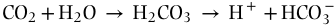

CO2 + H2O → H2CO3 → H + + HCO3 − 

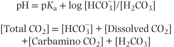

pH = p K a + log [HCO – 3 ]/[H 2 CO 3 ] [Total CO2] = [HCO – 3 ] + [Dissolved CO 2 ] +[Carbamino CO2] + [H2CO3] 

≈ PaCO2 × 0.03 mmol CO2/L/mm Hg 

So, substituting into the equation above:

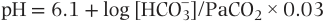

pH = 6.1 + log [HCO – 3 ]/PaCO 2 × 0.03 

This is the Henderson–Hasselbalch equation. It only became possible to introduce this concept into clinical practice with the development of volumetric CO2 analysis by Van Slyke and others in 1919.11 Actual bedside measurement of [H+ ] and pH was limited during the next 30 years and did not become common clinical practice until well into the 1950s. Consequently, Van Slyke, Henderson, Gamble, Singer, Hastings, and others developed a traditional model of acid– base chemistry based on CO2 equilibrium and electrolyte balance: anions were acids, cations were bases.12 In the 1950s work by Astrup and colleagues led to the focus on pH and the H+ rather than electrochemistry, characterized by hydrogen ion “counting.” From that time on, the dominant approach to acid–base has focused on the Henderson–Hasselbalch equilibrium and the H+ activity/pH. In the 1980s, once accurate measurement of electrolytes and blood gases was universally available, Peter Stewart, a Canadian physiologist, reclaimed the electrophysiologic approach, based on a series of calculations derived from physical chemistry. Due to the Stewart approach’s superior ability to diagnose multiple simultaneous acid–base anomalies, it has gained considerable attention in the perioperative and critical care community and is the major focus of this chapter. It is important to state that all the differing approaches to acid– base balance are fully compatible with one another and, regardless of viewpoint, the Henderson–Hasselbalch equation remains the cornerstone of how clinicians interpret acid–base anomalies.

### THE AUTO- IONIZATION OF WATER

An understanding of acid–base chemistry in the human body requires familiarity with physical chemistry. Because the body contains a large quantity of water, the physical properties of water have enormous implications for maintenance of homeostasis. Water is a simple triatomic molecule. Its chemical formula is H2O, and its structural formula is H- O- H. The charge distribution of each covalent bond is unequal and therefore the molecule has a polar conformation and an H- O- H bond angle of 105 degrees. Water molecules attract and form hydrogen bonds with one another. Consequently, water has a high surface tension, a low

vapor pressure, a high specific heat capacity, a high heat of vaporization, and a high boiling point.

Water molecules are in continual motion. Occasionally a collision generates sufficient energy to transfer a proton from one water molecule to another. Thus, water is always slightly dissociated into a negatively charged OH− and a positively charged hydronium ion (H3O+ ). Conventionally, this self- ionization of water is written as follows:

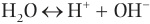

H2O  H   OH  

The symbol H+ is convenient because, while protons dissociating from water have many aliases (such as H3O+ and H9O4+ ), most physician and chemists refer to them as hydrogen ions. This has led to the erroneous belief that [H+ ] represents proton (i.e., individual hydrogen atoms) concentration. Single protons are extremely rare; rather the reader should consider [H+ ] to be the H+ activity of large chains of water molecules that express a positive charge.

The self- ionization of water is miniscule. In pure water at 25°C, the [H+ ] and [OH− ] are 1.0 × 10−7 mmol/L. The tendency for water to dissociate into its component parts is represented by the expression

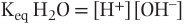

Keq H2O = [H + ] [OH – ] 

The molarity of water is extremely high: 55.5M (“there is a lot of water in water”). As the concentration of water and the Keq are constants, the ion- product dissociation constant for water can be expressed as

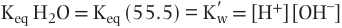

Keq H2O = Keq (55.5) = K ' w = [H + ] [OH – ] 

The implication is that the product of [H+ ] and [OH− ] is constant. Pure water is considered neutral, because [H+ ] and [OH− ] are equal at 1.0 × 10−7 mmol/L. The degree of dissociation may be determined by temperature. For example, as temperature falls, water dissociates less: at 0°C the pH is 7.47. As temperature rises, water dissociation increases: at 100°C the pH is 6.13. Importantly, the pOH, the [OH− ] is also 7.47 and 6.13 at these temperatures. The solution is neutral. Thus, pH in and of itself does not identify acidity or alkalinity.

A solution is considered acidic if the [H+ ] exceeds that of [OH− ] ([H+ ] >1.0 × 10−7 mmol/L, [OH− ] &lt;1.0 × 10−7 mmol/L). A solution is considered alkaline if the [OH− ] exceeds the [H+ ]. Importantly, mammals maintain their body temperature within very strict limits; for humans that is around 37°C. Hence, if body temperature is within the physiologic range, a fall in the pH of blood represents acidosis and a rise in alkalosis.

### ACID–BASE DEFINITIONS

In the 1890s and 1900s, Svante Arrhenius (1859–1927) established the foundations of ionization theory and acid– base chemistry. In an aqueous solution, an Arrhenius acid is any substance that delivers H+ into the solution.5 A base is any substance that delivers OH− into the solution. Because of its high dielectric constant, water is a highly ionizing solution. Therefore substances with polar bonds will dissociate into their component parts in water. While this theory was ideal for biological systems, for general chemistry it was limited: not all reactions occur in water. Brønsted and Lowry independently advanced this concept using slightly

<!-- PDF page 3 -->

different terminology: an acid is a substance that releases H+ and a base is a substance that receives H+ . (Simplified, an acid is a proton donor; a base a proton acceptor.) For each acid in this definition, there is a conjugate base. Water itself is amphoteric: it acts either as an acid or as a base. Thus, when hydrochloric acid (HCl) is dissolved in water, chloride (the acid) donates a proton to water (the base). Similarly, when potassium hydroxide (KOH) is dissolved in water, potassium, the base, receives H+ from water, the acid or proton donor. Some confusion often arises in medicine when these definitions are applied because biological buffers are weak acids, but when they buffer stronger acids, they are Brønsted and Lowry bases. Hence, depending on whether one uses the Arrhenius or the Brønsted and Lowry definitions, HCO3− may be considered a “weak acid buffer” (it is incompletely dissociated – see below) or the conjugate base of carbonic acid.

The degree of dissociation of substances in water determines whether they are strong acids or strong bases. The p _K_ a is the dissociation constant for an ionizable compound: it represents the pH at which the moiety is 50% dissociated. Lactic acid has a p _K_ a of 3.8. That means that, at pH 3.8, lactic acid is 50% dissociated; the compound becomes less dissociated at lower pH and more dissociated at higher pH. Within the physiologic range (pH 7.7 to 8.0), lactic acid is always completely dissociated. Hence there is no lactic acid in the body, only lactate, and it is considered a physiologically strong acid; it is not a chemically strong acid. Conversely, carbonic acid, which has a p _K_ a of 6.4, is incompletely dissociated at all physiologic pH levels, and is a weak acid.

Rather than using the confusing terms “strong acids” and “strong bases,” the term “strong ion” is frequently used to describe ions that are usually found in dissociated state at physiologic pH. These “strong ions” include sodium, potassium, and chloride. They do not easily bind other molecules and exist free in solution. Traditionally, using the Arrhenius and electrochemical approach, each sodium ion delivers a hydroxyl moiety into extracellular fluid, it is functionally a base, as are all cations. As each chloride ion delivers a hydrogen moiety into extracellular fluid, it is functionally an acid, as are all anions. H+ and OH− delivered in this way bind to one another, forming water molecules, and relatively few free H+ or OH− remain free in solution.

HCl + H2O → H3O+ + Cl–

In this reaction, hydrogen chloride acts as a Brønsted and Lowry acid and water as a Brønsted and Lowry base.

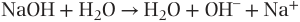

NaOH + H2O → H2O + OH – + Na + 

In this reaction, water acts as a Brønsted and Lowry acid and sodium as a Brønsted and Lowry base.

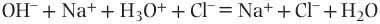

OH – + Na +  + H3O + + Cl –  = Na +  + Cl –  + H2O 

Due to electrical neutrality, the H+ and OH− delivered by chloride and sodium become water.

In summary, all acid–base reactions in the human body relate to the presence of charged particles within an aqueous environment. In the section below, I discuss how the components of extracellular fluid influence the acid–base status of the body, as measured by clinicians. I subsequently explain different acid–base abnormalities, and tools that are

used to identify them. These approaches are neither distinct from one another, nor scientifically incompatible.

## What Determines the Acidity or Alkalinity of a Solution?

All acid–base reactions are based on the principles of physical chemistry and must follow three simple rules2 :

1. _Electrical neutrality_ : in aqueous solutions, in any compartment, the sum of all positive charged ions must equal the sum of all negative charged ions.

2. _Dissociation equilibria_ : the dissociation equilibria of all incompletely dissociated substances, as derived from the law of mass action, must be always satisfied.

3. _Mass conservation_ : the amount of a substance in each compartment remains constant unless it is added, removed, generated, or destroyed. Therefore the total concentration of an incompletely dissociated substance is the sum of concentrations of its dissociated and nondissociated forms.

Thus, to determine the acid–base status of a fluid, all substances to which these rules might be applied must be accounted for. Fundamentally this involves counting up all of the charges (and hence H+ and OH− ), delivered by strong cations (representing bases) and strong anions (representing acids), weak acid buffers, and CO2.13 A discussion of key groups follows.

### STRONG IONS

The first group of ions, the strong ions, dissociate completely. The most abundant strong ions in the extracellular space are Na+ and Cl− . Other important strong ions include K+ , SO42− , Mg2+ , and Ca2+ . These are occasionally referred to as “mineral” acids or bases, as they cannot be metabolized.6 Organic acids are generated from metabolism, and accumulate when there is metabolic dysfunction – such as kidney failure, splanchnic hypoperfusion, or hormonal deficiency. Strong organic anions include lactate, beta- hydroxy butyrate (βOHB), acetoacetate (ketones), components of the “citric acid” cycle (e.g., oxaloacetate), and by-products of protein metabolism (renal acids).

In a solution containing strong ions, created, for example, using specified concentrations of NaOH and HCl, [H+ ] can be calculated by solving for electric neutrality:

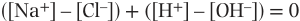

([Na + ] – [Cl – ]) + ([H + ] – [OH – ]) = 0 

This creates two separate simultaneous equations14 :

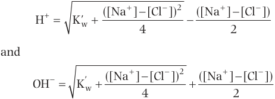

H   K  w  ([Na  ]  4[Cl  ])2  ([Na  ]2  [Cl  ]) and   ([Na  ]  [Cl  ])2 ([Na  ]  [Cl  ]) OH  Kw  4  2 

These equations tell us that [H+ ] and [OH− ] are determined by the Kw′, and the difference in charge between sodium and chloride. As the former is constant, in this system ([Na+ ]

<!-- PDF page 4 -->

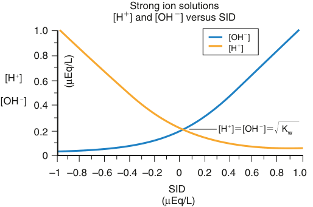

Strong ion solutions [H � ] and [OH � ] versus SID 1.0 [OH � ] [H � ] 0.8 [H � ] 0.6 [OH � ] 0.4 0.2 [H � ]�[OH � ]����Kw 0 –1 –0.8 –0.6 –0.4 –0.2 0 0.2 0.4 0.6 0.8 1.0 SID (µEq/L) Eq/L)(µ 

**Fig. 44.1** Effect of changes in the strong ion difference (SID) on hydrogen and hydroxyl ion concentration. (Adapted from Stewart PA. Modern quantitative acid- based chemistry. _Can J Physiol Pharmacol_ . 1983;61:1444– 1461.)

− [Cl− ]) must determine [H+ ] and [OH− ]. As the concentration of both sodium and chloride are known, the net positive charge minus net negative charge can be quantified. This is the strong ion difference (SID).14 Logically, in any solution, the total sum of the charges imparted by strong cations minus the charges from strong anions will represent the SID. SID independently influences [H+ ] (Fig. 44.1). In human extracellular fluid, SID is always positive.

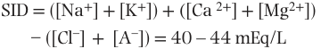

SID = ([Na + ] + [K + ]) + ([Ca  2+ ] + [Mg 2+ ]) – ([Cl – ] +  [A – ]) = 40 – 44 mEq/L 

OH− almost always exceeds H+ quantitatively in solution. The relationship between SID and [H+ ] is non- linear in these conditions. Any change in SID will change both [H+ ] and [OH− ]. Due to the water dissociation constant, this relationship is inverse: as [H+ ] increases, [OH− ] decreases (Fig. 44.1). SID is an independent variable, but [H+ ] and [OH− ] are dependent, therefore, the addition of H+ alone (without strong corresponding anions) cannot influence the pH of the solution.

### WEAK ACID “BUFFER” SOLUTIONS

The degree of water dissociation, and thus [H+ ], is also influenced by charges derived from weak acids. These are partially dissociated compounds whose degree of dissociation is determined by the prevailing temperature and pH. The predominant molecules in this group are albumin and phosphate. Stewart used the term ATOT, to represent the total concentration of weak anions/acids, that influence acid–base balance.2

The acid HA will only partly dissociate, represented by the equilibrium

[HA] = KA [H + ] [A – ] 

KA is the weak acid dissociation constant. If we assume that HA and A− play no further part in this reaction (the law of mass conservation), the amount of A− present in the solution must equal the amount initially present, so

[HA] + [A – ] = [ATOT], 

where [ATOT] is the total weak acid concentration.

To calculate the effect of weak acid dissociation on [H+ ] we must consider water dissociation and electrical neutrality:    [H ]  [OH ]  Kw (water dissociation equilibrium)

[SID]  [H  ]  [A  ]  [OH  ]  0  electrical neutrality 

These four simultaneous equations determine [H+ ] in this solution containing strong ions and weak acids. SID and ATOT are independent variables, whose concentration was determined during the production of the system. Kw′ and KA are constants. Consequently, the other variables [HA], [H+ ], [OH− ], and [A− ] must adjust to satisfy the above equations. They are dependent variables.

### CARBON DIOXIDE

Along with strong ions and weak bases, extracellular fluid contains carbon dioxide. The concentration of CO2 in extracellular fluid is determined by tissue production and alveolar ventilation. CO2, when in solution, exists in four forms: CO2 [dissolved – denoted as CO2(d)], carbonic acid (H2CO3), bicarbonate ions (HCO3− ), and carbonate ions CO32− .

The concentration of CO2(d) is determined by the solubility coefficient of carbon dioxide (SCO2), which depends on body temperature, arterial CO2 tension (PaCO2), and other factors. Several equilibria equations can be derived from the hydration of CO2:

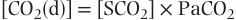

[CO2(d)] = [SCO2] × PaCO2 

The tendency for CO2 to hydrate to H2CO3, and subsequently dissociate to H+ and HCO3− is reflected by the equation:

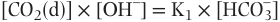

[CO2(d)] × [OH – ] = K1 × [HCO – 3 ] 

These equations can be combined together and with water equilibrium to:

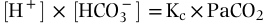

[H + ] × [HCO3 − ] = Kc × PaCO2 

HCO3− also dissociates to release hydrogen ions and carbonate, the equilibrium reaction for which is represented by:

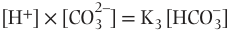

[H + ] × [CO23–] = K3 [HCO–3 ] 

### FACTORS INDEPENDENTLY INFLUENCING WATER DISSOCIATION

Now that we have looked at the different factors that may influence the concentration of hydrogen ions in a solution, strong ions, weak acids, and carbon dioxide, we can combine the derived equations to a solve for [H+ ]:

1.  Water dissociation equilibrium: [H+ ] × [OH– ] – K&#95;'&#95; w

2.  Weak acid dissociation equilibrium: [H+ ] × [A− ] = KA × [HA]

3.  Conservation of mass for weak acids: [HA] + [A− ] = [ATOT]

4.  Bicarbonate ion formation equilibrium: [H+ ] × [HCO3−]= KC× PaCO2

::: warning 符號需核對
此頁有符號無法完整擷取，請展開下方原始頁面核對。
:::

::: details 原始表格與符號（PDF 第 4 頁）

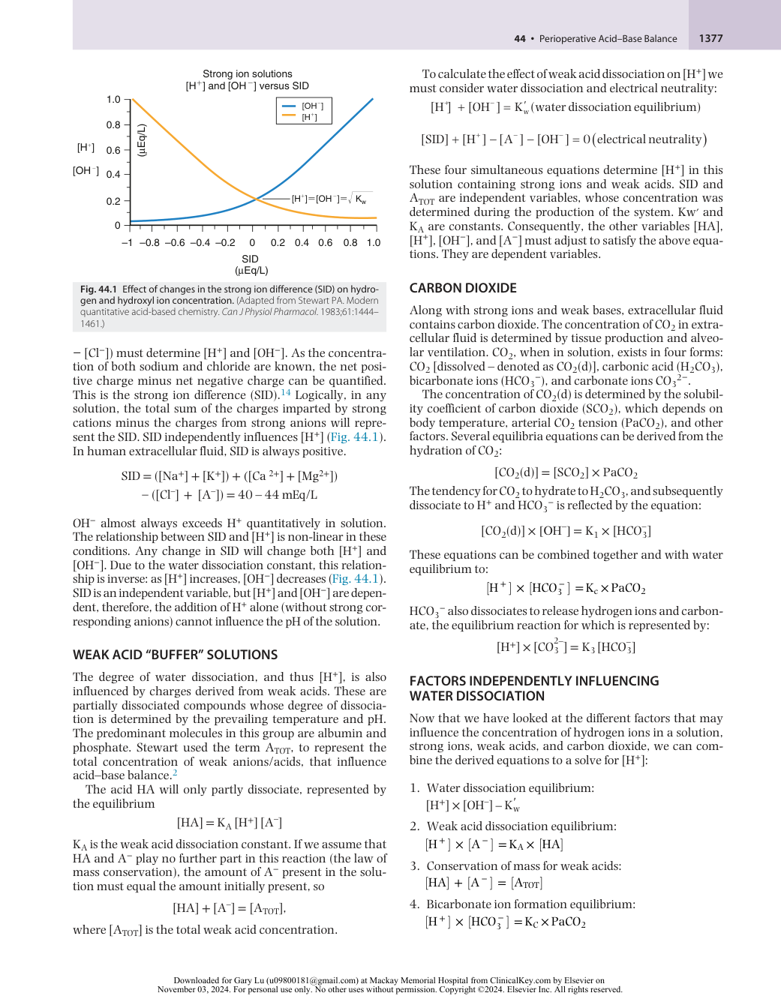

:::

<!-- PDF page 5 -->

5.  Carbonate ion formation equilibrium: [H+ ] × [CO32 − ] = K3 × [HCO3−]

6.  Electrical neutrality:

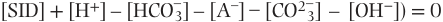

[SID] + [H + ] – [HCO – 3 ] – [A–] – [CO2– 3 ] –  [OH−]) = 0 

There are six independent simultaneous equations, and just six unknown, dependent variables determined by them: [HA], [A− ], [HCO3− ], [CO32− ], [OH− ], and [H+ ]. There are three known independent variables: [SID], [ATOT], and PaCO2. Solving the equations for [H+ ]:

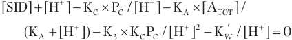

[SID]  [H  ]  KC  PC /[H  ]  KA  [ATOT ]/ (KA  [H  ])  K3  KCPC /[H  ]2  KW  /[H  ]  0 

In other words, [H+ ] is a function of SID, ATOT, PaCO2, and several constants. All other variables, most notably [H+ ], [OH− ], and [HCO3− ] are dependent, and thus cannot independently influence acid–base balance.

## Acid–Base Abnormalities

The terms “acidosis” and “alkalosis” are physiologically difficult to define. From a laboratory perspective, an acidosis may represent a pH value of, for example, pH &lt;7.3 and an alkalosis a pH value of >7.5. However, in physiology, changes in respiration and buffer activity may result in normal range pH, despite concurrent acidifying and alkalinizing processes. Consequently, we are left with a series of terms that were agreed by consensus in 1965, and have remained in place since.15 In that text “acidosis” was described as “an abnormal condition that tends to produce a downward deviation of blood pH or that would produce a (significant) downward deviation of pH if there were no secondary changes.” Using these conventions, acid–base disturbances have been classified as being either due to alterations in PaCO2 (respiratory acidosis or alkalosis), or alterations in blood chemistry (metabolic acidosis or alkalosis).16 The disorders may be primary or secondary or mixed. The term “compensated” refers to whether the pH has been partially (“partially compensated”) or fully (“fully compensated”) restored to normal range; if the pH is entirely correct for the respiratory or metabolic condition, then it is “uncompensated.”

In general, primary respiratory abnormalities were described by increases or decreases in PaCO2, with concomitant alterations in HCO3− . Conversely, metabolic abnormalities were viewed as alterations in HCO3− with concomitant changes in PaCO2. For example, a primary respiratory acidosis was associated with a rise in the PaCO2 and minimal change in the HCO3− or surrogate (e.g., base excess). A primary metabolic acidosis was associated with a fall in the HCO3− with a compensatory fall in the PaCO2.

### RESPIRATORY ACID–BASE ABNORMALITIES

### Respiratory Alkalosis

The normal PaCO2 is 40 mm Hg (5.3 kPa). Respiratory alkalosis occurs when there is an acute decrease in PaCO2,

due to hyperventilation. Acute respiratory alkalosis is characterized by a pH >7.45, a low PaCO2, and a low HCO3− . A simple rule of thumb for this reaction is:

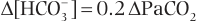

 [HCO3  ]  0.2  PaCO2 

For example: if the PaCO2 falls to 30 mm Hg, the ΔHCO3− should be: 0.2 × (40 − 30) = 0.2 × 10 = 2 mEq/L. Therefore, the estimated [HCO3− ] would be 24 − 2 = 22 mEq/L.

The hyperventilating patient will present with symptoms and signs of vasoconstriction: light- headedness, visual disturbances, dizziness, and hypocalcemia, due to increased binding of calcium to albumin. The latter is caused by an increase in the available negative charge on albumin in alkaline states. Acute hypocalcemia is associated with paresthesia and tetany. In anesthesia practice patients may hyperventilate preoperatively consequent of anxiety, and postoperatively secondary to pain, agitation, or a full bladder. More commonly, hyperventilation results from poor mechanical ventilation strategy and may result in significant systemic and, in particular, cerebral vasoconstriction.

### Respiratory Acidosis

Respiratory acidosis occurs when there is an acute rise in PaCO2 usually associated with respiratory failure. This may result from problems with:

- Central ventilator control such as toxicity from anesthetic agents, benzodiazepines or opioids, stroke, spinal cord injury

- Peripheral ventilator control such as myasthenia gravis, poliomyelitis, polymyopathy, or neuromuscular blockade

- Ventilation perfusion mismatch associated with pneumothorax, pleural effusion, atelectasis, pneumonia, or pulmonary edema

Clinically, there are signs of CO2 retention: cyanosis, vasodilatation, and narcosis.

Respiratory acidosis causes a rapid increase in [H+ ]. Although the acidosis is buffered by intracellular proteins, particularly hemoglobin, these are rapidly overwhelmed. Metabolic compensation for hypercarbia is slow, requiring increased urinary excretion of chloride,8 and pH falls rapidly. There is a concomitant increase in the plasma [HCO3− ], reflecting higher total CO2 load. Brackett, Cohen, and Schwartz in the mid- 1960s elegantly described the relative changes in [HCO3− ] in response to acute and chronic elevations in PaCO2, providing us with extremely useful “rules of thumb.”17

In acute hypercarbia, there is an increase in [H+ ] and plasma [HCO3− ] rises slowly (Table 44.1):

- An increase in PaCO2 by 10 mm Hg (1.3 kPa) results in an increase in [HCO3− ] by 1 mEq/L

- Δ[H+ ] (nEq/L) = 0.8 (ΔPaCO2)

- 1 nEq/L increase in [H+ ] results in a fall in pH by 0.001

A patient returning to the intensive care unit (ICU) from the operating room who has been underventilated for several hours may be hypercapnic – for example, with a PaCO2 of 80 mm Hg (10.5 kPa). Using this rule the expected [HCO3− ] will be 28 mEq/L (see Table 44.1). Also, the [H+ ] to 72 nEq/L and pH will be reduced to 7.08 (assuming the starting pH was 7.4).

<!-- PDF page 6 -->

**Table 44.1** Changes in Bicarbonate HCO3− and PaCO2 in Acute and Chronic Hypercarbia

|**Measured** **Bicarbonate**|**Expected PaCO2 in** **Failure**|**Acute Respiratory**|
|---|---|---|
|**HCO3**−**(mEq/L)**|**PaCO2 (mm Hg)**|**PaCO2 (kPa)**|
|24|40|5.3|
|25|50|6.6|
|26|60|8.0|
|27|70|9.3|
|28|80|10.5|
|29|90|11.8|
|30|100|13|
|**Measured** **Bicarbonate**|**Expected PaCO2 in** **Failure**|**Chronic Respiratory**|
|**HCO3**−**(mEq/L)**|**PaCO2 (mm Hg)**|**PaCO2 (kPa)**|
|24|40|5.3|
|27|50|6.6|
|30|60|8.0|
|33|70|9.3|
|36|80|10.5|
|39|90|11.8|
|42|100|13|

Spontaneous breathing under general anesthesia, for example via laryngeal mask airway, routinely results in mild acute hypercapnia, evidenced by increased end- tidal CO2 (ETCO2) and mild, and apparently harmless, respiratory acidosis.

For example, a 22- year- old male is undergoing orthopedic surgery under general anesthesia; he is breathing spontaneously. Immediately prior to surgical incision, his ETCO2 is 60 mm Hg (8 kPa). His ABG reveals a pH of 7.28, PaCO2 of 65 mm Hg (8.6 kPa), and [HCO3− ] of 26.5 mEq/L.

In chronic respiratory failure, the total carbon dioxide load in the body increases substantially, reflected by relatively high levels of plasma [HCO3− ] (see Table 44.1). There is a concomitant fall in plasma chloride, reflecting compensation for elevated levels of carbonic acid.

In chronic respiratory acidosis, an increase in PaCO2 by 10 mm Hg (1.3 kPa) will increase plasma [HCO3− ] by 3 mEq/L

A patient returning to the ICU from the operating room, ventilated to a PaCO2 of 40 mm Hg (5.3 kPa) but with high total CO2, secondary to chronic respiratory failure (for example from chronic obstructive pulmonary disease [COPD]), may fail to liberate from mechanical ventilation, due to acute metabolic alkalosis. Using the “rule” the patient’s preoperative total CO2 of 33 mEq/L will indicate a baseline PaCO2 of 70 mm Hg (9.3 kPa) for that patient (see Table 44.1).

For anesthesiologists, who routinely administer mechanical ventilation to patients with various levels of carbon dioxide retention, it is important to consider goals

for both PaCO2 and ETCO2 in the operating room. This should also include consideration of the impact of drugs, such as opioids and benzodiazepines, on respiratory function and on the effect of intravenous fluids on overall acid– base dynamics.

In critical illness, particularly in patients with acute respiratory distress syndrome (ARDS), there is consensus among intensivists that aggressive mechanical ventilation to normalize pH and PaCO2 is more harmful than “permissive” hypercapnia. Data supports that such an approach (a “lung protective” strategy), is well tolerated,18,19 and may indeed be beneficial.20

### METABOLIC ACID–BASE DISTURBANCES

Metabolic acid–base disturbances are caused by abnormalities of extracellular water, electrolyte composition, and serum protein levels. Using the terminology described above, metabolic acid–base abnormalities are caused by alterations in the SID or ATOT, or both (Table 44.2). An increase in the SID causes alkalemia; a decrease in the SID causes acidemia. If this results in a significant change in pH, the disorder manifests as acidosis or alkalosis. The alternation may be caused by a change in the total or relative concentration of strong ions. For example, a decrease in the SID (i.e., more anions relative to cations) causes acidosis. This may occur because of a net increase in anions: mineral acids such as chloride or organic acids lactate or ketones (remember, organic acids can be metabolized). In addition, SID can fall due to an increase in the volume of distribution of the same quantity of ions (see Table 44.2). Traditionally, metabolic acid–base disorders have been characterized by changes in HCO3− . A useful “rule of thumb” is that for every 1 mEq/L fall in the SID, there is a 1 mEq/L fall in the [HCO3− ] from baseline (although the “normal” level varies with respiratory function – see Table 44.1) and this approach is widely used to characterize metabolic acidosis. Likewise, for every 1 mEq/L increase in the SID, there is a 1 mEq/L increase in the [HCO3− ] from baseline – and this approach is widely used to characterize metabolic alkalosis. Note that, in all scenarios, [HCO3− ] is a _dependent_ variable; dependent on changes in SID or ATOT.

Metabolic acidosis is of clinical significance for two reasons: pathologies arising from the acidosis itself and pathologies arising from the cause of the acidosis. Acidosis is associated with alterations in transcellular ion pumps and increased ionized calcium. The result is vasodilation, diminished myocardial performance, and arrhythmias. The oxyhemoglobin dissociation curve shifts rightward to increase oxygen offload into the tissues. Rapid- onset metabolic acidosis may be associated with profound hypotension, cardiac arrhythmias, and death. The malignancy of the acidosis is strongly related to the underlying disease process; lactic acidosis caused by circulatory shock is more malevolent than hyperchloremic acidosis.13 The body is hyperresponsive to acidosis. Increasing hydrogen ion activity in cerebrospinal fluid activates the respiratory center to stimulate respiration. Alveolar ventilation increases, reducing arterial CO2 content, hence reducing the total body [H+ ]. [HCO3− ] simultaneously falls due to buffering activity and due to the reduction in total CO2. As a result,

::: details 原始表格與符號（PDF 第 6 頁）

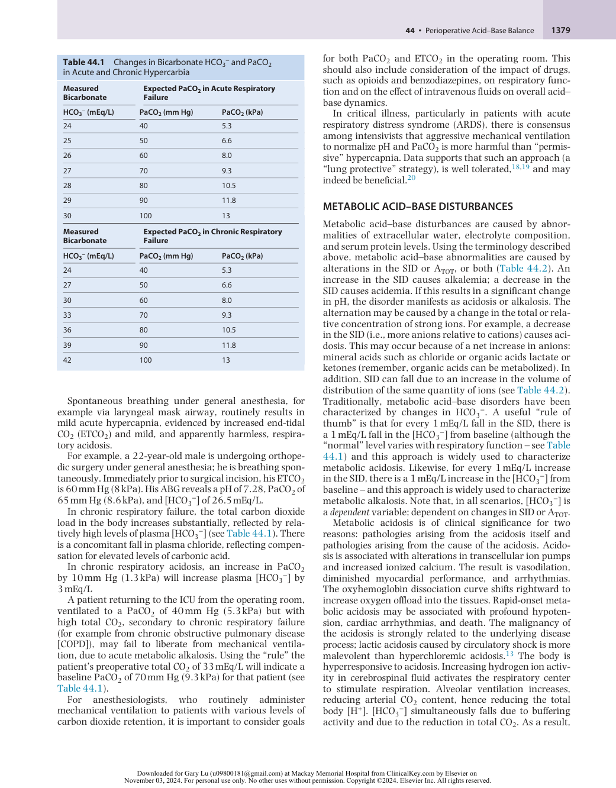

:::

<!-- PDF page 7 -->

**Table 44.2** Classification of Primary Acid–Base Abnormalities

|**Abnormalities**|**Acidosis**|**Alkalosis**|
|---|---|---|
|**RESPIRATORY**|Increased PaCO2|Decreased PaCO2|
|**METABOLIC** **Abnormal SID**|||
|Caused by water excess or deficit|Water excess = dilutional|Water deficit = contraction|
||↓SID +↓[Na+]|↑SID↑[Na+]|
|Caused by electrolytes|Chloride excess|Chloride deficit|
|Chloride (measured)|↓SID↑[Cl−]|↑SID +↓[Cl−]|
|Lactate (measured)|↓SID↑[La−]|–|
|Ketones (partially measured)|↓SID↑[βOHB]|–|
|Other (unmeasured) anions|↓SID↑[UMA−]|–|
|**Abnormal ATOT** Albumin [Alb]|↑[Alb] (rare)|↓[Alb]|
|Phosphate [Pi]|↑[Pi]||

_[Alb],_ concentration of serum albumin; _ATOT,_ to represent the total concentration of weak ions; _[Cl_&#95;−&#95; _],_ concentration of chloride ions; _[Na_&#95;+&#95; _],_ concentration of sodium ions; _PaCO2,_ partial pressure of carbon dioxide; _[Pi],_ concentration of inorganic phosphate; _SID,_ strong ion difference; _[UMA_&#95;−&#95; _],_ unmeasured anions; _↑_ , increased; _↓,_ decreased. _[La_&#95;−&#95; _],_ serum lactate concentration; _[βOHB],_ β-hydroxybutyrate concentration. Adapted and updated from Fencl V, Jabor A, Kazda A, Figge J. Diagnosis of metabolic acid- base disturbances in critically ill patients. _Am J Respir Crit Care Med_ . 2000;162:2246–2251.

the blood pH falls less in metabolic acidosis compared with respiratory acidosis.

Metabolic alkalosis rarely occurs because of acute illness. Symptoms and signs of metabolic alkalosis include widespread vasoconstriction, lightheadedness, tetany, and paresthesia. The main compensatory mechanism is hypoventilation.

In normal extracellular fluid, the SID is 40–44 mEq/L, this positive charge being balanced principally by weak acids (without which, the pH of blood would be 11.9). Anything that increases the SID will increase the relative concentration of cations to anions and alkalinize the solution. Anything that decreases the SID will decrease the relative concentration of cations to anions and will acidify the solution. Hence, if the extracellular compartment volume is expanded with free water (no electrolytes), the components of the system are diluted, with relatively more dilution of more abundant moieties (sodium rather than chloride); the result is a reduction in SID and “dilutional acidosis.”21 This is rarely seen in clinical practice, due to the renal water clearance. Conversely, if free water is removed from the extracellular fluid, for example from increased evaporative losses, there is an increase in the relative concentration of charged moieties, and this concentration effects more abundant ions and compounds (sodium rather than chloride). The SID increases and the patient develops a “contraction alkalosis” (see Table 44.2).22 This is commonly seen in clinical practice, in particular following the administration of loop diuretics that have a greater impact on water removal over salt.

A liter of “normal saline solution” (NaCl 0.9%) contains 154 mEq (3.5 g) of sodium and 154 mEq (5.5 g) of chloride and is commonly used for fluid resuscitation. The SID of this solution is 0. As each liter of fluid delivers relatively more chloride than sodium (as the baseline proportions in extracellular fluid are 1.4:1 – SID 35 to 40), progressive hyperchloremia results. This reduces SID and results in “hyperchloremic acidosis.”23 Any process that removes chloride without sodium, such as vomiting or aggressive nasogastric suctioning with a loss of HCl, causes metabolic alkalosis (hypochloremic alkalosis) due to an increase in SID. The alkalosis is caused by chloride loss, which obeys the law of conservation of mass (i.e., there is a finite quantity available in the extracellular fluid), not hydrogen ions, whose source (water) is unlimited. Severe diarrhea, which is associated with loss of both potassium and sodium, reduces the SID, and is associated with metabolic acidosis. Aggressive use of diuretics causes a net loss of free water over sodium and chloride and causes contraction alkalosis.

The most significant form of metabolic acidosis is associated with a net gain of organic anions (that may or may not be measured) and, consequently, a decreased SID.

1.  In dysoxia, liver dysfunction, and states of severe stress, lactate production exceeds metabolism, reducing the SID and resulting in acidosis (lactic acidosis).

2.  In diabetic ketoacidosis (DKA) or during starvation or liver disease, βOHB and acetoacetate are produced, reducing SID, resulting in acidosis (ketoacidosis).

3.  In severe renal failure, Cl− , SO42− , PO43− (“fixed renal acids”), and various other metabolic intermediaries are not excreted, resulting in acidosis (renal acidosis).

Measurement of plasma lactate levels is performed by all blood gas analyzers, and ketones can be easily measured with point- of- care devices. Only “renal” acids are “unmeasured.”

The total weak acid pool (ATOT), principally serum albumin and phosphate, is also an important determinant of acid–base status. Hyperphosphatemia has long been associated with the acidosis of acute and chronic kidney injury. Hypoalbuminemia is common in critical care. Hypoalbuminemia decreases ATOT and is associated with metabolic alkalosis.24,25 There is a strong association between hypoalbuminemia and severity of critical illness. Albumin deficits result from four different homeostatic changes: reprioritization of hepatic protein production favoring production of acute phase reactants and limiting albumin synthesis, capillary leak with loss of albumin into the interstitium, breakdown of preexisting albumin so that its constituent amino acids can be used for protein synthesis, and replacement of plasma with protein- free fluids.

The impact of hypoalbuminemia on acid–base balance has traditionally been underestimated. Albumin in blood and extracellular fluid is negatively charged and it is the main component of what has traditionally been termed “buffer base:” the negative charge that constitutes the net positive charge of the SID.24 Consequently, the presence of hypoalbuminemia may mask the detection of acidosis26 caused, for example, by unmeasured anions, when using conventional tools of acid–base chemistry: pH, HCO3− , base deficit, and the anion gap (see below).27 Hyperalbuminemia

::: details 原始表格與符號（PDF 第 7 頁）

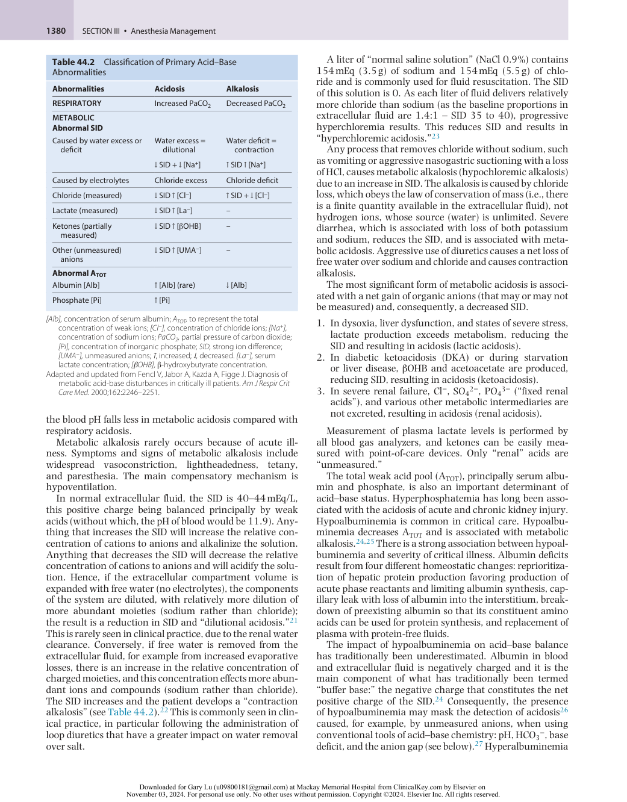

:::

<!-- PDF page 8 -->

is very unusual; in cholera, when associated with hemoconcentration, it results in acidosis.28

## Regulation of Acid–Base Balance

Extracellular hydrogen ion activity appears to be tightly controlled by the body as a component of homeostasis. Probably, this regulation reflects a need to prevent rapid changes in extracellular electrochemical balance from interfering with the function of transcellular ion pumps. To prevent fluctuation a variety of intracellular and extracellular buffering systems have evolved.29 A _buffer_ is a solution of two or more chemicals that minimizes changes in pH in response to the addition of an acid or base. Ideally, a buffer has a p _K_ a that is equal to the pH, and an ideal body buffer has a p _K_ a between 6.8 and 7.2. Most biologically salient buffers are weak acids.

It is valuable to view control of H+ activity in terms of volatile and metabolic acids (mineral and organic). The major source of acid in the body is the volatile acid carbon dioxide, which produces 12,500 mEq of H+ a day, mostly excreted by the lungs. An equivalent quantity of lactate is manufactured and processed by the body each day. In contrast, only 20 to 70 mEq of H+ - promoting anions are excreted daily through the kidney.

Volatile acid is principally buffered by hemoglobin within erythrocytes. Carbon dioxide easily passes through cell membranes. Within the erythrocyte, CO2 combines with H2O, under the influence of the enzyme carbonic anhydrase, to form H2CO3, which immediately ionizes to H+ and HCO3− . H+ binds to histidine residues on deoxyhemoglobin (the “Haldane” effect), and HCO3− is actively pumped out of the cell. Chloride moves inward to maintain electroneutrality (the chloride shift) and to ensure the continued production of carbonic acid. CO2 is also buffered directly by hemoglobin (carbaminohemoglobin) and by plasma proteins (carbamino proteins). Venous blood contains 1.68 mEq/L extra CO2 over arterial blood: 65% as HCO3− and H+ bound to hemoglobin, 27% as carbaminohemoglobin (CO2 bound to hemoglobin), and 8% dissolved.

When respiratory failure occurs, the principal CO2 buffering system, hemoglobin, becomes overwhelmed, leading to the rapid development of acidosis. In response, the kidney excretes an increased chloride load, using NH4+ , a weak cation, for electrochemical balance. Thus extracellular fluid osmolality is maintained. This process is conventionally referred to as “metabolic compensation.” Chronic respiratory acidosis is associated with increase in total body CO2 content, reflected principally by an increase in serum HCO3− (see Table 44.1). Hypercapnia is associated with a progressive increase in cerebrospinal fluid (CSF) HCO3− . Compensation for this hypercarbia is a reduction in CSF chloride30 and an increase in CSF SID.31–33 This is probably controlled by active transport mechanisms across the blood–brain barrier or at the level of the choroid plexus and can be blocked by furosemide and acetazolamide.34–37 The result is a rightward shift in the PaCO2 response curve; the respiratory center responds to hypercarbia by increasing respiratory drive at a higher PaCO2 level than under normal conditions.

HCO3− is a dependent variable, that increases or decreases with PaCO2.38 The rate of conversion of CO2 to HCO3− is dependent on carbonic anhydrase activity and occurs slowly. Thus it is possible to mathematically determine whether a rise in PaCO2 is acute or long- standing (see Table 44.1).

Metabolic acid is buffered principally by increased alveolar ventilation, producing respiratory alkalosis, and extracellular weak acids. These weak acids include plasma proteins, phosphate, and HCO3− . The HCO3− buffering system (92% of plasma buffering and 13% overall) is probably the most important extracellular buffer. The p _K_ a of bicarbonate is relatively low (6.1), but the system derives its importance from the enormous quantity of CO2 present in the body. The coupling of HCO3− and H2O produces CO2, which is then excreted through the lungs, increasing alveolar ventilation. Physicians must be aware of the importance of this compensatory mechanism. For example, anesthetized or critically ill patients on controlled mechanical ventilation lose the capacity to regulate their own PaCO2. Consequently, the combination of acute metabolic and respiratory acidosis can cause a devastating reduction in pH.

The major effect of the kidney on acid–base balance relates to renal handling of sodium and chloride ions. As dietary intake of sodium and chloride is roughly equal, the kidney excretes a net chloride load, using NH4+ , to electrochemically neutralize urinary chloride.39

In metabolic acidosis, the kidneys preferentially excrete chloride. In metabolic alkalosis, chloride is retained, and sodium and potassium are excreted. The presence of bicarbonate in the urine reflects the need to maintain electrical neutrality. Abnormalities in the renal handling of chloride may be responsible for several inherited acid–base disturbances. In renal tubular acidosis, there is inability to excrete Cl− in proportion to Na+ .40 The diagnosis can be made by observing a hyperchloremic metabolic acidosis, with inappropriately low levels of Cl− in the urine: the urinary SID is positive. If the urinary SID is negative, the process is not of renal origin. Similarly, pseudohypoaldosteronism appears to be due to high reabsorption of chloride.41 Bartter syndrome is caused by a mutation in the gene encoding the chloride channel (CLCNKB) that regulates the Na- K- 2Cl cotransporter (NKCC2).42

The other causes of hyperchloremic metabolic acidosis are gastrointestinal losses (diarrhea, small bowel or pancreatic drainage), parenteral nutrition, excessive administration of saline, and the use of carbonic anhydrase inhibitors.

## Analytic Tools Used in Acid–Base Chemistry

Acid–base balance is a core component of the clinical evaluation of the acutely and critically ill. ABG analysis provides immediate information on the status of the patient’s respiratory system and whether a state of acidosis or alkalosis is present. By applying a variety of empiric rules, the information contained in an ABG is often sufficient to allow one to identify the presence, cause, and progression of a disease. The diagnostic sensitivity of blood gas analysis is augmented when a serum chemistry panel, as well as glucose, lactate, blood, and urinary ketones measurements are added.

<!-- PDF page 9 -->

### Box 44.1 Acid–Base Schools of Thought

Henderson–Hasselbalch Equation (all schools) **Electrochemical School Boston & Copenhagen Schools (Pre- 1955 & Post- 1995) (“Traditional” 1955 to present)** **_Theoretical Components Theoretical Components_** Based on physical chemistry Based on [H+ ] concentration and pH Arrhenius model of acid–base Brønsted–Lowry Model of Acid–Base Ion dissociation is core component: electrical neutrality; mass Electrolyte balance is not a component conservation; dissociation equilibria, compartment volumes PaCO2 changes results in respiratory acidosis and alkalosis PaCO2 changes results in respiratory acidosis and alkalosis Changes in pH, [H+ ], and [HCO3− ] are dependent of cation–anion balance Changes in [H+ ] and [HCO3− ] cause and explain all acid–base (SID, ATOT) and PaCO2 abnormalities Anions are surrogates of acids Metabolic acidosis is caused by H+ gain or [HCO3− ] loss Metabolic acidosis results from ↓SID or ↑ATOT Cations are surrogates of bases Metabolic alkalosis is caused by H+ loss or [HCO3− ] gain Metabolic alkalosis results from ↑SID or ↓ATOT **_Analytic Tools: Analytic Tools:_** Anion gap PaCO2 vs. [HCO3− ] rules Strong ion gap Δ[HCO3− ] Base deficit gap Base excess and base deficit Individualization of acidifying and alkalinizing effects (including smartphone apps)

Several different approaches to acid–base balance are in widespread use (Box 44.1).43 The descriptive (“Boston”) approach utilizes the inter- relationship between PaCO2 and [HCO3− ] to detect and diagnose acid–base abnormalities. The “Copenhagen” approach uses a derived variable, the standardized base excess or base deficit, to differentiate respiratory and metabolic acid–base abnormalities. The quantitative approach utilizes anion gap, the base deficit gap, the strong ion gap (SIG) and a more detailed approach (the “Fencl” approach) to delineate multiple acidifying and alkalizing processes that go on simultaneously. Clinicians often and unconsciously mix and match approaches. For example, the anion gap, which was likely developed in the 1940s, based entirely on electrochemistry, is used by proponents of all the major approaches.

Many of the early approaches were developed at a time when only total CO2 levels could be measured. Today key electrolytes, CO2, and bicarbonate can be measured in seconds. Quantitative analyses rather than “rules of thumb” are likely to dominate the clinical approach to acid–base chemistry into the future. That is because the relatively complex calculations can be easily performed on smartphone apps at the bedside22 or using the hospital information system.

### THE CO2–BICARBONATE DESCRIPTIVE APPROACH (BOSTON)

Schwartz, Brackett, Relman, and colleagues at Tufts University in Boston developed the most popular descriptive approach to acid–base chemistry in the 1960s. Their formulation uses acid–base maps and the mathematical relationship between PaCO2 and plasma HCO3− (or total CO2), derived from the Henderson–Hasselbalch equation, to classify acid–base disturbances in terms of two independent variables: PaCO2 and [HCO3− ].4,17,44 To validate this approach, a number of patients with known acid–base disturbances, at steady states of compensation, were evaluated. The degree of compensation, relative to what was considered normal,

was measured for each disease state. The investigators were able to describe six primary states of acid–base imbalance, using linear equations or maps, relating hydrogen ion concentration to PaCO2 for respiratory disturbances, and PaCO2 to HCO3− concentration for metabolic disturbances (Fig. 44.2). For any given acid–base disturbance, an expected HCO3− concentration was determined. These were then compiled into a series of mathematical rules (see Table 44.1 and Box 44.2). For most simple disturbances, this is a reasonable approach. As discussed above, in acute respiratory acidosis, the [HCO3− ] will increase by 1 mEq/l for every 10 mm Hg (1.3 kPa) elevation in PaCO2 above 40 mm Hg (5.3 kPa). In chronic respiratory acidosis, the [HCO3− ] will increase by 3 mEq/l for every 10 mm Hg (1.3 kPa) elevation in PaCO2 above 40 mm Hg (5.3 kPa).

In acute metabolic acidosis, the [HCO3− ] falls by 1 mEq/L for every 1 mEq/L in strong anions. The respiratory center is activated, resulting in a predictable fall in the PaCO2. This was neatly characterized by Winters in a pediatric population in 1967 and remains robust.45 In acute metabolic acidosis, the PaCO2 (in mm Hg) falls predictably, using the 1.5 × [HCO3− ] + 8 rule. For example, if the [HCO3− ] is 12 mEq/L, then the expected PaCO2 is 1.5 × 12 + 8 = 26 mm Hg. If the PaCO2 is higher than this, then compensation is inadequate and there is a concomitant respiratory problem (for example ketoacidosis in the presence of a respiratory tract infection). Winters also described expected compensation using the base excess approach (see next section): for every 1 mEq/L reduction in the base excess the PaCO2 is expected to fall by 1 mm Hg, otherwise “compensation” is inadequate.

In metabolic alkalosis, in order to restore pH to homeostatic levels it is necessary to retain carbonic acid, and hypoventilation occurs, ultimately resulting in increased [HCO3− ]. The expected PaCO2 equals 0.7 × [HCO3− ] + 20 (in mm Hg). So if a patient has a [HCO3− ] of 34 mEq/L, then the PaCO2 should be 44 mm Hg.

Using these maps, equations, and rules, physicians can determine the nature of most respiratory and metabolic acid–base disturbances and in a manner that is usually

<!-- PDF page 10 -->

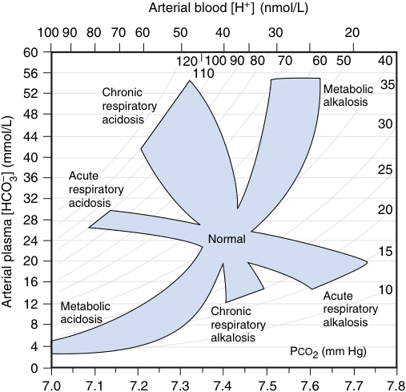

Arterial blood [H + ] (nmol/L) 100 90 80 70 60 50 40 30 20 60 120 100 90 80 70 60 50 40 56 110 52 Chronic Metabolic 35 respiratory alkalosis 48 acidosis 30 44 40 25 36 Acute respiratory 32 acidosis 20 28 24 Normal 15 20 16 10 Acute 12 Metabolic Chronic respiratory 8 acidosis respiratory alkalosis alkalosis 4 P CO2  (mm Hg) 0 7.0 7.1 7.2 7.3 7.4 7.5 7.6 7.7 7.8  ] (mmol/L)– Arterial plasma [HCO3 

**Fig. 44.2 Acid–base nomogram using the Boston approach.** Different acid–base disturbances can be distinguished based on the relative values of PaCO2 and HCO3− . (Adapted from Brenner BM, Rector FC. _The Kidney_ , 3rd edn. Philadelphia, WB Saunders; 1986:473.)

accurate. Although there is a mathematical relationship in place, alterations in [H+ ] and [HCO3− ] do not imply cause and effect. For example, chronic hypoventilation is associated with an increase in PaCO2 and [HCO3− ]. Many physicians have incorrectly assigned the increase in [HCO3− ] as compensation for raised PaCO2. It is not. The increased [HCO3− ] reflects an increase in total CO2 in the body.

Although the PaCO2–HCO3− approach is relatively accurate for most circumstances, and is particularly useful for respiratory problems, there are several inherent pitfalls, particularly in relation to the metabolic component. First, the approach is not as simple as it seems, requiring the clinician to refer to confusing maps or to learn formulas and perform mental arithmetic. The system is particularly weak in relation to metabolic acidosis: it merely identifies the acidosis or alkalosis and the degree of respiratory compensation. In the absence of further information or the use of, for example, the anion gap, the mechanism of acidosis or alkalosis cannot be identified. Fig. 44.3 is a decision tree that uses this descriptive approach to acid–base.

### THE ANION GAP APPROACH

The most widely used tool for investigating metabolic acidosis is anion gap, widely used since the 1950s but popularized by Emmett and Narins in 1977.46 It is based on the law of electrical neutrality. It is an early representation of the physical chemistry approach, described later, and is usually used alongside the Boston approach to acid–base, hence its inclusion in this section. Again, the system is based on data that were not easily available or known at the time of its inception: the contribution to electrical neutrality ascribed to weak acids (phosphate and albumin) and unmeasured anions. The sum of the difference in charge of the common extracellular

### Box 44.2 The Descriptive (CO2–HCO3− ) Approach to Acid–Base

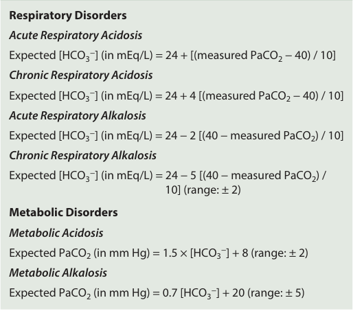

Respiratory Disorders Acute Respiratory Acidosis Expected [HCO3 − ] (in mEq/L) = 24 + [(measured PaCO2 − 40) / 10] Chronic Respiratory Acidosis Expected [HCO3 − ] (in mEq/L) = 24 + 4 [(measured PaCO2 − 40) / 10] Acute Respiratory Alkalosis Expected [HCO3 − ] (in mEq/L) = 24 − 2 [(40 − measured PaCO2) / 10] Chronic Respiratory Alkalosis Expected [HCO3 − ] (in mEq/L) = 24 − 5 [(40 − measured PaCO2) / 10] (range: ± 2) Metabolic Disorders Metabolic Acidosis Expected PaCO2 (in mm Hg) = 1.5 × [HCO3 −  ] + 8 (range: ± 2) Metabolic Alkalosis Expected PaCO2 (in mm Hg) = 0.7 [HCO3 − ] + 20 (range: ± 5) 

ions reveals an unaccounted for “gap” of −10 to −12 mEq/L. There are three widely used variants of the anion gap (Fig. 44.4), depending on whether potassium and lactate are included (in time, with more accurate ketone assays, this will be added to the anion side of the calculation):

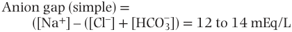

Anion gap (simple) = ([Na + ] – ([Cl – ] + [HCO – 3 ]) = 12 to 14 mEq/L 

Anion gap (conventional) =

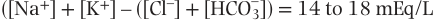

([Na + ] + [K + ] – ([Cl – ] + [HCO – 3 ]) = 14 to 18 mEq/L 

Anion gap (modern) =

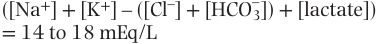

([Na + ] + [K + ] – ([Cl – ] + [HCO – 3 ]) + [lactate]) = 14 to 18 mEq/L 

If the patient develops a metabolic acidosis, and the gap “widens” to, for example >20 mEq/L, then the acidosis is caused by unmeasured anions, usually renal acids or ketones. If the gap does not widen, then the anions are being measured, and the acidosis has been caused by hyperchloremia (HCO3− cannot independently influence acid–base status) or lactate (if used). While this is a useful tool, it is weakened by the assumption of what the “normal gap” is.47 Anion gap frequently underestimates the extent of the metabolic disturbance.27 The majority of critically ill patients are hypoalbuminemic, and many are also hypophosphatemic. Consequently, the gap may be normal in the presence of unmeasured anions. This has been extensively studied by Fencl and Figge, who have provided us with a variant known as the “corrected anion gap:”27

Anion gap corrected (for albumin) = calculated anion gap + 0.25 (42*– observed albumin g/L).

*normal albumin, which may vary between populations/ laboratory reference values

<!-- PDF page 11 -->

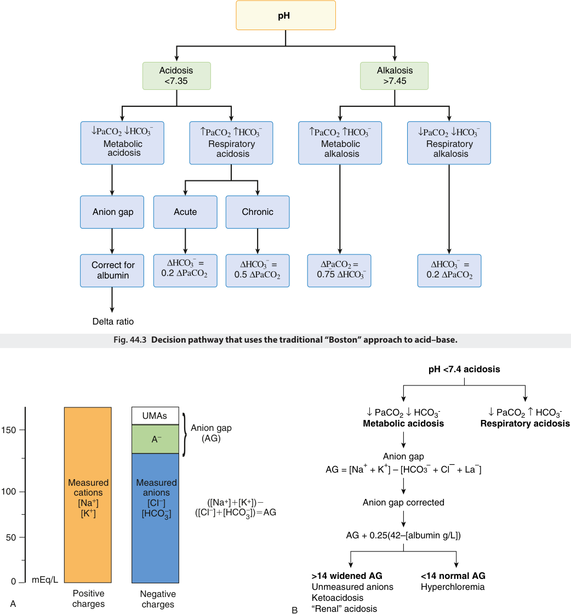

pH Acidosis Alkalosis &lt;7.35 >7.45 PaCO2 PaCO2 PaCO2 PaCO2 Metabolic  Respiratory  Metabolic  Respiratory acidosis acidosis alkalosis alkalosis Anion gap Acute Chronic Correct for  PaCO2 = albumin PaCO2 PaCO2 PaCO2 Delta ratio Fig. 44.3 Decision pathway that uses the traditional “Boston” approach to acid–base. pH &lt;7.4 acidosis UMAs ↓ PaCO2 ↓ HCO3 - ↓ PaCO2 ↑ HCO3 - Metabolic acidosis Respiratory acidosis 150 Anion gap A − (AG) } Anion gap AG = [Na+ + K+] – [HCO3– + Cl– + La–] Measured Measured 100 cations anions [Na + ] [CI − ] ([Na + ]�[K + ])� Anion gap corrected [K + ] [HCO3−] ([Cl − ]�[HCO3−])�AG 50 AG + 0.25(42–[albumin g/L]) >14 widened AG &lt;14 normal AG 0 mEq/L Unmeasured anions Hyperchloremia Positive Negative Ketoacidosis A charges charges B “Renal” acidosis 

**Fig. 44.4** (A) The anion gap represents the difference in charge between measured cations and measured anions. The missing negative charge is made up of weak acids (A− ), such as albumin and phosphate, and strong unmeasured anions (UMAs), such as lactate. (B) Decision pathway for metabolic acidosis using the modern anion gap. _AG_ , anion gap.

In this corrected form the anion gap accurately quantifies metabolic acidosis, and it is useful in discriminating an acidosis due to unmeasured anions from one reflecting hyperchloremia, in a previously healthy patient (e.g., in acute trauma). Moviat and colleagues have demonstrated that the anion gap corrected for albumin accurately detects complex acid–base abnormalities in intensive care.48

Another version of the anion gap is the delta anion gap (delta ratio; Box 44.3), an approach that has successfully

predicted adverse outcomes in critical illness.49 Simply, if the anion gap is normal, or unchanged, and the [HCO3− ] falls, then the delta ratio will be less than 0.4, and a hyperchloremic acidosis is present. A delta ratio between 1 and 2 is what one would expect from metabolic acidosis due to unmeasured anions or lactate. If the ratio is greater than 2, mixed acid–base abnormalities are present. Although, on the surface, this process is relatively simple, it assumes that the clinician knows the normal anion gap and [HCO3− ] for that

::: warning 符號需核對
此頁有符號無法完整擷取，請展開下方原始頁面核對。
:::

::: details 原始表格與符號（PDF 第 11 頁）

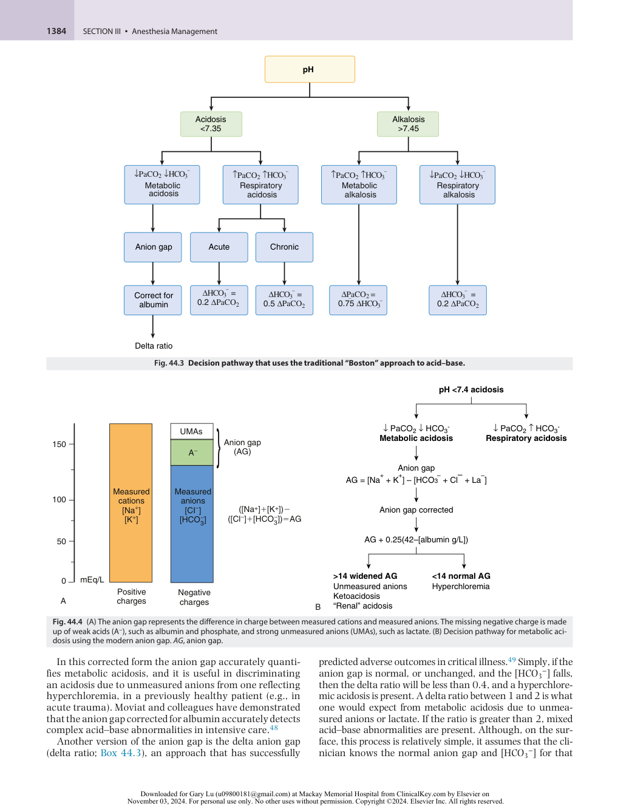

:::

<!-- PDF page 12 -->

### Box 44.3 The Delta Anion Gap (Delta Ratio)

|Delta ratio|        3 3   Aniongap/ [HCO ]or anion gap / [HCO ] Measured aniongap Normal aniongap|
|---|---|
||      3 3 Normal[HCO ] Measured [HCO ] Aniongap 12|
||   3 24 [HCO ]|
|**Delta ratio**|**Clinical Assessment**|
|&lt;0.4|Hyperchloremic normal anion gap acidosis|
|&lt;1|High anion gap and normal anion gap acidosis|
|1 to 2|Pure anion gap acidosis Lactic acidosis: average value 1.6 DKA more likely to have a ratio closer to 1 due to urine ketone loss|
|>2|High anion gap acidosis and a concurrent metabolic alkalosis or a preexisting compensated respiratory acidosis|

particular patient. In addition, it does not result in a clear diagnosis other than hyperchloremia. Fig. 44.4A is a Gambelgram that illustrates the anion gap. Fig. 44.4B is a decision tree that illustrates the use of the corrected anion gap.

### THE BASE EXCESS (COPENHAGEN) APPROACH

In metabolic acidosis, the addition of routinely unmeasured anions to the extracellular fluid results in a net gain of one H+ for each anion. This is “buffered,” principally by bicarbonate, such that each anion gained results in an equivalent fall in [HCO3− ]. Thus the change in the [HCO3− ] from baseline should reflect the total quantity of net anions gained. Adherents to the descriptive approach to acid–base, refer to this as the “delta” HCO3− . However, this is problematic, as it does not separate out the effect of CO2 metabolism on the [HCO3− ].

In 1948, Singer and Hastings50 proposed that changes in the whole blood buffer base could be used to quantify the metabolic component independent of Henderson–Hasselbalch model. The buffer base represents the sum of the [HCO3− ] and the non- volatile buffer ions (essentially the serum albumin, phosphate, and hemoglobin). Applying the law of electrical neutrality, the buffer base was observed to equal the electrical charge difference between strong ions. Thus, normal buffer base = [Na+ ] + [K+ ] − [Cl− ]. Alterations in buffer base represent changes in strong ion concentrations (which could not be easily measured in 1948). Buffer base increases in the presence of a metabolic alkalosis and decreases in metabolic acidosis. The major drawback of buffer base measurement is the potential for changes in buffering capacity associated with alterations in hemoglobin concentration and pH.

Following the development of sophisticated electrodes for measuring PaCO2 in Copenhagen in the early 1950s,51 Astrup and colleagues developed the standard bicarbonate – the [HCO3− ] at 37°C and at a PaCO2 of 40 mm Hg (5.3 kPa).52 Building upon this work, Siggard- Andersen and Astrup53 recognized that PaCO2 and [HCO3− ] were not independent variables. As a result, they derived the base

excess (BE) as a measure that could differentiate respiratory from metabolic acid–base disturbances. As defined, the BE is the amount of strong acid (HCl, in mmol/L) or base (NaOH) required to return the pH to 7.4, assuming that PaCO2 is constant at 40 mm Hg (5.3 kPa) and that the temperature is 37°C.54 Like the Boston group, the Siggard- Andersen data were derived from observations on a large population of patients. The investigators carefully titrated known amounts of acid or base to blood maintained by tonometry at various PaCO2 values and a wide range of haemoglobin concentration at 37°C. These studies led to the development of an alignment nomogram (Fig. 44.5, Table 44.3) that allowed for the determination of BE from a single measurement of pH, PaCO2, and hemoglobin concentration at 37°C. There have been a variety of calculations used to determine the BE since the 1960s.55 That is because of several erroneous assumptions that Siggaard- Andersen made about extracellular (albumin, phosphate, proteins) and intracellular (hemoglobin) buffers, and the role of transcellular chloride movement.56 The following formula is now used to calculate the standard base excess (SBE) or the base excess of extracellular fluid in blood gas machines:

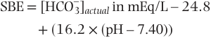

SBE = [HCO – 3 ] actual  in mEq/L – 24.8 + (16.2 × (pH – 7.40)) 

Although various descriptions of this approach to acid–base chemistry refer to BE, and that term is reported on blood gas forms, when a negative base excess is reported, the correct terminology is _base deficit_ (= 1 − BE).57 For simplicity, in the following discussion, I will refer to BE, keeping in mind that it may be positive (metabolic alkalosis) or negative (metabolic acidosis).

Application of simple mathematical rules allows for use of the BE in each of the common acid–base disturbances (Boxes 44.4 and 44.5; Fig. 44.6). For example, in acute respiratory acidosis or alkalosis, BE does not change. Conversely, in acute metabolic acidosis, the magnitude of change of the PaCO2 (in mm Hg) is the same as that of the BE (in mEq/L).

There has been considerable discussion over the past 60 years about the merits and demerits of the BE, as compared to the CO2–HCO3− system. However, there is little difference between the two: both equations and nomograms were derived from patient data and abstracted backward. Calculations use HCO3− as derived on a blood gas analyzer. Consequently, for most patients, either approach is relatively accurate but may be misleading because they do not allow the clinician to distinguish between, for example, acidosis due to lactate or chloride, or alkalosis due to dehydration or hypoalbuminemia. These measures may miss the presence of an acid–base disturbance entirely: for example, a hypoalbuminemic (metabolic alkalosis) critically ill patient with a lactic acidosis (metabolic acidosis) may have a normal pH, [HCO3− ], and BE values. This lack of precision may lead to inappropriate or inadequate therapy.

### THE BASE DEFICIT GAP AND FENCL APPROACH

Changes in the base excess occur secondary to alterations in the relative concentrations of sodium, chloride, lactate, ketones, free water, albumin, phosphate, and unmeasured anions. By calculating the contribution of the individual components of the BE it is possible to identify: (1)

::: details 原始表格與符號（PDF 第 12 頁）

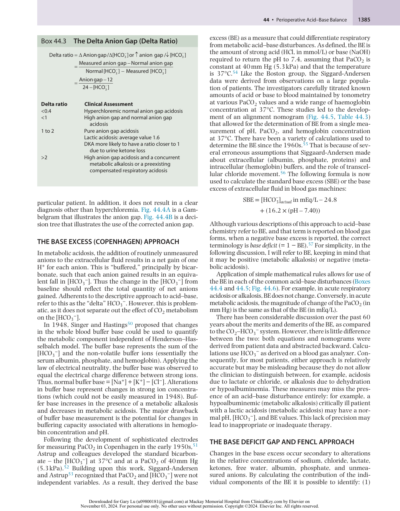

:::

<!-- PDF page 13 -->

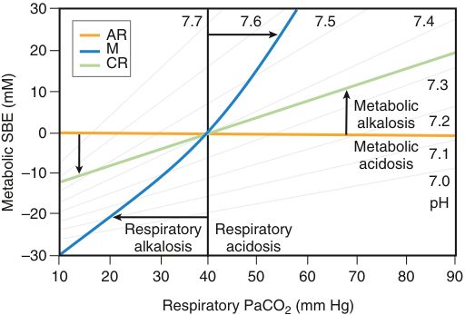

30 7.7 7.6 7.5 7.4 AR 20 M CR 7.3 10 Metabolic alkalosis 7.2 0 Metabolic 7.1 acidosis –10 7.0 pH –20 Respiratory Respiratory alkalosis acidosis –30 10 20 30 40 50 60 70 80 90 Respiratory PaCO2 (mm Hg) Metabolic SBE (mM) 

**Fig. 44.5 Acid–base nomogram using the Copenhagen approach as revised by Schlichtig.** The various acid–base disturbances can be distinguished based on PCO2 and standard base excess (SBE). _Arrows_ represent changes as the body compensates for acute acidosis or alkalosis. _AR_ , acute respiratory acidosis or alkalosis; _CR_ , chronic respiratory acidosis or alkalosis; _M_ , metabolic acidosis or alkalosis. (From Schlichtig R, Grogono AW, Severinghaus JW. Human PaCO2 and standard base excess compensation for acid- base imbalance. _Crit Care Med_ . 1998;26:1173–1179.)

**Table 44.3** Changes in Standard Base Deficit or Excess in Response to Acute and Chronic Acid–Base Disturbances

|**Disturbance**|**SBE vs. PaCO2**|
|---|---|
|Acute respiratory acidosis|ΔBE = 0|
|Acute respiratory alkalosis|ΔBE = 0|
|Chronic respiratory acidosis|ΔBE = 0.4ΔPaCO2|
|Metabolic acidosis|ΔPaCO2=ΔBE|
|Metabolic alkalosis|ΔPaCO2= 0.6ΔBE|

_BE_ , base excess; _Δ_ , change in value; _PaCO2_ , partial pressure of arterial carbon dioxide.

Modified from Narins RB, Emmett M. Simple and mixed acid- base disorders: A practical approach. _Medicine (Baltimore)_ . 1980;59:161–187.

contraction alkalosis; (2) hypoalbuminemic alkalosis; (3) hyperchloremic acidosis; (4) dilution acidosis (if indeed it exists); and (5) acidosis secondary to organic anions. This approach (the Fencl5 approach, described below), can be used to construct “base deficit gap.” It has been proposed by Gilfix and Magder (see Box 44.4),58 and simplified subsequently by Balasubramanyan et al.59 and Story and Bellomo25 and further refined by Story (see Box 44.5).60 The BDG should mirror the strong ion gap (below) and the corrected anion gap. It represents unmeasured anions (usually associated with acute kidney injury) once ketoacidosis has been eliminated.

The simplified calculation as proposed by Story60 is very easy to calculate at the bedside and in the majority of situations (see Box 44.5) replicates the more complex calculations originally proposed by Gilfix and Magder.58

### THE STRONG ION GAP

The physical chemical approach is based on the concept of electrical neutrality, a small advance from the anion gap. The strong ion difference (SID) is derived by counting the charge carried on all of the strong cations and subtracting

### Box 44.4 Calculating the Base Excess Gap58

BENaW (water and sodium effect) = 0.3 × ([Na+ ]measured − 140) (in mEq/L)

- BECl (chloride effect) = 105 − [Cl− ]effective (in mEq/L)

BEPO4 (phosphate effect) = (0.309 × (pH − 0.46) × (0.8 − [Pi]measured) (in mmol/L)

- BEprot (protein effect) = (42 − [Albumin] in g/L) × (0.148 × pH − 0.818)

- BEcalc = BENaW + BECl + BEPO4 + BEprot BE gap = BEcalc − BEactual − [lactate] (in mEq/L)

### Box 44.5 Calculation of Base Excess Gap (Simplified)25

Base Excess = (Base Excess for Na–Cl and H2O + Base Excess for Albumin) − Base (Deficit for Lactate + Base Deficit for UMA) BENaCl = ([Na+ ] − [Cl− ]) − 35

BEAlb = 0.25 (42 − albumin in g/L)

BEcalc = (BENaCl − BEAlb) − [Lactate]

- BE gap = BEactual − BEcalc − [Lactate] = the effect of unmeasured anions or cations

- This approach involves calculating the base deficit- excess for sodium, chloride and free water (BENaCl), and that for albumin (BEAlb). The result is the calculated BE (BEcalc). This is subtracted from the measured BE to find the BE gap.

the charge carried on strong anions: (SIDa) [(Na+ + Mg2+ + Ca2+ + K+ ) − (Cl− + A− )] is 40–44 mEq/L (where SIDa represents the “apparent” SID as all strong cations and anions cannot be measured. SID is balanced by an equal negative charge on HCO3− , phosphate, albumin and other proteins (ATOT) and this is the SIDe (SID effective). There is a small difference between SIDa and SIDe – effective SID that represents a strong ion gap (SIG) and quantifies the amount of unmeasured anion present (Fig. 44.7).

### SIDa (apparent SID) =

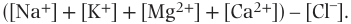

([Na + ] + [K + ] + [Mg 2+ ] + [Ca 2+ ]) – [Cl – ]. 

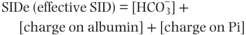

SIDe (effective SID) = [HCO – 3 ] + [charge on albumin] + [charge on Pi] 

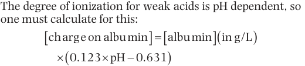

The degree of ionization for weak acids is pH dependent, so one must calculate for this:  charge on albumin  albumin  in g/L   0.123  pH  0.631  

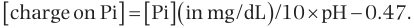

 charge on Pi  Pi  in mg/dL  /10  pH  0.47. 

Strong Ion Gap (SIG) = SIDa − SIDe 

Like the anion gap, precision can be increased by adding other measured anions – lactate and ketones. Regardless, once the “gap” has been identified, it adds little beyond the anion gap and BE gap and principally assists with the diagnosis of renal acidosis or identification of other unmeasured anions (such as gelatin, if administered during fluid resuscitation).

There are other issues with SID/SIG. SID changes quantitatively in absolute and relative terms when there are changes in plasma water concentration. Fencl has

::: details 原始表格與符號（PDF 第 13 頁）

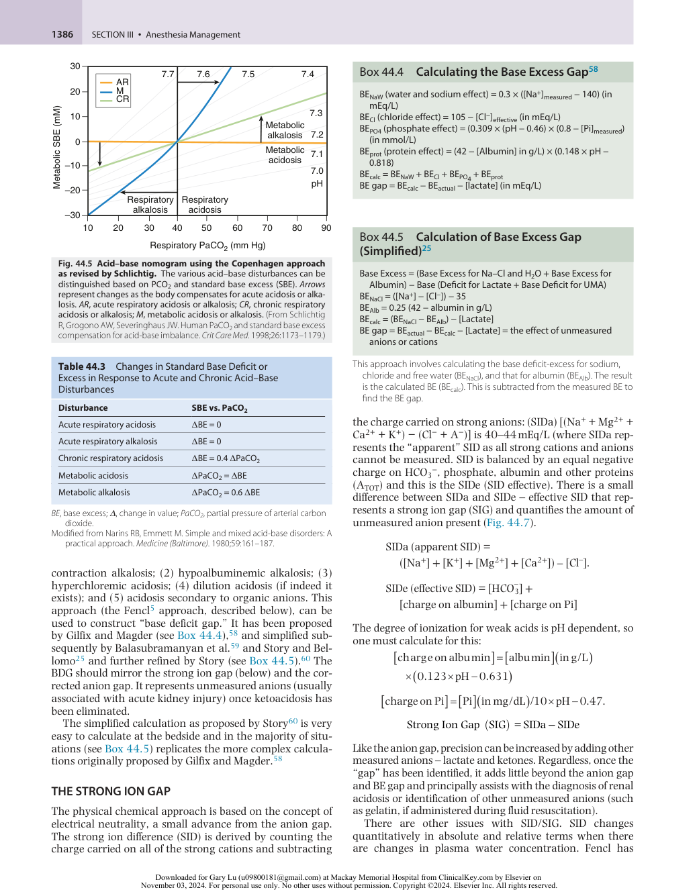

:::

<!-- PDF page 14 -->

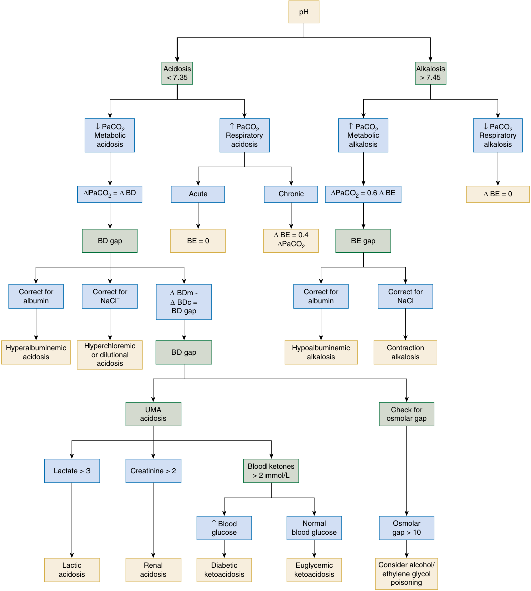

pH Acidosis Alkalosis &lt; 7.35 > 7.45 ↓ PaCO2 ↑ PaCO2 ↑ PaCO2 ↓ PaCO2 Metabolic Respiratory Metabolic Respiratory acidosis acidosis alkalosis alkalosis ∆PaCO2 = ∆ BD Acute Chronic ∆PaCO2 = 0.6 ∆ BE ∆ BE = 0 ∆ BE = 0.4 BD gap BE = 0 ∆PaCO2 BE gap Correct for Correct for ∆ BDm - Correct for Correct for albumin NaCl – ∆ BDc = albumin NaCl BD gap Hyperalbuminemic Hyperchloremic Hypoalbuminemic Contraction acidosis or dilutional BD gap alkalosis alkalosis acidosis UMA Check for acidosis osmolar gap Blood ketones Lactate > 3 Creatinine > 2 > 2 mmol/L ↑ Blood Normal Osmolar glucose blood glucose gap > 10 Lactic Renal Diabetic Euglycemic Consider alcohol/ acidosis acidosis ketoacidosis ketoacidosis ethylene glycol poisoning 

**Fig. 44.6 Decision pathway using the base excess and the base deficit gap.** _BE_ , base excess; _BD_ , base deficit (1– BE); _BDm_ , measured base deficit; _BDc_ , base deficit corrected for albumin, sodium, chloride, and free water; _UMA_ , unmeasured anions. Lactate in mmol/L, ketones in mmol/L, creatinine in mg/dL, osmolar gap in mOsm.

The blood gas machine reports metabolic anomalies in terms of Base Excess (BE). 1 minus BE is usually termed “Base Deficit” (BD) but reported on the ABG as a negative value of BE. Conventionally a BE is seen in Chronic Respiratory Acidosis and Metabolic Acidosis. A BD is seen in metabolic acidosis. The major value of the BD is to uncover the presence of Unmeasured Anions (UMA). However, the value may be distorted by abnormalities in the concentration of Albumin, a weak acid, and the relative charges carried by Sodium, Chloride and the volume extracellular “Free” Water. The effect can be calculated (BEc or BDc, c for calculated) and subtracted from the BD or BE (measured - BDm or BEm) that is provided by the blood gas machine to produce a charge “gap” (usually anionic in metabolic acidosis) caused by UMA. There may be a BDgap or a BEgap (as in the figure) but the calculation is the same, and, for simplicity I will refer to it below as the BDEgap (Base Deficit or Excess gap). BDE gap = BDEm – BDEc. BDEc is calculated from BE or BD for Albumin (BDEALB ) + BDE for Sodium, Chloride or Free Water (BDENaCL ). BDEALB = (42-albumin g/L)/4 in mEq/L. BDENaCL = (Na+ - Cl-) – 35; BDEALB + BDENACL = BDEc; BDEm – BDEc = BDEgap (BDgap if the calculation is negative BEgap if number is positive).

<!-- PDF page 15 -->

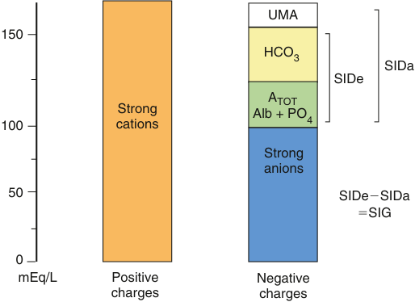

UMA 150 HCO3 SIDa SIDe ATOT Strong Alb + PO4 100 cations Strong anions 50 SIDe�SIDa �SIG 0 mEq/L Positive Negative charges charges 

**Fig. 44.7 The strong ion gap (SIG).** SID apparent (SIDa is the sum of ATOT plus [HCO3− ]. SID effective (SIDe) is the real SID. The difference between the two is made up of unmeasured anions (UMA).

addressed this by correcting [Cl− ] for free water [Cl− ] _corr_ using the following equation5 :

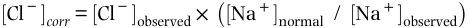

[Cl − ] corr  = [Cl − ]observed × ([Na + ]normal / [Na + ]observed) 

This corrected [Cl− ] may then be inserted into the SIDa equation above. Similarly, the derived value for unmeasured anions – [UMA] – can also be corrected for free water by substituting [UMA] for [Cl− ] in the above equation.26 In a series of 9 normal subjects, Fencl estimated the “normal” SIG as 8 ± 2 mEq/L.26

Calculation of SIG is cumbersome. The data required are more extensive and thus more expensive than other approaches and there is much confusion about the normal range of SIG. It is unclear, in standard clinical practice, that SIG has any advantage over corrected anion gap (which is SIG without calcium, magnesium, and phosphate and which usually cancel out each other’s charges).

It is likely that no single number will ever allow us to make sense of complex acid–base disturbances. Fencl26 suggested that, rather than focusing on anion gap or base excess, physicians should address each blood gas in terms of all alkalinizing and acidifying effects: respiratory acidosis/ alkalosis, the presence or absence of abnormal SID (due to water excess/deficit, measured electrolytes or unmeasured electrolytes), and abnormal ATOT. Consider the following patient, described by Fencl26 (data in mEq/L unless otherwise stated):

[Na+ ] 117 mEq/L [Cl− ] 92 mEq/L, [Ca2+ ] 3.0 mEq/L [Albumin] 6.0 g/L

[K+ ] 3.9 mEq/L [Mg2+ ] 1.4 mEq/L [Pi] 0.6 mmol/L ABG: pH 7.33, PaCO2 30 mm Hg, HCO3− 15 mEq/L

Derived values would be:

Anion gap = 13 mEq/L, corrected anion gap = 23 mEq/L, BE = −10, SID = 18 mEq/L, Cl− corrected = 112 mEq/L, UMAcorrected = 18 mEq/L.

Using traditional methodology, one would describe this as a non- gap metabolic acidosis and look for causes of HCO3− wasting such as renal tubular acidosis or gastrointestinal

losses. The degree of respiratory alkalosis is appropriate for the degree of acidosis (ΔBE = ΔPaCO2). However, the Fencl– Stewart approach reveals a much more complex situation. SID is reduced to 18 mEq/L – caused by free water excess, unmeasured anions and, surprisingly, hyperchloremia (see the corrected chloride). However, the degree of acidosis does not mirror the metabolic disturbance because of the alkalizing force of hypoalbuminemia. The corrected anion gap mirrors the change in SID, but this alteration is grossly underestimated by the base deficit. This patient has a dilutional acidosis, a hyperchloremic acidosis, and a lactic acidosis!

In conclusion, for most patients who have been previously healthy presenting to the emergency room or operating suite, the use of tools such as the base deficit or anion gap to assess metabolic disturbances remains reasonable, particularly if corrected for albumin. However, for critically ill patients, the most effective method of interpreting acid–base conundrums involves unraveling simultaneous acidifying and alkalinizing processes and using calculations to distinguish between the various forces at play. Unfortunately, a clinician’s ability to interpret such information is dependent on the amount of available data. A simple blood gas alone may camouflage a significant acid–base disturbance. Modern smartphone applications rapidly identify the different acidifying and alkalizing factors that are occurring simultaneously.22

In the next section, we look at the causes of many commonly seen acid–base disturbances in different clinical settings.

## Acid–Base Problems in Perioperative and Critical Care Medicine

### RESPIRATORY ACIDOSIS AND ALKALOSIS

In perioperative medicine, respiratory acid–base abnormalities are an uncommon complication of prolonged spontaneous breathing under anesthesia, inadequate mechanical ventilation (both acute respiratory acidosis), or excessive mechanical ventilation (metabolic alkalosis) (Table 44.4). Acute respiratory acidosis results from hypoventilation or increased dead space ventilation. Patients may manifest respiratory distress characterized by respiratory acidosis in the recovery room or surgical ICU. Assessment begins with an examination of the patient’s breathing pattern (Fig. 44.8): slow shallow breathing indicates impaired respiratory drive, rapid shallow breathing suggests chest wall or lung pathology, and obstructed breathing signifies airway obstruction. Blood gas analysis of acute respiratory acidosis will reflect a dramatic fall in pH, an elevated PaCO2, a slight rise in HCO3− (by 1 mEq/L for every 10 mm Hg [or 1.2 kPa] rise in PaCO2). The base excess should be zero. Respiratory acidosis as a complication of anesthesia is relatively common – excessive sedation (particularly opioids), partial neuromuscular blockade, intraoperative hypoventilation, pneumothorax, etc. It may also complicate CO2 insufflation during laparoscopy so the patients’ minute ventilation should be dynamically adjusted intraoperatively to maintain ETCO2 levels near baseline.

For patients with COPD (or other causes of chronic respiratory failure), it is worthwhile, preoperatively, to calculate the baseline PaCO2 on a patient from the total CO2

::: warning 符號需核對
此頁有符號無法完整擷取，請展開下方原始頁面核對。
:::

::: details 原始表格與符號（PDF 第 15 頁）

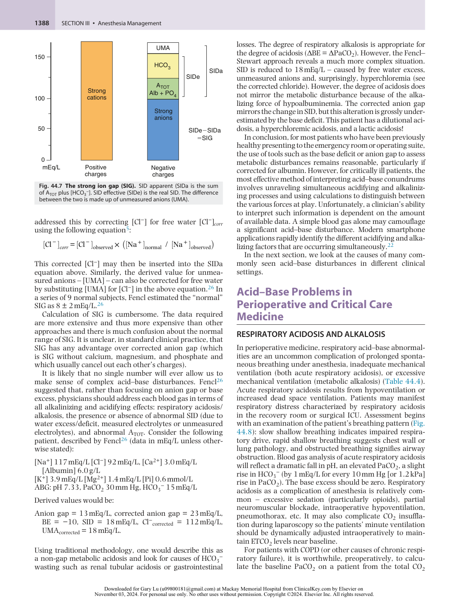

:::

<!-- PDF page 16 -->

on serum chemistry panel. As discussed earlier, total CO2 (HCO3− ) rises by 3 mEq/L for every 10 mm Hg (1.3 kPa) rise in PaCO2. A patient, for example, with a baseline total CO2 of 33 mmol/L, would be expected to have a baseline PaCO2 of 70 mm Hg (9.3 kPa). For intraoperative management, the ETCO2 should be maintained, if the patient is undergoing mechanical ventilation, between 3 and 5 mm Hg (0.5 to 1 kPa) of baseline (the PaCO2–ETCO2 gradient increases with age and non- supine positioning).

If the patient is hypoventilating perioperatively, the pH falls, the PaCO2 rises, but the rise in the total CO2 (HCO3− )

**Table 44.4** Acid–Base Disturbances Commonly Seen Perioperatively

|**Disorder**|**Cause**|
|---|---|
|Respiratory acidosis|Hypoventilation; narcosis, incomplete reversal of neuromuscular blockade|
|Respiratory alkalosis|Hyperventilation; anxiety, pain|
|Metabolic acidosis due to unmeasured anions (widened gap acidosis)|Hypoperfusion and stress – lactic acidosis; diabetic and euglycemic ketoacidosis; kidney injury (acute or chronic)|
|Metabolic acidosis due to measured anions (non- gap hyperchloremic acidosis)|Hyperchloremia – 0.9% NaCl and saline-containing fluids; renal tubular acidosis; bladder reconstructions|
|Metabolic acidosis due to free water excess (hyponatremia, dilution acidosis)|Hypotonic fluid administration; sodium loss (diarrhea; administration of hyperosmolar fluids), mannitol, alcohol, hyperproteinemia|
|Metabolic alkalosis|Hyperventilation of patient with history of CO2retention (COPD); sodium gain (sodium bicarbonate, massive blood transfusion); chloride loss (vomiting or nasogastric suctioning)|

_COPD,_ chronic obstructive pulmonary disease.

is lower than expected. If this patient’s PaCO2, postoperatively is 90 mm Hg (12 kPa) and the total CO2 (HCO3− ) is 35 mmol/L, then the patient has acute on chronic respiratory acidosis. This problem may be compounded by the patient’s lack of pulmonary reserve and the negative impact on the respiratory center by opioids and other anesthetic agents. Consideration should be given to administration of noninvasive ventilation, to restore PaCO2 to what is normal for that patient.

In emergency medicine and critical illness, respiratory acidosis complicates a wide variety of pathologies. Most commonly, these cause a problem of patient “can’t breathe” (a neuromuscular or anatomical problem), or the patient “won’t breathe” (a central nervous system pathology). The latter includes neurologic injury (stroke, spinal cord injury, botulism, tetanus), and toxic suppression of the respiratory center (opioids, barbiturates, benzodiazepines). Patients “can’t breathe” due to a variety of neuromuscular disorders (Guillain–Barré syndrome, myasthenia gravis), flail chest, hydro- hemo- pneumo- thorax, pulmonary edema, and pneumonia. Failure to ventilate, as manifest by respiratory acidosis, may result from abdominal hypertension and abdominal compartment syndrome, where diaphragmatic excursion is impeded by high intra- abdominal pressures, often with associated oliguria and hypotension.

Acute respiratory alkalosis is caused by hyperventilation, either due to anxiety or pain, central respiratory stimulation (as occurs early in salicylate poisoning), or excessive artificial ventilation. In acute respiratory alkalosis the pH is above 7.45, the PaCO2 below 40 mm Hg (5.3 kPa), and the [HCO3− ] falls by 2 mEq/L for every 10 mm Hg (1.3 kPa) fall in PaCO2. There is no change in the base excess. So, if a patient has a PaCO2 of 30 mm Hg, the [HCO3− ] should be 22 mEq/L.

Acute respiratory alkalosis usually accompanies acute metabolic acidosis, in which case the reduction in PaCO2 from baseline (usually 40 mm Hg) is equal to the magnitude

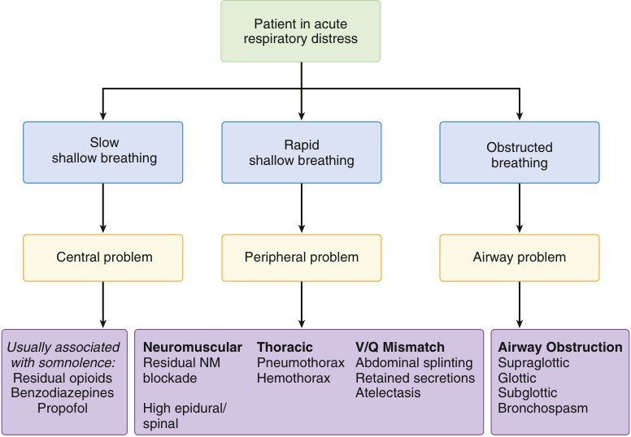

Patient in acute respiratory distress Slow Rapid Obstructed shallow breathing shallow breathing breathing Central problem Peripheral problem Airway problem Usually associated Neuromuscular Thoracic V/Q Mismatch Airway Obstruction with somnolence: Residual NM Pneumothorax Abdominal splinting Supraglottic Residual opioids blockade Hemothorax Retained secretions Glottic Benzodiazepines Atelectasis Subglottic Propofol High epidural/ Bronchospasm spinal 

**Fig. 44.8 Using the breathing pattern to determine the cause of acute respiratory distress and respiratory acidosis.**

::: details 原始表格與符號（PDF 第 16 頁）

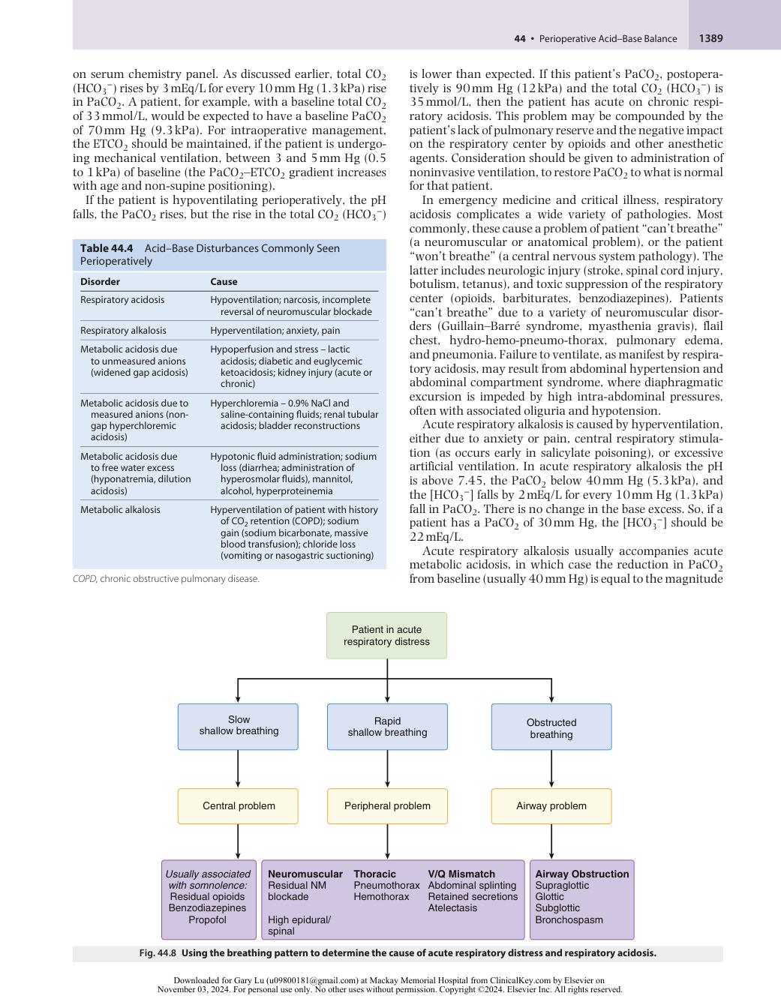

:::

<!-- PDF page 17 -->

of the base deficit (see Table 44.3). The fall in [HCO3− ], from baseline, is significantly greater than that seen in primary respiratory alkalosis, due to the consumption of bicarbonate as extracellular buffer (the [HCO3− ] falls by 1 mEq/L for every mEq/L gain in strong anions). For example, in a patient with a lactic acidosis with [lactate] of 10 mEq/L, the base excess should be −10, the [HCO3− ] 10 mEq/L lower than baseline, and the PaCO2 30 mm Hg. If the PaCO2 is higher than expected, then there is a concomitant problem with the respiratory apparatus. An example would be a multi- trauma patient, where massive blood loss leads to lactic acidosis and a flail chest causes respiratory acidosis.

### METABOLIC ACIDOSIS AND ALKALOSIS

### Metabolic Acidosis

Acute metabolic acidosis is caused by an alteration in SID or ATOT. SID is changed by an alteration in the relative quantity of strong anions to strong cations. Mineral anions and cations are gained due to exogenous intake or administration. Organic anions (lactate, ketones, nitrogen waste products) are generated via metabolic pathways and metabolized in the liver. Mineral anions and cations may be lost due to vomiting, diarrhea, intra- abdominal collections, diuresis, or renal tubular abnormalities, including acute kidney injury.

Acute metabolic acidosis is characterized by a pH of &lt;7.35, and a fall in both PaCO2 and [HCO3− ] below the baseline. For patients without COPD or chronic CO2 retention, this represents a PaCO2 &lt;40 mm Hg (5.3 kPa) and a [HCO3− ] &lt;24 mEq/L. There is a negative base excess (base deficit) whose magnitude represents the net strong anion gain. This simple approach indicates that an acidosis is present, and that it is metabolic in origin. To further investigate the acidosis, one or more of the analytical tools described above may be employed. The most widely used tool is the anion gap, which should be adjusted for albumin and include the plasma lactate. This differentiates hyperchloremic acidosis from acidosis associated with other measured and unmeasured anions. In the setting of metabolic acidosis, where possible, lactate, ketones, phosphate, and albumin should be measured as should surrogate markers of anion accumulation (serum creatinine and the osmolar gap). Causes of metabolic acidosis that are commonly encountered by anesthesiologists are discussed below.

### Lactic Acidosis

Lactate is one of the major sources of energy of the body; it is a circulating carbohydrate fuel.61 Lactic acid is produced intracellularly from glucose, via lactate dehydrogenase, both in the presence and absence of oxygen. Lactic acid immediately dissociates due to its p _K_ a of 3.8, and H+ is buffered intracellularly.62 Anionic lactate is transported into the extracellular space. Between 12,500 to 1500 mEq of lactate enters the circulation each day from muscle (25%), brain (25%), skin (25%), erythrocytes (20%), and intestine (10%).63 Lactate is widely used as an energy source, particularly by the brain, kidney, and heart, where it undergoes oxidative phosphorylation.61 It is also transported to the liver where it undergoes gluconeogenesis and subsequent metabolism to CO2 and water (the Cori cycle). Hepatic processing can increase 10- fold during exercise.63

Accumulation of lactate in extracellular fluid is associated with metabolic acidosis: for each mEq/L rise in the lactate concentration, [HCO3− ] decreases in mEq/L by the same magnitude and pH falls correspondingly. Although controversy exists regarding the source of “acid” (H+ ),64 the generation of metabolic acidosis associated with hyperlactatemia (lactic acidosis) is entirely consistent with alterations in water dissociation and electrochemical balance.65 Regardless of mechanism, the presence of hyperlactatemia and metabolic acidosis is universally known as “lactic acidosis,” in analogous to ketoacidosis or hyperchloremic acidosis. The presence of lactic acidosis is an excellent marker of acute critical illness, the magnitude of which often reflects the degree of hyperlactatemia. Lactic acidosis occurs when the production of lactate in the body is greater than the liver’s capacity to clear it, i.e., there is a problem of overproduction or inadequate clearance or both.

In nature lactate exists as two isoforms: L- Lactate, which is produced by the human body, and is measured by blood gas analyzers, and D- Lactate, which can only be produced by fermentation by bacteria. The formation of L- Lactate (lactate) from pyruvate is catalyzed by lactate dehydrogenase. Lactate is used as a “buffer” in isotonic fluids, principally lactated Ringer’s solution and Hartmann’s solution; these contain a racemic mixture of both D and L lactate at a concentration of 14 mEq/L each. In this setting, lactate is rapidly metabolized to CO2 and water, and hence HCO3− .

Under normal conditions the ratio of lactate to pyruvate is less than 20:1. In anaerobic conditions, for example following vigorous exercise, lactate levels increase dramatically, and high levels of circulating lactate are frequently interpreted as evidence of increased glycolytic activity. However, lactate is often produced under aerobic conditions. Activation of beta-adrenergic receptors in skeletal muscle is by stress (increased circulating catecholamines) or exogenous infusion (epinephrine/norepinephrine infusions), or even nebulized bronchodilators; these increase [lactate], resulting in “aerobic glycolysis.”

Plasma lactate and arterial pH should be measured early in any critically ill patient; it is now a diagnostic component of the definition of septic shock.66 [lactate] >2 mEq/L is clinically significant and a level of 5 mEq/L in the presence of metabolic acidosis is considered severe.67 Isolated hyperlactatemia in the absence of acidosis is of unclear clinical significance.68

Traditionally, lactic acidosis has been described as taking one of two forms: type A (also termed as type 1), where global inadequate oxygen delivery is seen in hypovolemic/ haemorrhagic shock while type B (or type 2) occurs despite normal global oxygen delivery and tissue perfusion. Lactic acidosis may also develop in situations where there is significant regional hypoperfusion. Examples include bowel ischemia, where lactate is produced in large quantity due to glycolysis despite global oxygen delivery that is normal. Type B lactic acidosis is associated with any state where circulating catecholamines (endogenous or exogenous) are in excess. Examples include simple exercise and the hyperinflammatory state of trauma or sepsis. Type B lactic acidosis may also be seen in cyanide poisoning (associated with sodium nitroprusside), with biguanides (metformin, which blocks hepatic gluconeogenesis), and in hypercatabolic diseases such as lymphoma, leukemia, AIDS, or DKA. In

<!-- PDF page 18 -->

critical illness, type A and type B lactic acidosis frequently coexist.

It is universally accepted that lactic acidosis is a sensitive marker of disease severity.69 Persistence of lactic acidosis strongly predicts poor outcomes in acute illness.70–72 Rapid clearance (i.e., reduced plasma concentration presumably due to reduced production and increased metabolism) of lactate has been associated with improved outcomes.73,74 What is controversial is whether it is possible to institute therapy that improves outcomes and simultaneously increases lactate clearance. Simplistically, improved overall perfusion consequent of blood or isotonic fluid administration should reduce glycolysis and reduce lactate production, increasing hepatic blood flow and increasing metabolism. However, not all patients who are under- resuscitated are hyperlactatemic, and probably the minority of patients who are hyperlactatemic are under- resuscitated. Although fluid resuscitation with the goal of normalizing plasma lactate may be associated with improved outcomes, excessive or late fluid resuscitation increases mortality.75 It is important to note that, following fluid bolus, plasma lactate rapidly falls, perhaps due to hemodilution, and then falls slowly, at 10%–20% per hour, due to rate-limited hepatic clearance. If plasma lactate does not fall, fluid resuscitation should be discontinued.76

The presence of evidence of good overall oxygen delivery and normal consumption as measured by cardiac output monitors and mixed venous oxygen saturation in lactic acidosis is not reassuring. Indeed, bowel ischemia may be indicated by otherwise unexplained lactic acidosis, and the availability heuristic associated with sepsis may result in delayed diagnosis and inappropriate fluid resuscitation (Fig. 44.9).

Metformin is associated with severe lactic acidosis, a phenomenon that appears more likely when the patient has liver dysfunction, is dehydrated, in heart failure or acute kidney injury, or septic.77 The mechanism of harm is unknown, although metformin is thought to impair oxidative metabolism in hepatocyte mitochondria, and blocks gluconeogenesis. Renal impairment appears to be a significant risk factor. The patient presenting with metforminassociated lactic acidosis frequently looks reasonably well, despite plasma lactate that may exceed 10 mmol/L. There is no specific treatment except for withdrawal of the drug, gentle rehydration, and patience.

D- lactate-induced acidosis can occur, typically in patients with short bowel syndrome and bacterial overgrowth. It manifests as a widened anion gap (or SIG) acidosis where no other potential source of metabolic acid is identified. Crucially, point of care blood gas analyzers do not measure D- lactate. However, many labs can measure the molecule, and this test should be considered in a high- risk patient (post major abdominal surgery) with unexplained acidosis.

### KETOACIDOSIS

Ketone bodies – acetone (&lt;2%), acetoacetate (20%), and 3- βOHB (78%) – are normal by- products of fat metabolism. They are produced when fatty acids are metabolized by the liver and glucose is unavailable as an energy source. During ketogenesis, acetoacetate is generated from acetyl coenzyme A. This either enters mitochondria to be converted

to βOHB or it spontaneously decarboxylates to acetone. Ketones are transported by blood to the tissues, in particular the brain, where they are used as energy sources. Under normal dietary conditions, ketones are undetectable in blood and urine. However, in situations where fat becomes the primary source of energy (for example in starvation or low carbohydrate diets), ketones can be measured in blood (principally βOHB) and urine (principally acetoacetate). In a variety of clinical situations, such as prolonged starvation, alcoholism, alcoholic or obesity- related steatohepatitis, and most commonly, insulin deficiency (diabetes mellitus), a dramatic increase in circulating ketones occurs. As these are strong anionic compounds, ketones reduce strong ion difference, resulting in metabolic acidosis. When this occurs in type 1 diabetes mellitus, it is known as diabetic ketoacidosis (DKA).

Ketoacidosis may be the first manifestation of type 1 diabetes mellitus or may result from poor glycemic control or specific stress triggers such as infection, trauma, or surgery. Typically, there is an imbalance between the relative quantity of insulin and glucose-promoting hormones (cortisol, epinephrine, and glucagon). Blood glucose increases exceeding the renal reabsorption threshold result in glycosuria, osmotic diuresis, dehydration, and the vicious cycle of activation of stress hormones. In the absence of insulin, or consequent of severe insulin resistance, there is unrestrained oxidation of fatty acids to ketones in the liver. Regardless of the cause, there is usually elevated blood glucose, significant dehydration, and depletion of potassium, phosphorous, and magnesium.

The diagnosis of DKA is relatively simple: usually there is a clear history of either diabetes mellitus or polyuria and polydipsia – the patient presents to the emergency room with hyperglycemia and glycosuria, and, usually, positive urinary ketones. Plasma ketones can be measured using handheld devices and testing strips. βOHB levels are reported in mmol/L. The quantitative impact of this result on base excess is difficult to estimate: the minimal impact is equivalent to 1 × the βOHB level in mmol/L, the maximal impact is 2 × the βOHB level. Consequently, if the βOHB level is 4 mmol/L, the impact on base excess is between −4 and −8 mEq/L, accounting for unmeasured acetoacetate.

Ketoacidosis is confirmed by performing arterial blood gas analysis. Every hospital has a protocol for the management of diabetic ketoacidosis. Insulin is administered by an infusion (with or without an initial bolus); this may be a weight-based fixed rate insulin infusion (0.1 units/kg/hour) or more traditional infusion based on blood glucose.78 The patient is resuscitated with several liters of isotonic crystalloid (usually isotonic saline [0.9%] solution), and when blood glucose falls within a “controlled” range, intravenous dextrose is administered. Insulin suppresses ketone production. Glucose is required to assist ketone metabolism, which can take some time. Two major mistakes are made in the management of DKA. Administration of 0.9% NaCl results in an entirely predictable hyperchloremic acidosis; this may or may not be harmful but may be perceived incorrectly as persistence of ketoacidosis. Several studies have now demonstrated prolonged acidosis, lower plasma bicarbonate, a worse blood pressure profile, and prolonged duration of stay in patients receiving normal saline than those

<!-- PDF page 19 -->

### A clinical approach to lactic acidosis

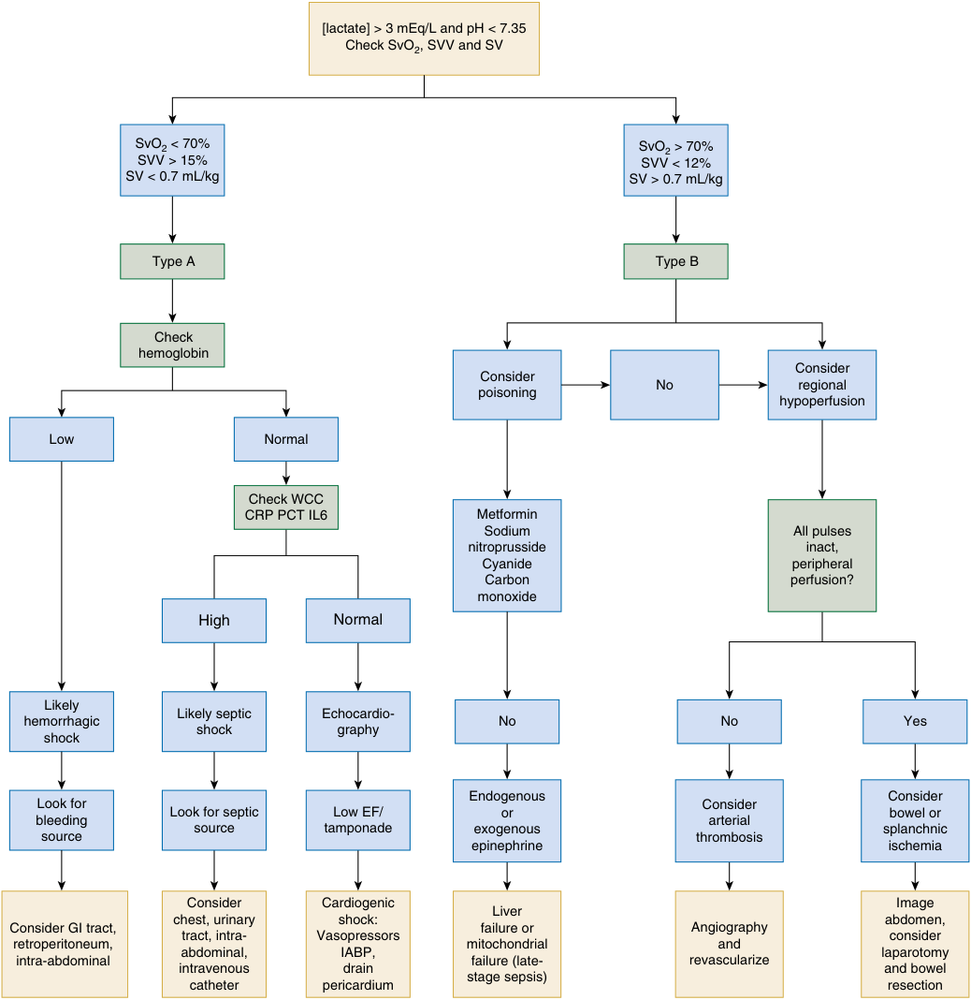

[lactate] > 3 mEq/L and pH &lt; 7.35 Check SvO2, SVV and SV SvO2 &lt; 70% SvO2 > 70% SVV > 15% SVV &lt; 12% SV &lt; 0.7 mL/kg SV > 0.7 mL/kg Type A Type B Check hemoglobin Consider Consider No regional poisoning hypoperfusion Low Normal Check WCC CRP PCT IL6 Metformin Sodium All pulses nitroprusside inact, Cyanide peripheral Carbon perfusion? monoxide High Normal hemorrhagicshockLikely Likely septicshock Echocardio-graphy No No Yes Look for Endogenous Consider Consider Look for septic Low EF/ or bowel or bleedingsource source tamponade exogenous thrombosisarterial splanchnic epinephrine ischemia Consider Cardiogenic Liver Image Consider GI tract, chest, urinary shock: failure or Angiography abdomen, retroperitoneum, tract, intra- Vasopressors mitochondrial and consider intra-abdominal intravenousabdominal, IABP,drain failure (late- revascularize laparotomyand bowel catheter pericardium stage sepsis) resection 

**Fig. 44.9 Decision pathway for evaluation of a patient with lactic acidosis.** _CRP_ , c- reactive protein; _EF_ , ejection fraction; _GI_ , gastrointestinal; _IABP_ , intra- aortic balloon pump (or other ventricular assist device); _PCT_ , procalcitonin; _SV_ , stroke volume; _SVV_ , stroke volume variation; _SvO2_ , mixed venous oxygen saturation; _WCC_ , white cell count.

who had Plasmalyte- 148 (a lower chloride balanced salt solution).79–82

The second error is very important for anesthesiologists. As noted above, most ketones in the body are in the form of βOHB. These can only be identified by measuring “blood” ketones. Urinary ketone sticks measure only acetoacetate.83 The absence of ketones in the urine does not eliminate the diagnosis of ketoacidosis (particularly if it is not associated with diabetes). Blood ketones are easily measured using handheld devices (although these are rarely

supported by hospital laboratories). Interestingly, as βOHB must be metabolized to acetoacetate, urinary ketones may increase during the time that the whole- body ketone load is falling, and ketosis is resolving.

The introduction to clinical practice of SLG- 2 (sodiumglucose co- transporter 2) inhibitors has led to a dramatic increase in the number of patients presenting to the hospital with ketoacidosis. SLG- 2 inhibitors work by preventing reabsorption of filtered glucose from the renal tubules, thus lowering blood glucose levels. However, in situations

<!-- PDF page 20 -->

where patients stop ingesting carbohydrates, due to injury or illness, rapid ketosis occurs due to increased lipolysis and inadequate ketone metabolism, frequently due to hepatic steatosis. This disorder has been labelled “euglycemic ketoacidosis (EDKA)” (a diagnosis not exclusive to SLGT- 2 inhibitors).84 Patients being treated with SLGT- 2 inhibitors should have these medications discontinued 24–48 hours prior to surgery, if possible.85 Prolonged fasting should be avoided and serum ketones should be checked pre- and postoperatively. The treatment of EDKA is gentle resuscitation with glucose- containing fluids and intravenous insulin, and correction of electrolyte abnormalities as appropriate.86 Standard hospital “DKA” protocols are usually not appropriate as patients usually have type 2 diabetes mellitus or are nondiabetic, with multisystem chronic disease, and are vulnerable to fluid over- resuscitation.

Patients presenting for emergency surgery may have multiple simultaneous acid–base abnormalities, and physicians often miss ketoacidosis, particularly in the presence of hyperlactatemia and chronic kidney disease.87 Despite fluid resuscitation and source control, the acidosis may not resolve. This in turn may lead to inappropriate interventions such as renal replacement therapy and sodium bicarbonate administration, neither of which are of any therapeutic value in ketoacidosis.

### RENAL ACIDOSIS

The kidney excretes water and a variety of metabolic byproducts, principally derived from protein. The kidney also excretes surplus electrolytes, some of which are strong ions, including chloride, sulfate, formate, urate, citric acid cycle metabolites (fumarate, citrate), and phosphate. These accumulate in acute kidney injury (AKI) and cause “renal acidosis.” Early in AKI, hyperchloremia is the principal source of acidosis; subsequently, 50%–60% of acidosis is caused by unmeasured anions and up to 30% is associated with hyperphosphatemia.88 Fifty percent of patients with AKI in critical illness have a normal anion gap.88

In perioperative medicine, acute kidney injury (AKI) may accompany hypotension, hypovolemia, renal hypoperfusion (from aortic cross- clamping or intra- abdominal hypertension), rhabdomyolysis, sepsis, or urinary obstruction. Irrespective of the cause, patients develop oliguria, volume overload, and hyperkalemia secondary to metabolic acidosis.

The identification of metabolic acidosis in acute kidney injury is key to the diagnosis, severity, and therapeutic strategy in AKI. Although serum creatinine is the most widely used marker of renal function, isolated readings are unhelpful, and fluid resuscitation can artificially lower the creatinine concentration by dilution; diuresis can artificially elevate it. Metabolic acidosis, particularly in the presence of hyperkalemia, with an elevated creatinine should always prompt the clinician to determine the extent of “renal acidosis.” This is not easy – hyperchloremia typically accompanies renal acidosis, but isotonic saline solution is frequently administered to patients with elevated creatinine under the mistaken belief that patients are less likely to develop hyperkalemia compared with balanced salt solutions.89 A study of anephric patients undergoing renal transplantation demonstrated that patients treated with normal saline

were more acidotic and hyperkalemic than patients treated with lactated Ringer’s solution.89 Hyperphosphatemia is a minor contributor to renal acidosis, and currently no tests are available to clinically identify the unmeasured anions, except by a process of exclusion. Hence, renal acidosis is usually diagnosed by identifying a widened anion gap, base deficit gap, or strong ion gap, and excluding ketones and lactate. Usually, the key decision step regarding renal replacement therapy involves uncontrolled hyperkalemia. Renal acidosis can be temporarily controlled by administration of sodium bicarbonate (assuming the patient can clear carbon dioxide), by increasing the strong ion difference.90 This may be necessary if the risk of delaying surgery exceeds the risk of delaying kidney replacement therapy. It should be noted that in critical illness, delaying kidney replacement therapy was associated with a 4.7% increase in mortality at 90 days.91

### HYPERCHLOREMIC ACIDOSIS

Hyperchloremia has been a known cause of metabolic acidosis since the dawn of acid–base chemistry,12 but, due to difficulty in measuring serum Cl− during most of the 20th century, hyperchloremia was largely ignored until recent decades. The extracellular space contains 110 to 130 g of salt. For a 70- kg male (extracellular fluid volume 18 L), this is approximately 58 g of Na+ (3.22 g/L) and 65 g (3.62 g/L) of Cl− . The average American ingests approximately 3 g or more of salt (NaCl) each day (2.3 g is recommended). To maintain the normal ratio of Na+ to Cl− (1.4:1 approximately), the body needs to excrete 30% more Cl− than Na+ . This is one of the major excretory roles of the kidney. This approximates to 15 to 20 mEq of Cl− excretion per day; to maintain electrical neutrality Cl− is excreted with ammonium (NH4+ ), a by-product of nitrogen metabolism. In renal failure, Cl− accumulates, and this is often the cause of the early metabolic acidosis associated with acute kidney injury. For decades, it has been hypothesized that elevated circulating levels of Cl− , usually because of intravenous administration, may actually be nephrotoxic, due, presumably, to increased metabolic demands on the kidney. One liter of isotonic saline solution (0.9% normal saline) contains 9 g of salt, 3.5 g Na+ and 5.5 g Cl− (154 mEq/L of each). For a euchloremic patient (the human body does not store chloride, unlike, for example, calcium), this means that if 1 L of 0.9% normal saline is administered (most or all of Cl− must be excreted), there is an 8- to 10- fold increase in metabolic load for the kidney. Moreover, as normal saline has a SID of 0, elevated plasma chloride is usually associated with a non- anion gap (“hyperchloremic”) metabolic acidosis.92

Hyperchloremic acidosis is a complication of renal tubular acidosis, which is caused by a defect in chloride excretion. The urine is relatively alkaline. Hyperchloremia also occurs when ureters have been re- implanted in the bowel, after, for example, cystectomy, and excreted chloride is reabsorbed.

Is hyperchloremia and hyperchloremic acidosis clinically significant? As a cause of acidosis, hyperchloremia is less sinister than other causes: in a study of critically ill patients with various acid–base disorders, mortality was highest for lactic acidosis (56%); for strong ion gap (SIG) acidosis it was 39%, and for hyperchloremic acidosis 29%

<!-- PDF page 21 -->

( _P_ &lt; .001).93 Nevertheless, hyperchloremia may result in clinically significant organ dysfunction. An observational study of 31,000 surgical patients comparing intravenous saline to intravenous balanced salt solutions demonstrated significant worse outcomes.94 Complications increased by the use of normal saline included postoperative infections, blood transfusions, and kidney injury requiring dialysis.

A hyperchloremic state may be associated with nephrotoxicity: saline infusion has been associated with reduced renal blood flow, renal vasoconstricton, reduced glomerular filtration, and splanchnic hypoperfusion.95 In a relatively large before- and- after cohort study of patients treated in an Australian ICU, the use of chloride- rich fluids was associated with a 3.7% absolute increase in the risk for need of renal replacement therapy relative to balanced salt solution.96

Two large randomized controlled trials looked at the use of isotonic saline solution versus balanced salt solutions in emergency medicine patients97 and critically ill patients.98 Although the volume of fluid administered intravenously was relatively low, certainly in comparison with perioperative patients, in both studies there was approximately a 1% increase in renal complications. Two trials, in 2021 and 2022, randomized critically ill patients to normal saline or balanced salt solutions, but failed to show any significant difference in outcomes.99,100 These studies were flawed because the patients were frequently fully resuscitated at the time of enrollment, received very little resuscitation fluid, and failed to demonstrate a significant difference in plasma chloride or sodium to chloride levels. A subsequent meta- analysis looked at six trials of normal saline vs. balanced salt solutions and found that there was an 85% probability that balanced salt solution reduced mortality in critically ill patients.101

Normal saline, originally introduced by Hamburger in the 19th century, labelled “normal” due to flawed research,

has been the most widely used intravenous fluid for over a century, despite minimal research demonstrating its clinical efficacy and safety.102 As mounting research demonstrates that this particular fluid may be harmful, and with a variety of other balanced solutions available for clinical practice, the role of normal saline in perioperative medicine is highly questionable.

### PERIOPERATIVE METABOLIC ALKALOSIS

Perioperative metabolic alkalosis is usually of iatrogenic origin. Over- ventilation of patients with chronic respiratory failure results in acute metabolic alkalosis because the presence of chronic compensatory alkalosis associated with chloride loss in urine has not been considered (Fig. 44.10). More frequently, metabolic alkalosis is associated with increased SID due to sodium gain. This abnormality results from the administration of fluids in which sodium is “buffered” by weak ions, citrate (in blood products), acetate (in parenteral nutrition), and, of course, bicarbonate. It is important to recognize that buffer ions such as citrate, acetate, gluconate, and lactate, are, under normal conditions, rapidly cleared by the liver and do not contribute to acid–base balance. Sodium and chloride obey the law of conservation of mass. Sodium gain is “chloride sensitive” alkalosis, treated by administration of net loads of chloride: 0.9% NaCl, potassium chloride, calcium chloride and, occasionally, hydrogen chloride. It is important to correct chloride- sensitive alkalosis, as the normal compensatory measure is hypoventilation, increasing PaCO2 that can lead to “CO2 narcosis.”

Large volumes of balanced salt solutions are likely to cause metabolic alkalosis, due to dilution of ATOT (principally hypoalbuminemia), a process that is curtailed when using lactated Ringer’s solution (Hartmann’s) due to lower

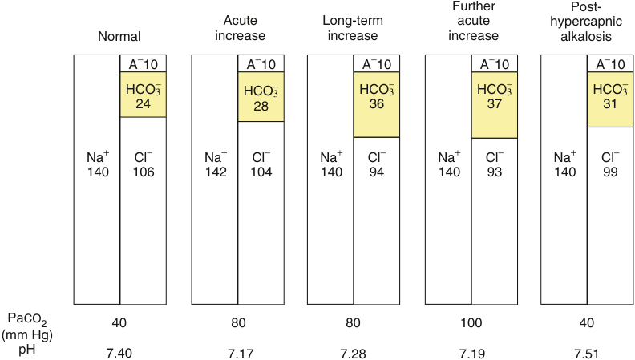

Further Post- Acute Long-term acute hypercapnic Normal increase increase increase alkalosis A − 10 A − 10 A − 10 A − 10 A − 10 HCO − 3 HCO − 3 HCO − 3 HCO − 3 HCO − 3 24 28 36 37 31 Na + Cl − Na + Cl − Na + Cl − Na + Cl − Na + Cl − 140 106 142 104 140 94 140 93 140 99 PaCO2 40 80 80 100 40 (mm Hg) pH 7.40 7.17 7.28 7.19 7.51 

**Fig. 44.10 Changes in acid–base and electrolyte composition in patients with respiratory acidosis.** _Left to right,_ the panels depict normal acid– base status; adaptation to an acute rise in the partial pressure of arterial carbon dioxide (PaCO2) to 80 mm Hg; adaptation to a long- term rise in PaCO2 to 80 mm Hg; superimposition of an acute further increment in PaCO2 (to a level of 100 mm Hg) in the same patient; and post- hypercapnic alkalosis resulting from an abrupt reduction in PaCO2 to the level of 40 mm Hg in the same patient. A− denotes unmeasured plasma anions, and the _numbers within the bars_ give ion concentrations in millimoles per liter. (Adapted from Androgue H, Madias N. Management of life- threatening acid- base disorders. First of two parts. _N Engl J Med_ . 1998;338:26–34.)

<!-- PDF page 22 -->

SID (20 mEq/L). The acquired hypoalbuminemic alkalosis is of undetermined clinical significance.

Another cause of metabolic alkalosis in perioperative patients reflects chloride loss caused by loss of chloride- rich fluids from the gastrointestinal tract. Gastric juice contains hydrochloric acid, which, when lost because of continuous suctioning or vomiting, obeys the law of conservation of mass and leads to alkalosis.

Perioperative fluid therapy remains highly controversial. Isotonic fluids are usually administered due to fear of cerebral edema associated with stress- induced water retention. However, this results in large amounts of solute, in particular sodium and chloride, accumulating in the extravascular space. Acquired hypernatremia is associated with adverse clinical outcomes and is very difficult to treat.103 Balanced salt solutions appear safer than normal saline, but large volume administration of these “resuscitation” fluids are also associated with worse outcomes.104

### ACID–BASE DISTURBANCES IN CRITICAL ILLNESS

Critically ill patients may have many confounding acid– base disturbances that are not evident when only a single quantitative measure, such as base deficit, is employed. Patients will frequently have perturbations of PCO2, SID, and ATOT, and significant pathology may be overlooked due to apparently normal blood gas results.105

The most common single disturbance in acid–base chemistry in critically ill patients is hypoalbuminemia.106 This abnormality is ubiquitous and is associated with metabolic alkalosis. Hypoalbuminemia may mask significant alterations in SID, for example, lactic or renal acidosis. Therefore, when the anion gap is used in critically ill patients it should be corrected for albumin.27 Similarly, the use of base deficit to predict lactate is unreliable in critical illness, particularly in patients undergoing secondary deterioration.26 Furthermore, prolonged respiratory failure, with associated hypercarbia, leads to additional metabolic alkalosis due to chloride loss in urine (see Fig. 44.10).107 Kidney injury is associated with accumulation of metabolic by- products, phosphate, renal anions, chloride, and other unmeasured anions, leading initially to metabolic acidosis. However, late, oliguric renal failure may be associated with significant contraction alkalosis, due to loss of sodium, potassium, and free water.

Critically ill patients are vulnerable to significant changes in SID and free water. Nasogastric suctioning causes chloride loss; diarrhea leads to sodium and potassium deficits. Surgical drains placed in tissue beds may remove fluids with varying electrolyte concentrations (the pancreatic bed, for example, secretes fluid rich in sodium). Fever, sweating, evaporation from denuded tissue, and inadequately humidified ventilator circuits all can lead to large-volume insensible loss and contraction alkalosis.

Infusions administered to patients may be responsible for unrecognized alterations in serum chemistry. Many antibiotics, for example piperacillin–tazobactam, are diluted in sodium- rich solutions. Others, such as vancomycin, are administered in large volumes of free water (5% dextrose). Lorazepam is diluted in propylene glycol, large volumes of which will cause metabolic acidosis similar to that seen with ethylene glycol.108

Continuous kidney replacement therapy (CKRT) is used in critical illness to hemofilter and hemodialyse patients who are hemodynamically unstable. Rocktaschel109 and colleagues have demonstrated that CKRT resolved the acidosis of acute kidney injury by removing strong ions and phosphate. However, in the presence of hypoalbuminemia, use of dialysis to correct a metabolic acidosis may unmask a metabolic alkalosis due to hypoalbuminemia. CKRT is not an effective treatment for lactic or ketoacidosis acidosis. Other, seemingly innocuous therapies may cause significant disturbances to acid–base balance. Loop diuretics, such as furosemide, are often administered to critically ill patients. These agents preferentially excrete water over electrolytes and provoke a contraction alkalosis.110 Similarly, carbonic anhydrase inhibitors such as acetazolamide may be used to treat patients with hypochloremic metabolic alkalosis or respiratory alkalosis by decreasing the serum SID. This effect is completely explained by the increased renal excretion ratio of sodium to chloride, resulting in an increase in plasma chloride.111

Neurosurgical patients are vulnerable to a variety of acid–base disturbances due to osmotherapy or from disturbances caused by brain injury. Most commonly, normal saline solution is commonly administered to these patients and results in hyperchloremic acidosis.112 Diabetes insipidus (DI) is a frequent complication of severe head injury, particularly when the patient is progressing toward brain death. DI is caused by damage to the pituitary and/or the hypothalamus and results in a loss of antidiuretic hormone (ADH) secretion. Absent ADH, the kidney is unable to concentrate the urine and a massive diuresis follows. The disorder is characterized by an increase in plasma osmolality in the presence of a low urinary osmolality. DI will typically manifest as a contraction alkalosis. The treatment is hormonal replacement with either vasopressin or desmopressin.

## Treating Acid–Base Disturbances

In general, in acute illness and perioperative medicine, acid–base disturbances are clinical indicators of disease processes that are more harmful than hydrogen ion abnormalities themselves. Correcting the pH is usually unlikely to resolve the problem, except in certain circumstances, such as hyperkalemia in acute kidney injury, where acidosis is the major cause of the problem.

The treatment of acid–base abnormalities is determined by whether the acids are organic or minerals. Organic acids can be metabolized, excreted, or dialyzed from the body. Diabetic and nondiabetic ketoacidosis are treated primarily with insulin, intravenous fluid, and glucose. The ketoacids causing metabolic acidosis are metabolized by the liver. Acute kidney injury is treated with dialysis and ultrafiltration, which directly removes unmeasured anions. Surprisingly, there are no clear guidelines regarding the optimal timing of initiation of renal replacement therapy,91,113 particularly in the perioperative period.114

For decades, sodium bicarbonate has been used to “correct” acidosis. The sodium component, as a strong anion, widens the strong ion difference and is alkalizing. Simultaneously, the HCO3− moiety provides buffer for hydrogen

<!-- PDF page 23 -->

ions, generating CO2, which is presumably excreted from the body by increased alveolar ventilation. In respiratory failure, sodium bicarbonate will worsen respiratory acidosis despite increased SID. CO2 also enters cells and may cause intracellular acidosis, the clinical significance of which is unclear.115

Sodium bicarbonate is commonly used to treat hyperchloremic acidosis. For patients with renal tubular acidosis, this involves long- term treatment with sodium bicarbonate tablets and chloride restriction. In acquired hyperchloremic acidosis, intravenous sodium bicarbonate corrects the base deficit,116 but the benefit is unclear. The major drawbacks of sodium bicarbonate therapy include sodium and volume overload, metabolic alkalosis, hypertension, and hypocalcemia.

Sodium bicarbonate therapy has been extensively studied in lactic acidosis and circulatory shock.117 A randomized trial of 389 critically ill patients with metabolic acidosis compared the administration of 4.2% (hypertonic) sodium bicarbonate to keep pH above 7.3, up to a maximum of 1000 mL in the first 24 hours, versus no intervention.118 Although there were no differences in the primary outcome, 28- day mortality, the patients who received sodium bicarbonate had a lower incidence of acute kidney injury and requirement for kidney replacement therapy. It is unclear why there was a reduction in the need for CKRT (perhaps the reduction in acidosis delayed the decision to start CKRT) and resulted in the intervention being avoided completely,113 or reversal of acidosis reduced vasopressor requirement and improved kidney blood flow, but this is merely speculation. Previous meta- analyses have failed to demonstrate benefit from sodium bicarbonate therapy,119 presumably due to the paucity of available research. Until larger multicenter trials have been conducted, sodium bicarbonate therapy should be used with caution for treatment of metabolic acidosis, due to circulatory shock or ketoacidosis. It is also unlikely that sodium bicarbonate therapy benefits perioperative patients at risk for postoperative kidney failure.120

Metabolic alkalosis is rarely seen in elective perioperative care. It is most likely encountered when unmasked by over-ventilation of patients who chronically retain CO2. Minute ventilation should be reduced. Critically ill patients may have metabolic alkalosis due to chloride deficit, free water deficit, or hypoalbuminemia. Contraction alkalosis is treated by correcting the free water deficit using the formula below:

Free water deficit=0.6× weight  in kg  ×  [Na+ ]/140  1)

Hypochloremic alkalosis should be treated by correcting the chloride deficit using normal saline or lactated Ringer’s solution.

There is no evidence that correcting hypoalbuminemia is of clinical benefit for most patients.121 Respiratory alkalosis usually results from anxiety or pain. Short- term therapy, such as carbon dioxide rebreathing, should be followed by treating the underlying problem – for example, with opioids or benzodiazepines.

Hypercarbic acidosis may be encountered in the perioperative period due to deliberate122 or inadvertent hypoventilation. It is also associated with elevated dead space

ventilation as seen in acute respiratory distress syndrome. In general, acute respiratory acidosis is well tolerated and can be easily reversed by increasing minute ventilation. However, a high tidal volumes and transpulmonary pressures result in ventilator- induced lung injury and increased mortality.123 Consequently, hypercarbia must be tolerated by the physician and patient (“permissive hypercarbia”) or carbon dioxide removed by an extracorporeal circuit.124

## Summary

Much of the confusion regarding acid–base chemistry relates to the attempt to apply observational approaches, such as that of Henderson–Hasselbalch, and Schwartz and Brackett, to the entire spectrum of pathologic processes. The use of physical chemistry principles has permitted easier explanation of acid–base balance, and tools to apply to a wide variety of clinical situations.125 This does not suggest that various traditional approaches are incorrect, and calculations and nomograms derived originally from the Henderson–Hasselbalch equation remain useful. All acid–base disorders can be explained in terms of SID, ATOT, and PaCO2. This is important to anesthesiologists, who may significantly impact acid–base balance with our choice of fluids and mechanical ventilation strategy, and who frequently encounter complex acid–base disorders in the operating room and ICU.

### Complete references available online at expertconsult.com.

### References

1.  Berend K, et al. _N Engl J Med_ . 2014;371:1434.

2.  Stewart PA. _Respir Physiol_ . 1978;33:9.

3.  Gomez H, Kellum JA. _Crit Care Clin_ . 2015;31:849.

4.  Adrogue HJ, Madias NE. _Am J Kidney Dis_ . 2016;68:793.

5.  Fencl V, Leith DE. _Respir Physiol_ . 1993;91:1.

6.  Aiken CGA. _J Clin Diagn Res_ . 2013;7:2038.

7.  Moon JB. _N Engl J Med_ . 1967;276:283.

8.  Henderson LJ. _Ergebn Physiol_ . 1909;8:254.

9.  Hasselbalch KA. _Biochem Z_ . 1916;78:112.

10.  Sirker AA, et al. _Anaesthesia_ . 2002;57:348. 11.  Van Slyke DD. _Proc Natl Acad Sci U S A_ . 1921;7:229. 12.  Henderson LH. _J Biol Chem_ . 1921;46:411. 13.  Corey HE. _Kidney Int_ . 2003;64:777. 14.  Stewart PA. _Can J Physiol Pharmacol_ . 1983;61:1444. 15.  Statement on acid- base terminology. _Ann Intern Med_ . 1965;63:885. 16.  Severinghaus JW. _Anesthesiology_ . 1976;45:539. 17.  Brackett NC, et al. _N Engl J Med_ . 1965;272:6. 18.  Hickling KG. _Respir Care Clin North Am_ . 2002;8:155. 19.  Laffey JG, Kavanagh BP. _Lancet_ . 1999;354:1283. 20.  Contreras M, et al. _Crit Care Med_ . 2012;40:2622. 21.  Gattinoni L, et al. _Intensive Care Med_ . 2009;35:2033. 22.  Magder S, Emami A. _Ann Am Thorac Soc_ . 2015;12:111. 23.  Scheingraber S, et al. _Anesthesiology_ . 1999;90:1265. 24.  Figge J, et al. _J Lab Clin Med_ . 1992;120:713. 25.  Story DA, et al. _Br J Anaesth_ . 2004;92:54. 26.  Fencl V, et al. _Am J Respir Crit Care Med_ . 2000;162:2246. 27.  Figge J, et al. _Crit Care Med_ . 1998;26:1807. 28.  Wang F, et al. _N Engl J Med_ . 1986;315:1591. 29.  Magder S, et al. _Can J Physiol Pharmacol_ . 2021;99:561. 30.  Bleich HL, et al. _J Clin Invest_ . 1964;43:11. 31.  Kazemi H, Johnson DC. _Physiol Rev_ . 1986;66:953. 32.  Bondoli A, et al. _Resuscitation_ . 1981;9:99.

33.  Javaheri S, et al. _Am J Respir Crit Care Med_ . 1994;150:78. 34.  Johnson DC, et al. _Respir Physiol_ . 1984;56:301.

<!-- PDF page 24 -->

35.  Johnson DC, et al. _J Appl Physiol_ . 1987;63:1591.

36.  Smith QR, Johanson CE. _Brain Res_ . 1991;562:306.

37.  Javaheri S. _J Appl Physiol_ . 1987;62:1582.

38.  Narins R, Emmett M. _Medicine (Baltim)_ . 1980;59:161.

39.  Kellum JA. In: Shoemaker WC, ed. _Textbook of Critical Care Medicine_ . 4th ed. Saunders; 2000:839.

40.  Rodriguez- Soriano. _J Pediatr Nephrol_ . 2000;14:1121.

41.  Choate KA, et al. _Proc Natl Acad Sci U S A_ . 2003;100:663.

42.  Shaer AJ. _Am J Med Sci_ . 2001;322:316.

43.  Kellum JA. _Crit Care_ . 2005;9:500.

44.  Schwartz WB, et al. _J Clin Invest_ . 1965;44:291.

45.  Albert MS. _Ann Intern Med_ . 1967;66:312.

46.  Emmett M, Narins RG. _Medicine (Baltim)_ . 1977;56:38.

47.  Salem MM, Mujais SK. _Arch Intern Med_ . 1992;152:1625.

48.  Moviat M, et al. _Crit Care_ . 2003;7:R41.

49.  Lipnick MS, et al. _Crit Care Med_ . 2013;41:49.

50.  Singer RB, Hastings AB. _Medicine (Baltim)_ . 1948;10:242.

51.  Severinghaus JW. _Anesthesiology_ . 2002;97:253.

52.  Jorgensen K. _Scand J Clin Lab Invest_ . 1957;9:122.

53.  Astrup P, Siggard- Andersen O. _Adv Clin Chem_ . 1963;69:1.

54.  Wooten EW. _J Appl Physiol_ . 2003;95:2333.

55.  Berend K. _N Engl J Med_ . 2018;378:1419.

56.  Prange HD, et al. _J Appl Physiol_ . 2001;91:33.

57.  Siggaard- Andersen O. _Scand J Clin Lab Invest Suppl_ . 1977;37:15.

58.  Gilfix BM, et al. _J Crit Care_ . 1993;8:187.

59.  Balasubramanyan N, et al. _Crit Care Med_ . 1999;27:1577.

60.  Story DA. _Anesth Analg_ . 2016;123:511.

61.  Rabinowitz JD, Enerback S. _Nat Metab_ . 2020;2:566.

62.  Kraut JA, Madias NE. _N Engl J Med_ . 2014;371:2309.

63.  Sun S, et al. _Physiology_ . 2017;32:453.

64.  Pino RM, Singh J. _Anesthesiology_ . 2021;134:637.

65.  Kellum JA. _Crit Care Med_ . 2007;35:2630.

66.  Singer M, et al. _JAMA_ . 2016;315:801.

67.  Fall PJ, Szerlip HM. _J Intensive Care Med_ . 2005;20:255.

68.  Lee SW, et al. _Emerg Med J_ . 2008;25:659.

69.  Mikkelsen ME, et al. _Crit Care Med_ . 2009;37:1670.

70.  Abramson D, et al. _J Trauma_ . 1993;35:584.

71.  Arnold RC, Shapiro NI, et al. _Shock_ . 2009;32:35.

72.  McNelis J, et al. _Am J Surg_ . 2001;182:481.

73.  Jones AE, et al. _JAMA_ . 2010;303:739.

74.  Jansen TC, et al. _Am J Respir Crit Care Med_ . 2010;182:752.

75.  Liu V, et al. _Ann Am Thorac Soc_ . 2013;10:466.

76.  Bakker J, et al. _Intensive Care Med_ . 2016;42:472.

77.  DeFronzo R. _Metabolism_ . 2016;65:20.

78.  Tran TTT, et al. _Front Endocrinol_ . 2017;8:106.

79.  Chua HR, et al. _J Crit Care_ . 2012;27:138.

80.  Alghamdi NA, et al. _Crit Care Explor_ . 2022;4:e0613.

81.  Ramanan M, et al. _Intensive Care Med_ . 2021;47:1248.

82.  Self WH, et al. _JAMA Netw Open_ . 2020;3:e2024596.

83.  Brewster S. _Practical Diabetes_ . 2017;34:13.

84.  Musso G, et al. _BMJ_ . 2020;371:4147.

85.  Kietaibl AT, et al. _Front Surg_ . 2022;9:828649.

86.  Nasa P, et al. _World J Diabetes_ . 2021;12:514.

87.  Saposnik G. _BMC Med Inf Decis Making_ . 2016;16:138.

88.  Rocktaeschel J, et al. _Crit Care_ . 2003;7:R60.

89.  O’Malley, et al. _Anesth Analg_ . 2005;100:1518.

90.  Yagi K, Fujii T. _Crit Care_ . 2021;25:314.

91.  Zarbock A. _JAMA_ . 2016;315:2190.

92.  Myles PS, et al. _World J Surg_ . 2017;41:2457.

93.  Gunnerson KJ, et al. _Crit Care_ . 2006;10:R22.

94.  Shaw AD, et al. _Ann Surg_ . 2012;255:821.

95.  Wilkes NJ, et al. _Anesth Analg_ . 2001;93:811.

96.  Yunos N. _JAMA_ . 2012;308:1566.

97.  Self WH, et al. _N Engl J Med_ . 2018;378:819.

98.  Semler MW, et al. _N Engl J Med_ . 2018;378:829.

99.  Finfer S, et al. _N Engl J Med_ . 2022;386:815.

100.  Zampieri FG, et al. _JAMA_ . 2021;326:818.

101.  Hammond NE, et al. _NEJM Evid_ . 2022;1. EVIDoa2100010.

102.  Awad S. _Clin Nutr_ . 2008;27:179.

103.  Tsipotis E, et al. _Am J Med_ . 2018;131:72.

104.  Simoes CM, et al. _BMC Anesthesiol_ . 2018;18:49.

105.  Moviat M, et al. _Crit Care Med_ . 2008;36:752.

106.  Figge J, et al. _J Lab Clin Med_ . 1991;117:453.

107.  Adrogue HJ, et al. _Kidney Int_ . 1984:591 (25).

108.  Tayar J, et al. _N Engl J Med_ . 2002;346:1253.

109.  Rocktaeschel J, et al. _Int J Artif Organs_ . 2003;26:19.

110.  Connor KA, et al. _Clin Exp Nephrol_ . 2020;24:541. 111.  Moviat M, Pickkers P, et al. _Crit Care_ . 2006;10:R14. 112.  Lima MF. _J Neurosurg Anesthesiol_ . 2019;31:30. 113.  Gaudry S, et al. _N Engl J Med_ . 2016;375:122.

114.  Romagnoli S. _Nephron_ . 2018:1.

115.  Swenson ER. _Anesthesiology_ . 2018;128:873.

116.  Rehm M, Finsterer U. _Anesth Analg_ . 2003;96:1201.

117.  Forsythe SM, Schmidt GA. _Chest_ . 2000;117:260.

118.  Jaber S, et al. _Lancet_ . 2018;392:31.

119.  Velissaris D. _Crit Care Res Pract_ . 2015;2015:605830.

120.  McGuinness SP. _Crit Care Med_ . 2013;41:1599.

121.  Caironi P, et al. _N Engl J Med_ . 2014;370:1412.

122.  Lyons C, Callaghan M. _Anaesthesia_ . 2017;72:1379.

123.  Slutsky AS, Ranieri VM. _N Engl J Med_ . 2013;369:2126. 124.  Barrett NA, Camporota L. _Crit Care Resusc_ . 2017;19(suppl 1):62. 125.  Rubin DM. _J Appl Physiol_ . 2021;130:2019.

<!-- PDF page 25 -->

### References

1.  Berend K, de Vries APJ, Gans ROB. Physiological approach to assessment of acid-base disturbances. _N Engl J Med_ . 2014;371:1434–1445.

2.  Stewart PA. Independent and dependent variables of acid- base control. _Respir Physiol_ . 1978;33:9–26.

3.  Gomez H, Kellum JA. Understanding acid- base disorders. _Crit Care Clin_ . 2015;31:849–860.

4.  Adrogue HJ, Madias NE. Assessing acid- base status: physiologic versus physicochemical approach. _Am J Kidney Dis_ . 2016;68:793–802.

5.  Fencl V, Leith DE. Stewart’s quantitative acid- base chemistry: applications in biology and medicine. _Respir Physiol_ . 1993;91:1–16.

6.  Aiken CGA. History of medical understanding and misunderstanding of acid base balance. _J Clin Diagn Res_ . 2013;7:2038–2041.

7.  Moon JB. Sir William Brooke O’Shaughnessy – the foundations of fluid therapy and the Indian telegraph service. _N Engl J Med_ . 1967;276:283–284.

8.  Henderson LJ. Das Gleichgewicht zwischen Sauren und Bases im tierischen Organismus. _Ergebn Physiol_ . 1909;8:254–325.

9.  Hasselbalch KA. Die Berechnung der Wasserstoffzahl des Blutes aus der freien und gebundenen Kohlensaure desselben, und die Sauerstoffbindung des Blutes als Funktion der Wasserstoffzahl. _Biochem Z_ . 1916;78:112–144.

10.  Sirker AA, Rhodes A, Grounds RM, Bennett ED. Acid- base physiology: the ‘traditional’ and the ‘modern’ approaches. _Anaesthesia_ . 2002;57:348–356.

11.  Van Slyke DD. An apparatus for determination of the gases in blood and other solutions. _Proc Natl Acad Sci U S A_ . 1921;7:229–231.

12.  Henderson LH. Blood as a physiochemical system. _J Biol Chem_ . 1921;46:411–419.

13.  Corey HE. Stewart and beyond: new models of acid- base balance. _Kidney Int_ . 2003;64:777–787.

14.  Stewart PA. Modern quantitative acid- base chemistry. _Can J Physiol Pharmacol_ . 1983;61:1444–1461.

15.  Statement on acid- base terminology. Report of the ad hoc Committee of the New York Academy of Sciences Conference, November 23–24, 1964. _Ann Intern Med_ . 1965;63:885–890.

16.  Severinghaus JW. Acid- base balance nomogram – a BostonCopenhagen detente. _Anesthesiology_ . 1976;45:539–541.

17.  Brackett NC, Cohen JJ, Schwartz WB. Carbon dioxide titration curve of normal man. _N Engl J Med_ . 1965;272:6–12.

18.  Hickling KG. Permissive hypercapnia. _Respir Care Clin N Am_ . 2002;8:155–169. v.

19.  Laffey JG, Kavanagh BP. Carbon dioxide and the critically ill – too little of a good thing? _Lancet_ . 1999;354:1283–1286.

20.  Contreras M, Ansari B, Curley G, et al. Hypercapnic acidosis attenuates ventilation- induced lung injury by a nuclear factor- κB dependent mechanism. _Crit Care Med_ . 2012;40:2622–2630.

21.  Gattinoni L, Carlesso E, Maiocchi G, et al. Dilutional acidosis: where do the protons come from? _Intensive Care Med_ . 2009;35:2033–2043.

22.  Magder S, Emami A. Practical approach to physical- chemical acidbase management. Stewart at the bedside. _Ann Am Thorac Soc_ . 2015;12:111–117.

23.  Scheingraber S, Rehm M, Sehmisch C, Finsterer U. Rapid saline infusion produces hyperchloremic acidosis in patients undergoing gynecologic surgery. _Anesthesiology_ . 1999;90:1265–1270.

24.  Figge J, Mydosh T, Fencl V. Serum proteins and acid- base equilibria: a follow- up. _J Lab Clin Med_ . 1992;120:713–719.

25.  Story DA, Morimatsu H, Bellomo R. Strong ions, weak acids and base excess: a simplified Fencl- Stewart approach to clinical acid- base disorders. _Br J Anaesth_ . 2004;92:54–60.

26.  Fencl V, Jabor A, Kazda A, Figge J. Diagnosis of metabolic acid- base disturbances in critically ill patients. _Am J Respir Crit Care Med_ . 2000;162:2246–2251.

27.  Figge J, Jabor A, Kazda A, Fencl V. Anion gap and hypoalbuminemia. _Crit Care Med_ . 1998;26:1807–1810.

28.  Wang F, Butler T, Rabbani GH, Jones PK. The acidosis of cholera. Contributions of hyperproteinemia, lactic acidemia, and hyperphosphatemia to an increased serum anion gap. _N Engl J Med_ . 1986;315:1591–1595.

29.  Magder S, Magder A, Samoukovic G. Intracellular pH regulation and the acid delusion. _Can J Physiol Pharmacol_ . 2021;99:561–576.

30.  Bleich HL, Berkman PM, Schwartz WB. The response of cerebrospinal fluid composition to sustained hypercapnia. _J Clin Invest_ . 1964;43:11–18.

31.  Kazemi H, Johnson DC. Regulation of cerebrospinal fluid acid- base balance. _Physiol Rev_ . 1986;66:953–1037.

32.  Bondoli A, Magalini SI, de AC, et al. Changes in plasma and cerebrospinal fluid electrolytes in hypercapnia. _Resuscitation_ . 1981;9:99– 102.

33.  Javaheri S, Corbett W, Wagner K, Adams JM. Quantitative cerebrospinal fluid acid- base balance in acute respiratory alkalosis. _Am J Respir Crit Care Med_ . 1994;150:78–82.

34.  Johnson DC, Frankel HM, Kazemi H. Effect of furosemide on cerebrospinal fluid composition. _Respir Physiol_ . 1984;56:301–308.

35.  Johnson DC, Singer S, Hoop B, Kazemi H. Chloride flux from blood to CSF: inhibition by furosemide and bumetanide. _J Appl Physiol_ . 1987;63:1591–1600.

36.  Smith QR, Johanson CE. Chloride efflux from isolated choroid plexus. _Brain Res_ . 1991;562:306–310.

37.  Javaheri S. Effects of acetazolamide on cerebrospinal fluid ions in metabolic alkalosis in dogs. _J Appl Physiol_ . 1987;62:1582–1588.

38.  Narins R, Emmett M. Simple and mixed acid- base disorders: a practical approach. _Medicine (Baltim)_ . 1980;59:161–187.

39.  Kellum JA. Diagnosis and treatment of acid base disorders. In: Shoemaker WC, ed. _Textbook of Critical Care Medicine_ . 4th ed. Saunders; 2000:839–853.

40.  Rodriguez- Soriano J. New insights into the pathogenesis of renal tubular acidosis – from functional to molecular studies. _Pediatr Nephrol_ . 2000;14:1121–1136.

41.  Choate KA, Kahle KT, Wilson FH, et al. WNK1, a kinase mutated in inherited hypertension with hyperkalemia, localizes to diverse Cl– - transporting epithelia. _Proc Natl Acad Sci U S A_ . 2003;100:663– 668.

42.  Shaer AJ. Inherited primary renal tubular hypokalemic alkalosis: a review of Gitelman and Bartter syndromes. _Am J Med Sci_ . 2001;322:316–332.

43.  Kellum JA. Reunification of acid- base physiology. _Crit Care_ . 2005;9:500–507.

44.  Schwartz WB, Brackett NC, Cohen JJ. The response of extracellular hydrogen ion concentration to graded degrees of chronic hypercapnia: the physiologic limits of the defense of pH. _J Clin Invest_ . 1965;44:291–301.

45.  Albert MS, Dell RB, Winters RW. Quantitative displacement of acid- base equilibrium in metabolic acidosis. _Ann Intern Med_ . 1967;66:312–322.

46.  Emmett M, Narins RG. Clinical use of the anion gap. _Medicine (Baltim)_ . 1977;56:38–54.

47.  Salem MM, Mujais SK. Gaps in the anion gap. _Arch Intern Med_ . 1992;152:1625–1629.

48.  Moviat M, van HF, van der HH. Conventional or physicochemical approach in intensive care unit patients with metabolic acidosis. _Crit Care_ . 2003;7:R41–R45.

49.  Lipnick MS, Braun AB, Cheung JT, et al. The difference between critical care initiation anion gap and prehospital admission anion gap is predictive of mortality in critical illness. _Crit Care Med_ . 2013;41:49–59.

50.  Singer RB, Hastings AB. An improved clinical method for the estimation of disturbances of the acid- base balance of human blood. _Medicine_ . 1948;10:242.

51.  Severinghaus JW. The invention and development of blood gas analysis apparatus. _Anesthesiology_ . 2002;97:253–256.

52.  Jorgensen K, Astrup P. Standard bicarbonate, its clinical significance, and a new method for its determination. _Scand J Clin Lab Invest_ . 1957;9:122–132.

53.  Astrup P, Siggard- Andersen O. Micromethods for measuring acidbase values of blood. _Adv Clin Chem_ . 1963;69:1–28.

54.  Wooten EW. Calculation of physiological acid- base parameters in multicompartment systems with application to human blood. _J Appl Physiol_ . 2003;95:2333–2344.

55.  Berend K. Diagnostic use of base excess in acid–base disorders. _N Engl J Med_ . 2018;378:1419–1428.

56.  Prange HD, Shoemaker Jr JL, Westen EA, et al. Physiological consequences of oxygen- dependent chloride binding to hemoglobin. _J Appl Physiol_ . 2001;91:33–38.

57.  Siggaard- Andersen O. An acid- base chart for arterial blood with normal and pathophysiological reference areas. _Scand J Clin Lab Invest_ . 1971;27:239–245.

58.  Gilfix BM, Bique M, Magder S. A physical chemical approach to the analysis of acid- base balance in the clinical setting. _J Crit Care_ . 1993;8:187–197.

<!-- PDF page 26 -->

59.  Balasubramanyan N, Havens PL, Hoffman GM. Unmeasured anions identified by the Fencl- Stewart method predict mortality better than base excess, anion gap, and lactate in patients in the pediatric intensive care unit. _Crit Care Med_ . 1999;27:1577–1581.

60.  Story DA. Stewart acid- base: a simplified bedside approach. _Anesth Analg_ . 2016;123:511–515.

61.  Rabinowitz JD, Enerback S. Lactate: the ugly duckling of energy metabolism. _Nat Metab_ . 2020;2:566–571.

62.  Kraut JA, Madias NE. Lactic acidosis. _N Engl J Med_ . 2014;371:2309– 2319.

63.  Sun S, Li H, Chen J, Qian Q. Lactic acid: no longer an inert and endproduct of glycolysis. _Physiology_ . 2017;32:453–463.

64.  Pino RM, Singh J. Appropriate clinical use of lactate measurements. _Anesthesiology_ . 2021;134:637–644.

65.  Kellum JA. Disorders of acid- base balance. _Crit Care Med_ . 2007;35:2630–2636.

66.  Singer M, Deutschman CS, Seymour C. The Third International Consensus Definitions for Sepsis and Septic Shock (Sepsis- 3). _JAMA_ . 2016;315:801–810.

67.  Fall PJ, Szerlip HM. Lactic acidosis: from sour milk to septic shock. _J Intensive Care Med_ . 2005;20:255–271.

68.  Lee SW, Hong YS, Park DW, et al. Lactic acidosis not hyperlactatemia as a predictor of inhospital mortality in septic emergency patients. _Emerg Med J_ . 2008;25:659–665.

69.  Mikkelsen ME, Miltiades AN, Gaieski DF, et al. Serum lactate is associated with mortality in severe sepsis independent of organ failure and shock. _Crit Care Med_ . 2009;37:1670–1677.

70.  Abramson D, Scalea TM, Hitchcock R, et al. Lactate clearance and survival following injury. _J Trauma_ . 1993;35:584–588.

71.  Arnold RC, Shapiro NI, Jones AE, et al.; Emergency Medicine Shock Research Network (EMShockNet) Investigators. Multicenter study of early lactate clearance as a determinant of survival in patients with presumed sepsis. _Shock_ . 2009;32:35–39.

72.  McNelis J, Marini CP, Jurkiewicz A, et al. Prolonged lactate clearance is associated with increased mortality in the surgical intensive care unit. _Am J Surg_ . 2001;182:481–485.

73.  Jones AE, Shapiro NI, Trzeciak S, et al. Lactate clearance vs central venous oxygen saturation as goals of early sepsis therapy: a randomized clinical trial. _JAMA_ . 2010;303:739–746.

74.  Jansen TC, van Bommel J, Schoonderbeek FJ, et al.; LACTATE Study Group. Early lactate- guided therapy in intensive care unit patients: a multicenter, open- label, randomized controlled trial. _Am J Respir Crit Care Med_ . 2010;182:752–761.

75.  Liu V, Morehouse JW, Soule J, et al. Fluid volume, lactate values, and mortality in sepsis patients with intermediate lactate values. _Ann Am Thorac Soc_ . 2013;10:466–473.

76.  Bakker J, de BD, Hernandez G. Lactate- guided resuscitation saves lives: we are not sure. _Intensive Care Med_ . 2016;42:472–474.

77.  DeFronzo R, Fleming GA, Chen K, Bicsak TA. Metformin- associated lactic acidosis: current perspectives on causes and risk. _Metabolism_ . 2016;65:20–29.

78.  Tran TTT, Pease A, Wood AJ, et al. Review of evidence for adult diabetic ketoacidosis management protocols. _Front Endocrinol_ . 2017;8:106.

79.  Chua HR, Venkatesh B, Stachowski E, et al. Plasma- Lyte 148 vs 0.9% saline for fluid resuscitation in diabetic ketoacidosis. _J Crit Care_ . 2012;27:138–145.

80.  Alghamdi NA, Major P, Chaudhuri D, et al. Saline compared to balanced crystalloid in patients with diabetic ketoacidosis: a systematic review and meta- analysis of randomized controlled trials. _Crit Care Explor_ . 2022;4:e0613.

81.  Ramanan M, Attokaran A, Murray L, et al. Sodium chloride or Plasmalyte- 148 evaluation in severe diabetic ketoacidosis (SCOPEDKA): a cluster, crossover, randomized, controlled trial. _Intensive Care Med_ . 2021;47:1248–1257.

82.  Self WH, Evans CS, Jenkins CA, et al. Clinical effects of balanced crystalloids vs saline in adults with diabetic ketoacidosis: a subgroup analysis of cluster randomized clinical trials. _JAMA Netw Open_ . 2020;3:e2024596.

83.  Brewster S, Curtis L, Poole R. Urine versus blood ketones. _Practical Diabetes_ . 2017;34:13–15.

84.  Musso G, Saba F, Cassader M, Gambino R. Diabetic ketoacidosis with SGLT2 inhibitors. _BMJ_ . 2020;371:4147.

85.  Kietaibl AT, Fasching P, Glaser K, Petter- Puchner AH. New diabetic medication sodium- glucose cotransporter- 2 inhibitors can induce

euglycemic ketoacidosis and mimic surgical diseases: a case report and review of literature. _Front Surg_ . 2022;9:828649.

86.  Nasa P, Chaudhary S, Shrivastava PK, Singh A. Euglycemic diabetic ketoacidosis: a missed diagnosis. _World J Diabetes_ . 2021;12:514– 523.

87.  Saposnik G, Redelmeier D, Ruff CC, Tobler PN. Cognitive biases associated with medical decisions: a systematic review. _BMC Med Inf Decis Making_ . 2016;16:138.

88.  Rocktaeschel J, Morimatsu H, Uchino S, et al. Acid- base status of critically ill patients with acute renal failure: analysis based on StewartFigge methodology. _Crit Care_ . 2003;7:R60.

89.  O’Malley CM, Frumento RJ, Hardy MA, et al. A randomized, doubleblind comparison of lactated Ringer’s solution and 0.9% NaCl during renal transplantation. _Anesth Analg_ . 2005;100:1518–1524.

90.  Yagi K, Fujii T. Management of acute metabolic acidosis in the ICU: sodium bicarbonate and renal replacement therapy. _Crit Care_ . 2021;25:314.

91.  Zarbock A. Effect of early vs delayed initiation of renal replacement therapy on mortality in critically ill patients with acute kidney injury: the ELAIN randomized clinical trial. _JAMA_ . 2016;315:2190–2199.

92.  Myles PS, Andrews S, Nicholson J, et al. Contemporary approaches to perioperative IV fluid therapy. _World J Surg_ . 2017;41:2457–2463.

93.  Gunnerson K, Saul M, He S, Kellum J. Lactate versus non- lactate metabolic acidosis: a retrospective outcome evaluation of critically ill patients. _Crit Care_ . 2006;10:R22.

94.  Shaw AD, Bagshaw SM, Goldstein SL, et al. Major complications, mortality, and resource utilization after open abdominal surgery: 0.9% saline compared to Plasma-Lyte. _Ann Surg_ . 2012;255:821– 829.

95.  Wilkes NJ, Woolf R, Mutch M, et al. The effects of balanced versus saline- based hetastarch and crystalloid solutions on acid- base and electrolyte status and gastric mucosal perfusion in elderly surgical patients. _Anesth Analg_ . 2001;93:811–816.

96.  Yunos N. Association between a chloride- liberal vs chloriderestrictive intravenous fluid administration strategy and kidney injury in critically ill adults. _JAMA_ . 2012;308:1566–1572.

97.  Self WH, Semler MW, Wanderer JP, et al. Balanced crystalloids versus saline in noncritically ill adults. _N Engl J Med_ . 2018;378:819– 828.

98.  Semler MW, Self WH, Wanderer JP, et al. Balanced crystalloids versus saline in critically ill adults. _N Engl J Med_ . 2018;378:829–839.

99.  Finfer S, Micallef S, Hammond N, et al. Balanced multielectrolyte solution versus saline in critically ill adults. _N Engl J Med_ . 2022;386:815–826.

100.  Zampieri FG, Machado FR, Biondi RS, et al. BaSICS investigators and the BRICNet members: effect of intravenous fluid treatment with a balanced solution vs 0.9% saline solution on mortality in critically ill patients: the BaSICS randomized clinical trial. _JAMA_ . 2021;326:818–829.

101.  Hammond NE, Zampieri FG, Rech MA, et al. Balanced crystalloids versus saline in critically ill adults – a systematic review with metaanalysis. _NEJM Evid_ . 2022;1. EVIDoa2100010.

102.  Awad S. The history of 0.9% saline. _Clin Nutr_ . 2008;27(2):179–188. 103.  Tsipotis E, Price LL, Jaber BL, Madias NE. Hospital- associated hypernatremia spectrum and clinical outcomes in an unselected cohort. _Am J Med_ . 2018;131:72–82.

104.  Simoes CM, Carmona MJC, Hajjar LA, et al. Predictors of major complications after elective abdominal surgery in cancer patients. _BMC Anesthesiol_ . 2018;18:49.

105.  Moviat M, Terpstra AM, Ruitenbeek W, et al. Contribution of various metabolites to the “unmeasured” anions in critically ill patients with metabolic acidosis. _Crit Care Med_ . 2008;36:752–758.

106.  Figge J, Rossing TH, Fencl V. The role of serum proteins in acid- base equilibria. _J Lab Clin Med_ . 1991;117:453–467.

107.  Adrogue HJ, Eknoyan G, Suki WK. Diabetic ketoacidosis: role of the kidney in the acid- base homeostasis re- evaluated. _Kidney Int_ . 1984;25:591–598.

108.  Tayar J, Jabbour G, Saggi SJ. Severe hyperosmolar metabolic acidosis due to a large dose of intravenous lorazepam. _N Engl J Med_ . 2002;346:1253–1254.

109.  Rocktaschel J, Morimatsu H, Uchino S, et al. Impact of continuous veno- venous hemofiltration on acid- base balance. _Int J Artif Organs_ . 2003;26:19–25.

110.  Connor KA, Conn K, Kaufman DC, Haas CE. Acid- base effects of continuous infusion furosemide in clinically stable surgical ICU

<!-- PDF page 27 -->

- patients: an analysis based on the Stewart model. _Clin Exp Nephrol_ . 2020;24:541–546.

111.  Moviat M, Pickkers P, van der Voort PHJ, van der Hoeven JG. Acetazolamide- mediated decrease in strong ion difference accounts for the correction of metabolic alkalosis in critically ill patients. _Crit Care_ . 2006;10:R14.

112.  Lima MF, Neville IS, Cavalheiro S, et al. Balanced crystalloids versus saline for perioperative intravenous fluid administration in children undergoing neurosurgery: a randomized clinical trial. _J Neurosurg Anesthesiol_ . 2019;31:30–35.

113.  Gaudry S, Hajage D, Schortgen F, et al. Initiation strategies for renal- replacement therapy in the intensive care unit. _N Engl J Med_ . 2016;375:122–133.

114.  Romagnoli S, Ricci Z, Ronco C. Perioperative acute kidney injury: prevention, early recognition, and supportive measures. _Nephron_ . 2018:1–6.

115.  Swenson ER. Does aerobic respiration produce carbon dioxide or hydrogen ion and bicarbonate? _Anesthesiology_ . 2018;128:873–879.

116.  Rehm M, Finsterer U. Treating intraoperative hyperchloremic acidosis with sodium bicarbonate or tris- hydroxymethyl aminomethane: a randomized prospective study. _Anesth Analg_ . 2003;96:1201– 1208.

117.  Forsythe SM, Schmidt GA. Sodium bicarbonate for the treatment of lactic acidosis. _Chest_ . 2000;117:260–267.

118.  Jaber S, Paugam C, Futier E, et al. Sodium bicarbonate therapy for patients with severe metabolic acidaemia in the intensive care unit (BICAR- ICU): a multicentre, open- label, randomised controlled, phase 3 trial. _Lancet_ . 2018;392:31–40.

119.  Velissaris D, Karamouzos V, Ktenopoulos N, et al. The use of sodium bicarbonate in the treatment of acidosis in sepsis: a literature update on a long term debate. _Crit Care Res Pract_ . 2015;2015:605830.

120.  McGuinness SP, Parke RL, Bellomo R, et al. Sodium bicarbonate infusion to reduce cardiac surgery- associated acute kidney injury: a phase II multicenter double- blind randomized controlled trial. _Crit Care Med_ . 2013;41:1599–1607.

121.  Caironi P, Tognoni G, Masson S, et al. Albumin replacement in patients with severe sepsis or septic shock. _N Engl J Med_ . 2014;370:1412–1421.

122.  Lyons C, Callaghan M. Apnoeic oxygenation with high- flow nasal oxygen for laryngeal surgery: a case series. _Anaesthesia_ . 2017;72:1379–1387.

123.  Slutsky AS, Ranieri VM. Ventilator- induced lung injury. _N Engl J Med_ . 2013;369:2126–2136.

124.  Barrett NA. The evolving role and practical application of extracorporeal carbon dioxide removal in critical care. _Crit Care Resusc_ . 2017;19(suppl 1):62–67.

125.  Rubin DM. Stewart’s approach to quantitative acid- base physiology should replace traditional bicarbonate- centered models. _J Appl Physiol_ . 2021;130:2019–2021.
