# Patient Blood Management: Coagulation

<!-- PDF page 1 -->

ANIL K. PANIGRAHI and LINDA L. LIU

|**KEY POINTS**|ᑏNormal hemostasis is a balance between generation of a localized hemostatic clot and uncontrolled thrombus formation.|
|---|---|
||ᑏThe extrinsic pathway of coagulation begins with exposure of blood plasma to tissue factor and represents the initiation phase of plasma- mediated hemostasis. ᑏThe intrinsic pathway amplifies and propagates the hemostatic response to maximize thrombin generation.|
||ᑏThe common pathway generates thrombin, forms fibrin, and cross-links fibrin strands to produce an insoluble fibrin clot.|
||ᑏRoutine preoperative coagulation testing of all surgical patients is costly and lacks predictive value for detection of hemostatic abnormalities. Testing should be based on the preoperative history and physical examination and the planned surgery. ᑏAntiplatelet agents and anticoagulants are used to reduce the formation of blood clots in the setting of coronary or cerebral atherosclerosis or after vascular thrombosis. ᑏThrombolytic therapy is used to break up or dissolve blood clots. ᑏProcoagulant drugs (antifibrinolytics, factor replacements, prothrombin complex concentrate) help control blood loss during surgery.|
||ᑏPerioperative management of patients who require chronic anticoagulation or antiplatelet therapy involves balancing the risk of surgical bleeding against the risk of developing postoperative thromboembolism.|

## Introduction

Hemostasis is an ordered enzymatic process involving cellular and biochemical components that function to preserve the integrity of the circulatory system after injury. The goal of this process is to limit blood loss secondary to vascular injury, maintain intravascular blood flow, and promote revascularization after thrombosis. As such, normal physiologic hemostasis is a constant balance between procoagulant pathways responsible for generation of a stable localized hemostatic clot and counter- regulatory mechanisms inhibiting uncontrolled thrombus propagation or premature thrombus degradation. Vascular endothelium, platelets, and plasma coagulation proteins play equally important roles in this process. Derangements in this delicate system can lead to excessive bleeding or pathologic thrombus formation. This chapter examines normal and abnormal hemostasis, mechanisms to monitor coagulation, medications to manipulate coagulation, and management options for the perioperative anticoagulated patient.

## Normal Hemostasis

Vascular endothelial injury – mechanical or biochemical – leads to platelet deposition at the injury site, a process often

referred to as primary hemostasis. Although this initial platelet plug may prove adequate for a minor injury, control of more significant bleeding necessitates stable clot formation incorporating cross-linked fibrin – a process mediated by activation of plasma clotting factors and often referred to as secondary hemostasis. Although the terms primary and secondary hemostasis remain relevant for descriptive and diagnostic purposes, advances in understanding cellular and molecular processes underlying hemostasis suggest a far more complex interplay between vascular endothelium, platelets, and plasma- mediated hemostasis than is reflected in this model.1

### VASCULAR ENDOTHELIAL ROLE IN HEMOSTASIS

To maintain blood flow throughout the circulatory system, the vascular endothelium employs several strategies to inhibit unprovoked thrombus formation. Healthy endothelial cells possess antiplatelet, anticoagulant, and profibrinolytic effects to inhibit clot formation.2 The negatively charged vascular endothelium repels platelets, and endothelial cells produce potent platelet inhibitors such as prostacyclin (prostaglandin [PGI2]) and nitric oxide (NO).3,4 An adenosine diphosphatase (CD39) expressed on the surface of vascular endothelial cells also serves to block platelet activation via degradation of adenosine diphosphate (ADP),

::: details 原始表格與符號（PDF 第 1 頁）

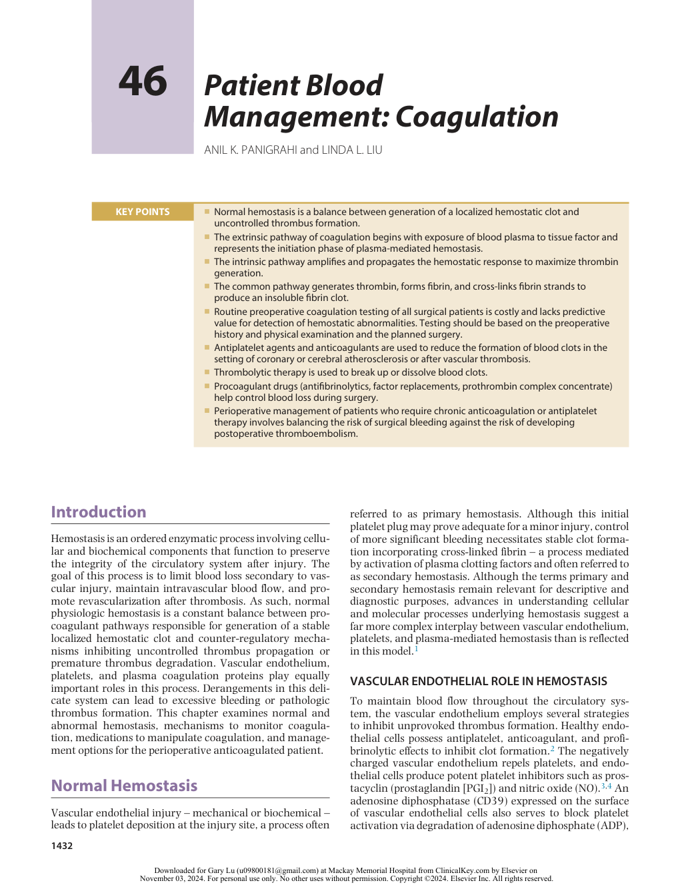

:::

<!-- PDF page 2 -->

a potent platelet activator.5 Given these endogenous antiplatelet effects, quiescent platelets normally do not adhere to healthy vascular endothelial cells.

The vascular endothelium also plays a pivotal anticoagulant role through expression of several inhibitors of plasma- mediated hemostasis. Endothelial cells increase activation of protein C, an anticoagulant, via surface glycoprotein thrombomodulin (TM), which acts as a cofactor for thrombin- mediated activation of protein C, making its activation 1000 times faster. Endothelial cells also increase endothelial cell protein C receptor, which further enhances protein C activation by an additional 20- fold.6 Endothelialbound glycosaminoglycans, such as heparan sulfate, function to accelerate the protease activity of antithrombin (AT), which degrades factors IXa, Xa, and thrombin.7 Endothelial cells also produce tissue factor pathway inhibitor (TFPI), which inhibits the procoagulant activity of factor Xa as well as the TF–VIIa complex.8 Finally, the vascular endothelium synthesizes tissue plasminogen activator (t- PA), which is responsible for activating fibrinolysis, a primary counterregulatory mechanism limiting clot propagation.

Despite these natural defense mechanisms to inhibit thrombus generation, a variety of mechanical and chemical stimuli may shift the balance such that the endothelium instead promotes clot formation. Damage to vascular endothelial cells exposes the underlying extracellular matrix (ECM), which contains collagen, von Willebrand factor (vWF), and other platelet- adhesive glycoproteins.9,10 Platelets bind to and are activated by exposure to ECM components. Exposure of tissue factor, constitutively expressed by fibroblasts in the ECM, activates plasma- mediated coagulation pathways to generate thrombin and fibrin clot.11 Certain cytokines (i.e., interleukin- 1, tumor necrosis factor, and γ- interferon) and hormones (i.e., desmopressin acetate [DDAVP] or endotoxin) induce prothrombotic changes in vascular endothelial cells by increasing synthesis and expression of vWF, tissue factor, and plasminogen activator inhibitor- 1 (PAI- 1), and downregulating normal antithrombotic cellular and biochemical pathways.12,13 Finally, thrombin, hypoxia, and high fluid shear stress can also induce prothrombotic vascular endothelial changes such as increased synthesis of PAI- 1. This associated inhibition of fibrinolysis has been implicated in the prothrombotic state and high incidence of venous thrombosis after surgery.14,15

to form a platelet plug, and facilitating generation of fibrin cross-links to stabilize and reinforce the plug. Initially, upon exposure of the ECM, platelets undergo a series of biochemical and physical alterations characterized by three major phases: adhesion, activation, and aggregation. Exposure of subendothelial matrix proteins (i.e., collagen, vWF, fibronectin) allows for platelet adhesion to the vascular wall. vWF proves particularly important as a bridging molecule between ECM collagen and platelet glycoprotein Ib/factor IX/factor V receptor complexes.19 Absence of either vWF (von Willebrand disease) or glycoprotein Ib/factor IX/factor V receptors (Bernard–Soulier syndrome) results in a clinically significant bleeding disorder.

In addition to promoting their adhesion to the vessel wall, the platelet interaction with collagen serves as a potent stimulus for the subsequent phase of thrombus formation, termed platelet activation. The generation of thrombin resulting from exposure of tissue factor functions as a second pathway for platelet activation. Platelets contain two specific types of storage granules: α granules and dense bodies.18 The α granules contain numerous proteins essential to hemostasis and wound repair, including fibrinogen, coagulation factors V and VIII, vWF, and platelet- derived growth factor. Dense bodies contain the adenine nucleotides ADP and adenosine triphosphate (ATP), as well as calcium, serotonin, histamine, and epinephrine. During the activation phase, platelets release granular contents, resulting in recruitment and activation of additional platelets and propagation of plasma- mediated coagulation.20 During activation, platelets undergo structural changes to develop pseudopod- like membrane extensions and to release physiologically active microparticles, which serve to dramatically increase platelet membrane surface area. Redistribution of platelet membrane phospholipids during activation exposes newly activated glycoprotein platelet surface receptors and phospholipid binding sites for calcium and coagulation factor activation complexes, which is critical to propagation of plasma- mediated hemostasis.1

During the final phase of platelet aggregation, activators released during the activation phase recruit additional platelets to the site of injury. Newly active glycoprotein IIb/IIIa receptors on the platelet surface bind fibrinogen, thereby promoting cross- linking and aggregation with adjacent platelets.20 The importance of these receptors is reflected by the bleeding disorder associated with their hereditary deficiency, Glanzmann thrombasthenia.

### PLATELETS AND HEMOSTASIS

Platelets contribute a critical role in hemostasis. Derived from bone marrow megakaryocytes, nonactivated platelets circulate as discoid anuclear cells with a lifespan of 8 to 12 days.16 Under normal conditions, approximately 10% of platelets are consumed to support vascular integrity with 1.2–1.5 × 1011 new platelets formed daily.17 The platelet membrane is characterized by numerous receptors and a surface- connected open canalicular system serving to increase platelet membrane surface area and provide rapid communication between the platelet interior and exterior environment.18 Under normal circumstances, platelets do not bind the vascular endothelium. However, when injury occurs, platelets contribute to hemostasis by adhering to the damaged vasculature, aggregating with one another

### PLASMA- MEDIATED HEMOSTASIS

Plasma- mediated hemostasis was originally described as a cascade or waterfall sequence of steps involving the serial activation of enzymes and cofactors to accelerate and amplify fibrin generation by thrombin.21 Trace plasma proteins, activated by exposure to tissue factor or foreign surfaces, initiate this series of reactions culminating in conversion of soluble fibrinogen to insoluble fibrin clot.22 Thrombin generation, the “thrombin burst,” represents the key regulatory step in this process. Thrombin not only generates fibrin but also activates platelets and mediates a host of additional processes affecting inflammation, mitogenesis, and even downregulation of hemostasis.23

<!-- PDF page 3 -->

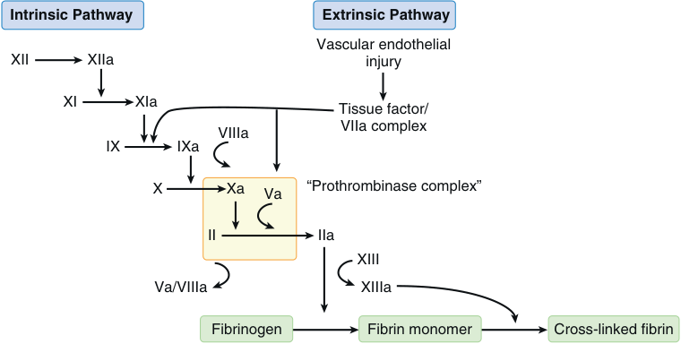

Intrinsic Pathway Extrinsic Pathway Vascular endothelial XII XIIa injury XI XIa Tissue factor/ VIIIa VIIa complex IX IXa X Xa Va “Prothrombinase complex” II IIa XIII Va/VIIIa XIIIa Fibrinogen Fibrin monomer Cross-linked fibrin 

**Fig. 46.1 Depiction of the classic coagulation cascade incorporating extrinsic and intrinsic pathways of coagulation.** (From Slaughter TF. The coagulation system and cardiac surgery. In: Estafanous FG, Barasch PG, Reves JG, eds. _Cardiac Anesthesia: Principles and Clinical Practice_ . 2nd ed. Philadelphia: Lippincott Williams & Wilkins; 2001: 320, with permission.)

Traditionally, the coagulation cascade describing plasma- mediated hemostasis has been depicted as extrinsic and intrinsic pathways, both of which culminate in a common pathway in which fibrin generation occurs.24 This cascade model has proven to be an oversimplification, as it does not fully reflect _in vivo_ hemostasis. For instance, individuals with deficiencies in the intrinsic pathway (factor XII, prekallikrein, or high-molecular-weight kininogen) exhibit prolongations of the activated partial thromboplastin time (aPTT), but do not actually experience an increased bleeding risk. Nevertheless, the cascade model remains a useful descriptive tool for organizing discussions of plasmamediated hemostasis (Fig. 46.1). Coagulation factors are, for the most part, synthesized by the liver and circulate as inactive proteins termed zymogens. The somewhat confusing nomenclature of the classic coagulation cascade derives from the fact that inactive zymogens were identified using Roman numerals assigned in order of discovery. As the zymogen is converted to an active enzyme, a lower- case letter “a” is added to the Roman numeral identifier. For example, inactive prothrombin is referred to as factor II and active thrombin is identified as factor IIa. Some numerals were subsequently withdrawn or renamed as our understanding of the coagulation pathway evolved.

The cascade characterizes a series of enzymatic reactions in which inactive precursors – zymogens – undergo activation to amplify the overall reaction. Each stage of the cascade requires assembly of membrane- bound activation complexes, each composed of an enzyme (activated coagulation factor), substrate (inactive precursor zymogen), cofactor (accelerator or catalyst), and calcium.25 Assembly of these activation complexes occurs on platelet or microparticle phospholipid membranes that localize and concentrate reactants. Coagulation factor activation slows dramatically in the absence of these phospholipid membrane anchoring sites. This requirement functionally confines clot formation to sites of injury.

### Extrinsic Pathway of Coagulation

The extrinsic pathway of coagulation is now understood to represent the initiation phase of plasma- mediated

hemostasis and begins with exposure of blood plasma to tissue factor.26 Tissue factor is prevalent in subendothelial tissues surrounding the vasculature. Under normal conditions, the vascular endothelium minimizes contact between tissue factor and plasma coagulation factors. After vascular injury, small concentrations of factor VIIa circulating in plasma form phospholipid- bound activation complexes with tissue factor, factor X, and calcium to promote conversion of factor X to Xa.22 Additionally, the tissue factor/ factor VIIa complex also activates factor IX of the intrinsic pathway, further demonstrating the key role of tissue factor in initiating hemostasis.27

### Intrinsic Pathway of Coagulation

Classically, the intrinsic or contact activation system was described as a parallel pathway for thrombin generation initiated by factor XII activation after contact with negatively charged surfaces such as glass, dextran sulfate, or kaolin. However, the rarity of bleeding disorders resulting from contact activation factor deficiencies led to our current understanding of the intrinsic pathway as an amplification system to propagate thrombin generation initiated by the extrinsic pathway.28 Recent cell- based models of coagulation suggest that thrombin generation by way of the extrinsic pathway is limited by a natural inhibitor, TFPI,29 but the small quantities of thrombin generated do activate factor XI and the intrinsic pathway. The intrinsic pathway then subsequently amplifies and propagates the hemostatic response to maximize thrombin generation (Fig. 46.2). Although factor XII may be activated by foreign surfaces (i.e., cardiopulmonary bypass [CPB] circuits or glass vials), the intrinsic pathway plays a minor role in the initiation of hemostasis. Proteins of the intrinsic pathway may, however, contribute to inflammatory processes, complement activation, fibrinolysis, kinin generation, and angiogenesis.28

### Common Pathway of Coagulation

The final pathway, common to both extrinsic and intrinsic coagulation cascades, depicts thrombin generation and subsequent fibrin formation. Signal amplification results

<!-- PDF page 4 -->

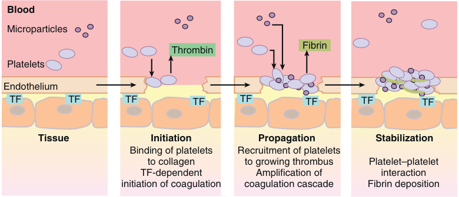

Blood Microparticles Fibrin Thrombin Platelets Endothelium TF TF TF TF TF TF TF TF Tissue Initiation Propagation Stabilization Binding of platelets Recruitment of platelets to collagen to growing thrombus Platelet–platelet TF-dependent Amplification of interaction initiation of coagulation coagulation cascade Fibrin deposition 

**Fig. 46.2 Clot formation at vascular injury site.** Vascular injury exposes subendothelial tissue factor (TF) initiating plasma- mediated hemostasis via the extrinsic pathway. The intrinsic pathway further amplifies thrombin and fibrin generation. Platelets adhere to exposed collagen to undergo activation, resulting in recruitment and aggregation of additional platelets. (From Mackman N, Tilley RE, Key NS. Role of extrinsic pathway of blood coagulation in hemostasis and thrombosis. _Arterioscleros Thromb Vasc Biol_ . 2007;27:1687–1693, with permission.)

from activation of factor X by both intrinsic (FIXa, FVIIIa, Ca2+ ) and extrinsic (tissue factor, FVIIa, Ca2+ ) tenase complexes. The tenase complexes in turn facilitate formation of the prothrombinase complex (FXa, FII [prothrombin], FVa [cofactor], and Ca2+ ), which mediates a surge in thrombin generation from prothrombin.30 Thrombin proteolytically cleaves fibrinopeptides A and B from fibrinogen molecules to generate fibrin monomers, which polymerize into fibrin strands to form clot.30 Finally, factor XIIIa, a transglutaminase activated by thrombin, covalently cross-links fibrin strands to produce an insoluble fibrin clot resistant to fibrinolytic degradation.31

Both fibrinogen and factor XIII have been implicated in acquired bleeding disorders. Reduced concentrations of either protein may promote excess postoperative hemorrhage and transfusion requirements. Recent availability of plasma concentrates for both fibrinogen and factor XIII suggest the potential for randomized controlled trials to determine efficacy of these biologics in treatment of acquired coagulopathies.32,33

Thrombin generation remains the key enzymatic step regulating hemostasis. Not only does thrombin activity mediate conversion of fibrinogen to fibrin but also it has a host of other actions. It activates platelets and factor XIII, converts inactive cofactors V and VIII to active conformations, activates factor XI and the intrinsic pathway, upregulates expression of tissue factor, stimulates vascular endothelial expression of PAI- 1 to downregulate fibrinolytic activity, and suppresses uncontrolled thrombosis through activation of protein C.34

### Intrinsic Anticoagulant Mechanisms

Once activated, regulation of hemostasis is essential to limit clot propagation beyond the injury site. One simple, yet important, anticoagulant mechanism derives from flowing blood and hemodilution. The early platelet and fibrin clot proves highly susceptible to disruption by shear forces from flowing blood. Blood flow further limits localization and concentration of both platelets and coagulation factors such that a critical mass of hemostatic components may fail to coalesce.30,35 However, later in the clotting process, more robust counter- regulatory mechanisms are necessary

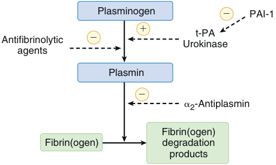

Plasminogen � PAI-1 Antifibrinolytic � � Urokinaset-PA agents Plasmin � �2-Antiplasmin Fibrin(ogen) Fibrin(ogen) degradation products 

**Fig. 46.3 Principal mediators of fibrinolysis.** _Dashed lines_ depict sites of action for promoters and inhibitors of fibrinolysis. _PAI,_ plasminogen activator inhibitor; _t-PA,_ tissue plasminogen activator. (From Slaughter TF. The coagulation system and cardiac surgery. In: Estafanous FG, Barasch PG, Reves JG, eds. _Cardiac Anesthesia: Principles and Clinical Practice_ . 2nd ed. Philadelphia: Lippincott Williams & Wilkins; 2001:320, with permission.)

to limit clot propagation. Four major counter- regulatory pathways have been identified that appear particularly crucial for downregulating hemostasis: fibrinolysis, TFPI, the protein C system, and serine protease inhibitors (SERPINs).

The fibrinolytic system comprises a series of amplifying reactions culminating in plasmin generation and proteolytic degradation of fibrin and fibrinogen. As with the plasma- mediated coagulation cascade, inactive precursor proteins are converted to active enzymes, necessitating a balanced system of regulatory controls to prevent excessive bleeding or thrombosis (Fig. 46.3). The principal enzymatic mediator of fibrinolysis is the serine protease plasmin, which is generated from plasminogen.36 _In vivo_ , plasmin generation is most often accomplished by release of t- PA or urokinase from the vascular endothelium. Activity of t- PA and urokinase is accelerated in the presence of fibrin, which limits fibrinolysis to areas of clot formation. Factor XIIa and kallikrein of the intrinsic pathway also contribute to fibrinolysis through activation of plasminogen after exposure to foreign surfaces.37 Fortunately, fibrinolytic activity is limited by the rapid inhibition of free plasmin. In addition to enzymatic degradation of fibrin and fibrinogen, plasmin

::: warning 符號需核對
此頁有符號無法完整擷取，請展開下方原始頁面核對。
:::

::: details 原始表格與符號（PDF 第 4 頁）

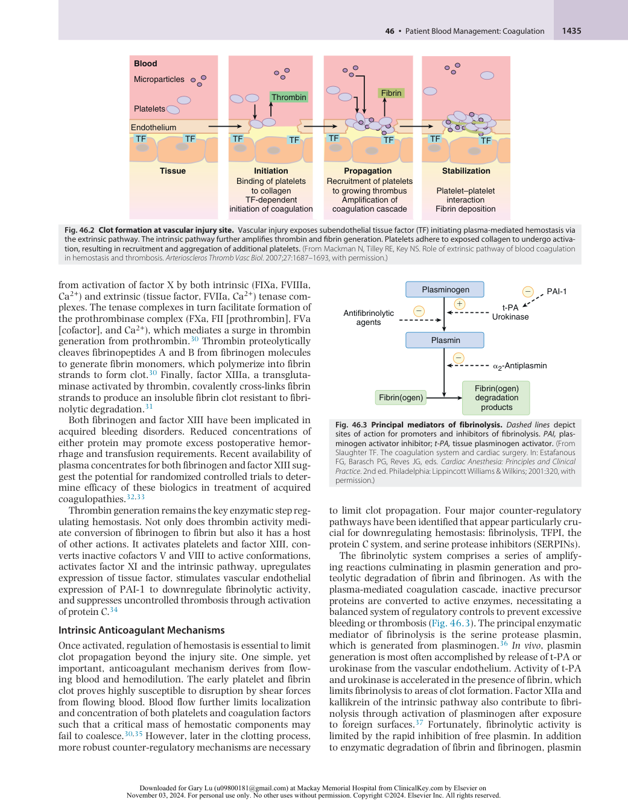

:::

<!-- PDF page 5 -->

inhibits hemostasis by degrading essential cofactors V and VIII and reducing platelet glycoprotein surface receptors essential to adhesion and aggregation.38 Fibrin degradation products also possess mild anticoagulant properties.

TFPI and factor Xa form phospholipid membrane- bound complexes that incorporate and inhibit tissue factor/factor VIIa complexes.39 This inhibition leads to downregulation of the extrinsic coagulation pathway.40 As TFPI rapidly extinguishes tissue factor/VIIa activity, the critical role of the intrinsic pathway to continued thrombin and fibrin generation becomes apparent.28

The protein C system proves particularly important in downregulating coagulation through inhibition of thrombin and the essential cofactors Va and VIIIa. After binding to TM, thrombin’s procoagulant function decreases and instead its ability to activate protein C is augmented.41 Protein C, complexed with the cofactor protein S, degrades both cofactors Va and VIIIa. Loss of these critical cofactors limits formation of tenase and prothrombinase activation complexes essential to formation of factor Xa and thrombin, respectively. Additionally, once bound to TM, thrombin is rapidly inactivated and removed from circulation, providing another mechanism by which the protein C pathway downregulates hemostasis.41

The most significant SERPINs regulating hemostasis include AT and heparin cofactor II. AT inhibits thrombin, as well as factors IXa, Xa, XIa, and XIIa.42 Heparin binds AT, causing a conformational change that accelerates ATmediated inhibition of targeted enzymes. Heparin cofactor II is a more recently discovered SERPIN that inhibits thrombin alone.43 Although the precise physiologic role for heparin cofactor II remains unclear, when bound by heparin, its inhibitory activity is dramatically increased.

## Disorders of Hemostasis

### EVALUATION OF BLEEDING DISORDERS

The perioperative period presents significant challenges to the hemostatic system; therefore, identification and correction of hemostatic disorders can be of vital importance. Unfortunately, assessment of bleeding risk continues to be a challenge and the optimal methods for preoperative evaluation remain controversial. Although routine preoperative coagulation testing of all surgical patients may seem prudent, such an approach is costly and lacks predictive value for detection of hemostatic abnormalities. Standard coagulation tests such as the prothrombin time (PT) and aPTT were designed as diagnostic tests to be used when a bleeding disorder is suspected based on clinical evaluation. As a result, when used as screening tests, these _in vitro_ assays are limited in their ability to reflect the _in vivo_ hemostatic response.44 For example, because of the nature of establishing normal value ranges for these tests, 2.5% of healthy individuals will have abnormal PT or aPTT values. Meanwhile, those with mild hemophilia A, vWD, and factor XIII deficiency may experience clinically significant bleeding despite having normal values on standard testing.45 Consequently, a carefully performed bleeding history remains the single most effective predictor of perioperative bleeding.

A thorough history should focus on prior bleeding episodes.46 In particular, patients should be asked whether they have experienced excessive bleeding after hemostatic challenges such as dental extractions, surgery, trauma, or childbirth and whether blood transfusions or reoperation were required to control the bleeding. Common presentations suggestive of a bleeding disorder may include frequent epistaxis necessitating nasal packing or surgical intervention. Oral surgery and dental extractions prove particularly good tests of hemostasis because of increased fibrinolytic activity on the mucous membranes of the oral cavity. Women with platelet disorders or vWD may experience menorrhagia, and postpartum hemorrhage commonly occurs in those with underlying disorders of hemostasis.47 A history of spontaneous nontraumatic hemorrhage proves particularly concerning when associated with hemarthroses or deep muscle bleeding. Identification of a bleeding disorder at an early age or in family members suggests an inherited condition. A careful medication history should be taken, including direct questions relating to consumption of aspirin and nonsteroidal anti- inflammatory drugs (NSAIDs), as well as supplements such as ginkgo and vitamin E.48 Finally, inquiries regarding coexisting diseases should be included (i.e., renal, hepatic, thyroid, and bone marrow disorders and malignancy).

For most patients, a thoughtfully conducted bleeding history will eliminate the need for preoperative laboratorybased coagulation testing. Should the preoperative history or physical examination reveal signs or symptoms suggestive of a bleeding disorder, further laboratory testing is indicated. Preoperative coagulation screening tests may be indicated, despite a negative history, in cases in which the planned surgery is commonly associated with significant bleeding (i.e., CPB). Finally, preoperative testing may prove justified in settings in which the patient is unable to provide an adequate preoperative bleeding history. Should evidence of a bleeding disorder be detected, underlying etiologies should be clarified if possible before proceeding with surgery.

### INHERITED BLEEDING DISORDERS

### Von Willebrand Disease

Inherited disorders of hemostasis include those involving platelet quantity and function, coagulation factor deficiencies, or disorders of fibrinolytic pathways. Among these inherited bleeding disorders, vWD is the most common and is characterized by quantitative or qualitative deficiencies of vWF resulting in defective platelet adhesion and aggregation.49 Affecting up to 1% of the population, vWD is categorized into three main types (types 1, 2, and 3). with most cases demonstrating an autosomal dominant inheritance pattern.50 Types 1 and 3 lead to varying quantitative vWF deficiencies, while type 2 encompasses four subtypes expressing qualitative defects that affect vWF function. Under normal conditions, vWF plays a critical role in platelet adhesion to the ECM and prevents degradation of factor VIII by serving as a carrier molecule.51 Classically, patients with vWD describe a history of easy bruising, recurrent epistaxis, and menorrhagia, which are characteristic of defects in platelet- mediated hemostasis. In more severe cases (i.e., type 3 vWD), concomitant reductions in factor

<!-- PDF page 6 -->

VIII may lead to serious spontaneous hemorrhage, including hemarthroses.

Routine coagulation studies are generally not helpful in the diagnosis of vWD, as the platelet count and PT will be normal in most patients and the aPTT may demonstrate mild- to- moderate prolongation depending on the level of factor VIII reduction.52 Instead, initial screening tests involve measurement of vWF levels (vWF antigen) and vWF platelet binding activity in the presence of the ristocetin cofactor, which leads to platelet agglutination. Measurable reductions in factor VIII activity may occur in severe cases.53 Increasingly, platelet function tests have replaced bleeding times in assessing for vWD.54,55 Mild cases of vWD often respond to DDAVP, which results in the release of vWF from endothelial cell. Use of vWF:factor VIII concentrates (Humate- P, CSL Behring, King of Prussia, PA) may be indicated in the perioperative period if there is a significant bleeding history.56

### Hemophilias

Although less common than vWD, the hemophilias merit consideration given their diverse clinical presentation. Hemophilia A, factor VIII deficiency, and hemophilia B, factor IX deficiency, are both X- linked inherited bleeding disorders most frequently presenting in childhood as spontaneous hemorrhage involving joints, deep muscles, or both. Hemophilia A occurs with an incidence of 1:5000 males and hemophilia B in 1:30,000 males. While most cases are inherited, nearly one-third of cases represent new mutations with no family history.57 The severity of the disease depends on an individual’s baseline factor activity level.58 In mild cases, patients with hemophilia may not be identified until later in life, often after unexplained bleeding with surgery or trauma. Classically, laboratory testing in patients with hemophilia reveals prolongation of the aPTT, whereas the PT, bleeding time, and platelet count remain within normal limits. However, a normal aPTT may also be seen in mild forms of hemophilia; therefore, specific factor analyses need to be performed to confirm the diagnosis and determine the severity of the factor deficiency. In most cases, perioperative management of patients with hemophilia A or B necessitates consultation with a hematologist and administration of recombinant or purified factor VIII or factor IX concentrates, respectively.59 Mild cases of hemophilia A may be treated with desmopressin. An increasingly common complication of hemophilia, particularly in the case of hemophilia A, has been the development of alloantibodies directed against the factor VIII protein.60 Administration of factor VIII concentrates will fail to control bleeding in patients with high- titer antibodies. Several approaches to reduce bleeding in these patients include substitution of porcine factor VIII, administration of activated (FEIBA, Shire Inc., Lexington, MA) or non- activated prothrombin complex concentrates (PCCs), or treatment with recombinant factor VIIa (NovoSeven, Novo Nordisk Inc., Bagsvaerd, Denmark).61

### ACQUIRED BLEEDING DISORDERS

### Drug Induced

Medications represent the most significant cause of acquired coagulopathy in perioperative patients. In addition to

anticoagulants such as heparin and warfarin, the increasing number of direct oral anticoagulants (DOACs) and antiplatelet drugs have further complicated perioperative management. An understanding of the effect of these agents and strategies for reversal can be critical to reduce bleeding complications during urgent and emergent procedures. Additionally, there are several classes of medications that may unintentionally increase bleeding risk due to side effects, primarily via platelet inhibition. β- Lactam antibiotics impair platelet aggregation that can result in clinically significant bleeding in patients with higher baseline risk.62 Nitroprusside,63 nitroglycerin,64 and NO65 also result in decreased platelet aggregation and secretion. Similarly, selective- serotonin reuptake inhibitors, such as paroxetine, decrease platelet serotonin storage, which inhibits platelet aggregation and may have clinical consequences in individuals with preexisting coagulopathies.66 These medications should be considered in patients with an otherwise unexplained coagulopathy.

### Liver Disease

Hemostatic defects associated with hepatic failure prove complex and multifactorial. Severe liver disease impairs synthesis of coagulation factors, produces quantitative and qualitative platelet dysfunction, and impedes clearance of activated clotting and fibrinolytic proteins. The liver is the primary site for the production of procoagulant factors including fibrinogen, prothrombin (factor II), factors V, VII, IX, X, XI, XII, as well as the anticoagulants protein C and S, and AT. Laboratory findings commonly associated with liver disease include a prolonged PT and possible prolongation of the aPTT, suggesting that these individuals are at increased risk of bleeding. However, the abnormal values only reflect the decrease in procoagulant factors and do not account for the concomitant decrease in anticoagulant factors.67 As a result, patients with chronic liver disease are thought to have a rebalanced hemostasis and generate amounts of thrombin equivalent to healthy individuals.68

Similarly, thrombocytopenia from splenic sequestration is often observed in patients with liver disease and portal hypertension69 and is accompanied by platelet dysfunction due to increased production of endothelial NO and prostacyclin resulting in platelet inhibition.70 Despite these alterations, increases in vWF commonly observed in these patients may serve to restore platelet function. Also, levels of the plasma metalloprotease ADAMTS13, responsible for cleaving vWF multimers, are decreased in chronic liver disease and result in high circulating levels of large vWF multimers that promote platelet aggregation.71 This increase in vWF may in part correct for thrombocytopenia and platelet dysfunction but also can result in a prothrombotic state and increased clotting risk.

Fibrinolysis of formed clot is also aberrant in patients with liver disease. Normally, fibrin clot is degraded by plasmin, which is converted to its active form by t- PA and urokinase plasminogen activator (u- PA). Excessive fibrinolysis is prevented by thrombin- activatable fibrinolysis inhibitor (TAFI), which blocks activation of plasmin from plasminogen. TAFI is synthesized by the liver and as levels are decreased in patients with chronic liver disease, it was believed that such individuals are at increased bleeding risk due to hyperfibrinolysis.72 However, levels of PAI- 1, a

<!-- PDF page 7 -->

SERPIN of t- PA and u- PA, are also increased in liver disease, which may normalize fibrinolysis.73

In summary, procoagulant and anticoagulant hemostatic mechanisms are rebalanced in patients with chronic liver disease, but this balance is easily disrupted and these patients are at risk for both bleeding and inappropriate clotting.74 Traditional coagulation testing does not correlate with bleeding risk in these patients, which has led to studies looking at the use of viscoelastic coagulation testing using thromboelastography (TEG) or rotational thromboelastometry (ROTEM) as a means of assessing functional coagulation and guiding perioperative blood product transfusion and administration of antifibrinolytic agents.74,75

### Renal Disease

Platelet dysfunction commonly occurs in association with chronic renal failure and uremia, as reflected by a prolonged bleeding time and propensity for bleeding associated with surgery or trauma. The underlying mechanisms are multifactorial but have mostly been attributed to decreased platelet aggregation and adhesion to injured vessel walls. Impaired adhesion is likely due to defects of the glycoprotein IIb/IIIa, which facilitates platelet binding of fibrinogen and vWF.76,77 Additionally, accumulation of guanidinosuccinic acid and the resulting increase in endothelial NO synthesis further decreases platelet responsiveness.78 Red blood cell (RBC) concentration has also been speculated to contribute to platelet dysfunction, as correction of anemia results in shortened bleeding times, presumably related to the role of RBCs in causing platelet margination along the vessel wall under laminar flow conditions.79 Both dialysis and correction of anemia have been reported to shorten bleeding times in patients with chronic renal failure. Treatment of platelet dysfunction related to chronic renal disease includes transfusion of cryoprecipitate (rich in vWF) or administration of desmopressin (0.3 mcg/kg), which stimulates release of vWF from endothelial cells.80 Additionally, conjugated estrogens (0.6 mg/kg intravenously for 5 days) have been demonstrated to shorten bleeding times,81 perhaps via decreased generation of NO.82

### Disseminated Intravascular Coagulation

Disseminated intravascular coagulation (DIC) is a pathologic hemostatic response to tissue factor/factor VIIa complex that leads to excessive activation of the extrinsic pathway, which overwhelms natural anticoagulant mechanisms and generates intravascular thrombin. Numerous underlying disorders may precipitate DIC, including trauma, amniotic fluid embolus, malignancy, sepsis, or incompatible blood transfusions.83 Most often, DIC presents clinically as a diffuse bleeding disorder associated with consumption of coagulation factors and platelets during widespread microvascular thrombotic activity, which results in multiorgan dysfunction. Laboratory findings typical of DIC include reductions in platelet count; prolongation of the PT, aPTT, and thrombin time (TT); and elevated concentrations of soluble fibrin and fibrin degradation products. However, DIC is both a clinical and laboratory diagnosis; hence, laboratory data alone do not provide sufficient sensitivity or specificity to confirm a diagnosis.84 For example, chronic DIC states have been identified with relatively normal screening coagulation tests accompanied by elevated

concentrations of soluble fibrin and fibrin degradation products.85 Management of DIC requires management of the underlying condition precipitating hemostatic activation. Otherwise, treatment is mostly supportive and includes selective blood component transfusions to replete coagulation factors and platelets consumed in the process. The use of anticoagulants such as heparin remains controversial with recommendations that its use be limited to conditions with the highest thrombotic risk.86 Antifibrinolytic therapy generally is contraindicated in DIC, owing to the potential for catastrophic thrombotic complications.87

### CARDIOPULMONARY BYPASS– ASSOCIATED COAGULOPATHY

Institution of CPB by directing blood flow through an extracorporeal circuit causes significant perturbations to the hemostatic system. Initial priming of the bypass circuit results in hemodilution and thrombocytopenia.88 Adhesion of platelets to the synthetic surfaces of the bypass circuit further decreases platelet counts and contributes to platelet dysfunction.89 During CPB, expression of platelet surface receptors important for adhesion and aggregation (GPIb, GPIIb/IIIa) are downregulated and the number of vWF- containing α granules are decreased, thereby impairing platelet function.90 Furthermore, induced hypothermia during CPB results in reduced platelet aggregation and plasma- mediated coagulation by decreasing clotting factor production and enzymatic activity.91 Hyperfibrinolysis may also occur as a result of CPB, supporting the use of antifibrinolytic drugs to decrease intraoperative blood loss.92

### TRAUMA- INDUCED COAGULOPATHY

Uncontrolled hemorrhage is a frequent cause of traumarelated deaths. Coagulopathy in this setting may be due to acidosis, hypothermia, and hemodilution from resuscitation; however, an independent acute coagulopathy is also experienced by these individuals.93 Termed traumainduced coagulopathy (TIC) or acute traumatic coagulopathy, this process involves disordered hemostasis and increased fibrinolysis observed early after injury.94 The anticoagulant effect of activated protein C (APC) is thought to play a primary role in TIC by decreasing thrombin generation via inhibition of factor Va and VIIIa and promoting fibrinolysis through inhibition of PAI- 1. The relevance of APC in the development of TIC is supported by the association of hypoperfusion and increasing injury severity with increased levels of APC activity.95 Hypoperfusion is thought to be the stimulus for APC activation.96 Additionally, degradation of the endothelial glycocalyx (EG), a gellike matrix lining the vascular endothelium, is linked to factors associated with trauma, including tissue damage, hypoperfusion, elevated catecholamines, and inflammation. The EG has anticoagulant properties and contains proteoglycans such as syndecan- 1, hyaluronic acid, heparan sulfate, and chondroitin sulfate which are shed during endothelial injury. Shedding of proteoglycans results in an “auto- heparinization” phenomenon that contributes to TIC. Markers of EG degradation have been found to be associated with inflammation, coagulopathy, and increased mortality in trauma patients.97

<!-- PDF page 8 -->

Although platelet counts may appear to be normal, platelet dysfunction contributes to increased bleeding in TIC. Significant platelet hypofunction in response to various agonists, including ADP, arachidonic acid, and collagen, has been observed acutely in trauma patients prior to resuscitation.98,99 It is hypothesized that trauma patients experience “platelet exhaustion” because of activation from widespread release of ADP from injured tissues. This diffuse activation renders platelets unresponsive to subsequent stimulation.99 Platelet insensitivity to ADP is also associated with increased susceptibility of clots to tPA- mediated fibrinolysis.100 The importance of early treatment to reduce hyperfibrinolysis in trauma is supported by the findings of the Clinical Randomisation of an Antifibrinolytic in Significant Haemorrhage 2 (CRASH- 2) trial, which demonstrated a mortality benefit from early administration of tranexamic acid (TXA).101,102 More recent studies, however, suggest that TIC may transition from an early hypocoagulable state to a later phenotype characterized by fibrinolysis shutdown and hypercoagulability where administration of antifibrinolytics may increase risk of venous thromboembolism.103,104

### PROTHROMBOTIC STATES

Thrombophilia, a propensity for thrombotic events, commonly manifests clinically in the form of venous thrombosis (frequently deep venous thrombosis [DVT] of the lower extremity).105 As with bleeding disorders, thrombophilia may result from inherited or acquired conditions (Box 46.1). The pathogenesis of thrombosis is thought to be due to Virchow’s triad (blood stasis, endothelial injury, and hypercoagulability).9 In the majority of cases, a risk factor or precipitating event is identified; however, a single factor generally does not result in clinically significant thrombosis.106 Instead, multiple factors act synergistically to increase risk.107 For example, thrombotic complications often occur after surgery or during pregnancy in association with obesity, underlying malignancy, or an inherited thrombophilia.108 Random screening of asymptomatic patients for thrombotic risk has not proven cost-effective or clinically efficacious.109,110 As with bleeding disorders, a history focusing on prior thrombotic events, family history of thrombosis, and concurrent drug therapy offers greater predictive value than random screening.

### INHERITED THROMBOTIC DISORDERS

Improvements in biochemical and molecular testing have dramatically improved our understanding of blood coagulation and the prevalence of prothrombotic disorders.111 Because of more specific testing, an inheritable thrombotic predisposition is identified in as many as 50% of patients presenting with venous thromboembolism.112 The most common inherited prothrombotic conditions include single-point mutations in genes for factor V (factor V Leiden) or prothrombin (prothrombin G20210A). In the case of the factor V Leiden, the mutation results in APC resistance whereby the essential cofactor Va is no longer susceptible to APC- mediated degradation. This simple alteration

### Box 46.1 Hypercoagulable States and Risk for Perioperative Thrombosis

|**High Risk**|
|---|
|Heparin- induced thrombocytopenia Antithrombin deficiency Protein C deficiency Protein S deficiency Antiphospholipid antibody syndrome|
|**Moderate Risk**|
|Factor V Leiden genetic polymorphism|
|Prothrombin G20210A genetic polymorphism Hyperhomocysteinemia Dysfibrinogenemia|
|Postoperative prothrombotic state Malignancy Immobilization|

in balance between hemostasis and the APC counterregulatory system induces a prothrombotic condition present in approximately 5% of the Caucasian population.113 In the case of the prothrombin gene mutation, increased prothrombin concentrations in plasma generate a hypercoagulable state. Less common inherited forms of thrombophilia include deficiencies of AT, protein C, or protein S.111 Inherited forms of thrombophilia are characterized by highly variable penetrance affected by blood type, sex, and other confounding variables. Environmental factors such as oral contraceptive use, pregnancy, immobility, infection, surgery, or trauma greatly affect the incidence of thrombosis in those with an inherited predisposition.114 In the absence of coexisting precipitating conditions, presence of a family history, test abnormality suggesting thrombophilia, or history of thrombosis, risks associated with long- term preventive anticoagulation may outweigh potential benefits.109 After a thrombotic complication, however, these patients most often are managed with lifelong anticoagulation.

### ACQUIRED THROMBOTIC DISORDERS

### Antiphospholipid Syndrome

Antiphospholipid syndrome (APS) describes an acquired autoimmune disorder characterized by venous or arterial thromboses, or both, and recurrent pregnancy loss. This syndrome may occur in association with autoimmune disorders such as systemic lupus erythematosus or rheumatoid arthritis, or it may occur in isolation. APS results from development of autoantibodies directed against phospholipid- binding proteins, which affect the coagulation system and is associated with up to 10% of cases of DVT and 6% of pregnancy- associated morbidity.115 Characteristically, APS results in mild prolongation of the aPTT and positive testing for lupus anticoagulant, anticardiolipin or anti- β2- glycoprotein I antibodies.116 Antibodies associated with APS interfere with phospholipids common to many laboratory- based tests of coagulation. Despite the prolonged aPTT, APS poses no increased bleeding risk but rather increases the potential for thrombosis. Isolated prolongation of an aPTT in a

::: details 原始表格與符號（PDF 第 8 頁）

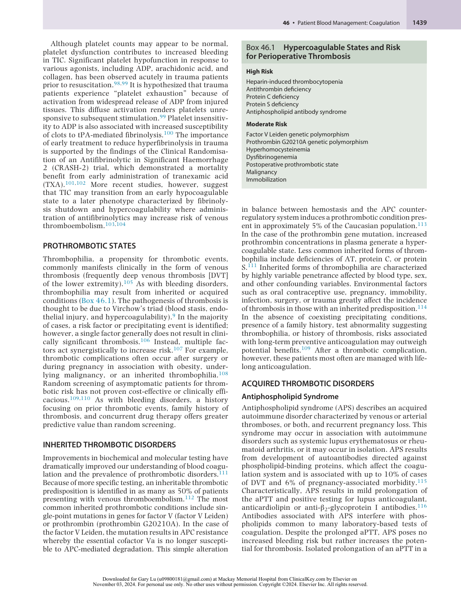

:::

<!-- PDF page 9 -->

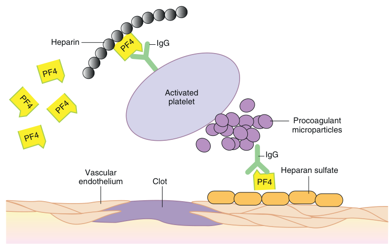

Heparin IgG Activated platelet Procoagulant microparticles IgG Vascular Heparan sulfate endothelium Clot PF4 PF4 PF4 PF4 PF4 PF4 

**Fig. 46.4 Mechanisms underlying thrombosis in heparin- induced thrombocytopenia.** Immune complexes composed of heparin, platelet factor 4 (PF4), and antibodies bind to platelet surface Fcγ receptors to activate platelets. PF4/heparin immune complexes further activate vascular endothelium, monocytes, and macrophages to increase tissue factor expression. _IgG,_ immunoglobulin G. (From Slaughter TF, Greenberg CS. Heparin- associated thrombocytopenia and thrombosis: Implications for perioperative management. _Anesthesiology_ . 1997;87:669, with permission.)

preoperative patient merits consideration of the diagnosis of APS. Patients with this syndrome who have experienced a thrombotic complication are at increased risk for recurrent thrombosis and most often are managed by lifelong anticoagulation.117

### HEPARIN- INDUCED THROMBOCYTOPENIA

Heparin- induced thrombocytopenia (HIT) describes an autoimmune- mediated drug reaction occurring in as many as 5% of patients receiving heparin therapy. Patients with HIT experience a mild- to- moderate thrombocytopenia. As opposed to other drug- induced thrombocytopenias, HIT results in platelet activation and potential for venous and arterial thromboses.118 Evidence suggests that HIT is mediated by immune complexes (composed of immunoglobulin G [IgG] antibody, platelet factor 4 [PF4], and heparin) that bind platelet Fcγ receptors to activate platelets. Anti- PF4/heparin antibodies may “activate” vascular endothelium, monocytes, and macrophages by upregulating tissue factor expression (Fig. 46.4). Recent studies also demonstrate that HIT immune complexes activate neutrophils via the FcγRIIa receptor, inducing release of uncoiled strands of DNA and chromatin which then promote thrombosis.119,120

Risk factors for development of HIT include patient population, sex, and heparin formulation used. Women are at increased risk of HIT (odds ratio [OR] 2.37; 95% confidence interval [CI] 1.37–4.09) as are surgical patients compared to medical patients (OR 3.25; 95% CI 1.98–5.35).121 Given the high doses of heparin administered during cardiac surgery with CPB, these patients have a higher incidence of anti- PF4 antibody development (up to 50%); however, the incidence of HIT in this population appears to be similar to other surgical groups.122 Use of unfractionated heparin

(UFH) carries a greater risk of HIT development than lowmolecular- weight heparin (LMWH) (absolute risk 2.6% vs. 0.2%).123 Patients developing HIT during heparin therapy experience substantially increased risk for thrombosis (absolute risk 30% to 75%).118

HIT manifests clinically as thrombocytopenia occurring 5 to 14 days after initiating heparin therapy. With prior heparin exposure, thrombocytopenia or thrombosis may occur within one day. A diagnosis of HIT should be entertained for any patient experiencing thrombosis or thrombocytopenia (absolute or relative ≥50% reduction in platelet count) during or after heparin administration. Although HIT remains a clinical diagnosis, HIT antibodies testing should be undertaken to confirm the diagnosis. The enzyme- linked immunosorbent assay (ELISA) is sensitive, but not as specific as the serotonin release assay (SRA), because the SRA indicates heparin- induced platelet activation. For many intensive care patients, a positive ELISA test does not lead to a positive SRA, which means these patients are unlikely to have HIT.124

In cases where HIT is suspected, heparin must be discontinued immediately (including UFH, LMWH, heparinbonded catheters, heparin flushes). Alternative nonheparin anticoagulation must be administered concurrently. In most cases, a direct thrombin inhibitor (DTI, e.g., bivalirudin, lepirudin, or argatroban) is substituted for heparin until adequate prolongation of the international normalized ratio (INR) can be achieved with warfarin. Initiation of warfarin alone is contraindicated for HIT treatment because the initial decreased synthesis of proteins C and S enhances the patient’s prothrombotic state. Platelet transfusions should be held unless the patient is severely thrombocytopenic (&lt;20 × 109 /L) with signs of bleeding. Use of DOACs (e.g., rivaroxaban, apixaban, dabigatran, edoxaban) is being investigated.125

<!-- PDF page 10 -->

Typically, PF4/heparin immune complexes are cleared from the circulation within 3 months. If possible, patients experiencing HIT should avoid future exposure to UFH; however, several reports describe subsequent limited perioperative reexposure to UFH after laboratory testing to ensure absence of PF4/heparin immune complexes. If titers remain high, treatment with plasmapheresis for rapid antibody clearance is an alternative plan but risks and benefits should be discussed with the hematologists.126 Otherwise, bivalirudin, the shortest-acting DTI, is the alternative agent for anticoagulation while on CPB.

### MONITORING COAGULATION

Traditionally, perioperative coagulation monitoring has focused on (1) preoperative testing to identify patients at increased risk for perioperative bleeding and (2) intraoperative monitoring of heparin therapy during cardiac and vascular surgery. The ideal test for perioperative coagulation should be simple to perform, accurate, reproducible, diagnostically specific, and cost-effective. No current coagulation monitor meets these expectations; however, integrating results from multiple forms of monitoring may provide valuable diagnostic insight into perioperative coagulopathies.

### COMMON LABORATORY- BASED MEASURES OF COAGULATION

### Prothrombin Time

The PT assesses the integrity of the extrinsic and common pathways of plasma- mediated hemostasis. It measures time required in seconds for clot formation to occur after mixing a sample of patient plasma with tissue factor (thromboplastin) and calcium. It is sensitive to deficiencies in fibrinogen, and factors II, V, VII, or X. As three of these factors have vitamin K- dependent synthesis (factors II, VII, and X), the PT assay has been used to monitor anticoagulation with vitamin K antagonists (VKAs) such as warfarin. The thromboplastin reagent, derived from animal or recombinant sources, can vary in its ability to bind factor VII and initiate coagulation, which limits interlaboratory comparisons. Given the importance of monitoring PT results for patients on long- term warfarin therapy, the INR was introduced as a means of normalizing PT results among different laboratories.127

Thromboplastin reagents are tested against an international recombinant standard and assigned an international sensitivity index (ISI) based on the results. The INR subsequently is calculated as INR = (patient PT/standard PT)ISI , in which the standard PT represents the geometric mean of multiple normal samples from the testing laboratory. Institution of the INR substantially reduced interlaboratory variations. The PT is more sensitive at detecting decreases in factors VII and X than levels of fibrinogen and factors II and V; however, due to variations in thromboplastin reagents, factor levels as low as 40% to 50% may not prolong the PT.128

Any prolongation of the PT should be assessed further with mixing studies to determine whether delayed clot formation is attributable to a coagulation factor deficiency or an inhibitor (e.g., antiphospholipid antibody,

fibrin degradation products). The mixing study is performed by mixing the patient’s plasma sample with “normal” donor plasma. In the case of a coagulation factor deficiency, time to clot formation will correct whereas time to clot formation will not correct in the presence of an inhibitor.

### Activated Partial Thromboplastin Time

The aPTT assesses integrity of the intrinsic and common pathways of plasma- mediated hemostasis. It measures the time required in seconds for clot formation to occur after mixing a sample of patient plasma with phospholipid, calcium, and an activator of the intrinsic pathway of coagulation (e.g., celite, kaolin, silica, or ellagic acid). The aPTT is more sensitive to deficiencies in factors VIII and IX than other factors in the intrinsic and common pathways. In most cases, coagulation factor levels below 30% to 40% of normal are detectable; however, aPTT reagents vary in their sensitivity to factor concentrations and may not be prolonged until levels drop below 15% for some factors.129 Additionally, as there is no reference standard reagent for the aPTT analogous to the INR for PT, individual institutions must set their own normal ranges and aPTT values cannot be compared between laboratories.

Monitoring anticoagulation during cardiac and vascular surgery remains necessary given the widely acknowledged pharmacokinetic and pharmacodynamic response to heparin. Patient- specific factors affecting response to heparin include age, weight, intravascular volume, and concentrations of AT, heparin cofactor II, PF4, and other heparinbinding proteins. Therefore, patients experience widely divergent anticoagulant responses to identical weightbased doses of heparin. In situations where heparin therapy must be initiated in patients with a baseline aPTT prolongation (lupus anticoagulant or factor inhibitors), alternative tests such as anti–factor Xa activity or heparin level measurements must be used.

### Anti–Factor Xa Activity

The anti–factor Xa activity assay or factor Xa inhibition test is being used with increasing frequency to monitor heparin anticoagulation instead of, or in addition to, the aPTT assay. The assay involves combining patient plasma with reagent factor Xa and an artificial substrate that releases a colorimetric signal after factor Xa cleavage, thereby providing a functional assessment of heparin anticoagulant effect.130 While aPTT values can be affected by several patient factors such as coagulation factor deficiencies, factor inhibitors, or the presence of lupus anticoagulant, measurement of the heparin- bound AT inhibition of factor Xa activity is not influenced by these variables. Anti–factor Xa testing can also be used to measure the effect of other anticoagulants such as LMWH, fondaparinux, and factor Xa inhibitors. As with the aPTT assay, the anti–factor Xa test lacks adequate standardization, and activity levels vary based on the type of assay used, and patient population assayed.131 Furthermore, significant discordance between aPTT and anti–factor Xa results can be observed in hospitalized patients receiving heparin therapy.132 Data supporting the use of anti–factor Xa over aPTT is sparse; however, it may be helpful to use

<!-- PDF page 11 -->

anti–factor Xa testing in combination with the aPTT to monitor both heparin effect and generalized coagulation status, respectively.

### Platelet Count and Bleeding Time

The platelet count remains a standard component in screening for coagulation abnormalities. Automated platelet counts are performed in bulk using either optical- based or impedance- based measurements. Recommendations regarding optimal platelet counts prove somewhat arbitrary, but platelet counts exceeding 100 × 109 /L commonly are associated with normal hemostasis. Abnormally low platelet counts merit further assessment, including a visual platelet count from a blood smear. Sample hemodilution and platelet clumping are common etiologies for falsely low platelet counts.

With the growth of point- of- care platelet function monitors, the bleeding time has declined in popularity. Limitations of the bleeding time include poor reproducibility, time needed to perform the test, and potential for scarring. Furthermore, the bleeding time is affected by numerous confounding variables, including skin temperature, skin thickness, age, ethnicity, anatomic test location, and a host of other factors.133 In general, the bleeding time is not predictive of bleeding and for that reason its use as a preoperative screening test to assess bleeding risk is not recommended.134

### COMMON POINT- OF- CARE MEASURES OF COAGULATION

Although laboratory- based measures of coagulation remain the mainstay of preoperative coagulation testing, increasing availability of sensitive and specific point- of- care coagulation monitoring may soon offer opportunities to direct blood component and hemostatic drug therapy more specifically without delays inherent to standard laboratory testing. Commercially available point- of- care tests applicable in the perioperative setting may be considered in four broad categories: (1) functional measures of coagulation that measure the intrinsic ability of blood to generate clot, (2) heparin concentration monitors, (3) viscoelastic measures of coagulation, and (4) platelet function monitors.

### Activated Clotting Time

The activated clotting time (ACT), described by Hattersley in 1966 as a variation of the Lee–White whole blood clotting time, employs a contact activation initiator, typically celite (diatomaceous earth) or kaolin, to accelerate clot formation and reduce time for assay completion.135 Current commercial ACT monitors automate clot detection. One of the more widely available ACT monitors uses a glass test tube containing a small magnet (Hemochron Response Whole Blood Coagulation System, ITC, Edison, NJ). After adding sample blood, the tube is placed into the analyzer and the tube is rotated slowly at 37°C, allowing the magnet to maintain contact with a proximity detection switch. As fibrin clot forms, the magnet becomes entrapped and dislodged from the detection switch, thereby triggering an alarm to signal completion of the ACT. Another ACT device uses a “plumb bob” flag assembly that is raised and released repeatedly to settle in the sample vial containing blood and

contact activator (Hepcon HMS Plus, Medtronic, Minneapolis, MN). With clot formation, the flag descent slows, which triggers an optical detector and sets off an alarm to signal completion of the ACT.

The ACT in normal individuals is 107 ± 13 seconds. Because the ACT measures clot formation by way of intrinsic and common pathways, heparin and other anticoagulants prolong time to clot formation. The ACT proves somewhat resistant to platelet dysfunction and thrombocytopenia. ACT testing remains a popular perioperative coagulation monitor because of its simplicity, low cost, and linear response at high heparin concentrations. Limitations of ACT monitoring include lack of sensitivity at low heparin concentrations and poor reproducibility.136 Further limitations of the ACT include artifactual prolongation of results with hemodilution or hypothermia, and values beyond 600 seconds exceed the linear response range for the assay. Although duplicate measurements improve results, newer electrochemically based ACT analyzers (i- STAT, Abbott, Princeton, NJ) improve reproducibility such that single ACT determinations may prove adequate.137,138

### Heparin Concentration Measurement

Protamine titration remains the most popular point- of- care method for determining heparin concentration in perioperative settings. Protamine, a strongly basic polycationic protein, directly inhibits heparin in a stoichiometric manner. In other words, 1 mg of protamine will inhibit 1 mg (∼100 units) of heparin, thereby forming the basis for protamine titration as a measure of heparin concentration. As increasing concentrations of protamine are added to a sample of heparin- containing blood, time to clot formation decreases until the point at which the protamine concentration exceeds heparin concentration to delay clot formation. If a series of blood samples with incremental doses of protamine are analyzed, the sample in which the protamine and heparin concentrations are most closely matched will clot first. This methodology allows for an estimate of heparin concentration. Assuming that the heparin–protamine titration curve for an individual patient remains constant throughout the operative period, protamine titration methods may estimate heparin doses required to achieve a desired plasma heparin concentration or the protamine dose needed to reverse a given heparin concentration in blood.139 Current point- of- care heparin concentration monitoring employs automated measurement techniques (Hepcon HMS Plus, Medtronic, Minneapolis, MN). The advantages of measuring heparin concentration include sensitivity for low heparin concentrations as well as relative insensitivity to hemodilution and hypothermia. A major limitation of heparin concentration monitoring is failure to assess directly for an anticoagulant effect. For example, consider a patient with a homozygous deficiency of AT; in this case, heparin concentration determination alone would fail to identify the lack of anticoagulant effect after heparin administration.

### Viscoelastic Measures of Coagulation

Initially developed in the 1940s, viscoelastic measures of coagulation have undergone a resurgence in popularity. The unique aspect of viscoelastic hemostatic assays (VHAs) lies in their ability to measure the entire spectrum of clot formation in whole blood from early fibrin strand generation

<!-- PDF page 12 -->

through clot retraction and fibrinolysis. The early thromboelastograph (TEG) developed by Hartert in 1948 has evolved into two independent viscoelastic monitors: the modern TEG (TEG 5000 Hemostasis Analyzer System, Haemonetics, Braintree, MA) and rotational thromboelastometry (ROTEM, TEM Systems, Durham, NC).140 In the case of the TEG 5000, a small (0.35- mL) sample of whole blood is placed into a disposable cuvette within the instrument. The cuvette is maintained at a temperature of 37°C and continuously rotates around an axis of approximately 5 degrees. A sensor “piston” attached by a torsion wire to an electronic recorder is lowered into the blood within the cuvette. Addition of an activator, most often kaolin or celite, initiates clot formation. As the fibrin- platelet plug evolves, the piston becomes enmeshed within the clot, transferring rotation of the cuvette to the piston, torsion wire, and electronic recorder.141

Although variables derived from the TEG tracing do not coincide directly with laboratory- based tests of coagulation, the TEG depicts characteristic abnormalities in clot formation and fibrinolysis. Various parameters describing clot formation and lysis are identified and measured by the TEG. For example, the R value (reaction time) measures time to initial clot formation. The R value may be prolonged by a deficiency of one or more plasma coagulation factors or inhibitors such as heparin. Maximum amplitude provides a measure of clot strength and may be decreased by either qualitative or quantitative platelet dysfunction or decreased fibrinogen concentration. The α angle and K (BiKoatugulierung or coagulation) values measure rate of clot formation and may be prolonged by any variable slowing clot generation such as a plasma coagulation factor deficiency or heparin anticoagulation. Modification of clotting activators may be incorporated to assess platelet or fibrin contributions to clot strength.

In a somewhat analogous manner, ROTEM measures viscoelastic changes in a sample of whole blood subjected to coagulation activation. Specific activators differ from that of the TEG with resulting quantitative measures termed (1) coagulation time (seconds), (2) α angle (clot formation time; seconds), (3) maximal clot firmness (MCF; millimeters), and (4) lysis time (LT; seconds) (Fig. 46.5).

To address the susceptibility to vibration artifacts and frequent calibration requirements of first-generation VHAs, newer devices have been designed which incorporate cartridge- based sample handling and the ability to perform multiple assays simultaneously. The TEG 6s (Haemonetics, Braintree, MA) measures movement of a meniscus formed by whole blood in a microfluidics chamber. Using frequencies from 20 to 500 Hz the meniscus is vibrated and as a clot forms, clot- strength- specific resonance frequencies are detected by a photodetector and converted into TEG- equivalent units.142,143 In contrast to TEG and ROTEM, the Quantra analyzer (HemoSonics, Charlottesville, VA) uses ultrasonic pulses to vibrate a blood sample. Resonance motion is measured and used to estimate the shear modulus of the sample.144 Repeated measurements generate a signature curve representing changes in sample’s shear modulus during coagulation and allowing for estimation of the start of clot formation, clot stiffness, as well as platelet and fibrinogen contributions to overall clot strength.145,146

Viscoelastic monitors generate characteristic diagrams by translating mechanical resistance to sensor movement within a sample of whole blood to an electronic waveform subject to quantitative analysis.140 One of the more common applications for viscoelastic monitoring has been real- time detection of excess fibrinolysis during liver transplantation or cardiac surgery. Evidence suggests that viscoelastic monitoring may prove beneficial in differentiating surgically related bleeding from that due to a coagulopathy. When used as one component of a diagnostic algorithm, both TEG and ROTEM have been demonstrated to reduce blood administration.147,148 More widespread application of viscoelastic monitoring has been hindered by lack of specificity associated with abnormal findings and qualitative assay interpretation.149 Digital automation of these instruments has simplified interpretation and improved reproducibility.

### Platelet Function Monitors

Assessment of platelet function has proved challenging for several reasons. Historically, tests of platelet function are costly, time consuming, and technically demanding. Platelet dysfunction may occur because of diverse inherited or acquired disorders affecting surface receptors involved in adhesion or aggregation, storage granules, internal activation pathways, phospholipid membranes, or other mechanisms.150 Lack of standardized quality controls necessitates use of local donor blood to establish normal control ranges. Complicating assessment further is the fact that platelets are highly susceptible to activation or desensitization during sample collection, transport, storage, and processing. The technique for platelet aggregometry was developed in the 1960s and soon became the gold standard for assessment of platelet function.151 The classic method involves centrifugation of patient blood to obtain platelet- rich plasma, which is then analyzed in a cuvette at 37°C placed between a light source and photocell. Addition of platelet agonists, such as ADP, epinephrine, collagen, and ristocetin, stimulates platelet aggregation, which in turn results in a decrease in turbidity of the solution and an increase in light transmission. Patterns based upon the kinetics and amplitude of response to these various agonists are associated with specific platelet disorders and aid in diagnosis.152 In an effort to decrease the labor required to prepare the platelet-rich plasma solution as well as to include the effect of RBCs and plasma proteins on platelet function, a technique for whole blood aggregometry was developed.153 Whole blood aggregometry uses platinum electrodes onto which platelets adhere. Platelet aggregation induced by agonists results in increased adhesion of aggregates to the electrodes, raising the impedance, which is measured over time. A multichannel system (Multiplate Analyzer, Roche Diagnostics, Indianapolis, IN) is available and is used to diagnose platelet dysfunction as well as monitor antiplatelet therapy.154 Flow cytometry employing fluorescent- labeled antibodies provides another sensitive method for quantitating platelet activation, responsiveness, and surface receptor availability.155 Despite representing standards of care, these measurements remain technically challenging, costly, and time- consuming laboratory- based assays.

Although viscoelastic measures of coagulation (i.e., TEG or ROTEM) may detect platelet dysfunction, the sensitivity

<!-- PDF page 13 -->

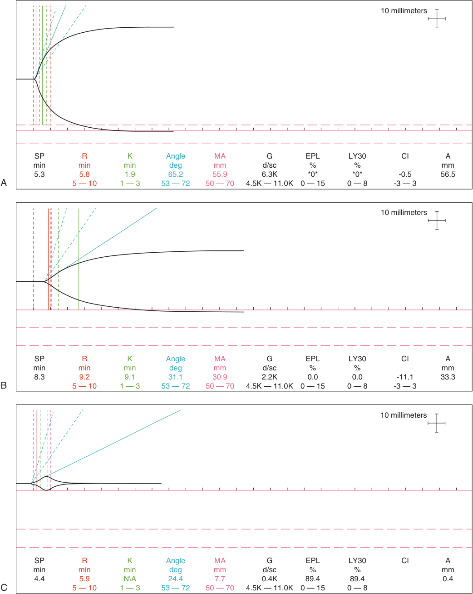

10 millimeters SP R K Angle MA G EPL LY30 CI A min min min deg mm d/sc % % mm 5.3 5.8 1.9 65.2 55.9 6.3K *0* *0* -0.5 56.5 A 5 — 10 1 — 3 53 — 72 50 — 70 4.5K — 11.0K 0 — 15 0 — 8 -3 — 3 10 millimeters SP R K Angle MA G EPL LY30 CI A min min min deg mm d/sc % % mm 8.3 9.2 9.1 31.1 30.9 2.2K 0.0 0.0 -11.1 33.3 B 5 — 10 1 — 3 53 — 72 50 — 70 4.5K — 11.0K 0 — 15 0 — 8 -3 — 3 10 millimeters SP R K Angle MA G EPL LY30 CI A min min min deg mm d/sc % % mm 4.4 5.9 N\A 24.4 7.7 0.4K 89.4 89.4 0.4 C 5 — 10 1 — 3 53 — 72 50 — 70 4.5K — 11.0K 0 — 15 0 — 8 

**Fig. 46.5** Thromboelastographs from kaolin- activated samples analyzed using a TEG 5000 system depicting (A) normal coagulation, (B) hypofibrinogenemia, and (C) hyperfibrinolysis. _SP,_ split point; _R,_ reaction time; _K,_ kinetic time; _Angle,_ alpha angle; _MA,_ maximum amplitude; _G,_ G-value (shear elastic modulus strength); _EPL,_ estimated percent lysis; _LY30,_ lysis at 30 minutes; _CI,_ coagulation index; _A,_ amplitude.

<!-- PDF page 14 -->

and specificity are limited. Incorporation of a platelet mapping assay into TEG provides a method for viscoelastic measurement of drug- induced platelet inhibition with reasonable correlation to optical aggregometry.141 Fortunately, an increasing array of platelet function assays specifically designed as point- of- care instruments are becoming available.152 As a measure of primary hemostasis, a platelet function analyzer (PFA- 100, Siemens, Tarrytown, NY) increasingly has replaced the bleeding time in assessment of hemostasis. The PFA- 100 incorporates high- shear conditions to simulate small vessel injury in the presence of either ADP or epinephrine, both potent platelet activators.156 Time to clot- mediated aperture occlusion is reported as closure time. The PFA- 100 has proven effective in detecting vWD and aspirin- mediated platelet dysfunction. This instrument, as a component of a standardized screening protocol, reduces time to identify and classify platelet dysfunction. Limitations of the PFA- 100 include interference by thrombocytopenia and hemodilution. Many other different point- of- care platelet function testing devices are on the market today. It is important to keep in mind that monitors from different manufacturers measure differing aspects of platelet- mediated or plasma- mediated hemostasis. When using different instruments, results may vary from “severe” platelet dysfunction to “no platelet dysfunction” in a single sample of blood. Before adopting any point- of- care monitoring, an understanding of the quality assurance requirements, test methodology, and concomitant strengths and weaknesses is essential to inform patient care. Also, in considering any point- of- care coagulation testing, it must be recognized that results will not necessarily mirror those reported from laboratory- based testing because of differences between using whole blood samples for testing as opposed to plasma or processed platelets. Reagent sensitivities can vary across manufacturers and lots. Hopefully, further advances in point- of- care coagulation monitoring will offer the opportunity for clinicians to make informed, bedside decisions about transfusion therapy and hemostatic drug administration to minimize perioperative bleeding and adopt effective patient blood management practices.

## Antithrombotics, Thrombolytics, and Procoagulant Drugs

In the following sections, we will briefly review some common medications used to decrease or increase clot formation and then examine perioperative management strategies to reverse anticoagulants. This is not intended to be an exhaustive list of all drugs approved by the Food and Drug Administration (FDA), so only more commonly used medications are discussed here.

Antithrombotic drugs are usually used to reduce the formation of blood clots in the setting of coronary or cerebral atherosclerosis or after vascular thrombosis. They can be further subdivided into antiplatelet agents and anticoagulants (Table 46.1).

### ANTIPLATELET AGENTS

Antiplatelet agents inhibit thrombus formation by inhibiting platelet aggregation and/or adhesion to clot or damaged

**Table 46.1** Common Classes of Antithrombotics, Thrombolytics, and Procoagulants

|**Category**|**Subcategory**|**Generic Drug Names**|
|---|---|---|
|Antiplatelet agents|Cyclooxygenase inhibitors|Aspirin, NSAIDs|
||P2Y12receptor antagonists|Ticlopidine, clopidogrel, prasugrel, cangrelor, and ticagrelor|
||Platelet GPIIb/IIIa antagonists|Abciximab, eptifibatide, and tirofiban|
|Anticoagulants|Vitamin K antagonists|Warfarin|
||Heparin|UFH, LMWH, fondaparinux|
||Direct thrombin inhibitors|Argatroban, bivalirudin (IV) dabigatran (PO)|
||Factor Xa inhibitors|Rivaroxaban, apixaban, edoxaban|
|Thrombolytics|Fibrin- specific agents|Alteplase, reteplase, tenecteplase|
||Non- fibrin- specific agents|Streptokinase|
|Antifibrinolytics|Lysine analogues|Tranexamic acid, epsilon- aminocaproic acid|
|Factor replacements|Recombinant factor VIIa||
||Prothrombin complex concentrate|3- factor PCC; 4- factor PCC, activated PCC (FEIBA)|
||Fibrinogen concentrate||

_FEIBA,_ factor VIII bypass activity; _IV,_ intravenous; _LMWH,_ low- molecular- weight heparin; _NSAIDs,_ nonsteroidal anti- inflammatory drugs; _PCC,_ prothrombin complex concentrate; _PO,_ per os, by mouth; _UFH,_ unfractionated heparin.

endothelium. Depending on the drug, they can work either reversibly or irreversibly. Most common antiplatelet agents can be divided into: (1) cyclooxygenase (COX) inhibitors, (2) P2Y12 receptor antagonists, and (3) platelet GPIIb/ IIIa antagonists, although there are several other classes available, such as phosphodiesterase inhibitors, proteaseactivated receptor- 1 antagonists, adenosine reuptake inhibitors, and thromboxane inhibitors.

### Cyclooxygenase Inhibitors

Aspirin and NSAIDs are the two primary members of this class. There are two forms of the cyclooxygenase enzyme: COX- 1 and COX- 2. COX- 1 maintains the integrity of the gastric lining and renal blood flow and initiates the formation of thromboxane A2 (TxA2), which is important for platelet aggregation. COX- 2 is responsible for synthesizing the prostaglandin mediators in pain and inflammation.

Aspirin is a nonselective and irreversible COX inhibitor. It acetylates a serine residue on COX- 1 and prevents the production of TxA2 in platelets.157 COX- 2, which leads to anti- inflammatory and analgesic effects, is 170 times less sensitive than COX- 1 to aspirin so only at high doses can aspirin irreversibly inhibit both COX- 1 and COX- 2.158 Because platelets are anuclear, they are unable to synthesize new COX- 1 once aspirin has irreversibly inhibited the

::: details 原始表格與符號（PDF 第 14 頁）

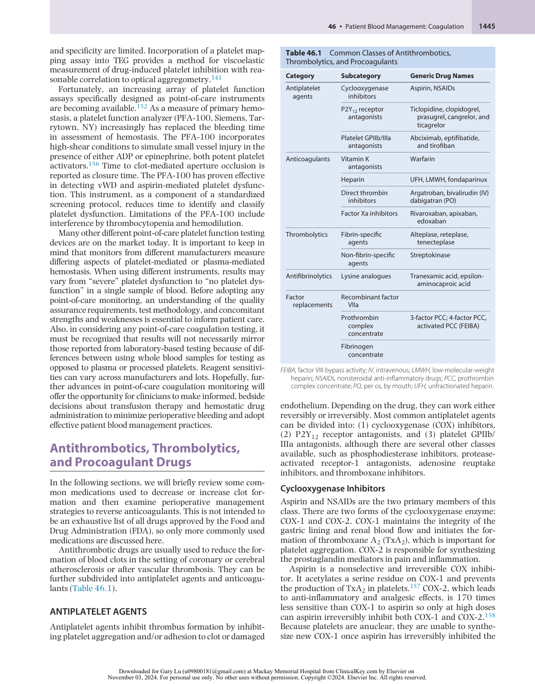

:::

<!-- PDF page 15 -->

enzyme. Consequently, despite its short half- life of approximately 15 to 20 minutes, aspirin’s inhibitory effect persists through the platelet lifespan of 7 to 10 days.159

The recovery of platelet function after aspirin depends on platelet turnover. Generally, megakaryocytes generate 10% to 12% of platelets daily, so near-normal hemostasis is expected in 2 to 3 days after the last dose of aspirin with typical platelet turnover. High platelet turnover diseases, which result from increased production (e.g., essential thrombocythemia) or increased consumption (e.g., inflammation), may require aspirin dosing more frequently than once daily.160 Immediate reversal of aspirin for emergencies can be achieved with platelet transfusions.

Most NSAIDs are nonselective, reversible COX inhibitors and therefore provide antipyretic, analgesic, and antiplatelet aggregation effects.161 Platelet function normalizes three days after discontinuing the use of NSAIDs. Selective COX- 2 antagonists such as celecoxib were introduced in the late 1990s to provide anti- inflammatory, analgesic, and antipyretic activity without the gastrointestinal complications,162 but clinical trials with selective COX- 2 antagonists have reported increased risks for cardiovascular complications.163 COX- 2 specific inhibitors do not affect platelet function because platelets do not express COX- 2. The increased cardiovascular risk is thought to be due to inhibition of PGI2 without inhibition of TxA2, thus tipping the balance toward thrombosis. Current recommendations are to use COX- 2 inhibitors only when necessary for pain and then with the lowest effective dose possible after weighing the risks and benefits.164

### P2Y12 Receptor Antagonists

These drugs interfere with platelet function by inhibiting the P2Y12 receptor, which inhibits platelet adhesion and aggregation by preventing the expression of GPIIb/IIIa on the surface of activated platelets.165 Clopidogrel and prasugrel are members of a class known as thienopyridines, and are pro- drugs requiring hepatic metabolism to generate the active metabolite that then irreversibly inactivates the ADP- binding site of the P2Y12 receptor.166 Because clopidogrel is a pro- drug and requires CYP2C19 for activation, it has wide interindividual variability in inhibiting ADP- induced platelet function. Although many factors may be involved in this variability, genetic polymorphism of CYP2C19 along with ABCB1, which affects the intestinal permeability and oral bioavailability of clopidogrel, are thought to play a significant role.167 Patients treated with clopidogrel who have decreased CYP2C19 and ABCB1 activity were shown to have increased risk of major cardiovascular events.168 The FDA put a black box warning on clopidogrel to make patients and healthcare providers aware that CYP2C19- poor metabolizers, representing up to 14% of patients, are at high risk of treatment failure and that genotype testing may be helpful prior to drug initiation.169 Prasugrel is hydrolyzed by intestinal esterases to an intermediate that is then activated via cytochrome P450.170 CYP genetic variation has no clinically significant effect on this drug.

Ticagrelor, cangrelor, and selatogrel are reversible, nonthienopyridine receptor antagonists that are directly active. Ticagrelor binds to the P2Y12 receptor at a different site than the thienopyridines, and causes a conformational change

of the receptor.171 Cangrelor, which is administered intravenously in patients undergoing percutaneous coronary intervention (PCI) when oral P2Y12 inhibitors are not indicated or not yet administered, has a fast onset of action (seconds), and platelet function normalizes within 60 minutes after drug discontinuation.172 This rapid onset may allow for bridging therapy in patients with drug- eluting stents who require surgery. The newest drug in this group, selatogrel, which is administered subcutaneously and reaches maximal platelet inhibition in approximately 30 minutes, is undergoing phase 2 trials.173

### Glycoprotein IIb/IIIa Inhibitors

Glycoprotein IIb/IIIa inhibitors (GPI) (abciximab, eptifibatide, and tirofiban) work to prevent platelet aggregation by decreasing the binding of fibrinogen and vWF to glycoprotein IIb/IIIa receptors on the surface of activated platelets.174 They are given intravenously to: (1) stop ongoing arterial thrombosis, or (2) eliminate excessive platelet reactivity in diseased vessels so that occlusive thrombi and restenosis do not occur. Their use was highly touted in the past with balloon angioplasty where acute closure was a feared complication. Now with the introduction of stents and P2Y12 receptor antagonists, GPI have become less popular in routine PCI because of the associated bleeding risk and their use is only recommended in a subset of patients with high- risk angiographic features or those not loaded adequately with dual antiplatelet agents.175 Although abciximab has a short plasma half- life (approximately 10 minutes), its effects on platelet function can be seen for much longer, even after the infusion has been discontinued. One rare but serious side effect to be aware of, abciximab can produce thrombocytopenia immediately after drug administration in a small proportion of patients.176

### ANTICOAGULANTS

### Vitamin K Antagonists

Warfarin, the most frequently used oral VKA in the United States, inhibits the vitamin K- dependent carboxylation of coagulation factors II, VII, IX, and X and proteins C and S. Warfarin is highly effective in reducing the risk of venous and arterial thromboemboli, and is still the anticoagulant of choice for patients with valvular atrial fibrillation and mechanical heart valves despite the popularity and increased utilization of direct oral anticoagulants (DOACs) for nonvalvular atrial fibrillation.177

Warfarin has a long half- life (40 hours) and the complete anticoagulant effect can take three to four days to emerge because of the long half- lives of the preexisting coagulation factors. Prothrombin (factor II) has the longest half- life (∼60 hours). Factor VII and protein C have the shortest half- lives (3–6 hours).178 Because of this long initiation period, patients at high risk for thromboembolism must be bridged with another anticoagulant, usually unfractionated heparin (UFH) or low- molecular- weight heparin (LMWH), until achieving the target INR. Also, early reductions in the anticoagulant protein C, can cause an imbalance toward a hypercoagulable state if warfarin is started alone, resulting in thrombosis or warfarininduced skin necrosis.

<!-- PDF page 16 -->

The therapeutic range for warfarin anticoagulation is generally an INR of 2.0 to 3.0, except for patients with mechanical heart valves, where higher values are necessary (INR 2.5–3.5). The INR is not calibrated to evaluate non- warfarin deficiencies such as liver disease and should not be used to evaluate therapeutic effects of other anticoagulants. Warfarin has a very narrow therapeutic window and can be easily affected by drug–drug interactions, patient variability, and diet changes. The need for frequent laboratory monitoring makes warfarin a difficult drug for patients to maintain compliance and the reported time in therapeutic range is only about 65% ± 20% in patients with atrial fibrillation.179

Warfarin’s pharmacology can be affected by genetic variations in the metabolism of the drug (CYP2C9) and in the production of a vitamin K epoxide reductase enzyme (VKORC1), which reduces vitamin K after it has been oxidized. Recent meta- analyses of randomized trials found that pharmacogenetics testing for polymorphisms unfortunately did not reduce rates of bleeding or thromboembolism.180 Current recommendations are to only perform pharmacogenetics testing in patients who consistently have INRs outside the therapeutic range or who have an adverse event while on therapy.181

### Unfractionated Heparin

UFH can be isolated from porcine intestines or bovine lungs and is a mixture of different-length polysaccharides with a high molecular weight (mean molecular weight around 15,000 daltons [Da] or 35–45 polysaccharide units).182 UFH binds to AT and indirectly inhibits thrombin (factor IIa) and factor Xa. Benefits of heparin are its short half- life and full reversibility with protamine. Heparin does not have any fibrinolytic activity, so it will not lyse an existing clot.

Full- dose heparin for cardiac surgery is administered as an intravenous bolus of 300 to 400 U/kg. An ACT greater than 400 to 480 seconds is usually considered safe for initiation of CPB. Patients may be resistant to UFH if they have a hereditary AT deficiency or an acquired deficiency of AT from prolonged heparin administration. The incidence of heparin resistance during CPB is reported at approximately 21%.183 Simply increasing the dose of heparin in patients with an AT deficiency is often not effective. For these patients, treatment should be with fresh frozen plasma (FFP) transfusions or AT concentrate, which will replenish AT levels and restore heparin response.184 Other causes of heparin resistance can be due to increased heparin clearance, increased levels of heparin- binding proteins, or elevations of fibrinogen and factor VIII levels.

### Low- Molecular- Weight Heparin and Fondaparinux

Enoxaparin, a LMWH produced by cleaving UFH into shorter fragments (mean molecular weight approximately 4000 Da, approximately 15 saccharide units)185 and fondaparinux, a synthetic pentasaccharide (mean molecular weight 1700 Da) of the AT binding region of heparin, act more specifically via AT to inhibit factor Xa. Enoxaparin and fondaparinux do not affect the aPTT assay, and coagulation testing is usually not needed. Anti–factor Xa activity levels may be necessary in patients who may have unpredictable drug levels (e.g., renal failure, pregnancy, and body weight less than 50 kg or more than 80 kg).

Enoxaparin has a longer half- life than heparin and can be administered subcutaneously either once or twice daily. Enoxaparin is primarily excreted by the kidney, so its use is contraindicated in patients with renal failure. Approximately 25% to 50% of enoxaparin molecules contain 18 or more saccharide units and can inhibit factor Xa and thrombin, while the remaining 50% to 75% of enoxaparin molecules contain &lt;18 saccharide units and only inhibit factor Xa.186 Protamine requires more than 14 saccharide units in the heparin molecule for interaction.187 Therefore, protamine is only partially effective in reversing enoxaparin. It does not completely abolish the anti- Xa activity, but it may neutralize the higher molecular weight fractions of enoxaparin.

Fondaparinux has a much longer half- life (17–21 hours) and can be dosed daily. Protamine is not effective for reversing fondaparinux because it is only 5 saccharide units long.188 Because antigen formation by the PF4/heparin complex requires a polysaccharide chain of at least eight to ten saccharides, fondaparinux- associated HIT is unlikely to occur,189 and only eight cases of possible fondaparinuxassociated HIT have been reported in the literature.190 In a recent meta- analysis, the authors found no major differences in terms of rates of platelet recovery, thromboembolism, bleeding or death among patients with HIT treated with fondaparinux, direct oral anticoagulants (DOAC), or intravenous DTIs.191

### Direct Thrombin Inhibitors

DTIs bind directly to thrombin and do not require a cofactor such as antithrombin to exert their effect. All DTIs inhibit thrombin in its free (soluble) and fibrin- bound (insoluble) states, unlike heparin, which only has effect on free thrombin. Other advantages over heparin include lack of binding to other plasma proteins leading to a more predictable anticoagulant effect and no risk for developing an immunemediated thrombocytopenia.

Hirudin is a naturally occurring anticoagulant found in leeches, while argatroban and bivalirudin are synthetic agents. Argatroban, with a half- life of 45 minutes, is the preferred DTI in patients with renal insufficiency because it is eliminated by the liver. It reversibly binds to the active site on thrombin. Clinical effects are usually monitored with aPTT or ACT in the operating room. Dosing goals are to maintain an aPTT 1.5 to 3 times baseline. Because argatroban prolongs thrombin- dependent coagulation, the PT and INR will be prolonged as well, which can complicate transition to warfarin therapy for long- term anticoagulation.192

Bivalirudin, a 20- amino acid synthetic analogue of hirudin, is a reversible DTI, and is metabolized by proteolytic cleavage and hepatic metabolism.193 It has the shortest half- life among the intravenous DTIs and is the drug of choice for patients with both renal and hepatic dysfunction, although dose adjustments are still necessary. In studies, bivalirudin has been shown to have better efficacy in preventing primary outcomes with lower bleeding rates when compared with UFH for PCI,194 and for use as an alternative to heparin in patients with HIT undergoing PCI.195 Bivalirudin has predictable pharmacokinetics when used for cardiopulmonary bypass, and its procedural success and complication rate did not differ compared with heparin and protamine reversal in a small randomized controlled trial

<!-- PDF page 17 -->

(150 patients).196 The main caveats when using bivalirudin are the lack of an immediate antidote and decreased bivalirudin activity in areas of blood stasis that can lead to thrombus formation.197

### Direct Oral Anticoagulants

Several new oral anticoagulants have been introduced into the market since 2010. These new drugs have more predictable pharmacokinetics and pharmacodynamics and fewer drug–drug interactions, allowing them to be dosed without the need for daily laboratory monitoring. The DOACs are divided into two categories: (1) direct thrombin inhibitors (dabigatran) and (2) factor Xa inhibitors (rivaroxaban, apixaban, and edoxaban).

Most DOACs are approved for the prevention/treatment of deep vein thrombosis and pulmonary embolism and the lowering of stroke risk in nonvalvular atrial fibrillation (AF). In patients with AF undergoing PCI, dual therapy (a factor Xa inhibitor along with a P2Y12 inhibitor) reduces bleeding risk compared with triple therapy (VKA, acetylsalicylic acid [ASA], P2Y12 inhibitor) while end points of death and ischemia are still unclear.198

The DOACs have a shorter half- life than warfarin and have demonstrated noninferior efficacy to warfarin. A metaanalysis of phase 2 and phase 3 randomized clinical trials comparing DOACs with VKAs in patients with nonvalvular AF showed that use of DOACs was associated with a significant reduction in major bleeding (relative risk [RR] 0.86, 95% CI 0.72–1.02) and a significantly decreased risk of intracranial hemorrhage (RR 0.46, 95% CI 0.39–0.56).199 DOACs are contraindicated in patients with mechanical heart valves and VKA remains the preferred agent because of excess thromboembolic and bleeding events in a phase 2 dose- validation study that had to be terminated prematurely.200 Comorbidities such as renal or hepatic impairment or extreme body weights (&lt;60 kg or body mass index [BMI] >40 kg/m2 ) may dictate dose adjustments depending on the drug. LMWH is preferred over a DOAC in most pregnant women who require anticoagulation.201

Dabigatran (Pradaxa), an oral DTI, was the first new antithrombotic agent approved for the prevention of ischemic stroke in patients with nonvalvular AF since warfarin. When given at a dose of 150 mg twice daily, dabigatran was shown to reduce the risk of stroke while having a similar bleeding risk as warfarin at an INR of 2.0 to 3.0.202 Although the bleeding risk is similar, the bleeding profile does differ between the two drugs. Dabigatran increases the risk of major gastrointestinal bleeding but lowers the risk of intracranial bleeding when compared with warfarin.203

Monitoring of dabigatran therapy is difficult because the perfect laboratory test does not exist. The aPTT does not become linear until dabigatran concentrations are quite high (>200 ng/mL).204 The TT is very sensitive to dabigatran, so while it is useful to detect any presence of the drug, it cannot be used to quantify the amount of drug present.205 If available, dilute TT or ecarin clotting time are both linear at clinically relevant dabigatran concentrations and are the tests of choice if monitoring is necessary.206

Direct Xa inhibitors, rivaroxaban (Xarelto), apixaban (Eliquis), and edoxaban (Savaysa) are agents whose activity is directed against the active site of factor Xa. Factor Xa inhibitors have been associated with fewer strokes and

embolic events, fewer intracranial hemorrhages, and lower all- cause mortality compared with warfarin.207 A comparison of apixaban versus warfarin in patients with AF showed a reduction in stroke risk along with a significant reduction in major bleeding.208 The anti–factor Xa assays are the tests best suited for monitoring the effects of the direct Xa inhibitors, but assays must be individually calibrated for each drug,192 and therapeutic ranges have not been established nor correlated with clinical outcomes.209

### THROMBOLYTICS

Thrombolytic therapy is used to break up or dissolve blood clots. These medications are most used during acute myocardial infarctions, strokes, massive pulmonary embolus, arterial thromboembolism, and venous thrombosis. Thrombolytics may be given through an intravenous line systemically or directly to the site of the blockage. Most thrombolytic agents are serine proteases that work by converting plasminogen to plasmin. Plasmin then lyses the clot by breaking down fibrinogen and fibrin. Fibrinolytic agents are divided into two categories: (1) fibrin- specific agents and (2) nonfibrin- specific agents. Fibrin- specific agents are alteplase (t-PA), reteplase, and tenecteplase. They theoretically produce less plasminogen conversion in the absence of fibrin and result in less fibrinogen depletion. Non- fibrin- specific agents (e.g., streptokinase) catalyze systemic fibrinolysis. Streptokinase, produced by beta- hemolytic streptococci, is highly antigenic and can cause immunologic sensitization and allergic reactions, particularly with repeat administration even several years after previous exposure.210 Streptokinase is not widely used in the United States but is still used internationally because of its lower cost.

Thrombolytic drugs are both fibrinolytics and anticoagulants because, as mentioned earlier, fibrinolysis generates increased amounts of circulating fibrin degradation products, which inhibit platelet aggregation. Surgery or puncture of noncompressible vessels is contraindicated within a ten- day period after the use of thrombolytic drugs.

Time is usually of the essence when administering these drugs. Medical providers should quickly obtain a history and physical exam, review absolute and relative contraindications (Table 46.2), order relevant laboratory tests, request necessary consultations, and proceed with decision- making. Many studies have investigated the use of thrombolytics in acute high- risk pulmonary embolus, ST- elevation myocardial infarction (STEMI), and ischemic stroke. Thrombolytics are indicated in the setting of hemodynamic instability due to acute pulmonary embolus. A meta- analysis in patients with massive pulmonary embolism found that systemic thrombolytic therapy decreased the composite end point of death and recurrent thromboembolism (9.4% vs. 19%, OR 0.45, 95% CI 0.22–0.92).211 Primary PCI is the preferred treatment for patients with acute STEMI if it can be performed by an experienced operator within two hours from presentation to the emergency department, but fibrinolytic therapy remains an important modality in hospitals with limited primary PCI availability. Early thrombolysis was associated with a lower mortality rate. When compared between less than two hours versus greater than four hours from time of symptom presentation to thrombolysis administration, 30- day mortality was

<!-- PDF page 18 -->

**Table 46.2** Absolute and Relative Contraindications for Thrombolytics

|**Absolute Contraindications**|**Relative Contraindications**|
|---|---|
|Vascular lesions|Ischemic stroke >3 months prior|
|Severe, uncontrolled hypertension (SBP >185 or DBP >110)|Active peptic ulcer|
|Recent cranial surgery or trauma|Current use of anticoagulant drugs|
|Brain tumor|Pregnancy|
|Ischemic stroke &lt;3 months prior|Prolonged/traumatic CPR &lt;3 weeks prior|
|Active bleeding|Major surgery &lt;3 weeks prior|

_CPR_ , cardiopulmonary resuscitation; _DBP_ , diastolic blood pressure; _SBP_ , systolic blood pressure.

decreased with earlier administration (5.5% vs. 9%).212 For stroke care, the primary goal is to restore blood flow to ischemic regions to reduce stroke- related disability and mortality. Alteplase is the recommended therapy for treatment of acute ischemic stroke if treatment can be initiated within 4.5 hours of symptom onset.213 Mechanical thrombectomy should still be considered even if thrombolysis has been administered for ischemic stroke.

### PROCOAGULANT DRUGS

Anesthesiologists may use procoagulant drugs for individuals at risk of bleeding to help control blood loss during surgery. These drugs can be divided into two different classes: antifibrinolytics and factor replacements (see Table 46.1).

### Antifibrinolytics

There are two types of antifibrinolytics: (1) the lysine analogues (epsilon- aminocaproic acid [EACA] and TXA), and (2) a SERPIN (aprotinin). Aprotinin was removed from the US market due to concerns of increased mortality in highrisk cardiac surgery and is now only available in Europe and Canada. The lysine analogues act by competitively inhibiting the binding site on plasminogen, leading to inhibition of plasminogen activation as well as preventing plasminogen binding of fibrin, therefore impairing fibrinolysis.214 TXA has been more thoroughly studied than EACA, but aside from subtle differences, both agents appear to have similar efficacy and have been shown to decrease perioperative blood loss.

TXA has been studied in the large CRASH- 2 trial of patients admitted after trauma and was associated with a reduction in all- cause mortality (14.5% vs. 16%, _P_ = .0035), including the risk of death due to bleeding (4.9% vs. 5.8%, _P_ = .0077), without an increase in vascular occlusive events.101 Subgroup analysis of the CRASH- 2 data showed that early treatment (≤1 hour) after traumatic injury significantly reduced the risk of death due to bleeding events in the TXA group (RR 0.68; 95% CI, 0.57–0.82; _P_ &lt; .0001). RR was also lower, at 0.79 (95% CI, 0.64–0.97; _P_ = .03) if TXA was administered between one and three hours; however, treatment after three hours seemed to increase death due to bleeding, with a RR of 1.44 (95% CI, 1.12–1.84; _P_ = .004).102

Aside from trauma, there are also trials studying use of TXA in cardiac surgery, orthopedic surgery, neurosurgery, hepatic surgery, and obstetric and gynecology surgery. The World Maternal Antifibrinolytic Trial (WOMAN) found that administration of TXA reduced death due to bleeding in women with postpartum hemorrhage, especially if given within three hours of birth, and was not associated with increased adverse effects.215 In a recent meta- analysis in surgical patients, TXA reduced the probability of receiving a blood transfusion by a third (risk ratio 0.62; 95% CI, 0.58–0.65; _P_ &lt; .001).216 Fewer deaths occurred in the TXA group (risk ratio 0.61; 95% CI, 0.38–0.98; _P_ = .04), but the effect of TXA on myocardial infarction (risk ratio 0.68; 95% CI, 0.43–1.09; _P_ = .11), stroke (risk ratio 1.14; 95% CI, 0.65–2.00; _P_ = .65), deep vein thrombosis (risk ratio 0.86; 95% CI, 0.53–1.39; _P_ = .54), and pulmonary embolism (risk ratio 0.61; 95% CI, 0.25–1.47; _P_ = .27) was inconclusive. A Cochrane review also found that TXA significantly reduced blood transfusions by 39%; however, TXA was not associated with decreased mortality in all surgeries in their analysis.217

Overall, the lysine analogues (TXA and EACA) appear to be inexpensive and low- risk adjunctive agents that should be considered for use in major surgery or critical bleeding. The rate of thrombosis does not appear to be elevated, but further studies are necessary before this can be definitively concluded for postoperative thromboembolism. In terms of side effects, there is a reported dose–response relationship of high- dose TXA and seizures in patients undergoing cardiac surgery.218 The reported mechanism is TXA binding to GABAA receptors, subsequently blocking GABAA- mediated inhibition in the central nervous system.219

### Factor Replacements

**Recombinant Factor VIIa.** Recombinant factor VIIa (rFVIIa) increases the generation of thrombin via the intrinsic and extrinsic pathways to enhance hemostasis. The drug was originally FDA approved for use in hemophilia patients. It binds to tissue factor at the site of vessel injury and to the surface of the activated platelet, leading to activation of factor X. Both mechanisms result in a “burst” of thrombin and fibrin generation, which leads to clot formation. The halflife of rFVIIa is only 2 to 2.5 hours, so the initial dose may require repeating until the bleeding is controlled.

Successful use of rFVIIa in hemophilia patients with inhibitors generated a great deal of interest in the drug’s ability to enhance hemostasis in hemorrhaging patients without a preexistent coagulation disorder. This off- label use of rFVIIa had been quite varied, and included patients with intracranial hemorrhage,220,221 trauma,222,223 and traumatic brain injury,224 and patients undergoing cardiac surgery225 and liver transplantation.226

As the off- label use of rFVIIa grew, there were increasing reports of arterial and venous thromboses. A Cochrane review studying the safety of off- label rFVIIa reported a trend toward higher rates of thromboembolic events (RR 1.35; 95% CI 0.82–2.25) and a significant increase in total arterial events (RR 1.45; 95% CI 1.02–2.05), leading to a FDA black box warning regarding the thrombosis risk.227

Considering that no randomized controlled trial has been able to demonstrate a significant benefit in terms of intensive care stay, hospital stay, or mortality, guidelines

::: details 原始表格與符號（PDF 第 18 頁）

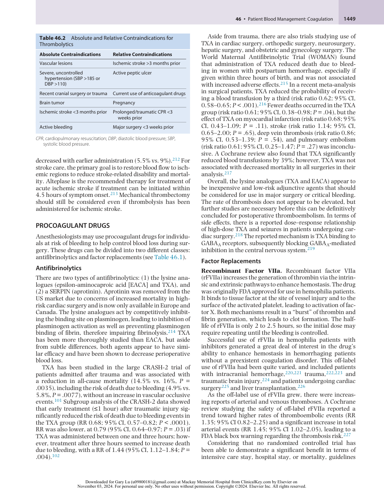

:::

<!-- PDF page 19 -->

currently recommend that rFVIIa no longer be used for the off- label indications of prevention and treatment of bleeding in patients without hemophilia.228 Each clinician will have to weigh the risk of thromboembolic events against the benefit for the refractory bleeding patient where the “last ditch” use of rFVIIa in massive hemorrhage has not been formally assessed. There are no definitive data showing efficacy of rFVIIa as a reversal agent for anticoagulant-associated bleeding. While the INR, which is sensitive to factor VII levels, may improve, there may still be inadequate levels of factor II, IX, and X. General recommendations are that therapy specific to the anticoagulant should be administered before rFVIIa to reverse its effect.229

**Prothrombin Complex Concentrate.** PCCs are commercially available purified concentrates containing varying amounts of vitamin K- dependent coagulation factors. Three- factor PCCs differ from four- factor PCCs in that they do not contain significant amounts of factor VII. Most of the factors are preserved in the inactive state, with the aim of decreasing thrombogenic risk; however, FEIBA is a fourfactor PCC that contains activated factor VII. The products may also contain coagulation inhibitors such as heparin, AT, protein C, and protein S to mitigate the thrombotic risk by providing more balanced replacement of procoagulant factors and anticoagulant proteins.

While PCCs are derived from human plasma, they are treated with at least one viral reduction process, reducing the risk of transfusion- transmitted infection. The FDA has approved PCC for VKA reversal, where the lower administration volume decreases the risk of transfusion- associated circulatory overload (TACO).230 PCC use has expanded to many off- label situations such as cardiac surgery, trauma, and liver failure. In meta- analyses, PCC administration was associated with decreased need for transfusion in all bleeding patients (mean difference: −1.80; 95% CI, −3.22 to −0.38; _P_ = .01; I2 = 92%) but mortality reduction was only found in trauma patients (OR = 0.64; 95% CI, 0.46–0.88; _P_ = .007; I2 = 0%).231

**Fibrinogen Concentrate.** Fibrinogen concentrate (FC) is produced from pooled human plasma, but viral inactivation steps are incorporated into the manufacturing. It can be used to correct hypofibrinogenemia with the goals of reducing coagulopathy, bleeding, and transfusion requirements. FC offers benefits over FFP and cryoprecipitate in terms of standardized fibrinogen content, low infusion volume, and faster administration time. Alternatively, cryoprecipitate and FFP are cheaper, and they also provide additional procoagulant factors that could be beneficial during massive bleeding such as von Willebrand factor, factor VIII, and factor XIII.

There are moderate- to- high-grade recommendations for FC use in trauma and cardiac surgery, and a lower grade of recommendation for its use in obstetrics and liver transplantation.232 General recommendations are to administer fibrinogen concentrate if major bleeding is accompanied by hypofibrinogenemia (≤1.5 g/L) or signs of functional fibrinogen deficit on viscoelastic testing.233 So far, no thromboembolic events have been observed following prophylactic or therapeutic fibrinogen concentrate administration.234

**Table 46.3** Perioperative Thromboembolism Risk Stratification

|**Risk**|**Indication**|
|---|---|
|High|Mechanical heart valve|
||Rheumatic valvular heart disease|
||CHADS score≥5|
||VTE within 3 months or h/o VTE when VKAs are discontinued|
|Moderate|CHADS score of 3 or 4|
||VTE between 3 and 12 months or h/o recurrence|
||Active cancer|
|Low|CHADS score 0–2|
||VTE >12 months prior and no other risk factors|

_CHADS_ , congestive heart failure, hypertension, age ≥75, diabetes mellitus, prior stroke; _h/o_ , history of; _VKA_ , vitamin K antagonists; _VTE_ , venous thromboembolism.

## Perioperative Management of Anticoagulation

The perioperative management of patients who require chronic anticoagulation or antiplatelet therapy involves balancing the risk of surgical bleeding against the risk of developing postoperative thromboembolism. Patients should be evaluated with enough time prior to elective surgery to perform these necessary risk assessments and make management decisions regarding discontinuation and reinstitution of anticoagulation or antiplatelet therapy.

### VITAMIN K ANTAGONISTS

For patients taking VKAs, the current recommendation is to stop VKAs 5 days prior to surgery for those who are at low risk for perioperative thromboembolism (Table 46.3). VKAs should be restarted 12 to 24 hours postoperatively if there is adequate hemostasis. For patients at high risk of thromboembolism, bridging anticoagulation with UFH or LMWH after discontinuation of VKAs should occur. The difficulty arises in defining a plan for patients who are at moderate risk. No definitive evidence exists, so the approach chosen should be based on individual patient and surgical risk factors.235

### HEPARINS

For those patients receiving bridging therapy with UFH, the infusion should be stopped four to six hours prior to surgery236 and resumed without a bolus dose no sooner than 12 hours postoperatively. In surgeries with high postoperative bleeding risk, resumption of UFH should be delayed 48 to 72 hours until adequate hemostasis has been achieved. In patients receiving bridging therapy with LMWH, the last dose of LMWH should be administered 24 hours prior to surgery and dosing should be resumed 24 hours postoperatively in low bleeding risk surgery and

::: details 原始表格與符號（PDF 第 19 頁）

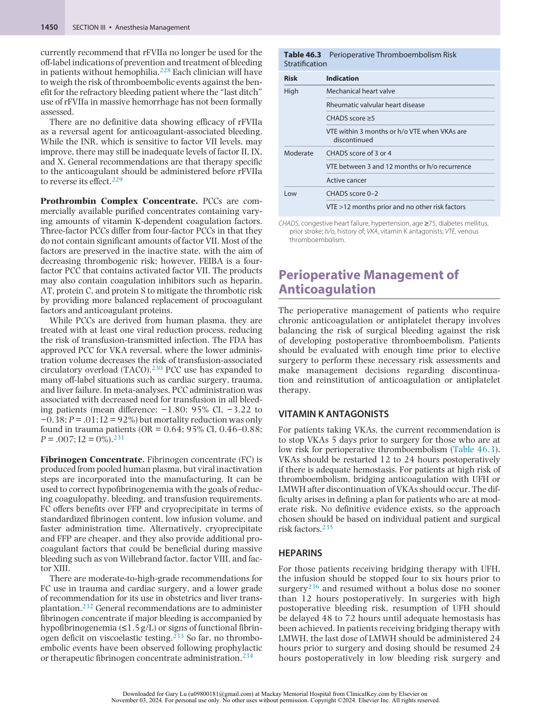

:::

<!-- PDF page 20 -->

delayed until 48 to 72 hours postoperatively for surgeries with high bleeding risk.235

### ANTIPLATELET THERAPY

For patients receiving aspirin therapy, risk assessment is based on (1) the patient’s risk of a perioperative cardiovascular event; (2) whether the surgery is a minor procedure, major procedure, or cardiac procedure; and (3) the timing and type of stent placement for those patients who have undergone recent PCI. Later-generation stents have less bulky struts, less thrombogenic polymers, and better drug release. Low- dose aspirin has been shown to reduce the risk of stroke and myocardial infarction by 25% to 30%,237,238 and studies report significant increased risk with the withdrawal of low- dose aspirin because of a platelet rebound phenomenon that leads to increased thrombus stability, improved fibrin cross-linking, and decreased fibrinolysis.239 The decision to discontinue low- dose aspirin must weigh the risks of bleeding versus the benefits of cardiovascular risk reduction. Studies suggest that perioperative aspirin use may lead to a small increase in the risk for major bleeding (2.9% vs. 2.4%, _P_ = .04),228,240 but continuation of perioperative aspirin may confer a significant reduction in myocardial infarction and other major cardiovascular events (1.8% vs. 9.0%, _P_ = .02).241

Recommendations currently are to continue aspirin for patients who are at moderate-to-high risk for cardiovascular events requiring noncardiac surgery and only stop aspirin use 7 to 10 days prior to surgery for patients at low risk for cardiovascular events.242 Patients who are having minor procedures (e.g., minor dental, dermatologic procedures, or cataract surgery) and are on aspirin for the secondary prevention of cardiovascular disease should continue taking it in the perioperative period.

Patients with coronary stents presenting for surgery are problematic because of the concerns for in- stent thrombosis that can occur with stopping antiplatelet therapy. Surgery should be delayed if possible for at least six weeks after bare- metal stent placement and for at least six months after drug- eluting stent placement (DES).243 If surgery is required before this time has passed, consultation with the cardiologist is recommended, since the decision depends on the surgical urgency, the patient’s ischemic risk profile, and the type and complexity of the DES.244

Many studies have examined management of aspirin therapy perioperatively; however, there is much less data for management of dual antiplatelet therapy (DAPT) in the perioperative setting. The data are inconclusive about use of bridging antiplatelet therapy for patients with coronary stents who require noncardiac surgery. For patients with a very high risk of stent thrombosis, bridging therapy with intravenous, reversible glycoprotein inhibitors or a reversible intravenous P2Y12 inhibitor have been suggested, but concomitant parenteral anticoagulation therapy is not recommended.

### NEURAXIAL ANESTHESIA AND ANTICOAGULATION

In addition to surgical bleeding risk assessment, many patients who are on anticoagulant or antiplatelet therapy

can potentially benefit from neuraxial anesthetics. Management of perioperative anticoagulation is becoming increasingly more complex with the advent of the DOACs and the number of patients who are now receiving chronic anticoagulation. There is a lack of randomized controlled trials showing safety in the timing of surgical procedures and regional anesthesia because a broad clinical experience with these drugs along with neuraxial techniques does not exist. Most guidelines in the literature are based exclusively on the pharmacokinetics and pharmacodynamics of these drugs.245 These guidelines and recommendations will continue to be updated as evidence emerges on the bleeding risk and pharmacologic profiles of the newer anticoagulants. In the absence of concrete data, many hospital committees are setting local practice guidelines (Table 46.4). Early preoperative assessment of patients receiving anticoagulation and a multidisciplinary team approach between the patient, primary care physician, surgeon, anesthesiologist, and hematologist are essential to ensure the perioperative safety of these patients. Continued research on thromboembolic events and bleeding risk in the setting of these novel therapies is needed before official recommendations can be made regarding management.

## Emergent Reversal of Anticoagulants

### VITAMIN K ANTAGONISTS

The incidence of VKA- associated major bleeding is between 1.1% and 8.1% per year depending on the study design.246,247 Some of these patients will require warfarin reversal for bleeding and other patients will require warfarin reversal prior to emergency surgery. Four- factor PCCs as opposed to three- factor PCCs are now the drug of choice for emergent reversal of oral VKA in place of FFP or rFVIIa,248 but PCCs only provide a transient correction due to the short half- life of these factors relative to the long halflife of warfarin. Concomitant administration of vitamin K is required to restore carboxylation of the vitamin K–dependent factors (VKDFs) by the liver and provide a more sustained correction after the factors in the PCC infusion have been metabolized. Intravenous administration of vitamin K gives a more rapid response than subcutaneous or oral administration.249 The dose required depends on the clinical situation and the need to be able to re- establish anticoagulation after surgery.

Rapid reversal of VKA with FFP is difficult and often unrealistic. Time to thaw ABO- compatible units is a concern, but the large volume required to raise the VKDF by 50% is often untenable, especially in a patient population prone to pulmonary, renal, and cardiac disease.250 There are also concerns for transmission of viral diseases, and transfusionrelated complications such as volume overload, TACO, and lung injury (transfusion- related acute lung injury). In a recent randomized controlled trial using four- factor PCC to reverse VKA prior to surgery or invasive interventions, effective hemostasis was higher (90% PCC vs. 75% FFP), fluid overload was lower (3% PCC vs. 13% FFP), and thromboembolic events were similar compared with patients who received FFP (7% PCC vs. 8% FFP).251

<!-- PDF page 21 -->

**Table 46.4** UCSF Guidelines for the Use of Antithrombotic Agents in the Setting of Neuraxial Procedures

|**Anticoagulant**|**Minimum Time Between the** **Last Dose and When Neuraxial** **Catheter Can Occur**|**Minimum Time After** **Catheter Placement to** **Drug Start**|**Minimum Time Between** **Last Dose of Drug and** **Catheter Removal**|**Minimum Time Between** **Neuraxial Catheter** **Removal and When Next** **Dose Can Be Given**|
|---|---|---|---|---|
|NSAIDs/ASA|No restrictions for catheter place|ment or removal|||
|Heparin 5000 U SQ BID and TID|4 h|Immediately|4 h|Immediately|
|Heparin 7500–10,000 U SQ BID–TID|12 h|Safety not established||1 h|
|Enoxaparin 40 mg qD|12 h|12 h|12 h|4 h|
|Enoxaparin 1 mg/kg SQ BID|24 h|Contraindicated while cat|heter in place|4 h|
|Warfarin|5 days and INR &lt; 1.5|Contraindicated while cat|heter in place|Immediately|
|Clopidogrel|7 days|Contraindicated while cat|heter in place|2 h|
|Ticlopidine|10 days|Contraindicated while cat|heter in place|2 h|
|Dabigatran|3 days and TT or aPTT is normal|Contraindicated while cat|heter in place|6 h|
|Rivaroxaban|3 days|Contraindicated while cat|heter in place|6 h|
|Apixaban|72 h|Contraindicated while cat|heter in place|6 h|

_aPTT,_ activated partial thromboplastin time; _ASA_ , acetylsalicylic acid; _BID,_ two times a day; _h_ , hours; _INR_ , international normalized ratio; _NSAIDs,_ nonsteroidal antiinflammatory drugs; _qD_ , once a day; _SQ,_ subcutaneous; _TID,_ three times a day; _TT,_ thrombin time; _U_ , units. Adapted from 2019 UCSF Guidelines for the use of antithrombotic agents in the setting of neuraxial procedures and Horlocker TT et al. Regional anesthesia in the patient receiving antithrombotic or thrombolytic therapy. American Society of Regional Anesthesia and Pain Medicine Evidence- Based Guidelines (fourth edition). _Reg Anesth Pain Med_ . 2018;43:263–309.

### DIRECT ACTING ORAL ANTICOAGULANTS

For DOAC- associated bleeding, supportive measures such as discontinuing medications that interfere with hemostasis, compression of the bleeding site, volume resuscitation and transfusion support may be adequate. Antifibrinolytic therapy may be beneficial for mucosal bleeding and activated charcoal may remove unabsorbed dabigatran from the GI tract. Desmopressin can be used for impaired platelet function in the setting of uremia or antiplatelet agents. Reversal agents, given their cost and lack of long- term, high- quality data, should be reserved for life- threatening hemorrhage or major bleeding that does not resolve with supportive measures.252 Very little conclusive data exist for the use of aPCC or PCC in place of idarucizumab or andexanet alfa, respectively.

### Direct Thrombin Inhibitors

Idarucizumab, a specific antidote for dabigatran, is a humanized antibody fragment that binds to dabigatran with an affinity 350 times greater than thrombin. Median time to hemostasis after administration of idarucizumab was 2.5 hours in patients presenting with gastrointestinal, intracerebral, or traumatic bleeding.253

### Factor Xa Inhibitors

Andexanet alfa, a recombinant derivative of factor Xa, was developed to reverse the factor Xa inhibitors by acting as a decoy. It has a higher affinity for factor Xa inhibitors than intrinsic factor Xa. The drug was approved by the FDA for patients who present with an acute hemorrhage while receiving apixaban or rivaroxaban. The indication currently does not cover edoxaban, or enoxaparin. While there was a 92% reduction in anti- Xa activity and the hemostasis

was judged to be good or excellent, out of the 352 patients in the study, 34 (10%) had a thrombotic event within 30 days.254 Further studies are necessary, but the FDA did put a black box warning on the package insert regarding the risk of venous and arterial thromboembolic events.

### EMERGING AGENTS

There are additional reversal agents in development that may be approved by the FDA soon. Ciraparantag (PER977), a small, synthetic, water- soluble, cationic molecule, binds and neutralizes UFH, LMWH, fondaparinux, dabigatran, and factor Xa inhibitors through hydrogen bonding and charge–charge interactions. Phase 2 trials have been completed in healthy volunteers.255 Common anticoagulants and possible reversal agents for emergencies are listed for reference in Table 46.5.

## Conclusion

The coagulation system remains exceedingly complex, but an understanding of the fundamental principles of hemostasis will allow the anesthesia provider to identify patients at risk of bleeding preoperatively, and safely manage blood loss and treat acquired coagulopathy perioperatively. Given the abundance of different antithrombotic and anticoagulant medications, perioperative management is becoming increasingly challenging. Early preoperative assessment of patients receiving anticoagulation and a multidisciplinary team approach between the patient, primary care physician, hematologist, surgeon, and anesthesiologist are essential to ensure the perioperative safety of these patients.

::: details 原始表格與符號（PDF 第 21 頁）

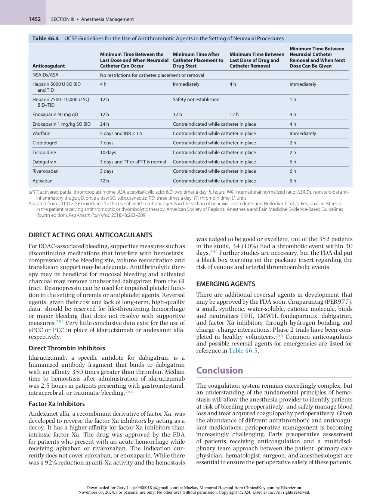

:::

<!-- PDF page 22 -->

**Table 46.5** Common Anticoagulants Along with the Required Laboratory Monitoring and Possible Reversal Agents for Emergencies

|**Antithrombotic Agent**|**Drug Name**|**Stop Before Procedure**|**Monitoring**|**Reversal Agents**|
|---|---|---|---|---|
|Antiplatelet agents|ASA P2Y12receptor antagonists GPIIb/IIIa antagonists|7 days 7–14 days 24–72 h|None|Platelet transfusion|
|Vitamin K antagonists|Warfarin|2–5 days|PT, INR|PCC, FFP, vitamin K|
|Heparins|Unfractionated heparin (UFH) (IV)|6 h|aPTT|Protamine|
||Low- molecular-weight heparin (LMWH)|12–24 h|None required, but fXa levels can monitor levels|Partially reversed by protamine|
|Pentasaccharide|Fondaparinux|3 days (prophylactic dosing)|None required, but anti fXa levels can monitor levels|None|
|Direct thrombin inhibitors|Argatroban Bivalirudin|4–6 h 3 h|aPTT or ACT|None|
||Dabigatran|2–4 days (longer if renal impairment)|None required, dilute thrombin time can monitor levels|Idarucizumab|
|FXa inhibitors|Rivaroxaban, apixaban, edoxaban|2–3 days|None required, but anti fXa levels to specific drug can monitor levels|Andexanet alfa for rivaroxaban and apixaban|

_ACT,_ activated clotting time; _aPTT,_ activated partial thromboplastin time; _ASA_ , acetylsalicylic acid; _FFP,_ fresh frozen plasma; _INR,_ international normalized ratio; _IV,_ intravenous; _PCC,_ prothrombin complex concentrate; _PT,_ prothrombin time.

### Acknowledgment

The editors and publisher would like to thank Drs. Thomas F. Slaughter, Lawrence T. Goodnough, and Terri G. Monk for their contributions in prior editions of this work. Excerpts of their chapters were incorporated and serve as the foundation for the current chapter.

26.  Furie B, et al. _N Engl J Med_ . 1992;326(12):800.

27.  Osterud B, et al. _Proc Natl Acad Sci U S A_ . 1977;74(12):5260.

28.  Renne T, et al. _Semin Immunopathol_ . 2012;34(1):31.

29.  Hoffman M, et al. _Blood Rev_ . 2003;17(suppl 1):S1.

30.  Furie B, et al. _J Thromb Haemost_ . 2007;5(suppl 1):12.

31.  Pisano JJ, et al. _Science_ . 1968;160(3830):892.

32.  Levy JH, et al. _Transfusion_ . 2013;53(5):1120.

33.  Casini A, de Moerloose P. _Haemophilia_ . 2020;26(1):25.

34.  Crawley JT, et al. _J Thromb Haemost_ . 2007;5(suppl 1):95.

35.  Barshtein G, et al. _Expert Rev Cardiovasc Ther_ . 2007;5(4):743.

### Complete references available online at expertconsult.com.

36.  Chapin JC, Hajjar KA. _Blood Rev_ . 2015;29(1):17.

37.  Woodruff RS, et al. _J Thromb Thrombolysis_ . 2011;32(1):9.

38.  Andrews RK, et al. _Arterioscler Thromb Vasc Biol_ . 2007;27(7):1511.

### References

1.  Furie B, et al. _N Engl J Med_ . 2008;359(9):938.

2.  van Hinsbergh VW, et al. _Semin Immunopathol_ . 2012;34(1):93.

3.  Moncada S, et al. _Nature_ . 1976;263(5579):663.

4.  Broekman MJ, et al. _Blood_ . 1991;78(4):1033.

5.  Marcus AJ, et al. _J Clin Invest_ . 1997;99(6):1351.

6.  Esmon CT, et al. _Semin Thromb Hemost_ . 2006;32(suppl 1):49.

7.  Mertens G, et al. _J Biol Chem_ . 1992;267(28):20435.

8.  Wood JP, et al. _Blood_ . 2014;123(19):2934.

9.  Wolberg AS, et al. _Anesth Analg_ . 2012;114(2):275.

10.  Chiu JJ, et al. _Physiol Rev_ . 2011;91(1):327.

11.  Stern D, et al. _Proc Natl Acad Sci U S A_ . 1985;82(8):2523.

12.  Margetic S, et al. _Biochem Med (Zagreb)_ . 2012;22(1):49.

13.  Van De Craen B, et al. _Thromb Res_ . 2012;130(4):576.

14.  Achneck HE, et al. _Vascular_ . 2008;16(suppl 1):S6.

15.  Kassis J, et al. _Blood_ . 1992;80(7):1758.

16.  Broos K, et al. _Thromb Res_ . 2012;129(3):245.

17.  Hanson SR, et al. _Blood_ . 1985;66(5):1105.

18.  Broos K, et al. _Blood Rev_ . 2011;25(4):155.

19.  Wu YP, et al. _Arterioscler Thromb Vasc Biol_ . 2000;20(6):1661.

20.  Brass L, et al. _Hematology Am Soc Hematol Educ Program_ . 2010;2010:387.

21.  Macfarlane RG, et al. _Nature_ . 1964;202:498.

22.  Hoffman, et al. _J Thromb Thrombolysis_ . 2003;16(1–2):17.

23.  Coughlin SR, et al. _J Thromb Haemost_ . 2005;3(8):1800.

24.  Schenone M, et al. _Curr Opin Hematol_ . 2004;11(4):272.

25.  Mann KG, et al. _Blood Cells Mol Dis_ . 2006;36(2):108.

39.  Crawley JT, et al. _Arterioscler Thromb Vasc Biol_ . 2008;28(2):233.

40.  Broze GJ, et al. _Proc Natl Acad Sci U S A_ . 1987;84(7):1886.

41.  Esmon CT, et al. _Chest_ . 2003;123:26S.

42.  Perry DJ, et al. _Blood Rev_ . 1994;8(1):37.

43.  Tollefsen DM, et al. _J Biol Chem_ . 1982;257(5):2162.

44.  Segal JB, et al. _Transfusion_ . 2005;45(9):1413.

45.  Chee YL, et al. _Br J Haematol_ . 2008;140(5):496.

46.  Greaves M, et al. _J Thromb Haemost_ . 2007;5(suppl 1):167.

47.  Sadler JE, et al. _Annu Rev Med_ . 2005;56:173.

48.  Dinehart SM, et al. _Dermatol Surg_ . 2005;31(7 Pt 2):819.

49.  Leebeek FW, et al. _N Engl J Med_ . 2016;375(21):2067.

50.  Rodeghiero F, et al. _Blood_ . 1987;69(2):454.

51.  Brinkhous KM, et al. _Proc Natl Acad Sci U S A_ . 1985;82(24):8752.

52.  Lippi G, et al. _Blood Coagul Fibrinolysis_ . 2007;18(4):361.

53.  Roberts JC, et al. _Int J Lab Hematol_ . 2015;37(suppl 1):11.

54.  Posan E, et al. _Thromb Haemost_ . 2003;90(3):483.

55.  Castaman G, et al. _Br J Haematol_ . 2010;151(3):245.

56.  Miesbach W, et al. _Thromb Res_ . 2015;135(3):479.

57.  Kasper CK, et al. _Haemophilia_ . 2007;13(1):90.

58.  Franchini M, et al. _J Thromb Haemost_ . 2010;8(3):421.

59.  Kwak J, et al. _J Cardiothorac Vasc Anesth_ . 2022;36(1):246.

60.  Franchini M, et al. _Blood_ . 2008;112(2):250.

61.  Kempton CL, Meeks SL. _Blood_ . 2014;124(23):3365.

62.  Sattler FR, et al. _Am J Surg_ . 1988;155(5A):30.

63.  Hines R, et al. _Anesthesiology_ . 1989;70(4):611.

64.  Schafer AI, et al. _Blood_ . 1980;55(4):649.

65.  Hogman M, et al. _Lancet_ . 1993;341(8861):1664.

66.  Hergovich N, et al. _Clin Pharmacol Ther_ . 2000;68(4):435.

::: details 原始表格與符號（PDF 第 22 頁）

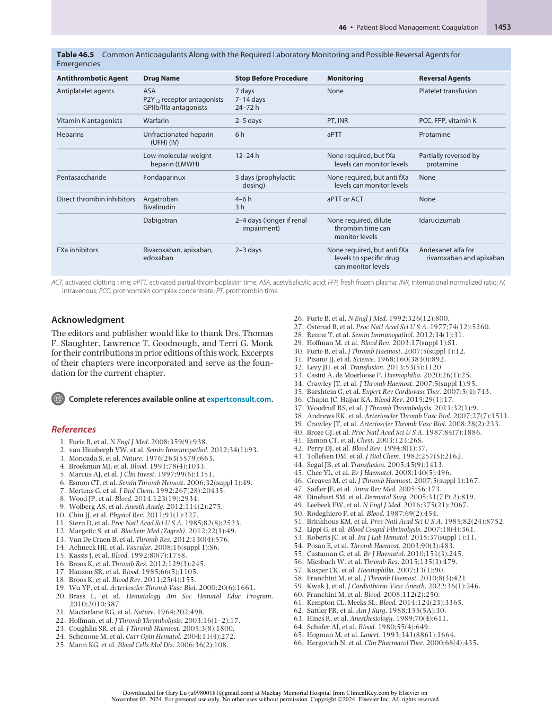

:::

<!-- PDF page 23 -->

67.  Roberts LN. _Hematology Am Soc Hematol Educ Program_ . 2021;2021(1):485.

68.  Tripodi A, et al. _Hepatology_ . 2005;41(3):553.

69.  Afdhal N, et al. _J Hepatol_ . 2008;48(6):1000.

70.  Lisman T, et al. _J Hepatol_ . 2002;37(2):280.

71.  Lisman T, et al. _Hepatology_ . 2006;44(1):53.

72.  Leebeek FW, et al. _Semin Thromb Hemost_ . 2015;41(5):474.

73.  Lisman T, et al. _Gastroenterology_ . 2001;121(1):131.

74.  Forkin KT, et al. _Anesth Analg_ . 2018;126(1):46.

75.  Yates SG, et al. _Transfusion_ . 2016;56(4):791.

76.  Benigni A, et al. _Am J Kidney Dis_ . 1993;22(5):668.

77.  Gawaz MP, et al. _J Am Soc Nephrol_ . 1994;5(1):36.

78.  Noris M, et al. _Blood_ . 1999;94(8):2569.

79.  Turitto VT, et al. _Science_ . 1980;207(4430):541.

80.  Kim JH, et al. _Ann Hematol_ . 2015;94(9):1457.

81.  Liu YK, et al. _Lancet_ . 1984;2(8408):887.

82.  Zoja C, et al. _Lab Invest_ . 1991;65(4):479.

83.  Gando S, et al. _Nat Rev Dis Prim_ . 2016;2:16037.

84.  Toh CH, et al. _Ann Lab Med_ . 2016;36(6):505. 85.  Thachil J, et al. _Anesthesiology_ . 2016;125(1):230. 86.  Levi M, Scully M. _Blood_ . 2018;131(8):845.

87.  Levi M, et al. _Br J Haematol_ . 2009;145(1):24.

88.  Woodman RC, et al. _Blood_ . 1990;76(9):1680.

89.  Gluszko P, et al. _Am J Physiol_ . 1987;252(3 Pt 2):H615. 90.  Harker LA, et al. _Blood_ . 1980;56(5):824.

91.  Weidman JL, et al. _Anesthesiology_ . 2014;120(4):1009.

92.  Brown JR, et al. _Circulation_ . 2007;115(22):2801.

93.  Brohi K, et al. _J Trauma_ . 2003;54(6):1127.

94.  Chang R, et al. _Blood_ . 2016;128(8):1043. 95.  Cohen MJ, et al. _Ann Surg_ . 2012;255(2):379. 96.  Brohi K, et al. _Ann Surg_ . 2007;245(5):812. 97.  Johansson PI, et al. _Ann Surg_ . 2011;254(2):194.

98.  Kutcher ME, et al. _J Trauma Acute Care Surg_ . 2012;73(1):13. 99.  Wohlauer MV, et al. _J Am Coll Surg_ . 2012;214(5):739. 100.  Moore HB, et al. _J Thromb Haemost_ . 2015;13(10):1878. 101.  CRASH Trial collaborators, et al. _Lancet_ . 2010;376(9734):23. 102.  CRASH Trial collaborators, et al. _Lancet_ . 2011;377(9771):1096. 103.  Moore HB, et al. _J Trauma Acute Care Surg_ . 2014;77(6):811. 104.  Moore EE, et al. _Nat Rev Dis Prim_ . 2021;7(1):30.

105.  Esmon CT, et al. _Blood Rev_ . 2009;23(5):225.

106.  Piazza G, et al. _Circulation_ . 2010;121(19):2146.

107.  Spencer FA, et al. _J Gen Intern Med_ . 2006;21(7):722.

108.  Douketis J, et al. _BMJ_ . 2011;342:d813. 109.  Middeldorp S, et al. _Hematology Am Soc Hematol Educ Program_ . 2011;2011:150.

110.  Wu O, et al. _Health Technol Assess_ . 2006;10(11):1. 111.  Dahlback B, et al. _Blood_ . 2008;112(1):19. 112.  Heit JA, et al. _Am J Hematol_ . 2012;87(suppl 1):S63.

113.  Ridker PM, et al. _JAMA_ . 1997;277(16):1305.

114.  Goldhaber SZ, et al. _J Am Coll Cardiol_ . 2010;56(1):1.

115.  Andreoli L, et al. _Arthritis Care Res (Hoboken)_ . 2013;65(11):1869. 116.  Giannakopoulos B, et al. _Blood_ . 2009;113(5):985.

117.  Tektonidou MG, et al. _Ann Rheum Dis_ . 2019;78(10):1296.

118.  Kelton JG, et al. _Blood_ . 2008;112(7):2607.

119.  Perdomo J, et al. _Nat Commun_ . 2019;10(1):1322.

120.  Gollomp K, et al. _JCI Insight_ . 2018;3(18):e99445.

121.  Warkentin TE, et al. _Blood_ . 2006;108(9):2937.

122.  Warkentin TE, et al. _Blood_ . 2000;96(5):1703.

123.  Martel N, et al. _Blood_ . 2005;106(8):2710.

124.  Berry C, et al. _J Am Coll Sur_ . 2011;213(1):10.

125.  Warkentin TE, et al. _Blood_ . 2017;130(9):1104.

126.  Welsby IJ, et al. _Anesth Analg_ . 2010;110(1):30.

127.  Poller L, et al. _J Thromb Haemost_ . 2004;2(6):849. 128.  Massignon D, et al. _Thromb Haemost_ . 1996;75(4):590.

129.  Burns ER, et al. _Am J Clin Pathol_ . 1993;100(2):94.

130.  Teien AN, et al. _Thromb Res_ . 1976;8(3):413.

131.  Ignjatovic V, et al. _Thromb Res_ . 2007;120(3):347.

132.  Price EA, et al. _Ann Pharmacother_ . 2013;47(2):151.

133.  Rodgers RP, et al. _Semin Thromb Hemost_ . 1990;16(1):1.

134.  Lind SE, et al. _Blood_ . 1991;77(12):2547.

135.  Hattersley PG, et al. _JAMA_ . 1966;196(5):436.

136.  Paniccia R, et al. _Anesthesiology_ . 2003;99(1):54.

137.  Maslow A, et al. _J Cardiothorac Vasc Anesth_ . 2018;32(4):1603.

138.  Dirkmann D, et al. _BMC Anesthesiol_ . 2019;19(1):174.

139.  Enriquez LJ, et al. _Br J Anaesth_ . 2009;103(suppl 1):i14.

140.  Ganter MT, et al. _Anesth Analg_ . 2008;106(5):1366. 141.  Bolliger D, et al. _Transfus Med Rev_ . 2012;26(1):1. 142.  Dias JD, et al. _Arch Pathol Lab Med_ . 2017;141(4):569. 143.  Erdoes G, et al. _PLoS One_ . 2018;13(12):e0209360. 144.  Ferrante EA, et al. _Anesth Analg_ . 2016;123(6):1372. 145.  Baryshnikova E, et al. _J Cardiothorac Vasc Anesth_ . 2019;33(6):1590. 146.  Groves DS, et al. _Anesth Analg_ . 2020;130(4):899. 147.  Shore- Lesserson L, et al. _Anesth Analg_ . 1999;88(2):312. 148.  Weber CF, et al. _Anesthesiology_ . 2012;117(3):531. 149.  Bolliger D, et al. _Semin Thromb Hemost_ . 2017;43(4):386. 150.  Hayward CP, et al. _Blood Rev_ . 2011;25(4):169. 151.  Born GV, et al. _Nature_ . 1962;194:927. 152.  Harrison P, et al. _Br J Haematol_ . 2000;111(3):733. 153.  Cardinal DC, et al. _J Pharmacol Methods_ . 1980;3(2):135. 154.  Jambor C, et al. _Anesth Analg_ . 2011;113(1):31. 155.  Panzer S, et al. _Vox Sang_ . 2011;101(1):1. 156.  Kundu SK, et al. _Semin Thromb Hemost_ . 1995;21(suppl 2):106. 157.  Roth GJ, et al. _J Clin Invest_ . 1975;56(3):624. 158.  Mitchell JA, et al. _Proc Natl Acad Sci U S A_ . 1993;90(24).

159.  Costello PB, et al. _Arthritis Rheum_ . 1982;25(5):550.

160.  Pascale S, et al. _Blood_ . 2012;119(15):3595.

161.  Diaz- Gonzalez F, et al. _Eur J Immunol_ . 2015;45(3):679.

162.  Silverstein FE, et al. _JAMA_ . 2000;284(10):1247.

163.  Solomon SD, et al. _N Engl J Med_ . 2005;352(11):1071.

164.  Coxib and Traditional NSAID Trialists’ (CNT) Collaboration. _Lancet_ . 2013;382(9894):769.

165.  Ferri N, et al. _Drugs_ . 2013;73(15):1681.

166.  Savi P, et al. _Thromb Haemost_ . 2000;84(5):891.

167.  Taubert D, et al. _Clin Pharmacol Ther_ . 2006;80(5):486.

168.  Mega JL, et al. _Lancet_ . 2010;376(9749):1312.

169.  Mega JL, et al. _JAMA_ . 2010;304(16):1821.

170.  Norgard NB, Abu- Fadel M. _Vasc Health Risk Manag_ . 2009;5:873.

171.  Wallentin L, et al. _Eur Heart J_ . 2009;30(16):1964.

172.  Akers WS, et al. _J Clin Pharmacol_ . 2010;50(1):27.

173.  Storey RF, et al. _Eur Heart J_ . 2020;41(33):3132.

174.  Subban V, et al. _Indian Heart J_ . 2013;65(3):260.

175.  Hanna EB, et al. _JACC Cardiovasc Interv_ . 2010;3(12):1209.

176.  Dasgupta H, et al. _Am Heart J_ . 2000;140(2):206.

177.  Yates SG, et al. _J Thromb Haemost_ . 2015;13(suppl 1):S180.

178.  Benzon HT, et al. _Anesthesiology_ . 2010;112(2):298.

179.  Pokorney SD, et al. _Am Heart J_ . 2015;170(1):141.

180.  Stergiopoulos K, et al. _JAMA Intern Med_ . 2014;174(8):1330.

181.  Shaw K, et al. _Ther Drug Monit_ . 2015;37(4):428.

182.  Johnson EA, et al. _Carbohydr Res_ . 1976;51(1):119.

183.  Ranucci M, et al. _Perfusion_ . 2002;17(3):199.

184.  Finley A, et al. _Anesth Analg_ . 2013;116(6):1210.

185.  Li G, et al. _Anal Chem_ . 2014;86(13).

186.  Hirsh J, et al. _Circulation_ . 1998;98(15):1575.

187.  Harenberg J, et al. _Thromb Res_ . 1985;38(1):11.

188.  van Veen JJ, et al. _Blood Coagul Fibrinolysis_ . 2011;22(7):565.

189.  Greinacher A, et al. _Thromb Haemost_ . 1995;74(3):886.

190.  Bhatt VR, et al. _Eur J Haematol_ . 2013;91(5):437.

191.  Nilius H, et al. _Am J Hematol_ . 2021;96(7):805.

192.  Hursting MJ, et al. _Clin Appl Thromb Hemost_ . 2005;11(3):279.

193.  Robson R, et al. _Clin Pharmacol Ther_ . 2002;71(6):433.

194.  Bittl JA, et al. _Am Heart J_ . 2001;142(6):952.

195.  Mahaffey KW, et al. _J Invasive Cardiol_ . 2003;15(11):611.

196.  Dyke CM, et al. _J Thorac Cardiovasc Surg_ . 2006;131(3):533.

197.  Clayton SB, et al. _Ann Thorac Surg_ . 2004;78(6):2167.

198.  Khan SU, et al. _Ann Intern Med_ . 2020;172(7):474.

199.  Dentali F, et al. _Circulation_ . 2012;126(20):2381.

200.  Eikelboom JW, et al. _N Engl J Med_ . 2013;369(13):1206.

201.  American College of Obstetricians and Gynecologists’ Committee on Practice Bulletins—Obstetrics. _Obstet Gynecol_ . 2018;132:e1.

202.  Connolly SJ, et al. _N Engl J Med_ . 2009;361(12):1139.

203.  Wallentin L, et al. _Lancet_ . 2010;376(9745):975.

204.  Garcia D, et al. _J Thromb Haemost_ . 2013;11(2):245.

205.  Miyares MA, et al. _Am J Health Syst Pharm_ . 2012;69(17):1473.

206.  Tripodi A. _Blood_ . 2013;121(20):4032.

207.  Bruins Slot KM, et al. _JAMA_ . 2014;311(11):1150.

208.  Granger CB, et al. _N Engl J Med_ . 2011;365(11):981.

209.  Chen A, et al. _J Am Heart Assoc_ . 2020;9:e017559.

210.  Squire IB, et al. _Eur Heart J_ . 1999;20(17):1245.

211.  Wan S, et al. _Circulation_ . 2004;110(6):744.

212.  Boersma E, et al. _Lancet_ . 1996;348(9030):771.

<!-- PDF page 24 -->

213.  Powers WJ, et al. _Stroke_ . 2015;46(10):3020.

214.  Astedt B, et al. _Scand J Gastroenterol Suppl_ . 1987;137:22.

215.  WOMAN Trial Collaborators. _Lancet_ . 2017;389(10084):2105.

216.  Ker K, et al. _BMJ_ . 2012;344:e3054.

217.  Henry DA, et al. _Cochrane Database Syst Rev_ . 2011;3:CD001886.

218.  Manji RA, et al. _Can J Anaesth_ . 2012;59(1):6.

219.  Lecker I, et al. _Can J Anaesth_ . 2012;59(1):1.

220.  Mayer SA, et al. _N Engl J Med_ . 2005;352(8):777.

221.  Mayer SA, et al. _N Engl J Med_ . 2008;358(20):2127.

222.  Boffard KD, et al. _J Trauma_ . 2005;59(1):8.

223.  Hauser CJ, et al. _J Trauma_ . 2010;69(3):489.

224.  Narayan RK, et al. _Neurosurgery_ . 2008;62(4):776.

225.  Yank V, et al. _Ann Intern Med_ . 2011;154(8):529.

226.  Lodge JP, et al. _Liver Transpl_ . 2005;11(8):973.

227.  Simpson E, et al. _Cochrane Database Syst Rev_ . 2012;3:CD005011.

228.  Lin Y, et al. _Transfus Med_ . 2012;22(6):383.

229.  Frontera JA, et al. _Neurocrit Care_ . 2016;24(1):6.

230.  Sorensen B, et al. _Crit Care_ . 2011;15(1):201.

231.  van den Brink DP, et al. _J Thromb Haemost_ . 2020;18(10):2457.

232.  Leal- Noval SR, et al. _Expert Rev Clin Pharmacol_ . 2020;13(7):761.

233.  Spahn DR, et al. _Crit Care_ . 2019;23(1):98.

236.  Hirsh J, et al. _Chest_ . 2004;126(suppl 3):188S.

   237.  Antithrombotic Trialists’ Collaboration. _BMJ_ . 2002;324(7329):71.

   238.  Burger W, et al. _J Intern Med_ . 2005;257(5):399.

   239.  Lordkipanidze M, et al. _Pharmacol Ther_ . 2009;123(2):178.

   240.  Pulmonary Embolism Prevention Trial Collaborative Group. _Lancet_ . 2000;355(9212):1295.

   241.  Oscarsson A, et al. _Br J Anaesth_ . 2010;104(3):305.

   242.  Biondi- Zoccai GG, et al. _Eur Heart J_ . 2006;27(22):2667.

   243.  Levine GN, et al. _J Am Coll Cardiol_ . 2016;68(10):1082.

   244.  Mangieri A, et al. _Cardiovasc Interv Ther_ . 2020;35(2):117.

   245.  Horlocker TT, et al. _Reg Anesth Pain Med_ . 2010;35(1):64.

   246.  Palareti G, et al. _Lancet_ . 1996;348(9025):423.

   247.  Levine MN, et al. _Chest_ . 1992;102(suppl 4).

   248.  Sarode R, et al. _Circulation_ . 2013;128(11):1234.

   249.  Dezee KJ, et al. _Arch Intern Med_ . 2006;166(4):391.

   250.  Hickey M, et al. _Circulation_ . 2013;128(4):360.

   251.  Goldstein JN, et al. _Lancet_ . 2015;385(9982):2077.

   252.  Cuker A, et al. _Am J Hematol_ . 2019;94:697.

   253.  Pollack CV, et al. _N Engl J Med_ . 2015;373(6):511.

   254.  Connolly SJ, et al. _N Engl J Med_ . 2019;380:1326.

   255.  Ansell JE, et al. _Thromb Haemost_ . 2017;117(2):238.

234.  Fabes J, et al. _Cochrane Database Syst Rev_ . 2018;12(12):CD010649. 235.  Douketis JD, et al. _Chest_ . 2012;141(suppl 2).

<!-- PDF page 25 -->

<!-- PDF page 26 -->

### References

1.  Furie B, Furie BC. Mechanisms of thrombus formation. _N Engl J Med_ . 2008;359(9):938–949.

2.  Yau JW, Teoh H, Verma S. Endothelial cell control of thrombosis. _BMC Cardiovasc Disord_ . 2015;15:130.

3.  Moncada S, Gryglewski R, Bunting S, Vane JR. An enzyme isolated from arteries transforms prostaglandin endoperoxides to an unstable substance that inhibits platelet aggregation. _Nature_ . 1976;263(5579):663–665.

4.  Broekman MJ, Eiroa AM, Marcus AJ. Inhibition of human platelet reactivity by endothelium- derived relaxing factor from human umbilical vein endothelial cells in suspension: blockade of aggregation and secretion by an aspirin- insensitive mechanism. _Blood_ . 1991;78(4):1033–1040.

5.  Marcus AJ, Broekman MJ, Drosopoulos JH, et al. The endothelial cell ecto- ADPase responsible for inhibition of platelet function is CD39. _J Clin Invest_ . 1997;99(6):1351–1360.

6.  Esmon CT. Inflammation and the activated protein C anticoagulant pathway. _Semin Thromb Hemost_ . 2006;32(suppl 1):49–60.

7.  Mertens G, Cassiman JJ, Van den Berghe H, et al. Cell surface heparan sulfate proteoglycans from human vascular endothelial cells. Core protein characterization and antithrombin III binding properties. _J Biol Chem_ . 1992;267(28):20435–22043.

8.  Maroney SA, Mast AE. New insights into the biology of tissue factor pathway inhibitor. _J Thromb Haemost_ . 2015;13 Suppl 1(0 1):S200– S207.

9.  Neubauer K, Zieger B. Endothelial cells and coagulation. _Cell Tissue Res_ . 2022;387(3):391–398.

10.  Chiu JJ, Chien S. Effects of disturbed flow on vascular endothelium: pathophysiological basis and clinical perspectives. _Physiol Rev_ . 2011;91(1):327–387.

11.  Stern D, Nawroth P, Handley D, Kisiel W. An endothelial celldependent pathway of coagulation. _Proc Natl Acad Sci U S A_ . 1985;82(8):2523–2527.

12.  Levi M, van der Poll T, Büller HR. Bidirectional relation between inflammation and coagulation. _Circulation_ . 2004;109(22):2698– 2704.

13.  Van De Craen B, Declerck PJ, Gils A. The biochemistry, physiology and pathological roles of PAI- 1 and the requirements for PAI- 1 inhibition in vivo. _Thromb Res_ . 2012;130(4):576–585.

14.  Achneck HE, Sileshi B, Lawson JH. Review of the biology of bleeding and clotting in the surgical patient. _Vascular_ . 2008;16(suppl 1):S6– S13.

15.  Kassis J, Hirsh J, Podor TJ. Evidence that postoperative fibrinolytic shutdown is mediated by plasma factors that stimulate endothelial cell type I plasminogen activator inhibitor biosynthesis. _Blood_ . 1992;80(7):1758–1764.

16.  Broos K, De Meyer SF, Feys HB, et al. Blood platelet biochemistry. _Thromb Res_ . 2012;129(3):245–249.

17.  Hanson SR, Slichter SJ. Platelet kinetics in patients with bone marrow hypoplasia: evidence for a fixed platelet requirement. _Blood_ . 1985;66(5):1105–1109.

18.  Broos K, Feys HB, De Meyer SF, et al. Platelets at work in primary hemostasis. _Blood Rev_ . 2011;25(4):155–167.

19.  Wu YP, Vink T, Schiphorst M, et al. Platelet thrombus formation on collagen at high shear rates is mediated by von Willebrand factorglycoprotein Ib interaction and inhibited by von Willebrand factorglycoprotein IIb/IIIa interaction. _Arterioscler Thromb Vasc Biol_ . 2000;20(6):1661–1667.

20.  Jackson SP. The growing complexity of platelet aggregation. _Blood_ . 2007;109(12):5087–5095.

21.  Macfarlane RG. An enzyme cascade in the blood clotting mechanism, and its function as a biochemical amplifier. _Nature_ . 1964;202:498– 499.

22.  Hoffman M. Remodeling the blood coagulation cascade. _J Thromb Thrombolysis_ . 2003;16(1–2):17–20.

23.  Coughlin SR. Protease- activated receptors in hemostasis, thrombosis and vascular biology. _J Thromb Haemost_ . 2005;3(8):1800–1814.

24.  Schenone M, Furie BC, Furie B. The blood coagulation cascade. _Curr Opin Hematol_ . 2004;11(4):272–277.

25.  Mann KG, Brummel- Ziedins K, Orfeo T, Butenas S. Models of blood coagulation. _Blood Cells Mol Dis_ . 2006;36(2):108–117.

26.  Furie B, Furie BC. Molecular and cellular biology of blood coagulation. _N Engl J Med_ . 1992;326(12):800–806.

27.  Osterud B, Rapaport SI. Activation of factor IX by the reaction product of tissue factor and factor VII: additional pathway for initiating blood coagulation. _Proc Natl Acad Sci U S A_ . 1977;74(12):5260– 5264.

28.  Renne T. The procoagulant and proinflammatory plasma contact system. _Semin Immunopathol_ . 2012;34(1):31–41.

29.  Hoffman M. A cell- based model of coagulation and the role of factor VIIa. _Blood Rev_ . 2003;17(suppl 1):S1–S5.

30.  Furie B, Furie BC. In vivo thrombus formation. _J Thromb Haemost_ . 2007;5(suppl 1):12–17.

31.  Pisano JJ, Finlayson JS, Peyton MP. Cross- link in fibrin polymerized by factor 13: epsilon- (gamma- glutamyl)lysine. _Science_ . 1968;160(3830):892–893.

32.  Levy JH, Greenberg C. Biology of factor XIII and clinical manifestations of factor XIII deficiency. _Transfusion_ . 2013;53(5):1120–1131.

33.  Casini A, de Moerloose P. Fibrinogen concentrates in hereditary fibrinogen disorders: past, present and future. _Haemophilia_ . 2020;26(1):25–32.

34.  Crawley JT, Zanardelli S, Chion CK, Lane DA. The central role of thrombin in hemostasis. _J Thromb Haemost_ . 2007;5(suppl 1):95– 101.

35.  Barshtein G, Ben- Ami R, Yedgar S. Role of red blood cell flow behavior in hemodynamics and hemostasis. _Expert Rev Cardiovasc Ther_ . 2007;5(4):743–752.

36.  Chapin JC, Hajjar KA. Fibrinolysis and the control of blood coagulation. _Blood Rev_ . 2015;29(1):17–24.

37.  Woodruff RS, Sullenger B, Becker RC. The many faces of the contact pathway and their role in thrombosis. _J Thromb Thrombolysis_ . 2011;32(1):9–20.

38.  Andrews RK, Karunakaran D, Gardiner EE, Berndt MC. Platelet receptor proteolysis: a mechanism for downregulating platelet reactivity. _Arterioscler Thromb Vasc Biol_ . 2007;27(7):1511–1520.

39.  Crawley JT, Lane DA. The haemostatic role of tissue factor pathway inhibitor. _Arterioscler Thromb Vasc Biol_ . 2008;28(2):233–242.

40.  Broze GJ, Miletich JP. Isolation of the tissue factor inhibitor produced by HepG2 hepatoma cells. _Proc Natl Acad Sci U S A_ . 1987;84(7):1886–1890.

41.  Esmon CT. The protein C pathway. _Chest_ . 2003;124(suppl 3):26S– 32S.

42.  Perry DJ. Antithrombin and its inherited deficiencies. _Blood Rev_ . 1994;8(1):37–55.

43.  Tollefsen DM, Majerus DW, Blank MK. Heparin cofactor II. Purification and properties of a heparin- dependent inhibitor of thrombin in human plasma. _J Biol Chem_ . 1982;257(5):2162–2169.

44.  Segal JB, Dzik WH, Transfusion Medicine/Hemostasis Clinical Trials Network. Paucity of studies to support that abnormal coagulation test results predict bleeding in the setting of invasive procedures: an evidence- based review. _Transfusion_ . 2005;45(9):1413–1425.

45.  Chee YL, Crawford JC, Watson HG, Greaves M. Guidelines on the assessment of bleeding risk prior to surgery or invasive procedures. British Committee for Standards in Haematology. _Br J Haematol_ . 2008;140(5):496–504.

46.  Greaves M, Watson HG. Approach to the diagnosis and management of mild bleeding disorders. _J Thromb Haemost_ . 2007;5(suppl 1):167– 174.

47.  Sadler JE. New concepts in von Willebrand disease. _Annu Rev Med_ . 2005;56:173–1791.

48.  Dinehart SM, Henry L. Dietary supplements: altered coagulation and effects on bruising. _Dermatol Surg_ . 2005;31(7 Pt 2):819–826; discussion 826.

49.  Leebeek FW, Eikenboom JC. Von Willebrand’s disease. _N Engl J Med_ . 2016;375(21):2067–2080.

50.  Rodeghiero F, Castaman G, Dini E. Epidemiological investigation of the prevalence of von Willebrand’s disease. _Blood_ . 1987;69(2):454– 459.

51.  Brinkhous KM, Sandberg H, Garris JB, et al. Purified human factor VIII procoagulant protein: comparative hemostatic response after infusions into hemophilic and von Willebrand disease dogs. _Proc Natl Acad Sci U S A_ . 1985;82(24):8752–8756.

52.  Lippi G, Franchini M, Poli G, et al. Is the activated partial thromboplastin time suitable to screen for von Willebrand factor deficiencies? _Blood Coagul Fibrinolysis_ . 2007;18(4):361–364.

53.  Roberts JC, Flood VH. Laboratory diagnosis of von Willebrand disease. _Int J Lab Hematol_ . 2015;37(suppl 1):11–17.

<!-- PDF page 27 -->

54.  Posan E, McBane RD, Grill DE, et al. Comparison of PFA- 100 testing and bleeding time for detecting platelet hypofunction and von Willebrand disease in clinical practice. _Thromb Haemost_ . 2003;90(3):483– 490.

55.  Castaman G, Tosetto A, Goodeve A, et al. The impact of bleeding history, von Willebrand factor and PFA- 100(®) on the diagnosis of type 1 von Willebrand disease: results from the European study MCMDM1VWD. _Br J Haematol_ . 2010;151(3):245–251.

56.  Miesbach W, Krekeler S, Wolf Z, Seifried E. Clinical use of Haemate® P in von Willebrand disease: a 25- year retrospective observational study. _Thromb Res_ . 2015;135(3):479–484.

57.  Kasper CK, Lin JC. Prevalence of sporadic and familial haemophilia. _Haemophilia_ . 2007;13(1):90–92.

58.  Franchini M, Favaloro EJ, Lippi G. Mild hemophilia A. _J Thromb Haemost_ . 2010;8(3):421–432.

59.  Kwak J, Mazzeffi M, Boggio LN, et al. Hemophilia: a review of perioperative management for cardiac surgery. _J Cardiothorac Vasc Anesth_ . 2022;36(1):246–257.

60.  Franchini M, Lippi G. Acquired factor VIII inhibitors. _Blood_ . 2008;112(2):250–255.

61.  Kempton CL, Meeks SL. Toward optimal therapy for inhibitors in hemophilia. _Blood_ . 2014;124(23):3365–3372.

62.  Sattler FR, Weitekamp MR, Sayegh A, Ballard JO. Impaired hemostasis caused by beta- lactam antibiotics. _Am J Surg_ . 1988;155(5A):30– 39.

63.  Hines R, Barash PG. Infusion of sodium nitroprusside induces platelet dysfunction in vitro. _Anesthesiology_ . 1989;70(4):611–615.

64.  Schafer AI, Alexander RW, Handin RI. Inhibition of platelet function by organic nitrate vasodilators. _Blood_ . 1980;55(4):649–654.

65.  Hogman M, Frostell C, Arnberg H, Hedenstierna G. Bleeding time prolongation and NO inhalation. _Lancet_ . 1993;341(8861):1664– 1665.

66.  Hergovich N, Aigner M, Eichler HG, et al. Paroxetine decreases platelet serotonin storage and platelet function in human beings. _Clin Pharmacol Ther_ . 2000;68(4):435–442.

67.  Roberts LN. Rebalanced hemostasis in liver disease: a misunderstood coagulopathy. _Hematology Am Soc Hematol Educ Program_ . 2021;2021(1):485–491.

68.  Tripodi A, Salerno F, Chantarangkul V, et al. Evidence of normal thrombin generation in cirrhosis despite abnormal conventional coagulation tests. _Hepatology_ . 2005;41(3):553–558.

69.  Afdhal N, McHutchison J, Brown R, et al. Thrombocytopenia associated with chronic liver disease. _J Hepatol_ . 2008;48(6):1000–1007.

70.  Lisman T, Leebeek FW, de Groot PG. Haemostatic abnormalities in patients with liver disease. _J Hepatol_ . 2002;37(2):280–287.

71.  Lisman T, Bongers TN, Adelmeijer J, et al. Elevated levels of von Willebrand Factor in cirrhosis support platelet adhesion despite reduced functional capacity. _Hepatology_ . 2006;44(1):53–61.

72.  Leebeek FW, Rijken DC. The fibrinolytic status in liver diseases. _Semin Thromb Hemost_ . 2015;41(5):474–480.

73.  Lisman T, Leebeek FW, Mosnier LO, et al. Thrombin- activatable fibrinolysis inhibitor deficiency in cirrhosis is not associated with increased plasma fibrinolysis. _Gastroenterology_ . 2001;121(1):131– 139.

74.  Forkin KT, Colquhoun DA, Nemergut EC, Huffmyer JL. The coagulation profile of end- stage liver disease and considerations for intraoperative management. _Anesth Analg_ . 2018;126(1):46–61.

75.  Yates SG, Gavva C, Agrawal D, Sarode R. How do we transfuse blood components in cirrhotic patients undergoing gastrointestinal procedures? _Transfusion_ . 2016;56(4):791–798.

76.  Benigni A, Boccardo P, Galbusera M, et al. Reversible activation defect of the platelet glycoprotein IIb- IIIa complex in patients with uremia. _Am J Kidney Dis_ . 1993;22(5):668–676.

77.  Gawaz MP, Dobos G, Spath M, et al. Impaired function of platelet membrane glycoprotein IIb- IIIa in end- stage renal disease. _J Am Soc Nephrol_ . 1994;5(1):36–46.

78.  Noris M, Remuzzi G. Uremic bleeding: closing the circle after 30 years of controversies? _Blood_ . 1999;94(8):2569–2574.

79.  Turitto VT, Weiss HJ. Red blood cells: their dual role in thrombus formation. _Science_ . 1980;207(4430):541–543.

80.  Kim JH, Baek CH, Min JY, et al. Desmopressin improves platelet function in uremic patients taking antiplatelet agents who require emergent invasive procedures. _Ann Hematol_ . 2015;94(9):1457–1461.

81.  Liu YK, Kosfeld RE, Marcum SG. Treatment of uraemic bleeding with conjugated oestrogen. _Lancet_ . 1984;2(8408):887–890.

82.  Zoja C, Noris M, Corna D, et al. L- arginine, the precursor of nitric oxide, abolishes the effect of estrogens on bleeding time in experimental uremia. _Lab Invest_ . 1991;65(4):479–483.

83.  Gando S, Levi M, Toh CH. Disseminated intravascular coagulation. _Nat Rev Dis Prim_ . 2016;2:16037.

84.  Toh CH, Alhamdi Y, Abrams ST. Current pathological and laboratory considerations in the diagnosis of disseminated intravascular coagulation. _Ann Lab Med_ . 2016;36(6):505–512.

85.  Thachil J. Disseminated intravascular coagulation: a practical approach. _Anesthesiology_ . 2016;125(1):230–236.

86.  Levi M, Scully M. How I treat disseminated intravascular coagulation. _Blood_ . 2018;131(8):845–854.

87.  Levi M, Toh CH, Thachil J, Watson HG. Guidelines for the diagnosis and management of disseminated intravascular coagulation. British Committee for Standards in Haematology. _Br J Haematol_ . 2009;145(1):24–33.

88.  Woodman RC, Harker LA. Bleeding complications associated with cardiopulmonary bypass. _Blood_ . 1990;76(9):1680–1697.

89.  Gluszko P, Rucinski B, Musial J, et al. Fibrinogen receptors in platelet adhesion to surfaces of extracorporeal circuit. _Am J Physiol_ . 1987;252(3 Pt 2):H615–H621.

90.  Harker LA, Malpass TW, Branson HE, et al. Mechanism of abnormal bleeding in patients undergoing cardiopulmonary bypass: acquired transient platelet dysfunction associated with selective alphagranule release. _Blood_ . 1980;56(5):824–834.

91.  Weidman JL, Shook DC, Hilberath JN. Cardiac resuscitation and coagulation. _Anesthesiology_ . 2014;120(4):1009–1014.

92.  Brown JR, Birkmeyer NJ, O’Connor GT. Meta- analysis comparing the effectiveness and adverse outcomes of antifibrinolytic agents in cardiac surgery. _Circulation_ . 2007;115(22):2801–2813.

93.  Brohi K, Singh J, Heron M, Coats T. Acute traumatic coagulopathy. _J Trauma_ . 2003;54(6):1127–1130.

94.  Chang R, Cardenas JC, Wade CE, Holcomb JB. Advances in the understanding of trauma- induced coagulopathy. _Blood_ . 2016;128(8):1043–1049.

95.  Cohen MJ, Call M, Nelson M, et al. Critical role of activated protein C in early coagulopathy and later organ failure, infection and death in trauma patients. _Ann Surg_ . 2012;255(2):379–385.

96.  Brohi K, Cohen MJ, Ganter MT, et al. Acute traumatic coagulopathy: initiated by hypoperfusion: modulated through the protein C pathway? _Ann Surg_ . 2007;245(5):812–818.

97.  Johansson PI, Stensballe J, Rasmussen LS, Ostrowski SR. A high admission syndecan- 1 level, a marker of endothelial glycocalyx degradation, is associated with inflammation, protein C depletion, fibrinolysis, and increased mortality in trauma patients. _Ann Surg_ . 2011;254(2):194–200.

98.  Kutcher ME, Redick BJ, McCreery RC, et al. Characterization of platelet dysfunction after trauma. _J Trauma Acute Care Surg_ . 2012;73(1):13–19.

99.  Wohlauer MV, Moore EE, Thomas S, et al. Early platelet dysfunction: an unrecognized role in the acute coagulopathy of trauma. _J Am Coll Surg_ . 2012;214(5):739–746.

100.  Moore HB, Moore EE, Chapman MP, et al. Viscoelastic measurements of platelet function, not fibrinogen function, predicts sensitivity to tissue- type plasminogen activator in trauma patients. _J Thromb Haemost_ . 2015;13(10):1878–1887.

101.  CRASH Trial collaborators: Shakur H, Roberts I, et al. Effects of tranexamic acid on death, vascular occlusive events, and blood transfusion in trauma patients with significant haemorrhage (CRASH- 2): a randomised, placebo- controlled trial. _Lancet_ . 2010;376(9734):23–32.

102.  CRASH Trial collaborators: Roberts I, Shakur H, et al. The importance of early treatment with tranexamic acid in bleeding trauma patients: an exploratory analysis of the CRASH- 2 randomised controlled trial. _Lancet_ . 2011;377(9771):1096–1101.

103.  Moore HB, Moore EE, Gonzalez E, et al. Hyperfibrinolysis, physiologic fibrinolysis, and fibrinolysis shutdown: the spectrum of postinjury fibrinolysis and relevance to antifibrinolytic therapy. _J Trauma Acute Care Surg_ . 2014;77(6):811–817; discussion 817.

104.  Moore EE, Moore HB, Kornblith LZ, et al. Trauma- induced coagulopathy. _Nat Rev Dis Prim_ . 2021;7(1):30. Erratum in: _Nat Rev Dis Primers_ . 2022;8(1):25.

105.  Esmon CT. Basic mechanisms and pathogenesis of venous thrombosis. _Blood Rev_ . 2009;23(5):225–229.

106.  Piazza G, Goldhaber SZ. Venous thromboembolism and atherothrombosis: an integrated approach. _Circulation_ . 2010;121(19):2146–2150.

<!-- PDF page 28 -->

107.  Spencer FA, Emery C, Lessard D, et al. The Worcester Venous Thromboembolism study: a population- based study of the clinical epidemiology of venous thromboembolism. _J Gen Intern Med_ . 2006;21(7):722–727.

108.  Douketis J, Tosetto A, Marcucci M, et al. Risk of recurrence after venous thromboembolism in men and women: patient level metaanalysis. _BMJ_ . 2011;342:d813.

109.  Middeldorp S. Is thrombophilia testing useful? _Hematology Am Soc Hematol Educ Program_ . 2011;2011:150–155.

110.  Wu O, Robertson L, Twaddle S, et al. Screening for thrombophilia in high- risk situations: systematic review and cost- effectiveness analysis. The Thrombosis: Risk and Economic Assessment of Thrombophilia Screening (TREATS) study. _Health Technol Assess_ . 2006;10(11):1–110.

111.  Dahlback B. Advances in understanding pathogenic mechanisms of thrombophilic disorders. _Blood_ . 2008;112(1):19–27.

112.  Heit JA. Predicting the risk of venous thromboembolism recurrence. _Am J Hematol_ . 2012;87(suppl 1):S63–S67.

113.  Ridker PM, Miletich JP, Hennekens CH, Buring JE. Ethnic distribution of factor V Leiden in 4047 men and women. Implications for venous thromboembolism screening. _JAMA_ . 1997;277(16):1305–1307.

114.  Goldhaber SZ. Risk factors for venous thromboembolism. _J Am Coll Cardiol_ . 2010;56(1):1–7.

115.  Andreoli L, Chighizola CB, Banzato A, et al. Estimated frequency of antiphospholipid antibodies in patients with pregnancy morbidity, stroke, myocardial infarction, and deep vein thrombosis: a critical review of the literature. _Arthritis Care Res (Hoboken)_ . 2013;65(11):1869–1873.

116.  Giannakopoulos B, Passam F, Ioannou Y, Krilis SA. How we diagnose the antiphospholipid syndrome. _Blood_ . 2009;113(5):985–994.

117.  Tektonidou MG, Andreoli L, Limper M, et al. EULAR recommendations for the management of antiphospholipid syndrome in adults. _Ann Rheum Dis_ . 2019;78(10):1296–1304.

118.  Kelton JG, Warkentin TE. Heparin- induced thrombocytopenia: a historical perspective. _Blood_ . 2008;112(7):2607–2616.

119.  Perdomo J, Leung HHL, Ahmadi Z, et al. Neutrophil activation and NETosis are the major drivers of thrombosis in heparin- induced thrombocytopenia. _Nat Commun_ . 2019;10(1):1322.

120.  Gollomp K, Kim M, Johnston I, et al. Neutrophil accumulation and NET release contribute to thrombosis in HIT. _JCI Insight_ . 2018;3(18):e99445.

121.  Warkentin TE, Sheppard JA, Sigouin CS, et al. Gender imbalance and risk factor interactions in heparin- induced thrombocytopenia. _Blood_ . 2006;108(9):2937–2941.

122.  Warkentin TE, Sheppard JA, Horsewood P, et al. Impact of the patient population on the risk for heparin- induced thrombocytopenia. _Blood_ . 2000;96(5):1703–1708.

123.  Martel N, Lee J, Wells PS. Risk for heparin- induced thrombocytopenia with unfractionated and low- molecular- weight heparin thromboprophylaxis: a meta- analysis. _Blood_ . 2005;106(8):2710–2715.

124.  Berry C, Tcherniantchouk O, Ley EJ, et al. Overdiagnosis of heparininduced thrombocytopenia in surgical ICU patients. _J Am Coll Sur_ . 2011;213(1):10–17; discussion 17–18.

125.  Warkentin TE, Pai M, Linkins LA. Direct oral anticoagulants for treatment of HIT: update of Hamilton experience and literature review. _Blood_ . 2017;130(9):1104–1113.

126.  Welsby IJ, Um J, Milano CA, et al. Plasmapheresis and heparin reexposure as a management strategy for cardiac surgical patients with heparin- induced thrombocytopenia. _Anesth Analg_ . 2010;110(1):30–35.

127.  Poller L. International normalized ratios (INR): the first 20 years. _J Thromb Haemost_ . 2004;2(6):849–860.

128.  Massignon D, Moulsma M, Bondon P, et al. Prothrombin time sensitivity and specificity to mild clotting factor deficiencies of the extrinsic pathway: evaluation of eight commercial thromboplastins. _Thromb Haemost_ . 1996;75(4):590–594.

129.  Burns ER, Goldberg SN, Wenz B. Paradoxic effect of multiple mild coagulation factor deficiencies on the prothrombin time and activated partial thromboplastin time. _Am J Clin Pathol_ . 1993;100(2):94–98.

130.  Teien AN, Lie M, Abildgaard U. Assay of heparin in plasma using a chromogenic substrate for activated factor X. _Thromb Res_ . 1976;8(3):413–416.

131.  Ignjatovic V, Summerhayes R, Gan A, et al. Monitoring unfractionated heparin (UFH) therapy: which anti- factor Xa assay is appropriate? _Thromb Res_ . 2007;120(3):347–351.

132.  Price EA, Jin J, Nguyen HM, et al. Discordant aPTT and anti- Xa values and outcomes in hospitalized patients treated with intravenous unfractionated heparin. _Ann Pharmacother_ . 2013;47(2):151–158.

133.  Rodgers RP, Levin J. A critical reappraisal of the bleeding time. _Semin Thromb Hemost_ . 1990;16(1):1–20.

134.  Lind SE. The bleeding time does not predict surgical bleeding. _Blood_ . 1991;77(12):2547–2552.

135.  Hattersley PG. Activated coagulation time of whole blood. _JAMA_ . 1966;196(5):436–440.

136.  Paniccia R, Fedi S, Carbonetto F, et al. Evaluation of a new point- ofcare celite- activated clotting time analyzer in different clinical settings. The i- STAT celite- activated clotting time test. _Anesthesiology_ . 2003;99(1):54–59.

137.  Maslow A, Chambers A, Cheves T, Sweeney J. Assessment of heparin anticoagulation measured using i- STAT and hemochron activated clotting time. _J Cardiothorac Vasc Anesth_ . 2018;32(4):1603–1608.

138.  Dirkmann D, Nagy E, Britten MW, Peters J. Point- of- care measurement of activated clotting time for cardiac surgery as measured by the Hemochron signature elite and the Abbott i- STAT: agreement, concordance, and clinical reliability. _BMC Anesthesiol_ . 2019;19(1):174.

139.  Enriquez LJ, Shore- Lesserson L. Point- of- care coagulation testing and transfusion algorithms. _Br J Anaesth_ . 2009;103(suppl 1):i14– i22.

140.  Ganter MT, Hofer CK. Coagulation monitoring: current techniques and clinical use of viscoelastic point- of- care coagulation devices. _Anesth Analg_ . 2008;106(5):1366–1375.

141.  Bolliger D, Seeberger MD, Tanaka KA. Principles and practice of thromboelastography in clinical coagulation management and transfusion practice. _Transfus Med Rev_ . 2012;26(1):1–13.

142.  Dias JD, Haney EI, Mathew BA, et al. New- generation thromboelastography: comprehensive evaluation of citrated and heparinized blood sample storage effect on clot- forming variables. _Arch Pathol Lab Med_ . 2017;141(4):569–577.

143.  Erdoes G, Schloer H, Eberle B, Nagler M. Next generation viscoelasticity assays in cardiothoracic surgery: feasibility of the TEG6s system. _PLoS One_ . 2018;13(12):e0209360.

144.  Ferrante EA, Blasier KR, Givens TB, et al. A novel device for the evaluation of hemostatic function in critical care settings. _Anesth Analg_ . 2016;123(6):1372–1379.

145.  Baryshnikova E, Di Dedda U, Ranucci M. A comparative study of SEER sonorheometry versus standard coagulation tests, rotational thromboelastometry, and multiple electrode aggregometry in cardiac surgery. _J Cardiothorac Vasc Anesth_ . 2019;33(6):1590–1598.

146.  Groves DS, Welsby IJ, Naik BI, et al. Multicenter evaluation of the Quantra QPlus System in adult patients undergoing major surgical procedures. _Anesth Analg_ . 2020;130(4):899–909.

147.  Shore- Lesserson L, Manspeizer HE, DePerio M, et al. Thromboelastographyguided transfusion algorithm reduces transfusions in complex cardiac surgery. _Anesth Analg_ . 1999;88(2):312–319.

148.  Weber CF, Gorlinger K, Meininger D, et al. Point- of- care testing: a prospective, randomized clinical trial of efficacy in coagulopathic cardiac surgery patients. _Anesthesiology_ . 2012;117(3):531–547.

149.  Bolliger D, Tanaka KA. Point- of- care coagulation testing in cardiac surgery. _Semin Thromb Hemost_ . 2017;43(4):386–396.

150.  Hayward CP. Diagnostic evaluation of platelet function disorders. _Blood Rev_ . 2011;25(4):169–173.

151.  Born GV. Aggregation of blood platelets by adenosine diphosphate and its reversal. _Nature_ . 1962;194:927–929.

152.  Harrison P. Progress in the assessment of platelet function. _Br J Haematol_ . 2000;111(3):733–744.

153.  Cardinal DC, Flower RJ. The electronic aggregometer: a novel device for assessing platelet behavior in blood. _J Pharmacol Methods_ . 1980;3(2):135–158.

154.  Jambor C, von Pape KW, Spannagl M, et al. Multiple electrode whole blood aggregometry, PFA- 100, and in vivo bleeding time for the point- of- care assessment of aspirin- induced platelet dysfunction in the preoperative setting. _Anesth Analg_ . 2011;113(1):31–39.

155.  Panzer S, Jilma P. Methods for testing platelet function for transfusion medicine. _Vox Sang_ . 2011;101(1):1–9.

156.  Kundu SK, Heilmann EJ, Sio R, et al. Description of an in vitro platelet function analyzer—PFA- 100. _Semin Thromb Hemost_ . 1995;21(suppl 2):106–112.

157.  Roth GJ, Majerus PW. The mechanism of the effect of aspirin on human platelets. I. Acetylation of a particulate fraction protein. _J Clin Invest_ . 1975;56(3):624–632.

<!-- PDF page 29 -->

158.  Mitchell JA, Akarasereenont P, Thiemermann C, et al. Selectivity of nonsteroidal antiinflammatory drugs as inhibitors of constitutive and inducible cyclooxygenase. _Proc Natl Acad Sci U S A_ . 1993;90(24):11693–11697.

159.  Costello PB, Green FA. Aspirin survival in human blood modulated by the concentration of erythrocytes. _Arthritis Rheum_ . 1982;25(5):550–555.

160.  Pascale S, Petrucci G, Dragani A, et al. Aspirin- insensitive thromboxane biosynthesis in essential thrombocythemia is explained by accelerated renewal of the drug target. _Blood_ . 2012;119(15):3595– 3603.

161.  Diaz- Gonzalez F, Sanchez-Madrid F. NSAIDs: Learning new tricks from old drugs. _Eur J Immunol_ . 2015;45(3):679–686.

162.  Silverstein FE, Faich G, Goldstein JL, et al. Gastrointestinal toxicity with celecoxib vs nonsteroidal anti- inflammatory drugs for osteoarthritis and rheumatoid arthritis: the CLASS study: a randomized controlled trial. Celecoxib Long- term Arthritis Safety Study. _JAMA_ . 2000;284(10):1247–1255.

163.  Solomon SD, McMurray JJ, Pfeffer MA, et al. Cardiovascular risk associated with celecoxib in a clinical trial for colorectal adenoma prevention. _N Engl J Med_ . 2005;352(11):1071–1080.

164.  Coxib, Traditional NSAID Trialists’ (CNT) Collaboration. Vascular and upper gastrointestinal effects of non- steroidal anti- inflammatory drugs: meta- analyses of individual participant data from randomised trials. _Lancet_ . 2013;382(9894):769–779.

165.  Ferri N, Corsini A, Bellosta S. Pharmacology of the new P2Y12 receptor inhibitors: insights on pharmacokinetic and pharmacodynamic properties. _Drugs_ . 2013;73(15):1681–1709.

166.  Savi P, Pereillo JM, Uzabiaga MF, et al. Identification and biological activity of the active metabolite of clopidogrel. _Thromb Haemost_ . 2000;84(5):891–896.

167.  Taubert D, von Beckerath N, Grimberg G, et al. Impact of P- glycoprotein on clopidogrel absorption. _Clin Pharmacol Ther_ . 2006;80(5):486–501.

168.  Mega JL, Close SL, Wiviott SD, et al. Genetic variants in ABCB1 and CYP2C19 and cardiovascular outcomes after treatment with clopidogrel and prasugrel in the TRITON- TIMI 38 trial: a pharmacogenetic analysis. _Lancet_ . 2010;376(9749):1312–1319.

169.  Mega JL, Simon T, Collet JP, et al. Reduced- function CYP2C19 genotype and risk of adverse clinical outcomes among patients treated with clopidogrel predominantly for PCI: a meta- analysis. _JAMA_ . 2010;304(16):1821–1830.

170.  Norgard NB, Abu- Fadel M. Comparison of prasugrel and clopidogrel in patients with acute coronary syndrome undergoing percutaneous coronary intervention. _Vasc Health Risk Manag_ . 2009;5:873–882.

171.  Wallentin L. P2Y(12) inhibitors: differences in properties and mechanisms of action and potential consequences for clinical use. _Eur Heart J_ . 2009;30(16):1964–1977.

172.  Akers WS, Oh JJ, Oestreich JH, et al. Pharmacokinetics and pharmacodynamics of a bolus and infusion of cangrelor: a direct, parenteral P2Y12 receptor antagonist. _J Clin Pharmacol_ . 2010;50(1):27–35.

173.  Storey RF, Gurbel PA, Ten Berg J, et al. Pharmacodynamics, pharmacokinetics, and safety of single- dose subcutaneous administration of selatogrel, a novel P2Y12 receptor antagonist, in patients with chronic coronary syndromes. _Eur Heart J_ . 2020;41(33):3132– 3140.

174.  Subban V, Sarat Chandra K. Glycoprotein IIb- IIIa inhibitors—do we still need them? _Indian Heart J_ . 2013;65(3):260–263.

175.  Hanna EB, Rao SV, Manoukian SV, Saucedo JF. The evolving role of glycoprotein IIb/IIIa inhibitors in the setting of percutaneous coronary intervention strategies to minimize bleeding risk and optimize outcomes. _JACC Cardiovasc Interv_ . 2010;3(12):1209–1219.

176.  Dasgupta H, Blankenship JC, Wood GC, et al. Thrombocytopenia complicating treatment with intravenous glycoprotein IIb/IIIa receptor inhibitors: a pooled analysis. _Am Heart J_ . 2000;140(2):206–211.

177.  Yates SG, Sarode R. New strategies for effective treatment of vitamin K antagonist- associated bleeding. _J Thromb Haemost_ . 2015;13(suppl 1):S180–S186.

178.  Benzon HT, Avram MJ, Benzon HA, et al. Factor VII levels and international normalized ratios in the early phase of warfarin therapy. _Anesthesiology_ . 2010;112(2):298–304.

179.  Pokorney SD, Simon DN, Thomas L, et al. Patients’ time in therapeutic range on warfarin among US patients with atrial fibrillation: results from ORBIT- AF registry. _Am Heart J_ . 2015;170(1):141–148.

180.  Stergiopoulos K, Brown DL. Genotype- guided vs clinical dosing of warfarin and its analogues: meta- analysis of randomized clinical trials. _JAMA Intern Med_ . 2014;174(8):1330–1338.

181.  Shaw K, Amstutz U, Kim RB, et al. Clinical practice recommendations on genetic testing of CYP2C9 and VKORC1 variants in warfarin therapy. _Ther Drug Monit_ . 2015;37(4):428–436.

182.  Johnson EA, Mulloy B. The molecular- weight range of mucosalheparin preparations. _Carbohydr Res_ . 1976;51(1):119–127.

183.  Ranucci M, Isgro G, Cazzaniga A, et al. Different patterns of heparin resistance: therapeutic implications. _Perfusion_ . 2002;17(3):199– 204.

184.  Finley A, Greenberg C. Review article: heparin sensitivity and resistance: management during cardiopulmonary bypass. _Anesth Analg_ . 2013;116(6):1210–1222.

185.  Li G, Steppich J, Wang Z, et al. Bottom- up low molecular weight heparin analysis using liquid chromatography- Fourier transform mass spectrometry for extensive characterization. _Anal Chem_ . 2014;86(13):6626–6632.

186.  Hirsh J. Low- molecular- weight heparin: a review of the results of recent studies of the treatment of venous thromboembolism and unstable angina. _Circulation_ . 1998;98(15):1575–1582.

187.  Harenberg J, Gnasso A, de Vries JX, Zimmermann R, Augustin J. Inhibition of low molecular weight heparin by protamine chloride in vivo. _Thromb Res_ . 1985;38(1):11–20.

188.  van Veen JJ, Maclean RM, Hampton KK, et al. Protamine reversal of low molecular weight heparin: clinically effective? _Blood Coagul Fibrinolysis_ . 2011;22(7):565–570.

189.  Greinacher A, Alban S, Dummel V, et al. Characterization of the structural requirements for a carbohydrate based anticoagulant with a reduced risk of inducing the immunological type of heparinassociated thrombocytopenia. _Thromb Haemost_ . 1995;74(3):886– 892.

190.  Bhatt VR, Aryal MR, Shrestha R, Armitage JO. Fondaparinuxassociated heparin- induced thrombocytopenia. _Eur J Haematol_ . 2013;91(5):437–441.

191.  Nilius H, Kaufmann J, Cuker A, Nagler M. Comparative effectiveness and safety of anticoagulants for the treatment of heparin- induced thrombocytopenia. _Am J Hematol_ . 2021;96(7):805–815.

192.  Hursting MJ, Lewis BE, Macfarlane DE. Transitioning from argatroban to warfarin therapy in patients with heparin- induced thrombocytopenia. _Clin Appl Thromb Hemost_ . 2005;11(3):279–287.

193.  Robson R, White H, Aylward P, Frampton C. Bivalirudin pharmacokinetics and pharmacodynamics: effect of renal function, dose, and gender. _Clin Pharmacol Ther_ . 2002;71(6):433–439.

194.  Bittl JA, Chaitman BR, Feit F, et al. Bivalirudin versus heparin during coronary angioplasty for unstable or postinfarction angina: final report reanalysis of the Bivalirudin Angioplasty Study. _Am Heart J_ . 2001;142(6):952–959.

195.  Mahaffey KW, Lewis BE, Wildermann NM, et al. The anticoagulant therapy with bivalirudin to assist in the performance of percutaneous coronary intervention in patients with heparin- induced thrombocytopenia (ATBAT) study: main results. _J Invasive Cardiol_ . 2003;15(11):611–616.

196.  Dyke CM, Smedira NG, Koster A, et al. A comparison of bivalirudin to heparin with protamine reversal in patients undergoing cardiac surgery with cardiopulmonary bypass: the EVOLUTION- ON study. _J Thorac Cardiovasc Surg_ . 2006;131(3):533–539.

197.  Clayton SB, Acsell JR, Crumbley AJ, Uber WE. Cardiopulmonary bypass with bivalirudin in type II heparin- induced thrombocytopenia. _Ann Thorac Surg_ . 2004;78(6):2167–2169.

198.  Khan SU, Osman M, Khan MU, et al. Dual versus triple therapy for atrial fibrillation after percutaneous coronary intervention: a systematic review and meta- analysis. _Ann Intern Med_ . 2020;172(7):474– 483.

199.  Dentali F, Riva N, Crowther M, et al. Efficacy and safety of the novel oral anticoagulants in atrial fibrillation: a systematic review and meta- analysis of the literature. _Circulation_ . 2012;126(20):2381– 2391.

200.  Eikelboom JW, Connolly SJ, Brueckmann M, et al. Dabigatran versus warfarin in patients with mechanical heart valves. _N Engl J Med_ . 2013;369(13):1206–1214.

201.  American College of Obstetricians and Gynecologists’ Committee on Practice Bulletins—Obstetrics. ACOG practice Bulletin No. 196: thromboembolism in pregnancy. _Obstet Gynecol_ . 2018;132:e1.

<!-- PDF page 30 -->

202.  Connolly SJ, Ezekowitz MD, Yusuf S, et al. Dabigatran versus warfarin in patients with atrial fibrillation. _N Engl J Med_ . 2009;361(12):1139–1151.

203.  Wallentin L, Yusuf S, Ezekowitz MD, et al. Efficacy and safety of dabigatran compared with warfarin at different levels of international normalised ratio control for stroke prevention in atrial fibrillation: an analysis of the RE- LY trial. _Lancet_ . 2010;376(9745):975–983.

204.  Garcia D, Barrett YC, Ramacciotti E, Weitz JI. Laboratory assessment of the anticoagulant effects of the next generation of oral anticoagulants. _J Thromb Haemost_ . 2013;11(2):245–252.

205.  Miyares MA, Davis K. Newer oral anticoagulants: a review of laboratory monitoring options and reversal agents in the hemorrhagic patient. _Am J Health Syst Pharm_ . 2012;69(17):1473–1484.

206.  Tripodi A. The laboratory and the direct oral anticoagulants. _Blood_ . 2013;121(20):4032–4035.

207.  Bruins Slot KM, Berge E. Factor Xa inhibitors vs warfarin for preventing stroke and thromboembolism in patients with atrial fibrillation. _JAMA_ . 2014;311(11):1150–1151.

208.  Granger CB, Alexander JH, McMurray JJ, et al. Apixaban versus warfarin in patients with atrial fibrillation. _N Engl J Med_ . 2011;365(11):981–992.

209.  Chen A, Stecker E, Warden BA. Direct oral anticoagulant use: a practical guide to common clinical challenges. _J Am Heart Assoc_ . 2020;9:e017559.

210.  Squire IB, Lawley W, Fletcher S, et al. Humoral and cellular immune responses up to 7.5 years after administration of streptokinase for acute myocardial infarction. _Eur Heart J_ . 1999;20(17):1245–1252.

211.  Wan S, Quinlan DJ, Agnelli G, Eikelboom JW. Thrombolysis compared with heparin for the initial treatment of pulmonary embolism: a meta- analysis of the randomized controlled trials. _Circulation_ . 2004;110(6):744–749.

212.  Boersma E, Maas AC, Deckers JW, Simoons ML. Early thrombolytic treatment in acute myocardial infarction: reappraisal of the golden hour. _Lancet_ . 1996;348(9030):771–775.

213.  Powers WJ, Derdeyn CP, Biller J, et al. 2015 American Heart Association/American Stroke Association focused update of the 2013 guidelines for the early management of patients with acute ischemic stroke regarding endovascular treatment: a guideline for healthcare professionals from the American Heart Association/American Stroke Association. _Stroke_ . 2015;46(10):3020–3035.

214.  Astedt B. Clinical pharmacology of tranexamic acid. _Scand J Gastroenterol Suppl_ . 1987;137:22–25.

215.  WOMAN Trial Collaborators. Effect of early tranexamic acid administration on mortality, hysterectomy, and other morbidities in women with post- partum haemorrhage (WOMAN): an international, randomised, double- blind, placebo- controlled trial. _Lancet_ . 2017;389(10084):2105–2116.

216.  Ker K, Edwards P, Perel P, et al. Effect of tranexamic acid on surgical bleeding: systematic review and cumulative meta- analysis. _BMJ_ . 2012;344:e3054.

217.  Henry DA, Carless PA, Moxey AJ, et al. Anti- fibrinolytic use for minimising perioperative allogeneic blood transfusion. _Cochrane Database Syst Rev_ . 2011;3:CD001886.

218.  Manji RA, Grocott HP, Leake J, et al. Seizures following cardiac surgery: the impact of tranexamic acid and other risk factors. _Can J Anaesth_ . 2012;59(1):6–13.

219.  Lecker I, Orser BA, Mazer CD. “Seizing” the opportunity to understand antifibrinolytic drugs. _Can J Anaesth_ . 2012;59(1):1–5.

220.  Mayer SA, Brun NC, Begtrup K, et al. Recombinant activated factor VII for acute intracerebral hemorrhage. _N Engl J Med_ . 2005;352(8):777–785.

221.  Mayer SA, Brun NC, Begtrup K, et al. Efficacy and safety of recombinant activated factor VII for acute intracerebral hemorrhage. _N Engl J Med_ . 2008;358(20):2127–2137.

222.  Boffard KD, Riou B, Warren B, et al. Recombinant factor VIIa as adjunctive therapy for bleeding control in severely injured trauma patients: two parallel randomized, placebo- controlled, double- blind clinical trials. _J Trauma_ . 2005;59(1):8–15; discussion 8.

223.  Hauser CJ, Boffard K, Dutton R, et al. Results of the CONTROL trial: efficacy and safety of recombinant activated factor VII in the management of refractory traumatic hemorrhage. _J Trauma_ . 2010;69(3):489–500.

224.  Narayan RK, Maas AI, Marshall LF, et al. Recombinant factor VIIA in traumatic intracerebral hemorrhage: results of a dose- escalation

   - clinical trial. _Neurosurgery_ . 2008;62(4):776–786; discussion 786– 788.

225.  Yank V, Tuohy CV, Logan AC, et al. Systematic review: benefits and harms of in- hospital use of recombinant factor VIIa for off- label indications. _Ann Intern Med_ . 2011;154(8):529–540.

226.  Lodge JP, Jonas S, Jones RM, et al. Efficacy and safety of repeated perioperative doses of recombinant factor VIIa in liver transplantation. _Liver Transpl_ . 2005;11(8):973–979.

227.  Simpson E, Lin Y, Stanworth S, et al. Recombinant factor VIIa for the prevention and treatment of bleeding in patients without haemophilia. _Cochrane Database Syst Rev_ . 2012;3:CD005011.

228.  Lin Y, Moltzan CJ, Anderson DR. National Advisory Committee on Blood and Blood Products. The evidence for the use of recombinant factor VIIa in massive bleeding: revision of the transfusion policy framework. _Transfus Med_ . 2012;22(6):383–394.

229.  Frontera JA, Lewin JJ, Rabinstein AA. Guideline for reversal of antithrombotics in intracranial hemorrhage: a statement for healthcare professionals from the Neurocritical Care Society and Society of Critical Care Medicine. _Neurocrit Care_ . 2016;24(1):6–46.

230.  Sorensen B, Spahn DR, Innerhofer P, et al. Clinical review: prothrombin complex concentrates—evaluation of safety and thrombogenicity. _Crit Care_ . 2011;15(1):201.

231.  van den Brink DP, Wirtz MR, Neto AS, et al. Effectiveness of prothrombin complex concentrate for the treatment of bleeding: a systematic review and meta- analysis. _J Thromb Haemost_ . 2020;18(10):2457– 2467.

232.  Leal- Noval SR, Fernández Pacheco J, Casado Méndez M, et al. Current perspective on fibrinogen concentrate in critical bleeding. _Expert Rev Clin Pharmacol_ . 2020;13(7):761–778.

233.  Spahn DR, Bouillon B, Cerny V, et al. The European guideline on management of major bleeding and coagulopathy following trauma: fifth edition. _Crit Care_ . 2019;23(1):98.

234.  Fabes J, Brunskill SJ, Curry N, et al. Pro- coagulant haemostatic factors for the prevention and treatment of bleeding in people without haemophilia. _Cochrane Database Syst Rev_ . 2018;12(12):CD010649.

235.  Douketis JD, Spyropoulos AC, Spencer FA, et al. Perioperative management of antithrombotic therapy: antithrombotic therapy and prevention of thrombosis, 9th ed: American College of Chest Physicians Evidence- Based Clinical Practice Guidelines. _Chest_ . 2012;141(suppl 2):e326S–e350S.

236.  Hirsh J, Raschke R. Heparin and low- molecular- weight heparin: the Seventh Accp Conference on Antithrombotic and Thrombolytic Therapy. _Chest_ . 2004;126(suppl 3):188S–203S.

237.  Antithrombotic Trialists’ Collaboration. Collaborative meta- analysis of randomised trials of antiplatelet therapy for prevention of death, myocardial infarction, and stroke in high risk patients. _BMJ_ . 2002;324(7329):71–86.

238.  Burger W, Chemnitius JM, Kneissl GD, Rucker G. Low- dose aspirin for secondary cardiovascular prevention—cardiovascular risks after its perioperative withdrawal versus bleeding risks with its continuation—review and meta- analysis. _J Intern Med_ . 2005;257(5):399– 414.

239.  Lordkipanidze M, Diodati JG, Pharand C. Possibility of a rebound phenomenon following antiplatelet therapy withdrawal: a look at the clinical and pharmacological evidence. _Pharmacol Ther_ . 2009;123(2):178–186.

240.  Pulmonary Embolism Prevention Trial Collaborative Group. Prevention of pulmonary embolism and deep vein thrombosis with low dose aspirin: Pulmonary Embolism Prevention (PEP) trial. _Lancet_ . 2000;355(9212):1295–1302.

241.  Oscarsson A, Gupta A, Fredrikson M, et al. To continue or discontinue aspirin in the perioperative period: a randomized, controlled clinical trial. _Br J Anaesth_ . 2010;104(3):305–312.

242.  Biondi- Zoccai GG, Lotrionte M, Agostoni P, et al. A systematic review and meta- analysis on the hazards of discontinuing or not adhering to aspirin among 50,279 patients at risk for coronary artery disease. _Eur Heart J_ . 2006;27(22):2667–2674.

243.  Levine GN, Bates ER, Bittl JA, et al. 2016 ACC/AHA Guideline focused update on duration of dual antiplatelet therapy in patients with coronary artery disease: a report of the American College of Cardiology/American Heart Association Task Force on Clinical Practice Guidelines. _J Am Coll Cardiol_ . 2016;68(10):1082–1115.

244.  Mangieri A, Gallo F, Sticchi A, et al. Dual antiplatelet therapy in coronary artery disease: from the past to the future prospective. _Cardiovasc Interv Ther_ . 2020;35(2):117–129.

<!-- PDF page 31 -->

245.  Horlocker TT, Vandermeuelen E, Kopp SL, et al. Regional anesthesia in the patient receiving antithrombotic or thrombolytic therapy: American Society of Regional Anesthesia and Pain Medicine Evidence- Based Guidelines (Fourth Edition). _Reg Anesth Pain Med_ . 2018;43(3):263–309.

246.  Palareti G, Leali N, Coccheri S, et al. Bleeding complications of oral anticoagulant treatment: an inception- cohort, prospective collaborative study (ISCOAT). Italian Study on Complications of Oral Anticoagulant Therapy. _Lancet_ . 1996;348(9025):423–428.

247.  Levine MN, Hirsh J, Landefeld S, Raskob G. Hemorrhagic complications of anticoagulant treatment. _Chest_ . 1992;102(suppl 4):352S– 363S.

248.  Sarode R, Milling TJ, Refaai MA, et al. Efficacy and safety of a 4- factor prothrombin complex concentrate in patients on vitamin K antagonists presenting with major bleeding: a randomized, plasmacontrolled, phase IIIb study. _Circulation_ . 2013;128(11):1234– 1243.

249.  Dezee KJ, Shimeall WT, Douglas KM, et al. Treatment of excessive anticoagulation with phytonadione (vitamin K): a meta- analysis. _Arch Intern Med_ . 2006;166(4):391–397.

250.  Hickey M, Gatien M, Taljaard M, et al. Outcomes of urgent warfarin reversal with frozen plasma versus prothrombin complex concentrate in the emergency department. _Circulation_ . 2013;128(4):360– 364.

251.  Goldstein JN, Refaai MA, Milling TJ, et al. Four- factor prothrombin complex concentrate versus plasma for rapid vitamin K antagonist reversal in patients needing urgent surgical or invasive interventions: a phase 3b, open- label, non- inferiority, randomised trial. _Lancet_ . 2015;385(9982):2077–2087.

252.  Cuker A, Burnett A, Triller D, et al. Reversal of direct oral anticoagulants: Guidance from the anticoagulation forum. _Am J Hematol_ . 2019;94:697–709.

253.  Pollack CV, Reilly PA, van Ryn J, et al. Idarucizumab for dabigatran reversal—full cohort analysis. _N Engl J Med_ . 2017;377(5):431–441.

254.  Connolly SJ, Crowther JW, Eikelboom CM. Full study report of andexanet alfa for bleeding associated with factor Xa inhibitors. _N Engl J Med_ . 2019;380:1326–1335.

255.  Ansell J, Bakhru S, Laulicht BE, et al. Ciraparantag reverses the anticoagulant activity of apixaban and rivaroxaban in healthy elderly subjects. _Eur Heart J_ . 2022;43:985–992.
