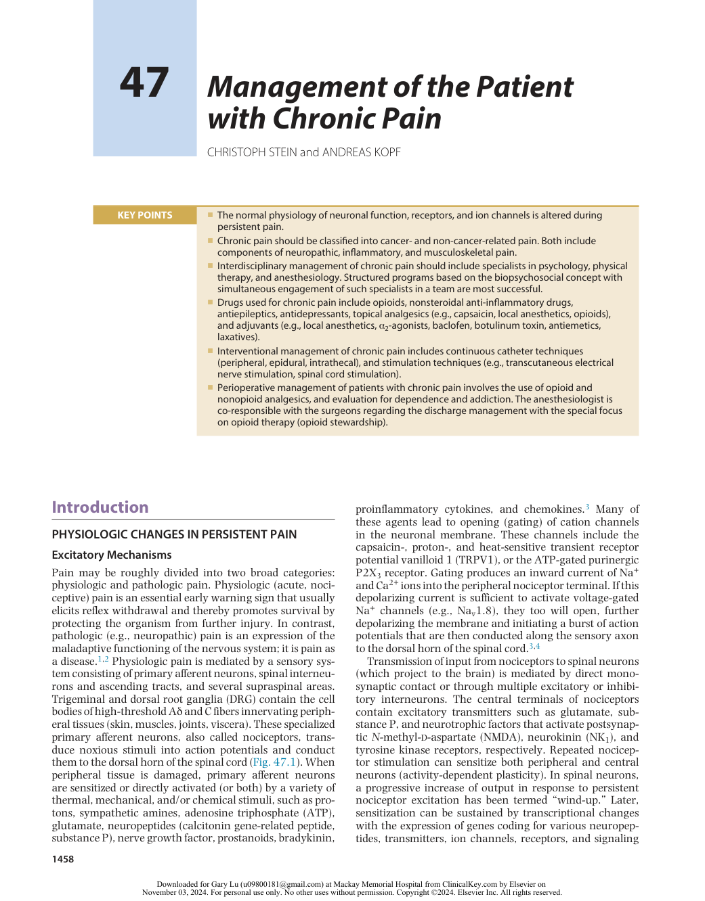
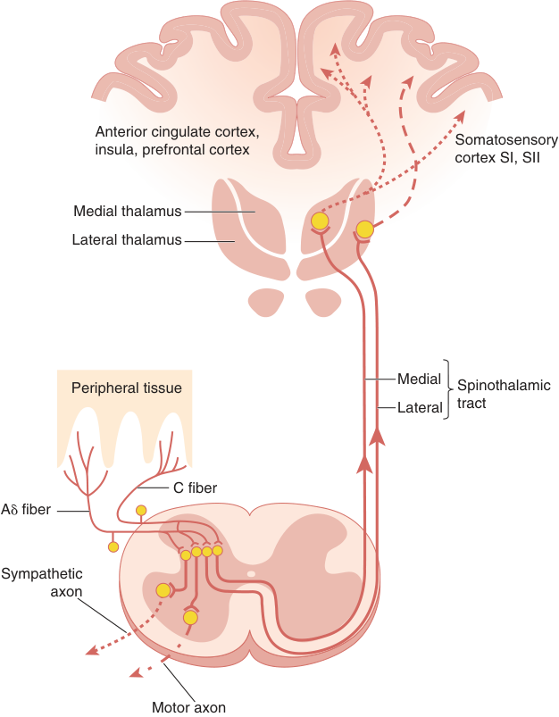
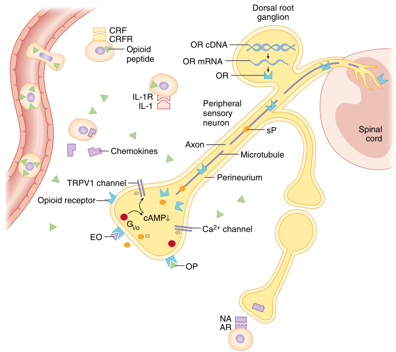
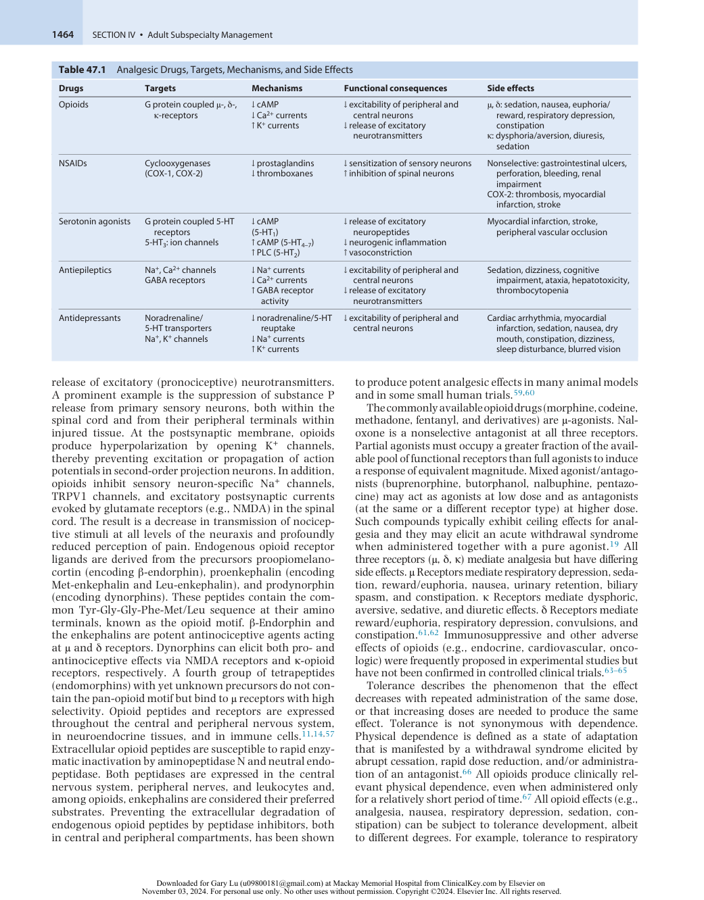
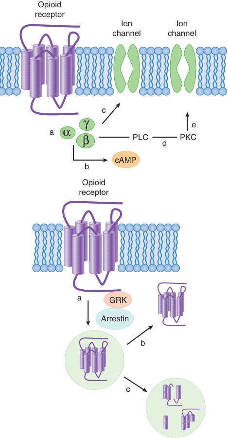
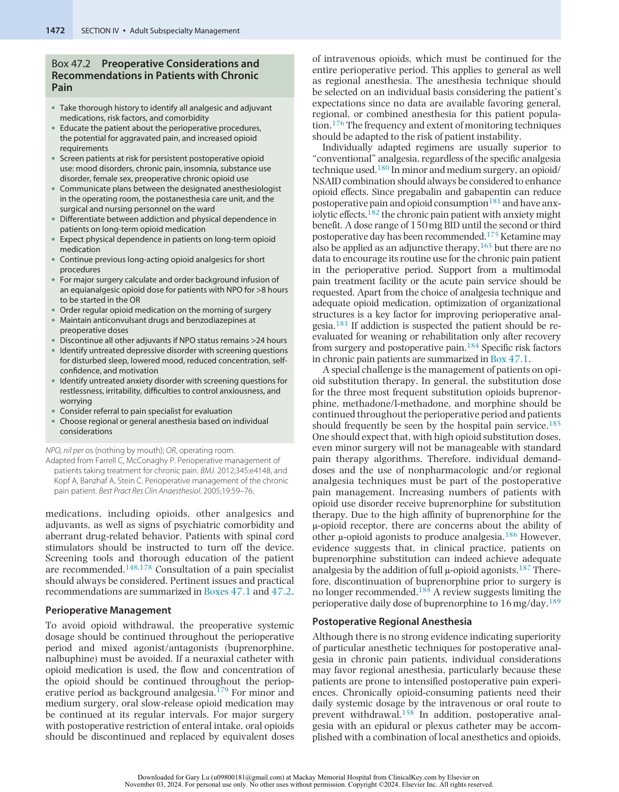

# Management of the Patient with Chronic Pain

<!-- PDF page 1 -->

CHRISTOPH STEIN and ANDREAS KOPF

|**KEY POINTS**|ᑏThe normal physiology of neuronal function, receptors, and ion channels is altered during persistent pain. ᑏChronic pain should be classified into cancer- and non- cancer- related pain. Both include components of neuropathic, inflammatory, and musculoskeletal pain. ᑏInterdisciplinary management of chronic pain should include specialists in psychology, physical therapy, and anesthesiology. Structured programs based on the biopsychosocial concept with simultaneous engagement of such specialists in a team are most successful. ᑏDrugs used for chronic pain include opioids, nonsteroidal anti- inflammatory drugs, antiepileptics, antidepressants, topical analgesics (e.g., capsaicin, local anesthetics, opioids), and adjuvants (e.g., local anesthetics,α2- agonists, baclofen, botulinum toxin, antiemetics, laxatives).|
|---|---|
||ᑏInterventional management of chronic pain includes continuous catheter techniques (peripheral, epidural, intrathecal), and stimulation techniques (e.g., transcutaneous electrical nerve stimulation, spinal cord stimulation).|
||ᑏPerioperative management of patients with chronic pain involves the use of opioid and nonopioid analgesics, and evaluation for dependence and addiction. The anesthesiologist is co- responsible with the surgeons regarding the discharge management with the special focus on opioid therapy (opioid stewardship).|

## Introduction

### PHYSIOLOGIC CHANGES IN PERSISTENT PAIN

### Excitatory Mechanisms

Pain may be roughly divided into two broad categories: physiologic and pathologic pain. Physiologic (acute, nociceptive) pain is an essential early warning sign that usually elicits reflex withdrawal and thereby promotes survival by protecting the organism from further injury. In contrast, pathologic (e.g., neuropathic) pain is an expression of the maladaptive functioning of the nervous system; it is pain as a disease.1,2 Physiologic pain is mediated by a sensory system consisting of primary afferent neurons, spinal interneurons and ascending tracts, and several supraspinal areas. Trigeminal and dorsal root ganglia (DRG) contain the cell bodies of high- threshold Aδ and C fibers innervating peripheral tissues (skin, muscles, joints, viscera). These specialized primary afferent neurons, also called nociceptors, transduce noxious stimuli into action potentials and conduct them to the dorsal horn of the spinal cord (Fig. 47.1). When peripheral tissue is damaged, primary afferent neurons are sensitized or directly activated (or both) by a variety of thermal, mechanical, and/or chemical stimuli, such as protons, sympathetic amines, adenosine triphosphate (ATP), glutamate, neuropeptides (calcitonin gene- related peptide, substance P), nerve growth factor, prostanoids, bradykinin,

proinflammatory cytokines, and chemokines.3 Many of these agents lead to opening (gating) of cation channels in the neuronal membrane. These channels include the capsaicin- , proton- , and heat- sensitive transient receptor potential vanilloid 1 (TRPV1), or the ATP- gated purinergic P2X3 receptor. Gating produces an inward current of Na+ and Ca2+ ions into the peripheral nociceptor terminal. If this depolarizing current is sufficient to activate voltage- gated Na+ channels (e.g., Nav1.8), they too will open, further depolarizing the membrane and initiating a burst of action potentials that are then conducted along the sensory axon to the dorsal horn of the spinal cord.3,4

Transmission of input from nociceptors to spinal neurons (which project to the brain) is mediated by direct monosynaptic contact or through multiple excitatory or inhibitory interneurons. The central terminals of nociceptors contain excitatory transmitters such as glutamate, substance P, and neurotrophic factors that activate postsynaptic _N_ - methyl- d- aspartate (NMDA), neurokinin (NK1), and tyrosine kinase receptors, respectively. Repeated nociceptor stimulation can sensitize both peripheral and central neurons (activity- dependent plasticity). In spinal neurons, a progressive increase of output in response to persistent nociceptor excitation has been termed “wind- up.” Later, sensitization can be sustained by transcriptional changes with the expression of genes coding for various neuropeptides, transmitters, ion channels, receptors, and signaling

::: details 原始表格與符號（PDF 第 1 頁）

:::

<!-- PDF page 2 -->

Anterior cingulate cortex, Somatosensory insula, prefrontal cortex cortex SI, SII Medial thalamus Lateral thalamus Medial Peripheral tissue Spinothalamic Lateral tract C fiber A fiber Sympathetic axon Motor axon 

**Fig. 47.1 Nociceptive pathways.** For details see text. (Adapted from Brack A, Stein C, Schaible HG. Periphere und zentrale Mechanismen des Entzündungsschmerzes. In: Straub RH (ed): _Lehrbuch der klinischen Pathophysiologie komplexer chronischer Erkrankungen_ , vol. 1 Göttingen: Vandenhoeck & Ruprecht; 2006:183–192.)

molecules (transcription- dependent plasticity) in both nociceptors and spinal neurons. Important examples include the NMDA receptor, cyclooxygenase- 2 (COX- 2), Ca2+ and Na+ channels, cytokines and chemokines expressed by neurons and/or glial cells. In addition, physical rearrangement of neuronal circuits by apoptosis, nerve growth, and sprouting occurs in the peripheral and central nervous system.3,4 Both induction and maintenance of central sensitization are critically dependent on the peripheral drive by nociceptors, indicating that therapeutic interventions targeting such neurons may be particularly effective, even in chronic pain syndromes.4–8

### Inhibitory Mechanisms

Concurrent with the events described above, powerful endogenous mechanisms counteracting pain unfold. This was initially proposed in the “gate control theory of pain” in 19659 and has since been corroborated and expanded by experimental data. In 1990, a “peripheral gate” was discovered at the source of pain generation by demonstrating the blockade of nociceptor excitation by immune cell–derived opioid peptides within injured tissue (Fig. 47.2).10 This represented the first example of many subsequently described

neuro- immune interactions relevant to pain.11–13 Inflammation of peripheral tissue leads to increased expression, axonal transport, and enhanced G protein coupling of opioid receptors in DRG neurons as well as enhanced permeability of the perineurium.14 These phenomena are dependent on sensory neuron electrical activity, production of proinflammatory cytokines, and the presence of nerve growth factor within the inflamed tissue. In parallel, opioid peptidecontaining immune cells extravasate and accumulate in the inflamed tissue.11–13,15 These cells upregulate the gene expression of opioid precursors and the enzymatic machinery for their processing into functionally active peptides. In response to stress, catecholamines, corticotropin- releasing factor, cytokines, chemokines, or bacteria, leukocytes secrete opioids, which then activate peripheral opioid receptors and produce analgesia by inhibiting the excitability of nociceptors, the release of excitatory neuropeptides, or both11–13 (Fig. 47.2). The clinical relevance of these mechanisms has been shown in studies demonstrating that patients with knee joint inflammation express opioid peptides in immune cells and opioid receptors on sensory nerve terminals within synovial tissue.16 After knee surgery, pain and analgesic consumption was enhanced by blocking the interaction

<!-- PDF page 3 -->

Dorsal root ganglion CRF CRFR OR cDNA Opioid peptide OR mRNA OR IL-1R IL-1 Peripheral sensory neuron sP Spinal cord Axon Chemokines Microtubule Perineurium TRPV1 channel Opioid receptor cAMP Gi/o Ca 2+  channel EO OP NA AR 

**Fig. 47.2 Endogenous antinociceptive mechanisms within peripheral injured tissue.** Opioid peptide- containing circulating leukocytes extravasate upon activation of adhesion molecules and chemotaxis by chemokines. Subsequently, these leukocytes are stimulated by stress or releasing agents to secrete opioid peptides. For example, corticotropin- releasing factor (CRF), interleukin- 1β (IL- 1) and noradrenaline (NA, released from postganglionic sympathetic neurons) can elicit opioid release by activating their respective CRF receptors (CRFR), IL- 1 receptors (IL- 1R), and adrenergic receptors (AR) on leukocytes. Exogenous opioids (EO, _purple triangle_ ) or endogenous opioid peptides (OP, _green triangles_ ) bind to opioid receptors (OR) that are synthesized in dorsal root ganglia and transported along intra- axonal microtubules to peripheral (and central) terminals of sensory neurons. The subsequent inhibition of ion channels (e.g. TRPV1, Ca2+ ) (see Fig. 47.3 and text) and of substance P (sP) release results in antinociceptive effects. Injured/ inflamed tissues are characterized by low pH values (5–7). (Adapted from Stein C, Machelska H. Modulation of peripheral sensory neurons by the immune system: implications for pain therapy. _Pharmacol Rev_ . 2011; 63: 860–881.)

between the endogenous opioids and their receptors with intra- articular naloxone,17 and was diminished by stimulating opioid secretion.18

In the spinal cord, inhibition is mediated by the release of opioids, γ- aminobutyric acid (GABA), or glycine from interneurons, which activate presynaptic opioid or GABA receptors (or both) on central nociceptor terminals to reduce excitatory transmitter release. In addition, the opening of postsynaptic K+ or Cl− channels by opioids or GABA, respectively, evokes hyperpolarizing inhibitory potentials in dorsal horn neurons. During ongoing nociceptive stimulation, spinal interneurons upregulate gene expression and the production of opioid peptides.14 Powerful descending inhibitory pathways from the brainstem also become active by operating mostly through noradrenergic, serotonergic, and opioid systems. Key regions are the periaqueductal gray and the rostral ventromedial medulla, which then projects along the dorsolateral funiculus to the dorsal horn.3,19 The integration of signals from excitatory and inhibitory neurotransmitters with cognitive, emotional, and environmental factors (see later) eventually results in the central perception of pain. When the intricate balance between

biologic, psychological, and social factors becomes disturbed, chronic pain can develop.2

### Translation of Basic Research

Basic research on pain continues at a rapid pace but translation into clinical applications has been difficult. Failures in clinical phases of analgesic drug development are common and have been attributed to overinterpretation of data, reporting bias by neglecting negative results, inadequate animal models, flawed study design, and genetic and species differences.5,8,20,21 Notwithstanding, animal studies are indispensable, continue to be improved, and have successfully predicted adverse side effects of drug candidates.20–23 For ethical reasons, many models are restricted to days or weeks, while human chronic pain can last for months or years. Therefore, animal models may be more cautiously termed as reflecting “persistent” pain.8,21 Brain imaging is an area of intense research and numerous studies have investigated changes in patients with various pain syndromes. However, such studies have not yet provided reproducible findings specific for a disease or a pathophysiologic basis for individual syndromes. Neuroimaging can

<!-- PDF page 4 -->

only detect alterations associated with nociceptive processes whereas clinical pain encompasses a much more complex subjective experience that critically relies on selfevaluation. Thus, although recent data have provided valuable information on pain neurophysiology, current imaging techniques cannot provide an objective proxy, biomarker, or predictor for clinical pain.24–26 Genetics is another budding scientific field. However, with the possible exception of the metabolic enzyme CYP2D6, pharmacogenetics is not expected to serve as a guide to individualized (“personalized”) clinical pain therapy any time soon.27–30

### CLINICAL DEFINITIONS, PREVALENCE, AND CLASSIFICATION OF CHRONIC PAIN

### Definitions

The International Association for the Study of Pain (IASP) defines pain as “an unpleasant sensory and emotional experience associated with, or resembling that associated with, actual or potential tissue damage.”26 This classification further states that pain is always a personal experience and that it is a sensation in parts of the body. At the same time, it is unpleasant and therefore also has emotional/psychological components. Aside from malignant disease, many people report chronic pain in the absence of tissue damage or any likely pathophysiologic cause. There is usually no way to distinguish their experience from that due to tissue damage. If patients regard their experience as pain or if they report it in the same ways as pain caused by tissue damage, it should be accepted as pain.31 Nociception is neurophysiologic activity in peripheral sensory neurons (nociceptors) and higher nociceptive pathways and is defined as the “neural process of encoding noxious stimuli.” Nociception is not synonymous with pain. Chronic pain is defined as pain that persists or recurs for more than three months.2

### Prevalence

Beyond these general definitions there exists no common understanding about the characteristics of the chronic pain patient. This may be one reason why estimates of prevalence differ greatly from one publication to another. Heterogeneous populations, the occurrence of undetected comorbidity, different definitions of chronic pain, and different approaches to data collection have resulted in estimates from 20% to 60%.1 Chronic pain has enormous socioeconomic costs due to health care, disability compensation, lost workdays, and related expenses.1,31–33

### Classification

There is a tradition to distinguish between cancerrelated and non- cancer- related chronic pain. Chronic non- cancer pain (CNCP) is frequently classified into inflammatory, musculoskeletal, headache, and neuropathic pain (e.g., postherpetic neuralgia, phantom pain, complex regional pain syndrome, diabetic neuropathy, human immunodeficiency virus–associated neuropathy). Recently proposed subtypes include nociceptive and nociplastic pain.2,26 Symptoms of neuropathic pain include spontaneous lancinating, shooting, or burning pain, hyperalgesia, and allodynia.34 Cancer pain can originate from invasion of the tumor into tissues innervated by primary afferent neurons (e.g., pleura,

peritoneum) or directly into a peripheral nerve plexus. In the latter case, neuropathic symptoms may be predominant. Pain may be underestimated by medical staff and family members, resulting in poor pain control.31 Many treatments for cancer are associated with severe pain. For example, cytoreductive radiotherapy or chemotherapy frequently causes painful oral mucositis.35

### Biopsychosocial Concept of Chronic Pain

Chronic pain is characterized by the complex interaction of biologic (e.g., tissue damage), psychological (cognition, memory, conditioning), and environmental/social factors (attention, reinforcement). This concept helps to understand why chronic pain may exist without obvious physical cause or why pathologic somatic findings may remain unnoticed by some patients. Patients may become preoccupied with pain and somatic processes, which may disrupt sleep, cause irritability, and social withdrawal. Other cognitive factors such as patients’ expectations or beliefs influence psychosocial and physical functioning. Pain behavior such as limping, medication intake, or avoidance of activity is subject to operant conditioning; that is, it responds to reward and punishment. For example, pain behavior may be positively reinforced by attention from a spouse or health care provider (e.g., by inadequate use of nerve blocks or medications). Conversely, such behavior can be extinguished when it is disregarded and incremental activity is reinforced by social attention and appraisal.36 Respondent learning mechanisms (i.e., classical conditioning) may also contribute.37 Other issues often coexist, such as substance abuse problems, family dysfunction, and conflicts with legal or insurance systems. Consequently, care seeking is an integral feature of the pain experience, and excessive use of the health care system ensues.

The interplay between biologic, psychological, and social factors can result in the persistence of pain.26,36,37 Treating only one aspect of this complex syndrome (“monomodal” therapy) is obviously insufficient. Studies have shown that multimodal pain management programs rooted in this concept can lead to reduced pain, increased activity, and improved daily functioning.38 Although the biopsychosocial concept was already described in 1959, its implementation into daily practice has been tardy.39–41 In a multimodal interdisciplinary approach, the pain management team simultaneously addresses physical, psychological, and social skills and underscores the patient’s active responsibility to regain control over life by improving function and well- being.37,38

### INTERDISCIPLINARY MANAGEMENT OF CHRONIC PAIN

The anesthesiologist John J. Bonica was the first to appreciate the need for a multidisciplinary approach to chronic pain. Bonica’s early experiences in and after World War II convinced him that complex pain problems could be more effectively treated when different disciplines contribute their specialized knowledge and skills to the common goal of making a correct diagnosis and developing the most effective therapeutic strategy. The first multidisciplinary facility was put into practice at the Tacoma General Hospital, followed by the University of Washington in 1960.

<!-- PDF page 5 -->

From 1970 through 1990, the number of pain management facilities continued to increase in North America and Europe, mostly directed by anesthesiologists. Methods usually include (among others) cognitive behavioral therapy, physical exercise, and medication management. Cognitive behavioral therapy aims to correct maladaptive cognitive and behavioral patterns, such as catastrophizing and fear- avoidance beliefs. It encourages patients to take an active rather than passive role in their healing process.42,43 Functional restoration includes occupational and physical therapy to help the patient gain confidence in physical activity. Social support can affect pain intensity and mood by addressing employment and retirement issues as well as financial and legal disputes. Comprehensive pain centers should have personnel and facilities to evaluate and treat the biomedical, psychosocial, and occupational aspects of chronic pain and to educate and teach medical students, residents, and fellows. Guidelines for characteristics of pain treatment facilities have been published by the IASP.44 Interdisciplinary and multimodal management results in increased physical and psychosocial function, reduced health care use, and vocational rehabilitation. Such programs offer the most efficacious and cost- effective, evidence- based pain management.38 Treatment without an interdisciplinary approach is inadequate and may lead to misdiagnoses. For example, overlooking psychological processes in a patient with presumed discogenic back pain, or overlooking a somatic etiology in a patient with presumed “psychogenic” pain disorder, may lead to wrong conclusions.45 Moreover, monomodal approaches such as pharmacotherapy alone only perpetuate the expensive, futile, and endless search for medical solutions. A prominent example is the “opioid epidemic” with inadequate opioid medication as a monomodal therapy of CNCP.46 The “current opioid misuse measure” questionnaire may be a useful tool to detect inadequate opioid medication.47

The core team usually comprises a pain management physician (often an anesthesiologist with subspecialty training), a psychologist, and a physical therapist. Depending on the local circumstances, administrators, occupational therapists, social workers, pain nurses, and/or pharmacists may also be involved. The initial screening of the patient by members of the core team determines what other specialists will be needed for a complete assessment. After this evaluation, the patient is presented to the entire core team and a comprehensive treatment plan is developed. This plan is tailored to the patient’s needs, abilities, and expectations, with a focus on achieving measurable treatment goals established with the patient. For some patients, education and medical management may suffice, whereas for others, an intensive full- day outpatient or inpatient rehabilitation program over several weeks may be needed. Early stratification of the management according to the patient’s prognosis (risk for persistent disability) results in significantly higher clinical and cost- effectiveness.48 To foster patient compliance, an open discussion of treatment goals with regard to the expectations of the patient is essential. Many patients expect the complete resolution of pain and the return to full function, a goal that may not be achievable. More realistic options are some reduction of pain, improvement of physical function, and/or return to work. Mood, sleep, active coping skills, and social functioning may also be improved.

Thus, rehabilitation rather than cure is the most appropriate therapeutic option.49

### Psychology

The role of the psychologist includes the initial assessment and treatment approaches such as education, cognitive behavioral therapy, and relaxation training. Assessment of the patient addresses the sensory, affective, cognitive, behavioral, and occupational dimensions of the pain problem. This includes an extensive biographic history and behavioral analysis along with the use of questionnaires. Most questionnaires include scoring systems for pain intensity (e.g., numerical or visual analogue scales), but pain behavior (e.g., West Haven–Yale Multidimensional Pain Inventory), multidimensional pain quality, cognitive coping, fear (e.g., State- Trait Anxiety Inventory), depression, and other associated symptoms are far more relevant. Indications for psychological pain management are relevant somatization, depressive disorders, inadequate coping, drug abuse, and pain behavior reinforced by the environment (e.g., family members). A key factor is motivational change for acceptance of a complex therapeutic program.37,50 This usually means a complete change of view for the patient, from a purely passive recipient of curative treatment to an active, self- reliant approach to functional restoration, vocational rehabilitation, and reduced health care use despite pain acceptance and commitment therapy (ACT).43 Thus, pain reduction alone is no longer the focus of therapy.38

### Physical Therapy

The role of the physical therapist includes initial evaluation of the musculoskeletal system, assessment of the patient’s workplace and home, education in active physical coping skills, and management of the physical rehabilitation process. An intensive exercise program emphasizing the patient’s responsibility for self- management is an integral part of comprehensive programs.38 Improving fitness, mobility, and posture counteracts the effects of disuse and complements behavioral treatment. The physical therapist encourages the adoption of regular exercise into daily life, facilitates repeated exposure to movement as much as possible despite pain, and reinforces education in the biopsychosocial model of pain management. Different techniques of exercise such as muscle conditioning and aerobics are efficacious in improving function, pain, disability, and fearavoidance behavior.51 Passive treatments like massage or other manual interventions are not beneficial.52 The regimen of graded exercise follows the original concept proposed by Fordyce and co- workers.36 Patients are instructed to find a baseline tolerance level for each exercise. Next, a program of improvement is negotiated and agreed upon. Patients may or may not note the improvement on a daily basis, but they are required to complete the exercise plan regardless of how they feel. Thus, the control over exercise behavior is contingent upon plan rather than pain since exercise and pain are disconnected. Individual motivation is an important factor determining how well patients learn to manage pain.37,43

### Occupational Therapy

The occupational therapist teaches the patient to achieve life goals despite pain and to overcome the limitations

<!-- PDF page 6 -->

imposed by pain. Occupational therapy assessment includes a history of working life and place, family life, and daily activities, as well as a physical examination to determine range- of- motion, and the presence of movement disorders or deformities that might hinder performance. The primary therapeutic objectives are reduction of pain and associated disability, promotion of optimal function in everyday life, and the encouragement of meaningful family, social, and work relationships. An important target is to support the patient for returning to work including specific work conditioning.53 The chance of returning to work after a period of sick leave apparently decreases over time, thereby generating enormous cost to society through wage compensation, social support, and loss of production.31 Barriers to return to work include job dissatisfaction and perceptions of the impact of work on the cause of pain. Together with the patient, the occupational therapist should develop a program to increase self- esteem, restore self- efficacy, and promote optimal occupational and recreational function despite pain.

### Anesthesiology

Most pain physicians worldwide are anesthesiologists. However, the role of anesthesiologists in the treatment of chronic pain has changed considerably over the last decades. “Nerve block practices” have been replaced by interdisciplinary pain management centers. In this context the anesthesiologist acts as both a physician- educator and a technical expert. The challenge is to optimally complement regional anesthesia skills and pharmacologic knowledge with the psychosocial components of chronic pain. The focus is not only on reducing pain but also on decreasing disability, improving quality of life, and increasing function (see sections above). The conventional way of administering medication “as needed” or to use nerve blocks for shortterm pain relief may risk reinforcement of pain behavior, and the patient’s belief in an underlying physical abnormality that is best managed by biomedical procedures.54 Moreover, false expectations are maintained. The patient cannot be the passive recipient but must be an active participant in the process. Patients may believe that pain is the primary problem but this neglects psychosocial factors, perpetuates the expensive and futile search for unidimensional biomedical solutions, and promotes iatrogenic somatization, medicalization, and high health care use.41,54 The role of the anesthesiologist differs depending on the types of patient being treated. Cancer and acute pain management demand the full range of the anesthesiologist’s technical skills and pharmacologic knowledge. In CNCP, the anesthesiologist’s abilities as an educator, coach, and motivator are far more important. As a member of the interdisciplinary team, the anesthesiologist (physician) has to reinforce and maintain the biopsychosocial focus, respond appropriately to somatic concerns, and manage medications.38,55 In concert with the other members of the team, the anesthesiologist uses motivational strategies to encourage the patient to attain self- managed reactivation goals in physical, psychosocial, recreational, and vocational domains. At the same time, the anesthesiologist’s presence provides “white coat credibility” and is essential to avoid the patient’s pejorative conclusion that the pain is “all in my head.” The anesthesiologist monitors the patient’s physical status, potential

development of new medical problems, and medications. In addition, the anesthesiologist provides real- time reassurance and education regarding the absence of relevant anatomical abnormality, the minimal role of surgery, and conveys medical information to make informed choices. The anesthesiologist plays a crucial role to direct patients toward multimodal pain treatment plan and to coordinate the program. Anesthesiologists work closely with other health care professionals in this setting, thereby gaining added recognition outside the operating room and removing existing barriers to the implementation of biopsychosocial concepts.38,41,54,55

## Drugs Used for Chronic Pain

Analgesic drugs interfere with the generation or transmission (or both) of impulses following noxious stimulation in the nervous system (nociception). This can occur at both the peripheral and central levels of the neuraxis. The therapeutic aim is to diminish the perception of pain. Analgesics aim at modulating either the formation of noxious chemicals (e.g., prostaglandins) or the activation of neuronal receptors or ion channels transducing or transmitting noxious stimuli (e.g., peptide- , kinin- , monoamine- receptors, Na+ channels). Drugs currently used in chronic pain include opioids, nonsteroidal anti- inflammatory drugs (NSAIDs), serotonergic compounds, antiepileptics, and antidepressants (Table 47.1). Local anesthetics could be used systemically (intravenous lidocaine infusion) and for topical and regional anesthetic techniques. Mixed drugs combine different mechanisms, for example, noradrenaline reuptake inhibition and opioid agonist effects (tramadol, tapentadol), or opioid agonist and NMDA antagonist effects (ketamine). Various routes of drug administration (e.g., oral, intravenous, subcutaneous, intrathecal, epidural, topical, intra- articular, transmucosal) can be used, depending on the clinical circumstances. In addition, placebo treatments have shown significant analgesic effects, mediated by opioid and nonopioid mechanisms.56 Chronic pain requires a multidisciplinary approach encompassing both pharmacologic and nonpharmacologic (psychological, physiotherapeutic) treatment strategies (see Interdisciplinary Management of Chronic Pain, above).

### OPIOIDS

Opioids act on heptahelical G protein coupled receptors. Three main types of opioid receptors (μ, δ, κ) have been cloned. In addition, nociceptin receptors and several subtypes, possibly resulting from gene polymorphisms, splice variants, or alternative processing have been proposed.14,57 Opioid receptors are localized and can be activated along all levels of the neuraxis including peripheral and central processes of primary sensory neurons (nociceptors), spinal cord (interneurons, projection neurons), brainstem, midbrain, and cortex. All opioid receptors couple to G proteins (mainly Gi/Go) and subsequently inhibit adenylyl cyclase, decrease the conductance of voltagegated Ca2+ channels, or open rectifying K+ channels, or any combination of these actions14,57,58 (Fig. 47.3, upper panel). These effects ultimately result in a decrease in neuronal activity. The prevention of Ca2+ influx inhibits the

<!-- PDF page 7 -->

**Table 47.1** Analgesic Drugs, Targets, Mechanisms, and Side Effects

|**Drugs**|**Targets**|**Mechanisms**|**Functional consequences**|**Side effects**|
|---|---|---|---|---|
|Opioids|G protein coupledμ- ,δ- , κ- receptors|↓cAMP ↓Ca2+currents ↑K+currents|↓excitability of peripheral and central neurons ↓release of excitatory neurotransmitters|μ,δ: sedation, nausea, euphoria/ reward, respiratory depression, constipation κ: dysphoria/aversion, diuresis, sedation|
|NSAIDs|Cyclooxygenases (COX- 1, COX- 2)|↓prostaglandins ↓thromboxanes|↓sensitization of sensory neurons ↑inhibition of spinal neurons|Nonselective: gastrointestinal ulcers, perforation, bleeding, renal impairment COX- 2: thrombosis, myocardial infarction, stroke|
|Serotonin agonists|G protein coupled 5- HT receptors 5- HT3: ion channels|↓cAMP (5- HT1) ↑cAMP (5- HT4–7) ↑PLC (5- HT2)|↓release of excitatory neuropeptides ↓neurogenic inflammation ↑vasoconstriction|Myocardial infarction, stroke, peripheral vascular occlusion|
|Antiepileptics|Na+, Ca2+channels GABA receptors|↓Na+currents ↓Ca2+currents ↑GABA receptor activity|↓excitability of peripheral and central neurons ↓release of excitatory neurotransmitters|Sedation, dizziness, cognitive impairment, ataxia, hepatotoxicity, thrombocytopenia|
|Antidepressants|Noradrenaline/ 5- HT transporters Na+, K+channels|↓noradrenaline/5- HT reuptake ↓Na+currents ↑K+currents|↓excitability of peripheral and central neurons|Cardiac arrhythmia, myocardial infarction, sedation, nausea, dry mouth, constipation, dizziness, sleep disturbance, blurred vision|

release of excitatory (pronociceptive) neurotransmitters. A prominent example is the suppression of substance P release from primary sensory neurons, both within the spinal cord and from their peripheral terminals within injured tissue. At the postsynaptic membrane, opioids produce hyperpolarization by opening K+ channels, thereby preventing excitation or propagation of action potentials in second-order projection neurons. In addition, opioids inhibit sensory neuron- specific Na+ channels, TRPV1 channels, and excitatory postsynaptic currents evoked by glutamate receptors (e.g., NMDA) in the spinal cord. The result is a decrease in transmission of nociceptive stimuli at all levels of the neuraxis and profoundly reduced perception of pain. Endogenous opioid receptor ligands are derived from the precursors proopiomelanocortin (encoding β- endorphin), proenkephalin (encoding Met- enkephalin and Leu- enkephalin), and prodynorphin (encoding dynorphins). These peptides contain the common Tyr- Gly- Gly- Phe- Met/Leu sequence at their amino terminals, known as the opioid motif. β- Endorphin and the enkephalins are potent antinociceptive agents acting at μ and δ receptors. Dynorphins can elicit both pro- and antinociceptive effects via NMDA receptors and κ- opioid receptors, respectively. A fourth group of tetrapeptides (endomorphins) with yet unknown precursors do not contain the pan- opioid motif but bind to μ receptors with high selectivity. Opioid peptides and receptors are expressed throughout the central and peripheral nervous system, in neuroendocrine tissues, and in immune cells.11,14,57 Extracellular opioid peptides are susceptible to rapid enzymatic inactivation by aminopeptidase N and neutral endopeptidase. Both peptidases are expressed in the central nervous system, peripheral nerves, and leukocytes and, among opioids, enkephalins are considered their preferred substrates. Preventing the extracellular degradation of endogenous opioid peptides by peptidase inhibitors, both in central and peripheral compartments, has been shown

to produce potent analgesic effects in many animal models and in some small human trials.59,60

The commonly available opioid drugs (morphine, codeine, methadone, fentanyl, and derivatives) are μ- agonists. Naloxone is a nonselective antagonist at all three receptors. Partial agonists must occupy a greater fraction of the available pool of functional receptors than full agonists to induce a response of equivalent magnitude. Mixed agonist/antagonists (buprenorphine, butorphanol, nalbuphine, pentazocine) may act as agonists at low dose and as antagonists (at the same or a different receptor type) at higher dose. Such compounds typically exhibit ceiling effects for analgesia and they may elicit an acute withdrawal syndrome when administered together with a pure agonist.19 All three receptors (μ, δ, κ) mediate analgesia but have differing side effects. μ Receptors mediate respiratory depression, sedation, reward/euphoria, nausea, urinary retention, biliary spasm, and constipation. κ Receptors mediate dysphoric, aversive, sedative, and diuretic effects. δ Receptors mediate reward/euphoria, respiratory depression, convulsions, and constipation.61,62 Immunosuppressive and other adverse effects of opioids (e.g., endocrine, cardiovascular, oncologic) were frequently proposed in experimental studies but have not been confirmed in controlled clinical trials.63–65

Tolerance describes the phenomenon that the effect decreases with repeated administration of the same dose, or that increasing doses are needed to produce the same effect. Tolerance is not synonymous with dependence. Physical dependence is defined as a state of adaptation that is manifested by a withdrawal syndrome elicited by abrupt cessation, rapid dose reduction, and/or administration of an antagonist.66 All opioids produce clinically relevant physical dependence, even when administered only for a relatively short period of time.67 All opioid effects (e.g., analgesia, nausea, respiratory depression, sedation, constipation) can be subject to tolerance development, albeit to different degrees. For example, tolerance to respiratory

::: details 原始表格與符號（PDF 第 7 頁）

:::

<!-- PDF page 8 -->

Opioid receptor Ion Ion channel channel c e a PLC PKC d cAMP b Opioid receptor a GRK Arrestin b c 

**Fig. 47.3 Opioid receptor signaling and recycling.** Upper panel: Opioid ligands induce a conformational change at the receptor which allows coupling of G proteins to the receptor. The heterotrimeric G protein dissociates into active Gα and Gβγ subunits (a) which can inhibit adenylyl cyclase and reduce cAMP (b), decrease the conductance of voltage- gated Ca2+ channels or open rectifying K+ channels (c). In addition, the phospholipase C/phosphokinase C (PLC/PKC) pathways can be activated (d) to modulate Ca2+ channel activity in the plasma membrane (e). Lower panel: Opioid receptor desensitization and trafficking is activated by G protein coupled receptor kinases (GRK). After arrestin binding, the receptor is in a desensitized state at the plasma membrane (a). Arrestin- bound receptors can then be internalized via a clathrin- dependent pathway, and either be recycled to the cell surface (b) or degraded in lysosomes (c). (Adapted from Zöllner C, Stein C. Opioids. _Handb Exp Pharmacol_ . 2007;(177):31–63.)

depression, sedation, and nausea often develops faster than to constipation or miosis.62,68–70 Incomplete crosstolerance between opioids or genetic differences may explain clinical observations that switching drugs (“opioid rotation”) is occasionally useful in patients with inadequate pain relief or intolerable side effects.71 Opioid- induced adaptations occur at multiple levels in the nervous and other organ systems, beginning with direct modulation of opioid

receptor signaling and extending to complex neuronal networks including learned behavior. Proposed mechanisms involved in pharmacodynamic tolerance include uncoupling of G proteins from opioid receptors, decreased receptor internalization/recycling, and increased sensitivity of the NMDA receptor58 (Fig. 47.3, lower panel). In addition, pharmacokinetic (e.g., altered distribution or metabolism of the opioid) and learned tolerance (e.g., compensatory skills developed during mild intoxication) as well as increased nociceptive stimulation by tumor growth, inflammation, or neuroma formation are possible reasons for increased dose requirements.68 There is a lack of carefully controlled studies that unequivocally demonstrate pharmacodynamic tolerance to opioid analgesia (i.e., reduction of clinical pain) in patients.72,73

There is an ongoing debate whether opioids may paradoxically induce hyperalgesia. However, many studies have, in fact, shown withdrawal- induced hyperalgesia, a well- known phenomenon following the abrupt cessation of opioids.74–77 At high doses, occasionally encountered in extreme cancer pain, singular cases of allodynia have been observed and attributed to neuroexcitatory effects of opioid metabolites.78 There is no conclusive evidence that hyperalgesia occurs during the perioperative or chronic administration of regular opioid doses in patients.73,74,77,79

Opioids are effective in the periphery (topical or intraarticular administration, particularly in inflamed tissue), at the neuraxis (intrathecal, epidural, or intracerebroventricular administration), and systemically (intravenous, oral, subcutaneous, sublingual, or transdermal administration).8,19,57,59 The clinical choice of a particular compound or its formulation is based on pharmacokinetic considerations (route of administration, desired onset or duration, lipophilicity) and on side effects associated with the respective route of drug delivery.19 Dosages are dependent on patient characteristics, type of pain, and route of administration. Systemically and spinally administered opioids can produce similar side effects, depending on dosage and rostral/systemic redistribution. For intrathecal application lipophilic drugs are preferred because they are trapped in the spinal cord and less likely to migrate to the brain within the cerebrospinal fluid. Adverse side effects can be minimized by careful dose titration and close patient monitoring, or can be treated by co- medication (antiemetics, laxatives) or opioid receptor antagonists (e.g., naloxone). No significant side effects have been reported for the peripheral (i.e., topical) application of small, systemically inactive doses of opioids.

Opioids are considered the most effective analgesics for severe acute (e.g., postoperative) and cancer- related chronic pain. However, the long- term use of opioids in CNCP (e.g., neuropathic, musculoskeletal, abdominal pain) is highly controversial. Randomized controlled trials (RCTs) have only been conducted for a maximum period of three months. In meta- analyses, the reduction of pain scores was clinically insignificant and epidemiologic data suggest that quality of life or functional capacity is not improved.80–82 Adverse side effects (nausea, sedation, constipation, dizziness, etc.) and lack of analgesic efficacy led to the dropout of high numbers of subjects, both in RCTs and in uncontrolled observational studies beyond three months.82 Psychosocial outcome variables were rarely investigated and showed only modest improvement.

<!-- PDF page 9 -->

Thus, consistent with the multifactorial nature of chronic pain, opioids alone cannot produce an analgesic response. Clearly, the entire patient must be evaluated, not just the pain.83 The target of intervention is not only the source of nociception (if at all identifiable) but also suffering, dysfunction, psychosocial factors, and dependence on the health care system. In addition, addiction has been reported in high numbers of patients treated with opioids for chronic pain, and overdoses, death rates, and abuse of prescription opioids have become a public health problem.80,84 Thus, the use of opioids as the sole treatment modality in chronic nonmalignant pain is strongly discouraged.46

### NONSTEROIDAL ANTI- INFLAMMATORY DRUGS AND ANTIPYRETIC ANALGESICS

Nonsteroidal anti- inflammatory drugs (NSAIDs) and antipyretic analgesics (e.g., acetaminophen, phenazones) inhibit cyclooxygenases (COX), the enzymes that catalyze the transformation of arachidonic acid (a ubiquitous cell component generated from phospholipids) to prostaglandins and thromboxanes.85 Two isoforms, COX- 1 and COX2, are constitutively expressed in peripheral tissues and in the central nervous system. In response to injury and inflammatory mediators, (e.g., cytokines, growth factors) both isoforms can be upregulated, resulting in increased concentrations of prostanoids. In the periphery, prostanoids (mainly PGE2) sensitize nociceptors by phosphorylation of ion channels (e.g., Na+ , TRPV1) via EP receptor activation. As a result, nociceptors become more responsive to noxious mechanical (e.g., pressure, hollow organ distention), chemical (e.g., acidosis, bradykinin, neurotrophic factors), or thermal stimuli. In the spinal cord, PGE2 blocks glycinergic neuronal inhibition, enhances excitatory amino acid release, and depolarizes ascending neurons. These mechanisms facilitate the generation of impulses within nociceptors and their transmission through the spinal cord to higher brain areas. By blocking COX, prostanoid formation diminishes. Subsequently, nociceptors become less responsive to noxious stimuli and spinal neurotransmission is attenuated.

Less severe pain (e.g., early arthritis, headache) is commonly treated with nonselective NSAIDs (e.g., aspirin, ibuprofen, indomethacin, diclofenac) or antipyretic analgesics (e.g., acetaminophen), mostly administered orally. Some drugs are available for parenteral, rectal, or topical application. Over- the- counter availability and self- medication have led to frequent abuse and toxicity.85 Adverse effects are attributed to COX- 1- induced blockade of thromboxane production and impairment of platelet function (gastrointestinal and other bleeding disorders), decrease of tissueprotective prostanoids (gastrointestinal ulcers, perforation), decrease of renal vasodilatory prostanoids (nephrotoxicity), and the formation of highly reactive metabolites (acetaminophen hepatotoxicity). The development of selective COX- 2 inhibitors was driven by the assumption that COX- 2 expression is selectively induced in inflamed tissue and that the constitutive tissue- protective COX- 1 would be spared. It has now become clear that COX- 2 expression is constitutive in many tissues (e.g., gastrointestinal epithelium, vascular endothelium, spinal cord) and COX- 2 inhibition may exacerbate inflammation, impair ulcer healing, and decrease

formation of vasoprotective prostacyclin. COX inhibitors confer an increased risk of thrombosis, myocardial infarction, renal impairment, hypertension, stroke, and liver toxicity, and can cause rare anaphylactic reactions.85

NSAIDs and antipyretic analgesics play controversial roles in chronic pain. For example, their uncontrolled use may result in medication overuse headache.86 In chronic musculoskeletal pain, their use is disputed87 and they are not indicated in neuropathic pain.88

### SEROTONERGIC DRUGS

Serotonin (5- hydroxytryptamine; 5- HT) is a monoamine neurotransmitter found in the sympathetic nervous system, the gastrointestinal tract, and platelets. It acts on 5- HT receptors expressed at all levels of the neuraxis and on blood vessels. Within the dorsal horn of the spinal cord serotoninergic neurons contribute to endogenous pain inhibition. Except for 5- HT3 (a ligand- gated ion channel), 5- HT receptors are G protein coupled receptors. 5- HT1B/1D agonists (triptans) have been studied extensively and are effective against neurovascular (migraine, cluster) headaches. Migraine is thought to be related to the release of neuropeptides (e.g., calcitonin gene- related peptide) from trigeminal sensory neurons innervating meningeal and intracranial blood vessels. This leads to vasodilation, inflammatory reaction, and subsequent pain. Triptans inhibit neurogenic inflammation via 5- HT1D receptors on trigeminal afferents, with possible additional sites of action on thalamic neurons and in the periaqueductal gray. The activation of vascular 5- HT1B receptors constricts meningeal (and coronary) vessels. The latter effects have stimulated a search for alternative approaches such as targeting calcitonin gene- related peptide or highly selective 5HT1F agonists.89 Triptans can be applied orally, subcutaneously, or transnasally and have been used in the treatment of migraine. All triptans constrict coronary arteries via 5- HT1B receptors at clinical doses and should not be administered to patients with risk factors or coronary, cerebrovascular, or peripheral vascular disease. Many compounds have the potential for significant drug–drug interactions.89

### ANTIEPILEPTIC DRUGS

Antiepileptics are used in neuropathic pain resulting from lesions to the peripheral (e.g., diabetes, herpes) or central nervous system (e.g., stroke), and for migraine prophylaxis. Neuropathic syndromes have been attributed to ectopic activity in sensitized nociceptors from regenerating nerve sprouts, recruitment of previously “silent” nociceptors, or spontaneous neuronal activity (or any combination of these processes). These events may result in sensitization of primary afferents and subsequent sensitization of secondand third- order ascending neurons. Among the best-studied mechanisms are the increased expression and trafficking of ion channels (e.g., Na+ , Ca2+ , TRP) and increased activity at glutamate (NMDA) receptor sites. The mechanisms of action of antiepileptics include neuronal membrane stabilization by blockage of pathologically active voltagesensitive Na+ channels (e.g., carbamazepine, lamotrigine, topiramate), blockage of voltage- dependent Ca2+ channels (gabapentin, pregabalin), inhibition of presynaptic release

<!-- PDF page 10 -->

of excitatory neurotransmitters (gabapentin, lamotrigine), and enhancing the activity of GABA receptors (topiramate). The most common adverse effects are impaired mental (somnolence, dizziness, cognitive impairment, fatigue) and motor function (ataxia), which limit clinical use, particularly in elderly patients. Other serious side effects have been reported, including hepatotoxicity, thrombocytopenia, dermatologic, and hematologic reactions.90

### ANTIDEPRESSANTS

Antidepressants are used in the treatment of neuropathic pain and headache. They are divided into nonselective noradrenaline/5- HT reuptake inhibitors (amitriptyline, imipramine, clomipramine, duloxetine, venlafaxine), preferential noradrenaline reuptake inhibitors (desipramine), and selective 5- HT reuptake inhibitors (citalopram, fluoxetine). The reuptake block leads to a stimulation of endogenous monoaminergic pain inhibition in the spinal cord and brain. Tricyclic antidepressants also have NMDA receptor antagonist, endogenous opioid enhancing, Na+ channel blocking, and K+ channel opening effects, which can suppress peripheral and central sensitization. Block of cardiac ion channels by tricyclics can lead to arrhythmias. In patients with ischemic heart disease, there may be increased risk of sudden arrhythmia, and in patients with recent myocardial infarction, arrhythmia or cardiac decompensation tricyclics should not be used at all. Tricyclics also block histamine, cholinergic, and adrenergic receptor sites. Adverse events of antidepressants include sedation, nausea, dry mouth, constipation, dizziness, sleep disturbance, and blurred vision.90 Such risks are usually quantified by the number of patients needed to harm (NNH).

### TOPICAL ANALGESICS

The topical application of various analgesics is an area of considerable interest because many chronic pain syndromes critically depend on the peripheral activation of primary afferent neurons.4–7 The localized administration can potentially optimize drug concentrations at the site of pain generation, while avoiding high plasma levels, systemic side effects, drug interactions, and the need to titrate doses into a therapeutic range. Studies have demonstrated effectiveness for topical NSAIDs, tricyclic antidepressants, capsaicin, local anesthetics, ketamine, and opioids.5,65,90,91

Topical NSAIDs are typical over- the- counter medications, widely advertised and used for acute and chronic pain. Many formulations (cream, gel, ointment) are commercially available. Meta- analyses concluded that topical NSAIDs have limited efficacy in chronic musculoskeletal pain.65 Topically applied capsaicin interacts with nociceptive neurons via the TRPV1 receptor. It causes an initial activation of these neurons with release of substance P. This is perceived as a burning or itching sensation with a flare response and occurs in a high number of patients.65 After repeated application desensitization occurs, probably due to depleting sensory neurons of substance P. Another potential mechanism is a direct toxic effect on small-diameter sensory nerve fibers. Topical capsaicin was shown to provide pain relief in postherpetic neuralgia, postmastectomy syndrome, osteoarthritis, and a variety of neuropathic syndromes.92

Topical formulations of local anesthetics block Na+ channels in primary afferent neurons. Blockade of Na+ channels reduces impulse generation both in normal and in damaged sensory neurons. Such neurons exhibit spontaneous and ectopic firing, possibly contributing to certain conditions of chronic neuropathic pain. Under these conditions the altered expression, distribution, and function of ion channels along axons is associated with increased sensitivity to local anesthetics. Thus, pain relief may be achieved with local anesthetic concentrations lower than those that totally block impulse conduction.93 Some studies using lidocaine patches and gels showed reduction of allodynia in postherpetic neuralgia and other types of neuropathic pain.65

Topically applied or locally injected opioids produce analgesia by activating opioid receptors on primary afferent neurons. This leads to inhibition of Ca2+ , Na+ , and TRPV1 currents, which are activated by inflammatory agents.14 Subsequently the excitability of nociceptors, the propagation of action potentials, and the release of proinflammatory neuropeptides (substance P) from sensory nerve endings are inhibited. All of these mechanisms result in analgesia or anti- inflammatory effects (or both).15,94 Other mechanisms accounting for the particular efficacy of peripheral opioids in pain associated with inflammation include upregulation and accelerated centrifugal transport of opioid receptors in sensory neurons, enhanced G protein coupling of peripheral opioid receptors, and disruption of the perineural barrier facilitating access of opioid agonists to their receptors.14 Consistently, the perineural application of opioids along uninjured (noninflamed) nerves (e.g., axillary plexus) does not reliably produce analgesic effects.95 In addition, the production and secretion of endogenous opioid peptides from immune cells within injured tissue appears to produce additive/ synergistic interactions rather than tolerance at peripheral opioid receptors.11,96,97 Peripheral opioid administration is regularly used and well documented in the case of intra- articular morphine.98,99 In numerous small studies, locally applied opioids (e.g., in gels) have shown analgesic and/or anti- inflammatory efficacy in the treatment of skin ulcers, cystitis, cancer- related oral mucositis, corneal abrasion, and bone injury. No significant adverse effects have been reported.91,94

### OTHER ANALGESICS AND ADJUVANTS

Local anesthetics (sodium channel blockers) have been used orally, topically, intravenously, in trigger point injections, and in regional anesthetic techniques for selected chronic pain syndromes (see Interventional Methods Used in Chronic Pain, below, and Ch. 25). Their systemic application exhibited mixed success in various neuropathies. Metaanalyses indicate that local anesthetics produce moderate analgesic effects of questionable clinical significance in neuropathic pain.90 Severe side effects including arrhythmias, dizziness, nausea, and fatigue limit the systemic application of local anesthetics.

α2- Adrenergic receptors are G protein coupled and, similar to opioids, α2- agonists (clonidine) lead to opening of K+ channels, inhibition of presynaptic Ca2+ channels, and inhibition of adenylyl cyclase. Thus, like opioids,

<!-- PDF page 11 -->

α2- agonists reduce neurotransmitter release and decrease postsynaptic transmission, resulting in an overall inhibitory effect. Clonidine may exert analgesic effects in some neuropathic pain syndromes.90 However, its systemic use is limited by sedation, hypotension, and bradycardia.

Cannabinoids have been studied extensively and are currently in the focus of public interest. Animal and _in vitro_ models have shown that derivatives of tetrahydrocannabinol (THC) produce antinociceptive effects and that cannabinoid receptors and their endogenous ligands are expressed in pain- processing areas of the brain, spinal cord, and periphery. Peripheral cannabinoid receptors may contribute to pain inhibition. Meta- analyses of human studies concluded that the analgesic effects of cannabinoids are modest, not superior to those of other analgesics, and of questionable clinical significance. Psychotropic side effects, sedation, dizziness, cognitive impairment, nausea, dry mouth, and motor deficits are limiting factors in clinical practice.100

Drugs reducing muscle spasm (e.g., benzodiazepines, baclofen) are often used in musculoskeletal pain but the available evidence does not indicate lasting beneficial effects while drowsiness and dizziness are frequently encountered.101 Baclofen activates GABAB receptors presynaptically and postsynaptically, leading to a decrease in excitatory and an increase in inhibitory neurotransmission. Some reports found it exhibited analgesic effects in trigeminal neuralgia and central neuropathic pain. The most common side effects are drowsiness, dizziness, and gastrointestinal distress.102 Botulinum toxin inhibits acetylcholine release at the neuromuscular junction and may alleviate muscle spasticity. The use of botulinum toxin injections has produced inconsistent results in headaches and was not effective in myofascial trigger points, orofacial, or neck pain.90,103,104 Side effects include pain and erythema at the injection site and unintended paralysis of adjacent muscles.

The synthetic peptide ziconotide blocks N- type voltagesensitive Ca2+ channels and thereby inhibits release of excitatory neurotransmitters from central terminals of primary afferent neurons in the spinal cord. It has been approved for intrathecal application but produces substantial side effects (dizziness, confusion, abnormal gait, memory impairment, nystagmus, hallucinations, vertigo, delirium, apnea, hypotension) and, thus, is suitable for only a small subset of patients with otherwise intractable pain.105 Under the assumption of anti- inflammatory activity, steroid injections are frequently used epidurally or perineurally, albeit without convincing evidence for effectiveness.

Antiemetics are used to treat nausea, a frequent side effect of analgesics (particularly opioids) and a frequent complaint in cancer patients. Recommendations for the treatment of postoperative nausea and vomiting cannot readily be extrapolated to the chronic pain patient. For example, in cancer patients etiologies other than opioids have to be considered, such as radiotherapy and chemotherapy, uremia, hypercalcemia, bowel obstruction, and increased intracranial pressure. In addition, pain itself, as well as anxiety, can cause nausea. In oncology, management guidelines for the treatment of nausea and vomiting are available.106 The medullary chemoreceptor trigger zone, gastrointestinal stimulation or failure, vestibular and cortical mechanisms,

as well as alterations of taste and smell, may contribute to nausea and vomiting, particularly in cancer patients. Most recommendations for the choice of antiemetic medication include gastrointestinal prokinetics (metoclopramide), phenothiazines (e.g., levomepromazine), dopamine receptor antagonists (e.g., haloperidol), serotonin antagonists (e.g., ondansetron), and antihistamines (e.g., cyclizine). In addition, the use of dexamethasone (mechanism unknown), anticholinergics (e.g., scopolamine), and NK1 receptor antagonists have been reported. Combinations of antiemetics with different modes of action can be used. Many of these drugs cause undesirable side effects by themselves (e.g., sedation, drowsiness, confusion, extrapyramidal symptoms).106 The efficacy of cannabinoids and benzodiazepines is considered comparatively low and they are not recommended as first- line treatment.106,107

Laxatives are indicated when bowel movements are less than three per week and are associated with discomfort. Risk factors for constipation include opioid medication, older age, advanced cancer, hypokalemia, immobilization, as well as therapy with tricyclics, phenothiazines, anticonvulsants, diuretics, and iron supplements. Opioid- related constipation is mediated through intestinal and (partially) through central μ receptors.62 It is the most commonly occurring side effect of opioid medication in cancer patients and frequently does not exhibit tolerance. Ample fluid intake, fiber- rich nutrition, and mobilization are nonpharmacologic approaches to prophylaxis, but recommendations are mostly derived from anecdotal evidence.108 Laxatives include bulk forming, osmotic and hyperosmolar agents; substances for colonic lavage; prokinetic drugs; and opioid antagonists. Recommendations usually include lactulose, senna, or polyethylene glycol as a first choice.70 However, lactulose should be avoided in patients with impaired fluid intake, such as the elderly and those with advanced cancer. If insufficient, the drugs of first choice may be combined with paraffin or anthraglycosides (bisacodyl). Rectal sorbitol or contrast medium are the choices for the next more intensified step. Prokinetic drugs, such as metoclopramide, are sometimes added for refractory constipation. Possible alternatives in opioid- related constipation are opioid antagonists. To avoid central effects reducing analgesia or producing withdrawal, oral naloxone, and the peripherally restricted antagonists methylnaltrexone and alvimopan were developed. Their use in clinical practice is still limited by adverse effects and high costs.109

### DEVELOPMENT OF NOVEL ANALGESICS

Areas of intense research and examples emerging as potential drug targets include calcitonin gene- related peptide (“Gepants”), Na+ channels expressed in peripheral nociceptive neurons (Nav1.8, Nav1.7), voltage- gated Ca2+ channels (e.g., Cav2.2), antibodies against nerve growth factor, the capsaicin receptor TRPV1, and the P2X receptors.8 Increasing attention is paid to augmentation of endogenous opioid and cannabinoid mechanisms, to opioid receptor signaling, and to the activation of peripheral opioid receptors to avoid central side effe cts.12,15,57,59,110–113 A recent example is NFEPP, a pHdependent agonist that selectively targets peripheral opioid receptors in injured (acidotic) tissue.110,112,114

<!-- PDF page 12 -->

## Interventional Methods Used for Chronic Pain

The popularity of interventional methods has decreased over time. While early pain therapists (e.g., Leriche) were often using nerve blocks to treat pain, the biopsychosocial concept of chronic pain has led to a much more cautious and judicial use of such techniques (see Interdisciplinary Management of Chronic Pain, above), particularly since most of these are not evidence- based. Nerve block therapy alone is usually not curative, but it can facilitate participation in rehabilitation and therefore may have a role in the management of chronic pain. Regardless which procedure is considered, a consensus decision on its use must be reached within the interdisciplinary team.

### DIAGNOSTIC NERVE BLOCKS

Neural blockade is thought to be a useful tool to better understand the mechanisms underlying pain in an individual patient and to provide a prognosis for planned neuroablative procedures (particularly in cancer pain). Differential blockade aims to selectively block either single peripheral nerves to identify an anatomical pain source, or to selectively block only one type of nerve fiber (autonomic vs. somatic).115 However, the clinical usefulness of these procedures could not be confirmed.116,117 In particular, the validity of diagnostic nerve blocks is limited by the complexity of factors determining pain perception (see sections on Biopsychosocial Concept of Chronic Pain and Interdisciplinary Management of Chronic Pain, above). Furthermore, the assumption that local anesthetics can selectively produce conduction block of only one fiber type in a nerve is probably false.115 Nevertheless, experienced and observant clinicians have found that such procedures may occasionally provide information that is helpful in guiding subsequent therapy, although systematic reviews had methodologic limitations.118,119

### THERAPEUTIC NERVE BLOCKS

In contrast to previously held views (discussed in this chapter in the previous edition), recent systematic reviews and meta- analyses have concluded that evidence for the usefulness of nerve blocks (including steroid injections) in the long- term management of chronic pain is lacking. Therapeutic nerve blocks and other (e.g. intravenous) regional blockade techniques are no longer unanimously recommended.120–127

such methods may be helpful.128,129 The preponderance of evidence supporting this mode of drug delivery is derived from nonrandomized and uncontrolled studies.130,131 The advantage of the neuraxial technique is its ubiquitous availability in most anesthesia departments, but disadvantages are the chance of inhomogeneous distribution of the analgesics, possible systemic absorption, and limited duration of therapy due to local granuloma formation and technical failures.131 Usually, morphine (1 to 15 mg, dependent on preceding systemic dosage) or hydromorphone are recommended as drugs of first choice for intrathecal catheter analgesia. For refractory pain, combinations with bupivacaine, clonidine, ziconotide, and other compounds have been used.130

### Non- Cancer- Related Pain

No RCTs are available, but a number of observational reports describe continuous catheter techniques for CNCP.131 Most of these studies used intrathecal morphine, and some hydromorphone, baclofen, or ziconotide in patients with chronic low back pain. On average, these patients exhibited increasing daily morphine doses over time, and a high incidence (up to 25%) of complications, such as catheter obstruction, catheter- tip granuloma formation, pruritus, urinary retention, and infection. Effectiveness of these techniques in relieving pain or improving function compared to placebo, natural history, or other treatments has not been shown131 or is limited.132

### Stimulation Techniques

Stimulation techniques frequently used in pain management include acupuncture, spinal cord (or dorsal column) stimulation (SCS), and transcutaneous electrical nerve stimulation (TENS). Acupuncture has been popular among patients for a long time and lately also within the medical community. Systematic reviews of sham- controlled studies in migraine prophylaxis and arthritic pain showed that using traditional Chinese concepts of meridians and specified classic points are as effective as the selection of acupuncture points at random.133,134 There is inconclusive evidence that acupuncture may be of benefit in osteoarthritis134,135 and chronic low back pain.136–138 SCS has gained new interest with the introduction of the high-frequency technique,139 but its superiority still has to be demonstrated.140 So far SCS has not been validated by adequately powered and blinded RCTs in chronic pain.141,142 Unblinded studies suggest that selected patients with complex regional pain syndrome or back pain, especially with failed back surgery syndrome, might benefit from SCS, but controlled trials are needed.143,144

### CONTINUOUS CATHETER TECHNIQUES

Continuous drug delivery to the intrathecal or epidural space can be accomplished via programmable implanted pumps, implanted accessible reservoir systems, and with tunneled catheters. The principal benefit appears to be the reduction of systemic side effects.

### Cancer Pain

Only a small minority of cancer patients require neuraxial (intrathecal, epidural) drug delivery due to intolerable side effects, but in patients refractory to systemic analgesics,

## Perioperative Management of Patients with Chronic Pain

### CHARACTERISTICS OF CHRONIC PAIN PATIENTS IN THE PERIOPERATIVE PERIOD

In chronic pain patients, central sensitization or reduced endogenous inhibition may result in increased and prolonged pain after surgery.145 Altered opioid sensitivity due to long- term exposure to opioid medications also has to

<!-- PDF page 13 -->

be considered.146 In addition, chronic pain patients may exhibit higher preoperative expectation of pain, anxiety, depression, or hypervigilance.147,148 It may be difficult to distinguish normal from maladaptive anxiety, but patients with cancer pain are more likely to be anxious than cancer patients without pain. In addition, the chronic pain patient, including the patient with cancer, is not as confident of recovery as other patients with chronic diseases.149 Thus, difficult perioperative pain control and, possibly, an increased risk of chronic pain development after surgery have to be expected. However, chronic pain patients, with or without long- term opioid medication, opioid abuse or misuse, require and must receive adequate pain control.

Due to the opioid crisis and the increased awareness of postoperative delirium, the perioperative routine use of opioids is being reconsidered.150 Perioperative opioid-sparing techniques have been introduced, e.g. the use of epidural, intrathecal or peripheral catheters, alpha2- receptor ligands, S- ketamine or lidocaine infusions, and nonpharmacologic analgesic approaches. Some authors have shown that opioid- free anesthesia (OFA) can reduce nausea and vomiting.151 Other studies on OFA showed increased demand for vasopressors, hypotensive and bradycardic phases as well as postoperative sedation and falls.152 A large proofof- concept study had to be terminated prematurely due to high incidences of hypoxia and bradycardia.153 In summary, OFA seems not to be the solution but, by using a multimodal pharmacologic and technical approach, the anesthesiologist can still make important contributions to ameliorate the prescription opioid crisis.150,154 To this end, the pre- anesthetic visit should include questions regarding yellow and blue flags to screen for a chronic pain disorder, regular use of analgesics and adjuvant medication, as well as drug- seeking behavior. Although several characteristics including increased opioid demand, underreporting of pain, and noncompliance are known, only few specific recommendations are available, such as adequate increase of opioid dose for analgesia, continuation of preoperative analgesics to prevent withdrawal, and intensive education to strengthen the patient’s coping potential. No differences between specific techniques for postoperative analgesia (e.g., systemic, patient- controlled, or regional analgesia) have been demonstrated so far. Furthermore, preoperative intensity of pain, independent of the use of analgesics, correlates positively with postoperative pain.155 Chronic pain patients often suffer from prolonged inactivity or neurologic deficits (or both), which increase the risk for adverse events during the perioperative period. Some key issues are summarized in Box 47.1.

### LONG- TERM USE OF ANALGESICS AND ADJUVANT DRUGS

Chronic pain patients are often treated with opioids, COX inhibitors, antidepressants, or anticonvulsants (or combinations). Tolerance, drug interactions, and side effects may occur. In addition, inappropriate or excessive medication is commonly observed.46,156 Chronic pain patients tend to underestimate and underreport their medication use.157 Thus, undertreatment in the perioperative period may be unnoticed and may induce a neuroexcitatory withdrawal syndrome and associated cardiopulmonary strain.

### Box 47.1 Risk Factors in the Perioperative Management of the Chronic Pain Patient

- Conventional perioperative analgesia regimens do not meet the needs of the chronic pain patient

- Unrelieved postoperative pain due to undermedication may provoke withdrawal

- Patients tend to underreport their medication ᑏ With uncontrolled anxiety or fear of pain, patients tend to overestimate the effect of painful stimuli

- Epidural and IV opioid (including PCA) requirements can be 2–4 times higher in opioid- consuming than in opioid- naïve patients

- Expect prolonged recovery and need for postoperative analgesia

- Anxiety and insufficient coping result in poor compliance with analgesic strategies

- Individual variations in response to opioids may necessitate selection of the optimal drug and dosing by sequential trials

- Individual titration of doses to find the optimal balance between analgesia and adverse effects is required

- Adjuvant medication may interfere with anesthesia and postoperative analgesia

_IV_ , intravenous; _PCA_ , patient-controlled analgesia. Adapted from Kopf A, Banzhaf A, Stein C. Perioperative management of the chronic pain patient. _Best Pract Res Clin Anaesthesiol_ . 2005;19:59–76.

Chronic opioid medication has been discussed thoroughly in the literature (see Opioids, above). Together with aggressive marketing, this has gradually led to decreasing reservations among practitioners toward the use of these drugs. As a result, opioids were used more frequently not only in cancer but also in non- cancer pain patients.46,156 While justified in cancer pain, opioids are usually not indicated in CNCP (see Opioids, above). Nevertheless, anesthesia providers are increasingly confronted with patients receiving long- term opioid treatment. Such pretreatment can result in several- fold increased and prolonged requirement for systemic and epidural analgesics in the perioperative period compared to opioid- naïve patients.69,158,159 Chronic pain patients with prior opioid consumption may also exhibit higher postoperative pain scores.159 The increased postoperative analgesic demands may be due to lower pain thresholds or to a need for higher drug concentrations. In addition, opioid requirements can be influenced by gender, genetic predisposition, age, type of surgery, and preoperative pain levels.155,160 On the other hand, opioid- related side effects (e.g., nausea and pruritus) may be less dominant. Physicians and nurses may overestimate tolerance, addiction, and sedation, but underestimate dependence. A paramount concern is the maintenance of adequate perioperative opioid dosing to prevent withdrawal158,159 (see Box 47.1).

COX inhibitors are the most used nonopioid analgesics. They produce serious side effects in the gastrointestinal tract, kidneys, cardiovascular, and coagulation systems (see Drugs Used for Chronic Pain, above). Major concerns for the anesthesiologist are coagulation disturbances, renal impairment, and the increased risk for hematoma formation associated with spinal and epidural anesthesia.

Antiepileptic drugs can interfere with anesthesia in different ways. Sedation produced by anticonvulsant drugs may have additive effects with anesthetics, whereas

<!-- PDF page 14 -->

drug- induced enzyme induction could alter responses to or contribute to the organ toxicity of anesthetics. Gabapentin has a favorable side-effect profile, and its relative absence of drug interactions allows continuation and rapid titration in the perioperative period.161 Phenytoin and carbamazepine accelerate recovery from nondepolarizing muscle relaxants, but the mechanism is unclear. Preoperative exclusion of toxic serum levels of phenytoin is recommended to reduce the risk of atrioventricular conduction block. States of disorientation, nystagmus, ataxia, and diplopia may be manifestations of excessive plasma concentrations. Carbamazepine may produce sedation, ataxia, nausea, and (rarely) bone marrow depression or hepatorenal dysfunction. Plasma sodium levels must be monitored perioperatively to avoid hyponatremia. Oral valproic acid is commonly used for prophylaxis of migraine and intravenous valproic acid may be used to control episodic headaches.162 It may inhibit activity of hepatic microsomal enzymes and interfere with platelet aggregation.163 Antiepileptics should never be discontinued abruptly to avoid central nervous system hyperexcitability. Stable dosages need to be maintained throughout the perioperative period.

Antidepressants are frequently used for neuropathic pain and for associated depression. Adverse effects are numerous and include sedation, anticholinergic effects, and cardiovascular changes. Electrocardiographic changes, such as prolongation of PR interval and widening of the QRS complex, can occur but previous suggestions of increased risk of perioperative cardiac dysrhythmias have not been substantiated in the absence of drug overdose.164 Therefore, antidepressants need not be discontinued before anesthesia, but increased anesthetic requirements may be expected due to enzyme induction. Postoperatively, the likelihood of delirium and confusion may be increased because of additive anticholinergic effects. Selective serotonin reuptake inhibitors and atypical antidepressants like mirtazapine or venlafaxine are less likely to interfere with anesthesia.

Ketamine (or S- ketamine) is a mixed opioid agonist/ NMDA antagonist that can produce analgesia at subanesthetic doses in selected patients with neuropathic pain.165 Very rarely, patients taking oral ketamine medication on a chronic basis will be encountered. In these cases, perioperative administration of ketamine should be discontinued because correct conversion from oral to intravenous ketamine is difficult.166 Within analgesic dose ranges, the risk of a withdrawal syndrome is small.165

Benzodiazepines are not analgesic and are rarely used in chronic pain, with the exception of palliative care situations.101,167 Nevertheless, since chronic pain is a predictor of increased benzodiazepine use, this should be explored in the pre- anesthesia visit.168 Side effects relevant to anesthesia include sedation and skeletal muscle weakness. Due to their long half- life, delayed withdrawal should be anticipated and avoided by maintaining stable perioperative dosage. Neuroleptics are also inappropriate, but sometimes used in chronic pain.169 In the perioperative period, patients treated with antipsychotic drugs can develop a neuroleptic malignant syndrome. Hyperthermia, hypertonicity of skeletal muscles, fluctuating levels of consciousness, and autonomic nervous system instability are typical symptoms.

### DEPENDENCE AND ADDICTION

Physical dependence is defined as a state of adaptation that is manifested by a drug class- specific withdrawal syndrome that can be elicited by abrupt cessation, rapid dose reduction, decreasing blood level of the drug, or administration of an antagonist.170 Dependence is not synonymous with tolerance (see Opioids, above). All opioids, benzodiazepines, and anticonvulsants produce clinically relevant physical dependence when administered for a prolonged period of time, but sometimes physical dependence can develop within hours of agonist exposure.67 Thus, all patients with continuous preoperative opioid intake should be considered at risk for withdrawal syndrome if adequate substitution of opioids in the perioperative period is withheld. Opioid and benzodiazepine withdrawal syndromes, especially tachycardia and hypertension, may be detrimental for the highrisk cardiac patient. Rapid withdrawal from anticonvulsant drugs may trigger seizures, anxiety, and depression.

Addiction is a behavioral syndrome characterized by evidence of psychological dependence (craving), uncontrolled/ compulsive drug use despite harmful side effects, and other drug- related aberrant behavior (e.g., altering prescriptions, manipulating health care providers, drug hoarding or sales, unsanctioned dose escalation).170,171 The prevalence of opioid addiction is up to 34% in patients with CNCP and about 8% in patients with cancer pain.171,172 Special considerations in the management of the drug- addicted patient are discussed elsewhere.158,159,173 The main goal in this patient population is avoidance of perioperative withdrawal syndrome. This is best achieved by early identification of patients at risk and frequent consultations with the hospital pain service. Depending on the geographic region, different customs exist for the initiation of opioid withdrawal prophylaxis on admittance of the patient. One recommendation is to start the patient with equivalents of 10–20 mg methadone to identify a daily prophylaxis dose.174 In the postoperative period all these patients should be offered counseling by an addiction specialist to allow an informed decision regarding starting a withdrawal therapy and planning the procedures according to social and psychological risk factors.

### MANAGEMENT AND PRACTICAL RECOMMENDATIONS

Perioperative management must address the risk of opioid withdrawal, the altered pain sensitivity, and the psychological alterations typical in the chronic pain patient population. Most of the following recommendations have to be considered as “expert views” only.159,175,176

### Preoperative Evaluation

Pre- anesthesia evaluation is necessary to educate patients, to organize resources for preoperative improvement of the patient’s physical function, to choose optimal anesthetic techniques, and to formulate plans for postoperative recovery, including perioperative pain management.150,158 Misconceptions about the surgical procedure, the role of the anesthesiologist in perioperative care, and postoperative pain treatment are common among patients.177 A thorough history must be obtained to identify all preoperative

<!-- PDF page 15 -->

### Box 47.2 Preoperative Considerations and Recommendations in Patients with Chronic Pain

|ᑏTake thorough history to identify all analgesic and adjuvant medications, risk factors, and comorbidity|
|---|
|ᑏEducate the patient about the perioperative procedures, the potential for aggravated pain, and increased opioid requirements|
|ᑏScreen patients at risk for persistent postoperative opioid use: mood disorders, chronic pain, insomnia, substance use|
|disorder, female sex, preoperative chronic opioid use|
|ᑏCommunicate plans between the designated anesthesiologist in the operating room, the postanesthesia care unit, and the surgical and nursing personnel on the ward|
|ᑏDifferentiate between addiction and physical dependence in patients on long- term opioid medication|
|ᑏExpect physical dependence in patients on long- term opioid medication|
|ᑏContinue previous long- acting opioid analgesics for short procedures|
|ᑏFor major surgery calculate and order background infusion of an equianalgesic opioid dose for patients with NPO for >8 hours to be started in the OR|
|ᑏOrder regular opioid medication on the morning of surgery|
|ᑏMaintain anticonvulsant drugs and benzodiazepines at preoperative doses|
|ᑏDiscontinue all other adjuvants if NPO status remains >24 hours|
|ᑏIdentify untreated depressive disorder with screening questions for disturbed sleep, lowered mood, reduced concentration, self- confidence, and motivation|
|ᑏIdentify untreated anxiety disorder with screening questions for restlessness, irritability, difficulties to control anxiousness, and worrying|
|ᑏConsider referral to pain specialist for evaluation|
|ᑏChoose regional or general anesthesia based on individual considerations|

_NPO, nil per_ os (nothing by mouth); _OR_ , operating room. Adapted from Farrell C, McConaghy P. Perioperative management of

patients taking treatment for chronic pain. _BMJ_ . 2012;345:e4148, and Kopf A, Banzhaf A, Stein C. Perioperative management of the chronic pain patient. _Best Pract Res Clin Anaesthesiol_ . 2005;19:59–76.

medications, including opioids, other analgesics and adjuvants, as well as signs of psychiatric comorbidity and aberrant drug- related behavior. Patients with spinal cord stimulators should be instructed to turn off the device. Screening tools and thorough education of the patient are recommended.148,178 Consultation of a pain specialist should always be considered. Pertinent issues and practical recommendations are summarized in Boxes 47.1 and 47.2.

### Perioperative Management

To avoid opioid withdrawal, the preoperative systemic dosage should be continued throughout the perioperative period and mixed agonist/antagonists (buprenorphine, nalbuphine) must be avoided. If a neuraxial catheter with opioid medication is used, the flow and concentration of the opioid should be continued throughout the perioperative period as background analgesia.179 For minor and medium surgery, oral slow- release opioid medication may be continued at its regular intervals. For major surgery with postoperative restriction of enteral intake, oral opioids should be discontinued and replaced by equivalent doses

of intravenous opioids, which must be continued for the entire perioperative period. This applies to general as well as regional anesthesia. The anesthesia technique should be selected on an individual basis considering the patient’s expectations since no data are available favoring general, regional, or combined anesthesia for this patient population.176 The frequency and extent of monitoring techniques should be adapted to the risk of patient instability.

Individually adapted regimens are usually superior to “conventional” analgesia, regardless of the specific analgesia technique used.180 In minor and medium surgery, an opioid/ NSAID combination should always be considered to enhance opioid effects. Since pregabalin and gabapentin can reduce postoperative pain and opioid consumption181 and have anxiolytic effects,182 the chronic pain patient with anxiety might benefit. A dose range of 150 mg BID until the second or third postoperative day has been recommended.175 Ketamine may also be applied as an adjunctive therapy,165 but there are no data to encourage its routine use for the chronic pain patient in the perioperative period. Support from a multimodal pain treatment facility or the acute pain service should be requested. Apart from the choice of analgesia technique and adequate opioid medication, optimization of organizational structures is a key factor for improving perioperative analgesia.183 If addiction is suspected the patient should be reevaluated for weaning or rehabilitation only after recovery from surgery and postoperative pain.184 Specific risk factors in chronic pain patients are summarized in Box 47.1.

A special challenge is the management of patients on opioid substitution therapy. In general, the substitution dose for the three most frequent substitution opioids buprenorphine, methadone/l- methadone, and morphine should be continued throughout the perioperative period and patients should frequently be seen by the hospital pain service.185 One should expect that, with high opioid substitution doses, even minor surgery will not be manageable with standard pain therapy algorithms. Therefore, individual demanddoses and the use of nonpharmacologic and/or regional analgesia techniques must be part of the postoperative pain management. Increasing numbers of patients with opioid use disorder receive buprenorphine for substitution therapy. Due to the high affinity of buprenorphine for the μ- opioid receptor, there are concerns about the ability of other μ- opioid agonists to produce analgesia.186 However, evidence suggests that, in clinical practice, patients on buprenorphine substitution can indeed achieve adequate analgesia by the addition of full μ- opioid agonists.187 Therefore, discontinuation of buprenorphine prior to surgery is no longer recommended.188 A review suggests limiting the perioperative daily dose of buprenorphine to 16 mg/day.189

### Postoperative Regional Anesthesia

Although there is no strong evidence indicating superiority of particular anesthetic techniques for postoperative analgesia in chronic pain patients, individual considerations may favor regional anesthesia, particularly because these patients are prone to intensified postoperative pain experiences. Chronically opioid- consuming patients need their daily systemic dosage by the intravenous or oral route to prevent withdrawal.158 In addition, postoperative analgesia with an epidural or plexus catheter may be accomplished with a combination of local anesthetics and opioids,

::: details 原始表格與符號（PDF 第 15 頁）

:::

<!-- PDF page 16 -->

similar to patients without chronic pain (see Chapters 41 and 42). However, higher doses of epidural opioids are recommended since cross- tolerance between orally and epidurally administered opioids has been described. Epidural lipophilic opioids (fentanyl, sufentanil) may provide better postoperative pain relief than epidural morphine in chronically opioid- consuming patients, which has been attributed to the need of a lower receptor occupancy or incomplete cross- tolerance between morphine and sufentanil.190

### Postoperative Intravenous Opioids

The total required opioid dose consists of the daily dose taken before and the dose made necessary by surgical stimulation. A continuous perioperative intravenous opioid infusion equivalent to the regular daily dosage is recommended if the oral route is unavailable.158,180 Additional bolus doses of opioid or nonopioid analgesics (or both) have to be titrated to individual needs to achieve adequate pain control in the postanesthesia care unit. Depending on the local circumstances, this may be patient- , nurse- or physician- controlled. The bolus size should be equal to the hourly dose of the background infusion. Once the patient demands less than four extra bolus doses per day, the background infusion may be reduced in daily steps of about 20% to 30%. For calculation of opioid dose equivalents, the relative potency, half- life, bioavailability, and route of administration have to be considered.191 As soon as possible, oral medication should be resumed. Intravenous doses during the first 24 to 48 hours after surgery should be converted to oral dose equivalents. Half of the total dosage may be delivered as long- acting and half as short- acting breakthrough medication for on- demand use.158

### Perioperative Transdermal Opioids

Transdermal fentanyl patches are relatively reliable in administering controlled amounts of the drug to the circulation over long periods. However, during surgery the amount of drug delivered to the patient may significantly shift. Changes in intravascular volume, body temperature, and volatile anesthetics alter skin permeability and perfusion resulting in relatively large fluctuations in transdermal fentanyl passage. In addition, forced- air warming blankets and heat packs applied onto the patch itself can lead to an increase in fentanyl permeation through the skin by several folds.69 Thus, in major surgery, removal of transdermal systems is advisable to avoid unforeseen decreases and increases of systemic opioid uptake. The transdermal opioid dose should be converted to intravenous morphine to be administered as a continuous background infusion.191 Pertinent issues and practical recommendations are summarized in Box 47.3.

### Postoperative Opioid Stewardship

Opioids remain an important component of perioperative analgesia.150 Both the anesthesiologist and the surgeon play important roles. For example, high rates of persistent postoperative opioid prescribing have been found in preoperatively opioid- naïve patients.192 A retrospective study indicated that postoperative misuse of opioids correlates with the discharge dose and increasing prescription duration.193 In particular, surgeons were shown to play a major role in long- term opioid prescribing.194 Considering the high numbers of surgeries in developed countries,

### Box 47.3 Intra- and Postoperative Management Issues and Practical Recommendations

- Start background opioid infusion immediately when patient arrives in the OR

- Remove opioid patch when major surgery is planned; in minor surgery patch may be continued without background infusion

- Every chronic pain patient has to be seen regularly after surgery to evaluate pain at rest, pain with exercise (e.g., coughing), nausea, sedation, mobilization, and sleep quality

- Monitor closely for signs of respiratory depression and of withdrawal (e.g., unexplained tachycardia, restlessness, sweating, confusion, hypertension)

- Integrate the patient in the acute pain service protocol if available

- Titrate short- acting opioid for acute pain with 2–4 times the usual starting dose needed for an opioid-naïve patient

- Add COX inhibitors, anticonvulsants, other adjuvants as needed

- Evaluate demand–delivery ratio of PCA frequently, adapt demand- dose in relation to background infusion (demand- dose equals hourly dose of background infusion)

- Increase background infusion in PCA in relation to the cumulative daily opioid demand- dose (add 50% to 75% of the daily demand- dose to background infusion)

- Change technique of postoperative analgesia if inadequate use persists despite repeated patient education

- In case of insufficient epidural analgesia with morphine, use epidural fentanyl or sufentanil

- In case of IV opioid dose escalation consider spinal/epidural opioid application or switch IV agonist

- Reduce daily opioid doses after the second postoperative day stepwise to the preexisting dose

- Switch back to oral or transdermal medication as early as possible: use 50%–75% of last daily IV opioid dose as slowrelease oral or transdermal delivery plus the rest as demanddose

- When switching back to transdermal route consider 12- to 16- h delayed effects and supply patient for this period with sufficient on- demand analgesia

- Do not attempt to solve a chronic pain problem in the immediate postoperative period

- Use nonpharmacologic techniques (distraction, relaxation) where appropriate and offer counseling in the pain unit after postoperative recovery

- _COX_ , cyclooxygenase; _IV_ , intravenous; _OR_ , operating room; _PCA_ , patientcontrolled analgesia.

- Adapted from Farrell C, McConaghy P. Perioperative management of patients taking treatment for chronic pain. _BMJ_ . 2012; 345: e4148, and Kopf A, Banzhaf A, Stein C. Perioperative management of the chronic pain patient. _Best Pract Res Clin Anaesthesiol_ . 2005;19:59–76.

the home stocking of opioids by patients is another serious consequence of postoperative opioid prescription.195,196 In light of these iatrogenic risks, it is important to implement a conservative opioid discharge management with individual dose calculation196 and exit strategies regarding the length of opioid prescription, dose reduction schemes, and the possibility for consultation in a pain treatment center. To this end, the perioperative management by the anesthesiologist including pre- anesthesia clinics, pain consultants, and postoperative pain services plays an important role in addressing pre- and postoperative opioid misuse and abuse. Some authors have suggested transitional pain clinics as a strategy to lower the risk of harmful postoperative opioid

<!-- PDF page 17 -->

### Box 47.4 Recommendations for Opioid Stewardship

- Depending on the preoperative screening, allocate patients into the three groups “chronic preoperative opioid use,” “no chronic preoperative opioid use – without high risk of persistent postoperative opioid use,” and “no chronic preoperative opioid use – with high risk of persistent postoperative opioid use”

- Patients from groups “chronic preoperative opioid use” and “no chronic preoperative opioid use – with high risk of persistent postoperative use” should have a predischarge consultation by the pain service to develop individual recommendations regarding discharge dose and further differential diagnostic steps including referrals (e.g., to a pain clinic)

- Patients from the group “no chronic preoperative opioid use – without high risk of persistent postoperative use” should receive a standard discharge letter according to the surgical procedure with specific orders and a medication plan

- Orders and medication plan for the patient and referring physician:

- Dose reduction steps (preferably 2–3) regarding slow-release and fast-release opioid use

- Maximum on- demand dose use for each step

- Specific time periods for the reduction steps (e.g., every three days)

- Specific date for the cessation of all opioids

- Reduction orders for nonopioid analgesics

- Laboratory and/or ECG- control scheme (e.g., sodium control intervals for perioperative neuropathic pain drugs like carbamazepine)

- A recommendation to consult the hospital pain service if the deadlines cannot be met

_ECG_ , electrocardiogram.

Adapted from Soffin EM, Lee BH, Kumar KK, Wu CL. The prescription opioid crisis: role of the anaesthesiologist in reducing opioid use and misuse. _Br J Anaesth_ . 2019;122:e198–e208.

### References

1.  Mills SEE, et al. _Br J Anaesth_ . 2019;123:e273.

2.  Treede RD, et al. _Pain_ . 2019;160:19.

3.  Basbaum AI, et al. _Cell_ . 2009;139:267.

4.  Baron R, et al. _Ann Neurol_ . 2013;74:630.

5.  Richards N, et al. _Br J Anaesth_ . 2013;111:46.

6.  Sexton JE, et al. _Annu Rev Pharmacol Toxicol_ . 2018;58:123.

7.  Berta T, et al. _Expert Opin Ther Targets_ . 2017;21:695.

8.  Yekkirala AS, et al. _Nat Rev Drug Discov_ . 2017;16:545.

9.  Melzack R, et al. _Science_ . 1965;150:971.

10.  Stein C, et al. _Proc Natl Acad Sci U S A_ . 1990;87:5935.

11.  Stein C, et al. _Pharmacol Rev_ . 2011;63:860.

12.  Basso L, et al. _Curr Opin Pharmacol_ . 2015;25:50.

13.  Melik Parsadaniantz S, et al. _Nat Rev Neurosci_ . 2015;16:69.

14.  Stein C. _Annu Rev Med_ . 2016;67:433.

15.  Iwaszkiewicz KS, et al. _Front Pharmacol_ . 2013;4:132.

16.  Mousa SA, et al. _Ann Rheum Dis_ . 2007;66:871.

17.  Stein C, et al. _Lancet_ . 1993;342:321.

18.  Likar R, et al. _Clin J Pain_ . 2007;23:136.

19.  Schumacher MA, et al. In: Katzung BG, Trevor AJ, eds. _Basic and Clinical Pharmacology_ . McGraw- Hill Medical; 2015:531.

20.  Mogil JS, et al. _Pain_ . 2010;151:12.

21.  Berge OG. _Br J Pharmacol_ . 2011;164:1195.

22.  Gonzalez- Cano R, et al. _Neurosci Biobehav Rev_ . 2020;113:238.

23.  Soliman N, et al. _Pain_ . 2020;161:1949.

24.  Davis KD, et al. _Nat Rev Neurol_ . 2017;13:624.

25.  Smith SM, et al. _J Pain_ . 2017;18:757.

26.  Raja SN, et al. _Pain_ . 2020;161:1976.

27.  Yamamoto PA, et al. _Pharmacogenomics_ . 2019;20:971.

28.  Walter C, et al. _Pharmacogenomics_ . 2013;14:1915.

29.  Chidambaran V, et al. _Curr Opin Anaesthesiol_ . 2017;30:349.

30.  Matic M, et al. _Clin Chem_ . 2017;63:1204.

31.  Pizzo PA, et al. _N Engl J Med_ . 2012;366:197.

32.  Dzau VJ, et al. _JAMA_ . 2014;312:1507.

33.  Leadley RM, et al. _J Pain Palliat Care Pharmacother_ . 2012;26:310.

34.  Colloca L, et al. _Nat Rev Dis Prim_ . 2017;3:17002.

35.  Judge LF, et al. _Ann Transl Med_ . 2021;9:916.

36.  Fordyce WE, et al. _Behav Res Ther_ . 1968;6:105.

37.  Flor H. _Am Psychol_ . 2014;69:188.

38.  Kaiser U, et al. _Pain_ . 2017;158:1853.

39.  Engel GL. _Science_ . 1977;196:129.

40.  Schatman ME. _Pain Med_ . 2011;12:415.

41.  Ng W, et al. _Pain_ . 2021;162:2154.

42.  Bernardy K, et al. _Cochrane Database Syst Rev_ . 2013:CD009796.

use.197,198 For example, a study demonstrated that a postoperative digital behavioral intervention achieved an opioid dose reduction through motivational interviewing.199 Another study showed that preoperative opioid weaning can be part of the rehabilitation of patients scheduled for elective surgery.200,201 The joint development and implementation of standard operating procedures and surgery- specific prescribing recommendations by anesthesiologists and surgeons is recommended.202 Anesthesiologists can play an important role in such an opioid stewardship (Box 47.4).

### Acknowledgments

C.S. was supported by Deutsche Forschungsgemeinschaft (FOR 5177; EXC 2046 AA1- 15; STE 477/19- 1; STE 477/21- 1; STE 477/22- 1), US National Science Foundation (NSF; 2113030) and Bundesministerium für Bildung und Forschung (BMBF; 01GQ2109A). The Charité Universitätsmedizin Berlin and the Zuse Institute Berlin own a joint patent on pH- dependent opioid receptor agonists (US 9,133,120 B2; EP 2 744 781 B1).

43.  Vowles KE, et al. _Behav Res Ther_ . 2011;49:748.

44.  IASP. _Recommendations For Pain Treatment Services_ . International Association for the Study of Pain; 2009.

45.  Engel CC, et al. _Pain_ . 1996;65:197.

46.  Dowell D, et al. _JAMA_ . 2016;315:1624.

47.  Lawrence R, et al. _Br J Anaesth_ . 2017;119:1092.

48.  Hill JC, et al. _Lancet_ . 2011;378:1560.

49.  Kamper SJ, et al. _BMJ_ . 2015;350:h444.

50.  Rothman MG, et al. _Clin J Pain_ . 2013;29:195.

51.  van Middelkoop M, et al. _Best Pract Res Clin Rheumatol_ . 2010;24:193.

52. National Guideline Centre (UK). Evidence review for manual therapy for chronic primary pain: chronic pain (primary and secondary) in over 16s: assessment of all chronic pain and management of chronic primary pain. _NICE Evidence Reviews Collection_ . 2021.

53.  Schaafsma F, et al. _Cochrane Database Syst Rev_ . 2010:CD001822.

54.  Jacobson L, et al. _Anesthesiology_ . 1997;87:1210.

55.  Gatchel RJ, et al. _Am Psychol_ . 2014;69:119.

56.  Colloca L. _Int Rev Neurobiol_ . 2020;153:167.

57.  Che T, et al. _Annu Rev Biochem_ . 2021;90:739.

58.  Williams JT, et al. _Pharmacol Rev_ . 2013;65:223.

59.  Roques BP, et al. _Nat Rev Drug Discov_ . 2012;11:292.

60.  Schreiter A, et al. _FASEB J_ . 2012;26:5161.

61.  Spahn V, et al. _Expert Opin Investig Drugs_ . 2017;26:155.

62.  Imam MZ, et al. _Neuropharmacology_ . 2018;131:238.

63.  Plein LM, et al. _Br J Pharmacol_ . 2018;175:2717.

64.  Smith MA, et al. _Ann Pharmacother_ . 2014;48:77.

65.  Derry S, et al. _Cochrane Database Syst Rev_ . 2017;5:CD008609.

66.  Smith SM, et al. _Pain_ . 2013;154:2287.

### Complete references available online at expertconsult.com.

67.  Compton P, et al. _Pharmacol Biochem Behav_ . 2004;77:263.

<!-- PDF page 18 -->

68.  Collett BJ. _Br J Anaesth_ . 1998;81:58.

69.  Rozen D, et al. _Pain Pract_ . 2005;5:18.

70.  McNicol E. _J Pain Pall Care Pharmacother_ . 2008;22:270.

71.  Treillet E, et al. _J Pain Res_ . 2018;11:2587.

72.  Galer BS, et al. _Pain_ . 2005;115:284.

73.  Schneider JP, et al. _J Opioid Manag_ . 2010;6:385.

74.  Fishbain DA, et al. _Pain Med_ . 2009;10:829.

75.  Spahn V, et al. _Pain_ . 2013;154:598.

76.  Comelon M, et al. _Br J Anaesth_ . 2016;116:524.

77.  Colvin LA, et al. _Lancet_ . 2019;393:1558.

78.  Carullo V, et al. _J Pain Palliat Care Pharmacother_ . 2015;29:378.

79.  Angst MS. _J Cardiothorac Vasc Anesth_ . 2015;29(suppl 1):S16.

80.  Szigethy E, et al. _Nat Rev Gastroenterol Hepatol_ . 2018;15(3):168.

81.  Eriksen J, et al. _Pain_ . 2006;125:172.

82.  Reinecke H, et al. _Br J Pharmacol_ . 2015;172:324.

83.  Fordyce WE. _Am Pain Soc Bull_ . 1991;1:1.

84.  Psaty BM, et al. _N Engl J Med_ . 2017;376:1502.

85.  Grosser T, et al. _Clin Pharmacol Ther_ . 2017;102:611.

86.  Diener HC, et al. _Nat Rev Neurol_ . 2016;12:575.

87.  Solomon DH. _Arthritis Rheum_ . 2010;62:1568.

88.  Moore RA, et al. _Cochrane Database Syst Rev_ . 2015:CD010902.

89.  Gonzalez- Hernandez A, et al. _Expert Opin Drug Metab Toxicol_ . 2018;14:25.

90.  Finnerup NB, et al. _Lancet Neurol_ . 2015;14:162.

91.  Graham T, et al. _Pain_ . 2013;154:1920.

92.  Maihofner CG, et al. _Eur J Pain_ . 2014;18:671.

93.  Yanagidate F, et al. _Handb Exp Pharmacol_ . 2007;95.

94.  Stein C, et al. _Trends Pharmacol Sci_ . 2013;34:303.

95.  Picard PR, et al. _Pain_ . 1997;72:309.

96.  Celik MO, et al. _Brain Behav Immun_ . 2016;57:227.

97.  Zöllner C, et al. _J Clin Invest_ . 2008;118:1065.

98.  Stein C, et al. _N Engl J Med_ . 1991;325:1123.

99.  Zeng C, et al. _Arthroscopy_ . 2013;29:1450.

100.  McDonagh MS, et al. _Ann Intern Med_ . 2022;175(8):1143.

101.  Richards BL, et al. _Cochrane Database Syst Rev_ . 2012;1:CD008922.

102.  Yang M, et al. _Cochrane Database Syst Rev_ . 2011:CD004029.

103.  Soares A, et al. _Cochrane Database Syst Rev_ . 2012;4:CD007533.

104.  Langevin P, et al. _J Rheumatol_ . 2011;38:203.

105.  Brookes ME, et al. _Curr Neuropharmacol_ . 2017;15:217.

106.  Basch E, et al. _J Clin Oncol_ . 2011;29:4189.

107.  Mucke M, et al. _J Cachexia Sarcopenia Muscle_ . 2018;9:220.

108.  Nee J, et al. _Clin Gastroenterol Hepatol_ . 2018;16(10):1569.

109.  Schwenk ES, et al. _Reg Anesth Pain Med_ . 2017;42:767.

110.  Spahn V, et al. _Science_ . 2017;355:966.

111.  Gonzalez- Rodriguez S, et al. _Elife_ . 2017;6:e27081.

112.  Stein C. _Expert Opin Investig Drugs_ . 2018;27:765.

113.  Eibach L, et al. _Clin Pharmacol Ther_ . 2021;109:1055.

114.  Jimenez- Vargas NN, et al. _Gut_ . 2022;71:695.

115.  Hogan QH, et al. _Anesthesiology_ . 1997;86:216.

116.  Cohen SP, et al. _Anesthesiology_ . 2007;106:591.

117.  Hansen HC, et al. _Pain Physician_ . 2007;10:165.

118.  Hansen H, et al. _Pain Physician_ . 2012;15:E247.

119.  Atluri S, et al. _Pain Physician_ . 2012;15:E483.

120.  Sinopoulou V, et al. _Cochrane Database Syst Rev_ . 2021;7:CD013589.

121.  O’Connell NE, et al. _Cochrane Database Syst Rev_ . 2013:CD009416.

122.  Arcidiacono PG, et al. _Cochrane Database Syst Rev_ . 2011:CD007519.

123.  Robb KA, et al. _Cochrane Database Syst Rev_ . 2008:CD006276.

124.  Weinstein EJ, et al. _Cochrane Database Syst Rev_ . 2018;6:CD007105.

125.  Verheijen EJA, et al. _Eur Spine J_ . 2021;30:3255.

126.  Knezevic NN, et al. _Pain Physician_ . 2020;23:S239.

127.  Conger A, et al. _Pain Med_ . 2020;21:41.

128.  Smith TJ, et al. _Ann Oncol_ . 2005;16:825.

129.  Brogan SE. _Curr Pain Headache Rep_ . 2006;10:254.

130.  Hassenbusch SJ, et al. _J Pain Symptom Manage_ . 2004;27:540.

131.  Markman JD, et al. _Med Clin N Am_ . 2007;91:271.

132.  Patel VB, et al. _Pain Physician_ . 2009;12:345.

133.  Diener HC, et al. _Lancet Neurol_ . 2006;5:310.

   136.  Manheimer E, et al. _Ann Intern Med_ . 2005;142:651.

   137.  Furlan AD, et al. _Spine_ . 2005;30:944.

   138.  van Tulder MW, et al. _Best Pract Res Clin Rheumatol_ . 2005;19:639.

   139.  Bicket MC, et al. _Pain Med_ . 2016;17:2326.

   140.  De Andres J, et al. _Pain Med_ . 2017;18:2401.

   141.  Coffey RJ, et al. _J Neurosurg_ . 2006;105:175.

   142.  Cruccu G, et al. _Eur J Neurol_ . 2007;14:952.

   143.  Frey ME, et al. _Pain Physician_ . 2009;12:379.

   144.  Dworkin RH, et al. _Pain_ . 2013;154:2249.

   145.  Burgmer M, et al. _Neuroimage_ . 2009;44:502.

   146.  Chu LF, et al. _Pain_ . 2012;153:1583.

   147.  Svensson I, et al. _Eur J Pain_ . 2001;5:125.

   148.  Lautenbacher S, et al. _Clin J Pain_ . 2009;25:92.

   149.  Thielking PD. _Curr Pain Headache Rep_ . 2003;7:249.

   150.  Larach DB, et al. _Anesthesiology_ . 2022;136:594.

   151.  Frauenknecht J, et al. _Anaesthesia_ . 2019;74:651.

   152.  Beloeil H. _Best Pract Res Clin Anaesthesiol_ . 2019;33:353.

   153.  Beloeil H, et al. _Anesthesiology_ . 2021;134:541.

   154.  Soffin EM, et al. _Br J Anaesth_ . 2019;122:e198.

   155.  Slappendel R, et al. _Anesth Analg_ . 1999;88:146.

   156.  Haffajee RL, et al. _N Engl J Med_ . 2017;377:2301.

   157.  Breivik H, et al. _Eur J Pain_ . 2006;10:287.

   158.  Carroll IR, et al. _Reg Anesth Pain Med_ . 2004;29:576.

   159.  Richebe P, et al. _Can J Anaesth_ . 2009;56:969.

   160.  Ross JR, et al. _Oncologist_ . 2006;11:765.

   161.  Fassoulaki A, et al. _Anesth Analg_ . 2002;95:985.

   162.  Stillman MJ, et al. _Headache_ . 2004;44:65.

   163.  Pohlmann- Eden B, et al. _Acta Neurol Scand_ . 2003;108:142.

   164.  Kudoh A, et al. _Can J Anaesth_ . 2002;49:132.

   165.  Visser E, et al. _Biomed Pharmacother_ . 2006;60:341.

   166.  Benitez- Rosario MA, et al. _J Pain Symptom Manag_ . 2003;25:400.

   167.  Passik SD, et al. _J Pain Symptom Manag_ . 2002;23:526.

   168.  Neutel CI. _Int Rev Psychiatr_ . 2005;17:189.

   169.  Lynch ME, et al. _Pain Res Manag_ . 2006;11:11.

   170.  Savage SR, et al. _J Pain Symptom Manag_ . 2003;26:655.

   171.  Hojsted J, et al. _Eur J Pain_ . 2007;11:490.

   172.  Vowles KE, et al. _Pain_ . 2015;156:569.

   173.  Peng PW, et al. _Can J Anaesth_ . 2005;52:513.

   174.  Quinlan J, et al. _Pain Rep_ . 2017;2:e611.

   175.  Pogatzki- Zahn EM, et al. _Curr Opin Anaesthesiol_ . 2009;22:627.

   176.  Farrell C, et al. _BMJ_ . 2012;345:e4148.

   177.  Laffey JG, et al. _Ir J Med Sci_ . 2000;169:113.

   178.  Perks A, et al. _J Neurosurg Anesthesiol_ . 2009;21:127.

   179.  Grider JS, et al. _Anesth Analg_ . 2008;107:1393.

   180.  Peacock JE, et al. _Anaesthesia_ . 2000;55:1208.

   181.  Tiippana EM, et al. _Anesth Analg_ . 2007;104:1545.

   182.  Bandelow B, et al. _Expert Rev Neurother_ . 2007;7:769.

   183.  Rawal N. _Anesthesiol Clin N Am_ . 2005;23:211.

   184.  Streltzer J. _Curr Psychiatr Rep_ . 2001;3:489.

   185.  Harrison TK, et al. _Anesthesiol Clin_ . 2018;36:345.

   186.  Lembke A, et al. _Pain Med_ . 2019;20:425.

   187.  Macintyre PE, et al. _Anaesth Intensive Care_ . 2013;41:222.

   188.  Kohan L, et al. _Reg Anesth Pain Med_ . 2021;46:840.

   189.  Quaye AN, et al. _Pain Med_ . 2019;20:1395.

   190.  de Leon- Casasola OA. _Best Pract Res Clin Anaesthesiol_ . 2002;16:521.

   191.  Gammaitoni AR, et al. _Clin J Pain_ . 2003;19:286. 192.  Brummett CM, et al. _JAMA Surg_ . 2017;152:e170504.

   193.  Brat GA, et al. _BMJ_ . 2018;360:j5790.

   194.  Sun EC, et al. _JAMA Intern Med_ . 2016;176:1286.

   195.  Bicket MC, et al. _JAMA Surg_ . 2017;152:1066.

   196.  Hill MV, et al. _J Am Coll Surg_ . 2018;226:996.

   197.  Mikhaeil J, et al. _Anaesthesiol Intensive Ther_ . 2020;52:148.

   198.  Buys MJ, et al. _Reg Anesth Pain Med_ . 2020;45:847.

   199.  Hah JM, et al. _EClinicalMedicine_ . 2020;28:100596.

   200.  McAnally H. _Perioper Med (Lond)._ 2017;6:19.

   201.  Nguyen LC, et al. _J Arthroplasty_ . 2016;31:282.

   202.  Brown CS, et al. _BMJ Qual Saf_ . 2021;30:251.

134.  Scharf HP, et al. _Ann Intern Med_ . 2006;145:12.

135.  Kwon YD, et al. _Rheumatology (Oxford)_ . 2006;45:1331.

<!-- PDF page 19 -->

### References

1.  Mills SEE, Nicolson KP, Smith BH. Chronic pain: a review of its epidemiology and associated factors in population- based studies. _Br J Anaesth_ . 2019;123:e273–e283.

2.  Treede RD, Rief W, Barke A, et al. Chronic pain as a symptom or a disease: the IASP classification of chronic pain for the International Classification of Diseases (ICD- 11). _Pain_ . 2019;160:19–27.

3.  Basbaum AI, Bautista DM, Scherrer G, Julius D. Cellular and molecular mechanisms of pain. _Cell_ . 2009;139:267–284.

4.  Baron R, Hans G, Dickenson AH. Peripheral input and its importance for central sensitization. _Ann Neurol_ . 2013;74:630–636.

5.  Richards N, McMahon SB. Targeting novel peripheral mediators for the treatment of chronic pain. _Br J Anaesth_ . 2013;111:46–51.

6.  Sexton JE, Cox JJ, Zhao J, Wood JN. The genetics of pain: implications for therapeutics. _Annu Rev Pharmacol Toxicol_ . 2018;58:123–142.

7.  Berta T, Qadri Y, Tan PH, Ji RR. Targeting dorsal root ganglia and primary sensory neurons for the treatment of chronic pain. _Expert Opin Ther Targets_ . 2017;21:695–703.

8.  Yekkirala AS, Roberson DP, Bean BP, Woolf CJ. Breaking barriers to novel analgesic drug development. _Nat Rev Drug Discov_ . 2017;16:545–564.

9.  Melzack R, Wall PD. Pain mechanisms: a new theory. _Science_ . 1965;150:971–979.

10.  Stein C, Hassan AH, Przewlocki R, et al. Opioids from immunocytes interact with receptors on sensory nerves to inhibit nociception in inflammation. _Proc Natl Acad Sci U S A_ . 1990;87:5935–5939.

11.  Stein C, Machelska H. Modulation of peripheral sensory neurons by the immune system: implications for pain therapy. _Pharmacol Rev_ . 2011;63:860–881.

12.  Basso L, Bourreille A, Dietrich G. Intestinal inflammation and pain management. _Curr Opin Pharmacol_ . 2015;25:50–55.

13.  Melik Parsadaniantz S, Rivat C, Rostene W, Reaux- Le Goazigo A. Opioid and chemokine receptor crosstalk: a promising target for pain therapy? _Nat Rev Neurosci_ . 2015;16:69–78.

14.  Stein C. Opioid receptors. _Annu Rev Med_ . 2016;67:433–451.

15.  Iwaszkiewicz KS, Schneider JJ, Hua S. Targeting peripheral opioid receptors to promote analgesic and anti- inflammatory actions. _Front Pharmacol_ . 2013;4:132.

16.  Mousa SA, Straub RH, Schäfer M, Stein C. Beta- endorphin, Metenkephalin and corresponding opioid receptors within synovium of patients with joint trauma, osteoarthritis and rheumatoid arthritis. _Ann Rheum Dis_ . 2007;66:871–879.

17.  Stein C, Hassan AHS, Lehrberger K, et al. Local analgesic effect of endogenous opioid peptides. _Lancet_ . 1993;342:321–324.

18.  Likar R, Mousa SA, Steinkellner H, et al. Involvement of intraarticular corticotropin- releasing hormone in postoperative pain modulation. _Clin J Pain_ . 2007;23:136–142.

19.  Schumacher MA, Basbaum AI, Naidu RK. Opioid agonists and antagonists. In: Katzung BG Trevor AJ, ed. _Basic and Clinical Pharmacology_ . New York: McGraw- Hill Medical; 2015:531–551.

20.  Mogil JS, Davis KD, Derbyshire SW. The necessity of animal models in pain research. _Pain_ . 2010;151:12–17.

21.  Berge OG. Predictive validity of behavioural animal models for chronic pain. _Br J Pharmacol_ . 2011;164:1195–1206.

22.  Gonzalez- Cano R, Montilla- Garcia A, Ruiz- Cantero MC, et al. The search for translational pain outcomes to refine analgesic development: where did we come from and where are we going? _Neurosci Biobehav Rev_ . 2020;113:238–261.

23.  Soliman N, Rice ASC, Vollert J. A practical guide to preclinical systematic review and meta- analysis. _Pain_ . 2020;161:1949–1954.

24.  Davis KD, Flor H, Greely HT, et al. Brain imaging tests for chronic pain: medical, legal and ethical issues and recommendations. _Nat Rev Neurol_ . 2017;13:624–638.

25.  Smith SM, Dworkin RH, Turk DC, et al. The potential role of sensory testing, skin biopsy, and functional brain imaging as biomarkers in chronic pain clinical trials: IMMPACT considerations. _J Pain_ . 2017;18:757–777.

26.  Raja SN, Carr DB, Cohen M, et al. The revised International Association for the Study of Pain definition of pain: concepts, challenges, and compromises. _Pain_ . 2020;161:1976–1982.

27.  Yamamoto PA, Conchon Costa AC, Lauretti GR, de Moraes NV. Pharmacogenomics in chronic pain therapy: from disease to treatment and challenges for clinical practice. _Pharmacogenomics_ . 2019;20:971–982.

28.  Walter C, Doehring A, Oertel BG, Lötsch J. Mu- opioid receptor gene variant OPRM1 118 A>G: a summary of its molecular and clinical consequences for pain. _Pharmacogenomics_ . 2013;14:1915–1925.

29.  Chidambaran V, Sadhasivam S, Mahmoud M. Codeine and opioid metabolism: implications and alternatives for pediatric pain management. _Curr Opin Anaesthesiol_ . 2017;30:349–356.

30.  Matic M, de Wildt SN, Tibboel D, van Schaik RHN. Analgesia and opioids: a pharmacogenetics shortlist for implementation in clinical practice. _Clin Chem_ . 2017;63:1204–1213.

31.  Pizzo PA, Clark NM. Alleviating suffering 101 – pain relief in the United States. _N Engl J Med_ . 2012;366:197–199.

32.  Dzau VJ, Pizzo PA. Relieving pain in America: insights from an Institute of Medicine committee. _JAMA_ . 2014;312:1507–1508.

33.  Leadley RM, Armstrong N, Lee YC, et al. Chronic diseases in the European Union: the prevalence and health cost implications of chronic pain. _J Pain Palliat Care Pharmacother_ . 2012;26:310–325.

34.  Colloca L, Ludman T, Bouhassira D, et al. Neuropathic pain. _Nat Rev Dis Prim_ . 2017;3:17002.

35.  Judge LF, Farrugia MK, Singh AK. Narrative review of the management of oral mucositis during chemoradiation for head and neck cancer. _Ann Transl Med_ . 2021;9:916.

36.  Fordyce WE, Fowler RS, DeLateur B. An application of behavior modification technique to a problem of chronic pain. _Behav Res Ther_ . 1968;6:105–107.

37.  Flor H. Psychological pain interventions and neurophysiology: implications for a mechanism- based approach. _Am Psychol_ . 2014;69:188–196.

38.  Kaiser U, Treede RD, Sabatowski R. Multimodal pain therapy in chronic noncancer pain – gold standard or need for further clarification? _Pain_ . 2017;158:1853–1859.

39.  Engel GL. The need for a new medical model: a challenge for biomedicine. _Science_ . 1977;196:129–136.

40.  Schatman ME. The role of the health insurance industry in perpetuating suboptimal pain management. _Pain Med_ . 2011;12:415–426.

41.  Ng W, Slater H, Starcevich C, et al. Barriers and enablers influencing healthcare professionals’ adoption of a biopsychosocial approach to musculoskeletal pain: a systematic review and qualitative evidence synthesis. _Pain_ . 2021;162:2154–2185.

42.  Bernardy K, Klose P, Busch AJ, et al. Cognitive behavioural therapies for fibromyalgia. _Cochrane Database Syst Rev_ ; 2013:CD009796.

43.  Vowles KE, McCracken LM, O’Brien JZ. Acceptance and values- based action in chronic pain: a three- year follow- up analysis of treatment effectiveness and process. _Behav Res Ther_ . 2011;49:748–755.

44.  IASP. _Recommendations for Pain Treatment Services_ . International Association for the Study of Pain; 2009.

45.  Engel CC, von Korff M, Katon WJ. Back pain in primary care: predictors of high health- care costs. _Pain_ . 1996;65:197–204.

46.  Dowell D, Haegerich TM, Chou R. CDC Guideline for prescribing opioids for chronic pain – United States, 2016. _JAMA_ . 2016;315:1624– 1645.

47.  Lawrence R, Mogford D, Colvin L. Systematic review to determine which validated measurement tools can be used to assess risk of problematic analgesic use in patients with chronic pain. _Br J Anaesth_ . 2017;119:1092–1109.

48.  Hill JC, Whitehurst DG, Lewis M, et al. Comparison of stratified primary care management for low back pain with current best practice (STarT Back): a randomised controlled trial. _Lancet_ . 2011;378:1560–1571.

49.  Kamper SJ, Apeldoorn AT, Chiarotto A, et al. Multidisciplinary biopsychosocial rehabilitation for chronic low back pain: Cochrane Systematic Review and Meta- analysis. _BMJ_ . 2015;350:h444.

50.  Rothman MG, Ortendahl M, Rosenblad A, Johansson AC. Improved quality of life, working ability, and patient satisfaction after a pretreatment multimodal assessment method in patients with mixed chronic muscular pain: a randomized- controlled study. _Clin J Pain_ . 2013;29:195–204.

51.  van Middelkoop M, Rubinstein SM, Verhagen AP, et al. Exercise therapy for chronic nonspecific low- back pain. _Best Pract Res Clin Rheumatol_ . 2010;24:193–204.

52.  National Guideline Centre (UK). Evidence review for manual therapy for chronic primary pain: chronic pain (primary and secondary) in over 16s: assessment of all chronic pain and management of chronic primary pain. _NICE Evidence Reviews Collection_ . 2021.

<!-- PDF page 20 -->

53.  Schaafsma F, Schonstein E, Whelan KM, et al. Physical conditioning programs for improving work outcomes in workers with back pain. _Cochrane Database Syst Rev_ . 2010:CD001822.

54.  Jacobson L, Mariano AJ, Chabal C, Chaney EF. Beyond the needle: expanding the role of anesthesiologists in the management of chronic non- malignant pain. _Anesthesiology_ . 1997;87:1210–1218.

55.  Gatchel RJ, McGeary DD, McGeary CA, Lippe B. Interdisciplinary chronic pain management: past, present, and future. _Am Psychol_ . 2014;69:119–130.

56.  Colloca L. Placebo effects in pain. _Int Rev Neurobiol_ . 2020;153:167– 185.

57.  Che T, Roth BL. Structural insights accelerate the discovery of opioid alternatives. _Annu Rev Biochem_ . 2021;90:739–761.

58.  Williams JT, Ingram SL, Henderson G, et al. Regulation of mu- opioid receptors: desensitization, phosphorylation, internalization, and tolerance. _Pharmacol Rev_ . 2013;65:223–254.

59.  Roques BP, Fournie- Zaluski MC, Wurm M. Inhibiting the breakdown of endogenous opioids and cannabinoids to alleviate pain. _Nat Rev Drug Discov_ . 2012;11:292–310.

60.  Schreiter A, Gore C, Labuz D, et al. Pain inhibition by blocking leukocytic and neuronal opioid peptidases in peripheral inflamed tissue. _FASEB J_ . 2012;26:5161–5171.

61.  Spahn V, Stein C. Targeting delta opioid receptors for pain treatment: drugs in phase I and II clinical development. _Expert Opin Investig Drugs_ . 2017;26:155–160.

62.  Imam MZ, Kuo A, Ghassabian S, Smith MT. Progress in understanding mechanisms of opioid- induced gastrointestinal adverse effects and respiratory depression. _Neuropharmacology_ . 2018;131:238–255.

63.  Plein LM, Rittner HL. Opioids and the immune system – friend or foe. _Br J Pharmacol_ . 2018;175:2717–2725.

64.  Smith MA, Hibino M, Falcione BA, et al. Immunosuppressive aspects of analgesics and sedatives used in mechanically ventilated patients: an underappreciated risk factor for the development of ventilatorassociated pneumonia in critically ill patients. _Ann Pharmacother_ . 2014;48:77–85.

65.  Derry S, Wiffen PJ, Kalso EA, et al. Topical analgesics for acute and chronic pain in adults – an overview of Cochrane Reviews. _Cochrane Database Syst Rev_ . 2017;5:CD008609.

66.  Smith SM, Dart RC, Katz NP, et al. Classification and definition of misuse, abuse, and related events in clinical trials: ACTTION systematic review and recommendations. _Pain_ . 2013;154:2287–2296.

67.  Compton P, Miotto K, Elashoff D. Precipitated opioid withdrawal across acute physical dependence induction methods. _Pharmacol Biochem Behav_ . 2004;77:263–268.

68.  Collett BJ. Opioid tolerance: the clinical perspective. _Br J Anaesth_ . 1998;81:58–68.

69.  Rozen D, Grass GW. Perioperative and intraoperative pain and anesthetic care of the chronic pain and cancer pain patient receiving chronic opioid therapy. _Pain Pract_ . 2005;5:18–32.

70.  McNicol E. Opioid side effects and their treatment in patients with chronic cancer and noncancer pain. _J Pain Pall Care Pharmacother_ . 2008;22:270–281.

71.  Treillet E, Laurent S, Hadjiat Y. Practical management of opioid rotation and equianalgesia. _J Pain Res_ . 2018;11:2587–2601.

72.  Galer BS, Lee D, Ma T, et al. MorphiDex (morphine sulfate/dextromethorphan hydrobromide combination) in the treatment of chronic pain: three multicenter, randomized, double- blind, controlled clinical trials fail to demonstrate enhanced opioid analgesia or reduction in tolerance. _Pain_ . 2005;115:284–295.

73.  Schneider JP, Kirsh KL. Defining clinical issues around tolerance, hyperalgesia, and addiction: a quantitative and qualitative outcome study of long- term opioid dosing in a chronic pain practice. _J Opioid Manag_ . 2010;6:385–395.

74.  Fishbain DA, Cole B, Lewis JE, et al. Do opioids induce hyperalgesia in humans? An evidence- based structured review. _Pain Med_ . 2009;10:829–839.

75.  Spahn V, Fischer O, Endres- Becker J, et al. Opioid withdrawal increases transient receptor potential vanilloid 1 activity in a protein kinase A- dependent manner. _Pain_ . 2013;154:598–608.

76.  Comelon M, Raeder J, Stubhaug A, et al. Gradual withdrawal of remifentanil infusion may prevent opioid- induced hyperalgesia. _Br J Anaesth_ . 2016;116:524–530.

77.  Colvin LA, Bull F, Hales TG. Perioperative opioid analgesia – when is enough too much? A review of opioid- induced tolerance and hyperalgesia. _Lancet_ . 2019;393:1558–1568.

78.  Carullo V, Fitz- James I, Delphin E. Opioid- induced hyperalgesia: a diagnostic dilemma. _J Pain Palliat Care Pharmacother_ . 2015;29:378– 384.

79.  Angst MS. Intraoperative use of remifentanil for TIVA: postoperative pain, acute tolerance, and opioid- induced hyperalgesia. _J Cardiothorac Vasc Anesth_ . 2015;29(suppl 1):S16–S22.

80.  Szigethy E, Knisely M, Drossman D. Opioid misuse in gastroenterology and non- opioid management of abdominal pain. _Nat Rev Gastroenterol Hepatol_ . 2018;15(3):168–180.

81.  Eriksen J, Sjogren P, Bruera E, et al. Critical issues on opioids in chronic non- cancer pain: an epidemiological study. _Pain_ . 2006;125:172–179.

82.  Reinecke H, Weber C, Lange K, et al. Analgesic efficacy of opioids in chronic pain: recent meta- analyses. _Br J Pharmacol_ . 2015;172:324– 333.

83.  Fordyce WE. Opioids and treatment targets. _Am Pain Soc Bull_ . 1991;1:1–4.

84.  Psaty BM, Merrill JO. Addressing the opioid epidemic – opportunities in the postmarketing setting. _N Engl J Med_ . 2017;376:1502–1504.

85.  Grosser T, Theken KN, FitzGerald GA. Cyclooxygenase inhibition: pain, inflammation, and the cardiovascular system. _Clin Pharmacol Ther_ . 2017;102:611–622.

86.  Diener HC, Holle D, Solbach K, Gaul C. Medication- overuse headache: risk factors, pathophysiology and management. _Nat Rev Neurol_ . 2016;12:575–583.

87.  Solomon DH. Strategies for making analgesia safer: the role of comparative effectiveness research. _Arthritis Rheum_ . 2010;62:1568– 1570.

88.  Moore RA, Chi CC, Wiffen PJ, et al. Oral nonsteroidal antiinflammatory drugs for neuropathic pain. _Cochrane Database Syst Rev_ . 2015:CD010902.

89.  Gonzalez- Hernandez A, Marichal- Cancino BA, MaassenVanDenBrink A, Villalon CM. Side effects associated with current and prospective antimigraine pharmacotherapies. _Expert Opin Drug Metab Toxicol_ . 2018;14:25–41.

90.  Finnerup NB, Attal N, Haroutounian S, et al. Pharmacotherapy for neuropathic pain in adults: a systematic review and meta- analysis. _Lancet Neurol_ . 2015;14:162–173.

91.  Graham T, Grocott P, Probst S, et al. How are topical opioids used to manage painful cutaneous lesions in palliative care? A critical review. _Pain_ . 2013;154:1920–1928.

92.  Maihofner CG, Heskamp ML. Treatment of peripheral neuropathic pain by topical capsaicin: impact of pre- existing pain in the QUEPPstudy. _Eur J Pain_ . 2014;18:671–679.

93.  Yanagidate F, Strichartz GR. Local anesthetics. _Handb Exp Pharmacol_ . 2007:95–127.

94.  Stein C, Küchler S. Targeting inflammation and wound healing by opioids. _Trends Pharmacol Sci_ . 2013;34:303–312.

95.  Picard PR, Tramer MR, McQuay HJ, Moore RA. Analgesic efficacy of peripheral opioids (all except intra- articular): a qualitative systematic review of randomised controlled trials. _Pain_ . 1997;72:309–318.

96.  Celik MO, Labuz D, Henning K, et al. Leukocyte opioid receptors mediate analgesia via Ca(2+)- regulated release of opioid peptides. _Brain Behav Immun_ . 2016;57:227–242.

97.  Zöllner C, Mousa SA, Fischer O, et al. Chronic morphine use does not induce peripheral tolerance in a rat model of inflammatory pain. _J Clin Invest_ . 2008;118:1065–1073.

98.  Stein C, Comisel K, Haimerl E, et al. Analgesic effect of intraarticular morphine after arthroscopic knee surgery. _N Engl J Med_ . 1991;325:1123–1126.

99.  Zeng C, Gao SG, Cheng L, et al. Single- dose intra- articular morphine after arthroscopic knee surgery: a meta- analysis of randomized placebo- controlled studies. _Arthroscopy_ . 2013;29:1450–1458. e1452.

100.  McDonagh MS, Morasco BJ, Wagner J, et al. Cannabis- based products for chronic pain: a systematic review. _Ann Intern Med_ . 2022;175(8):1143–1153.

101.  Richards BL, Whittle SL, Buchbinder R. Muscle relaxants for pain management in rheumatoid arthritis. _Cochrane Database Syst Rev_ . 2012;1:CD008922.

102.  Yang M, Zhou M, He L, et al. Non- antiepileptic drugs for trigeminal neuralgia. _Cochrane Database Syst Rev_ ; 2011:CD004029.

103.  Soares A, Andriolo RB, Atallah AN, da Silva EM. Botulinum toxin for myofascial pain syndromes in adults. _Cochrane Database Syst Rev_ . 2012;4:CD007533.

<!-- PDF page 21 -->

104.  Langevin P, Lowcock J, Weber J, et al. Botulinum toxin intramuscular injections for neck pain: a systematic review and metaanalysis. _J Rheumatol_ . 2011;38:203–214.

105.  Brookes ME, Eldabe S, Batterham A. Ziconotide monotherapy: a systematic review of randomised controlled trials. _Curr Neuropharmacol_ . 2017;15:217–231.

106.  Basch E, Prestrud AA, Hesketh PJ, et al. Antiemetics: American Society of Clinical Oncology clinical practice guideline update. _J Clin Oncol_ . 2011;29:4189–4198.

107.  Mucke M, Weier M, Carter C, et al. Systematic review and metaanalysis of cannabinoids in palliative medicine. _J Cachexia Sarcopenia Muscle_ . 2018;9:220–234.

108.  Nee J, Zakari M, Sugarman MA, et al. Efficacy of treatments for opioid- induced constipation: a systematic review and meta- analysis. _Clin Gastroenterol Hepatol_ . 2018;16(10):1569–1584.e2.

109.  Schwenk ES, Grant AE, Torjman MC, et al. The efficacy of peripheral opioid antagonists in opioid- induced constipation and postoperative ileus: a systematic review of the literature. _Reg Anesth Pain Med_ . 2017;42:767–777.

110.  Spahn V, Del Vecchio G, Labuz D, et al. A nontoxic pain killer designed by modeling of pathological receptor conformations. _Science_ . 2017;355:966–969.

111.  Gonzalez- Rodriguez S, Quadir MA, Gupta S, et al. Polyglycerolopioid conjugate produces analgesia devoid of side effects. _Elife_ . 2017;6:e27081.

112.  Stein C. New concepts in opioid analgesia. _Expert Opin Investig Drugs_ . 2018;27:765–775.

113.  Eibach L, Scheffel S, Cardebring M, et al. Cannabidivarin for HIVassociated neuropathic pain: a randomized, blinded, controlled clinical trial. _Clin Pharmacol Ther_ . 2021;109:1055–1062.

114.  Jimenez- Vargas NN, Yu Y, Jensen DD, et al. Agonist that activates the mu- opioid receptor in acidified microenvironments inhibits colitis pain without side effects. _Gut_ . 2022;71:695–704.

115.  Hogan QH, Abram SE. Neural blockade for diagnosis and prognosis. A review. _Anesthesiology._ 1997;86:216–241.

116.  Cohen SP, Raja SN. Pathogenesis, diagnosis, and treatment of lumbar zygapophysial (facet) joint pain. _Anesthesiology_ . 2007;106:591– 614.

117.  Hansen HC, McKenzie- Brown AM, Cohen SP, et al. Sacroiliac joint interventions: a systematic review. _Pain Physician_ . 2007;10:165– 184.

118.  Hansen H, Manchikanti L, Simopoulos TT, et al. A systematic evaluation of the therapeutic effectiveness of sacroiliac joint interventions. _Pain Physician_ . 2012;15:E247–E278.

119.  Atluri S, Singh V, Datta S, et al. Diagnostic accuracy of thoracic facet joint nerve blocks: an update of the assessment of evidence. _Pain Physician_ . 2012;15:E483–E496.

120.  Sinopoulou V, Gordon M, Dovey TM, Akobeng AK. Interventions for the management of abdominal pain in ulcerative colitis. _Cochrane Database Syst Rev_ . 2021;7:CD013589.

121.  O’Connell NE, Wand BM, McAuley J, et al. Interventions for treating pain and disability in adults with complex regional pain syndrome. _Cochrane Database Syst Rev_ . 2013:CD009416.

122.  Arcidiacono PG, Calori G, Carrara S, et al. Celiac plexus block for pancreatic cancer pain in adults. _Cochrane Database Syst Rev_ ; 2011:CD007519.

123.  Robb KA, Bennett MI, Johnson MI, et al. Transcutaneous electric nerve stimulation (TENS) for cancer pain in adults. _Cochrane Database Syst Rev_ . 2008:CD006276.

124.  Weinstein EJ, Levene JL, Cohen MS, et al. Local anaesthetics and regional anaesthesia versus conventional analgesia for preventing persistent postoperative pain in adults and children. _Cochrane Database Syst Rev_ . 2018;6:CD007105.

125.  Verheijen EJA, Bonke CA, Amorij EMJ, Vleggeert- Lankamp CLA. Epidural steroid compared to placebo injection in sciatica: a systematic review and meta- analysis. _Eur Spine J_ . 2021;30:3255– 3264.

126.  Knezevic NN, Manchikanti L, Urits I, et al. Lack of superiority of epidural injections with lidocaine with steroids compared to without steroids in spinal pain: a systematic review and meta- analysis. _Pain Physician_ . 2020;23:S239–S270.

127.  Conger A, Cushman DM, Speckman RA, et al. The effectiveness of fluoroscopically guided cervical transforaminal epidural steroid injection for the treatment of radicular pain; a systematic review and meta- analysis. _Pain Med_ . 2020;21:41–54.

128.  Smith TJ, Coyne PJ, Staats PS, et al. An implantable drug delivery system (IDDS) for refractory cancer pain provides sustained pain control, less drug- related toxicity, and possibly better survival compared with comprehensive medical management (CMM). _Ann Oncol_ . 2005;16:825–833.

129.  Brogan SE. Intrathecal therapy for the management of cancer pain. _Curr Pain Headache Rep_ . 2006;10:254–259.

130.  Hassenbusch SJ, Portenoy RK, Cousins M, et al. Polyanalgesic Consensus Conference 2003: an update on the management of pain by intraspinal drug delivery – report of an expert panel. _J Pain Symptom Manag_ . 2004;27:540–563.

131.  Markman JD, Philip A. Interventional approaches to pain management. _Med Clin N Am_ . 2007;91:271–286.

132.  Patel VB, Manchikanti L, Singh V, et al. Systematic review of intrathecal infusion systems for long- term management of chronic noncancer pain. _Pain Physician_ . 2009;12:345–360.

133.  Diener HC, Kronfeld K, Boewing G, et al. Efficacy of acupuncture for the prophylaxis of migraine: a multicentre randomised controlled clinical trial. _Lancet Neurol_ . 2006;5:310–316.

134.  Scharf HP, Mansmann U, Streitberger K, et al. Acupuncture and knee osteoarthritis: a three- armed randomized trial. _Ann Intern Med_ . 2006;145:12–20.

135.  Kwon YD, Pittler MH, Ernst E. Acupuncture for peripheral joint osteoarthritis: a systematic review and meta- analysis. _Rheumatology (Oxford)_ . 2006;45:1331–1337.

136.  Manheimer E, White A, Berman B, et al. Meta- analysis: acupuncture for low back pain. _Ann Intern Med_ . 2005;142:651–663.

137.  Furlan AD, van Tulder M, Cherkin D, et al. Acupuncture and dryneedling for low back pain: an updated systematic review within the framework of the Cochrane Collaboration. _Spine_ . 2005;30:944– 963.

138.  van Tulder MW, Furlan AD, Gagnier JJ. Complementary and alternative therapies for low back pain. _Best Pract Res Clin Rheumatol_ . 2005;19:639–654.

139.  Bicket MC, Dunn RY, Ahmed SU. High- frequency spinal cord stimulation for chronic pain: pre- clinical overview and systematic review of controlled trials. _Pain Med_ . 2016;17:2326–2336.

140.  De Andres J, Monsalve- Dolz V, Fabregat- Cid G, et al. Prospective, randomized blind effect- on- outcome study of conventional vs highfrequency spinal cord stimulation in patients with pain and disability due to failed back surgery syndrome. _Pain Med_ . 2017;18:2401– 2421.

141.  Coffey RJ, Lozano AM. Neurostimulation for chronic noncancer pain: an evaluation of the clinical evidence and recommendations for future trial designs. _J Neurosurg_ . 2006;105:175–189.

142.  Cruccu G, Aziz TZ, Garcia- Larrea L, et al. EFNS guidelines on neurostimulation therapy for neuropathic pain. _Eur J Neurol_ . 2007;14:952–970.

143.  Frey ME, Manchikanti L, Benyamin RM, et al. Spinal cord stimulation for patients with failed back surgery syndrome: a systematic review. _Pain Physician_ . 2009;12:379–397.

144.  Dworkin RH, O’Connor AB, Kent J, et al. Interventional management of neuropathic pain: NeuPSIG recommendations. _Pain_ . 2013;154:2249–2261.

145.  Burgmer M, Pogatzki- Zahn E, Gaubitz M, et al. Altered brain activity during pain processing in fibromyalgia. _Neuroimage_ . 2009;44:502– 508.

146.  Chu LF, D’Arcy N, Brady C, et al. Analgesic tolerance without demonstrable opioid- induced hyperalgesia: a double- blinded, randomized, placebo- controlled trial of sustained- release morphine for treatment of chronic nonradicular low- back pain. _Pain_ . 2012;153:1583– 1592.

147.  Svensson I, Sjostrom B, Haljamae H. Influence of expectations and actual pain experiences on satisfaction with postoperative pain management. _Eur J Pain_ . 2001;5:125–133.

148.  Lautenbacher S, Huber C, Kunz M, et al. Hypervigilance as predictor of postoperative acute pain: its predictive potency compared with experimental pain sensitivity, cortisol reactivity, and affective state. _Clin J Pain_ . 2009;25:92–100.

149.  Thielking PD. Cancer pain and anxiety. _Curr Pain Headache Rep_ . 2003;7:249–261.

150.  Larach DB, Hah JM, Brummett CM. Perioperative opioids, the opioid crisis, and the anesthesiologist. _Anesthesiology_ . 2022;136:594–608.

151.  Frauenknecht J, Kirkham KR, Jacot- Guillarmod A, Albrecht E. Analgesic impact of intra- operative opioids vs. opioid- free anaesthesia: a

<!-- PDF page 22 -->

systematic review and meta- analysis. _Anaesthesia_ . 2019;74:651– 662.

152.  Beloeil H. Opioid- free anesthesia. _Best Pract Res Clin Anaesthesiol_ . 2019;33:353–360.

153.  Beloeil H, Garot M, Lebuffe G, et al. Balanced opioid- free anesthesia with dexmedetomidine versus balanced anesthesia with remifentanil for major or intermediate noncardiac surgery. _Anesthesiology_ . 2021;134:541–551.

154.  Soffin EM, Lee BH, Kumar KK, Wu CL. The prescription opioid crisis: role of the anaesthesiologist in reducing opioid use and misuse. _Br J Anaesth_ . 2019;122:e198–e208.

155.  Slappendel R, Weber EW, Bugter ML, Dirksen R. The intensity of preoperative pain is directly correlated with the amount of morphine needed for postoperative analgesia. _Anesth Analg_ . 1999;88:146– 148.

156.  Haffajee RL, Mello MM. Drug companies’ liability for the opioid epidemic. _N Engl J Med_ . 2017;377:2301–2305.

157.  Breivik H, Collett B, Ventafridda V, et al. Survey of chronic pain in Europe: prevalence, impact on daily life, and treatment. _Eur J Pain_ . 2006;10:287–333.

158.  Carroll IR, Angst MS, Clark JD. Management of perioperative pain in patients chronically consuming opioids. _Reg Anesth Pain Med_ . 2004;29:576–591.

159.  Richebe P, Beaulieu P. Perioperative pain management in the patient treated with opioids: continuing professional development. _Can J Anaesth_ . 2009;56:969–981.

160.  Ross JR, Riley J, Quigley C, Welsh KI. Clinical pharmacology and pharmacotherapy of opioid switching in cancer patients. _Oncologist_ . 2006;11:765–773.

161.  Fassoulaki A, Patris K, Sarantopoulos C, Hogan Q. The analgesic effect of gabapentin and mexiletine after breast surgery for cancer. _Anesth Analg_ . 2002;95:985–991.

162.  Stillman MJ, Zajac D, Rybicki LA. Treatment of primary headache disorders with intravenous valproate: initial outpatient experience. _Headache_ . 2004;44:65–69.

163.  Pohlmann- Eden B, Peters CN, Wennberg R, Dempfle CE. Valproate induces reversible factor XIII deficiency with risk of perioperative bleeding. _Acta Neurol Scand_ . 2003;108:142–145.

164.  Kudoh A, Katagai H, Takazawa T. Antidepressant treatment for chronic depressed patients should not be discontinued prior to anesthesia. _Can J Anaesth_ . 2002;49:132–136.

165.  Visser E, Schug SA. The role of ketamine in pain management. _Biomed Pharmacother_ . 2006;60:341–348.

166.  Benitez- Rosario MA, Feria M, Salinas- Martin A, et al. A retrospective comparison of the dose ratio between subcutaneous and oral ketamine. _J Pain Symptom Manag_ . 2003;25:400–402.

167.  Passik SD, Lundberg J, Kirsh KL, et al. A pilot exploration of the antiemetic activity of olanzapine for the relief of nausea in patients with advanced cancer and pain. _J Pain Symptom Manag_ . 2002;23:526–532.

168.  Neutel CI. The epidemiology of long- term benzodiazepine use. _Int Rev Psychiatr_ . 2005;17:189–197.

169.  Lynch ME, Watson CP. The pharmacotherapy of chronic pain: a review. _Pain Res Manag_ . 2006;11:11–38.

170.  Savage SR, Joranson DE, Covington EC, et al. Definitions related to the medical use of opioids: evolution towards universal agreement. _J Pain Symptom Manag_ . 2003;26:655–667.

171.  Hojsted J, Sjogren P. Addiction to opioids in chronic pain patients: a literature review. _Eur J Pain_ . 2007;11:490–518.

172.  Vowles KE, McEntee ML, Julnes PS, et al. Rates of opioid misuse, abuse, and addiction in chronic pain: a systematic review and data synthesis. _Pain_ . 2015;156:569–576.

173.  Peng PW, Tumber PS, Gourlay D. Review article: perioperative pain management of patients on methadone therapy. _Can J Anaesth_ . 2005;52:513–523.

174.  Quinlan J, Cox F. Acute pain management in patients with drug dependence syndrome. _Pain Rep_ . 2017;2:e611.

175.  Pogatzki- Zahn EM, Englbrecht JS, Schug SA. Acute pain management in patients with fibromyalgia and other diffuse chronic pain syndromes. _Curr Opin Anaesthesiol_ . 2009;22:627–633.

176.  Farrell C, McConaghy P. Perioperative management of patients taking treatment for chronic pain. _BMJ_ . 2012;345:e4148.

177.  Laffey JG, Coleman M, Boylan JF. Patients’ knowledge of perioperative care. _Ir J Med Sci_ . 2000;169:113–118.

178.  Perks A, Chakravarti S, Manninen P. Preoperative anxiety in neurosurgical patients. _J Neurosurg Anesthesiol_ . 2009;21:127–130.

179.  Grider JS, Brown RE, Colclough GW. Perioperative management of patients with an intrathecal drug delivery system for chronic pain. _Anesth Analg_ . 2008;107:1393–1396.

180.  Peacock JE, Wright BM, Withers MR, et al. Evaluation of a pilot regimen for postoperative pain control in patients receiving oral morphine preoperatively. _Anaesthesia_ . 2000;55:1208–1212.

181.  Tiippana EM, Hamunen K, Kontinen VK, Kalso E. Do surgical patients benefit from perioperative gabapentin/pregabalin? A systematic review of efficacy and safety. _Anesth Analg_ . 2007;104:1545– 1556.

182.  Bandelow B, Wedekind D, Leon T. Pregabalin for the treatment of generalized anxiety disorder: a novel pharmacologic intervention. _Expert Rev Neurother_ . 2007;7:769–781.

183.  Rawal N. Organization, function, and implementation of acute pain service. _Anesthesiol Clin N Am_ . 2005;23:211–225.

184.  Streltzer J. Pain management in the opioid- dependent patient. _Curr Psychiatry Rep_ . 2001;3:489–496.

185.  Harrison TK, Kornfeld H, Aggarwal AK, Lembke A. Perioperative considerations for the patient with opioid use disorder on buprenorphine, methadone, or naltrexone maintenance therapy. _Anesthesiol Clin_ . 2018;36:345–359.

186.  Lembke A, Ottestad E, Schmiesing C. Patients maintained on buprenorphine for opioid use disorder should continue buprenorphine through the perioperative period. _Pain Med_ . 2019;20:425– 428.

187.  Macintyre PE, Russell RA, Usher KA, et al. Pain relief and opioid requirements in the first 24 hours after surgery in patients taking buprenorphine and methadone opioid substitution therapy. _Anaesth Intensive Care_ . 2013;41:222–230.

188.  Kohan L, Potru S, Barreveld AM, et al. Buprenorphine management in the perioperative period: educational review and recommendations from a multisociety expert panel. _Reg Anesth Pain Med_ . 2021;46:840–859.

189.  Quaye AN, Zhang Y. Perioperative management of buprenorphine: solving the conundrum. _Pain Med_ . 2019;20:1395–1408.

190.  de Leon- Casasola OA. Cellular mechanisms of opioid tolerance and the clinical approach to the opioid tolerant patient in the postoperative period. _Best Pract Res Clin Anaesthesiol_ . 2002;16:521–525.

191.  Gammaitoni AR, Fine P, Alvarez N, et al. Clinical application of opioid equianalgesic data. _Clin J Pain_ . 2003;19:286–297.

192.  Brummett CM, Waljee JF, Goesling J, et al. New persistent opioid use after minor and major surgical procedures in US adults. _JAMA Surg_ . 2017;152:e170504.

193.  Brat GA, Agniel D, Beam A, et al. Postsurgical prescriptions for opioid naive patients and association with overdose and misuse: retrospective cohort study. _BMJ_ . 2018;360:j5790.

194.  Sun EC, Darnall BD, Baker LC, Mackey S. Incidence of and risk factors for chronic opioid use among opioid- naive patients in the postoperative period. _JAMA Intern Med_ . 2016;176:1286–1293.

195.  Bicket MC, Long JJ, Pronovost PJ, et al. Prescription opioid analgesics commonly unused after surgery: a systematic review. _JAMA Surg_ . 2017;152:1066–1071.

196.  Hill MV, Stucke RS, Billmeier SE, et al. Guideline for discharge opioid prescriptions after inpatient general surgical procedures. _J Am Coll Surg_ . 2018;226:996–1003.

197.  Mikhaeil J, Ayoo K, Clarke H, et al. Review of the Transitional Pain Service as a method of postoperative opioid weaning and a service aimed at minimizing the risk of chronic post- surgical pain. _Anaesthesiol Intensive Ther_ . 2020;52:148–153.

198.  Buys MJ, Bayless K, Romesser J, et al. Opioid use among veterans undergoing major joint surgery managed by a multidisciplinary transitional pain service. _Reg Anesth Pain Med_ . 2020;45:847–852.

199.  Hah JM, Trafton JA, Narasimhan B, et al. Efficacy of motivationalinterviewing and guided opioid tapering support for patients undergoing orthopedic surgery (MI- Opioid Taper): a prospective, assessor- blind, randomized controlled pilot trial. _EClinicalMedicine_ . 2020;28:100596.

200.  McAnally H. Rationale for and approach to preoperative opioid weaning: a preoperative optimization protocol. _Perioper Med (Lond)_ . 2017;6:19.

201.  Nguyen LC, Sing DC, Bozic KJ. Preoperative reduction of opioid use before total joint arthroplasty. _J Arthroplasty_ . 2016;31:282–287.

202.  Brown CS, Vu JV, Howard RA, et al. Assessment of a quality improvement intervention to decrease opioid prescribing in a regional health system. _BMJ Qual Saf_ . 2021;30:251–259.
