# Palliative Medicine

<!-- PDF page 1 -->

ANN CAI SHAH, JULIEN COBERT, and SARAH GEBAUER

|**KEY POINTS**|ᑏPalliative care is an interprofessional approach to symptom management and decision- making for patients with a wide range of serious illnesses and is not limited to patients who are imminently expected to die.|
|---|---|
||ᑏPalliative care teams reduce costs and decrease the burden of symptoms for patients with serious illnesses.|
||ᑏPhysicians receive limited training in discussing difficult topics and tend to focus on details and use medical jargon in conversations with seriously ill patients. ᑏPatients and families want physicians to be truthful and empathetic and to participate in shared decision- making.|
||ᑏWhile patients and families desire a prognosis, they understand and accept that physicians have difficulty prognosticating the future for an individual patient. ᑏOpioids administered in small doses are effective in treating dyspnea and do not hasten death in patients receiving palliative care. ᑏThe presence of treatment limitations should prompt a thorough discussion of the perioperative plan between the patient and the surgical team.|

## What Is Palliative Medicine?

### DEFINITION

The World Health Organization (WHO) defines palliative care as “an approach that improves the quality of life of patients (adults and children) and their families facing the problems associated with life- threatening illness, through the prevention and relief of suffering by means of early identification and impeccable assessment and treatment of pain and other problems, physical, psychosocial and spiritual.”1 Importantly, palliative care does not necessarily need to be limited to the end of life. The Center to Advance Palliative Care states, “unlike hospice care, palliative care can be provided at the same time as curative treatments; it is appropriate at any age and at any stage of a serious illness.”1 Illness has many facets; symptom management, family support, and aid in decision- making are common areas of focus for palliative care teams (Fig. 48.1).2 Symptom management encompasses physical symptoms (e.g., pain, constipation, nausea and vomiting, and delirium) as well as emotional symptoms (e.g., depression, anxiety, and distress). Palliative _care_ refers to the work of an interprofessional team, whereas palliative _medicine_ refers to the medical subspecialty focused on providing symptom relief and decision- making support for patients with serious illnesses.

### PRIMARY VERSUS SPECIALIST PALLIATIVE MEDICINE

There is a distinction made among the levels of palliative care: primary versus specialist. This distinction facilitates

the differentiation among the skills expected from all physicians, including anesthesiologists, and from those more suitable to a specialist service. Examples of primary palliative medicine include basic pain and symptom management, as well as discussions about prognosis, goals of treatment, and resuscitation status.3 Specialty palliative medicine includes the management of refractory or complex symptoms, as well as the facilitation of conflict resolution among families, staff members, and treatment teams related to the goals of care (Fig. 48.2).4

### HISTORY OF PALLIATIVE MEDICINE

The word _palliative_ comes from the Latin word _to clothe_ and refers to the “covering up” of symptoms such as pain. Modern palliative medicine grew out of the hospice movement started by Dr. Cicely Saunders in the late 1960s,5 and introduced in the United States in the 1970s. Since that time, the field has broadened from a focus on patients at the end of life to include patients with serious illnesses. There is also growing recognition that many hospice principles, such as the relief from suffering, apply to all patients regardless of prognosis (Fig. 48.3).6 To meet this growing need, several academic medical centers have organized inpatient palliative care teams over the past decades.7

Currently, 90% of hospitals with more than 300 beds and 67% of hospitals with 50 or more beds have palliative care teams.8 Hospice and palliative medicine became a recognized subspecialty in 2006, with the first board examinations offered in 2008. Physicians from ten medical specialties, including anesthesiology, are eligible to complete a fellowship and take the board examination.9 As of 2022, there are 6999 active board- certified hospice

::: details 原始表格與符號（PDF 第 1 頁）

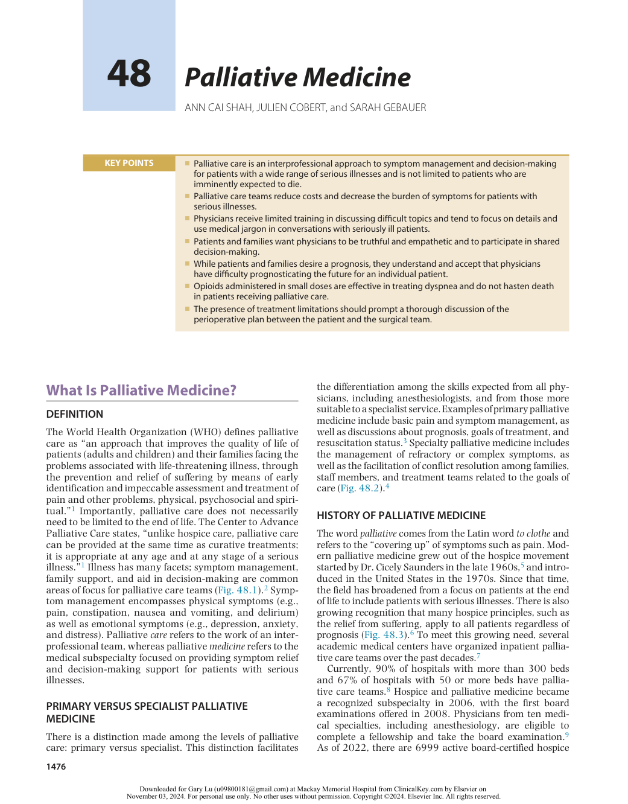

:::

<!-- PDF page 2 -->

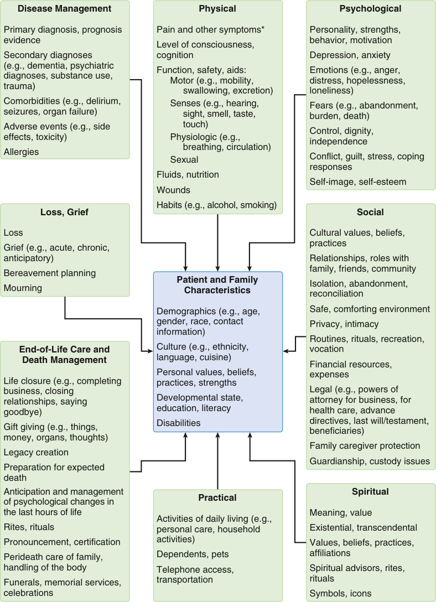

Disease Management Physical Psychological Primary diagnosis, prognosis  Pain and other symptoms* Personality, strengths, evidence behavior, motivation Level of consciousness, Secondary diagnoses cognition Depression, anxiety (e.g., dementia, psychiatric Function, safety, aids: Emotions (e.g., anger, diagnoses, substance use, Motor (e.g., mobility,  distress, hopelessness, trauma) swallowing, excretion) loneliness) Comorbidities (e.g., delirium,  Senses (e.g., hearing,  Fears (e.g., abandonment, seizures, organ failure) sight, smell, taste,  burden, death) Adverse events (e.g., side  touch) Control, dignity, effects, toxicity) Physiologic (e.g., independence breathing, circulation) Allergies Sexual Conflict, guilt, stress, coping responses Fluids, nutrition Self-image, self-esteem Wounds Habits (e.g., alcohol, smoking) Loss, Grief Social Loss Cultural values, beliefs, practices Grief (e.g., acute, chronic, anticipatory) Relationships, roles with family, friends, community Bereavement planning Patient and Family  Isolation, abandonment, Mourning Characteristics reconciliation Demographics (e.g., age,  Safe, comforting environment gender, race, contact  Privacy, intimacy information) Routines, rituals, recreation, End-of-Life Care and Culture (e.g., ethnicity,  vocation Death Management language, cuisine) Financial resources, Personal values, beliefs,  expenses Life closure (e.g., completing  practices, strengths business, closing  Legal (e.g., powers of relationships, saying  Developmental state,  attorney for business, for goodbye) education, literacy health care, advance Disabilities directives, last will/testament, Gift giving (e.g., things, beneficiaries) money, organs, thoughts) Family caregiver protection Legacy creation Guardianship, custody issues Preparation for expected death Anticipation and management  Spiritual Practical of psychological changes in the last hours of life Meaning, value Activities of daily living (e.g., Rites, rituals personal care, household  Existential, transcendental Pronouncement, certification activities) Values, beliefs, practices, Perideath care of family,  Dependents, pets affiliations handling of the body Telephone access,  Spiritual advisors, rites, Funerals, memorial services,  transportation rituals celebrations Symbols, icons 

**Fig. 48.1 Aspects of illness.** *Other common symptoms include, but are not limited to: (1) cardiorespiratory: breathlessness, cough, edema, hiccups, apnea, agonal breathing patterns; (2) gastrointestinal: nausea, vomiting, constipation, obstipation, bowel obstruction, diarrhea, bloating, dysphagia, dyspepsia; (3) oral conditions: dry mouth, mucositis; (4) skin conditions: dry skin, nodules, pruritus, rashes; (5) general: agitation, anorexia, cachexia, fatigue, weakness, bleeding, drowsiness, effusions (pleural, peritoneal), fever/chills, incontinence, insomnia, lymphedema, myoclonus, odor, sweats, syncope, vertigo. (Modified from Ferris FD, Balfour HM, Bowen K, et al. A model to guide patient and family care: based on nationally accepted principles and norms of practice. _J Pain Symptom Manage._ 2002;24:106–123.)

and palliative medicine physicians in the United States,10 of which 144 are board- certified anesthesiologists.11

### WHY IS PALLIATIVE MEDICINE NEEDED?

The combination of an aging population and medical advancement has contributed to an increase in the number of

patients with chronic illnesses. In the United States, Medicare expenditures currently exceed $689 billion, with between 13% and 25% of Medicare expenses going to patients near the end of life.12 Many of these patients have multiple comorbidities, repeated or prolonged hospitalizations, or a life expectancy of less than 1 year, which make many of them appropriate for hospice or palliative care services.13

<!-- PDF page 3 -->

### Primary Palliative Care

Basicmanagement of pain and symptoms Basicmanagement of depression and anxiety Basicdiscussions about Prognosis Goals of treatment Suffering Code status

of the concepts of palliative medicine. Anesthesiologists are also uniquely equipped and qualified to assist in the management of patients with refractory symptoms (such as pain, anxiety, dyspnea, and nausea), and they have a unique perspective on the surgical process that can provide insight to palliative medicine and surgery teams.18–20 As more patients and families interact with palliative care teams, anesthesiologists should be able to discuss related concerns and to develop an anesthetic plan that includes palliative concepts, including goals of care discussions and symptom management. Additionally, many pain and critical care anesthesiologists develop specific expertise through their frequent management of seriously ill patients. The adoption of more longitudinal perioperative roles for the anesthesiologist (e.g. the perioperative surgical home21 ) also necessitates more responsibility in guiding discussions in frail, chronically ill, and possibly dying patients in surgical contexts, directly placing palliative care concepts and principles in the anesthesiologist’s scope of practice.20

### GLOBAL PALLIATIVE CARE

**Specialty Palliative Care** Management of refractory pain or other symptoms Management of more complex depression, anxiety, grief, and existential distress Assistance with conflict resolution regarding goals or methods of treatment Within families Between staff and families Among treatment teams Assistance in addressing cases of near futility

**Fig. 48.2 Representative skill sets for primary and specialty palliative care.** (Modified from Quill TE, Abernethy AP. Generalist plus specialist palliative care – creating a more sustainable model. _N Engl J Med_ . 2013;368:1173–1175.)

Patients with serious illnesses have a significant symptom burden, most often involving pain, dyspnea, anxiety, and depression, and their family members report similar concerns.14 Pain control during a life- limiting illness is often a major concern for patients and their families, and unfortunately, several surveys have found that they are often dissatisfied with the quality of pain control.14,15 Patients and families also describe poor communication with health professionals, particularly in the setting of conversations regarding prognosis.16 Palliative care, with its emphasis on symptom management and goal setting, attempts to address these concerns.

### WHY IS PALLIATIVE MEDICINE IMPORTANT TO ANESTHESIOLOGISTS?

As patients who are older and more seriously ill undergo surgery,17 anesthesiologists should develop an understanding

Approximately one-half of the countries in the world have at least one hospice or palliative care service, although most exist in larger and more developed countries. Methods and locations of palliative care delivery are widely variable throughout the world, depending on the country’s infrastructure. The variation in availability is vast, from 1 physician for every 1000 inhabitants in the tiny country of Niue near New Zealand to 1 per 8.5 million inhabitants in China and 1 per 90 million in Pakistan.22 The access to appropriate medications is often restricted and variable as well. An estimated 80% of people with pain worldwide are unable to access opioids, due to concerns about addiction or restrictive national opioid policies.23 The WHO has implemented a “Public Health Strategy for Palliative Care” that incorporates aspects of policy, drug availability, and education to customize and integrate palliative care throughout the globe.24

### PALLIATIVE CARE TEAM

Guidelines suggest that professionals with skills to meet the patient’s and family’s physical, psychological, social, and spiritual needs participate in the creation of a specialized care plan. Ideally, teams are interprofessional and include a nurse, physician, social worker, and chaplain, as well as other professionals, depending on the need.25 Many professional disciplines have developed specialized certification or training in palliative care (Box 48.1).

## Where Is Palliative Care Delivered?

Since 2000, palliative medicine has experienced explosive growth, with the percentage of US hospitals with 50 or more beds with palliative care programs increasing from 25% to 85% in 2022. In the United States, palliative care is often delivered by a consult service in hospitals or in an inpatient unit.6 Approximately two-thirds of US hospitals and 85% of middle- to- large hospitals have palliative teams,

<!-- PDF page 4 -->

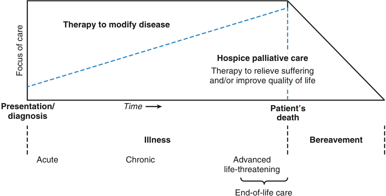

Therapy to modify disease Hospice palliative care Therapy to relieve suffering and/or improve quality of life Presentation/ Time Patient’s diagnosis death Illness Bereavement Acute Chronic Advanced life-threatening End-of-life care Focus of care 

**Fig. 48.3 Schematic illustration depicting the role of hospice care and palliative care during illness and bereavement.** (From Ferris FD, Balfour HM, Bowen K, et al. A model to guide patient and family care: based on nationally accepted principles and norms of practice. _J Pain Symptom Manage._ 2002;24:106–123.)

but again, access varies, depending on the geography and type of hospital.26 The south- central states and rural areas have the least access to palliative care, while urban areas and the northeast has the best access to palliative care. All hospitals in Delaware, New Hampshire, Rhode Island, and Vermont report palliative care programs, as do all but one hospital in four other states. Community home- based palliative care and palliative care clinics are increasingly available, but still not widely available for the vast majority of patients.27

### INPATIENT PALLIATIVE CARE TEAMS

### Outcomes With Palliative Care Teams

Inpatient palliative care teams reduce hospital costs and resource utilization. Palliative care decreases cost of care by $3237 per patient, and by $4251 for cancer patients.28 A study of Medicaid beneficiaries showed hospital costs decreased by an average of $6900 during an admission once palliative care teams became involved with reduced intensive care unit (ICU) length of stay24 and fewer ICU deaths.29 A cohort study of over 41,000 inpatients who received an inpatient palliative care consultation for goals of care showed significantly reduced future acute care costs, health care utilization, and 30- day readmissions when compared with a propensity- matched cohort that did not receive a palliative care consultation.30 Studies examining inpatients with advanced cancer have demonstrated greater cost savings when a palliative care consultation is requested earlier in the hospital stay,31 and in patients with more comorbidities.31 Earlier palliative care consultations also help to facilitate building consensus around goals of care and use of invasive means to support life.32 Inpatient palliative care teams improve patientcentered outcomes including quality of life,33 patient and caregiver satisfaction,33 and, to a variable degree, symptoms.34,35 Importantly, palliative care consultation does not increase in- hospital mortality,36,37 and even has been shown to lead to fewer days in the hospital and fewer inpatient deaths.38 This fact may be important for families and

patients who incorrectly view palliative care as hastening death.

### When to Consult Palliative Care Teams

Basic palliative care knowledge and skills are necessary for all clinicians; however, certain situations call for the expertise of a palliative care specialist. A variety of indicators have been developed to help physicians decide when a specialty palliative care assessment should be performed. Patients’ palliative care needs should be assessed first by the treating physician, then a consultation with a palliative medicine specialist should follow when warranted. The presence of a potentially life- limiting (e.g., multiorgan failure, major trauma, sepsis) or life- threatening condition (e.g., metastatic cancer, cirrhosis, chronic renal failure) serves as the foundation for specialty palliative care involvement.39 The palliative care candidate should also fit at least one additional criterion, such as frequent hospital admissions for the same condition, functional decline, or an ICU stay of 7 days or longer. More specific consultation criteria should consider the local hospital system, resources, and patient population. Each hospital should develop a procedure for identifying patients who would benefit from palliative care consultation,39 which often includes assistance with symptoms that are difficult to control, complex decision- making, and provider or family support.

### Palliative Care in the Surgical Intensive Care Unit

The three main models of palliative care integration in the ICU are the consultative model, the integrative model, or a hybrid model.40 In the consultative model, a specialist palliative care team makes recommendations to the primary physician regarding the care of the patient. In the integrative model, the surgeon or intensivist identifies and addresses issues related to palliative care without specialist input. Hybrid models that combine the two approaches above also exist. In one single-center study, an alternative hybrid model incorporating a palliative care provider directly into the ICU rounding team showed increased specialty palliative care utilization and decreased diagnostic

<!-- PDF page 5 -->

### Box 48.1 Members and Roles in a Palliative Care Team

|Physician|Diagnoses, treats, and manages a wide variety of medical issues for patients Provides expert symptom management and consultation Provides expert skills and consultation in communication with patients who are seriously ill, their families, and other providers|
|---|---|
|Nurse|Participates in the diagnosis, treatment, and management of acute and chronic serious illnesses within scope of practice Assesses the patient’s psychosocial and spiritual needs in the setting of a serious illness Participates in symptom management within scope of practice Uses unique skill sets to communicate with the patient, family, health care team, and community|
|Social worker|Addresses the psychosocial needs of patients and their families affected by serious illness Participates in meetings with the medical team, patients, and families Assists in complex discharge needs and communicates with community resources|
|Spiritual advocate|Assists patients and families in identifying and addressing spiritual distress related to serious illness|
||Provides or facilitates appropriate spiritual or religious rituals Provides liaison services to community spiritual resources|
|Additional|Anesthesia pain physicians|
|professionals| Pharmacists|
| who provide|Rehabilitation therapists|
|expertise to the palliative care team|Psychiatrists|

Note: Roles and competencies may vary by region and training. Data from the following resources:

National Association of Social Workers. The certified hospice and palliative social worker. https://www.socialworkers.org/Careers/ Credentials- Certifications/Apply- for- NASW- Social- Work- Credentials/ Certified- Hospice- and- Palliative- Social- Worker.

Hospice and Palliative Nurses Association.http://www.hpna.org/ DisplayPage.aspx?Title=Position https://advancingexpertcare.org/ certification.

Board of chaplaincy certification. Palliative care specialty certification competencies. https://bcci.professionalchaplains.org/content. asp?admin=Y&pl=45&sl=42&contentid=49.

Center to Advance Palliative Care. http://www.capc.org.

resource allocation.41 The most effective model is not clear at this point and is often determined by hospital resources and culture.

Many quality improvement efforts have been proposed to improve palliative care integration into ICUs.42 One such effort involved screening of critically ill patients followed by direct communication between palliative care providers and intensivists for patients meeting prespecified criteria. This led to increased palliative care consultations in

the medical intensive care unit (MICU) by 113% and in the surgical intensive care unit (SICU) by 51% over a 1- year timeframe.43 Implementation of palliative care tools and interventions in the ICU including ICU diaries,44 ICU communication facilitators,45 multicomponent nurse- led family support interventions,46 web- based decision aids focused on prognostication,47 and structured palliative care- led family meetings48 all showed mixed results. These studies have demonstrated the complexities associated with addressing both the cognitive and communication elements of patient and surrogate decision- making in the ICU, lack of clarity regarding the best outcomes to measure, and challenges in modes and methods of palliative care delivery. Ongoing ICU palliative care trials seek to address these challenges.49–53

Increasing attention is being focused on providing palliative care to appropriate patients in the SICU.32 Differences between surgical and medical ICU patients, structures, and providers may dictate the utility, implementation success, and outcomes of the above palliative care interventions in surgical ICUs. These include limited resident, surgeon, and anesthesiologist training in palliative care services and interventions,54,55 cultural differences across different ICUs,56 open models of the ICU, differing perceptions about prognosis communication of surgeons,57 and the rescue and covenantal mentalities of perioperative providers toward patients.58–60 These barriers have been welldescribed40 and can result in frequent conflict with ICU physicians and nurses with respect to postoperative goals of care.61 Similar to surgeons, in the preoperative assessment, anesthesiologists also tend to emphasize technical aspects of anesthesia without discussing postoperative quality of life, longer- term risks, or patient goals and preferences.62 Knowledge gaps in palliative care in surgical patients include: defining outcomes that patients value, measures to evaluate high- quality palliative care in surgery, aligning surgical treatments with patient- oriented outcomes, preoperative advance care planning, decision- making after postoperative complications or critical illness, integrating palliative care principles into routine surgical practice, developing scalable models of primary palliative care delivery for surgical patients, and identifying who would benefit from specialty palliative care.63

### Trigger Criteria in the Surgical Intensive Care Unit

Surgical patients who die in the ICU often follow one of two courses. The first often occurs in trauma patients or other more acutely ill surgical patients with a rapidly declining course, while the second is characterized by a prolonged hospital stay with multiple transitions between acute care and ICU settings and intervening periods of prognostic uncertainty.40 One study of patients in a trauma ICU showed that early assessment of patient and family preferences and early interdisciplinary meetings led to unchanged mortality, do not resuscitate (DNR) orders, and withdrawal of life support; however, the DNR and withdrawal orders were completed earlier in the hospital stay, and the ICU length of stay decreased in patients who ultimately died.32 Focus on identification of appropriate palliative care consultations early in the hospital course is increasingly important, particularly in the former group.

Use of trigger criteria, in which the presence of one or more predefined patient risk factors results in automatic

::: details 原始表格與符號（PDF 第 5 頁）

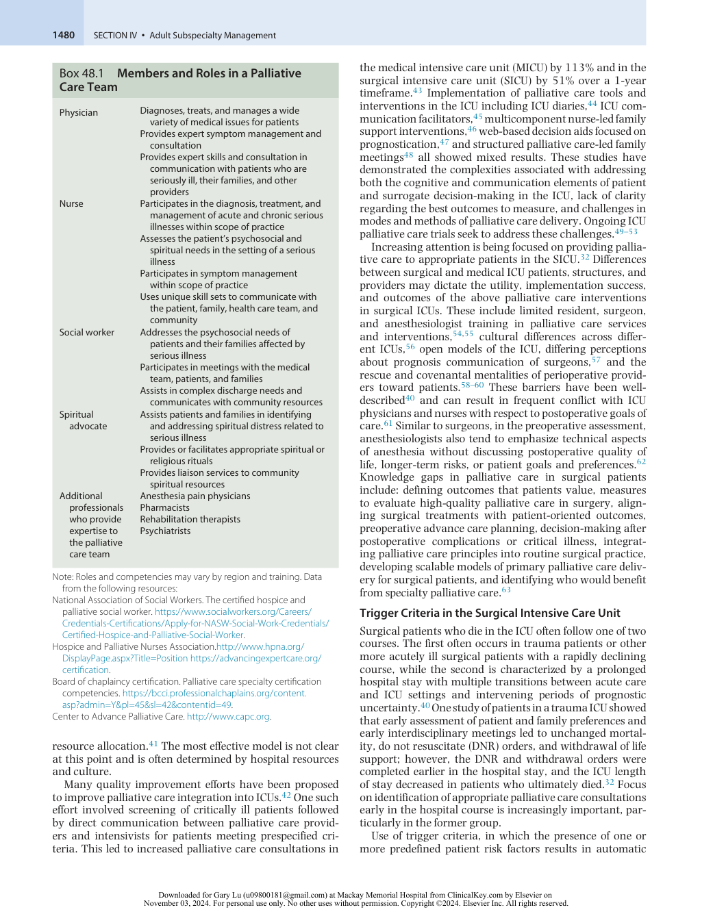

:::

<!-- PDF page 6 -->

palliative care consultations, has shown encouraging results.36 In a broad population of critically ill patients, the use of specific screening criteria to proactively initiate a palliative care referral decreases ICU resources utilization without affecting mortality.64 Employment of these screening or trigger criteria encourages proactive and systematic patient screening, thereby eliminating the biases of individual providers in identifying patients that would benefit from palliative care team involvement.40 For example, one study examined the effect of implementing a structured palliative care intervention followed by an interdisciplinary family meeting within 72 hours of admission for all liver transplant service patients admitted to the SICU.65 After the intervention, increases were seen in goals of care discussions on rounds, documented patient code status, and withdrawal of life support, whereas decreases were seen in time to placing a DNR order and ICU length of stay. There was no difference in mortality, and family members indicated that they had more time with their loved one.65 The most effective trigger criteria for palliative care consultations in SICUs have not been defined.40 Creation of universal criteria is complicated by variation among surgical patient populations, along with many other factors. Many proposals include some combination of these considerations: lengths of stay in the ICU, the lack of improvement during the ICU stay, the patient’s age, and the patient’s illness.40 One study performed in the SICU used ten triggers based on expert opinion. These triggers included multiorgan system failure, SICU stay longer than 1 month, more than three SICU admissions during one hospitalization, and death expected during a current SICU admission.66 This study showed no increase in palliative care consultation, but only 6% of the patients in this study met the trigger criteria, and although the attending physician was notified when a patient met the criteria, palliative care consultation was still left to the judgment of the attending physician.66 A more inclusive screening process or a mandated palliative care referral, as observed in some of the successful medical ICU studies,36 may have altered these results. Current recommendations suggest that referral criteria should be informed by available data but individualized for each hospital, or even each ICU, using input from stakeholders including palliative care providers, intensivists, hospital leadership, and nonphysician ICU care providers.64 The poor sensitivity of existing screening criteria67 suggest that individualized data- driven approaches may be necessary when attempting to define who might best benefit from specialty palliative care. Alternative criteria, like frailty, may also serve as a unique and promising screening criterion.68

Lastly, while automated screening and trigger criteria have been shown to increase specialty palliative care utilization, multiple questions regarding utility and feasibility remain unaddressed. Depending on the trigger criteria used, nearly 14%–20% of ICU patients fulfill criteria.69 While this demonstrates an enormous possible need for palliative care, there are clear concerns regarding the ability for existing specialty palliative care services to keep up with these possible demands. Despite the growth of specialty palliative care, resources, teams, and team makeup are variable across hospitals nationally.70,71 This may further support the need for alternative palliative care delivery models (e.g. primary palliative care) to keep up with these demands.72 Additionally,

qualitative studies demonstrate that concerns remain related to trigger implementation and feasibility.73,74 One study identified multiple themes needing further consideration when utilizing trigger- based approaches which may be particularly relevant to surgical and open ICUs including: (1) appropriateness of triggers, (2) clinician ambivalence for triggers, (3) buy- in of stakeholders, (4) workflow considerations, and (5) the role of ICU clinicians in approving specialist palliative care consults.73 Hence, in addition to individualized and data- driven approaches for screening who might benefit from specialty palliative care, hospitals and ICUs should weigh local practice patterns, cultures, and capabilities.

### Post–Intensive Care Syndrome (PICS)

Several landmark studies have demonstrated increased incidence of cognitive, psychiatric, and physical dysfunction following critical illness.75–79 The development of new or worsening function in any of these domains is defined as PICS and has also included acute and chronic psychological morbidity in patients’ family members (defined as PICS- F).80 Among survivors of critical illness, cognitive impairment occurs in 25%–78%81,82 , depression in 36%– 40%83 , anxiety in 39%, posttraumatic stress disorder in 10%–62%,76,84 and new disability in approximately onethird.85 Physical impairments even without disability are common79,86 and ICU- acquired weakness can persist long term. PICS prevention and treatment are active areas of research and the development of post- ICU recovery clinics have grown, particularly with increased rates of patients receiving mechanical ventilation from COVID- 19.87,88 The growing emphasis on function, recovery, survivorship, and meaningful outcomes following hospitalization89 and critical illness mirrors many elements of palliative care and are intimately related.

### OUTPATIENT PALLIATIVE CARE

Outpatient palliative care clinics exist to follow patients after discharge or to provide outpatient symptom management and psychosocial support.90 The providers, availability, and focus vary widely.90 A landmark study by Temel in 2010 randomized 151 patients with metastatic nonsmall- cell lung cancer to early outpatient palliative care plus the standard oncologic care or standard oncologic care alone. Patients in the palliative care group had higher quality of life scores, as well as fewer symptoms of depression.91 Perhaps most surprisingly to some, the patients in the palliative care group lived a median of 2.7 months longer than those in the standard care group, despite receiving less aggressive care.91 These results and others have led to a recommendation by the American Society of Clinical Oncology that any patient with advanced cancer should receive palliative care alongside usual oncology care. Much of this care is provided in a clinic setting, whether an independent palliative care clinic or an embedded palliative care team within an oncology clinic. A systematic review of patients with a variety of terminal illnesses showed that outpatient palliative care improved depression and quality of life, reduced aggressive care at the end of life, increased advanced directives, reduced hospital length of stay and hospitalizations, and improved

<!-- PDF page 7 -->

family and caregiver satisfaction.92 A Cochrane review found that while the effect sizes were small, early palliative care interventions may improve quality of life and symptom intensity in patients with advanced cancer.93

## Differences Between Hospice Care and Palliative Care

In contrast to palliative care, the definition of hospice care as it applies to the type of patient, the involvement of the medical team, and the setting, varies between countries.94 In some countries, the terms hospice care and palliative care are interchangeably used, but in the United States, hospice care refers to a benefit provided by the governmental health care system. Patients are eligible to enroll in hospice care when their life expectancy is less than 6 months, and typically after life- prolonging treatments, such as chemotherapy, are stopped. Despite the logistic differences, the philosophy of hospice care generally focuses on reducing suffering, enhancing the quality of life, and supporting the patient and family (Fig. 48.4).

### HOSPICE CARE IN THE UNITED STATES

In the United States, hospice is a _per diem_ capitated payment system for a defined set of services for patients with a life expectancy of 6 months or less, as agreed on by two physicians.95 Medicare pays for approximately 80% of hospice care in the United States, and many private insurers have established similar guidelines. These services include visits to a patient’s residence by a nurse (the main provider of clinical care96 ), aide, social worker, and chaplain.95 Family members are also eligible to receive a year of bereavement counseling.95 Continuous care and short- term hospital admission are available for patients with uncontrolled symptoms. A core set of requirements for the hospice benefit exists (Fig. 48.5). However, beyond these requirements, each hospice unit can decide which treatments to cover, and this coverage can vary widely. For example, some hospice organizations may cover palliative radiation treatments, whereas others may not. Patients who outlive their 6- month prognoses may have their benefits extended in 60- day increments after a face- to- face visit with a physician, recertifying that the patient continues to meet hospice criteria.

### Who Is Eligible for Hospice Care?

To qualify for hospice, an attending physician and a hospice medical director must certify that the patient’s prognosis is less than 6 months if the disease runs its normal course.97 Medicare has created guidelines that describe eligibility criteria for hospice services, although the opportunity for interpretation does exist. For example, the criteria for a patient with chronic lung disease include disabling dyspnea at rest, poor response to bronchodilators, hypoxemia at rest, and repeated hospitalizations for emergency department (ED) visits.96 As a result of the subjectivity of some of the guidelines, some hospices may accept patients that other hospices deem ineligible. Patients are not required to have a DNR order to be enrolled in hospice.

- **Continuous Features**

- • Multidisciplinary team • Focus on quality-oriented care • Symptom management: • Family support pain, dyspnea, psychosocial • Attempts to minimize suffering **Early Palliative Care Hospice Care**

- • Appropriate at any stage of • Prognosis &lt;6 months (can be serious illness renewed every 60 days)

- • Often provided in hospitals or • Focus on home-based care outpatient clinics • Patient usually agrees to

- • Can be used in conjunction focus on comfort rather than with “aggressive” care life-prolonging treatments

- • Free-for-service model • Through Medicare, billed on a _per diem_ rate

- **Fig. 48.4 Features of palliative care and hospice care in the United States.**

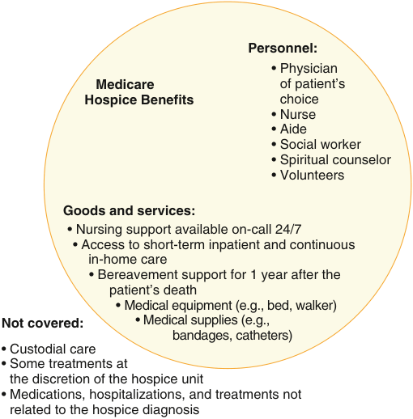

Personnel: • Physician    Medicare of patient’s Hospice Benefits choice • Nurse • Aide • Social worker • Spiritual counselor • Volunteers Goods and services: • Nursing support available on-call 24/7 • Access to short-term inpatient and continuous in-home care • Bereavement support for 1 year after the patient’s death • Medical equipment (e.g., bed, walker) Not covered: • Medical supplies (e.g., bandages, catheters) • Custodial care • Some treatments at the discretion of the hospice unit • Medications, hospitalizations, and treatments not related to the hospice diagnosis 

**<mark>Fig. 48.5 Aspects of the Medicare hospice benefits.</mark>**

### Recipients of Hospice Care

Over half of Medicare decedents received hospice care, though the median length of stay was only 18 days.98 The most common diagnosis continues to be cancer, with approximately 30% of hospice patients, followed by heart disease at 18%, dementia at 15%, and respiratory diseases like chronic obstructive pulmonary disease (COPD) at 11%.98 The lack of good prognostic criteria for a 6- month life expectancy in non- cancer disorders can complicate hospice referral timing.99 The median length of stay on hospice for patients with neurologic disorders is significantly longer at 105 days vs. 18 days for cancer patients. Based on utilization review, 14.3% of Medicare patients with cancer did not enroll until the last 3 days of life.100 This trend toward late admission suggests that many patients are referred to hospice well after they are eligible.

### Outcomes of Hospice Care

Hospice care decreases patient symptom burden101 and increases caregiver satisfaction, with 98% of family

<!-- PDF page 8 -->

members recommending hospice care to others.96 A survey of over 1500 bereaved family members showed that 70% of respondents whose family member received hospice services considered the care “excellent” with less than 50% of those with decedents receiving home health services considering the care “excellent.”102 Studies related to cost-effectiveness vary in their conclusions. Yet, a few studies suggest that the length of hospice use is correlated with cost savings.101,103 A 2007 study by Taylor suggested cost savings with a hospice stay of 53 to 107 days,103 whereas a 2013 study by Kelley showed cost savings with shorter hospice stays as well.101 In a study looking at projected savings for beneficiaries with poor- prognosis cancers, increasing hospice utilization from 60% to 80% and increasing duration from 2 to 6 weeks could save $1.79 billion annually.104

### PALLIATIVE CARE AND ANESTHESIOLOGISTS

Anesthesiologists, as well as subspecialists in pain management and critical care medicine, are likely to interact with patients who are receiving palliative care services. Awareness of the goals of care in the palliative and hospice setting and what services are provided will help the anesthesiologist develop an appropriate plan based on the individual patient’s goals. Critical care anesthesiologists are often called upon to aid in the determination of hospice eligibility and to help families discuss care plans. Pain medicine physicians may provide medication management and interventional procedures alongside palliative care physicians or as part of hospice benefit.

### Surgery in Seriously Ill Patients

Palliative surgery has been defined as “the deliberate use of a procedure in a patient with an incurable disease with the intention of relieving symptoms, minimizing patient distress, and improving the quality of life.”105 A 2004 study of over 1000 patients with advanced cancer undergoing palliative surgery showed a 30- day morbidity of 29% and mortality of 11%, with 80% of patients experiencing improved symptoms at 30 days. A similar study by the same author in 2011 showed a significant improvement from their earlier study. Of 227 patients, there was a morbidity of 20% and mortality of 4%, with 90% experiencing symptom resolution.105,106 The study authors attribute some of this change to better patient selection through shared decision- making with patients and families.105 One national retrospective study demonstrated that perioperative specialty palliative care in older adult Veterans undergoing high- risk surgical operations improves end- of- life communication and family support in patients who died following surgery. However, few patients who died were exposed to specialty palliative care.107 Whether primary or specialty palliative care is pursued, defining appropriate outcomes, goals, and motivations remain important at an individual patient and family level. However, tradeoffs between risks and benefits in palliative surgery or seriously ill patients undergoing high- risk surgery remain poorly studied in outcomes research.63

### Communicating Surgery Risk in Seriously Ill Patients

Decision- making concerning surgery near the end of life is complex; while some surgeries may increase quality of life or allow a patient to achieve a specific goal, others

may result in excessive pain, functional decline, prolonged ICU or hospital stay, or increased use of resources without a clear benefit. A need exists to improve the quality of preoperative communication, to support decision- making by surgeons and patients, and to prioritize advance care planning for patients undergoing high- risk surgery. Despite the recognized risk of performing surgery in high- risk patient populations, many patients do not have a complete understanding of the wide range of possible outcomes associated with surgery.108,109

The mental frameworks often employed by surgeons and their patients can contribute to both a lack of understanding of possible outcomes and the formation of a contractual obligation to engage in maximal life- sustaining measures after surgery.58,110,111 Both of these issues may result in provision of care that is not well- aligned with patient goals and preferences.

Communication frameworks exist that can assist in conducting preoperative conversations with patients considering high- risk surgery.112,113 The “Best Case/Worst Case” tool uses a shared decision- making model with a visual aid to explain the best case scenario, the worst case scenario, and the most likely outcomes related to both surgery and conservative management (Fig. 48.6).113 This tool allows the surgeon to elicit treatment preferences that are informed by realistic outcomes. Optimal use of the Best Case/Worst Case tool takes patient- specific comorbidities and risk factors combined with surgery- specific risk into account when explaining possible outcomes to patients considering highrisk surgery. A qualitative analysis of the Best Case/Worst Case tool using focus groups of both surgeons and older patients who had been involved in making a medical decision for themselves or their family members within the last year was conducted.113 From a patient perspective, the tool was seen as favorable overall in that it establishes a choice, allows visualization of distinct paths to help in decisionmaking, and encourages deliberation based on a variety of treatment preferences. Surgeons pointed out that use of this tool provides a useful structure to guide the conversation, allows discussion of patient preferences, and may legitimize non- operative treatment options as still providing care rather than doing nothing. Use of tools such as this one may improve a patient’s understanding of potential complications and consequences of choosing a specific therapy, which allows them to elect the treatment option that is best aligned with his or her goals near the end of life.

## Anesthetic Concerns in the Patient Receiving Palliative Care

### PREOPERATIVE CONSIDERATIONS

A patient’s decision- making capacity may change during a hospitalization or over time and should be assessed before seeking consent from the patient for anesthesia. As noted in Chapter 7, when a standing DNR order exists in a patient awaiting surgery, a discussion of the patient’s goals and the creation of a plan for intraoperative and postoperative management that meets the patient’s goals should occur prior to surgery. In the case of the perioperative reversal of a DNR order, an explicit plan for when to reinstitute that

<!-- PDF page 9 -->

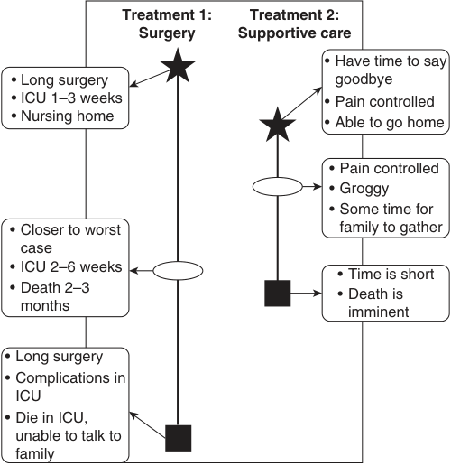

Treatment 1: Treatment 2: Surgery Supportive care • Have time to say • Long surgery goodbye • ICU 1–3 weeks • Pain controlled • Nursing home • Able to go home • Pain controlled • Groggy • Some time for • Closer to worst family to gather case • ICU 2–6 weeks • Time is short • Death 2–3 • Death is months imminent • Long surgery • Complications in ICU • Die in ICU, unable to talk to family 

**Fig. 48.6 The Best Case/Worst Case tool involves the drawing of a penand-paper diagram by the physician.** A _vertical bar_ depicts each treatment option, and the _length of the bar_ represents the range of possible outcomes. _A star_ represents the best case, _a box_ the worst case, and _an oval_ the most likely outcome. The physician describes each “case” using narrative derived from clinical experience and relevant evidence and writes key points on the diagram. _ICU_ , intensive care unit. (Redrawn from Kruser J, Nabozny MJ, Steffens NM, et al. “Best case/worst case”: Qualitative evaluation of a novel communication tool for difficult in‐the‐ moment surgical decisions. _J Am Geriatr Soc_ . 2015;63[9]:1805–1811.)

order should be developed114,115 and discussed with the surgeon and nurse as appropriate. Ensuring an appropriate surrogate decision- maker has been defined prior to surgery is important if a perioperative complication occurs (e.g., cardiac arrest or a prolonged extubation) to allow for effective communication about updates, goals of care, prognosis, or should further decision- making and consents need to be pursued.

A thorough preoperative evaluation of the patient’s disease should also take place with attention to the patient’s cognitive status, recent medications (including chemotherapy), presence of metastases, and wounds. Knowledge of the patient’s preoperative functional and cognitive status and prognosis may impact the anesthetic plan and may inform an accurate assessment of risks and benefits. Details on special considerations in specific disease states such as cancer, COPD, and others are included in Chapter 29. Considering the number of patients receiving palliative care who may be on large doses of opioids and mixed opioid agonists/antagonists perioperatively, anesthesiologists are advised to follow the guidelines in Chapter 47 regarding perioperative pain management.

### INTRAOPERATIVE CONCERNS

Resuscitation status should be communicated to any perioperative providers caring for the patient. Consideration should be given to preoperative frailty and geriatric conditions, postoperative nausea and vomiting prophylaxis, and

the care of fragile skin, muscle, and bone in this population. Patients may have coagulopathies, thrombocytopenias, or neutropenias that may preclude them from receiving regional or neuraxial anesthesia, thereby impacting their intraoperative pain management.

### ANESTHETIC CHOICE AND CANCER

Recent studies have attempted to clarify the role of anesthesia in cancer progression and recurrence. Studies of the effect of regional anesthesia on those with cancer are mixed but suggest a possible mortality benefit,116 although meta- analyses have found neither a beneficial nor detrimental effect of regional versus general anesthesia regarding cancer recurrence.117 Despite these, recent randomized controlled trials comparing anesthetic approaches and their effects on cancer progression and recurrence have largely been negative. In one large study in breast cancer, there was no difference in breast cancer recurrence (or other outcomes measuring analgesia) in patients treated with regional anesthesia–analgesia compared with volatile anesthesia and opioids.118 Similarly, epidural anesthesia– analgesia for major lung cancer surgery did not improve cancer outcomes compared to general anesthesia119 nor did combined epidural–general anesthesia improve cancerspecific mortality in patients undergoing abdominal or thoracic surgery.120 Additional discussion is available in Chapter 41. Studies that examine the choice of specific systemic anesthetics on cancer are mostly _in vivo_ or _in vitro_ , but available data also suggest differences in responses to tumor cells among the different drugs (Table 48.1).121

### POSTOPERATIVE COURSE

Standard postoperative care is adequate for most patients in palliative care. Risks for postoperative pain, delirium, and nausea, and vomiting may be increased, depending on the individual patient. Providers should communicate any limitations in care and when limitations revert to their preoperative status.

## Communication

Communication about goals of care and treatment preferences influence many outcomes in patients with serious illness. Better communication has been associated with improvement in quality of life, decreased use of lifeprolonging therapies near the end of life, provision of care that is more consistent with patient preferences, and earlier hospice referrals.122,123 The American College of Physicians describes communication with seriously ill patients as a “low- cost, high- value intervention.”122 The American College of Physicians recommends that communication be initiated early in the course of life- threatening illness, and ideally by a physician with an established relationship with the patient.122

### ADVANCE CARE PLANNING

The Patient Self- Determination Act, which took effect in the United States in 1991, requires health care providers and

<!-- PDF page 10 -->

**Table 48.1** Anesthetic Drugs and Host Defenses

|**Drug**|**Potential Effect on Antitumor Host** **Defenses**|
|---|---|
|Ketamine|Reduces natural killer (NK)- cell activity and the number in animal models|
|Thiopental|Reduces NK- cell activity and the number in animal models|
|Propofol|Reduces NK- cell number in animal models|
|Volatile agents|Inhibits interferon stimulation of NK- cell cytotoxicity in animal models|
||Reduces NK- cell number in humans; is associated with worse outcomes when compared with local anesthesia for melanoma excision|
|Nitrous oxide|Associated with acceleration in the development of lung and liver metastases in animal models No effect on cancer outcomes after surgery for colorectal carcinoma in humans Inhibits the formation of hematopoietic cells that may be important for tumor cells|
|Local anesthetic drugs|Lidocaine inhibits epidermal growth factor (EGF) receptor and tumor cell proliferation _in vitro_; ropivacaine inhibits growth of cancer cells|
|Morphine|Inhibits cellular immunity including NK- cell activity in animal models Inhibits NK- cell activity in humans|
|Fentanyl|Inhibits NK- cell activity in humans|
|Tramadol|Stimulates NK- cell activity in animal models|
||Stimulates NK- cell activity in humans|
|Cyclooxygenase- 2 (COX- 2) inhibitors|Display anti- angiogenesis and antitumor effects in animal models|

From Snyder GL, Greenberg S. Effect of anaesthetic technique and other perioperative factors on cancer recurrence. _Br J Anaesth_ . 2010;105:106–115.

institutions to advise patients of their right to an advance directive and to develop institutional policies and education regarding advance directives.124 However, since the introduction of advance directives, multiple issues have been identified, such as amending preferences as the illness and circumstances change.125–127 Understanding a patient’s goals requires open communication with the patient and physician and sometimes repeated conversations to clarify and update the goals of treatment as the patient’s condition changes. More information on advance directives and decision- making surrogates can be found in Chapter 7.

(CPR) did not have a written DNR order, and that the physicians were often unaware of the patients’ wishes.15 In the intervention, prognostic data were made available to physicians, and a nurse was available to facilitate information sharing, advance care planning, and pain assessment. This intervention did not have any negative impact on physician communication, pain, use of hospital resources, or other measured outcomes.25 Although more advance directives were documented, only 14% of the patients spoke with a physician when completing their advance directive, and only 25% of the physicians were aware of their patients’ advance directives a week after hospital admission.128 Similar studies did not demonstrate that advance directives influenced the types of care or the resources used.129,130 These studies suggest that efforts toward increasing advance directives alone are insufficient to drive any changes in care.

Many barriers exist to advance care planning, including timing, setting, and quality of communication. Even though physicians often perceive successful communication about treatment planning with patients, data suggest that patient perceptions of treatment options and prognosis often vary considerably.131 For example, between 50% and 75% of patients with incurable cancer perceived that chemotherapy, radiation therapy, or surgery could lead to survival.131 It is not clear whether this discordance results from failure in physician communication, inability of the patient to understand and accept the information presented, or a combination of the two. Many professional organizations suggest that end- of- life care planning should begin in the outpatient setting when the patient has approximately 1 year to live.131 However, in reality, these discussions often do not occur until much later in the patient’s course, such as when an invasive intervention such as mechanical ventilation is needed.132

A variety of factors prevent use of advance directives around the time of high- risk surgery,66,133,134 including surgeon perception.111 Over half of the surgeons in a national survey indicated that they would not operate on a patient who expressed a desire to limit life- sustaining interventions postoperatively.133 However, patients who have previously undergone high- risk surgery have indicated retrospectively that a greater preoperative emphasis on three critical points would have been helpful: (1) the need for surgery versus alternative treatment options, (2) expectations for postoperative recovery, and (3) use of perioperative advance directives.108 This study highlights the need for communication with patients and their families around the surgical management and represents an opportunity for anesthesiologists to play a role in facilitating these conversations.

### PHYSICIAN COMMUNICATION SKILLS TRAINING

### OUTCOMES OF ADVANCE CARE PLANNING

The landmark 1995 Study to Understand Prognoses and Preferences for Outcomes and Risks of Treatments (SUPPORT) was a two- year prospective observational study, followed by a two- year randomized trial of 9105 patients in five US teaching hospitals, with the goal of improving endof- life decision- making.15 The study enrolled patients with advanced stages of nine illnesses and a six- month mortality of 45% to 48%. The observation period showed that 49% of patients who did not want cardiopulmonary resuscitation

The physician’s approach to communication about difficult issues can affect how patients and families perceive illness, death, and treatment options. These skills are being taught as part of medical school curriculum with increasing frequency, but retention of skills tends to be low.135 Most physicians are less comfortable discussing code status than they are with other topics, such as consent for procedures.136 Between 40% and 75% of physicians, depending on their level of training, assess their own knowledge of delivering “bad news” as inadequate.137 Despite the fact that the

::: details 原始表格與符號（PDF 第 10 頁）

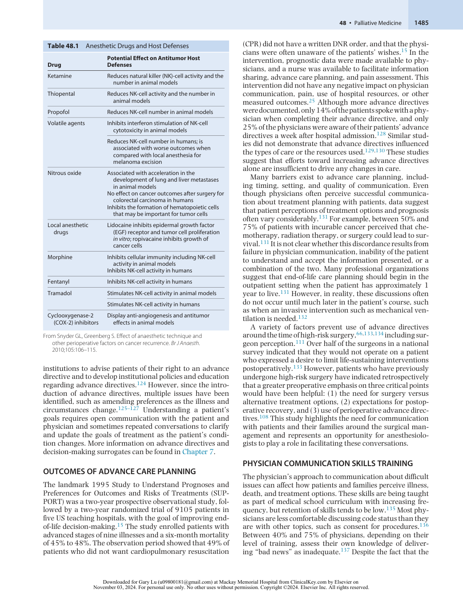

:::

<!-- PDF page 11 -->

American Board of Surgery includes basic knowledge and skills in palliative care as a requirement for board certification in surgery,138 only 9% of surveyed surgical residents believed they “received adequate training in palliation” during residency.54 Similarly, as many as 90% of internal medicine residents expressed a desire for additional training in discussing topics such as DNR orders.139 Despite this lack of training, residents often are the ones to talk about these issues with patients,140 highlighting the importance of education in this area. Ongoing efforts to increase specific empathic communication skills- building in residency can improve essential communication skills in primary palliative care.141–143

### PHYSICIAN COMMUNICATION SKILLS

Physicians often rate their communication skills favorably, but surveys of other practitioners and of patients suggest that physicians may not be able to self- assess accurately. One study in an ICU showed that 90% of surgeons were satisfied with their communication skill concerning prognosis, but only 23% of intensivists and 3% of nurses rated the same skill favorably.57 Similarly, patients’ perceptions of their cancer stage and prognosis were often incorrect in one study, although oncologists thought they were clear in their explanations of the illness.144 Recordings of physician discussions with patients and families show that physicians focus on technical detail, avoid emotional topics, and tend to dominate the conversations, despite increased family satisfaction when the family spoke more and physicians exhibited more supportive behaviors.145 Even when a conversation takes place between a physician and a patient, the physician and patient may not agree on the outcome. One study of patients with metastatic cancer showed that physicians misunderstood their patients’ preferences for CPR 30% of the time.146 Currently, no comparable studies regarding anesthesiologists have been conducted. These findings highlight the importance of assessing a patient’s understanding of their disease process before a procedure is performed or during an ICU stay.

### The Surgical “Contract” and Other Cultural Barriers to Palliative Care Use

When caring for surgical patients, it is important to understand the conceptual frameworks that frequently influence both providers and patients in their approach to care. First, many patients perceive that surgery will “fix” their acute abnormality and restore normalcy to their lives,113 rather than potentially contribute to further functional or cognitive decline. The potential for the latter problems is infrequently discussed preoperatively. In addition, the relationships between surgeons and their patients are unique from other relationships in medicine, because many surgeons perceive an implicit “contractual” agreement to pursue maximal life- sustaining measures after surgery.58,111,147 Surgeons are said to subscribe to a covenantal ethic, meaning that the surgeon takes on individual responsibility for the patient’s life once he or she performs surgery.147 An ethnographic study examining differences in end- of- life management of surgical patients in three ICUs – one unit run by trauma surgeons, one unit co- managed by surgeons and intensivists, and one unit run by intensivists – identified

divergent priorities between surgeons and intensivists. While many intensivists considered use of scarce resources more globally in their decision- making, surgeons tended to focus on the individual patient only and delay withdrawal of life- sustaining treatment even when it was requested by family.147 Surgeons and intensivists often also delivered differing messages regarding treatment and prognosis.147 A study evaluating recorded preoperative conversations conducted by surgeons performing high- risk surgery found that surgeons often described high- risk surgery as “big surgery” and focused on the technical aspects of surgery during their preoperative conversations.110 If they discussed need for life support after surgery, they focused on standard recovery rather than potential longer- term complications (e.g., prolonged mechanical ventilation or dialysis). Furthermore, while many surgeons perceived that a contractual agreement to pursue aggressive postoperative care had been made, only rarely did they make this contract explicit with their patients.110 Other communication breakdowns may occur at the level of the patient (i.e., anxiety, fear, or inability to understand) or the medical system (i.e., time constraints, lack of advance care planning) and also contribute to decisions to proceed with nonbeneficial surgery.112

Other concepts may contribute to aggressive postoperative care including “clinical momentum” or the accrual of multiple interventions,148 the “fix- it” model in which a medical diagnosis represents a deviation from normalcy and must be righted,149 the notion of surgical and ICU “covenantal” care,60,147 and the “rescue” culture in surgery and critical care.60 Structural challenges may also dictate decisions on LSTs, including: ICU bed volumes,150 bed occupancy,151 ICU- to- hospital bed ratios,152 nursing staffing,153 and ICU strain.154 This suggests a possible opportunity for specialized palliative care interventions preoperatively, especially for high- risk surgery, but evidence for this is sparse.155 A number of ongoing trials in high- risk perioperative patients and critically ill patients are seeking to adopt a more proactive structured approach to palliative care utilization, potentially in response to some of these structural and cultural challenges.49,156–159 Having a good understanding of the unique communication challenges in high- risk perioperative patients may help to facilitate communication with patients, families, and the care team.

### WHAT DO FAMILIES CONSIDER IMPORTANT IN END- OF- LIFE COMMUNICATION?

A majority of family members consider trust in the treating physician and truthful communication about the patient’s illness as two of the most important factors in receiving quality end- of- life care.160 Families have greater satisfaction when a higher level of decision- making is shared.161 In family meetings, family satisfaction increases with the number of empathetic statements made by a physician during a meeting.162 A meta- synthesis of 16 qualitative studies examined factors that patients and families describe as important during inpatient end- of- life care.163 Within the theme of effective communication and shared decisionmaking, family members identified honest and clear communication using simple, understandable language, provision of information necessary to help make decisions,

<!-- PDF page 12 -->

and engaging both the patient and family members in care planning as priorities.163

A variety of patient and family preferences influence the quantity of information desired and how to receive it. These preferences may be informed by a combination of personal, cultural, and family characteristics; however, physicians should not assume a preference based on a patient’s race or ethnicity.164 Many practitioners use a question such as, “How much would you like to know?”,165 although no studies of patient perceptions of that approach have been conducted. One study of patients with cancer indicated that some patients’ preferences for involvement in decisionmaking changed over the course of the illness.166 A few studies have noted that caregivers wanted more information than the patients.167 Some patients may indicate that they do not want to know about their condition and name a surrogate decision- maker instead.

### SPIRITUALITY AT THE END OF LIFE

Spirituality refers to the ways in which a person expresses meaning or purpose and affects an individual’s sense of connectedness to the world around them. Religion may be a component of spirituality for some people, but many other aspects of spirituality also exist. Swinton and colleagues conducted a qualitative study where patients, family members, and clinicians involved in the care of 70 patients dying in the ICU underwent semistructured interviews.168 Respondents perceived dying as a spiritual process. They reflected that spirituality comprises an important part of a patient’s narrative before, during, and after death. Serious illness and the prospect of death can bring a number of spiritual issues to the forefront for patients and families, from questioning the meaning of one’s life to a religion’s teaching on specific medical interventions.169 Patients typically want physicians to ask about their spiritual preferences170 and describe their spiritual needs as frequently remaining unmet.171 A simple screening question such as, “Is religion or spirituality important in your life?” has been proposed and may help identify patients in whom a spiritual need exists. While physicians may be concerned they are being intrusive when asking about spirituality, they can open the topic without imposing their own views.172 Asking about religion and spirituality may provide a context for the health care team, since many patients and families make decisions based on these beliefs.173 Physician understanding of the reasoning behind their patients’ decisions is likely to improve end- of- life care.

### COMMUNICATION FRAMEWORKS

The prior studies, which demonstrate frequent misunderstandings and poor communication, emphasize the need for recognizing the importance of effective communication among all participants.174 A number of frameworks have been developed to aid physicians in discussions with patients and families.175–177 No study has compared their relative effectiveness on patient or family outcomes, and very few assessed the effect of a specific communication framework on outcomes.165 Commonalities in the approaches include active listening, validating patient concerns, and assessing understanding. A recommended

comprehensive conversation guide developed by synthesizing data collected in multiple qualitative studies includes the following elements: set up the conversation, assess understanding and preferences, share prognosis, explore key topics (i.e., goals, fears and worries, sources of strength, critical abilities, tradeoffs, and family), close the conversation, document your conversation, and communicate with key clinicians (Fig. 48.7).122

### Family Meetings

Family conferences in the ICU have increasingly been used to facilitate information sharing between families and providers and are recommended by various consensus groups.178–180 In the ICU setting, meetings held within 72 hours of admission have shown decreased lengths of stay without increased mortality.181 A growing body of literature is demonstrating the challenges and nuance of structured communication with patients and families in the ICU. One study evaluated a standardized communication approach of families of patients who were seriously ill and randomized to either a standardized communication template with a bereavement brochure or the standard care.176 The communication intervention structured around the mnemonic of VALUE (value, acknowledge, listen, understand, elicit questions) emphasizes empathy, understanding of the patient as a person, and allowing family members to ask questions.176 Family members in the study arm had decreased symptoms of psychological distress in a survey 3 months later (Box 48.2).176 Other structured prompts like the Choosing Wisely 5 Questions out of Australia (“Do I really need this test or procedure?”; “What are the risks?”; “Are there simpler, safer options?”; “What happens if I don’t do anything?”; “What is the likely outcome?”) demonstrated increased inclusivity by families in ICU decisions.182 Physician- driven, nurse- aided support strategies for dying patients may reduce prolonged grief symptoms in family members.183 Other international studies using leaflets and brochures, education programs, use of a diary, changes in physical environment, open/flexible visiting hours, and support groups have shown variable improvements in outcomes, but more often than not, improve clinician–family interaction, family comprehension of the ongoing critical illness, and satisfaction.184 However, many barriers to family meetings and communication within family meetings have been described, including time constraints, competing clinical responsibilities, the mindset that meetings should occur only when a clinical decision must be made,185 and finally, more recently, physical, psychological, and structural limitations associated with the COVID- 19 pandemic, particularly limited visitation ability by families.186

These studies demonstrate the utility and benefit of family conferences either for newly critically ill patients, imminently dying patients, and chronically critically ill patients and must be weighed against other evidence suggesting possible harm. Some studies have demonstrated increased anxiety, depression, and posttraumatic stress in family members following a family conference.187 These studies suggest that single family meetings focused on prognosis may not be the most appropriate strategy to foster resilience, healthy grief and bereavement strategies, or improved patient– and family–provider interactions.188 Additionally, structured support after an ICU stay, in ICU survivors and/or families

<!-- PDF page 13 -->

### PATIENT-TESTED LANGUAGE

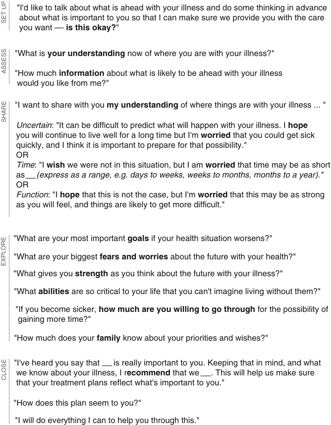

"I'd like to talk about what is ahead with your illness and do some thinking in advance  about what is important to you so that I can make sure we provide you with the care  you want ––  is this okay? " "What is  your understanding  now of where you are with your illness?" "How much  information  about what is likely to be ahead with your illness  would you like from me?" "I want to share with you  my understanding  of where things are with your illness ... " Uncertain : "It can be difficult to predict what will happen with your illness. I  hope you will continue to live well for a long time but I'm  worried  that you could get sick quickly, and I think it is important to prepare for that possibility." OR Time : "I  wish  we were not in this situation, but I am  worried  that time may be as short as      (express as a range, e.g. days to weeks, weeks to months, months to a year)." OR Function : "I  hope  that this is not the case, but I'm  worried  that this may be as strong as you will feel, and things are likely to get more difficult." "What are your most important  goals  if your health situation worsens?" "What are your biggest  fears and worries  about the future with your health?" "What gives you  strength  as you think about the future with your illness?" "What  abilities  are so critical to your life that you can't imagine living without them?" "If you become sicker,  how much are you willing to go through  for the possibility of  gaining more time?" "How much does your  family  know about your priorities and wishes?" "I've heard you say that      is really important to you. Keeping that in mind, and what  we know about your illness, I r ecommend  that we     . This will help us make sure  that your treatment plans reflect what's important to you." "How does this plan seem to you?" "I will do everything I can to help you through this." SET UP ASSESS SHARE EXPLORE CLOSE 

**Fig. 48.7 Serious illness conversation guide.** (2015 to 2017 Ariadne Labs: A Joint Center for Health Systems Innovation [www.ariadnelabs.org] between Brigham and Women’s Hospital and the Harvard T.H. Chan School of Public Health, in collaboration with Dana- Farber Cancer Institute. Licensed under the Creative Commons Attribution- NonCommercial- ShareAlike 4.0 International License, http://creativecommons.org/licenses/by- nc- sa/4.0/.)

of patients who died or face ongoing survivorship challenges, remain poorly studied and likely under- resourced. Importantly, while some studies have shown unintended negative consequences of structured family meetings on the emotional and psychological health of families, they demonstrate more so a need for _longitudinal_ communication with patients and families by primary teams along with continued resource allocation for patients and families after

an ICU stay, fostering resilience building.189 Post–intensive care syndrome clinics and a new focus on ICU survivorship (for patients and families – even families of patients who died in the ICU) are a growing interest, particularly since the start of the COVID- 19 pandemic.

Many physicians struggle with how to begin family meetings. Common approaches include introducing the family and team members, eliciting the level of understanding

<!-- PDF page 14 -->

### Box 48.2 VALUE: Framework for End- of- Life Conferences

- **Value:** Value and appreciate what the family member says: “Thank you for helping me understand how your husband’s condition has changed over the past year.”

- **Acknowledge:** Acknowledge emotions: “This is often a sad time for families.”

- **Listen:** Actively listen. Remember to be silent and to give the family member time to speak.

- **Understand:** Gain an understanding of the patient. Ask who the patient is as a person: “Can you tell me about your father, what kind of person he is and what’s important to him?”

- **Elicit questions:** Ask family members if they have questions: “We have discussed a lot of information. Do you have any questions?”

Data from Lautrette A, Darmon M, Megarbane B, et al. A communication strategy and brochure for relatives of patients dying in the ICU. _N Engl J Med._ 2007;356:469–478.

from family members, and briefly summarizing the purpose of the meeting (for example, “What have you been told about what’s going on with your dad?”). Providers can also access other structured communication tools, frameworks, and resources to help with interprofessional patient and family conversations such as VitalTalk, TeamTalk,190 Best Case/Worst Case,191 and Ask- Tell- Ask.192

### Breaking Bad News

The six- step SPIKES (setting, perception, invitation, knowledge, empathy, sequelae) protocol is a framework for breaking bad news. Several of the elements, such as finding a quiet meeting space, asking what the patient or family understands, and making a plan for the future, apply in many situations (Box 48.3).175 A meta- synthesis of available qualitative data suggested that breaking bad news is a skill that requires the provider to reassess and adapt the conversation based on a number of factors including the provider–patient relationship, responses from the patient and family, the environment, and cultural or social factors.193

### Responding to Emotion

The NURSE (name, understand, respect, support, explore) protocol is a framework for responding to emotion, including anger. Patient and family anger directed toward health care providers is common in the setting of serious illness.194 Crucial concepts in responding to anger include not becoming defensive or personalizing the anger, respectfully listening, and setting appropriate boundaries for safety.194 Although difficult to accomplish in the moment, viewing anger as a coping mechanism in the grieving process is often helpful (Box 48.4).195

### Requests for Nondisclosure

Family members may ask physicians to withhold a diagnosis from the patient. The cultural norms for disclosing a patient’s diagnosis vary widely among cultures and countries. In the United States, the culture of disclosure has rapidly changed, and now most physicians expect to disclose the prognosis to the patient.196 No evidence is available that recommends how to deal with requests for nondisclosure,

### Box 48.3 SPIKES: Framework for Breaking Bad News

**Setting** : Arrange for a quiet, private space large enough for all participants.

- **Perception:** Assess the participants’ understanding: “What have the doctors told you about your wife’s illness?”

- **Invitation** : Ask how much information is desired: “Some people like all the details, others just like the big picture. What would you like?”

**Knowledge:** Tell the participants what is known, using language that is easy to understand and avoiding the use of complex medical phrases.

**Empathy** : Acknowledge emotions: “I wish things were different.” **Sequelae:** Agree on the next steps: “Let’s meet tomorrow afternoon so I can update you on her condition.”

Data from Baile WF, Buckman R, Lenzi R, et al. SPIKES–A six- step protocol for delivering bad news: application to the patient with cancer. _Oncologist._ 2000;5:302–311.

### Box 48.4 NURSE: Framework for Dealing with Emotion

**Name:** State the emotion you believe the patient or caregiver is exhibiting: “It seems like you are angry.”

**Understand:** Empathize with and legitimize the emotion: “I can’t imagine how hard this must be for you.”

**Respect** : Praise the patient or caregiver for his or her strength: “You’ve done so much for your mother during this difficult time.”

**Support:** Show support: “I want to help.”

**Explore:** Ask the patient or caregiver to elaborate on the emotion: “Can you help me understand what was so frustrating today?”

Data from Back AL, Arnold RM, Baile WF, et al. Approaching difficult communication tasks in oncology. _CA Cancer J Clin._ 2005;55:164–177.

but expert opinions recommend empathetically responding to the family member, trying to understand the family’s concerns about disclosing the prognosis, and asking the patient how and if they want to be involved. For example, “Some people want to be told about any health issues and make their own decisions, while others prefer for a family member to be told the medical information and to make the decisions. What would you like?”197

### Time- Limited Trials

In cases where the benefit of a clinical intervention is unclear for a specific patient, a time- limited trial, in which the physician and patient or family agree to reevaluate the benefit after a specified period, may be helpful.198 Timelimited trials give families a sense of when the health care team expects to know whether an intervention is helping and creates the expectation that the issue will be readdressed. Time-limited trials are associated with decreased ICU length of stays, improved quality of family meetings, and reduced intensity and duration of ICU treatments (such as the use of mechanical ventilation).199 In the face of prognostic uncertainty and/or unrealistically high expectations of survival by families/surrogates, these trials could serve as a bridge to further palliative and end- of- life care while respecting patient and family autonomy.200

<!-- PDF page 15 -->

### RESUSCITATION STATUS

### Outcomes of Cardiopulmonary Resuscitation

CPR was introduced around 1960, initially as a treatment for intraoperative events201 and then expanded outside the surgical unit. Outcomes of CPR have improved, with over half the patients who suffer in- hospital cardiac arrest surviving the initial resuscitation and nearly one-quarter surviving to discharge.202,203 Survival is better for patients with a shockable initial rhythm (37%) when compared with pulseless electrical activity (12%) or asystole (11%),204 with time to defibrillation representing a critical factor in patient outcome.

Approximately 85% of cardiac arrests in surgical patients occur postoperatively, and this patient population may have a higher likelihood of survival than other groups of patients.205,206 In one large study of older surgical patients who survived to discharge after in- hospital CPR, approximately one-half had moderate- to- severe neurologic defects207 and 60% were alive 1 year later.207 Cardiac arrest in the operating room or in the postanesthesia care unit is rare (5.6 per 10,000 cases) but mortality remains high at 58%208 and 30- day mortality in general surgical patients who had a postoperative cardiac arrest was 71%.209 Evidence for induced mild hypothermia is mixed but may improve neurologic outcome after cardiac arrest, with benefits better demonstrated in the out- of- hospital arrest population.210,211 It is important to note that a recent randomized controlled trial demonstrated no difference in targeted temperature management to 33°C compared to normothermia when incorporated into a comprehensive care bundle.212 While previous meta- analyses demonstrated benefit in certain patient populations,211 newer updated meta- analyses demonstrated targeted temperature management was not associated with improved survival or neurologic outcomes compared to normothermia.213,214 Data increasingly suggest that there are gender and racial differences between outcomes after cardiac arrest. A study comparing outcomes in men and women after cardiac arrest showed that women who survived to discharge after cardiac arrest had worse cognitive, functional, and psychiatric outcomes after multivariate adjustment for multiple confounders.215 In out- of- hospital cardiac arrests, African Americans were more likely to have poor neurologic disposition compared to White patients.216 Black patients compared to White patients also had higher mortality following in- hospital cardiac arrests.217,218

### Resuscitation Status Discussions

Discussion of resuscitation status can be challenging to some providers.136 Anesthesiologists may be involved in conducting discussions related to resuscitation status with patients in the ICU or in the perioperative period. Ideally, the discussion about code status takes place in the context of a conversation about the patient’s overall health and goals. For example, one patient might decide on life prolongation as a goal, in which case a physician might recommend resuscitation attempts even if unlikely to succeed, whereas another patient with the same illness might prioritize physical independence as a goal, in which case the physician might recommend a DNR order to decrease the likelihood of prolonged ICU time or an unacceptable

physical status. The impact of this approach is unknown. A small simulated study that played a standardized video of a code status discussion to cancer patients showed no difference between asking the patient their desired resuscitation status or making a suggestion for DNR order.219 The few studies that formally examine the best way to approach discussions regarding resuscitation do not clearly demonstrate a single best approach.201 For example, one study examined using the terminology “allow natural death” instead of “do not resuscitate” with terminal cancer patients and did not show that either term was favored over the other.220 VitalTalk221 is an important resource for strategies for discussing goals of care. A stepwise approach to resuscitation status discussion (using the mnemonic REMAP)222 could help providers with such discussions by following a similar strategy found in VitalTalk. This includes reframing the scenario, expectation of emotion, mapping out the future, aligning with patient/caregiver values, and planning treatments that match values.

### Perioperative Limitations on Treatment

The American Society of Anesthesiologists and American College of Surgeons have published guidelines related to orders for the limitation of treatment in the perioperative setting.114,115 The ethics of perioperative DNR orders are discussed more comprehensively in Chapter 7.

## Prognosis

Multiple studies have examined the ability of clinical providers to prognosticate survival and prognosis for a given patient. In a meta- analysis of eight studies in patients with a median survival of 4 weeks, physicians overestimated the prognosis by approximately 30%.223 Predictions tend to be more accurate in patients with poorer performance status or with proximity to death.223,224 In a prospective cohort study of 365 physicians and 504 patients receiving hospice care, the physicians overestimated survival by a factor of 5, and 63% of their predictions were overestimates.225 The longer a physician knew a patient, the more difficult it was for that physician to prognosticate.225 Another study also demonstrated overestimation of survival from cardiac arrest.226 Inaccurate prognostication is also supported in more recent studies but may depend further on the outcome studied (e.g. mortality versus cognitive decline), the time horizon of the outcome (imminent death vs. 6 month survival), and the provider being studied (nurse versus physician).227 Physicians in the ICU tend to be overly pessimistic. In a study of 851 patients receiving mechanical ventilation, only 71% of patients for whom a physician estimated a likelihood of survival of less than 10% at some point during their stay in the ICU died in the ICU.228 Another showed daily prognostications of death in the medical intensive care unit were often pessimistic as well.229 A meta- analysis suggested that physicians are more accurate at predicting mortality than algorithmic scoring systems (described in the Prognostic Tools section, below) in the first 24 hours after ICU admission; however, neither physicians nor scoring systems are reliably accurate for individual patients.230 Overall, physician estimates do correlate with survival231 and are more accurate in predicting mortality than other outcomes such

<!-- PDF page 16 -->

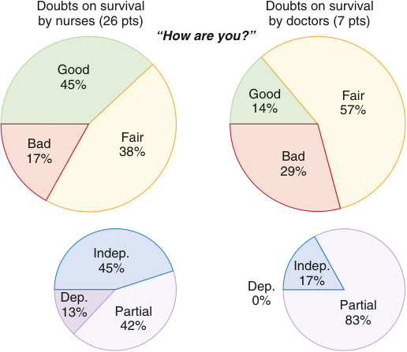

Doubts on survival Doubts on survival by nurses (26 pts) by doctors (7 pts) “How are you?” Good 45% Good Fair 14% 57% Fair Bad 17% 38% Bad 29% Indep. 45% Indep. 17% Dep. Dep. 0% Partial 13% Partial 83% 42% 

**Fig. 48.8** Answers of survivors 6 months after being discharged from the intensive care unit for whom treatment had been considered futile or questionable by nurses or physicians to improve survival. _Dep.,_ dependent; _Indep.,_ independent. (From Frick S, Uehlinger DE, Zuercher Zenklusen RM. Medical futility: predicting outcome of intensive care unit patients by nurses and doctors—a prospective comparative study. _Crit Care Med._ 2003;31:456–461.)

as return to cognitive baseline.227 For example, a study of 521 patients in a MICU found that physicians and nurses were unable to predict satisfaction with the quality of life 6 months after admission. In general, nurses tended to be more pessimistic than physicians and suggested withdrawal of life- sustaining treatment more often in patients who ultimately survived (Figs. 48.8 and 48.9).232 Prognostic tools that include clinician assessment are better than tools that rely on objective data alone, but the best predictions arise when multiple providers (physicians and/or nurses) agree on the prognosis.233

Difficulty with prognostication has led some physicians to avoid giving any kind of timeframe to eliminate the possibility of being wrong.161,234 However, 87% of 179 surrogate decision- makers wanted the physician to give a prognosis, even if it was uncertain.235 Most understood the inherent unpredictability of prognostication and preferred that physicians make the prognostic uncertainty clear during the discussion.235 Prognosis, even in the face of uncertainty, can help families prepare for bereavement and make important decisions about coordinating work, visitors, and finances.235 Good data suggesting how to present prognoses to patients are not available. One approach to prognostication involves giving ranges such as hours to days, days to weeks, weeks to months, and months to years, with those categories roughly tracking with functional status. These ranges, along with an explanation from the physician about the difficulty of prognosticating, can often give families sufficient guidance with which to make important decisions. However, interpretation of a given prognosis may vary with the patient and family. One study that gave surrogate decision- makers in the ICU hypothetical physician statements about prognosis and asked them to interpret them showed that surrogates tended to be optimistic, especially with worse prognoses.236

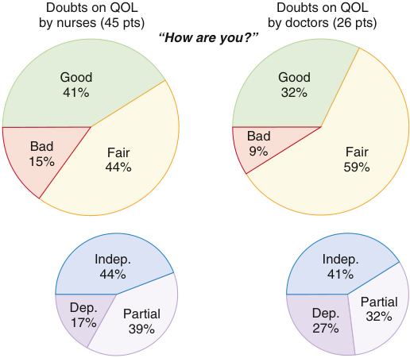

Doubts on QOL Doubts on QOL by nurses (45 pts) by doctors (26 pts) “How are you?” Good Good 41% 32% Bad Bad Fair 9% Fair 15% 44% 59% Indep. Indep. 44% 41% Partial Dep. Partial Dep. 32% 17% 39% 27% 

**Fig. 48.9** Answers of survivors 6 months after being discharged from the intensive care unit for whom treatment had been considered futile or questionable by nurses or physicians to improve the quality of life (QOL). _Dep.,_ dependent; _Indep.,_ independent. (From Frick S, Uehlinger DE, Zuercher Zenklusen RM. Medical futility: predicting outcome of intensive care unit patients by nurses and doctors—a prospective comparative study. _Crit Care Med._ 2003;31:456–461.)

### DISEASE TRAJECTORIES

Most disease trajectories can be included in one of the following functional categories: sudden extreme disability or near death; a period of good functionality, followed by a rapid, steady decline; a waxing and waning course with periods of decompensation followed by improvements; and a slow decline, starting at a low functional level (Fig. 48.10).237 Disability trajectories in the latter categories have been explored in more detail and likely depend on the condition leading to death (e.g. cancer vs. dementia vs. organ failure).238,239 Disability following critical illness has also been well- characterized and is particularly dependent on pre- ICU functional impairments.240 These frameworks can be useful when discussing prognoses with patients, particularly in talking to patients with conditions that are difficult to predict such as COPD and congestive heart failure (CHF) or after a sudden dramatic acute or critical illness.

### PROGNOSTIC TOOLS

Multiple web- based prognostic tools exist (e.g., eprognos is.ucsf.edu241 ), but are typically specific to particular cancers. An important consideration is that the type of cancer is actually less important than a variety of patient factors (e.g., functional status and laboratory values) as the disease becomes more advanced (Fig. 48.11).242 In general, a patient with cancer who spends more than half of the day in bed has a median survival of 6 months (Box 48.5).243

Multiple tools, which are covered in depth in Chapter 80, have been proposed to help the clinician predict mortality in the ICU. These tools may be more useful in the research setting than for prediction of outcome in an individual patient.

Many conditions have courses that are difficult to predict. Table 48.2 gives characteristics associated with non- cancer

<!-- PDF page 17 -->

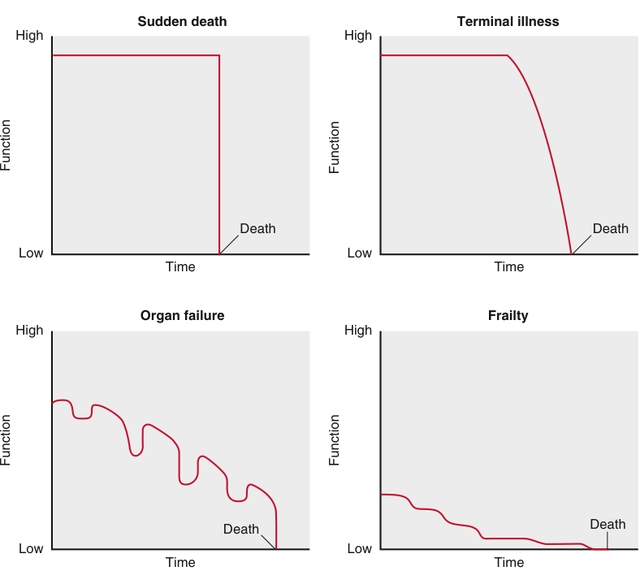

Sudden death Terminal illness High High Death Death Low Low Time Time Organ failure Frailty High High Death Death Low Low Time Time Function Function Function Function 

**Fig. 48.10 Trajectories of dying.** (From Lunney JR, Lynn J, Hogan C. Profiles of older Medicare decedents. _J Am Geriatr Soc._ 2002;50:1108–1112.)

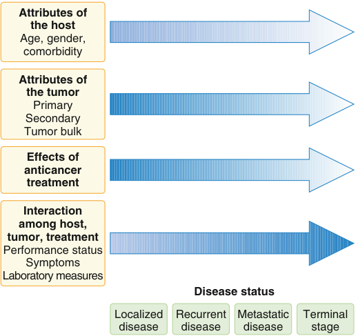

Attributes of the host Age, gender, comorbidity Attributes of the tumor Primary Secondary Tumor bulk Effects of anticancer treatment Interaction among host, tumor, treatment Performance status Symptoms Laboratory measures Disease status Localized Recurrent Metastatic Terminal disease disease disease stage 

**Fig. 48.11 Factors associated with the length of survival in patients with cancer.** _Depth of shading_ represents relative importance of the factor as a predictor of subsequent survival. (From Hauser CA, Stockler MR, Tattersall MH. Prognostic factors in patients with recently diagnosed incurable cancer: a systematic review. _Support Care Cancer._ 2006;14:999– 1011.)

### Box 48.5 Cancer Presentations with a Median Survival of 6 Months or Less

### Solid Cancers in General

- Any locally advanced or metastatic solid cancer with one or more of the following presentations:

- Patient spends more than one-half of the day in bed

- Serum calcium >11.2 mg/dL

- Episode of extremity venous thromboembolism or pulmonary embolism

- Two or more brain metastases plus intracranial metastases

- Spinal cord compression with decreased ability to walk

- Malignant pericardial effusion

### Carcinoma of Unknown Primary Origin

Any metastatic adenocarcinoma or undifferentiated carcinoma of unknown primary origin with one or more of the following presentations: ᑏ Patient is ambulatory and can care for him or herself but cannot work

- Hepatic, bone, or adrenal metastases

- Recurrence of disease after chemotherapy

- Serum albumin &lt;3.5 mg/dL or weight loss of ≤10% in 6 months

Data from Salpeter SR, Malter DS, Luo EJ, et al. Systematic review of cancer presentations with a median survival of six months or less. _J Palliat Med._ 2012;15:175–185.

<!-- PDF page 18 -->

### Table 48.2 Presentations of Non- Cancer Diagnoses with a Median Survival of 6 Months or Less

|**Diagnosis**|**Presentation**|
|---|---|
|**HEART FAILURE**||
|Hospitalization for moderate- to- severe symptomatic heart failure, NYHA Class III or IV, with three or more of the presentations listed.|ᑏAge >70 years ᑏLVEF≤20% ᑏSerum BNP >950 pg/mL ᑏCardiac troponin I >0.4 ng/mL ᑏCRP >3.5 mg/L ᑏFourth hospitalization for heart failure or repeat hospitalization within 2 months ᑏDependency for two or more activities of daily living or need for home care after hospital discharge ᑏWeight loss≤2.3 kg within 2 months, or serum albumin &lt;2.5 g/dL ᑏHistory of cardiogenic shock, ventricular or supraventricular arrhythmia, cardiac arrest, CPR, or mechanical ventilation ᑏSystolic blood pressure &lt;110 mm Hg ᑏSerum creatinine >2 mg/dL or BUN >40 mg/dL ᑏSerum sodium &lt;135 mEq/L ᑏPeripheral vascular disease or cerebrovascular disease ᑏOther comorbid illness, such as diabetes mellitus, dementia, COPD, cirrhosis, and cancer, among others|
|**DEMENTIA**||
|Advanced dementia with dependency in all activities of daily living, bedbound status, urinary and bowel incontinence, decreased ability to communicate verbally, and admission to a hospital or skilled nursing facility with one or more of the presentations listed.|ᑏBMI &lt;18.5 kg/m2, decreased oral intake, or significant weight loss ᑏPresence of at least one pressure ulcer ᑏEvidence of at least one comorbid illness ᑏMale sex plus >90 years of age ᑏPlacement of a feeding tube attributable to inability to eat or history of aspiration|
|**HEPATIC CIRRHOSIS**||
|Decompensated hepatic cirrhosis and one or more of the presentations listed.|ᑏMELD score≥21|
|Decompensated hepatic cirrhosis with hospitalization for an acute illness related to liver disease and one or more of the presentations listed.|ᑏMELD score≥18 ᑏHospitalization in an intensive care unit related to severe decompensation of liver disease with hypotension requiring the use of pressors, serum creatinine >1.5 mg/dL, or evidence of jaundice ᑏEvidence of hepatopulmonary syndrome or rapidly progressive hepatorenal syndrome|
|**CHRONIC OBSTRUCTIVE PULMONARY DISEASE**||
|Hospitalization for a severe COPD exacerbation, with PaO2 ≤55 mm Hg, PaCO2 ≥50 mm Hg, and supplemental oxygen dependence, with three or more of the presentations listed.|ᑏAge >70 years ᑏEvidence of right- sided heart failure ᑏRepeat hospitalization for COPD within 2 months ᑏHistory of intubation and mechanical ventilation ᑏRequired considerable assistance and frequent medical care and/or dependence for three or more activities of daily living before hospitalization ᑏNeed for home care after hospital discharge ᑏMalnutrition (weight loss of≥2.3 kg, serum albumin &lt;2.5 g/dL or BMI &lt;18 kg/m2 ᑏSerum creatinine >2 mg/dL|

_BMI,_ body mass index; _BNP,_ brain natriuretic peptide; _BUN_ , blood urea nitrogen; _COPD,_ chronic obstructive pulmonary disease; _CPR_ , cardiopulmonary resuscitation; _CRP,_ C- reactive protein; _LVEF,_ left ventricular ejection fraction; _MELD,_ Model for End- Stage Liver Disease; _NYHA,_ New York Heart Association; _PaCO2_ , partial arterial pressure of carbon dioxide; _PaO2_ , partial arterial pressure of oxygen.

Modified from Salpeter SR, Luo EJ, Malter DS, et al. Systematic review of noncancer presentations with a median survival of 6 months or less. _Am J Med_ . 2012;125:512 e1–6.

patients such as heart failure, dementia, hepatic cirrhosis, and COPD, with a median survival of 6 months or less,244 although it should be noted that the prognostic accuracy of these factors is not known.

### Congestive Heart Failure

CHF often has a waxing and waning course. The Seattle Heart Failure Model estimates mean 1- to 3- year survival but does not appear to be able to predict whether individual patients are in the last year of life.245 Factors associated with a poor prognosis include hospitalization, tachycardia, hypotension, decreased ejection fraction, and increased creatinine level.246 In patients hospitalized for acute decompensation of heart failure, older age and COPD were associated with decreased 1- year survival.247

### Dementia

The course of dementia is difficult to predict, and a patient’s 6- month mortality is higher once the patient develops the common problems of infection and an inability to eat.248 Probability of death within 6 months increases with advancing age, shortness of breath, immobility, and insufficient oral intake, among other presentations.249

### Chronic Obstructive Pulmonary Disease

The BODE Index, which is used to predict the risk of death in COPD, measures **b** ody mass index, airflow **o** bstruction, **d** yspnea, and **e** xercise capacity250 ; however, its use of a 6- minute exercise capacity test makes it impractical for the bedside anesthesiologist. More than 3 days of mechanical

::: details 原始表格與符號（PDF 第 18 頁）

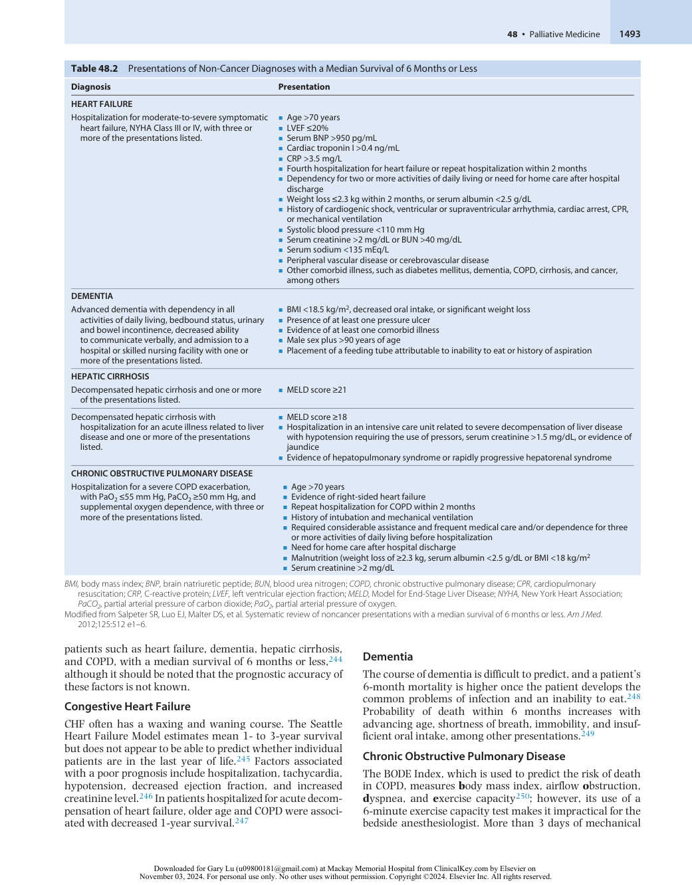

:::

<!-- PDF page 19 -->

ventilation and an inability to extubate the trachea successfully suggest a poor prognosis.251

### Liver Disease

In decompensated liver disease, the Model for End- Stage Liver Disease (MELD) score is often used to predict a prognosis.252 Hepatic encephalopathy and hepatorenal syndrome are also predictors of a poor prognosis.252,253

### Renal Disease

Patients with chronic kidney disease on dialysis will live 16% to 33% as long as age- and sex- matched patients who are not on dialysis.254 Probability of survival at 10 years for patients on dialysis who are older than 65 years of age is 3.1%.254 Poor functional and nutritional status, as well as comorbid conditions, suggest a poor prognosis.254 Withdrawal of dialysis accounts for up to 20% of deaths in patients on dialysis each year, and the average patient lives 8 to 12 days after dialysis withdrawal.255

### Frailty

Frailty represents a complex multicomponent syndrome of physiologic decline with increased vulnerability to adverse health outcomes. While frailty is often felt to be aging- related, frailty phenotypes can present in patients below 65 years old.256 Frailty (and particularly frailty assessment tools) typically measure physical frailty, defined as the multisystem biologic decline in older adults,257 or utilize a deficit- accumulation model258 whereby frailty represents the accumulation of illnesses and functional and cognitive declines. Regardless of how frailty is defined or measured, there is a growing recognition that frailty is highly associated with mortality.259–261 Frailty has also been associated with a number of poor prognostic outcomes in surgical patients.262–265 The increased functional, cognitive, and psychosocial needs associated with frailty likely support an increased role of palliative care in these patients and their caregivers.266

### SYMPTOM MANAGEMENT

### Alternative Routes of Drug Delivery

While the oral route is the most common for medication delivery, many patients near the end of life are unable to swallow oral medications because of oral lesions, nausea, the dying process, or other reasons. Many patients in palliative and hospice care have difficult intravenous access because of frequent medical care, dehydration, or other issues. To avoid multiple attempts at intravenous cannulation, palliative medicine practitioners and most hospices use subcutaneous infusions for the delivery of medications, especially opioids.267,268 An assumption of safety is based, in part, on studies showing that many intramuscular injections are actually administered into the subcutaneous tissue.269 In addition, other types of drugs such as benzodiazepines, some antiemetic medications, antibiotics, neuroleptics, and even fluids can be subcutaneously administered in the palliative care setting.267,268,270 While the subcutaneous administration of opioids is safe, the optimal conversion ratio from one route to another is a subject of debate.271 Other studies support the transmucosal, sublingual, and rectal administration of opioids.271 Finally, neuraxial drug

delivery via continuous epidural infusions or intrathecal pumps can be utilized, particularly for intractable pain.272

### Pain

Pain management in patients who are seriously ill can be quite different from other patients with pain. Some of these patients have pain that is best managed by a pain management specialist, and some will need adjuvant medications (Table 48.3). In cancer patients, 15% to 90% with solid tumors have pain, depending on the type and stage of cancer, as well as the age, race, and sex of the patient.273 Most cancer pain is due to the cancer itself, but approximately one-fifth of patients develop pain related to the cancer treatment.274 The majority of cancer pain can be managed with the WHO “Cancer Pain Stepladder.”275 Zech published a prospective study of 2118 cancer patients using this stepladder during which 76% of the patients received pain relief with minimal side effects.275 However, pain management may be significantly more challenging for patients with advanced cancer and with actively progressing disease: 60% to 90% of this population report pain that significantly impacts function, mood, and sleep. Pain of this severity may benefit from more advanced techniques such as interventional pain medicine (see below and Chapter 47),276,277 psychological interventions,278 or palliative chemotherapy or radiation therapy. Additionally, with more cancer survivors, non- cancer pain and pain secondary to cancer treatment (e.g., chemotherapy- induced peripheral neuropathy, radiation neuritis) have become a more prominent concern in cancer patients.

### Bone Pain

Breast, lung, kidney, and prostate cancers frequently metastasize to the bones.279 Patients with metastatic disease can have both osteoblastic and osteolytic bony lesions leading to severe pain.280 Multiple targets for bone pain are possible, but no clear consensus has been reached on the best treatment methods.281 Hormonal therapy is effective in breast, prostate, and endometrial cancers. Interventional techniques such as intrathecal pumps may be appropriate in some patients.282 Palliative radiotherapy can be helpful for patients with bone metastases, although pain relief may take several weeks.283 Dexamethasone orally, subcutaneously, or intravenously is commonly recommended for bone pain by expert consensus, although only a few small studies support its use.284 Bone- modifying agents, such as zoledronic acid or pamidronate, have shown benefit for bony pain in some cancers and should be considered when appropriate from an oncologic standpoint.279,285 Nonsteroidal anti- inflammatory drugs (NSAIDs) are helpful in alleviating cancer pain, although their advantage when combined with opioids is less clear.286 More advanced interventions such as epidural steroid injections, vertebroplasty/ kyphoplasty, or surgery may also be indicated if patients are either having intolerable side effects or inadequate analgesia with systemic medications.287

### Neuropathic Pain

Between 17% and 28% of patients with advanced cancer have neuropathic pain.288 This pain may be due to the effect of treatment from chemotherapy or radiation, or be directly related to tumor involvement of nerves. Specific

<!-- PDF page 20 -->

### Table 48.3 Adjuvant Analgesics in the Management of Cancer Pain

||**Examples**|**Comment**|
|---|---|---|
|**MULTIPURPOSE ANAL**|**GESICS**||
|Glucocorticoids|Dexamethasone, prednisone|Are used for bone pain, neuropathic pain, lymphedema pain, headache, and bowel obstruction|
|**ANTIDEPRESSANTS**|||
|TCAs|Desipramine, amitriptyline|Are used for opioid- refractory neuropathic pain; often used with comorbid depression; secondary amine compounds (e.g., desipramine) have fewer side effects and might be preferred|
|SNRIs|Duloxetine, venlafaxine|Good evidence exists for their use in some conditions but are overall less effective than TCAs; better side- effect profile than TCAs and are often tried first|
|SSRIs|Paroxetine, citalopram|Evidence for their use is scarce; if pain is the target, then other subclasses are preferred|
|Other|Bupropion|Little evidence exists for its effectiveness but less sedating than other antidepressants; is often tried early when fatigue or somnolence is a problem|
|α2- Adrenergic agonists|Tizanidine, clonidine|Tizanidine may be used as a muscle relaxant; clonidine is used in neuraxial analgesia|
|Cannabinoid|THC/cannabidiol, nabilone|Good evidence exists for THC/cannabidiol when used in cancer pain; evidence is scarce for other commercially available compounds|
|**TOPICAL AGENTS**|||
|Anesthetic|Lidocaine patch, local anesthetic creams|Sometimes used in localized pain|
|Capsaicin|8% patch; 0.25%–0.75% creams|High concentration patch is indicated for postherpetic neuralgia|
|NSAIDs|Diclofenac and others|Evidence exists for their use in focal musculoskeletal pains|
|TCA|Doxepin cream|Is used in treating itching; can be tried for pain|
|Others||Compounding creams with various drugs have been empirically tried, but no evidence exists for effectiveness|
|**USED FOR NEUROPAT**|**HIC PAIN**||
|Multipurpose drugs|As above|As above|
|**ANTICONVULSANTS**|||
|Gabapentinoids|Gabapentin, pregabalin|Are considered first line for neuropathic pain; both drugs act as N- type calcium channel blockers in the CNS, but individuals vary in response to one or the other|
|Others|Oxcarbazepine, lamotrigine, topiramate, lacosamide, valproate, carbamazepine, phenytoin|Evidence is scarce for all drugs listed; newer drugs are preferred because of reduced side- effect liability, but individual variation is great; all drugs are considered for neuropathic pain if antidepressants and gabapentinoids are ineffective|
|**SODIUM CHANNEL DR**|**UGS**||
|Sodium channel blockers|Mexiletine, intravenous lidocaine|Good evidence exists for intravenous lidocaine|
|Sodium channel modulator|Lacosamide|New anticonvulsant with very scarce evidence of analgesic effects|
|**GABA AGONISTS**|||
|GABAAagonist|Clonazepam|Evidence is scarce but used for neuropathic pain with anxiety|
|GABABagonist|Baclofen|Evidence for the treatment of trigeminal neuralgia is the basis for trials in other types of neuropathic pain (but is not first line)|
|_N_- methyl-d- aspartate inhibitors|Ketamine, memantine, and others|Evidence is scarce for ketamine, but experience is positive with intravenous use in advanced illness or pain crisis; little evidence exists for oral drugs|
|**USED FOR BONE PAIN**|||
|Bisphosphonates|Pamidronate, ibandronate, clodronate|Good evidence exists for their use; similar to NSAIDs or glucocorticoids, usually considered first- line treatment; also reduces other adverse skeletal- related events; concern about osteonecrosis of the jaw and renal insufficiency might restrict its use|
|Calcitonin||Evidence is scarce but is usually well tolerated|
|Radiopharmaceuticals|Strontium- 89, samarium- 153|Evidence is good, but their use is restricted because of bone- marrow effects and the need for expertise|
|**USED FOR BOWEL OBS**|**TRUCTION**||
|Anticholinergic drugs|Hyoscine compounds, glycopyrronium|Along with a glucocorticoid, are considered first- line adjuvant treatments for nonsurgical bowel obstruction|
|Somatostatin analog|Octreotide|Along with a glucocorticoid, is considered a first- line adjuvant treatment for nonsurgical bowel obstruction|

_CNS,_ central nervous system; _GABA,_ gamma- aminobutyric acid; _NSAIDs,_ nonsteroidal anti- inflammatory drugs; _SNRIs,_ selective noradrenaline reuptake inhibitors; _SSRIs,_ selective serotonin reuptake inhibitors; _TCAs,_ tricyclic antidepressants; _THC,_ tetrahydrocannabinol. Modified from Portenoy RK. Treatment of cancer pain. _Lancet_ . 2011;377:2236–2247.

::: details 原始表格與符號（PDF 第 20 頁）

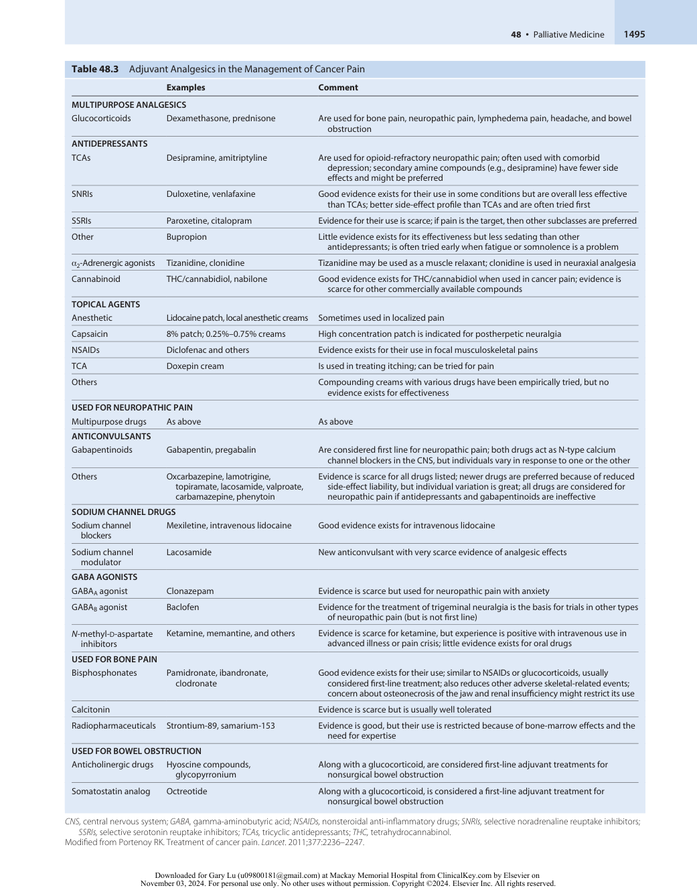

:::

<!-- PDF page 21 -->

neuropathic targets, and not opioids, are first- line treatment for neuropathic pain, but methadone, which has NMDA antagonism, may be appropriate for some cancer patients with predominantly cancer pain. More information on neuropathic pain, the use of lidocaine and ketamine, and other adjuvant medications is available in Chapter 47 (also see Table 48.3). As always, a patient’s life expectancy should be considered, because some medications may be difficult to titrate adequately in a short period.

### Pain in the Intensive Care Unit

In the ICU, pain is common and attributable to many factors such as surgical wounds, placement of invasive monitoring devices, and immobility.289 When pain was rigorously assessed in prospective studies,290 chest tube removal, wound drain removals, and arterial line insertions were considered the most painful ICU procedures. Pain incidence was recorded in nearly 40%–50% of ICU patients291,292 and pain at rest was also common.293 Psychological responses to pain in the ICU are well- described294 and survivors have longer- term traumatic stress295 associated with these events. Chronic pain is common in ICU survivors, even in those without a history of preexisting pain symptoms,296–298 and represents an important component of post–intensive care syndrome (PICS).

A patient’s self- reported pain is the reference standard for assessing pain. However, quite often, pain in the ICU can be difficult to assess when patients are intubated, sedated, unable to speak, or if they have delirium. The Behavioral Pain Scale299 and the Critical Care Pain Observation Tool300 are validated methods of assessing pain in the ICU population.301 The use of validated tools for pain assessment is supported by the pain, agitation/sedation, immobility and sleep disruption (PADIS) guidelines by the Society of Critical Care Medicine.302 Commonalities among the tools include assessment of facial expression, body movement, and synchrony with ventilation. Artificial intelligence algorithms measuring facial expression and body movements303,304 similar to those measured from validated manual observation tools could aid in automated pain detection in the future. In the SUPPORT trial, pain was poorly controlled among those who died in the hospital, with half of the surrogates indicating that their family member had moderateto- severe pain for at least half of the time in the three days before death.15 Pain assessment and treatment in the ICU has improved since the SUPPORT trial.305

### OPIOID USE

Opioid use at the end of life is common, although consumption dramatically varies throughout the world.19 In a 2012 study of 1068 patients at six US medical centers, 70% of patients received an opioid in the last week of life, and 47% received opioids in the last 24 hours.306 Some physicians are hesitant to use opioids at the end of life for fear of hastening a patient’s death. A study by Morita in 2001 retrospectively analyzed opioid and sedative consumption of 209 patients in the 48 hours before death and found no difference in survival based on opioid or sedative dose.307 A small study on the rate of increase of opioids found no correlation with time to death, although total morphine doses were relatively low overall in the study.308 A larger study by Portenoy in 2006 showed a

weak association with total opioid dose and time to death, but this association appeared to account for less than 10% of the variance even when combined with other variables.309 Most experts believe that appropriately administered opioids do not hasten death, can be safely used, and generally do not require invoking the doctrine of double effect.310 Some authors have urged caution with the use of opioids in patients with cancer and uncertain prognoses to decrease the risk of opioid dependence and abuse in patients with the possibility of a long life after treatment.311 However, recently, in the context of the opioid epidemic, opioid use has decreased among patients dying of cancer with rising pain- related ED visits.312 While concerns for dependence exist, clinicians must also be careful to avoid undertreatment in dying patients and opioids should be titrated based on the clinician’s assessment of the pain.

### Interventional Pain Management at the End of Life

Despite the guidance provided by the WHO Stepladder,313 10% to 20% of cancer patients have pain that is refractory to parenteral management.314,315 Select patients may benefit from interventional pain modalities.287

However, patients at the end of life may be more prone to bleeding from coagulopathy or thrombocytopenia and infection from immunosuppression. These issues need to be evaluated carefully by an interventional pain specialist. Abdominal pain, especially for pancreatic cancer, can be treated with celiac plexus blocks or neurolysis, while pelvic pain may be addressed with superior hypogastric blocks or neurolysis. These techniques are described in detail in Chapter 47. Less invasive modalities such as peripheral nerve blocks or trigger point injections may also be beneficial.

Neuraxial (i.e., intrathecal and epidural) analgesia can decrease numerical pain scores while significantly decreasing oral opioid intake, which may lead to fewer side effects such as constipation and sedation.272 In a randomized controlled trial of 202 patients with refractory cancer pain comparing comprehensive medical management versus an implantable intrathecal drug delivery system, those in the intrathecal group had significant reductions in fatigue and depressed level of consciousness. Additionally, this study showed a trend toward improved survival, with 53.9% of patients receiving intrathecal analgesia remaining alive at 6 months compared with 37.2% of the control group ( _P_ = .06).316

### NAUSEA AND VOMITING

Nausea and vomiting are common complaints in the palliative care and hospice populations and cause significant distress for patients and families.169 Many techniques and medications used in the treatment of nausea and vomiting are similar to those used in the perioperative period. As with every patient, the first step in treating nausea and vomiting is a thorough evaluation of possible causes (Fig. 48.12). The following section highlights issues specific to patients with life- limiting diseases.

### Nausea and Vomiting Related to Chemotherapy and Radiation Therapy

Many patients undergoing chemotherapy experience anticipatory nausea and vomiting. The 2011 American Society of Clinical Oncology Practice Guidelines for

<!-- PDF page 22 -->

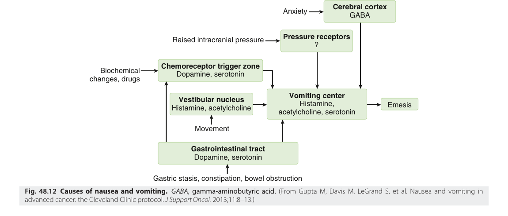

Cerebral cortex Anxiety GABA Pressure receptors Raised intracranial pressure ? Chemoreceptor trigger zone Biochemical Dopamine, serotonin changes, drugs Vestibular nucleus Vomiting center Histamine, Emesis Histamine, acetylcholine acetylcholine, serotonin Movement Gastrointestinal tract Dopamine, serotonin Gastric stasis, constipation, bowel obstruction Fig. 48.12 Causes of nausea and vomiting. GABA , gamma- aminobutyric acid.  (From Gupta M, Davis M, LeGrand S, et al. Nausea and vomiting in advanced cancer: the Cleveland Clinic protocol.  J Support Oncol.  2013;11:8–13.) 

chemotherapy and radiation therapy include the prescription of a 5- hydroxytryptamine- 3 antagonist, such as ondansetron, often with dexamethasone, the atypical antipsychotic olanzapine, and the addition of a neurokinin- 1 antagonist, such as aprepitant, for the most emetogenic chemotherapy regimens.317 Benzodiazepines may also be beneficial. For non- chemotherapy- related or radiation therapy–related nausea and vomiting, no Level 1a or 1b evidence is currently available to guide decisions on the choice of an antiemetic agent in the palliative care population. Unlike routine postoperative nausea and vomiting, patients may benefit from scheduled antiemetics with additional medications as needed.

### BOWEL OBSTRUCTION

Some patients with abdominal tumors may develop partial or complete bowel obstruction. Surgical outcomes for patients with bowel obstruction and a life expectancy of less than 2 months are poor,318 and gastrointestinal selfexpanding metallic stents should be considered.319 Placement of a nasogastric tube can provide immediate relief while other options are considered. A venting gastrostomy tube is an option in patients who are refractory to treatment and can allow the patients to enjoy the taste of food while allowing gastric decompression. Simultaneous use of antiemetics, including somatostatin analogues (e.g., octreotide), and corticosteroids may be particularly effective for nausea control in inoperable malignant bowel obstructions.320,321

### ARTIFICIAL HYDRATION AND NUTRITION

Many patients receiving palliative care are unable to take in food or fluids because of nausea, dysphagia, or obstruction. The decision of whether to administer artificial hydration and nutrition is often a difficult one for patients and physicians. Both parties may hold strong cultural or religious views, and many describe a fear of “starving” the patient.322 Nonetheless, medically assisted nutrition and hydration can and perhaps should be considered medical interventions.

Symptoms of hunger are less common in advanced disease, and thirst can be treated with ice chips or mouth swabs.323 The administration of artificial hydration and nutrition is associated with risks of fluid overload, leading to choking or edema, as well as diarrhea and nausea.324 Additional risks associated with a gastrostomy tube include dislodgement and the possible increased need for restraints.178 The administration of enteral or parenteral nutrition and hydration is considered a medical intervention, and, as such, the risks and benefits should be discussed with patients and families.322 The benefit of artificial hydration and nutrition has been established for patients in a persistent vegetative state or those with acute stroke or head injury, short- term critical illness, oropharyngeal cancers, and possibly bulbar amyotrophic lateral sclerosis.325 However, artificial hydration does not improve symptoms, quality of life, delirium, or survival in patients with advanced cancers at the end of life.326,327 The use of percutaneous feeding tubes in patients with advanced dementia does not prevent pneumonia or improve survival and is not recommended.328,329 For some patients, a time- limited trial of artificial hydration or nutrition may be appropriate to evaluate for benefit, such as improvement in delirium, while monitoring for side effects.

### DYSPNEA

Dyspnea is “a subjective experience of breathing discomfort that consists of qualitatively distinct sensations that vary in intensity,”330 as differentiated from breathing that appears labored or fast to an observer. Dyspnea could be distinguished as a sensation (neural activation from a biologic receptor activation standpoint) and a perception (the reaction of the individual to the sensation330 ), suggesting that observation- based tools assessing dyspnea may disagree with subjective reports of breathlessness. This was shown in one prospective multicenter trial assessing breathlessness by observers and patients during spontaneous breathing trials in mechanically ventilated patients.331 The pathophysiology of dyspnea is multifactorial and consists of increased output from respiratory chemocenters, stimulation of

<!-- PDF page 23 -->

upper airway, pulmonary, chest wall mechanoreceptors, changes in mechanical loading of the respiratory system (e.g., changes in airway resistance and chest wall compliance), neuromechanical dissociation, and impaired oxygen delivery or utilization. Finally, the affective dimension of dyspnea contributes to the sensation of discomfort, which also contributes to fear and anxiety.332

Dyspnea is common in patients with a high risk of death333,334 and was identified as the most distressing symptom by patients who could self- report in the ICU, regardless of their mechanical ventilation status.335 In intubated patients, dyspnea is common and is associated with posttraumatic stress disorder in ICU survivors.336 Dyspnea increases closer to the time of death, even in patients without known cardiopulmonary disease.337 Treatment is either aimed at reversing the cause of dyspnea (e.g., thoracentesis for an effusion) or at symptom management. Nonpharmacologic therapy such as a fan or pulmonary rehabilitation may be helpful.338 Oxygen supplementation has not demonstrated benefit in symptoms in one metaanalysis.339 Studies of low- dose opioids in patients with refractory dyspnea support their safety and efficacy.340,341 A randomized, double- blind, crossover study of 48 COPD patients who were taking 20 mg of sustained- release morphine daily showed a significant improvement in dyspnea with minimal side effects.342 Studies of the effect of benzodiazepines with and without opioids for dyspnea and its negative affective perceptions are small and mixed, with a trend toward possible benefit.343–345 Acupuncture may also provide dyspnea benefit in two randomized studies in patients with lung cancer and COPD.346,347 A recent metaanalysis confirmed these findings over a larger set of smaller studies.347

### DEPRESSION AND ANXIETY IN THE PATIENT RECEIVING PALLIATIVE CARE

Depression and anxiety are common at the end of life, with estimates ranging from 5% to 30% and 7% to 13%, respectively.348 Many factors contribute to psychological distress, including social, economic, spiritual, and physical stressors associated with serious illness.349 A rapid screening

test for depression consisting of two questions, “Are you depressed?” and “Have you experienced a loss of interest in things or activities you would normally enjoy?” has a sensitivity of 91% and a specificity of 68% and has been validated in the palliative care population.350 Patients who screen positive for depression or who have suicidal or homicidal ideations should be referred to a psychiatrist or other experienced provider. Depression should be distinguished from delirium and normal grief (Table 48.4).351 For the anesthesiologist, recognizing depression and making appropriate referrals is important.

Treatments for depression vary by life expectancy. Selective serotonin reuptake inhibitors and monoamine oxidase inhibitors may be appropriate for patients with a longer life expectancy, since the time to onset is 1 to 2 months. For patients with a life expectancy of weeks to a few months, methylphenidate has been well studied in the cancer population. The onset of action is 1 to 3 days and is generally effective and well- tolerated for depression and fatigue.352,353

### DELIRIUM AT THE END OF LIFE

Delirium is covered in depth in Chapter 61. It affects 28% to 90% of patients who are terminally ill, with increasing incidence as death approaches.354–356 The Confusion Assessment Method has been validated in the palliative care population.357,358 Some patients may have more than one possible cause of delirium (Box 48.6). Delirium can have a major impact on a patient’s ability to make a well- informed decision about treatment options, including surgery, which may have ethical and legal implications. Most patients who recover remember being delirious, and those who do find it very distressing.359

As much as half of the delirium near the end of life may be reversible.354 Increased likelihood of reversible delirium is associated with a younger age, less severe impairment, and lack of organ failure.360 Patients with true terminal delirium have a very short life expectancy.356 Attempts at workup should be based on the patient’s goals of care (Box 48.7). For example, the family of a cancer patient who develops delirium but previously had an acceptable quality of life may desire a workup for potential reversible causes

**Table 48.4** Distinguishing Characteristics of Grief and Depression in Patients Who Are Terminally Ill

|**Characteristic**|**Normal Grief**|**Depression**|
|---|---|---|
|Nature of response|Adaptive|Maladaptive|
|Focus of distress|In response to a particular loss; not affecting all aspects of life|Pervasive; affecting all aspects of life|
|Symptom fluctuations|Symptoms coming in waves, generally improving with time|Constant|
|Mood|Sadness and dysphoria|Protracted and constant depression or flat affect|
|Interests and capacity for pleasure|Interests and capacity for pleasure remaining intact; diminishing engagement in activities because of functional decline|Anhedonia with significant diminished interest or pleasure in all activities|
|Hope|Episodic and focal loss of hope; hopes possibly changing over time; giving positive orientation toward the future|Persistent and pervasive hopelessness|
|Self- worth|Maintaining self- worth, although with feelings of helplessness|Worthlessness with the belief that one’s life has no value|
|Guilt|Regrets and guilt over specific events|Excessive feelings of guilt|
|Suicidal ideation|Passive and fleeting desire for a hastened death|Preoccupation with a desire to die|

From Widera EW, Block SD. Managing grief and depression at the end of life. _Am Fam Physician_ . 2012;86:259–264.

::: details 原始表格與符號（PDF 第 23 頁）

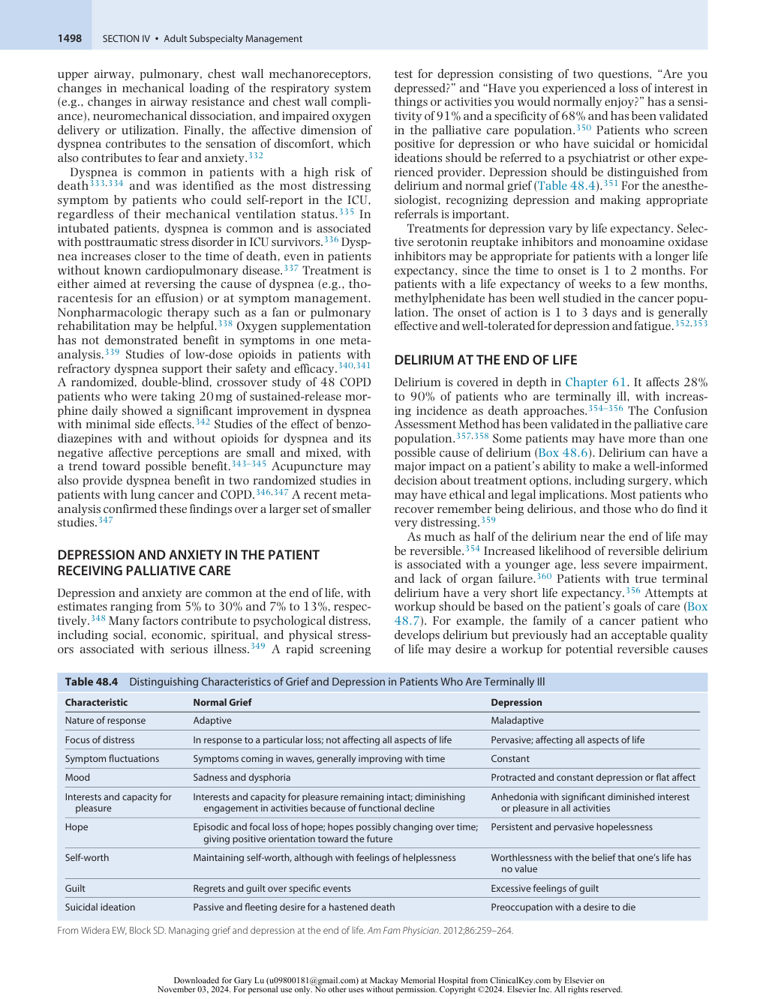

:::

<!-- PDF page 24 -->

### Box 48.6 Causes of Delirium.

|Metabolic disturbance|
|---|
|Hypercalcemia|
|Hyponatremia|
|Hypernatremia|
|Dehydration|
|Glycemic derangements|
|Organ failure|
|Renal failure|
|Liver failure|
|Respiratory failure|
|Medications|
|Opioids|
|Benzodiazepines|
|Anticholinergic agents|
|Steroids|
|Sepsis|
|Pneumonia|
|Urinary tract infection|
|Brain pathologic conditions|
|Tumor|
|Metastases|
|Leptomeningeal disease|
|Nonconvulsive status epilepticus|
|Hypoxia|
|Withdrawal|
|Alcohol|
|Benzodiazepines|
|Hematologic conditions|
|Disseminated intravascular coagulation Anemia|

From LeGrand SB. Delirium in palliative medicine: a review. _J Pain Symptom Manage._ 2012;44:583–594.

(e.g., urinalysis, chest X- ray study, or brain imaging), whereas the family of a patient who had previously been nearly comatose and expected to die in hours to days may not want to subject their family member to further workup.

Although delirium is often associated with agitation, hypoactive delirium, during which a patient may have decreased interaction with the environment and exhibit inattention, is likely more common than most clinicians appreciate.361 Hypoactive delirium is considered disturbing by patients who experience it, but no consensus has been reached on whether or how to treat hypoactive delirium.362 Nonetheless, utilization of standardized assessments and early recognition lead to important downstream positive outcomes and potentially less overtreatment.363

While delirium is treated similarly for palliative care patients as it is for medical and surgical inpatients, there is inadequate evidence for specific recommendations on management of delirium in the palliative care settings.364 This is coupled with the fact that few interventions have shown efficacy for preventing delirium.365 Nonpharmacologic approaches to manage delirium (e.g. frequent re- orientation, promoting physiologic sleep patterns, family visits, ensuring hearing and visual aids are available) remain the first- line approach but evidence for benefit of multicomponent interventions remains mixed.366–368 Conventional and atypical antipsychotics can both be used to treat delirium in palliative care.364 Some patients may ultimately require palliative sedation to treat terminal delirium.

### Box 48.7 Evaluation of Delirium

|Determining the goals of care|
|---|
|Reviewing medications|
|Considering the possibility of withdrawal|
|Identifying any hematologic or metabolic abnormalities or organ|
|failure|
|Complete metabolic panel|
|Complete blood count|
|Evaluating oxygen levels|
|Oxygen saturation|
|Identifying infections|
|Urine culture|
|Blood cultures|
|Chest X- ray imaging|
|Performing specialized testing, if appropriate|
|Electroencephalogram|
|Arterial blood gas|
|Tests for disseminated intravascular coagulation|
|Test for thyroid- stimulating hormone|
|Computed tomography scan or magnetic resonance imaging scan of the brain|
|Lumbar puncture|

From LeGrand SB. Delirium in palliative medicine: a review. _J Pain Symptom Manage._ 2012;44:583–594.

### BLEEDING IN THE PATIENT RECEIVING PALLIATIVE CARE

Bleeding can be caused by numerous pathologic conditions, including coagulation disorders and cancers. Fibrinolytic inhibitors such as tranexamic acid, interventional radiologic procedures such as embolization, and surgery have been suggested for patients with compatible goals and life expectancy.369 The decision for therapeutic transfusion of blood products are provider- and circumstancedependent370 and should be guided by evidence- based and prognostic considerations as with all transfusions. Exsanguination in patients receiving palliative care is uncommon but can be upsetting to patients, families, and providers. No randomized trials of best treatments have been conducted. Some practical suggestions include the use of dark towels, suction, holding pressure, and staying with the patient. Medications such as benzodiazepines, opioids, and ketamine are frequently suggested during exsanguination to provide sedation and amnesia.371

## The Dying Process

Most physicians have observed people die but may not have witnessed the dying process. Over 500,000 people die in the ICU every year in the United States alone, and more die after an ICU stay.372 Understanding the dying process is important because family members may ask physicians what the dying process will be like for the patient. Anesthesiologists need to be able to recognize the signs that a patient is imminently dying.

The variation in the timing with which a patient develops many symptoms is substantial, with 84% of patients being drowsy or comatose 24 hours before death, and acrocyanosis and the loss of a radial pulse occurring a median of 1 hour before death373 (Table 48.5). Some of

::: details 原始表格與符號（PDF 第 24 頁）

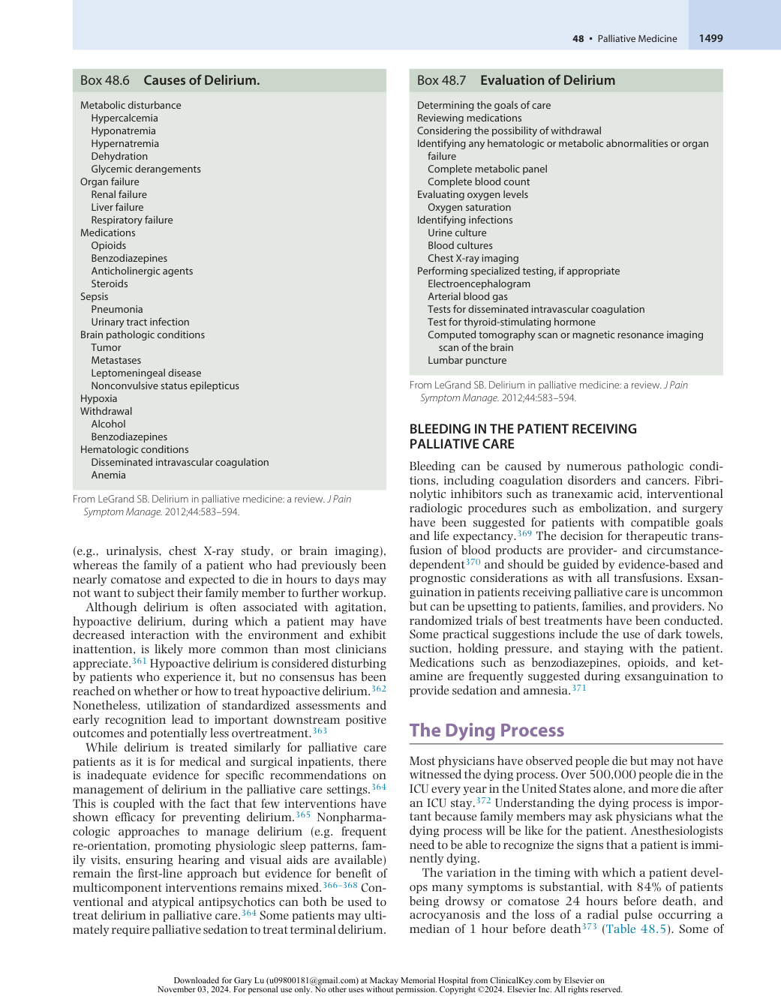

:::

<!-- PDF page 25 -->

**Table 48.5** Changes During the Dying Process

|**Changes**|**Exhibited Signs**|
|---|---|
|Fatigue, weakness|Decreasing function Decreasing attention to hygiene Inability to move around the bed Inability to lift head off the pillow|
|Cutaneous ischemia|Erythema over bony prominences Skin breakdown Wounds|
|Pain|Facial grimacing Tension in forehead and between eyebrows|
|Decreasing food intake, wasting|Anorexia Poor intake Aspiration, asphyxiation Weight loss, muscle, and fat loss notable in temples|
|Loss of ability to close eyes|Eyelids not closed Whites of eyes show (with or without pupils visible)|
|Decreasing fluid intake, dehydration|Poor intake Aspiration Peripheral edema attributable to hypoalbuminemia Dehydration, dry mucous membranes or conjunctivae|
|Cardiac dysfunction, renal failure|Tachycardia Hypertension followed by hypotension Peripheral cooling Peripheral and central cyanosis (bluing of extremities) Mottling of the skin (livedo reticularis) Venous pooling along dependent skin surfaces Dark urine Oliguria, anuria|
|Neurologic dysfunction, including: Decreased level of consciousness|Increased drowsiness Difficulty awakening Nonresponsive to verbal or tactile stimuli|
|Decreased ability to communicate|Difficulty finding words Monosyllabic words, short sentences Delayed or inappropriate responses Not verbally responsive|
|Respiratory dysfunction|Change in ventilatory rate – increasing first, then slowing Decreasing tidal volume Abnormal breathing patterns – apnea, Cheyne–Stokes respirations, agonal breaths Loss of ability to swallow Dysphagia Coughing, choking Loss of gag reflex Build- up of oral and tracheal secretions Gurgling|
|Loss of sphincter control|Incontinence of urine or bowels Maceration of skin Perineal candidiasis Terminal delirium Early signs of cognitive failure, (e.g., day- night reversal) Agitation, restlessness Purposeless, repetitious movements Moaning, groaning|
|Rare, unexpected events|Bursts of energy just before death occurs, the “golden glow” Aspiration, asphyxiation|

the most noticeable symptoms will be cessation of oral intake, lack of responsiveness, and a build- up of oral and tracheal secretions leading to gurgling, sometimes called the “death rattle.” Terminal secretions are thought to be from the airway or oropharynx that cannot be cleared because of the inability to cough or swallow.374 Despite widespread clinical use of antimuscarinic drugs for terminal secretions, few studies support this practice. A large study comparing atropine, hyoscine butylbromide, and scopolamine showed improvement in symptoms but no difference among those agents.375 A study using sublingual atropine versus placebo showed no difference.376 Of note, many of these small studies have multiple methodologic limitations. Recently, one multicenter randomized study compared prophylactic subcutaneous scopolamine versus placebo and demonstrated significantly fewer occurrences of death rattle (defined as noisy breathing caused by the presence of mucus in the respiratory tract).377 This result remained significant even after controlling for patients with lung cancer, chronic obstructive pulmonary disease, and a history of smoking in the previous year. Family members differ in their interpretations of the sound, with some but not all finding it unsettling.378 Many clinicians believe the noisy breathing is not bothersome to patients because most are generally unconscious, although evidence to support this view is lacking.

The dying process considers the comfort of the patient but also preparation and engagement of the family, such as for the physiologic changes, the difficult decisions made regarding feeding and hydration, and family support.379 One important, more common occurrence encountered during the COVID- 19 pandemic was dying, grief, and bereavement in the setting of social isolation.380 The long- term effects of restricted visitation and social isolation on families caring for a dying loved one are unknown but early data describe enduring grief381 and negative effects on quality of dying and bereavement.382 Less restrictive visitation policies, more flexible and innovative communication (e.g. with assisted digital technologies), and more targeted efforts to connect patients with loved ones could improve these experiences with families.

### WITHDRAWAL OF LIFE SUPPORT

Some patients or family members may wish to discontinue mechanical ventilation or other forms of life support. Withdrawal of life support is ethically acceptable and respects patient autonomy. It is important to emphasize to patients and families that “withdrawal” or discontinuation of life support does not equate to the “withdrawal of care.”180 Anesthesiologists can provide expertise in the management of pain and anxiety with the withdrawal of ventilation. Multiple protocols using an opioid for pain or dyspnea and a benzodiazepine for agitation or anxiety are available in the ICU for withdrawal of ventilatory support.383 Interestingly, studies of protocolized life support withdrawal have not demonstrated an improvement in provider perception of the quality of death.384,385 A pilot study evaluating the effect of the use of a protocol to guide withdrawal of life support suggested that while symptoms are generally wellcontrolled around the time of extubation, areas in need of

From Ferris FD. Last hours of living. _Clin Geriatr Med_ . 2004;20:641–667, vi.

::: details 原始表格與符號（PDF 第 25 頁）

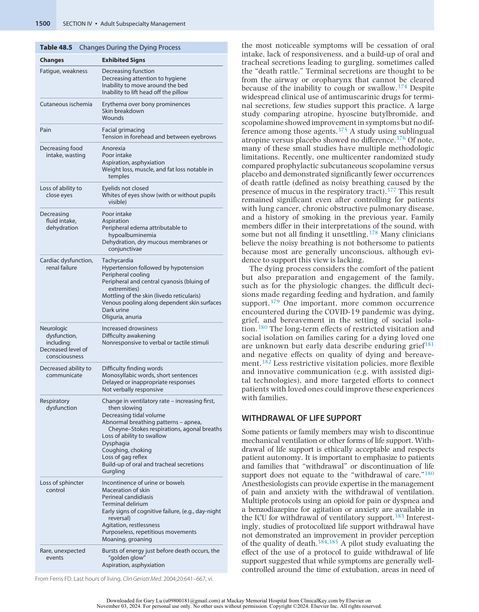

:::

<!-- PDF page 26 -->

improvement include documentation of family meetings and provision of emotional or spiritual support to families and staff members.386 This study highlights the need to devote specific attention to the nonsymptomatic needs of patients and families near the time of death, including making arrangements for rituals and family support, and involving a spiritual advisor for some families.383

### Outcomes of Withdrawal of Life Support

Often vasoactive medications are also being administered during mechanical ventilation in the ICU. In one study of 471 patients, death occurred fastest (median 30 minutes) when mechanical ventilation and vasoactive medications were stopped together. When vasoactives were stopped without extubation, time to death was 45 minutes and when patients were extubated without cessation of vasoactives, time to death was 50 minutes.387 Another study of 74 medical patients in an ICU who were expected to die shortly after extubation showed a mean morphine dose of 5.3 mg/h in the last hour of mechanical ventilation, followed by 10.6 mg/h during the hour before death.388 The average time to death was 153 minutes after extubation, with a range of 4 to 934 minutes. Somewhat surprisingly, each 1 mg/h increase of morphine corresponded to an 8- minute delay in death.388 This response is similar to an earlier study that showed a 13- minute increase in the time to death with each 1 mg/h increase of benzodiazepine.389 Longer time interval between initiation of withdrawal of life support to death has been associated with improved family satisfaction.390 Variability in medication delivery at initiation of comfort- focused care and at the end of life suggests that more standardized protocols guiding providers on symptom management may be beneficial to controlling symptoms and reducing harm.391–393

### Paralytic Drugs in the Withdrawal of Life Support

As noted in Chapter 7, patients should not be paralyzed before extubation of the trachea; it obscures symptom assessment and may lead to patient suffering. Patients already on paralytic medications should await the return of neuromuscular function before extubation unless doing so causes undue burden on the patient.180 In particularly time- intensive circumstances whereby remaining intubated does cause undue burden, neuromuscular blocking reversal agents (e.g., sugammadex when appropriate) can be administered to facilitate extubation.

of death, whereas a 10- year- old child may be interested in the details of the dying process.395

### Characteristics of the Pediatric Palliative Care Population

The variety of diagnoses for patients in pediatric palliative care are wider than those for adults,396 with the most common disorders being congenital and neuromuscular in origin.396 In the largest observational study to date, over onethird of pediatric patients referred for palliative care consultation services were 1 to 9 years of age, one-third were 10 to 18 years old, and less than 20% were younger than 1 year of age.396 Children often have prolonged survival after the initial palliative care consultation compared to adults.396 Some disorders, including chromosomal or severe developmental abnormalities, are rarely seen by adult palliative care physicians. The decision to forgo treatment with curative intent is generally difficult for families, and prognostication is similarly difficult for providers.395 Moreover, multiple legal issues related to declining medical treatment in children exist that differ from those related to adults.397

### Symptom Management in Pediatric Palliative Care

Historically, symptoms in children with serious illnesses have been poorly managed. In a retrospective survey of parents of deceased children, parents noted that their children suffered “a lot” or “a great deal,” mostly from pain, fatigue, and dyspnea.397 In contrast to most studies of adults near the end of life, a 2011 study noted neurologic symptoms being more prevalent,396 suggesting a need for a better understanding and treatment of these symptoms in the pediatric population. Regional anesthesia has been reported as being of benefit to pediatric patients with pain that is difficult to manage with systemic treatment.398 Data on specific therapies for children are limited, and many practitioners use medications based on adult studies.

### Complete references available online at expertconsult.com.

### References

1.  Gurian M, et al. _Designing and Implementing Home- Based Palliative Care: A Guide for Payers_ . Center to Advance Palliative Care; 2019.

2.  Ferris FD, et al. _J Pain Symptom Manage_ . 2002;24:106.

3.  Quill TE, Abernethy AP. _N Engl J Med_ . 2013;368:1173.

4.  von Gunten CF. _JAMA_ . 2002;287:875.

5.  Meier DE, et al. _Palliative Care: Transforming the Care of Serious Illness_ . Jossey- Bass; 2010.

6.  Morrison RS. _Curr Opin Support Palliat Care_ . 2013;7:201.

### PEDIATRIC HOSPICE CARE AND PALLIATIVE CARE

Palliative care is appropriate for many children with chronic serious illnesses, and the WHO states that pediatric palliative care can be successfully delivered even in resource- limited settings.1 There is increasing attention being paid to the role of anesthesiologists in perioperative discussions of pediatric palliative patients.394 Pediatric hospice and palliative care are similar to their adult counterparts, but the patient’s developmental stage is incorporated into the pediatric care plan. Explanations of illness and death depend on the child’s developmental stage. A child younger than 2 years of age has no concept

7.  Morrison RS, et al. _Arch Intern Med_ . 2008;168:1783.

8.  Morrison RS, Meier DE. _America’s Care of Serious Illness: A State- ByState Report Card on Access to Palliative Care in Our Nation’s Hospitals_ ; 2019.

9.  American Academy of Hospice and Palliative Medicine. _ABMS Subspecialty Certification in Hospice and Palliative Medicine_ . ABMS Certification.

10.  American Academy of Hospice and Palliative Medicine. _Workforce Data and Reports_ . AAHPM.

11.  American Board of Anesthesiology. https://theaba.org.

12.  Duncan I, et al. _Am J Hosp Palliat Care_ . 2019;36(8):705.

13.  Meier DE. _Milbank Q_ . 2011;89:343.

14.  Robinson J, et al. _Palliat Med_ . 2013;28:18.

15.  The SUPPORT Principal Investigators. _JAMA_ . 1995;274:1591.

16.  Nelson JE, et al. _Crit Care Med_ . 2010;38:808.

17.  Kwok AC, et al. _Lancet_ . 2011;378:1408.

<!-- PDF page 27 -->

18.  Fine PG. _Anesth Analg_ . 2018;127(1):12.

19.  Fine PG. _Anesth Analg_ . 2005;100(1):183.

20.  Cobert J, et al. _Anesth Analg_ . 2018;127(1):284. 21.  Kain ZN, et al. _Anesth Analg_ . 2015;120(5):1155.

22.  Lynch T, et al. _J Pain Symptom Manage_ . 2013;45:1094.

23.  Bosnjak S, et al. _Support Care Cancer_ . 2011;19:1239.

24.  Stjernsward J, et al. _J Pain Symptom Manage_ . 2007;33:486.

25. _National Consensus Project for Quality Palliative Care_ ; 2018. http://ww w.nationalconsensusproject.org/.

26.  Morrison RS, et al. _J Palliat Med_ . 2011;14:1094. 27.  Center to Advance Palliative Care. https://www.capc.org. 28.  May P, et al. _JAMA Intern Med_ . 2018;178(6):820. 29.  Morrison RS, et al. _Health Aff (Millwood)_ . 2011;30(3):454. 30.  O’Connor NR, et al. _Am J Hosp Palliat Care_ . 2018;35(7):966. 31.  May P, et al. _Health Aff (Millwood)_ . 2016;35(1):44. 32.  Mosenthal AC, et al. _J Trauma_ . 2008;64:1587. 33.  El- Jawahri A, et al. _J Support Oncol_ . 2011;9:87. 34.  Zimmermann C, et al. _JAMA_ . 2008;299:1698. 35.  Casarett D, et al. _J Am Geriatr Soc_ . 2008;56:593. 36.  Norton SA, et al. _Crit Care Med_ . 2007;35(6):1530. 37.  Scheunemann LP, et al. _Chest_ . 2011;139:543. 38.  Reyes- Ortiz CA, et al. _Am J Hosp Palliat Care_ . 2015;32(5):516. 39.  Weissman DE, Meier DE. _J Palliat Med_ . 2011;14:17. 40.  Mosenthal AC, et al. _Crit Care Med_ . 2012;40:1199. 41.  O’Mahony S, et al. _Palliat Med_ . 2010;24(2):154. 42.  Aslakson RA, et al. _Crit Care Med_ . 2014;42(11):2418. 43.  Sihra L, et al. _J Pain Symptom Manage_ . 2011;42(5):672. 44.  Garrouste- Orgeas M, et al. _JAMA_ . 2019;322(3):229. 45.  Curtis JR, et al. _Am J Respir Crit Care Med_ . 2016;193(2):154. 46.  White DB, et al. _N Engl J Med_ . 2018;378(25):2365. 47.  Cox CE, et al. _Ann Intern Med_ . 2019;170(5):285. 48.  Carson SS, et al. _JAMA_ . 2016;316(1):51. 49.  Andersen SK, et al. _J Pain Symptom Manage_ . 2022;63(6):e601. 50.  Cox CE, et al. _Contemp Clin Trials_ . 2021;103:106319. 51.  Cox CE, et al. _Contemp Clin Trials_ . 2020;98:106163. 52.  Kentish- Barnes N, et al. _Trials_ . 2018;19(1):698. 53.  Prigerson HG, et al. _Trials_ . 2019;20(1):408.

54.  Klaristenfeld DD, et al. _Ann Surg Oncol_ . 2007;14(6):1801. 55.  Bakke KE, et al. _J Surg Educ_ . 2018;75(3):702. 56.  Baggs JG, et al. _J Crit Care_ . 2007;22(2):159. 57.  Aslakson RA, et al. _Crit Care_ . 2010;14(6):R218. 58.  Schwarze ML, et al. _Crit Care Med_ . 2010;38(3):843. 59.  Cassell J, et al. _Crit Care Med_ . 2003;31(5):1551. 60.  Buchman TG, et al. _J Am Coll Surg_ . 2002;194(5):665. 61.  Paul Olson TJ, et al. _JAMA Surg_ . 2013;148(1):29. 62.  Tylee MJ, et al. _JAMA Netw Open_ . 2020;3(11):e2023503. 63.  Lilley EJ, et al. _Ann Surg_ . 2018;267(1):66.

64.  Nelson JE, et al. _Crit Care Med_ . 2013;41(10):2318. 65.  Lamba Sal, et al. _J Pain Symptom Manage_ . 2012;44(4):508. 66.  Bradley C, et al. _Surgery_ . 2010;147:871.

67.  Hua MS, et al. _J Crit Care_ . 2018;46:79. 68.  Hope AA, et al. _J Palliat Med_ . 2021;24(2):252. 69.  Hua MS, et al. _Am J Respir Crit Care Med_ . 2014;189(4):428. 70.  Goldsmith B, et al. _J Palliat Med_ . 2008;11(8):1094. 71.  Dumanovsky T, et al. _J Palliat Med_ . 2016;19(1):8. 72.  Quill TE, Abernethy AP. _N Engl J Med_ . 2013;368(13):1173. 73.  Murali KP, et al. _J Crit Care_ . 2022;71:154054.

74.  Wysham NG, et al. _Crit Care Med_ . 2017;45(4):e372.

75.  Pandharipande, et al. _N Engl J Med_ . 2013;369(14):1306.

76.  Mikkelsen ME, et al. _Am J Respir Crit Care Med_ . 2012;185(12):1307. 77.  Wunsch H, et al. _JAMA_ . 2014;311(11):1133. 78.  De Jonghe B, et al. _JAMA_ . 2002;288(22):2859.

79.  Fan E, et al. _Crit Care Med_ . 2014;42(4):849.

80.  Needham DM, et al. _Crit Care Med_ . 2012;40(2):502.

81.  Needham DM, et al. _Am J Respir Crit Care Med_ . 2013;188(5):567. 82.  Girard TD, et al. _Crit Care Med_ . 2010;38(7):1513. 83.  Bienvenu OJ, et al. _Am J Respir Crit Care Med_ . 2012;185(5):517. 84.  Patel MB, et al. _Am J Respir Crit Care Med_ . 2016;193(12):1373. 85.  Hodgson CL, et al. _Am J Respir Crit Care Med_ . 2022;205(10):1159. 86.  Hermans G, et al. _Am J Respir Crit Care Med_ . 2014;190(4):410. 87.  Haines KJ, et al. _Crit Care Med_ . 2019;47(9):1194. 88.  McPeake J, et al. _Crit Care Med_ . 2019;47(1):e21. 89.  Krumholz HM. _N Engl J Med_ . 2013;368(2):100. 90.  Smith AK, et al. _J Palliat Med_ . 2013;16:661. 91.  Temel JS, et al. _N Engl J Med_ . 2010;363:733.

92.  Maltoni M, et al. _Eur J Cancer_ . 2016;69:110.

93.  Haun MW, et al. _Cochrane Database Syst Rev_ . 2017;6:CD011129.

94.  Radbruch L, Payne SA. _Eur J Palliative Care_ . 2010;17(1):22.

95. _Medicare Benefit Policy Manual_ ; 2020.

96.  Gazelle G. _N Engl J Med_ . 2007;357:321.

97.  Centers for Medicare & Medicaid Services. _Hospice_ . https://www.cms .gov/medicare/medicare- fee- for- service- payment/hospice.

98.  (NHPCO) NHaPCO. _NHPCO Facts and Figures_ ; 2020.

99.  Han PK, et al. _J Pain Symptom Manage_ . 2012;43:527.

100.  Earle CC, et al. _J Clin Oncol_ . 2008;26(23):3860.

101.  Kelley AS, et al. _Health Aff (Millwood)_ . 2013;32:552.

102.  Teno JM, et al. _J Pain Symptom Manage_ . 2007;34:120.

103.  Taylor Jr DH, et al. _Soc Sci Med_ . 2007;65:1466.

104.  Powers BW, et al. _J Palliat Med_ . 2015;18(5):400.

105.  Miner TJ, et al. _Arch Surg_ . 2011;146:517.

106.  Miner TJ, et al. _Ann Surg_ . 2004;240:719.

107.  Yefimova M, et al. _JAMA Surg_ . 2020;155(2):138.

108.  Steffens NM, et al. _JAMA Surg_ . 2016;151(10):938.

109.  De Roo AC, et al. _Surgery_ . 2021;170(3):756.

110.  Pecanac KE, et al. _Ann Surg_ . 2014;259(3):458.

111.  Schwarze ML, et al. _Crit Care Med_ . 2013;41(1):1.

112.  Cooper Z, et al. _Anesthesiology_ . 2015;123(6):1450.

113.  Kruser JM, et al. _J Am Geriatr Soc_ . 2015;63(9):1805.

114.  American Society of Anesthesiologists. _Ethical Guidelines for the Anesthesia Care of Patients with Do- Not- Resuscitate Orders or Other Directives that Limit Treatment_ . American Society of Anesthesiologists; 2001.

115.  American College of Surgeons. _Bull Am Coll Surg_ . 2014;99(1):42.

116.  Sun Y, et al. _Reg Anesth Pain Med_ . 2015;40(5):589.

117.  Sekandarzad MW, et al. _Anesth Analg_ . 2017;124(5):1697.

118.  Sessler DI, et al. _Lancet_ . 2019;394(10211):1807.

119.  Xu ZZ, et al. _Anesthesiology_ . 2021;135(3):419.

120.  Du YT, et al. _Anesthesiology_ . 2021;135(2):233.

121.  Snyder GL, Greenberg S. _Br J Anaesth_ . 2010;105:106.

122.  Bernacki RE, et al. _JAMA Intern Med_ . 2014;174(12):1994.

123.  Sloan DH, et al. _Am J Hosp Palliat Care_ . 2021;38(12):1526.

124.  La Puma J, et al. _JAMA_ . 1991;266:402.

125.  Straton JB, et al. _J Am Geriatr Soc_ . 2004;52:577.

126.  Fried TR, et al. _J Am Geriatr Soc_ . 2007;55:1007.

127.  Ditto PH, et al. _Arch Intern Med_ . 2001;161:421.

128.  Teno J, et al. _J Am Geriatr Soc_ . 1997;45:500.

129.  Teno JM, et al. _J Am Geriatr Soc_ . 1997;45:508.

130.  Teno J, et al. _J Am Geriatr Soc_ . 1997;45:513.

131.  Norals TE, et al. _Oncology (Williston Park, NY)_ . 2015;29(8):567.

132.  Dy SM, et al. _J Palliat Med_ . 2011;14(4):451.

133.  Redmann AJ, et al. _Ann Surg_ . 2012;255(3):418.

134.  Yang AD, et al. _Am J Surg_ . 2004;188(1):98.

135.  Parikh PP, et al. _J Surg Res_ . 2017;211:172.

136.  Sulmasy DP, et al. _J Med Ethics_ . 2008;34:96.

137.  Orgel E, et al. _J Palliat Med_ . 2010;13:677.

138.  Weissman DE, et al. _J Palliat Med_ . 2007;10(2):408.

139.  Siddiqui MF, Holley JL. _Am J Hosp Palliat Care_ . 2011;28:94.

140.  Smith AK, et al. _Arch Intern Med_ . 2006;166:1597.

141.  Lockwood BJ, et al. _Palliat Med Rep_ . 2022;3(1):26.

142.  Robertson AC, et al. _Anesth Analg_ . 2021;132(6):1738.

143.  Weill SR, et al. _J Surg Educ_ . 2022;79(4):983.

144.  Mackillop WJ, et al. _Br J Cancer_ . 1988;58:355.

145.  Fine E, et al. _J Palliat Med_ . 2010;13:595.

146.  Haidet P, et al. _Am J Med_ . 1998;105:222.

147.  Cassell J, et al. _Crit Care Med_ . 2003;31(5):1551.

148.  Kruser JM, et al. _Ann Am Thorac Soc_ . 2017;14(3):426.

149.  Kruser JM, et al. _Ann Surg_ . 2015;261(4):678.

150.  Fry BT, et al. _Ann Surg_ . 2020;271(5):855.

151.  Kahn JM, et al. _N Engl J Med_ . 2006;355(1):41.

152.  Sasabuchi Y, et al. _Crit Care Med_ . 2015;43(6):1239.

153.  Sakr Y, et al. _Crit Care Med_ . 2015;43(3):519.

154.  Wilcox ME, et al. _Crit Care Med_ . 2020;48(5):709.

155.  Lilley EJ, et al. _JAMA Surg_ . 2016;151(2):172.

156.  Hjermstad MJ, et al. _Trials_ . 2020;21(1):303.

157.  Shinall MC, et al. _Trials_ . 2019;20(1):713.

158.  Aslakson RA, et al. _BMJ Open_ . 2017;7(5):e016257.

159.  Aslakson RA, et al. _J Palliat Med_ . 2019;22(S1):44.

160.  Heyland DK, et al. _CMAJ (Can Med Assoc J)_ . 2006;174:627.

161.  White DB, et al. _Arch Intern Med_ . 2007;167:461.

162.  Selph RB, et al. _J Gen Intern Med_ . 2008;23:1311.

<!-- PDF page 28 -->

163.  Virdun C, et al. _Palliat Med_ . 2017;31(7):587.

164.  Barclay JS, et al. _J Palliat Med_ . 2007;10:958.

165.  Back AL, et al. _Cancer_ . 2008;113:1897.

166.  Mallinger JB, et al. _Psycho Oncol_ . 2006;15:297.

167.  Parker SM, et al. _J Pain Symptom Manage_ . 2007;34:81.

168.  Swinton M, et al. _Am J Respir Crit Care Med_ . 2017;195(2):198.

169.  Lo B, et al. _JAMA_ . 2002;287:749.

170.  Sulmasy DP. _Gerontologist_ . 2002;42(Spec No 3):24.

171.  Balboni TA, et al. _J Clin Oncol_ . 2007;25:555.

172.  van Vliet LM, Epstein AS. _J Clin Oncol_ . 2014;32(31):3474.

173.  Phelps AC, et al. _JAMA_ . 2009;301:1140.

174.  Prendergast TJ. _Crit Care Med_ . 2001;29:N34.

175.  Baile WF, et al. _Oncologist_ . 2000;5:302.

176.  Lautrette A, et al. _N Engl J Med_ . 2007;356:469.

177.  Billings JA, Block SD. _J Palliat Med_ . 2011;14:1058.

178.  Davidson JE, et al. _Crit Care Med_ . 2017;45(1):103.

179.  Clarke EB, et al. _Crit Care Med_ . 2003;31(9):2255.

180.  Truog RD, et al. _Crit Care Med_ . 2008;36(3):953.

181.  Lilly CM, et al. _Am J Med_ . 2000;109:469.

182.  Drury A, et al. _J Patient Exp_ . 2022;9:23743735221092623.

183.  Kentish- Barnes N, et al. _Lancet_ . 2022;399(10325):656.

184.  Kynoch K, et al. _JBI Database System Rev Implement Rep_ . 2016; 14(3):181.

185.  Seaman JB, et al. _Am J Crit Care_ . 2022;31(2):129.

186.  Wentlandt K, et al. _Palliat Med_ . 2022;36(6):945.

187.  Kross EK, et al. _Chest_ . 2011;139(4):795.

188.  Boyd O. _Crit Care Med_ . 2021;49(1):162.

189.  Maley JH, et al. _Ann Am Thorac Soc_ . 2016;13(8):1351.

190.  Donesky D, et al. _J Palliat Med_ . 2020;23(1):40.

191.  Taylor LJ, et al. _JAMA Surg_ . 2017;152(6):531.

192.  Back AL, et al. _CA Cancer J Clin_ . 2005;55(3):164.

193.  Bousquet G, et al. _J Clin Oncol_ . 2015;33(22):2437.

194.  Philip J, et al. _Intern Med J_ . 2007;37:49.

195.  Rueth TW, Hall SE. _Am J Hosp Palliat Care_ . 1999;16:743.

196.  Mystakidou K, et al. _Support Care Cancer_ . 2004;12:147.

197.  Hallenbeck J, Arnold R. _J Clin Oncol_ . 2007;25:5030.

198.  Quill TE, Holloway R. _JAMA_ . 2011;306:1483.

199.  Chang DW, et al. _JAMA Intern Med_ . 2021;181(6):786.

200.  Cheung EH, et al. _Intensive Care Med_ . 2022;48(7):969.

201.  Loertscher L, et al. _Am J Med_ . 2010;123:4.

202.  Girotra S, et al. _N Engl J Med_ . 2012;367:1912.

203.  Holmberg MJ, et al. _Resuscitation_ . 2020;157:112.

204.  Meaney PA, et al. _Crit Care Med_ . 2010;38(1):101–108.

205.  Kazaure HS, et al. _JAMA Surg_ . 2013;148:14.

206.  Ehlenbach WJ, et al. _N Engl J Med_ . 2009;361:22.

207.  Chan PS, et al. _N Engl J Med_ . 2013;368:1019.

208.  Nunnally ME, et al. _Anesth Analg_ . 2015;120(2):364.

209.  Kim M, Li G. _Anesth Analg_ . 2018;126(3):858.

210.  Arrich J, et al. _Cochrane Database Syst Rev_ . 2016;2:CD004128.

211.  Schenone AL, et al. _Resuscitation_ . 2016;108:102.

212.  Dankiewicz J, et al. _N Engl J Med_ . 2021;384(24):2283.

213.  Elbadawi A, et al. _Am J Med_ . 2022;135(5):626.

214.  Fernando SM, et al. _Intensive Care Med_ . 2021;47(10):1078.

215.  Agarwal S, et al. _Resuscitation_ . 2018;125:12.

216.  Monlezun DJ, et al. _Cardiol Res Pract_ . 2021;2021:3180987.

217.  Razi RR, et al. _Resuscitation_ . 2015;87:69.

218.  Brooks Carthon M, et al. _Med Care_ . 2021;59(2):169.

219.  Rhondali W, et al. _Cancer_ . 2013;119:2067.

220.  Miljković MD, et al. _J Palliat Med_ . 2015;18(5):457.

221.  VitalTalk. https://www.vitaltalk.org/topics/reset- goals- of- care/

222.  Childers JW, et al. _J Oncol Pract_ . 2017;13(10):e844.

223.  Glare P, et al. _BMJ_ . 2003;327:195.

224.  Stone PC, et al. _PLoS One_ . 2022;17(4):e0267050.

225.  Christakis NA, Lamont EB. _BMJ_ . 2000;320:469.

226.  Steinberg A, et al. _Resuscitation_ . 2020;153:97.

227.  Detsky ME, et al. _JAMA_ . 2017;317(21):2187.

228.  Rocker G, et al. _Crit Care Med_ . 2004;32(5):1149.

229.  Meadow W, et al. _Crit Care Med_ . 2011;39(3):474.

230.  Sinuff T, et al. _Crit Care Med_ . 2006;34(3):878.

231.  Glare PA, Sinclair CT. _J Palliat Med_ . 2008;11(1):84.

232.  Frick S, et al. _Crit Care Med_ . 2003;31:456.

233.  Gwilliam B, et al. _BMJ Support Palliat Care_ . 2015;5(4):390.

234.  Hancock K, et al. _Palliat Med_ . 2007;21:507.

235.  Evans LR, et al. _Am J Respir Crit Care Med_ . 2009;179:48. 236.  Zier LS, et al. _Ann Intern Med_ . 2012;156:360.

237.  Lunney JR, et al. _J Am Geriatr Soc_ . 2002;50:1108.

238.  Gill TM, et al. _N Engl J Med_ . 2010;362(13):1173.

239.  Stolz E, et al. _J Gerontol A Biol Sci Med Sci_ . 2021;76(7):1260.

240.  Ferrante LE, et al. _JAMA Intern Med_ . 2015;175(4):523.

241.  ePrognosis. University of California, San Francisco. https://eprognos is.ucsf.edu/index.php.

242.  Hauser CA, et al. _Support Care Cancer_ . 2006;14:999.

243.  Salpeter SR, et al. _J Palliat Med_ . 2012;15:175.

244.  Salpeter SR, et al. _Am J Med_ . 2012;125:512 e1.

245.  Haga K, et al. _Heart_ . 2012;98:579.

246.  Muntwyler J, et al. _Eur Heart J_ . 2002;23:1861.

247.  Goldberg RJ, et al. _Arch Intern Med_ . 2007;167:490.

248.  Mitchell SL, et al. _N Engl J Med_ . 2009;361:1529.

249.  Mitchell SL, et al. _JAMA_ . 2010;304:1929.

250.  Celli BR, et al. _N Engl J Med_ . 2004;350:1005.

251.  Nevins ML, Epstein SK. _Chest_ . 2001;119:1840.

252.  Said A, et al. _J Hepatol_ . 2004;40:897.

253.  Cardenas A. _Am J Gastroenterol_ . 2005;100:460.

254.  Cohen LM, et al. _J Palliat Med_ . 2006;9:977.

255.  Moss AH, et al. _J Palliat Med_ . 2000;3:253.

256.  Segaux L, et al. _Sci Rep_ . 2021;11(1):8774.

257.  Fried LP, et al. _J Gerontol A Biol Sci Med Sci_ . 2001;56(3):M146.

258.  Rockwood K, Mitnitski A. _J Gerontol A Biol Sci Med Sci_ . 2007;62(7):722.

259.  Woods NF, et al. _J Am Geriatr Soc_ . 2005;53(8):1321.

260.  Theou O, et al. _J Am Geriatr Soc_ . 2013;61(9):1537.

261.  Hoogendijk EO, et al. _Am J Epidemiol_ . 2021;190(7):1316.

262.  Makary MA, et al. _J Am Coll Surg_ . 2010;210(6):901.

263.  Kim DH, et al. _Ann Intern Med_ . 2016;165(9):650.

264.  Li Y, et al. _CMAJ_ . 2018;190(7):E184.

265.  Rothenberg KA, et al. _JAMA Netw Open_ . 2019;2(5):e194330.

266.  Stow D, et al. _Palliat Med_ . 2019;33(4):399.

267.  Herndon CM, Fike DS. _J Pain Symptom Manage_ . 2001;22:1027.

268.  Fonzo- Christe C, et al. _Palliat Med_ . 2005;19:208.

269.  Chan VO, et al. _Eur J Radiol_ . 2006;58:480.

270.  Remington R, Hultman T. _J Am Geriatr Soc_ . 2007;55:2051.

271.  Radbruch L, et al. _Palliat Med_ . 2011;25:578.

272.  Burton AW, et al. _Pain Med_ . 2004;5(3):239.

273.  Goudas LC, et al. _Cancer Invest_ . 2005;23:182.

274.  Caraceni A, Portenoy RK. _Pain_ . 1999;82:263.

275.  Zech DF, et al. _Pain_ . 1995;63:65.

276.  van den Beuken- van Everdingen MHJ, et al. _Ann Oncol_ . 2007;18(9):1437.

277.  Azevedo São Leão Ferreira K, et al. _Support Care Cancer_ . 2006;14(11):1086.

278.  Portenoy RK. _Lancet_ . 2011;377:2236.

279.  Aapro M, et al. _Ann Oncol_ . 2008;19:420.

280.  Mundy GR. _Nat Rev Cancer_ . 2002;2:584.

281.  Smith HS, Barkin RL. _Am J Ther_ . 2013;21:106.

282.  Buga S, Sarria JE. _Cancer Control_ . 2012;19:154.

283.  Ferris FD, et al. _Surg Oncol Clin N Am_ . 2001;10:185.

284.  Paulsen O, et al. _J Pain Symptom Manage_ . 2012;46:96.

285.  Van Poznak CH, et al. _J Clin Oncol_ . 2011;29:1221.

286.  McNicol E, et al. _J Clin Oncol_ . 1975;22:2004.

287.  Careskey H, et al. _Hematol Oncol Clin North Am_ . 2018;32(3):433.

288.  Nekolaichuk CL, et al. _J Palliat Med_ . 2013;16:516.

289.  Stanik- Hutt JA, et al. _Am J Crit Care_ . 2001;10:252.

290.  Puntillo K, et al. _Chest_ . 2009;135:1069.

291.  Damico V, et al. _Ann Ig_ . 2020;32(4):407.

292.  Chanques G, et al. _Anesthesiology_ . 2007;107(5):858.

293.  Payen JF, et al. _Anesthesiology_ . 2007;106(4):687. 294.  Puntillo KA, et al. _Intensive Care Med_ . 2018;44(9):1493. 295.  Puntillo KA, et al. _Crit Care Med_ . 2016;44(11):1988. 296.  Baumbach P, et al. _Crit Care Med_ . 2016;44(6):1129. 297.  Hayhurst CJ, et al. _Anesth Analg_ . 2018;127(3):690. 298.  Battle CE, et al. _Crit Care Med_ . 2013;17(3):R101. 299.  Payen J- F, et al. _Crit Care Med_ . 2001;29(12):2258. 300.  Gélinas C, et al. _Am J Crit Care_ . 2006;15(4):420. 301.  Puntillo K, et al. _Chest_ . 2009;135(4):1069. 302.  Devlin JW, et al. _Crit Care Med_ . 2018;46(9):e825.

303.  Wu CL, et al. _Front Med_ . 2022;9:851690.

304.  Bargshady G, et al. _Artif Intell Med_ . 2020;109:101954. 305.  Penrod JD, et al. _Crit Care Med_ . 2012;40:1105. 306.  Bailey FA, et al. _J Pain Symptom Manage_ . 2012;44:681. 307.  Morita T, et al. _J Pain Symptom Manage_ . 2001;21:282.

<!-- PDF page 29 -->

308.  Thorns A, Sykes N. _Lancet_ . 2000;356:398.

309.  Portenoy RK, et al. _J Pain Symptom Manage_ . 2006;32:532.

310.  Sykes N, Thorns A. _Lancet Oncol_ . 2003;4:312.

311.  Ballantyne JC. _Curr Pain Headache Rep_ . 2007;11:276.

312.  Enzinger AC, et al. _J Clin Oncol_ . 2021;39(26):2948.

313.  Organization WH. _Traitement de la douleur cancéreuse_ . Organisation mondiale de la Santé.

314.  Cleeland CS, et al. _N Engl J Med_ . 1994;330(9):592.

315.  Vainio A, Auvinen A. _J Pain Symptom Manage_ . 1996;12(1):3. 316.  Smith TJ, et al. _J Clin Oncol_ . 2002;20(19):4040.

317.  Hesketh PJ, et al. _J Clin Oncol_ . 2020;38(24):2782.

318.  Blair SL, et al. _Ann Surg Oncol_ . 2001;8:632.

319.  Atukorale YN, et al. _J Gastrointest Surg_ . 2016;20(2):455. 320.  Obita GP, et al. _J Pain Symptom Manage_ . 2016;52(6):901. 321.  Madariaga A, et al. _Support Care Cancer_ . 2022;30(6):4711. 322.  Casarett D, et al. _N Engl J Med_ . 2005;353:2607.

323.  Ganzini L, et al. _N Engl J Med_ . 2003;349:359.

324.  Mitchell SL. _JAMA_ . 2007;298:2527.

325.  Ganzini L. _Palliat Support Care_ . 2006;4:135.

326.  Bruera E, et al. _J Clin Oncol_ . 2005;23:2366.

327.  Bruera E, et al. _J Clin Oncol_ . 2013;31(1):111. 328.  Teno JM, et al. _J Am Geriatr Soc_ . 2012;60:1918.

329.  Fischberg D, et al. _J Pain Symptom Manage_ . 2013;45:595.

330.  Parshall MB, et al. _Am J Respir Crit Care Med_ . 2012;185:435.

331.  Haugdahl HS, et al. _Am J Respir Crit Care Med_ . 2015;192(12):1440. 332.  Janssens T, et al. _Chest_ . 2011;140(3):618. 333.  Delgado- Guay MO, et al. _Cancer_ . 2009;115:437.

334.  Solano JP, et al. _J Pain Symptom Manage_ . 2006;31:58.

335.  Puntillo KA, et al. _Crit Care Med_ . 2010;38:2155.

336.  Demoule A, et al. _Am J Respir Crit Care Med_ . 2022;205(8):917.

337.  Currow DC, et al. _J Pain Symptom Manage_ . 2010;39:680.

338.  Buckholz GT, von Gunten CF. _Curr Opin Support Palliat Care_ . 2009;3:98.

339.  Cranston JM, et al. _Cochrane Database Syst Rev_ . 2008;3:CD004769. 340.  Currow DC, et al. _J Pain Symptom Manage_ . 2011;42:388. 341.  Mahler DA, et al. _Chest_ . 2010;137:674.

342.  Abernethy AP, et al. _BMJ_ . 2003;327:523.

343.  Navigante AH, et al. _J Pain Symptom Manage_ . 2010;39:820.

344.  Navigante AH, et al. _J Pain Symptom Manage_ . 2006;31:38.

345.  Gomutbutra P, et al. _J Pain Symptom Manage_ . 2013;45:885. 346.  Minchom A, et al. _Eur J Cancer_ . 2016;61:102.

347.  Suzuki M, et al. _Arch Intern Med_ . 2012;172(11):878. 348.  Mitchell AJ, et al. _Lancet Oncol_ . 2011;12:160.

349.  Block SD. _J Palliat Med_ . 2006;9:751.

350.  Payne A, et al. _Palliat Med_ . 2007;21:193.

351.  Rao S, et al. _J Palliat Med_ . 2011;14:275. 352.  Kerr CW, et al. _J Pain Symptom Manage_ . 2012;43:68.

353.  Block SD. _Ann Intern Med_ . 2000;132:209.

354.  Lawlor PG, et al. _Arch Intern Med_ . 2000;160:786.

355.  Hosie A, et al. _Palliat Med_ . 2013;27(6):486.

356.  Breitbart W, Alici Y. _JAMA_ . 2008;300(24):2898.

357.  Ryan K, et al. _Palliat Med_ . 2009;23:40.

358.  Inouye SK, et al. _Ann Intern Med_ . 1990;113:941.

359.  Breitbart W, et al. _Psychosomatics_ . 2002;43:183.

360.  Leonard M, et al. _Palliat Med_ . 2008;22:848.

361.  Spiller JA, Keen JC. _Palliat Med_ . 2006;20:17.

362.  LeGrand SB. _J Pain Symptom Manage_ . 2012;44:583.

363.  Beretta M, et al. _Cureus_ . 2022;14(6):e25706.

364.  Hosker CMG, Bennett MI. _BMJ_ . 2016;353:i3085.

365.  Woodhouse R, et al. _Cochrane Database Syst Rev_ . 2019;4:CD009537.

366.  Gagnon P, et al. _Psycho Oncol_ . 2012;21(2):187.

367.  Hosie A, et al. _J Palliat Med_ . 2020;23(10):1314.

368.  Burton JK, et al. _Cochrane Database Syst Rev_ . 2021;11:CD013307.

369.  Gupta D, et al. _J Palliat Med_ . 2008;11:250.

370.  Sood R, et al. _Ann Med Surg (Lond)._ 2020;50:14.

371.  Harris DG, Noble SI. _J Pain Symptom Manage_ . 2009;38:913.

372.  Mularski RA, et al. _Chest_ . 2009;135:1360.

373.  Morita T, et al. _Am J Hosp Palliat Care_ . 1998;15:217.

374.  Bennett M, et al. _Palliat Med_ . 2002;16:369.

375.  Wildiers H, et al. _J Pain Symp Manag_ . 2009;38(1):124.

376.  Heisler M, et al. _J Pain Symptom Manage_ . 2013;45:14.

377.  van Esch HJ, et al. _JAMA_ . 2021;326(13):1268.

378.  Wee BL, et al. _Palliat Med_ . 2006;20:171.

379.  Berry M, et al. _BMJ_ . 2017;356:j367.

380.  Schallenburger M, et al. _BMC Palliat Care_ . 2022;21(1):63.

381.  Dennis B, et al. _BMJ Open_ . 2022;12(1):e058768.

382.  Feder S, et al. _J Am Geriatr Soc_ . 2021;69(3):587.

383.  Marr L, Weissman DE. _J Support Oncol_ . 2004;2:283.

384.  Treece PD, et al. _Crit Care Med_ . 2004;32:1141.

385.  Campbell ML. _AACN Adv Crit Care_ . 2007;18:397.

386.  Rajamani A, et al. _Anaesth Intensive Care_ . 2015;43(3):335. 387.  Epker JL, et al. _Anesth Analg_ . 2011;112(3):628.

388.  Mazer MA, et al. _J Pain Symptom Manage_ . 2011;42:44.

389.  Chan JD, et al. _Chest_ . 2004;126:286.

390.  Gerstel E, et al. _Am J Respir Crit Care Med_ . 2008;178(8):798. 391.  Lin KJ, et al. _J Palliat Med_ . 2015;18(9):786.

392.  Bailey FA, et al. _J Pain Symptom Manage_ . 2012;44(5):681.

393.  Brown W. _Eur J Cancer Care (Engl)_ . 2008;17(1):65.

394.  Erondu MU, Mahoney DP. _Curr Opin Anaesthesiol_ . 2020;33(3):354.

395.  Himelstein BP, et al. _N Engl J Med_ . 2004;350:1752.

396.  Feudtner C, et al. _Pediatrics_ . 2011;127:1094.

397.  Wolfe J, et al. _N Engl J Med_ . 2000;342:326.

398.  Rork JF, et al. _J Pain Symptom Manage_ . 2013;46:859.

<!-- PDF page 30 -->

### References

1.  Gurian M, Abdnor A, Kytonen A, Fields T. _Designing and Implementing Home- Based Palliative Care: A Guide for Payers_ . Center to Advance Palliative Care; 2019. https://www.capc.org/documents/downl oad/744/.

2.  Ferris FD, Balfour HM, Bowen K, et al. A model to guide patient and family care. _J Pain Symptom Manage_ . 2002;24(2):106–123.

3.  Quill TE, Abernethy AP. Generalist plus specialist palliative care – creating a more sustainable model. _N Engl J Med_ . 2013; 368(13):1173–1175.

4.  von Gunten CF. Secondary and tertiary palliative care in US hospitals. _JAMA_ . 2002;287(7):875.

5.  Meier DE, Isaacs SL, Hughes RG. _Palliative Care: Transforming the Care of Serious Illness_ . Jossey- Bass; 2010:464.

6.  Morrison RS. Models of palliative care delivery in the United States. _Curr Opin Support Palliat Care_ . 2013;7(2):201–206.

7.  Morrison RS. Cost savings associated with US hospital palliative care consultation programs. _Arch Intern Med_ . 2008;168(16):1783.

8.  Morrison RS, Meier DE. _America’s Care of Serious Illness: A State- By- State Report Card on Access to Palliative Care in Our Nation’s Hospitals_ ; 2019. https://reportcard.capc.org/wpcontent/uploads/2020/05/CAPC_State- by- State- ReportCard_051120.pdf.

9.  American Academy of Hospice and Palliative Medicine. _ABMS Subspecialty Certification in Hospice and Palliative Medicine_ . http://aahpm. org/certification/subspecialty- certification.

10.  American Academy of Hospice and Palliative Medicine. _Workforce Data and Reports_ . http://aahpm.org/career/workforce- study.

11.  American Board of Anesthesiology. https://theaba.org.

12.  Duncan I, Ahmed T, Dove H, Maxwell TL. Medicare cost at end of life. _Am J Hosp Palliat Care_ . 2019;36(8):705–710.

13.  Meier DE. Increased access to palliative care and hospice services: opportunities to improve value in health care. _Milbank Q_ . 2011;89(3):343–380.

14.  Robinson J, Gott M, Ingleton C. Patient and family experiences of palliative care in hospital: what do we know? An integrative review. _Palliat Med_ . 2014;28(1):18–33.

15.  The SUPPORT Principal Investigators. A controlled trial to improve care for seriously ill hospitalized patients. The study to understand prognoses and preferences for outcomes and risks of treatments (SUPPORT). _JAMA_ . 1995;274(20):1591–1598.

16.  Nelson JE, Puntillo KA, Pronovost PJ, et al. In their own words: patients and families define high- quality palliative care in the intensive care unit. _Crit Care Med_ . 2010;38(3):808–818.

17.  Kwok AC, Semel ME, Lipsitz SR, et al. The intensity and variation of surgical care at the end of life: a retrospective cohort study. _Lancet_ . 2011;378(9800):1408–1413.

18.  Fine PG, Davis MS, Muir JC, Byas- Smith M. Anesthesiology and palliative care: past, present, and future. _Anesth Analg_ . 2018;127(1):12– 14.

19.  Fine PG. The evolving and important role of anesthesiology in palliative care. _Anesth Analg_ . 2005;100(1):183–188.

20.  Cobert J, Hauck J, Flanagan E, et al. Anesthesia- guided palliative care in the perioperative surgical home model. _Anesth Analg_ . 2018;127(1):284–288.

21.  Kain ZN, Hwang J, Warner MA. Disruptive innovation and the specialty of anesthesiology: the case for the perioperative surgical home. _Anesth Analg_ . 2015;120(5):1155–1157.

22.  Lynch T, Connor S, Clark D. Mapping levels of palliative care development: a global update. _J Pain Symptom Manage_ . 2013;45(6):1094– 1106.

23.  Bosnjak S, Maurer MA, Ryan KM, et al. Improving the availability and accessibility of opioids for the treatment of pain: the International Pain Policy Fellowship. _Support Care Cancer_ . 2011;19(8):1239– 1247.

24.  Stjernswärd J, Foley KM, Ferris FD. The public health strategy for palliative care. _J Pain Symptom Manage_ . 2007;33(5):486–493.

25.  National Consensus Project for Quality Palliative Care. _Clinical Practice Guidelines for Quality Palliative Care_ . 4th ed. National Coalition for Hospice and Palliative Care; 2018.

26.  Morrison RS, Augustin R, Souvanna P, Meier DE. America’s care of serious illness: a state- by- state report card on access to palliative care in our nation’s hospitals. _J Palliat Med_ . 2011;14(10):1094–1096.

27.  Center to Advance Palliative Care. https://www.capc.org

28.  May P, Normand C, Cassel JB, et al. Economics of palliative care for hospitalized adults with serious illness: a meta- analysis. _JAMA Intern Med_ . 2018;178(6):820–829.

29.  Morrison RS, Dietrich J, Ladwig S, et al. Palliative care consultation teams cut hospital costs for Medicaid beneficiaries. _Health Aff (Millwood)_ . 2011;30(3):454–463.

30.  O’Connor NR, Junker P, Appel SM, et al. Palliative care consultation for goals of care and future acute care costs: a propensity- matched study. _Am J Hosp Palliat Care_ . 2018;35(7):966–971.

31.  May P, Garrido MM, Cassel JB, et al. Palliative care teams’ costsaving effect is larger for cancer patients with higher numbers of comorbidities. _Health Aff (Millwood)_ . 2016;35(1):44–53.

32.  Mosenthal AC, Murphy PA, Barker LK, et al. Changing the culture around end- of- life care in the trauma intensive care unit. _J Trauma Injury Infect Crit Care_ . 2008;64(6):1587–1593.

33.  El- Jawahri A, Greer JA, Temel JS. Does palliative care improve outcomes for patients with incurable illness? A review of the evidence. _J Support Oncol_ . 2011;9(3):87–94.

34.  Zimmermann C, Riechelmann R, Krzyzanowska M, et al. Effectiveness of specialized palliative care. _JAMA_ . 2008;299(14):1698.

35.  Casarett D, Pickard A, Bailey FA, et al. Do palliative consultations improve patient outcomes? _J Am Geriatr Soc_ . 2008;56(4):593–599.

36.  Norton SA, Hogan LA, Holloway RG, et al. Proactive palliative care in the medical intensive care unit: effects on length of stay for selected high- risk patients. _Crit Care Med_ . 2007;35(6):1530–1535.

37.  Scheunemann LP, McDevitt M, Carson SS, Hanson LC. Randomized, controlled trials of interventions to improve communication in intensive care. _Chest_ . 2011;139(3):543–554.

38.  Reyes- Ortiz CA, Williams C, Westphal C. Comparison of early versus late palliative care consultation in end- of- life care for the hospitalized frail elderly patients. _Am J Hospice Palliat Med_ . 2014;32(5):516–520.

39.  Weissman DE, Meier DE. Identifying patients in need of a palliative care assessment in the hospital setting: a consensus report from the Center to Advance Palliative Care. _J Palliat Med_ . 2011;14(1):17–23.

40.  Mosenthal AC, Weissman DE, Curtis JR, et al. Integrating palliative care in the surgical and trauma intensive care unit: a report from the Improving Palliative Care in the Intensive Care Unit (IPAL- ICU) Project Advisory Board and the Center to Advance Palliative Care. _Crit Care Med_ . 2012;40(4):1199–1206.

41.  O’Mahony S, McHenry J, Blank AE, et al. Preliminary report of the integration of a palliative care team into an intensive care unit. _Palliat Med_ . 2010;24(2):154–165.

42.  Aslakson RA, Curtis JR, Nelson JE. The changing role of palliative care in the ICU. _Crit Care Med_ . 2014;42(11):2418–2428.

43.  Sihra L, Harris M, O’Reardon C. Using the improving palliative care in the intensive care unit (IPAL- ICU) project to promote palliative care consultation. _J Pain Symptom Manage_ . 2011;42(5):672–675.

44.  Garrouste- Orgeas M, Flahault C, Vinatier I, et al. Effect of an ICU diary on posttraumatic stress disorder symptoms among patients receiving mechanical ventilation: a randomized clinical trial. _JAMA_ . 2019;322(3):229–239.

45.  Curtis JR, Treece PD, Nielsen EL, et al. Randomized trial of communication facilitators to reduce family distress and intensity of end- of- life care. _Am J Respir Crit Care Med_ . 2016;193(2):154–162.

46.  White DB, Angus DC, Shields AM, et al. A randomized trial of a family- support intervention in intensive care units. _N Engl J Med_ . 2018;378(25):2365–2375.

47.  Cox CE, White DB, Hough CL, et al. Effects of a personalized webbased decision aid for surrogate decision makers of patients with prolonged mechanical ventilation: a randomized clinical trial. _Ann Intern Med_ . 2019;170(5):285–297.

48.  Carson SS, Cox CE, Wallenstein S, et al. Effect of palliative care- led meetings for families of patients with chronic critical illness: a randomized clinical trial. _JAMA_ . 2016;316(1):51–62.

49.  Andersen SK, Vincent G, Butler RA, et al. ProPACC: protocol for a trial of integrated specialty palliative care for critically ill older adults. _J Pain Symptom Manage_ . 2022;63(6):e601–e610.

50.  Cox CE, Riley IL, Ashana DC, et al. Improving racial disparities in unmet palliative care needs among intensive care unit family members with a needs- targeted app intervention: the ICUconnect randomized clinical trial. _Contemp Clin Trials_ . 2021;103:106319.

51.  Cox CE, Olsen MK, Casarett D, et al. Operationalizing needs- focused palliative care for older adults in intensive care units: design of and

<!-- PDF page 31 -->

rationale for the PCplanner randomized clinical trial. _Contemp Clin Trials_ . 2020;98:106163.

52.  Kentish- Barnes N, Chevret S, Azoulay E. Guiding intensive care physicians’ communication and behavior towards bereaved relatives: study protocol for a cluster randomized controlled trial (COSMICEOL). _Trials_ . 2018;19(1):698.

53.  Prigerson HG, Viola M, Brewin CR, et al. Enhancing & Mobilizing the POtential for Wellness & Emotional Resilience (EMPOWER) among surrogate decision- makers of ICU patients: study protocol for a randomized controlled trial. _Trials_ . 2019;20(1):408.

54.  Klaristenfeld DD, Harrington DT, Miner TJ. Teaching palliative care and end- of- life issues: a core curriculum for surgical residents. _Ann Surg Oncol_ . 2007;14(6):1801–1806.

55.  Bakke KE, Miranda SP, Castillo- Angeles M, et al. Training surgeons and anesthesiologists to facilitate end- of- life conversations with patients and families: a systematic review of existing educational models. _J Surg Educ_ . 2018;75(3):702–721.

56.  Baggs JG, Norton SA, Schmitt MH. etc. Intensive care unit cultures and end- of- life decision making. _J Crit Care_ . 2007;22(2):159–168.

57.  Aslakson RA, Wyskiel R, Shaeffer D, et al. Surgical intensive care unit clinician estimates of the adequacy of communication regarding patient prognosis. _Crit Care_ . 2010;14(6):R218.

58.  Schwarze ML, Bradley CT, Brasel KJ. Surgical “buy- in”: the contractual relationship between surgeons and patients that influences decisions regarding life- supporting therapy. _Crit Care Med_ . 2010;38(3):843–848.

59.  Cassell J, Buchman TG, Streat S, Stewart RM. Surgeons, intensivists, and the covenant of care: administrative models and values affecting care at the end of life – Updated. _Crit Care Med_ . 2003;31(5):1551– 1557; discussion 1557–1559.

60.  Buchman TG, Cassell J, Ray SE, Wax ML. Who should manage the dying patient?: rescue, shame, and the surgical ICU dilemma. _J Am Coll Surg_ . 2002;194(5):665–673.

61.  Paul Olson TJ, Brasel KJ, Redmann AJ, et al. Surgeon- reported conflict with intensivists about postoperative goals of care. _JAMA Surg_ . 2013;148(1):29–35.

62.  Tylee MJ, Rubenfeld GD, Wijeysundera D, et al. Anesthesiologist to patient communication: a systematic review. _JAMA Netw Open_ . 2020;3(11):e2023503.

63.  Lilley EJ, Cooper Z, Schwarze ML, Mosenthal AC. Palliative care in surgery: defining the research priorities. _Ann Surg_ . 2018;267(1):66– 72.

64.  Nelson JE, Curtis JR, Mulkerin C, et al. Choosing and using screening criteria for palliative care consultation in the ICU: a report from the Improving Palliative Care in the ICU (IPAL- ICU) Advisory Board. _Crit Care Med_ . 2013;41(10):2318–2327.

65.  Lamba S, Murphy P, McVicker S, et al. Changing end- of- life care practice for liver transplant service patients: structured palliative care intervention in the surgical intensive care unit. _J Pain Symptom Manage_ . 2012;44(4):508–519.

66.  Bradley C, Weaver J, Brasel K. Addressing access to palliative care services in the surgical intensive care unit. _Surgery_ . 2010;147(6):871– 877.

67.  Hua MS, Ma X, Li G, Wunsch H. Derivation of data- driven triggers for palliative care consultation in critically ill patients. _J Crit Care_ . 2018;46:79–83.

68.  Hope AA, Enilari OM, Chuang E, et al. Prehospital frailty and screening criteria for palliative care services in critically ill older adults: an observational cohort study. _J Palliat Med_ . 2021;24(2):252–256.

69.  Hua MS, Li G, Blinderman CD, Wunsch H. Estimates of the need for palliative care consultation across United States intensive care units using a trigger- based model. _Am J Respir Crit Care Med_ . 2014;189(4):428–436.

70.  Goldsmith B, Dietrich J, Du Q, Morrison RS. Variability in access to hospital palliative care in the United States. _J Palliat Med_ . 2008;11(8):1094–1102.

71.  Dumanovsky T, Augustin R, Rogers M, et al. The growth of palliative care in U.S. hospitals: a status report. _J Palliat Med_ . 2016;19(1):8– 15.

72.  Quill TE, Abernethy AP. Generalist plus specialist palliative care – creating a more sustainable model. _N Engl J Med_ . 2013;368(13): 1173–1175.

73.  Murali KP, Fonseca LD, Blinderman CD, et al. Clinicians’ views on the use of triggers for specialist palliative care in the ICU: a qualitative secondary analysis. _J Crit Care_ . 2022;71:154054.

74.  Wysham NG, Hua M, Hough CL, et al. Improving ICU- based palliative care delivery: a multicenter, multidisciplinary survey of critical care clinician attitudes and beliefs. _Crit Care Med_ . 2017;45(4):e372– e378.

75.  Pandharipande PP, Girard TD, Jackson JC, et al. Long- term cognitive impairment after critical illness. _N Engl J Med_ . 2013;369(14):1306– 1316.

76.  Mikkelsen ME, Christie JD, Lanken PN, et al. The adult respiratory distress syndrome cognitive outcomes study: long- term neuropsychological function in survivors of acute lung injury. _Am J Respir Crit Care Med_ . 2012;185(12):1307–1315.

77.  Wunsch H, Christiansen CF, Johansen MB, et al. Psychiatric diagnoses and psychoactive medication use among nonsurgical critically ill patients receiving mechanical ventilation. _JAMA_ . 2014;311(11):1133–1142.

78.  De Jonghe B, Sharshar T, Lefaucheur JP, et al. Paresis acquired in the intensive care unit: a prospective multicenter study. _JAMA_ . 2002;288(22):2859–2867.

79.  Fan E, Dowdy DW, Colantuoni E, et al. Physical complications in acute lung injury survivors: a two- year longitudinal prospective study. _Crit Care Med_ . 2014;42(4):849–859.

80.  Needham DM, Davidson J, Cohen H, et al. Improving long- term outcomes after discharge from intensive care unit: report from a stakeholders’ conference. _Crit Care Med_ . 2012;40(2):502–509.

81.  Needham DM, Dinglas VD, Morris PE, et al. Physical and cognitive performance of patients with acute lung injury 1 year after initial trophic versus full enteral feeding. EDEN trial follow- up. _Am J Respir Crit Care Med_ . 2013;188(5):567–576.

82.  Girard TD, Jackson JC, Pandharipande PP, et al. Delirium as a predictor of long- term cognitive impairment in survivors of critical illness. _Crit Care Med_ . 2010;38(7):1513–1520.

83.  Bienvenu OJ, Colantuoni E, Mendez- Tellez PA, et al. Depressive symptoms and impaired physical function after acute lung injury: a 2- year longitudinal study. _Am J Respir Crit Care Med_ . 2012;185(5):517–524.

84.  Patel MB, Jackson JC, Morandi A, et al. Incidence and risk factors for intensive care unit- related post- traumatic stress disorder in veterans and civilians. _Am J Respir Crit Care Med_ . 2016;193(12):1373–1381.

85.  Hodgson CL, Higgins AM, Bailey MJ, et al. Comparison of 6- month outcomes of survivors of COVID- 19 versus non- COVID- 19 critical illness. _Am J Respir Crit Care Med_ . 2022;205(10):1159–1168.

86.  Hermans G, Van Mechelen H, Clerckx B, et al. Acute outcomes and 1- year mortality of intensive care unit- acquired weakness. A cohort study and propensity- matched analysis. _Am J Respir Crit Care Med_ . 2014;190(4):410–420.

87.  Haines KJ, McPeake J, Hibbert E, et al. Enablers and barriers to implementing ICU follow- up clinics and peer support groups following critical illness: the Thrive Collaboratives. _Crit Care Med_ . 2019;47(9):1194–1200.

88.  McPeake J, Hirshberg EL, Christie LM, et al. Models of peer support to remediate post- intensive care syndrome: a report developed by the Society of Critical Care Medicine Thrive International Peer Support Collaborative. _Crit Care Med_ . 2019;47(1):e21–e27.

89.  Krumholz HM. Post- hospital syndrome – an acquired, transient condition of generalized risk. _N Engl J Med_ . 2013;368(2):100–102.

90.  Smith AK, Thai JN, Bakitas MA, et al. The diverse landscape of palliative care clinics. _J Palliat Med_ . 2013;16(6):661–668.

91.  Temel JS, Greer JA, Muzikansky A, et al. Early palliative care for patients with metastatic non- small- cell lung cancer. _N Engl J Med_ . 2010;363(8):733–742.

92.  Maltoni M, Scarpi E, Dall’Agata M, et al. Systematic versus ondemand early palliative care: a randomised clinical trial assessing quality of care and treatment aggressiveness near the end of life. _Eur J Cancer_ . 2016;69:110–118.

93.  Haun MW, Estel S, Rücker G, et al. Early palliative care for adults with advanced cancer. _Cochrane Database Syst Rev_ . 2017;6:CD011129.

94.  Radbruch L, Payne SA. White paper on standards and norms for hospice and palliative care in Europe: part 1. _Eur J Palliat Care_ . 2010;17(1):22–33.

95. _Medicare Benefit Policy Manual_ ; 2020.

96.  Gazelle G. Understanding hospice – an underutilized option for life’s final chapter. _N Engl J Med_ . 2007;357(4):321–324.

97.  Centers for Medicare & Medicaid Services. _Hospice_ . https://www.cms .gov/medicare/medicare- fee- for- service- payment/hospice.

<!-- PDF page 32 -->

98.  (NHPCO) NHaPCO. _NHPCO Facts and Figures 2020 Edition_ ; 2020. https://www.nhpco.org/hospice- facts- figures/#:∼:text=Repres entative%20data%20shared%20in%20the,at%20the%20time%20of%20death.

99.  Han PKJ, Lee M, Reeve BB, et al. Development of a prognostic model for six- month mortality in older adults with declining health. _J Pain Symptom Manage_ . 2012;43(3):527–539.

100.  Earle CC, Landrum MB, Souza JM, et al. Aggressiveness of cancer care near the end of life: is it a quality- of- care issue? _J Clin Oncol_ . 2008;26(23):3860–3866.

101.  Kelley AS, Deb P, Du Q, et al. Hospice enrollment saves money for Medicare and improves care quality across a number of different lengths- of- stay. _Health Aff (Millwood)_ . 2013;32(3):552–561.

102.  Teno JM, Shu JE, Casarett D, et al. Timing of referral to hospice and quality of care: length of stay and bereaved family members’ perceptions of the timing of hospice referral. _J Pain Symptom Manage_ . 2007;34(2):120–125.

103.  Taylor Jr DH, Ostermann J, Van Houtven CH, et al. What length of hospice use maximizes reduction in medical expenditures near death in the US Medicare program? _Soc Sci Med_ . 2007;65(7):1466–1478.

104.  Powers BW, Makar M, Jain SH, et al. Cost savings associated with expanded hospice use in Medicare. _J Palliat Med_ . 2015;18(5):400– 401.

105.  Miner TJ. The palliative triangle. _Arch Surg_ . 2011;146(5):517.

106.  Miner TJ, Brennan MF, Jaques DP. A prospective, symptom related, outcomes analysis of 1022 palliative procedures for advanced cancer. _Ann Surg_ . 2004;240(4):719–727.

107.  Yefimova M, Aslakson RA, Yang L, et al. Palliative care and end- of- life outcomes following high- risk surgery. _JAMA Surg_ . 2020;155(2):138–146.

108.  Steffens NM, Tucholka JL, Nabozny MJ, et al. Engaging patients, health care professionals, and community members to improve preoperative decision making for older adults facing high- risk surgery. _JAMA Surg_ . 2016;151(10):938–945.

109.  De Roo AC, Vitous CA, Rivard SJ, et al. High- risk surgery among older adults: not- quite shared decision- making. _Surgery_ . 2021;170(3):756–763.

110.  Pecanac KE, Kehler JM, Brasel KJ, et al. It’s big surgery: preoperative expressions of risk, responsibility, and commitment to treatment after high- risk operations. _Ann Surg_ . 2014;259(3):458–463.

111.  Schwarze ML, Redmann AJ, Alexander GC, Brasel KJ. Surgeons expect patients to buy- in to postoperative life support preoperatively: results of a national survey. _Crit Care Med_ . 2013;41(1):1–8.

112.  Cooper Z, Sayal P, Abbett SK, et al. A conceptual framework for appropriateness in surgical care: reviewing past approaches and looking ahead to patient- centered shared decision making. _Anesthesiology_ . 2015;123(6):1450–1454.

113.  Kruser JM, Nabozny MJ, Steffens NM, et al. “Best case/worst case”: qualitative evaluation of a novel communication tool for difficult in- themoment surgical decisions. _J Am Geriatr Soc_ . 2015;63(9):1805–1811.

114.  American Society of Anesthesiologists. _Ethical Guidelines for the Anesthesia Care of Patients with Do- Not- Resuscitate Orders or Other Directives that Limit Treatment_ . ASA; 2001.

115.  American College of Surgeons. Statement on advance directives by patients: “do not resuscitate” in the operating room. _Bull Am Coll Surg_ . 2014;99(1):42–43.

116.  Sun Y, Li T, Gan TJ. The effects of perioperative regional anesthesia and analgesia on cancer recurrence and survival after oncology surgery: a systematic review and meta- analysis. _Reg Anesth Pain Med_ . 2015;40(5):589–598.

117.  Sekandarzad MW, van Zundert AAJ, Lirk PB, et al. Perioperative anesthesia care and tumor progression. _Anesth Analg_ . 2017;124(5):1697–1708.

118.  Sessler DI, Pei L, Huang Y, et al. Recurrence of breast cancer after regional or general anaesthesia: a randomised controlled trial. _Lancet_ . 2019;394(10211):1807–1815.

119.  Xu ZZ, Li HJ, Li MH, et al. Epidural anesthesia- analgesia and recurrence- free survival after lung cancer surgery: a randomized trial. _Anesthesiology_ . 2021;135(3):419–432.

120.  Du YT, Li YW, Zhao BJ, et al. Long- term survival after combined epidural- general anesthesia or general anesthesia alone: follow- up of a randomized trial. _Anesthesiology_ . 2021;135(2):233–245.

121.  Snyder GL, Greenberg S. Effect of anaesthetic technique and other perioperative factors on cancer recurrence. _Br J Anaesth_ . 2010;105(2):106–115.

122.  Bernacki RE, Block SD. Communication about serious illness care goals. _JAMA Intern Med_ . 2014;174(12):1994.

123.  Sloan DH, Hannum SM, DeGroot L, et al. Advance care planning shared decision- making tools for non- cancer chronic serious illness: a mixed method systematic review. _Am J Hosp Palliat Care_ . 2021;38(12):1526–1535.

124.  La Puma J. Advance directives on admission clinical implications and analysis of the patient self- determination act of 1990. _JAMA_ . 1991;266(3):402.

125.  Straton JB, Wang NY, Meoni LA, et al. Physical functioning, depression, and preferences for treatment at the end of life: the Johns Hopkins Precursors Study. _J Am Geriatr Soc_ . 2004;52(4):577–582.

126.  Fried TR, O’Leary J, Van Ness P, Fraenkel L. Inconsistency over time in the preferences of older persons with advanced illness for lifesustaining treatment. _J Am Geriatr Soc_ . 2007;55(7):1007–1014.

127.  Ditto PH, Danks JH, Smucker WD, et al. Advance directives as acts of communication. _Arch Intern Med_ . 2001;161(3):421.

128.  Teno J, Lynn J, Wenger N, et al. Advance directives for seriously ill hospitalized patients: effectiveness with the patient self- determination act and the SUPPORT intervention. SUPPORT Investigators. Study to Understand Prognoses and Preferences for Outcomes and Risks of Treatment. _J Am Geriatr Soc_ . 1997;45(4):500–507.

129.  Teno JM, Licks S, Lynn J, et al. Do advance directives provide instructions that direct care? SUPPORT investigators. Study to understand prognoses and preferences for outcomes and risks of treatment. _J Am Geriatr Soc_ . 1997;45(4):508–512.

130.  Teno J, Lynn J, Connors Jr AF, et al. The illusion of end- of- life resource savings with advance directives. Support investigators. Study to understand prognoses and preferences for outcomes and risks of treatment. _J Am Geriatr Soc_ . 1997;45(4):513–518.

131.  Norals TE, Smith TJ. Advance care planning discussions: why they should happen, why they don’t, and how we can facilitate the process. _Oncology (Williston Park)_ . 2015;29(8):567–571.

132.  Dy SM, Asch SM, Lorenz KA, et al. Quality of end- of- life care for patients with advanced cancer in an academic medical center. _J Palliat Med_ . 2011;14(4):451–457.

133.  Redmann AJ, Brasel KJ, Alexander CG, Schwarze ML. Use of advance directives for high- risk operations. _Ann Surg_ . 2012;255(3):418– 423.

134.  Yang AD, Bentrem DJ, Pappas SG, et al. Advance directive use among patients undergoing high- risk operations. _Am J Surg_ . 2004;188(1):98–101.

135.  Parikh PP, White MT, Buckingham L, Tchorz KM. Evaluation of palliative care training and skills retention by medical students. _J Surg Res_ . 2017;211:172–177.

136.  Sulmasy DP, Sood JR, Ury WA. Physicians’ confidence in discussing do not resuscitate orders with patients and surrogates. _J Med Ethics_ . 2008;34(2):96–101.

137.  Orgel E, McCarter R, Jacobs S. A failing medical educational model: a self- assessment by physicians at all levels of training of ability and comfort to deliver bad news. _J Palliat Med_ . 2010;13(6):677–683.

138.  Weissman DE, Ambuel B, Von Gunten CF, et al. Outcomes from a national multispecialty palliative care curriculum development project. _J Palliat Med_ . 2007;10(2):408–419.

139.  Siddiqui MF, Holley JL. Residents’ practices and perceptions about do not resuscitate orders and pronouncing death: an opportunity for clinical training. _Am J Hospice Palliat Med_ . 2011;28(2):94–97.

140.  Smith AK, Ries AP, Zhang B, et al. Resident approaches to advance care planning on the day of hospital admission. _Arch Intern Med_ . 2006;166(15):1597.

141.  Lockwood BJ, Gustin J, Verbeck N, et al. Training to promote empathic communication in graduate medical education: a shared learning intervention in internal medicine and general surgery. _Palliat Med Rep_ . 2022;3(1):26–35.

142.  Robertson AC, Fowler LC, Kimball TS, et al. Efficacy of an online curriculum for perioperative goals of care and code status discussions: a randomized controlled trial. _Anesth Analg_ . 2021;132(6):1738–1747.

143.  Weill SR, Layden AJ, Nabozny MJ, et al. Applying VitalTalk. _J Surg Educ_ . 2022;79(4):983–992.

144.  Mackillop WJ, Stewart WE, Ginsburg AD, Stewart SS. Cancer patients’ perceptions of their disease and its treatment. _Br J Cancer_ . 1988;58(3):355–358.

145.  Fine E, Reid MC, Shengelia R, Adelman RD. Directly observed patient- physician discussions in palliative and end- of- life care: a systematic review of the literature. _J Palliat Med_ . 2010;13(5):595–603.

<!-- PDF page 33 -->

146.  Haidet P, Hamel MB, Davis RB, et al. Outcomes, preferences for resuscitation, and physician- patient communication among patients with metastatic colorectal cancer. SUPPORT Investigators. Study to Understand Prognoses and Preferences for Outcomes and Risks of Treatments. _Am J Med_ . 1998;105(3):222–229.

147.  Cassell J, Buchman TG, Streat S, Stewart RM. Surgeons, intensivists, and the covenant of care: administrative models and values affecting care at the end of life. _Crit Care Med_ . 2003;31(4):1263–1270.

148.  Kruser JM, Cox CE, Schwarze ML. Clinical momentum in the intensive care unit. A latent contributor to unwanted care. _Ann Am Thorac Soc_ . 2017;14(3):426–431.

149.  Kruser JM, Pecanac KE, Brasel KJ, et al. “And I think that we can fix it”: mental models used in high- risk surgical decision making. _Ann Surg_ . 2015;261(4):678–684.

150.  Fry BT, Smith ME, Thumma JR, et al. Ten- year trends in surgical mortality, complications, and failure to rescue in Medicare beneficiaries. _Ann Surg_ . 2020;271(5):855–861.

151.  Kahn JM, Goss CH, Heagerty PJ, et al. Hospital volume and the outcomes of mechanical ventilation. _N Engl J Med_ . 2006;355(1):41– 50.

152.  Sasabuchi Y, Yasunaga H, Matsui H, et al. The volume- outcome relationship in critically ill patients in relation to the ICU- to- hospital bed ratio. _Crit Care Med_ . 2015;43(6):1239–1245.

153.  Sakr Y, Moreira CL, Rhodes A, et al. The impact of hospital and ICU organizational factors on outcome in critically ill patients: results from the Extended Prevalence of Infection in Intensive Care study. _Crit Care Med_ . 2015;43(3):519–526.

154.  Wilcox ME, Harrison DA, Patel A, Rowan KM. Higher ICU capacity strain is associated with increased acute mortality in closed ICUs. _Crit Care Med_ . 2020;48(5):709–716.

155.  Lilley EJ, Khan KT, Johnston FM, et al. Palliative care interventions for surgical patients: a systematic review. _JAMA Surg_ . 2016;151(2):172–183.

156.  Hjermstad MJ, Aass N, Andersen S, et al. PALLiON – PALLiative care Integrated in ONcology: study protocol for a Norwegian national cluster- randomized control trial with a complex intervention of early integration of palliative care. _Trials_ . 2020;21(1):303.

157.  Shinall MC, Hoskins A, Hawkins AT, et al. A randomized trial of a specialist palliative care intervention for patients undergoing surgery for cancer: rationale and design of the Surgery for Cancer with Option of Palliative Care Expert (SCOPE) Trial. _Trials_ . 2019;20(1):713.

158.  Aslakson RA, Isenberg SR, Crossnohere NL, et al. Utilising advance care planning videos to empower perioperative cancer patients and families: a study protocol of a randomised controlled trial. _BMJ Open_ . 2017;7(5):e016257.

159.  Aslakson RA, Chandrashekaran SV, Rickerson E, et al. A multicenter, randomized controlled trial of perioperative palliative care surrounding cancer surgery for patients and their family members (PERIOP- PC). _J Palliat Med_ . 2019;22(S1):44–57.

160.  Heyland DK, Dodek P, Rocker G, et al. What matters most in end- oflife care: perceptions of seriously ill patients and their family members. _CMAJ_ . 2006;174(5):627–633.

161.  White DB, Engelberg RA, Wenrich MD, et al. Prognostication during physician- family discussions about limiting life support in intensive care units. _Crit Care Med_ . 2007;35(2):442–448.

162.  Selph RB, Shiang J, Engelberg R, et al. Empathy and life support decisions in intensive care units. _J Gen Intern Med_ . 2008;23(9):1311– 1317.

163.  Virdun C, Luckett T, Lorenz K, et al. Dying in the hospital setting: a meta- synthesis identifying the elements of end- of- life care that patients and their families describe as being important. _Palliat Med_ . 2016;31(7):587–601.

164.  Barclay JS, Blackhall LJ, Tulsky JA. Communication strategies and cultural issues in the delivery of bad news. _J Palliat Med_ . 2007;10(4):958–977.

165.  Back AL, Anderson WG, Bunch L, et al. Communication about cancer near the end of life. _Cancer_ . 2008;113(suppl 7):1897–1910.

166.  Mallinger JB, Shields CG, Griggs JJ, et al. Stability of decisional role preference over the course of cancer therapy. _Psycho Oncol_ . 2006;15(4):297–305.

167.  Parker SM, Clayton JM, Hancock K, et al. A systematic review of prognostic/end- of- life communication with adults in the advanced stages of a life- limiting illness: patient/caregiver preferences for the content, style, and timing of information. _J Pain Symptom Manage_ . 2007;34(1):81–93.

168.  Swinton M, Giacomini M, Toledo F, et al. Experiences and expressions of spirituality at the end of life in the intensive care unit. _Am J Respir Crit Care Med_ . 2017;195(2):198–204.

169.  Lo B. Discussing religious and spiritual issues at the end of life: a practical guide for physicians. _JAMA_ . 2002;287(6):749.

170.  Sulmasy DP. A biopsychosocial- spiritual model for the care of patients at the end of life. _Gerontologist_ . 2002;42(suppl_3):24–33.

171.  Balboni TA, Vanderwerker LC, Block SD, et al. Religiousness and spiritual support among advanced cancer patients and associations with end- of- life treatment preferences and quality of life. _J Clin Oncol_ . 2007;25(5):555–560.

172.  van Vliet LM, Epstein AS. Current state of the art and science of patient- clinician communication in progressive disease: patients’ need to know and need to feel known. _J Clin Oncol_ . 2014;32(31):3474–3478.

173.  Phelps AC, Maciejewski PK, Nilsson M, et al. Religious coping and use of intensive life- prolonging care near death in patients with advanced cancer. _JAMA_ . 2009;301(11):1140–1147.

174.  Prendergast TJ. Advance care planning: pitfalls, progress, promise. _Crit Care Med_ . 2001;29(supplement):N34–N39.

175.  Baile WF, Buckman R, Lenzi R, et al. SPIKES – a six- step protocol for delivering bad news: application to the patient with cancer. _Oncologist_ . 2000;5(4):302–311.

176.  Lautrette A, Darmon M, Megarbane B, et al. A communication strategy and brochure for relatives of patients dying in the ICU. _N Engl J Med_ . 2007;356(5):469–478.

177.  Billings JA, Block SD. Part III: a guide for structured discussions. _J Palliat Med_ . 2011;14(9):1058–1064.

178.  Davidson JE, Aslakson RA, Long AC, et al. Guidelines for familycentered care in the neonatal, pediatric, and adult icu. _Crit Care Med_ . 2017;45(1):103–128.

179.  Clarke EB, Curtis JR, Luce JM, et al. Quality indicators for end- of- life care in the intensive care unit. _Crit Care Med_ . 2003;31(9):2255– 2262.

180.  Truog RD, Campbell ML, Curtis JR, et al. Recommendations for endof- life care in the intensive care unit: a consensus statement by the American College [corrected] of Critical Care Medicine. _Crit Care Med_ . 2008;36(3):953–963.

181.  Lilly CM, De Meo DL, Sonna LA, et al. An intensive communication intervention for the critically ill. _Am J Med_ . 2000;109(6):469– 475.

182.  Drury A, Muscat DM, Wibrow B, et al. Integrating the Choosing Wisely 5 Questions into family meetings in the intensive care unit: a randomized controlled trial investigating the effect on family perceived involvement in decision- making. _J Patient Exp_ . 2022;9:23743735221092623.

183.  Kentish- Barnes N, Chevret S, Valade S, et al. A three- step support strategy for relatives of patients dying in the intensive care unit: a cluster randomised trial. _Lancet_ . 2022;399(10325):656–664.

184.  Kynoch K, Chang A, Coyer F, McArdle A. The effectiveness of interventions to meet family needs of critically ill patients in an adult intensive care unit: a systematic review update. _JBI Database System Rev Implement Rep_ . 2016;14(3):181–234.

185.  Seaman JB, Rak KJ, Carpenter AK, et al. Intensive care unit clinicians’ perspectives on achieving proactive interprofessional family meetings. _Am J Crit Care_ . 2022;31(2):129–136.

186.  Wentlandt K, Wolofsky KT, Weiss A, et al. Identifying barriers and facilitators to palliative care integration in the management of hospitalized patients with COVID- 19: a qualitative study. _Palliat Med_ . 2022;36(6):945–954.

187.  Kross EK, Engelberg RA, Gries CJ, et al. ICU care associated with symptoms of depression and posttraumatic stress disorder among family members of patients who die in the ICU. _Chest_ . 2011;139(4):795– 801.

188.  Boyd O. Ticking the “family meeting” box – unlikely to be enough. _Crit Care Med_ . 2021;49(1):162–164.

189.  Maley JH, Brewster I, Mayoral I, et al. Resilience in survivors of critical illness in the context of the survivors’ experience and recovery. _Ann Am Thorac Soc_ . 2016;13(8):1351–1360.

190.  Donesky D, Anderson WG, Joseph RD, et al. TeamTalk: interprofessional team development and communication skills training. _J Palliat Med_ . 2020;23(1):40–47.

191.  Taylor LJ, Nabozny MJ, Steffens NM, et al. A framework to improve surgeon communication in high- stakes surgical decisions: best case/ worst case. _JAMA Surg_ . 2017;152(6):531–538.

<!-- PDF page 34 -->

192.  Back AL, Arnold RM, Baile WF, et al. Approaching difficult communication tasks in oncology. _CA Cancer J Clin_ . 2005;55(3):164–177.

193.  Bousquet G, Orri M, Winterman S, et al. Breaking bad news in oncology: a metasynthesis. _J Clin Oncol_ . 2015;33(22):2437–2443.

194.  Philip J, Gold M, Schwarz M, Komesaroff P. Anger in palliative care: a clinical approach. _Intern Med J_ . 2007;37(1):49–55.

195.  Rueth TW, Hall SE. Dealing with the anger and hostility of those who grieve. _Am J Hospice Palliat Med_ . 1999;16(6):743–746.

196.  Mystakidou K, Parpa E, Tsilika E, et al. Cancer information disclosure in different cultural contexts. _Support Care Cancer_ . 2004;12(3):147– 154.

197.  Hallenbeck J, Arnold R. A request for nondisclosure: don’t tell mother. _J Clin Oncol_ . 2007;25(31):5030–5034.

198.  Quill TE, Holloway R. Time- limited trials near the end of life. _JAMA_ . 2011;306(13):1483–1484.

199.  Chang DW, Neville TH, Parrish J, et al. Evaluation of time- limited trials among critically ill patients with advanced medical illnesses and reduction of nonbeneficial ICU treatments. _JAMA Intern Med_ . 2021;181(6):786–794.

200.  Cheung EH, Cheung JC, Yip YY. Beyond failure or success: reflections on the ethical justifications for time- limited trial of intensive care. _Intensive Care Med_ . 2022;48(7):969–970.

201.  Loertscher L, Reed DA, Bannon MP, Mueller PS. Cardiopulmonary resuscitation and do- not- resuscitate orders: a guide for clinicians. _Am J Med_ . 2010;123(1):4–9.

202.  Girotra S, Nallamothu BK, Spertus JA, et al. Trends in survival after in- hospital cardiac arrest. _N Engl J Med_ . 2012;367(20):1912–1920.

203.  Holmberg MJ, Granfeldt A, Girotra S, et al. American Heart Association’s Get with the Guidelines®- Resuscitation Investigators. Trends in survival and introduction of the 2010 and 2015 guidelines for adult in- hospital cardiac arrest. _Resuscitation_ . 2020;157:112–120.

204.  Meaney PA, Nadkarni VM, Kern KB, et al. Rhythms and outcomes of adult in- hospital cardiac arrest. _Crit Care Med_ . 2010;38(1):101– 108.

205.  Kazaure HS, Roman SA, Rosenthal RA, Sosa JA. Cardiac arrest among surgical patients. _JAMA Surg_ . 2013;148(1):14.

206.  Ehlenbach WJ, Barnato AE, Curtis JR, et al. Epidemiologic study of in- hospital cardiopulmonary resuscitation in the elderly. _N Engl J Med_ . 2009;361(1):22–31.

207.  Chan PS, Nallamothu BK, Krumholz HM, et al. Long- term outcomes in elderly survivors of in- hospital cardiac arrest. _N Engl J Med_ . 2013;368(11):1019–1026.

208.  Nunnally ME, O’Connor MF, Kordylewski H, et al. The incidence and risk factors for perioperative cardiac arrest observed in the national anesthesia clinical outcomes registry. _Anesth Analg_ . 2015;120(2):364–370.

209.  Kim M, Li G. Postoperative complications affecting survival after cardiac arrest in general surgery patients. _Anesth Analg_ . 2018;126(3):858–864.

210.  Arrich J, Holzer M, Havel C, et al. Hypothermia for neuroprotection in adults after cardiopulmonary resuscitation. _Cochrane Database Syst Rev_ . 2016;2(2):Cd004128.

211.  Schenone AL, Cohen A, Patarroyo G, et al. Therapeutic hypothermia after cardiac arrest: a systematic review/meta- analysis exploring the impact of expanded criteria and targeted temperature. _Resuscitation_ . 2016;108:102–110.

212.  Dankiewicz J, Cronberg T, Lilja G, et al. Hypothermia versus normothermia after out- of- hospital cardiac arrest. _N Engl J Med_ . 2021;384(24):2283–2294.

213.  Elbadawi A, Sedhom R, Baig B, et al. Targeted hypothermia vs targeted normothermia in survivors of cardiac arrest: a systematic review and meta- analysis of randomized trials. _Am J Med_ . 2022;135(5):626–633.e4.

214.  Fernando SM, Di Santo P, Sadeghirad B, et al. Targeted temperature management following out- of- hospital cardiac arrest: a systematic review and network meta- analysis of temperature targets. _Intensive Care Med_ . 2021;47(10):1078–1088.

215.  Agarwal S, Presciutti A, Verma J, et al. Women have worse cognitive, functional, and psychiatric outcomes at hospital discharge after cardiac arrest. _Resuscitation_ . 2018;125:12–15.

216.  Monlezun DJ, Samura AT, Patel RS, et al. Racial and socioeconomic disparities in out- of- hospital cardiac arrest outcomes: artificial intelligence- augmented propensity score and geospatial cohort analysis of 3,952 patients. _Cardiol Res Pract_ . 2021;2021:3180987.

217.  Razi RR, Churpek MM, Yuen TC, et al. Racial disparities in outcomes following PEA and asystole in- hospital cardiac arrests. _Resuscitation_ . 2015;87:69–74.

218.  Brooks Carthon M, Brom H, McHugh M, et al. Better nurse staffing is associated with survival for black patients and diminishes racial disparities in survival after in- hospital cardiac arrests. _Med Care_ . 2021;59(2):169–176.

219.  Rhondali W, Perez- Cruz P, Hui D, et al. Patient- physician communication about code status preferences: a randomized controlled trial. _Cancer_ . 2013;119(11):2067–2073.

220.  Miljković MD, Emuron D, Rhodes L, et al. “Allow natural death” versus “do not resuscitate”: what do patients with advanced cancer choose? _J Palliat Med_ . 2015;18(5):457–460.

221.  VitalTalk. https://www.vitaltalk.org/topics/reset- goals- of- care/. 222.  Childers JW, Back AL, Tulsky JA, Arnold RM. REMAP: a framework for goals of care conversations. _J Oncol Pract_ . 2017;13(10):e844– e850.

223.  Glare P, Virik K, Jones M, et al. A systematic review of physicians’ survival predictions in terminally ill cancer patients. _BMJ (Clin Res Ed)_ . 2003;327(7408):195–198.

224.  Stone PC, Chu C, Todd C, et al. The accuracy of clinician predictions of survival in the Prognosis in Palliative care Study II (PiPS2): a prospective observational study. _PLoS One_ . 2022;17(4):e0267050.

225.  Christakis NA, Lamont EB. Extent and determinants of error in doctors’ prognoses in terminally ill patients: prospective cohort study. _BMJ_ . 2000;320(7233):469–472.

226.  Steinberg A, Callaway C, Dezfulian C, Elmer J. Are providers overconfident in predicting outcome after cardiac arrest? _Resuscitation_ . 2020;153:97–104.

227.  Detsky ME, Harhay MO, Bayard DF, et al. Discriminative accuracy of physician and nurse predictions for survival and functional outcomes 6 months after an ICU admission. _JAMA_ . 2017;317(21):2187– 2195.

228.  Rocker G, Cook D, Sjokvist P, et al. Clinician predictions of intensive care unit mortality. _Crit Care Med_ . 2004;32(5):1149–1154.

229.  Meadow W, Pohlman A, Frain L, et al. Power and limitations of daily prognostications of death in the medical intensive care unit. _Crit Care Med_ . 2011;39(3):474–479.

230.  Sinuff T, Adhikari NKJ, Cook DJ, et al. Mortality predictions in the intensive care unit: comparing physicians with scoring systems. _Crit Care Med_ . 2006;34(3):878–885.

231.  Glare PA, Sinclair CT. Palliative medicine review: prognostication. _J Palliat Med_ . 2008;11(1):84–103.

232.  Frick S, Uehlinger DE, Zuercher Zenklusen RM. Medical futility: predicting outcome of intensive care unit patients by nurses and doctors – a prospective comparative study. _Crit Care Med_ . 2003;31(2):456– 461.

233.  Gwilliam B, Keeley V, Todd C, et al. Development of Prognosis in Palliative care Study (PiPS) predictor models to improve prognostication in advanced cancer: prospective cohort study. _BMJ Support Palliat Care_ . 2015;5(4):390–398.

234.  Hancock K, Clayton JM, Parker SM, et al. Truth- telling in discussing prognosis in advanced life- limiting illnesses: a systematic review. _Palliat Med_ . 2007;21(6):507–517.

235.  Evans LR, Boyd EA, Malvar G, et al. Surrogate decision- makers’ perspectives on discussing prognosis in the face of uncertainty. _Am J Respir Crit Care Med_ . 2009;179(1):48–53.

236.  Zier LS. Surrogate decision makers’ interpretation of prognostic information. _Ann Intern Med_ . 2012;156(5):360.

237.  Lunney JR, Lynn J, Hogan C. Profiles of older medicare decedents. _J Am Geriatr Soc_ . 2002;50(6):1108–1112.

238.  Gill TM, Gahbauer EA, Han L, Allore HG. Trajectories of disability in the last year of life. _N Engl J Med_ . 2010;362(13):1173–1180.

239.  Stolz E, Gill TM, Mayerl H, et al. Trajectories of late- life disability vary by the condition leading to death. _J Gerontol A Biol Sci Med Sci_ . 2021;76(7):1260–1264.

240.  Ferrante LE, Pisani MA, Murphy TE, et al. Functional trajectories among older persons before and after critical illness. _JAMA Intern Med_ . 2015;175(4):523–529.

241.  ePrognosis. University of California, San Francisco. https://eprognos is.ucsf.edu/index.php.

242.  Hauser CA, Stockler MR, Tattersall MHN. Prognostic factors in patients with recently diagnosed incurable cancer: a systematic review. _Support Care Cancer_ . 2006;14(10):999–1011.

<!-- PDF page 35 -->

243.  Salpeter SR, Malter DS, Luo EJ, et al. Systematic review of cancer presentations with a median survival of six months or less. _J Palliat Med_ . 2012;15(2):175–185.

244.  Salpeter SR, Luo EJ, Malter DS, Stuart B. Systematic review of noncancer presentations with a median survival of 6 months or less. _Am J Med_ . 2012;125(5):512.e1–512.e16.

245.  Haga K, Murray S, Reid J, et al. Identifying community based chronic heart failure patients in the last year of life: a comparison of the Gold Standards Framework Prognostic Indicator Guide and the Seattle Heart Failure Model. _Heart_ . 2012;98(7):579–583.

246.  Muntwyler J. One- year mortality among unselected outpatients with heart failure. _Eur Heart J_ . 2002;23(23):1861–1866.

247.  Goldberg RJ. Long- term survival after heart failure. _Arch Intern Med_ . 2007;167(5):490.

248.  Mitchell SL, Teno JM, Kiely DK, et al. The clinical course of advanced dementia. _N Engl J Med_ . 2009;361(16):1529–1538.

249.  Mitchell SL, Miller SC, Teno JM, et al. Prediction of 6- month survival of nursing home residents with advanced dementia using ADEPT vs hospice eligibility guidelines. _JAMA_ . 2010;304(17):1929–1935.

250.  Celli BR, Cote CG, Marin JM, et al. The body- mass index, airflow obstruction, dyspnea, and exercise capacity index in chronic obstructive pulmonary disease. _N Engl J Med_ . 2004;350(10):1005–1012.

251.  Nevins ML, Epstein SK. Predictors of outcome for patients with COPD requiring invasive mechanical ventilation. _Chest_ . 2001;119(6):1840–1849.

252.  Said A. Model for end stage liver disease score predicts mortality across a broad spectrum of liver disease. _J Hepatol_ . 2004;40(6):897– 903.

253.  Cardenas A. Hepatorenal syndrome: a dreaded complication of endstage liver disease. _Am J Gastroenterol_ . 2005;100(2):460–467.

254.  Cohen LM, Moss AH, Weisbord SD, Germain MJ. Renal palliative care. _J Palliat Med_ . 2006;9(4):977–992.

255.  Moss AH. A new clinical practice guideline on initiation and withdrawal of dialysis that makes explicit the role of palliative medicine. _J Palliat Med_ . 2000;3(3):253–260.

256.  Segaux L, Broussier A, Oubaya N, et al. Several frailty parameters highly prevalent in middle age (50- 65) are independent predictors of adverse events. _Sci Rep_ . 2021;11(1):8774.

257.  Fried LP, Tangen CM, Walston J, et al. Frailty in older adults: evidence for a phenotype. _J Gerontol A Biol Sci Med Sci_ . 2001;56(3):M146– M156.

258.  Rockwood K, Mitnitski A. Frailty in relation to the accumulation of deficits. _J Gerontol A Biol Sci Med Sci_ . 2007;62(7):722–727.

259.  Woods NF, LaCroix AZ, Gray SL, et al. Frailty: emergence and consequences in women aged 65 and older in the Women’s Health Initiative Observational Study. _J Am Geriatr Soc_ . 2005;53(8):1321– 1330.

260.  Theou O, Brothers TD, Mitnitski A, Rockwood K. Operationalization of frailty using eight commonly used scales and comparison of their ability to predict all- cause mortality. _J Am Geriatr Soc_ . 2013;61(9):1537–1551.

261.  Hoogendijk EO, Stolz E, Oude Voshaar RC, et al. Trends in frailty and its association with mortality: results from the Longitudinal Aging Study Amsterdam, 1995–2016. _Am J Epidemiol_ . 2021;190(7):1316–1323.

262.  Makary MA, Segev DL, Pronovost PJ, et al. Frailty as a predictor of surgical outcomes in older patients. _J Am Coll Surg_ . 2010;210(6):901– 908.

263.  Kim DH, Kim CA, Placide S, et al. Preoperative frailty assessment and outcomes at 6 months or later in older adults undergoing cardiac surgical procedures: a systematic review. _Ann Intern Med_ . 2016;165(9):650–660.

264.  Li Y, Pederson JL, Churchill TA, et al. Impact of frailty on outcomes after discharge in older surgical patients: a prospective cohort study. _CMAJ_ . 2018;190(7):E184–E190.

265.  Rothenberg KA, Stern JR, George EL, et al. Association of frailty and postoperative complications with unplanned readmissions after elective outpatient surgery. _JAMA Netw Open_ . 2019;2(5):e194330.

266.  Stow D, Spiers G, Matthews FE, Hanratty B. What is the evidence that people with frailty have needs for palliative care at the end of life? A systematic review and narrative synthesis. _Palliat Med_ . 2019;33(4):399–414.

267.  Herndon CM, Fike DS. Continuous subcutaneous infusion practices of United States hospices. _J Pain Symptom Manage_ . 2001;22(6):1027– 1034.

268.  Fonzo- Christe C, Vukasovic C, Wasilewski- Rasca A- F, Bonnabry P. Subcutaneous administration of drugs in the elderly: survey of practice and systematic literature review. _Palliat Med_ . 2005;19(3):208– 219.

269.  Chan VO, Colville J, Persaud T, et al. Intramuscular injections into the buttocks: are they truly intramuscular? _Eur J Radiol_ . 2006;58(3):480–484.

270.  Remington R, Hultman T. Hypodermoclysis to treat dehydration: a review of the evidence. _J Am Geriatr Soc_ . 2007;55(12):2051– 2055.

271.  Radbruch L, Trottenberg P, Elsner F, et al. Systematic review of the role of alternative application routes for opioid treatment for moderate to severe cancer pain: an EPCRC opioid guidelines project. _Palliat Med_ . 2011;25(5):578–596.

272.  Burton AW, Rajagopal A, Shah HN, et al. Epidural and intrathecal analgesia is effective in treating refractory cancer pain. _Pain Med_ . 2004;5(3):239–247.

273.  Goudas LC, Bloch R, Gialeli- Goudas M, et al. The epidemiology of cancer pain. _Cancer Invest_ . 2005;23(2):182–190.

274.  Caraceni A, Portenoy RK. An international survey of cancer pain characteristics and syndromes. _Pain_ . 1999;82(3):263–274.

275.  Zech DFJ, Grond S, Lynch J, et al. Validation of World Health Organization Guidelines for cancer pain relief: a 10- year prospective study. _Pain_ . 1995;63(1):65–76.

276.  van den Beuken- van Everdingen MHJ, de Rijke JM, Kessels AG, et al. Prevalence of pain in patients with cancer: a systematic review of the past 40 years. _Ann Oncol_ . 2007;18(9):1437–1449.

277.  Azevedo São Leão Ferreira K, Kimura M, Jacobsen Teixeira M. The WHO analgesic ladder for cancer pain control, twenty years of use. How much pain relief does one get from using it? _Support Care Cancer_ . 2006;14(11):1086–1093.

278.  Portenoy RK. Treatment of cancer pain. _Lancet_ . 2011;377(9784):2236–2247.

279.  Aapro M, Abrahamsson PA, Body JJ, et al. Guidance on the use of bisphosphonates in solid tumours: recommendations of an international expert panel. _Ann Oncol_ . 2008;19(3):420–432.

280.  Mundy GR. Metastasis to bone: causes, consequences and therapeutic opportunities. _Nat Rev Cancer_ . 2002;2(8):584–593.

281.  Smith HS, Barkin RL. Painful boney metastases. _Am J Ther_ . 2014;21(2):106–130.

282.  Buga S, Sarria JE. The management of pain in metastatic bone disease. _Cancer Control_ . 2012;19(2):154–166.

283.  Ferris FD, Bezjak A, Rosenthal SG. The palliative uses of radiation therapy in surgical oncology patients. _Surg Oncol Clin N Am_ . 2001;10(1):185–201.

284.  Paulsen Ø, Aass N, Kaasa S, Dale O. Do corticosteroids provide analgesic effects in cancer patients? A systematic literature review. _J Pain Symptom Manage_ . 2013;46(1):96–105.

285.  Van Poznak CH, Temin S, Yee GC, et al. American Society of Clinical Oncology executive summary of the clinical practice guideline update on the role of bone- modifying agents in metastatic breast cancer. _J Clin Oncol_ . 2011;29(9):1221–1227.

286.  McNicol E, Strassels S, Goudas L, Lau J, Carr D. Nonsteroidal antiinflammatory drugs, alone or combined with opioids, for cancer pain: a systematic review. _J Clin Oncol_ . 2004;22(10):1975–1992.

287.  Careskey H, Narang S. Interventional anesthetic methods for pain in hematology/oncology patients. _Hematol Oncol Clin North Am_ . 2018;32(3):433–445.

288.  Nekolaichuk CL, Fainsinger RL, Aass N, et al. The Edmonton Classification System for Cancer Pain: comparison of pain classification features and pain intensity across diverse palliative care settings in eight countries. _J Palliat Med_ . 2013;16(5):516–523.

289.  Stanik- Hutt JA, Soeken KL, Belcher AE, et al. Pain experiences of traumatically injured patients in a critical care setting. _Am J Crit Care_ . 2001;10(4):252–259.

290.  Puntillo KA, Max A, Timsit JF, et al. Determinants of procedural pain intensity in the intensive care unit. The Europain® study. _Am J Respir Crit Care Med_ . 2014;189(1):39–47.

291.  Damico V, Macchi G, Murano L, Forastieri Molinari A. Incidence of pain at rest and during nursing procedures in ICU patients: a longitudinal observational study. _Ann Ig_ . 2020;32(4):407–418.

292.  Chanques G, Sebbane M, Barbotte E, et al. A prospective study of pain at rest: incidence and characteristics of an unrecognized symptom in surgical and trauma versus medical intensive care unit patients. _Anesthesiology_ . 2007;107(5):858–860.

<!-- PDF page 36 -->

293.  Payen JF, Chanques G, Mantz J, et al. Current practices in sedation and analgesia for mechanically ventilated critically ill patients: a prospective multicenter patient- based study. _Anesthesiology_ . 2007;106(4):687–695; quiz 891–892.

294.  Puntillo KA, Max A, Timsit JF, et al. Pain distress: the negative emotion associated with procedures in ICU patients. _Intensive Care Med_ . 2018;44(9):1493–1501.

295.  Puntillo KA, Max A, Chaize M, et al. Patient recollection of ICU procedural pain and post ICU burden: the Memory Study. _Crit Care Med_ . 2016;44(11):1988–1995.

296.  Baumbach P, Götz T, Günther A, et al. Prevalence and characteristics of chronic intensive care- related pain: the role of severe sepsis and septic shock. _Crit Care Med_ . 2016;44(6):1129–1137.

297.  Hayhurst CJ, Jackson JC, Archer KR, et al. Pain and its longterm interference of daily life after critical illness. _Anesth Analg_ . 2018;127(3):690–697.

298.  Battle CE, Lovett S, Hutchings H. Chronic pain in survivors of critical illness: a retrospective analysis of incidence and risk factors. _Crit Care_ . 2013;17(3):R101.

299.  Payen J- F, Bru O, Bosson J- L, et al. Assessing pain in critically ill sedated patients by using a behavioral pain scale. _Crit Care Med_ . 2001;29(12):2258–2263.

300.  Gélinas C, Fillion L, Puntillo KA, et al. Validation of the criticalcare pain observation tool in adult patients. _Am J Crit Care_ . 2006;15(4):420–427.

301.  Puntillo K, Pasero C, Li D, et al. Evaluation of pain in ICU patients. _Chest_ . 2009;135(4):1069–1074.

302.  Devlin JW, Skrobik Y, Gélinas C, et al. Clinical practice guidelines for the prevention and management of pain, agitation/sedation, delirium, immobility, and sleep disruption in adult patients in the ICU. _Crit Care Med_ . 2018;46(9):e825–e873.

303.  Wu CL, Liu SF, Yu TL, et al. Deep learning- based pain classifier based on the facial expression in critically ill patients. _Front Med (Lausanne)_ . 2022;9:851690.

304.  Bargshady G, Zhou X, Deo RC, et al. Ensemble neural network approach detecting pain intensity from facial expressions. _Artif Intell Med_ . 2020;109:101954.

305.  Penrod JD, Pronovost PJ, Livote EE, et al. Meeting standards of highquality intensive care unit palliative care: clinical performance and predictors. _Crit Care Med_ . 2012;40(4):1105–1112.

306.  Bailey FA, Williams BR, Goode PS, et al. Opioid pain medication orders and administration in the last days of life. _J Pain Symptom Manage_ . 2012;44(5):681–691.

307.  Morita T, Tsunoda J, Inoue S, Chihara S. Effects of high dose opioids and sedatives on survival in terminally ill cancer patients. _J Pain Symptom Manage_ . 2001;21(4):282–289.

308.  Thorns A, Sykes N. Opioid use in last week of life and implications for end- of- life decision- making. _Lancet_ . 2000;356(9227):398–399.

309.  Portenoy RK, Sibirceva U, Smout R, et al. Opioid use and survival at the end of life: a survey of a hospice population. _J Pain Symptom Manage_ . 2006;32(6):532–540.

310.  Sykes N, Thorns A. The use of opioids and sedatives at the end of life. _Lancet Oncol_ . 2003;4(5):312–318.

311.  Ballantyne JC. Opioid misuse in oncology pain patients. _Curr Pain Headache Rep_ . 2007;11(4):276–282.

312.  Enzinger AC, Ghosh K, Keating NL, et al. US trends in opioid access among patients with poor prognosis cancer near the end- of- life. _J Clin Oncol_ . 2021;39(26):2948–2958.

313.  Organization WH. _Traitement de la douleur cancéreuse_ . Organisation mondiale de la Santé; 1987. https://apps.who.int/iris/handle/1066 5/41712.

314.  Cleeland CS, Gonin R, Hatfield AK, et al. Pain and its treatment in outpatients with metastatic cancer. _N Engl J Med_ . 1994;330(9):592– 596.

315.  Vainio A, Auvinen A. Prevalence of symptoms among patients with advanced cancer: an international collaborative study. _J Pain Symptom Manage_ . 1996;12(1):3–10.

316.  Smith TJ, Staats PS, Deer T, et al. Randomized clinical trial of an implantable drug delivery system compared with comprehensive medical management for refractory cancer pain: impact on pain, drug- related toxicity, and survival. _J Clin Oncol_ . 2002;20(19):4040–4049.

317.  Hesketh PJ, Kris MG, Basch E, et al. Antiemetics: ASCO guideline update. _J Clin Oncol_ . 2020;38(24):2782–2797.

318.  Blair SL, Chu DZJ, Schwarz RE. Outcome of palliative operations for malignant bowel obstruction in patients with peritoneal

   - carcinomatosis from nongynecological cancer. _Ann Surg Oncol_ . 2001;8(8):632–637.

319.  Atukorale YN, Church JL, Hoggan BL, et al. Self- expanding metallic stents for the management of emergency malignant large bowel obstruction: a systematic review. _J Gastrointest Surg_ . 2016;20(2):455–462.

320.  Obita GP, Boland EG, Currow DC, et al. Somatostatin analogues compared with placebo and other pharmacologic agents in the management of symptoms of inoperable malignant bowel obstruction: a systematic review. _J Pain Symptom Manage_ . 2016;52(6):901–919. e1.

321.  Madariaga A, Lau J, Ghoshal A, et al. MASCC multidisciplinary evidence- based recommendations for the management of malignant bowel obstruction in advanced cancer. _Support Care Cancer_ . 2022;30(6):4711–4728.

322.  Casarett D, Kapo J, Caplan A. Appropriate use of artificial nutrition and hydration – fundamental principles and recommendations. _N Engl J Med_ . 2005;353(24):2607–2612.

323.  Ganzini L, Goy ER, Miller LL, et al. Nurses’ experiences with hospice patients who refuse food and fluids to hasten death. _N Engl J Med_ . 2003;349(4):359–365.

324.  Mitchell SL. A 93- year- old man with advanced dementia and eating problems. _JAMA_ . 2007;298(21):2527.

325.  Ganzini L. Artificial nutrition and hydration at the end of life: ethics and evidence. _Palliat Support Care_ . 2006;4(2):135–143.

326.  Bruera E, Sala R, Rico MA, et al. Effects of parenteral hydration in terminally ill cancer patients: a preliminary study. _J Clin Oncol_ . 2005;23(10):2366–2371.

327.  Bruera E, Hui D, Dalal S, et al. Parenteral hydration in patients with advanced cancer: a multicenter, double- blind, placebo- controlled randomized trial. _J Clin Oncol_ . 2013;31(1):111–118.

328.  Teno JM, Gozalo PL, Mitchell SL, et al. Does feeding tube insertion and its timing improve survival? _J Am Geriatr Soc_ . 2012;60(10):1918– 1921.

329.  Fischberg D, Bull J, Casarett D, et al. Five things physicians and patients should question in hospice and palliative medicine. _J Pain Symptom Manage_ . 2013;45(3):595–605.

330.  Parshall MB, Schwartzstein RM, Adams L, et al. An official American Thoracic Society statement: update on the mechanisms, assessment, and management of dyspnea. _Am J Respir Crit Care Med_ . 2012;185(4):435–452.

331.  Haugdahl HS, Storli SL, Meland B, et al. Underestimation of patient breathlessness by nurses and physicians during a spontaneous breathing trial. _Am J Respir Crit Care Med_ . 2015;192(12):1440– 1448.

332.  Janssens T, De Peuter S, Stans L, et al. Dyspnea perception in COPD: association between anxiety, dyspnea- related fear, and dyspnea in a pulmonary rehabilitation program. _Chest_ . 2011;140(3):618–625.

333.  Delgado- Guay MO, Parsons HA, Li Z, et al. Symptom distress, interventions, and outcomes of intensive care unit cancer patients referred to a palliative care consult team. _Cancer_ . 2008;115(2):437– 445.

334.  Solano JP, Gomes B, Higginson IJ. A comparison of symptom prevalence in far advanced cancer, AIDS, heart disease, chronic obstructive pulmonary disease and renal disease. _J Pain Symptom Manage_ . 2006;31(1):58–69.

335.  Puntillo KA, Arai S, Cohen NH, et al. Symptoms experienced by intensive care unit patients at high risk of dying. _Crit Care Med_ . 2010;38(11):2155–2160.

336.  Demoule A, Hajage D, Messika J, et al. Prevalence, intensity, and clinical impact of dyspnea in critically ill patients receiving invasive ventilation. _Am J Respir Crit Care Med_ . 2022;205(8):917–926.

337.  Currow DC, Smith J, Davidson PM, et al. Do the trajectories of dyspnea differ in prevalence and intensity by diagnosis at the end of life? A consecutive cohort study. _J Pain Symptom Manage_ . 2010;39(4):680– 690.

338.  Buckholz GT, von Gunten CF. Nonpharmacological management of dyspnea. _Curr Opin Suppor Palliat Care_ . 2009;3(2):98–102.

339.  Cranston JM, Crockett A, Currow D. Oxygen therapy for dyspnoea in adults. _Cochrane Database Syst Rev_ . 2008;3:CD004769.

340.  Currow DC, McDonald C, Oaten S, et al. Once- daily opioids for chronic dyspnea: a dose increment and pharmacovigilance study. _J Pain Symptom Manage_ . 2011;42(3):388–399.

341.  Mahler DA, Selecky PA, Harrod CG, et al. American College of Chest Physicians consensus statement on the management of

<!-- PDF page 37 -->

dyspnea in patients with advanced lung or heart disease. _Chest_ . 2010;137(3):674–691.

342.  Abernethy AP, Currow DC, Frith P, et al. Randomised, double blind, placebo controlled crossover trial of sustained release morphine for the management of refractory dyspnoea. _BMJ_ . 2003;327(7414):523–528.

343.  Navigante AH, Castro MA, Cerchietti Leandro C. Morphine versus midazolam as upfront therapy to control dyspnea perception in cancer patients while its underlying cause is sought or treated. _J Pain Symptom Manage_ . 2010;39(5):820–830.

344.  Navigante AH, Cerchietti LCA, Castro MA, et al. Midazolam as adjunct therapy to morphine in the alleviation of severe dyspnea perception in patients with advanced cancer. _J Pain Symptom Manage_ . 2006;31(1):38–47.

345.  Gomutbutra P, O’Riordan DL, Pantilat SZ. Management of moderateto- severe dyspnea in hospitalized patients receiving palliative care. _J Pain Symptom Manage_ . 2013;45(5):885–891.

346.  Minchom A, Punwani R, Filshie J, et al. A randomised study comparing the effectiveness of acupuncture or morphine versus the combination for the relief of dyspnoea in patients with advanced non- small cell lung cancer and mesothelioma. _Eur J Cancer_ . 2016;61:102–110.

347.  Suzuki M, Muro S, Ando Y, et al. A randomized, placebo- controlled trial of acupuncture in patients with chronic obstructive pulmonary disease (COPD): the COPD- acupuncture trial (CAT). _Arch Intern Med_ . 2012;172(11):878–886.

348.  Mitchell AJ, Chan M, Bhatti H, et al. Prevalence of depression, anxiety, and adjustment disorder in oncological, haematological, and palliative- care settings: a meta- analysis of 94 interview- based studies. _Lancet Oncol_ . 2011;12(2):160–174.

349.  Block SD. Psychological issues in end- of- life care. _J Palliat Med_ . 2006;9(3):751–772.

350.  Payne A, Barry S, Creedon B, et al. Sensitivity and specificity of a two- question screening tool for depression in a specialist palliative care unit. _Palliat Med_ . 2007;21(3):193–198.

351.  Rao S, Ferris FD, Irwin SA. Ease of screening for depression and delirium in patients enrolled in inpatient hospice care. _J Palliat Med_ . 2011;14(3):275–279.

352.  Kerr CW, Drake J, Milch RA, et al. Effects of methylphenidate on fatigue and depression: a randomized, double- blind, placebocontrolled trial. _J Pain Symptom Manage_ . 2012;43(1):68–77.

353.  Block SD. Assessing and managing depression in the terminally ill patient. _Ann Intern Med_ . 2000;132(3):209.

354.  Lawlor PG, Gagnon B, Mancini IL, et al. Occurrence, causes, and outcome of delirium in patients with advanced cancer. _Arch Intern Med_ . 2000;160(6):786.

355.  Hosie A, Davidson PM, Agar M, et al. Delirium prevalence, incidence, and implications for screening in specialist palliative care inpatient settings: a systematic review. _Palliat Med_ . 2013;27(6):486–498.

356.  Breitbart W, Alici Y. Agitation and delirium at the end of life: “We couldn’t manage him. _JAMA_ . 2008;300(24):2898–2910, E1.

357.  Ryan K, Leonard M, Guerin S, et al. Validation of the confusion assessment method in the palliative care setting. _Palliat Med_ . 2008;23(1):40–45.

358.  Inouye SK. Clarifying confusion: the confusion assessment method. _Ann Intern Med_ . 1990;113(12):941.

359.  Breitbart W, Gibson C, Tremblay A. The delirium experience: delirium recall and delirium- related distress in hospitalized patients with cancer, their spouses/caregivers, and their nurses. _Psychosomatics_ . 2002;43(3):183–194.

360.  Leonard M, Raju B, Conroy M, et al. Reversibility of delirium in terminally ill patients and predictors of mortality. _Palliat Med_ . 2008;22(7):848–854.

361.  Spiller JA, Keen JC. Hypoactive delirium: assessing the extent of the problem for inpatient specialist palliative care. _Palliat Med_ . 2006;20(1):17–23.

362.  LeGrand SB. Delirium in palliative medicine: a review. _J Pain Symptom Manage_ . 2012;44(4):583–594.

363.  Beretta M, Uggeri S, Santucci C, et al. Early diagnosis of delirium in palliative care patients decreases mortality and necessity of palliative sedation: results of a prospective observational study. _Cureus_ . 2022;14(6):e25706.

364.  Hosker CMG, Bennett MI. Delirium and agitation at the end of life. _BMJ_ . 2016:i3085.

365.  Woodhouse R, Burton JK, Rana N, et al. Interventions for preventing delirium in older people in institutional long- term care. _Cochrane Database Syst Rev_ . 2019;4:CD009537.

366.  Gagnon P, Allard P, Gagnon B, et al. Delirium prevention in terminal cancer: assessment of a multicomponent intervention. _Psycho Oncol_ . 2012;21(2):187–194.

367.  Hosie A, Phillips J, Lam L, et al. A multicomponent nonpharmacological intervention to prevent delirium for hospitalized people with advanced cancer: a phase II cluster randomized waitlist controlled trial (The PRESERVE Pilot Study). _J Palliat Med_ . 2020;23(10):1314– 1322.

368.  Burton JK, Craig L, Yong SQ, et al. Non- pharmacological interventions for preventing delirium in hospitalised non- ICU patients. _Cochrane Database Syst Rev_ . 2021;11:CD013307.

369.  Gupta D, Mishra S, Bhatnagar S, et al. Trial of angioembolization of advanced stage tumors feeding arteries exemplifying aggressive and active interventional palliation. _J Palliat Med_ . 2008;11(2):250–253.

370.  Sood R, Mancinetti M, Betticher D, et al. Management of bleeding in palliative care patients in the general internal medicine ward: a systematic review. _Ann Med Surg (Lond)._ 2020;50:14–23.

371.  Harris DG, Noble SIR. Management of terminal hemorrhage in patients with advanced cancer: a systematic literature review. _J Pain Symptom Manage_ . 2009;38(6):913–927.

372.  Mularski RA, Puntillo K, Varkey B, et al. Pain management within the palliative and end- of- life care experience in the ICU. _Chest_ . 2009;135(5):1360–1369.

373.  Morita T, Ichiki T, Tsunoda J, et al. A prospective study on the dying process in terminally ill cancer patients. _Am J Hospice Palliat Med_ . 1998;15(4):217–222.

374.  Bennett M, Lucas V, Brennan M, et al. Using anti- muscarinic drugs in the management of death rattle: evidence- based guidelines for palliative care. _Palliat Med_ . 2002;16(5):369–374.

375.  Wildiers H, Dhaenekint C, Demeulenaere P, et al. Atropine, hyoscine butylbromide, or scopolamine are equally effective for the treatment of death rattle in terminal care. _J Pain Symptom Manage_ . 2009;38(1):124–133.

376.  Heisler M, Hamilton G, Abbott A, et al. Randomized double- blind trial of sublingual atropine vs. placebo for the management of death rattle. _J Pain Symptom Manage_ . 2013;45(1):14–22.

377.  van Esch HJ, van Zuylen L, Geijteman ECT, et al. Effect of prophylactic subcutaneous scopolamine butylbromide on death rattle in patients at the end of life: the SILENCE randomized clinical trial. _JAMA_ . 2021;326(13):1268–1276.

378.  Wee BL, Coleman PG, Hillier R, Holgate SH. The sound of death rattle I: are relatives distressed by hearing this sound? _Palliat Med_ . 2006;20(3):171–175.

379.  Berry M, Brink E, Harris J, Sleeman KE. Supporting relatives and carers at the end of a patient’s life. _BMJ_ . 2017;356:j367.

380.  Schallenburger M, Reuters MC, Schwartz J, et al. Inpatient generalist palliative care during the SARS- CoV- 2 pandemic – experiences, challenges and potential solutions from the perspective of health care workers. _BMC Palliat Care_ . 2022;21(1):63.

381.  Dennis B, Vanstone M, Swinton M, et al. Sacrifice and solidarity: a qualitative study of family experiences of death and bereavement in critical care settings during the pandemic. _BMJ Open_ . 2022;12(1):e058768.

382.  Feder S, Smith D, Griffin H, et al. “Why couldn’t i go in to see him?” bereaved families’ perceptions of end- of- life communication during COVID- 19. _J Am Geriatr Soc_ . 2021;69(3):587–592.

383.  Marr L, Weissman DE. Withdrawal of ventilatory support from the dying adult patient. _J Support Oncol_ . 2004;2(3):283–288.

384.  Treece PD, Engelberg RA, Crowley L, et al. Evaluation of a standardized order form for the withdrawal of life support in the intensive care unit. _Crit Care Med_ . 2004;32(5):1141–1148.

385.  Campbell ML. How to withdraw mechanical ventilation. _AACN Adv Crit Care_ . 2007;18(4):397–403.

386.  Rajamani A, Barrett E, Weisbrodt L, et al. Protocolised approach to end- of- life care in the ICU – the ICU PALCare Pilot Project. _Anaesth Intensive Care_ . 2015;43(3):335–340.

387.  Epker JL, Bakker J, Kompanje EJ. The use of opioids and sedatives and time until death after withdrawing mechanical ventilation and vasoactive drugs in a Dutch intensive care unit. _Anesth Analg_ . 2011;112(3):628–634.

388.  Mazer MA, Alligood CM, Wu Q. The infusion of opioids during terminal withdrawal of mechanical ventilation in the medical intensive care unit. _J Pain Symptom Manage_ . 2011;42(1):44–51.

389.  Chan JD, Treece PD, Engelberg RA, et al. Narcotic and benzodiazepine use after withdrawal of life support. _Chest_ . 2004;126(1):286– 293.

<!-- PDF page 38 -->

390.  Gerstel E, Engelberg RA, Koepsell T, Curtis JR. Duration of withdrawal of life support in the intensive care unit and association with family satisfaction. _Am J Respir Crit Care Med_ . 2008;178(8):798– 804.

391.  Lin KJ, Ching A, Edmonds KP, et al. Variable patterns of continuous morphine infusions at end of life. _J Palliat Med_ . 2015;18(9):786– 789.

392.  Bailey FA, Williams BR, Goode PS, et al. Opioid pain medication orders and administration in the last days of life. _J Pain Symptom Manage_ . 2012;44(5):681–691.

393.  Brown W. Opioid use in dying patients in hospice and hospital, with and without specialist palliative care team involvement. _Eur J Cancer Care (Engl)_ . 2008;17(1):65–71.

394.  Erondu MU, Mahoney DP. Palliative care, resuscitation status, and end- of- life considerations in pediatric anesthesia. _Curr Opin Anaesthesiol_ . 2020;33(3):354–360.

395.  Himelstein BP, Hilden JM, Boldt AM, Weissman D. Pediatric palliative care. _N Engl J Med_ . 2004;350(17):1752–1762.

396.  Feudtner C, Kang TI, Hexem KR, et al. Pediatric palliative care patients: a prospective multicenter cohort study. _Pediatrics_ . 2011;127(6):1094–1101.

397.  Wolfe J, Grier HE, Klar N, et al. Symptoms and suffering at the end of life in children with cancer. _N Engl J Med_ . 2000;342(5):326–333.

398.  Rork JF, Berde CB, Goldstein RD. Regional anesthesia approaches to pain management in pediatric palliative care: a review of current knowledge. _J Pain Symptom Manage_ . 2013;46(6):859–873.
