# Anesthesia for Thoracic Surgery

<!-- PDF page 1 -->

PETER SLINGER and JAVIER CAMPOS

### KEY POINTS

|ᑏPatients undergoing pulmonary resection should have a preoperative assessment of their respiratory function in three areas: lung mechanical function, pulmonary parenchymal function, and cardiopulmonary reserve (the “three- legged stool” of respiratory assessment).|
|---|
|ᑏPatients with underlying lung disease have a decreased risk of respiratory complications when pulmonary resections are performed with video- assisted thoracoscopic surgery (VATS).|
|ᑏAfter lung resection surgery, it is usually possible to wean and extubate patients with adequate predicted postoperative respiratory function in the operating room provided they are “AWaC” (alert, warm, and comfortable).|
|ᑏInterventions that have been shown to decrease the incidence of respiratory complications in high- risk patients undergoing thoracic surgery include cessation of smoking, physiotherapy, and thoracic epidural analgesia.|
|ᑏGeriatric patients are at high risk for cardiac complications, particularly cardiac arrhythmias, after large pulmonary resections. Preoperative exercise capacity is the best predictor of postthoracotomy outcome in the older patient. i|
|ᑏThe ability to perform fiberoptic bronchoscopy and a detailed knowledge of bronchial anatomy are necessary for anesthesiologists to provide reliable lung isolation.|
|ᑏUse of double- lumen endobronchial tubes (DLTs) is the standard method of providing lung isolation in adults. Bronchial blockers are a reasonable alternative for lung isolation in patients with abnormal upper or lower airways.|
|ᑏWith the use of intravenous anesthetic techniques or low- dose volatile anesthetics, hypoxemia during one- lung ventilation (OLV) occurs infrequently.|
|ᑏTidal volumes during OLV of 4–6 mL/kg ideal body weight are generally used in combination with titrated positive airway pressure (PEEP) and recruitment maneuvers to decrease potential injury to the ventilated lung.|
|ᑏThe underlying principle of management of a patient with a bronchopleural fistula is to secure lung isolation before positive- pressure ventilation or repositioning the patient for surgery. ᑏAnesthetic management of a patient with an anterior or superior mediastinal mass should be guided by the patient’s symptoms, the preoperative computed tomography (CT) scan, and the echocardiography findings. The fundamental principle of anesthetic management for these patients is_noli ponti ignii consumere_(“don’t burn your bridges”).|
|ᑏUltrasound- guided nerve block techniques combined with multimodal analgesia are a reasonable alternative to epidural analgesia for postoperative pain management in low- to moderate- risk patients.|

## Introduction

Thoracic anesthesia encompasses a wide variety of diagnostic and therapeutic procedures involving the lungs, airways, and other intrathoracic structures. As the patient population presenting for noncardiac thoracic surgery has evolved, so have the anesthetic techniques to manage these patients. Thoracic surgery at the beginning of the last century was primarily for infectious indications (lung abscess, bronchiectasis, empyema). Although these cases still present for surgery in the postantibiotic era, now the most common indications are related to malignancies (pulmonary, esophageal, and mediastinal). However, the recent

epidemic of high- risk respiratory infections such as COVID has increased the complexity of managing anesthesia for lung and airway surgery.1

Fundamental to anesthetic management for the majority of thoracic procedures are two techniques: (1) lung isolation to facilitate surgical access within the thorax, and (2) management of one- lung anesthesia. In this chapter, we have initially discussed pre- anesthetic assessment for thoracic surgery, outlined intraoperative management principles common to most thoracic surgical procedures, discussed specific anesthetic considerations in common and less common surgical operations, and finished with a description of postoperative management issues in thoracic surgical patients.

::: details 原始表格與符號（PDF 第 1 頁）

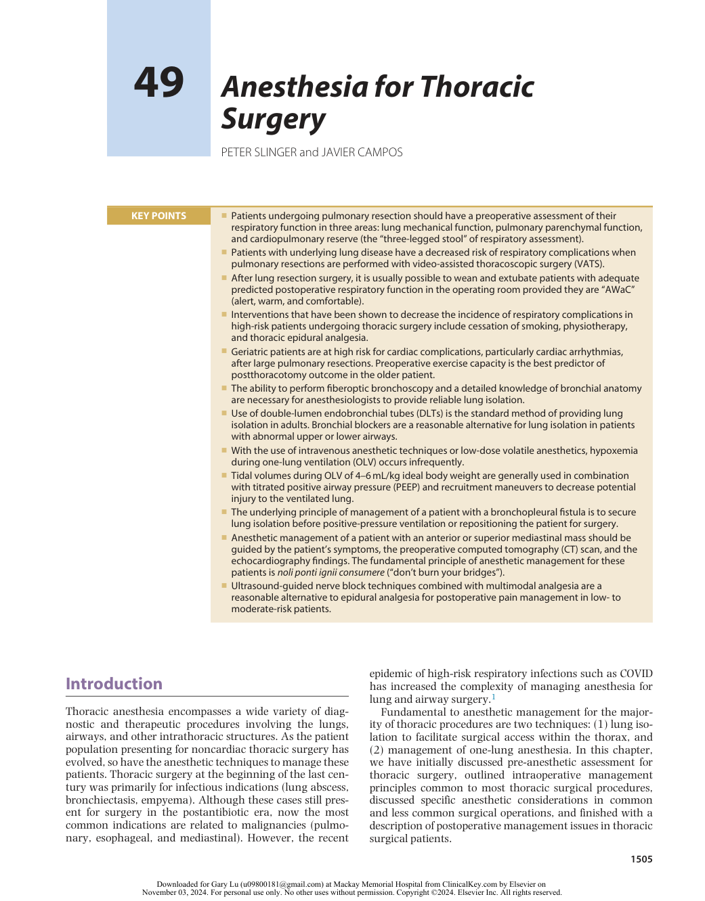

:::

<!-- PDF page 2 -->

### PREOPERATIVE EVALUATION OF THE THORACIC SURGERY PATIENT

Preoperative anesthetic assessment prior to chest surgery is a continually evolving science and art. Recent advances in anesthetic management, surgical techniques, and perioperative care have expanded the envelope of patients now considered to be “operable.”2 This discussion focuses primarily on pre- anesthetic assessment for pulmonary resection surgery in cancer patients. However, the basic principles described will apply to all other types of nonmalignant pulmonary resections and to other chest surgery.

Although 87% of patients with lung cancer will die of their disease, the 13% cure rate represents approximately 26,000 survivors per year in North America. Surgical resection is responsible for essentially all of these cures. A patient with a “resectable” lung cancer has a disease that is still local or local–regional in scope and can be encompassed in a plausible surgical procedure. An “operable” patient is someone who can tolerate the proposed resection with acceptable risk.

The patient is commonly assessed initially as an outpatient and often not by the member of the anesthesia staff who will actually administer the anesthesia. The actual contact with the responsible anesthesiologist may be only 10 to 15 minutes prior to induction. It is necessary to organize and standardize the approach to preoperative evaluation for these patients into two temporally disjoint phases: the initial (clinic) assessment and the final (day- ofadmission) assessment. Elements vital to each assessment are described.

An increasing number of thoracic surgeons are now being trained to perform “lung- sparing” resections such as sleeve lobectomies or segmentectomies, and resections with minimally invasive techniques such as video- assisted thoracoscopic surgery (VATS) or robotic surgery. The postoperative preservation of respiratory function has been shown to be proportional to the amount of functioning lung parenchyma preserved. To assess patients with limited pulmonary function the anesthesiologist must appreciate these newer surgical options in addition to the conventional open lobectomy or pneumonectomy.

It is the anesthesiologist’s responsibility to use the preoperative assessment to identify patients at elevated risk and then to use that risk assessment to stratify perioperative management and focus resources on the high- risk patients to improve their outcome. This is the primary function of the pre- anesthetic assessment. However, there are occasions when the anesthesiologist should contribute his or her opinion about whether a specific high- risk patient will tolerate a specific surgical procedure. This may occur preoperatively but also occurs intraoperatively when the surgical findings suggest that a planned procedure, such as a lobectomy, may require a larger resection, such as a pneumonectomy. For these reasons, it is imperative that the anesthesiologist has a complete preoperative knowledge of the patient’s medical status and also an appreciation of the pathophysiology of lung resection surgery. Prethoracotomy assessment naturally involves all of the factors of a complete anesthetic assessment: past history, allergies, medications, upper airway, and so on. This section concentrates on the additional information, beyond a standard

anesthetic assessment, that the anesthesiologist needs to manage a patient undergoing a pulmonary resection.

### PERIOPERATIVE COMPLICATIONS

The major cause of perioperative morbidity and mortality in the thoracic surgical population is respiratory complications. Major respiratory complications – atelectasis, pneumonia, and respiratory failure – occur in 15% to 20% of patients and account for the majority of the expected 3% to 4% mortality.3 For other types of surgery, cardiac and vascular complications are the leading cause of early perioperative morbidity and mortality. Cardiac complications such as arrhythmia and ischemia occur in 10% to 15% of the thoracic population.

### ASSESSMENT OF RESPIRATORY FUNCTION

The best assessment of respiratory function comes from a detailed history of the patient’s quality of life. All patients undergoing a pulmonary resection should have baseline simple spirometry done preoperatively.4 Objective measures of pulmonary function are required to guide anesthetic management and to have this information in a format that can be easily transmitted between members of the health care team. Respiratory function can be divided into three related but somewhat independent areas: respiratory mechanics, gas exchange, and cardiopulmonary interaction (i.e., exercise capacity). The basic functional units of extracellular respiration are to move the oxygen: (1) into the alveoli, (2) into the blood, and (3) into the tissues (the process is reversed for carbon dioxide removal).

### RESPIRATORY MECHANICS

Many tests of respiratory mechanics and volumes show correlation with postthoracotomy outcome: forced expiratory volume in one second (FEV1), forced vital capacity (FVC), maximal voluntary ventilation (MVV), residual volume/ total lung capacity ratio (RV/TLC), and so on (see Chapter 12 on pulmonary function testing). It is useful to express these as a percent of predicted volumes corrected for age, sex, and height (e.g., FEV1 %). Of these, the most valid single test for postthoracotomy respiratory complications is the predicted postoperative FEV1 (ppoFEV1 %),5 which is calculated as:

### ppoFEV1%  preoperative FEV1%    1 % functionallungtissueremoved/100  .

One method of estimating the percent of functional lung tissue is based on a calculation of the number of functioning subsegments of the lung removed (Fig. 49.1). Patients with a ppoFEV1 greater than 40% are at low risk for postresection respiratory complications. The risk of major respiratory complications is increased in the subgroup with ppoFEV1 less than 40% (although not all patients in this subgroup develop respiratory complications) and patients with ppoFEV1 less than 30% are at high risk.

### Lung Parenchymal Function

As important to the process of respiration as the mechanical delivery of air to the distal airways is the subsequent

<!-- PDF page 3 -->

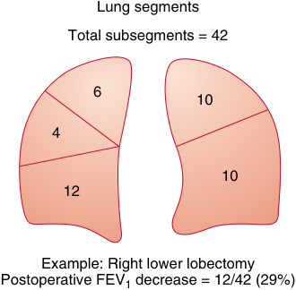

Lung segments Total subsegments = 42 6 10 4 10 12 Example: Right lower lobectomy Postoperative FEV1 decrease = 12/42 (29%) 

**Fig. 49.1** The number of subsegments of each lobe are used to calculate the predicted postoperative (ppo) pulmonary function. For example, following a right lower lobectomy, a patient with a preoperative FEV1 (or DLCO) 70% of normal would be expected to have a ppoFEV1 = 70% × (1 − 29/100) = 50%. _DLCO,_ diffusing capacity for carbon monoxide; _ppoFEV1_ , predicted postoperative forced expiratory volume in one second. (Reproduced with permission from Slinger P. _Principles and Practice of Anesthesia for Thoracic Surgery_ , 2nd ed. New York: Springer; 2019.)

ability of the lung to exchange oxygen and carbon dioxide between the pulmonary vascular bed and the alveoli. Traditionally arterial blood gas data such as arterial partial pressure of oxygen (PaO2) less than 60 mm Hg or arterial partial pressure of carbon dioxide (PaCO2) greater than 45 mm Hg have been used as cutoff values for pulmonary resection. Cancer resections have now been successfully done or even combined with volume reduction in patients who do not meet these criteria, although they remain useful as warning indicators of increased risk. The most useful test of the gas exchange capacity of the lung is the diffusing capacity for carbon monoxide (DLCO). The DLCO correlates with the total functioning surface area of alveolar–capillary interface. The corrected DLCO can be used to calculate a postresection (ppo) value using the same calculation as for the FEV1 (Fig. 49.1). A ppoDLCO less than 40% predicted correlates with both increased respiratory and cardiac complications and is, to a large degree, independent of the FEV1.6 The DLCO, but not the FEV1, is negatively affected by preoperative chemotherapy and may be the most important predictor of complications in this subgroup of patients. Some authors feel a higher cutoff risk- threshold for ppoDLCO of less than 50% may be more appropriate.7 The National Emphysema Treatment Trial has shown that patients with a preoperative FEV1 or DLCO less than 20% had an unacceptably high perioperative mortality rate.8 These can be considered as the absolute minimal values compatible with a successful outcome.

### Cardiopulmonary Interaction

The final and perhaps most important assessment of respiratory function is an assessment of the cardiopulmonary interaction (evaluation of the patient’s exercise capacity). Exercise capacity is commonly described in units of metabolic equivalent of task (MET). Sitting quietly requires an oxygen consumption of 3.5 mL/kg/min (1 MET). Climbing one flight of stairs is 4 METs. In a patient who is a reliable historian, the ability to climb 2 flights of stairs without stopping is a minimum to be considered for pulmonary resection evaluation. While there is no absolute definition of the height of a flight of stairs, 10 feet (3 m)

is a commonly used standard. Patients who cannot give a reliable history, or are limited in their ability to climb stairs because of comorbidities, will require simple and/or formal exercise testing.

The most valid simple exercise test is the maximal distance that a patient can walk in 6 minutes.9 The 6- minute walk test (6MWT) shows an excellent correlation with maximal oxygen consumption (VO2max) and requires no laboratory equipment. It has been shown in chronic obstructive pulmonary disease (COPD) patients that the VO2max can be estimated from the 6MWT distance in meters divided by 30 (i.e., 6MWT of 450 m: estimated VO2max = 450/30 = 15 mL/kg/min).10 The risk of postoperative cardiopulmonary complications following lobectomy has been shown to increase in patients with a 6MWT distance &lt;400 m.11 Older methods of simple exercise testing, such as stair- climbing, are not as reliably validated as the 6MWT.

Formal laboratory exercise testing is the “gold standard” for assessment of cardiopulmonary function12 and the maximal oxygen consumption (VO2max) is the most useful predictor of postthoracotomy outcome. The risk of morbidity and mortality is high if the preoperative VO2max is less than 15 mL/kg/min, and very high if less than 10 mL/kg/ min (35% predicted).13 Few patients with a VO2max greater than 20 mL/kg/min (75% predicted) have respiratory complications (for comparison, a VO2max of 85 mL/kg/min was documented for the American cyclist Lance Armstrong in 200514 ; since then, several elite rowers and cross- country skiers have exceeded this).

After pulmonary resection, right ventricular dysfunction appears to be in proportion to the amount of functioning pulmonary vascular bed removed. The exact etiology and duration of this dysfunction remains unknown. Clinical evidence of this hemodynamic problem is minimal when the patient is at rest but is dramatic when the patient exercises, leading to elevation of pulmonary vascular pressures, limitation of cardiac output, and absence of the normal decrease in pulmonary vascular resistance usually seen with exertion.15

### Ventilation Perfusion Scintigraphy

Prediction of postresection pulmonary function can be further refined by assessment of the preoperative contribution of the lung or lobe to be resected using ventilation–perfusion (V/Q) lung scanning. If the lung region to be resected is nonfunctioning or minimally functioning, the prediction of postoperative function can be modified accordingly. This is particularly useful in pneumonectomy patients and V/Q scanning should be considered for any pneumonectomy patient who has a preoperative FEV1 and/or DLCO less than 80%. However, V/Q scanning is of limited usefulness to predict postlobectomy function.16

### Combination of Tests

No single test of respiratory function has shown adequate validity as a sole preoperative assessment. Prior to surgery, an estimate of respiratory function in all three areas – lung mechanics, parenchymal function, and cardiopulmonary interaction – should be made for each patient. These three aspects of pulmonary function form the “three- legged stool” that is the foundation of prethoracotomy respiratory assessment (Box 49.1).

<!-- PDF page 4 -->

An algorithm for preoperative respiratory evaluation of the patient for pulmonary resection is presented in Fig. 49.2. The recent increased use of minimally invasive surgical techniques has had a major impact on the assessment of operability in lung cancer patients. Patients previously considered high risk for thoracotomy may not be high- risk if the procedure can be done with VATS or robotic surgery.17 The threshold for increased risk in ppoFEV1 for lobectomy appears to have shifted from less than 40% for open thoracotomy to less than 30% for VATS (Fig. 49.3).18 The same shift may also have occurred for ppoDLCO (Fig. 49.4).19

If a patient has a ppoFEV1 greater than 40%, the trachea usually can be extubated in the operating room at the conclusion of surgery assuming the patient is alert, warm, and comfortable (“AWaC”). If the ppoFEV1 is greater than 30% and exercise tolerance and lung parenchymal function exceed the increased- risk thresholds, then tracheal extubation can be done in the operating room depending on the status of associated medical conditions. Patients in this subgroup who do not meet the minimal criteria for cardiopulmonary and parenchymal function should be considered for staged weaning from mechanical ventilation postoperatively. Patients with a ppoFEV1 of 20% to 30% and favorable

### Box 49.1 The Three-Legged Stool of PreThoracotomy Respiratory Assessment

1.  Respiratory mechanical function. Most valid test: ppoFEV1. Threshold for increased risk: &lt;30%–40% (see text)

2.  Lung parenchymal function. Most valid test: ppoDLCO. Threshold for increased risk: &lt;30%–40% (see text)

3.  Cardiopulmonary interaction. Most valid test: maximal oxygen consumption. Threshold for increased risk: &lt;15 mL/kg/min

_ppoDLCO,_ predicted postoperative diffusing capacity for carbon monoxide; _ppoFEV1,_ predicted postoperative forced expiratory volume in one second.

predicted cardiorespiratory and parenchymal function can be considered for early tracheal extubation if thoracic epidural analgesia is used or if the resection is performed with VATS. In the increased- risk group, the presence of several associated factors and diseases should be documented during the preoperative assessment and will enter into the consideration for postoperative management (discussed later).

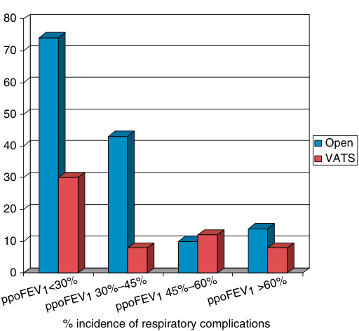

80 70 60 50 40 Open VATS 30 20 10 0 % incidence of respiratory complications ppoFEV1&lt;30%ppoFEV1 30%–45%ppoFEV1 45%–60%ppoFEV1 >60% 

**Fig. 49.3** A comparison of the incidence of postoperative respiratory complications after open (thoracotomy) vs. video-assisted thoracoscopic surgery (VATS) lobectomies for lung cancer. This was a nonrandomized retrospective study. It appears that the threshold for increased risk may have decreased from &lt;40% ppoFEV1 in the open group to &lt;30% in the VATS group. _FEV1_ , forced expiratory volume in one second; _ppo_ , predicted postoperative value. (Based on data from Berry M, et al. _Ann Thorac Surg_ . 2010;89:1044–1052.)

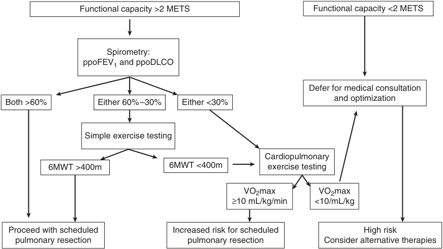

Functional capacity >2 METS Functional capacity &lt;2 METS Spirometry: ppoFEV1 and ppoDLCO Defer for medical consultation Both >60% Either 60%–30% Either &lt;30% and optimization Simple exercise testing Cardiopulmonary 6MWT >400m 6MWT &lt;400m exercise testing VO2max VO2max ≥10 mL/kg/min &lt;10/mL/kg Proceed with scheduled Increased risk for scheduled High risk pulmonary resection pulmonary resection Consider alternative therapies 

**Fig. 49.2 A flow diagram for preoperative respiratory investigation of a patient for pulmonary resection surgery.** _MET_ , metabolic equivalent of task; _6MWT_ , six- minute walk test distance in meters. _PpoDLCO,_ predicted postoperative diffusing capacity for carbon monoxide; _ppoFEV1,_ predicted postoperative forced expiratory volume in one second; _VO2max,_ max imal oxygen consumption. (Based on data from Brunelli A, Kim A, et al. Physiological evaluation of the patient with lung cancer being considered for resectional surgery. _Chest_ . 2013;143:e166s–190s and Licker M, Triponez F, Diaper J, et al. Preoperative evaluation of lung cancer patients. _Curr Anesthesiol Rep_ . 2014;4:124–134.)

<!-- PDF page 5 -->

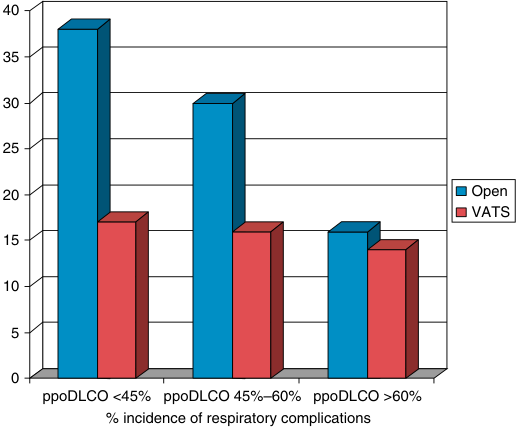

40 35 30 25 20 Open VATS 15 10 5 0 ppoDLCO &lt;45% ppoDLCO 45%–60% ppoDLCO >60% % incidence of respiratory complications 

**Fig. 49.4** A comparison of the incidence of postoperative respiratory complications after open (thoracotomy) vs. video-assisted thoracoscopic surgery (VATS) lobectomies for lung cancer. It appears there is a threshold for increased risk in open procedures under 60% ppoDLCO. A threshold for VATS procedures could not be clearly identified, however, there were very few patients with a ppoDLCO &lt;40% in this study. _DLCO_ , diffusing capacity for carbon monoxide; _ppo_ , predicted postoperative value. (Based on data from Berry M, et al. _Ann Thorac Surg_ . 2010;89:1044–1052.)

## Concomitant Medical Conditions

### CARDIAC DISEASE

Cardiac complications are the second most common cause of perioperative morbidity and mortality in the thoracic surgical population.

### Ischemia

Because the majority of pulmonary resection patients have a smoking history, they already have one risk factor for coronary artery disease. Elective pulmonary resection surgery is regarded as an “intermediate- risk” procedure in terms of perioperative cardiac ischemia.20 The overall documented incidence of postthoracotomy ischemia is 5% and peaks on days 2 to 3 postoperatively. Beyond the standard history, physical, and electrocardiogram, routine screening testing for cardiac disease does not appear to be cost- effective for all prethoracotomy patients. Noninvasive testing is indicated in patients with major (i.e., unstable ischemia, recent infarction, severe valvular disease, significant arrhythmia) or intermediate (i.e., stable angina, remote infarction, previous congestive failure, diabetes) clinical predictors of myocardial risk. Therapeutic options to be considered in patients with significant coronary artery disease are optimization of medical therapy, coronary angioplasty, or coronary artery bypass, either before or at the time of lung resection. Timing of lung resection surgery after a myocardial infarction is always a difficult decision to make. Limiting the delay to 4 to 6 weeks in a medically stable and fully investigated and optimized patient seems acceptable after myocardial infarction. The appropriate delay after coronary stenting is conventionally 4 to 6 weeks after bare metal stents and 6 months after drug- eluting stents.20,21 Surgery should be delayed until it is safe to temporarily discontinue major

antiplatelet drugs (except aspirin).22 Patients with stable coronary artery disease (CAD) were not shown to have a higher incidence of perioperative cardiovascular or pulmonary complications after VATS lobectomy. However, the 30- day mortality in the CAD (5%) group was higher than patients without CAD (0.9%).23 Preoperative investigation of the patient with coronary artery disease for pulmonary resection should follow the most recent guidelines of the American College of Cardiology.24

### Arrhythmia

Dysrhythmias are a common complication of pulmonary resection surgery and the incidence is 30% to 50% of patients in the first week postoperatively, when Holter monitoring is used.25 Of these arrhythmias, 60% to 70% are atrial fibrillation. Several factors correlate with an increased incidence of arrhythmias, including extent of lung resection (pneumonectomy 60% versus lobectomy 40% versus nonresection thoracotomy 30%), intrapericardial dissection, intraoperative blood loss, and age of the patient. Extrapleural pneumonectomy patients are a particularly high- risk group.26

Two factors in the early postthoracotomy period interact to produce atrial arrythmias: (1) increased flow resistance through the pulmonary vascular bed because of permanent (lung resection) or transient (atelectasis, hypoxemia) causes, with attendant strain on the right side of the heart; and (2) increased sympathetic stimuli and oxygen requirements, which are maximal on the second postoperative day as patients become more mobile.

In some patients undergoing a pneumonectomy, the right heart may not be able to increase its output adequately to meet the usual postoperative stress. Transthoracic echocardiographic studies have shown that pneumonectomy patients develop an increase in right ventricular systolic pressure as measured by the tricuspid regurgitation jet (TRJ) on postoperative day 2 but not on day 1. An increase in TRJ velocity has been associated with postthoracotomy supraventricular tachyarrhythmias.27 Preoperative exercise testing, which assesses the cardiopulmonary interaction, can predict postthoracotomy arrhythmias. Patients with COPD are more resistant to pharmacologic- induced heart rate control when they develop postthoracotomy atrial fibrillation and often require multiple drugs.28

Guidelines for the prevention of atrial fibrillation after thoracic surgery written by the American Association of Thoracic Surgeons are presented in Table 49.1.29 At present, diltiazem is the most useful drug for postthoracotomy arrhythmia prophylaxis.19 It seems that atrial arrhythmias are a sign of the dysfunctional right heart and preventing the complication does not solve the underlying problem. β- Adrenergic blockers may be the most effective drug to prevent arrhythmias, but there are concerns about their routine use in patients with reactive airways diseases.30

### Congestive Heart Failure

During one- lung ventilation (OLV) for thoracotomy or thoracoscopy there is an obligate 20% to 30% shunt through the nonventilated lung. If the baseline cardiac output is decreased, the fall in mixed venous oxygen saturation (SvO2) will lead to an exaggerated fall in arterial oxygen saturation. Patients with a history of congestive heart failure

<!-- PDF page 6 -->

**Table 49.1** Recommendations for Prevention of Postoperative Atrial Fibrillation (AF) in Thoracic Surgery

|**All Patients**|**High Risk for AF** **(includes anterior mediastinal mass,** **lobectomy, pneumonectomy, and** **esophagectomy)**|
|---|---|
|Continue beta blockers if taken preoperatively|Diltiazem, if preserved cardiac function and not taking beta blockers|
|Magnesium if serum level is low or suspected total body stores depleted|Consider amiodarone|
||Consider statins|

Based on Frendl G, Sodickson A, Chung M, et al. 2014 AATS Guidelines for the prevention and management of perioperative atrial fibrillation and flutter for thoracic surgical procedures. _J Thorac Cardiovasc Surg_ . 2014;148:772.

and/or cardiomyopathy may tolerate OLV poorly. They will need monitoring of venous saturation and inotropes to support cardiac output.

### Pulmonary Hypertension

Patients with degrees of pulmonary hypertension (mean pulmonary artery pressure [PAP] >25 mm Hg by catheterization or systolic PAP >35 mm Hg)31 may present for a variety of noncardiac thoracic surgical procedures including pulmonary resections for malignant or benign lesions, esophageal surgery, or vascular surgery.32 Compared to patients with normal pulmonary pressures, patients with pulmonary hypertension are particularly at increased risk of respiratory complications and the need for prolonged intubation after noncardiac surgery.33 There are five major different diagnostic groups in the classification of pulmonary hypertension, with multiple subgroups of each group.34 However, for the anesthesiologist, there are two main types of pulmonary hypertension: pulmonary hypertension due to left heart disease and pulmonary hypertension due to lung disease (Box 49.2). Most of the anesthesia literature has focused on patients with underlying cardiac disease.35 However, patients who present for noncardiac surgery are more likely to have pulmonary hypertension secondary to lung disease.36 The prevalence of pulmonary hypertension in severe chronic lung disease ranges from 40% to 50%.37

The myocardium of the right ventricle is normally perfused throughout the cardiac cycle. The increased right ventricular transmural and intracavitary pressures associated with pulmonary hypertension may restrict perfusion of the right coronary artery during systole, especially as pulmonary artery pressures approach systemic levels. Avoiding hypotension is key to managing these patients. In practice, this can be a challenge to achieve because anesthetics are commonly associated with a decrease in systemic vascular resistance (SVR) (e.g., propofol and inhalation anesthetics) and a variable effect on pulmonary vascular resistance (PVR). Ketamine or etomidate are useful anesthetic induction drugs in pulmonary hypertension due to lung disease.38 Inotropes and inodilators such as dobutamine and milrinone may improve hemodynamics in patients with pulmonary hypertension secondary to left heart disease. However, they can decrease systemic vascular tone and tachycardia, and can cause a deterioration in

### Box 49.2 Modified Classification of Pulmonary Hypertension for Anesthesia

### Left Heart Disease

### Lung Disease

- Systolic dysfunction ᑏ Pulmonary vascular disease

- Diastolic dysfunction ᑏ Chronic lung diseases, ᑏ Mitral valvular disease: hypoxemia, sleep apnea stenosis, regurgitation ᑏ Thromboembolic pulmonary

- Congenital cardiac disease hypertension

   - Miscellaneous: autoimmune, metabolic, etc.

the hemodynamics of patients with pulmonary hypertension due to lung disease. To maintain a systemic arterial blood pressure that is greater than the pulmonary pressure, vasopressors such as phenylephrine or norepinephrine are commonly used.39 Vasopressin is also useful to maintain systemic pressures. Vasopressin appears to significantly increase systolic blood pressure without affecting pulmonary artery pressure in patients with pulmonary hypertension (Fig. 49.5).40,41 In patients with severe pulmonary hypertension, selective inhaled pulmonary vasodilators including nitric oxide (10 to 40 ppm)42 or nebulized prostaglandins (prostacyclin 50 ng/kg/min) (Fig. 49.6)43 should be considered (Box 49.3).

At present, the basis of intraoperative monitoring for a patient with pulmonary hypertension having noncardiac thoracic surgery remains the pulmonary artery catheter. However, pulmonary artery data alone can be misleading in these patients. Rising pulmonary artery pressures are almost always a bad sign. Falling pulmonary artery pressures may be a good sign, indicating pulmonary vasodilation, or may be a very bad sign indicating impending right ventricular decompensation. Thus, pulmonary artery pressure data need to be followed in concert with cardiac output or mixed venous saturation data. Transesophageal echocardiography (TEE) is also helpful to monitor right heart function during thoracic surgery. Advances in echocardiography technology may make continuous objective monitoring of right ventricle function more possible in the near future.44

Although there have been multiple case reports of the successful use of lumbar epidural analgesia and anesthesia in obstetric patients with pulmonary hypertension,45 there are very few reports of the use of thoracic epidural analgesia in pulmonary hypertension. Patients with pulmonary hypertension due to lung disease seem to be extremely dependent on tonic cardiac sympathetic innervation for normal hemodynamic stability. Animal studies suggest that the hemodynamic response to an increase in right ventricular afterload is very different with thoracic versus lumbar epidurals. In one study, right ventricle contractility increased as afterload increased in animals with lumbar epidural local anesthetic blockade, similar to the response in animals without neuraxial block. The cardiac sympathectomy of thoracic epidural blockade abolished this increase in contractility46 (Fig. 49.7). Because of the increased risk of postoperative respiratory complications in these patients, the use of postoperative thoracic epidural analgesia is often desirable. However, these patients often require a low- dose infusion of inotropes or vasopressors during thoracic epidural local analgesia, which may necessitate continued central venous catheterization

::: details 原始表格與符號（PDF 第 6 頁）

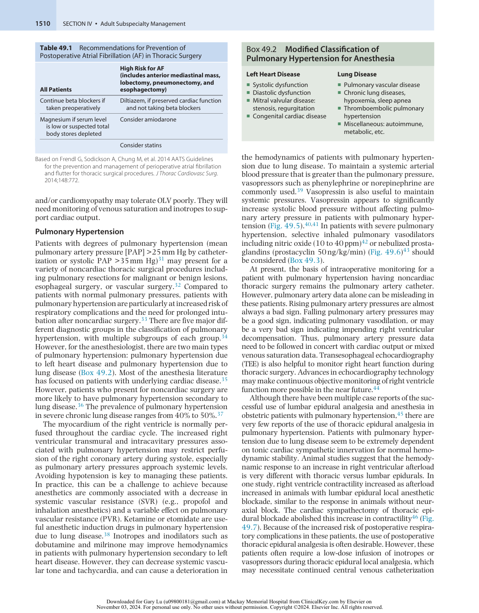

:::

<!-- PDF page 7 -->

### Vasoconstrictor Responses to Vasopressors

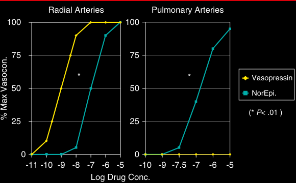

Radial Arteries Pulmonary Arteries 100 100 75 75 * * Vasopressin 50 50 NorEpi. (*  P &lt; .01 ) 25 25 0 0 -11 -10 -9 -8 -7 -6 -5 -10 -9 -7.5 -7 -6 -5 Log Drug Conc. % Max Vasocon. 

**Fig. 49.5** _In vitro_ maximal vasoconstriction (Max Vasocon.) dose–response curves of human radial ( _left_ ) and pulmonary ( _right_ ) arteries to vasopressin and norepinephrine (NorEpi). All vasoconstrictors studied (including phenylephrine and metaraminol) showed similar dose–response patterns in both types of arteries, except vasopressin, which showed no constriction of pulmonary arteries. (Based on data from Currigan DA, Hughes RJA, Wright CE, et al. Vasoconstrictor responses to vasopressor agents in human pulmonary and radial arteries. _Anesthesiology_ . 2014;121:930–936.)

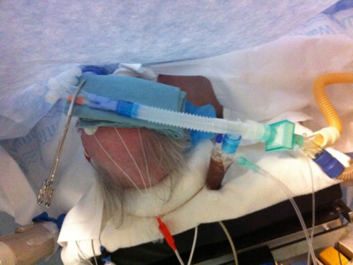

**Fig. 49.6** Prostacyclin can be delivered continuously into a standard anesthetic circuit and the dose titrated as needed. In the photograph prostacyclin is delivered by nebulization to the ventilated lung via a double- lumen tube during thoracic surgery and one- lung ventilation in a patient with pulmonary hypertension.

### Box 49.3 Management Principles for Pulmonary Hypertension Secondary to Lung Disease

1.  Avoid hypotensive and vasodilating anesthetic agents whenever possible

2.  Ketamine does not exacerbate pulmonary hypertension

3.  Support mean systolic pressure with vasopressors: norepinephrine, phenylephrine, vasopressin

4.  Use inhaled pulmonary vasodilators (nitric oxide, prostacyclin) in preference to intravenous vasodilators prn

5.  Use thoracic epidural local anesthetics cautiously and with inotropes prn

6.  Monitor cardiac output

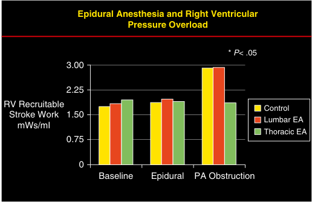

Epidural Anesthesia and Right Ventricular Pressure Overload *  P &lt; .05 3.00 2.25 RV Recruitable Control Stroke Work 1.50 Lumbar EA mWs/mI Thoracic EA 0.75 0 Baseline Epidural PA Obstruction 

**Fig. 49.7** Right ventricular (RV) recruitable stroke work, a measure of RV contractility, measured in three groups of anesthetized pigs: Control = no epidural group; Lumbar EA = lumbar epidural group; Thoracic EA = thoracic epidural group. Epidural bupivacaine injection had no effect on RV function in either of the study groups. Subsequent inflation of a balloon in the main pulmonary artery (PA Obstruction), increasing RV afterload, resulted in a compensatory increase in RV contractility in the Control and Lumbar EA groups but not in the Thoracic EA group. (Based on data from Missant C, Claus P, Rex S, Wouters PF. Differential effects of lumbar and thoracic epidural anesthesia on the haemodynamic response to acute right ventricular pressure overload. _Br J Anaesth_ . 2009;104:143.)

and intensive care unit admission. Paravertebral analgesia has been associated with better postthoracotomy hemodynamic stability versus thoracic epidural analgesia in patients with normal cardiac function47 but this has not been specifically studied in pulmonary hypertensive patients.

### AGE

There is no maximum age that is a cutoff for pulmonary resection.4 The operative mortality in a group of patients 80 to 92 years of age was 3%, a very respectable figure, in one series.48 However, the rate of respiratory complications

<!-- PDF page 8 -->

(40%) was double that expected in a younger population, and the rate of cardiac complications (40%), particularly arrhythmias, was nearly triple that which would be seen in younger patients. In older patients, thoracotomy should be considered a high- risk procedure for cardiac complications, and cardiopulmonary function is the most important part of the preoperative assessment. An algorithm for the cardiac assessment of the elderly for thoracic surgery is presented in Fig. 49.8. Although the mortality resulting from lobectomy among the older patients is acceptable, the mortality from pneumonectomy, particularly right pneumonectomy, is excessive.49 Quality of life after pneumonectomy is significantly worse than after lesser pulmonary resections.50 For these reasons, lung- sparing pulmonary resections are performed whenever possible. As a proportion of all lung cancer resections, pneumonectomy has decreased to approximately one-third of its share of 15 years ago.51 The use of minimally invasive approaches for pulmonary resection may be more important in the elderly population. The occurrence of major cardiopulmonary complications in patients >70 years was 4.3% for minimally invasive resections but 10% for open thoracotomies.52

Exercise tolerance seems to be the primary determinant of outcome in older patients. Older patients should have, as a minimum cardiac investigation, a transthoracic echocardiogram to rule out pulmonary hypertension.

### RENAL DYSFUNCTION

Renal dysfunction following pulmonary resection surgery was previously associated with a high mortality. Golledge and

Goldstraw53 reported a perioperative mortality of 19% (6/31) in patients in whom a significant elevation of serum creatinine developed in the postthoracotomy period, compared with 0% (0/99) in those who did not show any renal dysfunction. More recently, transient postthoracotomy renal dysfunction has not been found to be associated with increased mortality.54 Predictive factors for renal dysfunction include preoperative hypertension, angiotensin II receptor blockers, use of hydroxyethyl starch, and open thoracotomies.

### CHRONIC OBSTRUCTIVE PULMONARY DISEASE

The most common concurrent illness in the thoracic surgical population is COPD, which incorporates three disorders: emphysema, peripheral airways disease, and chronic bronchitis. Any individual patient may have one or all of these conditions, but the dominant clinical feature is impairment of expiratory airflow.55 Assessment of the severity of COPD is made on the basis of the FEV1% of predicted values. The American Thoracic Society categorizes stage I as greater than 50% predicted, stage II as 35% to 50%, and stage III as less than 35%. Stage I patients should not have significant dyspnea, hypoxemia, or hypercarbia, and other causes should be considered if these are present.

### Respiratory Drive

Many patients with stage II or III COPD have an elevated PaCO2 at rest. It is not possible to differentiate these “CO2 retainers” from nonretainers on the basis of history, physical examination, or spirometric pulmonary function testing.56 CO2 retention is related more to an inability to maintain the

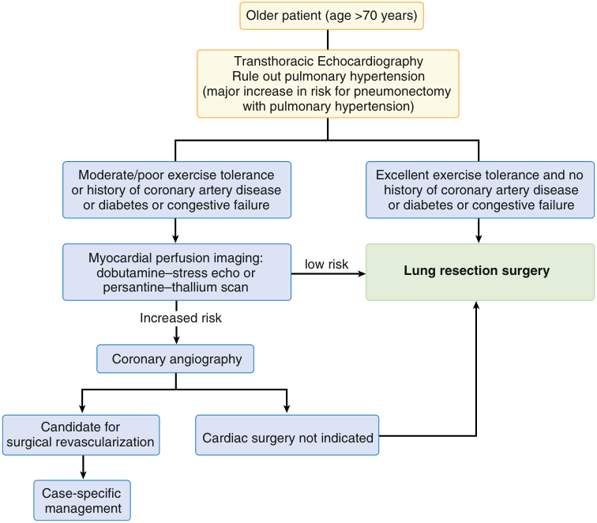

Older patient (age >70 years) Transthoracic Echocardiography Rule out pulmonary hypertension (major increase in risk for pneumonectomy with pulmonary hypertension) Moderate/poor exercise tolerance Excellent exercise tolerance and no or history of coronary artery disease history of coronary artery disease or diabetes or congestive failure or diabetes or congestive failure Myocardial perfusion imaging: low risk dobutamine–stress echo or Lung resection surgery persantine–thallium scan Increased risk Coronary angiography Candidate for surgical revascularization Cardiac surgery not indicated Case-specific management 

**Fig. 49.8 Algorithm for the preoperative cardiac assessment of elderly patients for thoracic (noncardiac) surgery.**

<!-- PDF page 9 -->

increased work of respiration (Wresp) required to keep the PaCO2 normal in patients with mechanically inefficient pulmonary function and not primarily resulting from an alteration of respiratory control mechanisms. It was previously thought that chronically hypoxemic/hypercapnic patients relied on a hypoxic stimulus for ventilatory drive and became insensitive to PaCO2. This explained the clinical observation that COPD patients in incipient respiratory failure could be put into a hypercapnic coma by the administration of a high concentration of oxygen (fraction of inspired oxygen [FiO2]). In actuality, only a minor fraction of the increase in PaCO2 in such patients is caused by a diminished respiratory drive, because minute ventilation is basically unchanged.57 The PaCO2 rises because a high FiO2 causes a relative decrease in alveolar ventilation and an increase in alveolar dead space and shunt by the redistribution of perfusion away from lung areas of relatively normal V/Q matching to areas of very low V/Q ratio because regional hypoxic pulmonary vasoconstriction (HPV) is decreased58 and also as a result of the Haldane effect.59 However, supplemental oxygen must be administered to these patients postoperatively to prevent the hypoxemia associated with the unavoidable fall in functional residual capacity (FRC). The attendant rise in PaCO2 should be anticipated and monitored. To identify these patients preoperatively, all stage II and III COPD patients need an arterial blood gas analysis.

### Nocturnal Hypoxemia

COPD patients desaturate more frequently and severely than normal patients during sleep.60 This is due to the rapid/shallow breathing pattern that occurs in all patients during rapid eye movement (REM) sleep. In COPD patients breathing air, this causes a significant increase in the respiratory dead space/tidal volume (VD/VT) ratio and a fall in alveolar oxygen tension (PAO2) and PaO2. This is not the sleep–apnea–hypoventilation syndrome (SAHS). There is no increased incidence of SAHS in COPD.

### Right Ventricular Dysfunction

Right ventricular (RV) dysfunction occurs in as many as 50% of COPD patients. The dysfunctional right ventricle is poorly tolerant of sudden increases in afterload61 such as the change from spontaneous to controlled ventilation.62 RV function becomes critical in maintaining cardiac output as the pulmonary artery pressure rises. The RV ejection fraction

does not increase with exercise in COPD patients as it does in normal patients. Chronic recurrent hypoxemia is the cause of the RV dysfunction and the subsequent progression to cor pulmonale. Patients who have episodic hypoxemia in spite of normal lungs (e.g., central alveolar hypoventilation, SAHS)63 develop the same secondary cardiac problems as COPD patients. The only therapy that improves long- term survival and decreases right- sided heart strain in COPD is administration of increasing concentrations of oxygen. COPD patients who have a resting PaO2 less than 55 mm Hg, as well as those who have decreases to less than 44 mm Hg with exercise, should receive supplemental oxygen at home. The goal of supplemental oxygen is to maintain a PaO2 60 to 65 mm Hg. Compared with patients with chronic bronchitis, emphysematous COPD patients tend to have a decreased cardiac output and mixed venous oxygen tension while maintaining lower pulmonary artery pressures.

### Bullae

Many patients with moderate or severe COPD will develop cystic air spaces in the lung parenchyma known as bullae. These bullae will often be asymptomatic unless they occupy more than 50% of the hemithorax, in which case the patient will present with findings of restrictive respiratory disease in addition to their obstructive disease. A bulla is a localized area of loss of structural support tissue in the lung with elastic recoil of surrounding parenchyma (Fig. 49.9). The pressure in a bulla is actually the mean pressure in the surrounding alveoli averaged over the respiratory cycle. This means that during normal spontaneous ventilation the intrabulla pressure is actually slightly negative in comparison to the surrounding parenchyma.64 However, whenever positive- pressure ventilation is used, the pressure in a bulla will become positive in relation to the adjacent lung tissue and the bulla will expand with the attendant risk of rupture, tension pneumothorax, and bronchopleural fistula. Positivepressure ventilation can be used safely in patients with bullae provided the airway pressures are kept low and there is adequate expertise and equipment immediately available to insert a chest drain and obtain lung isolation if necessary. Management of patients for bullectomy is discussed later.

### Flow Limitation

Severe COPD patients are often “flow- limited” even during tidal volume expiration at rest.65 Flow limitation is

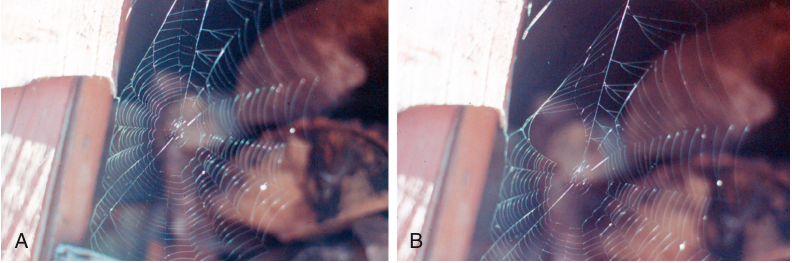

A B 

**Fig. 49.9** (A) A spider’s web as a lung model to demonstrate the pathophysiology of bullae. (B) Breaking one septum of the spider’s web causes a bulla to appear as elastic recoil pulls the web away from the area where structural support has been lost. Although the cells surrounding the bulla appear compressed, this is only due to redistribution of elastic forces. It is not positive pressure inside the bulla which causes this appearance of surrounding compression. (Reproduced with permission from Slinger P. _Principles and Practice of Anesthesia for Thoracic Surgery_ . New York: Springer; 2011.)

<!-- PDF page 10 -->

present in normal patients only during a forced expiratory maneuver. Flow limitation occurs when an equal pressure point (EPP) develops in the intrathoracic airways during expiration. During quiet expiration in the normal patient the pressure in the lumen of the airways always exceeds the intrapleural pressure because of the upstream elastic recoil pressure which is transmitted from the alveoli. The effect of this elastic recoil pressure diminishes as air flows downstream in the airway. With a forced expiration the intrapleural pressure may equal the intraluminal pressure at a certain point, the EPP, which then limits the expiratory flow. Then, any increase in expiratory effort will not produce an increase in flow at that given lung volume.66

Flow limitation occurs particularly in emphysematous patients, who primarily have a problem with loss of lung elastic recoil and have marked dyspnea on exertion. Flow limitation causes dyspnea because of stimulation of mechanoreceptors in the muscles of respiration, thoracic cage, and in the airway distal to the EPP. Any increase in the work of respiration will lead to increased dyspnea. This variable mechanical compression of airways by overinflated alveoli is the primary cause of the airflow obstruction in emphysema.

Severely flow- limited patients are at risk for hemodynamic collapse with the application of positive- pressure ventilation due to dynamic hyperinflation of the lungs. Even the modest positive airway pressures associated with manual ventilation with a bag/mask at induction can lead to hypotension since these patients have no increased resistance to inspiration but a marked obstruction of expiration. In some of these patients this has contributed to the “Lazarus” syndrome in which patients have recovered from a cardiac arrest only after resuscitation and positive- pressure ventilation were discontinued.67

### Auto- PEEP

Patients with severe COPD often breathe in a pattern that interrupts expiration before the alveolar pressure has fallen to atmospheric pressure. This incomplete expiration is due to a combination of factors which include flow limitation, increased work of respiration, and increased airway resistance. This interruption leads to an elevation of the end- expiratory lung volume above the FRC. This positive end- expiratory pressure (PEEP) in the alveoli at rest has been termed auto- PEEP or intrinsic PEEP. During spontaneous respiration the intrapleural pressure will have to be decreased to a level which counteracts auto- PEEP before inspiratory flow can begin. Thus, COPD patients can have an increased inspiratory load added to their already increased expiratory load.

Auto- PEEP becomes even more important during mechanical ventilation. It is directly proportional to tidal volume and inversely proportional to expiratory time. The presence of auto- PEEP is not detected by the manometer of standard anesthesia ventilators. It can be measured by end- expiratory flow interruption, a feature available on most intensive care ventilators. Auto- PEEP has been found to develop in most COPD patients during one- lung anesthesia.68

### PREOPERATIVE THERAPY OF COPD

There are four treatable complications of COPD that must be actively sought and therapy begun at the time of the

**Table 49.2** Concurrent Problems That Should Be Treated Prior to Anesthesia in COPD Patients

|**Problem**|**Method of Diagnosis**|
|---|---|
|Bronchospasm|Auscultation|
|Atelectasis|Chest X- ray|
|Infection|History, sputum analysis|
|Pulmonary edema|Auscultation, chest X- ray|

initial prethoracotomy assessment. These are atelectasis, bronchospasm, respiratory tract infections, and pulmonary edema (Table 49.2). Atelectasis impairs local lung lymphocyte and macrophage function, predisposing to infection. Pulmonary edema can be very difficult to diagnose by auscultation in the presence of COPD and may present very abnormal radiologic distributions (e.g., unilateral, upper lobes). Bronchial hyperreactivity may be a symptom of congestive failure or may represent an exacerbation of reversible airways obstruction. All COPD patients should receive maximal bronchodilator therapy as guided by their symptoms. Only 20% to 25% of COPD patients will respond to corticosteroids. In a patient who is poorly controlled on sympathomimetic and anticholinergic bronchodilators, a trial of corticosteroids may be beneficial.

### PHYSIOTHERAPY

Patients with COPD have fewer postoperative pulmonary complications when a perioperative program of intensive chest physiotherapy is initiated preoperatively.69 Among the different modalities available (cough and deep breathing, incentive spirometry, PEEP, continuous positive airway pressure [CPAP]), there is no clearly proven superior method. Family members or nonphysiotherapy hospital staff can easily be trained to perform effective preoperative chest physiotherapy and this should be arranged at the time of the initial preoperative assessment. Even in the most severe COPD patient, it is possible to improve exercise tolerance with a physiotherapy program. Little improvement is seen before one month. Among COPD patients, those with excessive sputum benefit the most from chest physiotherapy.

A comprehensive program of pulmonary rehabilitation involving physiotherapy, exercise, nutrition, and education can improve functional capacity for patients with severe COPD.70 These programs are usually of several months’ duration and are generally not an option in resections for malignancy, although for nonmalignant resections in severe COPD patients, rehabilitation should be considered. The benefits of short-duration rehabilitation programs prior to malignancy resection have not been fully assessed.

### SMOKING

Pulmonary complications are decreased in thoracic surgical patients who cease smoking for more than 4 weeks before surgery.71 Carboxyhemoglobin concentrations decrease if smoking is stopped more than 12 hours.72 It is extremely important for patients to avoid smoking postoperatively. Smoking leads to a prolonged period of tissue hypoxemia.

::: details 原始表格與符號（PDF 第 10 頁）

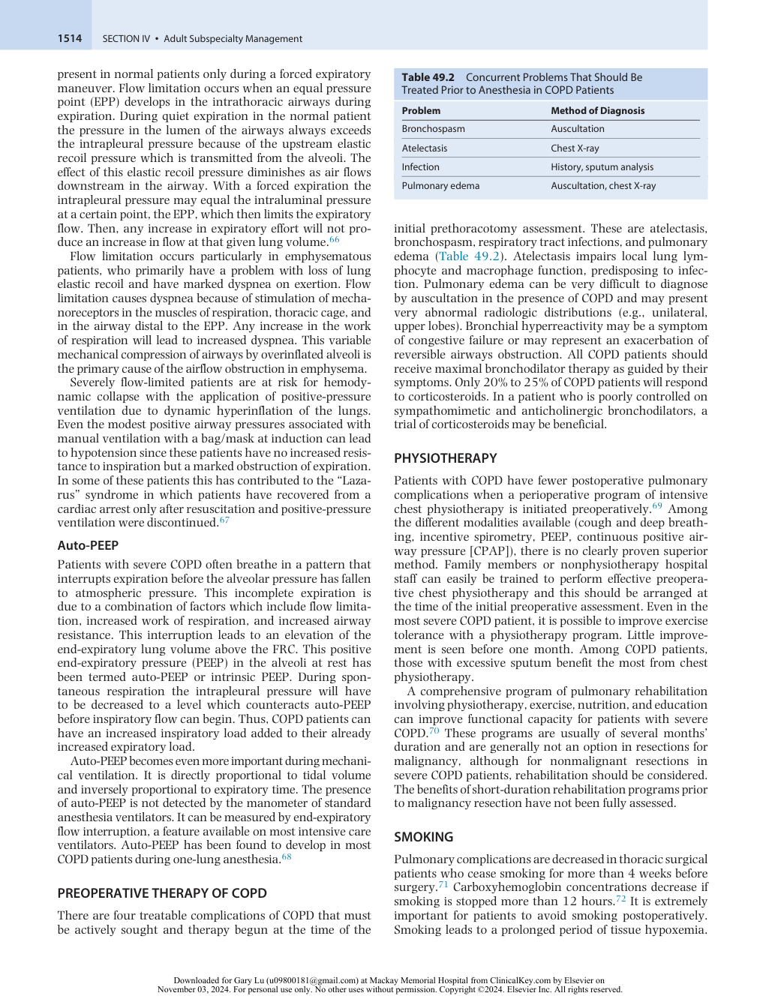

:::

<!-- PDF page 11 -->

Wound tissue oxygen tension correlates with wound healing and resistance to infection. There is no rebound increase in pulmonary complications if patients stop for shorter (&lt;8 weeks) periods before surgery.73 Intensive smokingcessation interventions are the most successful.74

### PULMONARY FIBROSIS

Patients with pulmonary fibrosis and other varieties of interstitial lung disease (ILD) are a particularly high- risk segment of the thoracic surgical population. These patients are at risk of developing an acute exacerbation of their ILD in the postoperative period. In one series, the mortality in the first 3 months after pulmonary resection was 5% in patients with ILD vs. 0.3% in those without ILD.

### PRIMARY THORACIC TUMORS

The majority of patients presenting for major pulmonary surgery will have some type of malignancy. Because the different types of thoracic malignancies have varying implications for both surgery and anesthesia, it is important for the anesthesiologist to have some knowledge of the presentation and biology of these cancers. By far the most common tumor is lung cancer. There are over 200,000 new cases of lung cancer diagnosed per year in North America and more than 1.2 million in the world. Lung cancer is currently the leading cause of cancer deaths in both sexes in North America subsequent to the peak incidence of smoking in the period 1940 to 1970.75

Lung cancer is broadly divided into small cell lung cancer (SCLC) and non–small cell lung cancer (NSCLC), with about 75% to 80% of these tumors being NSCLC. Other less common and less aggressive tumors of the lung include the carcinoid tumors (typical and atypical) and adenoid cystic carcinoma. In comparison to lung cancer, primary pleural tumors are rare. They include the localized fibrous tumors of pleura (previously referred to as benign mesotheliomas) and malignant pleural mesothelioma (MPM). Asbestos exposure is implicated in up to 80% of MPM. A dose–response relationship is not always apparent and even brief exposures can lead to the disease. An exposure history is often difficult to obtain because the latent period before clinical manifestation of the tumor may be as long as 40 to 50 years.

Tobacco smoke is responsible for approximately 90% of all lung cancers and the epidemiology of lung cancer follows the epidemiology of cigarette smoking with approximately a three- decade lag time.76 Other environmental causes include asbestos and radon gas (a decay product of naturally occurring uranium) which act as co- carcinogens with tobacco smoke. For a pack- a- day cigarette smoker the lifetime risk of lung cancer is approximately 1 in 14. Assuming current mortality patterns continue, cancer will pass heart disease as the leading cause of death in North America in this decade.

### Non–Small Cell Lung Cancer

This pathologically heterogeneous group of tumors includes squamous cell, adenocarcinoma, and large- cell carcinoma. Overall 5- year survival with surgery approaches 40%. This seemingly low figure must be viewed in the light of an

**Table 49.3** Anesthetic Considerations for Different Types of Lung Cancer

|**Type**|**Considerations**|
|---|---|
|Squamous cell|Central lesions (predominantly) Often with endobronchial tumor Mass effects: obstruction, cavitation Hypercalcemia|
|Adenocarcinoma|Peripheral lesions Extrapulmonary invasion common Most Pancoast tumors Growth hormone, corticotropin Hypertrophic osteoarthropathy|
|Large cell|Large, cavitating peripheral tumors Similar to adenocarcinoma|
|Small cell|Central lesions (predominantly) Surgery usually not indicated Paraneoplastic syndromes Lambert–Eaton syndrome Fast growth rate Early metastases|
|Carcinoid|Proximal, endobronchial Bronchial obstruction with distal pneumonia Highly vascular|
|Benign (predominantly)|No association with smoking 5-year survival >90% Carcinoid syndrome (rarely)|

estimated 5- year survival without surgery of less than 10%. Although it is not always possible to be certain of the pathology of a given lung tumor preoperatively, many patients will have a known tissue diagnosis at the time of pre- anesthetic assessment on the basis of prior cytology, bronchoscopy, mediastinoscopy, or transthoracic needle aspiration. This is useful information for the anesthesiologist to obtain preoperatively. Specific anesthetic implications of the different types of lung cancer are listed in Table 49.3.

### Squamous Cell Carcinoma

This subgroup of NSCLC is strongly linked to cigarette smoking. The tumors tend to grow to a large size and metastasize later than others. They tend to cause symptoms related to local effects of a large tumor mass with a dominant endobronchial component, such as cavitation, hemoptysis, obstructive pneumonia, superior vena cava syndrome, and involvement of mainstem bronchus, trachea, carina, and main pulmonary arteries. Hypocalcemia may be associated with this cell type due to elaboration of a parathyroid- like factor and not due to bone metastases.

### Adenocarcinoma

Adenocarinoma is currently the most common NSCLC in both sexes. These tumors tend to be peripheral and often metastasize early in their course, particularly to the brain, bones, liver, and adrenals. They often invade extrapulmonary structures, including chest wall, diaphragm, and pericardium. Almost all Pancoast tumors are adenocarcinomas. A variety of paraneoplastic metabolic factors can be secreted by adenocarcinomas such as growth hormone and corticotropin. Hypertrophic pulmonary osteoarthropathy (HPOE) is particularly associated with adenocarcinoma.

::: details 原始表格與符號（PDF 第 11 頁）

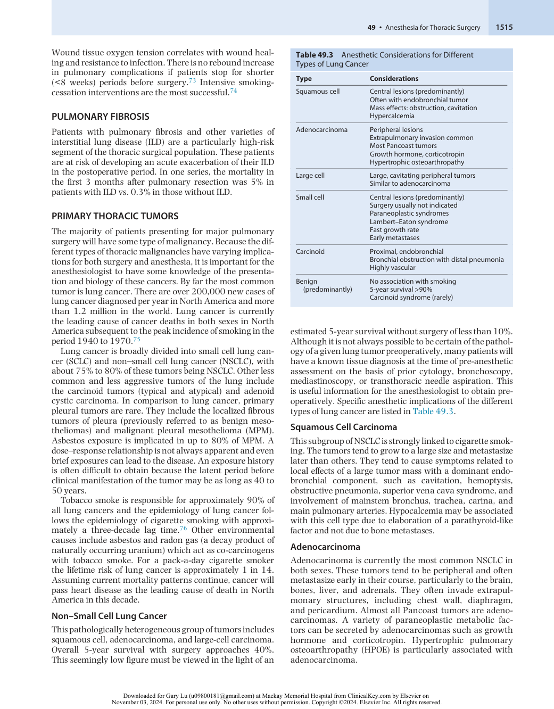

:::

<!-- PDF page 12 -->

Bronchioloalveolar carcinoma (BAC) is a subtype of adenocarcinoma that is not related to cigarette smoking. In its early stages it lines the alveolar membrane with a thin layer of tumor cells without destroying the alveolar architecture. Because of its low potential to spread outside of the lungs, multifocal BAC can be treated by lung transplantation.77

### Large Cell Undifferentiated Carcinoma

This is the least common of the NSCLCs. It tends to present as a large, often cavitating peripheral tumor. The rapid growth rate may lead to widespread metastases, similar to adenocarcinoma.

### Small Cell Lung Cancer

This tumor of neuroendocrine origin is considered metastatic on presentation and is usually regarded as a medical, not a surgical disease. Surgery is only very rarely indicated. The staging system differs from NSCLC and is divided simply into limited stage and extensive stage. Treatment of limitedstage SCLC with combination chemotherapy (etoposide/ cisplatin or cyclophosphamide/doxorubicin/vincristine) gives objective response rates in over 80% of patients. In addition these patients typically receive aggressive radiotherapy to the primary lung tumor and prophylactic cranial irradiation. Despite this initial response, the tumor invariably recurs and is quite resistant to further treatment. The overall survival rate is no better than 10%. Extensive-stage disease is treated with chemotherapy and palliative radiation as needed.

SCLC is known to cause a variety of paraneoplastic syndromes due to the production of peptide hormones and antibodies. The commonest of these is hyponatremia usually due to an inappropriate production of antidiuretic hormone (syndrome of inappropriate antidiuretic hormone secretion [SIADH]). Cushing syndrome and hypercortisolism through ectopic production of adrenocorticotropic hormone (ACTH) are also commonly seen.

A rare neurologic paraneoplastic syndrome associated with small cell lung tumors is the Lambert–Eaton (also called Eaton–Lambert) myasthenic syndrome due to impaired release of acetylcholine from nerve terminals. This typically presents as proximal lower limb weakness and fatigability that may temporarily improve with exercise. The diagnosis is confirmed by electromyography (EMG) showing increasing amplitude of unusual action potentials with highfrequency stimulation. Similar to true myasthenia gravis patients, myasthenic syndrome patients are extremely sensitive to nondepolarizing muscle relaxants. However, they respond poorly to anticholinesterase reversal agents.78 It is important to realize that there may be subclinical involvement of the diaphragm and muscles of respiration. Thoracic epidural analgesia has been used following thoracotomy in these patients without complication. These patients’ neuromuscular function may improve following resection of the lung cancer.

### Carcinoid Tumors

These are part of a continuum of neuroendocrine tumors that form a spectrum of diseases from SCLC as the most malignant to typical carcinoid as the most benign. Fiveyear survival following resection for typical carcinoid exceeds 90%. Systemic metastasis is rare, as is the carcinoid

syndrome, which is caused by the ectopic synthesis of vasoactive mediators, and is usually seen with carcinoid tumors of gut origin that have metastasized to the liver. Atypical carcinoid tumors are more aggressive and may metastasize. Carcinoid tumors can precipitate an intraoperative hemodynamic crisis or coronary artery spasm even during bronchoscopic resection.79 The anesthesiologist should be prepared to deal with severe hypotension that may not respond to the usual vasoconstrictors and will require the use of the specific antagonists octreotide or somatostatin.80

### Pleural Tumors

Localized fibrous tumors of pleura are usually large, spaceoccupying masses that are attached to visceral or parietal pleura. They can be either benign or malignant.

Malignant pleural mesotheliomas (MPMs) are strongly associated with exposure to asbestos fibers. Their incidence in Canada has almost doubled in the past 15 years. With the phasing out of asbestos- containing products and the long latent period between exposure and diagnosis, the peak incidence is not predicted for another 10 years. The tumor initially proliferates within the visceral and parietal pleura, typically forming a bloody effusion. Most patients present with shortness of breath or dyspnea on exertion from this pleural effusion. Thoracentesis often relieves the symptoms but rarely provides a diagnosis. Pleural biopsy by video- assisted thoracoscopy is most efficient to secure a diagnosis and talc pleurodesis is performed during the same anesthetic to treat the effusion.

MPMs respond poorly to therapy and the median survival is less than one year. In patients with early disease, extrapleural pneumonectomy may be considered but it is difficult to know whether survival is improved. Recently, several groups have reported improved results with combinations of radiation, chemotherapy, and surgery. Extrapleural pneumonectomy is an extensive procedure that is rife with potential complications, both intraoperative and postoperative.81 Blood loss from the denuded chest wall or major vascular structures is always a risk. Complications related to resection of diaphragm and pericardium are additional risks to that of pneumonectomy.

### ASSESSMENT OF THE PATIENT WITH LUNG CANCER

At the time of initial assessment cancer patients should be assessed for the “4 M’s” associated with malignancy (Box 49.4): Mass effects, Metabolic abnormalities, Metastases, and Medications. The prior use of medications which can exacerbate oxygen- induced pulmonary toxicity such as bleomycin should be considered.82 Bleomycin is not used to treat primary lung cancers but patients presenting for excision of lung metastases from germ- cell tumors will often have received prior bleomycin therapy. Although the association between previous bleomycin therapy and pulmonary toxicity from high inspired oxygen concentrations is well documented, none of the details of the association are understood (i.e., safe doses of oxygen or safe period after bleomycin exposure). Strategies to avoid and manage hypoxemia during thoracic surgery in a patient who has received bleomycin are an important clinical concern for the anesthesiologist (see Treatment of Hypoxemia During

<!-- PDF page 13 -->

One- Lung Ventilation, below). The safest anesthetic management is to use the lowest FiO2 consistent with patient safety and closely monitor oximetry in any patient who has received bleomycin.

We have seen lung cancer patients who received preoperative chemotherapy with cisplatin and then developed an elevation of serum creatinine when they received nonsteroidal anti- inflammatory analgesics (NSAIDs) postoperatively. For this reason, we do not routinely administer NSAIDs to patients who have been treated recently with cisplatin.

### POSTOPERATIVE ANALGESIA

The strategy for postoperative analgesia should be developed and discussed with the patient during the initial preoperative assessment. A discussion of postoperative analgesia is presented at the end of this chapter. Many techniques have been shown to be superior to the use of on- demand parenteral (intramuscular or intravenous) opioids alone in terms of pain control. These include the addition of neuraxial blockade, paravertebral blocks, anti- inflammatories, etc., to narcotic- based analgesia. However, only epidural techniques have been shown to consistently have the capability to decrease postthoracotomy respiratory complications in high- risk patients.83 Ultrasound- guided erector spinae plane84 or paravertebral blockade may offer comparable analgesia with a lower rate of block failure and fewer side effects.85

At the time of initial pre- anesthetic assessment, the risks and benefits of the various forms of postthoracotomy analgesia should be explained to the patient. Potential contraindications to specific methods of analgesia should be determined such as coagulation problems, sepsis, or neurologic disorders. If the patient is to receive prophylactic anticoagulants and it is elected to use epidural analgesia, appropriate timing of anticoagulant administration and neuraxial catheter placement need to be arranged. American Society of Regional Anesthesia and Pain Medicine (ASRA) guidelines suggest an interval of 4 to 6 hours before catheter placement for prophylactic unfractionated heparin administration but no delay after.86 Lowmolecular- weight heparin (LMWH) precautions are: a minimal interval of 12 hours after low-dose LMWH and 24 hours after higher-dose LMWH before catheter placement is recommended.

### PREMEDICATION

The authors do not routinely order preoperative sedation or analgesia for pulmonary resection patients. Mild sedation such as an intravenous short- acting benzodiazepine is often given immediately prior to placement of invasive monitoring lines and catheters. In patients with copious secretions, an antisialagogue (e.g., glycopyrrolate) is useful to facilitate fiberoptic bronchoscopy for positioning of a double- lumen tube (DLT) or bronchial blocker. To avoid an intramuscular injection this can be given orally or intravenously immediately after placement of the intravenous catheter. It is a common practice to use shortterm intravenous antibacterial prophylaxis such as a cephalosporin in thoracic surgical patients. If it is the local practice to administer these drugs prior to admission to the operating room they will have to be ordered preoperatively. Consideration for those patients allergic to cephalosporins or penicillin will have to be made at the time of the initial preoperative visit.87

### SUMMARY OF THE INITIAL PREOPERATIVE ASSESSMENT

The anesthetic considerations which should be addressed at the time of the initial preoperative assessment are summarized in Box 49.5. Patients need to be specifically assessed for risk factors associated with respiratory complications, which are the major cause of morbidity and mortality following thoracic surgery.

### FINAL PREOPERATIVE ASSESSMENT

The final preoperative anesthetic assessment for the majority of thoracic surgical patients is carried out immediately prior to admission of the patient to the operating room. At this time it is important to review the data from the initial prethoracotomy assessment and the results of tests ordered at that time. In addition, two other specific areas affecting thoracic anesthesia need to be assessed (Box 49.6): the potential for difficult lung isolation and the risk of desaturation during OLV.

### Box 49.5 Initial Pre- anesthetic Assessment for Thoracic Surgery

1.  All patients: assess functional capacity, spirometry, discuss postoperative analgesia, discontinue smoking

2.  Patients with ppoFEV1 or DLCO &lt;60%: exercise test

3.  Cancer patients: consider the “4 M’s”: Mass effects, Metabolic effects, Metastases, Medications

### Box 49.4 Anesthetic Considerations in Lung Cancer Patients (the “4 M’s”)

1. **M** ass effects: obstructive pneumonia, lung abscess, SVC syndrome, tracheobronchial distortion, Pancoast syndrome, recurrent laryngeal nerve or phrenic nerve paresis, chest wall or mediastinal extension.

2. **M** etabolic effects: Lambert–Eaton syndrome, hypercalcemia, hyponatremia, Cushing syndrome.

4.  COPD patients: arterial blood gas, physiotherapy, bronchodilators

5.  Increased renal risk: measure creatinine and BUN

- _BUN_ , blood urea nitrogen; _COPD_ , chronic obstructive pulmonary disease; _ppoDLCO_ , predicted postoperative diffusing capacity for carbon monoxide; _ppoFEV1_ , predicted postoperative forced expiratory volume.

### Box 49.6 Final Pre- Anesthetic Assessment for Thoracic Surgery

3. **M** etastases: particularly to brain, bone, liver, and adrenal.

4. **M** edications: chemotherapy agents, pulmonary toxicity (bleomycin, mitomycin), cardiac toxicity (doxorubicin), renal toxicity (cisplatin).

_SVC_ , superior vena cava.

1.  Review initial assessment and test results

2.  Assess difficulty of lung isolation: examine chest X- ray and CT scan

3.  Assess risk of hypoxemia during one- lung ventilation

_CT,_ computed tomography.

<!-- PDF page 14 -->

## Difficult Endobronchial Intubation

The most useful predictor of difficult endobronchial intubation is the plain chest radiograph (Fig. 49.10). The anesthesiologist should view the chest imaging before induction of anesthesia because neither the radiologist’s nor the surgeon’s report of the imaging is made with the specific consideration of lung isolation in mind. Distal airway problems not detectable on the plain chest film can sometimes be visualized on the computed tomography (CT) scan: a side- to- side compression of the distal trachea, the so- called “saber- sheath” trachea, can cause obstruction of the tracheal lumen of a left- sided DLT during ventilation of the dependent lung for a left thoracotomy.88 Similarly, extrinsic compression or intraluminal obstruction of a mainstem bronchus that can interfere with endobronchial tube placement may only be evident on the CT scan. The major factors in successful lower airway management are anticipation and preparation based on the preoperative assessment. Management of lung isolation in patients with difficult upper and lower airways is discussed later in this chapter.

## Prediction of Desaturation During One- Lung Ventilation

In the vast majority of cases, it is possible to determine those patients who are most at risk of desaturation during OLV for thoracic surgery. The factors that correlate with desaturation during OLV are listed in Box 49.7. In patients at high risk of desaturation, prophylactic measures can

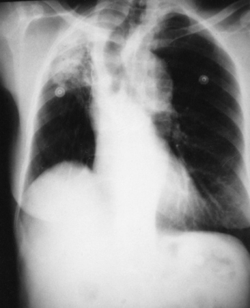

**Fig. 49.10** Preoperative chest X- ray of a 50- year- old female with a history of previous tuberculosis, right upper lobectomy, and recent hemoptysis presenting for right thoracotomy possible completion pneumonectomy. The potential problems positioning a left- sided double- lumen tube in this patient are easily appreciated by viewing the X- ray but are not mentioned in the radiologist’s report. The anesthesiologist must personally examine the chest imaging preoperatively to anticipate problems in lung isolation. (Reproduced with permission from Slinger P. _Principles and Practice of Anesthesia for Thoracic Surgery_ . New York: Springer; 2011.)

be used during OLV to decrease this risk. The most useful prophylactic measures are the use of CPAP (2 to 5 cmH2O of oxygen) to the nonventilated lung and/or positive endexpiratory pressure (PEEP) to the dependent lung (see Treatment of Hypoxemia During One- Lung Ventilation, below).

The most important predictor of PaO2 during OLV is the PaO2 during two- lung ventilation (TLV), specifically the intraoperative PaO2 during TLV in the lateral position before OLV.89 The proportion of perfusion or ventilation to the nonoperated lung on preoperative V/Q scans also correlates with the PaO2 during OLV.90 If the operative lung has little perfusion preoperatively because of unilateral disease, the patient is unlikely to desaturate during OLV. The side of the thoracotomy has an effect on PaO2 during OLV. Because the left lung is 10% smaller than the right lung, there is less shunt when the left lung is collapsed. In a series of patients, the mean PaO2 during left thoracotomy was approximately 70 mm Hg higher than during right thoracotomy.91 Finally, the degree of obstructive lung disease was previously shown to correlate in an inverse fashion with PaO2 during OLV.92 However, with the current routine use of PEEP during one- lung ventilation, most patients with normal spirometry seem to tolerate OLV well. (This is discussed later under Anesthetic Management.)

## Assessment for Repeat Thoracic Surgery

Patients who survive lung cancer surgery form a highrisk cohort to have a recurrence of the original tumor or to develop a second primary tumor. The incidence of developing second primary lung tumors is estimated at 2% per year. The use of routine screening low- dose spiral CT scans probably increases the rate of early detection.93 Patients who present for repeat thoracotomy should be assessed using the same framework as those who present for surgery the first time. Predicted values for postoperative respiratory function based on the preoperative lung mechanics, parenchymal function, exercise tolerance, and the amount of functioning lung tissue resected should be calculated and used to identify patients at increased risk.

### Box 49.7 Factors Which Correlate with an Increased Risk of Desaturation During OneLung Ventilation

1.  High percentage of ventilation or perfusion to the operative lung on preoperative V/Q scan

2.  Poor PaO2 during two- lung ventilation, particularly in the lateral position intraoperatively

3.  Right- sided thoracotomy

4.  Normal preoperative spirometry (FEV1 or FVC) or restrictive lung disease

5.  Supine position during one- lung ventilation

- _FEV1,_ forced expiratory volume in 1 second; _FVC_ , forced vital capacity; _PaO2,_ partial pressure of arterial oxygen. _V/Q_ , ventilation–perfu sion.

<!-- PDF page 15 -->

## Intraoperative Monitoring

A few points specific to intraoperative monitoring of the thoracic surgical patient need to be emphasized. The majority of these operations are major procedures of moderate duration (2 to 4 hours) and are performed with the patient in the lateral position and the hemithorax open. Thus consideration for monitoring and maintenance of body temperature and fluid volume should be given to all of these cases. Because surgery is usually performed in the lateral position, monitors are initially placed with the patient in the supine position and have to be rechecked and repositioned after the patient is turned. It is difficult to add additional monitoring, particularly invasive vascular monitoring, after the case is started if complications arise. Thus, the risk/benefit ratio often tends to favor being overly invasive at the outset. Choice of monitoring should be guided by a knowledge of which complications are likely to occur (Table 49.4).

### OXYGENATION

Significant desaturation (oxygen saturation [SpO2] &lt;90%) during OLV occurs in 1% to 10% of the surgical population in spite of a high FiO2 (1.0) (see Management of One- Lung Ventilation, later). Pulse oximetry (SpO2) has not negated the need for direct measurement of arterial PaO2 via intermittent blood gases in the majority of thoracotomy patients. The PaO2 value offers a more useful estimate of the margin of safety above desaturation than the SpO2. A patient with a TLV PaO2 greater than 400 mm Hg with an FiO2 of 1.0 (or an equivalent PaO2/FiO2 ratio) is unlikely to desaturate during OLV, whereas a patient with a PaO2 of 200 mm Hg is prone to desaturate during OLV, although both may have SpO2 values of 99% to 100%.

### CAPNOMETRY

The pressure of end- tidal CO2 (PETCO2) is a less reliable indicator of the PaCO2 during OLV than during TLV, and the PaCO2–PETCO2 gradient tends to increase during OLV. Although the PETCO2 is less directly correlated with alveolar minute ventilation during OLV, because the PETCO2 also reflects lung perfusion and cardiac output, it gives an indication of the relative changes in perfusion of the two lungs independently during position changes and during OLV.94 As the patient is turned to the lateral position, the PETCO2 of the nondependent lung will fall relative to the dependent lung, reflecting increased perfusion of the dependent lung and increased dead space of the nondependent lung. However, the fractional excretion of CO2 will be higher from the nondependent lung in most patients because of the increased fractional ventilation of this lung. At the onset of OLV, the PETCO2 of the dependent lung will usually fall transiently as all of the minute ventilation is transferred to this lung. The PETCO2 will then rise as the fractional perfusion is increased to this dependent lung by collapse and pulmonary vasoconstriction of the nonventilated lung. If there is no correction of minute ventilation, the net result will be both an increased baseline PaCO2 and PETCO2 with an increased gradient. Severe (>5 mm Hg) or prolonged decreases in PETCO2 can indicate a maldistribution of perfusion between ventilated and nonventilated lungs and may

**Table 49.4** Intraoperative Complications Which Occur With Increased Frequency During Thoracotomy

|**Complication**|**Etiology**|
|---|---|
|1.  Hypoxemia|Intrapulmonary shunt during one- lung ventilation|
|2.  Sudden severe hypotension|Surgical compression of the heart or great vessels|
|3.  Sudden changes in ventilating pressure or volume|Movement of endobronchial tube/blocker, air leak|
|4.  Arrhythmias|Direct mechanical irritation of the heart|
|5.  Bronchospasm|Direct airway stimulation, increased frequency of reactive airways disease|
|6.  Massive hemorrhage|Surgical blood loss from great vessels or inflamed pleura|
|7.  Hypothermia|Heat loss from the open hemithorax|

be an early warning of a patient who will subsequently desaturate during OLV.

## Invasive Hemodynamic Monitoring

### ARTERIAL LINE

There is a significant incidence of transient severe hypotension from surgical compression of the heart or great vessels during intrathoracic procedures. For this reason, plus the utility of intermittent arterial blood gas sampling, it is useful have beat- to- beat assessment of systemic blood pressure during the majority of thoracic surgery cases. Naturally, exceptions occur during limited procedures, such as thoracoscopic resections in younger and healthier patients. For most thoracotomies, placement of a radial artery catheter can be in either the dependent or nondependent arm.

### CENTRAL VENOUS PRESSURES

It is a common impression that central venous pressure (CVP) readings in the lateral position with the chest open are not reliable as a monitor of volume status. The CVP may be a useful monitor postoperatively, particularly for cases where fluid management is critical (e.g., pneumonectomies). A CVP may be required in some cases for vascular access or for vasopressor/inotrope infusions. It is our practice to routinely place CVP lines in pneumonectomy cases, complex procedures, or redo thoracotomies, but not for lesser resections unless there is significant other concurrent illness. Our choice is to use the right internal jugular (IJ) vein, when required, for right- sided surgery. For left- sided surgery some clinicians prefer using the left IJ because of easier access to the insertion site, if required, intraoperatively. Internal jugular CVP data are not reliable in patients with superior vena cava obstruction.

### PULMONARY ARTERY CATHETERS

Similar to CVP data, intraoperative pulmonary artery pressure may be a less accurate indicator of true left- heart

::: details 原始表格與符號（PDF 第 15 頁）

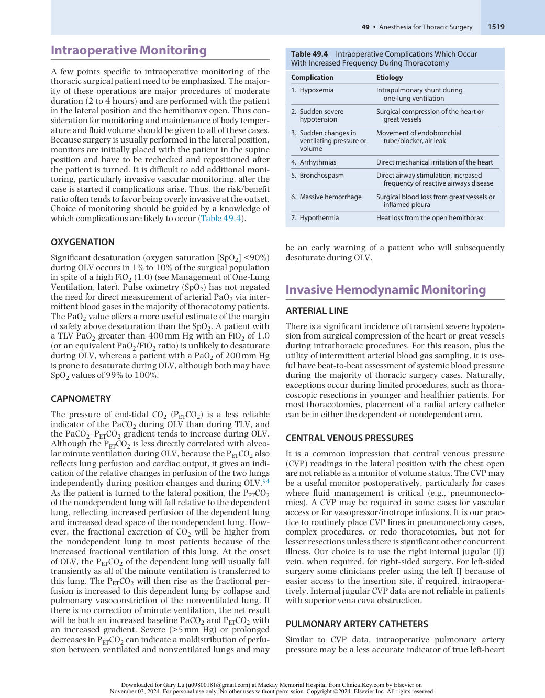

:::

<!-- PDF page 16 -->

preload in the lateral position with the chest open than in other clinical situations. This is partly because it is often initially not known if the catheter tip lies in the dependent or nondependent lung. In addition, it is possible that thermodilution cardiac output data may be unreliable if there are significant transient unilateral differences in perfusion between the lungs, as can occur during OLV. There is no consensus on the reliability of thermodilution cardiac output data during OLV.95

## Other Monitoring Technology

### FIBEROPTIC BRONCHOSCOPY

Placement of DLTs and bronchial blockers is discussed later, in the section Lung Isolation. Significant malpositions of DLTs and blockers that can lead to desaturation during OLV are often not detected by auscultation or other traditional methods of confirming placement.96 Placement of DLTs or blockers should be performed with fiberoptic bronchoscopic guidance and should be reconfirmed after placing the patient in the surgical position because a large number

of these tubes/blockers migrate during repositioning of the patient.97

### LUNG ULTRASONOGRAPHY

Lung ultrasonography may be useful as an alternative method to confirm placement of lung-isolation devices when fiberoptic bronchoscopy is not available.98 Lung ultrasound is superior to auscultation for positioning double- lumen tubes.99 Fig. 49.11A shows an ultrasound examination of the lung. The pleura sling sign evaluated from the motion of the pleura and the sliding sign show the movement between the parietal pleural and visceral pleura. In Fig. 49.11B, the M- mode ultrasound shows a seashore sign indicating ventilation of the lung. Fig. 49.11C shows absence of a sliding sign in the pleura, and Fig. 49.11D shows an M- mode bar code image indicating no ventilation. However, lung ultrasound is not as reliable as fiberoptic bronchoscopy if repositioning of the isolation device is required after the start of surgery. Also, ultrasound may not be useful in patients with underlying intrathoracic problems such as effusions, adhesions, bronchopleural fistula, etc.

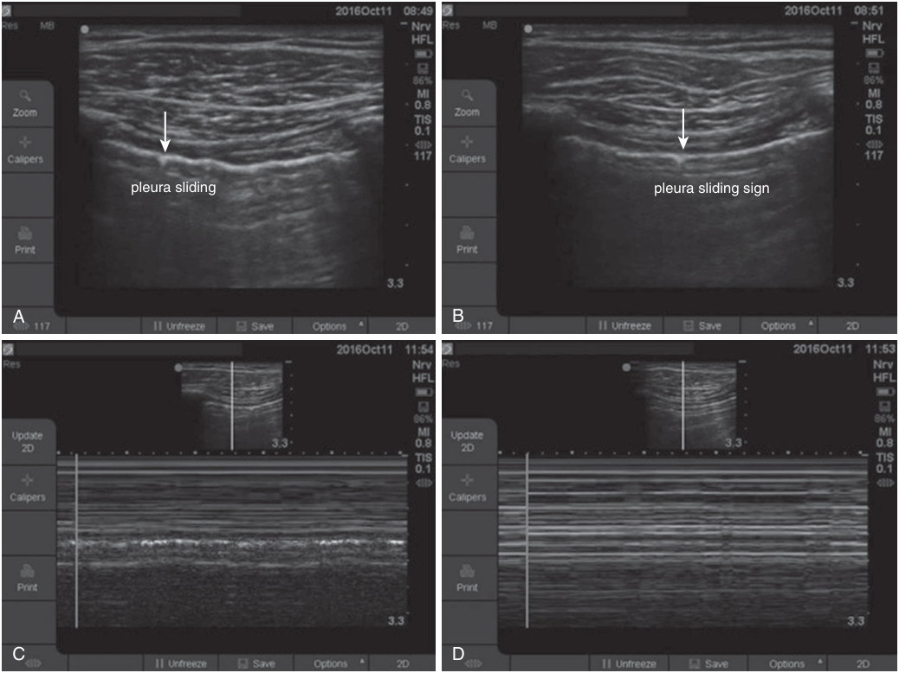

pleura sliding pleura sliding sign A B C D 

**Fig. 49.11** (A) An ultrasound examination of the lung. The pleura sling sign evaluated from the motion of the pleura. The sliding sign shows the movement between the parietal pleura and visceral pleura. (B) The M- mode ultrasound shows a seashore sign, indicating ventilation of the lung. (C) Absence of sliding sign in the pleura. (D) M- mode bar code image, indicating no ventilation. (From Hu WC, Xu L, Zhang Q, et al. Point- of- care ultrasound versus auscultation in determining the position of double- lumen tube. _Medicine_ . 2018;97:e9311, with permission.)

<!-- PDF page 17 -->

### CONTINUOUS SPIROMETRY

The development of side- stream spirometry has made it possible to continuously monitor inspiratory and expiratory volumes, pressures, and flow interactions during onelung anesthesia. This monitoring is particularly useful during pulmonary resection surgery. The breath- by- breath monitoring of inspired and expired tidal volumes gives early warning of accidental changes in the intraoperative position of a DLT, with loss of lung isolation if the expired volume suddenly decreases (there is normally a 20- to 30- mL/ breath difference caused in part by the uptake of inspired oxygen). The development of a persistent end- expiratory flow during OLV, which correlates with the development of auto- PEEP, can be seen on the flow–volume loop.100 Also, the ability to accurately measure differences in inspiratory and expiratory tidal volumes is extremely useful in assessing and managing air leaks during and after pulmonary resections.

### TRANSESOPHAGEAL ECHOCARDIOGRAPHY

Transesophageal echocardiography (TEE) allows the anesthesiologist to have a continuous real- time monitor of myocardial function and cardiac preload. This information is difficult to estimate intraoperatively in the lateral position from other hemodynamic monitors.101 Potential indications for intraoperative TEE that apply to thoracic surgery include hemodynamic instability (Fig. 49.12), pericardial effusions, cardiac involvement by tumor, air emboli, pulmonary thromboendarterectomy, thoracic trauma, lung transplantation, and pleuropulmonary disease. A rare cause of hypoxemia associated with thoracic surgery is reversal of shunt flow through an undiagnosed patent foramen ovale. When PEEP (to 15 cmH2O) was applied during controlled ventilation for nonthoracic surgery, 9% of the

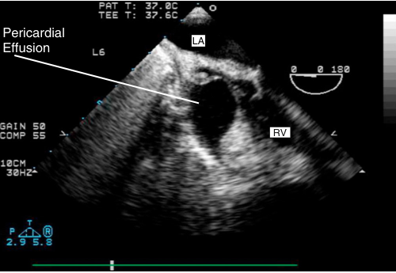

Pericardial LA Effusion RV 

**Fig. 49.12** Mid- esophageal transesophageal echocardiography (TEE) view of a patient with metastatic breast cancer who had a hemodynamic collapse after induction of general anesthesia for a video-assisted thoracoscopic surgery (VATS) drainage of a left pleural effusion. TEE was performed for diagnosis of hemodynamic instability. TEE revealed a previously undiagnosed large pericardial effusion. The _Pericardial Effusion_ label shows complete collapse of the right atrium during systole due to the effusion, consistent with tamponade. The VATS procedure was modified to include creation of a pericardial window. _LA_ , left atrium; _RV_ , right ventricle.

patients developed a right- to- left intracardiac shunt.102 TEE should be capable of detecting situations in patients who might intraoperatively develop a right- to- left interatrial shunt during or after thoracic surgery.

### CEREBRAL OXIMETRY

Cerebral oximetry (cerebral tissue oxygen saturation [SctO2]) has been reported for intraoperative monitoring during OLV.103 Elderly, debilitated patients are more likely to experience decreases in SctO2 during OLV, and these are associated with decreases in SpO2 and postoperative cognitive dysfunction. However, it has not been shown if any treatment for decreases in SctO2 affects outcomes.

## Indirect Cardiac Output

It is not certain that goal- directed fluid therapy using indirect monitors of cardiac output or venous oxygen saturation improves outcomes in abdominal surgery.104 At present, the validity of this technology as a valid guide for fluid management when the chest is open remains unclear.

## Lung Isolation

Lung- isolation techniques are primarily designed to facilitate OLV in patients undergoing cardiac, thoracic, mediastinal, vascular, esophageal, or orthopedic procedures involving the chest cavity.105 Lung isolation is also used to protect the lung from soiling by the contralateral lung in such cases as bronchopleural fistula, pulmonary hemorrhage, and whole- lung lavage. In addition, lung isolation can be used to provide differential patterns of ventilation in cases of unilateral reperfusion injury (after lung transplantation or pulmonary thromboendarterectomy) or in unilateral lung trauma.

Lung isolation can be achieved by three different methods: DLTs, bronchial blockers, or single- lumen endobronchial tubes (SLTs) (Table 49.5). The most common technique is with a DLT (Video 49.1). The DLT is a bifurcated tube with both an endotracheal and an endobronchial lumen and can be used to achieve isolation of either the right or the left lung. The second method involves blockade of a mainstem bronchus to allow lung collapse distal to the occlusion. These bronchial blockers can be used with a standard endotracheal tube (ETT) or contained within a separate channel inside a modified SLT such as the Univent tube (LMA North America, San Diego, CA). The final option for lung isolation is to use either an SLT or endobronchial tube that is advanced into the contralateral mainstem bronchus, protecting this lung while allowing collapse of the lung on the side of surgery (Fig. 49.13). This technique is rarely used today in adult practice (except in some cases of difficult airways, carinal resection, or after a pneumonectomy), owing to the limited access to the nonventilated lung and the difficulty in positioning a standard SLT in the bronchus. This technique is still used when needed in infants and small children: an uncuffed, uncut pediatric- size endotracheal tube is advanced into the mainstem bronchus under direct guidance with an infant bronchoscope.

<!-- PDF page 18 -->

### DOUBLE- LUMEN ENDOTRACHEAL TUBES

The design of the Carlens of DLT for lung surgery in 1950 was a landmark in the development of thoracic anesthesia because it allowed anesthesiologists to obtain reliable lung isolation in a majority of patients using only laryngoscopy and auscultation. However, the Carlens tube had a high flow resistance owing to the narrow lumina and the carinal hook was difficult to pass through the glottis in some

patients. In the 1960s, Robertshaw introduced design modifications for separate left- and right- sided DLTs, removing the carinal hook and using larger lumina. In the 1980s, manufacturers introduced disposable DLTs made of polyvinyl chloride based on the design of the Robertshaw DLT. Among other subsequent improvements is the inclusion of radiographic markers near the endotracheal and endobronchial cuffs and a radiographic marker surrounding the ventilation slot for the right upper lobe bronchus for

**Table 49.5** Options for Lung Isolation

|**Options**|**Advantages**|**Disadvantages**|
|---|---|---|
|Double- lumen tube 1. Direct laryngoscopy 2. Via tube exchanger 3. Fiberoptically|Easy to place successfully Repositioning rarely required Bronchoscopy to isolated lung Suction to isolated lung CPAP easily added Can alternate OLV to either lung easily Placement still possible if bronchoscopy not available Best device for absolute lung isolation|Size selection more difficult Difficult to place in patients with difficult airways or abnormal tracheas Not optimal for postoperative ventilation Potential laryngeal trauma Potential bronchial trauma|
|Bronchial blockers (BBs) Arndt Cohen Fuji EZ- Blocker|Size selection rarely an issue Easily added to regular ETT Allows ventilation during placement Easier placement in patients with difficult airways and in children Postoperative two- lung ventilation by withdrawing blocker Selective lobar lung isolation possible CPAP to isolated lung possible|More time needed for positioning Repositioning needed more often Bronchoscope essential for positioning Limited right lung isolation due to RUL anatomy Bronchoscopy to isolated lung impossible Minimal suction to isolated lung Difficult to alternate OLV to either lung|
|Univent tube|Same as BBs Less repositioning compared with BBs Rarely used|Same as for BBs ETT portion has higher air flow resistance than regular ETT ETT portion has larger diameter than regular ETT|
|Endobronchial tube|Like regular ETTs, easier placement in patients with difficult airways Longer than regular ETT Short cuff designed for lung isolation|Bronchoscopy necessary for placement Does not allow for bronchoscopy, suctioning or CPAP to isolated lung Difficult right- lung OLV|
|Endotracheal tube (ETT) advanced into bronchus|Easier placement in patients with difficult airways|Does not allow for bronchoscopy, suctioning or CPAP to isolated lung Cuff not designed for lung isolation Extremely difficult right OLV|

_CPAP_ , continuous positive airway pressure; _ETT_ , endotracheal tube; _OLV_ , one- lung ventilation; _RUL_ , right upper lobe.

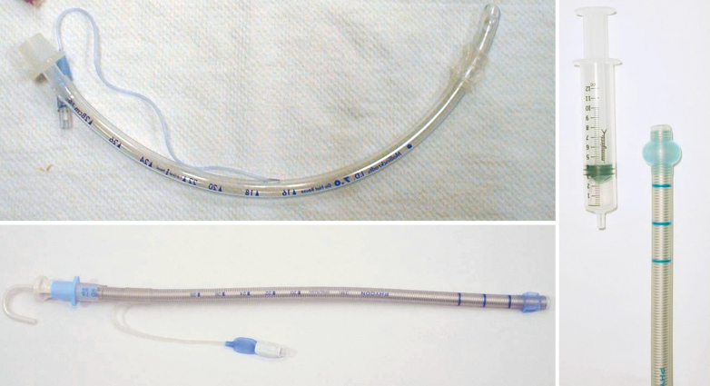

**Fig. 49.13** Photographs of a standard single- lumen endotracheal tube ( _upper left_ ) and a specifically designed single- lumen endobronchial tube ( _lower left and right_ ) (Phycon, Fuji Systems Corp., Tokyo, Japan). The endobronchial tube is longer and has a shorter cuff. It can be used as an endotracheal tube and advanced into a mainstem bronchus with fiberoptic guidance when needed for lung isolation.

::: details 原始表格與符號（PDF 第 18 頁）

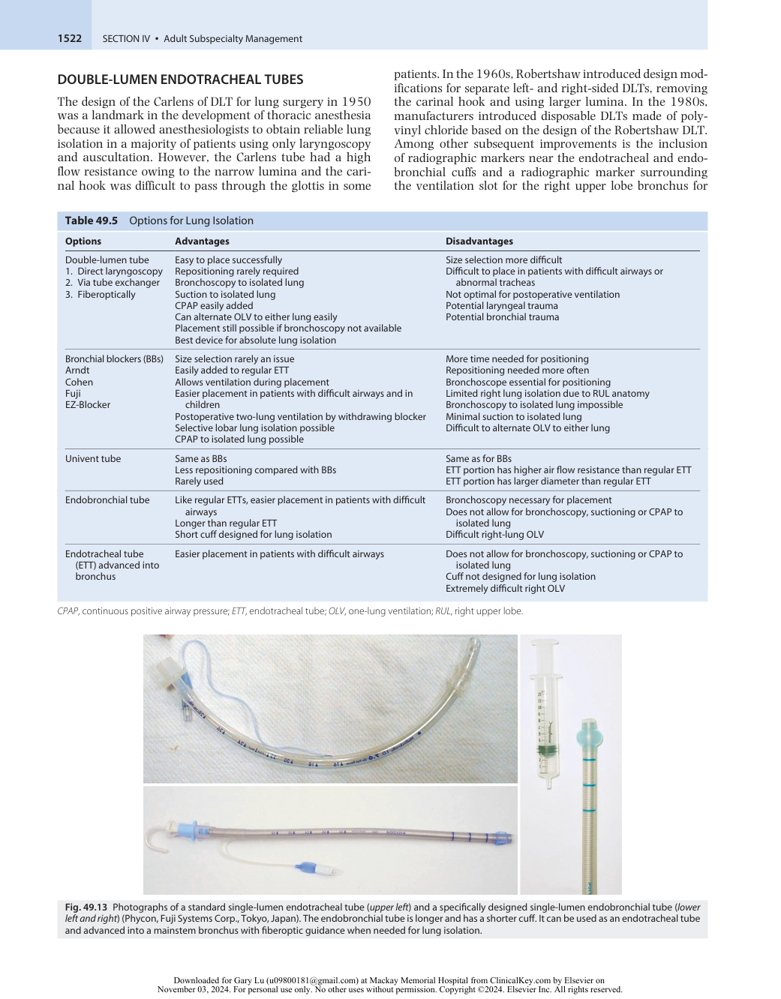

:::

<!-- PDF page 19 -->

the right- sided DLT version. Bright blue, low- volume, lowpressure endobronchial cuffs are incorporated for easier visualization during fiberoptic bronchoscopy.

The VivaSight DLT (ETView Medical, Misgav, Israel) has an integrated camera, allowing continuous visualization of its position within the trachea.106 This camera is embedded at the end of the endotracheal lumen, so that when connected to a screen monitor via a cable it allows a continuous view of the tracheal carina. In addition, this DLT device has an integrated flushing system that allows for _in situ_ camera lens cleaning.107 One of the advantages of the VivaSight DLT is that it allows continuous airway monitoring and its view facilitates immediate correction of DLT malpositions at the level of the tracheal carina. In order to maintain a good visualization with the VivaSight camera, it is recommended that a defogging solution be used prior to insertion.

Fig. 49.14 shows the VivaSight DLT and monitor. Some centers have reported that the VivaSight DLT enables more rapid placement when compared to the conventional DLT and may eliminate the need for flexible fiberoptic bronchoscopy in some patients.108 However, connecting the camera for prolonged periods of time _in vitro_ may lead to melting the portion of the tube near the light source.

The ECOM DLT (ECOM Medical, Inc., San Juan Capistrano, CA) contains multiple electrodes on the cuff and the tube that continuously measure the bioimpedance signal from the ascending aorta, in close proximity to the trachea. This device when connected to the ECOM monitor, in conjunction with an arterial catheter, provides cardiac output measurements (Fig. 49.15). This new ECOM- DLT has not been compared to other technology, however, based on the original ECOM endotracheal tube,109 it appears to be

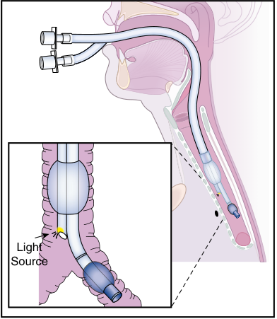

Light Source 

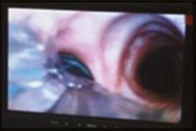

**Fig. 49.14** The diagram on the _left_ shows the placement of the VivaSight DLT in the tracheal and left main bronchus. The photograph on the _right_ shows the view of the carina from the camera located beside the light source at the tracheal lumen orifice. (Courtesy of ETView Medical.)

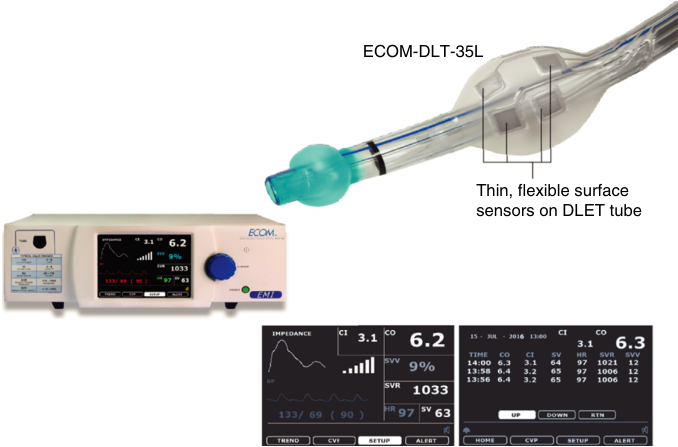

ECOM-DLT-35L Thin, flexible surface sensors on DLET tube 

**Fig. 49.15** The ECOM-DLT has multiple electrodes on the cuff and the tube that continuously measure the bioimpedance signal from the ascending aorta, which gives measurements of cardiac output. _DLET,_ double-lumen endobronchial tube. (Courtesy of ECOM Medical, Inc., San Juan Capistrano, CA.)

<!-- PDF page 20 -->

promising to derive hemodynamic parameters while in thoracic surgical patients.

tracheobronchial anatomy from the spiral CT scans combined with superimposed transparencies of DLTs to predict proper size for a right- or left- sided DLT. Chest radiographs and CT scans are valuable tools for selection of proper DLT size in addition to their proven value in assessment of abnormal tracheobronchial anatomy and should be reviewed before the placement of the DLT (Fig. 49.16). A multidetector CT (MDCT) scan of the chest allows appreciation of any abnormal tracheobronchial anatomy before placement of a DLT. A simplified method of selection of DLT size is given in Table 49.7. It is important to appreciate that compared with SLTs, DLTs have a large external diameter (Fig. 49.17) and they should not be advanced against significant resistance.

Fuji Systems (Tokyo, Japan) has introduced the Silbroncho DLT, which is made of silicone. The unique characteristic of this device relies on the flexible wire- reinforced endobronchial tip. In addition, there is a bevelled bronchial orifice and reduced bronchial cuff length that should increase the margin of safety when compared with other designs of DLT. The Silbroncho DLT is particularly useful for performing a tube exchange from a single- to a doublelumen tube in combination with a videolaryngoscope and a tube exchange catheter (see Difficult Airways and OneLung Ventilation, later).110

### Methods of Insertion

### Size Selection

Table 49.6 lists the different sizes of DLT, the appropriate fiberoptic bronchoscope sizes to be used, and the comparable diameters of SLTs. A properly sized, left- sided DLT should have a bronchial tip 1 to 2 mm smaller than the patient’s left bronchus diameter to allow for the space occupied by the deflated bronchial cuff. A study by Eberle and associates111 used a three- dimensional image reconstruction of

Two techniques are commonly used when inserting and placing a DLT. One is the blind technique: the DLT is passed with direct laryngoscopy and then turned 90 degrees counterclockwise (for a left- sided DLT placement) after the endobronchial cuff has passed beyond the vocal cords. The DLT should pass the glottis without any resistance. Seymour112 showed that the mean diameter of the cricoid ring is approximately the same as that of the left mainstem bronchus. The optimal depth of insertion for a left- sided DLT is correlated with the patient’s height in average- sized adults. In adults, depth, measured at the teeth, for a properly positioned DLT, will be approximately 12 + (patient height/10) cm.113 In patients of Asian descent, many of whom are of shorter stature (&lt;155 cm), patient height is not a good predictor of depth of insertion of a DLT.114 An inadvertently deep insertion of

**Table 49.6** Comparative Diameters of Single- and Double- Lumen Tubes

|**SINGLE- LU**|**MEN TUBES**|**DOU**|**BLE- LUME**|**N TUBES**||
|---|---|---|---|---|---|
|**Internal** **Diameter** **(ID) (mm)**|**External** **Diameter** **(ED) (mm)**|**French** **Size** **(Fr)**|**Double-** **Lumen** **ED (mm)**|**Bronchial** **Lumen** **ID (mm)**|**FOB Size** **(mm)**|
|6.5|8.9|26|8.7|3.2|2.4|
|7.0|9.5|28|9.3|3.4|2.4|
|8.0|10.8|32|10.7|3.5|2.4|
|8.5|11.4|35|11.7|4.3|≥3.5|
|9.0|12.1|37|12.3|4.5|≥3.5|
|9.5|12.8|39|13.0|4.9|≥3.5|
|10.0|13.5|41|13.7|5.4|≥3.5|

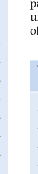

**Table 49.7** Selection of Double- Lumen Tube (DLT) Size Based on Adult Patients’ Sex and Height

|**Sex**|**Height (cm)**|**Size of DLT (Fr)**|
|---|---|---|
|Female|&lt;160 (63 in.)*|35|
|Female|>160|37|
|Male|&lt;170 (67 in.)**|39|
|Male|>170|41|

Double- lumen ED = the approximate external diameter of the double- lumen portion of the tube. FOB size = the maximal diameter of fiberoptic bronchoscope that will pass through both lumens of a given size of double- lumen tube.

*For females of short stature (&lt;152 cm or 60 in.), examine bronchial diameter on CT scan, consider 32 Fr.

**For males of short stature (&lt;160 cm), consider 37 Fr.

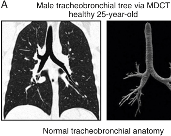

A Male tracheobronchial tree via MDCT healthy 25-year-old Normal tracheobronchial anatomy 

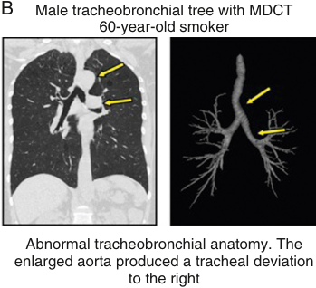

B Male tracheobronchial tree with MDCT 60-year-old smoker Abnormal tracheobronchial anatomy. The enlarged aorta produced a tracheal deviation to the right 

**Fig. 49.16** (A) Multidetec tor computed tomography (MDCT) and three- dimensional view of tracheobronchial anatomy in a healthy volunteer. (B) Abnormal tracheobronchial anatomy in a 60- year- old smoker. The _arrows_ show enlarged aorta and in the far right image shows the deviation of the trachea towards the right because of the enlarged aorta.

::: details 原始表格與符號（PDF 第 20 頁）

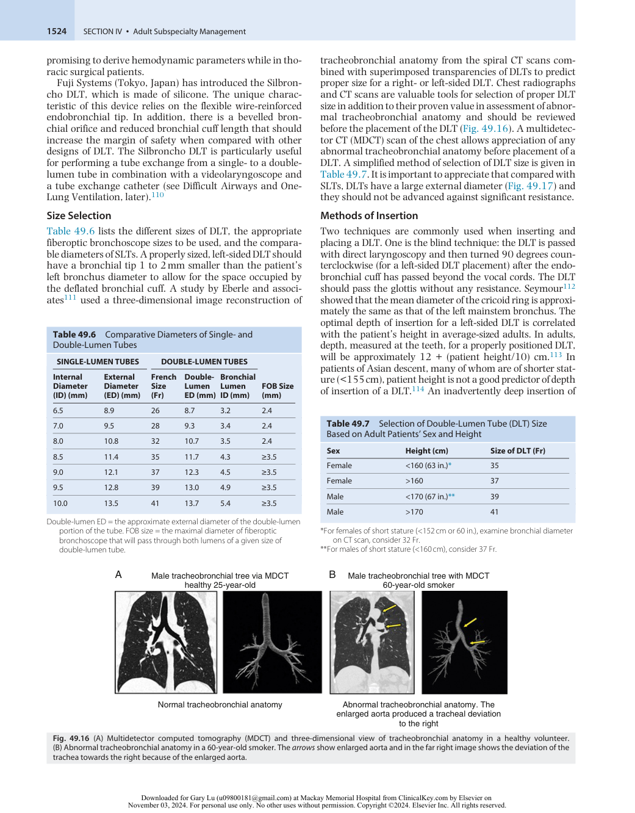

:::

<!-- PDF page 21 -->

a DLT can lead to serious complications, including rupture of the left mainstem bronchus. Fig. 49.18 depicts the blind method technique for insertion of a left- sided DLT.

The direct vision technique uses bronchoscopic guidance, in which the tip of the endobronchial lumen is guided into the correct bronchus after the DLT passes the vocal cords using direct vision with a flexible fiberoptic bronchoscope. A study by Boucek and associates115 comparing the blind technique versus fiberoptic bronchoscopy–guided technique showed that of the 32 patients who underwent the blind technique

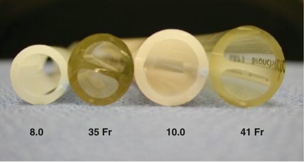

8.0 35 Fr 10.0 41 Fr 

**Fig. 49.17 Photograph of the cut cross sections of several singleand double- lumen tubes (DLTs).** Note that the external diameter of a 35- Fr DLT is larger than that of an 8.0- mm (internal diameter) singlelumen tube, and a 41- Fr DLT is larger than a 10- mm single- lumen tube. (Photo courtesy of Dr. J Klafta.)

approach, primary success occurred in 27 patients and eventual success occurred in 30 patients. In contrast, in the 27 patients using the bronchoscopy- guided technique, primary success was achieved only in 21 patients and eventual success in 25 patients. Although both methods resulted in successful left mainstem bronchus placement in all patients, more time was required when fiberoptic bronchoscopy guidance technique was used (181 versus 88 seconds).

Videolaryngoscopy is an important technique in the management of patients with expected or unexpected difficult airways. Clinical studies have shown that videolaryngoscopes improve visualization of laryngeal structures and facilitate insertion of a single- lumen endotracheal tube.116 The use of the C- MAC videolaryngoscope has been compared with the Macintosh blade (the most common device used during laryngoscopy with a DLT) and the Miller blade during DLT intubation in patients with normal airways. The authors of this retrospective study showed that videolaryngoscopy views were similar to the views obtained with a Miller blade while passing a DLT.117 In contrast, the group that used a Macintosh blade had reported higher difficult intubations with the DLTs. A study comparing the GlideScope videolaryngoscope and the Macintosh direct laryngoscope for DLT intubation in patients with normal airways showed that the overall ease of successful intubation was higher with the Macintosh blade compared with the GlideScope118 ; also, voice changes were less common in the Macintosh group. Therefore, the authors do not recommend

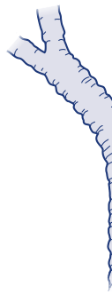

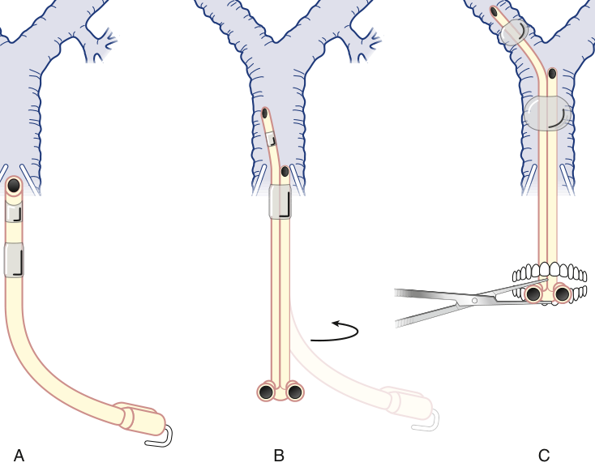

A B C 

**Fig. 49.18 Blind method for placement of a left- sided double- lumen endotracheal tube (DLT).** (A) The DLT is passed with direct laryngoscopy beyond the vocal cords. (B) The DLT is rotated 90 degrees to the left (counterclockwise). (C) The DLT is advanced to an appropriate depth (in general 27–29 cm marking at the level of the teeth). (Reproduced with permission from Slinger P. _Principles and Practice of Anesthesia for Thoracic Surgery_ , 2nd ed. New York: Springer; 2019.)

<!-- PDF page 22 -->

the routine use of the GlideScope in patients who have normal airways while using a DLT. In contrast, a study using the Airtraq DL videolaryngoscope during placement of DLT showed an improvement exposure of the supraglottis during insertion of the DLT in patients with normal airways.119 The usefulness of a videolaryngoscope while inserting a DLT will depend on the experience of the operator and the individual anatomy of the patient’s airway.

### RIGHT- SIDED DOUBLE- LUMEN ENDOBRONCHIAL TUBES

Although a left- sided DLT is used more commonly for most elective thoracic procedures,120 there are specific clinical situations in which the use of a right- sided DLT is indicated (Box 49.8). The anatomic differences between the right and

### Box 49.8 Indications for a Right- Sided Double- Lumen Tube

- Distorted anatomy of the entrance of left mainstem bronchus

- External or intraluminal tumor compression

- Descending thoracic aortic aneurysm

- Site of surgery involving the left mainstem bronchus

- Left lung transplantation

- Left- sided tracheobronchial disruption

- Left- sided pneumonectomy**

- Left- sided sleeve resection

- *This is a common clinical practice pattern for using right- sided doublelumen tubes (DLTs) and assumes normal tracheobronchial anatomy, specifically a normal position of the orifice of the right- upper lobe. However, some clinicians prefer to use right DLTs for all left- sided surgery.

- **It is possible to manage a left pneumonectomy with a left- sided DLT or bronchial blocker. However the DLT or blocker will have to be withdrawn prior to stapling the left mainstem bronchus.

the left mainstem bronchus are reflected in the fundamentally different designs of the right- sided and left- sided DLTs. Because the right mainstem bronchus is shorter than the left bronchus and because the right upper lobe bronchus originates at a distance of 1.5 to 2 cm from the carina, techniques using right endobronchial intubation must take into account the location and potential for obstruction of the orifice of the right upper lobe bronchus. The right- sided DLT incorporates a modified cuff and slot on the endobronchial lumen that allows ventilation for the right upper lobe (Fig. 49.19).121

### Positioning of Double- Lumen Tubes

Auscultation alone is unreliable for confirmation of proper DLT placement. Auscultation (Fig. 49.20) and bronchoscopy should both be used each time a DLT is placed and again when the patient is repositioned. Fiberoptic bronchoscopy is performed first through the tracheal lumen to ensure that the endobronchial portion of the DLT is in the left bronchus and that there is no bronchial cuff herniation over the carina after inflation. Through the tracheal view, the blue endobronchial cuff ideally should be seen approximately 5 to 10 mm below the tracheal carina in the left bronchus. It is crucial to identify the take- off of the right upper lobe bronchus through the tracheal view. Going inside this right upper lobe with the bronchoscope should reveal three orifices (apical, anterior, and posterior). This is the only structure in the tracheobronchial tree that has three orifices. In the supine patient the take- off of the right upper lobe is normally on the lateral wall of the right mainstem bronchus at the 3- to 4- o’clock position in relation to the main carina. Broncho- Cath tubes from Mallinckrodt have a radiopaque line encircling the tube. This line is proximal to the bronchial cuff and can be useful while positioning a left- sided DLT. The radiopaque marker is 4 cm from the distal tip of the endobronchial lumen. This marker reflects

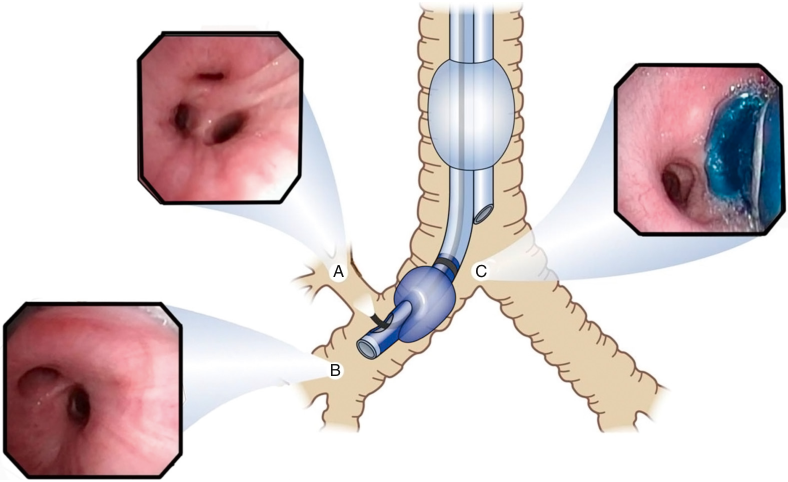

A C B 

**Fig. 49.19 Fiberoptic bronchoscopic examination of a Rusch right- sided double-lumen endotracheal tube (DLT).** (A) Slot of the bronchial lumen properly aligned within the entrance of the right upper lobe bronchus. (B) Part of the bronchus intermedius when the bronchoscope is advanced through the distal portion of the bronchial lumen. (C) Edge of the bronchial cuff at the entrance of the right mainstem bronchus when the bronchoscope is passed through the tracheal lumen. (Reproduced with permission from Slinger P. _Principles and Practice of Anesthesia for Thoracic Surgery_ , 2nd ed. New York: Springer; 2019.)

<!-- PDF page 23 -->

white during fiberoptic visualization and, when positioned slightly above the tracheal carina, should provide the necessary margin of safety for positioning into the left mainstem bronchus.122 The next observation with the fiberoptic bronchoscope is made through the endobronchial lumen to check for patency of the tube and determination of margin of safety. The orifices of both the left upper and lower lobes must be identified to avoid distal impaction in the left lower lobe and occlusion of the left- upper lobe (Fig. 49.21). Fig. 49.22 displays the tracheobronchial anatomy along with fiberoptic bronchoscopy findings from the endotracheal or endobronchial lumen for a left- sided DLT.

### Problems Related to Double- Lumen Tubes

The most common problems and complications associated with the use of a DLT are malposition and airway trauma. A malpositioned DLT will fail to allow collapse of the lung, causing gas trapping during positive- pressure ventilation, or it may partially collapse the ventilated or dependent lung, producing hypoxemia. A common cause of malposition is dislodgement of the endobronchial cuff because of overinflation, surgical manipulation of the bronchus, or extension of the head and neck during or after patient positioning. Fiberoptic bronchoscopy is the recommended method to diagnose and correct intraoperative malposition of DLTs along with proper recognition of tracheobronchial anatomy. If a DLT is malpositioned in the supine or lateral

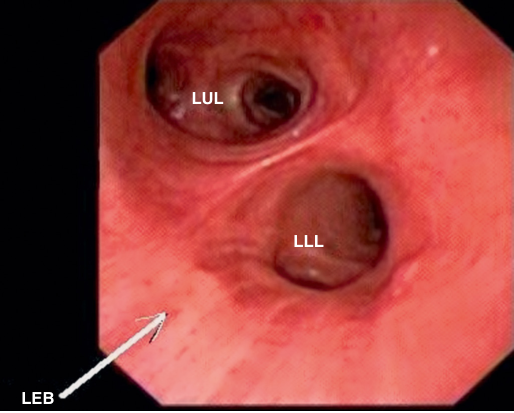

LUL LLL LEB 

**Fig. 49.21 The view from the distal bronchial lumen of a wellpositioned left- sided double- lumen tube.** Both the orifices of the left upper lobe (LUL) and left lower lobe (LLL) can be identified. Note the longitudinal elastic bundles (LEB, _arrow_ ). These extend down the posterior membranous walls of the trachea and mainstem bronchi. They are useful landmarks to orient the bronchoscopist to anterior–posterior directions. In the left mainstem bronchus they extend into the left lower lobe and are a useful landmark to distinguish the lower from the upper lobe.

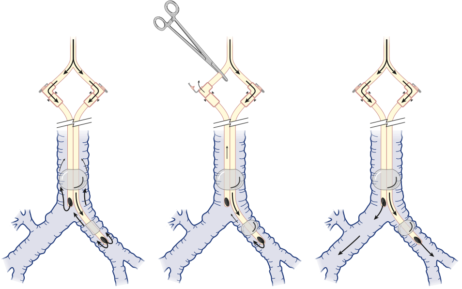

1 2 3 

**Fig. 49.20 A “3- step” method to confirm position of a left double- lumen tube (DLT) by auscultation.** Step 1: During bilateral ventilation, the tracheal cuff is inflated to the minimal leak that seals the air leak at the glottis. Auscultate to confirm bilateral ventilation. Step 2: The tracheal lumen of the DLT is clamped proximally (“clamp the short side short”) and the port distal to the clamp opened. During ventilation via the bronchial lumen the bronchial cuff is inflated to the minimal volume that seals the air leak from the open tracheal lumen port. Auscultate to confirm correct unilateral ventilation. Step 3: The tracheal lumen clamp is released and the port closed. Auscultate to confirm resumption of bilateral breath sounds. (Reproduced with permission from Slinger P. _Principles and Practice of Anesthesia for Thoracic Surgery_ , 2nd ed. New York: Springer; 2019.)

<!-- PDF page 24 -->

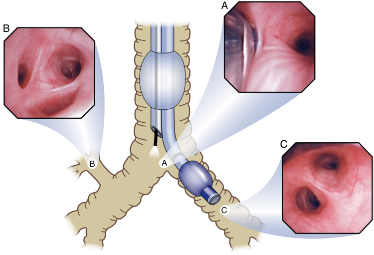

A B C B A C 

**Fig. 49.22 Fiberoptic bronchoscopic examination of a Mallinckrodt left- sided double-lumen tube (DLT).** (A) The edge of the endobronchial cuff around the entrance of the left mainstem bronchus when the bronchoscope is passed through the tracheal lumen. A _white line marker_ is seen above tracheal carina. (B) Clear view of the right upper lobe bronchus and its three orifices: apical, anterior, and posterior segments. (C) Clear view of the bronchial bifurcation (left upper and left lower bronchi) when the left- sided DLT is in the optimal position and the fiberoptic bronchoscope is being advanced through the endobronchial lumen. (Reproduced with permission from Slinger P. _Principles and Practice of Anesthesia for Thoracic Surgery_ . New York: Springer; 2011.)

decubitus position, there is a greater likelihood of hypoxemia during OLV. If a DLT is in the optimal position, but lung deflation is not completely achieved, a suction catheter should be passed to the side where lung collapse is supposed to occur. This suction will expedite lung deflation. The suction catheter must then be removed to avoid including it in a suture line.

Airway trauma and rupture of the membranous part of the trachea or the bronchus is a potential complication with the use of DLTs.123 Airway trauma can occur from an oversized DLT or when an undersized DLT migrates distally into the lobar bronchus and the main (i.e., tracheal) body of the DLT comes into the bronchus, producing lacerations or rupture of the airway. Airway damage during the use of DLTs can present an unexpected air leak, subcutaneous emphysema, massive airway bleeding into the lumen of the DLT, or protrusion of the endotracheal or endobronchial cuffs into the surgical field, with visualization of this by the surgeon. If any of the above- mentioned problems occur, a bronchoscopic examination and surgical repair should be performed. Another potential problem is the development of a tension pneumothorax in the dependent, ventilated, lung during OLV.124

### BRONCHIAL BLOCKERS

An alternative method to achieve lung separation involves blockade of a mainstem bronchus to allow lung collapse distal to the occlusion (Fig. 49.23). Bronchial blockers also can be used selectively to achieve lobar collapse if necessary. Currently, there are several different bronchial blockers available to facilitate lung separation. These devices are either within a modified SLT as an enclosed bronchial blocker (Torque Control Blocker Univent; Vitaid, Lewinston,

NY) or are used independently with a conventional SLT, the Arndt wire- guided endobronchial blocker (Cook Critical Care, Bloomington, IN), the Cohen tip- deflecting endobronchial blocker (Cook Critical Care, Bloomington, IN), the Fuji Uniblocker (Vitaid, Lewinston, NY) and the EZ- Blocker (Teleflex, Dresden, Germany).

There are specific conditions in which a bronchial blocker may be preferred to a DLT, such as patients with previous oral or neck surgery who present with a challenging airway and require lung separation for intrathoracic surgery. In these cases, the use of an SLT during an awake nasotracheal, or orotracheal, intubation or via tracheostomy secures the airway and thereafter an independent bronchial blocker can be placed to achieve lung separation. Another group of patients who may benefit from the use of bronchial blockers are those cancer patients who have undergone a previous contralateral pulmonary resection. In such cases selective lobar blockade with a bronchial blocker in the ipsilateral side improves oxygenation and facilitates surgical exposure. Blockers can be advanced over a guidewire placed with a fiberoptic bronchoscope (FOB) into the required lobar bronchus. Bronchial blockers are most commonly used intraluminal (coaxial) with a SLT. The Cohen Blocker and Fuji Uniblocker can also be placed separately through the glottis or tracheostomy exterior to an SLT. This allows the use of a smaller SLT and is often an option in pediatrics. Another advantage of the bronchial blockers is when postoperative mechanical ventilation is being considered after prolonged thoracic or esophageal surgery. In many instances these patients have an edematous upper airway at the end of the procedure. If a bronchial blocker is used there is no need to change the SLT and there is no compromise of the airway if mechanical ventilation is needed in the postoperative period. Table 49.8 describes the characteristics of

<!-- PDF page 25 -->

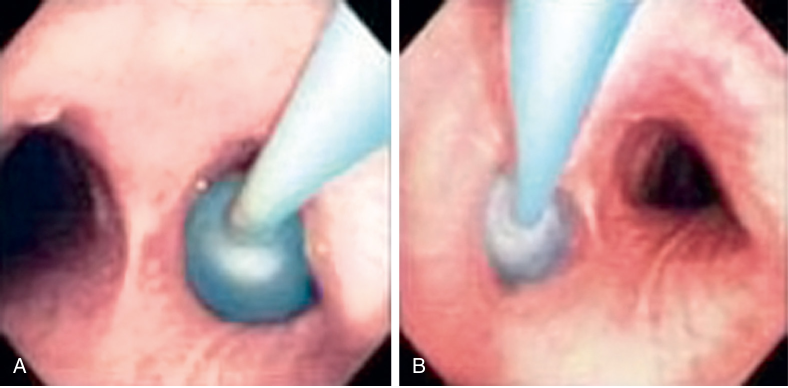

A B 

**Fig. 49.23 Placement of a bronchial blocker.** In the photos, correct positioning of a blocker in the right (A) and left (B) mainstem bronchi as seen through a fiberoptic bronchoscope just above the carina in the trachea. (Reproduced with permission from Slinger P. _Principles and Practice of Anesthesia for Thoracic Surgery_ . New York: Springer; 2011.)

**Table 49.8** Characteristics of the Cohen, Arndt, Fuji, and EZ Bronchial Blockers

||**Cohen Blocker**|**Arndt Blocker**|**Fuji Uniblocker**|**EZ- Blocker**|
|---|---|---|---|---|
|Size|9 Fr|5 Fr, 7 Fr, and 9 Fr|5 Fr, 9 Fr|7 Fr|
|Balloon shape|Spherical|Spherical or elliptical|Spherical|Spherical × 2|
|Guidance mechanism|Wheel device to deflect the tip|Nylon wire loop that is coupled with the fiberoptic bronchoscope|None, preshaped tip|None|
|Smallest recommended ETT for coaxial use|9 Fr (8.0 ETT)|5 Fr (4.5 ETT), 7 Fr (7.0 ETT), 9 Fr (8.0 ETT)|9 Fr (8.0 ETT)|7.5 ID|
|Murphy eye|Present|Present in 9 Fr|Not present|No|
|Center channel|1.6 mm ID|1.4 mm ID|2.0 mm ID|1.4 mm internal diameter|

_ETT_ , single endotracheal tube; _ID_ , internal diameter. Modified from Campos JH: Which device should be considered the best for lung isolation: Double- lumen endotracheal tube versus bronchial blockers. _Curr Opin Anaesthesiol_ . 2007;20:30, with permission.

current bronchial blockers. The smallest internal diameter (ID) of an endotracheal tube that will allow passage of both a bronchial blocker and a fiberoptic bronchoscope depends on the diameters of the bronchoscope and blocker. For standard adult 9- Fr blockers, an endotracheal tube greater than or equal to 7.0 mm ID can be used with a bronchoscope less than 4.0 mm in diameter. Larger bronchoscopes will require an endotracheal tube greater than 7.5 mm ID. All blockers need to be well lubricated before placement.

### The Wire- Guided Endobronchial Blocker (Arndt Blocker)

Fig. 49.24A displays the Arndt blocker. The Arndt blocker has a retractable loop that is placed over the FOB, which is then used to guide the blocker onto place. The Arndt blocker will usually advance easily into the right mainstem bronchus without the loop.

### Cohen Endobronchial Blocker

The Cohen blocker (Fig. 49.24B, left blocker) uses a wheel located in the most proximal part of the unit that deflects the tip of the distal part of the blocker into the desired bronchus. This blocker has been pre- angled at the distal tip to facilitate

insertion into a target bronchus. On the distal shaft above the balloon, there is an arrow that, when seen with the fiberoptic bronchoscope, indicates in which direction the tip deflects. To position the Cohen blocker, the arrow is aligned with the bronchus to be intubated, the proximal wheel is turned to deflect the tip toward the desired side and then the blocker is advanced with fiberoptic guidance.

### Fuji Uniblocker

The Fuji Uniblocker (Fig. 49.24B, right blocker) is an independent blocker that is made of silicone material and has a simple fixed distal hockey- stick angulation to facilitate insertion. The blocker is simply rotated to the left or right as needed under FOB guidance for placement in the required bronchus.

### EZ- Blocker

The EZ- Blocker (Fig. 49.25) is a recently introduced 7- Fr, 4- lumen catheter with a Y- shaped bifurcation. Each distal end has a balloon that can be guided into the right and left main bronchus. This device comes with its own multiport adaptor. This device is used through a 7.5 SLT. The end of the Y sits on the tracheal carina. Each distal end is

::: details 原始表格與符號（PDF 第 25 頁）

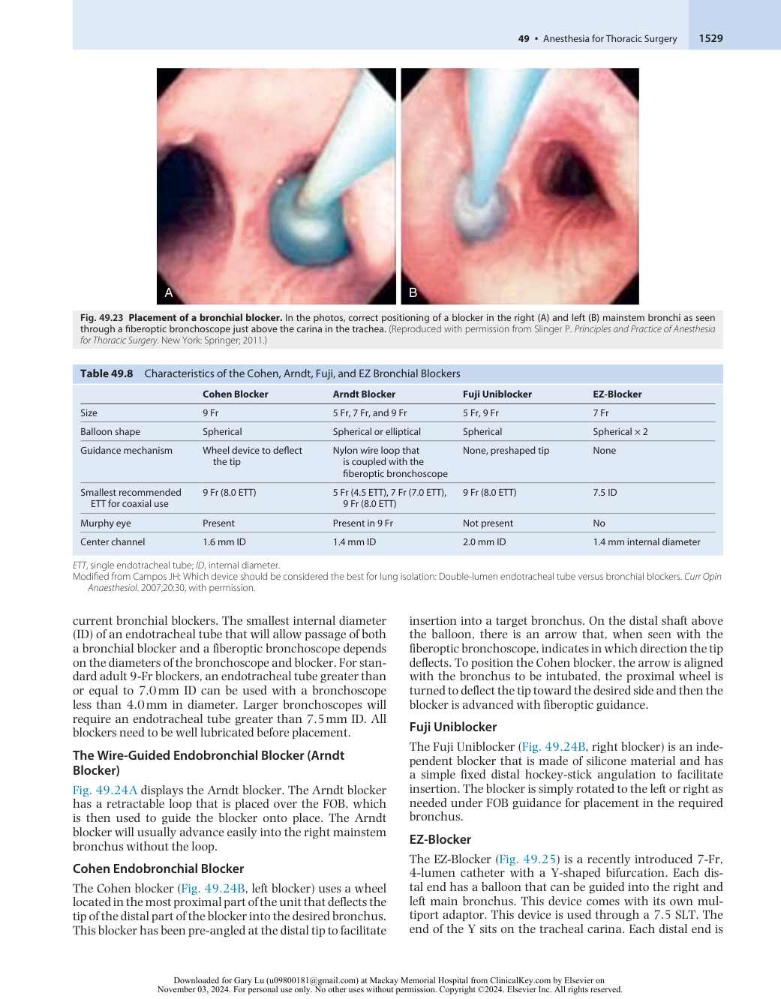

:::

<!-- PDF page 26 -->

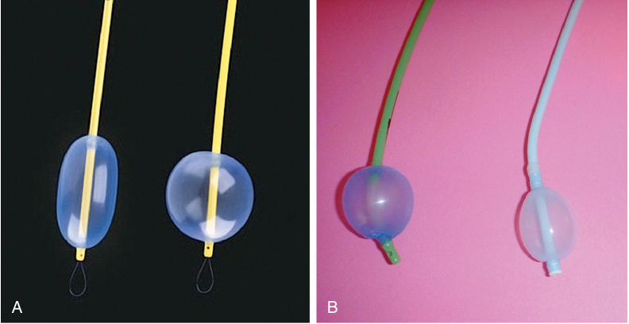

A B 

**Fig. 49.24** (A) The spherical Arndt design of bronchial blocker (Cook Critical Care, Bloomington, IN). (B) The Cohen ( _left_ ) (Cook Critical Care, Bloomington, IN) and Fuji Uniblocker ( _right_ ) (Vitaid, Lewinston, NY) bronchial blockers.

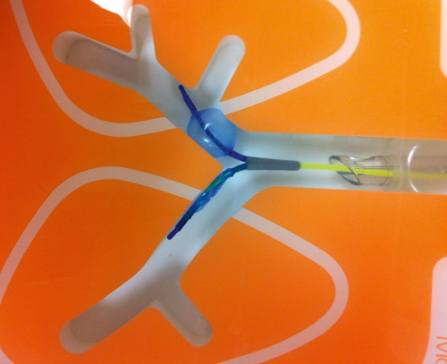

**Fig. 49.25** The EZ- Blocker (Rusch, Teleflex) has two distal limbs, each with a blocker- balloon, that are positioned in each mainstem bronchus and is fixed at the carina. The two limbs are color- coded ( _blue_ and _yellow_ ) and the appropriate blocker is inflated via a matching colored pilot balloon.

positioned into the right and left bronchus and the appropriate bronchial balloon is inflated in the operative side for lung isolation.

### Complications Related to the Bronchial Blockers

Failure to achieve lung separation because of abnormal anatomy or lack of a seal within the bronchus has been reported.125 Inclusion of the bronchial blocker or the distal wire loop of an Arndt blocker into the stapling line has been reported during a lobectomy126 and required surgical re- exploration after unsuccessful removal of the bronchial blocker after extubation. To avoid these mishaps, communication with the surgical team regarding the presence of a bronchial blocker in the surgical side is crucial. Clearly, the bronchial blocker needs to be withdrawn a few centimeters before stapling.

Another potentially dangerous complication with all bronchial blockers is that the inflated balloon may move and lodge above the carina or be accidentally inflated in the trachea. This leads to inability to ventilate, hypoxia, and potentially cardiorespiratory arrest unless quickly recognized and the blocker deflated.127 There is a report of more malpositions with the use of bronchial blockers when compared to DLTs.128

In a retrospective review of 302 consecutive cases from a single institution, no major complications were found with the use of different bronchial blockers during lung isolation.129 A recent report described three cases where the balloon of the Fuji blocker failed to deflate at the conclusion of the surgery. In two of the cases the already inflated bronchial blocker had to be removed along with the singlelumen endotracheal tube during extubation.130 It is our recommendation to test the pilot and the balloon prior to use to ensure that the air that is injected is aspirated and the balloon completely deflates.

A recent complication involving a perforation of the bronchus with the use of the EZ- Blocker has been reported in patients that had received radiation therapy.131 In this case, the EZ- Blocker was advanced blindly into the singlelumen endotracheal tube, where both distal ends were located below the tracheal carina inside the right mainstem bronchus. One of the blocker tips perforated the bronchial wall and was visualized outside the bronchus during an open thoracotomy. It is very important to advance the blocker with the guidance of the fiberoptic bronchoscope to prevent this complication.

A rupture of the posterior wall of the left mainstem bronchus just below the carina has been reported with the use of the Fuji Uniblocker.132 The potential causes related to this perforation included the advanced age of the patient (78 years old), poor tissue quality compounded by trauma by the preformed distal tip of the Fuji Uniblocker, and potentially pressure exerted by the endobronchial blocker balloon on the entrance of the left mainstem bronchus. If there is any air leak or air pockets in the mediastinum with failure to maintain a proper tidal volume after all corrective measures have been addressed, then a suspicion of ruptured

<!-- PDF page 27 -->

airway should be entertained, including direct visualization and inspection during the surgical intervention to localize the rupture of the airway.

## Difficult Airways and One- Lung Ventilation

A number of patients requiring OLV are identified during preoperative evaluation to have a potentially difficult airway.133 Others present with unexpected difficulty to intubate after induction of anesthesia. Between 5% and 8% of patients with primary lung carcinoma also have a carcinoma of the pharynx, usually in the epiglottic area.134 Many of these patients have had previous radiation therapy on the neck or previous airway surgery, such as hemimandibulectomy or hemiglossectomy, making intubation and achievement of OLV difficult due to distorted upper airway anatomy. Also, a patient who requires OLV might have distorted anatomy at or beyond the tracheal carina, such as descending thoracic aortic aneurysm compressing the entrance of the left mainstem bronchus or an intraluminal or extraluminal tumor near the tracheobronchial bifurcation that makes the insertion of a left- sided DLT relatively difficult or impossible. Such anomalies can be detected by reviewing the chest radiographs and CT scans of the chest. A flexible fiberoptic bronchoscopic examination is necessary to assess a distorted area of the airway before selection of a specific tube or blocker to achieve OLV.

In patients who require OLV and present with a difficult airway, the primary goal is to establish an airway with an SLT placed orally with the aid of a flexible fiberoptic bronchoscope, after appropriate airway anesthesia is achieved. In selected patients who seem easy to ventilate, this may be performed after induction of anesthesia with a bronchoscope or with a videolaryngoscope.135 Once the SLT is in place, an independent bronchial blocker can be passed. If the patient requires OLV and cannot be intubated orally, an awake nasotracheal intubation can be performed with an SLT and, once the airway is established, then a bronchial blocker can be used.

An alternative to achieve OLV in a patient with a difficult airway is to intubate the patient’s trachea with an SLT; then a DLT–SLT tube- exchange catheter can be used to replace the existing SLT with a DLT after general anesthesia is induced (Video 49.2). For a DLT, the exchange catheter should be at least 83 cm. A 14- Fr exchange catheter can be used for 41- Fr and 39- Fr DLTs; for 37- Fr or 35- Fr DLTs, an 11- Fr exchange catheter is used. Specially designed exchange catheters for DLTs are available with a softer distal tip to try to decrease the risk of distal airway trauma (e.g., Cook Exchange Catheter, Cook Critical Care, Bloomington, IN).

The exchange catheter, SLT, and the DLT combination should be tested _in vitro_ before the exchange. A sniffing position facilitates tube exchange. After the exchange catheter is lubricated, it is advanced through an SLT. The catheter should not be inserted deeper than 24 cm at the lips to avoid accidental rupture or laceration of the trachea or bronchi. After cuff deflation, the SLT is withdrawn. Then the endobronchial lumen of the DLT is advanced over the exchange catheter. It is optimal to use a videolaryngoscope during the tube exchange to guide the DLT through the glottis

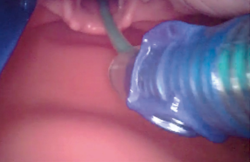

**Fig. 49.26** A double- lumen tube (DLT) is placed over a tube- exchange catheter using a videolaryngoscope for guidance. The green SLT–DLT tube- exchange catheter (Cook Critical Care, Bloomington, IN) has been passed initially through a single-lumen tube (SLT) which has been withdrawn (prior to the photo), and the catheter then passed retrograde through the bronchial lumen of a DLT, which is then advanced under direct vision through the glottis. The double- lumen tube in this picture (Fuji, Phycon, Vitaid, Lewinston, NY) has a bevel on the distal bronchial orifice and a flexible bronchial lumen, which facilitates this procedure.

under direct vision (Fig. 49.26). If a videolaryngoscope is not available, having an assistant perform standard laryngoscopy during tube exchange partially straightens out the alignment of the oropharynx and glottis and facilitates the exchange. Proper final position of the DLT is then achieved with auscultation and bronchoscopy.

## Management of Lung Isolation for Thoracic Surgery and COVID- 19 Patients

Airway management for patients with COVID- 19 – including tracheal intubation, lung isolation techniques, OLV, and flexible fiberoptic bronchoscopy – poses a significant risk to health care personnel and patients.136 Lung isolation and OLV continued throughout the COVID- 19 pandemic; for an elective surgery, in general, patients are tested with a PCR test to determine their status, and if the result is a negative COVID test with no symptoms, the patient should be managed no differently than prior to the pandemic. However, when a patient is COVID- 19- positive and requires thoracic surgery with lung isolation, all precautions should be taken into consideration, including personal protective equipment (PPE) for all health care workers participating in the care of the patient. In addition, health care personnel should be prepared to perform emergency thoracic procedures in this current era of pandemic management of these patients with general anesthesia, airway management, lung isolation bronchoscopies, and perioperative care.

Lung isolation in the COVID- 19- positive patient can be achieved by using a DLT or a single- lumen endotracheal tube with a bronchial blocker. A survey done by Italian anesthesiologists reported that during the COVID- 19 pandemic there was an increased use of bronchial blockers (fourfold).137 In addition, using a video- assisted laryngoscope during intubation is recommended to avoid direct

<!-- PDF page 28 -->

exposure during conventional laryngoscopy. A disposable flexible fiberoptic bronchoscope should be used whenever possible, so at the end of the procedure it can be easily discarded. A high-efficiency particulate air (HEPA) filter placed at the proximal end of the DLT for the nondependent lung is recommended, as this can minimize aerosolization and infection risk (see Fig. 49.40).138

An alternative during lung isolation in order to prevent or minimize infection risk is the use of the VivaSight DLT. This device has an embedded camera that, when attached to the DLT, provides a continuous view of the DLT at the level of the tracheal carina, allowing the user to achieve the proper position without needing to use the fiberoptic bronchoscope. The management of the thoracic surgical patient during the COVID- 19 pandemic requires some modifications to our normal practice. The risk from aerosol- generating procedures must be reduced whenever possible to ensure the safety of the patient and health care staff.

## Lung- Isolation Techniques in Patients with a Tracheostomy in Place

The patient with a tracheostomy _in situ_ needs special airway management because the airway has been shortened or because a total laryngectomy will limit oral tracheal intubation. Opportunities for using a conventional DLT in a patient with a tracheostomy _in situ_ are limited because the DLT is usually too long or has a large outer diameter or is too rigid. Also, the tracheostomy stoma may be too small to accommodate the DLT, which can damage the airway.139

Placement of a DLT through a tracheostomy stoma may be prone to malposition because the upper airway has been shortened and the conventional DLT may be too long. Before placing any lung- isolation devices through a tracheostomy stoma it is important to consider whether it is a fresh stoma (i.e., a few days old, when the airway can be lost immediately on decannulation) versus a chronic tracheostomy. The alternatives to achieve OLV in a tracheostomized patient include (1) insertion of an SLT followed by an independent bronchial blocker passed coaxially or external to the SLT140 ; (2) the use of a disposable cuffed tracheostomy cannula with an independent bronchial blocker; (3) replacement of the tracheostomy cannula with a specially designed short DLT such as the Naruke DLT, which is made for use in tracheostomized patients141 ; (4) placement of a small DLT through the tracheostomy stoma; or (5) if possible, oral access to the airway for standard placement of a DLT or blocker (this is occasionally an option in patients on prolonged mechanical ventilation for respiratory failure or postoperative complications). Bronchial blockers are the optimal method of lung isolation for most patients with a tracheostomy.

In summary, the optimal method of lung isolation will depend on a number of factors, including the patient’s airway anatomy, the indication for lung isolation, the available equipment, and the training of the anesthesiologist. Whatever method of lung isolation is used, the “ABCs” of lung isolation are:

- Anatomy. Know the tracheobronchial anatomy. One of the major problems that many anesthesiologists have in achieving satisfactory lung isolation is due to lack of familiarity with distal airway anatomy (Fig. 49.27).

- Bronchoscopy. Whenever possible use a fiberoptic bronchoscope to position endobronchial tubes and blockers. The ability to perform fiberoptic bronchoscopy is now a fundamental skill needed by all anesthesiologists providing anesthesia for thoracic surgery. An online bronchoscopy simulator has been developed to help train anesthesiologists in positioning DLTs and blockers. This simulator, which uses real- time video, is available without cost at http://pie.med.utoronto.ca (under Virtual Bronchoscopy).

- Chest imaging. The anesthesiologist should always look at the chest imaging before placement of a DLT or blocker. Abnormalities of the lower airway can often be identified in advance, and this will have an impact on the selection of the optimal method of lung isolation for a specific case (see Fig. 49.10).

### POSITIONING

The majority of thoracic procedures are performed in the lateral position, most often the lateral decubitus position, but depending on the surgical technique a supine, semi- supine, or semi- prone lateral position may be used. These lateral positions have specific implications for the anesthesiologist.

### Position Change

It is awkward to induce anesthesia in the lateral position. Thus, monitors will be placed and anesthesia will usually be induced in the supine position and the anesthetized patient will then be repositioned for surgery. It is possible to induce anesthesia in the lateral position and this may rarely be indicated with unilateral lung diseases such as bronchiectasis or hemoptysis until lung isolation can be achieved. However, even these patients will then have to be repositioned and the diseased lung turned to the nondependent side.

Due to the loss of venous vascular tone in the anesthetized patient it is not uncommon to see hypotension when turning the patient to or from the lateral position. All lines and monitors will have to be secured during position change and their function reassessed after repositioning. The anesthesiologist should take responsibility for the head, neck, and airway during position change and must be in charge of the operating team to direct repositioning. It is useful to make an initial “head- to- toe” survey of the patient after induction and intubation, checking oxygenation, ventilation, hemodynamics, lines, monitors, and potential nerve injuries. This survey then must be repeated after repositioning. It is nearly impossible to avoid some movement of a DLT or bronchial blocker during repositioning. Certainly the patient’s head, neck, and endobronchial tube should be turned “ _en- bloc_ ” with the patient’s thoracolumbar spine. However, the margin of error in positioning endobronchial tubes or blockers is often so narrow that even very small movements can have significant clinical implications. The carina and mediastinum may shift independently with repositioning and this can lead to proximal misplacement of a previously well- positioned tube. Endobronchial tube/ blocker position and the adequacy of ventilation must be

<!-- PDF page 29 -->

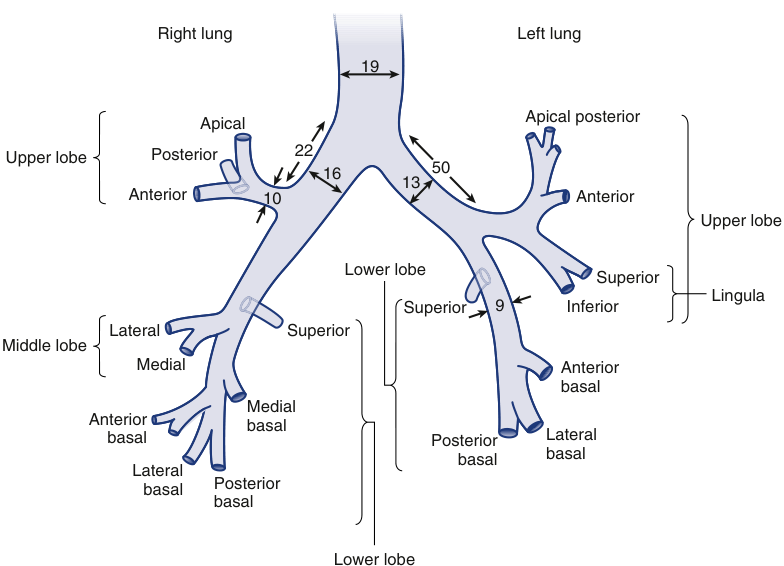

Right lung Left lung 19 Apical posterior Apical Upper lobe Posterior 22 50 16 13 Anterior 10 Anterior Upper lobe Lower lobe Superior Lingula Superior 9 Inferior Lateral Superior Middle lobe Medial Anterior basal Medial Anterior basal basal Posterior Lateral basal basal Lateral basal Posterior basal Lower lobe 

**Fig. 49.27 Diagram of the tracheobronchial tree.** Mean lengths and diameters are shown in millimeters. Note that the right middle lobe bronchus exits directly anteriorly while the superior segments (some authors refer to these as the “apical” segments) of the lower lobes exit directly posteriorly. Using the apical designation on the right side of the segmental bronchi in a rostral to caudal sequence gives the mnemonic “A PALM A MAPL.” (Reproduced with permission from Slinger P. _Principles and Practice of Anesthesia for Thoracic Surgery_ . New York: Springer; 2011.)

rechecked by auscultation and fiberoptic bronchoscopy after patient re- positioning.

In addition, with the introduction of robotic devices for thoracic surgery, careful attention must be given to airway devices because changes in patient position required for robotic surgery have the potential to cause malposition of airway devices. In robotic thoracic surgery, access to the airway in mid- operation can be very difficult.142

### Neurovascular Complications

There are a specific set of nerve and vascular injuries related to the lateral position that must be appreciated. The brachial plexus is the site of the majority of intraoperative nerve injuries related to the lateral position.143 These are basically of two varieties: the majority are compression injuries of the brachial plexus of the dependent arm but there is also significant risk of stretch injuries to the brachial plexus of the nondependent arm. The brachial plexus is fixed at two points: proximally by the transverse process of the cervical vertebrae and distally by the axillary fascia. This two- point fixation, plus the extreme mobility of neighboring skeletal and muscular structures, makes the brachial plexus extremely liable to injury (Box 49.9). The patient should be positioned with padding under the dependent thorax to keep the weight of the upper body off the dependent arm brachial plexus. However, this padding will exacerbate the pressure on the brachial plexus if it migrates superiorly into the axilla.

The arms should not be abducted beyond 90 degrees and should not be extended posteriorly beyond the neutral position nor flexed anteriorly greater than 90 degrees. Fortunately, the majority of these nerve injuries resolve

### Box 49.9 Factors Contributing to Brachial Plexus Injury in the Lateral Position

- a)  Dependent arm (compression injuries):

   1.  Arm directly under thorax

   2.  Pressure on clavicle into retroclavicular space

   3.  Cervical rib

4.  Caudal migration of thorax padding into the axilla*

b)  Nondependent arm (stretch injuries):

   1.  Lateral flexion of cervical spine

   2.  Excessive abduction of arm (>90 degrees)

   3.  Semi- prone or semi- supine repositioning after arm fixed to a support

- *Unfortunately this padding under the thorax is misnamed an “axillary roll” in some institutions. This padding absolutely should NOT be placed in the axilla.

spontaneously over a period of months. Anterior flexion of the arm at the shoulder (circumduction) across the chest or lateral flexion of the neck toward the opposite side can cause a traction injury of the suprascapular nerve.144 This causes a deep, poorly circumscribed pain of posterior and lateral aspects of the shoulder and may be responsible for some cases of postthoracotomy shoulder pain.

It is very easy, after repositioning the patient in the lateral decubitus position, to cause excessive lateral flexion of the cervical spine because of improper positioning of the patient’s head. This malpositioning, which exacerbates brachial plexus traction, can cause a “whiplash” syndrome and can be difficult to appreciate from the head of the operating table, particularly after the surgical drapes have been placed. It is useful for the anesthesiologist to survey the

<!-- PDF page 30 -->

patient from the side of the table immediately after turning to ensure that the entire vertebral column is aligned properly.

The dependent leg should be slightly flexed with padding under the knee to protect the peroneal nerve lateral to the proximal head of the fibula. The nondependent leg is placed in a neutral extended position and padding placed between it and the dependent leg. The dependent leg must be observed for vascular compression. Excessively tight strapping at the hip level can compress the sciatic nerve of the nondependent leg. Other sites particularly liable for neurovascular injury in the lateral position are the dependent ear pinna and eye. A “headto- toe” protocol to monitor for possible neurovascular injuries related to the lateral decubitus position is presented in Box 49.10.

### Physiologic Changes in the Lateral Position

**Ventilation.** Significant changes in ventilation develop between the lungs when the patient is placed in the lateral position.145 The compliance curves of the two lungs are different because of their difference in sizes. The lateral position, anesthesia, paralysis, and opening the thorax all combine to magnify these differences between the lungs (Fig. 49.28). The compliance curve (change in volume versus change in pressure) of a lung depends on the balance of two “springs:” the chest wall (normally distending the lung) and the elastic recoil of the lung itself. Any factor that changes the mechanics of either of these springs places the lung on a different compliance curve.146

In a healthy, conscious, spontaneously breathing patient, the ventilation of the dependent lung will increase approximately 10% when the patient is turned to the lateral position. Once the patient is anesthetized and paralyzed, the ventilation of the dependent lung will then decrease 15%. Although the ventilation will not change significantly once the nondependent hemithorax is open, the FRC of this nondependent lung will tend to increase approximately 10%. These changes depend on the method used for ventilation in the individual patient. When the chest is open, due to disruption of the chest wall, both lungs tend to collapse to a minimal lung volume if expiration is prolonged. Thus, the end- expiratory volume of each lung is directly a function of the time allowed for expiration. The compliance of the entire respiratory system increases significantly once the nondependent hemithorax is open.

Because of the fall in FRC and compliance of the dependent lung in the lateral position, application of PEEP selectively to this lung only (using a DLT and two anesthetic circuits) will improve gas exchange.147 This is different than the effect of nonselectively applying PEEP to both lungs in the lateral position, where PEEP tends to preferentially distribute to the most compliant lung regions and will tend to hyperinflate the nondependent lung without causing any improvement in gas exchange.148

Atelectasis will develop in an average of 6% of the lung parenchyma after induction of anesthesia in the supine position. This atelectasis will be evenly distributed in the dependent portions of both lungs.149 Turning the patient to the lateral position, there will be a slight decrease of total atelectasis to 5% of lung volume but this will now be concentrated totally in the dependent lung.

### Box 49.10 Neurovascular Injuries Specific to the Lateral Position Routine “Head- toToe” Survey

1.  Dependent eye

2.  Dependent ear pinna

3.  Cervical spine in line with thoracic spine

4.  Dependent arm: (i) brachial plexus, (ii) circulation

5.  *Non- dependent arm: (i) brachial plexus, (ii) circulation

6.  Dependent and nondependent suprascapular nerves

7.  Nondependent leg sciatic nerve

8.  Dependent leg: (i) peroneal nerve, (ii) circulation

- *Neurovascular injuries of the nondependent arm are more likely to occur if the arm is suspended or held in an independently positioned arm- rest.

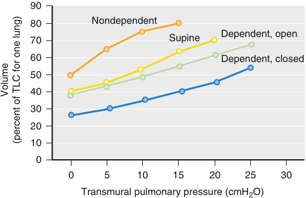

90 80 Nondependent Dependent, open 70 Supine 60 Dependent, closed 50 40 30 20 10 0 0 5 10 15 20 25 30 Transmural pulmonary pressure (cmH2O) Volume (percent of TLC for one lung) 

**Fig. 49.28** Changes in the compliance of a single lung during position changes in an anesthetized, paralyzed patient during controlled mechanical ventilation. These compliance changes are responsible for the resulting differences in ventilation between the lungs which occur in the lateral position. Note: the compliance of the dependent lung is increased when the nondependent hemithorax is open vs. closed. _TLC_ , total lung capacity.

**Perfusion.** Gravity has some effect on distribution of pulmonary blood flow. In the lateral position, the blood flow to the dependent lung is generally thought to be increased by 10% compared to the same lung in the supine position.150 However, the distribution of pulmonary blood flow in various positions may be more related to inherent pulmonary vascular anatomy than to gravity (Fig. 49.29).151 The matching of ventilation and perfusion will usually be decreased in the lateral position compared to the supine position during anesthesia. Pulmonary arteriovenous shunt during general anesthesia will usually increase from approximately 5% in the supine position to 10% to 15% in the lateral position.152

## Anesthetic Management

The development of thoracic anesthesia and thoracic surgery was delayed more than 50 years after the introduction of ether because anesthesiologists could not manage patients during mask anesthesia with spontaneous ventilation and an open chest. These patients developed what was originally called the “pneumothorax syndrome.”153 The

<!-- PDF page 31 -->

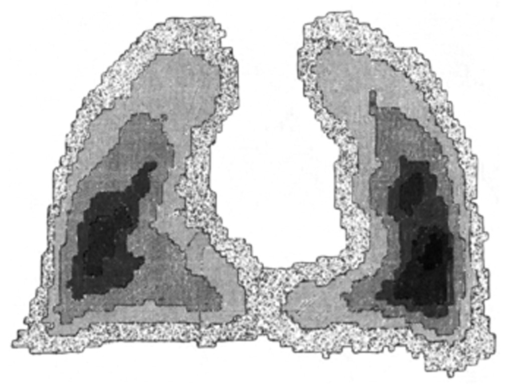

**Fig. 49.29** _In vivo_ perfusion lung scanning in the upright position demonstrates a predominant central-to-peripheral distribution of pulmonary blood flow in addition to a gravitational effect that also increases the blood flow in dependent lung regions. (Reproduced with permission from Slinger P. _Principles and Practice of Anesthesia for Thoracic Surgery_ . New York: Springer; 2011.)

respiratory systems of mammals do not function adequately with an open hemithorax due to two physiologic problems. First, paradoxical ventilation (also called “pendelluft”) in which gas moves into the open- chest lung from the intact lung during expiration and then reverses flow during inspiration. This leads to hypercapnia and hypoxemia. And second, due to the swinging motion of the mediastinum between the hemithoraces during the respiratory cycle, which interferes with cardiac preload and causes hemodynamic instability. In the early 1900s, several pioneers such as the New Orleans surgeon Matas advocated positivepressure ventilation and a primitive form of endotracheal ventilation, which had been demonstrated to be safe in animal experiments, for thoracic anesthesia. Modern methods, incorporating one- lung ventilation, have evolved from this. Essentially any anesthetic technique that provides safe and stable general anesthesia for major surgery can and has been used for lung resection.

### FLUID MANAGEMENT

Due to hydrostatic effects, excessive administration of intravenous fluids can cause increased shunting and subsequently lead to pulmonary edema of the dependent lung, particularly during prolonged surgery.154 Because the dependent lung is the lung that must carry on gas exchange during one- lung ventilation, it is best to be as judicious as possible with fluid administration. Intravenous fluids are administered to replace volume deficits and for maintenance only during lung resection anesthesia. No volume is given for theoretical “third space” losses (Box 49.11).155

### TEMPERATURE

Maintenance of body temperature can be a problem during thoracic surgery because of heat loss from the open hemithorax. This is particularly a problem at the extremes of the age spectrum. Most of the body’s physiologic functions,

### Box 49.11 Fluid Management for Pulmonary Resection Surgery

1.  Total positive fluid balance in the first 24-hour perioperative period should not exceed 20 mL/kg.

2.  For an average adult patient, crystalloid administration should be limited to &lt;3 L in the first 24 hours.

3.  No fluid administration for third-space fluid losses during pulmonary resection.

4.  Urine output >0.5 mL/kg/h is unnecessary

5.  If increased tissue perfusion is needed postoperatively, it is preferable to use invasive monitoring and inotropes rather than to cause fluid overload.

including hypoxic pulmonary vasoconstriction (HPV), are inhibited during hypothermia. Increasing the ambient room temperature, fluid warmers, and the use of lower- and/or upper- body forced- air patient warmers are the best methods to prevent inadvertent intraoperative hypothermia.

### PREVENTION OF BRONCHOSPASM

Due to the high incidence of coexisting reactive airways disease in the thoracic surgical population it is generally advisable to use an anesthetic technique that decreases bronchial irritability. This is particularly important because the added airway manipulation caused by placement of a DLT or bronchial blocker is a potent trigger for bronchoconstriction. The principles of anesthetic management are the same as for any asthmatic patient: avoid manipulation of the airway in a lightly anesthetized patient, use bronchodilating anesthetics, and avoid drugs which release histamine. For intravenous induction of anesthesia either propofol or ketamine can be expected to diminish bronchospasm. This benefit will not be seen with barbiturate, opioid, benzodiazepine, or etomidate intravenous induction. For maintenance of anesthesia, propofol, and/or any of the volatile anesthetics will diminish bronchial reactivity. Sevoflurane may be the most potent bronchodilator of the volatile anesthetics.156

### CORONARY ARTERY DISEASE

Since the lung- resection population is largely elderly and smokers there is a high coincidence of coronary artery disease. This consideration will be a major factor in the choice of the anesthetic technique for most thoracic patients. The anesthetic technique should optimize the myocardial oxygen supply/demand ratio by maintaining arterial oxygenation and diastolic blood pressure while avoiding unnecessary increases in cardiac output and heart rate. Thoracic epidural anesthesia/analgesia may aid in this (see Postoperative Analgesia, later).

## Management of One- Lung Ventilation

During OLV the anesthesiologist has the unique and often conflicting goals of trying to maximize atelectasis in the nonventilated lung to improve surgical access while trying to avoid atelectasis in the ventilated lung (usually the

<!-- PDF page 32 -->

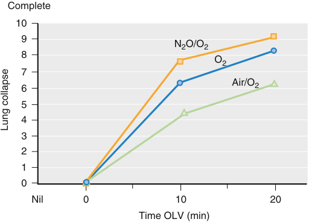

Complete 10 9 N2O/O2 8 O2 7 6 Air/O2 5 4 3 2 1 0 Nil 0 10 20 Time OLV (min) Lung collapse 

**Fig. 49.30** The effects of the gas mixture used during two- lung ventilation, immediately before one- lung ventilation (OLV), on the speed of collapse of the nonventilated lung during OLV. O2, fraction of inspired oxygen (FiO2) 1.0; N2O/O2=, nitrous oxide/oxygen 60/40; Air/O2, air/oxygen FiO2 0.4. All patients were ventilated with a FiO2 of 1.0 during OLV. The poorly soluble nitrogen in the air/oxygen mixture delays collapse of the nonventilated lung (Based on data from Ko R, et al. _Anesth Analg_ . 2009;108:1029.)

dependent lung) to optimize gas exchange. The gas mixture in the nonventilated lung immediately before OLV has a significant effect on the speed of collapse of this lung. Because of its low blood- gas solubility, nitrogen (or an air–oxygen mixture) will delay collapse of this lung (Fig. 49.30).157 This is particularly a problem at the start of minimally invasive surgery when surgical visualization in the operative hemithorax is limited and in patients with emphysema who have delayed collapse of the nonventilated lung due to decreased lung elastic recoil. It is important to thoroughly de- nitrogenate the operative lung, by ventilating with oxygen, immediately before it is allowed to collapse. Although nitrous oxide is even more effective than oxygen in speeding lung collapse, for the reasons previously mentioned, it is not commonly used in thoracic anesthesia since many patients may have blebs or bullae.

Also, during the period of two- lung anesthesia before the start of OLV, atelectasis will develop in the dependent lung. It is useful to perform a recruitment maneuver to the dependent lung (similar to a Valsalva maneuver, holding the lung at an end- inspiratory pressure of 20 cmH20 for 15 to 20 seconds) immediately after the start of OLV to decrease this atelectasis. Recruitment is important to maintain PaO2 levels during subsequent OLV.158

### HYPOXEMIA

A major concern that influences anesthetic management for thoracic surgery is the occurrence of hypoxemia during one- lung ventilation. There is no universally acceptable figure for the safest lower limit of oxygen saturation during OLV. A saturation greater than or equal to 90% (PaO2 >60 mm Hg) is commonly accepted, and for brief periods a saturation in the high 80s may be acceptable in patients without significant comorbidity. However, the lowest acceptable saturation will be higher in patients with organs at risk of hypoxia due to limited regional blood flow (e.g., coronary or cerebrovascular disease) and in patients

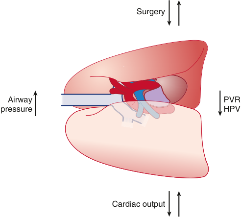

Surgery Airway PVR pressure HPV Cardiac output 

**Fig. 49.31 Factors affecting the distribution of pulmonary blood flow during one- lung ventilation.** Hypoxic pulmonary vasoconstriction (HPV), and the collapse of the nonventilated lung which increases pulmonary vascular resistance (PVR), tend to distribute blood flow toward the ventilated lung. The airway pressure gradient between the ventilated and nonventilated thoraces tends to encourage blood flow to the nonventilated lung. Surgery and cardiac output can have variable effects either increasing or decreasing the proportional flow to the ventilated lung (see text).

with limited oxygen transport (e.g., anemia or decreased cardiopulmonary reserve). It has been shown that during OLV, patients with COPD desaturate more quickly during isovolemic hemodilution than normal patients.159

Previously, hypoxemia occurred frequently during OLV. Reports for the period 1950–1980 describe an incidence of hypoxemia (arterial saturation &lt;90%) of 20% to 25%.160 More recent reports describe an incidence of less than 5%.161 This improvement is most likely due to several factors: improved lung isolation techniques such as routine fiberoscopy to prevent lobar obstruction from DLTs, improved anesthetic agents which cause less inhibition of HPV, and better understanding of the pathophysiology of one- lung ventilation. The pathophysiology of OLV involves the body’s ability to redistribute pulmonary blood flow to the ventilated lung. Several factors aid and impede this redistribution and these are under the control of the anesthesiologist to a variable degree. These factors are illustrated in Fig. 49.31. The anesthesiologist’s goal during OLV is to maximize pulmonary vascular resistance (PVR) in the nonventilated lung while minimizing PVR in the ventilated lung. Key to understanding this physiology is the appreciation that PVR is correlated with lung volume in a hyperbolic fashion (Fig. 49.32). PVR is lowest at FRC and increases as lung volume rises or falls above or below FRC.162 To optimize pulmonary blood flow redistribution during OLV, the anesthesiologist’s aim is to maintain the ventilated lung as close as possible to its FRC while facilitating collapse of the nonventilated lung to increase its PVR.

### INTRAOPERATIVE POSITION

Most thoracic surgery is performed in the lateral position. Patients having OLV in the lateral position have significantly

<!-- PDF page 33 -->

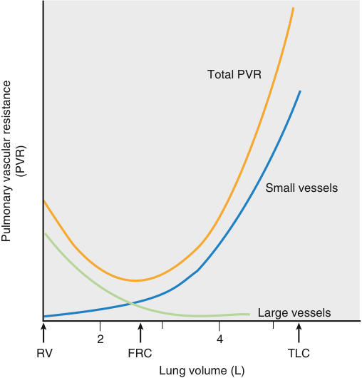

Total PVR Small vessels Large vessels 2 4 RV FRC TLC Lung volume (L) (PVR) Pulmonary vascular resistance 

**Fig. 49.32 The relationship between pulmonary vascular resistance (PVR) and lung volume.** PVR is lowest at functional residual capacity (FRC) and increases as the lung volume decreases toward residual volume (RV) due primarily to increase in resistance of large pulmonary vessels. PVR also increases as lung volume increases above FRC toward total lung capacity (TLC) due an increase in the resistance of small interalveolar lung vessels.

better PaO2 levels than patients during OLV in the supine position.163 This applies both to patients with normal lung function and to those with COPD (Fig. 49.33).164

## Hypoxic Pulmonary Vasoconstriction

HPV is thought to be able to decrease the blood flow to the nonventilated lung by 50%.165 The stimulus for HPV is primarily the alveolar oxygen tension (PAO2), which stimulates precapillary vasoconstriction redistributing pulmonary blood flow away from hypoxemic lung regions via a pathway involving NO and/or cyclooxygenase synthesis inhibition.166 The mixed venous PO2 (PvO2) is also a stimulus, although considerably weaker than PAO2. HPV has a biphasic temporal response to alveolar hypoxia. The rapidonset phase begins immediately and reaches a plateau by 20 to 30 minutes. The second (delayed) phase begins after 40 minutes and plateaus after 2 hours (Fig. 49.34).167 The offset of HPV is also biphasic and pulmonary vascular resistance may not return to baseline for several hours after a prolonged period of OLV. This may contribute to increased desaturation during the collapse of the second lung during bilateral thoracic procedures. HPV is also a reflex that has a preconditioning effect and the response to a second hypoxic challenge will be greater than to the first challenge.168

The surgical trauma to the lung can affect pulmonary blood flow redistribution. Surgery may oppose HPV by release of vasoactive metabolites locally in the lung. Conversely, surgery can dramatically decrease blood flow to the

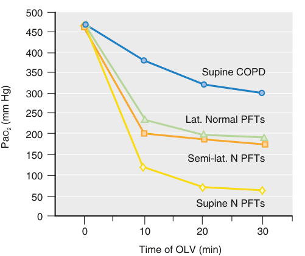

500 450 400 350 Supine COPD 300 250 Lat. Normal PFTs 200 150 Semi-lat. N PFTs 100 50 Supine N PFTs 0 0 10 20 30 Time of OLV (min)  (mm Hg)PaO2 

**Fig. 49.33 Mean arterial partial pressure of oxygen (PaO2) in groups of patients vs. time of one- lung ventilation (OLV).** _Supine COPD_ , patients with COPD having OLV in the supine position; _Lat. Normal PFTs_ , patients with normal pulmonary function having OLV in the lateral position; _Semi- lat. N PFTs_ , patients with normal pulmonary function having OLV in the semi- lateral position; _Supine N PFTs_ , patients with normal pulmonary function having OLV in the supine position. Patients with normal pulmonary function having OLV in the supine position are the most likely to desaturate. (Based on data from Watanabe S, et al. _Anesth Analg_ . 2000;90:28 and Bardoczy G, et al. _Anesth Analg_ . 2008;90:35.)

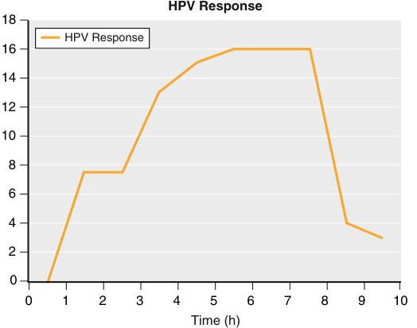

HPV Response 18 HPV Response 16 14 12 10 8 6 4 2 0 0 1 2 3 4 5 6 7 8 9 10 Time (h) 

**Fig. 49.34** The relationship between hypoxic pulmonary vasoconstriction (HPV) (vertical axis) and time in hours (h) (horizontal axis) in humans exposed to isocapnic hypoxia (approximate inspired PO2 60 mm Hg) beginning at 0 h with a return to normoxia at 8 h. HPV response was measured as the increase in echocardiographic right ventricular systolic pressure. Note the two- phase, rapid and slow, onset of HPV. Also note that after prolonged HPV the pulmonary pressures do not return to baseline for several hours. (Based on data from Talbot, et al. _J Appl Physiol_ . 2005;98:1125.)

nonventilated lung by deliberately or accidentally mechanically interfering with either the unilateral pulmonary arterial or venous blood flow.169 Ventilation increases blood flow through a hypoxic lung more than in a normoxic lung, which is generally not of clinical relevance but does complicate studies of HPV. HPV is decreased by vasodilators such

<!-- PDF page 34 -->

as nitroglycerin and nitroprusside. In general, vasodilators can be expected to cause a deterioration in PaO2 during OLV. Thoracic epidural sympathetic blockade probably has little or no direct effect on HPV, which is a localized chemical response in the lung.170 However, thoracic epidural anesthesia can have an indirect effect on oxygenation during OLV if it is allowed to cause hypotension and a fall in cardiac output (see Cardiac Output, below).

### CHOICE OF ANESTHETIC

All of the volatile anesthetics inhibit HPV in a dosedependent fashion. Animal studies suggest that this inhibition is dependent on the agent: halothane > enflurane > isoflurane.171 The older agents were potent inhibitors of HPV and this may have contributed to the high incidence of hypoxemia reported during OLV in the 1960s and 1970s (see earlier); many of these studies used 2- to 3- MAC doses of halothane.

In doses of less than or equal to 1 MAC, the modern volatile anesthetics (isoflurane, sevoflurane,172 and desflurane173 ) are weak, and equipotent, inhibitors of HPV. The inhibition of the HPV response by 1 MAC of a volatile agent such as isoflurane is approximately 20% of the total HPV response, and this could account for only a net 4% increase in total arteriovenous shunt during OLV, which is a difference too small to be detected in most clinical studies.174 Although the effect on oxygenation is small, the use of total intravenous anesthesia (TIVA) instead of volatile anesthesia may be important in some critical situations such as limiting the FiO2 during OLV in patients who have received bleomycin. Decreasing the amount of volatile anesthesia with intravenous dexmedetomidine has been shown to improve oxygenation during OLV.175

The use of nitrous oxide/oxygen (N2O/O2) mixtures is associated with a higher incidence of postthoracotomy radiographic atelectasis (51%) in the dependent lung than when air/oxygen mixtures are used (24%). Nitrous oxide also tends to increase pulmonary artery pressures in patients who have pulmonary hypertension and N2O inhibits HPV. For these reasons N2O is usually avoided during thoracic anesthesia.

Volatile anesthetic techniques seem to be associated with less release of proinflammatory cytokines. This has been suggested to decrease complications following thoracic surgery.176

### CARDIAC OUTPUT

The effects of alterations of cardiac output during OLV are complex (Fig. 49.35). Increasing cardiac output tends to cause increased pulmonary artery pressures and passive dilation of the pulmonary vascular bed, which in turn opposes HPV and has been shown to be associated with increased arteriovenous shunt (Qs/Qt) during OLV.177 However, in patients with a relatively fixed oxygen consumption, as is seen during stable anesthesia, the effect of an increase in cardiac output is to increase the SvO2. Thus, increasing cardiac output during OLV tends to increase both shunt and SvO2, which have opposing effects on PaO2. There is a ceiling effect to the amount that SvO2 can be increased. Increasing the cardiac output to supranormal

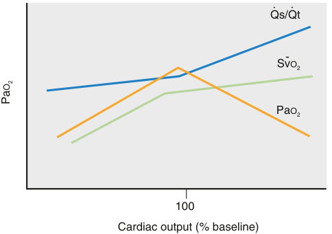

Qs/Qt· · Sv- O2 PaO2 100 Cardiac output (% baseline) PaO2 

**Fig. 49.35 The relationship between arterial partial pres sure of oxygen (PaO2) and cardiac output during OLV.** As cardiac output falls below baseline, arteriovenous shunt (Qs/Qt) falls but the mixed venous oxygen saturation (SvO2) also decreases, resulting in a net fall in PaO2. Conversely, raising cardiac output above baseline tends to increase SvO2 but also increase Qs/Qt and the net result again is a decrease in PaO2. (Based on data from Slinger P, Scott W. _Anesthesiology_ . 1995;82:940 and Russell W, James M. _Anaesth Intens Care_ . 2004;32:644.)

levels by administering inotropes such as dopamine tends to have an overall negative effect on PaO2.178 Conversely, allowing the cardiac output to fall will lead to falls in both shunt and SvO2, with a net effect of decreasing PaO2. Since even with optimal anesthetic management there is usually a shunt of 20% to 30% during OLV, it is very important to maintain cardiac output.

## Ventilation Strategies During OLV

The strategy used to manage the ventilated lung during OLV plays an important part in the distribution of pulmonary blood flow between the lungs. Previously it was the practice of many anesthesiologists to use the same large tidal volume (e.g., 10 mL/kg ideal body weight) during OLV as during two- lung ventilation. This strategy probably decreases hypoxemia by recurrently recruiting atelectatic regions in the dependent lung and may result in higher PaO2 values during OLV than compared to smaller tidal volumes.179 However, there is a trend to use smaller tidal volumes with PEEP during OLV for several reasons. First, the incidence of hypoxemia during OLV is much lower than 20 to 30 years ago. Second, there is a risk of causing acute injury to the ventilated lung with prolonged use of large tidal volumes. And third, a ventilation pattern which allows recurrent atelectasis and recruitment of lung parenchyma seems to be injurious.180 The ventilation technique needs to be individualized, depending on the patient’s underlying lung mechanics.

### RESPIRATORY ACID–BASE STATUS

The efficacy of HPV in a hypoxic lung region is increased in the presence of respiratory acidosis and is inhibited by respiratory alkalosis. However, there is no net benefit to gas exchange during OLV from hypoventilation because the respiratory acidosis preferentially increases the pulmonary vascular tone of the well- oxygenated lung and

<!-- PDF page 35 -->

this opposes any clinically useful pulmonary blood flow redistribution.181 Overall, the effects of hyperventilation will usually tend to decrease pulmonary vascular pressures.

### POSITIVE END- EXPIRATORY PRESSURE (PEEP)

Resistance to blood flow through the lung is related to lung volume in a biphasic pattern and is lowest when the lung is at its FRC. Keeping the ventilated lung as close as possible to its normal FRC favorably encourages pulmonary blood flow to this lung. Several intraoperative factors that are known to alter FRC tend to cause the FRC of the ventilated lung to fall below its normal level, these include lateral position, paralysis and opening the nondependent hemithorax, which allows the weight of the mediastinum to compress the dependent lung. Attempts to measure FRC in human patients during OLV have been complicated by the presence of a persistent end- expiratory airflow in COPD patients.182 Many patients do not actually reach their end- expiratory equilibrium FRC lung volume as they try to exhale a relatively large tidal volume through one lumen of a DLT. These patients develop dynamic hyperinflation and an occult positive end- expiratory pressure (auto- PEEP).61

Auto- PEEP is most likely to occur in patients with decreased lung elastic recoil such as the elderly or those with emphysema.183 Auto- PEEP increases as the inspiratory/expiratory (I:E) ratio increases (i.e., as the time of expiration decreases). This auto- PEEP, which averages 4 to 6 cmH2O in most series of lung cancer patients with COPD, opposes the previously mentioned factors, which tend to diminish dependent- lung FRC during OLV. The effects of applying external PEEP through the ventilator circuit to the lung in the presence of auto- PEEP are complex (Fig. 49.36). Patients with low auto- PEEP (&lt;2 cmH2O) will experience a greater increase in total PEEP from a moderate (5 cmH2O) external PEEP than those with a high level of auto-PEEP (>10 cmH2O). Whether the application of PEEP during OLV will improve a patient’s gas exchange depends on the individual’s lung mechanics. If the application of PEEP tends to shift the expiratory equilibration position on the compliance curve toward the lower inflection point (LIP) of the curve (i.e., toward the FRC) then external PEEP is of benefit (Fig. 49.37). However, if the application of PEEP raises the equilibration point such that it is further from the LIP, then gas exchange deteriorates. Auto- PEEP is difficult to detect and measure using currently available anesthetic ventilators.

Titration of PEEP during OLV to minimize the ventilation driving pressure (the difference between the inspiratory plateau airway pressure and PEEP) may be the optimal way to select PEEP for an individual patient.184

### TIDAL VOLUME

There will be an optimal combination of tidal volume, respiratory rate, I:E ratio, pressure- or volume- control ventilation for each individual patient during OLV. However, to try to assess each of these parameters while still providing anesthesia with the available anesthetic ventilators is not practical and the clinician must initially rely on a simplified strategy (Table 49.9). The results of alterations in tidal volume are unpredictable. This may be due in part to the interaction of tidal volume with auto- PEEP. The use of 5 to 6 mL/

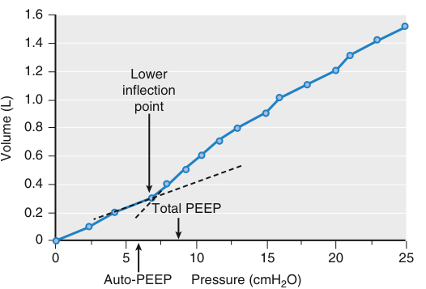

1.6 1.4 1.2 Lower inflection 1.0 point 0.8 0.6 0.4 0.2 Total PEEP 0 0 5 10 15 20 25 Auto-PEEP Pressure (cmH2O) Volume (L) 

**Fig. 49.36 The static compliance curve of the ventilated (dependent) lung in a typical lung cancer patient with mild chronic obstructive pulmonary disease (COPD).** The lower inflection point is thought to represent func tional residual capacity (FRC). This patient had 6 cmH2O of auto- PEEP during one-lung ventilation (OLV). Adding 5 cmH2O PEEP to the ventilator resulted in a total PEEP in the circuit of 9 cmH2O. This patient had a decrease in arterial partial pressure of oxygen (PaO2) with the addition of PEEP. (Based on data from Slinger P, et al. _Anesthesiology_ . 2001;95:1096.)

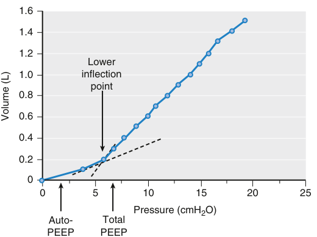

1.6 1.4 1.2 Lower 1.0 inflection point 0.8 0.6 0.4 0.2 0 0 5 10 15 20 25 Pressure (cmH2O) Auto- Total PEEP PEEP Volume (L) 

**Fig. 49.37 Static compliance curve of a young patient with normal pulmonary function during one-lung ventilation (OLV) (in this case for removal of a mediastinal tumor).** The lower inflection point of the curve func tional residual capacity (FRC) was at 6 cmH2O. The patient had 2 cmH2O auto- PEEP during OLV. Adding 5 cmH2O PEEP to the ventilator raised the total PEEP to 7 cmH2O and improved arterial partial pressure of oxygen (PaO2). Patients with normal lung mechanics and patients with increased lung elastic recoil (such as due to restrictive lung diseases) have an increase in PaO2 from PEEP during OLV. (Based on data from Slinger P, et al. _Anesthesiology_ . 2001;95:1096.)

kg ideal body weight tidal volumes plus 5 cmH2O PEEP initially for most patients (except those with COPD) seems a logical starting point during OLV.185 Tidal volume should be managed so that peak airway pressures do not exceed 35 cmH2O. This will correspond to a plateau airway pressure of approximately 25 cmH2O.186 Peak airway pressures exceeding 40 cmH2O may contribute to hyper- inflation injury of the ventilated lung during OLV.187

Turning the patient to the lateral position will increase respiratory dead space and the arterial to end- tidal CO2 tension gradient (Pa- ETCO2). This will usually require a 20% increase in minute ventilation to maintain the same PaCO2.

<!-- PDF page 36 -->

**Table 49.9** Suggested Ventilation Parameters for OneLung Ventilation

|**Parameter**|**Suggested**|**Guidelines/Exceptions**|
|---|---|---|
|1.  Tidal volume|5–6 mL/kg ideal body weight|Maintain: Peak airway pressure &lt;35 cmH2O Plateau airway pressure &lt;25 cmH2O|
|2.  Positive end- expiratory pressure|5–10 cmH2O|Patients with COPD: no added PEEP|
|3.  Respiratory rate|12/min|Maintain normal PaCO2, Pa- ETCO2 will usually increase 1–3 mm Hg during OLV|
|4.  Mode|Pressure- controlled or volume- controlled|Pressure- control for patients at risk of lung injury (bullae, pneumonectomy, post–lung transplantation, etc.)|

_COPD_ , chronic obstructive pulmonary disease; _PaCO2_ , arterial partial pres sure of carbon dioxide; ; _Pa-ETCO2_ , arterial to end-tidal _CO2_ ten sion gradient; _PEEP_ , positive end-expiratory pressure; _OLV_ , one-lung ventilation.

Individual variations in Pa- ETCO2 gradient become much larger and PETCO2 is less reliable as a monitor of PaCO2 during OLV. This effect is possibly due to the fact that there are individual differences in the excretion of CO2 between the dependent and nondependent lungs.

### VOLUME- CONTROLLED VERSUS PRESSURECONTROLLED VENTILATION

Pressure- control ventilation has not been shown to improve oxygenation versus volume- controlled ventilation for most patients, although the peak airway pressures are lower.188 The decrease in peak pressure with pressure control ventilation may be largely in the anesthetic circuit and not at the distal airway.189 Pressure-control ventilation will avoid sudden increases in peak airway pressures that may result from surgical manipulation in the chest. This will be of benefit when a bronchial blocker is used and in patients at increased risk for lung injury from high pressures such as after lung transplantation or during a pneumonectomy.190 Due to the rapid changes of lung compliance which occur during pulmonary surgery, when pressure- control ventilation is used the delivered tidal volume needs to be closely monitored as this may change suddenly.

## Prediction of Hypoxemia During One- Lung Ventilation

The problem of hypoxemia during one- lung ventilation has prompted much research in thoracic anesthesia. Hypoxemia during OLV is predictable (see Box 49.7), preventable, and treatable in the vast majority of cases.191

### PREOPERATIVE VENTILATION–PERFUSION SCAN

The shunt and PaO2 during intraoperative OLV are highly correlated with the fractional perfusion of the ventilated lung as determined by a preoperative ventilation/perfusion scan.192 Patients with long- standing unilateral disease on the operative side develop a unilateral decrease of

ventilation and perfusion and tolerate OLV very well. Similarly, patients who intraoperatively have a higher proportion of gas exchange in the dependent lung during OLV tend to have better oxygenation during OLV.

### SIDE OF OPERATION

Patients having right- sided thoracotomies tend to have a larger shunt and lower PaO2 during OLV because the right lung is larger and normally 10% better perused than the left. The overall mean PaO2 difference between left and right thoracotomies during stable OLV is approximately 100 mm Hg.193

### TWO- LUNG OXYGENATION

Patients who have better PaO2 levels during two- lung ventilation in the lateral position tend to have better oxygenation during OLV. These patients may have better abilities to match ventilation and perfusion (individual variability of HPV response) and/or they may have less atelectasis in the dependent lung. This is a particularly relevant consideration in trauma patients who may require a thoracotomy but have a contusion of the dependent lung.

### PREOPERATIVE SPIROMETRY

Previous studies showed that patients with better spirometric lung function preoperatively are more likely to desaturate and have lower PaO2 values during OLV.190 Clinically this is evident because emphysematous lung- volume reduction patients generally tolerate one- lung ventilation very well. The explanation is not clear but may be related to maintenance of a more favorable FRC in patients with obstructive airways disease during OLV with an open hemithorax due to the development of auto- PEEP. However, with the routine use of appropriate PEEP levels during OLV this may no longer be a factor.

## Treatment of Hypoxemia During One- Lung Ventilation

During one- lung ventilation there will be a fall in arterial oxygenation that usually reaches its nadir 20 to 30 minutes after the initiation of OLV then the saturation will stabilize or may rise slightly as HPV increases over the next 2 hours. The majority of patients who desaturate do so quickly and within the first 10 minutes of OLV. Hypoxemia during one- lung ventilation responds readily to treatment in the vast majority of cases. Potential therapies are outlined in Box 49.12.

1.  Resume two- lung ventilation. Reinflate the nonventilated lung and deflate the bronchial cuff of the DLT or the bronchial blocker. This will necessitate interruption of surgery but is necessary in case of severe or precipitate desaturation. After an adequate level of oxygenation is obtained, the diagnosis of the cause of desaturation can be made and prophylactic measures instituted (see later) before another trial of OLV is attempted.

2.  Increase FiO2. Ensure that the delivered FiO2 is 1.0. This is an option in essentially all patients except those who have received bleomycin or similar therapies that potentiate pulmonary oxygen toxicity.

::: details 原始表格與符號（PDF 第 36 頁）

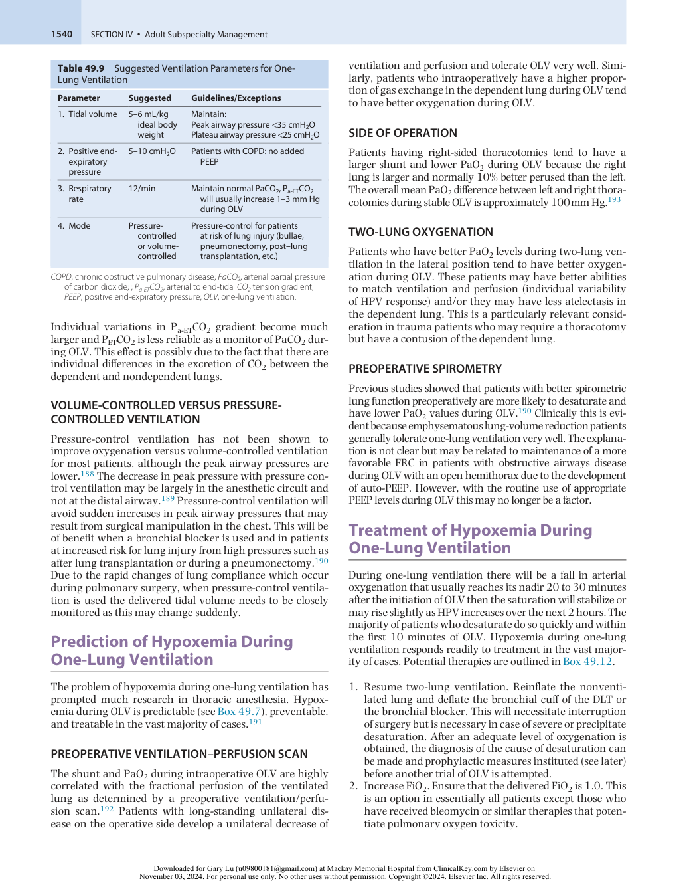

:::

<!-- PDF page 37 -->

### Box 49.12 Therapies for Desaturation During One- lung Ventilation

**Severe or precipitous desaturation:** Resume two- lung ventilation (if possible).

### Gradual desaturation:

- Assure that delivered FiO2 is 1.0

- Check position of double- lumen tube or blocker with fiberoptic bronchoscopy

- Assure that cardiac output is optimal, decrease volatile anesthetics to &lt;1 MAC

- Apply a recruitment maneuver to the ventilated lung (this will transiently make the hypoxemia worse)

- Increase PEEP to the ventilated lung (except in patients with emphysematous pathology)

- Apneic oxygen insufflation of the nonventilated lung

- CPAP 1–2 cmH2O to the nonventilated lung (apply a recruitment maneuver to this lung immediately before CPAP)

- Partial ventilation techniques of the nonventilated lung:

- Intermittent positive- pressure ventilation

- Fiberoptic lobar insufflation

- Selective lobar collapse (using a bronchial blocker)

- Small tidal volume ventilation

- Pharmacologic manipulations (see text)

- ᑏMechanical restriction of the blood flow to the nonventilated lung (if possible)

- ᑏVenovenous ECMO

_CPAP_ , continuous positive airway pressure; _ECMO_ , extracorporeal membrane oxygenation; _FiO2_ , fraction of inspired oxygen: _MAC_ , minimum alveolar concentration; _PEEP_ , positive end- expiratory pressure.

3.  Recheck the position of the DLT or bronchial blocker. Assure that there is no lobar obstruction in the ventilated lung.

4.  Check the patient’s hemodynamics to assure that there has been no decrease in cardiac output. It is very common for the surgeon to accidentally compress the inferior vena cava during pulmonary resections and the fall in blood pressure and cardiac output that this causes leads to rapid desaturation during OLV. Treat the fall in cardiac output as indicated (e.g., inotropes/vasopressors if due to thoracic epidural sympathetic blockade). Stop administration of vasodilators and decrease MAC of volatile anesthetics to less than or equal to 1 MAC.

5.  Perform a recruitment maneuver of the ventilated lung. To eliminate any atelectasis, inflate the lung to 20 cmH2O or more for 15 to 20 seconds. This may cause transient hypotension and will also cause a transient further fall in the PaO2 as the blood flow is temporarily redistributed to the nonventilated lung.

6.  Apply PEEP to the ventilated lung. It is necessary to perform a recruitment maneuver before applying PEEP to get the maximal benefit. PEEP will raise the endexpiratory volume of the ventilated lung towards the FRC in patients with normal lung mechanics and in those with increased elastic recoil due to restrictive disease. It is not possible to predict the optimal PEEP for individual patients. It is useful to titrate PEEP between 5 and 10 cmH2O to maximize compliance while maintaining a driving pressure (plateau pressure- PEEP) ≤15 cmH2O.194 PEEP will increase the end- expiratory lung volume of patients with significant levels of

500 COPD 450 Normal PFTs 400 350 300 250 * 200 150 100 50 0 2LV OLV PEEP CPAP PEEP + CPAP PaO (mm Hg) 2 

**Fig. 49.38** A comparison of the effects of positive end- expiratory pressure (PEEP) to the ventilated lung and continuous positive airway pressure (CPAP) to the nonventilated lung on mean arterial partial pres sure of oxygen (PaO2) levels during one- lung ventilation (OLV). _2LV_ , two- lung ventilation; _COPD_ , a group of lung cancer surgery patients; _Normal PFTs_ , a group of esophageal surgery patients with normal preoperative pulmonary function tests. (* _P_ &lt; .05 vs. OLV.) (Based on data from Fujiwara M, et al. _J Clin Anesth_ . 2001;13:473 and Capan L, et al. _Anesth Analg_ . 1980;59:847.)

auto- PEEP (e.g., emphysema patients). Unlike CPAP, application of PEEP does not require reinflation of the nonventilated lung and interruption of surgery. PEEP has been shown to be as effective for increasing PaO2 levels during OLV in patients with normal lung function as CPAP (Fig. 49.38).195 For patients with normal pulmonary function it is logical to routinely apply a recruitment maneuver and PEEP from the start of OLV.

7.  Apneic oxygen insufflation to the nondependent lung. Application of 3 liters of O2 via a suction catheter to the nonventilated lumen of the DLT improved PaO2 during OLV without interference to the surgical field.196

8.  Continuous positive airway pressure (CPAP) with oxygen to the nonventilated lung is a reliable method to improve PaO2 during OLV.197 CPAP should be applied to an inflated (recruited) lung to be completely effective. The opening pressure of atelectatic lung regions is greater than 20 cmH2O198 and these units will not be recruited by simple application of CPAP levels of 5 to 10 cmH2O.199 When CPAP is applied to an inflated lung, levels of CPAP as low as 1 to 2 cmH2O can be used.200 Since the normal transpulmonary pressure of the lung at FRC is approximately 5 cmH2O, levels of 5 to 10 cmH2O CPAP applied to a fully recruited lung result in a large- volume lung that impedes surgery particularly during minimally invasive procedures. Lower FiO2 levels of CPAP are of clinical benefit and can be titrated to the ventilated lung in patients at risk of oxygen toxicity using an air/oxygen blender.

   - Numerous anesthetic systems to apply CPAP to the

   - nonventilated lung have been described. Essentially all that is required is a CPAP (or PEEP) valve and an oxygen source. Ideally the circuit should permit variation of the CPAP level and include a reservoir bag to allow easy reinflation of the nonventilated lung and a manometer to measure the actual CPAP supplied. Such circuits are commercially available (Fig. 49.39) or can be readily constructed from standard anesthetic equipment.

<!-- PDF page 38 -->

**Fig. 49.39** Photograph of a commercial (Mallinckrodt, St. Louis, MO) disposable continuous positive air way pressure (CPAP) circuit applied to the nonventilated lung during a left thoracotomy (in this case applied to the tracheal lumen of a right- sided double- lumen tube). This circuit has an adjustable exhaust valve that allows titration of CPAP between 1 and 10 cmH2O.

CPAP, even when properly administered, is not completely reliable to improve oxygenation during OLV. When the bronchus of the operative lung is obstructed or open to atmosphere (as in a bronchopleural fistula or during endobronchial surgery), CPAP will not improve oxygenation. Also in certain situations, particularly during thoracoscopic surgery where access to the operative hemithorax is limited, CPAP can significantly interfere with surgery.201

9.  Use of extracorporeal membrane oxygenation (ECMO). There have been multiple case reports of ECMO being used to manage thoracic surgery where oxygenation cannot be maintained with conventional techniques. The safety of venovenous ECMO makes it an option in some cases of complex lung surgery.202

### PHARMACOLOGIC MANIPULATIONS TO IMPROVE OXYGENATION

To improve oxygenation, eliminating vasodilators such as nitroglycerin and volatile anesthetics will improve oxygenation during OLV.203 The combination of the inhaled pulmonary vasodilator nitric oxide and systemic vasoconstrictors such as phenylephrine has been shown to improve oxygenation in ventilated intensive care unit patients with adult respiratory distress syndrome204 and this may have applications in OLV. The inhalation of nebulized prostacyclin (epoprostenol)205 (see Fig. 49.6) or its derivative iloprost206 have both been shown to improve oxygenation during OLV. A caveat is that the glycine diluent for nebulized epoprostenol tends to build up in the heat–moisture exchange (HME) filter of an anesthetic circuit, causing increased airflow resistance. The HME filter should be changed every hour when nebulized epoprostenol is used.

### INTERMITTENT REINFLATION OF THE NONVENTILATED LUNG

HPV becomes more effective during repeated hypoxic exposure. Often after reinflation, the oxygen saturation will be more acceptable during a second period of lung collapse.

2 L/m O2 Occlusion 2 s Release 8 s Cycle 10 s 

**Fig. 49.40 A simple device to provide intermittent positive airway pressure to the nonventilated lung.** A standard bacteriostatic filter is attached to the lumen of the double- lumen tube to the nonventilated lung and an oxygen source is connected to the CO2 sampling port of the filter. Intermittent manual occlusion of the open filter end improves oxygenation with minimal impact on surgical exposure. See text for details. (Reproduced with permission from Slinger P. _Principles and Practice of Anesthesia for Thoracic Surgery_ . New York: Springer; 2011.)

Re- expansion can be performed by regular reinflation of the operative lung via an attached CPAP circuit.

### PARTIAL VENTILATION METHODS

Several alternative methods of one- lung ventilation, all involving partial ventilation of the nonventilated lung, have been described and improve oxygenation during OLV. These techniques are useful in patients who are particularly at risk of desaturation, such as those who have had previous pulmonary resections of the contralateral lung. These alternatives include:

1.  Intermittent positive airway pressure to the nonventilated lung. This can be performed by a variety of methods. Russell described attaching a standard bacteriostatic filter to the nonventilated lumen of the DLT with a 2 L oxygen inflow attached to the CO2 port of the filter (Fig. 49.40).207 Manual occlusion of the filter for 2 seconds gives an insufflation of approximately 66 mL of oxygen to the nonventilated lung. This could be repeated at 10-second intervals with minimal interference with surgical exposure.

2.  Selective insufflation of oxygen to recruit lung segments on the side of surgery but remote from the site of surgery (Fig. 49.41).208 A useful technique in minimally invasive surgery is intermittent insufflation of oxygen using a fiberoptic bronchoscope. A 5-L oxygen flow is attached to the suction port of an FOB which is passed under direct vision into a segment of the lung remote from the site of surgery which is then reinflated by triggering the suction on the FOB. The surgeon aids this technique by observing the lung inflation with the videoscope to avoid overdistention of the recruited segment(s).

3.  Selective lobar collapse of only the operative lobe in the open hemithorax.209 This is accomplished by placement of a blocker in the appropriate lobar bronchus of the ipsilateral operative lung while continuing to ventilate the other lobe(s) of the lung.

<!-- PDF page 39 -->

Bronchoscope Oxygen tubing connected to suction port Suction trigger Ventilated right lung Deflated left upper lobe Left-sided double- lumen tube Bronchoscope directed into left lower lobe (basal segments) Inflated left lower lobe (basal segments) Surgical instruments © Frances Yeung 2008 

**Fig. 49.41** Intermittent oxygen insufflation during thoracoscopic surgery to segments of the nonventilated lung on the side of surgery using a fiberoptic bronchoscope. See text for details. (Reproduced with permission from Slinger P. _Principles and Practice of Anesthesia for Thoracic Surgery_ . New York: Springer; 2011.)

4.  Ventilation of the operative (nondependent lung) with a small tidal volume via another ventilator connected to a limb of a DLT to the nondependent lung. A brief period of intermittent positive- pressure ventilation to the nondependent lung with a small VT (e.g., 70 mL) and respiratory rate of 6/min was effective in improving PaO2 and SpO2 during OLV without interference with the surgery.210

### MECHANICAL RESTRICTION OF PULMONARY BLOOD FLOW

It is possible for the surgeon to directly compress or clamp the blood flow to the nonventilated lung.211 This can be done temporarily in emergency desaturation situations or definitively in cases of pneumonectomy or lung transplantation. Another technique of mechanical limitation of blood flow to the nonventilated lung is the inflation of a pulmonary artery catheter balloon in the main pulmonary artery of the operative lung. The pulmonary artery catheter can be positioned at induction with fluoroscopic guidance and inflated as needed intraoperatively. This has been shown to be a useful technique for resection of large pulmonary arteriovenous fistulae.212

### HYPOXEMIA PROPHYLAXIS

The majority of the treatments outlined as therapies for hypoxemia can be used prophylactically to prevent hypoxemia in patients who are at high risk of desaturation during OLV. The advantage of prophylactic therapy of hypoxemia, in addition to the obvious patient safety benefit, is that maneuvers involving CPAP or alternative ventilation patterns of the operative lung can be instituted at the onset of OLV in a controlled fashion and will not require interruption of surgery and emergent reinflation of the nonventilated lung at a time that may be extremely disadvantageous. Insufflation of a low flow of oxygen (3 L/min) via a nonoccluding suction catheter in the lumen of the DLT to the nonventilated lung at the start of OLV has been shown to decrease the incidence of subsequent hypoxemia.213 It is unclear if this effect is primarily due to absorption of the insufflated oxygen or due to prevention of the passive entrainment of room air into the nonventilated lung.

### BILATERAL PULMONARY SURGERY

Due to mechanical trauma to the operative lung, the gas exchange in this lung will always be temporarily impaired

<!-- PDF page 40 -->

after one- lung ventilation. Also, HPV offset may be delayed after reinflation of the first lung collapsed. Desaturation during bilateral lung procedures is particularly a problem during the second period of OLV (i.e., during one- lung ventilation of the lung which has already had surgery).214 Thus, for bilateral procedures it is advisable to operate first on the lung which has better gas exchange and less propensity to desaturate during OLV. For the majority of patients this means operating on the right side first.

## Anesthetic Management for Common Surgical Procedures

### FLEXIBLE FIBEROPTIC BRONCHOSCOPY

Flexible fiberoptic bronchoscopy is a diagnostic and therapeutic procedure of great value in the clinical practice of thoracic surgery and anesthesia. In many centers, it is common practice to perform flexible fiberoptic bronchoscopy prior to lung resections, to reconfirm the diagnosis (if a tumor compresses the airway), or to determine the invasion and obstruction of the distal airway (in relation to the extension of the bronchial resection).

### Anesthetic Management

There are multiple techniques for flexible fiberoptic bronchoscopy. Options include awake vs. general anesthesia and oral vs. nasal approaches. Options for local anesthesia include: topical anesthesia via a nebulizer, handheld aerosol or soaked pledgets; nerve blocks (laryngeal and/ or glossopharyngeal nerves); direct administration of local anesthetic through the bronchoscope (spray- as- you- go technique),215 with/without sedation/opioid or antisialagogues. Options during general anesthesia include spontaneous vs. positive- pressure ventilation with/without muscle relaxation. Airway management during general anesthesia can be with an endotracheal tube or a laryngeal mask airway (LMA). A Portex swivel connector with a selfsealing valve is used to facilitate the ventilation and manipulation of the bronchoscope at the same time; inhalation

and/or intravenous agents can be used for anesthesia. Patients who have copious secretions in the preoperative period should receive anticholinergic medication to ensure a dry field, which provides optimal visualization with the flexible bronchoscope.

The advantages of an LMA technique include that it allows visualization of the vocal cords and subglottic structures and there is a lower airway resistance versus an ETT when the bronchoscope is inserted. This is particularly useful in the patient with a difficult airway when maintaining spontaneous respiration may be the safest method or anesthetic management.216 Self- expanding flexometallic tracheal and bronchial stents can be placed with fiberoptic or rigid bronchoscopy (Fig. 49.42). However, silastic airway stents require rigid bronchoscopy for placement.

### RIGID BRONCHOSCOPY

Rigid bronchoscopy has traditionally been considered the technique of choice for the preoperative diagnostic assessment of an airway obstruction involving the trachea, and in the therapy of massive hemoptysis and foreign bodies in the airway. The role of interventional bronchoscopy with laser, bronchial dilation, or stent insertion is well established for the treatment of malignant and benign central airway and endobronchial lesions (Fig. 49.43).217 Rigid bronchoscopy is the procedure of choice for operative procedures such as dilation of tracheal stenosis.

### Anesthetic Management

Patients undergoing rigid bronchoscopy should have a complete preoperative evaluation including radiologic studies. Chest radiographs and chest CT scans should be reviewed in the preoperative evaluation. If time permits, it is recommended that patients with severe stridor receive pharmacologic interventions for temporary stabilization of the condition. Treatments may include inspired cool saline mist, nebulized racemic epinephrine, and the use of systemic steroids.218

There are four basic methods of ventilation management for rigid bronchoscopy:

A B 

**<mark>Fig. 49.42</mark>** <mark>(A) A self- expanding f</mark> l <mark>exometallic airway stent. (B) Fiberoptic bronchoscopic view of the proximal end of a f</mark> l <mark>exometallic tracheal stent.</mark>

<!-- PDF page 41 -->

1.  Spontaneous ventilation. The addition of topical anesthesia or nerve blocks to the airway decreases the tendency to breath- hold and cough when volatile anesthetics are used.

2.  Apneic oxygenation (with/without insufflation of oxygen). This requires thorough pre- oxygenation and the anesthesiologist will have to interrupt surgery to ventilate the patient before desaturation occurs. This should allow the surgeon working intervals of 3 minutes or longer, depending on the underlying condition of the patient.

3.  Positive- pressure ventilation via a ventilating bronchoscope (Fig. 49.44). This allows the use of a standard anesthetic circuit but may cause significant air leaks if there is a discrepancy between the size of a smaller bronchoscope and a larger airway.

4.  Jet ventilation. This can be performed with a handheld injector such as the Sanders injector219 or with a highfrequency ventilator. These techniques are most useful with intravenous anesthesia since they entrain gas from either the room air or an attached anesthetic circuit and the dose of any volatile agent delivered will be very uncertain.

The use of anticholinergic agents (e.g., glycopyrrolate 0.2 mg intravenously) prior to manipulation of the airway will decrease secretions during the bronchoscopic examination. For a patient undergoing rigid bronchoscopy, the surgeon must be at the bedside for the induction of anesthesia and be prepared to establish airway control with the rigid bronchoscope. In children, anesthesia for rigid bronchoscopy is most commonly performed with spontaneous ventilation. In adults, intravenous anesthesia and the use of muscle relaxants is more common.

In cases, for which the use of muscle relaxants is not contraindicated, a short- acting agent (succinylcholine) can be used initially to facilitate intubation with either a small SLT or the rigid bronchoscope. Nondepolarizing relaxants may be needed for prolonged procedures such as stent placement or tumor resection. Mouthguards should be used to protect the upper and lower teeth and gums from the pressure of the bronchoscope. Remifentanil and propofol infusions can

be administered if an intravenous regimen is the planned anesthetic.220 This is a useful technique if the surgeon needs repeated access (for suction or instrumentation) to the open airway since it maintains the level of anesthesia and avoids contaminating the operating room with exhaled anesthetic vapors.

In cases where a neodymium- doped yttrium aluminium garnet (Nd:YAG) laser is used, the inspired fraction of oxygen should be maintained in the lowest acceptable range (i.e., less than 30% if possible) according to patient oxygen saturation, to avoid the potential for fire in the airway. Since any common material (including porcelain and metal) can be perforated by the Nd:YAG laser it is best to avoid any potentially combustible substance in the airway when the Nd:YAG laser is used.221 Due to its high energy and short wavelength, the Nd:YAG laser has several advantages for distal airway surgery over the CO2 laser, which is used in upper airway surgery. The Nd:YAG laser penetrates tissue

**Fig. 49.44 Photograph of a ventilating rigid bronchoscope with an anesthetic circuit attached to the side arm.** In this photograph there is a telescopic lens sealing the proximal end of the bronchoscope. (From Kaplan J, Slinger P, eds. _Thoracic Anesthesia_ , 3rd ed. Philadelphia: Churchill Livingstone; 2003.)

A B 

**Fig. 49.43** (A) Photograph of a patient with a collapse of the left lower lobe bronchus post lung transplantation. (B) A silastic stent has been placed in the left lower lobe bronchus with rigid bronchoscopy.

<!-- PDF page 42 -->

more deeply so it causes more coagulation in vascular tumors and it can be refracted and passed in fibers through a flexible or rigid bronchoscope. However, there is a higher potential for accidental reflected laser strikes and there is more delayed airway edema.

Rigid bronchoscopes have different sizes, commonly from 3.5- to 9-mm diameter, with a ventilating side- port to facilitate ventilation when the bronchoscope is placed into the airway. If excessive leak of tidal volume occurs around the bronchoscope with positive- pressure ventilation, it may be necessary to place throat packs to facilitate ventilation. Continuous communication with the surgeon or pulmonologist is necessary in case desaturation occurs. If desaturation does occur, it must be corrected by stopping surgery and allowing the anesthesiologist to ventilate and oxygenate the patient, either via the rigid bronchoscope or by removing the bronchoscope and ventilating with a mask, LMA, or ETT.

Pulse oximetry is vital during rigid bronchoscopy since there is a high risk of desaturation. There is no simple way to monitor end- tidal CO2 or volatile anesthetics since the airway remains essentially open to atmosphere. For prolonged procedures, it is useful to perform repeated arterial blood gas analysis to confirm the adequacy of ventilation. An alternative is to interrupt surgery and ventilate the patient with a standard circuit and a mask or ETT to assess the end- tidal CO2.

Unlike during fiberoptic bronchoscopy via an ETT, with rigid bronchoscopy the airway is never completely secure and there is always the potential for aspiration in patients at increased risk, such as those with a full stomach, hiatus hernia, morbid obesity, etc. It is always best to defer rigid bronchoscopy to decrease the aspiration risk if possible in these patients. When there is no benefit to be gained by deferring and/or the airway risk is acute (e.g., aspiration of an obstructing foreign body) there is no simple solution and each case will need to be managed on an individual basis depending on the context and weighing the competing risks.

Other uses of the rigid bronchoscope that require anesthesia include: dilation for benign airway stenosis, coreout of malignant lesions in the trachea, laser ablation of endobronchial and carinal tumors, and therapeutic bronchoscopic interventions before surgical resection of lung cancer. Additionally, interventional bronchoscopy is often used for the management of airway complications following lung transplantation.

Complications of rigid bronchoscopy include: airway perforation, mucosal damage, hemorrhage, postmanipulation airway edema, and potential airway loss at the end of the procedure. In some situations, it may be necessary to keep the patient intubated with a small (i.e., 6.0-mm ID) SLT after a rigid bronchoscopy if an edematous airway is suspected or the patient is not able to be extubated. These patients may require the use of steroids, nebulized racemic epinephrine, or helium/oxygen mixtures to treat stridor in the postoperative period.

### NAVIGATIONAL BRONCHOSCOPY

Peripheral pulmonary nodules are increasingly detected in patients screened for lung cancer or during disease progression of thoracic or extrathoracic malignancies.222 Making a diagnosis by sampling these lesions requires surgery,

including a CT scan–guided biopsy or bronchoscopic interventions. Bronchoscopic interventions are preferable because they have lower complications and often patients may not be ideal candidates for surgical or CT- guided biopsy.

Navigational bronchoscopy is a type of technology that can be used to help access difficult- to- reach lesions within the pulmonary parenchyma. In contemporary practice navigational bronchoscopy has higher diagnostic yields when compared to conventional bronchoscopy.

Robotic- assisted bronchoscopy is a novel technology that has been utilized for intraoperative fluorescent dyemarking of lung nodules followed by subsequent surgery. The novel robotic- assisted platform can improve the accuracy and yield of electromagnetic navigation bronchoscopy and its use has been extended to indocyanine green fluorescent dye- marking. Small and deep lung lesions facilitate subsequent minimally invasive lung resection surgeries.

At the present time there are different navigational bronchoscopy systems. The robotic endoscopy system Monarch includes the robotic endoscope, a patient- side system, controller rack, and operator console (Fig. 49.45). The endoscope includes a videobronchoscope with an outer sheath, both of which allow four- way steering control. This enables telescoping capability, which might enhance distal control, stability, and endoscope reach. Two robotic arms are under continuous direct visual control to manipulate the bronchoscope and sheath using the endoscopy controller.

It is important during intubation to place a large- size single- lumen endotracheal tube (7.5–8.5-mm ID) so that the bronchoscope can be advanced and manipulated without resistance. Also, because the arms of this robotic system are very close to the patient’s face, an extension circuit and a properly secured single- lumen endotracheal tube are a must. This system uses an electromagnetic field generator and sensors like other electromagnetic navigational bronchoscopy systems. In addition, the system has a peristaltic pump and valves allowing irrigation and aspiration control. The Monarch system can allow use of needle, forceps, and brushes during the diagnostic and interventional procedures. Uncommon complications related to robotic navigational bronchoscopy systems include pneumothorax or bleeding during manipulation of distal airways.

Robotic- assisted bronchoscopy has the advantage of direct visualization of airways and deeper navigation depth up to the 9th airway generations. A recent report involving the robotic- assisted bronchoscopy Monarch system included five patients operated on in a hybrid operating room with the use of cone- beam CT and indocyanine green dye marking the lung modules using image guidance.223 Navigation to the lesion by robotic bronchoscopy was aided by fluoroscopy. Intraoperatively, the second step was to proceed with video- assisted thoracoscopic surgery to perform a wedge resection or lung biopsy. Further studies will indicate the need for lung isolation (if needed) with the use of this navigational bronchoscopy system and followed by video- assisted thoracoscopic surgery.

### MEDIASTINOSCOPY

Mediastinoscopy is the traditional method for the evaluation of mediastinal lymph nodes in the staging of NSCLC.

<!-- PDF page 43 -->

A B C D E 

**Fig. 49.45 The Monarch robotic bronchoscopy system.** This includes an (A) outer sheath with inner scope, (B) cart with robotic arms, (C) scope attachment that allows saline irrigation and suctioning, (D) tower with monitor, and (E) the controller. (Photos courtesy of Auris Health, Inc., Redwood City, CA.)

It has largely been replaced for most patients by a combination of positron emission tomography (PET) scans and endobronchial ultrasound- guided biopsies. In addition, mediastinoscopy is used to aid in the diagnosis of anterior/ superior mediastinal masses.224 The commonest mediastinal diagnostic procedure is a cervical mediastinoscopy in which a small transverse incision (2–3 cm) is made in the midline of the lower neck in the suprasternal notch. The pre- tracheal fascial plane is dissected bluntly and the mediastinoscope inserted toward the carina. An alternative procedure is a parasternal (or anterior) mediastinoscopy with a small incision made through the interchondral space or the space of the excised second costal cartilage. Morbidity related to mediastinoscopy ranges from 2% to 8%. The most severe complication of mediastinoscopy is major hemorrhage, which may require emergent thoracotomy. Other potential complications include airway obstruction, compression of the innominate artery, pneumothorax, paresis of the recurrent laryngeal nerve, phrenic nerve injury, esophageal injury, chylothorax, and air embolism.225

### Anesthetic Management

For patients undergoing cervical mediastinoscopy, it is important to review the chest X- ray and CT scan for the presence of a mass that might obstruct the airway during the preoperative evaluation. It is possible to perform mediastinoscopy (particularly anterior mediastinoscopy) with

local anesthesia. This may be an option with an anterior mediastinal mass in a cooperative adult with a compromised airway. However, patient coughing or movement could result in surgical complications. The majority of these patients require general anesthesia with placement of an SLT. An arterial line is not necessarily used in these cases. However, it is mandatory to monitor the pulse in the right arm (pulse oximeter on the right hand, arterial line, or anesthesiologist’s finger) because compression of the innominate artery by the mediastinoscope may occur and the surgeon usually is not aware that this is happening. The innominate artery supplies not only the right arm but also the right common carotid. Patients who do not have good cerebral collateral circulation (it is generally not possible to predict which patients these are) are at risk for cerebrovascular ischemia with innominate compression. A noninvasive blood pressure cuff is placed on the left arm to confirm the correct systolic pressure in case of suspected innominate compression.

Minor mediastinal hemorrhage may respond to conservative measures: the patient can be placed in the head- up position, the systolic pressure kept in the 90s, and tamponading the wound with surgical sponges. However, massive hemorrhage requires an emergent sternotomy or thoracotomy to stop the bleeding (Box 49.13). A bronchial blocker can be passed through the lumen of the existing lung-isolation device if lung isolation is required since it is

<!-- PDF page 44 -->

### Box 49.13 Anesthetic Management of Mediastinoscopy Hemorrhage

1.  Stop surgery and pack the wound. There is a serious risk that the patient will get too close to the point of hemodynamic collapse if the surgery–anesthesia team does not admit soon enough that there is a problem.

2.  Begin the resuscitation and call for help, both anesthetic and surgical.

3.  Obtain large- bore vascular access in the lower limbs.

4.  Place an arterial line (if not placed at induction).

5.  Prepare for massive hemorrhage with blood warmers and rapid infusers.

6.  Obtain cross- matched blood in the operating room.

7.  Place a double- lumen tube or bronchial blocker if the surgeon feels thoracotomy is a possibility.

8.  Once the patient is stabilized and all preparations are made, the surgeon can re- explore the cervical incision.

9.  Convert to sternotomy or thoracotomy if indicated.

often difficult to change to a DLT while the surgeon is tamponading the wound. An arterial line should be placed (if not placed previously) to measure arterial blood pressure. If hemorrhage originates from a tear in the superior vena cava, volume replacement and drug treatment may be lost into the surgical field unless they are administered through a peripheral intravenous line placed in the lower extremity.

Pneumothorax is an infrequent complication of mediastinoscopy. Pneumothorax that occurs intraoperatively (as evidenced by increased peak inspiratory pressure, tracheal shift, distant breath sounds, hypotension, and cyanosis) requires immediate treatment by chest tube decompression. All patients must have a chest X- ray taken in the postanesthesia care unit after mediastinoscopy to rule out pneumothorax.

When mediastinoscopy causes injury to the recurrent laryngeal nerve, it can be permanent in approximately 50% of the cases. If injury to the recurrent laryngeal nerve is suspected, the vocal cords should be visualized while the patient is spontaneously breathing. If the vocal cords do not move or are in a midline position, consideration has to be given to the problem of postoperative laryngeal obstruction.

During mediastinoscopy, the tip of the mediastinoscope is located intrathoracically and therefore it is directly exposed to pleural pressure. A venous air embolus can occur if patients are breathing spontaneously because of the development of negative intrathoracic pressure during inspiration if venous bleeding occurs. Autonomic reflexes may result from compression or stretching of the trachea, vagus nerve, or great vessels. With an uncomplicated mediastinoscopy, the patient can be extubated in the operating room and discharged home the same day.

### ENDOBRONCHIAL ULTRASOUND- GUIDED BIOPSY

Various alternative techniques are available for obtaining pathology specimens from the mediastinal lymph nodes. These include: CT- guided percutaneous needle aspiration, conventional bronchoscopy with transbronchial needle aspiration, and endobronchial ultrasoundguided biopsy. Endobronchial ultrasonography (EBUS)

employing a radial probe through a working channel of the flexible fiberoptic bronchoscope can be used to identify mediastinal and hilar lymph nodes.226 Under direct EBUS guidance with fine-needle aspiration for mediastinal staging, an ultrasound puncture bronchoscope can be used to assist with the safe and accurate diagnostic interventional bronchoscopy of the mediastinal and hilar lymph nodes. Management of these patients is often done at a satellite location, either in the bronchoscopy facility or CT suite. In general, these patients are managed with topical anesthesia (aerosolized lidocaine) and conscious sedation (e.g., fentanyl and/or midazolam). When general anesthesia is used, due to the large diameter of the EBUS bronchoscope, it is preferable to place an LMA or a large-diameter (≥8.5mm ID) ETT.

## Pulmonary Surgery

Any given pulmonary resection can be accomplished by a variety of different surgical approaches. The approach used in an individual case will depend on the interaction of several factors, which include the site and pathology of the lesion(s) and the training and experience of the surgical team. Common thoracic surgical approaches and their generally accepted advantages and disadvantages are listed in Table 49.10.

### MINIMALLY INVASIVE THORACOSCOPIC SURGERY

Video- assisted thoracoscopic surgery (VATS) is the procedure of choice for the diagnosis and management of diseases of the pleura, nondiagnosed peripheral pulmonary nodules, and interstitial lung disease (Fig. 49.46). Since the start of the modern era of thoracoscopic surgery in the early 1990s, VATS has been proposed as a less-invasive approach than open thoracotomy. Today it is a well- accepted and established operation and has become the first-choice technique for lung biopsies, pleurectomies, sympathectomies, and other various pulmonary procedures.227

In addition, VATS may be used in a variety of other surgical procedures. Some centers routinely perform the majority of lobectomies under VATS. The outcomes for VATS lobectomies in patients with limited respiratory reserves seem superior to those for open thoracotomy.228 Other surgeries, such as spinal fusion and scoliosis, have been performed with VATS. The advantage of VATS, when compared to open thoracotomy, include: (1) reduced hospital length of stay, (2) less blood loss if no mishaps occur, (3) less pain, (4) improvement in pulmonary function when compared to open thoracotomy,229 (5) early patient mobilization with early recovery and rapid return to work and daily activities, and (6) less inflammatory reaction, as measured by cytokine response in patients undergoing VATS lobectomy compared to open thoracotomy.230

VATS lobectomy has been demonstrated to be a safe and effective procedure to treat early- stage non–small cell lung cancer.231 Thoracoscopic lobectomy is performed with a limited number of ports and an access incision of approximately 5 cm in length.232 The advantage of the VATS technique is that the ribs are not spread. VATS procedures are

<!-- PDF page 45 -->

### Table 49.10 Comparison of Surgical Approaches for Pulmonary Resections

|**Incision**|**Pro**|**Con**|
|---|---|---|
|Posterolateral thoracotomy|Excellent exposure to entire operative hemithorax|Postoperative pain ± respiratory dysfunction (short and long term)|
|Lateral muscle- sparing thoracotomy|Decreased postoperative pain|Increased incidence wound seromas|
|Anterolateral thoracotomy|Better access for laparotomy, resuscitation, or contralateral thoracotomy, especially in trauma|Limited access to posterior thorax|
|Axillary thoracotomy|Decreased pain. Adequate access for first rib resection, sympathectomy, apical blebs, or bullae|Limited exposure|
|Sternotomy|Decreased pain. Bilateral access|Decreased exposure of left lower lobe and posterior thoracic structures|
|Transsternal bilateral thoracotomy (“clamshell”)|Good exposure for bilateral lung transplantation|Postoperative pain and chest wall dysfunction|
|Video- assisted thoracoscopic surgery (VATS) or robotic surgery|Less postoperative pain and respiratory dysfunction|Technically difficult with central tumors and chest wall adhesions|

**Fig. 49.46 Intraoperative photograph during video- assisted thoracoscopic surgery (VATS) seen from the foot of the operating table.** Multiple high- definition video screens facilitate communication between the anesthesiologist and the surgeon on the progress of the procedure.

commonly performed in the lateral decubitus position, however, bilateral VATS procedures, such as bilateral wedge resections or lung volume reduction, can be performed in the supine position. There is a trend to use only one port for VATS surgery.233 Uniportal VATS may be associated with decreased postoperative pain and a shorter length of hospital stay.

Robotic thoracic surgery has been suggested as the logical advancement of VATS due to the perceived better threedimensional (3D) vision and increased range of motion in the chest for the surgeon with robotic techniques (Fig. 49.47).234 Important points in anesthetic management are outlined in Box 49.14.

**Fig. 49.47 Robotic surgery.** The operating surgeon is on the far left in the photograph, seated at the robot consol. Note the limited access to the patient for the anesthesiologist after the robot has been docked.

### Box 49.14 Anesthetic Considerations for Robotic Thoracic Surgery

1.  A protocol for rapid emergency undocking (&lt;60 seconds) of the robot must be developed and practiced in advance.

2.  Limited access to the patient. Position of lung-isolation device needs to be confirmed prior to docking the robot.

3.  Extensions to monitoring lines and anesthesia circuit may be required.

4.  Increased need for intrathoracic CO2 insufflation with possible venous return and hemodynamic compromise.

5.  Precautions so the operating room table cannot be moved while the robot is docked.

6.  Possibly prolonged procedures. Increased risk of positional neuropathies. Fluid restriction advisable.

### ANESTHETIC TECHNIQUE

Thoracoscopic surgery can be performed under local, regional, or general anesthesia with two- lung or one- lung ventilation.235 For minor diagnostic procedures VATS can

be done in the awake patient. Intercostal nerve blocks performed at the level of the incision and two interspaces above and below provide adequate analgesia. Partial collapse of the lung on the side of surgery occurs when air enters the pleural cavity. When using local anesthesia with the patient

::: details 原始表格與符號（PDF 第 45 頁）

:::

<!-- PDF page 46 -->

awake, it is hazardous to insufflate gases under pressure into the hemithorax in an attempt to increase visualization of the pleural space. Although many patients suffer from advanced pulmonary disease, changes in PaO2, PaCO2, and cardiac rhythm are usually minimal during the procedure when it is performed under local anesthesia and the patient is breathing spontaneously.236 However, it is recommended that a high FiO2 is delivered via a facemask to overcome the shunt due to the loss in lung volume caused by the unavoidable pneumothorax.

For most invasive procedures VATS is performed under general anesthesia with a DLT or a bronchial blocker to achieve OLV. If the procedure is short in duration and the lung needs to be deflated for only a brief period, blood gases are not routinely monitored during the procedure. However, for patients undergoing prolonged VATS procedures such as lobectomy or for patients with marginal pulmonary status, an arterial line and measurement of arterial blood gases is required. A variety of ultrasound- guided nerve blocks have been used for post- VATS analgesia. Of these, the erector spinae plane (ESP) block may be the most useful.237 Anesthetic complications are rare during this procedure, although it is possible that any structure that the surgeon has to manipulate may be damaged. The anesthesiologist needs to be aware of the potential for conversion to open thoracotomy if massive bleeding ensues, or the surgeon is unable to localize the lung nodule to be biopsied. The majority of thoracoscopic surgery requires placement of a chest tube postoperatively. It is important to have a functional chest tube with underwater seal drainage so that extubation can be performed safely.

## Lobectomy

Lobectomy is the standard operation for the management of lung cancer because local recurrence of the tumor is reduced compared to lesser resections. Lobectomy is commonly performed via open thoracotomy or VATS. Occasionally, if the clinical staging of the lung cancer is advanced, an elective lobectomy is converted to a bilobectomy (right lung) or pneumonectomy during the operation. Although a posterolateral thoracotomy is the classic incision for lobectomies, anterolateral and muscle- sparing lateral incisions have also been used.

Postoperative analgesia is commonly performed with thoracic epidural analgesia (TEA) or ultrasound blocks for open procedures (see Postoperative Analgesia, later). An arterial line for management of arterial blood gases and measurement of systemic blood pressure is used in all patients requiring an open thoracotomy or major VATS surgery. It is useful to have two lines of intravenous access, at least one of which is large bore, to facilitate rapid transfusion if necessary. Patients undergoing a lobectomy must be kept normothermic, normotensive, and with an acceptable PaO2 and oxygen saturation, particularly during OLV. Patients should have a thermal blanket on the lower extremities to prevent hypothermia and its deleterious effects during hypoxic pulmonary vasoconstriction (HPV). After the lobe and blood vessels have been dissected, a test maneuver is performed with the surgeon clamping the surgical bronchus to confirm that the specific lobe is extirpated.

This maneuver is accomplished by unclamping the limb of the DLT connector of the respective side or, in the case of a bronchial blocker, by deflating the blocker balloon, and re- expanding the lung with manual ventilation. During VATS lobectomy, due to the interference to the surgical field caused be reinflating the residual lobe, the anesthesiologist may be asked to fiberoptically inspect the bronchial tree to confirm patency of the bronchus of the noninvolved lobe(s). Once the lobectomy has been performed, the bronchial stump is usually tested with 20 cmH2O positive pressure in the anesthetic circuit to detect the presence of air leaks. A patient undergoing an uncomplicated lobectomy can usually be extubated in the operating room provided preoperative respiratory function is adequate (see Preoperative Evaluation of the Thoracic Surgery Patient, earlier) and the patient is alert, warm, and comfortable (“AWaC”).

Pancoast tumors are carcinomas of the superior sulcus of the lung and can invade/compress local structures including the lower brachial plexus, subclavian blood vessels, stellate ganglion (causing Horner syndrome) and vertebrae. Lobectomy may require a two- stage procedure with an initial operation for posterior instrumentation/stabilization of the spine. During lobectomy, extensive chest wall resection may be required and massive transfusion is a possibility. Peripheral lines and monitoring should be in the contralateral arm due to frequent compression of the ipsilateral vessels during surgery.

### SLEEVE LOBECTOMY

Bronchial sleeve resections are performed for neoplasms or benign strictures. Bronchogenic carcinoma is the most frequent indication for a sleeve lobectomy, followed by carcinoid tumors, endobronchial metastases, primary airway tumors, and bronchial adenomas. Sleeve lobectomy involving parenchyma- sparing techniques in patients with limited pulmonary reserve is an alternative procedure for patients that cannot tolerate a pneumonectomy. The sleeve technique involves mainstem bronchial resection without parenchymal involvement and possibly resection of pulmonary arteries to avoid pneumonectomy (Fig. 49.48).

Patients undergoing sleeve lobectomy require lung isolation with a contralateral DLT or endobronchial tube (i.e., use a right- sided DLT for a left sleeve lobectomy). High- frequency jet ventilation can be used for resections close to the tracheal carina. For a sleeve lobectomy involving resection of vessels, heparinization is necessary. In these cases, thoracic epidural catheters should not be manipulated for 24 hours following heparin administration. During pulmonary arterioplasty uncontrollable bleeding may occur. For this reason, large- bore intravenous catheters should be used. Patients undergoing sleeve lobectomy are usually extubated in the operating room before transfer to the postanesthesia recovery room. Immediate and long- term survival is better after sleeve lobectomy compared with right pneumonectomy for comparable stages of right upper lobe cancer.238

## Pneumonectomy

Complete removal of the lung is required when a lobectomy or its modification is not adequate to remove the local

<!-- PDF page 47 -->

**Fig. 49.48 Diagram of the surgical procedure for a left upper sleeve lobectomy.** The airway management is with a right- sided doublelumen tube. Note that it will not be possible to position an endobronchial tube or bronchial blocker in the ipsilateral mainstem bronchus during this procedure.

disease and/or ipsilateral lymph node metastases. Atelectasis and pneumonia occur following pneumonectomy as they do following lobectomy, but may in fact be less of a problem _per se_ due to the absence of residual parenchymal dysfunction on the operative side. However, the mortality rate following pneumonectomy exceeds that for lobectomy because of postoperative cardiac complications and acute lung injury. The overall operative mortality for the first 30 days after pneumonectomy ranges from 5% to 13% and correlates inversely with the surgical case volume.239 The risk of complications increases fivefold in patients aged 65 and older.240

Thoracotomy for pneumonectomy is usually performed through a standard posterolateral incision. After all vessels are stapled, stapling of the bronchus occurs and the entire lung is taken from the chest. A test for air leaks is generally performed at this point and reconstruction of the bronchial stump is completed. The bronchial stump should be as short as possible to prevent a pocket for the collection of secretions.

There is no consensus among thoracic surgeons on the best method of management of the postpneumonectomy space. If suction is applied to an empty hemithorax or a chest drain is connected to a standard underwater- seal system, it may cause a mediastinal shift with hemodynamic collapse. Some thoracic surgeons do not place a chest drain after a pneumonectomy. Some thoracic surgeons prefer to use a temporary drainage catheter to add or remove air. The removal of air, ranging from 0.75 up to 1.5 L, is necessary to

empty the chest and to keep the mediastinum (“balanced”) and the trachea in the midline. Some surgeons place a specifically designed postpneumonectomy chest drainage system with both high- and low- pressure underwater relief valves to balance the mediastinum.241 A chest radiograph is mandatory after the patient arrives in the postanesthesia care unit or in the surgical intensive care unit to assess the mediastinal shift.

The patient scheduled to undergo a pneumonectomy is considered at high risk for perioperative morbidity and mortality. The placement of large- bore intravenous lines is necessary in case blood products need to be administered. An invasive arterial line is placed for measurement of beatto- beat blood pressure and to monitor arterial blood gases. A central venous pressure catheter is recommended to help guide intravascular fluid management and to administer vasopressors if needed, specifically in the postoperative period.

A major lung resection, such as pneumonectomy, decreases ventilatory function and has significant effects on the right ventricular function.242 Immediately after pneumonectomy, the right ventricle may dilate and the right ventricular function decreases. Increased right ventricular afterload is due to an increase in pulmonary artery pressure and pulmonary vascular resistance. This is considered to be one of the main causes of right ventricular dysfunction after a major lung resection.

Management of lung isolation in a pneumonectomy patient can be achieved with a DLT, bronchial blocker, or SLT. When using a DLT for a pneumonectomy patient, it is optimal to use a device that does not interfere with the ipsilateral airway (i.e., for a right pneumonectomy, a leftsided DLT). If a left- sided DLT or bronchial blocker is used for a left pneumonectomy, it must be withdrawn prior to stapling the bronchus in order to avoid accidental inclusion into the suture line.

Specific areas of concern in the management of the patient undergoing pneumonectomy include: (1) fluid management, (2) intraoperative tidal volume, and (3) acute lung injury post surgery. Fluid administration after major lung resection continues to be an issue. In a retrospective report by Zeldin and associates,243 the risk factors that were identified for the development of acute lung injury (“postpneumonectomy pulmonary edema”) were a right- sided pneumonectomy, increased perioperative intravenous fluid administration, and increased urine output in the postoperative period. A more recent study by Licker and colleagues has shown that the excessive administration of intravenous fluids in thoracic surgical patients (more than 3 L in the first 24 hours) is an independent risk related to an acute lung injury.244 There is reasonable clinical evidence that excessive fluid administration is associated with the development of an acute lung injury, which has a high mortality rate following pneumonectomy. Consequently, pneumonectomy patients should have restricted intraoperative fluid administration while preserving renal function. Some cases may require the use of inotropes/vasopressors to maintain hemodynamic stability while restricting fluids (see Box 49.11).

Respiratory failure is a leading cause of postoperative morbidity and mortality in patients undergoing pneumonectomy. A retrospective report245 involving 170

<!-- PDF page 48 -->

pneumonectomy patients showed that patients that received median tidal volumes greater than 8 mL/kg had a greater risk of respiratory failure in the postoperative period after pneumonectomy. In contrast, patients that received tidal volumes less than 6 mL/kg were at lower risk of respiratory failure. Schilling and associates246 have shown that a tidal volume of 5 mL/kg during OLV significantly reduces the inflammatory response to alveolar cytokines. Considering these factors, it is prudent to use lower tidal volumes (i.e., 5–6 mL/kg, ideal body weight) in the pneumonectomy patient and limit peak and plateau inspiratory pressures (i.e., &lt;35 and 25 cmH2O) during OLV.

The incidence of acute lung injury (postpneumonectomy pulmonary edema) after pneumonectomy is only 4%. However, the mortality rate is 30% to 50%. The etiology seems multifactorial. One study229 has identified four independent risk factors for acute lung injury after pulmonary resection. These are: (1) pneumonectomy, (2) excessive administration of fluids in the intraoperative period, (3) high intraoperative ventilatory pressure index (combined airway pressure and time), and (4) preoperative alcohol abuse. The incidence of an acute lung injury is greater for a right- sided versus left- sided pneumonectomy. This may be related to the higher postoperative pulmonary artery pressures after a right versus left pneumonectomy (Fig. 49.49).247 At the present time only symptomatic management is appropriate for this lung injury. This includes fluid restrictions, diuretic administration, low ventilatory pressures and tidal volumes (if mechanical ventilation is used), and measures to decrease the pulmonary artery pressure. ECMO may be useful in managing this complication.248

### EXTRAPLEURAL PNEUMONECTOMY

Extrapleural pneumonectomy is a therapeutic option for selected patients with malignant pleural mesothelioma.249 Significant improvement in survival has been achieved in patients who have an advanced malignant pleural mesothelioma with extrapleural pneumonectomy and highdose radiotherapy in the postoperative period. Extrapleural pneumonectomy involves an extensive resection that may include lymph nodes, pericardium, diaphragm, parietal pleura, and the chest wall. The anesthetic management of the extrapleural pneumonectomy patient is characterized by significant loss of blood due to chest wall vessel involvement. In these patients, it is recommended that a central venous pressure catheter be used to guide intravascular fluid administration and ensure large- bore intravenous access. During tumor dissection, venous return to the heart may be compromised due to multiple factors, including blood loss, compression effect by the tumor in superior vena cava, or surgical causes. If excessive bleeding ensues, it must be replaced to maintain an acceptable hematocrit and the coagulation profile kept within normal limits. Because of extensive tumor resection and the potential for a pericardial resection in right- sided surgery, cardiac herniation or hemodynamic instability can appear postoperatively after the patient is turned from lateral decubitus to supine position. It may be necessary to ventilate these patients for a short period postoperatively due to the extended duration of the surgery and the large fluid shifts. If postoperative

60 Lobectomy 50 R Pneumonect. L Pneumonect. 40 30 20 10 0 Preop. Postop. RVSP 

**Fig. 49.49** Comparison of right ventricular systolic pressure (RVSP) measured by echocardiography in patients before (Preop.) and at 6 months after (Postop.) pulmonary resections. Note the elevated RVSP, and therefore pulmonary artery pressure, after a right pneumonectomy. _L Pneumonect_ ., left pneumonectomy; _R Pneumonect_ ., right pneumonectomy. (Based on data from Foroulis C, et al. _Eur J Cardiothorac Surg_ . 2004;26:508.)

ventilation is required, the DLT is usually replaced at the end of the case with an SLT.

### SLEEVE PNEUMONECTOMY

Tumors involving the most proximal portions of the mainstem bronchus and the carina may require a sleeve pneumonectomy. These are most commonly performed for right- sided tumors and can usually be performed without ECMO via a right thoracotomy. A long SLT can be advanced across into the left mainstem bronchus during the period of tracheobronchial anastomosis. High- frequency positivepressure ventilation (HFPPV) has also been used for this procedure and the combined use of HFPPV and a DLT has been described.250 Since the carina is surgically more accessible from the right side, left sleeve pneumonectomies are commonly performed as a two- stage operation: first a left thoracotomy and pneumonectomy, then a right thoracotomy for the carinal excision. The complication rate and mortality are higher and the 5- year survival (20%) significantly lower than for other pulmonary resections. Postpneumonectomy pulmonary edema is particularly a problem following right sleeve pneumonectomy.

## Limited Pulmonary Resections: Segmentectomy and Wedge Resection

A limited pulmonary resection is one in which less than a complete lobe is removed. The two procedures fitting this definition are segmentectomy and wedge resection. Segmentectomy is an anatomic pulmonary resection of the pulmonary artery, vein, bronchus, and parenchyma of a particular segment of the lung. Segmentectomy is usually performed as surgical therapy for patients with primary lung cancer and limited cardiorespiratory reserves. In contrast, a wedge resection is a nonanatomic removal of a portion of the lung parenchyma with a 1.5- to 2.0- cm margin, and can be accomplished by open thoracotomy or

<!-- PDF page 49 -->

VATS. Wedge resections are most commonly performed for diagnosis of lung lesions with unknown histology or as palliation in patients with metastatic lesions in the lungs from distant primary tumors. Lung cancers that are considered for limited resection are usually less than 3 cm in size and are located in the periphery of the lung with regional lymph nodes free of metastatic cancer. Small peripheral lung lesions may be localized preoperatively for VATS resection by CT placement of a marker such as a coil.251 The relevance of this for anesthesia is that the CT procedure may cause a pneumothorax and possibly a bronchopleural fistula. To avoid a possible tension pneumothorax at induction, positive- pressure two- lung ventilation should be avoided (or minimized) and lung isolation with one- lung ventilation commenced as soon as possible.

A group of patients considered for limited pulmonary resection are those who develop a new primary lesion after a previous lobectomy or pneumonectomy. The patient with compromised lung function presents a greater risk in the intraoperative period (hypoxemia during OLV or prolonged intubation after surgery). Cerfolio and associates252 reported that lung cancer patients with compromised pulmonary function can safely undergo limited pulmonary resection if selected appropriately. Segmentectomies and wedge resections can be performed with any of the standard thoracotomy or VATS incisions. Segments that are most commonly resected are in the upper lobes or the superior segments of the lower lobes.

Anesthetic technique and monitoring are essentially the same as for larger pulmonary resections. In order to facilitate surgical exposure and achieve OLV, it is necessary to use either a DLT or a bronchial blocker. If the patient had a previous contralateral lobectomy or a pneumonectomy, selective lobar collapse with the use of a bronchial blocker will facilitate surgical exposure while maintaining oxygenation. In selected cases, the combined use of a DLT and a bronchial blocker will allow selective lobar collapse/ventilation in the ipsilateral lung.253 It is very important to use low tidal volumes (i.e., 3 to 4 mL/kg) during selective lobar ventilation, particularly in patients with previous pneumonectomy to prevent overinflation in the remaining lobes.

Segmentectomy plays a significant role in the management of patients with a second primary lung cancer. Many of these patients have previously undergone thoracic surgery – this includes previous lobectomy or pneumonectomy – and therefore the potential for increased intraoperative bleeding is always a risk. In addition, because many of these patients have compromised lung function, early extubation may not be feasible. A common complication after surgery is an air leak. Chest tubes are placed to maximize postoperative expansion and minimize space complications. Suction and underwater seal chest drainage is used in the postoperative period.

## Anesthetic Management for Specific Surgical Procedures

### ESOPHAGEAL SURGERY

Esophageal surgery is performed for both malignant and benign disease and may be curative or palliative. General

considerations which apply to many esophageal surgery patients include an increased risk of aspiration due to esophageal dysfunction and the possibility of preoperative malnutrition.

### Esophagectomy

Esophagectomy is a palliative and potentially curative treatment for esophageal cancer and may occasionally be required for some benign obstructive lesions which do not respond to conservative therapy. It is a major surgical procedure and is associated with high morbidity and mortality rates (10% to 15%). There is an inverse correlation between perioperative mortality and surgical volume, and the cure rate of esophageal cancer with esophagectomy is between 10% and 50%. There are multiple surgical procedures for esophageal cancer (Table 49.11) that combine some or all of three fundamental approaches: (1) transthoracic approach, (2) transhiatal approach, and (3) minimally invasive surgery (laparoscopic/thoracoscopic or robotic esophagectomy).254 The incidence of respiratory complications has been reported to be between 18% and 26% for both the transthoracic and transhiatal esophagectomy approaches.255 One study showed that the development of acute respiratory distress syndrome (ARDS) occurred in 14.5% of patients and acute lung injury in 24%.256 Complications associated with the gastroesophageal anastomosis are anastomotic leakage/dehiscence (5% to 26%) and stenosis (12% to 40%). Outcomes are improved with a multimodal anesthetic management protocol using fluid restriction, early extubation, thoracic epidural analgesia, and vasopressor/inotrope infusions to support blood pressure.257 Hypotension decreases the blood flow to the esophagogastric anastomosis. The use of vasopressors or inotropes, in normovolemic patients, restores the systemic pressure and the anastomotic blood flow.258 Increased intraoperative fluids are associated with pulmonary complications following esophagectomy.259 Fluid management for esophageal surgery is essentially the same as for pulmonary resection surgery.

**Transthoracic Approach.** Transthoracic esophagectomy is commonly a two- phase procedure. The first phase involves a laparotomy performed with the patient in the supine position and the creation of a neoesophagus tube using the stomach. The second phase involves a right- sided thoracotomy in the left lateral position and esophageal reconstruction through the thoracic route. Some surgeons may perform this procedure through an extended left thoracoabdominal incision.

The anesthetic management for these patients includes the use of standard monitors and an invasive arterial line and a central venous pressure catheter due to the large fluid shifts. Access to the right internal jugular is not a problem, however, there is always a possibility of a surgical esophageal anastomosis in the left neck contraindicating access to the left internal jugular. A thoracic epidural catheter is usually placed to provide postoperative analgesia. Due to the wide number of dermatomes that must be covered for both incisions by the epidural infusion, it is best to use hydrophilic opioids (such as hydromorphone) in combination with local anesthetics in preference to lipophilic opioids. Most patients with an esophageal carcinoma have gastric

<!-- PDF page 50 -->

**Table 49.11** Surgical Approaches for Esophagectomy and Esophagogastrectomy

|**Surgery**|**Incisions**|**Anesthetic Considerations**|
|---|---|---|
|Laparotomy and right thoracotomy “Ivor Lewis”|Two incisions: upper abdominal midline, then right thoracotomy approx. 5th, 6th intercostal spaces|One- lung ventilation necessary Repositioning supine to right  lateral intraoperatively|
|Transhiatal “Orringer” (lower-third lesions; may be used for mid- third in some centers)|Two incisions: upper abdominal midline then left neck|Hemodynamic instability from cardiac compression during blunt intrathoracic dissection Possibility of occult perforation of tracheobronchial tree during blunt dissection (may need to advance endotracheal tube into bronchus) No vascular access in left neck|
|Left thoracoabdominal (lower esophageal lesions only)|One incision: left lateral thoracotomy extended to left upper lateral abdominal|One- lung ventilation desirable|
|Combined chest, abdominal and neck (“three hole”) (upper/mid-esophageal lesions)|Three incisions: right thoracotomy, then laparotomy, then left neck|One- lung ventilation necessary Repositioning lateral to supine intraoperatively No vascular access in left neck|
|Minimally invasive, laparoscopy plus VATS or robotic|One to three small incisions, plus video port access Possible left neck incision at end|One- lung ventilation necessary Potentially prolonged surgery|

_VATS_ , video-assisted thoracoscopic surgery.

reflux, and for this reason precautions (including a rapidsequence induction with cricoid pressure) should be taken to protect the airway against aspiration.

During the second phase (right thoracotomy), a left- sided DLT or a right- sided bronchial blocker is required to facilitate lung collapse. Because esophagectomy requires a prolonged period of OLV, this procedure is marked by an important inflammatory response. Michelet and colleagues260 have shown that the use of protective ventilatory strategies during OLV decrease the proinflammatory systemic response. This decreased response can be achieved by delivering 5 mL/kg of tidal volume and a positive end- expiratory pressure (PEEP) of 5 cmH2O to the dependent lung.

Manipulation of the esophagus during thoracotomy may compromise venous return, which can cause hypotensive episodes. Early extubation in the operating room is encouraged if the patient meets standard criteria for extubation. If extubation is not possible, the DLT should be replaced for an SLT and mechanical ventilation used in the postoperative period.

**Transhiatal Approach.** Airway management is with an SLT. Apart from this, anesthetic management is essentially the same as for a transthoracic approach. Of special concern is that the blunt/blind manual dissection of the thoracic esophagus by the surgeon through the hiatus during this approach is often associated with cardiac compression and sudden severe hypotension. Also, this blind dissection can cause vascular or distal airway injuries if the tumor is adherent.261 It is a good practice not to cut the endotracheal tube for this procedure in case of surgical perforation of the trachea or bronchus necessitating advancement of the endotracheal tube into a mainstem bronchus for emergent OLV.

**Minimally Invasive Approach.** Minimally invasive esophagectomy involves the use of laparoscopic, thoracoscopic, and/or robotic surgical approaches. For a laparoscopic approach, distention of the peritoneum may produce hemodynamic changes due to the intragastric pressure generated by carbon dioxide insufflation. In these cases, it is important to adjust ventilatory parameters to achieve an

optimal PaCO2. For the thoracoscopic approach, a left- sided DLT or a bronchial blocker is required. During robotic surgery, the use of a lung-isolation device is required to achieve OLV. Special considerations for robotic surgery include protecting the patients against any injury related to the robot and not moving the operating room table while the robot is being used. The thoracoscopic- assisted esophagectomy has several advantages, including less blood loss, less pain, and a shorter length of hospitalization. This method may require a prolonged duration of surgery. Some centers favor performing the VATS portion of a minimally invasive esophagectomy in the prone position to improve surgical access.262 Lung isolation for these cases is usually with a bronchial blocker via an SLT.

Patients undergoing esophagectomy usually require a nasogastric tube, which must be well- secured at the end of the operation. Respiratory complications, including the development of an acute lung injury, may be present after an esophagectomy. Intrathoracic anastomotic leakage is a feared major complication after esophageal surgery, and carries a high mortality rate of 4% to 30%.263 To treat this potential complication, nasogastric decompression and nutritional support should be used. Severe leakage usually occurs in the early postoperative period as a consequence of gastric necrosis, and it may present with respiratory symptoms and signs of shock. Even though there is a very high mortality rate, prompt surgical intervention is recommended. Patients older than 80 years have an increased risk of mortality after esophagectomy, independent of comorbidity.264

### Esophageal Surgery for Benign Disease

**Hiatus Hernia.** Although most patients with gastroesophageal reflux have a hiatus hernia, most patients with a hiatus hernia do not have significant reflux.265 Patients with heartburn have a lowered barrier pressure and may be at increased risk for regurgitation of gastric contents. Two types of hiatus hernia have been described. Type I hernias, also called sliding hernias, make up approximately 90% of esophageal hiatal hernias. In this type, the esophagogastric junction and fundus of the stomach have herniated axially

::: details 原始表格與符號（PDF 第 50 頁）

:::

<!-- PDF page 51 -->

**Fig. 49.50 Chest X- ray of a patient with a hiatus hernia and a dilated intrathoracic stomach, scheduled for hiatus hernia repair via a left thoracotomy.** An air- fluid level can be seen in the stomach behind the heart. These patients are at high risk for aspiration on induction of anesthesia.

through the esophageal hiatus into the thorax (Fig. 49.50). The term sliding refers to the presence of a sac of parietal peritoneum. The lower esophageal sphincter is cephalad to the diaphragm and may not respond appropriately to increased abdominal pressure. Thus, a reduced barrier pressure during coughing or breathing leads to regurgitation. The type II, or paraesophageal hiatus hernia, is characterized by portions of the stomach herniating into the thorax next to the esophagus. In the presence of a type II hernia, the esophagogastric junction is still located in the abdomen. The most common complications from type II hernias are blood loss, anemia, and gastric volvulus.

The goal of surgical repair of a sliding hernia is to obtain competence of the gastroesophageal junction. Since restoration of the normal anatomy is not always successful in preventing subsequent reflux, several antireflux operations have been developed, such as the Nissen fundoplication. Repair of hiatus hernia can be performed via a thoracotomy, laparotomy, or minimally invasively.

**Benign Esophageal Stricture.** Chronic reflux of acidic gastric contents can lead to ulceration, inflammation, and eventually stricture of the esophagus. The pathologic changes are reversible if the acidic gastric contents cease their contact with the esophageal mucosa. Surgery may be necessary if medical treatment and dilatations are inadequate. There are two types of surgical repair, both of which are usually approached via a left thoracoabdominal incision. Gastroplasty after esophageal dilatation interposes the fundus of the stomach between esophageal mucosa and the acidic milieu of the stomach. The remaining fundus may be

sewn to the lower esophagus to create a valve- like effect. The second type of repair is resection of the stricture and the creation of a thoracic end- to- side esophagogastrostomy. Vagotomy and antrectomy are performed to eliminate stomach acidity, and a Roux- en- Y gastric drainage procedure is performed to prevent alkaline intestinal reflux.

**Esophageal Perforation and Rupture.** There are multiple causes of esophageal perforation, including foreign bodies, endoscopy, bougienage, traumatic tracheal intubation, gastric tubes, and oropharyngeal suctioning. Iatrogenic causes are the most common, with upper gastrointestinal endoscopy being the most frequent cause. A rupture is a burst injury often due to uncoordinated vomiting, straining associated with weight- lifting, childbirth, defecation, and crush injuries to the chest and abdomen. The rupture is usually located within 2 cm of the gastroesophageal junction on the left side. Rupture is due to a sudden increase in abdominal pressure with a relaxed lower esophageal sphincter and an obstructed esophageal inlet. In contrast to a perforation, in the presence of a rupture, the stomach contents enter the mediastinum under high pressure and the patient becomes symptomatic much more abruptly.

In addition to chest and/or back pain, patients with intrathoracic esophageal perforation or rupture may develop hypotension, diaphoresis, tachypnea, cyanosis, emphysema, and hydrothorax or hydropneumothorax.266 Radiologic studies may reveal subcutaneous emphysema, pneumomediastinum, widening of the mediastinum, pleural effusion, and pneumoperitoneum. Minor perforations can, in some cases, be managed conservatively. Major injuries will rapidly develop mediastinitis and sepsis if not treated surgically, so repair and drainage is an emergency procedure usually performed via a left or right thoracotomy.

**Achalasia.** Achalasia is a disorder in which there is a lack of peristalsis of the esophagus and a failure of the lower esophageal sphincter to relax in response to swallowing. Clinically, the patients have esophageal distention that may lead to chronic regurgitation and aspiration. The goal of treatment is to alleviate the distal obstruction. This can be done by either esophageal dilatation or by surgery. Dilatation, which carries with it the risk of perforation, can be achieved by mechanical, hydrostatic, or pneumatic means. The surgical repair consists of a Heller myotomy, which is an incision through the circular muscle of the esophagogastric junction. The myotomy is often combined with a hiatus hernia repair to prevent subsequent reflux. This can be performed via thoracotomy, laparotomy, or laparoscopy. This procedure can also be performed endoscopically by peroral endoscopic myotomy (POEM). POEM requires general anesthesia with endotracheal intubation. Insufflation of CO2 via the endoscope frequently leads to pneumoperitoneum, which may require percutaneous abdominal needle decompression during the procedure (17% of cases in one series) or pneumothorax (5%, but &lt;2% required chest drains).267

**Esophagorespiratory Tract Fistula.** Esophagorespiratory tract fistula in an adult is most often due to malignancy. Occasionally, the fistula is benign, and may be due to injury by a tracheal tube, trauma, or inflammation. Of the malignant fistulae, approximately 85% are secondary

<!-- PDF page 52 -->

to esophageal cancer. In contrast to the pediatric patient with esophagorespiratory tract fistulae, which usually connect the distal esophagus to the posterior tracheal wall, these fistulae may connect to any part of the respiratory tract.268 In most cases, the fistula can be seen on esophagoscopy or bronchoscopy. In malignant cases, the goal of surgery is usually palliation. The technique of lung isolation will depend on the location of the fistula. One option in adults with a distal tracheal fistula is the use of bilateral small (5–6-mm ID) endobronchial tubes.269

**Zenker’s Diverticulum.** Zenker’s diverticulum is actually a diverticulum of the lower pharynx. It arises from a weakness at the junction of the thyropharyngeus and cricopharyngeus muscles just proximal to the esophagus. It is commonly considered an esophageal lesion because of its proximity to the upper esophagus and because the underlying cause may be a failure of relaxation of the upper esophageal sphincter during swallowing. Early symptoms may be nonspecific with dysphagia and complaints of food sticking in the throat. As the diverticulum enlarges, patients describe noisy swallowing, regurgitation of undigested food, and supine coughing spells. Recurrent aspiration and pneumonia may develop. The major concern for anesthesia is the possibility of aspiration on induction of general anesthesia for excision of the diverticulum.270 Even prolonged fasting does not ensure that the diverticulum will be empty. The best method to empty the diverticulum is to have the patient express and regurgitate the contents immediately prior to induction. Many of these patients will be used to doing this on a regular basis at home. Since the diverticulum orifice is almost always above the level of the cricoid cartilage, cricoid pressure during a rapid-sequence induction does not prevent aspiration and may contribute to aspiration by causing the sac to empty into the pharynx. Surgical excision is usually done through a lower left neck incision. The safest method of managing the airway for these patients may be awake fiberoptic intubation. However, intubation has been managed without incident using a modified rapid- sequence induction without cricoid pressure and with the patient supine and in a head- up position of 20 to 30 degrees. Other considerations in these patients include the possibility of perforation of the diverticulum when passing an orogastric or nasogastic tube or an esophageal bougie.

## Anesthesia for Tracheal Resection

Tracheal resection and reconstruction is indicated in patients who have a tracheal obstruction as a result of a tracheal tumor, previous tracheal trauma (most commonly due to postintubation stenosis), congenital anomalies, vascular lesions, and tracheomalacia. For patients who have operable tumors, approximately 80% undergo segmental resection with primary anastomosis, 10% undergo segmental resection with prosthetic reconstruction, and the remaining 10% undergo placement of a T- tube stent.

Diagnostic studies are reviewed as part of the preoperative evaluation. The computed tomography (CT) scan is a useful diagnostic tool to evaluate the degree, level, and

length of the lesion. Bronchoscopy is one of the definitive diagnostic tests for tracheal obstruction. Bronchoscopy for a patient with tracheal stenosis should be carried out in the operating room where the surgical and anesthesia teams are present and ready to intervene should loss of airway occur. An advantage of rigid bronchoscopy over flexible bronchoscopy is that it can bypass the obstruction and provide a ventilation pathway if complete obstruction occurs. During surgery, all patients should have an invasive arterial catheter placed to facilitate measurement of arterial blood gases, as well as measure arterial blood pressure. Central venous pressure catheters are only used if the patient requires cardiopulmonary bypass.

A variety of methods for providing adequate oxygenation and elimination of CO2 have been used during tracheal resection. The different alternatives include: (1) LMA, (2) standard orotracheal intubation, (3) insertion of a sterile SLT into the opened trachea or bronchus distal to the area of resection (“cross- field ventilation”), (4) high- frequency jet ventilation (HFJV) through the stenotic area,271 and/or (5) the use of ECMO.272 Different centers develop protocols often combining several of these techniques.

Induction of anesthesia in patients with a compromised airway requires good communication between the surgical team and the anesthesiologist. The surgeon should always be in the operating room during induction and available to manage a surgical airway if this becomes necessary.273 A rigid bronchoscope must be immediately available. The patient should be thoroughly preoxygenated with 100% oxygen prior to induction. The airways of patients with congenital or acquired tracheal stenosis are unlikely to collapse during induction of anesthesia. However, intratracheal masses may lead to airway obstruction with induction of anesthesia and should be managed similarly to anterior mediastinal masses (discussed later).

The commonest management technique at one author’s institution (PS), at present, is to place an LMA initially and convert to cross- field ventilation during the resection (Fig. 49.51). The airway is examined with FOB via the LMA both before and after the procedure. An alternative management technique is to begin the case with rigid bronchoscopy and tracheal dilation and then to pass an SLT through the stenosis. This tube is withdrawn into the proximal trachea once the distal trachea is opened and the patient converted to cross- field ventilation.

With a low tracheal lesion, a right thoracotomy provides the optimal surgical exposure with cross- field ventilation to the lung distal to the resection via the open chest. Intubation is with a single- lumen endotracheal or endobronchial tube. After the posterior anastomosis is completed, the tube is advanced past the site of resection. This technique can also be used for carinal resections.

After the tracheal resection is completed, most patients are kept in a position of neck flexion to reduce tension on the suture line. Replacement of the SLT by an LMA for emergence facilitates bronchoscopy if required. A thick chin- sternum suture may be placed for several days to maintain neck flexion or a cervical splint may be used.274 If a tracheostomy is performed, it will be done distal to the anastomosis. Early extubation is highly desirable. If a patient requires reintubation, it should be performed with a flexible fiberoptic bronchoscope by advancing an SLT under

<!-- PDF page 53 -->

A B C 

**Fig. 49.51 Airway management and surgical procedure for a tracheal resection for stenosis using a laryngeal mask airway (LMA).** (A) Initial placement of a supraglottic LMA fiberoptic bronchoscope (FOB) is performed via the LMA to reassess the stenotic area. (B) After opening the trachea, cross- field ventilation of the distal trachea is initiated using a sterile endotracheal tube (ETT) and circuit passed into the surgical field. After excision of the stenotic section, the trachea is closed in a posterior to anterior fashion with intermittent periods of removal of the ETT and apnea. (C) After the tracheal incision is closed, the patient’s head is maintained in anterior flexion during and after emergence from anesthesia. To temporarily maintain anterior flexion, the surgeon may place a heavy suture from the submental area to the sternum as seen in the diagram, the so- called “chin- stitch” (shown in the picture). Also, the surgeon may place a Montgomery T- tube in the trachea (shown in the figure) as a temporary stent to maintain airway patency or a tracheostomy. (Acknowledgement to Bernard Ma, MD, FRCPC, for suggesting this figure.)

direct vision over the bronchoscope and then placing it in the patient’s trachea. The patient is kept in a head- up position to diminish swelling. Steroids may be useful in these cases to decrease airway edema.

One of the rare complications in the postoperative period is tetraplegia, with hyperflexion of the neck having been implicated as a potential cause. In these cases, it is necessary to cut the chin stitch. Infusions of propofol/remifentanil or dexmedetomidine, with fiberoptic bronchoscopy guidance and full patient cooperation, can aid extubation.275

Postoperative vocal cord paralysis was reported in 26% of patients in one series.276

A Montgomery T- tube with the upper limb 0.5 to 1 cm above the vocal cords may be inserted at the end of surgery as a temporary tracheal stent in cases when glottic edema is a concern. T- tubes may also be left long- term after blunt laryngotracheal trauma.277 T- tubes are uncuffed and are designed for spontaneous ventilation, with the option of gas exchange through the side- arm in case of upper airway obstruction (Fig. 49.52). Positive- pressure ventilation for the patient with a T- tube _in situ_ is problematic.278 For short periods, an LMA is usually the optimal solution. For prolonged ventilation, the T- tube is usually replaced with a cuffed endotracheal tube or tracheostomy.

Spontaneous ventilation during tracheal resection has been reported.279 The anesthetic management in these patients scheduled for a tracheal and airway resection included the administration of intravenous anesthesia with propofol–remifentanil. A laryngeal mask was used for assisting in airway management. The tracheal resection of these patients was performed with the patients in lateral position and the use of the da Vinci Robotic Surgical System. The anesthesiologist for nonintubated cases must be prepared for an emergent intubation and management of the airway if the need arises.

### BRONCHIECTASIS/LUNG ABSCESS/EMPYEMA

Bronchiectasis is a disease that causes localized, irreversible dilatation of part of the bronchial tree. Involved bronchi are inflamed and easily collapsible, resulting in airflow obstruction and impaired clearance of secretions. Bronchiectasis is associated with a wide range of disorders, but it usually results from necrotizing bacterial infections. Bronchiectasis may require surgery if it causes hemoptysis or recurrent pneumonia. An abscess is a nonanatomic area of liquefactive necrosis of the lung, often distal to an obstruction or following a pneumonia (Fig. 49.53). An empyema is a collection of pus between the visceral and parietal pleural layers, often a complication of pneumonia or surgery. Empyema complicating lung resections occurs in 2% to 16% of cases and with a 40% increase in the associated perioperative mortality rate. Mortality further increases when the empyema is associated with a bronchopleural fistula. Surgical interventions for patients with empyema include decortication (the method of choice when the underlying lung is unable to expand due to a thick inflammatory coat) or open window thoracostomy (the ideal method for drainage of the pleural cavity to control septic symptoms in patients with postpulmonary resection empyema).280 In less severe cases, tube drainage, antibiotic irrigation, and débridement may be sufficient.

<!-- PDF page 54 -->

**Fig. 49.52 Photo of the Montgomery Safe- T- Tube.** This uncuffed silicone tracheal stent may be left in place for the short or long term as required following tracheal surgery or injury. The side- arm is usually closed but the patient can breathe through the side- arm if needed because of glottic obstruction. (Photo courtesy of Boston Medical Products, Shrewsbury, MA.)

**Fig. 49.53 Computed tomography (CT) scan of a patient with a lung abscess distal to an obstructing carcinoma of the right upper lobe.** The diagnostic thick wall of the abscess and the air- fluid level can be appreciated in the right upper thorax. These patients are at risk for soiling of uncontaminated lung regions during repositioning for surgery from pus in the abscess. The optimal method of lung isolation is with a double- lumen tube.

All of these infective indications for thoracic surgery are less common in the developed world since the introduction of antibiotics. Anesthetic considerations during surgery for these infective indications include the need for lung isolation to protect uninvolved lung regions from soiling by pus in the infected areas. The risk of soiling occurs if the patient is repositioned for surgery, after induction of anesthesia, before the lung is adequately isolated. Due to

the inflammation, surgery is technically more difficult and there is a greater risk of massive hemorrhage.

### Anesthetic Management

Some of these patients may present with sepsis at the time of surgery. In septic patients the placement of a thoracic epidural catheter is not recommended. These patients require lung isolation, preferably with a DLT. The DLT facilitates suctioning of debris and copious secretions that are present in the tracheobronchial tree. Patients undergoing a decortication may have massive blood loss. If the lung has been chronically collapsed, expansion should be done gradually to avoid the development of pulmonary edema upon reexpansion. Extubation in the operating room is encouraged if the patient meets standard criteria for extubation.

### BRONCHOPLEURAL FISTULA

A bronchopleural fistula may be caused by: (1) rupture of a lung abscess, bronchus, bulla, cyst, or parenchymal tissue into the pleural space; (2) the erosion of a bronchus by carcinoma or chronic inflammatory disease; or (3) stump dehiscence of a bronchial suture line after pulmonary resection. Pneumonectomy patients have an incidence of bronchopleural fistula, ranging from 2% to 11%,281 with a mortality ranging from 5% to 70%.

The diagnosis of bronchopleural fistula is usually made clinically. After pneumonectomy, the diagnosis is based on the sudden onset of dyspnea, subcutaneous emphysema, contralateral deviation of the trachea, and a decrease of fluid level on serial radiographs of the chest (Fig. 49.54). In lobectomy patients, persistent air leak, purulent drainage, and expectoration of purulent material are usually diagnostic indicators of a bronchopleural fistula. When the fistula appears after removal of a chest tube, the diagnosis of bronchopleural fistula is made on the basis of fever, purulent sputum, and a new air- fluid level in the pleural cavity on the chest radiograph.

The diagnosis is confirmed by bronchoscopic examination. Additionally, bronchography and sinograms of the fistula may be used to confirm the diagnosis. Other diagnostic methods include the injection of an indicator, such as methylene blue, into the pleural space and subsequent recovery of the indicator from sputum. Accumulation of radionuclide in the pleural space after inhalation of xenon or a mixture of O2 and N2O to detect the presence of a bronchopleural fistula can also be used as indicators.282

If the disruption occurs early in post- pneumonectomy patients it can be life- threatening and it is possible to resuture the stump. Late or chronic post- pneumonectomy bronchial disruption is managed with drainage or with the Clagett procedure, which includes open pleural drainage and the use of a muscle flap to reinforce the bronchial stump. In non- pneumonectomy cases, if the lung expands to fill the thoracic cavity, the air leak can usually be controlled with chest tube drainage alone. However, if the fistula is large and a significant leak through a large persistent pleural space occurs, it is unlikely that the fistula will close, and surgical resection is necessary.

### Anesthetic Management

The patient with a bronchopleural fistula presents several intraoperative challenges for the anesthesiologist. These

<!-- PDF page 55 -->

A B C 

**Fig. 49.54** (A) Chest X- ray of a patient immediately postoperative following a right pneumonectomy. (B) The same patient on postoperative day 6. This is a normal postpneumonectomy film. The right hemithorax is gradually filling with serous fluid. (C) The same patient on postoperative day 7. The patient had the sudden onset of severe dyspnea, desaturation, and coughing. The chest X- ray reveals a decrease in the fluid level in the right hemithorax. This is diagnostic of a bronchopleural fistula due to the dehiscence of the bronchial stump.

include: (1) the need for lung isolation to protect healthy lung regions, (2) the possibility of tension pneumothorax with positive- pressure ventilation, and (3) the possibility of inadequate ventilation due to air leak from the fistula. Preoperatively, it is useful to estimate the loss of tidal volume through the bronchopleural fistula, which may be done in two ways. First, one should determine whether air bubbles flow intermittently or continuously through the chest tube. If air bubbles flow intermittently, then the fistula is small. In contrast, when a patient has a large bronchopleural fistula or bronchial rupture, air will bubble continuously through the water- seal chamber of the chest tube drainage system. Second, the size of the bronchopleural fistula may be quantified by the difference between inhaled and exhaled tidal volumes. In a nonintubated patient, this may be determined with a tight- fitting mask and a fast- responding spirometer. In an intubated patient, it is determined by direct attachment of the spirometer to the endotracheal tube. The larger the air leak, the greater the need to isolate the bronchopleural fistula with the use of a lung-isolation device (a DLT or an independent bronchial blocker).

Several nonsurgical approaches (i.e., the use of various mechanical ventilation/chest tube drainage systems) have been used for the treatment of patients with a bronchopleural fistula. These approaches consist of OLV and differential lung ventilation, including HFV, PEEP to the pleural cavity equal to intrathoracic PEEP, and unidirectional chest tube valves. One- way endobronchial valves have been used successfully in patients with bronchopleural fistula who were considered unfit for surgery.283

For patients undergoing operative repair, the ability to adequately deliver positive- pressure ventilation intraoperatively must be carefully considered prior to surgery. A chest drain should be placed prior to induction to avoid the possibility of tension pneumothorax with positive- pressure ventilation. A DLT is the best choice for delivering positivepressure ventilation. The DLT can provide positive- pressure ventilation to the normal lung without loss of minute ventilation through the fistula and prevent the hazard of contamination of the uninfected lung with infected material when the patient is turned to the lateral decubitus position.

The safest method of obtaining lung isolation may be awake fiberoptic intubation with a DLT.284 However, this requires a cooperative patient and excellent topical anesthesia and is often not an option. Another option is to maintain spontaneous ventilation during induction and intubation until lung

isolation is secured. This avoids the possibility of inadequate positive- pressure ventilation because of air leak but is not well tolerated in older patients with significant comorbidity. With the availability of appropriate fiberoptic bronchoscopes, it is usually acceptable to manage patients with a normal airway using a modified rapid-sequence induction and direct bronchoscopic guidance of the double- lumen tube placement. If the patient has a postpneumonectomy fistula, the endobronchial lumen of the DLT or SLT should be placed in the noninvolved lung (i.e., for right- sided fistula a left- sided tube). Whatever anesthetic technique is used, the principle of anesthetic management for a bronchopleural fistula is: lung isolation must be confirmed before positive- pressure ventilation or repositioning the patient.

One option to avoid instrumentation of the airway in patients with bronchopleural fistula after pneumonectomy is the use of thoracic epidural anesthesia with intravenous sedation during minimally invasive surgery (discussed later under Nonintubated Thoracic Surgery).285 An alternative method of ventilating patients with multiple bronchopleural fistulas is the use of high- frequency oscillatory ventilation with permissive hypercapnia. This avoids barotrauma to the nonoperative lung, decreases bronchopleural fistula air leak, and optimizes the operative outcome.286 The advantage of high- frequency oscillatory ventilation over conventional mechanical ventilation is that it uses lower peak airway pressure and higher minimum airway pressure and may decrease the air leak across the fistula. Early extubation in the operating room should be considered in all patients undergoing fistula repair to avoid barotrauma to the surgical stump from positive- pressure ventilation in the postoperative period.

A report of two cases described the use of venovenous ECMO in a patient with an existing left bronchopleural fistula and thoracostomy who required a right thoracotomy for tumor resection (left lung ventilation and right lung collapse).287 ECMO was initiated prior to OLV to maintain oxygenation during lung collapse.

## Blebs, Bullae, Cysts, and Pneumatoceles

### BLEBS

A bleb is a subpleural collection of air under the visceral pleura caused by a ruptured alveolus. The air dissects

<!-- PDF page 56 -->

through the pulmonary parenchyma and enlarges to form a bubble on the surface of the lung. Blebs most commonly occur at the apices of the lung and can rupture into the interpleural space, causing a pneumothorax. A single episode of spontaneous pneumothorax is usually treated conservatively with chest tube drainage until the air leak has stopped. Resection of blebs is commonly indicated for recurrent pneumothoraces, bilateral pneumothoraces, or prolonged chest tube drainage. Resection of blebs after a single pneumothorax may be indicated if the patient’s occupation exposes them to significant rapid fluctuations in atmospheric pressure (e.g., flight crews or scuba divers). Resection is most commonly combined with a procedure to obliterate the pleural space by partial pleurectomy or pleural abrasion. Resection of blebs is most often performed by VATS. Although VATS procedures _per se_ are generally associated with a limited need for postoperative analgesia, pleurectomy or abrasion can be very painful.

### BULLAE

Bullae are thin- walled, air- filled intraparenchymal lung spaces caused by the loss of alveolar structural tissue (Fig. 49.55). These are usually associated with emphysema but their exact cause is unclear. Although there is some confusion over terminology in this area, bullous- like lesions of the lung associated with congenital malformations or secondary to trauma or infection are more correctly termed pneumatoceles or cysts. There are no universally accepted surgical indications for resection of lung bullae. A patient with symptomatic dyspnea and a giant bulla (or bullae)

**Fig. 49.55 Chest X- ray of a patient with severe emphysema and multiple bullae including giant bullae of the left upper and lower lobes.** This patient also has a carcinoma of the right upper lobe.

that occupies more than 30% of a hemithorax and in whom radiography and CT scans suggest that reasonably functional lung tissue can be restored to a more anatomically favorable position should be considered for bullectomy. Factors that support the effect of the bullae as a cause of a patient’s dyspnea are a restrictive pattern of spirometry (proportional decrease of both FEV1, and FVC) and a discrepancy in lung volume studies in which the FRC measured by plethysmography exceeds the FRC measured by helium dilution by more than 2 liters.

In the usual tidal volume range, bullae are more compliant than normal lung and fill preferentially during spontaneous ventilation. However, beyond the normal tidal volume range, bullae become much less compliant and the intrabulla pressure rises acutely as airway pressure increases. Measurement of _in vivo_ intrabullae pressures in patients using fine needles both before and during anesthesia showed no evidence of a valve mechanism.60 All bullae studied communicated with the central airways, although some very slowly. The typical compression pattern seen on X- ray or CT is most likely due to secondary elastic recoil of normal lung regions (see Fig. 49.9). Intrabulla pressure at FRC corresponds with the mean airway pressure averaged over the respiratory cycle. Thus, during spontaneous ventilation, the intrabulla pressure will be negative with respect to surrounding lung tissue. However, whenever positive pressure is used, the intrabulla pressure will rise in relation to surrounding lung regions. There is a risk of hyperinflation and rupture whenever positive pressure is used. The complications of bulla rupture can be life- threatening due to hemodynamic collapse from tension pneumothorax or inadequate ventilation due to a resultant bronchopleural fistulae.

Relief of dyspnea symptoms and improved pulmonary function are well documented in patients after resection of giant bullae, with most patients showing an increase in FEV1 of >0.3 L and excellent short- term improvement in quality of life, but with a decrease in improvement by three years.288 Hypercapnia is not a contraindication to bullae resection. Lung infection must be meticulously treated preoperatively. Outcome depends on patient age, smoking history, and cardiac status. In the postoperative period lung air leaks are the major complication. The surgical approach can be by traditional sternotomy or by VATS. Laser resection may decrease the incidence of air leaks. Various nonsurgical thoracoscopic and bronchoscopic procedures such as the subsegmental injections of fibrin glue have been used to deal with these air leaks.

The anesthetic considerations for bullectomy are similar to those for a patient with a bronchopleural fistula, with the exceptions that it is best not to place a chest drain prophylactically as this may enter the bulla and create a fistula and there is not the risk of soiling healthy lung regions from extrapleural fluid that exists with fistulae. For induction of anesthesia it is optimal to maintain spontaneous ventilation or to use small tidal volumes and low airway pressures until the lung or lobe with the bulla or bleb is isolated.289 When there is a risk of aspiration or it is felt that the patient’s gas exchange or hemodynamics may not permit spontaneous ventilation for induction, the anesthesiologist will have to use small tidal volumes and low airway pressures during positive- pressure ventilation until the airway is isolated.

<!-- PDF page 57 -->

### CYSTS

Congenital bronchogenic cysts are products of abnormalities in the tracheobronchial budding process of lung organogenesis. They may occur peripherally within the lung parenchyma (70%) or centrally attached to the mediastinum or hilum. Bronchogenic cysts become problematic if they become enlarged, exerting a mass effect on functional lung or mediastinal structures or if they rupture and create a pneumothorax, or if they become infected. Small cysts without communications to a bronchus are asymptomatic, and may be incidentally noted as round clearly demarcated lesions on chest radiographs. Communicating cysts often produce air- fluid levels, are prone to recurrent infection, and may trap air by a ball–valve mechanism risking rapid expansion or rupture. Infected cysts may be obscured by surrounding pneumonia, or may be difficult to differentiate from an empyema. CT scans help differentiate cystic from solid lesions. Conservative surgical excision of bronchogenic cysts is generally recommended, whether or not a bronchial communication is evident.

Pulmonary hydatid cysts are watery, parasitic cysts, containing larvae of the dog tapeworm, _Echinococcus granulosus_ .290 Echinococcosis is a relatively common cause of pulmonary cysts in endemic areas (Australia, New Zealand, South America, and some developing regions). Hydatid cysts may grow in diameter by as much as 5 cm/year and become medically problematic in several ways. By mass effect they may exert pressure on adjacent structures (bronchus, great vessels, esophagus, etc.). Spontaneous or traumatic rupture may occur, sending fluid, parasites, or laminated debris into adjacent tissue, bronchus, pleura, or the circulation (systemic emboli). Hypersensitivity reactions, bronchospasm, and anaphylaxis can result. Drainage into the bronchi may cause dramatic expulsion of fluid with respiratory distress or asphyxiation, depending on the amount of fluid involved. Rupture into the pleural space may result in a large hydropneumothorax, severe dyspnea, shock, suffocation, or anaphylaxis. Rupture becomes more dangerous and more likely as cysts become larger. It is recommended that any cyst larger than 7 cm should be removed.

Small, intact, peripheral cysts are often easily enucleated without loss of lung parenchyma. Segmentectomy or lobectomy is indicated when single or multiple cysts occupy most of the segment or lobe. Patients with suppurative cysts should be prepared for surgery with postural drainage and antibiotics. Lung isolation and/or reduced airway pressure during dissection may be helpful in preventing herniation of the cyst. Increased airway pressure at the time of delivery may aid removal of the cyst. The multiple bronchial openings in the residual cavity must then be identified and closed. Multiple “leak tests” with saline in the residual opening may be required to locate all bronchial openings. An alternative surgical strategy is to inject hypertonic saline into the cyst to sterilize it, followed by aspiration of the contents and removal of the evacuated cyst.

### PNEUMATOCELE

Pneumatoceles are thin-walled, air- filled spaces generated by pulmonary infections or trauma. They usually appear

in the first week of pneumonia and resolve spontaneously within six weeks. As with other lung cysts, potential complications of pneumatoceles include secondary infection, and enlargement as a result of air entrapment, with possible rupture or displacement and compression of normal lung. Adverse hemodynamic consequences may result either from a tension pneumothorax or a tension pneumatocele. The latter is unusual and is presumed to result from a one- way valve mechanism, usually in the setting of positive- pressure mechanical ventilation.291 Occasionally, surgical decompression is required, and has been performed by percutaneous needle aspiration, catheter drainage, or chest tube drainage under CT or fluoroscopic guidance. Rarely is thoracoscopic or open surgical drainage or excision required.

## Lung Transplantation

End- stage pulmonary disease is one of the commonest causes of death. Lung transplantation is a definitive treatment for these patients. Indications and contraindications to lung transplantation are summarized in Box 49.15. Approximately 1500 lung transplantations are performed annually worldwide; the number is limited by the supply of donor organs. Recipients fall into four major categories (by frequency of indication):

1.  Pulmonary fibrosis: idiopathic, associated with connective tissues disorders, etc.

2.  COPD

3.  Cystic fibrosis (CF) (Fig. 49.56) and other congenital forms of bronchiectasis.

4.  Primary pulmonary hypertension

There are also several other, rarer indications such as primary bronchoalveolar lung cancer, lymphangioleiomyomatosis, etc.292 Depending on the patient’s pathophysiology, there are several surgical options: single- lung transplantation, bilateral sequential (double) lung transplantation, heart–lung transplantation, and living- related lobar transplantation. An overall 5- year survival rate of 50%–60% is the benchmark, but depends on recipient age and diagnosis. Survival is generally better with doublethan single- lung transplants, with the exception of elderly pulmonary fibrotic patients, where there is no outcome difference between the two procedures.

Anesthetic airway management is most commonly with a double- lumen tube. The advantage of a double- lumen tube in transplantation is that it allows direct continuous access to both lungs for suctioning, oxygenation, and to examine the bronchial anastomoses. Several advances have allowed the use of DLTs for transplantation. The use of segmental bronchial lavage at induction via an SLT, prior to placement of the DLT, facilitates suctioning via the DLT in patients with copious secretions. Monitoring includes invasive arterial and pulmonary catheters and transesophageal echocardiography in most centers. Anesthetic maintenance is based mainly on intravenous infusions due to the frequent need for airway access (suctioning, bronchoscopy), which causes problems maintaining a stable level of inspired anesthetic vapor. In spite of advances in lung preservation techniques, it is optimal to limit the donor lung ischemic period to 4 hours.

<!-- PDF page 58 -->

### Box 49.15 Indications and Contraindications for Lung Transplantation

### Indications

Untreatable end- stage pulmonary, parenchymal, and/or vascular disease Absence of other major medical illnesses Substantial limitation of daily activities Projected life expectancy &lt;50% 2–3 year predicted survival NYHA class III or IV functional level Rehabilitation potential Satisfactory psychosocial profile and emotional support system Acceptable nutritional status Disease- specific mortality exceeding transplant specific mortality over 1–2 years

### Relative contraindications

Age >70 years Critical or unstable clinical conditions (e.g., shock, mechanical ventilation or ECMO) Severely limited functional status with poor rehabilitation potential Colonization with highly resistant or virulent bacteria, fungi, or mycobacteria Severe obesity defined as a BMI >30 kg/m2 Severe or symptomatic osteoporosis Other medical conditions not resulting in end- organ damage (e.g., diabetes mellitus, systemic hypertension, peripheral vascular disease, gastroesophageal reflux, patients with coronary artery disease s/p coronary artery stenting or PTCA)

### Absolute contraindications

Untreatable advanced dysfunction of another major organ system (e.g., heart, liver, or kidney) Active malignancy within the previous 2 years Non- curable chronic extrapulmonary infection Chronic active viral hepatitis B, hepatitis C, and HIV Significant chest wall/spinal deformity Documented non- adherence or inability to follow through with medical therapy, office follow- up, or both Untreatable psychiatric or psychological condition associated with inability to cooperate or comply with medical therapy Absence of a consistent or reliable social support system Substance addiction (e.g., alcohol, tobacco, or narcotics) that is either active or within the previous 6 months

_BMI_ , body mass index; _ECMO_ , extracorporeal membrane oxygenation; _HIV_ , human immunodeficiency virus; _NYHA_ , New York Heart Association; _PTCA_ , percutaneous transluminal coronary angioplasty. Based on Weill D, et al. _J Heart Lung Transplant_ . 2015;34:1.

There are wide site- specific variations in the use of ECMO and cardiopulmonary bypass (CPB) during lung transplantation. For adults, intraoperative venoarterial (V- A) ECMO is largely replacing CPB due to the decreased need for blood transfusions and improved postoperative outcomes.293 Venovenous (V- V) ECMO is used increasingly for postoperative respiratory support.

The intraoperative anesthetic complications depend, in large part, on the underlying lung disease. Emphysema patients are prone to hypotension on induction from positive- pressure ventilation (see COPD under Concomitant Medical Conditions, earlier). Problems in cystic fibrosis (CF) patients include the inability to deal with thick bronchial secretions and to adequately ventilate these patients. CF patients, because they have both increased inspiratory and

**Fig. 49.56 Chest X- ray of a patient with cystic fibrosis for bilateral lung transplantation.** The chest image shows a typical pattern of bronchiectasis. A subcutaneous intravenous injection reservoir is seen over the upper left chest.

expiratory flow resistances, may benefit from slow inspiratory phase ventilation with a high airway pressure.294 Due to the severely decreased lung compliance, this method of ventilation causes little hemodynamic compromise in this subgroup of patients, if air trapping is avoided. Other recipient disease- specific problems include: hemodynamic collapse on induction due to right- heart dysfunction in primary pulmonary hypertensives, the poor tolerance of pulmonary fibrotic patients for OLV, and the risk of pneumothoraces in patients with lymphangiomyomatosis.

### ANESTHESIA FOR THE PATIENT AFTER LUNG TRANSPLANTATION

Many lung transplant recipients subsequently require anesthesia for related, or unrelated, surgical problems.295 The frequency with which they present for surgery may be due to complications of immunosuppression (infection, tumor, renal failure, etc.) or due to complications of the transplantation (bronchial stenosis).

A review of the patient’s prior spirometry and diffusion capacity tests should be carried out to identify patients who have low pulmonary reserve. Bronchiolitis obliterans syndrome (BOS) is a chronic rejection disorder seen in many post–lung transplant patients that leads to a restrictive lung disease. BOS accounts for a considerable proportion of the deterioration in lung function and affects more than half of the recipients that survive beyond 5 years. It is the main cause of mortality in patients who survive more than a year.296

Most transplant recipients can be managed according to routine anesthetic practice including optimal perioperative respiratory care, antibiotic prophylaxis, and maintenance of immune suppression. Results of recent blood gas analysis, chest X- rays, and CT scans are vital in

<!-- PDF page 59 -->

managing these patients. Most adults will have bronchial anastomoses and there will be no problem with endotracheal intubation. If endobronchial intubation or a DLT is used, a bronchoscopy should be performed first to assess the bronchial anastomoses and the intubation should be with fiberoptic guidance.

Single- lung transplant recipients with native lung emphysema are a specific concern. They have a marked imbalance in pulmonary compliance, with the native lung highly compliant and the donor lung of normal or reduced (if there is rejection) compliance. However, the major proportion of the pulmonary blood flow is usually to the allograft. With standard methods of positive- pressure ventilation they may develop dynamic hyperinflation of the emphysematous lung with hemodynamic instability and problems with gas exchange. These patients may require the use of a DLT and independent lung ventilation techniques, reducing the airway pressure and minute ventilation in the native lung, if positive- pressure ventilation is required.

### LUNG VOLUME REDUCTION

The use of multiple wedge resections can reduce lung volume and improve symptoms in selected severe emphysema patients.297 Depending on the patient and center, this procedure may be unilateral or bilateral and performed by thoracotomy, sternotomy, or VATS. The surgery is more effective in patients with heterogeneous lung disease where the most severely affected areas (often apical) can be resected, than in patients with homogeneous types of emphysema. (e.g., alpha- 1 antitrypsin deficiency). Patients with extremely severe disease (FEV1 or DLCO &lt;20% predicted) have poor survival after surgery.298 This procedure is now most commonly seen as an option for patients with severe emphysema who have contraindications to transplantation.

Immediate postoperative improvements in symptoms and pulmonary function are common and many patients are able to discontinue or reduce home oxygen therapy. These changes are due to a decompression of the airways and a reduction of airflow resistance and work of breathing299 which results in a dramatic fall in auto- PEEP (intrinsic PEEP) with a corresponding increase in dynamic compliance. In spite of the encouraging changes in early postoperative pulmonary function, the improvement in respiratory function due to this surgery is usually transient.300 The initial enthusiasm for this procedure has subsequently waned.

Anesthetic management is similar to that for other patients with severe COPD having thoracic surgery (see COPD under Concomitant Medical Conditions, earlier) with the risk of hypotension on induction due to auto- PEEP and the need for excellent analgesia to avoid postoperative mechanical ventilation.301 This procedure is now performed in some centers using one- way valves or coils placed bronchoscopically in the most involved segments to cause collapse of severely emphysematous distal lung regions,302 thus avoiding surgery.

## Pulmonary Hemorrhage

Massive hemoptysis is defined as expectoration of more than 200 mL of blood in 24 to 48 hours. The commonest

causes are carcinoma, bronchiectasis, and trauma (blunt, penetrating, or secondary to a pulmonary artery catheter). Death can occur quickly due to asphyxia. Management requires four sequential steps: lung isolation, resuscitation, diagnosis, and definitive treatment. The anesthesiologist is often called to deal with these cases outside of the operating room. There is no consensus on the best method of lung isolation for these cases. The initial method for lung isolation will depend on the availability of appropriate equipment and an assessment of the patient’s airway. All three basic methods of lung isolation have been used: DLTs, SLTs, and bronchial blockers. Fiberoptic bronchoscopy is usually not helpful to position endobronchial tubes or blockers in the presence of torrential pulmonary hemorrhage and lung isolation must be guided by clinical signs (primarily auscultation). DLTs will achieve rapid and secure lung isolation. Even if a left- sided tube enters the right mainstem bronchus, only the right upper lobe will be obstructed. However, suctioning large amounts of blood or clots is difficult through the narrow lumens of a DLT. An option is initial placement of an SLT for oxygenation and suctioning, then replacement with a DLT either by laryngoscopy or with an appropriate tube exchanger. An uncut single- lumen ETT can be advanced directly into the right mainstem bronchus or rotated 90 degrees counterclockwise for advancement into the left mainstem bronchus.303 A bronchial blocker will normally pass easily into the right mainstem bronchus and is useful for right- sided hemorrhage (90% of PA catheter- induced hemorrhages are right- sided). Except for cases with blunt or penetrating trauma, after lung isolation and resuscitation have been achieved, diagnosis and definitive therapy of massive hemoptysis are now most commonly performed by coiling of the PA false aneurysm in invasive radiology.304

### PULMONARY ARTERY (PA) CATHETER–INDUCED HEMORRHAGE

Hemoptysis in a patient with a PA catheter must be assumed to be caused by perforation of a pulmonary vessel by the PA catheter until proven otherwise. The mortality rate may exceed 50%. This complication seems to be occurring less than previously, possibly related to stricter indications for the use of PA catheters and more appropriate management of PA catheters with less reliance on wedge measurements. Therapy for PA catheter- induced hemorrhage should follow an organized protocol with some variation depending on the severity of the hemorrhage (Box 49.16).

### During Weaning from Cardiopulmonary Bypass

Weaning from CPB is one of the times when PA catheterinduced hemorrhage is most likely to occur. Management of the PA catheter during CPB by withdrawal from a potential wedge depth and observing the PA pressure waveform to avoid wedging during CPB may decrease the risk of this complication. When hemoptysis occurs during CPB weaning, the anesthesiologist should resist the temptation to rapidly reverse the anticoagulation in order to quickly discontinue CPB, since this can lead to fatal asphyxiation from hemorrhage. Resumption of full CPB ensures oxygenation while the tracheobronchial tree is suctioned and then visualized with fiberoptic bronchoscopy. The use of a pulmonary artery vent may be required to decrease the pulmonary blood flow

<!-- PDF page 60 -->

sufficiently to define the bleeding site (usually the right lower lobe). The pleural cavity should be opened to assess the lung parenchymal damage. Conservative management with lung isolation, avoiding lung resection, is optimal therapy if possible. In patients with persistent hemorrhage who are not candidates for lung resection, temporary lobar pulmonary artery occlusion with a vascular loop during and after weaning from CPB may be an option.

### Posttracheostomy Hemorrhage

Hemorrhage in the immediate postoperative period following a tracheostomy is usually from local vessels in the incision such as the anterior jugular or inferior thyroid veins. Massive hemorrhage 1 to 6 weeks postoperatively is most commonly due to tracheo- innominate artery fistula.305 A small sentinel bleed occurs in most patients before a massive bleed. The management protocol for tracheo- innominate artery fistula is outlined in Box 49.17.

## Pulmonary Thromboendarterectomy

Pulmonary thromboendarterectomy (PTE) is a potentially curative procedure for chronic thromboembolic pulmonary hypertension (CTEPH). CTEPH is a progressive disorder

### Box 49.16 Management of the Patient with a PA Catheter

### Induced Pulmonary Hemorrhage

1.  Initially position the patient with the bleeding lung dependent.

2.  Endotracheal intubation, oxygenation, airway toilet.

3.  Lung isolation: endobronchial double- or single- lumen tube or bronchial blocker.

4.  Withdraw the PA catheter several centimeters, leaving it in the main PA. Do not inflate the balloon (except with fluoroscopic guidance).

5.  Position the patient with the isolated bleeding lung nondependent. PEEP to the bleeding lung if possible.

6.  Transport to medical imaging for diagnosis and embolization if feasible.

_PA_ , pulmonary artery; _PEEP_ , positive end- expiratory pressure.

### Box 49.17 Management of TracheoInnominate Artery Fistula Hemorrhage

- Overinflate the tracheostomy cuff to tamponade the hemorrhage. If this fails:

- Replace the tracheostomy tube with an oral endotracheal tube. Position the cuff with FOB guidance just above the carina.

- Digital compression of the innominate artery against the posterior sternum using a finger passed through the tracheostomy stoma. If this fails:

- Slow withdrawal of the ETT and overinflation of the cuff to tamponade.

- Then proceed with definitive therapy: sternotomy and ligation of the innominate artery.

_ETT_ , endotracheal tube; _FOB_ , fiberoptic bronchoscopy.

which responds poorly to conservative therapy and PTE is the most appropriate treatment with a perioperative mortality of approximately 4%, which is less than lung transplantation. The majority of patients with CTEPH present for medical evaluation late in the disease because many have not had an obvious episode of deep venous thrombosis or pulmonary embolus and the progression of the disease is insidious. Patients present with severe dyspnea on exertion and signs of right- sided heart failure. Surgical candidates have hemodynamically significant pulmonary vascular obstruction (pulmonary vascular resistance >300 dynes/ sec/cm5 ) with potentially accessible proximal areas of thromboemboli.

An inferior vena cava filter is often placed prophylactically prior to surgery. Surgery is performed via a midline sternotomy with cardiopulmonary bypass with/without periods of deep hypothermic circulatory arrest (DHCA). Anesthetic management is essentially the same as for a patient with primary pulmonary hypertension for lung transplantation with the exception that there is no need for lung isolation, so airway management is with a standard endotracheal tube. Monitoring includes femoral and pulmonary artery catheters, TEE, processed electroencephalography, and rectal/bladder temperatures.306

These patients are at risk of hemodynamic collapse due to right ventricular failure from hypotension during induction of general anesthesia. Induction may be performed with etomidate or ketamine to avoid hypotension. Support of systemic vascular resistance with norepinephrine or phenylephrine is usually required. If DHCA is used, it is preceded by mannitol and methylprednisolone to try to decrease cerebral cellular edema and to improve free- radical scavenging. The speed of warming and cooling is controlled on CPB to maintain a temperature gradient less than 10° C between blood and bladder/rectal temperatures. Periods of DHCA are usually limited to 20 minutes. Massive pulmonary hemorrhage occurs rarely during CPB in these cases. The instillation of phenylephrine 10 mg, and vasopressin 20 units, diluted in 10- mL saline via the endotracheal tube may be beneficial. Postoperatively the patients are kept sedated, intubated, and ventilated for at least 24 hours to decrease the risk of reperfusion pulmonary edema. Norepinephrine or vasopressin infusions may be used to elevate the systemic vascular resistance and decrease cardiac output in order to decrease pulmonary blood flow.

## Bronchopulmonary Lavage

Bronchopulmonary lavage (BPL) is a treatment during which up to 10 to 20 L of normal saline are instilled then drained in 500- to 1000- mL aliquots through one side of a DLT into one lung under general anesthesia until the effluent is clear.307 It may then be performed on the contralateral lung during the same anesthetic or during a subsequent anesthetic after a period of several days for recovery. It is the most effective treatment modality for symptomatic pulmonary alveolar proteinosis (PAP). This lung disease results from accumulation in the alveoli of a lipoproteic material similar to surfactant.308 This disease seems to have an immune component and some patients respond to conservative medical therapy with granulocute–macrophage

<!-- PDF page 61 -->

colony-stimulating factor.309 Other pathologic states which have been treated by bronchopulmonary lavage include cystic fibrosis, asthma, radioactive dust inhalation, lipoid pneumonitis, and silicosis, all without convincing success.

General anesthesia is induced and maintained with intravenous infusions as for lung transplantation. Airway management is with a left- sided DLT.310 The patient is kept in the supine position during the procedure. Due to transmitted hydrostatic pressure from the lavage lung to the pulmonary circulation, oxygenation increases during the filling phase and decreases during the emptying phase in synchrony with changes in the pulmonary blood flow distribution. These changes are usually transient and well tolerated. Usually 10 to 15 L is instilled and more than 90% is recovered, leaving a deficit of less than 10%. At the end of the procedure the lavaged lung is thoroughly suctioned. A dose of furosemide (10 mg) is administered to increase diuresis of absorbed saline. If the plan is to proceed to a lavage of the contralateral lung there is a period of at least one hour of two- lung ventilation to allow recovery of the lavaged lung, during which arterial blood gases are monitored. If there is a persistent large alveolar–arterial oxygen gradient preventing lavage of the second lung, V- V ECMO may be instituted or the patient can be brought back for lavage of the other lung at a later date. Postprocedure, after reintubation with an SLT, a fiberoptic bronchoscopic inspection is performed for suctioning. Conventional ventilation with PEEP is continued, usually for less than 2 hours. Postprocedure observation for 24 hours in a monitored setting is part of the routine management. Some patients require lavage every few months, whereas others remain in remission for years.

## Mediastinal Masses

Patients with mediastinal masses, particularly masses in the anterior and/or superior mediastinum, present unique problems for the anesthesiologist. Patients may require

anesthesia for biopsy of these masses by mediastinoscopy or VATS, or they may require definitive resection via sternotomy or thoracotomy. Tumors of the mediastinum include thymoma, teratoma, lymphoma, cystic hygroma, bronchogenic cyst, and thyroid tumors. Mediastinal masses may cause obstruction of major airways, main pulmonary arteries, atria, and/or superior vena cava. During induction of general anesthesia in patients with an anterior or superior mediastinal mass, airway obstruction is the most common and feared complication. It is important to note that the point of tracheobronchial compression may occur distal to an ETT (Fig. 49.57) and it may not be possible to forcibly pass an ETT through the airway once it has collapsed. A history of supine dyspnea or cough should alert the clinician to the possibility of airway obstruction upon induction of anesthesia. Life- threatening complications may occur in the absence of symptoms in children. The other major complication is cardiovascular collapse secondary to compression of the heart or major vessels. Symptoms of supine pre- syncope suggest vascular compression.

Anesthetic deaths have mainly been reported in children. These deaths may be the result of the more compressible cartilaginous structure of the airway in children or because of the difficulty in obtaining a history of positional symptoms in children. The most important diagnostic test in the patient with a mediastinal mass is the CT scan of the trachea and chest. Children with tracheobronchial compression greater than 50% on CT scan cannot be safely given general anesthesia.311 Flow–volume loops, specifically the exacerbation of a variable intrathoracic obstructive pattern (expiratory plateau) when supine, are unreliable312 for predicting which patients will have intraoperative airway collapse.313 Transthoracic echocardiography is indicated for patients with vascular compression symptoms.

### MANAGEMENT

General anesthesia may exacerbate extrinsic intrathoracic airway compression in three ways. First, reduced lung

A B 

**Fig. 49.57** (A) Chest X- ray of an adult patient with an anterosuperior mediastinal mass. This mass was a lymphoma. (B) A thoracic computed tomography (CT) scan with contrast just above the level of the carina shows partial compression of the carina and right mainstem bronchus. This patient has an “uncertain” distal airway (see text).

<!-- PDF page 62 -->

volume occurs during general anesthesia and tracheobronchial diameters decrease according to lung volume. Second, bronchial smooth muscle relaxes during general anesthesia, allowing greater compressibility of large airways. Third, paralysis eliminates the caudal movement of the diaphragm seen during spontaneous ventilation. This eliminates the normal transpleural pressure gradient that dilates the airways during inspiration and minimizes the effects of extrinsic intrathoracic airway compression. However, the anatomy and response to anesthetic induction is different in every case. Some patients may show little or no airway collapse during a slow staged induction of anesthesia. Monitoring the airway with a pediatric FOB passed through an LMA or SLT during induction can give early warning of impending airway collapse.314

Management of these patients is guided by their symptoms and the CT scan (Boxes 49.18 and 49.19). Patients with “uncertain” airways should have diagnostic procedures performed under local or regional anesthesia whenever possible. Patients with “uncertain” airways requiring general anesthesia need a step- by- step induction of anesthesia with continuous monitoring of gas exchange and hemodynamics. This “NPIC” ( _noli pontes ignii consumere_ ; i.e., “don’t burn your bridges”) anesthetic induction can be an inhalation induction with a volatile anesthetic such as sevoflurane or intravenous titration of propofol, dexmedetomidine, or ketamine, maintaining spontaneous ventilation until either the airway is definitively secured or the procedure is completed.315 Awake intubation of the trachea before induction is a possibility in some adult patients if the CT scan shows an area of noncompressed distal trachea to which the endotracheal tube can be advanced before induction. If muscle relaxants are required, ventilation should first be gradually taken over manually to assure that positive- pressure ventilation is possible and only then can a short- acting muscle relaxant be administered (Box 49.20).

Development of airway or vascular compression requires that the patient be awakened as rapidly as possible and then other options for the procedure be explored. Intraoperative life- threatening airway compression usually has responded to one of two therapies: either repositioning of the patient (it must be determined before induction if there is a position that causes less compression and less symptoms) or rigid bronchoscopy and ventilation distal to the obstruction (this means that an experienced bronchoscopist and equipment must always be immediately available in the operating room for these cases). The rigid bronchoscope, even if passed into only one mainstem bronchus, can be used for oxygenation during resuscitation (see Rigid Bronchoscopy, above).316 Once adequate oxygenation has been restored, the rigid bronchoscope can be used to position an airway exchange catheter over which an endotracheal tube is passed after the bronchoscope is withdrawn. An alternative technique to secure the airway with rigid bronchoscopy is to first mount an endotracheal tube over a small rigid bronchoscope (e.g., 6 mm) and then perform rigid bronchoscopy using the bronchoscope to deliver the endotracheal tube distal to the obstruction.317

Institution of femoro- femoral ECMO before induction of anesthesia is a possibility for some adult patients who are “unsafe” for NPIC general anesthesia. The concept of CPB “standby” during attempted induction of anesthesia

### Box 49.18 Grading Scale for Symptoms in Patients with an Anterior or Superior Mediastinal Mass

Asymptomatic Mild: can lie supine with some cough/pressure sensation Moderate: can lie supine for short periods but not indefinitely Severe: cannot tolerate supine position

### Box 49.19 Stratification of Patients with Mediastinal Masses Regarding Safety for General Anesthesia

|A.|**Safe**|(I)|Asymptomatic adult, CT minimal tracheal/bronchial diameter >50% of normal|
|---|---|---|---|
|B.|**Unsafe**|(I) (II)|Severely symptomatic adult or child Children with CT tracheal/bronchial diameter &lt;50% of normal, regardless of symptoms|
|C.|**Uncertain**|(I) (II) (III)|Mild/moderate symptomatic child with CT tracheal/bronchial diameter >50% of normal Mild/moderate symptomatic adult with CT tracheal/bronchial diameter &lt;50% of normal Adult or child unable to give history|

_CT_ , computed tomography scan.

### Box 49.20 Management for All Patients with a Mediastinal Mass and an “Uncertain” Airway for General Anesthesia

1.  Determine optimal positioning of patient preoperatively

2.  Secure airway beyond stenosis awake if feasible

3.  Rigid bronchoscope and surgeon available at induction

4.  Maintain spontaneous ventilation if possible (NPIC: see text)

5.  Monitor for airway compromise postoperatively

_NPIC, noli pontes ignii consumere._

is fraught with danger318 because there is not enough time after a sudden airway collapse to establish CPB before hypoxic cerebral injury occurs.319 Other options for “unsafe” patients include: anterior mediastinoscopy (Chamberlain procedure) under local anesthesia for biopsy of the mass, biopsy of another node (e.g., supraclavicular), preoperative radiotherapy with a non- radiated “window” for subsequent biopsy, preoperative chemotherapy or shortcourse steroids, and CT- guided biopsy of mass or drainage of a cyst. The salient points in managing a patient with an anterior or superior mediastinal mass include320 :

1.  In virtually all children and adults with a mediastinal mass, diagnostic procedures and imaging and can be performed, if necessary, without subjecting the patient to the risks of general anesthesia.321

2.  An extrathoracic source of tissue for diagnostic biopsy (pleural effusion or extrathoracic lymph node) should be sought as an initial measure in every patient.

::: details 原始表格與符號（PDF 第 62 頁）

:::

<!-- PDF page 63 -->

### Box 49.21 Predictors of Airway Compromise in Children with a Mediastinal Mass

1.  Anterior location

2.  Histologic diagnosis of lymphoma

3.  Superior vena cava syndrome

4.  Radiologic evidence of major vessel compression or

   - displacement

5.  Pericardial or pleural effusion

Based on Lam JCM, et al. _Pediatr Surg Int_ . 2004;20:180.

3.  Regardless of the proposed diagnostic or therapeutic procedure, the flat, supine position is never mandatory.

4.  In the high- risk child (Box 49.21) without extrathoracic lymphadenopathy or a pleural effusion, pre- biopsy steroid therapy is justifiable.322 In this case coordination with oncology, surgery, and anesthesiology is essential to organize timing of the biopsy. An alternative to preoperative steroids in the cooperative high- risk patient includes irradiating the tumor while leaving a small area covered with lead for subsequent biopsy.

With improved awareness of the risk of acute intraoperative airway obstruction in these patients, life- threatening events are now less likely to occur in the operating room. In children these events now tend to occur preoperatively if the patient is forced to assume a supine position for imaging. In adults, acute airway obstruction is now more likely to occur postoperatively, in the recovery room.323 Vigilance must be maintained throughout the entire perioperative period.

## Thymectomy for Myasthenia Gravis

Myasthenia gravis is a disease of the neuromuscular junction; affected patients have weakness due to a decreased number of acetylcholine receptors at the motor endplate.324 Patients may or may not have an associated thymoma. Thymectomy is frequently performed to induce clinical remission, even in the absence of a thymoma. The effects of muscle relaxants are modified by this disease; myasthenic patients are resistant to succinylcholine and extremely sensitive to nondepolarizing blockers. Thymectomy may be performed via full or partial sternotomy, or a minimally invasive approach via a transcervical incision or VATS. For thymectomy with a thymoma, a sternotomy is used. In the absence of an identifiable tumor minimally invasive techniques are commonly used. Ideally, the use of neuromuscular relaxation is avoided. Induction of anesthesia with propofol, remifentanil, and topical anesthesia of the airway facilitates intubation without the use of muscle relaxants. Alternatively, inhalational induction with a halogenated agent such as sevoflurane may be performed.325 For sternotomy, combined general and thoracic epidural anesthesia is a useful technique.

Neuromuscular blockers should be used with caution in myasthenic patients due to the increased sensitivity to nondepolarizing muscle relaxants that might result in prolonged postoperative partial paralysis associated with increased

morbidity and the need for postoperative mechanical ventilation.326 Sugammadex is useful to reverse rocuronium in myasthenics.327 Sugammadex dosing is dictated by the trainof- four response using a neuromuscular blockade monitor.

Most patients take pyridostigmine, an oral anticholinesterase, and many patients are on immunosuppressive medication (e.g., corticosteroids). On the day of surgery, pyridostigmine dosing should ensure that the patient’s usual regimen is provided during the immediate perioperative period. A few patients require intravenous dosing with neostigmine until they are able to resume oral intake of pyridostigmine. A scoring system was devised for prediction of the need for prolonged mechanical ventilation after thymectomy via sternotomy.328 Among the criteria that contributed to the predicted need for support were disease duration longer than 6 years, chronic respiratory illness, pyridostigmine dosage greater than 750 mg/day, and vital capacity less than 2.9 L. The relevance of this score has diminished with better preoperative preparation and minimally invasive surgery.329 Referral for surgery early in the course of the disease and stabilization of symptoms with corticosteroids, intravenous immunoglobulin, and plasmapheresis, combined with increased use of minimally invasive approaches, have made the need for postoperative ventilation infrequent. In optimized patients, mean hospital length of stay can be reduced to one day after minimally invasive and 3 days after transsternal thymectomy.330 Patients should remain on their full medical regimen postoperatively. The remission from myasthenia gravis after thymectomy occurs slowly over a period of months to years.

### NONINTUBATED THORACIC SURGERY

During the original thoracic surgery procedures in the late 1800s, patients were anesthetized with ether and breathed spontaneously without intubation. During open thoracotomy without oxygen supplementation, this led to progressive hypoxemia and hypercapnia and limited the duration of safe surgery. With improvements in anesthesia and VATS there has been a trend to return to nonintubated thoracic surgery in some centers. Initial reports focused on pleural drainage, lung biopsies, drainage of empyema, and similar procedures.331 More recently the use of nonintubated surgery has expanded to lobectomy, segmentectomy, and other more complex operations. Benefits may include shorter hospital stays and fewer postoperative complications.332

Techniques of nonintubated thoracic anesthesia include a variety of methods of sedation or general anesthesia maintaining spontaneous ventilation.333 Patients should receive supplemental oxygen to avoid hypoxemia. Patients may develop hypercapnia. However, mild hypercapnia is usually well tolerated. For patients who are hypercapnic at rest, the use of high- flow nasal oxygen may be beneficial. Dexmedetomidine has been described to provide satisfactory sedation in combination with epidural anesthesia for VATS in patients with severe respiratory dysfunction. If general anesthesia is selected, with either total intravenous or volatile anesthesia, a laryngeal mask airway is useful for nonintubated procedures. Regional anesthesia is commonly provided by either intercostal, paravertebral, or epidural blocks. Either of two ultrasound- guided chest wall blocks (serratus anterior plane and erector spinae plane)

<!-- PDF page 64 -->

(see below) may be appropriate in some patients. A remifentanil infusion may be helpful in patients who are tachypneic without hypoxemia. Also, remifentanil may decrease the cough reflex. But the risk of apnea must be appreciated and ventilation closely monitored. For surgical procedures that involve manipulation near the hilum, coughing may be problematic. Chen and associates describe the use of an intrathoracic vagal block with 2 mL to 3 mL of 0.25% bupivacaine injected close to the vagus nerve at the level of the lower trachea in the right hemithorax or in the aortopulmonary window on the left. This resulted in abolition of coughing for 3 hours.334

### EXTRACORPOREAL MEMBRANE OXYGENATION

There is an increasing use of extracorporeal membrane oxygenation (ECMO) to manage oxygenation in thoracic surgery. ECMO has a well- established role in lung transplantation. There have been an increasing number of case reports of ECMO being used to manage oxygenation during other types of thoracic surgery where oxygenation cannot be maintained with conventional techniques.335 The advantage of utilizing ECMO includes the ability to maintain oxygenation and carbon dioxide removal in cases where proper ventilation is not feasible or sufficient due to patient- specific comorbidities or anatomic derangements. There are multiple reports and case series describing the use of ECMO in patients with critical airway obstruction undergoing tracheal mass removal or stenting.336 Also ECMO has been used in patients with poor gas exchange when lung collapse was required. In these reports, elective initiation of ECMO (usually venovenous) prior to induction of anesthesia or prior to the start of the procedure led to acceptable outcomes.337 A list of potential indications for ECMO in thoracic surgery is included in Box 49.22. Venovenous ECMO can be performed via a single double- lumen cannula (right internal jugular) or two cannulas (usually femoral and jugular). Venoarterial ECMO can be performed with peripheral cannulation (femoral) or central cannulation (e.g., right atrium and ascending aorta). It is useful to monitor cerebral oxygen saturation in addition to peripheral saturation when ECMO is used during surgery.

### Box 49.22 Potential Indications for ECMO to Improve Oxygenation During Thoracic Surgery

- Severe airway obstruction

- Emergency loss of airway

- Extended carinal pneumonectomy

- Severe emphysema undergoing lung volume reduction surgery

- Acute respiratory distress syndrome undergoing thoracotomy and decortication

- Tracheo- esophageal fistula repair after previous pneumonectomy

- Esophagectomy after previous pneumonectomy

- Segmentectomy after previous contralateral pneumonectomy

- Thoracotomy after previous single lung transplantation

- Thoracotomy with existing contralateral bronchopleural fistula

- Salvage therapy for severe chest trauma

_ECMO_ , extracorporeal membrane oxygenation.

## Postoperative Management

### ENHANCED RECOVERY AFTER SURGERY (ERAS)

ERAS is a combined multispecialty approach to perioperative management that has been adopted by many surgical specialties.338 The concept is to mitigate the stress response to surgery and enable a faster recovery. ERAS pathways in lung cancer surgery are associated with reduced complications, a shorter length of stay, and cost savings.339 A recent panel convened by the European Society of Thoracic Surgeons has published guidelines for ERAS in thoracic surgery (Tables 49.12 and 49.13)340 with suggestions for both surgical and

**Table 49.12** Surgical Modifiable Factors for Enhanced Recovery

|**Surgical Factor**|**Evidence** **Level**|**Recommendation** **Grade**|
|---|---|---|
|Nutritional supplements if malnourished|Moderate|Strong|
|Smoking cessation|High|Strong|
|Pulmonary rehabilitation for borderline lung function or exercise capacity|Low|Strong|
|Mechanical and pharmacologic VTE prophylaxis|Moderate|Strong|
|Antibiotic prophylaxis|High|Strong|
|VATS for early-stage lung cancer|High|Strong|
|Postoperative incentive spirometry|Low|Strong|

_VATS_ , video-assisted thoracoscopic surgery; VTE, venous thromboembolism. Based on Batchelor T, Rasburn N, Abdelnour- Berchtold E, et al. Guidelines for perioperative care in thoracic surgery: Enhanced Recovery After Surgery (ERAS) Society and European Society of Thoracic Surgeons (ESTS) recommendations. _Eur J Cardiothorac Surg_ . 2019;55(1):91–115.

**Table 49.13** Anesthetic Modifiable Factors for Enhanced Recovery

|**Anesthetic Factor**|**Evidence** **Level**|**Recommendation** **Grade**|
|---|---|---|
|Double- lumen tube or bronchial blocker for lung isolation|Moderate|Strong|
|Lung protective ventilation|Moderate|Strong|
|Temperature monitoring and active warming|High|Strong|
|Combined regional and general anesthesia|Low|Strong|
|Multimodal management of PONV|Moderate|Strong|
|Inclusion of acetaminophen and NSAIDs in analgesia|High|Strong|
|Euvolemic fluid management|High|Strong|
|Nonintubated thoracic surgery|Low|Not recommended|

_NSAIDs_ , nonsteroidal anti- inflammatory drugs; _PONV_ , postoperative nausea and vomiting.

Based on Batchelor T, Rasburn N, Abdelnour- Berchtold E, et al. Guidelines for perioperative care in thoracic surgery: Enhanced Recovery After Surgery (ERAS) Society and European Society of Thoracic Surgeons (ESTS) recommendations. _Eur J Cardiothorac Surg_ . 2019;55(1):91–115.

::: details 原始表格與符號（PDF 第 64 頁）

:::

<!-- PDF page 65 -->

anesthetic management. Their recommendations (strong or weak) are based on the quality of the evidence (high, moderate, low, and very low) and also the balance between desirable and undesirable effects of each intervention.

### EARLY MAJOR COMPLICATIONS

There are multiple potential major complications which can occur in the immediate postoperative period following thoracic surgery, such as torsion of a remaining lobe after lobectomy, dehiscence of a bronchial stump, or hemorrhage from a major vessel. Fortunately these are infrequent and when they do occur the principles of management are as outlined above for common and specific procedures. Among these possible complications, two will be discussed in more detail: respiratory failure, since it is the commonest cause of major morbidity following thoracic surgery; and cardiac herniation because, although it is rare, it is usually fatal if not quickly diagnosed and appropriately treated.

### Respiratory Failure

Respiratory failure is a leading cause of postoperative morbidity and mortality in patients undergoing major lung resection. Acute respiratory failure after lung resection is defined as the acute onset of hypoxemia (PaO2 &lt;60 mm Hg) or hypercapnia (PaCO2 >45 mm Hg) or the use of postoperative mechanical ventilation for more than 24 hours or reintubation for controlled ventilation after extubation. The incidence of respiratory failure after lung resection is between 2% and 18%. Patients with decreased respiratory function preoperatively are at increased risk of postoperative respiratory complications. In addition, age, presence of coronary artery disease, and the extent of lung resection play major roles in predicting postoperative mortality and morbidity. Crossover contamination, due to failure of lung isolation intraoperatively during lung resection in patients with contaminated secretions, can result in contralateral pneumonia and postoperative respiratory failure.341 Mechanical ventilation during the postoperative period after lung resection is associated with the risk of acquired nosocomial pneumonia and bronchopleural fistula.

Decreased pulmonary complications in high- risk patients are associated with the use of thoracic epidural analgesia during the perioperative period.2 The prevention of atelectasis and secondary infections have been attributed to better preservation of the functional residual volume, efficient mucociliary clearance, and alleviation of the inhibiting reflexes acting on the diaphragm in patients receiving epidural analgesia.342 Chest physiotherapy, incentive spirometry, and early ambulation are crucial in order to minimize pulmonary complications after lung resection. For an uncomplicated lung resection, early extubation is desirable to avoid potential complications that can arise due to prolonged intubation and mechanical ventilation. Current therapy to treat acute respiratory failure is supportive therapy attempting to provide better oxygenation, treat infection, and provide vital organ support without further damaging the lungs.

### Cardiac Herniation

Acute cardiac herniation is a rare, but well- described, complication of pneumonectomy when the pericardium is

incompletely closed or the closure breaks down.343 It usually occurs immediately or within 24 hours after chest surgery, and is associated with greater than 50% mortality. Cardiac herniation may also occur after a lobar resection with pericardial opening, or in other chest tumor resections involving the pericardium or in trauma.344 When cardiac herniation occurs after a right pneumonectomy the clinical presentation is due to impairment of the venous return to the heart with a concomitant increase in central venous pressure, tachycardia, profound hypotension, and shock. An acute superior vena cava syndrome ensues due to the torsion of the heart.345 In contrast, when the cardiac herniation occurs after a left- sided pneumonectomy there is less cardiac rotation, but the edge of the pericardium compresses the myocardium. This may lead to myocardial ischemia, the development of arrhythmias, and ventricular outflow tract obstruction. Cardiac herniation occurs after chest closure due to the pressure differences between the two hemithoraces. This pressure difference may result in the heart being extruded through a pericardial defect.

Management for a patient with a cardiac herniation should be considered as dire emergent surgery. The differential diagnosis should include massive intrathoracic hemorrhage, pulmonary embolism, or mediastinal shift from improper chest drain management. Early diagnosis and immediate surgical treatment by relocation of the heart to its anatomic position with repair of the pericardial defect or by the use of analogous or prosthetic patch material is key to patient survival. Because these patients have undergone a previous thoracotomy, all precautions should be taken for a redo- exploration. This includes the use of large- bore intravenous catheters and an arterial line. Maneuvers to minimize the cardiovascular effects include positioning the patient in the full lateral position with the operated side up. Because time is crucial, an SLT is used. Vasopressors and/ or inotropes are required to support the circulation while exploration takes place. The use of transesophageal echocardiography intraoperatively, after resuscitation and relocation of the heart, can be considered during pericardial patch repair to prevent excessive compression of the heart by the repair.346 In general, patients undergoing an emergency thoracic re- exploration remain intubated and are transferred to the intensive care unit postoperatively.

## Postoperative Analgesia

Studies prior to 1990 consistently report a 15% to 20% rate of major respiratory complications (atelectasis, pneumonia, respiratory failure) within the first three days following thoracic surgery.1 This time of onset may relate to the unique pattern of recovery of pulmonary function following thoracotomy, which shows a delay in the initial 72- hour postoperative period that is not seen with other major surgical incisions.347 The incidence of postthoracotomy respiratory complications has shown an overall decline to less than 10% while the cardiac complication rate has not changed.2 Improvements in postoperative care, specifically pain management, are the major cause of this decline.

There are multiple sensory afferents that transmit nociceptive stimuli following thoracotomy (Fig. 49.58). These include the incision (intercostal nerves T4–6), chest drains

<!-- PDF page 66 -->

5 4 1 3 2 

**Fig. 49.58 Multiple sources of afferent transmission of pain sensations following thoracotomy.** 1, Intercostal nerves at the site of the incision (usually T4–6). 2, Intercostal nerves at the site of chest drains (usually T7–8). 3, Phrenic nerve afferents from the dome of the diaphragm. 4, Vagal nerve innervation of the mediastinal pleura. _5_ , Brachial plexus.

(intercostal nerves T7–8), mediastinal pleura (vagus nerve, CN X), central diaphragmatic pleura (phrenic nerve, C3–5),348 and ipsilateral shoulder (brachial plexus). There is no one analgesic technique that can block all these various pain afferents, so analgesia should be multimodal. The optimal choice for an individual patient will depend on patient factors (contraindications, preferences), surgical factors (type of incision), and system factors (available equipment, monitoring, nursing support). The ideal postthoracotomy analgesic technique will include three classes of drugs: opioids, anti- inflammatories, and local anesthetics.

### SYSTEMIC ANALGESIA

### Opioids

Systemic opioids alone are effective in controlling background pain but the acute pain component associated with cough or movement requires plasma levels that produce sedation and hypoventilation in most patients. Even when administered by patient- controlled devices, pain control is generally poor349 and patients have interrupted sleep patterns when serum opioid levels fall below the therapeutic range.

### Nonsteroidal Anti- Inflammatory Drugs

NSAIDs can reduce opioid consumption more than 30% following thoracotomy and are particularly useful treating the ipsilateral shoulder pain that is often present

postoperatively and is poorly controlled with epidural analgesia. NSAIDs act through reversible inhibition of cyclooxygenase (COX), which has anti- inflammatory and analgesic effects but can also be associated with decreased platelet function, gastric erosions, increased bronchial reactivity, and decreased renal function. Acetaminophen is an antipyretic/analgesic with weak COX inhibition and can be administered orally or rectally in doses up to 4 g/day. It is effective against shoulder pain and has a low toxicity compared to more potent COXinhibiting NSAIDs.350

### Ketamine

Ketamine is used increasingly for postthoracotomy pain as part of multimodal analgesic therapy in combination with regional analgesia, opioids, and anti- inflammatories.351 Ketamine can be started intraoperatively as low- dose boluses or infusions and continued postoperatively as an infusion. Common postoperative infusion doses are in the range of 0.1 to 0.15 mg/kg/h.352 The possibility of psychomimetic effects with ketamine is always a concern but is rarely seen with analgesic, subanesthetic doses. Although perioperative ketamine is useful to reduce acute postthoracotomy pain, it is unclear if it has any benefit in reducing chronic postthoracotomy pain.353

### Dexmedetomidine

Dexmedetomidine, a selective adrenergic alpha- 2 receptor agonist, has been reported as a useful adjunct for postthoracotomy analgesia and can significantly decrease the requirement for opioids when used in combination with other analgesics.354 Maintenance infusion doses for analgesia in children and adults are in the range of 0.3 to 0.4 mcg/ kg/h.355 It is associated with some hypotension, however, it seems to preserve renal function.

### Intravenous Lidocaine

Intra- and postoperative lidocaine infusions are frequently included in multimodal analgesic regimens for a wide variety of surgical procedures.356 Commonly used doses range between 1 and 2 mg/kg/h. Intravenous lidocaine has not been well studied for postthoracotomy/VATS pain. Small studies of intravenous lidocaine in thoracic surgery have had mixed results.357,358

### Gabapentinoids

Gabapentin and pregabalin are well- known drugs used to treat chronic pain syndromes. Their usefulness in treating acute pain following thoracic surgery is unclear. A single dose of preoperative gabapentin did not show any benefit when used in conjunction with epidural analgesia.359 One study of postthoracotomy pain using intravenous morphine analgesia showed a benefit when gabapentin was administered pre- and postoperatively.360

### LOCAL ANESTHETICS/NERVE BLOCKS

### Intercostal Nerve Blocks

Regional blocks of the intercostal nerves supplying the dermatomes of the surgical incision can be an effective adjunct to methods of postthoracotomy analgesia. These can be done percutaneously or under direct vision when

<!-- PDF page 67 -->

the chest is open. The duration of analgesia is limited to the duration of action of the local anesthetic used and the blocks will need to be repeated to have any useful effect on postoperative lung function. Indwelling intercostal catheters are an option but they can be difficult to position reliably percutaneously. Nerve blocks are useful supplements for the pain associated with the multiple small port incisions and chest drains following VATS. It is important to avoid injection into the intercostal vessels which are adjacent to the nerve in the intercostal groove. It is also important to place the block near the posterior axillary line to be certain to block the lateral cutaneous branch of the intercostal nerve. Total bupivacaine dose for a single session of blocks should not exceed 1 mg/kg (e.g., for a 75- kg patient: 3 mL bupivacaine 0.5% with epinephrine 1:200,000 at each of 5 levels).

Liposomal encapsulated bupivacaine has a slow release of local anesthetic over a period of up to 72–96 h. Liposomal bupivacaine was originally introduced for local wound infiltration, however, it has been also used for intercostal blocks for thoracotomy and VATS. In combination with multimodal techniques, the postoperative analgesia may be comparable to thoracic epidural analgesia.361 The onset of useful analgesia with liposomal bupivacaine is at least 45 minutes, which may be a problem if it is injected only at the end of surgery.362

### Epidural Analgesia

The routine use of neuraxial analgesia for postthoracotomy patients is a well- established concept. Spinal injection of opioids can have a duration of analgesia that approaches 24 hours after thoracotomy. Because of the concerns of possible infection with subarachnoid catheters and the need to repeat spinal injections, investigation and therapy have focused on epidural techniques. A meta- analysis of respiratory complications following various types of surgery has shown that epidural techniques reduce the incidence of respiratory complications.363 Thoracic epidural analgesia (TEA) for thoracic surgery with infusions of local anesthetic and opioids has become the “gold standard” against which other techniques of postthoracotomy analgesia are measured. Opioid–local anesthetic combinations provide better analgesia at lower doses than either drug alone.364 The use of epidural infusions has an excellent record for patient safety when used on routine postoperative surgical wards.365 The use of a paramedian approach to the epidural space in the midthoracic levels (Fig. 49.59) has improved the success rate for many clinicians. Ultrasound guidance has not yet proven to be as useful for thoracic epidural catheter placement as it has for other types of regional blockade.366 Identification of the epidural space is most commonly performed with a loss- of- resistance technique that is operator- dependent. After injection of a small volume of saline (5 mL) through the Tuohy needle, the epidural pressure can be transduced and a typical waveform can be seen that identifies the epidural space with a high degree of sensitivity and specificity.367

Research has shed light on the pharmacology, which underlies the synergy between local anesthetics and opioids to produce segmental epidural analgesia. In a double- blind randomized study, Hansdottir and associates368 compared

45° A B Paramedian 15–20° Laminar approach approach 

**Fig. 49.59** (A) The paramedian approach to the epidural space is now favored by most anesthesiologists at the midthoracic levels. The needle is inserted 1 cm lateral to the superior tip of the spinous process and then advanced perpendicular to all planes to contact the lamina of the vertebral body immediately below. The needle is then “walked” up the lamina at an angle rostrally (45 degrees) and medially (20 degrees) until the rostral edge of the lamina is felt. The needle is then advanced over the edge of the lamina, seeking a loss of resistance on entering the epidural space after transversing the ligamentum flavum. (B) The laminar approach is favored by some practitioners. The needle is inserted next to the rostral edge of the spinous process and advanced straight without any angle from the midline. (Reprinted with permission from Ramamurthy S. Thoracic epidural nerve block. In: Waldman SD, Winnie AP, eds. _Interventional Pain Management_ . Philadelphia: Saunders; 1996.)

epidural infusions of lumbar sufentanil, thoracic sufentanil, and thoracic sufentanil plus bupivacaine (S+B) for postthoracotomy analgesia. Infusions were titrated for equianalgesia at rest. Thoracic sufentanil plus bupivacaine provided significantly better analgesia with movement and less sedation than the other infusions. Although sufentanil dosages and serum levels were significantly lower in the combined (S+B) group than in the other two groups, lumbar cerebrospinal fluid (CSF) levels of sufentanil at 24 and 48 hours were higher in the combined group than in the thoracic sufentanil group (this suggests that the local anesthetic facilitates entry of the opioid from the epidural space into the CSF).

In patients with severe emphysema, analgesic doses of TEA bupivacaine do not cause any significant reduction in lung mechanics or increase in airway resistance.369 In volunteers, a thoracic level of epidural blockade increases FRC.370 This increase is largely due to an increase in thoracic gas volume caused by a fall in the resting level of the diaphragm without a fall in tidal volume. Differences in lipid solubility that create relatively minor clinical differences in the effects of opioids when used systemically cause major differences in the effects of these same opioids when used neuraxially. The highly lipid- soluble agents (e.g., fentanyl, sufentanil) are associated with narrow dermatomal spread, rapid onset, low incidence of pruritus/nausea, and can be potentiated by epinephrine. However, these lipidsoluble agents have significant absorption and systemic effects when used as epidural infusions.371 For incisions

<!-- PDF page 68 -->

Pleura Sympathetic chain Rami communicantes Paravertebral Dorsal root ganglion space Superior Dorsal primary ramus costotransverse ligament Intercostal nerve Rib 

**Fig. 49.60 Diagram of the paravertebral space.** The space is bounded medially by the vertebral body, posteriorly by the costotransverse ligaments and the heads of the ribs, and anteriorly by the endothoracic fascia and parietal pleura. (From Conacher ID, Slinger PD. In: Kaplan J, Slinger P, eds. _Thoracic Anesthesia_ , 3rd ed. Philadelphia: Churchill Livingstone; 2003.)

that cover many dermatomes (e.g., sternotomy) or for procedures that have combined abdominal and thoracic incisions (e.g., esophagectomy), the hydrophilic opioids (e.g., morphine, hydromorphone) are preferable.

### Paravertebral Block

The paravertebral space is a potential space deep to the endothoracic fascia that the intercostal nerve traverses as it passes from the intervertebral foramen _en route_ to the intercostal space (Fig. 49.60). A catheter can be placed in the thoracic paravertebral space either percutaneously with ultrasound guidance or by approaching the space anteriorly and directly when the chest is open intraoperatively.

Paravertebral local anesthetics provide a reliable multilevel intercostal blockade that tends to be unilateral with a low tendency to spread to the epidural space. Clinically the analgesia is comparable to that from epidural local anesthetics.372 Studies comparing paravertebral vs. thoracic epidural analgesia for thoracotomies have suggested the following advantages for paravertebral blockade373 : comparable analgesia, fewer failed blocks, decreased risk of neuraxial hematoma, and less hypotension, nausea, or urinary retention. Since there is the option to place the paravertebral catheter under direct vision, this may contribute to the lower incidence of failed blocks vs. TEA.

Paravertebral infusions in combination with NSAIDs and systemic opioids are a reasonable alternative to epidural techniques in children or some patients with contraindications to neuraxial blockade. Using common therapeutic doses (e.g., 0.1 mL/kg/h of bupivacaine 0.5%), serum bupivacaine levels can approach toxic levels by 4 days.374 An alternative regime for paravertebral infusions is lidocaine 1% 1 mL/10 kg/h, max. 7 mL/h. It has not yet been demonstrated if paravertebral analgesia can contribute to a

decrease in respiratory morbidity in high- risk cases, which has been shown for TEA.375

### Ultrasound- Guided Blocks

The increasing use of ultrasound in regional anesthesia has improved the success of percutaneous paravertebral blocks376 and has enabled the development of several useful new blocks for postthoracotomy/VATS analgesia.

The serratus anterior plane block is performed at the level of the fifth rib in the midaxillary line. At this level, the serratus anterior muscle can be identified overlying the ribs, with the latissimus dorsi muscle lying superior to the serratus muscle. Needle insertion can be performed in- plane or out- of- plane, depending on provider preference. The serratus anterior plane block can be achieved by injecting local anesthetic either above or below the serratus muscle, with equivalent analgesic spread with both techniques. Serratus anterior plane block has been shown to improve the analgesia provided by PCA morphine.377

The erector spinae plane (ESP) block is an ultrasoundguided block for both acute and chronic postthoracotomy pain. It may, in fact, be a variant of the paravertebral block. Injection of 20 mL of solution into the fascial plane deep to the erector spinae muscle at the level of the T5 transverse process can result in a spread of injectate from C7 to T8 vertebral levels.378 This block has been described for postthoracotomy analgesia rescue in a case of failed epidural analgesia in a patient receiving prophylactic anticoagulation.379 The benefit of an ESP block over a paravertebral block may be the more obvious end point for an ESP block as the needle tip contacts the transverse process of the vertebra. An ultrasound- visible regional anesthetic needle (e.g., 8 cm, 17 gauge) is inserted to contact the transverse process of the appropriate thoracic vertebra deep to the anterior fascia of the erector spinae muscle (Fig. 49.61). A total of 20–25 mL of local anesthetic solution (e.g., 0.2%

<!-- PDF page 69 -->

GE GE Le Le ESM ESM Transverse Transverse process process Cranial Caudad Cranial Caudad A B needle needle 

**Fig. 49.61** (A) The erector spinae plane (ESP) block. The ultrasound probe is placed lateral to the spinous process to obtain a parasagittal view of the tip of the targeted transverse process with overlying erector spinae muscle (ESM). The block needle ( _dotted arrow_ ) is advanced in a cranial–caudal direction to contact the transverse process. (B) Correct needle- tip position is signaled by linear spread of local anesthetic ( _solid arrows_ ) deep to the ESM and superficial to the transverse process. (Photos courtesy of KJ Chin Medicine Professional Corporation.)

ropivacaine) is administered in 5- mL aliquots under direct vision. A catheter is then passed 5 cm distal to the tip of the needle and an infusion of 5 to 8 mL/h is begun.

### POSTOPERATIVE PAIN MANAGEMENT PROBLEMS

### Shoulder Pain

Ipsilateral shoulder pain is very common after thoracic surgery. It has been documented in 78% of patients immediately postoperatively.380 And, in 42% of patients this pain was judged to be clinically relevant. By postoperative day 4, 32% of patients had shoulder pain, but only 7% had clinically relevant shoulder pain. Shoulder pain occurred after both open and VATS surgery; the incidence may be decreased after VATS. This pain was felt to be of two major types:

1.  Referred pain (55%). This is thought to originate from phrenic nerve afferent fibers and be related to diaphragmatic or mediastinal irritation.

2.  Musculoskeletal (45%). This pain was associated with tenderness of the involved shoulder muscles and pain with movement.

Of the two types, the musculoskeletal pain was more intense and more difficult to treat.

Shoulder pain is not treated by any of the common regional blocks performed for thoracic surgery (TEA, paravertebral block, etc.). Shoulder pain is most responsive to anti- inflammatories. Phrenic nerve infiltration and interscalene brachial plexus block381 have had some success but carry a risk of causing diaphragm dysfunction.

### Postthoracotomy Neuralgia and Chronic Incisional Pain

In one prospective study, chronic postoperative pain at 6 months was documented in 33% of patients after thoracotomy and 25% after VATS.382 In this study, chronic pain was not associated with preoperative psychosocial measurements found to correlate with chronic postoperative pain in other types of surgery. Chronic pain was associated with acute postoperative pain. This suggests that chronic pain after thoracic surgery may be partially preventable by intensive management of acute postoperative pain.383

### MANAGEMENT OF OPIOID- TOLERANT PATIENTS

The opioid- tolerant patient requiring thoracic surgery presents a significant challenge. Patients may be using physician- prescribed opioids for pain related to their thoracic pathology, or other chronic pain syndromes. Active abusers of narcotics or those in a rehabilitation program, receiving daily methadone, are also included in this group. Whenever possible, patients should take their regular analgesia or methadone preoperatively, otherwise substitute opioids must be provided. The opioid doses required to produce adequate postoperative analgesia are increased.

A multimodal analgesic regimen is optimal. A choice must be made regarding the method of increased opioid delivery, either systemically and/or through an epidural. Increased narcotic may be provided in the epidural solution, or standard narcotic concentrations may be used in the epidural with additional systemic narcotic. de LeonCasasola384 reports that higher epidural doses of opioid are able to curtail the appearance of narcotic withdrawal in most patients. More frequently, the patient receives a standard or slightly increased concentration of opioid in the epidural infusion and additional systemic opioid to minimize the occurrence of withdrawal. A convenient way to provide drug delivery in patients not immediately able to take oral medication is in the form of a transdermal fentanyl patch. Systemic opioids can be provided as a continuous intravenous infusion or in oral format.

Patient- controlled analgesic techniques are often difficult to manage in these patients and they may be best managed with fixed dosage regimens that are modified as needed. Ultimately, after dose titration, the patient may be receiving both increased epidural opioid and greater than preoperative doses of systemic opioid, without significant side effects. Patients in whom epidural bupivacaine–morphine analgesia is inadequate may respond to a switch to bupivacaine–sufentanil.385 Patients in drug rehabilitation programs with methadone may be reluctant to modify their methadone dose perioperatively, having struggled to establish a stable dose in the past. They frequently can take their full methadone dose throughout the perioperative period.

<!-- PDF page 70 -->

Supplemental therapies to be considered for these patients include adding epinephrine 5 mcg/mL to the epidural infusion solution and the addition of low- dose continuous intravenous dexmedetomidine or ketamine infusions.386 All opioid- tolerant patients require frequent adjustment of analgesic doses. Despite this, pain scores of 4–5/10 with movement are often the lowest achievable. Opioid- tolerant patients’ increased analgesic requirements are for a longer duration postoperatively than the usual need for analgesia in the opioid naïve.

54.  Ahn H, et al. _Anesth Analg_ . 2016;122:186.

55.  American Thoracic Society. _Am J Resp Crit Care Med_ . 1995;152:s78.

56.  Parot S, et al. _Am Rev Respir Dis_ . 1980;121:985.

57.  Aubier M, et al. _Am Rev Respir Dis_ . 1980;122:747.

58.  Simpson SQ, et al. _Crit Care Med_ . 2002;30:258.

59.  Hanson III CW, et al. _Crit Care Med_ . 1996;24:23.

60.  Douglas NJ, et al. _Am Rev Respir Dis_ . 1990;141:1055.

61.  Schulman DS, et al. _Cardiol Clin_ . 1992;10:111.

62.  Myles PE, et al. _Br J Anaesth_ . 1995;74:340.

63.  MacNee W, et al. _Am J Resp Crit Care Med_ . 1994;150:833.

64.  Morgan MDL, et al. _Thorax_ . 1989;44:533.

65.  O’Donnell DE, et al. _Am Rev Respir Dis_ . 1987;135:912.

66.  Slinger P, et al. _Curr Rev Clin Anesth_ . 1995;15:169.

67.  Ben- David B, et al. _Anesth Analg_ . 2001;92:690.

### Complete references available online at expertconsult.com.

68.  Slinger P, et al. _Cardiothorac Vasc Anesth_ . 1998;12:133.

69.  Warner DO, et al. _Anesthesiology_ . 2000;92:1467.

70.  Kesten S, et al. _Clin Chest Med_ . 1997;18:174.

### References

1.  Senturk M, et al. _J Cardiothorac Vasc Anesth_ . 2020;23:15.

2.  Hanley C, et al. _J Cardiothorac Vasc Anesth_ . 2021;35:3760.

3.  Licker M, et al. _Ann Thorac Surg_ . 2006;81:1830.

4.  Brunelli A, et al. _Chest_ . 2013;143:e166s.

5.  Licker M, et al. _Curr Anesthesiol Rep_ . 2014;4:124.

6.  Choi H, Mazzone P. _Curr Opin Anesthesiol_ . 2015;28:18.

7.  Amar D, et al. _Anesth Analg_ . 2010;110:1343.

8.  National Emphysema Treatment Trial Research Group. _N Engl J Med_ . 2003;348:2059.

9.  Lee L, et al. _Anaesthesia_ . 2013;68:811.

10.  Carter R, et al. _Arch Phys Med Rehabil_ . 2003;84:1158.

11.  Lee H, et al. _Chest_ . 2020;157:1665.

12.  Weisman IM, et al. _Semin Thorac Cardiovasc Surg_ . 2001;13:116.

13.  Licker M, et al. _Eur Respir J_ . 2011;37:1189.

14.  Coyle EF, et al. _J Appl Physiol_ . 2005;98:2191.

15.  Heerdt PM, et al. _Thoracic Anesthesia_ . 3rd ed. Churchill Livingstone; 2003:423.

16.  Win T, et al. _Ann Thorac Surg_ . 2004;78:1215.

17.  Donahoe LL, et al. _Ann Thorac Surg_ . 2017;103(6):1730.

18.  Berry M, et al. _Ann Thorac Surg_ . 2010;89:1044.

19.  Burt B, et al. _J Thorac Cardiovasc Surg_ . 2014;148:19.

20.  Fleisher LA, et al. _Anesth Analg_ . 2007;104:15.

21.  ASA Committee  on Practice Standards. _Anesthesiology_ . 2009;110:22.

22.  Wijeysundera ND, et al. _Anesth Analg_ . 2012;113:s62.

23.  Sandri A, et al. _J Thorac Cardiovasc Surg_ . 2017;154:352.

24.  Fleisher L, et al. _Circulation_ . 2014;130:2215.

25.  Ritchie AJ, et al. _Ann Thorac Surg_ . 1990;50:86.

26.  Amar D, et al. _Ann Thorac Surg_ . 1997;63:1374.

27.  Amar D, et al. _Chest_ . 1995;108:349.

28.  Sekine Y, et al. _Chest_ . 2001;120:1783.

29.  Frendl G, et al. _J Thorac Cardiovasc Surg_ . 2014;148:772.

30.  Zhao B- C, et al. _Chest_ . 2017;151:149.

31.  Galie N, et al. _Eur Heart J_ . 2009;30:2493.

32.  Fischer LG, et al. _Anesth Analg_ . 2003;96(6):1603.

33.  Lai H- C, et al. _Br J Anaesth_ . 2007;99:184.

34.  Simonneau G, et al. _J Am Coll Cardiol_ . 2013;62:D34.

35.  Pritts CD, Pearl RG. _Curr Opin Anaesthesiol_ . 2010;23:411.

36.  Lai H- C, et al. _Br J Anaesth_ . 2007;99:184.

37.  Han MK, et al. _Circulation_ . 2007;116(25):2992.

38.  Maxwell BG, Jackson E. _J Cardiothorac Vasc Anesth_ . 2012;26:e24.

39.  Subramaniam K, Yared JP. _Semin Cardiothorac Vasc Anesth_ . 2007;11(2):119.

40.  Price LC, et al. _Br J Anaesth_ . 2007;99(4):552.

41.  Currigan DA, et al. _Anesthesiology_ . 2014;121:930.

42.  Wauthy P, et al. _J Thorac Cardiovasc Surg_ . 2003;126:1434.

43.  Jerath A, et al. _Anesth Analg_ . 2010;110:365.

44.  Focardi M, et al. _Eur Heart J_ . 2015;16(1):47.

45.  Smedstadt KG, et al. _Can J Anaesth_ . 1994;41:502.

46.  Missant C, et al. _Br J Anaesth_ . 2009;104:143.

47.  Powell ES, et al. _Br J Anaesth_ . 2011;106:364.

48.  Osaki T, et al. _Ann Thorac Surg_ . 1994;57:188.

49.  Spaggiari L, et al. _Curr Opin Oncol_ . 2007;19:84.

50.  Schulte T, et al. _Chest_ . 2009;135:322.

51.  Tang SS, et al. _Eur J. Cardiothorac Surg_ . 2009;34:898.

52.  Zaatar M, et al. _J Thorac Dis_ . 2020;12:2372.

53.  Golledge J, et al. _Ann Thorac Surg_ . 1994;58:524.

71.  Vaporciyan AA, et al. _Ann Thorac Surg_ . 2002;73:420.

72.  Akrawi W, et al. _J Cardiothorac Vasc Anesth_ . 1997;11:629.

73.  Barrera R, et al. _Chest_ . 2005;127:1977.

74.  Thomsen T, et al. _Br J Surg_ . 2009;96:451.

75.  American Cancer Society. www.cancer.org.

76.  Feinstein MB, et al. _Chest Surg Clin N Am_ . 2000;10:653.

77.  de Perrot M, et al. _J Clin Oncol_ . 2004;22:4351.

78.  Levin KH, et al. _Neurol Clin_ . 1997;15:597.

79.  Metha AC, et al. _Chest_ . 1999;115:598.

80.  Vaughan DJ, et al. _Int Anesthesiol Clin_ . 1997;35:129.

81.  Hartigan PM, et al. _Thorac Surg Clin_ . 2004;14:575.

82.  Sleijfer S, et al. _Chest_ . 2001;120:617.

83.  Licker M, et al. _Ann Thorac Surg_ . 2006;81:1830.

84.  Taketa Y, et al. _Reg Anesth Pain Med_ . 2019. Epub ahead of print.

85.  Davies RG, et al. _Br J Anaesth_ . 2006;96:418.

86.  Horlocker T, et al. _Reg Aneth Pain Med_ . 2018;43(3):263.

87.  Vorobeichik L, et al. _Anesth Analg_ . 2018;127:642.

88.  Bayes J, et al. _Anesth Analg_ . 1994;79:186.

89.  Slinger P, et al. _Can J Anaesth_ . 1992;39:1030.

90.  Hurford WE, et al. _Anesthesiology_ . 1987;64:841.

91.  Lewis JW, et al. _J Cardiothorac Vasc Anesth_ . 1992;6:705.

92.  Katz JA, et al. _Anesthesiology_ . 1982;56:164.

93.  Naunheim KS, et al. _Chest Surg Clin N Am_ . 2001;11:213.

94.  Fujii S, et al. _J Clin Anesth_ . 2004;16:347.

95.  Hasan FM, et al. _Crit Care Med_ . 1984;12:387.

96.  Klein U, et al. _Anesthesiology_ . 1998;88:346.

97.  Bussieres J, et al. _Can J Anaesth_ . 2012;59:431.

98.  Campos JH. _Cohen’s Comprehensive Thoracic Anesthesia_ . Elsevier; 2021:21.

99.  Chung J- Y, et al. _J Int Med Res_ . 2020;48:300060520964369.

100.  Bardoczy GI, et al. _Br J Anaesth_ . 1993;70:499.

101.  ASA/SCA Task Force on TEE. _Anesthesiology_ . 2010;112:1084.

102.  Jaffe RA, et al. _Anesth Analg_ . 1992;75:484.

103.  Tang L, et al. _Br J Anaesth_ . 2012;108:223.

104.  Gomez- Izquierdo JC, et al. _Anesthesiology_ . 2017;127:36.

105.  Campos JH, et al. _Thorac Surg Clin_ . 2005;15:71.

106.  Campos J, Hanada S. In: Rosenblatt W, Popescu W, eds. _Master Techniques in Upper and Lower Airway Management_ . Wolters Kluwer; 2015:250.

107.  Saracoglu A, et al. _J Clin Anesth_ . 2016;33:442.

108.  Levy- Faber D, et al. _Anaesthesia_ . 2015;70:1259.

109.  Leclercq T, et al. _J Clin Monit Comput_ . 2018;32:81.

110.  Gamez R, Slinger P. _Anesth Analg_ . 2014;119:449.

111.  Eberle B, et al. _J Cardiothorac Vasc Anesth_ . 1999;13:532.

112.  Seymour AH, et al. _J Cardiothorac Vasc Anesth_ . 2003;17:299.

113.  Bahk JH, et al. _J Cardiothorac Vasc Anesth_ . 1999;16:370.

114.  Yasumoto M, et al. _Eur J Anaesthesiol_ . 2006;23:42.

115.  Boucek CD, et al. _J Clin Anesth_ . 1998;10:557.

116.  Cavus E, et al. _Anesth Analg_ . 2010;110:473.

117.  Purugganan RV, et al. _J Cardiothorac Vasc Anesth_ . 2012;26:845.

118.  Russell T, et al. _Anaesthesia_ . 2013;68:1253.

119.  Chastel B, et al. _Anaesth Crit Care Pain Med_ . 2015;34:89.

120.  Brodsky JB, Lemmens JMH. _J Cardiothorac Vasc Anesth_ . 2003;17:289.

121.  Campos JH, Gomez MN. _J Cardiothorac Vasc Anesth_ . 2002;16:246.

122.  Campos J. In: Slinger P, ed. _Principles and Practice of Anesthesia for Thoracic Surgery_ . Springer; 2011:227.

123.  Yüceyar L, et al. _Acta Anaesthesiol Scand_ . 2003;47:622.

124.  Weng W, et al. _J Clin Anesth_ . 2002;14:529.

<!-- PDF page 71 -->

125.  Peragallo RA, Swenson JD. _Anesth Analg_ . 2000;91:300.

126.  Soto RG, Oleszak SP. _J Cardiothorac Vasc Anesth_ . 2006;20:131.

127.  Sandberg WS, et al. _Anesth Analg_ . 2005;100:1728.

128.  Narayanaswamy M, et al. _Anesth Analg_ . 2009;108:1097.

129.  Ueda K, et al. _J Anesth_ . 2012;26:115.

130.  Honikman R, et al. _J Cardiothorac Vasc Anesth_ . 2017;31:1799.

131.  van de Pas JM, et al. _Korean J Anesthesiol_ . 2019;72:184.

132.  Oo S, et al. _BMC Anesthesiol_ . 2021;21:208.

133.  Collins SR, et al. _Anesth Analg_ . 2018;126:1968.

134.  Campos JH, et al. _Curr Opin Anaesthesiol_ . 2010;23:12.

135.  Jones PM, et al. _Can J Anaesth_ . 2007;54:677.

136.  Thorton M, et al. _Anaesthesia_ . 2020;75:1509.

137.  Rispoli M, et al. _J Anesth Analg Crit Care_ . 2022;2:3.

138.  Tryphonopoulos P, et al. _Anesth Analg_ . 2020;131:e90.

139.  Campos JH, et al. _J Cardiothorac Vasc Anesth_ . 2019;33:433.

140.  Tobias JD, et al. _J Clin Anesth_ . 2001;13:35.

141.  Saito T, et al. _Anesthesiology_ . 1998;89:1038.

142.  Campos JH, Ueda K. _Minerva Anestesiol_ . 2014;80:83.

143.  Britt BA, Gordon RA. _Can Anaesth Soc J_ . 1964;11:514.

144.  Lawson NW, et al. In: Marton JT, ed. _Positioning in Anesthesia and Surgery_ . 2nd ed. Saunders; 1987:175.

145.  Larsson A, et al. _Br J Anaesth_ . 1987;59:585.

146.  Lumb AB, ed. _Nunn’s Applied Respiratory Physiology_ . 7th ed. Churchill Livingstone; 2010:33.

147.  Bachrendtz S, Klingstadt C. _Acta Anaesthiol Scand_ . 1984;28:252.

148.  Rehder K, et al. _Anesthesiology_ . 1973;39:597.

149.  Klingstedt C, et al. _Acta Anaesthesiol Scand_ . 1990;34:315.

150.  Chang H, et al. _J Appl Physiol_ . 2002;92:745.

151.  Johser J. In: Slinger P, ed. _Principles and Practice of Anesthesia for Thoracic Surgery_ . Springer; 2011:72.

152.  Klingstedt C, et al. _Acta Anaesthesiol Scand_ . 1990;34:421.

153.  Mushin WM, Rendell- Baker L. _The Origins of Thoracic Anesthesia_ . Wood Library- Museum of Anesthesia; 1991:47.

154.  Ray III JF, et al. _Arch Surg_ . 1974;109:537.

155.  Chappell D, et al. _Anesthesiology_ . 2008;109:723.

156.  Rooke GA, et al. _Anesthesiology_ . 1997;86:1294.

157.  Ko R, et al. _Anesth Analg_ . 2009;108:1092.

158.  Unzueta C, et al. _Br J Anaesth_ . 2012;108:517.

159.  Szegedi LL, et al. _Anesth Analg_ . 2005;100:15.

160.  Tarhan S, Lundborg RO. _Can Anaesth Soc J_ . 1970;17:4.

161.  Karzai W, Schwarzkopf K. _Anesthesiology_ . 2009;110:1402.

162.  Lumb AB, ed. _Nunn’s Applied Respiratory Physiology_ . 7th ed. 2010:104.

163.  Watanabe S, et al. _Anesth Analg_ . 2000;90:28.

164.  Bardoczky GI, et al. _Anesth Analg_ . 2000;90:35.

165.  Eisenkraft JB. _Br J Anaesth_ . 1990;65:63.

166.  Moudgil R, et al. _J Appl Physiol_ . 2005;98:390.

167.  Talbot NP, et al. _J Appl Physiol_ . 2005;98:1125.

168.  Yoon S, et al. _PLoS One_ . 2021;16(4):e0249880.

169.  Ishikawa S, et al. _Br J Anaesth_ . 2003;90:21.

170.  Brimioulle S, et al. _Cardiovasc Res_ . 1997;34:384.

171.  Marshall C, et al. _Anesthesiology_ . 1984;60:304.

172.  Wang JY, et al. _Br J Anaesth_ . 2000;81:850.

173.  Wang JY, et al. _Anaesthesia_ . 2000;55:167.

174.  Benumof J. _Anesthesiology._ 1986;64:419.

175.  Lee S, et al. _Eur J Anaesthesiol_ . 2016;33:275.

176.  de la Gala F, et al. _Br J Anaesth_ . 2017;119:655.

177.  Slinger P, Scott WAC. _Anesthesiology_ . 1995;82:940.

178.  Russell WJ, James MF. _Anaesth Intensive Care_ . 2004;32:644.

179.  Kim SH, et al. _J Anesth_ . 2012;26:568.

180.  Kozian A, et al. _Anesthesiology_ . 2011;114:1009.

181.  Loepply JA, et al. _J Appl Physiol_ . 1993;72:1787.

182.  Larsson A, et al. _Br J Anaesth_ . 1987;59:585.

183.  Bardoczky GI, et al. _Chest_ . 1996;110:180.

184.  Park M, et al. _Anesthesiology_ . 2019;130:385.

185.  Colquhoun D, et al. _Anesth Analg_ . 2018;126:495.

186.  Szegedi LL, et al. _Anesth Analg_ . 1997;84:1034.

187.  van der Weff YD, et al. _Chest_ . 1997;111:1278.

188.  Unzueta MC, et al. _Anesth Analg_ . 2007;104:1029.

189.  Roze H, et al. _Br J Anaesth_ . 2010;105:377.

190.  Slinger P. _Anesth Analg_ . 2006;103:268.

191.  Slinger P. _Can J Anaesth_ . 1992;39:1030.

192.  Hurford WE, et al. _Anesthesiology_ . 1987;64:841.

193.  Ribas J, et al. _Chest_ . 2001;120:852.

194.  Spadaro S, et al. _Anesthesiology_ . 2018;128:531. 195.  Fujiwara M, et al. _J Clin Anesth_ . 2001;13:473.

196.  Jung DM, et al. _J Thorac Cardiovasc Surg_ . 2017;154:360. 197.  Capan LM, et al. _Anesth Analg_ . 1980;59:847.

198.  Rothen HU, et al. _Br J Anaesth_ . 1993;71:788.

199.  Slinger P, et al. _Anesthesiology_ . 1988;68:291.

200.  Hogue Jr CW, et al. _Anesth Analg_ . 1994;79:364.

201.  Bailey S, et al. _J Cardiothorac Vasc Anesth_ . 1998;12:239.

202.  Campos JH, Feider A. _J Cardiothorac Vasc Anesth_ . 2018;32(5):2330.

203.  Nomoto Y, Kawamura M. _Can J Anaesth_ . 1989;36:273.

204.  Doering EB, et al. _Anesthesiology_ . 1997;87:18.

205.  Raghunathan K, et al. _Ann Thorac Surg_ . 2010;89:981.

206.  Kim N, et al. _Anesth Analg_ . 2020;130:1407.

207.  Russell WJ, et al. _Anaesth Intensive Care_ . 2009;37:432.

208.  Ku CM, et al. _J Cardiothorac Vasc Anesth_ . 2009;37:432.

209.  Campos JH, et al. _Anesth Analg_ . 1997;85:583.

210.  Chigurupati K, et al. _Ann Card Anaesth_ . 2017;20:72.

211.  Ishikawa S, et al. _Br J Anaesth_ . 2003;90:21.

212.  Abiad MG, et al. _J Cardiothorac Vasc Anesth_ . 1995;9:89.

213.  Jung D, et al. _J Thorac Cardiovasc Surg_ . 2017;154:360.

214.  Antognini SF, Hanowell LH. _Anesthesiology_ . 1991;74:1137.

215.  Stolz D, et al. _Chest_ . 2005;128:1756.

216.  Slinger P, et al. _J Cardiothorac Vasc Anesth_ . 1992;6:755.

217.  Herth F, et al. _Chest_ . 2001;119:1910.

218.  Stephens KE, Wood DE. _J Thorac Cardiovasc Surg_ . 2000;119:289.

219.  Sullivan MT, Neff WB. _Anesthesiology_ . 1979;50:473.

220.  Hillier JE, et al. _Anesth Analg_ . 2004;99:1610.

221.  Van Der Spek AFL, et al. _Br J Anaesth_ . 1988;60:709.

222.  Cicenia J, et al. _J Thorac Dis_ . 2020;12:3263.

223.  Puchalski J. _Curr Pul Rep_ . 2021;10:46.

224.  Metin M, et al. _Ann Thorac Surg_ . 2002;73:250.

225.  Lohser J, et al. _J Cardiothorac Vasc Anesth_ . 2005;19:678.

226.  Rintoul RC, et al. _Eur Respir J_ . 2005;25:416.

227.  Stammberger U, et al. _Eur J. Cardiothorac Surg_ . 2000;18:7.

228.  Berry MF, et al. _Ann Thorac Surg_ . 2010;89:1044.

229.  Kaseda S, et al. _Ann Thorac Surg_ . 2000;70:1644.

230.  Yim AP, et al. _Ann Thorac Surg_ . 2000;70:243.

231.  McKenna RJ, et al. _Ann Thorac Surg_ . 2006;81:421.

232.  D’Amico TA, et al. _J Thorac Cardiovasc Surg_ . 2006;132:464.

233.  Ismail M, et al. _J Thorac Dis_ . 2017;9:885.

234.  Steenwyck B, et al. _Anesth Clin_ . 2012;30:699.

235.  Cerfolio JR, et al. _Chest_ . 2004;126:281.

236.  Pompeo E, et al. _Ann Thorac Surg_ . 2004;78:1761.

237.  Saadawi M, et al. _J Clin Anesth_ . 2021;68:110063.

238.  Bagan P, et al. _Ann Thorac Surg_ . 2005;80:2046.

239.  Ramnath N, et al. _Ann Thorac Surg_ . 2007;83:1831.

240.  Powell ES, et al. _J Cardiothorac Surg_ . 2009;4:41.

241.  Alvarez J. In: Slinger P, ed. _Progress in Thoracic Anesthesia. Society of Cardiovascular Anesthesiologists Monograph_ . Lippincott Williams Wilkins; 2004:187.

242.  Foroulis CN, et al. _Eur J. Cardiothorac Surg_ . 2004;26:508.

243.  Zeldin RA, et al. _J Thorac Cardiovasc Surg_ . 1984;87:359.

244.  Licker M, et al. _Anesth Analg_ . 2003;97:1558.

245.  Fernandez- Perez ER, et al. _Anesthesiology_ . 2006;105:14.

246.  Schilling T, et al. _Anesth Analg_ . 2005;101:957.

247.  Foroulis CN, et al. _Eur J. Cardiothorac Surg_ . 2004;26:508.

248.  Iglesias M, et al. _Ann Thorac Surg_ . 2008;85:237.

249.  de Perrot M, et al. _J Thorac Cardiovasc Surg_ . 2007;13:111.

250.  Dartevelle PG, et al. _Ann Thorac Surg_ . 1988;46:68.

251.  Donahoe L, et al. _J Thorac Dis_ . 1986;8:2016.

252.  Cerfolio RJ, et al. _Ann Thorac Surg_ . 1996;62:348.

253.  McGlade DP. Slinger PD. _Anesthesiology_ . 2003;99:1021.

254.  Smithers BM, et al. _Ann Surg_ . 2007;245:232.

255.  Rentz J, et al. _J Thorac Cardiovasc Surg_ . 2003;125:1114. 256.  Tandon S, et al. _Br J Anaesth_ . 2001;86:633.

257.  Buise M, et al. _Acta Anaesthiol Belg_ . 2008;59:257. 258.  Al- Rawi OY, et al. _Anesth Analg_ . 2008;106:884. 259.  Michelet P, et al. _Anesthesiology_ . 2006;105:911.

260.  D’Souza R, et al. _J Cardiothorac Vasc Anesth_ . 2021;35:2952. 261.  Sung H, Nelems B. _Can J Anaesth_ . 1989;36:333. 262.  Jarral O, et al. _Surg Endosc_ . 2012;26:2095.

263.  Pross M, et al. _Gastrointest Endosc_ . 2000;51:73.

264.  Moskovitz AH, et al. _Ann Thorac Surg_ . 2006;82:2031.

265.  Eisenkraft JB, Neustein SM. In: Kaplan J, Slinger P, eds. _Thoracic Anesthesia_ . 3rd ed. Churchill Livingstone; 2003:269.

266.  Topsis J, et al. _Anesth Analg_ . 1989;69:532.

267.  Loser B, et al. _Anesth Analg_ . 2020;130:1331.

268.  Hindman B, Bert A. _J Cardiothorac Anesth_ . 1987;1:438.

<!-- PDF page 72 -->

269.  Au C, et al. _Can J Anaesth_ . 1999;46:688. 270.  Aouad MT, et al. _Anesthesiology_ . 2000;92:187.

271.  Watanabe Y, et al. _Scand J Thorac Cardiovasc Surg_ . 1988;22:227. 272.  Hong P, et al. _Ann Thorac Cardiovasc Surg_ . 2020;26:327.

273.  Pinsonneault C, et al. _Can J Anaesth_ . 1999;46:439.

274.  Mueller DK, et al. _Ann Thorac Surg_ . 2004;78:720.

275.  Saravanan P, et al. _Can J Anaesth_ . 2006;53:507.

276.  Segura- Salguero J, et al. _Braz J Anesth_ . 2022;72:331.

277.  Kaintura M, et al. _Braz J Otorhinolaryngol_ . 2022;88:316. 278.  Guha A, et al. _Br J Anaesth_ . 2001;87:787.

279.  Liang H, et al. _Thorac Surg Clin_ . 2020;30:83.

280.  Chan DT, et al. _Ann Thorac Surg_ . 2007;84:225.

281.  Wright CD, et al. _J Thorac Cardiovasc Surg_ . 1996;112:1367. 282.  Mulot A, et al. _Anesth Analg_ . 2002;95:1122. 283.  Travaline JM, et al. _Chest_ . 2009;136:355.

284.  Patane PS, et al. _J Cardiothorac Anesth_ . 1990;4:229.

285.  Williams A, Kay J. _Anesthesiology_ . 2000;92:1482.

286.  Tietjen CS, et al. _J Clin Anesth_ . 1997;9:69.

287.  Perdomo JM, et al. _J Anesth Clin Res_ . 2015;6:2.

288.  Schipper PH, et al. _Ann Thorac Surg_ . 2004;78:976.

289.  Eagle C, et al. _Can J Anaesth_ . 1995;42:168.

290.  Jacob R, Sen S. _Paediatr Anaesth_ . 2001;11:733.

291.  Shen H, et al. _Chest_ . 2002;121:284.

292.  Trulock EP, et al. _J Heart Lung Transplant_ . 2007;26:782.

293.  Machuca T, et al. _J Thorac Cardiovasc Surg_ . 2015;149:1152.

294.  Robinson RJ, et al. _J Heart Lung Transplant_ . 1994;13:779.

295.  Haddow GR, Brock- Utne JG. _Acta Anaesthesiol Scand_ . 1999;43:960.

296.  Cheng M. In: Slinger P, ed. _Principles and Practice of Anesthesia for Thoracic Surgery_ . 2nd ed. Springer; 2019.

297.  Shah P, et al. _Lancet Respir Med_ . 2017;5:147.

298.  National Emphysema Treatment Trial Research Group. _N Engl J Med_ . 2003;348:2059.

299.  Tschernko EM, et al. _Thorax_ . 1997;52:545.

300.  Roue C, et al. _Chest_ . 1996;110:28.

301.  Zollinger A, et al. _Anesth Analg_ . 1997;84:845.

302.  Strange C, et al. _BMC Pulm Med_ . 2007;7:10.

303.  Kubota H, et al. _Anesthesiology_ . 1987;67:587.

304.  Fortin M, et al. _J Cardiothorac Vasc Anesth_ . 2006;20:376.

305.  Grant CA, et al. _Br J Anaesth_ . 2006;96:127.

306.  Maus T, Banks D. In: Slinger P, ed. _Principles and Practice of Anesthesia for Thoracic Surgery_ . 2nd ed. Springer; 2018.

307.  Bussieres JS, et al. _Anesthiol Clin N Am_ . 2001;19:543.

308.  Ramirez RJ, et al. _Dis Chest_ . 1966;50:581.

309.  Huizar I, Kavuru MS. _Curr Opin Pulm Med_ . 2009;50:64.

310.  Bussieres JS. In: Slinger P, ed. _Principles and Practice of Anesthesia for Thoracic Surgery_ . Springer; 2011:497.

311.  Shamberger RC, et al. _Surgery_ . 1995;118:468. 312.  Vander Els NJ, et al. _Chest_ . 2000;117:1256.

313.  Hnatiuk OW, et al. _Chest_ . 2001;120:1152.

314.  Hartigan P, et al. _Anesthesiology_ . 2022;136:104. 315.  Frawley G, et al. _Anaesth Intensive Care_ . 1995;23:610. 316.  McMahon CC, et al. _Anaesthesia_ . 1997;52:150. 317.  Pelton JJ, Ratner IA. _Ann Thorac Surg_ . 1989;48:301. 318.  Takeda S, et al. _Ann Thorac Surg_ . 1999;68:2324. 319.  Turkoz A, et al. _Anesth Analg_ . 2006;102:1040.

320.  Slinger P, Karsli C. _Curr Opin Anaesthesiol_ . 2007;20:1. 321.  Chait P, et al. _Pediatr Radiol_ . 2005;35:S76. 322.  Borenstein SH, et al. _J Pediatr Surg_ . 2000;35:973. 323.  Bechard P, et al. _Anesthesiology_ . 2004;100:826. 324.  White MC, Stoddart PA. _Paediatr Anaesth_ . 2004;14:625. 325.  Della Rocca G, et al. _Can J Anaesth_ . 2003;50:547. 326.  Campos JH. _J Cardiothorac Vasc Anesth_ . 2018;32(1):331.

327.  de Boer HD, et al. _Eur J Anaesthesiol_ . 2014;31:715.

328.  Leventhal SR, et al. _Anesthesiology_ . 1980;53:26.

329.  Eisenkraft JB, et al. _Anesthesiology_ . 1986;65:79.

330.  De Perrot M, et al. _Eur J. Cardiothorac Surg_ . 2003;24:677.

331.  Katlic M, Facktor M. _Ann Thorac Surg_ . 2010;90:240.

332.  Deng H- Y, et al. _Interact Cardiovasc Thorac Surg_ . 2016;23:31.

333.  Sunaga H, et al. _Curr Opin Anesthesiol_ . 2017;30:1.

334.  Chen K, et al. _J Thorac Dis_ . 2012;4:347.

335.  Perdomo JM, et al. _J Anesth Clin Res_ . 2015;6:2.

336.  Dunkman WJ, et al. _A A Case Rep_ . 2017;9:97.

337.  Redwan B, et al. _Interact Cardiovasc Thorac Surg_ . 2015;21:766.

338.  Teeter E, et al. In: Slinger P, ed. _Principles and Practice of Anesthesia for Thoracic Surgery_ . 2nd ed. Springer Clinical Medicine; 2019.

339.  Li S, et al. _Cancer Manag Res_ . 2017;9:657.

340.  Batchelor T, et al. _Eur J. Cardiothorac Surg_ . 2019;55(1):91.

341.  Schweizer A, et al. _J Clin Anesth_ . 1998;10:678.

342.  Azad SC, et al. _Anaesthesist_ . 2000;49:9.

343.  Baisi A, et al. _J Thorac Cardiovasc Surg_ . 2002;123:1206.

344.  Rippey JC, et al. _CJEM_ . 2004;6:126.

345.  Mehanna MJ, et al. _J Thorac Imag_ . 2007;22:280.

346.  Sugarbaker DJ, et al. _J Thorac Cardiovasc Surg_ . 2004;128:138.

347.  Ali J, et al. _Am J Surg_ . 1974;128:376.

348.  Scawn NDA, et al. _Anesth Analg_ . 2001;93:260.

349.  Kavanagh BP, et al. _Anesthesiology_ . 1994;81:737.

350.  Mac TB, et al. _J Cardiothorac Vasc Anesth_ . 2005;19:475.

351.  Moyse D, et al. _Pain Physician_ . 2017;20:173.

352.  Subramaniam K, et al. _Aneth Analg_ . 2004;99:482.

353.  Humble S, Dalton A. _Eur J Pain_ . 2015;19:451.

354.  Dong C, et al. _BMC Anesthesiol_ . 2017;17:33.

355.  Chrysostomou C, et al. _Pediatr Crit Care Med_ . 2007;7:186.

356.  Omote K, et al. _Anethesiology_ . 2007;106:5.

357.  Cui W, et al. _Eur J Anaesth_ . 2010;27:41.

358.  Slovak M, et al. _Can J Anaesth_ . 2015;62:676.

359.  Kinney M, et al. _Pain Pract_ . 2012;12:175.

360.  Omran A, et al. _Egypt J Anaesth_ . 2002;21:277.

361.  Khalil K, et al. _Ann Thorac Surg_ . 2013;100:2015.

362.  Mehran R, et al. _Ann Thorac Surg_ . 2016;102:e595.

363.  Ballantyne JC, et al. _Anesth Analg_ . 1998;86:598.

364.  Wiebalck A, et al. _Anesth Analg_ . 1997;85:124.

365.  Moniche S, et al. _Acta Anaesthesiol Scand_ . 1993;37:65.

366.  Chin KJ, Karmakar MK. _Anesthesiology_ . 2011;114:1446.

367.  Leurcharusmee P, et al. _Reg Anesth Pain Med_ . 2015;40:694.

368.  Hansdottir V, et al. _Anesth Analg_ . 1996;83:394. 369.  Gruber EM, et al. _Anesth Analg_ . 2001;92:1015.

370.  Warner DO, et al. _Anesthesiology_ . 1996;85:761. 371.  Ginosar Y, et al. _Anesth Analg_ . 2003;97:1428.

372.  Casati A, et al. _Eur J Anaesthesiol_ . 2006;7:1.

373.  Davies RG, et al. _Br J Anaesth_ . 2006;96:418.

374.  Dauphin A, et al. _Can J Anaesth_ . 1997;44:367.

375.  Rigg JRA, et al. _Lancet_ . 2002;359:1276.

376.  Luyet C, et al. _Br J Anaesth_ . 2009;102:534.

377.  Okmen K, Okmen B. _J Anesth_ . 2017;31(4):579.

378.  Chin KJ, et al. _Reg Anesth Pain Med_ . 2017;42(3):372.

379.  Forero M, et al. _A A Case Rep_ . 2017;8:254.

380.  Blichfeldt- Eckhardt M, et al. _J Cardiothorac Vasc Anesth_ . 2017;31:147.

381.  Barak M, et al. _J Cardiothorac Vasc Anesth_ . 2007;21:554.

382.  Bayman E, et al. _Anesthesiology_ . 2017;126:938.

383.  Senturk M, et al. _Anesth Analg_ . 2002;94:11.

384.  de Leon- Casasola OA, et al. _Curr Rev Pain_ . 2000;4:203.

385.  de Leon- Casasola OA, et al. _Anesthesiology_ . 1994;80:303. 386.  Schmid R, et al. _Pain_ . 1999;82:111.

<!-- PDF page 73 -->

### References

1.  Senturk M, El- Tahan M, Szegedi L, et al. Thoracic anesthesia of patients with suspected or confirmed novel coronavirus infection. _J Cardiothorac Vasc Anesth_ . 2020;23:15–27.

2.  Hanley C, Donahoe L, Slinger P. “Fit for surgery?” What’s new in preoperative assessment of the high- risk patient undergoing pulmonary resection. _J Cardiothorac Vasc Anesth_ . 2021;35:3760–3773.

3.  Licker M, Widikker I, Robert J, et al. Operative mortality and respiratory complications after lung resection for cancer: impact of chronic obstructive pulmonary disease and time trends. _Ann Thorac Surg_ . 2006;81:1830.

4.  Brunelli A, Kim A, Berger K, et al. Physiological evaluation of the patient with lung cancer being considered for resectional surgery. _Chest_ . 2013;143:e166s–190s.

5.  Licker M, Triponez F, Diaper J, et al. Preoperative evaluation of lung cancer patients. _Curr Anesthesiol Rep_ . 2014;4:124–134.

6.  Choi H, Mazzone P. Preoperative evaluation of the patient with lung cancer being considered for lung resection. _Curr Opin Anesthesiol_ . 2015;28:18–25.

7.  Amar D, Munoz D, Weiji S, et al. A clinical prediction rule for pulmonary complications after thoracic surgery for primary lung cancer. _Anesth Analg_ . 2010;110:1343.

8.  National Emphysema Treatment Trial Research Group. A randomized trial comparing lung- volume- reduction surgery with medical therapy for severe emphysema. _N Engl J Med_ . 2003;348:2059.

9.  Lee L, Schwartzman K, Carli F, et al. The association of the distance walked in 6 min with preoperative peak oxygen consumption and complications 1 month after colorectal resection. _Anaesthesia_ . 2013;68:811–816.

10.  Carter R, Holiday DB, Stocks J, et al. Predicting oxygen uptake for men and women with moderate to severe chronic obstructive pulmonary disease. _Arch Phys Med Rehabil_ . 2003;84:1158.

11.  Lee H, Kim H, Kang D, et al. Prognostic value of a 6- min walk test to predict postoperative cardiopulmonary complications in patients with non- small cell lung cancer. _Chest_ . 2020;157:1665–1673.

12.  Weisman IM. Cardiopulmonary exercise testing in the preoperative assessment for lung resection surgery. _Semin Thorac Cardiovasc Surg_ . 2001;13:116.

13.  Licker M, Schnyder JM, Frey JG, et al. Impact of aerobic exercise capacity and procedure- related factors in lung cancer surgery. _Eur Respir J_ . 2011;37:1189.

14.  Coyle EF. Improved muscular efficiency as Tour de France champion matures. _J Appl Physiol_ . 2005;98:2191.

15.  Heerdt PM. Cardiovascular adaptation to lung resection. In: _Thoracic Anesthesia_ . 3rd ed. Philadelphia: Churchill Livingstone; 2003:423.

16.  Win T, Larouche CM, Groves AM, et al. Use of quantitative lung scintigraphy to predict pulmonary function in lung cancer patients undergoing lobectomy. _Ann Thorac Surg_ . 2004;78:1215.

17.  Donahoe LL, de Valence M, Atenafu EG, et al. High risk for thoracotomy but not thoracoscopic lobectomy. _Ann Thorac Surg_ . 2017;103(6):1730–1735.

18.  Berry M, Villamizar- Ortiz N, Tong B, et al. Pulmonary function tests do not predict pulmonary complications after thoracoscopic lobectomy. _Ann Thorac Surg_ . 2010;89:1044–1052.

19.  Burt B, Kosinski A, Shrager J, et al. Thoracoscopic lobectomy is associated with acceptable morbidity and mortality in patients with predicted postoperative forced expiratory volume in 1 second or diffusing capacity for carbon monoxide less than 40% of normal. _J Thorac Cardiovasc Surg_ . 2014;148:19–28.

20.  Fleisher LA, Beckman JA, Brown KA, et al. ACC/AHA 2006 guideline update on perioperative cardiovascular evaluation for noncardiac surgery: focused update on perioperative beta- blocker therapy. _Anesth Analg_ . 2007;104:15.

21.  ASA Committee on Practice Standards. Practice alert for the perioperative management of patients with coronary artery stents. _Anesthesiology_ . 2009;110:22.

22.  Wijeysundera ND, Wijeysundera HC, Wasowicz M, et al. Risk of elective major non- cardiac surgery after coronary stent insertion. _Anesth Analg_ . 2012;113:s62.

23.  Sandri A, Petersen R, Decaluwe H, et al. Coronary artery disease is associated with an increased mortality rate following VATS lobectomy. _J Thorac Cardiovasc Surg_ . 2017;154:352–357.

24.  Fleisher L, Fleischmann K, Auerbach A, et al. 2014 ACC/ AHA Guideline on perioperative cardiovascular evaluation and

management of patients undergoing non- cardiac surgery. _Circulation_ . 2014;130:2215–2245.

25.  Ritchie AJ, Bowe P, Gibbons JRP. Prophylactic digitalisation for thoracotomy: a reassessment. _Ann Thoracic Surg_ . 1990;50:86.

26.  Amar D, Roistacher N, Burt ME, et al. Effects of diltiazem versus digoxin on dysrhythmias and cardiac function after pneumonectomy. _Ann Thorac Surg_ . 1997;63:1374.

27.  Amar D, Roistacher N, Burt N, et al. Clinical and echocardiographic correlates of symptomatic tachydysrhythmias after noncardiac thoracic surgery. _Chest_ . 1995;108:349.

28.  Sekine Y, Kesler KA, Behnia M, et al. COPD may increase the incidence of refractory supraventricular arrhythmias following pulmonary resection for non- small cell lung cancer. _Chest_ . 2001;120:1783.

29.  Frendl G, Sodickson A, Chung M, et al. 2014 AATS Guidelines for the prevention and management of perioperative atrial fibrillation and flutter for thoracic surgical procedures. _J Thorac Cardiovasc Surg_ . 2014;148:772.

30.  Zhao B- C, Huang T- Y, Deng Q- W, et al. Prophylaxis against atrial fibrillation after general thoracic surgery. Trial sequential analysis and network analysis. _Chest_ . 2017;151:149.

31.  Galie N, et al. Guidelines for the diagnosis and treatment of pulmonary hypertension. _European Heart J_ . 2009;30:2493.

32.  Fischer LG, Van Aken H, Bürkle H. Management of pulmonary hypertension: physiological and pharmacological considerations for anesthesiologists. _Anesth Analg_ . 2003;96(6):1603.

33.  Lai H- C, Lai H- C, Wang K- Y, et al. Severe pulmonary hypertension complicates postoperative outcome of non- cardiac surgery. _Br J Anaesth_ . 2007;99:184.

34.  Simonneau G, Gatzoulis M, Adatia I, et al. Updated clinical classification of pulmonary hypertension. _J Am Coll Cardiol_ . 2013;62:D34–41.

35.  Pritts CD, Pearl RG. Anesthesia for patients with pulmonary hypertension. _Curr Opin Anaesthesiol_ . 2010;23:411.

36.  Lai H- C, Lai H- C, Wang K- Y, et al. Severe pulmonary hypertension complicates postoperative outcome of non- cardiac surgery. _Br J Anaesth_ . 2007;99:184–190.

37.  Han MK, McLaughlin VV, Criner GJ, et al. Pulmonary diseases and the heart. _Circulation_ . 2007;116(25):2992.

38.  Maxwell BG, Jackson E. Role of ketamine in the management of pulmonary hypertension and right ventricular failure. _J Cardiothorac Vasc Anesth_ . 2012;26:e24.

39.  Subramaniam K, Yared JP. Management of pulmonary hypertension in the operating room. _Semin Cardiothorac Vasc Anesth_ . 2007;11(2):119.

40.  Price LC, Forrest P, Sodhi V, et al. Use of vasopressin after Caesarean section in idiopathic pulmonary arterial hypertension. _Br J Anaesth_ . 2007;99(4):552.

41.  Currigan DA, Hughes RJA, Wright CE, et al. Vasoconstrictor responses to vasopressor agents in human pulmonary and radial arteries. _Anesthesiology_ . 2014;121:930.

42.  Wauthy P, Kafi SA, Mooi WJ, et al. Inhaled nitric oxide versus prostacyclin in chronic shunt- induced pulmonary hypertension. _J Thorac Cardiovasc Surg_ . 2003;126:1434.

43.  Jerath A, Srinivas C, Vegas A, Brister S. The successful management of severe protamine- induced pulmonary hypertension using inhaled prostacyclin. _Anesth Analg_ . 2010;110:365.

44.  Focardi M, Cameli M, Carbone SF, et al. Traditional and innovative echocardiographic parameters for the analysis of right ventricular performance in comparison with cardiac magnetic resonance. _Eur Heart J_ . 2015;16(1):47–52.

45.  Smedstadt KG, Cramb R, Morison DH. Pulmonary hypertension and pregnancy: a series of eight cases. _Can J Anaesth_ . 1994;41:502.

46.  Missant C, Claus P, Rex S, Wouters PF. Differential effects of lumbar and thoracic epidural anesthesia on the haemodynamic response to acute right ventricular pressure overload. _Br J Anaesth_ . 2009;104:143.

47.  Powell ES, Cook D, Pearce AC, et al. A prospective, multi- center, observational cohort study of analgesia and outcome after pneumonectomy. _Br J Anaesth_ . 2011;106:364.

48.  Osaki T, Shirakusa T, Kodate M, et al. Surgical treatment of lung cancer in the octogenarian. _Ann Thorac Surg_ . 1994;57:188.

49.  Spaggiari L, Scanagatta P. Surgery of non- small cell lung cancer in the elderly. _Curr Opin Oncol_ . 2007;19:84.

50.  Schulte T, Schniewind B, Dohrman P, et al. The extent of lung parenchyma resection significantly impacts long-term quality of life in patients with non- small cell lung cancer. _Chest_ . 2009;135:322.

<!-- PDF page 74 -->

51.  Tang SS, Redmond K, Griffiths M, et al. The mortality from acute respiratory distress syndrome after pulmonary resection is decreasing : a 10- year single institutional experience. _Eur J. Cardiothorac Surg_ . 2009;34:898.

52.  Zaatar M, Stork D, Valdiva D, et al. Minimal- invasive approach reduces cardiopulmonary complcations in elderly after lung cancer surgery. _J Thorac Dis_ . 2020;12:2372–2379.

53.  Golledge J, Goldstraw P. Renal impairment after thoracotomy: incidence, risk factors and significance. _Ann Thorac Surg_ . 1994;58:524.

54.  Ahn H, Kim J, Lee A, et al. The risk of acute kidney injury from fluid restriction and hydroxyethyl starch in thoracic surgery. _Anesth Analg_ . 2016;122:186.

55.  American Thoracic Society. Standards for the diagnosis and care of patients with chronic obstructive pulmonary disease. _Am J Resp Critic Care Med_ . 1995;152:s78.

56.  Parot S, Saunier C, Gauthier H, et al. Breathing pattern and hypercapnia in patients with obstructive pulmonary disease. _Am Rev Respir Dis_ . 1980;121:985.

57.  Aubier M, Murciano D, Milic- Emili J, et al. Effects of the administration of O2 on ventilation and blood gases in patients with chronic obstructive pulmonary disease during acute respiratory failure. _Am Rev Resp Dis_ . 1980;122:747.

58.  Simpson SQ. Oxygen- induced acute hypercapnia in chronic obstructive pulmonary disease: what’s the problem? _Critic Care Med_ . 2002;30:258.

59.  Hanson III CW, Marshall BE, Frasch HF, Marshall C. Causes of hypercarbia in patients with chronic obstructive pulmonary disease. _Critic Care Med_ . 1996;24:23.

60.  Douglas NJ, Flenley DC. Breathing during sleep in patients with obstructive lung disease. _Am Rev Respir Dis_ . 1990;141:1055.

61.  Schulman DS, Mathony RA. The right ventricle in pulmonary disease. _Cardiol Clin_ . 1992;10:111.

62.  Myles PE, Madder H, Morgan EB. Intraoperative cardiac arrest after unrecognized dynamic hyperinflation. _Br J Anaesth_ . 1995;74:340.

63.  MacNee W. Pathophysiology of cor pulmonale in chronic obstructive pulmonary disease. _Am J Resp Crit Care Med_ . 1994;150:833.

64.  Morgan MDL, Edwards CW, Morris J, Matthews HR. Origin and behavior of emphysematous bullae. _Thorax_ . 1989;44:533.

65.  O’Donnell DE, Sami R, Anthonisen NR, Younes M. Effect of dynamic airway compression on breathing pattern and respiratory sensation in severe chronic obstructive pulmonary disease. _Am Rev Respir Dis_ . 1987;135:912.

66.  Slinger P. Anesthesia for patients with COPD. _Curr Rev Clin Anesth_ . 1995;15:169.

67.  Ben- David B, Stonebraker VC, Hershman R, et al. Survival after failed intraoperative resuscitation: a case of “Lazarus syndrome”. _Anesth Analg_ . 2001;92:690.

68.  Slinger P, Hickey D. The interaction between applied PEEP and auto-PEEP during one- lung ventilation. _J Cardiothorac Vasc Anesth_ . 1998;12:133.

69.  Warner DO. Preventing postoperative pulmonary complications. _Anesthesiology_ . 2000;92:1467.

70.  Kesten S. Pulmonary rehabilitation and surgery for end- stage lung disease. _Clin Chest Med_ . 1997;18:174.

71.  Vaporciyan AA, Merriman KW, Ece F, et al. Incidence of major pulmonary complications after pneumonectomy; association with timing of smoking cessation. _Ann Thorac Surg_ . 2002;73:420.

72.  Akrawi W, Benumof JL. A pathophysiological basis for informed preoperative smoking cessation counseling. _J Cardiothorac Vasc Anesth_ . 1997;11:629.

73.  Barrera R, Shi W, Amar D, et al. Smoking and timing of cessation. Impact on pulmonary complications after thoracotomy. _Chest_ . 2005;127:1977.

74.  Thomsen T, Tonnesen H, Moller AM. Effect of preoperative smoking cessation interventions on postoperative complications and smoking cessation. _Br J Surg_ . 2009;96:451.

75.  American Cancer Society. www.cancer.org

76.  Feinstein MB, Bach PB. Epidemiology of lung cancer. _Chest Surg Clin North Am_ . 2000;10:653.

77.  de Perrot M, Cherenko S, Waddell T, et al. Role of lung transplantation in the treatment of bronchogenic carcinomas for patients with end- stage pulmonary disease. _J Clin Oncol_ . 2004;22:4351.

78.  Levin KH. Paraneoplastic neuromuscular syndromes. _Neurol Clin_ . 1997;15:597.

79.  Metha AC, Rafanan AL, Bulkley R, et al. Coronary spasm and cardiac arrest during laser bronchoscopy. _Chest_ . 1999;115:598.

80.  Vaughan DJ, Brunner MD. Anesthesia for patients with the carcinoid syndrome. _Int Anesthesiol Clin_ . 1997;35:129.

81.  Hartigan PM, Ng JM. Anesthetic strategies for patients undergoing extrapleural pneumonectomy. _Thorac Surg Clin_ . 2004;14:575.

82.  Sleijfer S. Bleomycin- induced pneumonitis. _Chest_ . 2001;120:617.

83.  Licker M, Widikker I, Robert J. Operative mortality and respiratory complications after lung resection for cancer: impact of chronic obstructive pulmonary disease and time trends. _Ann Thorac Surg_ . 2006;81:1830–1837.

84.  Taketa Y, Irisawa Y, Fujitani T. Comparison of ultrasound- guided erector spinae plane block and thoracic paravertebral block for postoperative analgesia after video- assisted thoracic surgery: a randomized controlled non- inferiority clinical trial. _Reg Anesth Pain Med_ . 2019;rapm- 2019- 100827. online ahead of print.

85.  Davies RG, Myles PL, Graham JM. A comparison of the analgesic efficacy and side- effects of paravertebral vs. epidural blockade for thoracotomy – a systematic review and meta- analysis of randomized trials. _Br J Anesth_ . 2006;96:418.

86.  Horlocker T, Vandermeuelen E, Kopp S, et al. Regional anesthesia in the patient receiving antithrombotic or thrombolytic therapy: American Society of Regional Anesthesia and Pain Medicine evidence- based guidelines (fourth edition). _Reg Aneth Pain Med_ . 2018;43(3):263–309.

87.  Vorobeichik L, Weber E, Tarshis J. Misconceptions surrounding penicillin allergy. _Anesth Analg_ . 2018;127:642–649.

88.  Bayes J, Slater EM, Hadberg PS, Lawson D. Obstruction of a doublelumen tube by a saber- sheath trachea. _Anesth Analg_ . 1994;79:186.

89.  Slinger P, Suissa S, Triolet W. Predicting arterial oxygenation during one- lung anaesthesia. _Can J Anaesth_ . 1992;39:1030.

90.  Hurford WE, Kokar AC, Strauss HW. The use of ventilation/perfusion lung scans to predict oxygenation during one- lung anesthesia. _Anesthesiology_ . 1987;64:841.

91.  Lewis JW, Serwin JP, Gabriel FS, et al. The utility of a double- lumen tube for one- lung ventilation in a variety of non- cardiac thoracic surgical procedures. _J Cardiothorac Vasc Anesth_ . 1992;6:705.

92.  Katz JA, Lavern RG, Fairley HB, et al. Pulmonary oxygen exchange during endobronchial anesthesia, effect of tidal volume and PEEP. _Anesthesiology_ . 1982;56:164.

93.  Naunheim KS, Virgo KS. Postoperative surveillance following lung cancer resection. _Chest Surg Clin North Am_ . 2001;11:213.

94.  Fujii S, Kikura M, Takada T, et al. A non- invasive partial carbon dioxide rebreathing technique for measurement of pulmonary blood flow is also a useful oxygenation monitor during one- lung ventilation. _J Clin Anesth_ . 2004;16:347.

95.  Hasan FM, Mangala A, Corrao WM, Bramnan FS. Effect of catheter position on thermodilution cardiac output during continuous positive pressure ventilation. _Crit Care Med_ . 1984;12:387.

96.  Klein U, Karzai W, Bloos F, et al. Role of fiberoptic bronchoscopy in conjunction with the use of double- lumen tubes for thoracic anesthesia. _Anesthesiology_ . 1998;88:346.

97.  Bussieres J, Slinger P. Correct positioning of double- lumen tubes. _Can J Anaesth_ . 2012;59:431.

98.  Campos JH. Separation of the lung: double- lumen endotracheal tubes and endobronchial blocker. In: Cohen E, ed. _Cohen’s Comprehensive Thoracic Anesthesia_ . Elsevier; 2021:213–239.

99.  Chung J- Y, Go YJ, Jang YS, et al. Lung sonography can improve the specificity of determination of left- sided double- lumen tracheal tube position in both novices and experts: a randomised prospective study. _J Int Med Res_ . 2020;48:300060520964369.

100.  Bardoczy GI, Lievarlet M, Engleman E, Defrancquen P. Continuous spirometry for detection of double- lumen endobronchial tube displacement. _Br J Anesth_ . 1993;70:499.

101.  ASA/SCA Task Force on TEE. Practice guidelines for perioperative TEE. _Anesthesiology_ . 2010;112:1084.

102.  Jaffe RA, Pinto FS, Schmittger I. Aspects of mechanical ventilation affecting intra- atrial shunt flow during general anesthesia. _Anesth Analg_ . 1992;75:484.

103.  Tang L, Kazan R, Taddei R, et al. Reduced cerebal oxygen saturation during thoracic surgery predicts early postoperative cognitive dysfunction. _Br J Anaesth_ . 2012;108:223.

104.  Gomez- Izquierdo JC, Trainito A, Mirzakandov D, et al. Goal- directed fluid therapy does not reduce primary postoperative ileus after elective laparoscopic colorectal surgery: a randomized controlled trial. _Anesthesiology_ . 2017;127:36–49.

105.  Campos JH. Progress in lung separation. _Thorac Surg Clin_ . 2005;15:71.

<!-- PDF page 75 -->

106.  Campos J, Hanada S. DLT with incorporated fiberoptic bronchoscopy. In: Rosenblatt W, Popescu W, eds. _Master Techniques in Upper and Lower Airway Management_ . Philadelphia: Wolters Kluwer; 2015:250–251.

107.  Saracoglu A, Saracoglu KT. VivaSight: a new era in the evolution of tracheal tubes. _J Clin Anesth_ . 2016;33:442.

108.  Levy- Faber D, Malyanker Y, Nir RR, et al. Comparison of VivaSight double- lumen tube with a conventional double- lumen tube in adult patients undergoing video- assisted thoracoscopic surgery. _Anaesthesia_ . 2015;70:1259–1263.

109.  Leclercq T, Lilot M, Schulz T, et al. Endotracheal bioimpedance cardiography improves immediate postoperative outcome: a casecontrol study in off- pump coronary surgery. _J Clin Monit Comput_ . 2018;32:81.

110.  Gamez R, Slinger P. A simulator study of tube exchange with three different designs of double- lumen tubes. _Anesth Analg_ . 2014;119:449–453.

111.  Eberle B, Weiler N, Vogel N, et al. Computed tomography based tracheobronchial image reconstruction allows selection of the individually appropriate double- lumen tube size. _J Cardiothorac Vasc Anesth_ . 1999;13:532.

112.  Seymour AH. The relationship between the diameters of the adult cricoid ring and main tracheobronchial tree: a cadaver study to investigate the basis for double- lumen tube selection. _J Cardiothorac Vasc Anesth_ . 2003;17:299.

113.  Bahk JH, Oh YS. Prediction of double- lumen tracheal tube depth. _J Cardiothorac Vasc Anesth_ . 1999;16:370.

114.  Yasumoto M, Higa K, Nitahara K, et al. Optimal depth of insertion of left- sided double- lumen endobronchial tubes cannot be predicted from body height in below average- sized adult patients. _Eur J Anaesthesiol_ . 2006;23:42.

115.  Boucek CD, Landreneau R, Freeman JA, et al. A comparison of techniques for placement of double- lumen endobronchial tubes. _J Clin Anesth_ . 1998;10:557.

116.  Cavus E, Kieckhaefer J, Doerges V, et al. The C- MAC videolaryngoscope: first experiences with a new device for videolaryngoscopyguided intubation. _Anesth Analg_ . 2010;110:473.

117.  Purugganan RV, Jackson TA, Heir JS, et al. Video laryngoscopy versus direct laryngoscopy for double- lumen endotracheal tube intubation: a retrospective analysis. _J Cardiothorac Vasc Anesth_ . 2012;26:845.

118.  Russell T, Slinger P, Roscoe A, et al. A randomised controlled trial comparing the GlideScope(®) and the Macintosh laryngoscope for doublelumen endobronchial intubation. _Anaesthesia_ . 2013;68:1253.

119.  Chastel B, Perrier V, Germain A, et al. Usefulness of the Airtraq DL™ videolaryngoscope for placing a double- lumen tube. _Anaesth Crit Care Pain Med_ . 2015;34:89.

120.  Brodsky JB, Lemmens JMH. Left double- lumen tubes: clinical experience with 1,170 patients. _J Cardiothorac Vasc Anesth_ . 2003;17:289.

121.  Campos JH, Gomez MN. Pro: right- sided double- lumen endotracheal tubes should be used routinely in thoracic surgery. _J Cardiothorac Vasc Anesth_ . 2002;16:246.

122.  Campos J. Lung isolation. In: Slinger P, ed. _Principles and Practice of Anesthesia for Thoracic Surgery_ . New York: Springer; 2011:227–246.

123.  Yüceyar L, Kaynak K, Canturk E, et al. Bronchial rupture with a leftsided polyvinylchloride double- lumen tube. _Acta Anaesthesiol Scand_ . 2003;47:622.

124.  Weng W, DeCrosta DJ, Zhang H. Tension pneumothorax during onelung ventilation: a case report. _J Clin Anesth_ . 2002;14:529.

125.  Peragallo RA, Swenson JD. Congenital tracheal bronchus: the inability to isolate the right lung with a Univent bronchial blocker tube. _Anesth Analg_ . 2000;91:300.

126.  Soto RG, Oleszak SP. Resection of the Arndt bronchial blocker during stapler resection of the left lower lobe. _J Cardiothorac Vasc Anesth_ . 2006;20:131–132.

127.  Sandberg WS. Endobronchial blocker dislodgment leading to pulseless electrical activity. _Anesth Analg_ . 2005;100:1728.

128.  Narayanaswamy M, McRae K, Slinger P, et al. Choosing a lung isolation device for thoracic surgery: a randomized trial of three bronchial blockers versus double- lumen tubes. _Anesth Analg_ . 2009;108:1097– 1101.

129.  Ueda K, Goetzinger C, Gauger EH, et al. Use of bronchial blockers: a retrospective review of 302 cases. _J Anesth_ . 2012;26:115.

130.  Honikman R, Rodriguez- Diaz CA, Cohen E. A ballooning crisis: three cases of bronchial blocker malfunction and a review. _J Cardiothorac Vasc Anesth_ . 2017;31:1799.

131.  van de Pas JM, van der Woude MC, Belgers HJ, et al. Bronchus perforation by EZ- Blocker™ endobronchial blocker during esophageal resection after neoadjuvant chemoradiation – a case report. _Korean J Anesthesiol_ . 2019;72:184–187.

132.  Oo S, Chia RHX, Li Y, et al. Bronchial rupture following endobronchial blocker placement: case report of a rare, unfortunate complication. _BMC Anesthesiol_ . 2021;21:208.

133.  Collins SR, Titus BJ, Campos JH, et al. Lung isolation in the patient with a difficult airway. _Anesth Analg_ . 2018;126(6):1968–1978.

134.  Campos JH. Lung isolation techniques for patients with difficult airway. _Curr Opin Anaesthesiol_ . 2010;23:12–17.

135.  Jones PM, Harle CC, Turkstra TP. The GlideScope(R) Cobalt videolaryngoscope – a novel single- use device. _Can J Anaesth_ . 2007;54:677.

136.  Thorton M, Reid D, Shelley B, et al. Management of the airway and lung isolation for thoracic surgery during the COVID- 19 pandemic: recommendations for clinical practice endorsed by the Association for Cardiothoracic Anaesthesia and Critical Care and the Society for Cardiothoracic Surgery in Great Britain and Ireland. _Anaesthesia_ . 2020;75:1509–1516.

137.  Rispoli M, Piccioni F, De Giacinto I, et al. Airway management for one lung ventilation during COVID- 19 pandemic: a survey within Italian anesthesiologists. _J Anesth Analg Crit Care_ . 2022;2:3.

138.  Tryphonopoulos P, McFaul C, Gagne S, et al. COVID- 19 and onelung ventilation. _Anesth Analg_ . 2020;131:e90–e91.

139.  Campos JH, Musselman ED, Hanada S, Ueda K. Lung isolation techniques in patients with early stage or long term tracheostomy: a case series report of 70 cases and recommendations. _J Cardiothorac Vasc Anesth_ . 2019;33:433–439.

140.  Tobias JD. Variations on one- lung ventilation. _J Clin Anesth_ . 2001;13:35.

141.  Saito T, Naruke T, Carney E, et al. New double intrabronchial tube (Naruke tube) for tracheostomized patients. _Anesthesiology_ . 1998;89:1038.

142.  Campos JH, Ueda K. Update on anesthetic complications of robotic thoracic surgery. _Minerva Anestesiol_ . 2014;80:83.

143.  Britt BA, Gordon RA. Peripheral nerve injuries associated with anaesthesia. _Can Anaesth Soc J_ . 1964;11:514.

144.  Lawson NW. The lateral decubitus position. In: Marton JT, ed. _Positioning in Anesthesia and Surgery_ . 2nd ed. Philadelphia: WB Saunders; 1987:175.

145.  Larsson A, Malmkvist G, Warner O. Variations in lung volume and compliance during pulmonary surgery. _Br J Anesth_ . 1987;59:585.

146.  Lumb AB, ed. _Nunn’s Applied Respiratory Physiology_ . 7th ed. Philadelphia: Churchill Livingstone; 2010:33.

147.  Bachrendtz S, Klingstadt C. Differential ventilation and selective PEEP during anaesthesia in the lateral decubitus posture. _Acta Anaesth Scand_ . 1984;28:252.

148.  Rehder K, Wenthe FM, Sesslar AD. Function of each lung during mechanical ventilation with ZEEP and with PEEP in man anesthetized with thiopental- meperidine. _Anesthesiology_ . 1973;39:597.

149.  Klingstedt C, Hedenstierna G, Lundqvist A, et al. The influence of body position and differential ventilation on lung dimensions and atelectasis formation in anaesthetized man. _Acta Anaesthesiol Scand_ . 1990;34:315.

150.  Chang H, Lai- Fook SJ, Domino KB, et al. Spatial distribution of ventilation and perfusion in anesthetized dogs in lateral postures. _J Appl Physiol_ . 2002;92:745.

151.  Johser J. Physiology of the lateral position, open chest and one- lung ventilation. In: Slinger P, ed. _Principles and Practice of Anesthesia for Thoracic Surgery_ . Springer; 2011:72.

152.  Klingstedt C, Hedenstierna G, Baehrendtz S, et al. Ventilationperfusion relationships and atelectasis formation in the supine and lateral positions during conventional mechanical and differential ventilation. _Acta Anaesthesiol Scand_ . 1990;34:421.

153.  Mushin WM, Rendell- Baker L. _The Origins of Thoracic Anesthesia_ . Park Ridge: Wood Library- Museum of Anesthesia; 1991:47.

154.  Ray III JF, Yost L, Moallem S, et al. Immobility, hypoxemia and pulmonary arteriovenous shunting. _Arch Surg_ . 1974;109:537.

155.  Chappell D, Jacob M, Hofman- Keifer K. A rational approach to perioperative fluid management. _Anesthesiology_ . 2008;109:723.

156.  Rooke GA, Choi JH, Bishop MS. The effect of isoflurane, halothane, sevoflurane and thiopental/nitrous oxide on respirator resistance after tracheal intubation. _Anesthesiology_ . 1997;86:1294.

157.  Ko R, Kruger M, McRae K, et al. The use of air in the inspired gas mixture during two- lung ventilation delays lung collapse during one- lung ventilation. _Anesth Analg_ . 2009;108:1092.

<!-- PDF page 76 -->

158.  Unzueta C, Tusman G, Suarez- Sipman F, et al. Alveolar recruitment improves ventilation during thoracic surgery: a randomized controlled trial. _Br J Anaesth_ . 2012;108:517.

159.  Szegedi LL, Van der Linden P, Ducart A, et al. The effects of acute isovolemic hemodilution on oxygenation during one- lung ventilation. _Anesth Analg_ . 2005;100:15.

160.  Tarhan S, Lundborg RO. Effects of increased expiratory pressure on blood gas tensions and pulmonary shunting during thoracotomy with the use of the Carlens catheter. _Can Anaesth Soc J_ . 1970;17:4.

161.  Karzai W, Schwarzkopf K. Hypoxemia during one- lung ventilation. _Anesthesiology_ . 2009;110:1402.

162.  Lumb AB, ed. _Nunn’s Applied Respiratory Physiology_ . 7th ed. Philadelphia: Churchill Livingstone; 2010:104.

163.  Watanabe S, Noguchi E, Yamada S, et al. Sequential changes in arterial oxygen tension in the supine position during one- lung ventilation. _Anesth Analg_ . 2000;90:28.

164.  Bardoczky GI, Szegedi LL, d’Hollander AA, et al. Two- lung and onelung ventilation in patients with chronic lung disease: the effects of position and FiO2. _Anesth Analg_ . 2000;90:35.

165.  Eisenkraft JB. Effects of anaesthetics on the pulmonary circulation. _Br J Anaesth_ . 1990;65:63.

166.  Moudgil R, Michelakis D, Archer SL. Hypoxic pulmonary vasoconstriction. _J Appl Physiol_ . 2005;98:390.

167.  Talbot NP, Balanos GM, Dorrington KL, Robbins PA. Two temporal components within the human pulmonary vascular response to 2h of isocapnic hypoxia. _J Appl Physiol_ . 2005;98:1125.

168.  Yoon S, Kim B, Min S- H, et al. Repeated intermittent hypoxic stimuli to operative lung reduce hypoxemia during subsequent one- lung ventilation. _PLoS One_ . 2021;16(4):e0249880.

169.  Ishikawa S, Nakazawa K, Makita K. Progressive changes in arterial oxygenation during one- lung anesthesia are related to the response to compression of the non- dependent lung. _Br J Anaesth_ . 2003;90:21.

170.  Brimioulle S, Vachiery J- L, Brichant J- F, et al. Sympathetic modulation of hypoxic pulmonary vasoconstriction in intact dogs. _Cardiovasc Res_ . 1997;34:384.

171.  Marshall C, Lindgren L, Marshall C, et al. Effects of the halothane, enflurane and isoflurane on hypoxic pulmonary vasoconstriction in dogs. _Anesthesiology_ . 1984;60:304.

172.  Wang JY, Russel GN, Page RD, et al. A comparison of the effects of sevoflurane and isoflurane on arterial oxygenation during one- lung anesthesia. _Br J Anesth_ . 2000;81:850.

173.  Wang JY, Russel GN, Page RD, et al. A comparison of the effects of desflurane and isoflurane on arterial oxygenation during one- lung anesthesia. _Anaesthesia_ . 2000;55:167.

174.  Benumof J. Isoflurane anesthesia and arterial oxygenation during one- lung ventilation. _Anesthesiology_ . 1986;64:419.

175.  Lee S, Kim N, Lee C, et al. Effects of dexmedetomidine on oxygenation and lung mechanics in patients with moderate chronic obstructive pulmonary disease. _Eur J Anaesthesiol_ . 2016;33:275–282.

176.  de la Gala F, Piniero P, Reyes A, et al. Postoperative pulmonary complications; pulmonary and systemic inflammatory responses after lung resection surgery with prolonged one- lung ventilation. _Br J Anaesth_ . 2017;119:655.

177.  Slinger P, Scott WAC. Arterial oxygenation during one- lung anesthesia: a comparison of enflurane and isoflurane. _Anesthesiology_ . 1995;82:940.

178.  Russell WJ, James MF. The effects on arterial haemoglobin oxygen saturation and on shunt of increasing cardiac output with dopamine or dobutamine during one- lung ventilation. _Anaesth Intensive Care_ . 2004;32:644.

179.  Kim SH, Jung KT, An TH. Effects of tidal volume and PEEP on arterial blood gases and pulmonary mechanics during one- lung ventilation. _J Anesth_ . 2012;26:568.

180.  Kozian A, Schilling T, Schutze H. Ventilatory protective strategies during thoracic surgery. _Anesthesiology_ . 2011;114:1009.

181.  Loeppky JA, Scotto P, Riedel CE, et al. Effects of acid/base status on acute pulmonary vasoconstriction and gas exchange. _J Appl Physiol_ . 1993;72:1787.

182.  Larsson A, Malmkvist G, Werner O. Variations in lung volume and compliance during pulmonary surgery. _Br J Anaesth_ . 1987;59:585.

183.  Bardoczky GI, Yernault JC, Engleman E, et al. Intrinsic positive endexpiratory pressure during one- lung ventilation for thoracic surgery. _Chest_ . 1996;110:180.

184.  Park M, Ahn H, Kim J, et al. Driving pressure during thoracic surgery. _Anesthesiology_ . 2019;130:385–393.

185.  Colquhoun D, Naik B, Durieux M, et al. Management of 1- lung ventilation- variation and trends in clinical practice. _Anesth Analg_ . 2018;126:495.

186.  Szegedi LL, Bardocky GI, Engleman EE, d’Hollander AA. Airway pressure changes during one- lung ventilation. _Anesth Analg_ . 1997;84:1034.

187.  van der Weff YD, van der Houwen HK, Heijamans PJM, et al. Postpneumonectomy pulmonary edema. A retrospective analysis of incidence and possible risk factors. _Chest_ . 1997;111:1278.

188.  Unzueta MC, Casas JI, Moral MV. Pressure- controlled versus volumecontrolled ventilation during one- lung ventilation for thoracic surgery. _Anesth Analg_ . 2007;104:1029.

189.  Roze H, lafargue M, Batoz H, et al. Pressure- controlled ventilation and intrabronchial pressure during one- lung ventilation. _Br J Anaesth_ . 2010;105:377.

190.  Slinger P. Pro: low tidal volume is indicated for one- lung ventilation. _Anesth Analg_ . 2006;103:268–270.

191.  Slinger P, Suissa S, Triolet W. Predicting arterial oxygenation during one- lung anaesthesia. _Can J Anaesth_ . 1992;39:1030.

192.  Hurford WE, Kokar AC, Strauss HW. The use of ventilation/perfusion lung scans to predict oxygenation during one- lung anesthesia. _Anesthesiology_ . 1987;64:841.

193.  Ribas J, Jimenez MJ, Barbera JA, et al. Gas exchange and pulmonary hemodynamics during lung resection in patients at increased risk. _Chest_ . 2001;120:852.

194.  Spadaro S, Grasso S, Karbring D, et al. Physiologic evaluation of ventilation perfusion mismatch and respiratory mechanics at different positive end- expiratory pressure in patients undergoing protective one- lung ventilation. _Anesthesiology_ . 2018;128:531.

195.  Fujiwara M, Abe K, Mashimo T. The effect of positive end- expiratory pressure and continuous positive airway pressure on the oxygenation and shunt fraction during one- lung ventilation with propofol anesthesia. _J Clin Anesth_ . 2001;13:473.

196.  Jung DM, Ahn HJ, Jung SH, et al. Apneic oxygen insufflation decreases the incidence of hypoxemia during one- lung ventilation in open and thoracoscopic pulmonary lobectomy: a randomized controlled trial. _J Thorac Cardiovasc Surg_ . 2017;154:360.

197.  Capan LM, Turndorf H, Patel C, et al. Optimization of arterial oxygenation during one- lung anesthesia. _Anesth Analg_ . 1980;59:847.

198.  Rothen HU, Sporrc B, Engberg G, et al. Re- expansion of atelectasis during general anesthesia: a computed tomographic study. _Br J Anaesth_ . 1993;71:788.

199.  Slinger P, Triolet W, Wilson J. Improving arterial oxygenation during one- lung ventilation. _Anesthesiology_ . 1988;68:291.

200.  Hogue Jr CW. Effectiveness of low levels of non- ventilated lung continuous positive airway pressure in improving oxygenation during one- lung ventilation. _Anesth Analg_ . 1994;79:364.

201.  Bailey S, Mikhail M, Haddy S, Thangathurai D. Problems with CPAP during one- lung ventilation for thoracoscopic surgery. _J Cardiothorac Vasc Anesth_ . 1998;12:239.

202.  Campos JH, Feider A. Hypoxia during one- lung ventilation – a review and update. _J Cardiothorac Vasc Anesth_ . 2018;32(5):2330–2338.

203.  Nomoto Y, Kawamura M. Pulmonary gas exchange effects by nitroglycerin, dopamine and dobutamine during one- lung ventilation in man. _Can J Anaesth_ . 1989;36:273.

204.  Doering EB, Hanson III CW, Reily DJ, et al. Improvement in oxygenation by phenylephrine and nitric oxide in patients with adult respiratory distress syndrome. _Anesthesiology_ . 1997;87:18.

205.  Raghunathan K, Connelly N, Robbins L, et al. Inhaled epoprostenol during one- lung ventilation. _Ann Thorac Surg_ . 2010;89:981.

206.  Kim N, Lee S, Joe Y, et al. Effects of inhaled iloprost on lung mechanics and myocardial function during one- lung venation in chronic obstructive pulmonary disease patients combined with poor oxygenation. _Anesth Analg_ . 2020;130:1407–1414.

207.  Russell WJ. Intermittent positive airway pressure to manage hypoxemia during one- lung anaesthesia. _Anaesth Intensive Care_ . 2009;37:432.

208.  Ku CM, Slinger P, Waddell T. A novel method of treating hypoxemia during one- lung ventilation for thoracoscopic surgery. _J Cardiothorac Vasc Anesth_ . 2009;37:432.

209.  Campos JH. Effects on oxygenation during selective lobar versus total lung collapse with or without continuous positive airway pressure. _Anesth Analg_ . 1997;85:583.

<!-- PDF page 77 -->

210.  Chigurupati K, Raman SP, Pappu UK, et al. Effectiveness of ventilation of nondependent lung for a brief period in improving arterial oxygenation during one- lung ventilation: a prospective study. _Ann Card Anaesth_ . 2017;20:72.

211.  Ishikawa S, Nakazawa K, Makita K. Progressive changes in arterial oxygenation during one- lung anesthesia are related to the response to compression of the non- dependent lung. _Br J Anaesth_ . 2003;90:21.

212.  Abiad MG, Cohen E, Krellenstein DL, et al. Anesthetic management for resection of a giant pulmonary arterio- venous malformation. _J Cardiothorac Vasc Anesth_ . 1995;9:89.

213.  Jung D, Ahn H, Jung S- H, et al. Apneic oxygen insufflation decreases the incidence of hypoxemia during OLV in open and thoracoscopic pulmonary lobectomy. _J Thorac Cardiovasc Surg_ . 2017;154:360– 366.

214.  Antognini SF, Hanowell LH. Intraoperative hypoxemia complicating sequential resection of bilateral pulmonary metastases. _Anesthesiology_ . 1991;74:1137.

215.  Stolz D, Chhajed PN, Leuppi J, et al. Nebulized lidocaine for flexible bronchoscopy. A randomized, double- blind, placebo- controlled trial. _Chest_ . 2005;128:1756.

216.  Slinger P, Robinson R, Shennib H, et al. Alternative anesthetic technique for laser resection of a carinal obstruction. _J Cardiothorac Vasc Anesth_ . 1992;6:755.

217.  Herth F, Becker HD, LoCicero III J, et al. Successful bronchoscopic placement of tracheobronchial stents without fluoroscopy. _Chest_ . 2001;119:1910.

218.  Stephens KE, Wood DE. Bronchoscopic management of central airway obstruction. _J Thorac Cardiovasc Surg_ . 2000;119:289.

219.  Sullivan MT, Neff WB. A modified Sanders ventilating system for rigid- wall bronchoscopy. _Anesthesiology_ . 1979;50:473.

220.  Hillier JE, Toma TP, Gillbe CE. Bronchoscopic lung volume reduction in patients with severe emphysema: anesthetic management. _Anesth Analg_ . 2004;99:1610.

221.  Van Der Spek AFL, et al. The physics of lasers and implications for their use during airway surgery. _Br J Anaesth_ . 1988;60:709.

222.  Cicenia J, Avasarala SK, Gildea TR. Navigational bronchoscopy: a guide through history, current use, and developing technology. _J Thorac Dis_ . 2020;12:3263–3271.

223.  Puchalski J. Robotic bronchoscopy for the diagnosis of peripheral lung nodules: a review. _Curr Pul Rep_ . 2021;10:46–52.

224.  Metin M, Sayar A, Turna A, et al. Extended cervical mediastinoscopy in the diagnosis of anterior mediastinal masses. _Ann Thorac Surg_ . 2002;73:250.

225.  Lohser J, Donington JS, Mitchell JD, et al. Case 5 – 2005: anesthetic management of major hemorrhage during mediastinoscopy. _J Cardiothorac Vasc Anesth_ . 2005;19:678.

226.  Rintoul RC, Skwarski KM, Murchison JT, et al. Endobronchial and endoscopic ultrasound- guided real- time fine- needle aspiration for mediastinal staging. _Eur Respir J_ . 2005;25:416.

227.  Stammberger U, Steinacher C, Hillinger S, et al. Early and long- term complaints following video- assisted thoracoscopic surgery: evaluation in 173 patients. _Eur J. Cardiothorac Surg_ . 2000;18:7.

228.  Berry MF, Villamizar- Ortiz NR, Tong BC, et al. Pulmonary function tests do not predict pulmonary complications after thoracoscopic lobectomy. _Ann Thorac Surg_ . 2010;89:1044.

229.  Kaseda S, Aoki T, Hangai N, et al. Better pulmonary function and prognosis with video- assisted thoracic surgery than with thoracotomy. _Ann Thorac Surg_ . 2000;70:1644.

230.  Yim AP, Wan S, Lee TW, et al. VATS lobectomy reduces cytokine responses compared with conventional surgery. _Ann Thorac Surg_ . 2000;70:243.

231.  McKenna RJ, Houck W, Fuller CB. Video- assisted thoracic surgery lobectomy: experience with 1,100 cases. _Ann Thorac Surg_ . 2006;81:421.

232.  D’Amico TA. Thoracoscopic lobectomy: evolving and improving. _J Thorac Cardiovasc Surg_ . 2006;132:464.

233.  Ismail M, Swierzy M, Nachira D, et al. Uniportal video- assisted thoracic surgery for major lung resections. _J Thorac Dis_ . 2017;9:885.

234.  Steenwyck B, Lyerly R. Anesthesia for robotic thoracic surgery. _Anesthesiol Clin_ . 2012;30:699.

235.  Cerfolio JR, Bryant AS, Sheils TM, et al. Video- assisted thoracoscopic surgery using single- lumen endotracheal tube anesthesia. _Chest_ . 2004;126:281.

236.  Pompeo E, Mineo D, Rogliani P, et al. Feasibility and results of awake thoracoscopic resection of solitary pulmonary nodules. _Ann Thorac Surg_ . 2004;78:1761.

237.  Saadawi M, Layera S, Aliste J, et al. Erector spinae plane block: a narrative review with systematic analysis. _J Clin Anesth_ . 2021;68:110063.

238.  Bagan P, Berna P, Das Neves Pereiera JC, et al. Sleeve lobectomy versus pneumonectomy: tumor characteristics and comparative analysis of feasibility and results. _Ann Thorac Surg_ . 2005;80:2046.

239.  Ramnath N, Demmy TL, Antun A, et al. Pneumonectomy for bronchogenic carcinoma: analysis of factors predicting survival. _Ann Thorac Surg_ . 2007;83:1831.

240.  Powell ES, Pearce AC, Cook D, et al. UK pneumonectomy outcome study. _J Cardiothorac Surg_ . 2009;4:41.

241.  Alvarez J. Post- pneumonectomy pulmonary edema. In: Slinger P, ed. _Progress in Thoracic Anesthesia. Society of Cardiovascular Anesthesiologists Monograph_ . Lippincott Williams Wilkins; 2004:187.

242.  Foroulis CN, Kotoulas CS, Kakouros S, et al. Study on the late effect of pneumonectomy on right heart pressures using Doppler echocardiography. _Eur J. Cardiothorac Surg_ . 2004;26:508.

243.  Zeldin RA, Normadin D, Landtwig BS, et al. Postpneumonectomy pulmonary edema. _J Thorac Cardiovasc Surg_ . 1984;87:359.

244.  Licker M, Perrot M, Spiliopoulos A, et al. Risk factors for acute lung injury after thoracic surgery for lung cancer. _Anesth Analg_ . 2003;97:1558.

245.  Fernandez- Perez ER, Keegan MT, Brown DR, et al. Intraoperative tidal volume as a risk factor for respiratory failure after pneumonectomy. _Anesthesiology_ . 2006;105:14.

246.  Schilling T, Kozian A, Huth C, et al. The pulmonary immune effects of mechanical ventilation in patients undergoing thoracic surgery. _Anesth Analg_ . 2005;101:957.

247.  Foroulis CN, Kotoulas CS, Kakouros S, et al. Study on the late effect of pneumonectomy on right heart pressure using Doppler echocardiography. _Eur J. Cardiothorac Surg_ . 2004;26:508.

248.  Iglesias M, Martinez E, Badia JR, Macchiarini P. Extrapulmonary ventilation for unresponsive severe acute respiratory distress syndrome after pulmonary resection. _Ann Thorac Surg_ . 2008;85:237.

249.  de Perrot M, Uy K, Anraku M, et al. Impact of lymph node metastasis in outcome alter extrapleural pneumonectomy for malignant pleural mesothelioma. _J Thorac Cardiovasc Surg_ . 2007;13:111.

250.  Dartevelle PG, Khalife J, Chapelier A, et al. Tracheal sleeve pneumonectomy for bronchogenic carcinoma: a report of 55 cases. _Ann Thorac Surg_ . 1988;46:68.

251.  Donahoe L, Nguyen E, Chung T- B, et al. CT- guided microcoil VATS resection of lung nodules. _J Thorac Dis_ . 2016;8:1986.

252.  Cerfolio RJ, Allen MS, Trastek VF, et al. Lung resection in patients with compromised pulmonary function. _Ann Thorac Surg_ . 1996;62:348.

253.  McGlade DP, Slinger PD. The elective combined use of a doublelumen tube and endobronchial blocker to provide selective lobar isolation for lung resection following contralateral lobectomy. _Anesthesiology_ . 2003;99:1021.

254.  Smithers BM, Gotley DC, Martin I, et al. Comparison of the outcomes between open and minimally invasive esophagectomy. _Ann Surg_ . 2007;245:232.

255.  Rentz J, Bull D, Harpole D, et al. Transthoracic versus transhiatal esophagectomy: a prospective study of 945 patients. _J Thorac Cardiovasc Surg_ . 2003;125:1114.

256.  Tandon S, Batchelor A, Bullock R, et al. Peri- operative risk factors for acute lung injury after elective oesophagectomy. _Br J Anaesth_ . 2001;86:633.

257.  Buise M, Van Bommel J, Mehra M, et al. Pulmonary morbidity following esophagectomy is decreased after introduction of a multimodal anesthetic regimen. _Acta Anaesthesiol Belg_ . 2008;59:257.

258.  Al- Rawi OY, Pennefather S, Page RD, et al. The effect of thoracic epidural bupivacaine and an intravenous adrenaline infusion on gastric tube blood flow during esophagectomy. _Anesth Analg_ . 2008;106:884.

259.  D’Souza R, Simms C, Andrijasevic N, et al. Pulmonary complications in esophagectomy based on intraoperative fluid rate. _J Cardiothorac Vasc Anesth_ . 2021;35:2952–2960.

260.  Michelet P, D’Journo XB, Roch A, et al. Protective ventilation influences systemic inflammation after esophagectomy: a randomized controlled study. _Anesthesiology_ . 2006;105:911.

261.  Sung H, Nelems B. Tracheal tear during laryngopharyngectomy and transhiatal oesophagectomy. _Can J Anaesth_ . 1989;36:333.

<!-- PDF page 78 -->

262.  Jarral O, Purkayastha S, Athanasiou T, et al. Thoracoscopic esophagectomy in the prone position. _Surg Endosc_ . 2012;26:2095.

263.  Pross M, Manger T, Reinheckel T, et al. Endoscopic treatment of clinically symptomatic leaks of thoracic esophageal anastomoses. _Gastrointest Endosc_ . 2000;51:73.

264.  Moskovitz AH, Rizk NP, Venkatraman E, et al. Mortality increases for octogenarians undergoing esophagogastrectomy for esophageal cancer. _Ann Thorac Surg_ . 2006;82:2031–2036.

265.  Eisenkraft JB, Neustein SM. Anesthesia for esophageal and mediastinal surgery. In: Kaplan J, Slinger P, eds. _Thoracic Anesthesia_ . 3rd ed. Philadelphia: Churchill Livingstone; 2003:269.

266.  Topsis J, Kinas H, Kandall S. Esophageal perforation – a complication of neonatal resuscitation. _Anesth Analg_ . 1989;69:532.

267.  Loser B, Ariza O, Saugel B, et al. Anesthesia for patients undergoing peroral esophageal myotomy. _Anesth Analg_ . 2020;130:1331–1340.

268.  Hindman B, Bert A. Malignant esophago- respiratory tract fistulas: anesthetic considerations for exclusion procedures using esophageal bypass. _J Cardiothorac Anesth_ . 1987;1:438.

269.  Au C, White SA, Grant R. A novel intubation technique for tracheoesophageal fistula in adults. _Can J Anaesth_ . 1999;46:688.

270.  Aouad MT, Berzina CE, Baraka AS. Aspiration after anesthesia in a patient with a zenker diverticulum. _Anesthesiology_ . 2000;92:187.

271.  Watanabe Y, Murakami S, Iwa T, et al. The clinical value of highfrequency jet ventilation in major airway reconstructive surgery. _Scand J Thorac Cardiovasc Surg_ . 1988;22:227.

272.  Hong P, Lei Y, Yuan D, et al. Tracheal reconstruction surgery supported by extracorporeal membrane oxygenation for patients with traumatic post- tracheotomy tracheal stenosis. _Ann Thorac Cardiovasc Surg_ . 2020;26:327–331.

273.  Pinsonneault C, Fortier J, Donati F. Tracheal resection and reconstruction. _Can J Anaesth_ . 1999;46:439.

274.  Mueller DK, Becker J, Schell SK, et al. An alternative method of neck flexion after tracheal resection. _Ann Thorac Surg_ . 2004;78:720.

275.  Saravanan P, Marnane C, Morris EAJ. Extubation of the surgically resected airway – a role for remifentanil and propofol infusions. _Can J Anaesth_ . 2006;53:507.

276.  Segura- Salguero J, Diaz- Bohada L, Ruiz A. Perioperative mangement of patients undergoing tracheal resection and reconstruction. _Braz J Anesth_ . 2022;72:331–337.

277.  Kaintura M, Wadhera R, Hernot S. Our 12 year experience with Montgomery T- tube in the management of acute blunt laryngotracheal trauma patients. _Braz J Otorhinolaryngol_ . 2022;88:316– 330.

278.  Guha A, Mostafa S, Kendall J. The Montgomery T- tube: anaesthetic problems and solutions. _Br J Anaesth_ . 2001;87:787–790.

279.  Liang H, Gonzalez- Rivas D, Zhou Y, et al. Nonintubated anesthesia for tracheal/carinal resection and reconstruction. _Thorac Surg Clin_ . 2020;30:83–90.

280.  Chan DT, Sihoe AD, Chan S, et al. Surgical treatment for empyema thoracis: is video- assisted thoracic surgery “better” than thoracotomy? _Ann Thorac Surg_ . 2007;84:225–231.

281.  Wright CD, Wain JC, Mathisen DJ, et al. Postpneumonectomy bronchopleural fistula after sutured bronchial closure: incidence, risk factors, and management. _J Thorac Cardiovasc Surg_ . 1996;112:1367.

282.  Mulot A, Sepulveda S, Haberer JP, et al. Diagnosis of postpneumonectomy bronchopleural fistula using inhalation of oxygen or nitrous oxide. _Anesth Analg_ . 2002;95:1122.

283.  Travaline JM, McKenna RJ, De Giacomo T, et al. Treatment of persistent pulmonary air leaks using endobronchial valves. _Chest_ . 2009;136:355.

284.  Patane PS, Snell BA, Mahla ME. Awake fiberoptic endobronchial intubation. _J Cardiothorac Anesth_ . 1990;4:229.

285.  Williams A, Kay J. Thoracic epidural anesthesia for thoracoscopy, rib resection, and thoracotomy in a patient with a bronchopleural fistula postpneumonectomy. _Anesthesiology_ . 2000;92:1482.

286.  Tietjen CS, Simon BA, Helfaer MA. Permissive hypercapnia with high- frequency oscillatory ventilation and one- lung isolation for intraoperative management of lung resection in a patient with multiple bronchopleural fistulae. _J Clin Anesth_ . 1997;9:69.

287.  Perdomo JM, Gomar C, Navarro R, et al. Use of venovenous extracorporeal membrane oxygenation to anticipate difficult one lung ventilation in thoracic surgery. _J Anesth Clin Res_ . 2015;6:2.

288.  Schipper PH, Meyers BF, Battafarano RJ, et al. Outcomes after resection of giant emphysematous bullae. _Ann Thorac Surg_ . 2004;78:976.

289.  Eagle C, Tang T. Anesthetic management of a patient with a descending thoracic aortic aneurysm and severe bilateral bullous pulmonary disease. _Can J Anaesth_ . 1995;42:168.

290.  Jacob R, Sen S. The anaesthetic management of deliberately created bronchoatmospheric fistula in bilateral pulmonary hydatids. _Paediatr Anaesth_ . 2001;11:733.

291.  Shen H, Lu FL, Wu H, et al. Management of tension pneumatocele with high- frequency oscillatory ventilation. _Chest_ . 2002;121:284.

292.  Trulock EP, Christie JD, Edwards LB, et al. Registry of the International Society for Heart and Lung Transplantation: twenty- fourth official adult lung and heart- lung transplantation report- 2007. _J Heart Lung Transplant_ . 2007;26:782.

293.  Machuca T, Collaud S, Mercier O, et al. Outcomes of intraoperative extracorporeal membrane oxygenation versus cardiopulmonary bypass for lung transplantation. _J Thorac Cardiovasc Surg_ . 2015;149:1152.

294.  Robinson RJ, Shennib H, Norclerc M. Slow- rate, high- pressure ventilation: a method of management of difficult transplant recipients during sequential double lung transplantation for cystic fibrosis. _J Heart Lung Transplant_ . 1994;13:779.

295.  Haddow GR, Brock- Utne JG. A non- thoracic operation for a patient with single- lung transplantation. _Acta Anaesthesiol Scand_ . 1999;43:960.

296.  Cheng M. Anesthesia for the patients with a previous lung transplant. In: Slinger P, ed. _Principles and Practice of Anesthesia for Thoracic Surgery_ . 2nd ed. New York: Springer; 2019.

297.  Shah P, Herth F, van Geffen W, et al. Lung volume reduction for emphysema. _Lancet Respir Med_ . 2017;5:147.

298.  National Emphysema Treatment Trial Research Group. A randomized trial comparing lung- volume- reduction surgery with medical therapy for severe emphysema. _N Engl J Med_ . 2003;348:2059.

299.  Tschernko EM, Wisser W, Wanke T. Changes in ventilatory mechanics and diaphragmatic function after lung volume reduction surgery in patients with COPD. _Thorax_ . 1997;52:545.

300.  Roue C, Mal H, Sleiman C, et al. Lung volume reduction in patients with severe diffuse emphysema. _Chest_ . 1996;110:28.

301.  Zollinger A, Zaugg M, Weder W, et al. Video- assisted thoracoscopic volume reduction surgery in patients with diffuse pulmonary emphysema gas exchange and anesthesiological management. _Anesth Analg_ . 1997;84:845.

302.  Strange C, Herth FJ, Kovitz KL, et al. Design of the endobronchial valve for emphysema palliation trial (VENT): a non- surgical method of lung volume reduction. _BMC Pulm Med_ . 2007;7:10.

303.  Kubota h, Kubota Y, Toyoda Y, et al. Selective blind endobronchial intubation in children and adults. _Anesthesiology_ . 1987;67:587.

304.  Fortin M, Turcotte R, Gleeton O, Bussieres JS. Catheter induced pulmonary artery rupture; using balloon occlusion to avoid lung isolation. _J Cardiothorac Vasc Anesth_ . 2006;20:376.

305.  Grant CA, Dempsey G, Harrison J, Jones T. Tracheo- innominate artery fistula after percutaneous tracheostomy: three case reports and a clinical review. _Br J Anaesth_ . 2006;96:127.

306.  Maus T, Banks D. Anesthesia for pulmonary thromboendarterectomy. In: Slinger P, ed. _Principles and Practice of Anesthesia for Thoracic Surgery_ . 2nd ed. Springer; 2018.

307.  Bussieres JS. Whole lung lavage. _Anesth Clin North Am_ . 2001;19:543.

308.  Ramirez - RJ. Bronchopulmonary lavage. _Dis Chest_ . 1966;50:581. 309.  Huizar I, Kavuru MS. Alveolar proteinosis syndrome: pathogenesis, diagnosis and management. _Curr Opin Pulm Med_ . 2009;50:64.

310.  Bussieres JS. Whole lung lavage. In: Slinger P, ed. _Principles and Practice of Anesthesia for Thoracic Surgery_ . New York: Springer; 2011:497.

311.  Shamberger RC, Hozman RS, Griscom NT, et al. Prospective evaluation by computed tomography and pulmonary function tests of children with mediastinal masses. _Surgery_ . 1995;118:468.

312.  Vander Els NJ, Sorhage F, Bach AM, et al. Abnormal flow volume loops in patients with intrathoracic Hodgkin’s disease. _Chest_ . 2000;117:1256.

313.  Hnatiuk OW, Corcoran PC, Sierra P. Spirometry in surgery for anterior mediastinal masses. _Chest_ . 2001;120:1152.

314.  Hartigan P, Karamnov S, Gill R, et al. Mediastinal masses, anesthetic interventions, and airway compromise in adults: a prospective observational study. _Anesthesiology_ . 2022;136:104–114.

315.  Frawley G, Low J, Brown TCK. Anaesthesia for an anterior mediastinal mass with ketamine and midazolam infusion. _Anaesth Intensive Care_ . 1995;23:610.

<!-- PDF page 79 -->

316.  McMahon CC, Rainey L, Fulton B, Conacher I. Central airway compression. _Anaesthesia_ . 1997;52:150.

317.  Pelton JJ, Ratner IA. A technique of airway management in children with obstructed airway due to tumor. _Ann Thorac Surg_ . 1989;48:301.

318.  Takeda S, Miyoshi S, Omori K, et al. Surgical rescue for lifethreatening hypoxemia caused by a mediastinal tumor. _Ann Thorac Surg_ . 1999;68:2324.

319.  Turkoz A, Gulcan O, Tercan F. Hemodynamic collapse caused by a large unruptured aneurysm of the ascending aorta in an 18 year old. _Anesth Analg_ . 2006;102:1040.

320.  Slinger P, Karsli C. Management of the patient with a large anterior mediastinal mass: recurring myths. _Curr Opin Anaesthesiol_ . 2007;20:1.

321.  Chait P, Rico L, Amaral J, et al. Ultrasound- guided core biopsy of mediastinal masses in children. _Pediatr Radiol_ . 2005;35:S76.

322.  Borenstein SH, Gerstle T, Malkin D, et al. The effects of prebiopsy corticosteroid treatment on the diagnosis of mediastinal lymphoma. _J Pediatr Surg_ . 2000;35:973.

323.  Bechard P, Letourneau L, Lacasse Y, et al. Perioperative cardiorespiratory complications in adults with mediastinal mass: incidence and risk factors. _Anesthesiology_ . 2004;100:826.

324.  White MC, Stoddart PA. Anesthesia for thymectomy in children with myasthenia gravis. _Paediatr Anaesth_ . 2004;14:625.

325.  Della Rocca G, Coccia C, Diana L, et al. Propofol or sevoflurane anesthesia without muscle relaxants allow the early extubation of myasthenic patients. _Can J Anaesth_ . 2003;50:547.

326.  Campos JH. Prediction of postoperative mechanical ventilation after thymectomy in patients with myasthenia gravis: a myth or reality. _J Cardiothorac Vasc Anesth_ . 2018;32(1):331–333.

327.  de Boer HD, Shields MO, Booij LH. Reversal of neuromuscular blockade with sugammadex in patients with myasthenia gravis: a case series of 21 patients and review of the literature. _Eur J Anaesthesiol_ . 2014;31:715.

328.  Leventhal SR, Orkin FK, Hirsh RA. Predicting postoperative ventilatory need in myasthenia gravis. _Anesthesiology_ . 1980;53:26.

329.  Eisenkraft JB, Papatestas AE, Kahn CH, et al. Predicting the need for postoperative mechanical ventilation in myasthenia gravis. _Anesthesiology_ . 1986;65:79.

330.  De Perrot M, Bril V, McRae K, et al. Impact of minimally invasive trans- cervical thymectomy on outcome in patients with myasthenia gravis. _Eur J. Cardiothorac Surg_ . 2003;24:677.

331.  Katlic M, Facktor M. Video- assisted thoracic surgery utilizing local anesthesia and sedation: 384 consecutive cases. _Ann Thorac Surg_ . 2010;90:240.

332.  Deng H- Y, Zhu Z- J, et al. Non- intubated video- assisted thoracoscopic surgery under loco- regional anesthesia for thoracic surgery: a metaanalysis. _Interact Cardiovasc Thorac Surg_ . 2016;23:31.

333.  Sunaga H, Blasberg J, Heerdt P. Anesthesia for non- intubated videoassisted thoracic surgery. _Curr Opin Anesthesiol_ . 2017;30:1.

334.  Chen K, Chen Y, Hung M, et al. Nonintubated thoracoscopic surgery for lung cancer using epidural anesthesia and intercostal blockade. _J Thorac Dis_ . 2012;4:347.

335.  Perdomo JM, Gomar C, Navarro R, et al. Use of venovenous extracorporeal membrane oxygenation to anticipate difficult one lung ventilation in thoracic surgery. _J Anesth Clin Res_ . 2015;6:2.

336.  Dunkman WJ, Nicoara A, Schroder J, et al. Elective venovenous extracorporeal membrane oxygenation for resection of endotracheal tumor: a case report. _A A Case Rep_ . 2017;9:97.

337.  Redwan B, Ziegeler S, Freermann S, et al. Intraoperative venovenous extracorporeal lung support in thoracic surgery: a singlecentre experience. _Interact Cardiovasc Thorac Surg_ . 2015;21:766.

338.  Teeter E, Mena G, Lasala D, et al. Enhanced recovery after surgery (ERAS) for thoracic surgery. In: Slinger P, ed. _Principles and Practice of Anesthesia for Thoracic Surgery_ . 2nd ed. New York: Springer Clinical Medicine; 2019.

339.  Li S, Zhou K, Che G, et al. Enhanced recovery programs in lung cancer surgery: systematic review and meta- analysis of randomized controlled trials. _Cancer Manag Res_ . 2017;9:657–670.

340.  Batchelor T, Rasburn N, Abdelnour- Berchtold E, et al. Guidelines for perioperative care in thoracic surgery: Enhanced Recovery After Surgery (Eras) Society and European Society of Thoracic Surgeons (Ests) Recommendations. _Eur J. Cardiothorac Surg_ . 2019;55(1):91– 115.

341.  Schweizer A, de Perrot M, Hohn L, et al. Massive contralateral pneumonia following thoracotomy for lung resection. _J Clin Anesth_ . 1998;10:678–680.

342.  Azad SC, Groh J, Beyer A, et al. Continuous peridural analgesia vs patient- controlled intravenous analgesia for pain therapy after thoracotomy. _Anaesthesist_ . 2000;49:9–17.

343.  Baisi A, Cioffi U, Nosotti M, et al. Intrapericardial left pneumonectomy alter induction chemotherapy: the risk of cardiac herniation. _J Thorac Cardiovasc Surg_ . 2002;123:1206.

344.  Rippey JC, Rao S, Fatovich D. Blunt traumatic rupture of the pericardium with cardiac herniation. _CJEM_ . 2004;6:126.

345.  Mehanna MJ, Israel GM, Katigbak M, Rubinowitz AN. Cardiac herniation after right pneumonectomy: case report and review of the literature. _J Thorac Imag_ . 2007;22:280.

346.  Sugarbaker DJ, Jaklitsch MT, Bueno R, et al. Prevention, early detection, and management of complications after 328 consecutive extrapleural pneumonectomies. _J Thorac Cardiovasc Surg_ . 2004;128:138.

347.  Ali J, Weisel RD, Layug AB, et al. Consequences of postoperative alterations in respiratory mechanics. _Am J Surg_ . 1974;128:376.

348.  Scawn NDA, Pennefather SH, Soorae A, et al. Ipsilateral shoulder pain after thoracotomy with epidural analgesia: the influence of phrenic nerve infiltration with lidocaine. _Anesth Analg_ . 2001;93:260.

349.  Kavanagh BP, Katz J, Sandler AN. Pain control after thoracic surgery. A review of current techniques. _Anesthesiology_ . 1994;81:737.

350.  Mac TB, Girard F, Chouinard P, et al. Acetaminophen decreases early post- thoracotomy ipsilateral shoulder pain in patients with thoracic epidural analgesia. _J Cardiothorac Vasc Anesth_ . 2005;19:475.

351.  Moyse D, Kaye A, Diaz J, et al. Perioperative ketamine administration for thoracotomy pain. _Pain Physician_ . 2017;20:173.

352.  Subramaniam K, Subramaniam B, Steinbrook R. Ketamine as adjuvant analgesic to opioids: a quantitative and qualitative systematic review. _Aneth Analg_ . 2004;99:482.

353.  Humble S, Dalton A. A systematic review of therapeutic interventions to reduce acute and chronic post- surgical pain after amputation, thoracotomy or mastectomy. _Eur J Pain_ . 2015;19:451.

354.  Dong C, Zhang J, Lu Q, et al. Effect of dexmedetomidine combined with sufentanil for post- thoracotomy intravenous analgesia. _BMC Anesthesiol_ . 2017;17:33.

355.  Chrysostomou C, Di Filippo S, Manrique AM, et al. Use of dexmedetomidine in children after cardiac and thoracic surgery. _Pediatr Crit Care Med_ . 2007;7:186.

356.  Omote K. Intravenous lidocaine to treat postoperative pain management. _Anesthesiology_ . 2007;106:5.

357.  Cui W, Yanping L, Shuren L, et al. Systemic administration of lidocaine reduces morphine requirements and postoperative pain of patients undergoing thoracic surgery after propofol- remifentanil based anaesthesia. _Eur J Anaesth_ . 2010;27:41.

358.  Slovak M, Taylor B, Bryce R, et al. Does intravenous lidocaine infusion during video- assisted thoracoscopic surgery reduce postoperative analgesia? _Can J Anaesth_ . 2015;62:676.

359.  Kinney M, Mantilla C, Carns P, et al. Preoperative gabapentin for acute post- thoracotomy analgesia. _Pain Pract_ . 2012;12:175.

360.  Omran A. A randomized study of the effects of gabapentin versus placebo on post- thoracotomy pain and pulmonary function. _Egypt J Anaesth_ . 2002;21:277.

361.  Khalil K, Boutrous M, Irani A, et al. Operative intercostal nerve blocks with long- acting bupivacaine liposome for pain control after thoracotomy. _Ann Thorac Surg_ . 2015;100:2013.

362.  Mehran R, Martin L, Baker C, et al. Pain management in an enhanced recovery pathway after thoracic surgical procedures. _Ann Thorac Surg_ . 2016;102:e595.

363.  Ballantyne JC, Carr JB, de Ferranti S, et al. The comparative effects of postoperative analgesic therapies on pulmonary outcome: cumulative meta- analysis of randomized, controlled trials. _Anesth Analg_ . 1998;86:598.

364.  Wiebalck A, Brodner G, Van Aken H. The effects of adding sufentanil to bupivacaine for post- operative patient controlled analgesia. _Anesth Analg_ . 1997;85:124.

365.  Moniche S, Hjortso N- C, Blemmer T, et al. Blood pressure and heart rate during orthostatic stress and walking with continuous postoperative epidural bupivacaine/morphine. _Acta Anaesthesiol Scand_ . 1993;37:65.

366.  Chin KJ, Karmakar MK. Ultrasonography of the adult thoracic and lumbar spine for central neuraxial blockade. _Anesthesiology_ . 2011;114:1446.

367.  Leurcharusmee P, Aruntasupakul V, de la Garza D, et al. Reliability of waveform analysis as an adjunct to loss of resistance for thoracic epidural blocks. _Reg Anesth Pain Med_ . 2015;40:694.

<!-- PDF page 80 -->

368.  Hansdottir V, Wostenborghs R, Nordberg G. The pharmacokinetics of continuous epidural sufentanil and bupivacaine infusion after thoracotomy. _Anesth Analg_ . 1996;83:394.

369.  Gruber EM, Tschernko EM, Kritzinger M, et al. The effects of thoracic epidural analgesia with bupivacaine 0.25% on ventilatory mechanics in patients with severe chronic obstructive pulmonary disease. _Anesth Analg_ . 2001;92:1015.

370.  Warner DO, Warner MA, Ritman EL. Human chest wall function during epidural anesthesia. _Anesthesiology_ . 1996;85:761.

371.  Ginosar Y, Riley ET, Angst MS. The site of action of epidural fentanyl in humans: the difference between infusion and bolus administration. _Anesth Analg_ . 2003;97:1428.

372.  Casati A, Alessandrini P, Nuzzi M, et al. A prospective, randomized, blinded comparison between continuous thoracic paravertebral and epidural infusion of 0.2% ropivacaine after lung resection surgery. _Eur J Anaesthesiol_ . 2006;7:1.

373.  Davies RG, Myles PS, Graham JM. A comparison of the analgesic efficacy and side- effects of paravertebral vs. epidural blockade for thoracotomy. _Br J Anaesth_ . 2006;96:418.

374.  Dauphin A, Gupta RN, Young JE, Morton WD. Serum bupivacaine concentrations during continuous extrapleural infusion. _Can J Anaesth_ . 1997;44:367.

375.  Rigg JRA, Jamrozik K, Myles P, et al. Epidural anaesthesia and analgesia and outcome of major surgery: a randomized trial. _Lancet_ . 2002;359:1276.

376.  Luyet C, Eichenberger U, Greif R, et al. Ultrasound-guided paravertebral puncture and placement of catheters in human cadavers: an imaging study. _Br J Anaesth_ . 2009;102:534.

377.  Okmen K, Okmen B. The efficacy of serratus anterior plane block in analgesia for thoracotomy: a retrospective study. _J Anesth_ . 2017;31(4):579.

378.  Chin KJ, Malhas L, Perlas A. The erector spinae plane block provides visceral abdominal analgesia in bariatric surgery, a report of 3 cases. _Reg Anesth Pain Med_ . 2017;42(3):372.

379.  Forero M, Rajarathinam M, Adhikary S, Chin KJ. Continuous erector spinae plane block for rescue analgesia in thoracotomy after epidural failure: a case report. _A A Case Rep_ . 2017;8:254.

380.  Blichfeldt- Eckhardt M, Andersen C, Ording H, et al. Shoulder pain after thoracic surgery: type and time course a prospective study. _J Cardiothorac Vasc Anesth_ . 2017;31:147.

381.  Barak M, Iaroshevski D, Poppa E, et al. Low- volume interscalene brachial plexus block for post- thoracotomy shoulder pain. _J Cardiothorac Vasc Anesth_ . 2007;21:554.

382.  Bayman E, Parekh K, Keech J, et al. A prospective study of chronic pain after thoracic surgery. _Anesthesiology_ . 2017;126:938.

383.  Senturk M, Ozcan PE, Talu GK, et al. The effects of three different analgesia techniques on long- term post- thoracotomy pain. _Anesth Analg_ . 2002;94:11.

384.  de Leon- Casasola OA, Yarussi A. Physiopathology of opioid tolerance and clinical approach to the opioid tolerant patient. _Curr Rev Pain_ . 2000;4:203.

385.  de Leon- Casasola OA, Lema MJ. Epidural bupivacaine/sufentanil therapy for postoperative pain control in patients tolerant to opioid and unresponsive to epidural bupivacaine/morphine. _Anesthesiology_ . 1994;80:303.

386.  Schmid R, Sandler AN, Katz J. Use and efficacy of low-dose ketamine in the management of acute postoperative pain: a review of current techniques and outcomes. _Pain_ . 1999;82:111–125.
