# Anesthesia for Correction of Cardiac Arrhythmias

<!-- PDF page 1 -->

SAMUEL A. IREFIN

|**KEY POINTS**|ᑏCardiac arrhythmias are caused by disorders of impulse formation, disorders of impulse conduction, or both. Cardiac arrhythmias may be life- threatening because of a reduction in cardiac output and/or myocardial blood flow or precipitation of a more serious arrhythmia. ᑏRadiofrequency ablation is the therapy of choice for many types of cardiac arrhythmias. ᑏElectrophysiologic studies are used to map out normal and abnormal intracardiac structures. In this process, the mechanism of arrhythmia is delineated and ablation can be performed at the same time.|
|---|---|
||ᑏPacing technologies have been developed to treat heart failure resulting in increases in pulse pressure, left ventricular stroke volume, cardiac index, and wedge pressure. ᑏImplantable pacemakers are placed for treatment of symptomatic bradycardia with the ability to respond to changing hemodynamic demands. ᑏThe development of implantable cardioverter- defibrillators (ICDs) to terminate ventricular tachyarrhythmias by delivering high- voltage shocks to the ventricle has revolutionized therapy for cardiac arrhythmias.|
||ᑏThe main purpose of ICD placement is to prevent sudden cardiac death resulting from hemodynamically unstable ventricular arrhythmias. ᑏAn ICD can be placed for cardiac resynchronization. Cardiac resynchronization therapy improves heart failure symptoms, quality of life, exercise capacity, and electrocardiographic variables. ᑏAnesthetic management of patients for correction of cardiac arrhythmias depends on associated comorbid illness and the procedure that is planned.|

In the United States, cardiac arrhythmias are responsible for about 1 million hospitalizations and nearly 50,000 deaths.1 Pharmacotherapy with potentially toxic medications was used to treat cardiac arrhythmias in the past but electrophysiology has transformed the care of patients with arrhythmias from diagnostic studies to direct therapeutic interventions, as demonstrated in clinical trials. Cardiac arrhythmias are caused by disorders of impulse formation, disorders of impulse conduction, or both. Disorders of impulse formation include enhancement or depression of automaticity, parasystolic activity, and triggered activity. Disorders of conduction include decremental conduction, reentry, entry block, exit block, concealed conduction, and supernormal conduction.2

At the present time, radiofrequency catheter ablation has replaced antiarrhythmic drug therapy as the treatment of choice for many types of cardiac arrhythmias. Before the 1980s, cardiac electrophysiology was primarily used to confirm mechanisms of arrhythmias, with management mainly by pharmacologic means. As a result of shortcomings in antiarrhythmic drug therapy (including the results of randomized trials), radiofrequency ablation and implantable cardioverter- defibrillators (ICDs) were developed.3,4

## Historical Perspectives

The treatment of cardiac arrhythmias with device- based therapy may have begun in 1899, when Prevost and

Batteli5 noted almost as an afterthought that direct electric shock could terminate ventricular fibrillation in dogs. Hooker and colleagues6 showed three decades later that the passage of electric current across the heart can initiate and terminate ventricular fibrillation. In 1947, Beck7 saved the first human life by the successful use of cardiac defibrillation in a 14- year- old boy who developed ventricular fibrillation during a thoracic procedure and went on to achieve full recovery. These early achievements provided the foundation for the landmark work of Mirowski and Mower,8 which ultimately led to the development of ICDs in humans in 1980. During the past three decades, an increase has occurred in the numbers of patients with pacemakers and ICDs for the correction of cardiac arrhythmias.

## Scope of Cardiac Arrhythmias

Cardiac arrhythmias are common. Some cardiac arrhythmias are life- threatening, and others are merely a nuisance. Cardiac arrhythmias are caused by abnormalities in impulse formation or conduction that lead to slow or fast, regular or irregular heart rhythms. At the present time, it is not difficult to treat slow rhythms because available pacemakers are able to adapt slow function to the needs of the body.9 The situation is different, however, for patients with rapid rhythms. Rapid rhythms may originate anywhere in the heart and result from various mechanisms. These

::: details 原始表格與符號（PDF 第 1 頁）

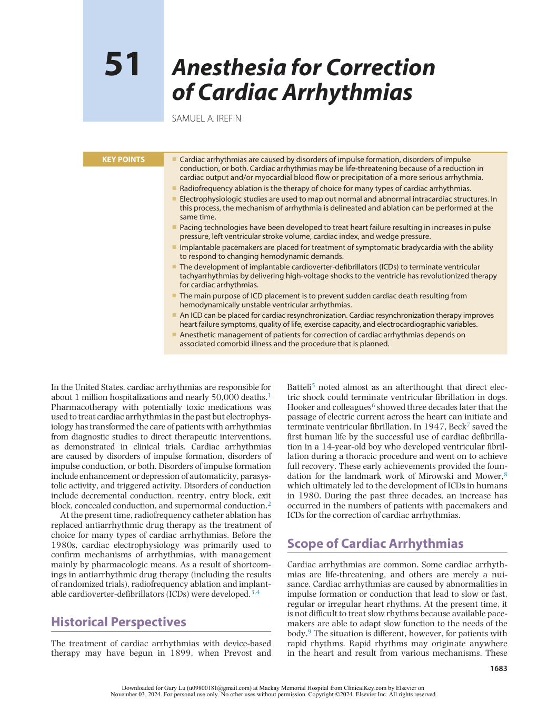

:::

<!-- PDF page 2 -->

mechanisms may be focal, meaning that the abnormal impulse formation is confined to a small area, or they may be the result of an impulse running in a circuit composed of several interconnected cardiac cells. Such a circuit may be small or large, as in atrial flutter and in arrhythmias in which the normal atrioventricular conduction system and an extra connection between the atrium and the ventricle are incorporated into the circuit of the arrhythmia.10

Pharmacologic interventions originally were used to terminate and prevent rapid rhythms. However, antiarrhythmic drugs may have serious side effects and sometimes may even be responsible for the occurrence of life- threatening arrhythmias and sudden death.11 As a result of these effects, techniques were developed for localizing the site of origin or pathway of an arrhythmia and then isolating or destroying the tissue that is responsible. By employing an intracardiac catheter, the site of origin or pathway of an arrhythmia can be identified and the rhythm disturbance corrected by applying radiofrequency, laser, ultrasound, microwave energy, or freezing temperatures to the tissue causing the arrhythmia.

Heart failure is a major problem in older patients. Although pharmacologic treatment of heart failure has improved, outcome generally remains poor. New pacing technologies may be used to treat selected patients with heart failure. For many years, permanent pacing has been used to treat symptomatic bradycardia, and pacing may alleviate heart failure when associated with heart block. Several studies have examined the use of conventional dual- chamber atrioventricular–right ventricular pacing for treatment of heart failure in the absence of symptomatic bradycardia or heart block.4,12 Biventricular pacing aims to restore synchronous cardiac contraction. When ventricular dyssynchrony is reduced, the heart is able to contract more efficiently and increase left ventricular ejection fraction and cardiac output, while working less and consuming less oxygen.13 In addition, reestablishment of left ventricular synchrony can increase left ventricular filling times, decrease pulmonary capillary wedge pressure, and reduce mitral regurgitation.

## Normal Cardiac Rhythm

In the normal heart, the dominant impulse arises in the sinus node with a rate of 60 to 100 beats/min (Fig. 51.1). During sleep, the rate may decrease to 30 to 50 beats/

min.14 Episodes of sinus pauses up to 3 seconds, sinoatrial block, junctional rhythms, and first- degree and seconddegree atrioventricular nodal block that occur quite often (especially in trained athletes) are considered to be normal variants.9

The impulses generated from the sinoatrial node propagate along three intra- atrial conduction pathways: the anterior, middle, and posterior internodal tracts. These tracts are not discrete pathways, but groups of cells that conduct slightly faster than the atrial myocardium.15 The internodal tracts give rise to interatrial fibers. The electric impulse, whether propagated in the atrial myocardium or along the internodal tracts, converges on the atrioventricular junction. The atrioventricular node located in the atrioventricular junction ultimately receives the impulses generated from the sinoatrial node. The impulses are delayed in the atrioventricular node before they are finally distributed to the ventricular myocardium via the His–Purkinje system.

Normally, the heart rate increases with exercise to at least 85% of the age- predicted maximum of 220 minus age in years; failure to do so is termed chronotropic incompetence. Sinus arrhythmia is defined as sinus rhythm with P- to- P variations of more than 10% (Fig. 51.2). Sinus arrhythmia is due to cyclic variations in vagal tone commonly related to respiration (the rate is faster with inspiration and slower with expiration).16 Sinus arrhythmia disappears with exercise, breath- holding, and atropine, and is more likely to be seen in individuals who do not have heart disease.17

## Cardiac Arrhythmias

Cardiac arrhythmia is caused by a disorder of impulse generation, impulse conduction, or a combination of both. Cardiac arrhythmia may be life- threatening because of a reduction in cardiac output, reduction in myocardial blood flow, or precipitation of a more serious arrhythmia.18 Arrhythmias may be described based on (1) rate (bradycardia or tachycardia), (2) rhythm (regular or irregular), (3) origin of impulse (supraventricular, ventricular, or artificial pacemaker), (4) impulse conduction (atrioventricular, ventriculoatrial, or block), (5) ventricular rate, or (6) special phenomena (e.g., preexcitation).

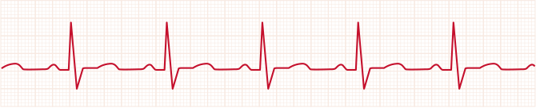

**<mark>Fig. 51.1 Normal sinus rhythm.</mark>** <mark>(Courtesy M. Kanj, MD, Cleveland Clinic, Cleveland, OH.)</mark>

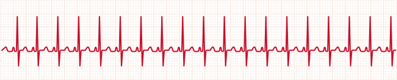

**<mark>Fig. 51.2 Sinus arrhythmia.</mark>** <mark>(Courtesy M. Kanj, MD, Cleveland Clinic, Cleveland, OH.)</mark>

<!-- PDF page 3 -->

Reentry is a common electrophysiologic mechanism that predisposes to most ventricular arrhythmias and to most supraventricular tachyarrhythmias. The most common mechanism of reentry is based on the model originally proposed by Erlanger and Schmitt and later modified by Wit.2 This model postulates the presence of a ring or loop of cardiac tissue that is functionally separate from neighboring tissue and the presence of transient or permanent unidirectional block in a portion of the loop. Unidirectional block may be anatomic in origin (e.g., bundle branches, fibrosis,

dual pathways, atrioventricular node plus accessory pathway) or functional (e.g., ischemia, drug effect).

Atrial flutter is a macro- reentrant arrhythmia identified by flutter waves, often best seen in the inferior leads at 250 to 350 beats/min (Fig. 51.3). Patients often present with a 2:1 atrioventricular conduction with a ventricular rate of 150 beats/min, although the atrioventricular conduction ratio can change abruptly. Atrial fibrillation is a narrowcomplex tachyarrhythmia and is the most common in the general population (Fig. 51.4). It is associated with

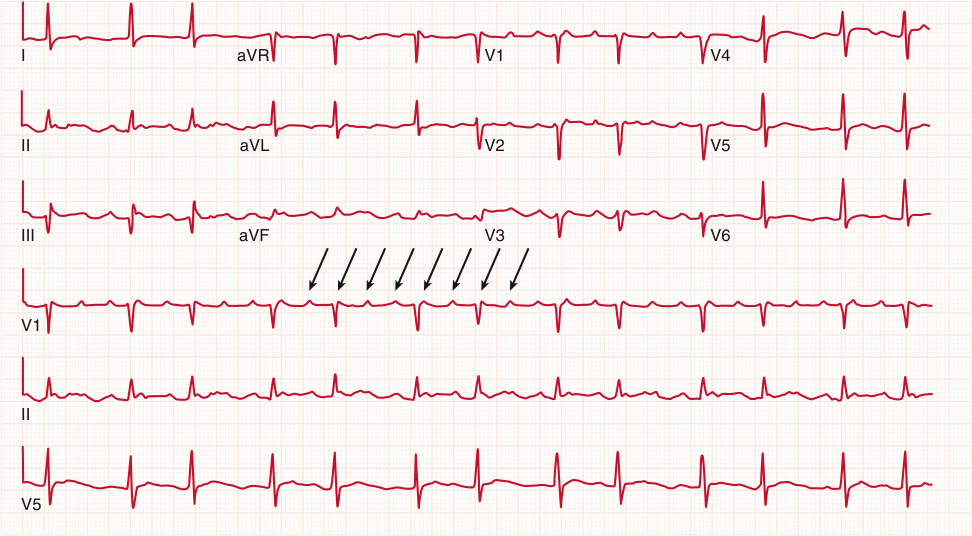

I aVR V1 V4 II aVL V2 V5 III aVF V3 V6 V1 II V5 

**<mark>Fig. 51.3 Atrial flutter.</mark>** <mark>Note the f</mark> l <mark>utter wave pattern in lead V1 (</mark> _<mark>arrows</mark>_ <mark>). (Courtesy M. Kanj, MD, Cleveland Clinic, Cleveland, OH.)</mark>

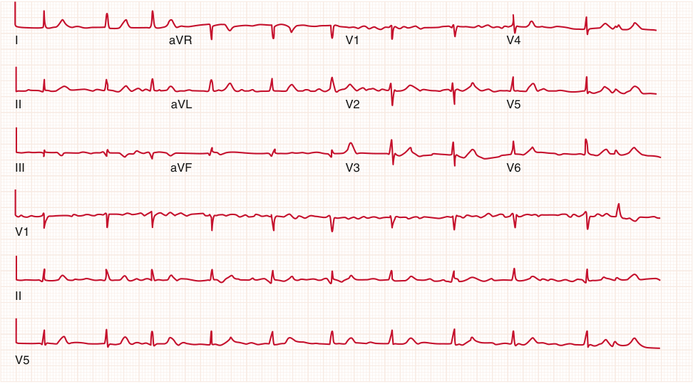

I aVR V1 V4 II aVL V2 V5 III aVF V3 V6 V1 II V5 

**<mark>Fig. 51.4 Atrial fibrillation.</mark>** <mark>(Courtesy M. Kanj, MD, Cleveland Clinic, Cleveland, OH.)</mark>

<!-- PDF page 4 -->

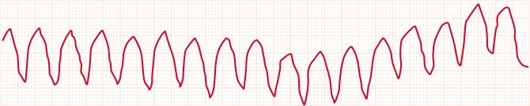

**<mark>Fig. 51.5 Ventricular tachycardia.</mark>** <mark>(Courtesy M. Kanj, MD, Cleveland Clinic, Cleveland, OH.)</mark>

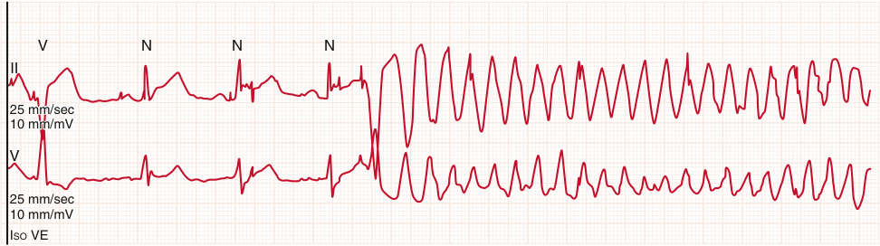

V N N N II 25 mm/sec 10 mm/mV V 25 mm/sec 10 mm/mV ISO VE 

**<mark>Fig. 51.6 Torsades de pointes.</mark>** <mark>(Courtesy M. Kanj, MD, Cleveland Clinic, Cleveland, OH.)</mark>

significant morbidity. The prevalence of atrial fibrillation in the general population increases exponentially with age, from 0.9% in individuals 40 years of age to 5.9% in individuals older than age 65 years. The most important risk factors for development of atrial fibrillation in the general population are structural heart disease, valvular heart disease, and left ventricular hypertrophy.19 Atrial fibrillation is a significant contributor to the development of angina and stroke, with an estimated stroke risk in untreated individuals of 3% to 5%.20

Ventricular tachyarrhythmia is defined as three or more consecutive ectopic beats at a rate more rapid than 100 beats/min (Fig. 51.5).21 Ventricular tachyarrhythmia is traditionally classified as nonsustained or sustained. Sustained ventricular tachyarrhythmia is defined as ventricular tachyarrhythmia lasting more than 30 seconds. Nonsustained ventricular tachyarrhythmia is defined as ventricular tachyarrhythmia that terminates spontaneously within 30 seconds. Sustained ventricular tachyarrhythmia also is traditionally classified as monomorphic (one site of origin) or polymorphic (two or more sites of origin).22 Monomorphic ventricular tachyarrhythmia usually results from reentry, and the site of reentry depends in part on the type of heart disease. In patients with coronary artery disease, the reentry circuit is usually located in ventricular myocardium, whereas in dilated cardiomyopathy with left bundle branch block, bundle branch reentry is common.23 Monomorphic ventricular tachyarrhythmia may occur in individuals with an otherwise normal heart, whereas polymorphic ventricular tachyarrhythmia may occur in acquired states that produce a marked prolongation of the QT interval. Nonsustained ventricular tachyarrhythmia is frequently asymptomatic, but may produce palpitations, weakness, and presyncope.22

_Torsades de pointes_ is a French term translated as “twisting of the points.” It is a syndrome composed of polymorphic ventricular tachyarrhythmia (Fig. 51.6). It may be due to various medications or electrolyte imbalances. Torsades de

pointes is usually paroxysmal but is frequently symptomatic and often produces loss of consciousness. It occasionally degenerates to ventricular fibrillation. Ventricular fibrillation accounts for 80% to 85% of sudden cardiac deaths.22

Ventricular fibrillation is usually preceded by ventricular tachyarrhythmia, but also may occur as a primary arrhythmia (Fig. 51.7). More recent studies suggest that ventricular fibrillation results from multiple wavelengths that disperse randomly, using the leading circle form of reentry.22 The most common cause of ventricular fibrillation is acute myocardial infarction. It also is observed in patients with chronic ischemic heart disease, hypoxia resulting from any cause, acidosis, hypokalemia, and massive hemorrhage.

### INDICATIONS FOR CORRECTION OF CARDIAC ARRHYTHMIAS

Intracardiac electrophysiologic studies can give valuable information about normal and abnormal electrophysiology of intracardiac structures (see also Chapters 34, 50, and 73). These studies are used to confirm the mechanism of an arrhythmia, to delineate its anatomic substrate, and to ablate it. The electric stability of the ventricles also can be assessed, as can the effects of an antiarrhythmic regimen.

In addition, pacing technologies have been developed to treat heart failure with promising results, leading to improvement in morbidity and mortality in patients with heart failure.

Hemodynamic responses to biventricular pacing include an increase in the rate of elevation of left ventricular pressure and increases in pulse pressure, left ventricular stroke work, cardiac index, and wedge pressure.23 Cardiac resynchronization therapy improves ventricular function without increasing myocardial energy consumption, in contrast to the effect of inotropic agents, such as dobutamine.13 In addition, cardiac resynchronization therapy may reverse left ventricular remodeling over time.24

<!-- PDF page 5 -->

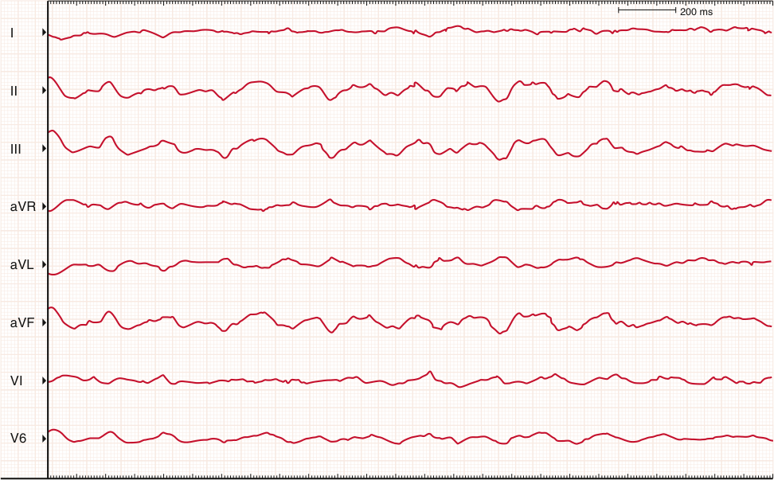

200 ms I II III aVR aVL aVF VI V6 

**<mark>Fig. 51.7 Ventricular fibrillation.</mark>** <mark>(Courtesy M. Kanj, MD, Cleveland Clinic, Cleveland, OH.)</mark>

## Permanent Pacing

Indications for pacemaker therapy have increased in recent years and now include the treatment of bradyarrhythmias and heart failure according to the American College of Cardiology and American Heart Association guidelines.25 These guidelines discuss indications for pacing in patients with sinus node dysfunction, acquired atrioventricular block, chronic bifascicular and trifascicular block, hypersensitive carotid sinus, and neurally mediated syndromes. The guidelines direct the treating physician in selecting patients who would benefit from device therapy.

A Swedish team led by Sennings and Elmqvist implanted the first pacemaker in 1958.26 A thoracotomy was required, and pacing was done through electrodes sutured to the epicardium. In these early systems, significant problems with changes in pacing threshold, lead infection, and lead breakage were common. Transvenous lead implantation subsequently developed by Furman and colleagues27 would resolve many of these issues. In 1958, Furman successfully paced an elderly patient with a catheter electrode inserted transvenously. Other investigators took on the challenge of solving various technical problems, such as device miniaturization; longer- life batteries; and stable, reliable lead material.28 As the indication for implantation expanded from atrioventricular conduction disturbances to management of sinus node dysfunction, the need for implantable pacemakers grew in proportion.28 Technology evolved rapidly with the development of lithium iodide batteries that had greater longevity. Electronic advances then led to

major miniaturization using integrated circuits as opposed to discrete components. Lead materials used in today’s pacemaker rely on silicone and polyurethane, which are more biocompatible and reliable than earlier materials. With these technical refinements, present- day pacemakers are small and can pace reliably for 8 to 10 years before generator replacement is needed. The primary functional challenge for contemporary pacemakers is to maintain the heart rate based on circulatory needs, pacing in a manner that mimics the natural physiology of excitation and conduction. In a healthy heart, the sinus node is modulated by the autonomic nervous system, and its rate is determined by a multiplicity of factors, such as physical activity, emotion, and blood pressure. Not only the rate, but also the activation sequence and atrioventricular conduction time vary with demand; these requirements also must be considered. Rate is controlled by pacemaker discharge, and the excitation and conduction sequence depends on the placement of pacing electrodes. Approximately 120,000 pacemakers are implanted each year in the United States. Indication for implantation for most of these cases is sick sinus syndrome. Other indications include atrioventricular block, carotid sinus hypersensitivity, malignant vasodepressor syndrome, and hypertrophic cardiomyopathy.29 The primary purpose of implantable pacemakers is to treat symptomatic bradycardia. With the extraordinary developments that have occurred in pacemaker therapy for the traditional indication – bradycardia – new uses are now beginning to be explored. Pacemakers have progressed from large, fixedrate, single- chamber devices to multiprogrammable, multichamber devices with the ability to respond to changing

<!-- PDF page 6 -->

hemodynamic demands. As technology advances, other possible uses are likely to be conceived.

## Resynchronization Therapy

Cardiac resynchronization is a pacing therapy aimed at improving coordination of atria and both ventricles. This therapy has been demonstrated to be effective for patients with heart failure who have conduction delay and left ventricular systolic dysfunction.30 In addition, this therapy can reduce hospital readmission rates and improve quality of life in patients with heart failure.31

Cardiac resynchronization therapy improves heart failure symptoms, quality of life, exercise capacity, hospitalization, and echocardiographic variables.32 It is indicated in patients with drug- refractory, symptomatic New York Heart Association functional class III and IV heart failure of either ischemic or nonischemic origin.31 In addition, these patients are protected from associated risk for sudden cardiac death when combined with an ICD system.30

The development of an automatic internal defibrillator, or ICD, began in the 1960s. External cardiac defibrillation was increasingly being used in coronary care units for the treatment of ventricular fibrillation and sudden cardiac death. Although the idea of automatic external defibrillation had been discussed initially by Zycoto, Mirowski and colleagues33 were the first to champion and begin practical development of an automatic internal device. In 1969, Mirowski and Mower developed the prototype of today’s automatic internal defibrillator.34

The primary goal of all defibrillators is to terminate ventricular tachyarrhythmias by delivering high- voltage shocks to the ventricle. As with implantable pacemakers, defibrillating devices need to be small and reliable and have adequate longevity. ICDs have evolved not only to perform this function but also to take on additional tasks, such as antitachycardia pacing of the ventricle, dual- chamber pacing, and termination of atrial tachyarrhythmias.

A key difference between pacing and defibrillation of the heart is that for pacing only a very small mass of myocardium needs to be stimulated, whereas for defibrillation, most, if not all, of the myocardium must be stimulated. Because the myocardium is easily excitable throughout diastole, a small wave of depolarization during pacing can readily propagate throughout the whole heart. In contrast, during ventricular fibrillation, multiple reentrant wavefronts usually occur that are continuously changing in location and size and must be quelled. To defibrillate successfully, most of these wavefronts must be interrupted simultaneously; to achieve this, it is necessary to capture most of the tissue that is in a state of relative refractoriness.35 One unique property of defibrillation success is that it is probabilistic.36 The same energy that can defibrillate the heart on one occasion may be unsuccessful at another time.

The main purpose of ICD placement is to prevent death from hemodynamically unstable ventricular tachyarrhythmias. Although advances in technology have made these devices much more flexible in terms of arrhythmia detection and electric therapy potions, their main purpose is to reduce sudden cardiac death, which claims approximately 300,000 lives in the United States annually.

Secondary prevention of sudden cardiac death in patients who have survived cardiac arrest is another major indication for ICD placement. In such patients and especially in patients of this group for whom no reversible or curable cause can be found, ICD implantation has been repeatedly documented to provide a major mortality benefit.37 Interest in managing atrial tachyarrhythmias also has grown significantly in recent years. It is now recognized that approximately 30% of patients with ventricular tachyarrhythmia also have atrial tachyarrhythmias.38 Such atrially initiated tachyarrhythmias can worsen patient symptoms, can result in inappropriate ventricular shocks, and may be responsible for initiating ventricular tachyarrhythmias that can exacerbate other pathologic processes, such as heart failure. New strategies for treatment and prevention of atrial tachyarrhythmias are incorporated into devices that are capable of defibrillation and antitachycardia pacing in the atrium and ventricle, in addition to combined dual- chamber pacing.39

The relative ease of ICD implantation and longevity of current defibrillators have made them a valuable tool in primary prevention. Patients no longer must survive cardiac arrest to justify the risk in ICD implantation.

### PREOPERATIVE EVALUATION

Most patients who require pacemaker or ICD placement have significant cardiovascular disease. In addition, correction of cardiac arrhythmia may require radiofrequency catheter ablation. Radiofrequency catheter ablation has proved highly effective in the treatment of atrioventricular nodal reentrant and accessory pathway tachycardias. Indications for pacemaker and ICD placement continue to evolve as the utility of these devices continues to increase. Although most pacemaker placement is done with local anesthetic infiltration, ICD placement may require monitored anesthesia care or in some cases general anesthesia. The modern ICD unit is capable of delivering the full spectrum of therapy for ventricular tachyarrhythmias and for bradycardia therapy with dual- chamber pacing or sensing, rate modulation, and mode- switching features.

As mentioned earlier, ICD placement has two common indications. One is continued ventricular tachyarrhythmias despite adequate drug therapy, and the other is history of sudden cardiac arrest that is not associated with myocardial infarction. Preoperative evaluation processes necessary for placement of an ICD should be complete by the time the decision is made to place the device. These patients need a thorough preoperative evaluation. This evaluation includes electrophysiologic testing to determine the inducibility of ventricular tachycardia and electrophysiologically guided drug therapy. Preoperative pulmonary function tests may be necessary in patients on amiodarone to evaluate possible toxicity of this drug, which can result in chronic obstructive pulmonary disease or interstitial lung disease. In some instances, the underlying pathophysiology of malignant ventricular arrhythmias is related to ischemic or idiopathic cardiomyopathy.40 These patients often present with poor left ventricular function and more frequent incidence of congestive heart failure. Patients with a history of congestive heart failure should be in optimal condition before surgery.

<!-- PDF page 7 -->

Generally, all patients who present for correction of cardiac arrhythmia require preoperative evaluations including electrocardiogram (ECG), chest radiograph, hemoglobin value, and electrolyte levels. Patients should receive nothing by mouth (NPO) for at least 8 hours before the procedure. In addition, patients who require device and lead extractions because of malfunction or infection may require blood product transfusions during the procedure. Consequently, type and cross- match of blood products is frequently necessary for these procedures.

### ANESTHETIC CONSIDERATIONS

### Pacemakers

Permanent implantable pacemakers have been the standard modality of treatment for patients with all types of bradyarrhythmias. A significant number of these patients present with sick sinus syndrome and are older. Consequently, devices are placed under general anesthesia in these patients. As a result of more recent advances in pacemaker technology, these devices now can be placed as a therapeutic modality to alter hemodynamic states. Surgeons used to be primarily responsible for device insertion. Now the task falls under the services of cardiologists. Device placement is commonly performed in the cardiac catheterization suite under local anesthesia on an outpatient basis. Patients at high risk who have complicated disease now present for pacemaker insertion, however, in addition to those with indications more recently identified by the American College of Cardiology and American Heart Association for these devices. In light of these increased indications, the expertise of anesthesiologists is needed for monitoring and perioperative care of these patients.

### Monitored Anesthesia Care

Currently, most pacemaker insertions are performed by cardiologists. Most of these cases are performed under local anesthesia with sedation. Depending on the level of training, administration of sedatives and analgesics can be provided by nurses.

In instances that require deeper sedation for a patient’s comfort or for critically ill patients with hemodynamic instability, monitored anesthesia care by an anesthesiologist may be required. Adequate monitoring and resuscitation equipment are required in such situations. The goal of monitored anesthesia care is to provide analgesia, sedation, and anxiolysis, while ensuring rapid recovery with minimal or no side effects. Any sedative–hypnotic medication may be used during monitored anesthesia care with a wide variety of delivery systems.41 Subanesthetic concentrations of inhaled agents also have been used to supplement local anesthetics. Newer drugs, such as centrally mediated α2- agonists, have been shown to produce anxiolysis, sedation, and reduced requirements for supplemental analgesic medications during monitored anesthesia care.

### General Anesthesia

Patients requiring pacemaker placement rarely require general anesthesia for placement. If general anesthesia is required, it should be directed toward underlying cardiac pathophysiology, indications, complications, and hemodynamic goals. Immediate access to life- support equipment,

such as a cardiac defibrillator and a transcutaneous pacemaker, is necessary if the device is being placed under general anesthesia.

## Implantable CardioverterDefibrillator

Since the 1980s, indications for use and implantation of ICDs have steadily increased. Over the past two decades, ICDs have undergone a significant evolution. In the 1970s and 1980s, ICD placement usually required thoracotomy for placement of epicardial patches.

### PREOPERATIVE EVALUATION

As mentioned earlier, common indications for ICD implantation include continued ventricular tachyarrhythmias unresponsive to adequate pharmacotherapy and history of sudden cardiac arrest unassociated with myocardial infarction. Newer indications include patients with various forms of the congenital long QT syndrome.42 Patients with long QT syndrome who have survived an episode of cardiac arrest or documented polymorphic ventricular tachyarrhythmia, especially if on pharmacotherapy at the time, are increasingly being evaluated as ICD candidates. In addition, patients with hypertrophic cardiomyopathies and without a history of sudden death are usually evaluated for ICD placement.43 In these patients, sustained ventricular arrhythmias, nonexertional syncope, or a strong family history of sudden death with early age of presentation strongly indicates ICD implantation.

In all instances, the evaluation that is necessary for ICD implantation is completed by the time the decision is made to place the device. Electrophysiologic studies may have been done to determine the forms of arrhythmias present. When the pathophysiology of ventricular arrhythmias is related to idiopathic or ischemic cardiomyopathy,44 these patients may present with poor left ventricular function and a high incidence of congestive heart failure. Consequently, they should be optimized as much as possible preoperatively.

### ANESTHETIC CONSIDERATIONS

In the 1980s, ICD implantation was done with epicardial leads via thoracotomy under general anesthesia with onelung ventilation. The technologic development of implantable ICDs with transvenous lead systems has simplified their implantation. Consequently, it was reasoned that ICDs can be placed under deep sedation with little or no intervention by the anesthesiologist analogous to what is needed for pacemaker placement.45 Placement of an ICD under general anesthesia may be safer and more comfortable for the patient, however. Patients who present for ICD placement are often critically ill with cardiopulmonary comorbidity. These patients often present with ejection fractions of less than 30% and require vasopressors to support hemodynamics during the procedure. In addition, some form of general anesthesia is necessary for intraoperative testing of defibrillating thresholds.

### Monitored Anesthesia Care

Small, new- generation devices and transvenous lead systems lend themselves to the use of local anesthesia and

<!-- PDF page 8 -->

intravenous sedation for ICD implantation. Midazolam and fentanyl are usually the drugs of choice when an ICD is placed under monitored anesthesia care. Monitoring includes pulse oximetry, five- lead ECG, and noninvasive blood pressure. Depth of anesthesia is monitored clinically. One of the major aspects of ICD placement is testing the device. Testing the device may require deep sedation or general anesthesia because the shocks associated with this procedure can be very painful. The presence of an anesthesiology team may be necessary for ICD placement under monitored anesthesia care.

### General Anesthesia

Most patients who present for ICD placement typically have comorbidities such as ventricular tachycardia, congestive heart failure with ejection fraction less than 30%, coronary artery disease, pulmonary hypertension, chronic renal insufficiency, or valvular heart disease. These patients may be unable to lie flat for the prolonged period necessary for placement of the ICD. In addition, they may require close hemodynamic monitoring during testing of the device. General anesthesia should be considered in these patients. When general anesthesia is chosen, in addition to standard monitoring, an arterial line may be added. External cardioverter- defibrillator pads are required for all ICD placements. These are employed in cases in which an implanted defibrillator fails. General anesthesia also may be requested for anxious and extremely nervous patients. Because pacemakers and ICDs are placed percutaneously, anesthesiologists must be vigilant for possible complications, such as myocardial infarction, stroke, possible cardiac injury (perforation or tamponade), and pneumothorax from subclavian vascular access.

### EXTRACTION OF DEVICES

As a result of continued growth and expanding indications for pacemakers and ICD placement, leads may require extraction because of mechanical dysfunction, the need to upgrade to more complex devices, or local or systemic infection. Lead extractions are probably one of the most challenging procedures that a cardiac electrophysiologist faces today.

Indications for lead extractions can be divided into two categories – patient- related and lead- related. Patientrelated indications include infection, ineffective therapy (high defibrillation threshold), perforation, migration, embolization, induction of arrhythmias, venous thrombosis, unrelenting pain, device interactions, and device upgrades.46 Lead- related indications include lead recalls, lead failure, and lead interactions.47 Lead extraction is performed via powered sheaths through which energy is delivered to the tip in the form of excimer laser light or electrocautery. These systems burn through scar tissue adherent to the wall of the lead throughout its course. The potential for life- threatening complications, such as lead fracture, venous or myocardial rupture, and tamponade, makes general anesthesia with invasive monitors a prudent choice for lead extractions. There is also a small chance of needing emergent cardiac surgery with lead extraction and therefore the team must be vigilant for signs of cardiovascular decompensation.

### POSTOPERATIVE CARE

Postoperative care of patients with pacemaker or ICD implantation depends on various factors surrounding the implantation of the device. As mentioned earlier, most of these patients are quite ill with significant comorbidities. It is not unusual for patients to have congestive heart failure with an ejection fraction less than 30% as a result of poor left ventricular function. Consequently, it is imperative to have these patients monitored in the postanesthesia care unit, especially if the device is placed or extracted under general anesthesia. The spectrum of recovery sites after these procedures may vary from postprocedure units to a coronary intensive care unit. Most of these procedures are done on an outpatient basis, and anesthesia is tailored to ensure rapid recovery after implantation.

## Correction of Cardiac Arrhythmias with Ablation Therapy

Catheter ablation is a safe and curative option for most cardiac arrhythmias, with 85% to 98% cure rates among the arrhythmias treated most frequently.48 The rate of major complications is less than 3%.48 Cardiac ablation therapy involves the delivery of energy through a catheter that is usually placed in the endocardial position in the heart, destroying myocardial tissue that is responsible for the tachyarrhythmia (Fig. 51.8). Multiple electrodes are inserted to locate the arrhythmia and ablate it. Usually, the diagnostic portions of the ablation study are done during the same procedure.49 The efficacy of catheter ablation depends on accurate identification of the site of origin of the arrhythmia. When the site is identified, the electrode catheter is positioned in direct contact with the site of the arrhythmia, and radiofrequency energy is delivered through the catheter to destroy it.

The current generated by radiofrequency is alternating current and is delivered at cycle lengths of 300 to 750 kHz when used for catheter ablation.50 It causes resistive heating of the tissue in contact with the electrode. The degree of tissue heating is inversely proportional to the radius to the fourth power.51 Consequently, the lesions created by radiofrequency energy are small. Although electric injury may be a contributing factor, the primary mechanism of tissue destruction by radiofrequency current is thermal injury. Acute lesions created by a radiofrequency current consist of a central zone of coagulation necrosis surrounded by a zone of hemorrhage and inflammation.52 Cardiac arrhythmias that can be treated with radiofrequency ablation include paroxysmal supraventricular tachycardia, Wolff– Parkinson–White syndrome, atrial flutter, atrial fibrillation, and idiopathic ventricular tachycardia. Most cardiac arrhythmias treated with radiofrequency ablation are not life- threatening but have a significant impact on a patient’s quality of life.53 Advantages of radiofrequency ablation of cardiac arrhythmias include relief of symptoms, improvement in functional capacity and quality of life, and elimination of the need for lifelong antiarrhythmic drug therapy. The principal disadvantage is the risk for complications, which varies depending on the type of ablation procedure and skill of the operator.

<!-- PDF page 9 -->

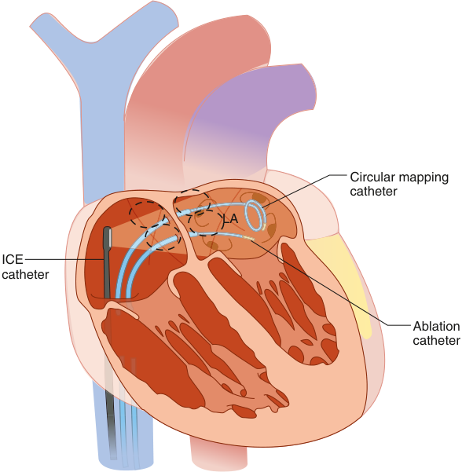

Circular mapping catheter LA ICE catheter Ablation catheter 

**Fig. 51.8 Catheter placement during ablation procedures.** Mapping and ablation catheters were placed under the guidance of intracardiac echocardiography. _ICE,_ intracardiac echocardiography; _LA,_ left atrium. (Courtesy O. Wazni, MD, Cleveland Clinic, Cleveland, OH.)

### ANESTHETIC CONSIDERATIONS

Catheter ablation was introduced into clinical practice in 1982. Initially, ablation was performed with direct electric shocks.54 As a result of several advantages over direct current, radiofrequency ablation has replaced direct current ablation. These advantages include the absence of skeletal and cardiac muscle stimulation, minimal discomfort during delivery of energy, the possibility of performing the procedure in conscious patients, and the discrete nature of resulting lesions.52

Until recently, most cardiac ablation therapy for correction of arrhythmias could be performed under moderate sedation or monitored anesthesia care. In some of these cases, deep sedation may have been required as the case progressed. General anesthesia is now being employed routinely in most cases of cardiac ablation therapy due to patient anxiety and the extended period required for these procedures. General anesthesia may be implemented with standard American Society of Anesthesiologists monitors with adequate vascular access. Catheter ablation is the first- choice treatment for most cardiac arrhythmias. It is a safe treatment and is usually effective as a single procedure. Because it is curative in many patients, it is offered to all patients who would otherwise be committed to long- term drug therapy.

## Leadless Pacemaker

Implantable pacemakers are the major therapy for patients with advanced conduction system disease. It has been shown

to improve quality of life and reduce mortality.55 The first transvenous pacemaker implantation was performed over 50 years ago. Since that time, important progress has been made in pacing technology. Recently, leadless pacemaker therapy was introduced into clinical practice to avoid some pacemaker- related complications. Complications of conventional pacemakers are due to creation of surgical pocket and placement of transvenous or epicardial leads.

Currently there are two leadless cardiac pacemakers approved by the Food and Drug Administration (FDA) in clinical practice. The Micra pacing system (TPS Medtronic) (Figs. 51.9 and 51.10) and the Aveir VR Leadless Pacemaker (LP St. Jude) (Fig. 51.11). Both devices are self- contained units and can be deployed via transfemoral approach. They are capable of single- chamber right ventricular pacing, sensing, and rate responsiveness. Although all leadless pacemakers on the market are single- chamber pacemakers, there are trials underway in anticipation of dual- chamber leadless pacemakers. Dual- chamber pacemakers will rely on the ability to detect and sense atrial contractions using accelerometer signals.

As mentioned above, the major advantage of leadless pacemakers is reduction in lead- and pocket- related complications and low rates of infections.56 This advantage derives from lack of a subcutaneous pocket, which significantly reduces the risk of bacterial translocation from the skin.

### ANESTHETIC CONSIDERATIONS

Implantation and retrieval of leadless pacemakers are performed via a transfemoral percutaneous approach. As with

<!-- PDF page 10 -->

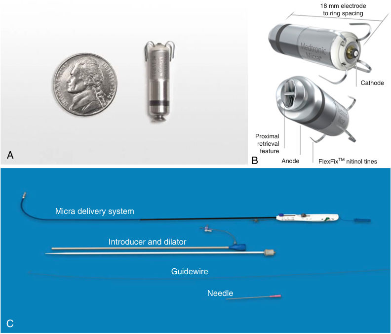

18 mm electrode to ring spacing Cathode Proximal retrieval A feature B Anode FlexFix TM  nitinol tines Micra delivery system Introducer and dilator Guidewire Needle C 

**<mark>Fig. 51.9 Micra pacing system.</mark>** <mark>(A,B) Capsule. (C) Micra delivery system. (Courtesy of Medtronic, Minneapolis, MN.)</mark>

new technology, skill, knowledge, and experience with leadless pacemakers are important to achieve successful implantation and minimize complications. General anesthesia is suggested due to the nature and complexities of leadless pacemaker placement.

Ultrasound- guided femoral access is strongly recommended to avoid femoral vascular complications. Heparin administration may be necessary to mitigate thrombosis within the large sheath lumen. Both Micra and Aveir pacemakers are deployed in the right ventricle using special delivery systems.

### CONCLUSIONS

The technologic advancement of leadless pacemakers is a major breakthrough in the field of cardiac pacing. Some of the advantages of leadless pacemakers include avoidance of pocket- related complications, fractured leads, and lead dislodgements. As improvements are being made in the delivery tools, there should be reductions in cardiac perforations associated with placement of leadless pacemakers.

## Future Trends

Correction of cardiac tachyarrhythmias has improved dramatically in the past two decades. Emphasis has shifted from pharmacologic therapy to nonpharmacologic therapy of tachyarrhythmias; this has led to a significant increase in the number of radiofrequency catheter ablations and

defibrillator implantations. These developments were triggered by technologic advances that showed superiority of these procedures over the use of antiarrhythmic drugs.57 As a result, treatment of supraventricular tachycardias and tachycardias involving accessory atrioventricular pathways will probably remain the domain of catheter ablation. The cure rate of patients treated with catheter ablation is very high. In addition, treatment of life- threatening ventricular tachyarrhythmia will remain in the domain of ICDs for the foreseeable future. The role of ICD therapy has been clearly defined with respect to prolongation of life and has been expanded to include primary prophylaxis of sudden death in high- risk populations.58

The demand for perioperative care in the electrophysiology suite, especially for those undergoing ablation procedures, has resurrected the use of high- frequency jet ventilation (HFJV) in recent years.59 There are studies that have demonstrated improved outcomes and decreases in procedure time.60 HFJV has been demonstrated to provide a more stable environment, especially in the posterior wall of the atrium. As a consequence, in the future HFJV use may increase and provide an attractive alternative to the conventional mode of ventilation during catheter ablation.20,61 The anesthetic implications of this modality in the electrophysiology suite have recently been reviewed.62

As a result of these developments, the presence of an anesthesiology team will continue to increase in cardiology suites. Patients who are being cared for in these areas are sicker with significant comorbidities. The role of conscious sedation will continue to diminish in the performance of

<!-- PDF page 11 -->

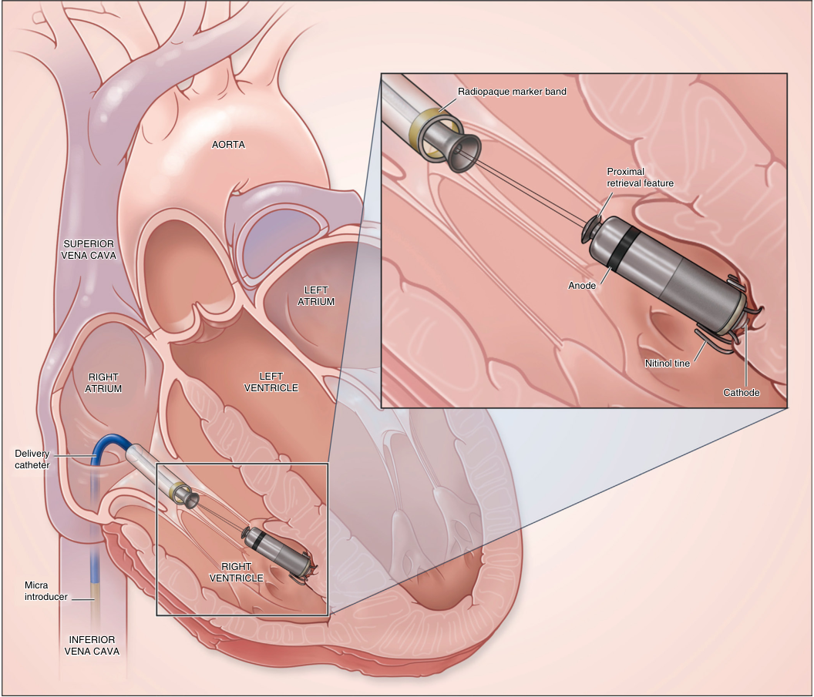

Radiopaque marker band AORTA Proximal retrieval feature SUPERIOR VENA CAVA LEFT Anode ATRIUM Nitinol tine RIGHT LEFT ATRIUM VENTRICLE Cathode Delivery catheter RIGHT VENTRICLE Micra introducer INFERIOR VENA CAVA 

**Fig. 51.10 The Micra transcatheter pacing system positioned in the right ventricle.** (From Reynolds DW, Ritter P. A leadless intracardiac transcatheter pacing system. _N Engl J Med_ . 2016;374(26):2604–2605.)

these procedures. These patients will require full monitoring and care under the direction of an anesthesiologist.

### PULSED FIELD ABLATION OF PAROXYSMAL ATRIAL FIBRILLATION

Atrial fibrillation is the most common arrhythmia, with prevalence of about 2%. It is associated with severe comorbidities such as stroke and dementia.63 Radiofrequency ablation is currently the “gold standard” to treat atrial fibrillation by localized tissue necrosis. Pulmonary vein isolation is an important component of rhythm control therapy in patients with atrial fibrillation. It has been very difficult, however, despite technical improvements, to achieve safe and durable isolation of all pulmonary veins due to the thermal nature of radiofrequency ablation. Pulsed field ablation, also known as irreversible electroporation, is a novel and non- thermal ablation modality in which electrical fields are used to disrupt the membranes

of cardiomyocytes with little or minimal damage to extracardiac anatomic structures such as blood vessels, nerves, or the esophagus (Fig. 51.12).64

During pulsed field ablation, ultra- rapid (micro- to nanosecond) electrical pulses are applied to destabilize cell membranes by forming irreversible nanoscale pores culminating in cell death. Electroporation renders the lipid plasma membrane permeable by high external direct and alternate current pulsed electrical fields.65 Stimulations such as these result in the formation of a transmembrane potential which locally overcomes the dielectric strength of the phospholipid bilayer and produces hydrophilic nanopores across the membrane. Studies have shown that one advantage of pulsed field ablation is differential tissue sensitivity to pulsed electrical fields. This has allowed its application to catheter ablation for atrial fibrillation with the goal of improving safety by decreasing collateral damage. Recently, studies have demonstrated that electrical pulmonary isolation could be performed without any of

<!-- PDF page 12 -->

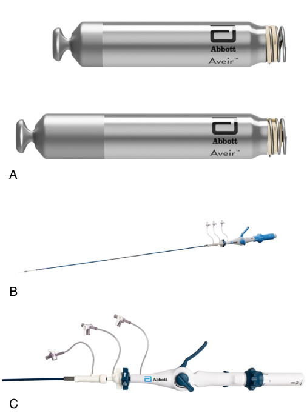

A B C 

**Fig. 51.11 The Aveir VR LP delivery system.** (A) Capsule. (B,C) Retrieval system. (Courtesy of Abbot Cardiovascular, Abbott Park, IL.)

the major adverse effects of radiofrequency ablation such as stroke, pulmonary vein stenosis, phrenic nerve injury, or esophageal injury.66

### Anesthetic Considerations

Pulsed field ablation of paroxysmal atrial fibrillation is a novel procedure; consequently, anesthesia management of patients undergoing this procedure deserves special consideration.

It is recommended that these cases be done under general anesthesia. Each case should be approached based on patient presentation. This is a voltage- based (has no thermal effect) catheter system. As mentioned above, there is less risk of phrenic nerve injury with this system. A “sniff test” is usually performed under fluoroscopy before induction. This is done while the patient is awake by the attending cardiologist before the induction of general anesthesia. Sniff test is also performed after extubation. A “sniff test” is necessary to document the integrity of the diaphragm and phrenic nerve before and after the procedure.

Preferably there should be nothing in the esophagus such as temperature probe, nasogastric tube, etc. These objects can theoretically act as an electrical antenna.

Each ablation case requires around 60 “applications”; each “application” consists of 5 quick pulses/bursts of electrical energy.

Initial applications may cause a strong vagal response, which should subside with further applications. I suspect that this is due to the stimulation of the vagus nerve that lies behind the heart. If vagus nerve stimulation is symptomatic, a 1- mg dose of atropine may be administered.

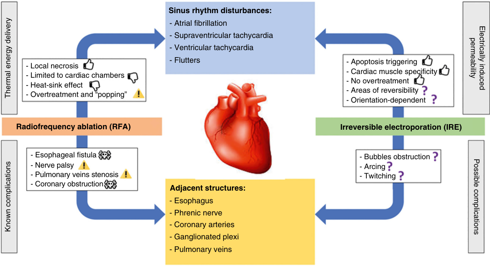

Sinus rhythm disturbances: - Atrial fibrillation - Supraventricular tachycardia - Ventricular tachycardia - Local necrosis - Flutters - Apoptosis triggering - Limited to cardiac chambers - Cardiac muscle specificity - No overtreatment - Heat-sink effect - Areas of reversibility - Overtreatment and “popping” - Orientation-dependent Radiofrequency ablation (RFA) Irreversible electroporation (IRE) - Esophageal fistula - Bubbles obstruction - Nerve palsy - Arcing - Pulmonary veins stenosis - Twitching - Coronary obstruction Adjacent structures: - Esophagus - Phrenic nerve - Coronary arteries - Ganglionated plexi - Pulmonary veins permeability Electrically induced Thermal energy delivery Known complications Possible complications 

**Fig. 51.12** Schematics of comparison between radiofrequency (RF) and irreversible electroporation (IRE) ablation. The dynamics and advantages of IRE cardiac ablation with details on possible complications are shown on the right; conversely, RF ablation and its side effects are shown on the left. (From Wojtaszczyk A, Caluori G, Pešl M, et al. Irreversible electroporation ablation for atrial fibrillation. _J Cardiovasc Electrophysiol_ . 2018;29(4):643–651.)

<!-- PDF page 13 -->

The catheter may cause strong phrenic nerve stimulation.

- This effect may be especially strong when working near the right superior pulmonary vein.

- Phrenic stimulation will be noted on the ventilator in a manner similar to when the diaphragm is paced during cryoablation cases. Please be vigilant!

- Muscle relaxant is generally not recommended after induction during these cases although muscle relaxations may be re- dosed as necessary.

Pulsed field ablation creates tissue destruction by the mechanism of irreversible electroporation. It is an attractive energy modality for the management of cardiac disease, in particular for pulmonary vein isolation in the treatment of atrial fibrillation. It can quickly create large effective myocardial lesions within the pulmonary veins without resultant stenosis. Pulsed field ablation creates lesions by non- thermal mechanism. Cardiac tissue is more sensitive to pulsed field ablation and these characteristics result in reduced collateral damage. General anesthesia is required for patients undergoing pulsed field ablation for atrial fibrillation.

18.  Schamroth L. _Circulation_ . 1973;47:420.

19.  Josephson ME, et al. _Circulation_ . 1987;75:III- 41.

20.  Wazni O, et al. _N Engl J Med_ . 2011;365:2296.

21.  Hsia HH, et al. _Cardiol Clin_ . 1993;11:21.

22.  DiMarco JP. _Cardiol Clin_ . 1993;11:11.

23.  Kass DA, et al. _Circulation_ . 1999;99:1567.

24.  St. John Sutton MG, et al. _Circulation_ . 1985;107:2003.

25.  Gregoratos G, et al. _J Cardiovasc Electrophysiol_ . 2002;13:1183.

26.  Elmqvist R, et al. _Am Heart J_ . 1963;65:731.

27.  Furman S, et al. _Surg Forum_ . 1958;9:245.

28.  Greatbatch W, et al. _IEEE Eng Med Biol Soc_ . 1991;10:38.

29.  Daley WR. _Am J Cardiol_ . 1998;82:392.

30.  Abraham WT, et al. _N Engl J Med_ . 1845;346:2002.

31.  Cleland JG, et al. _N Engl J Med_ . 2005;352:1539.

32.  Auricchio A, et al. _J Am Coll Cardiol_ . 2002;39:2026.

33.  Mirowski M, et al. _Arch Intern Med_ . 1972;129:773.

34.  Mower MM. _Pacing Clin Electrophysiol_ . 1995;18(3 Pt 2):506.

35.  Mehra R, et al. In: Singer I, ed. _Implantable Cardioverter- Defibrillator_ . Futura; 1994:109.

36.  McDaniel WC, et al. _Med Instrum_ . 1987;21:170.

37.  Antiarrhythmics Versus Implantable Defibrillators (AVID) Investigators. _N Engl J Med_ . 1997;337:1576.

38.  Schmitt C, et al. _Pacing Clin Electrophysiol_ . 1994;17(3 Pt 1):295.

39.  Wharton M, et al. _Circulation_ . 1998;98(1).

40.  Gartman DM, et al. _J Thorac Cardiovasc Surg_ . 1990;100:353.

41.  Newson C, et al. _Anesth Analg_ . 1995;81:486.

42.  Groh WJ, et al. _Am J Cardiol_ . 1996;78:703.

43.  Primo J, et al. _J Am Coll Cardiol_ . 1998;31:1081.

44.  Tchou PJ, et al. _Ann Intern Med_ . 1988;109:529.

### Complete references available online at expertconsult.com.

45.  Tung RT, et al. _Am J Cardiol_ . 1995;75:908.

46.  Chua JD, et al. _Ann Intern Med_ . 2000;133:604.

47.  Brodell GK, et al. _Cleve Clin J Med_ . 1992;59:91.

### References

1.  Roger VL, et al. _Circulation_ . 2011;123:e18.

2.  Wit AL. _Cardiol Clin_ . 1990;8:393.

3.  Jackman WM, et al. _N Engl J Med_ . 1992;327:313.

4.  Hochleitner M, et al. _Am J Cardiol_ . 1990;66:198.

5.  Prevost J, et al. _J Physiol Path Gen_ . 1899;1:399.

6.  Hooker D, et al. _Elect Eng_ . 1936;55:444.

7.  Beck C, et al. _JAMA_ . 1947;135:985.

8.  Mirowski M, et al. _Heart Lung_ . 1973;2:867.

9.  Mangrum JM, et al. _N Engl J Med_ . 2000;342:703.

10.  Anonymous. _Am Heart J_ . 1979;98:263.

11.  Kjekshus J, et al. _Am J Cardiol_ . 1992;69:103.

12.  Linde C, et al. _Am J Cardiol_ . 1995;75:919.

13.  Nelson GS, et al. _Circulation_ . 2000;102:3053.

14.  Clarke JM, et al. _Lancet._ 1976;1:508.

15.  Truex RC. _Cardiovasc Clin_ . 1974;6:1.

16.  Anonymous. _Br Med J_ . 1978;2:1663.

17.  Barrett PA, et al. _Prog Cardiovasc Dis_ . 1981;23:299.

48.  Calkins H, et al. _Circulation_ . 1999;99:262.

49.  Calkins H, et al. _N Engl J Med_ . 1991;324:1612.

50.  Borggrefe M, et al. _Clin Cardiol_ . 1990;13:127.

51.  Haines DE, et al. _Pacing Clin Electrophysiol_ . 1989;12:962.

52.  Huang SK, et al. _Pacing Clin Electrophysiol_ . 1988;11:449.

53.  Bubien RS, et al. _Circulation_ . 1996;94:1585.

54.  Scheinman MM, et al. _JAMA_ . 1982;248:851.

55.  Toff WD, et al. _N Engl J Med_ . 2005;353(2):145.

56.  Koay A, et al. _Hearth Rhythm Case Rep_ . 2016;2(4):360.

57.  Echt DS, et al. _N Engl J Med_ . 1991;324:781.

58.  Moss AJ, et al. _N Engl J Med_ . 1933;335:1996.

59.  Raiten J, et al. _Anesth Analg_ . 2011;112:1110.

60.  Goode Jr JS, et al. _Heart Rhythm_ . 2006;3:13.

61.  Hutchinson MD, et al. _Heart Rhythm_ . 2013;10:347.

62.  Raiten J, et al. _Curr Opin Anaesthesiol_ . 2012;25:482.

63.  Zoni- Berisso M, et al. _Clin Epidemiol_ . 2014;6:231.

64.  Rubinsky B, et al. _Technol Cancer Res Treat_ . 2007;6:37.

65.  Weaver JC. _IEEE Trans Plasma Sci_ . 2000;28:24.

66.  Li W, et al. _PLoS One_ . 2011;6:e18331.

<!-- PDF page 14 -->

### References

1.  Roger VL, Go AS, et al. Heart disease and stroke statistics 2011 update: a report from the American Heart Association. _Circulation_ . 2011;123:e18–e209.

2.  Wit AL. Cellular electrophysiologic mechanisms of cardiac arrhythmias. _Cardiol Clin_ . 1990;8:393–409.

3.  Jackman WM, Beckman KJ, McClelland JH, et al. Treatment of supraventricular tachycardia due to atrioventricular nodal reentry, by radiofrequency catheter ablation of slow- pathway conduction. _N Engl J Med_ . 1992;327:313–318.

4.  Hochleitner M, Hortnagl H, Ng CK, et al. Usefulness of physiologic dual- chamber pacing in drug- resistant idiopathic dilated cardiomyopathy. _Am J Cardiol_ . 1990;66:198–202.

5.  Prevost J, Batelli F. La mort par les courants electriques: courant alternative a bas voltage. _J Physiol Path Gen._ 1899;1:399–412.

6.  Hooker D, Kouwnehoven W, Langworthy D. The effect of alternating electrical currents on the heart. _Elect Eng._ 1936;55:444–454.

7.  Beck C, Pritchard W, Heil H. Ventricular fibrillation of long duration abolished by electrical shock. _JAMA_ . 1947;135:985–986.

8.  Mirowski M, Mower MM. Transvenous automatic defibrillator as an approach to prevention of sudden death from ventricular fibrillation. _Heart Lung_ . 1973;2:867–869.

9.  Mangrum JM, DiMarco JP. The evaluation and management of bradycardia. _N Engl J Med_ . 2000;342:703–709.

10.  Anonymous Classification of cardiac arrhythmias and conduction disturbances. _Am Heart J_ . 1979;98:263–267.

11.  Kjekshus J, Swedberg K, Snapinn S. Effects of enalapril on long- term mortality in severe congestive heart failure. CONSENSUS Trial Group. _Am J Cardiol_ . 1992;69:103–107.

12.  Linde C, Gadler F, Edner M, et al. Results of atrioventricular synchronous pacing with optimized delay in patients with severe congestive heart failure. _Am J Cardiol_ . 1995;75:919–923.

13.  Nelson GS, Berger RD, Fetics BJ, et al. Left ventricular or biventricular pacing improves cardiac function at diminished energy cost in patients with dilated cardiomyopathy and left bundle- branch block. _Circulation_ . 2000;102:3053–3059.

14.  Clarke JM, Hamer J, Shelton JR, et al. The rhythm of the normal human heart. _Lancet_ . 1976;1:508–512.

15.  Truex RC. Structural basis of atrial and ventricular conduction. _Cardiovasc Clin_ . 1974;6:1–24.

16.  Anonymous. Breathing and control of heart rate. _Br Med J_ . 1978;2:1663–1664.

17.  Barrett PA, Peter CT, Swan HJ, et al. The frequency and prognostic significance of electrocardiographic abnormalities in clinically normal individuals. _Prog Cardiovasc Dis_ . 1981;23:299–319.

18.  Schamroth L. How to approach an arrhythmia. _Circulation_ . 1973;47:420–426.

19.  Josephson ME, Almendral JM, Buxton AE, et al. Mechanisms of ventricular tachycardia. _Circulation_ . 1987;75:III- 41–III- 47.

20.  Wazni O, Wilkoff B, Salid W. Catheter ablation for atrial fibrillation. _N Engl J Med_ . 2011;365:2296–2304.

21.  Hsia HH, Buxton AE. Work- up and management of patients with sustained and nonsustained monomorphic ventricular tachycardias. _Cardiol Clin_ . 1993;11:21–37.

22.  DiMarco JP. Work- up and management of sudden cardiac death survivors. _Cardiol Clin_ . 1993;11:11–19.

23.  Kass DA, Chen CH, Curry C, et al. Improved left ventricular mechanics from acute VDD pacing in patients with dilated cardiomyopathy and ventricular conduction delay. _Circulation_ . 1999;99:1567–1573.

24.  St. John Sutton MG, Plappert T, et al. Effect of cardiac resynchronization therapy on left ventricular size and function in chronic heart failure. _Circulation_ . 2003;107:1985–1990.

25.  Gregoratos G, Abrams J, Epstein AE, et al. ACC/AHA/NASPE 2002 guideline update for implantation of cardiac pacemakers and antiarrhythmia devices: summary article – a report of the American College of Cardiology/American Heart Association Task Force on Practice Guidelines (ACC/AHA/NASPE Committee to Update the 1998 Pacemaker Guidelines). _J Cardiovasc Electrophysiol_ . 2002;13:1183–1199.

26.  Elmqvist R, Landegren J, Pettersson SO, et al. Artificial pacemaker for treatment of Adams- Stokes syndrome and slow heart rate. _Am Heart J_ . 1963;65:731–748.

27.  Furman S, Robinson G. The use of an intracardiac pacemaker in the correction of total heart block. _Surg Forum_ . 1958;9:245–248.

28.  Greatbatch W, Holmes CF. History of implantable devices: entrepreneurs, bioengineers and the medical profession, in a unique collaboration, build an important new industry. _IEEE Eng Med Biol Soc_ . 1991;10(49):38–41.

29.  Daley WR. Factors associated with implantation of single- versus dual- chamber pacemakers in 1992. _Am J Cardiol_ . 1998;82:392– 395.

30.  Abraham WT, Fisher WG, Smith AL, et al. Cardiac resynchronization in chronic heart failure. _N Engl J Med_ . 2002;346:1845–1853.

31.  Cleland JG, Daubert JC, Erdmann E, et al. The effect of cardiac resynchronization on morbidity and mortality in heart failure. _N Engl J Med_ . 2005;352:1539–1549.

32.  Auricchio A, Stellbrink C, Sack S, et al. Long- term clinical effect of hemodynamically optimized cardiac resynchronization therapy in patients with heart failure and ventricular conduction delay. _J Am Coll Cardiol_ . 2002;39:2026–2033.

33.  Mirowski M, Mower MM, Staewen WS, et al. The development of the transvenous automatic defibrillator. _Arch Intern Med_ . 1972;129:773– 779.

34.  Mower MM. Implantable cardioverter defibrillator therapy: 15 years experience and future expectations. In the beginning: from dogs to humans. _Pacing Clin Electrophysiol_ . 1995;18(3 Pt 2):506–511.

35.  Mehra R, Cybulski Z. Tachyarrhythmia termination: lead system and hardware design. In: Singer I, ed. _Implantable Cardioverter- Defibrillator_ . Armonk, NY: Futura; 1994:109–133.

36.  McDaniel WC, Schuder JC. The cardiac ventricular defibrillation threshold: inherent limitations in its application and interpretation. _Med Instrum_ . 1987;21:170–176.

37.  Antiarrhythmics Versus Implantable Defibrillators (AVID) Investigators. A comparison of antiarrhythmic- drug therapy with implantable defibrillators in patients resuscitated from near- fatal ventricular arrhythmias. _N Engl J Med_ . 1997;337:1576–1583.

38.  Schmitt C, Montero M, Melichercik J. Significance of supraventricular tachyarrhythmias in patients with implanted pacing cardioverter defibrillators. _Pacing Clin Electrophysiol_ . 1994;17(3 Pt 1): 295–302.

39.  Wharton M, Santini M. Treatment of spontaneous atrial tachyarrhythmias with the Medtronic 7250 Jewel AF: worldwide clinical experience. _Circulation_ . 1998;98(I):190.

40.  Gartman DM, Bardy GH, Allen MD, et al. Short- term morbidity and mortality of implantation of automatic implantable cardioverterdefibrillator. _J Thorac Cardiovasc Surg_ . 1990;100:353–357.

41.  Newson C, Joshi GP, Victory R, et al. Comparison of propofol administration techniques for sedation during monitored anesthesia care. _Anesth Analg_ . 1995;81:486–491.

42.  Groh WJ, Silka MJ, Oliver RP, et al. Use of implantable cardioverterdefibrillators in the congenital long QT syndrome. _Am J Cardiol_ . 1996;78:703–706.

43.  Primo J, Geelen P, Brugada J, et al. Hypertrophic cardiomyopathy: role of the implantable cardioverter- defibrillator. _J Am Coll Cardiol_ . 1998;31:1081–1085.

44.  Tchou PJ, Kadri N, Anderson J, et al. Automatic implantable cardioverter defibrillators and survival of patients with left ventricular dysfunction and malignant ventricular arrhythmias. _Ann Intern Med_ . 1988;109:529–534.

45.  Tung RT, Bajaj AK. Safety of implantation of a cardioverterdefibrillator without general anesthesia in an electrophysiology laboratory. _Am J Cardiol_ . 1995;75:908–912.

46.  Chua JD, Wilkoff BL, Lee I, et al. Diagnosis and management of infections involving implantable electrophysiologic cardiac devices. _Ann Intern Med_ . 2000;133:604–608.

47.  Brodell GK, Wilkoff BL. A novel approach to determining the cause of pacemaker lead failure. _Cleve Clin J Med_ . 1992;59:91–92.

48.  Calkins H, Yong P, Miller JM, et al. Catheter ablation of accessory pathways, atrioventricular nodal reentrant tachycardia, and the atrioventricular junction: final results of a prospective, multicenter clinical trial. The Atakr Multicenter Investigators Group. _Circulation_ . 1999;99:262–270.

49.  Calkins H, Sousa J, el- Atassi R, et al. Diagnosis and cure of the Wolff- Parkinson- White syndrome or paroxysmal supraventricular tachycardias during a single electrophysiologic test. _N Engl J Med_ . 1991;324:1612–1618.

50.  Borggrefe M, Hindricks G, Haverkamp W, et al. Catheter ablation using radiofrequency energy. _Clin Cardiol_ . 1990;13:127–131.

<!-- PDF page 15 -->

51.  Haines DE, Watson DD. Tissue heating during radiofrequency catheter ablation: a thermodynamic model and observations in isolated perfused and superfused canine right ventricular free wall. _Pacing Clin Electrophysiol_ . 1989;12:962–976.

52.  Huang SK, Graham AR, Wharton K. Radiofrequency catheter ablation of the left and right ventricles: anatomic and electrophysiologic observations. _Pacing Clin Electrophysiol_ . 1988;11:449–459.

53.  Bubien RS, Knotts- Dolson SM, Plumb VJ, et al. Effect of radiofrequency catheter ablation on health- related quality of life and activities of daily living in patients with recurrent arrhythmias. _Circulation_ . 1996;94:1585–1591.

54.  Scheinman MM, Morady F, Hess DS, et al. Catheter- induced ablation of the atrioventricular junction to control refractory supraventricular arrhythmias. _JAMA_ . 1982;248:851–855.

55.  Toff WD, Camm AJ, Skehan JD. Single- chamber versus dualchamber pacing for high- grade atrioventricular block. _N Engl J Med_ . 2005;353(2):145–155.

56.  Koay A, Khelae S, Wei KK, et al. Treating an infected transcatheter pacemaker system via percutaneous extraction. _Heart Rhythm Case Rep_ . 2016;2(4):360–362.

57.  Echt DS, Liebson PR, Mitchell LB, et al. Mortality and morbidity in patients receiving encainide, flecainide, or placebo. The Cardiac Arrhythmia Suppression Trial. _N Engl J Med_ . 1991;324:781–788.

   59.  Raiten J, Elkassabany N, Gao W, et al. Medical intelligence article: novel uses of high frequency ventilation outside the operating room. _Anesth Analg_ . 2011;112:1110–1113.

   60.  Goode Jr JS, Taylor RL, Buffington CW, et al. High- frequency jet ventilation: utility in posterior left atrial catheter ablation. _Heart Rhythm_ . 2006;3:13–19.

   61.  Hutchinson MD, Garcia FC, Mandel JE, et al. Efforts to enhance catheter stability improve atrial fibrillation ablation outcome. _Heart Rhythm_ . 2013;10:347–353.

   62.  Raiten J, Elkassabany N, Mandel JE. The use of high- frequency jet ventilation for out of operating room anesthesia. _Curr Opin Anaesthesiol_ . 2012;25:482–485.

   63.  Zoni- Berisso M, Lercari F, Carazza T, Domenicucci S. Epidemiology of atrial fibrillation: European perspective. _Clin Epidemiol_ . 2014;6:231– 220.

   64.  Rubinsky B, Onik G, Mikus P. Irreversible electroporation: a new ablation modality – clinical implications. _Technol Cancer Res Treat_ . 2007;6:37–48.

   65.  Weaver JC. Electroporation of cells and tissues. _IEEE Trans Plasma Sci_ . 2000;28:24–33.

   66.  Li W, Fan Q, Ji Z, et al. The effects of irreversible electroporation on nerves. _PLoS One_ . 2011;6:e18331.

58.  Moss AJ, Hall WJ, Cannom DS, et al. Improved survival with an implanted defibrillator in patients with coronary disease at high risk for ventricular arrhythmia. Multicenter Automatic Defibrillator Implantation Trial Investigators. _N Engl J Med_ . 1996;335:1933–1940.
