# Anesthesia for Vascular Surgery

<!-- PDF page 1 -->

AHMED SHALABI and JOYCE CHANG

### KEY POINTS

- Perioperative management of patients undergoing vascular surgery requires an understanding of the underlying pathophysiology of the specific vascular lesion.

- Major vascular surgery is particularly challenging to the anesthesiologist because these are high- risk operations in a patient population with a high prevalence of either overt or occult coronary artery disease, which is the leading cause of perioperative and long- term mortality after vascular surgery.

- Accurate clinical assessment of the pretest probability of significant coronary artery disease is necessary for prudent use and rational interpretation of preoperative cardiac testing.

- Guidelines on perioperative cardiovascular evaluation and care suggest that coronary intervention is rarely necessary to simply decrease the risk for surgery unless such intervention is indicated, irrespective of the preoperative context. Prophylactic coronary revascularization has not been shown to reduce perioperative or long- term morbidity after major vascular surgery. Medical therapy is the cornerstone for the management of coronary artery disease.

- Patients should take their usual cardiovascular medications throughout the perioperative period. Antiplatelet therapy requires special consideration and must be individualized to each patient.

- Prevention and treatment of perioperative myocardial ischemia require careful control of the determinants of myocardial oxygen supply and demand. ST- segment monitoring, particularly with computerized ST- segment analysis, should be used to detect myocardial ischemia during the perioperative period.

- Initiation of perioperative β- adrenergic blocker therapy has potential benefits and risks. ᑏ All patients who require statin therapy on an ongoing basis should also receive statins in the perioperative period.

- The clinical usefulness of any intraoperative monitoring technique ultimately depends on patient selection, accurate interpretation of data, and appropriate therapeutic intervention.

- Maintenance of vital organ perfusion and function by the provision of stable perioperative hemodynamics is more important to overall outcome after aortic surgery than is the choice of anesthetic drug or technique.

- The pathophysiology of aortic cross- clamping and unclamping is complex and depends on many factors, including the level of the cross- clamp, the extent of coronary artery disease and myocardial dysfunction, intravascular blood volume and distribution, activation of the sympathetic nervous system, and the anesthetic drugs and techniques.

- The degree of preoperative renal insufficiency is the strongest predictor of postoperative renal dysfunction.

- Endovascular aortic surgery has become an established, less invasive alternative to conventional open aortic repair. Endoleak, or the inability to obtain or maintain complete exclusion of the aneurysm sac from arterial blood flow, is a complication specific to endovascular aortic repair.

- The primary clinical utility of cerebral monitoring during carotid endarterectomy is to identify patients in need of carotid artery shunting; second, such monitoring is used to identify patients who may benefit from an increase in arterial blood pressure or change in surgical technique.

- Postoperative hypothermia is associated with many undesirable physiologic effects and may contribute to adverse cardiac outcome.

## Preoperative Evaluation

### COEXISTING DISEASE

Patients undergoing vascular surgery have a high incidence of coexisting disease, including diabetes mellitus, hypertension, renal impairment, and pulmonary disease, all of which

should be assessed and, if possible, optimized before surgery. Because of the systemic nature of atherosclerotic disease, patients with vascular disease frequently have arterial disease affecting multiple vascular territories. Coronary artery disease (CAD) is the leading cause of perioperative mortality at the time of vascular surgery, and long- term survival after vascular procedures is significantly limited by the frequent

<!-- PDF page 2 -->

occurrence of morbid cardiac events.1 Less than 10% of patients who undergo vascular surgery have normal coronary arteries, and more than 50% have advanced or severe CAD. Unrecognized myocardial infarction (MI) (determined by wall motion abnormalities at rest in the absence of a history of MI) and silent myocardial ischemia (determined by stress- induced wall motion abnormalities in the absence of angina) often occur in vascular surgery patients (23% and 28%, respectively) and are associated with increased longterm mortality and adverse cardiac events.2 Left ventricular systolic dysfunction (LVSD) is five times more common in patients with vascular disease than in matched controls.3 It is not clear whether any specific category of vascular disease is associated with a greater likelihood of coexisting CAD. Some investigators have shown a similar incidence and severity of CAD in patients with aortic, lower extremity, and carotid disease. Others have shown that patients with lower extremity vascular disease are more likely to have significant CAD and to experience perioperative morbidity. Medical therapy is the cornerstone of the management of CAD.

### PERIOPERATIVE AND LONG- TERM CARDIAC OUTCOMES

Preoperatively, the potential for MI and death in patients undergoing vascular surgery must be considered (Table 52.1).4–17 Nonfatal and fatal MIs are the most important and specific outcomes that determine perioperative cardiac morbidity. When multiple recent studies are pooled, the overall prevalence of perioperative MI and death is 4.9% and 2.4%, respectively. When outcomes are assessed over the long term (2 to 5 years), the prevalence of MI and death is 8.9% and 11.2%, respectively. This perioperative and long- term morbidity and mortality persist despite aggressive medical and surgical therapy.4

### GUIDELINE‐BASED APPROACH

A guideline- based approach to health care is relatively new and originated primarily in the United States. The American College of Cardiology (ACC) Foundation and the American Heart Association (AHA) jointly produced guidelines in the area of cardiovascular disease for more than two decades. The ACC/AHA Task Force on Practice Guidelines published “Guidelines on Perioperative Cardiovascular Evaluation for Noncardiac Surgery” in 1996. This evidence- based approach to perioperative evaluation and management was updated in 2002, 2007,18 2009,19 and 2014.20 A stepwise approach (simplified from the 2007 guidelines) to perioperative cardiac evaluation and care for noncardiac surgery is provided in Chapter 28. The authors emphasize that the purpose of the preoperative evaluation is not to give medical clearance but rather to perform an evaluation of the patient’s current medical status; make recommendations concerning the evaluation, management, and risk for cardiac problems; and provide a clinical risk profile that the patient and caregivers can use in making treatment decisions that may influence perioperative and longer- term cardiac outcomes. The overriding theme of the perioperative guidelines is that intervention is rarely necessary to simply lower the risk associated with surgery

**Table 52.1** Rates of Myocardial Infarction and Death in Patients Undergoing Vascular Surgery

|**Study** **SHORT- TERM FO**|**MI (%** **LLOW-**|**)** **Death (** **UP (IN HOS**|**%)** **Comments** **PITAL OR 30- DAY)**|
|---|---|---|---|
|Ouyang et al.5|8|0|Small study|
|Raby et al.6|2.3|0.06|Aortic, lower extremity, carotid|
|Mangano et al.7|4.1|2.3|Vascular patient only reported|
|Bode et al.8|4.5|3.1|All lower extremity|
|Christopherson et al.9|4.0|2.0|All lower extremity|
|Mangano et al.7|5.0|0|Vascular patient only reported|
|Fleisher et al.10|6.0|3.0|Vascular patient only reported|
|Pasternack et al.11|4.5|1.0|Aortic, lower extremity, carotid|
|Krupski et al.12|2.1|2.9|Aortic, lower extremity|
|Baron et al.13|5.9|4.0|All aortic|
|Norris et al.14|3.3|5.4|All aortic|
|Fleron et al.15|5.5|4.1|All aortic|
|McFalls et al.4|8.4|3.2|Aortic, lower extremity|
|**Average**|**4.9**|**2.4**||
|**LONG- TERM FOL**|**LOW- U**|**P (IN HOSP**|**ITAL AND AFTER DISCHARGE)**|
|Raby et al.6|7.4|5.1|20- month follow- up|
|Mangano et al.7|4.7|3.5|15- month follow- up|
|Mangano et al.16|19.4|13.5|24- month follow- up|
|Hertzer et al.17|12||60- month follow- up|
|Krupski et al.12|3.9|11.2|24- month follow- up|
|McFalls et al.4|22||30- month follow- up|
|**Average**|**8.9**|**11.2**||

_MI_ , myocardial infarction.

unless such intervention is indicated, irrespective of the preoperative context. Thus, preoperative testing should not be performed unless it is likely to influence patient care. The particular challenge that the vascular surgery patient presents is emphasized throughout the document. Aspects of the updated guidelines and their evidence- based approach are discussed throughout this chapter.

### CARDIAC RISK ASSESSMENT

The preoperative cardiac assessment presents an opportunity to initiate and optimize pharmacologic management, perform appropriate diagnostic and therapeutic interventions, and adjust overall care to decrease not only perioperative risk but also long- term risks from cardiovascular events. The challenge for clinicians is to accurately assess risk for cardiac morbidity while maintaining a cost- effective, clinically relevant, and evidence- based strategy. The ACC/ AHA stepwise approach considers vascular surgery distinct from other noncardiac surgical procedures and is reviewed in detail in Chapter 28. Only issues specific to vascular surgery are reviewed in this chapter.

::: details 原始表格與符號（PDF 第 2 頁）

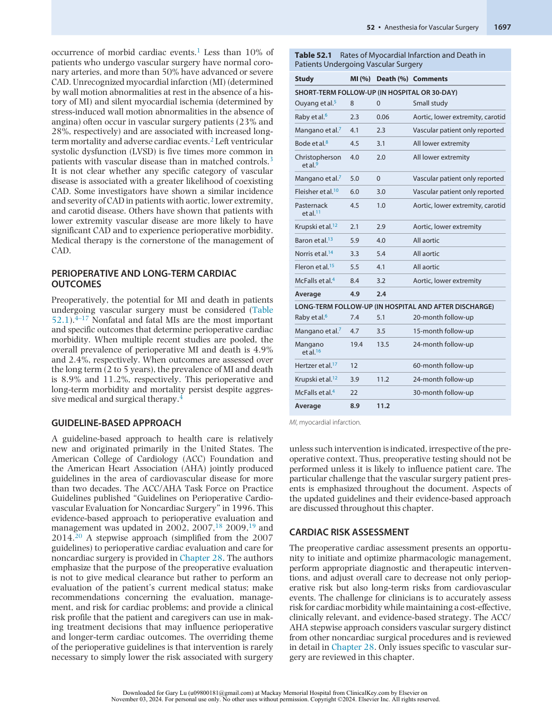

:::

<!-- PDF page 3 -->

After assessment of cardiac risk, the additional challenge exists of modifying perioperative management to reduce risk by adjusting or adding cardiac medications (e.g., β- adrenergic blocker), direct coronary intervention (e.g., percutaneous coronary intervention [PCI] or coronary artery bypass grafting [CABG]), modifying or intensifying perioperative management (e.g., invasive hemodynamic monitoring), or changing preoperative plans (e.g., performing endovascular aneurysm repair [EVAR] rather than open aortic repair). Coordination is essential among surgeons, anesthesiologists, and cardiologists, each of whom may have different criteria for risk assessment and different objectives for risk modification.

### Clinical Risk Indices

Assessing cardiac risk in patients before vascular surgery is a controversial and difficult task. Although risk indices are a cost- effective screening method for determining which patients may require further cardiac evaluation (i.e., additional risk stratification with noninvasive technologies), the high pretest probability of CAD in vascular surgery patients makes the risk index somewhat less useful. Vascular surgery– specific indices have been recently developed to optimize the prediction of perioperative mortality21 and cardiac morbidity22 in patients undergoing elective and urgent vascular surgery. Risk indices do not provide specific risk prediction for individuals, but rather place patients in general risk categories, most commonly designated as low (cardiac risk generally &lt;1%), intermediate (cardiac risk of 1% to 5%), or high (cardiac risk often >5%). Clinical risk variables identified by logistic regression in vascular surgery cohorts can be used along with noninvasive cardiac testing to optimize preoperative assessment of cardiac risk before vascular surgery. From the registry of the Coronary Artery Revascularization Prophylaxis (CARP) trial, the absence of multiple preoperative cardiac risk variables identifies patients with the best long- term survival after elective vascular surgery.23

### Noninvasive Diagnostic Cardiac Testing

Accurate clinical assessment of the pretest probability of significant CAD is extremely important. In general, noninvasive cardiac testing before vascular surgery is best directed at patients considered to be at intermediate clinical risk. Such testing should not be undertaken if it is unlikely to alter patient management and should not be considered as a preliminary step leading to coronary revascularization. A revascularization procedure is rarely needed solely for the purpose of getting a patient through the perioperative period. Extensive cardiac evaluation before vascular operations can result in morbidity, delays, and patient refusal to undergo vascular surgery. A complete review of this subject is found in Chapter 28.

### Cardiac Catheterization and Prophylactic Revascularization

The largest series on outcome in vascular surgery patients is that of Hertzer and colleagues24 from the Cleveland Clinic. These investigators performed cardiac catheterization in 1000 consecutive patients scheduled to undergo peripheral vascular surgery (aortic aneurysm resection, carotid endarterectomy, and lower extremity

**Table 52.2** Results of Coronary Angiography in 1000 Patients with Peripheral Vascular Disease

||||**CLINIC**|**AL CA**|**D**||
|---|---|---|---|---|---|---|
||**NO**|**NE**|**SUSP**|**ECTED**|**TO**|**TAL**|
|**Angiographic Classification**|**No.**|**%**|**No.**|**%**|**No.**|**%**|
|Normal coronary arteries|64|14|21|4|85|8.5|
|Mild‐to‐moderate CAD|218|49|99|18|317|32|
|Advanced, compensated CAD|97|22|192|34|289|29|
|Severe, correctable CAD|63|14|188|34|251|25|
|Severe, inoperable CAD|4|1|54|10|58|5.8|

_CAD_ , coronary artery disease. Data from Hertzer NR, Beven EG, Young JR, et al. Coronary artery disease in peripheral vascular patients: a classification of 1000 coronary angiograms and results of surgical management. _Ann Surg_ . 1984;199:223–233.

revascularization). The incidence and severity of CAD were assessed according to the following classification: normal coronary arteries; mild- to- moderate CAD with no lesion exceeding 70% stenosis; advanced, compensated CAD with one or more lesions exceeding 70% stenosis but with adequate collateral circulation; severe, correctable CAD with more than 70% stenosis in one or more coronary arteries; and severe inoperable CAD with greater than 70% stenosis in one or more coronary arteries and severe distal disease or poor ventricular function. The most remarkable findings were that only 8.5% of patients had normal coronary arteries and 60% had advanced or severe coronary lesions (>70% stenosis). Even when CAD was not suspected by the clinical history, more than a third of patients had advanced or severe coronary lesions (Table 52.2).

In the Hertzer series, patients with severe correctable CAD were offered CABG before their vascular surgery, patients with normal or mild to moderate CAD went directly to vascular surgery, and those with severe inoperable CAD were treated on an individual basis. Combined mortality rates over the immediate- and long- term (4.6- year followup) postoperative period are shown in Table 52.3.17 Of the 216 patients who underwent coronary revascularization (CABG), 12 (5.5%) died after this surgery. This mortality rate is higher than that reported for patients undergoing CABG surgery without peripheral vascular disease (1% to 2%). Perhaps the risks associated with CABG should be seriously considered as part of the preoperative evaluation of these patients. When overall early and late mortality (>5 years) is considered, death occurred in 12% versus 26% of patients who did or did not undergo CABG. Although these data appear to support the beneficial effect of CABG on outcome, the mortality from CABG itself (5.5%) reduces its apparent benefits.

Two randomized clinical trials have been performed to determine the impact of prophylactic coronary artery revascularization on outcome after open aortic and lower extremity arterial vascular surgery.4,25 Of the 5859 patients screened in the CARP trial, 1190 underwent coronary angiography based on a combination of clinical risk factors and noninvasive stress imaging data.26 The incidence and severity of CAD on these angiograms were 43% of patients had one or more major coronary arteries with at least a

::: details 原始表格與符號（PDF 第 3 頁）

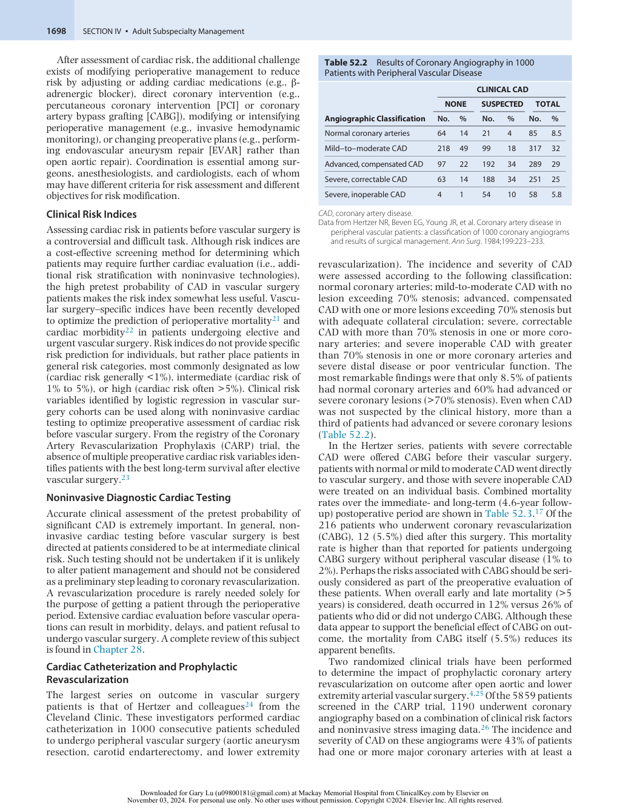

:::

<!-- PDF page 4 -->

**Table 52.3** Perioperative and Late Cardiac Deaths after Peripheral Vascular Reconstruction in Patients Monitored Over a 5- Year Period According to Coronary Angiographic Classification

||**Total No.**|**NORM** **MIL** **MODER**|**AL OR** **D- TO-** **ATE CAD**|**ADV** **COMP** **C**|**ANCED,** **ENSATED** **AD**|**SEVER** **WITH**|**E, CORR** **CABG**|**ECTABL** **NO**|**E CAD** **CABG**|**SE** **INOP** **C**|**VERE,** **ERABLE** **AD**|**T** **CA** **DE**|**OTAL** **RDIAC** **ATHS**|
|---|---|---|---|---|---|---|---|---|---|---|---|---|---|
|**Clinical Features**|**of Patients**|**No.**|**%**|**No.**|**%**|**No.**|**%**|**No.**|**%**|**No.**|**%**|**No.**|**%**|
|Men|685|10/242|4.1|33/204|16|13/174|7.5|6/24|25|14/41|34|76|11|
|Women|315|5/160|3.1|12/85|14|12/42|29|3/11|27|8/17|47|40|13|
|Age &lt;70 years|722|10/328|3.0|29/198|15|19/148|13|3/20|15|13/28|46|74|10|
|Age >70 years|278|5/74|6.8|16/91|18|6/68|8.8|6/15|40|9/30|30|42|15|
|Normotensive|403|7/185|3.8|15/102|15|8/82|9.8|2/15|13|8/19|42|40|9.9|
|Hypertensive|597|8/217|3.4|30/187|16|17/134|13|7/20|35|14/39|36|76|13|
|Nondiabetic|830|12/348|3.4|28/232|12|17/183|9.3|8/30|27|13/37|35|78|9.4|
|Diabetic|170|3/54|5.5|17/57|30|8/33|24|1/5|20|9/21|43|38|22|
|Total|1000|15/402|3.7|45/289|16|25/216|12|9/35|26|22/58|38|116|12|

_CABG_ , coronary artery bypass grafting; _CAD_ , coronary artery disease. Data from Hertzer NR, Young JR, Beven EG, et al. Late results of coronary bypass in patients with peripheral vascular disease. II. Five‐year survival according to sex, hypertension, and diabetes. _Cleve Clin J Med_ . 1987;54:15–23.

70% stenosis suitable for revascularization (and were randomized to either revascularization or no revascularization before vascular surgery); 31% had nonobstructed coronary arteries; 18% had coronary stenosis considered unsuitable for revascularization; and 5% had left main coronary artery stenosis of 50% or more. The CARP trial showed that prophylactic revascularization (by CABG or PCI) was generally safe but did not improve long- term outcome after vascular surgery. Long- term mortality (2.7 years) was 22% in the revascularization group and 23% in the group considered inappropriate for revascularization (Fig. 52.1). Although the trial was not designed to test the short- term benefit of prophylactic revascularization, perioperative outcomes were not decreased, including death (3.1% vs. 3.4%) and MI (12% vs. 14%). The CARP trial results can be applied to most of the vascular surgery patients; however, they cannot be extrapolated to patients with unstable cardiac symptoms, left main coronary artery disease, aortic stenosis, or severe left ventricular dysfunction because these conditions excluded patients from study participation. The DECREASEV trial25 screened 1880 vascular surgery patients, 430 of whom with three or more clinical risk factors underwent noninvasive stress testing using stress- echo or perfusion imaging. Patients with extensive stress- induced ischemia (26%) were randomly assigned to revascularization or no revascularization. Coronary angiography showed twovessel disease in 24%, three- vessel disease in 67%, and left main coronary artery disease in 8%. Prophylactic coronary revascularization (CABG or PCI) did not improve perioperative or long- term outcome (Table 52.4). The incidence of all- cause death or nonfatal MI at 30 days in patients who underwent revascularization or who did not was 43% versus 33%, respectively. The incidence of the composite end point at 1 year was similar, 49% versus 44%, respectively. As noted previously, this trial has come under scrutiny based on concerns of scientific misconduct by the principal investigator.

The lack of benefit of prophylactic coronary revascularization in the CARP and DECREASE- V trials is difficult to reconcile with the more favorable data from Hertzer

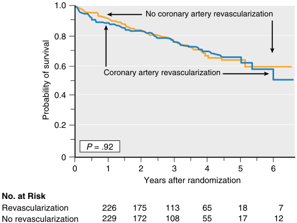

1.0 No coronary artery revascularization 0.8 0.6 Coronary artery revascularization 0.4 0.2 P  = .92 0 0 1 2 3 4 5 6 Years after randomization No. at Risk Revascularization 226  175  113  65  18  7 No revascularization 229  172  108  55  17  12 Probability of survival 

**Fig. 52.1** Long- term survival in patients randomized to undergo coronary artery revascularization or no coronary artery revascularization before elective major vascular surgery (Coronary Artery Revascularization Prophylaxis trial). (From McFalls EO, Ward HB, Moritz TE, et al. Coronary- artery revascularization before elective major vascular surgery. _N Engl J Med._ 2004;351:2796–2804.)

and co- workers24 and other studies (Coronary Artery Surgery Study [CASS]27 and Bypass Angioplasty Revascularization Investigation [BARI]28 ). Clearly, issues are involved that go beyond critical coronary lesions; perhaps the current understanding of the pathophysiology of perioperative MI is incomplete. For example, perioperative MI may be caused by culprit lesions (i.e., vulnerable plaques with high likelihood of thrombotic complications) often located in coronary vessels _without_ critical stenosis.29 For this type of MI (atherothrombotic), perioperative strategies aimed at reducing potential triggers of coronary plaque destabilization and rupture may be more appropriate than those leading to coronary revascularization. Demand ischemia is likely the predominant cause of perioperative MI, which has been confirmed by a recent angiographic study.30

::: details 原始表格與符號（PDF 第 4 頁）

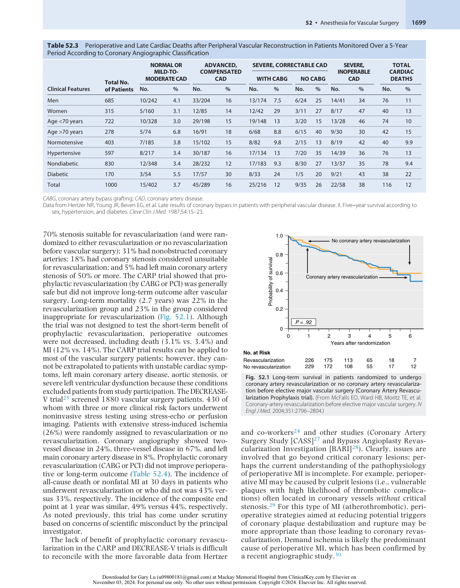

:::

<!-- PDF page 5 -->

**Table 52.4** Perioperative and Long- Term Patient Outcomes from the Dutch Echocardiographic Cardiac Risk Evaluation Applying Stress Echocardiography (DECREASE)- V **—** V TRIAL

||**Revascularization** **No. (%)**|**No Revascularization** **No. (%)**|**HR (95% CI)**|**_P_- value**|
|---|---|---|---|---|
|No. of patients|49|52|||
|Events before surgery|2 (4.1)|0||0.23|
|All- cause mortality|1 (2.1)|0||0.11|
|Myocardial infarction Composite|3 (6.1)|0|||
|Events up to 30 days after surgery|11 (22.5)|6 (11.5)|2.2 (0.74–6.6)|0.14|
|All- cause mortality|17 (34.7)|16 (30.8)|1.4 (0.73–2.8)|0.30|
|Myocardial infarction Composite|21 (42.9)|17 (32.7)|||
|Events up to 365 days after surgery|13 (26.5)|12 (23.1)|1.3 (0.55–2.9)|0.58|
|All- cause mortality|18 (36.7)|19 (36.5)|1.2 (0.68–2.3)|0.48|
|Myocardial infarction Composite|24 (49.0)|23 (44.2)|||

_CI_ , confidence interval; _HR_ , hazard ratio. From Poldermans D, Schouten O, Vidakovic R, et al. A clinical randomized trial to evaluate the safety of a noninvasive approach in high- risk patients undergoing major vascular surgery. The DECREASE- V Pilot Study. _J Am Coll Cardiol_ . 2007;49:1763–1769.

### ASSESSMENT OF PULMONARY FUNCTION

Postoperative pulmonary complications are potentially serious in patients undergoing vascular surgery, with the most significant morbidity seen in patients undergoing open aortic procedures (see also Chapter 50). The most important pulmonary complications are atelectasis, pneumonia, respiratory failure, and exacerbation of underlying chronic disease. Given the prevalence of cigarette smoking in this population, chronic obstructive pulmonary disease (COPD) and chronic bronchitis are common and, when present, place the patient at increased risk for postoperative pulmonary complications. When clinical assessment suggests severe pulmonary compromise, pulmonary function tests may be useful in evaluating and optimizing respiratory function (see also Chapters 29 and 37). Preoperative analysis of arterial blood gases should be used to establish a baseline for postoperative comparison. Baseline hypercapnia (partial pressure of arterial carbon dioxide [PaCO2] >45 mm Hg) indicates a more frequent risk for postoperative morbidity. Bronchodilator therapy may be indicated on the basis of results of pulmonary function tests, although the risk for β- adrenergic agonist– induced arrhythmia or myocardial ischemia also must be considered. Preoperative treatment with a short course of glucocorticoids (prednisone 40 mg/day for 2 days) may be helpful for patients with significant COPD or asthma. Evidence of pulmonary infection should be treated with appropriate antibiotics. Although improved pulmonary outcome with regional anesthesia is not clear, patients with significant pulmonary disease may benefit from epidural techniques. Use of these techniques in the postoperative period helps to avoid respiratory depression from systemic opiates (see also Chapter 77). Pulmonary complications in the postoperative period are difficult to avoid. Incentive spirometry and continuous positive airway pressure (CPAP) do provide benefit.31 Given proper pulmonary care, even patients with severe pulmonary insufficiency, however, may undergo aortic surgery with acceptable morbidity and mortality outcomes.32

### ASSESSMENT OF RENAL FUNCTION

Chronic renal disease is common in vascular surgery patients and is associated with an increased risk for death and cardiovascular disease (see also Chapters 27 and 38).33 Chronic renal disease strongly predicts long- term mortality in patients with symptomatic lower extremity arterial occlusive disease irrespective of disease severity, cardiovascular risk, and concomitant treatment.34 Cardiovascular disease is independently associated with a decline in renal function and the development of kidney disease.35 Serum creatinine and creatinine clearance are used to assess renal function perioperatively. A preoperative serum creatinine level more than 2 mg/dL is an independent risk factor for cardiac complications after major noncardiac surgery.36 Preoperative creatinine clearance less than 60 mL/min is an independent predictor of both short- term and long- term mortality after elective vascular surgery.37 Perioperative β- adrenergic blocker38 and statin37 administration decrease risk for death in vascular surgery patients with renal impairment. Atherosclerotic disease in the abdominal aorta or renal arteries may compromise renal blood flow and renal function. Conversely, renal artery stenosis causes hypertension through renin- induced and angiotensin- induced vasoconstriction. Hypertension itself may cause renal insufficiency or failure. Diabetic nephropathy is also common (see also Chapter 29). Superimposed on baseline abnormalities in renal function are the preoperatively and intraoperatively administered angiographic dyes, which are directly nephrotoxic. Renal ischemia occurs with interruption of renal blood flow from aortic cross- clamping. Even with infrarenal aortic cross- clamps, renal blood flow may decrease despite normal systemic arterial blood pressure and cardiac output. Embolic plaque can be showered into the renal arteries, especially when suprarenal aortic cross- clamps are applied and released. Fluctuations in intravascular volume and cardiac output can compromise renal perfusion during the intraoperative and postoperative periods. In one series of more than 500 patients, the prevalence of acute renal failure was 7% after abdominal aortic reconstruction.

::: details 原始表格與符號（PDF 第 5 頁）

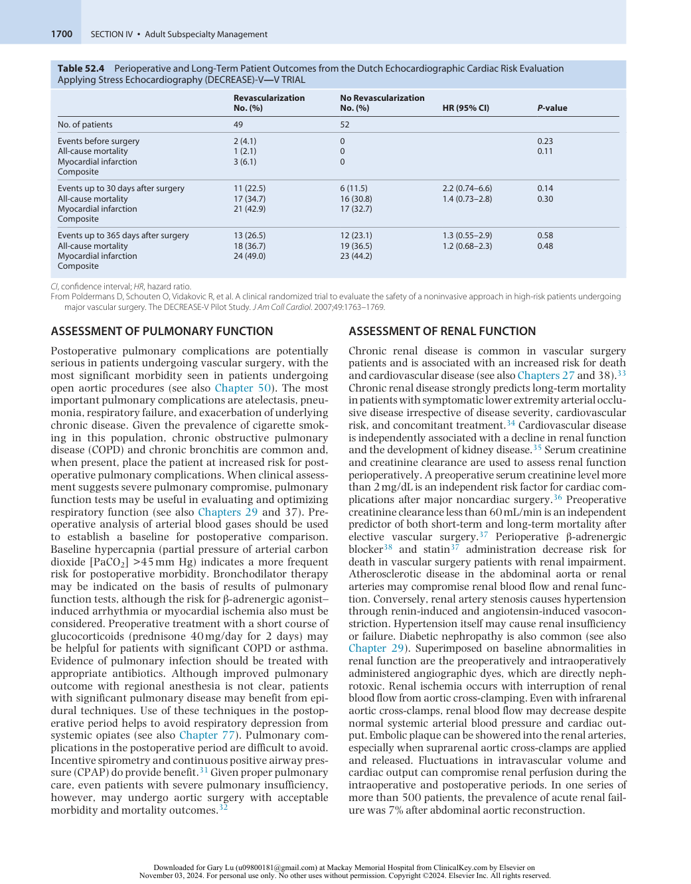

:::

<!-- PDF page 6 -->

### PERIOPERATIVE β- ADRENERGIC BLOCKER THERAPY

Perioperative β- adrenergic blocker therapy is an important and controversial topic, particularly in patients undergoing vascular surgery, and is reviewed more fully in Chapters 28 and 29. Patients receiving chronic β- adrenergic blocker therapy should continue taking β- adrenergic blockers throughout the perioperative period. However, β- adrenergic blockers should not be used as the initial or primary treatment of tachycardia caused by perioperative events, such as hypovolemia, anemia, pain, or infection, because these conditions require prompt treatment of the underlying cause. Treatment of tachycardia caused by the sympathetic stimulation associated with surgical stress should be considered in high- risk patients, particularly those with known ischemic potential (i.e., ischemia on preoperative testing). Hypotension and bradycardia should be avoided. Acute initiation of large- dose β- adrenergic blockade in the perioperative period should be avoided. If a decision is made to initiate beta-blocker treatment in the perioperative period to reduce cardiac risk, the safest approach may be to initiate therapy with a small dose and titrate to effect over a 7- to 10- day period before the planned surgery. Perioperative β- adrenergic blocker therapy can decrease the number of patients referred for preoperative cardiac testing. However, such testing should not be eliminated, and its risk- to- benefit ratio should be carefully assessed.

### PERIOPERATIVE STATIN THERAPY

In addition to their lipid- lowering properties, statins have beneficial anti- inflammatory, plaque- stabilizing, and antioxidant effects (see also Chapter 29). Over the last decade, statin use has emerged as a promising strategy for the prevention of perioperative cardiovascular complications in patients undergoing vascular surgery.39 This approach is supported by the double- blind, placebo- controlled DECREASE- III trial. Unfortunately, controversy exists regarding this trial because of scientific misconduct identified by a recent investigation by Erasmus University.40 Statin use can help preserve renal function after aortic surgery and improve graft patency after lower extremity bypass surgery. Although current guidelines recommend the use of statins in all patients with peripheral arterial disease, the optimal timing and dosing of statins for perioperative use have not been established.

### PERIOPERATIVE DUAL ANTIPLATELET THERAPY

The timing of noncardiac surgery in patients treated with coronary stents with the risk of stent thrombosis if the dual antiplatelet therapy (DAPT) is discontinued versus the risk of increased intraoperative bleeding if DAPT is continued.20,41 Previous recommendations regarding the duration of DAPT and timing of noncardiac surgeries were based on observations of those treated with first- generation stents. Currently used newer generations of stents, particularly the newer drug- eluting stents (DES), have lower risk of in- stent thrombosis and require a shorter minimum duration of DAPT.42 The safety of treating patients with newergeneration DES treated for shorter durations of DAPT (3

to 6 months) has been demonstrated in a meta- analysis of four trials.43 Also, in the PARIS (Patterns of Nonadherence to Antiplatelet Regimens in Stented Patients) registry, interruption of DAPT based on the physician judgment in patients undergoing surgery at any point did not affect the risk of major cardiac events.44 Hence, the ACC/AHA guidelines were changed in 2016 to reflect those changes (see Chapters 28 and 29).45

## Abdominal Aortic Reconstruction

Anesthesia for conventional abdominal aortic reconstruction requires an understanding of the pathophysiology, extensive knowledge of the surgical procedure, the ability to interpret sophisticated hemodynamic data, and skillful pharmacologic control and manipulation of hemodynamics. Preoperative and intraoperative communication with the surgical team is essential. All open operative procedures on the abdominal aorta and its major branches require large incisions and extensive dissection, clamping and unclamping of the aorta or its major branches, varying duration of organ ischemia–reperfusion, significant fluid shifts and temperature fluctuations, and activation of neurohumoral and inflammatory responses. The major objectives of surgical treatment of the aorta are to relieve symptoms, reduce the frequency of associated complications, and in the case of aortic aneurysm, prevent rupture. Over the last two decades, the growth and development of catheter- based technology for the treatment of peripheral arterial disease have generated tremendous interest for less invasive methods to treat aortic disease.

Endovascular aortic aneurysm repair (discussed later) has become an established, less invasive alternative to conventional open repair, and its use has expanded to more than 75% of elective repairs and 30% of rupture repairs.46 The endovascular field continues to evolve rapidly with new devices, innovations, and indications for aortic disease.

### NATURAL HISTORY AND SURGICAL MORTALITY

### Abdominal Aortic Aneurysm

Abdominal aortic aneurysms (AAAs) occur frequently in elderly men, with an incidence approaching 8% (see also Chapter 61). Increasing age, smoking, family history of AAA, and atherosclerotic disease are established risk factors. Although the prevalence is less frequent in women, the risk factors for AAA resemble those in men. More than 30,000 deaths result from rupture of AAAs each year in the United States.47 The number of hospital discharges each year with the first diagnosis of aortic aneurysm is nearly 70,000. Approximately 40,000 patients undergo repair of AAA each year in the United States, at a cost likely to exceed a billion dollars. The incidence of AAA appears to be increasing and is age- and sex- dependent.

AAA is a multifactorial disease associated with aortic aging and atherosclerosis. Although no unified concept of pathogenesis exists, genetic, biochemical, metabolic, infectious, mechanical, and hemodynamic factors may contribute to the development of AAA disease. Adventitial elastin degradation (elastolysis), a hallmark of AAA formation, may be the primary event. Chronic inflammation plays a

<!-- PDF page 7 -->

fundamental role in the destruction of connective tissue in the aortic wall. Concomitant aortoiliac occlusive disease is present in approximately 20% to 25% of patients with AAA. Approximately 5% of patients undergoing abdominal aortic resection have inflammatory aneurysms. Rare causes of AAA disease include trauma, mycotic infection, syphilis, and Marfan syndrome.

Most AAAs are detected incidentally when imaging is performed for other reasons or through screening programs. The natural history of AAA disease is progressive enlargement and ultimate rupture and death. The diameter and rate of expansion of asymptomatic AAAs are the best predictors of the risk for rupture. Current guidelines emphasize that it is not possible to recommend a single threshold diameter for operative intervention that can be generalized to all patients. Yet, elective repair should be undertaken in all patients with AAA 6 cm or larger in diameter. Although some controversy exists regarding elective AAA repair when its diameter is in the 5.5- to 5.9- cm range, the risk for rupture of a 5.5- cm aneurysm (per year) is equal to or greater than the risk for perioperative mortality, and thus surgical repair is indicated. The 1- year incidence of probable rupture in patients refusing or unfit for elective repair is 9.4%, 10.2%, and 32.5% for aneurysms 5.5 to 5.9 cm, 6.0 to 6.9 cm, and 7.0 cm or greater, respectively.48 Over 90% of AAAs are less than the current threshold (5.5 cm) for surgical repair at the time of detection. Randomized controlled trials in patients with AAAs 4.0 to 5.5 cm in diameter have provided important insight into the natural history of small asymptomatic aortic aneurysms.49 Four trials have demonstrated that surveillance of small aneurysms (4.0 to 5.5 cm) is a safe management option, and that early repair (open or endovascular surgery) did not result in any long- term survival benefit. Surgical repair is often considered if small aneurysms become symptomatic or expand more than 0.5 cm in a 6- month period. Although significant interest exists in medical treatment (e.g., antibiotics, β- adrenergic blockers, statins) to delay or reverse expansion of small aneurysms, evidence for a protective effect is limited.50 Aneurysms less than 4.0 cm in diameter are thought to be relatively benign in terms of rupture and expansion.

Perioperative mortality from elective resection of infrarenal AAAs has progressively declined from 18% to 20% during the 1950s, 6% to 8% in the mid- 1960s, 5% to 6% in the early 1970s, and 2% to 4% in the 1980s, at which time it plateaued. A publication of data from 1000 consecutive elective open infrarenal abdominal aneurysm repairs over a 15- year period reported a perioperative mortality rate of 2.4%.51 Hertzer and co- workers52 reported a mortality rate of 1.2% for 1135 consecutive elective open infrarenal abdominal aortic repairs at the Cleveland Clinic. This single- center mortality rate is considerably less than the mortality rates of 5.6% to 8.4% reported from large national data sets. These more frequent mortality rates on the national level suggest that all the technologic and treatment advances over the last two decades have not had an impact on outcomes of patients requiring open AAA repair. Regionalization of patient care and endovascular treatments currently hold the most promise for improvement in operative mortality.

For ruptured AAAs, perioperative mortality has not changed significantly over the last four decades and remains

nearly 50%, with few exceptions. Including patients with rupture who die before reaching a hospital, the overall mortality rate after rupture may very well exceed 90%.

The long- term durability of open infrarenal AAA repair is excellent and well established. The incidence of late graft complications is infrequent (0.4% to 2.3%). Postoperative survival rates after repair of non- ruptured AAA are 92% at 1 year and 67% at 5 years.

### Aortoiliac Occlusive Disease

The infrarenal aorta and the iliac arteries are two of the most common sites of chronic atherosclerosis. Because of the diffuse and progressive nature of aortoiliac atherosclerosis, plaque enlargement may reduce blood flow to the lower extremities below a critical level and result in symptoms of ischemia. Unlike patients with aortic aneurysmal disease, patients undergo surgery for aortoiliac occlusive disease only if they are symptomatic. Surgical intervention is indicated for disabling intermittent claudication and limb- threatening ischemia. Intervention is directed toward restoring peripheral pulsatile circulation to relieve claudication and toward preventing amputation. Patients with localized aortoiliac occlusive disease typically have claudication because collateral circulation adequate to prevent critical lower extremity ischemia usually exists. Perioperative mortality is lower in patients undergoing aortoiliac reconstruction than in those undergoing abdominal aortic surgery.

Therapeutic options for managing aortoiliac occlusive disease include anatomic or direct reconstruction (i.e., aortobifemoral bypass), extra- anatomic or indirect bypass grafts (i.e., axillofemoral bypass), and catheter- based endoluminal techniques (i.e., percutaneous transluminal angioplasty [PTA] with or without stent insertion). Aortobifemoral bypass is viewed as the gold standard in treating aortoiliac occlusive disease. Extra- anatomic bypass grafts are generally reserved for specific indications, usually patients with infection, failure of previous reconstruction, or prohibitive risk. Reduced long- term patency and inferior functional results are frequently the trade- off for lower perioperative morbidity and mortality. Catheter- based endoluminal techniques, such as PTA, are used for relatively localized disease and may be reasonable alternatives to aortobifemoral bypass in 10% to 15% of patients with aortoiliac occlusive disease.

### Renal and Visceral Arterial Insufficiency

Atherosclerosis is the most common cause of renal artery stenosis. Occlusive lesions are located almost exclusively in the proximal segment and orifice of the renal artery and are usually an extension of aortic atherosclerosis. Fibromuscular dysplasia is an important, but less common, cause of renal artery stenosis and most frequently involves the distal two- thirds of the renal arteries. Hemodynamically significant renal artery stenosis may cause hypertension by activation of the renin–angiotensin–aldosterone system, and bilateral involvement may result in renal failure. Patients with renovascular hypertension frequently have poorly controlled hypertension despite maximal medical therapy. These patients often have severe bilateral renal artery stenosis and may have recurrent congestive heart failure or flash pulmonary edema. Indications for intervention include

<!-- PDF page 8 -->

control of hypertension and salvage of renal function. Operative interventions include aortorenal bypass, extraanatomic bypass (hepatorenal or splenorenal bypass), or transaortic endarterectomy. Suprarenal or supraceliac aortic cross- clamping is frequently required for open operative interventions. PTA with stenting of the renal artery is used as the first- line treatment in selected patients.

Stenosis at the origin of the celiac and mesenteric arteries occurs as a result of extension of aortic atherosclerosis. The inferior mesenteric artery is by far the most commonly involved, followed by the superior mesenteric artery and the celiac artery.

Occlusion of a single vessel rarely causes ischemic symptoms because of the extensive nature of visceral collateralization. However, occlusion or significant stenosis of any two vessels may compromise collateral flow sufficiently to give rise to chronic visceral ischemia. Operative repair of visceral artery stenosis is reserved for symptomatic patients. Operative interventions include transaortic endarterectomy and bypass grafts, which frequently require supraceliac aortic cross- clamping. Mortality rates for such procedures range from 7% to 18%. To avoid the high mortality associated with open repair, PTA with stenting has increasingly been applied in patients with chronic visceral ischemia. Acute visceral artery occlusion can be caused by an embolus or, less commonly, by thrombosis. To avoid the extremely high mortality associated with acute visceral ischemia, diagnosis and surgical intervention must occur before gangrene of the bowel develops.

hypertension above the clamp and arterial hypotension below the clamp are the most consistent components of the hemodynamic response to aortic cross- clamping at any level. The increase in arterial blood pressure above the clamp is primarily due to the sudden increase in impedance to aortic blood flow and the resultant increase in systolic ventricular wall tension or afterload. However, factors such as myocardial contractility, preload, blood volume, and activation of the sympathetic nervous system also may be important.54 Cross- clamping of the aorta at or above the diaphragm results in the most profound increases in arterial blood pressure unless diverting circulatory support or intravenous (IV) vasodilators are used. Changes in cardiac output and filling pressure with aortic cross- clamping are

### Box 52.1 Physiologic Changes with Aortic Cross- Clamping and Therapeutic Interventions

### Hemodynamic Changes

- ↑ Arterial blood pressure above the clamp

- ↓ Arterial blood pressure below the clamp

- ↑ Segmental wall motion abnormalities

- ↑ Left ventricular wall tension

- ↓ Ejection fraction

- ↓ Cardiac output†,‡

- ↓ Renal blood flow

- ↑ Pulmonary occlusion pressure

- ↑ Central venous pressure

- ↑ Coronary blood flow

### AORTIC CROSS- CLAMPING

The pathophysiology of aortic cross- clamping is complex and depends on many factors, including level of the cross- clamp, status of the left ventricle, degree of periaortic collateralization, intravascular blood volume and distribution, activation of the sympathetic nervous system, and anesthetic drugs and techniques. Most abdominal aortic reconstructions require clamping at the infrarenal level. However, clamping at the suprarenal and supraceliac levels is required for suprarenal aneurysms and renal or visceral reconstructions and is frequently necessary for juxtarenal aneurysms, inflammatory aneurysms, and aortoiliac occlusive disease with proximal extension. These higher levels of aortic occlusion have a significant impact on the cardiovascular system, as well as on other vital organs rendered ischemic or hypoperfused. Ischemic complications may result in renal failure, hepatic ischemia and coagulopathy, bowel infarction, and paraplegia. With EVAR now common, an increasing proportion of patients undergoing open repair have anatomically complex aneurysms, many of which require suprarenal cross- clamping.53

### Hemodynamic and Metabolic Changes

The hemodynamic and metabolic changes associated with aortic cross- clamping are summarized in Box 52.1. The magnitude and direction of these changes are complex, dynamic, and vary among experimental and clinical studies. However, several important factors must be considered (Box 52.2). The systemic cardiovascular consequences of aortic cross- clamping can be dramatic, depending primarily on the level at which the cross- clamp is applied. Arterial

### Metabolic Changes

- ↓ Total body oxygen consumption

- ↓ Total body carbon dioxide production

- ↑ Mixed venous oxygen saturation

- ↓ Total body oxygen extraction ↑ Epinephrine and norepinephrine Respiratory alkalosis Metabolic acidosis

### Therapeutic Interventions

Afterload reduction Sodium nitroprusside Inhalational anesthetics Amrinone Shunts and aorta- to- femoral bypass Preload reduction Nitroglycerin Controlled phlebotomy Atrial- to- femoral bypass Renal protection Fluid administration Distal aortic perfusion techniques Selective renal artery perfusion Mannitol Drugs to augment renal perfusion Other Hypothermia ↓ Minute ventilation Sodium bicarbonate

> *These changes are of greater significance with longer duration of crossclamping and with more proximal cross- clamping.

†Cardiac output may increase with thoracic cross- clamping.

> ‡When ventilatory settings are unchanged from pre- clamp levels.

<!-- PDF page 9 -->

### Box 52.2 Factors That May Influence the Magnitude and Direction of Physiologic Changes Occurring with Aortic CrossClamping

|Level of aortic cross- clamp|
|---|
|Species differences|
|Anesthetic agents and techniques|
|Use of vasodilator therapy|
|Use of diverting circulatory support|
|Degree of periaortic collateralization|
|Left ventricular function|
|Status of the coronary circulation|
|Volume status|
|Neuroendocrine activation|
|Duration of aortic cross- clamp|
|Body temperature|

not consistent and require an integrated approach in understanding the direction and magnitude of such changes (Fig. 52.2). Cross- clamping of the proximal descending thoracic aorta increases mean arterial, central venous, mean pulmonary arterial, and pulmonary capillary wedge pressure by 35%, 56%, 43%, and 90%, respectively, and decreases the cardiac index by 29%.55 Heart rate and left ventricular stroke work are not significantly changed. Supraceliac aortic cross- clamping increases mean arterial pressure by 54% and pulmonary capillary wedge pressure by 38%.56 Ejection fraction, as determined by two- dimensional echocardiography, decreases by 38%. Despite normalization of systemic and pulmonary capillary wedge pressure with anesthetic agents and vasodilator therapy, supraceliac aortic cross- clamping causes significant increases in left ventricular end- systolic and end- diastolic area (69% and 28%, respectively), as well as wall motion abnormalities indicative of ischemia in 11 of 12 patients (Table 52.5). Aortic cross- clamping at the suprarenal level causes similar but smaller cardiovascular changes and clamping at the infrarenal level is associated with only minimal changes and no wall motion abnormalities.

The marked increases in ventricular filling pressure (preload) reported with high aortic cross- clamping have been attributed to increased afterload and redistribution of blood volume, which is of prime importance during thoracic aortic cross- clamping. The splanchnic circulation, an important source of functional blood volume reserve, is central to this hypothesis. The splanchnic organs contain nearly 25% of the total blood volume, nearly two-thirds (>800 mL) of which can be autotransfused from the highly compliant venous vasculature into the systemic circulation within seconds.57 Primarily because of smaller splanchnic venous capacitance, blood volume is redistributed from vascular beds distal to the clamp to the relatively noncompliant vascular beds proximal to the clamp (Fig. 52.3). Both passive and active mechanisms lower splanchnic venous capacitance with thoracic aortic cross- clamping. Cross- clamping the aorta above the splanchnic system dramatically reduces splanchnic arterial flow, which produces a significant reduction in pressure within the splanchnic capacitance vessels.58 This decreased pressure allows the splanchnic veins to passively recoil and increase venous return to the

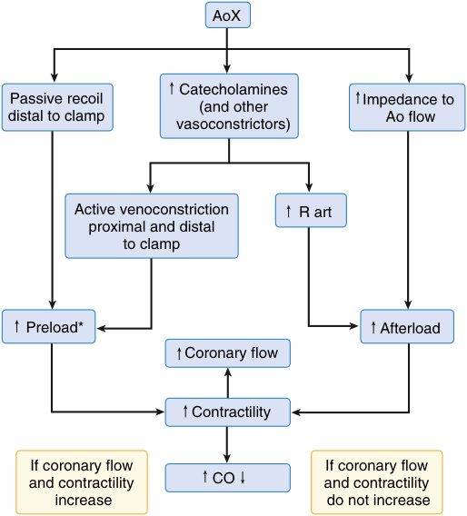

AoX Catecholamines Passive recoil Impedance to (and other distal to clamp Ao flow vasoconstrictors) Active venoconstriction R art proximal and distal to clamp Preload* Afterload Coronary flow Contractility If coronary flow  If coronary flow and contractility  CO and contractility increase do not increase 

**Fig. 52.2 Systemic hemodynamic response to aortic crossclamping.** Preload ( _asterisk_ ) does not necessarily increase with infrarenal clamping. Depending on splanchnic vascular tone, blood volume can be shifted into the splanchnic circulation and preload will not increase. _Ao_ , aortic; _AoX_ , aortic cross- clamping; _CO_ , cardiac output; _R art_ , arterial resistance.

**Table 52.5** Percent Change in Cardiovascular Variables on Initiation of Aortic Occlusion

|**Cardiovascular Variable**|**PERCENT C** **Supraceliac**|**HANGE AFTER** **Suprarenal-** **Infraceliac**|**OCCLUSION** **Infrarenal**|
|---|---|---|---|
|Mean arterial blood pressure|54|5*|2*|
|Pulmonary capillary wedge pressure|38|10*|0*|
|End- diastolic area|28|2*|9*|
|End- systolic area|69|10*|11*|
|Ejection fraction|−38|−10*|−3*|
|Patients with wall motion abnormalities|92|33|0|

*Statistically different ( _P_ &lt; .05) from group undergoing supraceliac aortic occlusion.

From Roizen MF, Beaupre PN, Alpert RA, et al. Monitoring with twodimensional transesophageal echocardiography: comparison of myocardial function in patients undergoing supraceliac, suprarenalinfraceliac, or infrarenal aortic occlusion. _J Vasc Surg_ . 1984;1:300–305.

heart and blood volume proximal to the clamp. Thoracic aortic cross- clamping also results in significant increases in plasma epinephrine and norepinephrine, which may enhance venomotor tone both above and below the clamp. The splanchnic veins are highly sensitive to adrenergic stimulation. The major effect of catecholamines on the splanchnic capacitance vessels is venoconstriction, which

::: details 原始表格與符號（PDF 第 9 頁）

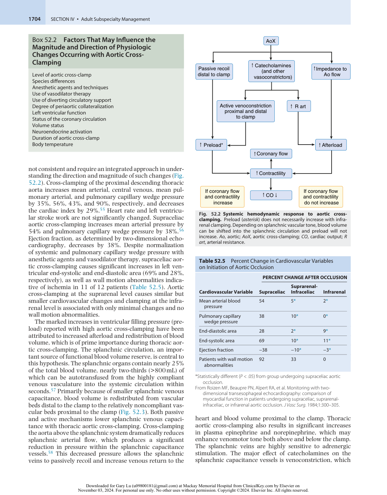

:::

<!-- PDF page 10 -->

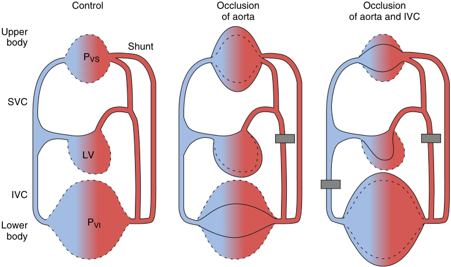

Control Occlusion Occlusion of aorta of aorta and IVC Upper body Shunt PVS SVC LV IVC Lower PVI body 

**Fig. 52.3 Schematic drawing of the circulation.** Compliant regions ( _dashed lines_ ) of the upper and lower part of the body and end- diastolic volumes of the left ventricle in control state ( _left panel_ ) are shown after occlusion of the aorta alone ( _middle panel_ ) and combined occlusion of the aorta and inferior vena cava ( _right panel_ ). _IVC_ , inferior vena cava; _LV_ , left ventricle; _PVS and PVI_ , pressure in compliant regions of the upper and lower body, respectively; _Shunt_ , physiologic shunt; _SVC_ , superior vena cava.

actively forces out splanchnic blood, reduces splanchnic venous capacitance, and increases venous return to the heart.58

Several animal studies support the blood volume redistribution hypothesis. Cross- clamping the thoracic aorta in dogs results in marked increases in mean arterial pressure and end- diastolic left ventricular pressure (84% and 188%, respectively) and no significant change in stroke volume.59 In this same experimental model, simultaneous crossclamping of the thoracic aorta and the inferior vena cava resulted in no significant change in mean arterial pressure or preload (see Fig. 52.3). Stroke volume was reduced by 74%. By transfusing blood (above the clamps) during this period of simultaneous clamping, the authors reproduced the hemodynamic effect of thoracic aortic cross- clamping alone. This study also demonstrated that thoracic aortic cross- clamping is associated with a significant and dramatic increase (155%) in blood flow above the level of the clamp, whereas no change in blood flow occurred with simultaneous aortic and inferior vena cava clamping. In other animal models, the proximal aortic hypertension and increased central venous pressure (CVP) occurring after thoracic aortic cross- clamping were completely reversed by phlebotomy.60 Aortic cross- clamping at the thoracic and suprarenal levels in dogs both resulted in proximal aortic hypertension, but only occlusion at the thoracic level increased CVP.61 In this study, thoracic aortic occlusion increased blood volume in organs and tissues proximal to the clamp, whereas no such increase occurred with suprarenal aortic cross- clamping. These experimental data strongly support the hypothesis of blood volume redistribution during aortic cross- clamping and help explain the marked differences in hemodynamic responses observed after aortic cross- clamping at different levels.56

Afterload- dependent increases in preload also occur with aortic cross- clamping, usually in the setting of impaired myocardial contractility and reduced coronary reserve.

The impaired left ventricle may respond to increased afterload with an increase in end- systolic volume and a concomitant reduction in stroke volume (afterload mismatch). The reduction in stroke volume may be due to limited preload reserve, myocardial ischemia, or inability of the heart to generate a pressure- induced increase in contractility (the Anrep effect). If right ventricular function remains normal, the pre- clamp right ventricular stroke volume added to the increased left ventricular endsystolic volume results in left ventricular dilation and elevated end- diastolic volume. If corrective measures are not undertaken, overt left ventricular overload may result, with severe peripheral organ dysfunction and pulmonary edema.

Most clinical studies indicate that cardiac output decreases with thoracic aortic cross- clamping (without vasodilator therapy or diverting circulatory support), whereas most animal studies show no significant change or an increase in cardiac output.

However, the status of the left ventricle clearly plays a major role. Whereas a normal intact heart can withstand large increases in volume without significant ventricular distention or dysfunction, an impaired heart with reduced myocardial contractility and coronary reserve may respond to such increase in volume conditions with marked ventricular distention as a result of acute left ventricular dysfunction and myocardial ischemia. Although impaired myocardial contractility and reduced coronary reserve are rare in animal experiments, such disorders are frequent in the elderly population undergoing aortic reconstruction. The increase in ventricular loading conditions seen with thoracic and supraceliac cross- clamping55,56 in the clinical setting may increase left ventricular wall stress (afterload), with resultant acute deterioration of left ventricular function and myocardial ischemia.

Impaired subendocardial perfusion caused by high intramyocardial pressure may be the cause of wall motion

<!-- PDF page 11 -->

abnormalities and changes in ejection fraction. Reflex mechanisms causing immediate feedback inhibition may also explain the reduction in cardiac output with aortic cross- clamping. For example, baroreceptor activation resulting from increased aortic pressure should depress the heart rate, contractility, and vascular tone. Thoracic aortic cross- clamping with the use of vasodilator therapy to normalize ventricular loading conditions maintains or increases cardiac output.62 The metabolic effects of aortic cross- clamping are summarized in Box 52.1. Crossclamping of the thoracic aorta decreases total  body O2 consumption by approximately 50%. For reasons that are unclear, O2 consumption decreases in tissues above the clamp. In clinical studies, increased mixed venous O2 saturation occurs with aortic cross- clamping above the celiac axis. This increase in mixed venous O2 saturation may be explained by a reduction in O2 consumption that exceeds the reduction in cardiac output, thus decreasing total body O2 extraction. Central hypervolemia and increased arteriovenous shunting in tissues proximal to the aortic clamp may play a role in reducing total body O2 extraction. Arterial blood pressure, blood flow, and O2 consumption distal to a thoracic aortic cross- clamp decrease by 78%–88%, 79%–88%, and 62%, respectively, from baseline values before clamping. Blood flow through tissues and organs below the level of aortic occlusion is dependent on perfusion pressure and is independent of cardiac output. Administration of sodium nitroprusside to maintain proximal aortic pressure above the cross- clamp at pre- clamp levels has been shown to further reduce arterial pressure distal to the clamp by 53%. As discussed later, these data have significant implications regarding vital organ protection during aortic cross- clamping.

The cardiovascular response to infrarenal aortic crossclamping is less significant than with high aortic crossclamping (see Table 52.5). Although several clinical reports have noted no significant hemodynamic response to infrarenal cross- clamping, the hemodynamic response generally consists of increases in arterial pressure (7% to 10%) and systemic vascular resistance (20% to 32%), with no significant change in heart rate. Cardiac output is most consistently decreased by 9% to 33%. Reported changes in ventricular filling pressure have been inconsistent. Blood volume redistribution may affect preload with infrarenal aortic crossclamping (see Fig. 52.3). In this situation, blood volume below the clamp shifts to the compliant venous segments of the splanchnic circulation above the clamp, thereby dampening the expected increase in preload. The preload changes with infrarenal aortic cross- clamping also may depend on the status of the coronary circulation. Patients with severe ischemic heart disease responded to infrarenal aortic cross- clamping with significantly increased central venous (35%) and pulmonary capillary (50%) pressure, whereas patients without CAD had decreased filling pressure. Echocardiographically detected segmental wall motion abnormalities occur in up to 30% of patients during infrarenal aortic reconstruction, with over 60% occurring at the time of aortic cross- clamping. Patients with aortoiliac occlusive disease may have less hemodynamic response to infrarenal aortic cross- clamping than do patients with AAA disease, perhaps as a result of more extensive periaortic collateral vascularization.

### RENAL FUNCTION AND PROTECTION

Preservation of renal function is highly important during aortic reconstructive surgery. Acute renal failure occurs in approximately 3% of patients undergoing elective infrarenal aortic reconstruction, and mortality resulting from postoperative acute renal failure is more frequent than 40%. Despite significant improvements in the perioperative care of these patients, the frequent incidence of morbidity and mortality resulting from acute renal failure has remained largely unchanged over the last several decades. Most of the morbidity associated with significant postoperative renal dysfunction is nonrenal.

The adequacy of renal perfusion “cannot” be assumed by urine output. Although urine output is closely monitored and often augmented during aortic surgery, intraoperative urine output does not predict postoperative renal function. Procedures requiring aortic cross- clamping above the renal arteries dramatically reduce renal blood flow. Experimental studies report an 83% to 90% reduction in renal blood flow during thoracic aortic cross- clamping. Infrarenal aortic cross- clamping in humans is associated with a 75% increase in renal vascular resistance, a 38% decrease in renal blood flow, and a redistribution of intrarenal blood flow toward the renal cortex. These rather profound alterations in renal hemodynamics occurred despite no significant change in systemic hemodynamics, and they persisted after unclamping. The sustained deterioration in renal perfusion and function during and after infrarenal aortic cross- clamping has been attributed to renal vasoconstriction, but the specific pathophysiologic process remains unknown. Renal sympathetic blockade with epidural anesthesia to a T6 level does not prevent or modify the severe impairment in renal perfusion and function that occurs during and after infrarenal aortic cross- clamping. Although plasma renin activity is increased during aortic cross- clamping, pretreatment with converting enzyme inhibitors before infrarenal aortic cross- clamping does not attenuate the decreased renal blood flow and glomerular filtration rate. Other mediators, such as plasma endothelin, myoglobin, and prostaglandins, may contribute to the decreased renal perfusion and function after aortic cross- clamping.

Acute tubular necrosis accounts for nearly all the renal dysfunction and failure after aortic reconstruction. The degree of preoperative renal insufficiency remains the strongest predictor of postoperative renal dysfunction. In addition to aortic cross- clamping- induced reductions in renal blood flow, ischemic reperfusion injury, intravascular volume depletion, embolization of atherosclerotic debris to the kidneys, and surgical trauma to the renal arteries all contribute to renal dysfunction.

Mannitol, loop diuretics, and dopamine are used clinically to preserve renal function during aortic surgery. Significant controversy exists regarding the use of these drugs, as well as the mechanisms by which they may offer a protective effect. Although not proved, pharmacologic “protection” before aortic cross- clamping is believed to be beneficial and is therefore given. The use of mannitol 12.5 g/70 kg to induce osmotic diuresis before aortic cross- clamping is ubiquitous in clinical practice. Mannitol improves renal cortical blood flow during infrarenal aortic cross- clamping and reduces ischemia- induced renal vascular endothelial

<!-- PDF page 12 -->

cell edema and vascular congestion. Other mechanisms by which mannitol may be beneficial include acting as a scavenger of free radicals, decreasing renin secretion, and increasing renal prostaglandin synthesis. Loop diuretics and low- dose dopamine (1 to 3 mcg/kg/min) are used to protect the kidneys from aortic cross- clamp- induced injury by increasing renal blood flow and urine output intraoperatively. Routine use of these drugs is common for patients with preoperative renal insufficiency and for procedures requiring suprarenal aortic cross- clamping. Intraoperative use of these drugs requires increased surveillance of intravascular volume and electrolytes during the postoperative period. Therapy with these drugs could actually be harmful because of hypovolemia and resultant renal hypoperfusion. In addition, dopamine’s positive inotropic and chronotropic activity may cause tachycardia and increase myocardial O2 consumption in patients with limited coronary reserve.

Fenoldopam mesylate, a selective dopamine type 1 agonist that preferentially dilates the renal and splanchnic vascular beds, has shown some promise as a renoprotective drug. However, its role in the prevention of renal dysfunction after aortic surgery is not known. Statin use is associated with preserved renal function after aortic surgery requiring suprarenal aortic cross- clamping.63 Remote ischemic preconditioning reduces the incidence of renal impairment after open aortic surgery.64 Optimal systemic hemodynamics, including maintenance of intravascular volume and hematocrit, is generally considered the most effective means of renal protection during and after aortic cross- clamping. The goal is to achieve a preload adequate to allow the left ventricle to cope with cross- clamping- induced changes in contractility and afterload while maintaining cardiac output. However, in providing such therapy, excessive intravascular volume should be avoided because it may lead to inappropriate increases in preload or pulmonary edema in patients with decreased myocardial reserve.

### THERAPEUTIC STRATEGIES

Patients with preexisting impaired ventricular function and reduced coronary reserve are most vulnerable to the stress imposed on the cardiovascular system by aortic crossclamping. Rational therapeutic strategies to prevent the deleterious effect of aortic cross- clamping primarily include measures to reduce afterload and maintain a normal preload and cardiac output. Vasodilators, positive and negative inotropic drugs, and controlled intravascular volume depletion (i.e., phlebotomy) may be used selectively.

Patients with impaired ventricular function requiring supraceliac aortic cross- clamping are the most challenging. Myocardial ischemia, reflecting an unfavorable balance between myocardial O2 supply and demand, may result from the hemodynamic consequences of aortic crossclamping. Controlled (i.e., slow clamp application) supraceliac aortic cross- clamping is important to avoid abrupt and extreme stress on the heart. Both afterload and preload reduction are often required. Afterload reduction, most commonly accomplished with the use of sodium nitroprusside or clevidipine (predominantly arteriolar dilators), is necessary to unload the heart and reduce ventricular wall tension. In a large series of patients requiring cross- clamping of the descending thoracic aorta, stable left ventricular

function was maintained with sodium nitroprusside during cross- clamping. Sodium nitroprusside most likely allowed adequate intravascular volume before unclamping, which resulted in stable unclamping hemodynamics. A normal preload is equally important and involves careful IV fluid titration and vasodilator administration. Nitroglycerin can be used because it increases venous capacity more than does sodium nitroprusside.

In patients without evidence of left ventricular decompensation or myocardial ischemia during supraceliac aortic cross- clamping, a proximal aortic mean arterial pressure of up to 120 mm Hg is acceptable. The surgeon may request lower proximal arterial pressure if friable aortic tissue is encountered. Blood flow below the aortic clamp depends on pressure and decreases further during therapy with vasodilators. In this setting, vital organs and tissues distal to the clamp are exposed to reduced perfusion pressure and blood flow. Though infrequent, maintenance of adequate cardiac output may require active intervention with inotropic drugs.

### AORTIC UNCLAMPING

The hemodynamic and metabolic effects of aortic unclamping are listed in Box 52.3. The hemodynamic response to unclamping depends on many factors, including the level of aortic occlusion, total occlusion time, use of diverting support, and intravascular volume. Hypotension, the most consistent hemodynamic response to aortic unclamping, can be profound, particularly after removal of a supraceliac cross- clamp (Fig. 52.4). Reactive hyperemia in tissues

### Box 52.3 Physiologic Changes with Aortic Unclamping and Therapeutic Intervention

### Hemodynamic Changes

- ↓ Myocardial contractility ↓ Arterial blood pressure ↑ Pulmonary artery pressure ↓ Central venous pressure ↓ Venous return ↓ Cardiac output **Metabolic Changes** ↑ Total body oxygen consumption ↑ Lactate ↓ Mixed venous oxygen saturation ↑ Prostaglandins ↑ Activated complement ↑ Myocardial- depressant factor(s) ↓ Temperature Metabolic acidosis **Therapeutic Interventions** ↓ Inhaled anesthetics ↓ Vasodilators ↑ Fluid administration ↑ Vasoconstrictor drugs Reapply cross- clamp for severe hypotension Consider mannitol Consider sodium bicarbonate

*These changes are of greater significance with longer duration of crossclamping and with more proximal cross- clamping.

<!-- PDF page 13 -->

and organs distal to the clamp and the resultant relative central hypovolemia are the dominant mechanisms of the hypotension. Washout of vasoactive and cardiodepressant mediators from ischemic tissues, as well as humoral factors, may also contribute to the hemodynamic responses after unclamping the aorta. These humoral factors and mediators, which may also play a role in organ dysfunction after aortic occlusion, include lactic acid, renin–angiotensin, O2 free radicals, prostaglandins, neutrophils, activated complement, cytokines, and myocardial- depressant factors.54

Avoidance of significant hypotension with unclamping requires close communication with the surgical team, awareness of the technical aspect of the surgical procedure, and appropriate administration of fluids and vasoactive drugs. It is essential that correction of preoperative fluid deficits, maintenance of intraoperative fluid requirements, and replacement of blood loss be accomplished before unclamping. Vasodilators, if used, should be gradually reduced and discontinued before unclamping. The inspired concentrations of volatile anesthetics should be decreased. Moderate augmenting of intravascular volume by administration of fluids (∼500 mL) during the immediate prerelease period is indicated for infrarenal unclamping. More aggressive

intravascular fluid administration is required in the period immediately preceding supraceliac unclamping. Maintaining increased central venous or pulmonary capillary wedge pressure during the cross- clamp period is not indicated and may result in significant overtransfusion of fluids and blood products. If significant hypotension results, gradual release of the aortic clamp and reapplication or digital compression are important measures in maintaining hemodynamic stability during unclamping. Although vasopressor requirements are minimal after release of the infrarenal clamp, significant support is often needed after the removal of supraceliac clamps. Caution must be observed when vasopressor support is used in this setting because profound proximal hypertension may occur if reapplication of the cross- clamp is required above the celiac axis. In addition, hypertension should be avoided to prevent damage to or bleeding from the vascular anastomoses.

### ANESTHETIC MANAGEMENT

### Intraoperative Monitoring

The potential for significant and rapid blood loss cannot be underestimated. A central line and two peripheral lines

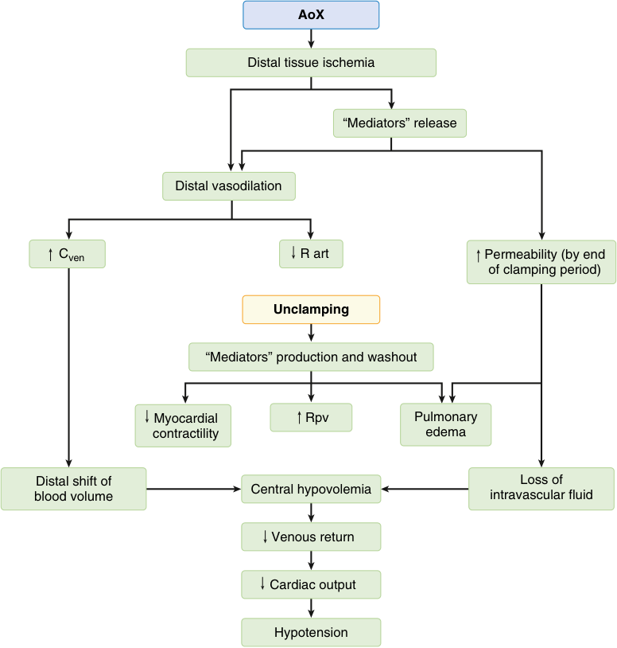

AoX Distal tissue ischemia “Mediators” release Distal vasodilation Cven R art Permeability (by end of clamping period) Unclamping “Mediators” production and washout Myocardial Rpv Pulmonary contractility edema Distal shift of Loss of blood volume Central hypovolemia intrav ascular fluid Venous return Cardiac output Hypotension 

**Fig. 52.4 Systemic hemodynamic response to aortic unclamping.** _AoX_ , aortic cross- clamping; _Cven_ , venous capacitance; _R art_ , arterial resistance; _Rpv_ , pulmonary vascular resistance.

<!-- PDF page 14 -->

are usually used as intravenous (IV) access. The choice of the type and the size of the central line can be decided on a case- by- case basis. Placement of an arterial catheter should be routine in all patients undergoing aortic reconstruction. As with other vascular procedures, the radial artery is most commonly selected for cannulation because of its superficial location, easy accessibility, and low complication rate. A noninvasive blood pressure cuff should be placed on the arm contralateral to the arterial catheter in the event of catheter malfunction.

A central venous catheter should be used for all open aortic procedures. It allows monitoring of CVP and administration of drugs directly into the central circulation. The routine, nonselective use of pulmonary artery catheter monitoring is not recommended. It should be reserved for patients with severely limited cardiopulmonary function or complex aortic reconstruction. In patients with good left ventricular and pulmonary function, CVP correlates well with left ventricular filling pressure. The invasive monitoring catheters can be placed before or after induction of general anesthesia. The advantage of preinduction catheter placement is assessment of the patient’s awake (i.e., baseline) cardiovascular status, which allows correction of significant abnormalities in cardiac filling and function before induction.

With selective use, accurate interpretation of data, and rational treatment strategies, pulmonary artery catheter monitoring may be beneficial in high- risk patients undergoing complex aortic reconstruction. Yet the clinical value of pulmonary artery catheter monitoring in high- risk patients has not been established.65 Clinical studies over the last two decades have yielded quite conflicting and variable results, including both increases and decreases in mortality. The National Heart, Lung and Blood Institute and the Food and Drug Administration (FDA)66 sponsored a large prospective, randomized trial that compared goal- directed therapy guided by a pulmonary artery catheter with standard care without the use of a pulmonary artery catheter in high- risk surgical patients. The result found no benefit in treatment guided by a pulmonary artery catheter.67 Yet this study did not find an increase in mortality with insertion and use of a pulmonary artery catheter.

Transesophageal echocardiography (TEE) has been used intraoperatively to assess global ventricular function, guide intravascular fluid therapy, and monitor for myocardial ischemia. Patients requiring supraceliac aortic crossclamping have significant increases in the end- diastolic area and significant decreases in ejection fraction on echocardiography that are not completely normalized with vasodilators and frequently are not detected by pulmonary artery catheter monitoring.56

The optimal intraoperative monitoring techniques for patients undergoing abdominal aortic reconstruction have not been established. Existing clinical studies offer insufficient data to conclusively answer the question of whether pulmonary artery catheter or TEE monitoring improves outcome. The clinical usefulness of any monitoring technique ultimately depends on patient selection, accurate interpretation of data, and appropriate therapeutic intervention.

### Cell Salvage

Intraoperative cell salvage is a widely used technique combined with allogenic blood transfusion and in some centers

is considered routine. The equipment is expensive and requires significant training and expertise. An early, nonrandomized study reported a 75% reduction in the number of allogeneic red blood cell (RBC) units transfused during elective aortic surgery with the use of cell salvage. Later randomized studies have reported conflicting results. The routine use of cell salvage during aortic surgery may not be cost- effective and thus it may best be reserved for a select group of patients with an expected large blood loss. A costeffective option is to use the cell salvage reservoir for blood collection and activate the full salvage process only if large blood loss occurs.

### Anesthetic Drugs and Techniques

Various anesthetic techniques, including general anesthesia, regional (epidural) anesthesia, and combined techniques, have been used successfully for abdominal aortic reconstruction. Combined techniques most commonly use a lumbar or low thoracic epidural catheter in addition to general anesthetic. Local anesthetics, opioids, or, more commonly, a combination of the two may be administered by bolus or continuous epidural infusion. Maintenance of vital organ perfusion and function by the provision of stable perioperative hemodynamics is more important to overall outcome than is the choice of anesthetic drug or technique.14 Therefore, the specific anesthetic technique for patients undergoing abdominal aortic reconstruction is important insofar as it allows rapid and precise control of hemodynamic parameters. Given the frequent incidence of cardiac morbidity and mortality in patients undergoing aortic reconstruction, factors that influence ventricular work and myocardial perfusion are of prime importance. Induction of general anesthesia should ensure that stable hemodynamics are maintained during loss of consciousness, laryngoscopy and endotracheal intubation, and the immediate postinduction period. A variety of IV anesthetics (propofol, etomidate, thiopental) are suitable. The addition of a short- acting, potent opioid such as fentanyl or sufentanil usually provides stable hemodynamics during and after induction of anesthesia. Volatile anesthetics may be administered in low concentrations before endotracheal intubation during assisted ventilation as an adjunct to blunt the hyperdynamic response to laryngoscopy and endotracheal intubation. Esmolol 10 to 25 mg, sodium nitroprusside 5 to 25 mcg, nitroglycerin 50 to 100 mcg, or clevidipine 100 mcg and phenylephrine 50 to 100 mcg should be available for bolus administration during induction if needed to maintain appropriate hemodynamics.

Maintenance of anesthesia may be accomplished with a combination of a potent opioid (fentanyl or sufentanil) and an inhaled anesthetic (sevoflurane, desflurane, or isoflurane) (i.e., balanced anesthesia). Patients with severe left ventricular dysfunction may benefit from a pure opioid technique, but a balanced anesthetic technique allows the clinician to take advantage of the most desirable characteristics of potent opioids and inhaled volatile anesthetics while minimizing their undesirable side effects. Nitrous oxide (N2O) can be used to supplement either an opioid or an inhaled anesthetic.

Various regional anesthetic and analgesic techniques have been used effectively during and after aortic reconstruction. For over two decades, interest has focused on

<!-- PDF page 15 -->

the use of regional anesthetic and analgesic techniques to reduce the incidence of perioperative morbidity in patients undergoing aortic reconstruction. The benefits of combined general and epidural anesthesia intraoperatively, with or without epidural analgesia continued into the postoperative period, remain controversial.13,14,68–71 Moreover, studies that have reported improved outcome do not determine whether the benefit results from the intraoperative anesthetic technique or the postoperative analgesic regimen (or a combination of the two). In a randomized trial using epidural morphine in patients undergoing aortic surgery, Breslow and associates72 found attenuation of the adrenergic response and a less frequent incidence of hypertension in the postoperative period. A large, randomized trial reported no reduction in nonsurgical complications with the use of intrathecal opioid.15 The effects of the anesthetic or analgesic technique on the incidence of perioperative myocardial ischemia have received considerable attention. Four randomized trials, with nearly 450 combined patients undergoing aortic reconstruction, failed to demonstrate a reduction in the incidence of perioperative,14,73 intraoperative,74 or postoperative70 myocardial ischemia when epidural techniques were used. Additionally, randomized trials have not demonstrated a reduction in the incidence of cardiovascular, pulmonary, or renal complications after aortic surgery with the use of epidural techniques.13,14,69,70,75

The duration and intensity of postoperative care after aortic surgery are critically dependent on the physiologic derangements incurred during the perioperative period (i.e., depression of consciousness, hypothermia, excessive intravascular fluids, incisional pain, ileus, and respiratory depression), as well as on the development of certain less common, but more severe postoperative complications (i.e., MI, pneumonia, sepsis, renal failure, and decreased tissue perfusion). Length of hospital stay may therefore be considered the outcome variable most directly proportional to an integrated final negative effect of all significant perioperative morbidity (excluding in- hospital death) and the variable most likely to be altered by the anesthetic or analgesic technique. Randomized trials have not demonstrated any reduction in length of hospital stay after aortic surgery with the use of regional techniques. Norris and colleagues14 reported the results of a randomized clinical trial comparing alternative combinations of intraoperative anesthesia (i.e., general or combined epidural and general) and postoperative analgesia (i.e., IV patient- controlled analgesia [PCA] or epidural PCA) with respect to length of stay after abdominal aortic surgery. Two unique features of the trial included a factorial design (Fig. 52.5), which allowed the inclusion of all four combinations of intraoperative anesthesia and postoperative analgesia and the ability to separate the influence of time period and technique, and a double- blind design, which helped eliminate investigator and treating physician bias. The study rigorously protocolized perioperative management, standardized postoperative surgical care, and optimized postoperative pain management. Although the overall length of stay was much shorter (median, 7.0 days) than that reported in other studies,13,68,70,75 they were not able to demonstrate a reduction in length of stay or direct medical costs based on anesthetic or analgesic technique (Table 52.6). The overall incidence of postoperative complications in the trial was low and not different based on

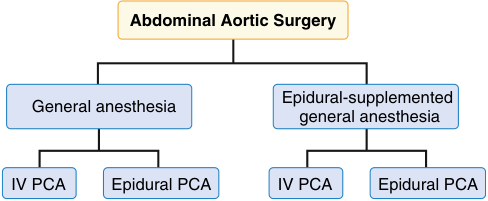

Abdominal Aortic Surgery General anesthesia Epidural-supplemented general anesthesia IV PCA Epidural PCA IV PCA Epidural PCA 

**Fig. 52.5 Outline of factorial study design.** This design allows the inclusion of all four possible combinations on intraoperative anesthesia and postoperative analgesia and the ability to separate the influences of time period and technique. Data analysis by treatment group, intraoperative treatment, postoperative treatment, and any epidural activation, as well as simultaneous consideration of both intraoperative and postoperative treatments in the same model (factorial analysis), is possible and allows improvement in outcome to be attributed to the intraoperative anesthesia, postoperative analgesia, the combination of the two, or to unrelated factors. _IV_ , intravenous; _PCA_ , patient- controlled analgesia.

anesthetic or analgesic technique. Postoperative pain was well controlled overall, with similar pain scores in both analgesic treatment groups. Thus, if perioperative care and pain relief are optimized, epidural anesthetic and analgesic techniques for aortic surgery offer no major advantage or disadvantage over general anesthesia and IV PCA.

The use of epidural local anesthetics in combination with general anesthesia during aortic reconstruction poses several problems, including hypotension at the time of aortic unclamping and the need for increased intravascular fluid and vasopressor requirements. Supraceliac aortic crossclamping may significantly exaggerate these disadvantages, and, as a result, some clinicians avoid running local anesthetics in the epidural around the period of aortic clamping and unclamping. Epidural opioids without local anesthetics can be used in the interim and local anesthetic can be given later, after aortic unclamping, when hemodynamics and intravascular volume have stabilized. Although elective aortic reconstruction via the retroperitoneal approach using straight epidural anesthesia (no general anesthetic) has been reported, this technique is not recommended for routine use.

Hypertension and tachycardia are aggressively controlled during emergence by the use of short- acting drugs such as esmolol, nitroglycerin, clevidipine, or sodium nitroprusside. Emergence from anesthesia should be conducted after restoration of circulation and establishment of adequate organ perfusion. Hemodynamic, metabolic, and temperature homeostasis must be achieved before extubation; otherwise, patients should be transported intubated to the intensive care unit (ICU).

### Temperature Control

Postoperative hypothermia is associated with many undesirable physiologic effects and may contribute to adverse outcomes (see also Chapter 76). Normothermia should be maintained before skin incision by increasing ambient temperature in the operating room, applying warm cotton blankets, and warming IV fluids. If significant hypothermia occurs early in the procedure, normothermia is extremely difficult to achieve, and emergence and tracheal extubation may be delayed. During surgery, all fluids and

<!-- PDF page 16 -->

**Table 52.6** Duration of Hospital Stay and Direct Medical Costs by Randomized Treatment Assignment for Patients Surviving to Discharge after Abdominal Aortic Surgery

||**GA- IVPCA**|**RSGA- IVPCA**|**GA- EPCA**|**RSGA- EPCA**|**Total**|**_P_- value**|
|---|---|---|---|---|---|---|
|No. of patients|35|36|36|44|151||
|Duration of hospital stay (days)*|7.0 (2.2)|8.0 (2.8)|7.0 (2.0)|7.0 (2.8)|7.0 (2.2)|.833†|
|Range|4–43|5–28|5–20|5–18|4–43||
|95% CI|7.0–13.3|7.4–10.2|6.9–8.8|7.6–9.6|7.9–9.7||
|Direct medical costs (US$ 1997)* Inpatient|12,413 (2867)|13,786 (4413)|12,492 (3111)|13,767 (3900)|12,793 (3777)|.242|
|Physician|10,394 (5993)|10,288 (4538)|9609 (3866)|9790 (3567)|9934 (4072)|.459|
|**Total**|22,674 (8783)|23,001 (6079)|22,182 (3914)|22,727 (3961)|22,674 (4903)|.851|

_CI,_ confidence interval; _GA‐EPCA,_ general anesthesia and epidural patient- controlled analgesia; _GA‐IVPCA,_ general anesthesia and intravenous patient- controlled analgesia; _RSGA‐EPCA,_ regional supplemented general anesthesia and epidural patient- controlled analgesia; _RSGA‐IVPCA,_ regional supplemented general anesthesia and intravenous patient- controlled analgesia.

From Norris EJ, Beattie C, Perler B, et al. Double- masked randomized trial comparing alternate combinations of intraoperative anesthesia and postoperative analgesia in abdominal aortic surgery. _Anesthesiology_ . 2001;95:1054–1067.

blood products should be warmed before administration. A forced- air warming blanket should be applied over the upper part of the body. The lower part of the body should not be warmed during the cross- clamp period because doing so can increase injury to ischemic tissue distal to the cross- clamp by increasing metabolic demands.

## Thoracoabdominal Aortic Surgery

Open repair of the thoracoabdominal aorta is widely regarded as the most challenging surgical procedure in terms of overall anesthetic and perioperative management. Surgical repair is required for a spectrum of disease, including degenerative aneurysm, acute and chronic dissection, intramural hematoma, mycotic aneurysm, pseudoaneurysm, penetrating aortic ulcer, coarctation, and traumatic aortic tear. Since the first thoracoabdominal aortic aneurysm (TAA) repair in 1955, tremendous advances have been made in the field. These advances have led to significant reductions in operative mortality and perioperative complications. However, even in centers where numerous procedures are performed, morbidity and mortality are frequent, especially in patients with dissecting or ruptured aneurysms. To successfully care for these patients, the anesthesiologist must be knowledgeable in the areas of one- lung ventilation; extracorporeal circulatory support, including circulatory arrest; renal and spinal cord protection; induced hypothermia; invasive hemodynamic monitoring, including TEE; massive transfusion; and management of coagulopathy. Intraoperative management requires a team effort with intimate cooperation among surgeons, anesthesiologists, perfusionists, nurses, and electrophysiologic monitoring staff. Endovascular stent- graft repair of lesions that affect the descending thoracic and thoracoabdominal aorta is evolving rapidly. As discussed later, accumulating experience with stent- graft repair of thoracic aortic aneurysm, dissection, and traumatic tear has demonstrated this modality to be an effective alternative to open repair for select patients.

### ETIOLOGY AND CLASSIFICATION

Aneurysms of the thoracoabdominal aorta occur primarily because of atherosclerotic degenerative disease (80%) and chronic aortic dissection (17%).76 The remainder are caused by either trauma or connective tissue diseases involving the aortic wall from conditions such as Marfan syndrome, cystic medial degeneration, Takayasu arteritis, or syphilitic aortitis. The true incidence of TAA is unknown, but population studies suggest a prevalence much less than that of infrarenal AAA. Degenerative and dissecting TAAs differ in their associated risk factors, extent of aortic involvement, and natural history. Thus complete characterization of each TAA is required to formulate a comprehensive treatment plan. Development of both degenerative and dissecting TAAs is ultimately related to weakening of the aortic wall. Although the natural history of TAA without surgery is uncertain, enlargement tends to be progressive and nonoperative management is generally associated with a poor prognosis. With progressive enlargement, nutritional blood flow to the aorta is compromised. The increasing diameter is associated with increased wall tension, even when arterial pressure is constant (law of Laplace). The frequent incidence of associated systemic hypertension enhances aneurysm enlargement.

Degenerative and dissecting TAAs are symptomatic at initial evaluation in 57% and 85% of patients, respectively. The most common initial complaint is back pain. Additional symptoms can be caused by compression of organs or structures adjacent to the aneurysm. Aortic rupture, as a manifestation of TAA, occurs with equal frequency (9%) in both degenerative and dissecting aneurysms. Rupture of the thoracic and abdominal segments occurs with equal frequency and primarily in patients with aneurysms larger than 5 cm. Surgical repair is usually recommended when aneurysm diameter exceeds 6 cm, but earlier repair may be offered to patients with Marfan syndrome and those with a strong family history of an aortic aneurysm.

::: details 原始表格與符號（PDF 第 16 頁）

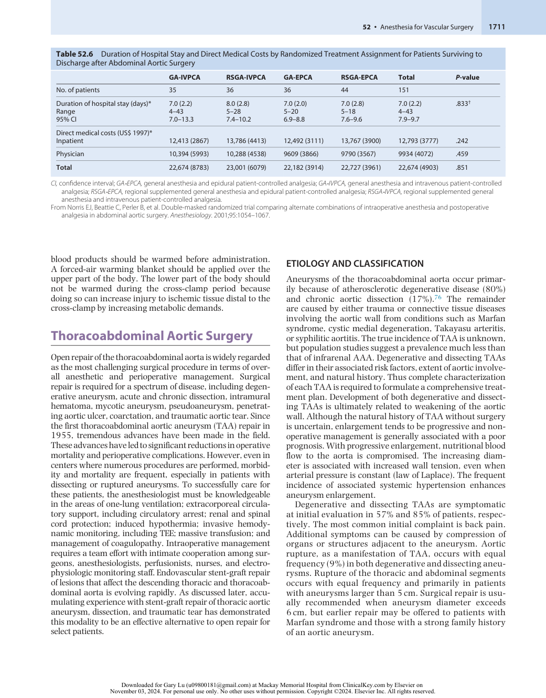

:::

<!-- PDF page 17 -->

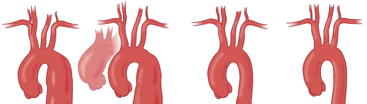

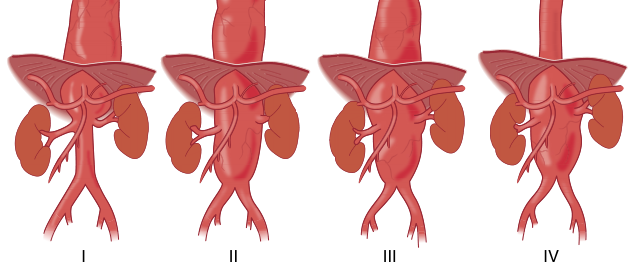

I II III IV 

**Fig. 52.6 The Crawford classification of thoracoabdominal aortic aneurysms is defined by anatomic location and the extent of involvement.** Type I aneurysms involve all or most of the descending thoracic aorta and the upper abdominal aorta. Type II aneurysms involve all or most of the descending thoracic aorta and all or most of the abdominal aorta. Type III aneurysms involve the lower portion of the descending thoracic aorta and most of the abdominal aorta. Type IV aneurysms involve all or most of the abdominal aorta, including the visceral segment.

In addition to cause, aneurysms of the thoracoabdominal aorta may be classified according to their anatomic location. In 1986, Crawford and colleagues,76 recognizing the correlation between aneurysm extent and clinical outcome, proposed a classification based on the extent of aortic involvement (Fig. 52.6). The Crawford classification defines aneurysms as types I, II, III, and IV and is appropriately applied to aneurysms of all causes (degenerative and dissecting). Type I aneurysms involve all or most of the descending thoracic aorta and the upper abdominal aorta. Type II aneurysms involve all or most of the descending thoracic aorta and all or most of the abdominal aorta. Type III aneurysms involve the lower portion of the descending thoracic aorta and most of the abdominal aorta. Type IV aneurysms involve all or most of the abdominal aorta, including the visceral segment. Types II and III are the most difficult to repair because they involve both the thoracic and the abdominal segments of the aorta. Patients with Crawford type II aneurysms are at greatest risk for paraplegia and renal failure from spinal cord and kidney ischemia during cross- clamping. Even with extracorporeal circulatory support, an obligatory period occurs when blood flow to these organs is interrupted because the origin of the blood flow is between the cross- clamps. For this reason, protective measures to prevent ischemic injury are important in reducing morbidity.

Aortic dissection, with or without aneurysm formation, has likewise been classified according to the extent of aortic involvement. The most widely used classification, proposed by DeBakey and colleagues, defines aortic dissection as types I, II, and III (Fig. 52.7).

Type I aneurysms begin in the ascending aorta and extend throughout the entire aorta. These lesions are usually repaired via a two- stage approach, with the first procedure on the ascending aorta and aortic arch and the second procedure on the descending thoracic aorta. Type II aneurysms are confined to the ascending aorta. Both types I and

II often involve the aortic valve and cause aortic regurgitation, and sometimes they involve the ostia of the coronary arteries. Type III aneurysms begin just distal to the left subclavian artery (SCA) and extend either to the diaphragm (type IIIA) or to the aortoiliac bifurcation (type IIIB).

Another commonly used classification of aortic dissection is the Stanford classification. This more simplified classification divides aortic dissection into those that involve the ascending aorta (Stanford type A) and those that do not involve the ascending aorta (Stanford type B). Aortic dissection is also classified by duration, with those less than 2 weeks classified as acute and those greater than 2 weeks classified as chronic. This classification has very significant mortality implications, with much higher mortality in the acute phase.

Acute aortic dissection involving the ascending aorta (DeBakey types I and II, Stanford type A) is a surgical emergency that requires immediate cardiac surgical repair (see also Chapter 50). Acute dissections involving the descending aorta (DeBakey type III, Stanford type B) are most often treated conservatively (i.e., arterial blood pressure, heart rate, and pain control) because surgical repair has no proved benefit over medical or interventional treatment in stable patients. Early surgical intervention may be required for a variety of reasons, including aneurysmal formation, impending rupture, organ or leg ischemia, and inadequate response to medical therapy. In approximately 20% to 40% of patients with chronic aortic dissection, significant aneurysmal dilatation of the descending thoracic or thoracoabdominal aorta will develop.

### MORBIDITY AND MORTALITY

Despite tremendous development in surgical and anesthetic technique, mortality and complication rates remain frequent for open surgical repair of TAA. Patients who undergo replacement of the entire thoracoabdominal

<!-- PDF page 18 -->

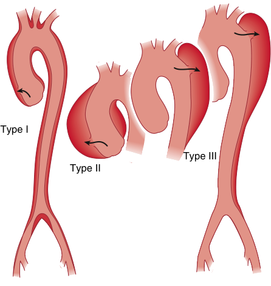

Type I Type III Type II 

**Fig. 52.7** The DeBakey classification of dissecting aneurysms of the aorta. Type I has an intimal tear in the ascending aorta with dissection extending down the entire aorta. Type II has an intimal tear in the ascending aorta with dissection limited to the ascending aorta. Type III has an intimal tear in the proximal descending thoracic aorta with dissection either limited to the thoracic aorta (type IIIA) or extending distally to the abdominal aorta or aortoiliac bifurcation (type IIIB).

aorta (Crawford extent type II) have the most frequent perioperative risk. Contemporary mortality rates reported from large institutions range from 5% to 14%. Statewide and nationwide mortality rates may be considerably more frequent (∼20%). The perioperative mortality rate may significantly underestimate the risk associated with TAA repair. In a large statewide series, the mortality with elective TAA repair was 19% at 30 days and 31% at 365 days.77

The incidence of paraplegia or paraparesis in patients undergoing surgical repair of TAA is reported to be 3.8% to 40%, depending on complex factors such as anatomic location, the duration of cross- clamping, the use of protective measures, the degree of dissection, and whether the aneurysm has ruptured. Extensive dissecting TAA repair carries the highest risk for neurologic deficit. A contemporary report of 210 consecutive open TAA repairs reported three patients with paraplegia and two with temporary paraparesis for an overall rate of neurologic deficit of 2.4% (1.4% permanent).78 Renal failure occurs in 3% to 30% of patients, depending on similar factors noted earlier. Overall, approximately 6% of patients need postoperative dialysis after TAA repair, which is associated with high mortality (30% to 60%). Gastrointestinal complications occur in approximately 7% of patients and are associated with a mortality approaching 40%. Not surprisingly, pulmonary complications are the most common problem associated with TAA repair. The incidence of postoperative pulmonary insufficiency approaches 50%, with 8% to 14% of patients requiring tracheostomy. As with all other vascular surgical procedures, cardiac complications are common and a leading cause of perioperative mortality. In general, perioperative mortality and major complication rates after open isolated descending thoracic aortic replacement are lower than those described for TAA repair.

### PREOPERATIVE PREPARATION AND MONITORING

Open surgical TAA repair requires extensive preoperative evaluation and planning. The evaluation and management of coexisting cardiac and pulmonary disease are discussed earlier. Before the day of surgery, the anesthesiologist and vascular surgeon should discuss, at a minimum, extent of the aneurysm and technique of surgical repair, plans for distal aortic perfusion, monitoring for spinal cord ischemia (SCI), renal and spinal cord protection, hemodynamic monitoring, and ventilation strategy. Depending on the extent and the location of the aortic disease in the descending aorta, the decision to use left heart bypass or not is usually made.

Blood loss during TAA repair can be profound, and the need for massive transfusion must not be underestimated. This author routinely has 10 units of packed RBCs, 10 units of thawed fresh frozen plasma, and several units of platelets immediately available in the operating room, and additional units must be readily obtainable.

Large- bore IV access is obviously important, especially if partial bypass (in contrast to full bypass) is planned, because it is difficult or impossible for the perfusionist to administer fluid or blood products into the closed partial bypass circuit. Large- sized central venous catheters with introducer sheaths for pulmonary artery catheters and large- bore peripheral IVs are recommended. Rapid infuser systems are used to allow the delivery of up to 1500 mL/min of blood products at a temperature of 37°C to 38°C. A right radial arterial catheter is used for aneurysms involving the proximal descending thoracic aorta because occasionally the cross- clamp is placed proximal to the left subclavian artery, thus occluding flow to the left upper extremity. When distal aortic perfusion techniques are used, arterial blood pressure distal to the cross- clamps can be monitored. This can be accomplished with the placement of a right femoral arterial catheter, or the surgical team can place a catheter directly into the femoral artery or distal aorta. This catheter monitors perfusion pressure to the kidneys, spinal cord, and mesenteric circulation during the time when the cross- clamps are high on the descending aorta and the lower body region is perfused by a shunt or bypass circuit. Radial and femoral arterial pressure should be simultaneously displayed on the anesthesiologist’s monitor and a monitor visible to the surgeons and the perfusionists. TEE is used routinely during TAA repair (see also Chapter 33). When TEE is used by a properly trained individual, assessment of left ventricular end- diastolic volume, myocardial ischemia, and valvular function is possible. It is also possible to determine the size and extent of the aneurysm.

A double- lumen endobronchial tube or a bronchial blocker should be inserted for the purpose of one- lung ventilation (see also Chapter 49). One- lung ventilation provides optimal visualization of the surgical field and reduces retraction- related trauma to the left lung. The doublelumen tube is usually changed, if possible, to a single- lumen tube at the completion of surgery. This facilitates ICU management of pulmonary hygiene and reduces resistance to breathing during weaning in the postoperative period. Many centers use electrophysiologic monitoring with somatosensory evoked potentials (SSEPs) or motor evoked potentials (MEPs) to monitor for SCI (see also Chapter 35).

<!-- PDF page 19 -->

These monitoring techniques may be helpful in both identifying the important intercostal arteries that perfuse the spinal cord and confirming successful reimplantation into the aortic graft. If SCI is identified, cross- clamps can often be repositioned, upper or lower body blood pressure can be increased to augment perfusion through collateral channels, or other measures may be taken to protect the spinal cord (i.e., cerebrospinal fluid [CSF] drainage, induced hypothermia, or intrathecal pharmacologic agents). These techniques are discussed later. Three general problems exist with SSEP monitoring when used during TAA repair. First, sensory monitoring is more likely to detect lateral and posterior sensory column ischemia and is a poor monitor for the anterior motor column. As a result, paraplegia can occur despite normal SSEP signals. Second, inhaled anesthetics and hypothermia can significantly interfere with SSEP signals. Third, ischemia affects peripheral nerves, and ischemia in the lower extremities delays conduction from the usual stimulation sites (e.g., posterior tibial nerve). To eliminate the peripheral nerves as a confounding factor, spinal stimulation via a lumbar epidural electrode can be used, which may be more specific for ischemic injury than peripheral monitoring alone. Lower extremity and peripheral nerve ischemia can be avoided with the use of distal aortic perfusion techniques. To avoid lower extremity ischemia from occlusion of the left femoral artery at the insertion site of the retrograde perfusion cannula, some surgeons suture a small- caliber graft onto the femoral artery (end to side) for insertion of the cannula, which allows both antegrade and retrograde perfusion. These limitations of SSEP monitoring probably account for the lack of identification of critical spinal arteries. The transcranial MEP technique has been used successfully to monitor the anterior columns of the spinal cord. The technique is relatively simple and can be viewed as a “train- of- four” for the brain and spinal cord. Electrical stimulation over the motor cortex activates α- motor neurons, and evoked electromyographic responses are obtained in lower extremity muscle. Only electromyogenic responses are specific for the status of the motor neurons in the anterior horn gray matter. Bilateral recording needles should be placed in the popliteal fossae (i.e., popliteal nerve) and bilateral surface electrodes over the gastrocnemius and tibialis anterior muscles. Bilateral stimulating needles are routinely placed in the popliteal fossae to monitor direct muscle responses and the level of neuromuscular blockade. During aortic cross- clamping, MEPs are monitored every minute. A reduction in MEP amplitude to less than 25% of baseline is considered an indication of SCI and requires corrective measures. Because signal averaging is not required and the anterior horn cells react with an almost immediate functional loss after the onset of ischemia, the technique can be used to rapidly identify intercostal arteries supplying the spinal cord. Additionally, the technique can be used to evaluate the adequacy of distal aortic perfusion and the patency of reimplanted critical intercostal arteries. Careful titration of a short- acting neuromuscular blocker is required to maintain a stable level of neuromuscular blockade. Complete neuromuscular blockade makes MEP monitoring impossible. Isoflurane, desflurane, sevoflurane, and N2O depress synaptic conduction and significantly decrease the amplitude of myogenic MEPs. Although modifications of the stimulating technique have somewhat improved

monitoring with inhaled anesthetics, a total IV anesthetic technique may be optimal. Fentanyl and ketamine have little effect on myogenic MEPs and have been used successfully as a combined anesthetic in a large series of patients undergoing TAA repair with MEP monitoring.78 This series of 210 consecutive patients had the lowest rate of neurologic deficit (2.4%) and permanent paraplegia (1.4%) reported.78 Body temperature should be monitored at two sites (core and peripheral) to assess cooling and warming when bypass techniques are used. However, an important difference exists between full and partial bypass in temperature monitoring. With full bypass, perfusion is usually into the ascending aorta, and typically the upper body core temperature (i.e., nasopharynx or esophagus) cools and warms fastest, whereas the lower body temperature changes more slowly. With partial bypass, the opposite is true. The blood from bypass is returned into the femoral artery, and the lower part of the body (i.e., rectum or bladder) changes before the upper part changes. This difference is important to recognize to achieve complete cooling and warming because the lagging temperature should be the end point for cooling and warming.

### ANESTHETIC MANAGEMENT

### Simple Aortic Cross- Clamping

Descending thoracic and thoracoabdominal aortic surgery can be performed without extracorporeal support (i.e., left heart bypass or cardiopulmonary bypass). The “clampand- sew” technique has had relatively favorable outcomes, but these cases are from institutions with extensive clinical experience and the shortest cross- clamp times. Advocates of this technique favor its surgical simplicity. However, the benefits of avoiding the complexity and complications of bypass must be weighed against the risk for vital organ ischemia and complications such as renal failure and paraplegia. Other than the location and extent of the aneurysm, the duration of cross- clamping on the aorta is the single most important determinant of paraplegia and renal failure with the clamp- and- sew technique. With longer clamp times, specific adjuncts directed against end-organ ischemic complications have been described in the literature. Such adjuncts include epidural cooling for spinal cord protection, regional hypothermia for renal protection, and in- line mesenteric shunting to reduce visceral ischemia, although they lack enough clinical evidence to support any of them.

When the simple clamp- and- sew technique is used, the application of the aortic cross- clamp results in significant proximal hypertension, which requires active pharmacologic intervention. Management strategies have been discussed previously in the section on abdominal aortic reconstruction.

### Left Heart Bypass

Maintaining lower body perfusion with the use of retrograde distal aortic perfusion reduces ischemic injury and improves outcome, provided the pressure is high enough to perfuse the organs. The simplest method of providing distal aortic perfusion is a passive conduit or shunt. The heparinbonded Gott shunt was developed to avoid the need for systemic heparinization and is used to divert flow passively from the left ventricle or proximal descending thoracic

<!-- PDF page 20 -->

aorta to the distal aorta. Some centers place a temporary axillary- to- femoral artery graft to function as a shunt during aortic cross- clamping. Partial bypass, also referred to as left heart bypass or left atrial- to- femoral bypass, is the most commonly used distal aortic perfusion technique (Fig. 52.8). This technique allows adjustment of blood flow and usually draws blood from the left atrium and returns blood to the left femoral artery. A centrifugal pump is used (Biomedicus, Eden Prairie, MN), and full- dose systemic heparin is not needed because the circuit is coated with heparin. The typical heparin dose for partial bypass is 100 units/kg. With this technique, an oxygenator is unnecessary because only the left side of the heart is bypassed. Insertion of a heat exchanger into the circuit allows cooling and warming, which is beneficial but not essential. Variations of left heart bypass include cannulating the aortic arch or proximal descending thoracic aorta instead of the left atrium. With this circuit, the left ventricle is relieved of the increased afterload during aortic cross- clamping. With left atrial cannulation, the left ventricle is relieved of preload and cardiac output is reduced. Either way, proximal hypertension is controlled, the work of the ventricle is decreased, and perfusion is provided to the distal aorta. When hypothermia (30°C) is combined with atrial cannulation, approximately 15% of patients experience new atrial fibrillation. Although most patients revert to sinus rhythm on rewarming, direct cardioversion may be required.

During left heart bypass, it is essential that arterial blood pressure be monitored above and below the aortic crossclamps. Careful control of intravascular volume, bypass pump flow, and vasoactive drugs is required to achieve the target blood pressures. Management of left heart bypass

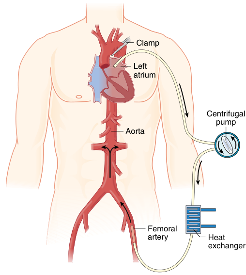

Clamp Left atrium Centrifugal pump Aorta Femoral artery Heat exchanger 

**Fig. 52.8 Diagram of left atrial–femoral bypass.** The left atrium and the left femoral artery are cannulated, and a centrifugal pump is used with heparin- coated tubing. A heat exchanger may be added into the circuit for cooling and rewarming.

requires continuous communication and cooperation between the surgeon, anesthesiologist, and perfusionist. We typically set the initial pump flow to approximately 50% of the patient’s cardiac output with application of the proximal aortic clamp. Flow is then adjusted to maintain target proximal and distal pressures. Administration of vasodilators is very infrequently required at this stage. With no vital organ ischemia, the surgeon can complete the proximal anastomoses in an unhurried fashion. With sequential aortic clamping, intercostal arteries can be reimplanted with minimal adjustments of pump flow. Pump flow is eventually reduced significantly during reimplantation of the visceral and renal arteries. At this point, distal perfusion is only to the lower extremities. Moderate hypothermia (32°C) during bypass is used to protect the vital organs during obligate periods of ischemia. After completion of the distal anastomoses, pump flow is increased, and the patient is actively warmed to 37°C.

### Deep Hypothermic Circulatory Arrest

Complex aneurysms involving the aortic arch often require elective cardiopulmonary bypass with an interval of deep hypothermic (15°C) circulatory arrest (DHCA) because cerebral blood flow is transiently interrupted during surgery (see also Chapter 50). Bypass can be accomplished by cannulation of the femoral artery and the femoral vein (i.e., femoral–femoral bypass). During the interval of DHCA, some centers also use anterograde (i.e., innominate artery) or retrograde (i.e., internal jugular vein) selective cerebral perfusion with cold oxygenated blood to extend the safe maximum duration of circulatory arrest. Without this technique, 45 to 60 minutes is thought to be the safe limit of DHCA, but 90 minutes has been reported with selective cerebral perfusion. DHCA also may be necessary whenever the location, extent, or severity of aortic disease precludes placement of a proximal aortic clamp during thoracic or thoracoabdominal aortic repair. This is often the case in patients with previous aortic arch repair, in which adhesions and scarring make application of the proximal aortic cross- clamp difficult or impossible during TAA repair. DHCA eliminates the need for proximal aortic clamping and allows a bloodless field for the proximal aortic anastomosis. Some centers advocate the routine use of DHCA during complex aortic reconstruction because deep hypothermia may provide better end-organ and spinal cord function. This potential benefit must be carefully weighed against the risks associated with prolonged cardiopulmonary bypass and circulatory arrest. After completion of the proximal anastomosis and intercostal artery- to- graft anastomoses under DHCA, the aortic graft is cannulated and bypass flow is reestablished to the upper part of the body. During a period of hypothermic low bypass flow, the distal anastomoses are completed and then rewarming is initiated.

### Anesthetic Technique

No single anesthetic technique is best for TAA repair. Usually, balanced anesthesia is provided with a combination of an opioid, a low- dose potent volatile anesthetic, a benzodiazepine, and a muscle relaxant. A total IV technique may be optimal if transcranial MEP monitoring is used. Induction of general anesthesia should be slow and controlled. Hypertension should be avoided because acute stress on

<!-- PDF page 21 -->

the aneurysm can cause rupture. The heart rate should be maintained at or below baseline because myocardial ischemia is often related to the heart rate. Extubation should always take place in the ICU and only after a significant period of hemodynamic and metabolic stability. The postoperative analgesic regimen should focus on pain control and stable hemodynamics.

### Spinal Cord Ischemia and Protection

Paraplegia is a devastating complication of aortic surgery. The incidence of paraplegia is reported to be 0.5% to 1.5% for coarctation repair, 0% to 10% for thoracic aneurysm repair, 10% to 20% for thoracoabdominal repair, and as high as 40% for extensive dissecting TAA repair. The spinal cord receives its blood supply from two posterior arteries (≈25%) and one anterior spinal artery (≈75%) (Fig. 52.9). The posterior spinal arteries, which supply the sensory tracts in the spinal cord, receive flow from the posterior and inferior cerebellar arteries, the vertebral arteries, and the posterior radicular arteries. The anterior spinal artery, which supplies the motor tracts in the spinal cord, is formed by two branches of the intracranial portion of the vertebral arteries. The upper cervical segment of the spinal cord receives most of its blood flow from the vertebral arteries. The thoracic portion of the anterior spinal artery is supplied by the anterior radicular arteries (one or two cervical, two or three thoracic, and one or two lumbar). The largest of the radicular arteries is called the great radicular artery (GRA) or the artery of Adamkiewicz (AKA). The AKA is the major blood supply to the lower two- thirds of the spinal cord. The segmental supplier of the AKA is variable (T5–L5) but is located between T9 and T12 in approximately 75% of cases. The variation in origin of the AKA explains why even infrarenal aortic aneurysm repair is associated with a 0.25% incidence of paraplegia. The specific impact of extensive segmental artery sacrifice on spinal cord perfusion during TAA repair is poorly understood.

Various methods can facilitate preventing ischemic injury to the spinal cord. Distal aortic perfusion with extracorporeal support reduces the incidence of paraplegia. Any of the various methods of distal bypass are likely to be beneficial when the anticipated cross- clamp time is longer than 30 minutes, but they are probably not beneficial when cross- clamp time is less than 20 minutes. CSF drainage is frequently used to improve spinal cord perfusion during TAA repair and is often used in combination with distal aortic perfusion. Spinal cord perfusion pressure is defined as distal mean aortic pressure minus CSF pressure or central venous pressure, whichever is greatest. Autoregulation of spinal cord blood flow is similar to cerebral autoregulation, and blood flow is relatively constant over the range of 50 to 125 mm Hg. During hypoxia or hypercapnia, autoregulation is lost, and flow becomes linearly related to perfusion pressure. Thus, significant flow may remain even at very low perfusion pressure. Drainage of CSF is important because CSF pressure often increases (by 10 to 15 mm Hg) with cross- clamping of the descending thoracic aorta. The increase in CSF pressure reduces spinal cord perfusion pressure and increases the likelihood of ischemic spinal cord injury.

Despite evidence from animal studies that CSF drainage protects the spinal cord, clinical use of this technique

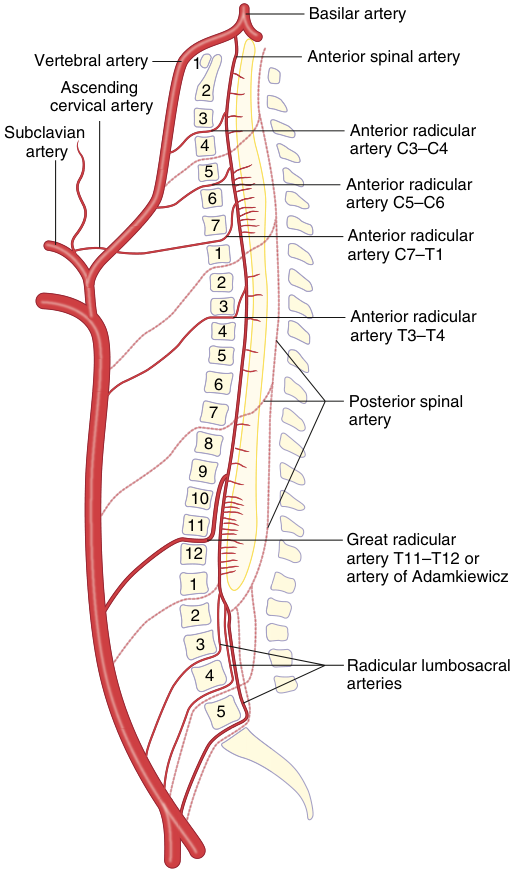

Basilar artery Vertebral artery 1 Anterior spinal artery Ascending  2 cervical artery 3 Subclavian  Anterior radicular artery 4 artery C3–C4 5 Anterior radicular 6 artery C5–C6 7 Anterior radicular 1 artery C7–T1 2 3 Anterior radicular 4 artery T3–T4 5 6 Posterior spinal 7 artery 8 9 10 11 Great radicular 12 artery T11–T12 or 1 artery of Adamkiewicz 2 3 Radicular lumbosacral 4 arteries 5 

**Fig. 52.9 Diagram of the blood supply to the spinal cord showing the anterior and posterior radiculomedullary branches seen in a lateral view.** The primary blood supply to the thoracolumbar portion of the spinal cord is derived from the artery of Adamkiewicz; its origin varies but usually branches off the aorta in the T9 to T12 region.

is controversial. One randomized trial reported a reduced incidence of paraplegia, but another reported no benefit. Most of the evidence in support of CSF drainage comes from non- randomized historical cohort studies in which the technique is used in combination with other adjuncts, such as intrathecal papaverine and hypothermic partial bypass. Coselli and colleagues79 offered the strongest evidence supporting the efficacy of CSF drainage. They conducted a prospective, randomized clinical trial to evaluate the impact of CSF drainage on the incidence of spinal cord injury after Crawford type I and II TAA repair. CSF drainage resulted in an 80% reduction in the relative risk for a postoperative deficit. Nine patients in the control group (13%) had paraplegia or paraparesis versus only two patients in the CSF drainage group (2.6%). Left heart bypass, moderate heparinization, permissive mild hypothermia, and reimplantation of patent intercostal and lumbar arteries were performed in both

<!-- PDF page 22 -->

treatment groups. The target CSF pressure was 10 mm Hg. CSF drainage also reverses delayed- onset neurologic deficit after open and endovascular TAA repair.80

Although CSF drainage is widely used during TAA repair, it has risks. Potential complications include headache, meningitis, chronic CSF leakage, spinal or epidural hematoma, and subdural hematoma. The possibility of intraspinal pathologic processes should be considered in any patient with a postoperative lower extremity neurologic deficit. A retrospective review of 230 patients who underwent TAA repair with CSF drainage reported eight subdural hematomas (3.5%).81 High- volume CSF drainage was identified as a risk factor for its occurrence. Six patients had subdural hematomas detected during hospitalization, with an associated mortality of 67%. Two patients were seen in a delayed fashion, and both required an epidural blood patch to control chronic CSF leakage.

Hypothermia is probably the most reliable method of neuroprotection from ischemic injury. By reducing O2 requirements by approximately 5% for each degree centigrade, a two- fold prolongation of tolerated cross- clamp time is achieved by cooling even to mild hypothermia (34°C). Because the reduction in metabolic rate is linearly related to temperature, moderate or profound hypothermia provides even greater protection. Both systemic and regional spinal cord cooling could be beneficial. Systemic hypothermia can be achieved with either full cardiopulmonary bypass (with or without DHCA) or partial bypass. Cooling to 30°C to 32°C with left atrial- to- femoral bypass in conjunction with CSF drainage was associated with no permanent neurologic sequelae in a series of 20 patients despite a relatively long average cross- clamp time (≈70 minutes).82 Regional cooling of the spinal cord by cold perfusion of the AKA with blood or crystalloid provides significant protection during spinal ischemia in animal models. Regional cooling is beneficial in humans who received epidural infusions of 4°C saline. Even if active cooling is not used, it is advantageous to allow patients to passively cool to 33°C to 34°C during TAA repair. With passive cooling, the challenge is rewarming after the surgical repair. This is most easily accomplished with the use of a forced- air blanket over the upper part of the body. The lower body region should not be actively warmed because warming ischemic tissue increases metabolic requirements, acidosis, and ischemic injury.

Many drugs have been studied in an attempt to reduce the incidence of ischemic spinal cord injury. Barbiturates provide significant protection. Corticosteroids provide protection in dogs but were beneficial in humans only when they were combined with CSF drainage. Calcium channel blockers were not consistently shown to be protective against SCI. _N_ - methyl- d- aspartate (NMDA) receptor antagonists have been investigated because ischemic injury appears to be related to increased levels of excitatory amino acids (particularly glutamate), which allow increased permeability to Ca2+ ions and high intracellular Ca2+ concentrations. Dextrorphan (a noncompetitive NMDA receptor antagonist) showed benefit during SCI in animals. Magnesium, another NMDA receptor antagonist, improves recovery from SCI in rat and dog models when administered intrathecally. Naloxone is protective in patients with traumatic spinal cord injuries and in a rabbit model of spinal ischemia.

Other than the use of corticosteroids and naloxone at a few centers, most of these agents are considered investigational. Preoperative spinal cord angiography has been used in patients with TAA. The rationale for this highly invasive angiographic procedure is that precise identification of intercostal arteries giving rise to the AKA will allow focused reimplantation of these vessels during surgical repair and help prevent spinal cord injury. Selective intercostal angiography identifies the AKA when an intercostal branch is found making a cephalad hairpin turn to enter the spinal canal and supply a midline longitudinal artery (i.e., the anterior spinal artery) (Fig. 52.10). The AKA can be identified in 43% to 86% of patients studied with traditional angiography. Higher detection rates for AKA localization have been reported with computed tomographic angiography (CTA) and magnetic resonance angiography (MRA), with the latter achieving rates of nearly 100%.83

The importance of reimplanting the intercostal arteries identified as supplying the AKA is not universally accepted.

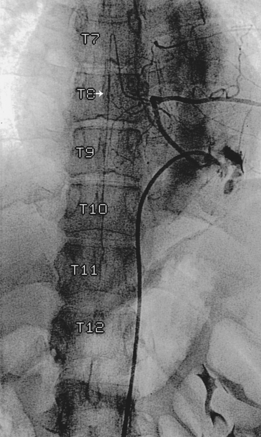

**Fig. 52.10 Spinal cord angiogram of an extensive degenerative thoracoabdominal aortic aneurysm.** Selective injection of the intercostal artery at T8 ( _arrow_ ) demonstrates the great radicular artery and the extensive paravertebral collateralization.

<!-- PDF page 23 -->

Even in patients with an identified and reimplanted AKA, spinal cord injury is not always prevented. Some investigators have concluded that preoperative localization of the AKA has little impact on neurologic outcome after TAA repair. A report84 found no improvement in overall neurologic outcome with preoperative spinal cord angiography, but it offered important insight regarding the type of aneurysm, identification of the AKA, and neurologic outcome. In patients undergoing TAA repair for extensive degenerative aneurysms, spinal cord injury occurred in 0 of 45 patients versus 10 (12%) of 81 patients with and without an identified AKA, respectively. In contrast, identification of the AKA was not helpful in the case of chronic expanding aortic dissection, with 3 (15%) of 20 patients versus 3 (6%) of 49 patients suffering spinal cord injury with and without an identified AKA, respectively. The investigators hypothesized that mural thrombus in degenerative aneurysms results in the occlusion of many intercostal arteries and favors the development of extensive paravertebral collateral channels (see Fig. 52.10). Identification of an AKA allows focused reimplantation with uniform success. In patients with chronic dissection, most intercostal arteries are patent, collateralization is minimal, and reimplantation of one or two intercostal arteries may be insufficient to supply blood flow to the spinal cord. This collateral blood supply concept is further supported by clinical studies demonstrating that clamping the segmental supplier to the AKA during TAA repair does not produce critical SCI in the majority of patients.83 Sufficient collateral blood supply, independent of the AKA, must therefore exist to maintain spinal cord integrity.

Delayed- onset neurologic deficits are common after TAA repair.85 In a large series of 2368 TAA repairs, 93 (3.9%) patients had postoperative paraplegia or paraparesis, 34 (37%) of whom initially had intact spinal cord function but a deficit developed later.86 Preoperative renal dysfunction, acute dissection, and extent type II TAA are significant predictors of delayed neurologic deficit. Postoperative hypotension and CSF drain malfunction may play an important role in the development of these deficits. Neurologic function can frequently be recovered by maintaining an optimal arterial blood pressure and CSF drainage.

### Renal Ischemia and Protection

Renal failure after TAA repair results from preexisting renal dysfunction, ischemia during cross- clamping, thrombotic or embolic interruption of renal blood flow, and hypovolemia and hypotension. Approximately 6% of patients require postoperative dialysis, even in centers with the most clinical experience. The associated mortality can be high. The primary predictor of postoperative renal failure is preoperative renal dysfunction. The duration of cross- clamp time is very important with the clamp- and- sew technique. Retrograde distal aortic perfusion techniques are widely used to preserve renal function during the cross- clamp period. Adequate bypass flow and arterial blood pressure are essential for maintaining renal function. Systemic and regional hypothermia, by reducing O2 requirements, protects the kidneys during ischemia. Some centers advocate the use of DHCA in the treatment of distal TAAs (i.e., extent type III and IV) to preserve renal function.

The role of pharmacologic protection is somewhat controversial. Mannitol 12.5 to 25 g/70 kg is often given before cross- clamping. Mannitol improves renal cortical blood

flow and the glomerular filtration rate in animal models of ischemia. Endothelial cell swelling is decreased, and an osmotic diuresis occurs. Evidence demonstrates free radical scavenging with mannitol and subsequent protection from ischemia in animals. Loop diuretics are sometimes given, but these drugs have been less effective than mannitol in experimental models. In clinical studies, the prophylactic use of loop diuretics has not been shown to improve outcome or reduce the need for dialysis for patients with acute renal failure. Dopamine given in low doses (1 to 3 mcg/kg/min) dilates renal blood vessels and increases renal blood flow and urine output. Despite these beneficial effects, whether dopamine provides renal protection during ischemia is not clear. Fenoldopam mesylate, a selective dopamine type 1 agonist that preferentially dilates the renal and splanchnic vascular beds, has shown some promise as a neuroprotective drug; however, there is no evidence to support its routine use.

At the present time, optimal renal protection during TAA surgery should rely on hypothermia, mannitol, and prevention of hypotension and hypoperfusion of the kidneys.

### Coagulation and Metabolic Management

Coagulopathy is a frequent complication during TAA repair. A dilutional coagulopathy in which platelets become deficient after approximately one blood volume of replacement develops during massive transfusion (see also Chapters 45 and 46). At between one and two blood volumes of replacement, coagulation factors are diluted to levels low enough to increase bleeding. Other contributing factors are residual heparin; ischemia of the liver, in which most coagulation factors are produced; and persistent hypothermia after weaning from bypass. With the early use of fresh frozen plasma and platelets, severe coagulopathy often can be avoided. The prothrombin time, partial thromboplastin time, fibrinogen level, and platelet count should be measured frequently. Point- of- care thromboelastography (TEG or ROTEM) can be used as well. Cryoprecipitate may be necessary to correct coagulopathy, especially when the prothrombin time and partial thromboplastin time are prolonged and hypervolemia prevents the administration of significant volumes of fresh frozen plasma. When coagulopathy persists despite these efforts, ε- aminocaproic acid or tranexamic acid are beneficial as antifibrinolytic therapy, and desmopressin can be given to increase circulating levels of von Willebrand factor and factor VIII. Normothermia should be achieved by complete rewarming before separation from bypass, by increasing ambient temperature after separation from bypass, and by forced- air warming over the upper body skin surface.

Analysis of arterial blood gases and electrolyte levels should be performed frequently. Hyperkalemia should be treated aggressively, especially in oliguric or anuric patients. Calcium chloride, sodium bicarbonate, insulin, and glucose are the primary acute treatments of hyperkalemia.

## Endovascular Aortic Repair Surgery

### HISTORY OF ENDOVASCULAR AORTIC REPAIR

The first EVAR of the aorta was performed and reported by the Ukrainian surgeon Dr. Nicholas Volodos and his

<!-- PDF page 24 -->

colleagues. On March 24, 1987, they performed the world’s first human endovascular repair of a posttraumatic pseudoaneurysm of the descending thoracic aorta and the patient survived 18 years after the stent-graft insertion without any evidence of stent- related complications. However, the case was performed behind the Iron Curtain, which prevented the news from spreading globally and their work was first published in Russian in 1988.87

On September 7, 1990, the Argentinian surgeon Juan Parodi, the Argentinian radiologist Julio Palmaz, and their colleagues performed the first successful EVAR in the Western world. After many years of experimenting with stents on dogs with minimal funding, Parodi finally got permission from his institution to perform cases on humans on the condition that these patients had to have been rejected for intervention previously by at least two centers. In 1990, he received a phone call from the Argentinian president asking him to use his device on his cousin, who had an aortic

aneurysm and severe COPD. Parodi went ahead with the operation and it became his first successful EVAR. Three months later, the patient developed a distal endoleak and he was treated by an aorto- uni- iliac endograft, occlusion of the contralateral common iliac, and a femorofemoral bypass. The patient lived for 9 years and died due to pancreatic cancer.88

For all types of aortic diseases, endovascular technique is being utilized as the most feasible treatment option and a perfect alternative to treat AAA with the aid of endoluminal devices (Fig. 52.11).89 Endovascular grafting is being used in diverse types of traumatic injuries, ruptures, aortic dissection, and in the diseases of thoracoabdominal and thoracic aorta. The EVAR is considered as one of the main treatment choices for patients who are affected with AAA because it is a less invasive treatment option, associated with reduced perioperative mortality and morbidity, and requires a short stay at the hospital.90

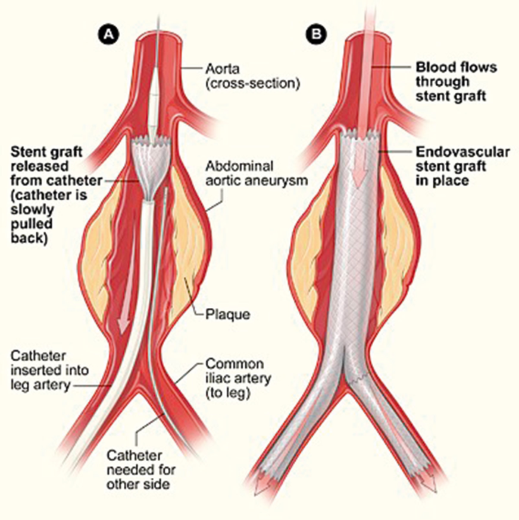

**Fig. 52.11 Endovascular aneurysm repair, abdominal aortic aneurysm.** (A) A catheter is inserted into an artery in the groin (upper thigh). The catheter is threaded to the abdominal aorta, and the stent graft is released from the catheter. (B) The stent graft allows blood to flow through the aneurysm. (Retrieved from https://surgery.ucsf.edu/conditions- - procedures/endovascular- aneurysm- repair.aspx.)

<!-- PDF page 25 -->

### ADVANCEMENTS IN STENT- GRAFT DEVICES

The endovascular technique started in the 1960s on an experimental basis and has progressed through a number of developmental eras that have resulted in EVAR as the most common technique for repair of AAAs. More than two decades ago, Parodi and fellow colleagues described the first endovascular repair of an AAA.91 At that time, endografts for AAAs were being used on patients who had severe surgical risks for an open AAA repair. After analysis and detailed comparison of the developments and advancements in EVAR over the previous two decades, the researchers were able to show considerable success in the procedures, outcomes, and efficiency. These grafts are made up of modular bifurcated devices composed of synthetic fabric which is deployed in the human body through a catheter. After the successful treatments in endovascular repair of the descending aorta, the stents received undeniable success and accolades in cases of the infrarenal aorta. Dake and colleagues, in 1994, provided the first report of using these stent devices for patients with descending thoracic aortic aneurysms.92 They conducted tests on 13 patients by using self- expanding stent grafts and reported 100% success, thereby gaining approval of using these stent grafts by the FDA after a decade in 2005. Since then, the FDA approved many other stent- graft devices for an array of aortic diseases such as traumatic transections, ruptures, penetrating ulcers, dissections, and aneurysms. In 2012, the FDA approved fenestrated stent grafts for correcting pararenal and juxtarenal aortic aneurysms through endovascular mechanisms.93 In these devices, the graft fabric openings or scallops are easily aligned with the arteries splitting off the aorta, which significantly paves the way to exclude the aneurysm yet maintains the end-organ perfusion. These fenestrated grafts are referred to as FEVARs, or fenestrated EVARs, whereas the original EVAR name is commonly used to refer to the treatment of infrarenal aneurysms by bifurcated grafts.

It is also worth noting that off- the- shelf stent grafts are ready- to- go types of stent grafts used to treat those patients who fall prey to complex AAAs in the acute setting. These standard off- the- shelf fenestrated stent grafts were studied by the researchers, who found no reported cases of perioperative death, rupture, aneurysm dilation, and stent migration.94 However, there is still a dearth of significant clinical evidence for the potential benefits of off- the- shelf fenestrated and branched stent grafts; hence, more research is suggested to support the view that these stents have the true potential of lessening the requirement for perioperative customization of graft for AAA patients. The main difference between the fenestrated graft (FEVAR) and multibranched graft (mBEVAR) is that the latter has axially oriented cuffs that serve as routes to cannulate and stent the target mesenteric or renal vessels. This gives surgeons less need for absolute precision to align the scallops of the FEVAR right at the origin of the vessels. It also gives them a small margin of moving safely with the device up or down the aorta. This comes at the expense that the BEVARs tend to be longer devices and end up covering a significant portion of the descending thoracic aorta; hence, the risk of spinal cord injury exists, and spinal cord protection strategies should be considered.95

The endovascular approach is the best alternative, as it is devoid of open incisions, considerable fluid shifts and blood loss, wide dissections, and long aortic cross- clamp times as in open repairs. Careful attention must be given in choosing the optimal treatment strategy for patients with AAAs. The endovascular technique involves the placement of the endovascular stent graft based at the level of the disease and the size of the vessel. The femoral arteries are accessed either by cutdowns or percutaneous punctures. In general, smaller devices are available commercially that are used percutaneously for EVARs, FEVARs, and BEVARs. The decision to do a cutdown versus a percutaneous access depends on the size of the device used, the size of the femoral arteries, preexisting femoral or iliac diseases or surgeries, and the surgeon’s experience. If the patients have critically diseased iliac or femoral arteries, then they may need a concomitant, local endarterectomy or balloon angioplasty. Additionally, during the endovascular AAA, around 20% of patients are recommended to undergo adjunctive retroperitoneal procedures where the common iliac artery is exposed by a retroperitoneal approach to place a synthetic iliac conduit. The same iliac conduit is used to endoluminally place the delivery system into the aorta. Beyond any reasonable doubt, these adjunctive retroperitoneal procedures allow a significant number of patients to experience EVAR, though these procedures are not free from longer hospital stays, lengthy procedure time, and extensive blood loss because of their hybrid nature.96

Understanding the surgical approach and vascular access is important to tailor the anesthesia plan. Most EVARs today are done via percutaneous access of the femoral arteries, which makes monitored anesthesia care (MAC) with local infiltration to the access site a viable safe alternative (Figs. 52.12–52.14). On the other hand, multibranched grafts are much bigger devices and the procedure takes much longer, as it often involves cannulation of the visceral branches. Cannulation of caudally oriented vessels, as the celiac axis and the superior mesenteric arteries, is easier if performed via a left axillary artery access. However, today there are deflectable, steerable guiding sheaths that allow the surgeon to cannulate the caudally oriented vessels from the same femoral access used for insertion of the aortic component, without the need for an additional arterial cutdown in the left arm.

### ANESTHETIC MANAGEMENT

To sketch the anesthetic management options associated with EVAR, it is worth mentioning that in the past, the long surgical procedures used general anesthesia. But with the passage of time, surgical procedure times were reduced, and procedures started changing due to the inclusion of newer-generation devices. The local and regional anesthetic techniques were employed with IV sedation. Despite the significant use of local, regional, and general anesthesia, conflicting reports raised their voices concerning anesthetic management. According to a report, the regional or local anesthesia might decrease the hospital stay time, ICU admission, and reduce early complications.97 Anesthesiologists must consider things like a patient’s functional status, comorbidities, aneurysm complexity, and surgical urgency. According to Kothandan and associates, when it comes to

<!-- PDF page 26 -->

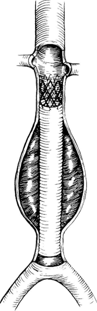

**Fig. 52.12 Graft–stent combination with cephalic stent.** (From Yao JST, Eskandari MK. Transfemoral intraluminal graft implantation for abdominal aortic aneurysms: two decades later. _Ann Vasc Surg_ . 2012;26[7]:895– 905.)

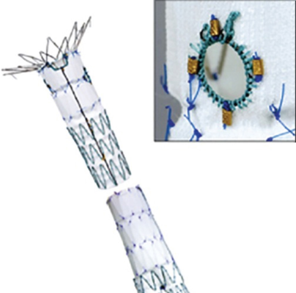

**Fig. 52.13 Customized fenestrated stent graft.** (Modified from Kothandan H, Chieh GLH, Khan SA, et al. Anesthetic considerations for endovascular abdominal aortic aneurysm repair. _Ann Cardiac Anaesthesia_ . 2016;19[1]:132.)

examining a unique risk stratification model in endovascular surgery scenarios, there is no single useful model.98 Few anesthesiologists take leverage of the risk scores in this

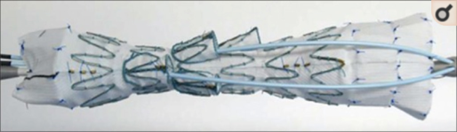

**Fig. 52.14 Customized branched stent graft.** (From Kothandan H, Chieh GLH, Khan SA, et al. Anesthetic considerations for endovascular abdominal aortic aneurysm repair. _Ann Cardiac Anaesthesia_ . 2016;19[1]:132.)

context, such as revised cardiac risk index or the modified customized probability index when they are engaged in endovascular surgery scenarios.99,100

### Spinal Cord Blood Supply

It is critically important to get an overview of the spinal cord blood supply since it has a complex anatomy, but the latest imaging technology has expanded the very small and complex vessels to a significant degree. Hence, it is now easier to determine the spinal cord vascular pattern as compared to the past, as explained above in the open thoracoabdominal repair section. To better understand the blood supply to the spinal cord, it is important to adapt the collateral network concept. The concept can be summarized as follows:

- There is an axial network of arteries that supply the spinal cord and run in the paravertebral tissue.

- Input to this axial network comes from segmental arteries, subclavian arteries, and hypogastric arteries.

- Blood supply to the cord can increase from one source when another is compromised. An example of this steal phenomenon is the back bleeding from intercostals into an open aortic sac after aortic cross- clamping.101

This extensive spinal cord arterial system thus consists of an extrinsic and an intrinsic vascular system. The extrinsic network consists of segmental vessels arising from the intercostal and lumbar arteries, subclavian arteries, and the hypogastric arteries. The intrinsic network which receives supply from the extrinsic network is formed by the two posterior spinal arteries supplying the posterior region of the cord and a single anterior spinal artery supplying the anterior region of the cord (Fig. 52.15). The posterior spinal cord is relatively protected from ischemia because the collateral blood flow from the two posterior spinal arteries compared to a single anterior spinal artery make the anterior portion of the cord more susceptible to ischemia. The anterior spinal artery originates from the terminal branches of both vertebral arteries and courses along the anterior longitudinal fissure of the spinal cord receiving reinforcing blood supply from the radicular or segmental medullary branches, the branch of the posterior intercostals, or the lumbar arteries. The largest of the anterior segmental branches is the AKA, which supplies a large portion of the caudal two- thirds of the anterior spinal artery. Because it is the only major artery supplying this zone, it is susceptible to watershed ischemia. The AKA originates from a left posterior intercostal artery off the descending aorta usually between T9 and T12 but has originated in some instances from lower level up to L5. A unique identifying feature of the AKA is the

<!-- PDF page 27 -->

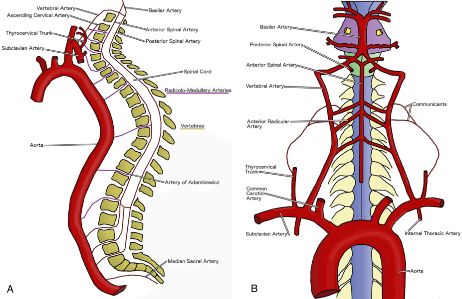

A B 

**Fig. 52.15 An overview of blood supply to the spinal cord and the cervical spinal cord and the origin of the anterior spinal artery.** (A) An overview of blood supply to the spinal cord. The spinal cord predominantly receives blood from three arteries originating around the cervical–cranial junction. These arteries run longitudinally along the spinal cord, terminating at the caudal end. These three arteries, the anterior spinal artery, and paired posterior spinal arteries, receive their blood supply mainly from the vertebral arteries, as well as the ascending cervical arteries, branches of the thyrocervical trunk. The thyrocervical trunk additionally supplies the cervical spinal cord via numerous anterior and posterior radiculomedullary arteries. These arteries do not anastomose with the spinal arteries ( _anterior and posterior_ ); rather, they directly supply the spinal cord at the level they enter the vertebral canal. As the spinal cord extends caudally, blood supply becomes scarce. Anterior and posterior radiculomedullary branches from the thoracic and abdominal aorta continue to supply the spinal cord directly, but the spinal arteries do not receive any new anastomoses until the artery of Adamkiewicz at the level of the lower thoracic or lumbar vertebrae. The lumbar and sacral spinal cord additionally receives blood from the median sacral artery anteriorly. _Magenta lines_ represent radiculomedullary arteries and _yellow boxes_ represent vertebrae. (B) The cervical spinal cord and origin of the anterior spinal artery. The anterior spinal artery originates from the vertebral arteries around the level of the cervical–cranial junction. Additionally, the anterior spinal artery receives blood from the anterior radicular arteries (branches of the vertebral arteries) and the ascending cervical arteries (branches from the thyrocervical trunk). Following these original tributaries, the anterior spinal artery does not receive blood from any other anastomosis until the lower thoracic and lumbar areas via the artery of Adamkiewicz (not shown). The anterior spinal artery supplies the bulk of oxygenated blood to the anterior spinal cord. (From Hoehmann CL, Hitscherich K, Cuoco JA. The artery of Adamkiewicz: vascular anatomy, clinical significance and surgical considerations. _J Cardiovasc Res_ . 2016;5:6.)

“hairpin configuration” on imaging that can be explained by the differential growth of the spinal cord and vertebral column during embryologic development.

Anterior spinal cord syndrome happens due to infarction of the portion of the spinal cord supplied by the anterior spinal artery. This may happen due to disruption of the AKA or the anterior spinal artery itself at the thoracoabdominal levels. Etiologies may vary between aortic dissection, emboli, covering of large segments of the thoracoabdominal aorta by endovascular stents, and surgical dissection during repair of thoracoabdominal aortic aneurysm (TAAA). The clinical presentation of the syndrome will depend on the spinal cord tracts and the level of cord injury. Classically, the anteromedial portion of the cord which contains the corticospinal and the corticobulbar tracts receives blood supply only from the anterior spinal artery, leading to motor paralysis below the level of injury if this supply is disrupted. The anterolateral aspect of the cord contains the spinothalamic and the spinocerebellar tracts, a watershed area that receives blood supply from

both anterior and posterior spinal arteries, but it can still be infarcted in anterior spinal cord syndrome, affecting pain and temperature sensation. The dorsal columns responsible for vibratory sensation and proprioception remain intact, as they are usually supplied by the posterior spinal arteries. Patients with anterior spinal cord syndrome could also present with autonomic dysfunction as bowel and bladder incontinence, orthostatic hypotension, and sexual dysfunction.102

### Anesthesia Roadmap for EVARs

Anesthesia administration mainly focuses on:

- Hemodynamic stability of the patient

- The preservation of perfusion to the key organs such as splanchnic vessels, kidney, spinal cord, heart, and brain

- Early identification and management of blood loss and maintaining intravascular volume

- Maintaining the normal core body temperature (perioperative normothermia)

<!-- PDF page 28 -->

Karthikesalingam and associates argue that there is very little evidence indicating the best anesthetic technique in the case of standard EVAR, and even more limited evidence in the case of complex EVAR,103 because most of the literature relies on the retrospective and descriptive studies. Therefore, the selection of feasible technique should be based on several factors that include aneurysm complexity, patient’s premorbid state, vascular team experience, choice of anesthesiologist, and the patient. Fleisher and associates favor the opinion that there is not a particular mode of anesthesia administration on cardiac disease patients in the ACC/AHA guidelines, because there is no sufficient evidence available in this regard.18 It is not very common that the surgery turns into open repair scenario (the rates are less than 2%), yet the anesthesiologist should always be ready for such intraoperative rupture with massive blood loss by having adequate vascular access.104 The following checklist provides an anesthesia roadmap that the clinician can refer to when considering how to proceed with endovascular aortic procedures.:

1.  Choice of anesthesia

2.  Radiation safety

3.  Renal protection

4.  Vascular access and blood loss

5.  Temperature control

6.  Spinal cord protection

**Choice of Anesthesia.** In 2015 Broos and associates studied the anesthesia choices, such as general, regional, or local, by reviewing the outcomes of EVAR repairs. They concluded that the choice of anesthesia was independent of perioperative morbidity and mortality.105 At the same time, the local or regional anesthesia has an upper edge over general anesthesia in terms of postoperative hospital stay, ICU stay, and shorter procedure times. Edwards and associates examined the results of 6009 elective EVAR procedures against the anesthetic procedures such as local/MAC, regional, and general anesthesia.106 They concluded that general anesthesia was strongly linked with pulmonary morbidity and increased hospital stays after the EVARs when compared with local/MAC and spinal cord anesthesia. Similarly, Karthikesalingam and associates conducted a systematic review and meta- analysis of 10 studies comprising of 13,459 patients who had EVAR surgeries under the administration of local or general anesthesia.102 They also reported that the group associated with local anesthesia had less postoperative complications and shorter postoperative hospital stays and procedure times when compared to the group associated with general anesthesia. Despite those retrospective studies and systemic reviews, current literature still lacks evidence based on randomized prospective data. Also, the continuous change in the commercially available devices and the increase in surgical experience with endovascular repairs both lead to a composite decrease in operative times, today much less than when the initial endovascular aortic trials were performed.

The point is that there is no substantial evidence which proves that one anesthetic technique has an upper hand over another, and similarly, EVAR success does not point toward using any specific type of anesthesia, either. Generally speaking, simple EVARs performed through

percutaneous punctures of the groin can be done under local anesthesia and MAC, neuraxial anesthesia, or general anesthesia provided that there is no other contraindication for the choice of anesthesia. More complex endovascular repairs, like FEVARs or BEVARs, which require multiple arterial cutdowns or combined groin and arm access, will require general anesthesia.

**Radiation Safety.** Endovascular procedures are gaining much more popularity on the score that they exhibit lower access site- related blood loss, but at the same time, the patients become vulnerable to radiation exposure risk as well.107 In this regard, the key principle of “As Low As Reasonably Achieved” (ALARA) remains the bedrock foundation to limit the staff and patient’s exposure to radiation accordingly.108–110 In this regard, the clinician can take leverage from real- time radiation monitoring procedures so that he is aware of the situation and can adjust the radiation dose.111

**Renal Protection.** Contrast- induced nephropathy (CIN) is renal function impairment associated with a baseline increase in serum creatinine concentration of 25% or more or an absolute increase of 0.3 to 0.5 mg/dL within 2 to 3 days of administration of IV contrast.112

The recently published PRESERVE Trial, which was a 2- by- 2 factorial design, double-blinded, placebo and comparator drug controlled randomized study, was conducted to answer the question of whether the outcomes changed after angiography with sodium bicarbonate and acetylcysteine in patients at high risk for CIN. The study concluded that there was no benefit for intravenous sodium bicarbonate over intravenous sodium chloride, nor for acetylcysteine over placebo in prevention of death, need for dialysis, persistent decline in kidney function at 90 days, or for the prevention contrast- induced acute kidney injury.113

The two most important factors that contribute to CIN are the contrast load and the preexisting kidney disease. Limiting the contrast load, and adequate hydration to decrease the viscosity of the iodine- based dyes, thus decreases the oxidative stress exerted on the proximal convoluted tubules.

**Vascular Access and Blood Loss.** The surgeons normally use either axillary or left brachial access for the insertion of snorkels or visceral stents of the FEVARs. Cheng underlines that there are specific challenges in anesthetic management scenarios such as prevention of paraplegia and stroke and blood pressure control.114 Apart from this, the surgeons might need to perform bilateral femoral cutdowns as well as left axillary access. This would leave one limited option (i.e., right arm for intra- aortic balloon pump [IABP] access). A central venous access is not a must but would be used when complex branched grafts are used with multiple comorbidities and limited peripheral venous access. Lengthy procedures like branched grafts are performed under anticoagulation with heparin. This creates a potential of continuous slow blood loss from the multiple arterial cutdown sites that could be overlooked in the dark hybrid rooms. It is not very common to experience sudden hemodynamic instability in patients unless there is a ruptured aneurysm or an aortic occlusion balloon is being used.

<!-- PDF page 29 -->

**Temperature Control.** The patient is vulnerable to perioperative hypothermia with adverse outcomes due to many untoward physiologic effects. Hence, maintaining normothermia is highly recommended and needed before the skin incision process. This could be accomplished by enhancing the operating room’s ambient temperature, by using warming IV fluids, and by using radiolucent underbody warmers. Hypothermia could delay tracheal extubation, which is sometimes preferred to be as early as possible to perform a neurologic exam if there are risks of strokes or spinal cord injury.

**Spinal Cord Protection.** SCI remains one of the devastating possible complications of thoracic and thoracoabdominal aortic repair.115,116 There could be many reasons for the occurrence of SCI such as occlusion risk of stent grafts associated with the AKA, considered the main collateral artery, or due to damage of middle sacral arteries, inferior mesenteric arteries, or internal iliac arteries. Risk factors for spinal cord injury include emergency surgery, aortic dissection, extensive aortic disease, aortic rupture, prior abdominal surgery, hypogastric artery occlusion, and history of renal dysfunction. Therefore, many strategies are utilized such as arterial pressure augmentation, CSF drainage, and lowering the CVP.117 The 2014 European guidelines on the management of aortic disease stated that CSF drainage can be beneficial in high- risk patients (class IIa, level of evidence C).118 Similarly, the ACCF/AHA guidelines for the thoracic aortic disease recommended CSF drainage in TEVAR patients who are at high risk for spinal cord injury (class I, level of evidence B).119 Spinal drains may be placed preinduction of general anesthesia or postinduction if the patient cannot tolerate the procedure. For patients receiving anticoagulant or antiplatelet therapy, the American Society of Regional Anesthesia and Pain Medicine (ASRA) Guidelines should be followed, and the perioperative management of those medications should be arranged with the perioperative team.120

To optimize spinal cord perfusion, CSF pressure is usually monitored and CSF periodically drained. Most institutions have their protocols for management of spinal drains and CSF drainage. Most local guidelines and protocols advocate for CSF pressure of 10 to 15 mm Hg. Some institutions drain CSF periodically during the intraoperative and postoperative periods while others drain according to CSF pressure

or if there are any signs of SCI. Care should be taken to avoid over- draining CSF. Excessive rapid CSF drainage, particularly during the intraoperative period of heparinization or postoperative coagulopathy, could lead to intracranial hypotension and increase the risk of intracranial hemorrhage.

If bloody CSF is encountered during the placement, discussion with the surgeon and the patient if the placement was attempted preinduction, and rescheduling an elective case should be considered. Some institutions encourage routine fluoroscopic- guided spinal drain insertion to decrease the number of passes. Ultrasound- guided placement could be considered.

Another measure to decrease the risk of SCI is the maintenance of flow through the left subclavian artery and the internal iliac arteries. Subclavian artery flow can be decreased if a TEVAR graft covers the origin of the left subclavian. Flow can be increased by a partial arch debranching through a left carotid to a left subclavian bypass. In the case of internal iliac arteries, minimizing the occlusion by large introducer sheaths will improve the spinal collateral flow.121

### POTENTIAL COMPLICATIONS

### Early and Late Complications

The early complications are those that occur from day 2 to day 30 after the surgery. These types of complications include postimplantation syndrome (PIS), paraplegia, stroke, acute renal failure, lower extremity and pelvic ischemia, and aneurysm rupture. The late complications that occur 31 days after surgery are associated with endoleak, but they also include the aneurysm rupture, its elongation, degenerated proximal neck, device migration, limb occlusion, and graft infection.

### Endoleaks

EVARs are vulnerable to a condition where the aneurysm sac experiences arterial blood flow, despite the exclusion by the stent graft, and is thereby unable to maintain or accomplish full exclusion from the blood flow (Figs. 52.16 and 52.17). Chen and Stavropoulos explain the type 1 endoleak where the stent graft fails to accomplish a circumferential seal at the distal (IB) or the proximal (IA) positions, thereby demanding immediate treatment due to aneurysm

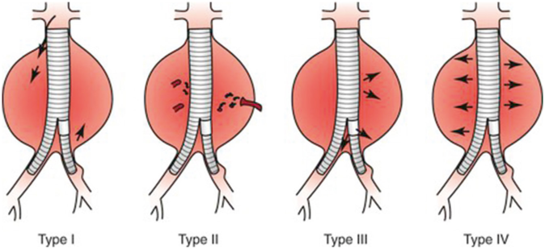

**Fig. 52.16 Endoleak types.** (From White GH, May J, Waugh RC, et al. Type III and type IV endoleak: toward a complete definition of blood flow in the sac after endoluminal AAA repair. _J Endovasc Ther_ . 1998;5:305–309.)

<!-- PDF page 30 -->

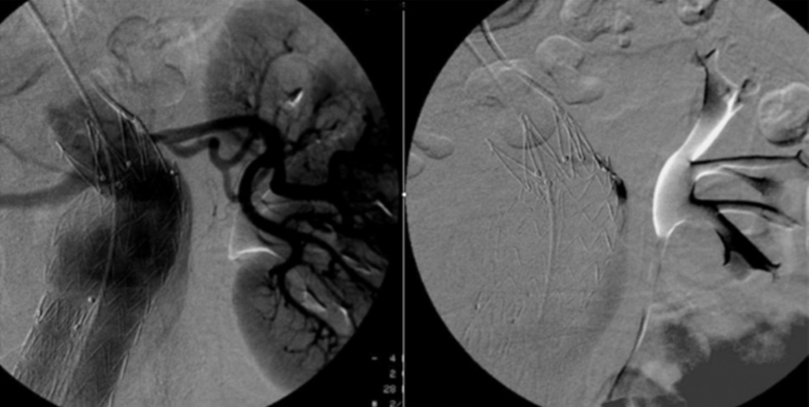

**Fig. 52.17** Computed tomography scan performed 2 days after endovascular aneurysm repair revealing a progressively enlarging type 1A endoleak. (From Tureli D, Baltacioglu F. Type I endoleak management after endovascular repair of infrarenal abdominal aortic aneurysm. _Vasc Dis Manag_ . 2014;11:E91–E97.)

sac systemic pressurization.122 If not treated promptly, it can result in either expansion of the aneurysm or even rupture. An increased occurrence of IA needs early endovascular intervention and can occur with hostile proximal aortic neck anatomy. There are certain technologies which can detect these endoleaks, such as cone- beam computed tomography. Endoleaks are normally treated by balloon angioplasty of the proximal attachment site so that the desired seal is obtained through remodeling of the stent graft. The endoleak can also be bridged by covered extension of the native endograft.123 Embolization is another treatment option specifically when the space between the renal arteries and the endograft is not adequate. Fenestrated or branch graft extensions are also an alternative for more complex proximal endoleaks.

Type II endoleak occurs when the aneurysm sac undergoes reverse filling from the branch vessels through either lumbar or inferior mesenteric arteries.124,125 This can result in various anomalies such as aneurysm rupture, sac enlargement, and enhanced intrasac pressures.126 Type II endoleaks can be treated by transarterial embolization through the iliac arteries or retrograde embolization through the superior mesenteric or inferior mesenteric arteries. They can also be treated by translumbar computed tomography angiogram (CTA)- guided embolization.127 A transcaval approach can be used if the type II endoleak is close to the inferior vena cava (IVC). A transjugular sheath is advanced through the IVC and a needle is used to access the aneurysm sac to embolize it. Potential risks of such procedure include retroperitoneal bleeding, pulmonary embolization from non- targeted embolization, and aortocaval fistulas.128

Type III endoleaks trigger when the stent graft undergoes a structural failure, thereby causing the blood flow to move into the aneurysm sac. These endoleaks occur either due to device failure such as detachment of modular graft components, a junctional leak, or due to erosion of fabric. They also require immediate intervention and treatment to avoid the risk of rapid expansion and rupture of aneurysm. These

endoleaks are treated by inserting a new fabricated stent graft over the faulty position with angioplasty so that the desired seal is accomplished. The type IV endoleak is associated with graft porosity while type V endoleak shows the aneurysm sac enlargement which is devoid of any demonstrable trace in the imaging procedures.

Open surgical treatment remains an option if endovascular treatment of endoleaks fails or is not possible. Surgical treatment could range from ligation of offending arteries feeding an endoleak to graft excision and open aneurysm repair with exogenous graft. Careful preoperative planning between the anesthesia and surgical teams requires all to be ready for the possibilities of rupture of the sac intraoperatively or conversion into an open surgery if endovascular treatment fails.

### Postimplantation Syndrome

PIS is a poorly understood phenomenon that could occur after endovascular aortic procedures and varies widely in incidence and clinical presentation. Possible explanations could be a sort of systemic inflammatory response syndrome (SIRS) in response to the instrumentation of the vascular endothelium or to the stent- graft material. Clinical presentation could include a combination of fever, leukocytosis, thrombocytopenia, and coagulopathy. Treatment should be supportive, especially with antipyretics, platelets, or fresh frozen plasma transfusions to treat the coagulopathy.129

## Hybrid Arch Repairs

Since the introduction of thoracic endovascular aortic repair (TEVAR) in the early 1990s,130 the less invasive endovascular approach to descending and thoracoabdominal aneurysms has been advanced with the commercial availability of different types of thoracic stent grafts. Related to the morbid invasiveness and complexity of open arch surgical techniques, hybrid aortic arch repairs have

<!-- PDF page 31 -->

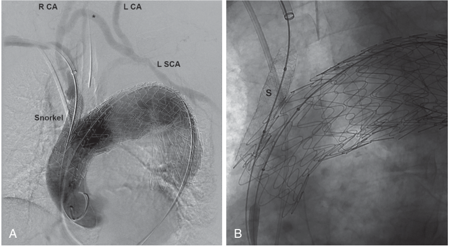

A B 

**Fig. 52.18 Intraoperative digital subtraction angiography showing completed thoracic endovascular aortic repair with arch debranching after stent deployment with rapid ventricular pacing (RVP).** (A) Overview of arch revascularization showing arch stent graft, innominate artery snorkel stent, and carotid–carotid–subclavian bypass (denoted by _asterisk_ ). Right common carotid artery (R CA), left common carotid artery (L CA), and left subclavian artery (L SCA) are labeled. The temporary pacer wire used to deliver RVP is visible entering the image from the top left. (B) Close- up of snorkel stent (S) extending from the ascending aortic arch into the innominate artery. The snorkel stent maintains flow to the carotid and subclavian arteries and allows deployment of a stent graft with proximal landing zone zero. (From Bokoch MP, Hiramoto JS, Lobo EP, et al. Rapid ventricular pacing for landing zone precision during thoracic endovascular aortic arch repair: a case series. _J Cardiothorac Vasc Anesth_ . 2017;31[6]:2141–2146.)

been developed incorporating the use of TEVAR with a conventional elephant trunk repair or combined with an open debranching of the cerebral vessels, frequently in combination with extra-anatomic bypasses.131,132 This has simplified aortic arch reconstruction and made aortic arch repair feasible in high- risk individuals with comorbid conditions. Aortic arch pathology is also amenable to TEVAR but often requires a concurrent or staged open debranching procedure such as carotid–carotid or carotid–subclavian bypass. Debranching permits stent deployment across the origins of the arch vessels while maintaining perfusion to the head and upper extremities.133

### ANESTHETIC MANAGEMENT OF HYBRID ARCH REPAIRS

Anesthetic management of TEVAR must facilitate precise deployment of stents at short proximal landing zones near the arch vessels.134 Deployment is complicated by the hydrodynamics of aortic blood flow that force the stent distally (windsock effect). Depending on the proximity of the planned stent graft to the left ventricular outflow tract, transient hypotension (systolic blood pressure of 60 mm Hg) may be highly beneficial during deployment to limit stent migration. Various drugs have been used for this purpose,135 but rapid ventricular pacing (RVP) is usually the preferred technique (Fig. 52.18).136 RVP is reported to produce more profound hypotension more quickly, and with shorter duration as compared to sodium nitroprusside.137,138 While adenosine has been used for transient asystole in the setting of TEVAR and intracranial procedures, an unpredictable duration of asystole and wide individual variation in dose requirement (0.3 to 41 mg/kg) have been reported. Unexpected return of left ventricular contractions can complicate stent deployment at a critical moment. Unlike pharmacologic techniques, the onset and

duration of RVP can be controlled precisely. The bulk of published data on RVP arises from the transcatheter aortic valve replacement (TAVR) literature, in which RVP is utilized during balloon valvuloplasty and valve deployment. Small studies have shown efficacy and safety of RVP for TEVAR, but deaths have been reported (Fig. 52.19).139

Fig. 52.20 illustrates the hybrid aortic arch repair types I, II, and III.

Hybrid approaches for the treatment of aortic arch aneurysmal pathology are being performed with increasing frequency. This reflects the increasing comfort level of the surgeons with endovascular technology, and the improving technology of endovascular platforms to successfully land stent grafts in the proximal thoracic aorta. As the patient population with thoracic aortic disease seeking intervention gets older, embracing and honing these skills will be crucial. In addition to the associated operative mortality of complex operations such as aortic arch hybrid procedures, the Achilles heel of this intervention remains neurologic complications. Several groups have shown that arch hybrid procedures can be performed with acceptable mortality, with very minimal postoperative and long- term endoleak rates. Neurologic complications, including stroke and SCI, remain significant causes of morbidity and associated mortality.140

## Carotid Endarterectomy

The strong association between stroke and carotid artery disease is well known. The principal cause of carotid artery disease is atherosclerosis, which most commonly involves the bifurcation of the common carotid artery with frequent extension into both the internal and external carotid arteries. The clinical manifestations of carotid artery disease represent a spectrum of conditions, with fatal or debilitating stroke

<!-- PDF page 32 -->

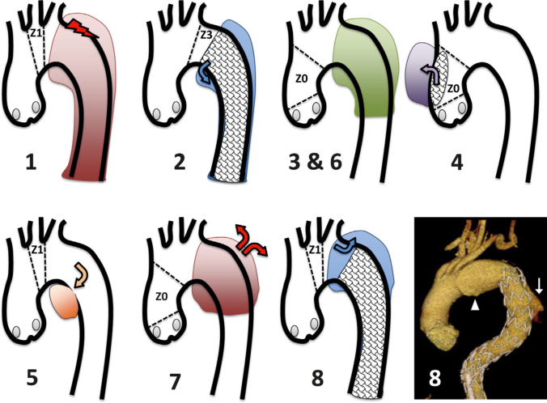

**Fig. 52.19 Schematic of aortic arch pathology in patients undergoing thoracic endovascular aortic repair (TEVAR) with rapid ventricular pacing (RVP) in this study.** (Patient #1) Aneurysm with chronic type- B dissection; (#2) aneurysm enlarging due to endoleak after prior TEVAR; (#3 and #6) isolated arch aneurysm; (#4) ascending aortic pseudoaneurysm due to leaking patch at prior aortic cannulation site from coronary artery bypass grafting; (#5) penetrating atherosclerotic ulcer of the aortic arch; (#7) ruptured aortic arch aneurysm; and (#8) enlarging aortic arch aneurysm and endoleak after prior TEVAR. _Dashed lines_ indicate landing zone (Z) for proximal margin of stent deployed under RVP. _Arrows_ indicate leak or extravasation of blood. _Lightning bolt_ indicates dissection. ( _Bottom right_ ) Preoperative three- dimensional reconstructed computed tomography angiogram for patient #8 showing aneurysmal dilation ( _arrowhead_ ) and endoleak ( _arrow_ ). (From Bokoch MP, Hiramoto JS, Lobo EP, et al. Rapid ventricular pacing for landing zone precision during thoracic endovascular aortic arch repair: a case series. _J Cardiothoracic Vasc Anesthesia_ . 2017;31[6]:2141–2146.)

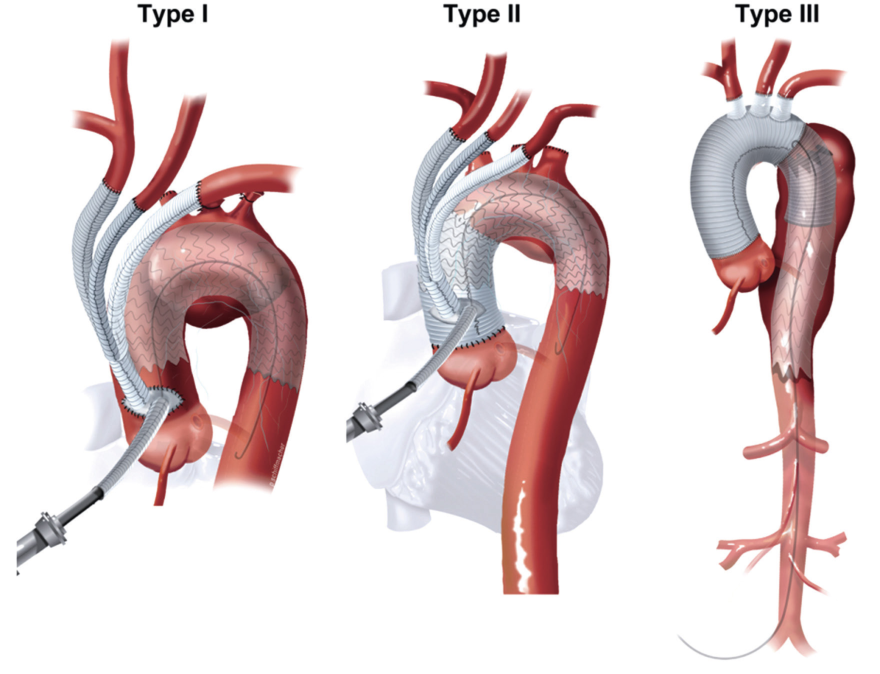

**Fig. 52.20 Hybrid aortic arch repair types I, II, and III.** (From Vallabhajosyula P, Szeto W, Desai N, et al. Type I and type II hybrid aortic arch replacement: postoperative and mid- term outcome analysis. _Ann Cardiothoracic Surg_ . 2013;2[3]:280.)

<!-- PDF page 33 -->

secondary to cerebral infarction at one end of the spectrum and ranging successively through non- debilitating stroke, transient ischemic attack, and amaurosis fugax (transient attack of monocular blindness) to an asymptomatic bruit. Cerebrovascular sequelae of carotid atherosclerosis may result either from embolization of thrombus or atheromatous debris or from a reduction in flow (hypoperfusion) secondary to stenosis. The latter probably accounts for less than 10% of the cerebrovascular sequelae of carotid atherosclerosis. Although much is known about the genesis and evolution of atherosclerosis, significantly less is known about the circumstances that lead to plaque instability and rupture. Regardless of the mechanism, the degree of cerebral injury depends on such factors as plaque morphology, characteristics of the embolus, duration of hypoperfusion, cerebrovascular vasoreactivity, integrity of the circle of Willis, and cerebral collateral circulation. A multi- society guideline is available for the management of carotid artery disease.141

Stroke is a major public health burden worldwide. It is the fifth leading cause of death and the leading cause of serious, long- term disability in the United States. Stroke is also a major contributor to health care costs. The direct and indirect costs of stroke in the United States in 2008 are estimated at $65.5 billion.142 Approximately 780,000 people experience a new (≈600,000) or recurrent (≈180,000) stroke each year in the United States.142 Annually, more than 95,000 hospitalizations and 165,000 deaths occur from stroke. Well- defined risk factors exist in patients with stroke, the most important of which is hypertension. Approximately 83% of strokes are ischemic (i.e., cerebral thrombosis or embolism), and 7.6% of ischemic strokes result in death within 30 days of initial evaluation.143 Extracranial atherosclerotic disease accounts for up to 20% of all ischemic strokes. Less than 20% of strokes are preceded by a transient ischemic attack. Despite a well- documented decline in stroke mortality, the annual incidence rate of stroke may be increasing. This increase is probably due to growth in high- risk populations. The incidence of perioperative stroke in unselected patients, patients with asymptomatic carotid bruit, and patients with at least 50% carotid stenosis undergoing general anesthesia and surgery is approximately 0.1%, 1.0%, and 3.6%, respectively.

Although treatment options to reverse the effect of acute ischemic stroke are limited, outcomes may be improved with appropriate therapy. One approved therapy is IV recombinant tissue plasminogen activator (r-tPA). Given the narrow 3- to 4.5- hour treatment window from the onset of symptoms, prompt evaluation and diagnosis of ischemic stroke are critical. The addition of endovascular treatment options has improved outcomes. Three randomized controlled trials published in 2015 demonstrated a clear benefit of the addition of clot retrieval compared to standard therapy with thrombolysis. The 2015 American Heart Association/American Stroke Association guidelines now recommend endovascular treatment in acute ischemic stroke if the patient meets criteria (large vessel anterior circulation occlusion, independent at baseline, treatment within 24 hours).144

### INDICATIONS

Endarterectomy of the carotid bifurcation has been used to reduce symptoms and prevent stroke for more than 50

years. Although the efficacy of carotid endarterectomy for prevention of ipsilateral stroke in patients with and without symptoms has been demonstrated in large- scale randomized clinical trials,145,146 multiple factors including perioperative risk, comorbidities, and life expectancy must be considered in the overall assessment. In centers of excellence, it is a low- risk procedure with excellent longterm durability. Carotid endarterectomy is the most common peripheral vascular surgical procedure performed in the United States, with an estimated 130,000 procedures performed annually. The rate and number of carotid endarterectomies have fluctuated significantly since the early 1970s. With marked growth in the specialty of vascular surgery and an expanding list of surgical indications, the number of carotid endarterectomies performed in nonfederal hospitals increased from 15,000 in 1971 to 107,000 in 1985 and then declined substantially over the next 5 to 6 years. The decline was probably due to publications questioning the indications for the procedures and isolated reports citing excessively frequent rates of operative morbidity and mortality.

In 1992, a marked increase in the number of carotid endarterectomies occurred after the results of two largescale, prospective randomized trials were published. The North American Symptomatic Carotid Endarterectomy Trial (NASCET) and the European Carotid Surgery Trial both reported definitive results for symptomatic patients with high- grade carotid stenosis (70% to 99%).145,147 In NASCET, follow- up at 2 years showed a stroke rate for surgical patients of 9% versus 26% for medical patients. This benefit of carotid endarterectomy has persisted at 8 years of follow- up.148 In the European Carotid Surgery Trial, the long- term stroke rate was 2.8% for surgical patients, excluding a perioperative stroke and death rate of 7.5%, and 16.8% for medically managed patients.

The efficacy of carotid endarterectomy in asymptomatic patients with carotid stenosis has been evaluated in five randomized trials.146,149–152 The Carotid Artery Surgery Asymptomatic Narrowing Operation Versus Aspirin trial, the first to publish its results, concluded that carotid endarterectomy was not indicated for asymptomatic patients with 50% to 90% carotid stenosis.149 Unfortunately, this study was seriously flawed and the results questioned. The Mayo Asymptomatic Carotid Endarterectomy Study was terminated early because of a significantly increased number of MIs and transient cerebral ischemic events in the surgical group.150 Most of these events were not related to the surgery itself but rather to the absence of aspirin in the surgical group. The Department of Veterans Affairs trial was designed to compare the effects of carotid endarterectomy plus aspirin versus medical treatment (i.e., aspirin) in asymptomatic male patients with 50% or greater carotid stenosis.151 This trial demonstrated a significant reduction in ipsilateral neurologic events in the surgical group (8%) versus the medical group (20.6%). However, the combined incidence of stroke and death was not different between study groups. The Asymptomatic Carotid Atherosclerosis Study (ACAS) demonstrated that patients with asymptomatic carotid stenosis (≥60%) who were treated with carotid endarterectomy and aspirin have a reduced 5- year risk for ipsilateral stroke compared with patients treated with aspirin alone (5.1% vs. 11.0%).146 These results reflect only a

<!-- PDF page 34 -->

5.9% absolute risk reduction in 5 years, which is just above 1% per year. Of note, improvement in outcome for patients randomized to undergo endarterectomy in this trial did not reach significance until 3 years after surgery. The European Asymptomatic Carotid Surgery Trial, the largest trial to date, largely replicated the results of ACAS, but in a somewhat more pragmatic setting.152 This trial demonstrated that patients with asymptomatic carotid stenosis (≈70%) on ultrasound who were treated by immediate carotid endarterectomy plus medical treatment have a reduced 5- year risk for stroke compared with patients treated with medical therapy alone (6.4% vs. 11.8%). Of note, half of this 5- year benefit involved disabling or fatal strokes.

Although landmark randomized clinical trials have defined individuals who are likely to benefit from carotid endarterectomy (and set the standard for developing evidence- based practice guidelines throughout the world), it has been suggested that the significant increase in the number of carotid endarterectomies performed over the last decade may be due in part to the extrapolation of trial results to patients and settings not directly supported by the trials. For example, both NASCET and ACAS restricted enrollment to patients younger than 80 years of age, and both trials carefully selected institutions and surgeons to optimize the results of surgery. Additionally, subgroup analysis of ACAS could not demonstrate a significant benefit for women.146 With the advent of a second interventional treatment modality, percutaneous carotid angioplasty and stenting (discussed later), and the evolution of intensive medical therapy, this issue has become more complex.

### PERIOPERATIVE MORBIDITY AND MORTALITY

Although the randomized trials just noted have demonstrated a protective effect of carotid endarterectomy on ipsilateral stroke, the critical determinants of benefit for any given patient must include the overall perioperative event rate and expected long- term survival. Thus, the perioperative stroke and death rate for carotid endarterectomy needs to be very low to maintain the beneficial effects of surgery over medical therapy alone. Furthermore, to compensate for the perioperative risk associated with surgery, the patient must have a reasonable life expectancy (12 to 18 months). The 30- day stroke and death rate of 2.3% for asymptomatic patients in ACAS (1987 to 1993) and 5.0% for symptomatic patients in NASCET (1988 to 1991) are often cited as benchmarks. More recent reports suggest a considerably less frequent event rate. For example, a prospective database study of 13,316 carotid endarterectomies performed in 2007 and 2008 reported a 30- day stroke and death rate of 1.3% in asymptomatic patients and 2.9% in symptomatic patients.153 The 30- day mortality was significantly more frequent in patients who developed a stroke than in those who did not (12.9% vs. 0.6%). Patients with highrisk anatomy, such as restenosis and contralateral carotid arterial occlusion, have the highest risk for perioperative stroke and death. Neurologic deficits occur more commonly in patients with poorly controlled preoperative hypertension and in those with hypertension or hypotension postoperatively. The incidence of perioperative MI in patients undergoing carotid endarterectomy ranges from 0% to 5%. Recent reports suggest the incidence of MI is relatively low.

The General Anesthesia versus Local Anesthesia for Carotid Surgery (GALA) trial (discussed later) results reported only 13 patients of 3526 (0.37%) had a perioperative MI.154 The four fatal perioperative MIs accounted for only 8.9% of the total 30- day mortality. Although the role of carotid endarterectomy in patients older than 80 years of age remains a concern, recent reports suggest that carotid endarterectomy can be performed safely in the very elderly and those deemed high risk, with combined stroke or death rates being comparable to those found in randomized trials (NASCET and ACAS).

### PREOPERATIVE ASSESSMENT

The optimal preoperative assessment for patients undergoing carotid endarterectomy continues to be debated (see also Chapter 28). Patients with recently symptomatic carotid disease present a particular challenge because strong evidence exists to support surgical intervention within 2 weeks after manifestation of symptoms, thus limiting the time available for evaluation and optimization of relevant comorbidities as well as the initiation of new medications.155 The medical management of patients with asymptomatic carotid disease should be optimized and includes beta blockers, statins, and antiplatelet agents. Poorly controlled hypertension should be addressed with the patient’s internist. The gradual decreasing of the arterial blood pressure over several weeks before surgery will restore intravascular volume, reset cerebral autoregulation to a more normal range, and improve perioperative management. Poorly controlled diabetes also warrants preoperative optimization, which may improve perioperative outcome.156

CAD is common in patients undergoing carotid endarterectomy and is a leading cause of both early and late mortality. Hertzer and co- workers157 performed coronary angiograms in 506 patients scheduled for carotid endarterectomy and found significant (>70%) stenosis in one or more coronary artery, CAD in 83% of patients suspected of having CAD, and CAD in 40% thought to have no CAD. Despite the known frequent incidence of CAD in patients undergoing carotid endarterectomy, preoperative studies for the evaluation of myocardial function or ischemic potential are rarely undertaken. Exceptions to this practice are patients with unstable angina, recent MI with evidence of ongoing ischemia, decompensated congestive heart failure, and significant valvular disease. In general, specialized cardiac testing would be unlikely to result in cancellation of the procedure or alter perioperative management. Furthermore, the relatively infrequent overall rates of perioperative nonfatal and fatal MI after carotid endarterectomy make aggressive strategies leading to prophylactic coronary revascularization less appealing.154 A recent clinical trial reported on the safety and efficacy of coronary angiography and revascularization in preventing postoperative cardiac ischemic events after carotid endarterectomy. In a randomized fashion, 426 patients with no history of CAD were randomized to either coronary angiography before carotid endarterectomy (216 patients) or carotid endarterectomy without coronary angiography (210 patients). In the angiography group, 68 patients had a significant stenosis of the coronary arteries and underwent revascularization with PCI (66 patients) or CABG (2 patients). PCI was

<!-- PDF page 35 -->

performed 1 to 8 days before surgery and always consisted of angioplasty and stenting. No patients in the angiography group had a postoperative cardiac ischemic event or complication related to PCI, whereas nine patients in the group without angiography had an ischemic event (one fatal MI and eight ischemic events treated medically). Although all PCI patients received dual- antiplatelet therapy, no major bleeding or neck hematomas were observed. Long- term follow- up was not reported.

Patients with combined carotid stenosis and CAD requiring coronary revascularization represent somewhat of a management dilemma because it is often unclear which disease should be treated first.158 The severity of carotid and coronary disease must be evaluated in terms of clinical symptoms and anatomic lesions, and a decision must be made to perform a combined, staged (carotid endarterectomy first), or reverse- staged (CABG first) procedure. Carotid revascularization is recommended before CABG (staged procedure) in patients with symptomatic carotid disease and bilateral severe asymptomatic carotid stenosis. The optimal management of severe unilateral asymptomatic carotid stenosis in patients undergoing CABG is unclear. The only randomized clinical trial to date randomized 185 patients with severe unilateral asymptomatic carotid stenosis undergoing CABG to a staged or combined procedure (94 patients) or a reverse- staged procedure (90 patients).159 Although the perioperative mortality rates were equivalent (∼1.0%), the 90- day stroke and death rates were significantly lower in the staged and combined group (1.0% vs. 8.8%). Given the overall paucity of high- quality evidence, management of an individual patient should be guided by careful assessment of the relative severity of the coronary and carotid disease with particular emphasis on both surgeon- specific and institution- specific results in these patient populations. Carotid artery angioplasty and stenting is widely being applied as an alternative revascularization modality before staged CABG. More recently, a combined procedure (carotid angioplasty/stenting and CABG) has been introduced. In a small feasibility and safety study (90 patients), carotid artery angioplasty and stenting under local anesthesia followed immediately by CABG reported a 30- day stroke and death rate of 2.2%.160

### ANESTHETIC MANAGEMENT

Anesthetic management goals for carotid endarterectomy include protection of the heart and brain from ischemic injury, control of the heart rate and arterial blood pressure, and ablation of the surgical pain and stress responses. These goals must be achieved with another important goal in mind: to have an awake patient at the end of surgery for the purpose of neurologic examination. The preoperative visit is particularly important in patients undergoing carotid surgery. During this visit, a series of arterial blood pressure and heart rate measurements are obtained from which acceptable ranges for perioperative management can be determined. Patients are instructed to continue all long- term cardiac medications up to and including the morning of surgery. Aspirin therapy should be continued throughout the perioperative period. As noted earlier, discontinuation of aspirin therapy may be related to an increased rate of MI and transient ischemic events

in patients undergoing carotid endarterectomy. When patients arrive at the hospital on the day of surgery, they are queried regarding any new cardiovascular or cerebrovascular symptoms. Long- term cardiovascular medications not taken at home should be administered in the preoperative holding area whenever possible. Patient reassurance is particularly important at this time because anxiety is associated with increases in heart rate, systemic vascular resistance, and myocardial O2 consumption, which in this patient population could precipitate myocardial ischemia.

Electrocardiogram (ECG) monitoring should include continuous leads II and V5 for detection of rhythm disturbances and ST- segment changes. An intra- arterial catheter for beat- to- beat blood pressure monitoring should be considered routine. Noninvasive arterial blood pressure measurement in the contralateral arm is recommended. Central venous and pulmonary artery catheters are rarely indicated for carotid surgery. The rare patient with uncompensated heart failure or recent MI with ongoing ischemia requiring emergent surgery is a possible exception. If such monitors are used, the subclavian or femoral insertion sites are most practical because inadvertent carotid puncture could compromise blood flow as a result of hematoma. Oftentimes, the most common reason for central access is difficult or inadequate peripheral access. IV access for fluid and drug administration can be accomplished with two secure, medium- bore (16- gauge) peripheral IV catheters. Because both arms will be tucked to the patient’s sides, the IV catheters must run well after patient positioning.

### General Anesthesia

Any of the drugs commonly used to induce anesthesia, maintenance anesthetics, and nondepolarizing muscle relaxants can be used safely during carotid endarterectomy, given that stable hemodynamics are maintained and the patient is awake at the end of the procedure. A conventional technique is as follows. Sedative premedication (e.g., midazolam) has the potential to compromise early neurologic assessment and is universally avoided. After placement of routine monitors and administration of O2 by face mask, small doses of opioid (e.g., fentanyl 0.5 to 1 mcg/kg) are administered during arterial line placement. Induction of anesthesia is accomplished with incremental dosages of propofol supplemented with additional opioid (total fentanyl dose 2 to 4 mcg/kg). Etomidate also may be used and is preferred in patients with limited cardiac reserve. Neuromuscular relaxation with a short- acting to intermediate- acting nondepolarizing muscle relaxant such as rocuronium facilitates tracheal intubation. Esmolol is particularly effective in blunting the increases in heart rate and blood pressure responses during laryngoscopy and endotracheal intubation and is used liberally during the induction period. Arterial blood pressure responses during and after endotracheal intubation are unpredictable in this patient population, and the clinician must be prepared for immediate treatment of extremes in blood pressure. This can be achieved with the use of short- acting drugs, such as phenylephrine 50 to 100 mcg for hypotension and sodium nitroprusside 5 to 25 mcg or clevidipine 100 to 250 mcg for hypertension. Patients with poorly controlled hypertension (diastolic blood pressure >100 mm Hg) require special care. These patients are often intravascularly volume depleted

<!-- PDF page 36 -->

and may have significant hypotension with induction of anesthesia. Administration of fluids intravenously, careful titration of anesthetics, and immediate treatment of hypotension are especially important.

Anesthesia is maintained with inhaled volatile anesthetics. Sevoflurane or desflurane may be preferred because of more rapid emergence. Studies using electroencephalogram (EEG) and regional cerebral blood flow (rCBF) measurements suggest that the critical rCBF (the rCBF below which EEG changes of cerebral ischemia occur) is lower for isoflurane. Sevoflurane’s critical rCBF in patients undergoing endarterectomy is similar to that determined with isoflurane.161,162 This use of 50% N2O in O2 was previously favored; however, its use has been associated with increased postoperative nausea and vomiting. Maintenance anesthesia can also be achieved with a combination of inhaled volatile anesthetic in combination with propofol, remifentanil, or dexmedetomidine. If neuromonitoring is utilized, it would require inhaled volatile concentrations less than 0.5 minimum alveolar concentration (MAC) with supplementation of intravenous medications. Otherwise, clinical studies show no differences between volatiles and total intravenous anesthesia (TIVA).163 With general anesthesia, a superficial plexus block is not required but can be considered as an adjunct.

Despite only modest surgical stimulation, hemodynamic fluctuations are common during carotid endarterectomy. Arterial blood pressure and heart rate are controlled within predetermined and individualized ranges during the surgical procedure with short- acting drugs whenever possible (phenylephrine, esmolol, nitroglycerin, sodium nitroprusside, nicardipine, clevidipine). Arterial blood pressure should be maintained in the high- normal range throughout the procedure and particularly during the period of carotid clamping to increase collateral flow and prevent cerebral ischemia. In patients with contralateral internal carotid artery occlusion or severe stenosis, induced hypertension to approximately 10% to 20% above baseline is advocated during the period of carotid clamping when neurophysiologic monitoring is not used. Arterial blood pressure preservation or augmentation can be accomplished by maintaining light levels of general anesthesia or by administering sympathomimetic drugs such as phenylephrine, ephedrine, or norepinephrine. Some caution must be exercised when using vasopressors to augment blood pressure during carotid endarterectomy because the increases in blood pressure and heart rate may increase myocardial ischemia164 or infarction. The restrictive use of vasopressors for specific instances of cerebral ischemia has been advocated.165 In one report, induced hypertension during the period of carotid occlusion was not associated with myocardial ischemia.166

Surgical manipulation of the carotid sinus with activation of the baroreceptor reflexes can cause abrupt bradycardia and hypotension. Cessation of surgical manipulation promptly restores the hemodynamics, and infiltration of the carotid bifurcation with 1% lidocaine usually prevents further episodes. Infiltration may, however, increase the incidence of both intraoperative and postoperative hypertension.167

On application of the surgical dressings, drugs used to reverse neuromuscular blockade (i.e., neostigmine or sugammadex) are administered and O2 is increased

to 100%. Ventilation is gently assisted until the patient exhibits spontaneous eye opening or movement. With rare exceptions, all tracheas are extubated after neurologic integrity is established. Neurologic deficits on emergence require immediate discussion with the surgeon about the need for angiography, reoperation, or both. The period of emergence and extubation may be associated with marked hypertension and tachycardia, which may require aggressive pharmacologic intervention. Tight hemodynamic control during this period is likely to be more demanding than during induction. Greater hemodynamic stability and decreased pharmacologic intervention during emergence have been reported in patients undergoing carotid endarterectomy with propofol versus isoflurane. In addition, a significantly less frequent incidence of myocardial ischemia on emergence was found in the propofol group than in the isoflurane group (1 of 14 vs. 6 of 13). Of particular note, all patients with myocardial ischemia on emergence had systolic blood pressure higher than 200 mm Hg.

### Regional and Local Anesthesia

Regional and local anesthetic techniques for carotid endarterectomy have been in use for more than 50 years, and many centers consider them to be the techniques of choice. Regional anesthesia is accomplished by blocking the C2 to C4 dermatomes by use of a superficial, intermediate, deep, or combined cervical plexus block (see also Chapter 42). Adequate anesthesia can be obtained with an isolated superficial or intermediate cervical plexus block, likely as a result of spread of local anesthetic to the cervical nerve roots.168 Local infiltration of the incisional site and surgical field can also provide the necessary sensory blockade. A recent systematic review including over 10,000 cervical plexus blocks for carotid endarterectomy found that the deep (or combined) block was associated with a higher serious complication rate related to the injecting needle compared with a superficial (or intermediate) block (0.25% vs. 0%).169 The conversion rate to general anesthesia was also higher with the deep block (2.1% vs. 0.4%). No difference was found in the incidence of serious systemic complications between the blocks. Although the incidence of serious complications from a cervical plexus block is infrequent, near- toxic levels of local anesthetic occurs in almost half of patients after superficial and deep cervical plexus block.170 Although no major complications related to local anesthetic toxicity occurred, some caution should be exercised when requesting the surgeon to supplement with additional local anesthetic.

Regional and local anesthesia allow continuous neurologic assessment of the awake patient, which is widely considered to be the most sensitive method for detecting inadequate cerebral perfusion and function. Awake monitoring reduces the need for shunting and avoids the expense associated with indirect monitors of cerebral perfusion. Other advantages that have been reported include greater stability of blood pressure and decreased vasopressor requirements, reduced operative site bleeding, and reduced hospital costs. Potential disadvantages of local or regional anesthesia include an inability to use pharmacologic cerebral protection with anesthetics, patient panic or loss of cooperation, seizure or loss of consciousness with carotid clamping, and inadequate access to the airway

<!-- PDF page 37 -->

should conversion to general anesthesia be necessary. The reported incidence of intraoperative neurologic changes during carotid endarterectomy under local or regional anesthesia varies widely (2.4% to 24%). Rates of conversion from regional anesthesia to general anesthesia of approximately 2% to 6% have been reported. Phrenic nerve paresis is common after cervical plexus block and is of little clinical consequence except in patients with severe COPD or contralateral diaphragmatic dysfunction.

Regional and local anesthesia requires significant patient cooperation throughout the procedure and is best maintained with constant communication and gentle handling of tissues. Supplemental infiltration of local anesthetic by the surgeon, especially at the lower border and ramus of the mandible, is frequently helpful. Sedation, if used at all, must be kept to a minimum to allow continuous neurologic assessment. The surgical drapes are “tented” over the head and face area to minimize claustrophobic anxiety. Levels of consciousness, speech, and contralateral handgrip are assessed throughout the procedure. If both arms are tucked to the patient’s sides, handgrip can be assessed with the use of a squeaky toy. Blood pressure is augmented with phenylephrine when patients exhibit neurologic changes during carotid artery test clamping or after shunt placement. A 2- to 3- minute test clamp in awake patients allows prompt identification of those who would benefit from shunt placement. Patient acceptance of regional anesthesia is frequent and common, as evidenced by a 92% preference for repeat cervical plexus block for future carotid endarterectomy. Regional anesthesia should be avoided under the following circumstances: strong preference for general anesthesia expressed by the patient (i.e., claustrophobia), language barriers that make communication difficult, and difficult vascular anatomy. Difficult anatomy is usually manifested by a patient with a short neck and a high (more cephalad) bifurcation and may require vigorous submandibular surgical retraction.

### Regional Versus General Anesthesia

For decades, the impact of anesthetic technique on outcome for carotid endarterectomy has been debated and studied. Until recently, non- randomized studies dominated and largely supported that regional anesthesia was associated with significant reductions in the risk for perioperative death, stroke, MI, and pulmonary complications.171 The lack of randomized data was addressed with the landmark GALA trial.154 This multicenter, randomized controlled trial included 3526 patients with symptomatic or asymptomatic internal carotid stenosis from 95 medical centers in 24 countries. Patients were randomly assigned to carotid endarterectomy under general anesthesia (1753 patients) or local anesthesia (1773 patients) between 1999 and 2007. The primary outcome was a composite of perioperative death, MI, and stroke (including retinal infarction). The main finding was that anesthetic technique was not associated with a significant difference in the composite end point (4.8% for general vs. 4.5% for local). Anesthetic technique was not associated with a significant difference in secondary outcomes, including duration of surgery, duration of ICU stay, length of hospital stay, or quality of life at 1 month after surgery. Other outcomes, including cranial nerve injury (10.5% vs. 12.0%), wound hematoma (8.3%

vs. 8.5%), wound hematoma requiring reoperation (2.6% vs. 2.3%), and chest infection (2.0% vs. 1.9%) were similar between patients receiving general anesthesia and local anesthesia, respectively. Of note, 4.4% of patients under local anesthesia (93% received a cervical plexus block) had complications that led to cancellation of surgery or conversion to general anesthesia. Important limitations of the GALA trial include lack of standardization, absence of blinding, and possible investigator bias. Using patient- level data from the GALA trial, a recent report found that local anesthesia had a cost- effectiveness benefit over general anesthesia.172

Although randomized clinical trials such as GALA are considered to be the gold standard in clinical research, the conclusions are not always generalizable and therefore may not reflect actual practice in treating unselected patients. A recent report from a large international vascular registry, including 20,141 carotid endarterectomies performed in 10 countries between 2003 and 2007, found that anesthetic technique had no effect on perioperative mortality (0.5% overall) or stroke rate (1.5% overall).173 These real- world results complement the data from the GALA trial. Thus, using major perioperative complications as a guide, there is no reason to routinely prefer one anesthetic technique over the other for carotid endarterectomy. The ultimate decision to use general anesthesia or regional anesthesia should be based on surgeon and the anesthesiologist experience and patient preference.

### Carbon Dioxide and Glucose Management

Cerebrovascular CO2 reactivity is part of the complex autoregulatory system to control cerebral blood flow. Normal cerebral autoregulation responds to acute changes in PaCO2 by decreasing cerebral blood flow (i.e., vasoconstriction) with hypocapnia and increasing cerebral blood flow (i.e., vasodilatation) with hypercapnia. In patients with carotid artery stenosis or occlusion, ipsilateral cerebral blood flow may be impaired because of poor intracerebral collateral blood flow. In the setting of poor collateralization and resultant cerebral hypoperfusion, cerebral resistance vessels in the hypoperfused territories will dilate to maintain cerebral blood flow. These chronically dilated resistance vessels may demonstrate a diminished or absent (i.e., vasomotor paralysis) cerebral blood flow response to CO2. Impaired cerebrovascular reactivity to hypercapnia may play a role in the development of stroke ipsilateral to carotid stenosis or occlusion. Although one might expect that impaired CO2 reactivity would increase the risk for cerebral ischemia after carotid artery clamping, the results of intraoperative cerebral monitoring suggest that no such relationship exists. Impaired cerebrovascular reactivity to CO2 will significantly improve after carotid endarterectomy.

Control of ventilation and end- tidal CO2 (ETCO2) during general anesthesia is a matter of some controversy. Hypercapnia may cause a “steal” phenomenon (i.e., shunting of blood away from hypoperfused territories with dilated vasculature) and is generally avoided. Hypocapnia, with its associated cerebral vasoconstriction, has been advocated to promote a reversal of this steal phenomenon. However, little clinical evidence exists for this “reverse” steal effect. Additionally, experimental data do not support the use of hypocapnia as a therapeutic maneuver to produce a

<!-- PDF page 38 -->

favorable redistribution of blood flow during focal cerebral ischemia. Indeed, in this animal model of focal cerebral ischemia, hypocapnia (PaCO2 of 23 mm Hg) actually increased the size of the region at risk for ischemia. It is therefore common practice to maintain normocapnia or mild hypocapnia during carotid endarterectomy.

Evidence demonstrates increased ischemic injury to neural tissue when ischemia occurs in the presence of hyperglycemia. Data from The Johns Hopkins Hospital found that operative- day glucose greater than 200 mg/dL at the time of carotid endarterectomy was associated with an increased risk for perioperative stroke or transient ischemic attack, MI, and death.156 Thus, until additional data become available, it may be beneficial to maintain a blood glucose level below 200 mg/dL in patients undergoing carotid endarterectomy. If hyperglycemia is treated with insulin preoperatively or intraoperatively, the blood glucose level should be carefully monitored, especially during general anesthesia, to avoid the dangers of hypoglycemia.

### NEUROLOGIC MONITORING AND CEREBRAL PERFUSION

Intraoperative monitoring for cerebral ischemia or hypoperfusion and, more recently, for cerebral emboli during carotid endarterectomy is controversial (see also Chapter 35). Monitoring techniques include internal carotid artery stump pressure determinations, rCBF measurements, EEG monitoring, SSEP monitoring, transcranial Doppler ultrasonography (TCD), and cerebral oximetry monitoring. The rationale for the use of such monitoring is based on the need to prevent intraoperative strokes. The primary clinical utility of cerebral monitoring is to identify patients who may benefit from shunting during the period of arterial clamping. Secondarily, cerebral monitoring is used to identify patients who may benefit from blood pressure augmentation or change in surgical technique. Despite a tremendous amount of investigative effort, only limited data support the assumption that cerebral monitoring actually improves patient outcome after carotid endarterectomy. To further complicate the issue, several large series have reported excellent results from carotid endarterectomy with routine shunting, routine no shunting, and selective shunting using one or more of the methods discussed later. In a review, the mean reported stroke rate with routine shunting was 1.4% and for routine no shunting was 2%.174 The mean perioperative stroke rates for selective shunting were 1.6% using stump pressure, 1.6% using EEG, 1.8% using SSEP, and 4.8% using TCD.174

### Carotid Artery Stump Pressure

The internal carotid artery stump pressure represents the back  pressure resulting from collateral flow through the circle of Willis via the contralateral carotid artery and the vertebrobasilar system. The advantages of monitoring carotid stump pressure are that it is inexpensive, relatively easy to obtain, and continuously available during carotid clamping (dynamic stump pressure). Despite these advantages, few centers use stump pressure monitoring. A recent single center report of 1135 consecutive carotid endarterectomies under general anesthesia used a stump pressure

of below 45 mm Hg as a guide for selective shunting.175 The 30- day stroke rate was 3% for patients selectively shunted (21%), 0.5% for patients not shunted (79%), and 1% overall. The overall 30- day mortality was 0.5%. Of note, no patient had a stroke caused by global intraoperative cerebral hypoperfusion. A recent prospective randomized trial comparing routine shunting versus selective shunting based on stump pressure below 40 mm Hg in 200 patients undergoing carotid endarterectomy under general anesthesia found both methods were associated with an infrequent perioperative stroke rate (0% vs. 2%).176 The two strokes in the selective shunting cohort were related to carotid artery thrombosis. No patients died perioperatively. Although an old method, stump pressure monitoring appears to have survived the test of time.

### Regional Cerebral Blood Flow

rCBF measurements during carotid endarterectomy are obtained by IV or ipsilateral carotid artery injection of radioactive xenon and analysis of decay curves obtained from detectors placed over the area of the ipsilateral cortex supplied by the middle cerebral artery. Measurements are typically obtained before, during, and immediately after carotid clamping. This technology, combined with the EEG monitoring, has provided important insight into the relationship between rCBF and EEG evidence of cerebral ischemia and the critical rCBF associated with various anesthetics.177,178 The critical rCBF varies depending on the volatile anesthetic used. In patients receiving N2O plus a volatile anesthetic, rCBF is approximately 20, 15, 10, and 10 mL/100 g of brain tissue per minute for halothane, enflurane, isoflurane, and sevoflurane, respectively.161,177,178 The expense and the expertise required to make and interpret these blood flow measurements have limited the use of this technology to only a few centers.

### Electroencephalography

Many centers advocate intraoperative use of EEG monitoring for the detection of cerebral ischemia and subsequent selective shunting (see also Chapter 35). The full 16- channel strip- chart EEG and the processed (compressed spectral array) EEG monitor are used for this purpose. Although the processed EEG monitor is more easily interpreted, it is less sensitive than the raw EEG monitor. Significant ischemic EEG changes occur in 7.5% to 20% of monitored patients during carotid clamping under general anesthesia. Significant EEG changes occur more frequently in patients with contralateral carotid disease than in those without (14.3% vs. 5.1%). The presence of a contralateral carotid occlusion may increase the rate of significant ischemic EEG changes to nearly 50% during carotid clamping. Because contralateral occlusion is highly predictive of ischemic EEG changes with carotid clamping, it has been recommended that EEG monitoring be eliminated in this circumstance. Ischemic EEG changes may also be seen with shunt malfunction, hypotension, or cerebral emboli.

When the electroencephalogram is used for cerebral ischemia monitoring during carotid endarterectomy, a stable physiologic and anesthetic milieu is mandatory. Isoflurane, desflurane, and sevoflurane produce similar ECG changes at equipotent levels and, when used at 0.5 MAC, allow for reliable ECG cerebral ischemia monitoring.

<!-- PDF page 39 -->

The clinical usefulness of intraoperative EEG monitoring for ischemia during carotid endarterectomy is limited by several factors. First, it may not detect subcortical or small cortical infarcts. Second, false- negative results (i.e., neurologic deficit with no ischemic EEG changes intraoperatively) are common. Patients with preexisting stroke or reversible neurologic deficits may have a particularly high incidence of such results. Third, EEG monitoring is not specific for ischemia and may be affected by changes in temperature, blood pressure, and anesthesia depth. Fourth, false- positive results (i.e., no perioperative neurologic deficit with significant ischemic EEG changes intraoperatively) occur because not all cerebral ischemia uniformly proceeds to infarction. Finally, intraoperative EEG monitoring is inherently limited because most intraoperative strokes are thought to be thromboembolic and most perioperative strokes occur postoperatively. At present, no consistent data demonstrate that EEG monitoring is clearly superior to other methods of intraoperative cerebral monitoring or that the use of EEG monitoring improves outcome.

### Somatosensory Evoked Potentials

SSEP monitoring is based on the response of the sensory cortex to electrical impulses from peripheral sensory nerve stimulation. The sensory cortex, being primarily supplied by the middle cerebral artery, is at risk during carotid artery clamping. SSEP monitoring, unlike EEG monitoring, can detect subcortical sensory pathway ischemia. Characteristic SSEP tracings (i.e., decrease in amplitude, increase in latency, or both) occur with decreased rCBF and are abolished in primates when flow decreases to less than 12 mL/100 g of brain tissue per minute. No specific reduction in amplitude or increase in latency has been established as a physiologic marker of impaired rCBF under operative conditions in humans. Anesthetics, hypothermia, and blood pressure may affect SSEPs significantly, and false- negative results have been reported. The validity of SSEPs as an intraoperative monitor of cerebral ischemia during carotid endarterectomy has not been definitively established.

### Transcranial Doppler Ultrasonography

TCD allows continuous measurement of mean blood flow velocity and detection of microembolic events in the middle cerebral artery (see also Chapter 35). These parameters have important clinical implications because most perioperative neurologic deficits are thought to be thromboembolic in origin. With TCD, intraoperative embolization has been detected in more than 90% of patients undergoing carotid endarterectomy. Most intraoperative emboli are characteristic of air and are not associated with adverse neurologic outcomes. TCD may provide useful information regarding shunt function, malfunction, and the incidence of emboli during shunt insertion. Embolization during carotid artery dissection may indicate plaque instability and the need for early carotid artery clamping. Embolization during dissection and wound closure is associated with operative stroke. One center has reported that combined TCD monitoring and completion angiography resulted in a reduction in the intraoperative stroke rate from 4% to 0%. Early postoperative embolization has been detected in more than 70% of patients after carotid endarterectomy and is

exclusively particulate in nature. Most TCD- detected emboli occur in the first 2 to 3 hours after surgery. Persistent particulate embolization in the early postoperative period has been shown to predict thrombosis and the development of a major neurologic deficit. Frequent early postoperative TCD embolic signals have been demonstrated to be highly predictive of early postoperative ipsilateral focal cerebral ischemia. Intervention with dextran has been shown to reduce and ultimately stop sustained embolization after carotid endarterectomy. Perioperative microembolization is more common in women and patients with symptomatic carotid disease. TCD monitoring has been reported to detect early asymptomatic carotid artery occlusion and hyperperfusion syndrome after carotid endarterectomy. Although TCD monitoring holds some promise, conclusive evidence demonstrating improved outcome has not been reported. Additionally, the high rate of technical failures significantly limits the clinical utility of this monitoring modality.179

### Cerebral Oxygenation

Direct monitoring of cerebral oxygenation can be obtained with jugular bulb venous monitoring. Such monitoring allows determination of the arterial–jugular venous O2 content difference and jugular venous O2 saturation and therefore provides information on global cerebral O2 metabolism. Jugular venous samples are obtained from a catheter inserted into the jugular bulb ipsilateral to the surgical site. Continuous fiberoptic jugular venous oximetry catheters are available as well. Significant technical and methodologic shortcomings have limited the clinical application of this monitoring during carotid endarterectomy.

Near- infrared spectrophotometry is a noninvasive technique that allows continuous monitoring of regional cerebral O2 saturation through the scalp and skull. Similar to pulse oximetry, cerebral oximetry is based on the different absorption characteristics of the near- infrared spectrum of oxygenated and deoxygenated hemoglobin. However, unlike pulse oximeters, cerebral oximeters measure the O2 saturation of hemoglobin in the entire tissue bed (i.e., brain tissue and arterial and venous blood), which is predominately venous blood, and therefore approximates venous blood O2 saturation. A commercially available cerebral oximetry sensor is applied to the forehead skin ipsilateral to the surgical site, and regional cerebral O2 saturation from a small sample of the frontal cortex below the sensor is provided. To date, wide patient- to- patient variability in baseline cerebral O2 saturation and the lack of a clinical threshold of a decrease in cerebral O2 saturation predictive of the need for shunt placement have impeded the widespread use of this novel monitoring modality.

### POSTOPERATIVE CONSIDERATIONS

Most neurologic complications (transient and permanent) after carotid endarterectomy are explained by intraoperative embolization, hypoperfusion during carotid clamping, and postoperative embolization or thrombosis from the endarterectomy site. It is generally accepted that most neurologic complications are related to surgical technique. Thromboembolic (rather than hemodynamic) factors appear to be the major mechanism of perioperative neurologic complications and most occur in the postoperative

<!-- PDF page 40 -->

period. Neurologic complications attributable to carotid artery thrombosis may occur with an incidence as frequent as 3.3% and are associated with a high rate of major stroke or death despite immediate operative intervention. Other important, but less common neurologic complications include intracerebral hemorrhage and cerebral hyperperfusion. The reported incidence of intracerebral hemorrhage after carotid endarterectomy ranges from 0.4% to 2.0%. Most intracerebral hemorrhages occur 1 to 5 days after the operation and are associated with significant morbidity and mortality.

Hypertension is common in the postoperative period after carotid endarterectomy. Not surprisingly, patients with poorly controlled preoperative hypertension often have severe hypertension postoperatively. The causes are not well understood, but surgical denervation of the carotid sinus baroreceptors is probably contributory. Regional anesthesia is associated with less hypertension. Other causes of postoperative hypertension, such as hypoxemia, hypercapnia, bladder distention, and pain, should be excluded or treated. Because neurologic and cardiac complications may be associated with postoperative hypertension, blood pressure should be aggressively controlled to near preoperative values after surgery. Short- acting drugs are the safest and most effective. Patients with persistent hypertension can be converted to longer- acting IV or oral agents before discharge from the ICU.

Postoperative cerebral hyperperfusion syndrome is an abrupt increase in blood flow with loss of autoregulation in the surgically reperfused brain and is manifested as headache, seizure, focal neurologic signs, brain edema, and possibly intracerebral hemorrhage. Unfortunately, little is actually known about the cause and management of this syndrome. Typically, this syndrome does not occur until several days after carotid endarterectomy. Patients with severe postoperative hypertension and severe preoperative internal carotid artery stenosis are believed to be at increased risk for this syndrome. However, more recent data do not corroborate this common belief and suggest that recent contralateral carotid endarterectomy may be predictive of cerebral hyperperfusion.180

Postoperative hypotension occurs almost as frequently as hypertension after carotid endarterectomy. Carotid sinus baroreceptor hypersensitivity or reactivation probably plays an important role. Postoperative hypotension may be more common after regional anesthesia. To avoid cerebral and myocardial ischemia, hypotension should be corrected promptly. Cardiac output is frequently normal or elevated and systemic vascular resistance reduced in hypotensive patients after carotid endarterectomy. Intensive surveillance for evidence of myocardial and cerebral ischemia and judicious use of fluids and vasopressors are recommended for postoperative hypotension. In most cases, the hypotension resolves over a period of 12 to 24 hours.

Cranial and cervical nerve dysfunction after carotid endarterectomy is well documented in the literature. Although most injuries are transient, permanent injuries can lead to significant disability. Patients should be examined for injury to the recurrent laryngeal, superior laryngeal, hypoglossal, and marginal mandibular nerves shortly after extubation. Unilateral recurrent laryngeal nerve injury may result in ipsilateral true vocal cord paralysis in the paramedian

position. Although most patients have hoarseness and an impaired cough mechanism, the injury is usually well tolerated. However, bilateral recurrent laryngeal nerve injury and resultant bilateral vocal cord paralysis can result in lifethreatening upper airway obstruction. This situation must be anticipated in patients who have previously undergone contralateral carotid endarterectomy or neck surgery.

Carotid body denervation may occur after carotid endarterectomy as a result of surgical manipulation. Unilateral loss of carotid body function may result in an impaired ventilatory response to mild hypoxemia and is rarely of clinical significance. Bilateral carotid endarterectomy is associated with loss of the normal ventilatory and arterial pressure responses to acute hypoxia and an increased resting partial pressure of arterial CO2. In this situation, the central chemoreceptors are the primary sensors for maintaining ventilation, and serious respiratory depression may result from opioid administration. Fortunately, most patients require little more than acetaminophen or ketorolac for postoperative pain.

Wound hematoma probably occurs more frequently than reported in the literature. In the NASCET,145 5.5% of patients had wound hematomas. Most cases are the result of venous oozing and require little more than external compression for 5 to 10 minutes. Expanding hematomas require prompt evaluation at the bedside and immediate evacuation if airway compromise is evident. Aggressive postoperative blood pressure control may help reduce the incidence of hematoma.

Although some clinicians believe that intensive care monitoring is not routinely required after carotid surgery, a significant number of patients do require intensive monitoring and active intervention. I think all patients should be monitored in an intensive care setting for at least 8 hours after carotid endarterectomy, because most events requiring intervention occur within this timeframe.181,182

## Endovascular Treatment of Carotid Disease: Carotid Artery Stenting

Endovascular treatment of carotid disease is an innovation in evolution for stroke prevention and currently involves percutaneous transluminal angioplasty and stenting. Significant procedural advancements include the use of dual antiplatelet therapy, self- expanding stents, and emboli protection devices. Over the last decade, major randomized clinical trials comparing carotid endarterectomy with transfemoral carotid artery stenting (TF-CAS) carotid artery stenting have been published. A recent systematic review of randomized trials (16 trials involving 7572 patients) found that endovascular treatment (including balloon angioplasty or stenting) was associated with an increased risk for periprocedural stroke or death compared with endarterectomy.183 Of note, the increase in risk appeared to be limited to patients 70 years of age and older. Endovascular treatment was associated with lower risks for MI, cranial nerve palsy, and access site hematomas. The rate of ipsilateral stroke after the periprocedural period was not different between treatment groups. Among patients unfit for surgery, the rate of death or stroke did not differ between

<!-- PDF page 41 -->

endovascular treatment and medical care. Updated guidelines provide specific recommendations for revascularization of symptomatic and asymptomatic patients.149 The transfemoral carotid artery stenting (TF-CAS) procedure consists of the following steps: femoral access, aortic arch angiogram, selective cannulation of the common carotid artery origin and angiogram, guidewire advancement into the external carotid artery, carotid sheath placement and advancement into the common carotid artery, placement of embolic protection device, balloon angioplasty of lesion, advancement of stent delivery catheter across dilated lesion, deployment of self- expanding stent, balloon dilation of stent, completion angiogram, and access site management. The femoral artery approach is considered standard, but brachial artery and high radial artery access have been reported with high procedural success. Embolic protection devices are considered mandatory and include distal protection in the form of a filter or occlusion balloon and proximal protection in the form of flow interruption or flow reversal. Cardiologists and radiologists currently perform a large percentage of these procedures in specialized endovascular suites.

Most transfemoral carotid artery stenting (TF-CAS) procedures are performed under local anesthesia with light or no sedation to facilitate patient cooperation and continuous neurologic assessment. In addition to routine monitors, an arterial line is placed for continuous blood pressure monitoring. Some degree of hemodynamic instability is common in patients during and after carotid artery stenting. Bradycardia and hypotension occur much more frequently after carotid artery stenting with balloon angioplasty than without angioplasty.184 A recent, large retrospective study reported asystole in 4.9% of patients after carotid stenting.185 Asystole was more likely to occur in patients undergoing a right- sided procedure, in those with significant contralateral stenosis, and in those with a reduced left ventricular ejection fraction. The administration of prophylactic atropine before balloon inflation decreases the incidence of intraoperative bradycardia and cardiac morbidity in primary carotid stenting patients.186

Transcarotid artery revascularization (TCAR) is a novel approach to the treatment of extracranial carotid artery occlusive disease. Approved by the FDA and in clinical use since 2012, TCAR (Fig. 52.21) is a less invasive technique of carotid artery revascularization. It involves cannulating the carotid artery via a small supraclavicular incision with a flow- reversal circuit. After heparinization, one end of the circuit will be placed in the carotid artery proximal to the lesion, and the other will be placed in the femoral vein. The circuit incorporates a filter to capture any debris before reaching the venous system.

The proximal carotid artery is then clamped, and blood flows in reverse from the head, through the carotid artery and into the flow- reversal circuit before passing into the femoral vein. This flow reversal prevents the migration of micro- and macro- emboli into the cerebral circulation. Instead, emboli are filtered by the flow- reversal circuit before returning the blood flow to the venous circulation. The carotid artery is then stented and the arteriotomy is closed.

ROADSTER 1,187 a prospective, single- arm, multicenter clinical trial, evaluating TCAR and the use of the transcarotid neuroprotective system showed a 30- day stroke rate of 1.4%. The CREST trial188 previously demonstrated a stroke rate of 4.1% for transfemoral carotid artery stenting and

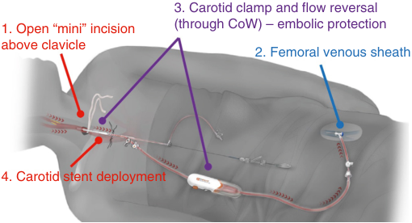

3. Carotid clamp and flow reversal 1. Open “mini” incision (through CoW) – embolic protection above clavicle 2. Femoral venous sheath 4. Carotid stent deployment 

**Fig. 52.21 Example of a transcarotid artery revascularization device.** _CoW_ , circle of Willis. (Image courtesy of Silk Road Medical, Inc.)

2.3% for carotid endarterectomy. ROADSTER 2189 looked to examine the technical success rate in new operators of TCAR and had 1.9% stroke rate in the intent- to- treat population and 0.6% stroke rate in the per- protocol population. Thus TCAR has the advantages of lower stroke risk than TF-CAS and lower major adverse cardiac events (MACE) than carotid endarterectomy (CEA).

### ANESTHETIC CONSIDERATIONS

Primary anesthetic considerations for TCAR include (1) the importance of circle of Willis perfusion, (2) the risk of hyperperfusion post stenting, and (3) the risk of bradycardia. Tight blood pressure control is of utmost importance and changes as the procedure progresses. It is important to assess preoperative blood pressure baselines in both upper extremities, noting any discrepancies. To avoid bradycardia, prophylactic use of an anticholinergic, glycopyrrolate or atropine, is strongly encouraged with the goal of achieving a heart rate greater than 70 beats/min. The recommended procedural systemic blood pressure is 140– 160 mm Hg, keeping in mind that blood pressure goals are also dependent on the patient’s baseline. Augmenting the systemic arterial pressure is paramount for an effective flow reversal. The perfusion of the ipsilateral side of the brain is also maintained through the circle of Willis, requiring augmentation of the systemic blood pressure. After deployment of the stent and unclamping, the goal is to normalize the systemic blood pressure to the low end of the normal range, typically ranging from 100 to 140 mm Hg systolic.

Current studies show no advantage in anesthetic type; regional anesthesia and general anesthesia are both comparable. The decision for one anesthetic type or the other should be dictated by patient factors and operator comfort.

## Lower Extremity Revascularization

### PERIPHERAL ARTERY DISEASE

The peripheral artery disease (PAD) or atherosclerotic occlusive disease of lower extremities is one of the resourceconsuming diseases in the United States health care system.190 The key risk associated with PAD is the amputation of lower extremity, and this disease also accounts for atherosclerosis in the renovascular, cerebrovascular, and

<!-- PDF page 42 -->

cardiovascular beds. These are the reasons the PAD patient is vulnerable to stroke, myocardial infarction (MI), and even death.191 Studies also show that diabetic patients are at high risk of developing significant long- term disability.192 Owing to these facts, Hirsch _et al_ . highlighted that PAD patients undergo expensive treatment due to a broad range of therapeutic procedures and diagnostic tests involved.193

### PERIOPERATIVE MANAGEMENT OF ANTIPLATELETS AND ANTICOAGULANT IN PAD PATIENTS

The long- term management of PAD patients includes an increasing use of effective antiplatelet and anticoagulant medications wherein managing these medications during the perioperative period becomes challenging due to the various risks and benefits.194 The increased risk of bleeding is one of the major concerns associated with perioperative management and if the antiplatelet therapy is paused, the patients are at higher risk of thrombotic complications due to the surgery- related prothrombotic effects.195

### Single Antiplatelet Therapy in Symptomatic Peripheral Artery Disease

According to Trialists Collaboration, the PAD patients showed 23% reduction in critical vascular events when they performed 42 randomized clinical trials and conducted a meta- analysis of 9214 patients who were prescribed single antiplatelet therapy (SAPT).196 Another important study conducted by Mahmoud and associates includes an investigation regarding the efficacy of aspirin in both asymptomatic and symptomatic patients with peripheral vascular disease and they concluded that neither the worse bleeding outcomes nor the improved cardiovascular results were strictly associated with the use of aspirin.197 They concluded that there is a great need to conduct large- scale randomized trials to confirm the efficacy of aspirin in these conditions.

### Dual Antiplatelet Therapy in Symptomatic Peripheral Artery Disease

Field and Benavenate highlighted the Clopidogrel for High Atherothrombotic Risk and Ischemic Stabilization Management and Avoidance (CHARISMA) study wherein they compared the aspirin alone with aspirin plus clopidogrel with (75 to 162 mg/day) and (75 mg/day) in 15,603 patients who were affected with asymptomatic multiple vascular risk factors and with symptomatic vascular disease.198 The results revealed no noticeable difference in both patient groups, and as a matter of fact, an increased bleeding risk was shown in the patients.

Another study, the PEGASUS- TIMI 54 trial, Prevention of Cardiovascular Events in Patients with Prior Heart Attack Using Ticagrelor Compared to Placebo on a Background of Aspirin- Thrombolysis in Myocardial Infarction, was conducted by Bonaca and associates; they studied the use of ticagrelor (a reversible P2Y12 inhibitor) in patients with a prior history of heart attack and the findings suggested that ticagrelor significantly reduced the risk of cardiovascular death, myocardial infarction, and strokes at the expense of an increased risk of major bleeding.199

The Rivaroxaban for the Prevention of Major Cardiovascular Events in Coronary or Peripheral Artery Disease (COMPASS) trial randomly assigned 27,395 participants with stable atherosclerotic vascular disease to receive rivaroxaban (a direct factor Xa inhibitor) (2.5 mg twice a day) plus aspirin (100 mg daily), rivaroxaban alone (5 mg twice a day), or aspirin alone (100 mg daily).200 The primary outcome was a composite of cardiovascular death, stroke, or myocardial infarction. The trial was stopped because of an overwhelming efficacy. Total mortality, CAD mortality, and cardiovascular mortality were lowered by 20%. The COMPASS trial provided strong evidence for an alternative to clopidogrel when it comes to patients who are pharmacogenetically resistant to it (slow responders) due to genetic variations in the CYP2C19 enzyme responsible for its activation in the liver. It is assumed that 30% of patients may be pharmacogenetically resistant to clopidogrel.

### OPEN BYPASS SURGERIES AND ANESTHESIA MANAGEMENT

Generally, open bypass surgery and endovascular revascularization are the two options to operate on PAD patients,201 particularly when the patient doesn’t show improvement after medical therapy and also for those patients who are affected with critical limb ischemia.202,203 In this regard, due to the presence of significant comorbidities in these patients, they are at risk for major perioperative complications. While general anesthesia is usually used for open peripheral revascularization surgeries, regional and neuraxial anesthesia could also be employed.204 They could add the advantage of postoperative pain control and improved perioperative hemodynamic stability. The ASRA guidelines for antithrombotics should be considered before performing neuraxial or regional anesthesia, especially because moderate doses of heparin are used in distal bypass surgeries during arterial clamping.154

### ENDOVASCULAR TREATMENT OF PERIPHERAL ARTERIAL DISEASE

General anesthesia, neuraxial anesthesia, or MAC can be used for peripheral arterial stenting procedures since they are usually done through percutaneous punctures. We often use MAC unless there are other indications for different techniques. Like any other percutaneous intervention, the same indications and contraindications apply, such as patient consent to awake or conscious sedation, patient’s ability to lie flat for femoral access, and lying still for the duration of the procedure. What is different in those cases is that the percutaneous access could be affected by the disease process, for example, in common femoral stenosis, which may need an open cutdown or even a combined common femoral endarterectomy before stenting the distal arteries. If this is the case, the choices for anesthesia will be limited to either general anesthesia or neuraxial anesthesia. Again, ASRA guidelines should be respected if neuraxial anesthesia is considered.120 It should be noted that several research studies underline the fact that there is no noticeable difference among patients who receive either general anesthesia or neuraxial block in terms of cardiac outcomes.8,9

<!-- PDF page 43 -->

### Acknowledgment

The editors, publisher, and the authors of this chapter would like to thank Dr. Edward J. Norris for contributing a chapter on this topic to an earlier edition of this work. It has served as the foundation for the current chapter.

60.  Mutch WA, et al. _Anesthesiology_ . 1991;74:320.

61.  Gelman S, et al. _Anesth Analg_ . 1994;2:219.

62.  Eide TO, et al. _Euro Surg Res_ . 2005;6:330.

63.  Schouten O, et al. _Am J Cardiol_ . 2006;97:1383.

64.  Ali ZA, et al. _Circulation_ . 2007;116:I.

65.  Shah MR, et al. _JAMA_ . 2005;294:1664.

66.  Bernard GR, et al. _JAMA_ . 2000;283:2568.

### Complete references available online at expertconsult.com.

67.  Sandham JD, et al. _N Engl J Med_ . 2003;348:5.

68.  Her C, et al. _J Cardiothorac Anesth_ . 1990;4:552.

69.  Davies MJ, et al. _Anaesth Int Care_ . 1993;21:790.

70.  Bois S, et al. _Anesth Analg_ . 1997;85:1233.

### References

1.  Mangano DT. _Anesthesiology_ . 1990;72:153.

2.  Feringa HH, et al. _Coron Artery Dis_ . 2007;18:571.

3.  Kelly R, et al. _J Am Coll Cardiol_ . 2002;39:219.

4.  McFalls EO, et al. _N Engl J Med_ . 2004;351:2795.

5.  Ouyang P, et al. _Am J Cardiol_ . 1989;64:1113.

6.  Raby KE, et al. _Am J Cardiol_ . 1990;66:1309.

7.  Mangano DT, et al. _N Engl J Med_ . 1990;323:1781.

8.  Bode RH, et al. _Anesthesiology_ . 1996;84:3.

9.  Christopherson R, et al. _Anesthesiology_ . 1993;79:422.

10.  Fleisher LA, et al. _Am Heart J_ . 1991;122:980.

11.  Pasternack PF, et al. _J Vasc Surg_ . 1989;10:617.

12.  Krupski WC, et al. _J Vasc Surg_ . 1992;15:354.

13.  Baron JF, et al. _Anesthesiology_ . 1991;75:611.

14.  Norris EJ, et al. _Anesthesiology_ . 2001;95:1054.

15.  Fleron MH, et al. _Anesth Analg_ . 2003;97:2.

16.  Mangano DT, et al. _JAMA_ . 1992;268:233.

17.  Hertzer NR, et al. _Cleve Clin J Med_ . 1987;54:15.

18.  Fleisher LA, et al. _Circulation_ . 2007;116:e418.

19.  Fleisher LA, et al. _J Am Coll Cardiol_ . 2009;54:e13.

20.  Fleisher LA, et al. _Circulation_ . 2014;130:e278.

21.  Kertai MD, et al. _Arch Intern Med_ . 2005;165:898.

22.  Bertges DJ, et al. _J Vasc Surg_ . 2010;52:674.

23.  McFalls HB, et al. _J Vasc Surg_ . 2007;46:694.

24.  Hertzer NR, et al. _Ann Surg_ . 1984;199:223.

25.  Poldermans D, et al. _J Am Coll Cardiol_ . 2007;49:1763.

26.  Eagle KA, et al. _Ann Intern Med_ . 1989;110:859.

27.  Eagle KA, et al. _Circulation_ . 1997;96:1882.

28.  Hassan SA, et al. _Am J Med_ . 2001;110:260.

29.  Naghavi M, et al. _Circulation_ . 2003;108:1664.

30.  Duvall WL, et al. _Cathet Cardiovasc Interv_ . 2012;80:768.

31.  Bapoje SR, et al. _Chest_ . 2007;132:1637.

32.  Compton CN, et al. _J Vasc Surg_ . 2005;42:650.

33.  Go AS, et al. _N Engl J Med_ . 2004;351:1296.

34.  Pasqualini L, et al. _J Intern Med_ . 2007;262:668.

35.  Elsayed EF, et al. _Arch Intern Med_ . 2007;167:1130.

36.  Lee TH, et al. _Circulation_ . 1999;100:1043.

37.  Welten GM, et al. _Am Heart J_ . 2007;154:954.

38.  Welten GM, et al. _Kidney Int_ . 2007;72:1527.

39.  Schouten O, et al. _J Vasc Surg_ . 2006;44:419.

40.  Erasmus Medical Center. Follow- up Investigation Committee: Report on the 2012 follow- up investigation of possible breaches of academic integrity. https://www.erasmusmc.nl/nl-nl?lang=en.

41.  Siller- Matula JM, et al. _Eur Heart J Acute Cardiovasc Care_ . 2017;6(8):753.

42.  Schulz- Schüpke S, et al. _Eur Heart J_ . 2015;36:1252.

43.  Palmerini T, et al. _J Am Coll Cardiol_ . 2015;65:1092.

44.  Mehran R, et al. _Lancet_ . 2013;382:1714.

45.  Levine GN, et al. _J Am Coll Cardiol_ . 2016;68:1082.

46.  Schermerhorn ML, et al. _Ann Surg_ . 2012;256:651.

47.  Bobadilla JL, et al. _Adv Surg_ . 2012;46:101.

48.  Lederle FA, et al. _JAMA_ . 2012;287:2968.

49.  Filardo G, et al. _Cochrane Database Syst Rev_ . 2012;3:CD001835.

50.  Rughani G, et al. _Cochrane Database Syst Rev_ . 2012;9.

51.  Lloyd WE, et al. _Cardiovasc Surg_ . 1996;4:724.

52.  Hertzer NR, et al. _J Vasc Surg_ . 2002;35:1145.

53.  Wahlgren CM, et al. _Ann Vasc Surg_ . 2007;21:687.

54.  Gelman S. _Anesthesiology_ . 1995;82:1026.

55.  Kouchoukos NT, et al. _Surgery_ . 1979;85:25.

56.  Roizen MF, et al. _J Vasc Surg_ . 1984;1:300.

57.  Gelman S, Mushlin PS. _Anesthesiology_ . 2004;100:434.

58.  Gelman S. _Anesthesiology_ . 2008;108:735.

59.  Stokland O, et al. _Am J Physiol Heart Circ Physiol._ 1980;238:H423.

71.  Park WY, et al. _Ann Surg_ . 2001;234:560.

72.  Breslow MJ, et al. _JAMA_ . 1989;261:3577.

73.  Garnett RL, et al. _Can J Anaesth_ . 1996;43:769.

74.  Dodds TM, et al. _J Cardiothorac Vasc Anesth_ . 1997;11:129.

75.  Boylan JF, et al. _Anesthesiology_ . 1998;89:585.

76.  Crawford E, et al. _J Vasc Surg_ . 1986;3:389.

77.  Rigberg DA, et al. _J Vasc Surg_ . 2006;43:217.

78.  Jacobs MJ, et al. _Ann Thorac Surg_ . 2002;74:S1864.

79.  Coselli JS, et al. _J Vasc Surg_ . 2002;35:631.

80.  Fedorow CA, et al. _Anesth Analg_ . 2010;111:46.

81.  Dardik A, et al. _J Vasc Surg_ . 2002;36:47.

82.  Frank SM, et al. _J Vasc Surg_ . 1994;19:687.

83.  Nijenhuis RJ, et al. _J Vasc Surg_ . 2007;45:677.

84.  Williams G, et al. _J Vasc Surg_ . 2004;39:314.

85.  Achouh PE, et al. _Ann Thorac Surg_ . 2007;84:782.

86.  Wong DR, et al. _Ann Thorac Surg_ . 2007;83:1345.

87.  Karpovich IP, et al. _Grudnaia Khirurgiia (Moscow, Russia)_ . 1988;6:84.

88.  Parodi JC, et al. _Ann Vasc Surg_ . 1991;5:491.

89.  Schermerhorn ML, et al. _N Engl J Med_ . 2008;358:464.

90.  Steuer J, et al. _Eur Heart J_ . 2015;37:145.

91.  Tadros RO, et al. _J Vasc Surg_ . 2014;59:1518.

92.  Dake MD, et al. _N Engl J Med_ . 1994;331:1729.

93.  Buck DB, et al. _Nat Rev Cardio_ . 2014;11:112.

94.  Chuter TAM, et al. _J Vasc Surg_ . 2011;54:660.

95.  Chuter TAM, et al. _J Endovasc Ther_ . 2003;10:940.

96.  Lee W, et al. _J Vasc Surg_ . 2003;38:459.

97.  Ruppert V, et al. _J Vasc Surg_ . 2006;44:16.

98.  Kothandan H, et al. _Ann Card Anaesth_ . 2016;19:132.

99.  Lee TH, et al. _Circulation_ . 1999;100:1043.

100.  Kertai MD, et al. _Arch Int Med_ . 2005;165:898.

101.  Hoehmann CL, et al. _J Cardiovasc Res_ . 2016;5.

102.  Griepp RB, et al. _Ann Thorac Surg_ . 2007;83:S865.

103.  Karthikesalingam A, et al. _J Vasc Surg_ . 2012;56:510.

104.  Blankensteijn JD, et al. _N Engl J Med_ . 2005;352:2398.

105.  Broos P, et al. _J Endovasc Ther_ . 2015;22:770.

106.  Edwards MS, et al. _J Vasc Surg_ . 2011;54:1273.

107.  Sulpizio Cardiovascular Center. _J Imag Interv Radiol_ . 2016;2:21.

108.  Ketteler ER, Brown KR. _J Vasc Surg_ . 2011;53(suppl):35S.

109.  Durán A, et al. _Cath Cardiovasc Int_ . 2013;82:29. 110.  Fazel R, et al. _Circulation_ . 2014;130(19):1730.

111.  Christopoulos G, et al. _Circ Cardiovasc Interv_ . 2014;7(6):744.

112.  McDonald JS, et al. _Radiology_ . 2013;267:119.

113.  Weisbord SD, et al. _N Engl J Med_ . 2018;378:603.

114.  Cheng SWK. _Br J Addiction_ . 2016;117:ii3.

115.  Bajwa AM, et al. _Euro J Vasc Endovasc Surg_ . 2008;35:46. 116.  Lioupis C, et al. _Vasc Endovasc Surg_ . 2010;44:56.

117.  Cheung AT, et al. _Ann Thorac Surg_ . 2005;80:1280.

118.  Erbel R, et al. _Russian J Cardio_ . 2015;123:7.

119.  Hiratzka LF, et al. _J Am Coll Cardiol_ . 2010;55:1509.

120.  Horlocker TT, et al. _Reg Anesth Pain Med_ . 2018;43:263.

121.  Maurel B, Haulon S. _Euro J Vasc Endovasc Surg_ . 2016;51:316. 122.  Chen J, Stavropoulos SW. _Sem Interv Rad_ . 2015;32:259.

123.  Thomas BG, et al. _J Vasc Surg_ . 2010;51:1373.

124.  Dangas G, et al. _JACC_ . 2012;5:1071.

125.  Sidloff DA, et al. _Br J Surg_ . 2013;100:1262.

126.  Jones JE, et al. _J Vasc Surg_ . 2007;46:1.

127.  Bryce Y, et al. _Cardiovasc Diag Ther_ . 2018;8:S131.

128.  Mansueto G, et al. _J Vasc Surg_ . 2007;45:1120.

129.  Bischoff MS, et al. _Gefässchirurgie_ . 2013;18:381.

130.  Dake MD, et al. _N Engl J Med_ . 1994;331:1729.

131.  Fann JI, et al. _Ann Thorac Surg_ . 1995;60:1102. 132.  Xydas S, et al. _J Thorac Cardiovasc Surg_ . 2010;139:717.

133.  Bicknell C, Powell JT. _Heart_ . 2015;101:586.

134.  Vallabhajosyula P, et al. _Ann Cardiothorac Surg_ . 2013;2:378.

<!-- PDF page 44 -->

135.  Bernard EO, et al. _J Vasc Surg_ . 2000;31:790.

136.  Tagarakis GL, et al. _J Cardiothorac Vasc Anesth_ . 2014;28:843.

137.  Nienaber CA, et al. _J Endovasc Ther_ . 2007;14:506.

138.  Chen J, et al. _Clin Interven Aging_ . 2014;9:73.

139.  Bokoch MP, et al. _J Cardiothorac Vasc Anesth_ . 2017;31:2141.

140.  Vallabhajosyula P, et al. _Ann Cardiothorac Surg_ . 2013;2:280.

141.  Brott TG, et al. _J Am Coll Cardiol_ . 2011;57:1002.

142.  Rosamond W, et al. _Circulation_ . 2008;117:e25.

143.  Rosamond WD, et al. _Stroke_ . 1999;30:736.

144.  Powers WJ, et al. _Stroke_ . 2015;46.

145.  North American Symptomatic Carotid Endarterectomy Trial Collaborators. _N Engl J Med_ . 1991;325:445.

146.  Executive Committee for the Asymptomatic Carotid Atherosclerosis Study. _JAMA_ . 1995;273:1421.

147.  European Carotid Surgery Trialists’ Collaborative Group. _Lancet_ . 1991;337:1235.

148.  Barnett HJ, et al. _N Engl J Med_ . 1998;339:1415.

149.  CASANOVA Study Group. _Stroke_ . 1991;22:1229.

150.  Mayo Asymptomatic Carotid Endarterectomy Study Group. _Mayo Clin Proc_ . 1992;67:513.

151.  Hobson 2nd RW, et al. _N Engl J Med_ . 1993;328:221.

152.  Halliday A, et al. _Lancet_ . 2004;363:1491.

153.  Gupta PK, et al. _J Surg Res_ . 2011;167:182.

154.  Lewis SC, et al. _Lancet_ . 2008;372:2132.

155.  Rothwell PM, et al. _Lancet_ . 2004;363:915.

156.  McGirt MJ, et al. _Neurosurgery_ . 2006;58:1066.

157.  Hertzer NR, et al. _Arch Intern Med_ . 1985;145:849.

158.  Brown KR. _J Cardiovasc Surg (Torino)_ . 2003;44:395.

159.  Illuminati G, et al. _J Vasc Surg_ . 2011;54:993.

160.  Velissaris D, et al. _J Vasc Surg_ . 2011;53:1237.

161.  Grady RE, et al. _Anesthesiology_ . 1998;88:892.

162.  Umbrain V, et al. _Anaesthesia_ . 2000;55:1052.

163.  Jellish WS, et al. _J Neurosurg Anesthesiol_ . 2003;15:176.

164.  Smith JS, et al. _Anesthesiology_ . 1988;69:846.

165.  Modica PA, et al. _Neurosurgery_ . 1992;30:842. 166.  Mutch WA, et al. _Can J Anaesth_ . 1995;42:577. 167.  Fardo DJ, et al. _Am Surg_ . 1999;65:648.

168.  Pandit JJ, et al. _Br J Anaesth_ . 2003;91:733.

169.  Pandit JJ, et al. _Br J Anaesth_ . 2007;99:159.

170.  Tissot S, et al. _Anesth Analg_ . 1997;84:1377.

171.  Rerkasem K, et al. _Cochrane Database Syst Rev_ . 2008:CD000126.

172.  Gomes M, et al. _Br J Surg_ . 2010;97:1218.

173.  Menyhei G, et al. _Eur J Vasc Endovasc Surg_ . 2011;41:735.

174.  Aburahma AF, et al. _J Vasc Surg_ . 2011;54:1502.

175.  Jacob T, et al. _J Cardiovasc Surg (Torino)_ . 2007;48:677.

176.  Aburahma AF, et al. _J Vasc Surg_ . 2010;51:1133.

177.  Michenfelder JD, et al. _Anesthesiology_ . 1987;67:336.

178.  Messick JM Jr, et al. _Anesthesiology_ . 1987;66:344.

179.  Moritz S, et al. _Anesthesiology_ . 2007;107:563.

180.  Ascher E, et al. _J Vasc Surg_ . 2003;37:769.

181.  Lipsett PA, et al. _J Vasc Surg_ . 1994;20:403.

182.  Sheehan MK, et al. _J Vasc Surg_ . 2001;34:13.

183.  Bonati LH, et al. _Cochrane Database Syst Rev_ . 2012;9:CD000515.

184.  Bussiere M, et al. _J Neurosurg_ . 2009;110:905.

185.  Satya K, et al. _J Endovasc Ther_ . 2011;18:513.

186.  Cayne NS, et al. _J Vasc Surg_ . 2005;41:956.

187.  Kwolek CJ, et al. _J Vasc Surg_ . 2015;62(5):1227.

188.  Brott TG, et al. _N Engl J Med_ . 2010;363(1):11.

189.  Kashyap VS, et al. _Stroke_ . 2020;51(9):2620.

190.  Conte MS, et al. _J Vasc Surg_ . 2015;61:2S.

191.  Diabetes care. _J Vasc Surg_ . 2004;6:1356.

192.  Marso SP, Hiatt WR. _J Am Coll Cardio_ . 2006;47:921.

193.  Hirsch AT, et al. _Vasc Med_ . 2008;13:209.

194.  Yeung LY, et al. _Trauma Surg Acu Care Open_ . 2016;1:e000022.

195.  Zimarino M, et al. _Drugs_ . 2005;65:725.

196.  Antithrombotic Trialists’ Collaboration. _BMJ_ . 2002;324:71.

197.  Mahmoud A, et al. _PLoS One_ . 2017;12:e0175283.

198.  Field TS, Benavente OR. _Curr Neurolog Neurosci Rep_ . 2011;11:6. 199.  Bonaca MP, et al. _N Engl J Med_ . 2015;372:1791.

200.  Bosch J, et al. _Can J Cardiol_ . 2017;33:1027.

201.  Chang CH, et al. _Sci Rep_ . 2016;6:37177.

202.  Rooke T, et al. _J Am Coll Cardiol_ . 2011;58:2020.

203.  Tsai TT, et al. _J Vasc Surg_ . 2016;63:1663.

204.  Bouman E, et al. _J Cardiovasc Surg (Torino)_ . 2014;55:207.

<!-- PDF page 45 -->

### References

1.  Mangano DT. Perioperative cardiac morbidity. _Anesthesiology_ . 1990;72:153–184.

2.  Feringa HH, Karagiannis SE, Vidakovic R, et al. The prevalence and prognosis of unrecognized myocardial infarction and silent myocardial ischemia in patients undergoing major vascular surgery. _Coron Artery Dis_ . 2007;18:571–576.

3.  Kelly R, Staines A, MacWalter R, et al. The prevalence of treatable left ventricular systolic dysfunction in patients who present with noncardiac vascular episodes: a case- control study. _J Am Coll Cardiol_ . 2002;39:219–224.

4.  McFalls EO, Ward HB, Moritz TE, et al. Coronary- artery revascularization before elective major vascular surgery. _N Engl J Med_ . 2004;351:2795–2804.

5.  Ouyang P, Gerstenblith G, Furman WR, et al. Frequency and significance of early postoperative silent myocardial ischemia in patients having peripheral vascular surgery. _Am J Cardiol_ . 1989;64:1113– 1116.

6.  Raby KE, Goldman L, Cook EF, et al. Long- term prognosis of myocardial ischemia detected by Holter monitoring in peripheral vascular disease. _Am J Cardiol_ . 1990;66:1309–1313.

7.  Mangano DT, Browner WS, Hollenberg M, et al. Association of perioperative myocardial ischemia with cardiac morbidity and mortality in men undergoing noncardiac surgery. The Study of Perioperative Ischemia Research Group. _N Engl J Med_ . 1990;323:1781–1788.

8.  Bode RH Jr, Lewis KP, Zarich SW, et al. Cardiac outcome after peripheral vascular surgery: comparison of general and regional anesthesia. _Anesthesiology_ . 1996;84:3–13.

9.  Christopherson R, Beattie C, Frank SM, et al. Perioperative morbidity in patients randomized to epidural or general anesthesia for lower extremity vascular surgery. Perioperative Ischemia Randomized Anesthesia Trial Study Group. _Anesthesiology_ . 1993;79:422–434.

10.  Fleisher LA, Rosenbaum SH, Nelson AH, et al. The predictive value of preoperative silent ischemia for postoperative ischemic cardiac events in vascular and nonvascular surgery patients. _Am Heart J_ . 1991;122:980–986.

11.  Pasternack PF, Grossi EA, Baumann FG, et al. The value of silent myocardial ischemia monitoring in the prediction of perioperative myocardial infarction in patients undergoing peripheral vascular surgery. _J Vasc Surg_ . 1989;10:617–625.

12.  Krupski WC, Layug EL, Reilly LM, et al. Comparison of cardiac morbidity between aortic and infrainguinal operations. Study of Perioperative Ischemia (SPI) research group. _J Vasc Surg_ . 1992;15:354–363.

13.  Baron JF, Bertrand M, Barre E, et al. Combined epidural and general anesthesia versus general anesthesia for abdominal aortic surgery. _Anesthesiology_ . 1991;75:611–618.

14.  Norris EJ, Beattie C, Perler BA, et al. Double- masked randomized trial comparing alternate combinations of intraoperative anesthesia and postoperative analgesia in abdominal aortic surgery. _Anesthesiology_ . 2001;95:1054–1067.

15.  Fleron MH, Weiskopf RB, Bertrand M, et al. A comparison of intrathecal opioid and intravenous analgesia for the incidence of cardiovascular, respiratory, and renal complications after abdominal aortic surgery. _Anesth Analg_ . 2003;97:2–12.

16.  Mangano DT, Browner WS, Hollenberg M, et al. Long- term cardiac prognosis following noncardiac surgery. The study of perioperative ischemia research group. _JAMA_ . 1992;268:233–239.

17.  Hertzer NR, Young JR, Beven EG, et al. Late results of coronary bypass in patients with peripheral vascular disease. II. Five- year survival according to sex, hypertension, and diabetes. _Cleve Clin J Med_ . 1987;54:15–23.

18.  Fleisher LA, Beckman JA, Brown KA, et al. ACC/AHA 2007 guidelines on perioperative cardiovascular evaluation and care for noncardiac surgery: a report of the American College Of Cardiology/ American Heart Association Task Force on Practice Guidelines (Writing Committee to revise the 2002 guidelines on perioperative cardiovascular evaluation for noncardiac surgery): developed in collaboration with the American Society of Echocardiography, American Society of Nuclear Cardiology, Heart Rhythm Society, Society of Cardiovascular Anesthesiologists, Society for Cardiovascular Angiography and Interventions, Society for Vascular Medicine and Biology, and Society for Vascular Surgery. _Circulation_ . 2007;116:e418–e499.

19.  Fleisher LA, Beckman JA, Brown KA, et al. 2009 ACCF/AHA focused update on perioperative beta blockade incorporated into the ACC/ AHA 2007 guidelines on perioperative cardiovascular evaluation and care for noncardiac surgery. _J Am Coll Cardiol_ . 2009;54:e13– e118.

20.  Fleisher LA, Fleischmann KE, Auerbach AD, et al. 2014 ACC/AHA guideline on perioperative cardiovascular evaluation and management of patients undergoing noncardiac surgery: a report of the American College of Cardiology/American Heart Association Task Force on Practice Guidelines. _Circulation_ . 2014;130:e278.

21.  Kertai MD, Boersma E, Klein J, et al. Optimizing the prediction of perioperative mortality in vascular surgery by using a customized probability model. _Arch Intern Med_ . 2005;165:898–904.

22.  Bertges DJ, Goodney PP, Zhao Y, et al. The Vascular Study Group of New England Cardiac Risk Index (VSG- CRI) predicts cardiac complications more accurately than the revised cardiac risk index in vascular surgery patients. _J Vasc Surg_ . 2010;52:674–683.

23.  McFalls EO, Ward HB, Moritz TE, et al. Clinical factors associated with long- term mortality following vascular surgery: outcomes from the Coronary Artery Revascularization Prophylaxis (CARP) Trial. _J Vasc Surg_ . 2007;46:694–700.

24.  Hertzer NR, Beven EG, Young JR, et al. Coronary artery disease in peripheral vascular patients: a classification of 1000 coronary angiograms and results of surgical management. _Ann Surg_ . 1984;199:223–233.

25.  Poldermans D, Schouten O, Vidakovic R, et al. A clinical randomized trial to evaluate the safety of a noninvasive approach in high- risk patients undergoing major vascular surgery: the DECREASE- V Pilot Study. _J Am Coll Cardiol_ . 2007;49:1763–1769.

26.  Eagle KA, Coley CM, Newell JB, et al. Combining clinical and thallium data optimizes preoperative assessment of cardiac risk before major vascular surgery. _Ann Intern Med_ . 1989;110:859–866.

27.  Eagle KA, Rihal CS, Mickel MC, et al. Cardiac risk of noncardiac surgery: influence of coronary disease and type of surgery in 3368 operations. CASS Investigators and University of Michigan Heart Care Program. Coronary Artery Surgery Study. _Circulation_ . 1997;96:1882–1887.

28.  Hassan SA, Hlatky MA, Boothroyd DB, et al. Outcomes of noncardiac surgery after coronary bypass surgery or coronary angioplasty in the Bypass Angioplasty Revascularization Investigation (BARI). _Am J Med_ . 2001;110:260–266.

29.  Naghavi M, Libby P, Falk E, et al. From vulnerable plaque to vulnerable patient: a call for new definitions and risk assessment strategies. I. _Circulation_ . 2003;108:1664–1672.

30.  Duvall WL, Sealove B, Pungoti C, et al. Angiographic investigation of the pathophysiology of perioperative myocardial infarction. _Cathet Cardiovasc Interv_ . 2012;80:768–776.

31.  Bapoje SR, Whitaker JF, Schulz T, et al. Preoperative evaluation of the patient with pulmonary disease. _Chest_ . 2007;132:1637–1645.

32.  Compton CN, Dillavou ED, Sheehan MK, et al. Is abdominal aortic aneurysm repair appropriate in oxygen- dependent chronic obstructive pulmonary disease patients? _J Vasc Surg_ . 2005;42:650–653.

33.  Go AS, Chertow GM, Fan D, et al. Chronic kidney disease and the risks of death, cardiovascular events, and hospitalization. _N Engl J Med_ . 2004;351:1296–1305.

34.  Pasqualini L, Schillaci G, Pirro M, et al. Renal dysfunction predicts long- term mortality in patients with lower extremity arterial disease. _J Intern Med_ . 2007;262:668–677.

35.  Elsayed EF, Tighiouart H, Griffith J, et al. Cardiovascular disease and subsequent kidney disease. _Arch Intern Med_ . 2007;167:1130– 1136.

36.  Lee TH, Marcantonio ER, Mangione CM, et al. Derivation and prospective validation of a simple index for prediction of cardiac risk of major noncardiac surgery. _Circulation_ . 1999;100:1043–1049.

37.  Welten GM, Chonchol M, Hoeks SE, et al. Statin therapy is associated with improved outcomes in vascular surgery patients with renal impairment. _Am Heart J_ . 2007;154:954–961.

38.  Welten GM, Chonchol M, Hoeks SE, et al. Beta- blockers improve outcomes in kidney disease patients having noncardiac vascular surgery. _Kidney Int_ . 2007;72:1527–1534.

39.  Schouten O, Bax JJ, Dunkelgrun M, et al. Statins for the prevention of perioperative cardiovascular complications in vascular surgery. _J Vasc Surg_ . 2006;44:419–424.

<!-- PDF page 46 -->

40.  Erasmus Medical Center. Follow- up Investigation Committee: Report on the 2012 follow- up investigation of possible breaches of academic integrity. https://www.erasmusmc.nl/nl- nl?lang=en.

41.  Siller- Matula JM, Petre A, Delle- Karth G, et al. Impact of preoperative use of P2Y12 receptor inhibitors on clinical outcomes in cardiac and non- cardiac surgery: a systematic review and meta- analysis. _Eur Heart J Acute Cardiovasc Care_ . 2017;6(8):753–770.

42.  Schulz- Schüpke S, Byrne RA, Ten Berg J, et al. ISAR- SAFE: a randomized, double- blind, placebo- controlled trial of 6 vs. 12 months of clopidogrel therapy after drug- eluting stenting. _Eur Heart J_ . 2015;36:1252–1263.

43.  Palmerini T, Sangiorgi D, Valgimigli M, et al. Short- versus longterm dual antiplatelet therapy after drug- eluting stent implantation: an individual patient data pairwise and network meta- analysis. _J Am Coll Cardiol_ . 2015;65:1092–1102.

44.  Mehran R, Baber U, Steg PG, et al. Cessation of dual antiplatelet treatment and cardiac events after percutaneous coronary intervention (PARIS): 2 year results from a prospective observational study. _Lancet_ . 2013;382:1714–1722.

45.  Levine GN, Bates ER, Bittl JA, et al. 2016 ACC/AHA guideline focused update on duration of dual antiplatelet therapy in patients with coronary artery disease: a report of the American College of Cardiology/ American Heart Association Task Force on Clinical Practice Guidelines. _J Am Coll Cardiol_ . 2016;68:1082–1115.

46.  Schermerhorn ML, Bensley RP, Giles KA, et al. Changes in abdominal aortic aneurysm rupture and short term mortality 1995–2008. _Ann Surg_ . 2012;256(4):651–658.

47.  Bobadilla JL, Kent CK. Screening for abdominal aortic aneurysms. _Adv Surg_ . 2012;46:101–109.

48.  Lederle FA, Johnson GR, Wilson SE, et al. Rupture rate of large abdominal aortic aneurysms in patients refusing or unfit for elective repair. _JAMA_ . 2002;287(22):2968–2972.

49.  Filardo G, Powell JT, Martinez MAM, Ballard DJ. Surgery for small asymptomatic abdominal aortic aneurysms. _Cochrane Database Syst Rev_ . 2012;3:CD001835.

50.  Rughani G, Robertson L, Clarke M. Medical treatment for small abdominal aortic aneurysms. _Cochrane Database Syst Rev_ . 2012;9.

51.  Lloyd WE, Paty RSK, Darling III RC, et al. Results of 1000 consecutive elective abdominal aortic aneurysm repairs. _Cardiovasc Surg_ . 1996;4(6):724–726.

52.  Hertzer NR, Mascha EJ, Karafa MT, et al. Open infrarenal abdominal aortic aneurysm repair: the Cleveland Clinic experience from 1989 to 1998. _J Vasc Surg_ . 2002;35(6):1145–1154.

53.  Wahlgren CM, Piano G, Desai T, et al. Transperitoneal versus retroperitoneal suprarenal cross- clamping for repair of abdominal aortic aneurysm with a hostile infrarenal aortic neck. _Ann Vasc Surg_ . 2007;21(6):687–694.

54.  Gelman S. The pathophysiology of aortic cross- clamping and unclamping. _Anesthesiology_ . 1995;82(4):1026–1057.

55.  Kouchoukos NT, Lell WA, Karp RB, Samuelson PN. Hemodynamic effects of aortic clamping and decompression with a temporary shunt for resection of the descending thoracic aorta. _Surgery_ . 1979;85(1):25–30.

56.  Roizen MF, Beaupre PN, Alpert RA, et al. Monitoring with twodimensional transesophageal echocardiography: comparison of myocardial function in patients undergoing supraceliac, suprarenal- infraceliac, or infrarenal aortic occlusion. _J Vasc Surg_ . 1984;1(2):300–305.

57.  Gelman S, Mushlin PS. Catecholamine- induced changes in the splanchnic circulation affecting systemic hemodynamics. _Anesthesiology_ . 2004;100(2):434–439.

58.  Gelman S. Venous function and central venous pressure: a physiologic story. _Anesthesiology_ . 2008;108(4):735–748.

59.  Stokland O, Miller MM, Ilebekk A, Kiil F. Mechanism of hemodynamic responses to occlusion of the descending thoracic aorta. _Am J Physiol Heart Circ Physiol_ . 1980;238(4):H423–H429.

60.  Mutch WA, Thomson IR, Teskey JM, et al. Phlebotomy reverses the hemodynamic consequences of thoracic aortic cross- clamping: relationships between central venous pressure and cerebrospinal fluid pressure. _Anesthesiology_ . 1991;74(2):320–324.

61.  Gelman S, Khazaeli MB, Orr R, Henderson T. Blood volume redistribution during cross- clamping of the descending aorta. _Anesth Analg_ . 1994;2:219–224.

62.  Eide TO, Aasland J, Romundstad P, et al. Changes in hemodynamics and acid- base balance during cross- clamping of the descending thoracic aorta. _Eur Surg Res_ . 2005;37(6):330–334.

63.  Schouten O, Kok NFM, Boersma E, et al. Effects of statins on renal function after aortic cross clamping during major vascular surgery. _Am J Cardiol_ . 2006;97(9):1383–1385.

64.  Ali ZA, Callaghan CJ, Lim E, et al. Remote ischemic preconditioning reduces myocardial and renal injury after elective abdominal aortic aneurysm repair: a randomized controlled trial. _Circulation_ . 2007;116(suppl 11):I–98.

65.  Shah MR, Hasselblad V, Stevenson LW, et al. Impact of the pulmonary artery catheter in critically ill patients: meta- analysis of randomized clinical trials. _JAMA_ . 2005;294(13):1664–1670.

66.  Bernard GR, Sopko G, Cerra F, et al. Pulmonary artery catheterization and clinical outcomes: National Heart, Lung, and Blood Institute and Food and Drug Administration Workshop Report. _JAMA_ . 2000;283(19):2568–2572.

67.  Sandham JD, Hull RD, Brant RF, et al. A randomized, controlled trial of the use of pulmonary- artery catheters in high- risk surgical patients. _N Engl J Med_ . 2003;1:5–14.

68.  Her C, Kizelshteyn G, Walker V, et al. Combined epidural and general anesthesia for abdominal aortic surgery. _J Cardiothorac Anesth_ . 1990;4(5):552–557.

69.  Davies MJ, Silbert BS, Mooney PJ, et al. Combined epidural and general anaesthesia versus general anaesthesia for abdominal aortic surgery: a prospective randomised trial. _Anaesth Intensive Care_ . 1993;21(6):790–794.

70.  Bois S, Couture P, Boudreault D, et al. Epidural analgesia and intravenous patient- controlled analgesia result in similar rates of postoperative myocardial ischemia after aortic surgery. _Anesth Analg_ . 1997;85(6):1233–1239.

71.  Park WY, Thompson JS, Lee KK. Effect of epidural anesthesia and analgesia on perioperative outcome: a randomized, controlled Veterans Affairs cooperative study. _Ann Surg_ . 2001;234(4):560.

72.  Breslow MJ, Jordan DA, Christopherson R, et al. Epidural morphine decreases postoperative hypertension by attenuating sympathetic nervous system hyperactivity. _JAMA_ . 1989;261(24):3577–3581.

73.  Garnett RL, MacIntyre A, Lindsay P, et al. Perioperative ischaemia in aortic surgery: combined epidural/general anaesthesia and epidural analgesia vs general anaesthesia and IV analgesia. _Can J Anaesth_ . 1996;43(8):769–777.

74.  Dodds TM, Burns AK, Deroo DB, et al. Effects of anesthetic technique on myocardial wall motion abnormalities during abdominal aortic surgery. _J Cardiothorac Vasc Anesth_ . 1997;11(2):129–136.

75.  Boylan JF, Katz J, Kavanagh BP, et al. Epidural bupivacainemorphine analgesia versus patient- controlled analgesia following abdominal aortic surgery: analgesic, respiratory, and myocardial effects. _Anesthesiology_ . 1998;89(3):585–593.

76.  Crawford ES, Crawford JL, Safi HJ, et al. Thoracoabdominal aortic aneurysms: preoperative and intraoperative factors determining immediate and long- term results of operations in 605 patients. _J Vasc Surg_ . 1986;3(3):389–404.

77.  Rigberg DA, McGory ML, Zingmond DS, et al. Thirty- day mortality statistics underestimate the risk of repair of thoracoabdominal aortic aneurysms: a statewide experience. _J Vasc Surg_ . 2006;43(2):217– 222.

78.  Jacobs MJ, Elenbaas TW, Schurink GWH, et al. Assessment of spinal cord integrity during thoracoabdominal aortic aneurysm repair. _Ann Thorac Surg_ . 2002;74(5):S1864–S1866.

79.  Coselli JS, LeMaire SA, Köksoy C, et al. Cerebrospinal fluid drainage reduces paraplegia after thoracoabdominal aortic aneurysm repair: results of a randomized clinical trial. _J Vasc Surg_ . 2002;35(4):631– 639.

80.  Fedorow CA, Moon MC, Mutch AW, Grocott HP. Lumbar cerebrospinal fluid drainage for thoracoabdominal aortic surgery: rationale and practical considerations for management. _Anesth Analg_ . 2010;111(1):46–58.

81.  Dardik A, Perler BA, Roseborough GS, Melville WG. Subdural hematoma after thoracoabdominal aortic aneurysm repair: an underreported complication of spinal fluid drainage? _J Vasc Surg_ . 2002;36(1):47–50.

82.  Frank SM, Parker SD, Rock P, et al. Moderate hypothermia, with partial bypass and segmental sequential repair for thoracoabdominal aortic aneurysm. _J Vasc Surg_ . 1994;19(4):687–697.

<!-- PDF page 47 -->

83.  Nijenhuis RJ, Jacobs MJ, Jaspers K, et al. Comparison of magnetic resonance with computed tomography angiography for preoperative localization of the Adamkiewicz artery in thoracoabdominal aortic aneurysm patients. _J Vasc Surg_ . 2007;45(4):677–685.

84.  Williams GM, Roseborough GS, Webb TH, et al. Preoperative selective intercostal angiography in patients undergoing thoracoabdominal aneurysm repair. _J Vasc Surg_ . 2004;39(2):314–321.

85.  Achouh PE, Estrera AL, Miller III CC, et al. Role of somatosensory evoked potentials in predicting outcome during thoracoabdominal aortic repair. _Ann Thorac Surg_ . 2007;84(3):782–788.

86.  Wong DR, Coselli JS, Amerman K, et al. Delayed spinal cord deficits after thoracoabdominal aortic aneurysm repair. _Ann Thorac Surg_ . 2007;83(4):1345–1355.

87.  Karpovich IP, Shekhanin VE, Troian VI, Iakovenko LF. A case of distant transfemoral endoprosthesis of the thoracic artery using a selffixing synthetic prosthesis in traumatic aneurysm. _Grud Khirurgiia (Moscow, Russia)_ . 1988;6:84–86.

88.  Parodi JC, Palmaz JC, Barone HD. Transfemoral intraluminal graft implantation for abdominal aortic aneurysms. _Ann Vasc Surg_ . 1991;5(6):491–499.

89.  Schermerhorn ML, O’Malley JA, Jhaveri A, et al. Endovascular vs. open repair of abdominal aortic aneurysms in the Medicare population. _N Engl J Med_ . 2008;358(5):464–474.

90.  Steuer J, Lachat M, Veith FJ, Wanhainen A. Endovascular grafts for abdominal aortic aneurysm. _Eur Heart J_ . 2015;37(2):145–151.

91.  Tadros RO, Faries PL, Ellozy SH, et al. The impact of stent graft evolution on the results of endovascular abdominal aortic aneurysm repair. _J Vasc Surg_ . 2014;59(6):1518–1527.

92.  Dake MD, Miller CD, Semba CP, et al. Transluminal placement of endovascular stent- grafts for the treatment of descending thoracic aortic aneurysms. _N Engl J Med_ . 1994;331(26):1729–1734.

93.  Buck DB, Van Herwaarden JA, Schermerhorn ML, Moll FL. Endovascular treatment of abdominal aortic aneurysms. _Nat Rev Cardiol_ . 2014;11(2):112.

94.  Chuter TAM, Hiramoto JS, Park KH, Reilly LM. The transition from custom- made to standardized multibranched thoracoabdominal aortic stent grafts. _J Vasc Surg_ . 2011;54(3):660–668.

95.  Chuter TAM, Buck DG, Schneider DB, et al. Development of a branched stent- graft for endovascular repair of aortic arch aneurysms. _J Endovasc Ther_ . 2003;10(5):940–945.

96.  Lee AW, Berceli SA, Huber TS, et al. Morbidity with retroperitoneal procedures during endovascular abdominal aortic aneurysm repair. _J Vasc Surg_ . 2003;38(3):459–463.

97.  Ruppert V, Leurs LJ, Steckmeier B, Buth J, Umscheid T. Influence of anesthesia type on outcome after endovascular aortic aneurysm repair: an analysis based on EUROSTAR data. _J Vasc Surg_ . 2006;44(1):16–21.

98.  Kothandan H, Haw Chieh GL, Khan SA, et al. Anesthetic considerations for endovascular abdominal aortic aneurysm repair. _Ann Cardiac Anaesth_ . 2016;19(1):132.

99.  Lee TH, Marcantonio ER, Mangione CM, et al. Derivation and prospective validation of a simple index for prediction of cardiac risk of major noncardiac surgery. _Circulation_ . 1999;100(10):1043–1049.

100.  Kertai MD, Boersma E, Klein J, et al. Optimizing the prediction of perioperative mortality in vascular surgery by using a customized probability model. _Arch Intern Med_ . 2005;165(8):898–904.

101.  Griepp RB, Griepp EB. Spinal cord perfusion and protection during descending thoracic and thoracoabdominal aortic surgery: the collateral network concept. _Ann Thorac Surg_ . 2007;83(2):S865–S869.

102.  Hoehmann CL, Hitscherich K, Cuoco JA. The artery of Adamkiewicz: vascular anatomy, clinical significance and surgical considerations. _J Cardiovasc Res_ . 2016;5(6).

103.  Karthikesalingam A, Thrumurthy SG, Young EL, et al. Locoregional anesthesia for endovascular aneurysm repair. _J Vasc Surg_ . 2012;56(2):510–519.

104.  Blankensteijn JD, de Jong SECA, Prinssen M, et al. Two- year outcomes after conventional or endovascular repair of abdominal aortic aneurysms. _N Engl J Med_ . 2005;352(23):2398–2405.

105.  Broos PPHL, Stokmans RA, Cuypers PWM, van Sambeek M, Teijink JAW. Effects of anesthesia type on perioperative outcome after endovascular aneurysm repair. _J Endovasc Ther_ . 2015;22(5):770–777.

106.  Edwards MS, Andrews JS, Edwards AF, et al. Results of endovascular aortic aneurysm repair with general, regional, and local/monitored anesthesia care in the American College of Anesthesiologists National Surgical Quality Improvement Program database. _J Vasc Surg_ . 2011;54(5):1273–1282.

107.  Sulpizio Cardiovascular Center. The evidence supporting radiation safety methods – working towards zero operator exposure. _J Imaging Interventional Radiol_ . 2016;2(1):21.

108.  Ketteler ER, Brown KR. Radiation exposure in endovascular procedures. _J Vasc Surg_ . 2011:35S–38S.

109.  Durán A, Hian SK, Miller DL, et al. Recommendations for occupational radiation protection in interventional cardiology. _Cathet Cardiovasc Interv_ . 2013;82(1):29–42.

110.  Fazel R, Gerber TC, Balter S, et al. Approaches to enhancing radiation safety in cardiovascular imaging: a scientific statement from the American Heart Association. _Circulation_ . 2014;130(19):1730– 1748.

111.  Christopoulos G, Papayannis AC, Alomar M, et al. Effect of a realtime radiation monitoring device on operator radiation exposure during cardiac catheterization: the radiation reduction during cardiac catheterization using real- time monitoring study. _Circ Cardiovasc Interv_ . 2014;7(6):744–750.

112.  McDonald JS, McDonald RJ, Comin J, et al. Frequency of acute kidney injury following intravenous contrast medium administration: a systematic review and meta- analysis. _Radiology_ . 2013;267(1):119– 128.

113.  Weisbord SD, Gallagher M, Jneid H, et al. Outcomes after angiography with sodium bicarbonate and acetylcysteine. _N Engl J Med_ . 2018;378(7):603–614.

114.  Cheng SWK. Novel endovascular procedures and new developments in aortic surgery. _Br J Anaesth_ . 2016;117(suppl 2):ii3–ii12.

115.  Bajwa A, Davis M, Moawad M, Taylor PR. Paraplegia following elective endovascular repair of abdominal aortic aneurysm: reversal with cerebrospinal fluid drainage. _Eur J Vasc Endovasc Surg_ . 2008;35(1):46–48.

116.  Lioupis C, Tyrrell M, Valenti D. A report of spinal cord ischemia following endovascular aneurysm repair of an aneurysm with a large thrombus burden and complex iliac anatomy. _Vasc Endovasc Surg_ . 2010;44(1):56–60.

117.  Cheung AT, Pochettino A, McGarvey ML, et al. Strategies to manage paraplegia risk after endovascular stent repair of descending thoracic aortic aneurysms. _Ann Thorac Surg_ . 2005;80(4):1280– 1289.

118.  Erbel R, Aboyans V, Boileau C, et al. 2014 ESC guidelines on the diagnosis and treatment of aortic diseases. _Russian J Cardiol_ . 2015;123(7):7–72.

119.  Hiratzka LF, Bakris GL, Beckman JA. 2010 ACCF/AHA/AATS/ACR/ ASA/SCA/SCAI/SIR/STS/SVM guidelines for the diagnosis and management of patients with thoracic aortic disease: executive summary. _J Am Coll Cardiol_ . 2010;55(14):1509–1544.

120.  Horlocker TT, Vandermeuelen E, Kopp SL, et al. Regional anesthesia in the patient receiving antithrombotic or thrombolytic therapy: American Society of Regional Anesthesia and Pain Medicine Evidence- Based Guidelines. _Reg Anesth Pain Med_ . 2018;43(3):263– 309.

121.  Maurel B, Haulon S. Re: ‘The impact of early pelvic and lower limb reperfusion and attentive peri- operative management on the incidence of spinal cord ischemia during thoraco- abdominal aortic aneurysm endovascular repair. _Eur J Vasc Endovasc Surg_ . 2016;51(2):316.

122.  Chen J, William SS. Management of endoleaks. _Semin Intervent Radiol_ . 2015;32:259.

123.  Thomas BG, Sanchez LA, Geraghty PJ, et al. A comparative analysis of the outcomes of aortic cuffs and converters for endovascular graft migration. _J Vasc Surg_ . 2010;51(6):1373–1380.

124.  Dangas G, O’Connor D, Firwana B, et al. Open versus endovascular stent graft repair of abdominal aortic aneurysms: a meta- analysis of randomized trials. _JACC Cardiovasc Interv_ . 2012;5(10):1071–1080.

125.  Sidloff DA, Stather PW, Choke E, et al. Type II endoleak after endovascular aneurysm repair. _Br J Surg_ . 2013;100(10):1262–1270.

126.  Jones JE, Atkins MD, Brewster DC, et al. Persistent type 2 endoleak after endovascular repair of abdominal aortic aneurysm is associated with adverse late outcomes. _J Vasc Surg_ . 2007;46(1):1–8.

127.  Bryce Y, Schiro B, Cooper K, et al. Type II endoleaks: diagnosis and treatment algorithm. _Cardiovasc Diagn Ther_ . 2018;8(suppl 1):S131.

128.  Mansueto G, et al. Treatment of type II endoleak with a transcatheter transcaval approach: results at 1- year follow- up. _J Vasc Surg_ . 2007;45:1120–1127.

129.  Bischoff MS, Hafner S, Able T, et al. [Incidence and treatment of postimplantation syndrome after endovascular repair of infrarenal aortic aneurysms.] _Gefässchirurgie_ . 2013;18(5):381–387.

<!-- PDF page 48 -->

130.  Dake MD, Miller CD, Semba CP, et al. Transluminal placement of endovascular stent- grafts for the treatment of descending thoracic aortic aneurysms. _N Engl J Med_ . 1994;331(26):1729–1734.

131.  Fann JI, Dake MD, Semba CP, et al. Endovascular stent- grafting after arch aneurysm repair using the “elephant trunk”. _Ann Thorac Surg_ . 1995;60(4):1102–1105.

132.  Xydas S, Wei B, Takayama H, et al. Use of carotid–subclavian arterial bypass and thoracic endovascular aortic repair to minimize cerebral ischemia in total aortic arch reconstruction. _J Thorac Cardiovasc Surg_ . 2010;139(3):717–722.

133.  Bicknell C, Powell JT. Aortic disease: thoracic endovascular aortic repair. _Heart_ . 2015;101(8):586–591.

134.  Vallabhajosyula P, Wilson SY, Desai N, et al. Type II arch hybrid debranching procedure. _Ann Cardiothorac Surg_ . 2013;2(3):378.

135.  Bernard EO, Schmid ER, Lachat ML, Germann RC. Nitroglycerin to control blood pressure during endovascular stent- grafting of descending thoracic aortic aneurysms. _J Vasc Surg_ . 2000;31(4):790– 793.

136.  Tagarakis GL, Whitlock RP, Gutsche JT, et al. New frontiers in aortic therapy: focus on deliberate hypotension during thoracic aortic endovascular interventions. _J Cardiothorac Vasc Anesth_ . 2014;28(3):843–847.

137.  Nienaber CA, Kische S, Rehders TC, et al. Rapid pacing for better placing: comparison of techniques for precise deployment of endografts in the thoracic aorta. _J Endovasc Ther_ . 2007;14(4):506–512.

138.  Chen J, Huang W, Luo S, et al. Application of rapid artificial cardiac pacing in thoracic endovascular aortic repair in aged patients. _Clin Interv Aging_ . 2014;9:73.

139.  Bokoch MP, Hiramoto JS, Lobo EP, Ahmed S. Rapid ventricular pacing for landing zone precision during thoracic endovascular aortic arch repair: a case series. _J Cardiothorac Vasc Anesth_ . 2017;31(6):2141–2146.

140.  Vallabhajosyula P, Wilson S, Desai N, et al. Type I and type II hybrid aortic arch replacement: postoperative and mid- term outcome analysis. _Ann Cardiothorac Surg_ . 2013;2(3):280.

141.  Brott TG, Halperin JL, Abbara S, et al. 2011 ASA/ACCF/AHA/AANN/ AANS/ACR/ASNR/CNS/SAIP/SCAI/SIR/SNIS/SVM/SVS guideline on the management of patients with extracranial carotid and vertebral artery disease: executive summary – a report of the American College of Cardiology Foundation/American Heart Association Task Force on Practice Guidelines, and the American Stroke Association, American Association of Neuroscience Nurses, American Association of Neurological Surgeons, American College of Radiology, American Society of Neuroradiology, Congress of Neurological Surgeons, Society of Atherosclerosis Imaging and Prevention, Society for Cardiovascular Angiography and Interventions, Society of Interventional Radiology, Society of Neurointerventional Surgery, Society for Vascular Medicine, and Society for Vascular Surgery developed in collaboration with the American Academy of Neurology and Society of Cardiovascular Computed Tomography. _J Am Coll Cardiol_ . 2011;57:1002–1044.

142.  Rosamond W, Flegal K, Furie K, et al. Heart disease and stroke statistics: 2008 update – a report from the American Heart Association Statistics Committee and Stroke Statistics Subcommittee. _Circulation_ . 2008;117:e25–e146.

143.  Rosamond WD, Folsom AR, Chambless LE, et al. Stroke incidence and survival among middle- aged adults: 9- year follow- up of the Atherosclerosis Risk in Communities (ARIC) cohort. _Stroke_ . 1999;30:736–743.

144.  Powers WJ, et al. 2015 AHA/ASA focused update of 2013 guidelines for management of patients with AIS requiring endovascular treatment. _Stroke_ . 2015:46.

145.  North American Symptomatic Carotid Endarterectomy Trial Collaborators. Beneficial effect of carotid endarterectomy in symptomatic patients with high- grade carotid stenosis. _N Engl J Med_ . 1991;325:445–453.

146.  Executive Committee for the Asymptomatic Carotid Atherosclerosis Study. Endarterectomy for asymptomatic carotid artery stenosis. _JAMA_ . 1995;273:1421–1428.

147.  European Carotid Surgery Trialists’ Collaborative Group. MRC European Carotid Surgery Trial: interim results for symptomatic patients with severe (70%–99%) or with mild (0–29%) carotid stenosis. _Lancet_ . 1991;337:1235–1243.

148.  Barnett HJ, Taylor DW, Eliasziw M, et al. Benefit of carotid endarterectomy in patients with symptomatic moderate or severe stenosis. North American Symptomatic Carotid Endarterectomy Trial Collaborators. _N Engl J Med_ . 1998;339:1415–1425.

149.  CASANOVA Study Group. Carotid surgery versus medical therapy in asymptomatic carotid stenosis. _Stroke_ . 1991;22:1229–1235.

150.  Mayo Asymptomatic Carotid Endarterectomy Study Group. Results of a randomized controlled trial of carotid endarterectomy for asymptomatic carotid stenosis. _Mayo Clin Proc_ . 1992;67:513–518.

151.  Hobson 2nd RW, Weiss DG, Fields WS, et al. Efficacy of carotid endarterectomy for asymptomatic carotid stenosis. The Veterans Affairs Cooperative Study Group. _N Engl J Med_ . 1993;328:221–227.

152.  Halliday A, Mansfield, Marro J, et al. Prevention of disabling and fatal strokes by successful carotid endarterectomy in patients without recent neurological symptoms: randomised controlled trial. _Lancet_ . 2004;363:1491–1502.

153.  Gupta PK, Pipinos II , Miller WJ, et al. A population- based study of risk factors for stroke after carotid endarterectomy using the ACS NSQIP database. _J Surg Res_ . 2011;167:182–191.

154.  Lewis SC, Warlow CP, Bodenham AR, et al. General anaesthesia versus local anaesthesia for carotid surgery (GALA): a multicentre, randomised controlled trial. _Lancet_ . 2008;372:2132–2142.

155.  Rothwell PM, Eliasziw M, Gutnikov SA, et al. Endarterectomy for symptomatic carotid stenosis in relation to clinical subgroups and timing of surgery. _Lancet_ . 2004;363:915–924.

156.  McGirt MJ, Woodworth GF, Brooke BS, et al. Hyperglycemia independently increases the risk of perioperative stroke, myocardial infarction, and death after carotid endarterectomy. _Neurosurgery_ . 2006;58:1066–1073.

157.  Hertzer NR, Young JR, Beven EG, et al. Coronary angiography in 506 patients with extracranial cerebrovascular disease. _Arch Intern Med_ . 1985;145:849–852.

158.  Brown KR. Treatment of concomitant carotid and coronary artery disease. Decision- making regarding surgical options. _J Cardiovasc Surg (Torino)_ . 2003;44:395–399.

159.  Illuminati G, Ricco JB, Calio F, et al. Short- term results of a randomized trial examining timing of carotid endarterectomy in patients with severe asymptomatic unilateral carotid stenosis undergoing coronary artery bypass grafting. _J Vasc Surg_ . 2011;54:993–999.

160.  Velissaris, Kiskinis D, Anastasiadis K. Synchronous carotid artery stenting and open heart surgery. _J Vasc Surg_ . 2011;53:1237–1241.

161.  Grady RE, Weglinski MR, Sharbrough FW, et al. Correlation of regional cerebral blood flow with ischemic electroencephalographic changes during sevoflurane- nitrous oxide anesthesia for carotid endarterectomy. _Anesthesiology_ . 1998;88:892–897.

162.  Umbrain V, Keeris J, D’Haese J, et al. Isoflurane, desflurane and sevoflurane for carotid endarterectomy. _Anaesthesia_ . 2000;55:1052– 1057.

163.  Jellish WS, Sheikh T, Baker WH, et al. Hemodynamic stability, myocardial ischemia, and perioperative outcome after carotid surgery with remifentanil/propofol or isoflurane/fentanyl anesthesia. _J Neurosurg Anesthesiol_ . 2003;15:176–184.

164.  Smith JS, Roizen MF, Cahalan MK, et al. Does anesthetic technique make a difference? Augmentation of systolic blood pressure during carotid endarterectomy: effects of phenylephrine versus light anesthesia and of isoflurane versus halothane on the incidence of myocardial ischemia. _Anesthesiology_ . 1988;69:846–853.

165.  Modica PA, Tempelhoff R, Rich KM, et al. Computerized electroencephalographic monitoring and selective shunting: influence on intraoperative administration of phenylephrine and myocardial infarction after general anesthesia for carotid endarterectomy. _Neurosurgery_ . 1992;30:842–846.

166.  Mutch WA, White IW, Donen N, et al. Haemodynamic instability and myocardial ischaemia during carotid endarterectomy: a comparison of propofol and isoflurane. _Can J Anaesth_ . 1995;42:577–587.

167.  Fardo DJ, Hankins WT, Houskamp W, et al. The hemodynamic effects of local anesthetic injection into the carotid body during carotid endarterectomy. _Am Surg_ . 1999;65:648–651.

168.  Pandit JJ, Dutta D, Morris JF. Spread of injectate with superficial cervical plexus block in humans: an anatomical study. _Br J Anaesth_ . 2003;91:733–735.

169.  Pandit JJ, Satya- Krishna R, Gration P. Superficial or deep cervical plexus block for carotid endarterectomy: a systematic review of complications. _Br J Anaesth_ . 2007;99:159–169.

170.  Tissot S, Frering B, Gagnieu MC, et al. Plasma concentrations of lidocaine and bupivacaine after cervical plexus block for carotid surgery. _Anesth Analg_ . 1997;84:1377–1379.

171.  Rerkasem K, Rothwell PM. Local versus general anaesthesia for carotid endarterectomy. _Cochrane Database Syst Rev_ . 2008:CD000126.

<!-- PDF page 49 -->

172.  Gomes M, Soares MO, Dumville JC, et al. Cost- effectiveness analysis of general anaesthesia versus local anaesthesia for carotid surgery (GALA Trial). _Br J Surg_ . 2010;97:1218–1225.

173.  Menyhei G, Bjorck M, Beiles B, et al. Outcome following carotid endarterectomy: lessons learned from a large international vascular registry. _Eur J Vasc Endovasc Surg_ . 2011;41:735–740.

174.  Aburahma AF, Mousa AY, Stone PA. Shunting during carotid endarterectomy. _J Vasc Surg_ . 2011;54:1502–1510.

175.  Jacob T, Hingorani A, Ascher E. Carotid Artery Stump Pressure (CASP) in 1135 consecutive endarterectomies under general anesthesia: an old method that survived the test of times. _J Cardiovasc Surg (Torino)_ . 2007;48:677–681.

176.  Aburahma AF, Stone PA, Hass SM, et al. Prospective randomized trial of routine versus selective shunting in carotid endarterectomy based on stump pressure. _J Vasc Surg_ . 2010;51:1133–1138.

177.  Michenfelder JD, Sundt TM, Fode N, et al. Isoflurane when compared to enflurane and halothane decreases the frequency of cerebral ischemia during carotid endarterectomy. _Anesthesiology_ . 1987;67:336–340.

178.  Messick Jr JM, Casement B, Sharbrough FW, et al. Correlation of regional cerebral blood flow (rCBF) with EEG changes during isoflurane anesthesia for carotid endarterectomy: critical rCBF. _Anesthesiology_ . 1987;66:344–349.

179.  Moritz S, Kasprzak P, Arlt M, et al. Accuracy of cerebral monitoring in detecting cerebral ischemia during carotid endarterectomy: a comparison of transcranial Doppler sonography, near- infrared spectroscopy, stump pressure, and somatosensory evoked potentials. _Anesthesiology_ . 2007;107:563–569.

180.  Ascher E, Markevich N, Schutzer RW, et al. Cerebral hyperperfusion syndrome after carotid endarterectomy: predictive factors and hemodynamic changes. _J Vasc Surg_ . 2003;37:769–777.

181.  Lipsett PA, Tierney S, Gordon TA, et al. Carotid endarterectomy: is intensive care unit care necessary? _J Vasc Surg_ . 1994;20:403–409.

182.  Sheehan MK, Baker WH, Littooy FN, et al. Timing of postcarotid complications: a guide to safe discharge planning. _J Vasc Surg_ . 2001;34:13–16.

183.  Bonati LH, Lyrer P, Ederle J, et al. Percutaneous transluminal balloon angioplasty and stenting for carotid artery stenosis. _Cochrane Database Syst Rev_ . 2012;9:CD000515.

184.  Bussiere M, Lownie SP, Lee D, et al. Hemodynamic instability during carotid artery stenting: the relative contribution of stent deployment versus balloon dilation. _J Neurosurg_ . 2009;110:905–912.

185.  Satya K, Dougherty K, Lee VV, et al. Determinants and outcomes of asystole during carotid artery stenting. _J Endovasc Ther_ . 2011;18:513–517.

186.  Cayne NS, Faries PL, Trocciola SM, et al. Carotid angioplasty and stent- induced bradycardia and hypotension: impact of prophylactic atropine administration and prior carotid endarterectomy. _J Vasc Surg_ . 2005;41:956–961.

187.  Kwolek CJ, Jaff MR, Leal JI, et al. Results of the ROADSTER multicenter trial of transcarotid stenting with dynamic flow reversal. _J Vasc Surg_ . 2015;62(5):1227–1234.

188.  Brott TG, Hobson 2nd RW, Howard G, et al. CREST Investigators. Stenting versus endarterectomy for treatment of carotid- artery stenosis. _N Engl J Med_ . 2010;363(1):11–23.

189.  Kashyap VS, Schneider PA, Foteh M, et al. ROADSTER 2 investigators. Early outcomes in the ROADSTER 2 study of transcarotid artery

   - revascularization in patients with significant carotid artery disease. _Stroke_ . 2020;51(9):2620–2629.

190.  Conte MS, Pomposelli FB, Clair DG, et al. Society for Vascular Surgery practice guidelines for atherosclerotic occlusive disease of the lower extremities: management of asymptomatic disease and claudication. _J Vasc Surg_ . 2015;61(3):2S–41S.

191.  Diabetes care. Peripheral arterial disease in people with diabetes: American Diabetes Association consensus statement. _J Vasc Surg_ . 2004;6(39):1356–1357.

192.  Marso Steven P, Hiatt William R. Peripheral arterial disease in patients with diabetes. _J Am Coll Cardiol_ . 2006;47(5):921–929.

193.  Hirsch AT, Hartman L, Town RJ, Virnig BA. National health care costs of peripheral arterial disease in the Medicare population. _Vasc Med_ . 2008;13(3):209–215.

194.  Yeung LYY, Sarani B, Weinberg JA, et al. Surgeon’s guide to anticoagulant and antiplatelet medications part two: antiplatelet agents and perioperative management of long- term anticoagulation. _Trauma Surg Acute Care Open_ . 2016;1(1):e000022.

195.  Zimarino M, Renda G, De Caterina R. Optimal duration of antiplatelet therapy in recipients of coronary drug- eluting stents. _Drugs_ . 2005;65(6):725–732.

196.  Antithrombotic Trialists’ Collaboration. Collaborative meta- analysis of randomised trials of antiplatelet therapy for prevention of death, myocardial infarction, and stroke in high risk patients. _BMJ_ . 2002;324(7329):71–86.

197.  Mahmoud AN, Elgendy AY, Rambarat C, et al. Efficacy and safety of aspirin in patients with peripheral vascular disease: an updated systematic review and meta- analysis of randomized controlled trials. _PLoS One_ . 2017;12(4):e0175283.

198.  Field TS, Benavente OR. Current status of antiplatelet agents to prevent stroke. _Curr Neurol Neurosci Rep_ . 2011;11(1):6–14.

199.  Bonaca MP, Bhatt DL, Cohen M, et al. Long- term use of ticagrelor in patients with prior myocardial infarction. _N Engl J Med_ . 2015;372(19):1791–1800.

200.  Bosch J, Eikelboom JW, Connolly SJ, et al. Rationale, design and baseline characteristics of participants in the cardiovascular outcomes for people using anticoagulation strategies (COMPASS) trial. _Can J Cardiol_ . 2017;33:1027–1035.

201.  Chang CH, Lin JW, Hsu J, et al. Stent revascularization versus bypass surgery for peripheral artery disease in type 2 diabetic patients – an instrumental variable analysis. _Scientific Rep_ . 2016;6:37177.

202.  Rooke TW, Hirsch AT, Misra S, et al. 2011 ACCF/AHA focused update of the guideline for the management of patients with peripheral artery disease (updating the 2005 guideline): a report of the American College of Cardiology Foundation/American Heart Association Task Force on Practice Guidelines. _J Am Coll Cardiol_ . 2011;58(19):2020–2045.

203.  Tsai TT, Rehring TF, Rogers RK. The contemporary safety and effectiveness of lower extremity bypass surgery and peripheral endovascular interventions in the treatment of symptomatic peripheral arterial disease. _J Vasc Surg_ . 2016;63(6):1663.

204.  Bouman E, Dortangs E, Buhre W, Gramke HF. Current techniques and strategies for anesthesia in patients undergoing peripheral bypass surgery. _J Cardiovasc Surg (Torino)_ . 2014;55(2 suppl 1):207– 216.
