# Anesthesia for Neurologic Surgery and Neurointerventions

<!-- PDF page 1 -->

BRIAN P. LEMKUIL, JOHN C. DRUMMOND, PIYUSH M. PATEL, and ARTHUR M. LAM

### KEY POINTS

- For the purposes of planning a strategy for controlling intracranial pressure (ICP), the four subcompartments of the intracranial space should be considered: cells, interstitial and intracellular fluid, cerebrospinal fluid (CSF), and blood.

- The clinician should make a preoperative assessment of the probable intracranial compliance reserve as the basis for selection of appropriate anesthetic drugs and techniques.

- The venous side of the cerebral circulation is a largely passive compartment that is often the cause of increased ICP, or “tightness,” of the surgical field.

- Cerebral perfusion pressure (CPP) should be supported at or near normal waking levels in patients with recent cerebral injuries (e.g., traumatic brain injury [TBI], subarachnoid hemorrhage [SAH]), and spinal cord injury because of low resting cerebral blood flow and impaired autoregulation.

- When neurosurgical procedures are performed in the sitting position, blood pressure should be corrected to the level of the external auditory meatus and mean arterial pressure (MAP) should be maintained at 60 mm Hg in normotensive adults.

- Monitoring for venous air embolism (VAE) in at- risk situations includes the precordial Doppler and end- tidal carbon dioxide analysis.

- Despite encouraging preclinical data, therapeutic mild hypothermia cannot be advocated in the care of head- injured patients in the intensive care unit (ICU) or during the operative management of patients with intracranial aneurysms because of negative human trial results for those patient groups.

- The most important consideration in the anesthetic management of patients undergoing clipping or coiling after acute SAH is the prevention of paroxysmal hypertension with its attendant risk of aneurysm rerupture. Nonetheless, adequate perfusion pressure is needed if temporary clips are used during management of cerebral aneurysm.

- Although induced hypotension is rarely used electively in aneurysm surgery, the clinician must be ready to reduce blood pressure immediately and accurately in the event of aneurysm rupture.

- Tracheal intubation of a head- injured patient with an undefined cervical spine injury can be accomplished using rapid sequence induction with manual in- line stabilization (the occiput held rigidly to the backboard), with only a very small risk of injury to the spinal cord.

- CPP (CPP = MAP − ICP) should be supported to a target range of 60 to 70 mm Hg in the first 48 to 72 hours after TBI in adults.

- Hypocapnia has the potential to cause cerebral ischemia, particularly in a recently injured brain and in a brain beneath retractors; it should be used only when absolutely necessary for the control of critically increased or uncertain ICP.

This chapter provides guidelines for the management of common situations in neurosurgical anesthesia. Issues that arise in connection with a wide variety of neurosurgical procedures – those constituting a checklist that the practitioner should review before undertaking anesthesia for any neurosurgical procedure – are reviewed first,

followed by procedure- specific discussions. This chapter assumes familiarity with the cerebral physiology and effects of anesthetics as described in Chapter 10, and with neurologic monitoring as described in Chapter 35. Carotid endarterectomy and carotid angioplasty and stenting are discussed in Chapter 52.

<!-- PDF page 2 -->

## Recurrent Issues in Neuroanesthesia

Several basic elements of neuroanesthetic management are recurrent and, in the absence of an established understanding between surgeon and anesthesiologist, should be discussed and agreed upon at the outset of every neurosurgical procedure (Box 53.1). The list varies by procedure and may include the intended surgical position and requisite positioning aids; intentions with respect to the use of steroids, osmotic agents/diuretics, anticonvulsants, and antibiotics; the surgeon’s perception of the “tightness” of the intracranial space and the remaining intracranial compliance reserve; appropriate objectives for the management of blood pressure, carbon dioxide tension, and body temperature; anticipated blood loss; the intended use of neurophysiologic monitoring (which may impose constraints on the use of anesthetics or muscle relaxants, or both); and, sometimes, the perceived risk of air embolism. Although the basic physiologic and anatomic considerations of the patient are the same, the perspectives of the surgeon and anesthesiologist may differ, underscoring the importance of the preoperative discussion and agreement. The considerations driving the decisions made about these issues are presented in this section. One additional recurrent issue, brain protection, is discussed briefly in the section on Aneurysms and Arteriovenous Malformations and in detail in Chapter 10.

### CONTROL OF INTRACRANIAL PRESSURE AND BRAIN RELAXATION

The necessity of preventing increases in intracranial pressure (ICP) or reducing ICP that is already increased is recurrent in neuroanesthesia. When the cranium is closed, the objectives are to maintain adequate cerebral perfusion pressure (CPP) (CPP = mean arterial pressure [MAP] − ICP) and prevent the herniation of brain tissue between intracranial compartments or through the foramen magnum (Fig. 53.1).1 When the cranium is open, the issue may be to provide relaxation of the intracranial contents to facilitate surgical access or, in extreme circumstances, reverse ongoing brain herniation through the craniotomy site. The principles that apply are similar whether the cranium is open or closed. Once the dura is open, CPP is determined by the difference between MAP and jugular venous pressure (or central venous pressure) globally, and the difference between MAP and pressure under the retractor locally.

The various clinical indicators of increased ICP include headache (particularly headache that awakens the patient at night), nausea and vomiting, blurred vision, somnolence, and papilledema. Computed tomography (CT) findings suggestive of either increased ICP or reduced intracranial compliance reserve include midline shift, obliteration of the basal cisterns, loss of sulci, ventricular effacement (or enlarged ventricles in the event of hydrocephalus or ventricular trapping), and edema. Edema appears on a CT scan as a region of hypodensity. On magnetic resonance imaging (MRI), cytotoxic edema is indicated by diffusion restriction and vasogenic edema by hyperintensity on T2-weighted sequences. The basal cisterns appear on CT as a dark (hypodense) halo around the upper end of the brainstem

### Box 53.1 Recurrent Issues in Neuroanesthesia

- Control of intracranial pressure/brain relaxation

- Management of PaCO2

- Management of arterial blood pressure

- Use of steroids

- Use of osmotherapy

- Use of diuretics

- Use of anticonvulsants

- Patient positioning

- Pneumocephalus

- Venous air embolism

- Neurophysiologic monitoring

- Intravenous fluid management

- Hypothermia

- Glucose management

- Emergence from anesthesia

_PaCO2_ , arterial partial pressure of carbon dioxide.

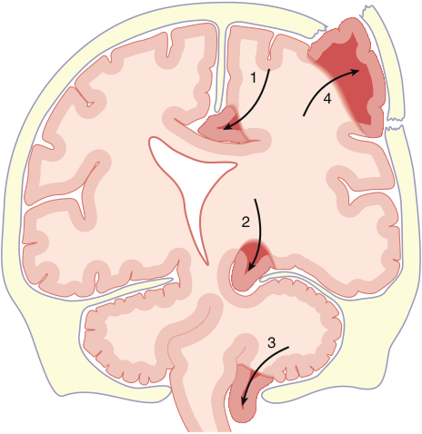

1 4 2 3 

**Fig. 53.1** Schematic representation of various herniation pathways: (1) sub- falcine, (2) uncal (transtentorial), (3) cerebellar, and (4) transcalvarial. (From Fishman RA. Brain edema. _N Engl J Med_ . 1975;293:706–711.)

(Fig. 53.2) consisting of the interpeduncular cistern, which lies between the two cerebral peduncles, the quadrigeminal cistern, which overlies the four colliculi, and the ambient cisterns, which lie lateral to the cerebral peduncles.

Fig. 53.3 presents the volume–pressure relationship of the intracranial space. The plateau phase occurring at low volumes reveals that the intracranial space is not completely closed, which confers some compensatory latitude. Compensation is accomplished principally by the translocation of cerebrospinal fluid (CSF) and venous blood to the spinal CSF space and the extracranial veins, respectively. Ultimately, when the compensatory potential is exhausted, even tiny incremental increases in volume can substantially increase ICP. These increases have the potential to result in either herniation of brain tissue from one compartment to another (or into the surgical field) (see Fig. 53.1), with resultant mechanical injury to brain tissue, or in reduction of perfusion pressure, leading to ischemic injury.

<!-- PDF page 3 -->

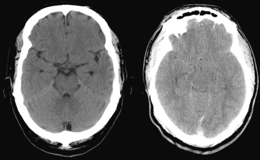

**Fig. 53.2 Computed tomography (CT) scan depicting normal (** **_left_ ) and compressed (** **_right_ ) basal cisterns.** The basal, or perimesencephalic, cerebrospinal fluid (CSF) space consists of the interpeduncular cistern (anterior), the ambient cisterns (lateral), and the quadrigeminal cisterns (posterior). In the right panel, the cisterns have been obliterated in a patient with diffuse cerebral swelling (caused by sagittal sinus thrombosis). (Courtesy Ivan Petrovitch, MD.)

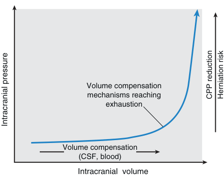

Volume compensation mechanisms reaching exhaustion Volume compensation (CSF, blood) Intracranial  volume Intracranial pressure CPP reduction Herniation risk 

**Fig. 53.3 The intracranial pressure–volume relationship.** The horizontal portion of the curve indicates that there is initially some latitude for compensation in the face of an expanding intracranial lesion. That compensation is accomplished largely by displacement of cerebrospinal fluid (CSF) and venous blood from intracranial to extracranial spaces. Once the compensatory latitudes are exhausted, small- volume increments result in large increases in intracranial pressure with the associated hazards of herniation or of decreased cerebral perfusion pressure (CPP), resulting in ischemia.

Several variables can interact to cause or aggravate intracranial hypertension (Fig. 53.4). For clinicians faced with the problem of managing increased ICP, the objective is, broadly speaking, to reduce the volume of the intracranial contents. For mnemonic purposes, the clinician can divide the intracranial space into four subcompartments (Table 53.1): cells (including neurons, glia, tumors, and extravasated collections of blood), fluid (intracellular and interstitial), CSF, and blood.

1. _The cellular compartment._ This compartment is largely the province of the surgeon. However, it may be the anesthesiologist’s responsibility to pose a well- placed diagnostic question. When the brain is bulging into the surgical field at the conclusion of evacuation of an extra- axial hematoma, the clinician should ask whether

a subdural or extradural hematoma is present on the contralateral side that warrants either immediate burr holes or immediate postprocedure radiologic evaluation.

2. _The CSF compartment._ There is no pharmacologic manipulation of the CSF space with an onset and magnitude that is relevant to the neurosurgical operating room. The only practical means of manipulating the size of this compartment is by drainage. A tight surgical field can sometimes be improved by passage of a brain needle by the surgeon into a lateral ventricle to drain CSF. Lumbar CSF drainage can be used to improve surgical exposure in situations with no substantial hazard of uncal or transforaminal magnum herniation.

3. _The fluid compartment._ This compartment can be addressed with steroids and osmotic/diuretic agents. The use of these agents is discussed later.

4. _The blood compartment._ This compartment receives the anesthesiologist’s greatest attention because it is the most amenable to rapid alteration. The blood compartment should be viewed as having two separate components: venous and arterial.

With respect to the blood compartment, the venous side of the circulation should initially be considered. It is largely a passive compartment and is often overlooked. Despite this passivity, engorgement of this compartment is a common cause of increased ICP or poor conditions in the surgical field (Fig. 53.5). A head- up posture to optimize venous drainage is the standard in neurosurgical anesthesia and critical care. Obstruction of cerebral venous drainage by extremes of head position or circumferential pressure (cervical collars, endotracheal tube ties) should be avoided. Anything that causes increased intrathoracic pressure can also result in impedance of cerebral venous drainage. Relevant phenomena include tension pneumothorax, very high levels of positive end-expiratory pressure (PEEP), coughing or straining against the endotracheal tube, or gas trapping due to bronchospasm. Unless contraindicated, neuromuscular blockade is usually induced during craniotomies to prevent coughing that may cause dramatic herniation of cerebral structures through the craniotomy site.

Thereafter, the arterial side of the circulation should be considered. Attention to the effect of anesthetic drugs and techniques on cerebral blood flow (CBF) (see Chapter 10) is an established part of neuroanesthesia because, in general, increases in CBF are associated with increases in cerebral blood volume (CBV).2–4 The notable exception to this rule occurs in the context of cerebral ischemia caused by hypotension or vessel occlusion, at which times CBV may increase as the cerebral vasculature dilates in response to a sudden reduction in CBF. However, the relationship generally applies, and attention to the control of CBF is relevant in situations in which intracranial volume compensation mechanisms are exhausted or ICP is already increased. The general approach is to select anesthetics and control physiologic variables in a manner that avoids unnecessary increases in CBF. The variables that influence CBF are listed in Box 53.2 and are discussed in Chapter 10.

### SELECTION OF ANESTHETICS

The question of which anesthetics are appropriate, especially in the context of unstable ICP, arises frequently.

<!-- PDF page 4 -->

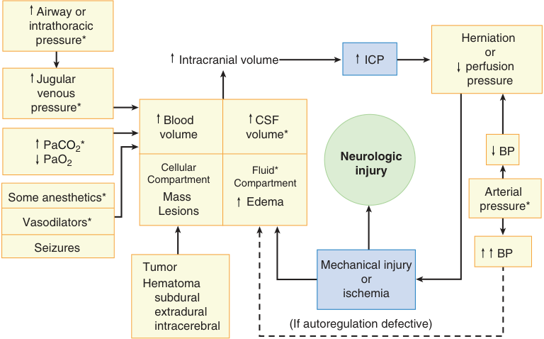

Airway or intrathoracic pressure* Herniation or Intracranial volume ICP perfusion Jugular pressure venous pressure* Blood CSF volume volume* PaCO2* BP PaO2 Neurologic Cellular Fluid* injury Compartment Compartment Arterial Some anesthetics* LesionsMass  Edema pressure* Vasodilators* Seizures BP Tumor Mechanical injury Hematoma or subdural ischemia extradural intracerebral (If autoregulation defective) 

**Fig. 53.4 The pathophysiology of intracranial hypertension.** The figure depicts the way increases in the volumes of any or all the four intracranial compartments, blood, cerebrospinal fluid (CSF), fluid (interstitial or intracellular), and cells, result in intracranial pressure (ICP) increases and eventual neurologic damage. The elements that are most readily under the control of the anesthesiologist are indicated with asterisks (*). (Control of CSF volume requires the presence of a ventriculostomy catheter.) _BP,_ blood pressure; _PaO2_ , arterial partial pressure of oxygen; _PaCO2_ , arterial partial pressure of carbon dioxide.

**Table 53.1** Intracranial Compartments and Techniques for Manipulation of their Volume

|**Compartment**|**Volume Control Methods**|
|---|---|
|1. Cells (including neurons, glia, tumors, and extravasated blood)|Surgical removal|
|2. Fluid (intracellular and extracellular)|Diuretics Steroids (principally tumors)|
|3. Cerebrospinal fluid|Drainage|
|4. Blood Arterial side Venous side|Decrease cerebral blood flow Improve cerebral venous drainage|

Chapter 10 provides relevant information in detail, and only broad generalizations are described here.

In general, intravenous anesthetic, analgesic, and sedative drugs are associated with parallel reductions in CBF and cerebral metabolic rate (CMR) and consequently will not have adverse effects on ICP. Ketamine, given in large doses to patients with a generally normal level of consciousness before anesthesia, is the exception. Autoregulation and carbon dioxide (CO2) responsiveness are generally preserved during the administration of intravenous anesthetics (see Chapter 10).

By contrast, all volatile anesthetics can be, depending on physiologic and pharmacologic circumstances, dosedependent cerebral vasodilators. The order of vasodilating potency is approximately halothane → enflurane → desflurane → isoflurane → sevoflurane. As noted in Chapter 10, the CBF differences among desflurane, isoflurane, and sevoflurane are unlikely to be clinically significant. The net CBF effect of a volatile anesthetic depends on the interaction of several factors: the concentration of the anesthetic,

the extent of previous CMR depression, simultaneous blood pressure changes acting in conjunction with previous or anesthetic- induced autoregulation abnormalities, and simultaneous changes in partial pressure of carbon dioxide in the arterial blood (PaCO2) acting in conjunction with any disease- related impairment in CO2 responsiveness.

Nitrous oxide (N2O) can also be a cerebral vasodilator. The CBF effect of N2O is greatest when it is administered as a sole anesthetic; least when it is administered against a background of narcotics, propofol, or benzodiazepines; and intermediate when it is administered in conjunction with volatile anesthetics (see Chapter 10).

Despite the vasodilatory potential of both N2O and volatile anesthetics, experience dictates that both, with the latter in concentrations less than the minimum alveolar concentration (MAC), can be used in most elective and many emergent neurosurgical procedures when administered as part of a balanced anesthetic technique in combination with opioids. However, there are exceptions. Because both N2O and volatile anesthetics can be vasodilators in some circumstances, when the compensatory latitude of the intracranial space has been exhausted and physiology is abnormal, omitting them on a just- in- case basis may be prudent. In a somnolent, vomiting patient with papilledema, a large tumor mass, and compressed basal cisterns, or in a traumatic brain injury (TBI) victim with an expanding mass lesion or obliterated cisterns and sulci on CT, a predominantly intravenous technique should be used until the cranium and dura are open. Thereafter the effect of the anesthetic technique can be assessed by direct observation of the surgical field. Although inhaled anesthetics are entirely acceptable components of most anesthetics for neurosurgery, in circumstances in which ICP is persistently increased or the surgical field is persistently “tight,” N2O and volatile anesthetics5,6 should be replaced by intravenous anesthetics.

::: details 原始表格與符號（PDF 第 4 頁）

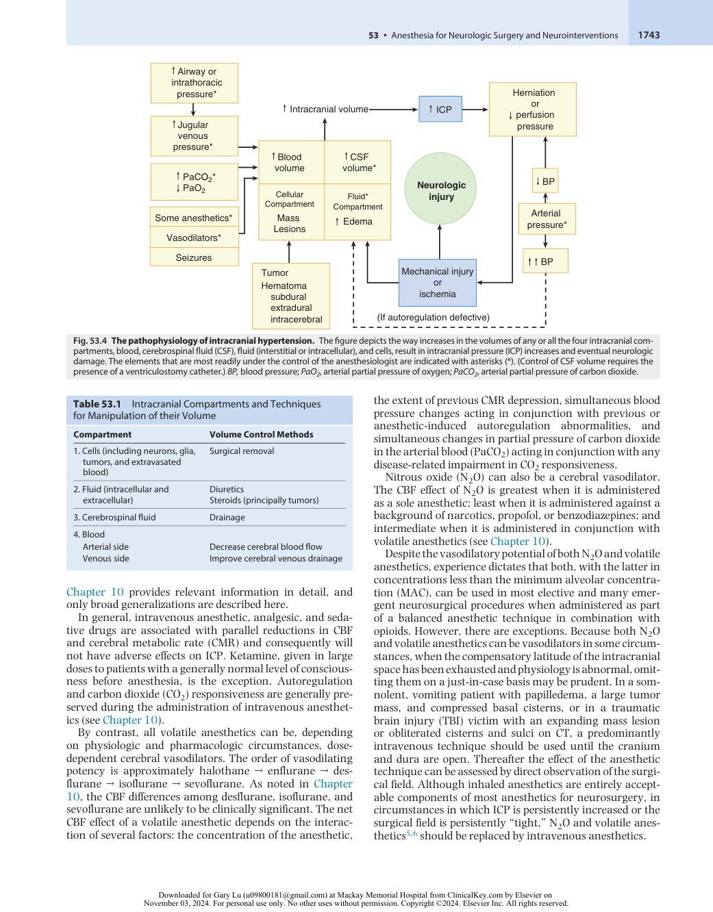

:::

<!-- PDF page 5 -->

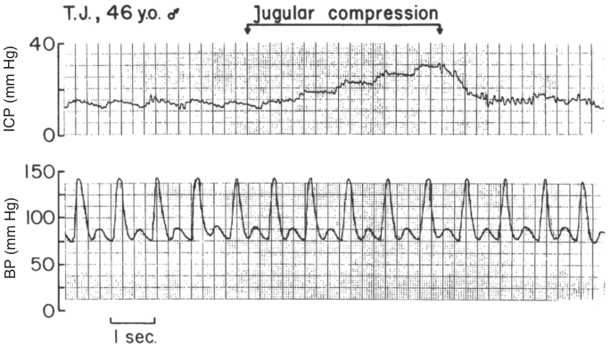

ICP (mm Hg) BP (mm Hg) 

**Fig. 53.5 The effect of cerebral venous outflow obstruction on intracranial pressure (ICP) in a patient with an intracerebral hematoma.** Bilateral jugular compression was applied briefly to verify the function of a newly placed ventriculostomy. The ICP response illustrates the importance of maintaining unobstructed cerebral venous drainage. _BP_ , blood pressure.

### Box 53.2 Factors that Influence Cerebral Blood Flow

### Box 53.3 High Intracranial Pressure (“Tight Brain”) Checklist

See Effects of Anesthetics on Cerebral Blood Flow and Cerebral Metabolic Rate in Chapter 10 for detailed discussion. ᑏ PaO2 ᑏ PaCO2

- Cerebral metabolic rate ᑏ Arousal/pain

- Seizures

- Temperature

- Anesthetics

- Blood pressure/status of autoregulation

- Vasoactive agents

- Anesthetics

- Pressors

- Inotropes

- Vasodilators

- Blood viscosity

- Neurogenic pathways (intra- and extra- axial)

1.  Are the relevant pressures controlled?

   - a.  Jugular venous pressure

   - i.  Extreme head rotation or neck flexion?

   - ii.  Direct jugular compression?

   - iii.  Head- up posture?

   - b.  Airway pressure

   - i.  Airway obstruction?

   - ii.  Bronchospasm?

   - iii.  Straining, coughing; adequately relaxed? iv.  Pneumothorax?

   - v.  Excessive PEEP or APR ventilation?

   - c.  Partial pressure of CO2 and O2 (PaCO2, PaO2)

   - d.  Arterial pressure

2.  Is the metabolic rate controlled?

   - a.  Pain/arousal?

   - b.  Seizures?

   - c.  Febrile?

3.  Are any potential vasodilators in use?

_PaO2_ , arterial partial pressure of oxygen; _PaCO2_ , arterial partial pressure of carbon dioxide.

   - a.  N2O, volatile agents, nitroprusside, calcium channel blockers?

4.  Are there any unrecognized mass lesions?

   - a.  Hematoma

Neuromuscular blockers that can release histamine (e.g., atracurium) should be given in small, divided doses. Although succinylcholine can increase ICP, the increases are small and transient. Moreover, the increases can be blocked by a preceding dose of nondepolarizing neuromuscular blocking drugs and, in at least some instances, are not evident in patients with common emergency neurosurgical conditions (TBI, subarachnoid hemorrhage [SAH]).7,8 Succinylcholine in conjunction with proper management of the airway and MAP can be used when rapid endotracheal intubation is needed.

From the material just presented and from the discussion of cerebral physiology in Chapter 10, a systematic clinical approach should follow easily. A schema for approaching the problem of an acute increase in ICP or acute deterioration in conditions in the surgical field is presented in Box 53.3.

If the problem has not resolved satisfactorily after following the approach in Box 53.3, Box 53.4 presents options for

   - b.  Air ± N2O

   - c.  CSF (clamped ventricular drain)

- _APR,_ airway pressure release; _CSF,_ cerebrospinal fluid; _PEEP,_ positive endexpiratory pressure.

### Box 53.4 Methods for Rapid Reduction of Intracranial Pressure and Brain Volume (After Review of the Checklist in Box 53.3)

- Further reduction of PaCO2 (to not less than 23–25 mm Hg)

- CSF drainage (ventriculostomy, brain needle) ᑏ Diuresis

- CMR suppression (barbiturates, propofol)

- MAP reduction (if dysautoregulation)

- Surgical control (i.e., lobectomy or removal of bone flap)

- Hyperosmolar therapy (mannitol, hypertonic saline)

- _CSF_ , cerebrospinal fluid; _CMR_ , cerebral metabolic rate; _MAP_ , mean arterial pressure; _PaCO2_ , arterial partial pressure of carbon dioxide.

<!-- PDF page 6 -->

resolution. CSF drainage was discussed earlier. Additional hyperosmolar solutions are frequently used (see Osmotherapy and Diuretics, below). Barbiturates have long been the most widely used drugs for inducing reduction in CMR, with the objective of causing a coupled reduction in CBF and CBV. Propofol has gained popularity for this application. However, although the use of barbiturates is supported by intensive care unit (ICU) experience demonstrating efficacy in ICP control9 (if not outcome), little such evidence has been accumulated for propofol. Furthermore, a frequently fatal syndrome of metabolic acidosis and rhabdomyolysis has been recognized in patients who have received prolonged propofol infusions in the ICU.10–12

### MANAGEMENT OF PaCO2

The anesthesiologist and the surgeon should agree on the objectives with respect to PaCO2. Induction of hypocapnia was once a routine part of the management of intracranial neurosurgical procedures. The rationale is principally that the concomitant reduction in CBF (see Chapter 10, Fig. 10.11) and CBV will result in a reduction in ICP, or “brain relaxation.” The rationale is valid.13,14 However, two considerations should influence the clinician’s use of hyperventilation. First, the vasoconstrictive effect of hypocapnia can cause ischemia in certain situations. Second, the CBFlowering and ICP- lowering effect is not sustained for prolonged time periods.14,15

### Hypocapnia- Induced Cerebral Ischemia

A normal brain is unlikely to be damaged by the typical clinical use of hyperventilation. However, this may not be the case in certain pathologic conditions.

**Normal Brain.** Available data16–18 indicate that in normal subjects, ischemia will not occur at a PaCO2 greater than 20 mm Hg. In one investigation,17 electroencephalogram (EEG) abnormalities and paresthesia occurred in volunteers hyperventilating to PaCO2 values less than 20 mm Hg, and these effects were reversed by hyperbaric oxygenation, suggesting the changes may truly have been caused by ischemia. Accordingly, given that a PaCO2 of less than 20 to 25 mm Hg offers very little additional benefit in terms of improvement in intracranial compliance, acute reduction of PaCO2 should rarely exceed 25 mm Hg in previously normocapnic persons.

**Injured Brain.** Preventing herniation, maintaining ICP below target threshold, minimizing retractor pressure, and facilitating surgical access remain priorities that may justify hypocapnia. Yet hyperventilation is potentially deleterious and should not be overused. Hyperventilation can result in ischemia,19,20 especially when baseline CBF is low, as is commonly the case in the first 24 hours after injury.21–23 An increased frequency of brain regions with very low CBF has been demonstrated in head- injured patients who were acutely hyperventilated.19,20,24 In addition, low levels of jugular venous oxygen saturation (SjvO2) can be increased by reducing the degree of hyperventilation.25–27

The deleterious effect of hyperventilation is difficult to prove. Muizelaar and colleagues28 performed a study that included a near-normocapnic group in which PaCO2 was

maintained at approximately 35 mm Hg, and a hypocapnic group in which PaCO2 was maintained in the vicinity of 25 mm Hg. Outcomes at 3 and 6 months after injury were not different. However, in a subset of patients with the best initial motor scores, outcome was better in the normocapnic group. These patients with good motor scores probably represented a subgroup in which the severity of injury was such that, although they needed tracheal intubation, hyperventilation was not necessarily required for control of ICP and who therefore had little to gain from hyperventilation. Thus, prophylactic hyperventilation seemed inadvisable. That conclusion has been extrapolated far beyond the circumstances of relatively mild TBI.

Hyperventilation should not be an automatic component of every neuroanesthetic. There should be an indication for its initiation (usually increased or uncertain ICP or the need to improve conditions in the surgical field, or both). Hyperventilation has the potential to cause an adverse effect and should be withdrawn as the indication for it subsides. The concern regarding the hazards of hypocapnia, which evolved in the context of TBI, has influenced all of neurosurgery. In particular, it is now widely avoided in the management of SAH because of the low CBF state that is known to occur.29,30 In addition, brain tissue beneath retractors can have a similarly reduced CBF.31,32 However, hyperventilation, used as briefly as possible, is still very much a component of rescue therapy, when herniation is imminent or in progress, or when conditions in the surgical field are too difficult to allow surgery to proceed.

### Duration of Hypocapnia- Induced Reduction in Cerebral Blood Flow

The effect of hypocapnia on CBF is not sustained. Fig. 53.6 is a nonquantitative representation of changes in CBF and CSF pH occurring in association with a sustained period of hyperventilation. With the onset of hyperventilation, the pH of both CSF and the brain’s extracellular fluid space increases, and CBF decreases abruptly. However, the cerebral alkalosis is not sustained. By alterations in function of the enzyme carbonic anhydrase, the concentration of bicarbonate in CSF and the brain’s extracellular fluid space is reduced, and with a time course of 8 to 12 hours, the pH of these compartments returns to normal. Simultaneously, CBF returns toward normal levels.33,34 The implications are twofold. First, patients should be hyperventilated for only as long as a reduction in brain volume is required. Prolonged, unnecessary hyperventilation can lead to a circumstance wherein subsequent events call for additional maneuvers to reduce the volume of the intracranial contents and then incremental hyperventilation is not efficacious. If, after adaptation, PaCO2 is already in the 23 to 25 mm Hg range, additional hyperventilation may risk pulmonary barotrauma. Second, in a patient who has been hyperventilated for a sustained period (e.g., 2 days in an ICU setting), restoration of PaCO2 from values in the vicinity of 25 mm Hg to typical normal values (e.g., 40 mm Hg) should ideally be accomplished slowly. A sudden increase in PaCO2 from 25 to 40 mm Hg in a patient who has been chronically hyperventilated will have the same physiologic effect that a rapid change from 40 to 55 mm Hg would have in a previously normocapnic patient.

<!-- PDF page 7 -->

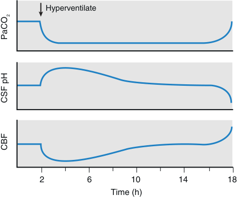

Hyperventilate 2 6 10 14 18 Time (h) PaCO2 CSF pH CBF 

**Fig. 53.6 Partial pressure of carbon dioxide in the arterial blood (PaCO2), cerebral blood flow (CBF), and cerebrospinal fluid (CSF) pH changes with prolonged hyperventilation.** Although the decreased arterial PaCO2 (and the systemic alkalosis) persists for the duration of the period of hyperventilation, the pH of the brain and CBF return toward normal over 8 to 12 hours.

If hypocapnia has been required as an adjunct to brain relaxation during craniotomy, PaCO2 should also be allowed to increase once the retractors are removed (if dural closure requirements permit) to minimize the residual intracranial pneumatocele (see the section on Pneumocephalus, below).

### MANAGEMENT OF ARTERIAL BLOOD PRESSURE

Acceptable arterial blood pressure limits should similarly be agreed on at the beginning of a neurosurgical procedure. One of the prominent themes of contemporary neurosurgery is that CPP should be maintained at normal or even high- normal levels after acute central nervous system insults and during most intracranial neurosurgical procedures. This concept has evolved from the appreciation that CBF is frequently very low in some brain regions after acute neurologic insults, particularly TBI and SAH. Two additional factors should be considered. The first is that the autoregulatory response to decreasing blood pressure may not be intact throughout the brain. Fig. 53.7 depicts the ischemic hazard that attends the circumstance of a low resting CBF and absent autoregulation even at blood pressure levels considered safe when autoregulation is intact. In addition, maintenance of arterial pressure is also relevant to brain compressed under retractors31 because the effective perfusion pressure is lowered by increased local tissue pressure.

Although the only supportive data are anecdotal, we believe that an aggressive attitude toward arterial blood pressure support should also be given to patients who have sustained a recent spinal cord injury. The current AANS/ CNS guidelines advocate for mean arterial blood pressure support of 85–90 mm Hg.35 This concept also applies to a spinal cord that is under compression, at risk for compression or vascular compromise because of a disease process (most commonly cervical spinal stenosis with or without ossification of the posterior longitudinal ligament) or an intended surgical procedure, and to those patients

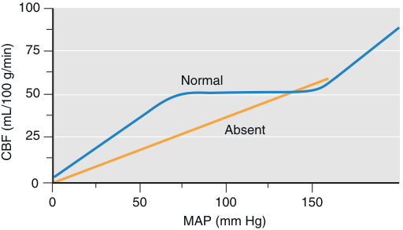

100 75 Normal 50 Absent 25 0 0 50 100 150 MAP (mm Hg) CBF (mL/100 g/min) 

**Fig. 53.7 Normal and absent autoregulation curves.** The “absent” curve indicates a pressure- passive condition in which cerebral blood flow (CBF) varies in proportion to cerebral perfusion pressure (CPP). This curve is drawn to indicate subnormal CBF values during normotension, as have been shown to occur immediately after head injury25 and subarachnoid hemorrhage.29 The potential for modest hypotension to cause ischemia is apparent. _MAP,_ mean arterial pressure.

undergoing surgery involving retraction of the spinal cord. We believe that arterial blood pressure during anesthesia in these patients should be maintained as closely as possible to, and certainly within, 10% of average awake values.

### STEROIDS

The administration of steroids for the purpose of reducing or limiting the formation of edema has a well- established place in neurosurgery. The efficacy of steroids in reducing edema associated with tumors36–39 and radiation- induced necrosis is well confirmed, but not the edema associated with any other intracranial pathology. Although the time course of this effect is relatively rapid, it is too slow for the management of acute intraoperative events. However, administration beginning 48 hours before an elective surgical procedure has the potential to reduce edema formation and improve the clinical condition by the time of craniotomy.36 Although clinical improvement occurs within 24 hours, a reduction in ICP may not occur for 48 to 72 hours after the initiation of therapy.36 Steroids somehow improve the viscoelastic properties of the intracranial space before a reduction in edema occurs, although the mechanism remains undefined.40 The practice of administering steroids to patients with TBI has been abandoned as a result of controlled trials that demonstrated either no benefit or deleterious effects.41

### OSMOTHERAPY AND DIURETICS

Hyperosmolar agents and diuretics are used widely in neurosurgery and neurocritical care to reduce the volume of the brain’s intracellular and extracellular fluid compartments. Both osmotic and loop diuretics have been used. Although loop diuretics can be effective,42 hyperosmolar agents are more widely used.

### Mannitol

Mannitol is used most commonly intraoperatively because of its long history of rapid and effective reduction of brain volume. The doses vary from 0.25 g/kg to 100 g, with 1.0 g/kg the most common dose. A systematic study in TBI

<!-- PDF page 8 -->

demonstrated that an equivalent initial ICP- reducing effect can be achieved with 0.25 g/kg, although the duration of effect is reduced compared to larger doses.43 More recent studies reported better surgical brain relaxation scores with higher doses (1–1.5 g/kg) of mannitol compared to a dose of 0.25 g/kg.44 Mannitol should be administered by infusion (e.g., over 10 to 15 minutes). Sudden exposure of the cerebral circulation to extreme hyperosmolarity can have a vasodilatory effect, which can produce brain engorgement and increased ICP, both of which do not occur with slower administration.

Mannitol enters the brain and, over a reasonably short time course, appears in the CSF space in small amounts.45 The possibility that the mannitol that gains access to the parenchyma aggravates swelling had resulted in varying degrees of reluctance among clinicians to administer mannitol.46 Most clinicians nonetheless find it to be a mainstay of ICP management. There is the concern that it will only be effective when some degree of blood–brain barrier (BBB) integrity is preserved in a significant portion of the brain. Clinicians respond to this concern by making empiric use of this agent; that is, if it is effective in reducing ICP or improving conditions in the surgical field, repeated doses are administered. The use of hyperosmolar agents is theoretically limited by an upper acceptable osmolarity limit of approximately 320 mOsm/L (although the data supporting the validity of that threshold are limited47 ). However, in life- threatening situations, the use is frequently empiric, and incremental doses (e.g., 12.5 g of mannitol) are administered until a clinical response is no longer observed.

### Hypertonic Saline

In the critical care environment, the use of hypertonic saline (HTS) in place of mannitol is increasing.48 Although the initial ICP effects of equiosmolar doses of mannitol and HTS are similar,49–52 HTS may have some advantages over mannitol in the ICU, where repeated administration makes the adverse effects (e.g., diuresis, renal injury) more likely to have clinical significance. In addition, there are anecdotal reports of HTS being effective in patients who were refractory to mannitol.53,54 Although there is enthusiasm for HTS,53,55,56 supporting data are limited.57–59 Furthermore, because of the variations in HTS concentrations (3%, 7.5%, 15%, 23.4%) and osmolar loads in the various studies, it is difficult to make specific recommendations. In TBI patients, HTS may provide superiority in the combined effect on intracranial pressure and cerebral perfusion pressure burden compared to mannitol, although a clear clinical outcome benefit has not been shown.60,61

### Diuretic Combinations

The combination of a loop diuretic (usually furosemide) and an osmotic diuretic is sometimes used. The superficial rationale is that mannitol establishes an osmotic gradient that draws fluid out of brain parenchyma and that the furosemide, by hastening excretion of water from the intravascular space, facilitates the maintenance of that gradient. A second mechanism may add additional justification for the practice of combining the two diuretics. Neurons and glia have homeostatic mechanisms to ensure regulation of cell volume. Neurons and glia that shrink in response to an increased osmolarity in the external environment recover

their volume rapidly because of the accumulation of socalled _idiogenic osmoles_ , which serve to minimize the gradient between the internal and external environments. One of those idiogenic osmoles is chloride. Loop diuretics inhibit the chloride channel through which the ion must pass and thereby retard the normal volume- restoring mechanism.62,63 These diuretic combinations may cause hypovolemia and electrolyte disturbances.

The normal volume regulatory mechanisms of neurons and glia may also be relevant to the phenomenon of rebound swelling. Rebound is commonly attributed to the prior use of mannitol and assumed to be a function of the accumulation of mannitol in cerebral tissue. Although possible, the rebound may in fact be hypertonic rebound rather than mannitol rebound. After a sustained period of hyperosmolarity of any etiology, rebound swelling of neurons and glia (which have accumulated idiogenic osmoles) may occur if systemic osmolarity decreases rapidly toward normal levels. Rebound cerebral swelling can certainly occur after an episode of extreme increase in blood glucose concentration. The use of HTS rather than mannitol will not obviate this phenomenon.

### ANTICONVULSANTS

The general principle is that any acute irritation of the cortical surface has the potential to result in seizures. This includes acute neurologic events such as TBI and SAH.64,65 Cortical incisions and brain surface irritation by retractors may similarly be potential foci. Given the relatively benign nature of contemporary anticonvulsants (e.g., levetiracetam), routine administration to patients undergoing most supratentorial craniotomies seems appropriate in the absence of a contraindication. There is no necessity for rapid administration because the intention is to prevent seizures during the postoperative period.

### POSITIONING

The intended surgical position and the necessary positioning aids should be agreed upon at the outset. The commonly used positions and positioning aids and supports are listed in Box 53.5 (see Chapter 30).

### General Considerations

The prolonged duration of many neurosurgical procedures should be considered in all positions. Pressure points should be identified and padded carefully. Pressure and traction on nerves must be avoided. Given the high risk of thromboembolic complications in neurosurgical patients, precautions including compression stockings and sequential compression devices are warranted. For cranial procedures, some component of head- up posturing (e.g., 15 to 20 degrees) is used to ensure optimal venous drainage. The conspicuous exception occurs with evacuation of a chronic subdural hemorrhage, after which patients may be nursed flat to discourage reaccumulation of fluid. Patients are occasionally also maintained flat after CSF shunting to avoid overly rapid collapse of the ventricles.

Positioning for craniotomy procedures frequently necessitates the use of skull pins for head fixation, the application of which can lead to a precipitous surge in blood pressure,

<!-- PDF page 9 -->

### Box 53.5 Common Neurosurgical Positions and Positioning Aids

|**Positions**|
|---|
|ᑏSupine|
|ᑏLateral (park bench)|
|ᑏSemilateral (Jannetta)|
|ᑏProne|
|ᑏSitting|
|**Positioning Aids/Supports**|
|ᑏPin (“Mayfield”) head holder|
|ᑏRadiolucent pin head holder|
|ᑏHorseshoe head rest|
|ᑏFoam head support (e.g., Voss, O.S.I., Prone- View)|
|ᑏVacuum mattress (“bean bag”)|
|ᑏWilson- type frame|
|ᑏAndrews (“hinder binder”)- type frame|
|ᑏRelton- Hall (four- poster) frame|

with potential deleterious effects. Anesthetic agents, including bolus propofol, fentanyl, remifentanil, or vasoactive adjuncts such as labetalol or esmolol should be given. This consideration is of utmost importance in the presence of an unsecured aneurysm.

### Supine

The supine position is used with the head neutral or rotated for frontal, temporal, or parietal access. Extremes of head rotation can obstruct the jugular venous drainage, and a shoulder roll can attenuate this problem. The head is usually in a neutral position for bifrontal craniotomies and transsphenoidal approaches to the pituitary. The head- up posture is best accomplished by adjusting the operating table to a chaise longue (lawn chair) position (hip flexion, pillows under the knees, slight reverse Trendelenburg). This orientation, in addition to promoting cerebral venous drainage, decreases back strain.

### Semilateral

The semilateral position, also known as the Jannetta position, named after the neurosurgeon who popularized its use for microvascular decompression of the fifth cranial nerve, is used for retromastoid access. It is achieved by lateral tilting of the table 10 to 20 degrees combined with a generous shoulder roll. Again, extreme head rotation, sufficient to cause compression of the contralateral jugular vein by the chin, should be avoided.

### Lateral

The lateral position can be used for access to the posterior parietal and occipital lobes and the lateral posterior fossa including tumors at the cerebellopontine angle and aneurysms of the vertebral and basilar arteries. An axillary roll is important for preventing brachial plexus injury.

### Prone

The prone position is used for spinal cord, occipital lobe, craniosynostosis, and posterior fossa procedures. For cervical spine and posterior fossa procedures, the final position commonly entails neck flexion, reverse Trendelenburg, and elevation of the legs. This orientation serves to bring the

surgical field to a horizontal position. There should be a plan for detaching and reattaching monitors in an orderly manner to prevent an excessive monitoring window. Awake tracheal intubation and prone positioning may be warranted in patients with an unstable cervical spine in whom an unchanged neurologic status should be confirmed before induction of anesthesia in the final surgical position.

The head can be secured in a pin head holder (applied before the turn) or positioned on a disposable foam head rest or, less frequently, a horseshoe head rest. A complication of the prone position, which requires constant attention, is retinal ischemia and blindness caused by orbital compression causing central retinal vessel occlusion. It must be intermittently confirmed (e.g., every 15 minutes) and after any surgery- related head or neck movement that pressure has not come to bear on the eye. However, not all postoperative vision loss (POVL) is a result of direct orbital compression. Posterior ischemic optic neuropathy appears to be a more frequent cause of POVL than pressure- causing occlusion of central retinal vessels. The cause- and- effect relationships associated with ischemic optic neuropathy are uncertain, but the use of Wilson frame, large blood loss, lengthy surgical procedures, and large intravascular volume fluid administration are statistically associated with the phenomenon.66,67

Direct pressure can also result in various degrees of pressure necrosis of the forehead, maxillae, and chin, especially with prolonged spinal procedures. Pressure should be distributed as evenly as possible over facial structures. Other pressure points to check include the axillae, breasts, iliac crests, femoral canals, genitalia, knees, and heels. Traction on the brachial plexus must be avoided and can usually be accomplished by not exceeding a “90- 90” position (arms abducted not >90 degrees; elbows extended not >90 degrees) with care taken to ensure that the elbow is anterior to the shoulder to prevent wrapping of the brachial plexus around the head of the humerus. An antisialagogue (e.g., glycopyrrolate) and an adhesive (e.g., benzoin) may help reduce loosening of the tape used to secure the endotracheal tube.

An objective during prone positioning, especially for lumbar spine surgery, is the avoidance of compression of the inferior vena cava. Impairment of vena cava return diverts blood to the epidural plexus and increases the potential for bleeding during spinal surgery. Minimizing vena cava pressure is an objective of all spinal surgery frames and is accomplished effectively by the Wilson, Andrews, and Jackson variants. However, this does introduce a risk of air embolism,68 although severe clinical occurrences have been very infrequent.69

Attention should be paid to preventing injury to the tongue in the prone position. With both cervical and posterior fossa procedures, it is frequently necessary to flex the neck substantially to facilitate surgical access. This reduces the anterior–posterior dimension of the oropharynx, and compression ischemia of the base of the tongue (as well as the soft palate and posterior wall of the pharynx) can occur in the presence of foreign bodies (endotracheal tube, esophageal stethoscope, oral airway). In addition, over- flexion of the neck can result in compression of the internal jugular veins and must be avoided. In general, there should be a minimum of 2–3 fingerbreadths of submandibular space

::: details 原始表格與符號（PDF 第 9 頁）

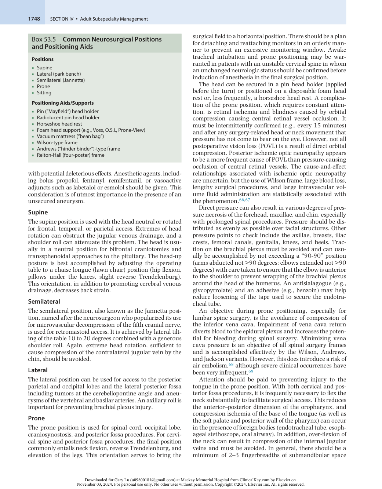

:::

<!-- PDF page 10 -->

between the chin and the neck. The consequence can be macroglossia, caused by accumulation of edema after reperfusion of the ischemic tissue causing airway obstruction of rapid onset after extubation70 (discussed later). Accordingly, placing unnecessary apparatus in the oral cavity and pharynx should be avoided. Omitting the bite block entirely is unwise because the tongue may then protrude between and be trapped by the teeth as progressive swelling of facial structures occurs during a prolonged prone procedure. A rolled gauze bite block prevents this problem without adding bulk to the oropharynx.

### Sitting

There have been several reviews of large experiences with the sitting position.71–73 All concluded that the sitting position can be used with acceptable rates of morbidity and mortality. However, these reports were prepared by groups that perform 50 to 100 or more of these procedures per year, and the hazards of the sitting position may be more frequent for teams who have less experience. The sitting position can be avoided by using one of its alternatives (prone, semilateral, lateral). However, this position will continue to be used because even surgeons who are inclined to use alternative positions may opt for it when access to midline structures (e.g., the quadrigeminal plate, the floor of the fourth ventricle, the pontomedullary junction, and the vermis) is required. Nonetheless, alternative positions for posterior fossa surgery are available and should be considered when contraindications to the sitting position exist (e.g., patent foramen ovale, vascular insufficiency when awake, poorly controlled hypertension, severe cardiomyopathy).

**Achieving the Sitting Position.** The properly positioned patient is more commonly in a modified recumbent position as shown in Fig. 53.8 rather than truly sitting. The legs should be kept as high as possible (usually with pillows under the knees) to promote venous return. The head holder should be attached to the back portion of the table (see Fig. 53.8A) rather than to the portions under thighs or legs74 (see Fig. 53.8B). This permits lowering of the head and closed chest compressions if necessary, without the necessity of first taking the patient out of the head holder.

When procedures are performed in the sitting position, the clinician should think in terms of measuring and maintaining perfusion pressure at the level of the surgical field. This is best accomplished by referencing transducers to the level of the external auditory canal. If a manual blood pressure cuff on the arm is used, a correction* to allow for the hydrostatic difference between the arm and the operative field should be applied.

A series of hazards are associated with the sitting position. Circulatory instability, macroglossia, and quadriplegia are discussed in this section. Pneumocephalus is discussed in its own section. Venous air embolism (VAE) and paradoxical air embolism (PAE) are discussed in the section on Venous Air Embolism, below. Several of these hazards are also relevant when cervical spine and posterior fossa procedures are performed in nonsitting positions but occur with greater frequency in the sitting position.

> * A column of blood 32 cm high exerts an approximate pressure of 25 mm Hg.

**Cardiovascular Effects of the Sitting Position.** Hypotension should be avoided. Prepositioning hydration, compressive stockings, and slow, incremental adjustment of table position are appropriate. Intravenous vasopressor administration may be required in some patients. However, in most healthy patients the hemodynamic changes are of a nonthreatening magnitude. In a study of healthy anesthetized adults aged 22 to 64 years old, relatively modest changes were observed.75 MAP was relatively unaffected, whereas wedge pressure, stroke volume, and cardiac index decreased – the latter by approximately 15% – although there was some variation with the anesthetics used. The combination of an unchanged MAP (which in general requires the use of a light, high sympathetic tone anesthetic) and a reduced cardiac index implies that systemic vascular resistance (SVR) increased. Their calculations and the observations of other investigators76 reveal significant increases in SVR. For patients in whom an abrupt increase in SVR may be poorly tolerated, the sitting position may represent a physiologic threat and alternative positions should be considered.

During procedures performed in the sitting position, MAP should be transduced at or corrected to head level to provide a meaningful index of CPP. Specifically, CPP (MAP − estimated ICP) should be maintained at a minimum value of 60 mm Hg in healthy patients in whom it is reasonable to assume a normal cerebral vasculature. The safe lower limit should be raised for elderly patients, for those with hypertension or known cerebral vascular disease, or for those with degenerative disease of the cervical spine or cervical spinal stenosis who may be at risk for decreased spinal cord perfusion, and if substantial or sustained retractor pressure must be applied to brain or spinal cord tissue.

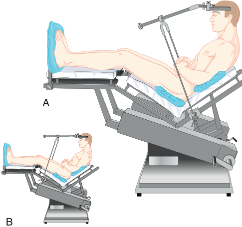

A B 

**Fig. 53.8 The sitting position.** The patient is typically semirecumbent rather than sitting. (A) The head- holder support is correctly positioned so that the head can be lowered without the necessity to first detach the head holder. (B) This configuration, with the support attached to the thigh portion of the table, should be avoided. (From Martin JT. _Positioning in Anesthesia and Surgery_ , Philadelphia, 1988, Saunders, with permission.)

<!-- PDF page 11 -->

**Macroglossia.** There have been sporadic reports of upper airway obstruction after posterior fossa procedures in which swelling of pharyngeal structures, including the soft palate, posterior pharyngeal wall, and base of the tongue, has been observed.70,77,78 These episodes have been attributed to edema formation at the time of reperfusion following prolonged ischemia, occurring as the result of foreign bodies (usually oral airways) causing pressure on these structures in the circumstances of lengthy procedures with sustained neck flexion (which is usually required to improve access to posterior structures). As with the prone position, it is customary to maintain at least two or three fingerbreadths between the chin/mandible and the sternum/clavicle to prevent excessive reduction of the anterior–posterior diameter of the oropharynx. Consideration of the macroglossia phenomenon may also be relevant as clinicians contemplate the use of transesophageal echocardiography (TEE) in the neurosurgery suite. The centers that routinely use TEE in neurosurgery mostly use pediatric diameter probes to avoid trauma to pharyngeal and perilaryngeal structures.

**Quadriplegia.** The sitting position has been implicated as a cause of rare instances of unexplained postoperative quadriplegia. It has been hypothesized79 that the neck flexion that is a common concomitant of the seated position may result in stretching or compression of the cervical spinal cord, often in the presence of osteophytes. This possibility may represent a relative contraindication to the use of this position in patients with significant degenerative disease of the cervical spine, especially when there is evidence of associated cerebral vascular disease. The arterial blood pressure management implications are mentioned in the preceding section on cardiovascular effects. It may also represent a justification for evoked response monitoring during the positioning phase of a sitting procedure for patients perceived to be at high risk (see also Chapter 35.)

### PNEUMOCEPHALUS

The issue of pneumocephalus arises most often in connection with posterior fossa craniotomies performed with a head- up posture.80 During these procedures, air may enter the supratentorial space, much as air enters an inverted pop bottle. Depending on the relationship of the brainstem and temporal lobes to the incisura, the pressure in the air collection may or may not be able to equilibrate with atmospheric pressure. This phenomenon has relevance to the use of N2O because any N2O that enters a trapped gas space augments the volume of that space. In those (probably uncommon) intraoperative circumstances where there is, in fact, a completely closed intracranial gas space, the use of N2O may result in an effect comparable with that of an expanding mass lesion. We do not view N2O as absolutely contraindicated because, before dural closure, intracranial gas is probably only rarely trapped.81 Nonetheless, attention to this possibility is important when one is presented with the problem of an increasingly tight brain during a posterior fossa craniotomy.82,83

During a posterior fossa procedure done in a head- up posture, when surgical closure has reached a stage such that the intracranial space has been completely sealed from the atmosphere, N2O should be omitted because of

the possibility of contributing to a tension pneumocephalus. Note that the use of N2O up to the point of dural closure may actually represent a clinical advantage,84 as in rabbits the gas pocket has been shown to shrink more rapidly because of the presence of N2O (because N2O diffuses much more quickly than nitrogen). Tension pneumocephalus is often naively viewed as exclusively a function of the use of N2O. However, tension pneumocephalus can most certainly occur as a complication of intracranial neurosurgery entirely unrelated to the use of N2O.85 It is one of the causes of delayed awakening or nonawakening after both posterior fossa and supratentorial procedures (Fig. 53.9).85,86 It occurs because air enters the cranium when the patient is in a head- up position at a time when the volume of the intracranial contents has been reduced because of some combination of hypocapnia, good venous drainage, osmotic diuresis, and CSF loss from the operative field. When the cranium is closed and the patient is returned to the near-supine position, CSF, venous blood, and extracellular fluid return or reaccumulate and the air pocket becomes an unyielding mass lesion (because of the very slow diffusion of nitrogen). It may cause delayed recovery of consciousness or severe headache. Among supratentorial craniotomies, the largest residual air spaces occur after frontal skull base procedures in which energetic brain relaxation measures are used to facilitate subfrontal access (see Fig. 53.9). At the end of these procedures, typically done in a supine/brow- up position, the intracranial dead space cannot be filled with normal saline as is commonly done with smaller craniotomy defects, and there may be a large residual pneumatocele. We doubt that the possible occurrence of this phenomenon

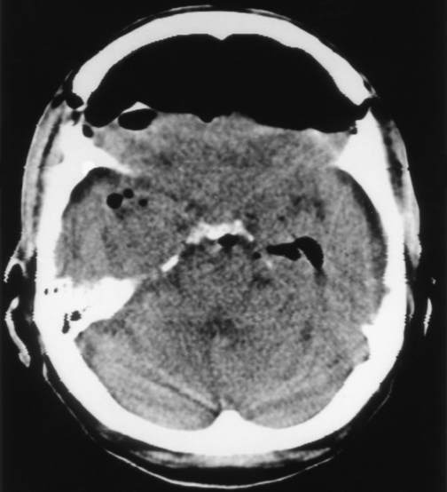

**Fig. 53.9** Postoperative computed tomographic scan demonstrating a large pneumocephalus after a subfrontal approach to a suprasellar glioma. Immediately postoperatively, the patient was confused and agitated, and he complained of a severe headache.

<!-- PDF page 12 -->

represents a contraindication to N2O. However, withdrawal of N2O may be appropriate at the time of scalp closure. The diagnosis of pneumocephalus is established by a brow- up lateral radiography or, more commonly, a CT scan. The treatment for suspected tension pneumocephalus is a twist- drill hole followed by needle puncture of the dura.

Residual intracranial air should be considered at the time of repeat anesthesia, both neurosurgical and nonneurosurgical. Air frequently remains evident on CT scan for more than 7 days after a craniotomy.87 Pneumocephalus can also develop _de novo_ in the postoperative period in patients who have a residual dural defect and a communication between the nasal sinuses and the intracranial space.88

### VENOUS AIR EMBOLISM

The incidence of VAE varies according to the procedure, the intraoperative position, and the detection method used. During posterior fossa procedures performed in the sitting position, VAE is detectable by precordial Doppler in approximately 40% of patients and by TEE in as much as 76%.89–92 The incidence of VAE during posterior fossa procedures performed in nonsitting positions is much less (12% using precordial Doppler in the report of Black and colleagues93 ), and it is probable but unproven that the average volume of air entrained per event is also smaller. The incidence of VAE is apparently lower with cervical laminectomy (25% using TEE in the sitting position versus 76% for posterior fossa procedures91 ). Although VAE is principally a hazard of posterior fossa and upper cervical spine procedures, especially when they are performed in the sitting position, it can occur with any supratentorial procedures. The most common situations involve tumors, most often parasagittal or falcine meningiomas, that encroach on the posterior half of the sagittal sinus (Fig. 53.10) and craniosynostosis procedures, typically performed in children.94,95 Pin sites can also serve as VAE access sites. Accordingly, pin head holders should be removed after the patient has been taken out of significant degrees of the head- up positioning. Spontaneous ventilation (with the attendant intermittent negative intrathoracic pressure) will increase the risk of air entrainment. A 6% incidence of Doppler- detectable VAE was reported in a series of deep brain stimulator placement procedures performed in spontaneously breathing patients.96

The common sources of critical VAE are the major cerebral venous sinuses, in particular. The transverse, the sigmoid, and the posterior half of the sagittal sinus, all of which may be noncollapsible because of their dural attachments. Air entry may also occur via emissary veins, particularly from suboccipital musculature, via the diploic space of the skull (which can be violated by both the craniotomy and pin fixation) and the cervical epidural veins. It is believed (but not confirmed by systematic study) that the VAE risk associated with cervical laminectomy is more likely when the exposure requires dissection of suboccipital muscle with the potential to open emissary veins to the atmosphere at their point of entry into occipital bone. There is also anecdotal evidence97 that air under pressure

in the ventricles or subdural space can occasionally enter the venous system, perhaps along the normal egress route of the CSF.

### Detection of Venous Air Embolism

The monitors used for the detection of VAE ideally should provide (1) a high level of sensitivity, (2) a high level of specificity, (3) a rapid response, (4) a quantitative measure of the VAE event, and (5) an indication of the course of recovery from the VAE event. The combination of a precordial Doppler and expired CO2 monitoring meets these criteria and is the current practice in many institutions. Doppler placement in a left or right parasternal location between the second and third or third and fourth ribs has a very high detection rate for gas embolization,98 and when good heart tones are heard, maneuvers to confirm adequate placement appear to be unnecessary. The TEE is more sensitive than the precordial Doppler (Fig. 53.11) to VAE99 and offers the advantage of also identifying rightto- left shunting of air. However, its safety during prolonged use (especially with pronounced neck flexion) is not well established. Expired nitrogen analysis is theoretically attractive. However, the expired nitrogen concentrations involved in anything less than catastrophic VAE are very small and push the available instrumentation to the limits of its sensitivity.100

Fig. 53.12 presents the physiologic and monitor response to an air embolic event, and Box 53.6 offers an appropriate management response to such an event.

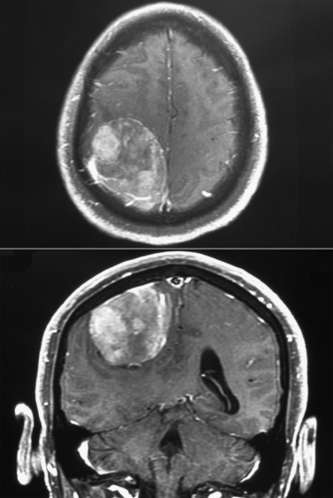

**Fig. 53.10 Axial (** **_top_ ) and coronal (** **_bottom_ ) magnetic resonance images of a parasagittal meningioma.** Resection of meningiomas arising from the dural reflection overlying the sagittal sinus or from the dura of the adjacent convexity or falx often entails a risk of venous air embolism because of the proximity of the sagittal sinus (the triangular structure at the superior end of the interhemispheric fissure in the bottom panel).

<!-- PDF page 13 -->

### Which Patients Should Have a Right Heart Air Retrieval Catheter?

All patients who undergo sitting posterior fossa procedures should have a right heart catheter placed. Although lifethreatening VAE is relatively uncommon, a catheter permits immediate evacuation of an air- filled atrium, preventing further entry of air into the ventricle. With the nonsitting positions, it is frequently appropriate, after a documented

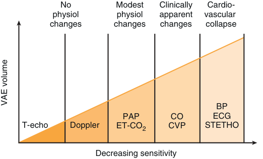

No Modest Clinically Cardio- physiol physiol apparent vascular changes changes changes collapse BP PAP CO ECG T-echo Doppler ET-CO2 CVP STETHO Decreasing sensitivity VAE volume 

**Fig. 53.11 The relative sensitivity of various monitoring techniques to the occurrence of venous air embolism.** _BP_ , blood pressure; _CO_ , cardiac output; _CVP_ , central venous pressure; _ECG_ , electrocardiogram; _ET- CO2_ , end- tidal carbon dioxide; _PAP_ , pulmonary artery pressure; _STETHO_ , esophageal stethoscope; _T- echo_ , transesophageal echo; VAE, venous air embolism.

discussion with the surgeon, to omit the right heart catheter. The perceived risks of VAE associated with the intended procedure, and the patient’s physiologic reserve are the variables that contribute to the decision. Microvascular decompression of the fifth or seventh cranial nerves are examples of procedures for which the right heart catheter is usually omitted. The essentially horizontal semilateral position and the very limited retromastoid craniectomy that is required have resulted (at our institution) in a very low incidence of Doppler- detectable VAE. One should know the local surgical practices, particularly with respect to the degree of head- up posture, before deciding to omit a right atrial catheter. Regarding the Jannetta procedure, the necessary retromastoid craniectomy is performed in the angle between the transverse and sigmoid sinuses, and venous

### Box 53.6 Management of an Acute Air Embolic Event

 1.  Prevent further air entry 

- Notify surgeon (flood or pack surgical field)

- Jugular compression

ᑏ  Lower the head 

 2.  Treat the intravascular air 

ᑏ  Aspirate right heart catheter 

ᑏ  Discontinue N2O 

ᑏ  FiO2: 1.0 

ᑏ  Pressors, inotropes 

ᑏ  Chest compression 

FiO2 , fraction of inspired oxygen. 

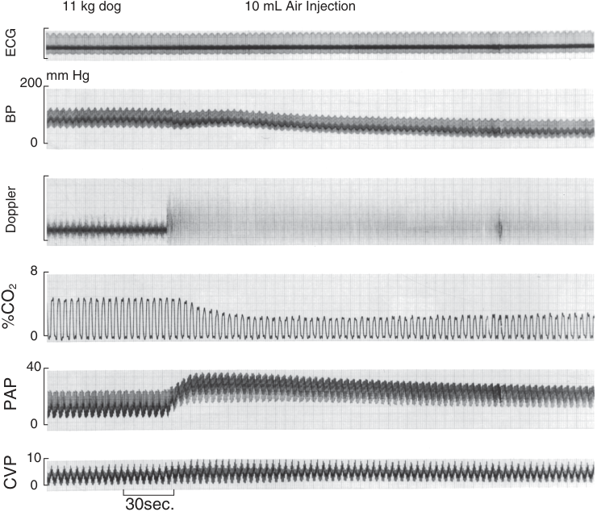

11 kg dog 10 mL Air Injection 200 mm Hg 0 8 0 40 0 10 0 30sec. ECG BP Doppler %CO2 PAP CVP 

**Fig. 53.12** The responses of the electrocardiogram (ECG), arterial pressure, pulmonary artery pressure (PAP), pan- tidal CO2 concentration, a precordial Doppler and central venous pressure (CVP) to the intravenous administration of 10 mL of air over 30 seconds to an 11- kg dog. _BP_ , blood pressure.

<!-- PDF page 14 -->

sinusoids and emissary veins in the suboccipital bone are common. If this procedure is performed with any degree of head- up posturing, the risk of VAE may still be substantial.

### Which Vein Should Be Used for Right Heart Access?

Although some surgeons may ask that neck veins not be used, a skillfully placed jugular catheter is usually acceptable. In a very limited number of patients, high ICP may make the head- down posture undesirable. In others, unfavorable anatomy with an increased likelihood of a difficult cannulation and hematoma formation may also encourage the use of alternate access sites.

### Positioning the Right Heart Catheter

The investigation of Bunegin and colleagues suggested that a multiorificed catheter should be located with the tip 2 cm below the superior vena caval–atrial junction and a single- orificed catheter with the tip 3 cm above the superior vena caval–atrial junction.101 Although these small distinctions in location may be relevant for optimal recovery of small volumes of air when cardiac output is well maintained, for the recovery of massive volumes of air in the face of cardiovascular collapse, anywhere in the right atrium should suffice. Confirmation of right heart placement can be accomplished by (1) radiography, (2) intravascular electrocardiography (ECG),102 or (3) TEE.103 Although there is no literature to support the practice, with catheter access via the right internal jugular vein, a measured placement to the level of the second or third right intercostal space should suffice when the catheter passes readily. The intravascular electrocardiography technique makes use of the fact that an ECG “electrode” placed in the middle of the right atrium will initially “see” an increasing positivity as the developing P- wave vector approaches it (Fig. 53.13), and then an increasing negativity as the wave of atrial depolarization passes and moves away from it. The resultant biphasic P wave is characteristic of an intra- atrial electrode position. The technique requires that the CVP catheter become an exploring ECG electrode. This is accomplished by filling the catheter with an electrolyte solution (bicarbonate is best) and attaching an ECG lead (the leg lead if lead II is selected) to the hub of the CVP catheter. Commercial CVP kits with an ECG adapter are available. The ECG configurations that will be observed at various intravascular locations are shown in Fig. 53.13. To minimize the microshock hazard, a batteryoperated ECG unit is preferable, and any unnecessary electrical apparatus should be detached from the patient during catheter placement.

### Paradoxical Air Embolism

The possibility of the passage of air across the interatrial septum via a patent foramen ovale (PFO), which is known to be present in approximately 25% of adults, is a concern.104 The risk is major cerebral and coronary morbidity. However, the precise definition of the morbidity that can be attributed to PAE is not clear. Although the minimal pressure required to open a probe PFO is not known with certainty, the necessary gradient may be as much as 5 mm Hg. In a clinical investigation, Mammoto and colleagues observed that PAE occurred only in the context of major air embolic events, suggesting that significant increases in

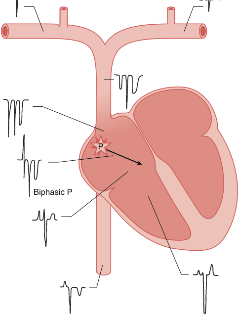

P Biphasic P 

**Fig. 53.13 Electrocardiogram (ECG) configurations observed at various locations when a central venous catheter is used as an intravascular ECG electrode.** The configurations in the figure will be observed when Lead II is monitored and the positive electrode (the leg electrode) is connected to the catheter. _P_ indicates the sinoatrial node. The _black arrow_ indicates the P- wave vector. Note the equi- biphasic P wave when the catheter tip is in the mid- right atrial position.102

right heart pressures are an important predisposing factor of the occurrence of PAE.105 Several clinical investigations have examined factors that influence the right atrial pressure (RAP) to left atrial pressure (LAP) gradient. The use of positive end- expiratory pressure (PEEP) increases the incidence of a positive RAP to pulmonary wedge pressure gradient106 and generous fluid administration (e.g., 2800 mL/ patient versus 1220 mL/control patient107 ) reduces it. As a result, the use of PEEP, which was once advocated as a means of preventing air entrainment, was abandoned. Similarly, the Valsalva maneuver, which transiently reverses the right–left atrial pressure gradient, is contraindicated in a patient with known PFO. Subsequently, the practice of more generous fluid administration for patients undergoing posterior fossa procedures evolved. However, even when mean LAP exceeds mean RAP, PAE can still occur because transient reversal of the interatrial pressure gradient can occur during each cardiac cycle.108

Some centers have advocated performing bubble studies preoperatively with echocardiography92 or transcranial Doppler (TCD),109 or intraoperatively using TEE prior to positioning110 to identify patients with a PFO with a view to using alternatives to the sitting position in this subpopulation.91 Some centers thereafter advocate the use of TEE to identify paradoxical embolization intraoperatively91,111

<!-- PDF page 15 -->

(see Chapter 33). However, none of these practices has become a community- wide standard of care. Furthermore, because the morbid events attributable to PAE have been relatively infrequent, surgeons who are convinced that the sitting position is optimal for a given procedure73 are loath to be dissuaded from using it on the basis of what may seem like the very minor possibility of an injury to the patient occurring by this mechanism.

### Transpulmonary Passage of Air

Air can sometimes traverse the pulmonary vascular bed to reach the systemic circulation.112–114 Transpulmonary passage is more likely to occur when large volumes of air are presented to the pulmonary vascular filter.115,116 In addition, pulmonary vasodilators, including volatile anesthetics, may decrease the threshold for transpulmonary passage.115–117 The magnitude of differences among anesthetics does not appear to mandate any related “tailoring” of anesthetic techniques. However, N2O should be discontinued promptly after even apparently minor VAE events because of the possibility that air may reach the left- sided circulation either via a PFO or the pulmonary vascular bed.

Box 53.6 presents an approach for responding to an acute VAE event. It includes raising venous pressure by direct compression of the jugular veins. PEEP and the Valsalva maneuver were once advocated. However, both PEEP106 and the release of a Valsalva maneuver increase the risk of PAE, and the relative superiority of jugular venous compression in raising cerebral venous pressures has been confirmed.118,119 Furthermore, the impairment of systemic venous return caused by the sudden application of substantial PEEP may be undesirable in the face of the cardiovascular dysfunction already caused by the VAE event.

It has been recommended that a patient who has sustained a hemodynamically significant VAE should be placed in a lateral position with the right side up. The rationale is that air will remain in the right atrium, where it will not contribute to an air lock in the right ventricle and where it will remain amenable to recovery via a right atrial catheter. The first difficulty is that this repositioning is all but impossible with a patient in a pin head holder. In addition, the only systematic attempt to examine the efficacy of this maneuver, albeit performed in dogs, failed to identify any hemodynamic benefit.120

### Nitrous Oxide

Nitrous oxide diffuses into air bubbles trapped in the vascular tree and, accordingly, N2O should be eliminated after a clinical VAE event to avoid aggravating the cardiovascular impact. As noted earlier, the PAE phenomenon adds an additional reason for eliminating N2O after the occurrence of VAE. When major VAE occurs, no matter how the RAP–LAP gradient was manipulated before the event, RAP increases abruptly with respect to LAP,121 and major VAE results in an acutely increased risk of PAE in patients with a PFO.105 Should N2O be used in patients at risk for VAE? Some clinicians may decide to simply avoid it. However, N2O can be used with the knowledge that it neither increases the incidence of VAE122 nor aggravates the hemodynamic response to VAE provided that it is eliminated when VAE occurs.123

### Box 53.7 Relative Indications for IntraArterial Pressure Monitoring

- Elevated intracranial pressure

- Ischemia or incipient ischemia of neural tissue

- Recent subarachnoid hemorrhage

- Recent head injury

- Recent spinal cord injury

- Intended or possible temporary vessel occlusion

- Circulatory instability

> ᑏ Trauma

- Spinal cord injury (spinal shock)

- Sitting position

- Possible barbiturate coma

- Possibility of induced hypotension

- Possibility of induced hypertension

- Anticipated or potential major blood loss

- Aneurysm clipping

- Arteriovenous malformations

- Vascular tumors

- Tumors involving or adjacent to major venous sinuses

- Craniofacial reconstruction

- Extensive craniosynostosis procedures

- Anticipated light anesthesia without paralysis

- Brainstem manipulation, compression, dissection

- Anticipated cranial nerve (CN) manipulation (especially CN V)

- Advantageous for postoperative intensive care

- Hypervolemic therapy

- Head injury

- Diabetes insipidus

- Incidental cardiac disease

### MONITORING

Neurologic monitoring techniques are discussed in Chapter 35. Invasive arterial monitoring is frequently appropriate in neurosurgery. Some of the numerous indications for an arterial catheter are listed in Box 53.7.

Patients with increased ICP may be intolerant of the vascular engorgement associated with sudden hypertension occurring because of light anesthesia. Surgical relief of increased ICP may be associated with sudden hypotension as brainstem compression is relieved. Beat- by- beat arterial pressure monitoring also serves as an important depth of anesthesia monitor and as an early neurologic injury warning system. Much of the brain is insensate. Consequently, the intradural portion of many neurosurgical procedures is not very stimulating and, to achieve circulatory stability, relatively light anesthesia is often necessary. There should be constant attention to the possibility of sudden arousal (most often associated with cranial nerve traction or irritation). This is especially important when paralysis is precluded by using motor-evoked potential monitoring or electromyographic recording from facial muscles to monitor cranial nerve integrity. Blood pressure responses may reveal imminent arousal; they may also serve to warn a surgeon of excessive or unrecognized irritation, traction, or compression of neurologic tissue. These occur most often with posterior fossa procedures involving brainstem or cranial nerves, and abrupt changes should be reported to the surgeon immediately.

The use of right heart catheters for air retrieval is discussed in the section on Venous Air Embolism, above. In

<!-- PDF page 16 -->

the absence of VAE risk and in the presence of good peripheral venous access, we rarely place right heart catheters for neurosurgical procedures. Antecedent cardiac disease may justify a pulmonary arterial catheter. The use of the precordial Doppler is also described in the section on Venous Air Embolism.

### INTRAVENOUS FLUID MANAGEMENT

The general principles of fluid management for neurosurgical anesthesia are (1) maintain normovolemia and (2) avoid reduction of serum osmolarity. The first principle is a derivative of the concept presented in the section on Management of Arterial Blood Pressure, above, which is that it is generally ideal to maintain a normal MAP in patients undergoing most neurosurgical procedures and neurosurgical critical care. Maintaining normovolemia is simply one element of maintaining a normal MAP. The second principle is a derivative of the observation that lowering serum osmolarity results in edema of both normal and abnormal brain.124,125 Administering fluids that provide free water (i.e., fluids that do not have sufficient nonglucose solutes to render them iso- osmolar with respect to blood) lowers serum osmolarity if the amount of free water administered is in excess of that required to maintain ongoing free water loss. Normal saline and balanced salt solutions are the fluids most often used intraoperatively. At 308 mOsm/L, normal saline is slightly hyperosmolar with respect to plasma (295 mOsm/L). However, it has the disadvantage that large volumes can cause hyperchloremic metabolic acidosis.126 The physiologic significance of this acidosis, which involves the extracellular but not the intracellular fluid space, is unclear. Hyperchloremia, which may have adverse effects on renal blood flow and glomerular filtration127 has been associated with acute kidney injury but the causal link remains uncertain.128 Previous comparisons between normal saline and balanced crystalloid solutions in the setting of cardiac surgery129 and critically ill intensive care patients130 did not reveal any adverse events (acute kidney injury, mortality, length of hospital stay) attributable to administration of normal saline. Nonetheless, to avoid hyperchloremic metabolic acidosis, many clinicians use lactated Ringer solution. Although lactated Ringer solution (273 mOsm/L) is in theory not ideal for replacement of blood and third space loss or insensible losses, it serves as an entirely reasonable compromise for meeting both needs simultaneously and is very suitable in most instances. It is a hypo- osmolar fluid, and in a healthy experimental animal, it is possible to reduce serum osmolarity and produce cerebral edema with a large volume of lactated Ringer solution.125 In the setting of large- volume fluid administration (e.g., significant blood loss, multiple trauma), it is the authors’ practice to alternate, liter by liter, lactated Ringer solution, and normal saline. Alternatively, Plasma- Lyte (Baxter International Inc., Deerfield, IL), a buffered crystalloid solution (pH 7.4) with physiochemical properties similar to plasma, may be considered, if available.131 Plasma- Lyte is considered isotonic with a reported osmolality of 294 mOsmol/kg. Although there may be advantages to the use of a physiologically balanced solution such as Plasma- Lyte, there remains insufficient clinical evidence to advocate for one fluid over another at present time. The recently published

PLUS trial (Plasma- Lyte 148 versus Saline), failed to demonstrate outcome improvement in a large multicenter trial of critically ill patients.132

The crystalloid versus colloid discussion is a recurrent one. It arises most commonly in the context of the patient with TBI. Although views differ, there has in fact been only a single demonstration that the reduction of colloid oncotic pressure (COP) in the absence of a change of osmolarity can actually contribute to an augmentation of cerebral edema in the setting of experimental head injury.133 The transcapillary membrane pressure gradients that can be produced by reduction of COP are in fact very small by comparison of those created by changes in serum osmolarity. Nonetheless, it appears that those small gradients, probably in the setting of an experimental BBB injury of intermediate severity, have the potential to augment edema. A fluid administration pattern should be selected that, in addition to maintaining normal serum osmolarity, prevents substantial reductions in COP. For most elective craniotomies, which entail only modest fluid administration, this does not require the administration of colloid solutions. However, in situations requiring substantial volume administration (e.g., multiple trauma, aneurysm rupture, cerebral venous sinus laceration, filling pressure support during barbiturate coma), a combination of isotonic crystalloid and colloid may be appropriate.

### Which Colloid Solutions Should Be Used?

Colloid administration has created increasing concern about not only its efficacy but also its safety. Based on empirical local experience, we view albumin to be a reasonable choice. However, there are conflicting opinions and cross- currents in the literature. An analysis of the subset of patients in the SAFE (Saline versus Albumin Fluid Evaluation) trial with severe TBI (Glasgow Coma Scale [GCS] score, 3 to 8) revealed increased mortality among those who received albumin.134 However, there are several reasons to be suspicious of that conclusion. First, SAFE trial patients were not originally randomized on the basis of TBI characteristics and, by chance, there were imbalances in TBI- related characteristics that appear to have placed the albumin group at greater risk.135 Second, the 4% albumin solution used was hypoosmolar (274 mOsm/L) and might have been expected to aggravate edema.136 Furthermore, there is no compelling physiologic explanation for an albumin- specific hazard. The formation of cerebral edema that is more difficult to clear is an inevitable suspicion.137 However, if valid, that should be a class effect relevant to all colloids (including fresh frozen plasma and starches) rather than being albumin specific. Furthermore, albumin has been used in TBI by others with no evidence of adverse effects.138,139 In contrast to alleged adverse effects in the context of TBI, there are potential beneficial effects in SAH.140,141 The ALIAS phase III clinical trial evaluated the use of albumin in acute stroke patients. Although albumin administration was associated with an increased rate of congestive heart failure (CHF), no negative impact was detected in the primary outcome measure – rate of favorable neurologic outcome at 90 days.142,143 At best, the existing literature may justify consideration of limiting albumin volumes in patients with severe head injury.

<!-- PDF page 17 -->

The various starch- containing solutions should be used cautiously in neurosurgery because, in addition to a dilutional reduction of coagulation factors, they interfere directly with both platelets and the factor VIII complex.144 The coagulation effects are proportional to the average molecular weight and the hydroxyethyl group substitution ratio of the starch preparation. There have been several reported instances of bleeding in neurosurgical patients that were attributed to hydroxyethyl starch administration. However, all of those have involved circumstances in which the manufacturer’s recommended dosage limit was exceeded145 or in which the starch was administered up to the recommended limit on successive days, probably resulting in an accumulation effect.146 The latitudes are wider with the subsequent availability of small molecule/lower substitution ratio preparations. These preparations have a record of safety when used in the operating room in general147 and have been administered uneventfully to patients with severe TBI.148 The decision about whether to use these products is frequently a matter of local practice. Although hydroxyethyl starch solutions can be used in neuroanesthesia, clinicians should respect the manufacturers’ recommended dose restrictions and should use additional restraint in situations where there are other reasons for impairment of the coagulation mechanism. Previous reports about adverse effects on renal function in patients who have received starches in critical care situations have made some reluctant to use these compounds in any setting. The dextrancontaining solutions are generally avoided because of their effects on platelet function.

There is long-standing interest in the use of hypertonic fluids for the resuscitation of polytrauma victims in general, and in particular of patients with TBI. However, there has yet to be a scientifically convincing demonstration of outcome improvement associated with hypertonic solution administration.61 Recent publications lend support that HTS may be superior to mannitol for a combined effect on ICP and CPP burden.60,61 Neurocritical Care Society guidelines state that hyperosmolar therapy may be helpful for reducing ICP elevations in TBI, SAH, acute ischemic stroke, intracerebral hemorrhage, and hepatic encephalopathy, although neurologic outcomes do not appear to be affected.149

### GLUCOSE MANAGEMENT

There is a widespread notion that increased plasma glucose aggravates a cerebral ischemic insult. This may be true for an acute ischemic event in a previously normal brain, but that should not be extrapolated to the idea that all “neuro patients” should be submitted to very tight glycemic control. The potential benefits of a lower plasma glucose concentration in the event of an acute ischemic episode (which have not been well confirmed in humans) should be outweighed by the very clear demonstrations that the injured brain (e.g., TBI, SAH) becomes “hypoglycemic” and suffers metabolic distress at plasma glucose levels that are satisfactory for normal brain.150–152 This may be because injury can produce a state of hyperglycolysis.151,153 Although severe hyperglycemia should be treated to reduce infection rates, patients with acute injuries (e.g., TBI, SAH) should not be submitted to very tight control. As one reviewer said, “extra sweetness

[is] required”154 by the injured brain. The authors’ intraoperative intervention threshold is 250 mg/dL (14 mmol/L), the objective being to reduce plasma glucose to less than 200 mg/dL (11 mmol/L). One published guideline recommends an ICU objective of less than 180 mg/dL (10 mmol/L) in patients with cerebral injuries but cautions that plasma glucose not be allowed to decrease to less than 100 mg/dL (5 mmol/L).155 The most recent American Heart Association (AHA) guidelines for early management of acute ischemic stroke recommend a target blood glucose level between 140 and 180 mg/dL.156 Similarly, the NICE- Sugar study’s control group targeted a range of 144 to 180 mg/dL (7.8– 10 mmol/L).157 Together, these represent reasonable targets. However, control should only be undertaken when processes to prevent hypoglycemia are firmly in place, and the lower the targets, the more comprehensive the hypoglycemia prevention processes must be (see Chapter 29).

### HYPOTHERMIA

The effects of hypothermia on cerebral physiology and its potential cerebral protective mechanisms are presented in Chapter 10. There have been numerous laboratory demonstrations on the efficacy of mild hypothermia (32°C to 34°C) in reducing the neurologic injury occurring after standardized cerebral and spinal cord ischemic insults. On that basis, the use of induced hypothermia in the management of cerebral vascular procedures, in particular aneurysms and sometimes arteriovenous malformations (AVMs), became widespread. However, an international multicenter trial of mild hypothermia in 1001 relatively good- grade patients undergoing aneurysm surgery revealed no improvement in neurologic outcome.158 Thus, the routine use of intraoperative hypothermia has inevitably diminished.

Because ischemia is recognized to make a post- insult contribution to neuronal injury after TBI,25,159 hypothermia was also studied in laboratory models of TBI.160 Hypothermia was effective and resulted in a prospective multicenter trial in which hypothermia (33°C) was induced within 8 hours of injury and was maintained for 48 hours. No outcome benefit was evident.161 _Post hoc_ subgroup analysis indicated that patients younger than 45 years old who arrived at the tertiary care facility with a temperature less than 35°C who were randomly assigned to the cooling limb of the trial did have an improved outcome. A second trial in which more rapid induction of hypothermia was accomplished (35°C by 2.6 hours, 33°C by 4.4 hours) was undertaken. However, the results were similarly negative.162 Hypothermia has also been evaluated as a neuroprotective strategy in pediatric TBI. The largest randomized controlled trial (RCT) failed to demonstrate improved outcome at 6 months and, in fact, demonstrated a trend toward worse outcomes in the hypothermia group.163

Based on a lack of demonstrated efficacy in humans, routine use of hypothermia in neurosurgery cannot be advocated in a standard textbook. The decision to use it, usually in the context of aneurysm surgery, will be local. The authors continue to use mild hypothermia selectively, most commonly in patients perceived to be at an especially high risk of intraoperative ischemia. If hypothermia is used, cardiac dysrhythmia and coagulation dysfunction can occur if body temperatures become too low. Patients should be

<!-- PDF page 18 -->

rewarmed adequately before emergence to avoid shivering, hypertension, or delayed awakening.

By contrast with clinical neurosurgery, the use of hypothermia after cardiac arrest is practiced widely. Two multicenter trials demonstrated improved neurologic outcome among survivors of witnessed cardiac arrest cooled to 32°C to 34°C within 2 to 4 hours and maintained at that temperature for 12 to 24 hours.164,165 Subsequent randomized trials, however, reported similar outcomes in patients treated with targeted temperature management at 36°C or 37.5°C compared to 33°C.166,167 These more recent studies may suggest that it is the avoidance of hyperthermia rather than hypothermia that is important for clinical outcome. For now, current guidelines continue to advocate for targeted temperature management between 33°C and 36°C.168,169

Although mild hypothermia is perceived to convey the hazard of coagulation dysfunction and dysrhythmia, neither has been evident in elective neurosurgery in the temperature ranges typically used (32°C to 34°C). The issue of where body temperature should be recorded to best reflect brain temperature has been addressed.170 It appears that esophageal, tympanic membrane, pulmonary arterial, and jugular bulb temperature are all very similar and provide a reasonable reflection of deep brain temperature, whereas bladder temperature does not. During craniotomies, superficial layers of cortex may be substantially cooler than deep brain and central temperatures.

### EMERGENCE FROM ANESTHESIA

Most practitioners of neuroanesthesia place a premium on a smooth emergence; that is, one free of coughing, straining, and arterial hypertension. The avoidance of arterial hypertension is desired because it may contribute to intracranial bleeding and increased edema formation.171–176 In the face of poor cerebral autoregulation, hypertension also has the potential, through vascular engorgement, to contribute to an increase in ICP. Much of the concern with coughing and straining has a similar basis. The sudden increases in intrathoracic pressure are transmitted to both veins and arteries, producing transient increases in both cerebral arterial and venous pressure, with the same potential consequences: edema formation, bleeding, and elevation of ICP. Coughing is a specific concern with certain individual procedures. In the circumstances of transsphenoidal pituitary surgery in which a surgeon has opened, and subsequently taken pains to close, the arachnoid membrane to prevent CSF leakage, there is a belief that coughing has the potential to disrupt this closure because of the sudden and substantial increases in CSF pressure. Opening a pathway from the intracranial space to the nasal cavity conveys a substantial risk of postoperative meningitis. In other procedures, notably those that have violated the floor of the anterior fossa, air can be driven into the cranium and, in the event of a flap- valve mechanism, cause a tension pneumocephalus. This latter event can only happen when coughing occurs after the endotracheal tube has been removed.

There is a paucity of systematically obtained clinical data to give a perspective to the actual magnitude of the risks associated with emergences that are not considered smooth. Retrospective studies have revealed that increased postoperative arterial blood pressure was associated with

intracerebral bleeding after craniotomy.175,176 However, whether hypertension occurring at emergence causes postoperative intracerebral bleeding is not clear. Also, the relationship between hypertensive transients at emergence and edema formation is unconfirmed. In anesthetized animals, sudden and very substantial increases in arterial pressure can result in a breach of the BBB with extravasation of tracers.172 However, there are no data to confirm that the pressure transients associated with the typical coughing episode or common emergence are in fact associated with increased edema formation. Nonetheless, it seems reasonable to take measures, to the extent that these measures do not themselves add potential patient morbidity, to prevent these occurrences.

A common method for the management of systemic hypertension during the last stages of a craniotomy is the expectant and/or reactive administration of lidocaine and vasoactive agents, such as labetalol and esmolol.177 Other drugs, including hydralazine, enalapril, diltiazem, nicardipine, and clevidipine, have been used to good effect. Administration of dexmedetomidine during the procedure or just prior to its conclusion also reduces the hypertensive response to emergence178 and hypertension in the postanesthesia care unit.179

There are also many approaches to the prevention of coughing and straining. The authors encourage trainees to include in their anesthetic technique as much narcotic as is consistent with spontaneous ventilation at the conclusion of the procedure, as opioids are antitussive and depress airway reflexes. Although not universally practiced, patients may also emerge more rapidly and smoothly when the last inhaled anesthetic to be withdrawn is nitrous oxide. This can be supplemented, if necessary, with propofol by either bolus increments or low-dose infusion.

An additional principle relevant to the emergence from neurosurgical procedures is that emergence should be timed to coincide not with the final suture but rather with the conclusion of the application of the head dressing. Many a good anesthetic for neurosurgery has been spoiled by severe coughing and straining that occurs in association with endotracheal tube motion during the application of the head dressing. Another nuance of our practice has been to withhold administration of neuromuscular antagonists for as long as possible in the later stages of the procedure. The administration of lidocaine is another apparently effective technique for reducing airway responsiveness and the likelihood of coughing/ straining as the depth of anesthesia is reduced in anticipation of emergence. We commonly administer 1.5 mg/kg of intravenous lidocaine just before the head movement associated with applying the dressing.

Because of the premium placed on minimizing coughing and straining and hypertension, there may be a temptation to extubate from the trachea before complete recovery of consciousness. This may be acceptable in some circumstances. However, it should only be undertaken with caution when the circumstances of the surgical procedure make it possible that neurologic events have occurred that will delay recovery of consciousness, or when there may be cranial nerve dysfunction. In these circumstances, it would, in general, be best to wait until the likelihood of the patient’s recovery of consciousness is confirmed or until

<!-- PDF page 19 -->

patient cooperation and airway reflexes are likely to have recovered.

### Box 53.8 Specific Procedures

- Supratentorial tumors

## Specific Procedures

- Aneurysms and arteriovenous malformations

- Traumatic brain injury

- Posterior fossa procedures

Many of the considerations relevant to individual neurosurgical procedures are generic ones that have already been presented in the preceding section on Recurrent Issues in Neuroanesthesia. The descriptions that follow will highlight only procedure- specific issues (Box 53.8).

- Transsphenoidal surgery

- Awake craniotomy/seizure surgery

- Stereotactic procedures

- Neuroendoscopic procedures

- Neuroradiologic procedures

- Cerebrospinal fluid shunting procedures

- Pediatric neurosurgery

### SUPRATENTORIAL TUMORS

Craniotomies for excision or biopsy, or both, of supratentorial tumors are among the most common neurosurgical procedures. Gliomas and meningiomas are among the most frequent tumors. The relevant preoperative considerations include the patient’s ICP status and the location and size of the tumor. Location and size of the tumor give the anesthesiologist an indication of the surgical position, the potential for blood loss, and will sometimes reveal a risk of air embolism. VAE is infrequent for the majority of supratentorial tumors. However, lesions (usually convexity meningiomas) that encroach upon the sagittal sinus may convey a substantial risk of VAE. Full VAE precautions, including a right atrial catheter, are usually reserved for only the supratentorial tumors that lie near the posterior half of the superior sagittal sinus.

Excision of craniopharyngiomas and pituitary tumors with suprasellar extension may entail dissection in and around the hypothalamus (see Fig. 53.18). Irritation of the hypothalamus can elicit sympathetic responses including hypertension. Damage to the hypothalamus can result in a spectrum of physiologic disturbances, notably water balance. Diabetes insipidus is the most likely, although the cerebral salt- wasting syndrome can infrequently occur. The various disturbances of water balance typically have a delayed onset, beginning 12 to 48 hours postoperatively, rather than in the operating room. Postoperative temperature homeostasis may also be disturbed.

Patients who undergo a craniotomy involving a subfrontal approach sometimes manifest a disturbance of consciousness in the immediate postoperative period. Retraction and irritation of the inferior surfaces of the frontal lobes can result in a patient who exhibits either delayed emergence or some degree of disinhibition, or both. The phenomenon is more likely to be evident when there has been bilateral frontal lobe retraction. The anesthetic implication is that the clinician should be more inclined to confirm return of consciousness before extubating the patient rather than to extubate expectantly. A further implication taken by these authors (though not confirmed by any systematic study) is that a less liberal use of intravenous anesthetic drugs (e.g., fentanyl, propofol infusion) may be appropriate when there is to be bilateral subfrontal retraction. This is based on the rationale that low residual concentrations of these anesthetics that are compatible with reasonable recovery of consciousness in most patients may be less well tolerated in this population. Subfrontal approaches are most used in patients with olfactory groove meningiomas and patients with suprasellar tumors including craniopharyngiomas and pituitary tumors with suprasellar extension.

- Spinal surgery

### Preoperative Preparation

Patients with a significant tumor- related mass effect, especially if there is tumor- related edema, should receive preoperative steroids. A 48- hour course is ideal (see the previous discussion of steroids), although 24 hours is sufficient for a clinical effect to be evident. Dexamethasone is the most commonly used agent. A regimen such as 10 mg intravenously or orally followed by 10 mg every 6 hours is typical. Because of the concern about producing CO2 retention in patients whose intracranial compliance is already abnormal, sedative premedication outside of the operating room is usually avoided.

### Monitoring

Institutional practices vary; however, we almost invariably place arterial catheters for craniotomies under general anesthesia. Preinduction placement may be appropriate in patients with severe mass effect and little residual compensatory latitude. At a minimum, we achieve intra- arterial monitoring before pin placement. It is the period of induction and pinning during which hypertension, with its attendant risks in a patient with impaired compliance and autoregulation, is most likely to occur. Arterial lines also facilitate careful management of blood pressure during emergence. Procedures with a substantial blood loss potential (e.g., tumors encroaching on the sagittal sinus, large vascular tumors) may also justify central venous catheters when peripheral venous access is limited. If not already present for other indications, ICP monitoring is rarely warranted for induction given our understanding of the potential impact of anesthetics and associated procedures. Once the cranium is open, observation of conditions in the surgical field provides equivalent information.

### Management of Anesthesia

The principles governing the choice of anesthetic drugs are presented in the section titled Control of Intracranial Pressure and Brain Relaxation, above.

### ANEURYSMS AND ARTERIOVENOUS MALFORMATIONS

Contemporary management and current recommendations regarding ruptured intracranial aneurysms call for intervention as early as feasible to reduce the rate of

<!-- PDF page 20 -->

rebleeding.180 That intervention may entail either operative clipping or an endovascular approach.180 The latter is discussed in the section titled Neurointerventional Procedures, below.

Early intervention was originally undertaken only in patients in the better neurologic grades – that is, grades I–III and perhaps IV of the World Federation of Neurosurgeons classification (Table 53.2) or grades I–III of the Hunt– Hess classification (Table 53.3) – but is now recommended for the majority of patients.180 If early intervention is not feasible and a surgical approach is intended, surgery may be delayed for 10 to 14 days to be safely beyond the period of maximal vasospasm risk (i.e., days 4 to 10 post- SAH).

The rationale for early intervention is several- fold. The sooner the aneurysm is clipped or obliterated, the less the likelihood of rebleeding (and rebleeding is the principal cause of death for patients hospitalized after SAH181 ). Second, the management of the ischemia caused by vasospasm involves fluid resuscitation and induced hypertension. Early occlusion of the aneurysm eliminates the risk of rebleeding associated with this therapy. Prior surgical practices entailed maintaining the patient on bed rest until approximately day 14 when the period of spasm risk had passed. Early aneurysm clipping reduces the period of hospitalization and reduces the incidence of medical complications (i.e., deep vein thrombosis, atelectasis, pneumonia) associated with a lengthy period of enforced bed rest.

Early intervention makes the surgeon’s task more difficult. The brain in the early post- SAH period is likely to be

**Table 53.2** World Federation of Neurosurgeons Subarachnoid Hemorrhage Scale

|**WFNS Grade**|**GCS Score**|**Motor Deficit**|
|---|---|---|
|I|15|Absent|
|II|14–13|Absent|
|III|14–13|Present|
|IV|12–- 7|Present or absent|
|V|6–3|Present or absent|

_WFNS_ , World Federation of Neurosurgeons; _GCS_ , Glasgow Coma Scale.

**Table 53.3** Hunt–Hess Classification of Neurologic Status after Subarachnoid Hemorrhage

|**Category**|**Criteria***|
|---|---|
|Grade I|Asymptomatic, or minimal headache and slight nuchal rigidity|
|Grade II|Moderate to severe headache, nuchal rigidity, no deficit other than cranial nerve palsy|
|Grade III|Drowsiness, confusion, or mild focal deficit|
|Grade IV|Stupor, moderate to severe hemiparesis, possibly early decerebrate rigidity and vegetative disturbances|
|Grade V|Deep coma, decerebrate rigidity, moribund appearance|
|*Serious system arterioscler on arteriog favorable c|ic disease, such as hypertension, diabetes, severe osis, chronic pulmonary disease, and severe vasospasm seen raphy, results in placement of the patient in the next less- ategory.|

more edematous than after a 2- week delay. Furthermore, some degree of hydrocephalus is very common after blood contaminates the subarachnoid space. In fact, about 9% to 19% of aneurysmal SAH victims eventually require permanent CSF diversion.180,182–185 Early intervention may also enhance the risk of intraoperative aneurysmal rupture because of the lesser period of time for a clot to organize over the site of the initial bleed. All this places a substantial premium on techniques designed to reduce the volume of the intracranial contents (see Control of Intracranial Pressure and Brain Relaxation earlier in this chapter) to facilitate exposure and minimize retraction pressures.

### Preoperative Evaluation

Many patients scheduled for intracranial aneurysm clipping will come directly from the ICU, and elements of their critical care management may influence their immediate preoperative status.

**Intravenous Fluid Management.** Some patients develop the syndrome of inappropriate secretion of antidiuretic hormone (SIADH) after SAH and are appropriately managed with fluid restriction. However, hyponatremia after SAH is more likely to be the result of the cerebral salt- wasting syndrome that probably occurs as a result of the release of a natriuretic peptide by the brain.186,187 Cerebral saltwasting syndrome is characterized by the triad of hyponatremia, volume contraction, and high urine sodium concentrations (>50 mmol/L), and its occurrence is correlated with the occurrence of symptomatic vasospasm.188 The distinction between cerebral salt- wasting syndrome and SIADH is important. SIADH, which is characterized by normovolemia or mild hypervolemia, is treated by volume restriction. Cerebral salt- wasting syndrome is associated with a contracted intravascular volume. Fluid restriction and further volume contraction may be especially deleterious in the post- SAH patient and should be avoided.189–191 Although the clinical distinction between these two causes of hyponatremia (SIADH and cerebral salt- wasting syndrome) may be difficult, management of both is relatively simple: administration of isotonic and/or hypertonic fluids using intravascular normovolemia and normonatremia as the end point.

**Vasospasm.** The anesthesiologist should determine whether vasospasm has occurred and what, if any, therapies for it have been undertaken. Vasospasm is thought to be caused by the breakdown products of the hemoglobin that have accumulated around the vessels of the circle of Willis after SAH. A specific mechanism/mediator has not been identified. Calcium channels are thought to be involved, and there is also suspicion that the nitric oxide and endothelin systems may be contributory.192 When there is a clinical suspicion of vasospasm (typically because of a change in sensorium or new neurologic deficit), surgery is usually deferred and TCD, angiography, or other imaging is performed. Symptomatic vasospasm has historically been treated with “Triple H” therapy (hypervolemia, hypertension, and hemodilution). Current management has shifted toward fluid resuscitation to euvolemia (rather than hypervolemia),180,193 hypertension, and sometimes balloon angioplasty or intra- arterial vasodilators.194

::: details 原始表格與符號（PDF 第 20 頁）

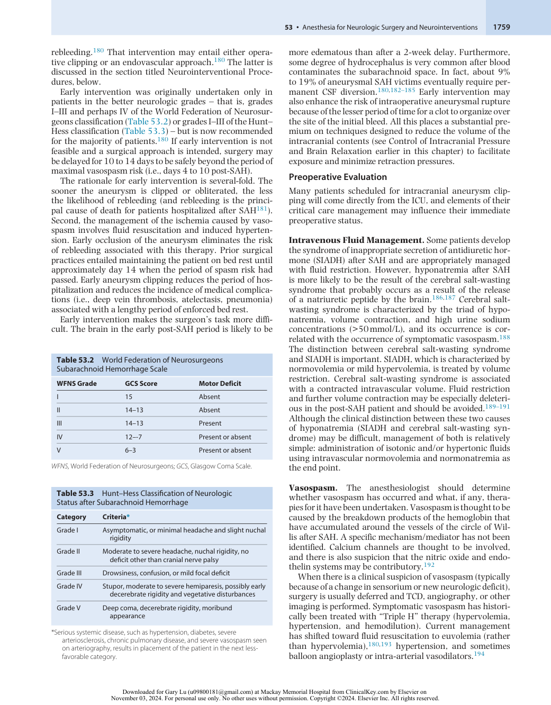

:::

<!-- PDF page 21 -->

For patients proceeding to surgery, hypotension should be avoided180 and CPP should usually be maintained intraoperatively at values near the waking normal range. The association of hypotension with poor outcome,195 and the potential for hypotension to cause or aggravate cerebral ischemia in patients with some degree of vasospasm is well recognized.196–198 This concern should extend even to patients classified as World Federation of Neurosurgeons grade I who may have regions of cerebral ischemia29 that are subclinical when the patient is normotensive.

In the ICU, the regimens used to treat vasospasm usually involve some combination of fluid resuscitation and blood pressure augmentation. The science behind hypervolemic– hypertensive therapy is soft and the efficacy of neither Triple H therapy nor volume expansion in isolation has been proved by prospective study.193,199–201 The relative importance of the rheologic and blood pressure effects is undefined, although there is evidence for the relevance of blood pressure elevation in isolation.192,201–204 Phenylephrine and dopamine are the most commonly used pressors; exact pressor choice should be primarily governed by systemic cardiovascular considerations. The end point for pressor administration varies. Most commonly, the objective is an increase in MAP of approximately 20 to 30 mm Hg above baseline systolic blood pressure (SBP). However, it has been reported that augmentation of cardiac output with dobutamine, without simultaneous MAP increase, augments CBF in ischemic territories.201 It is also believed that a hematocrit in the low 30s is optimal for cerebral perfusion, but this is not a therapeutic target that is directly manipulated.

**Calcium- Channel Blockers.** Calcium- channel blockers are an established part of the management of SAH. Administration of nimodipine decreases the incidence of morbidity caused by cerebral ischemia after SAH,205 although it was not associated with any reduction in the incidence of vasospasm as detected by angiography.206 Patients presenting to the operating room after SAH should already be receiving nimodipine. Because nimodipine must be administered orally in North America, nicardipine has been evaluated as an intravenous alternative. The multicenter nicardipine trial207,208 revealed a reduced incidence of symptomatic vasospasm but no improvement in outcome. Consequently, nimodipine remains the standard. Calcium- channel blockers (i.e., verapamil, nicardipine, nimodipine209–211 ) are also used intra- arterially as a primary treatment for medically refractory vasospasm. Milrinone and papaverine are similarly administered.210,212

ischemia and death.214 A subsequent large RCT (STASH) failed to demonstrate either short- term or long- term outcome benefits related to statin administration.215 The phosphodiesterase inhibitor cilostazol (a platelet inhibitor as well as vasodilator), was reported to reduce symptomatic vasospasm,216,217 new cerebral infarctions,217 and improve outcome216 following SAH. Although promising, a larger study to confirm the safety and efficacy of cilostazol is anticipated.

**Antifibrinolytics.** Antifibrinolytics have been administered to reduce the incidence of rebleeding. Although they accomplish this end, long courses do so at the cost of an increased incidence of ischemic symptoms and hydrocephalus, with an overall adverse effect on outcome. However, early, brief courses of antifibrinolytics that are continued until the aneurysm is secured may have a net favorable effect on outcome.180

### Subarachnoid Hemorrhage–Associated Myocardial

**Dysfunction.** SAH can result in a largely reversible myocardial “stunning” injury. The severity of the dysfunction correlates best with the severity of the neurologic injury218 and is sometimes sufficient to require pressor support.219 The mechanism is uncertain but is thought to be catecholamine mediated.220 Troponin elevation occurs commonly, though typically reaching levels less than the diagnostic threshold for myocardial infarction.221 Peak troponin levels correlate with the severity of both neurologic injury and echocardiographic myocardial dysfunction.219,222

ECG abnormalities are common after SAH. In addition to the classic canyon T waves (Fig. 53.14), nonspecific T- wave changes, Q- T prolongation, ST- segment depression, and U waves have been described. There is typically no relationship between the ECG changes and echocardiographic myocardial dysfunction.221 ECG abnormalities do not herald evolving or impending cardiac disease.223 Accordingly, when ventricular function is adequate and ECG patterns other than those that are typical of myocardial ischemia are observed, no specific interventions or modifications of patient management are warranted, other than attention to the possibility of dysrhythmias. In particular, an increased Q- T interval (>550 msec) occurs frequently after SAH, especially in patients with more severe SAH,222 and has been associated with an increased incidence of malignant ventricular rhythms including torsades de pointes.224

### Anesthetic Technique

Important considerations include the following:

**Other Pharmacologic Therapies.** Several other agents/ drug classes have been considered for the prevention of vasospasm and delayed ischemic deficits. None of them is approaching the status of standard therapy. A study of the endothelin antagonist clazosentan revealed improved mortality without improvement in the outcome of survivors. After several small trials suggested a beneficial effect of magnesium, a larger randomized, placebo- controlled trial reported no improvement in outcome among patients in whom magnesium was initiated within 4 days of SAH.213 Several small trials have examined the post- SAH administration of statins. Meta- analysis revealed only nonsignificant trends toward reduced incidence of delayed cerebral

1.  Absolute avoidance of acute hypertension with its attendant risk of rerupture.

2.  Achievement of intraoperative brain relaxation to facilitate surgical access to the aneurysm.

3.  Maintenance of a high- normal MAP to prevent critical reduction of CBF in recently insulted and now marginally perfused areas of brain, or in regions critically dependent on collateral pathways.

4.  Preparedness to perform precise manipulations of MAP as the surgeon attempts to clip the aneurysm or to control bleeding from a ruptured aneurysm or during periods of temporary vascular occlusion.

<!-- PDF page 22 -->

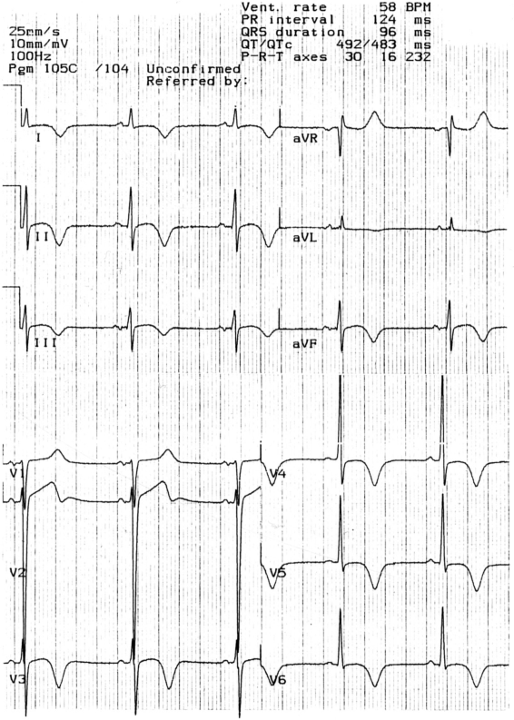

**Fig. 53.14 Electrocardiogram abnormalities associated with subarachnoid hemorrhage.** The canyon T waves that may be seen after subarachnoid hemorrhage are evident.

### Monitoring

An arterial line is invariably appropriate. A central venous catheter may be appropriate if peripheral access is inadequate.

**Anesthetic Selection.** Any technique that permits proper control of MAP is acceptable. However, in the face of increased ICP or a tight surgical field, an inhaled anesthetic technique may be less suitable. The prevention of paroxysmal hypertension is the only absolute requirement in patients undergoing aneurysm clipping. The poorly organized clot over the aneurysms of patients undergoing early post- SAH clipping makes them particularly prone to rebleeding. A rebleed at induction is frequently fatal.181 The escaping arterial blood is more likely to penetrate brain substance because it cannot dissect through the CSF space (filled with clot), and the ICP increase is extreme because of the poor compliance of the intracranial space (swollen brain, hydrocephalus).

**Induced Hypotension.** The routine use of induced hypotension has essentially vanished (see earlier section on Management of Arterial Blood Pressure). Nonetheless, the

anesthesiologist should be prepared to reduce blood pressure immediately and precisely if called upon to do so in the context of intraoperative aneurysm rupture. Preparation of an appropriate hypotensive agent must occur before the episode of bleeding. There are theoretical pros and cons for various hypotensive agents. However, the choice should ultimately be made based on which regimen, in the hands of the individual practitioner, results in the most precise control of MAP. There are rare occasions when the anesthesiologist is asked to control MAP in the range of 40 to 50 mm Hg, in the face of active arterial bleeding. This can be extremely difficult in a patient who is hypovolemic at the beginning of the bleeding episode. It is our practice to maintain normovolemia.

**Induced Hypertension.** Relative hypertension may be requested during periods of temporary arterial occlusion (see the later section titled Temporary Clipping) to augment collateral CBF. In addition, after clipping of the aneurysm, some surgeons will puncture the dome of the aneurysm to confirm adequate clip placement and may request transient elevation of the systolic pressure to 150 mm Hg. Phenylephrine is suitable in either instance.

<!-- PDF page 23 -->

**Hypocapnia.** Hypocapnia has traditionally been used as an adjunct to brain relaxation. However, the practice has been questioned because of the concern that it will aggravate ischemia (see the earlier section on Management of PaCO2). It is now generally avoided unless ICP/brain relaxation circumstances demand it.

**Lumbar Cerebrospinal Fluid Drainage.** CSF drainage has been used to facilitate exposure. However, its use appears to be diminishing because surgeons have appreciated that the same brain relaxing effect can be achieved by release of CSF from the basal cisterns. If a lumbar CSF drain is placed, it is appropriate to avoid excessive loss of CSF. A sudden reduction in the transmural pressure gradient across the dome of the aneurysm (by sudden reduction of ICP consequent upon substantial CSF drainage) should be avoided because of the theoretical concern that this decompression might encourage rebleeding. Having verified the patency of the drainage system, it is usual to leave it closed until the surgeon is opening the dura. The drain is then opened and allowed to drain freely to floor level. Drainage should be discontinued promptly after final withdrawal of the retractors to allow CSF to reaccumulate and to thereby reduce the size of the potential pneumocephalus.

Some surgeons use mannitol relatively aggressively (e.g., 2 g/kg). In part, it is used to facilitate exposure and reduce retractor pressures, but there is evidence that it may have additional benefits. Specifically, there are data derived in both animals and man that indicate that mannitol may have a CBF- enhancing effect in regions of moderate CBF reduction.225–228 The mechanism is not defined. Reduction of interstitial tissue pressure around capillaries and/or an alteration of blood rheology have been proposed as contributors. Typically, mannitol administered in a dose of 1 g/kg just before dural opening provides satisfactory brain relaxation.44 Surgeons who believe in its CBF- enhancing effect may request a second 1 g/kg approximately 15 minutes before an anticipated temporary occlusion.

**Temporary Clipping.** Many surgeons limit inflow to an aneurysm during application of the permanent clip by placing a temporary clip proximally on the feeding vessel. It is occasionally necessary to trap the aneurysm (i.e., to temporarily occlude the vessel on both sides of the aneurysm) to complete the dissection of the neck and apply the clip. This is more common with larger aneurysms. With giant aneurysms in the vicinity of the carotid siphon, the inferior occlusion may be performed at the level of the internal carotid artery via a separate incision in the neck. A clinical survey of the neurologic outcome after temporary occlusion in normothermic, normotensive adults revealed that occlusions of fewer than 14 minutes were invariably well tolerated. The likelihood of an ischemic injury increased with longer occlusions and reached 100% with occlusions in excess of 31 minutes.229 In another institution, the threshold for ischemic injury was 20 minutes of occlusion.230 An informal 7- minute rule is sometimes applied to individual periods of temporary occlusion. Typically, MAP should be sustained at high- normal levels during periods of occlusion to facilitate collateral CBF.

**Brain Protection.** Maintenance of MAP to ensure collateral flow and perfusion under retractors, efficient brain relaxation to facilitate surgical access and reduce retractor pressures, limitation of the duration of episodes of temporary occlusion, and perhaps mild hypothermia are the important brain protection techniques. Specific anesthetic drugs have been promoted as brain protectants, but evidence is limited (see the discussion in Chapter 10). There have been no convincing laboratory demonstrations that propofol provides any greater tolerance to a standardized ischemic insult than does anesthesia with a volatile anesthetic. Attempts to demonstrate protection by etomidate in an animal model of focal ischemia actually demonstrated an adverse effect of etomidate.231 Furthermore, a clinical investigation during aneurysm clipping revealed decreases in brain tissue PO2 in association with administration of etomidate, which contrasted with the brain PO2 increases that occurred with the introduction of desflurane. During subsequent temporary vessel occlusion, tissue pH decreased alarmingly in patients receiving etomidate and was unchanged with desflurane.232 Etomidate probably should not be used because of a lack of sufficient data regarding its efficacy. With respect to the volatile anesthetics, attempts in the laboratory to confirm the once proclaimed protective efficacy of isoflurane have demonstrated that there are no differences among the various volatile anesthetics in terms of their influence on outcome after focal or global ischemia in the laboratory.231,233–235 Nor has there been any demonstration of greater protective efficacy with concentrations of volatile anesthetics sufficient to cause EEG suppression as opposed to more modest (e.g., 1.0 MAC) levels.235,236 Nonetheless, these animal investigations suggest that a standardized experimental ischemic insult is better tolerated, relative to the awake state, by animals receiving a volatile anes thetic.234,235,237 In addition, data derived in animals also suggest that there may also be a relative protective advantage to an anesthetic that includes a volatile anesthetic compared with a strict N2O–narcotic technique. The magnitude of the differences among anesthetics and the absence of proof of relevance in patients precludes advocacy of a particular anesthetic regimen in a standard text. The important anesthetic objectives are precise hemodynamic control and timely wake- up, and those two constraints should dictate the choice of the anesthetic regimen for most aneurysm procedures. Among anesthetics, it is only the barbiturates for which additional protective efficacy has been demonstrated convincingly. Because of their potentially adverse effects on hemodynamics and wake- up, they are not ideal for routine use. They should probably be reserved for situations in which a prolonged vessel occlusion is unavoidable, and in that circumstance, it would be ideal that the ischemic hazard be first confirmed by observation of the EEG response to a temporary occlusion.238

The patient with or at substantial risk for vasospasm probably benefits from a minimum hemoglobin greater than that which is commonly accepted in stable ICU patients (i.e., >7 g/dL). The best available information suggests a minimal hemoglobin value of 9 g/dL.204,239

**Hypothermia.** As noted in the earlier section on Hypothermia, a prospective trial of mild hypothermia in patients undergoing aneurysm surgery revealed no improvement in

<!-- PDF page 24 -->

neurologic outcome.158 Nonetheless, some neurosurgical teams that were already using mild hypothermia (32°C to 34°C) are continuing its use for procedures in which temporary vessel occlusion may occur. The institutions that use the lower temperatures are those in which the team is willing to accept a delay in emergence from anesthesia to achieve sufficient rewarming to avoid the extreme hypertension that can occur when a patient is awakened at low body temperatures.

**Neurophysiologic Monitoring.** Evoked responses and EEG have been used for monitoring.238,240 EEG monitoring can be used as a guide to management during the period of flow interruption or to guide the administration of CMR- reducing anesthetic agents given before occlusion. At some institutions, the surgeon places an electrode strip over the region of cortex at risk during the intended occlusion. However, the more commonly used skin surface frontal- mastoid derivation is probably sufficient to reveal a major ischemic event. In most circumstances, if occlusion is deemed necessary, a temporary occlusion is performed, and the EEG is observed. If the EEG shows significant slowing, the common practice is to raise the MAP and proceed with as brief as possible a period of occlusion or intermittent episodes of temporary occlusion. If the necessity for a sustained period of occlusion seems likely, it may be appropriate to administer barbiturates (discussed earlier) to produce burst suppression. These events are very infrequent (see also Chapter 35).

**Intraoperative Angiography.** Intraoperative angiography is an increasingly common component of the management of intracranial aneurysm surgery. It does not have substantial implications for the anesthesiologist except with respect to placement of the radiographic equipment.

### Special Considerations for Specific Aneurysms

The most common procedures are performed for aneurysms arising in or close to the circle of Willis. The vessels of origin may be the anterior communicating artery; the middle cerebral artery; the anterior cerebral artery; the ophthalmic artery; the tip of the basilar artery; the posterior communicating artery; and, less frequently, the posterior cerebral artery. These procedures are relatively similar for the anesthesiologist and typically require a supine position with the head turned slightly away from the operative side.

**Ophthalmic Artery Aneurysms.** Access to the origin of the ophthalmic artery, which is the first intradural branch of the carotid artery, is made difficult by the anterior clinoid process and the optic nerve. As a result, these aneurysms frequently require temporary vascular occlusion at the level of the extracranial carotid. The surgeon commonly first exposes the carotid artery in the neck to ensure proximal control access in the event it becomes necessary. When the surgeon reaches the stage of seeking definitive access to the neck of the aneurysm, he or she may occlude first the carotid artery in the neck.

**Vertebrobasilar Aneurysms.** These procedures are typically performed in the lateral position. The exposure may involve a combined middle and posterior fossa approach,

with some attendant, although minor, risk of venous air embolism. Cortical or skin surface EEG monitoring is of less relevance with vertebral–basilar aneurysms. Auditory, somatosensory, and motor-evoked responses have been used to monitor for vascular compromise.241–243 As with any other procedure involving the potential for mechanical or vascular injury to the brainstem, cardiovascular responses should be closely monitored and sudden changes in response to surgical manipulation should prompt immediate notification to the surgeon.244,245

**Vein of Galen Aneurysms.** Vein of Galen aneurysms are congenital dural arteriovenous fistulas, usually treated in the neonate using endovascular methods, and share considerations relevant to AVMs. These include anticipation of the possibility of the cerebral dysautoregulation phenomenon and are considered subsequently.

### Arteriovenous Malformations

For most intracranial AVMs, the general considerations are similar to those appropriate to aneurysm surgery: avoidance of acute hypertension and the capability to accurately manipulate arterial blood pressure in the event of bleeding. A problem specific to AVMs is the phenomenon of perfusion pressure breakthrough, or cerebral dysautoregulation.246,247 It is characterized by a sudden engorgement and swelling of the brain, sometimes with a relentless cauliflower- like protrusion from the cranium. It tends to occur in the advanced stages of lengthy procedures on large AVMs, or it may be the cause of otherwise unexplained postoperative swelling and hemorrhage. The phenomenon is not entirely understood. An AVM provides a high- volume, low- resistance pathway that chronically diverts blood from adjacent and therefore marginally perfused vascular territories. Perhaps these tissues have long been maximally vasodilated and are incapable of vasoconstricting when exposed to a higher- pressure head after acute obliteration of the AVM. Although this explanation superficially fits the clinical occurrence, experimental data are not entirely consistent with this mechanism.246–249 At least some component of the hyperemia is not passive, and neurogenic or paracrine mechanisms may be involved.

**Anesthetic Technique.** The management constraints are essentially the same as those relevant to aneurysm surgery, although the risk of intraoperative rupture is much less. Institutional practices will vary. We do not use induced hypotension unless it is necessitated by bleeding. We reason that the effects on the surrounding brain of devascularizing the AVM would be best appreciated if the devascularization occurs at normal pressures. If refractory brain swelling occurs, tight blood pressure control is essential, and reducing MAP may be of use to control swelling. The latter is based on the notion that CBF through the involved area is pressure- passive and will decrease as MAP is reduced. With severe episodes of swelling, we have used (in addition to hypotension, which we use cautiously because of the associated ischemia risk) hypocapnia, hypothermia, and barbiturates. The latter three techniques probably serve to reduce the bulk of only normal brain tissue, hypocapnia via a direct effect on CBF and barbiturates and hypothermia via the coupled effects of reduction of CMR on CBF.

<!-- PDF page 25 -->

Induced hypothermia is also an adjunct to minimizing the barbiturate doses. In all of neurosurgery, we seek to prevent postoperative hypertension; however, in AVM surgery this should be accomplished with the greatest care because of the concern that the dysautoregulating brain adjacent to the resected AVM will develop edema or hemorrhage if hypertension occurs.

### HEAD INJURY

### Intubating the Trachea of a Head- Injured Patient

Patients with GCS scores of 7 to 8 (Table 53.4) or less require tracheal intubation and controlled ventilation for ICP or airway control, or both. Patients with less severe TBI may also require intubation because of trauma- related cardiopulmonary dysfunction or, when uncooperative, to facilitate diagnostic procedures. The anesthesiologist, in choosing the intubation technique, may encounter several conflicting constraints (Box 53.9). These include: (1) elevated ICP; (2) a full stomach; (3) uncertain cervical spine status; (4) uncertain airway status (e.g., presence of blood, possible laryngeal–tracheal injury, possible skull base fracture); (5) an uncertain volume status; (6) an uncooperative or combative patient; and (7) hypoxemia. The best approach is determined by the relative weight of these various factors along with the degree of urgency. The anesthesiologist must not be distracted by placing an excessive initial emphasis on ICP. The anesthesiologist needs to keep sight of the ABCs of resuscitation: securing the airway, guaranteeing gas exchange, and stabilizing the circulation are higher initial priorities than ICP. Do not risk losing the airway or causing severe hypotension for the sake of preventing coughing on the tube or brief hypertension with intubation.

### The Cervical Spine

The possibility of causing or aggravating an injury to the cervical spine is a relevant concern. Approximately 2% of blunt trauma victims who reach a hospital and 8% to 10% of TBI victims with GCS scores less than 8 have a fracture of the cervical spine.250,251 Those incidences suggest that a hypnotic–relaxant–direct laryngoscopy approach for all patients with a closed head injury might convey a measurable risk of injuring the cervical cord. Nonetheless, although the literature contains contradictions, several published series have concluded that rapid- sequence induction does not convey significant risk of neurologic injury.252–255 However, it is possible that the incidence of intubation- related neurologic injury is underreported. An informal survey256 indicated that there have been more such events than one can infer from the published literature.257,258 Nonetheless, the majority of patients with TBI requiring airway control are intubated using a hypnotic– relaxant–laryngoscopy sequence. In our opinion the possibility of devastating spinal cord injury may be higher with injuries in the atlanto- occipital region, which are also difficult to identify radiologically, and that the anesthesiologist should identify circumstances in which time latitudes allow more detailed examination or radiologic evaluation. When there is any uncertainty regarding the airway or the cervical spine, direct laryngoscopy (with vigorous atlantooccipital extension) should probably be avoided when the exigencies of the situation do not require an immediate

**Table 53.4** The Glasgow Coma Scale

|**EYES OPENING**||
|---|---|
|Never|1|
|To pain|2|
|To speech|3|
|Spontaneously|4|
|**BEST VERBAL RESPONSES** None|1|
|Garbled or incomprehensible sounds|2|
|Inappropriate words|3|
|Confused but conversant|4|
|Oriented|5|
|**BEST MOTOR RESPONSES** None|1|
|Extension (decerebrate rigidity)|2|
|Abnormal flexion (decorticate rigidity)|3|
|Withdrawal|4|
|Localizes pain|5|
|Obeys commands|6|
|Score|3–15|

### Box 53.9 Factors That May Be Relevant During Intubation of the Head- Injured Patient

|ᑏFull stomach|
|---|
|ᑏUncertain cervical spine stability|
|ᑏUncertain airway|
|ᑏBlood|
|ᑏAirway injury (larynx, crico- arytenoid cartilage)|
|ᑏSkull- base fracture|
|ᑏUncertain volume status|
|ᑏUncooperative/combative|
|ᑏHypoxemia|
|ᑏIncreased intracranial pressure|

rapid- sequence induction. The nasal route can be considered if the clinical context warrants it, bearing in mind that risk of infection may be increased with skull base fracture and CSF leak. The anesthesiologist should use discretion (e.g., in the presence of an obvious facial injury, the nasal route should be avoided) and be sensitive to unusual resistance in passing the endotracheal tube.

When a hypnotic–relaxant sequence is used (and the exigencies of airway control will frequently demand it), a common approach includes the use of cricoid pressure and in- line axial stabilization. The best technique to facilitate glottic visualization (e.g., Macintosh laryngoscope, video laryngoscope, flexible bronchoscope) remains uncertain.259 In- line traction was once favored but has been supplanted by stabilization because of the perceived risk of overdistraction and cord injury in the event of gross instability. The largest of the clinical series that concluded that

::: details 原始表格與符號（PDF 第 25 頁）

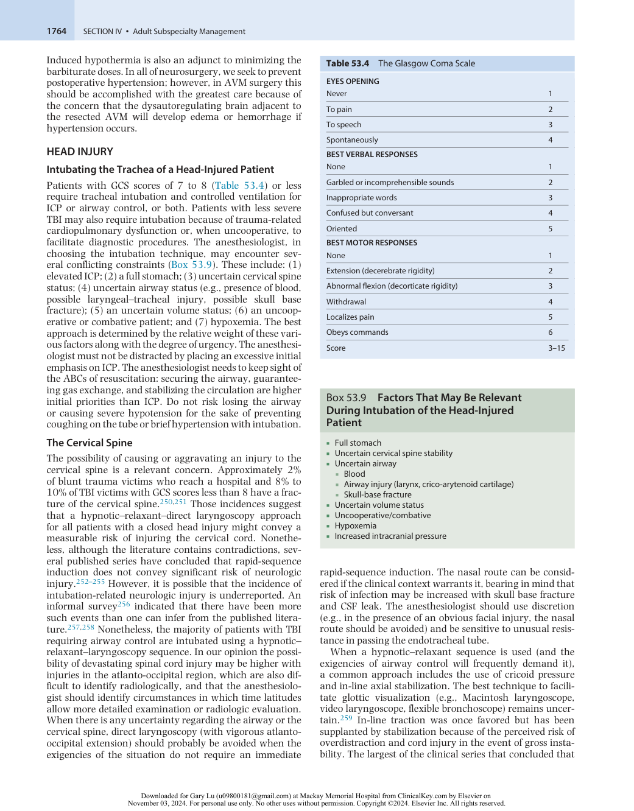

:::

<!-- PDF page 26 -->

oral intubation with anesthesia and relaxation is reasonable252 used in- line stabilization with the patient’s occiput held firmly on the backboard, limiting the amount of “sniff” that was feasible (Fig. 53.15). There is no question that inline stabilization, properly performed, makes laryngoscopy more difficult; however, it serves to decrease the amount of atlanto- occipital extension necessary to achieve visualization of the glottis.260 This is probably because performing the laryngoscopy against the assistant’s counterpressure results in greater compression of the soft tissue structures of the tongue and floor of the mouth. Some recommend leaving the back half of the cervical collar in place during laryngoscopy (see Fig. 53.15) because it functions as a strut between the shoulder and the occiput and serves to further limit atlanto- occipital extension.

In a resuscitation situation, before initiating a hypnotic– relaxant sequence, the anesthesiologist should confirm the availability of cricothyrotomy equipment and of someone to make immediate, skilled use of it if necessary. The recently injured brain is very intolerant of hypoxia and hypotension.261 It is inevitable that there is sometimes failed tracheal intubation. In the extensive experience of the Cowley Shock Trauma Center in Baltimore, the cricothyrotomy/ tracheostomy rate is 0.3%.262 As is the case in many other situations, the laryngeal mask may be a very useful device for temporizing in the face of a failed intubation and may also provide access for intubation as an alternative to cricothyrotomy.

As noted in Chapter 10, although succinylcholine can cause ICP increases, these increments are small and probably do not occur in patients with serious cerebral injuries.8 Accordingly, succinylcholine should not be viewed as contraindicated in the TBI victim. If there is an urgent need to secure the airway (to guarantee oxygenation and control CO2 tension), and if succinylcholine is in other respects the appropriate drug to achieve that end, it should be used. The necessity to use succinylcholine in these circumstances, however, has diminished with the availability of both rocuronium and the reversal agent sugammadex.

What should the anesthesiologist do with the patient whose cervical spine has not been cleared? That situation should arise with decreasing frequency. The once-standard plain radiographs (with their inherent difficulties and substantial false- negative rates) have been supplanted by CT scanners that allow rapid, thin- slice evaluation, with sagittal reconstruction. A large meta- analysis concluded that “modern multislice helical CT alone is sufficient to rule out traumatic, unstable cervical spine injuries.”263 However, some remain concerned that CT may fail to identify ligamentous injuries that would be evident on magnetic resonance imaging (MRI).264 With respect to a conscious patient who has not yet undergone complete radiologic evaluation, several clinical surveys have confirmed that patients who are alert, not intoxicated, and free of significant distracting injuries invariably have pain, midline tenderness, limitation of voluntary movement, or neurologic signs265–267 if they have a cervical spine fracture. Despite the frequency with which an anesthesiologist may encounter patients still wearing their cervical collars because their necks have not yet been cleared, no special precautions appear warranted in the asymptomatic, alert patient.

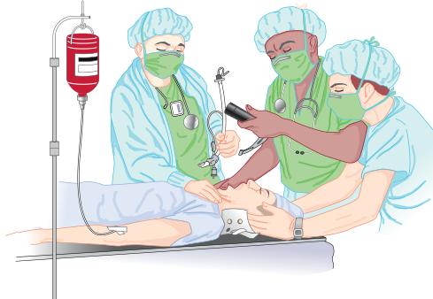

**Fig. 53.15 Intubating the acute trauma patient with an uncertain cervical spine.** A hypnotic and a relaxant have been administered. One assistant maintains in- line axial stabilization with the occiput held firmly to the backboard; a second applies cricoid pressure. The posterior portion of the cervical collar remains in place to limit atlanto- axial extension. (Reproduced with permission from Stene JD. Anesthesia for the critically ill trauma patient. In Siegel JH, ed. _Trauma: Emergency Surgery and Critical Care_ . Melbourne: Churchill Livingstone; 1987:843–862.)

### Anesthetic Technique

**Choice of Anesthetic Drugs.** Craniotomies are most commonly performed for the evacuation of subdural, epidural, or intracerebral hematomas. The anesthetic approach is similar for all three techniques. The guiding principles have been discussed in the earlier section on Control of Intracranial Pressure and Brain Relaxation. In general, anesthetics that are known to be cerebral vasoconstrictors are preferable to those that have the potential to dilate the cerebral circulation. All the intravenous anesthetics, except perhaps ketamine, cause some cerebral vasoconstriction and are reasonable choices, provided they are consistent with hemodynamic stability. All the inhaled anesthetics (N2O and all the volatile anesthetics) have some cerebral vasodilatory effect. Although their administration frequently is consistent with acceptable ICP levels and appropriate conditions in the surgical field, when the ICP is out of control (or unknown), or the surgical field is tight, omitting the inhaled anesthetics in favor of intravenous agents is appropriate. For patients who are likely to remain intubated postoperatively, an anesthetic based primarily on a narcotic, such as fentanyl, and a muscle relaxant usually serves well. Any muscle relaxant is acceptable with the proviso that those that can release histamine (now rarely used) should be titrated in small increments. When immediate tracheal extubation is a possibility (e.g., the patient with an acute epidural hematoma who had a lucid interval before witnessed deterioration), the technique should be modified after the opening of the cranium. Introduction of inhaled anesthetics or the use of shorter- acting intravenous drugs can be undertaken as guided by observation of the surgical field. If N2O is contemplated at any time, the anesthesiologist must remember the possibility, in the setting of missile injury or compound skull fracture, of intracranial air.

**Monitoring.** The anesthesiologist should appreciate that the priority is to open the cranium as rapidly as possible.268 After achieving intravenous access, the risks and benefits of

<!-- PDF page 27 -->

delaying craniotomy for line placement should be considered carefully. An arterial line, often placed after induction in urgent situations, is appropriate for essentially all acute trauma craniotomies. Peripheral venous access is sufficient in most situations. Sudden hypotension after dural opening with high ICP can occur as brainstem compression is relieved.269 Appropriate intravascular volume resuscitation should mitigate this occurrence. Infrequently, the management of a depressed skull fracture over the sagittal sinus justifies a precordial Doppler and, subject to the surgeon’s assessment of VAE risk, a right heart catheter.

**Arterial Blood Pressure Management.** The concept that the injured brain is extremely vulnerable to what would otherwise be a minor insult (e.g., modest hypotension, moderate hypoxia) has been well confirmed in the laboratory.270 Although clinically the cause–effect relationships are not absolutely confirmed, several surveys demonstrate the association of otherwise minor degrees of hypotension and hypoxia with poor outcome in both adult261,271–276 and pediatric patients with TBI.277 This vulnerability to hypotension probably arises because many patients have brain regions with precariously low CBF in the first 2 to 3 days after TBI22,25,278–280 and autoregulation is frequently defective.281–283 The characteristic behavior of CBF after TBI is an initially low CBF followed by a gradual increase over 48 to 72 hours to normal, or sometimes even slightly hyperemic, levels.22,25,278,279,281,284,285 There is considerable evidence that low postinsult CBF values correlate with a poor eventual outcome,25,275,280,286–288 and a large percentage of patients who die after TBI have pathologic changes consistent with ischemia.159 These observations have resulted in a general emphasis among neurosurgeons, neurointensivists, and anesthesiologists on aggressive support of arterial blood pressure in the patient with TBI. What constitutes an appropriate arterial blood pressure? Systematic studies have revealed that indices of the adequacy of cerebral perfusion derived from SjvO2 and TCD data begin to deteriorate below a mean CPP (CPP = MAP − ICP) of 70 mm Hg,275,289,290 and many centers adopted 70 mm Hg as the CPP target. A clinical investigation comparing the ICU management of patients with TBI at CPPs of 70 and 50 mm Hg demonstrated that, although indices of cerebral well- being were improved by the former, there was no outcome advantage, apparently because of the cardiopulmonary morbidity associated with achieving a sustained CPP of 70 mm Hg.291 As a result, many authorities have adopted 60 mm Hg as the minimal CPP management objective.284,292–295 The Brain Trauma Foundation has most recently recommended a CPP target range of 60 to 70 mm Hg in adults.64 Age- adjusted CPP targets ranging from 40 (neonates) to 50 mm Hg (adolescents) have been recommended for children.296

Maintenance of CPP at 60 to 70 mm Hg in the first 2 to 3 days after TBI is probably reasonable. However, clinicians may encounter other views, including the argument that a one- size- fits- all approach inevitably denies the heterogeneity of pathophysiology among patients with TBI. It is certainly true that not all patients with TBI have low CBF and not all have absent autoregulation **.** Although an initially low postinjury CBF is probably the most common clinical occurrence, hyperemia does occur.15,21,285,297,298

It tends to occur in patients with mass lesions rather than contusions, although even those patients have an immediate postinjury period of low CBF, with delayed hyperemia peaking at 24 hours or later.21,285,287,298,299 Hyperemia may also be more common in children.300 There is evidence that not all patients with TBI benefit from increases in CPP. Patients with TBI and impaired autoregulation, low baseline flows, increased ICP, and low initial GCS score are most likely to benefit.301–304 Accordingly, targeted therapy has been advocated.305–311 However, techniques to discriminate the various flow states (serial CBF measurement, TCD, SjvO2) are not universally available. Some institutions, which have the necessary data analysis capacity, take another approach to targeted therapy. They identify a nominal optimal CPP by examining the changes in ICP that occur in response to variations in MAP. The range of MAPs in which the smallest ΔICP/ΔMAP occurs is taken to be the range within which autoregulation functions most efficiently and is the target range for that individual patient.306,307 This approach is not feasible in most ICUs. As a result, and despite the theoretic attractiveness of targeted therapy, the CPP target of 60 to 70 mm Hg as an objective is more common.

There are at least two alternative approaches to blood pressure management in patients with TBI (Fig. 53.16). The Lund concept is based on the premises that arterial blood pressure causes hydrostatically driven edema accumulation, and that edema formation can be further aggravated by crystalloid administration and subnormal COP.312–314 As originally described, the Lund approach in part entailed relative dehydration (furosemide, crystalloid restriction), albumin administration to maintain a normal COP, and the administration of metoprolol and clonidine to lower blood pressure to a CPP target of 50 to 55 mm Hg. At its inception, the approach was controversial because it ran counter to the perceptions of many clinicians of the importance of maintaining a CPP of 70 mm Hg and because of the later demonstration that a negative fluid balance in patients with TBI is deleterious.276 Over time (and in parallel with a relaxation of the higher CPP targets by others),284,292,293 the Lund proponents have modified their approach. Normovolemia is now the clinical objective, and CPP is 60 to 70 mm Hg in most patients. The latter has made the approach somewhat less controversial. However, CPP may be reduced to 50 to 60 mm Hg when ICP is not well controlled,138 and that element remains controversial.315 Although the proponents of the Lund approach assert improvements in outcome, those reports invariably entail either no control group or comparisons with nonconcurrent controls.139,316–318 The approach has not been adopted in North America.

The second approach, promoted by neurosurgeons at the University of Alabama at Birmingham (sometimes called the “Rosner concept” after its chief proponent), is that induced hypertension can be used as an adjunct to ICP control.25,319,320 The underlying concept is that autoregulation is at least partially preserved after TBI and that an increased MAP results in autoregulation- mediated vasoconstriction with a concomitant reduction in CBV and, therefore, ICP. These investigators reported a very satisfactory local experience,320 but others have reported that induced hypertension was either ineffective or deleterious as a means of

<!-- PDF page 28 -->

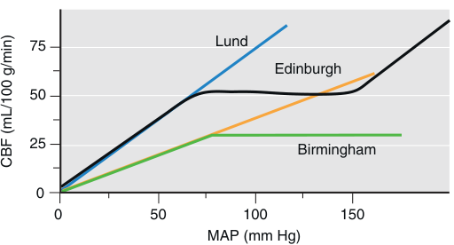

75 Lund Edinburgh 50 25 Birmingham 0 0 50 100 150 MAP (mm Hg) CBF (mL/100 g/min) 

**Fig. 53.16 The relationship of cerebral blood flow (CBF) to blood pressure after head injury.** There are three cerebral perfusion pressure (CPP) management strategies (see text) driven by differing beliefs about common pathophysiologic derangements. The most commonly held strategy is Edinburgh (so named for the institution of the original proponents); it emphasizes low postinjury CBF, impaired autoregulation, and the necessity to support CPP (mean arterial pressure [MAP] − intracranial pressure [ICP]) to 60 to 70 mm Hg. The Lund concept emphasizes the contribution of hyperemia to the occurrence of elevated ICP. That approach uses antihypertensive agents to reduce blood pressure while maintaining CPP greater than 50 mm Hg.312 That CPP target has increased, in the most recent iteration, to 60 to 70 mm Hg, with allowance for occasional reduction to 50 mm Hg.314 An approach emanating from the University of Alabama, identified as Birmingham, entails pharmacologically induced hypertension. That approach is based on the belief that autoregulation is largely intact and that hypertension will result in cerebral vasoconstriction with concomitantly reduced cerebral blood volume and ICP.319,320

reducing increased ICP.13,321 The Rosner approach now appears to have few advocates.

What should the anesthesiologist managing the patient with TBI do in the face of these various approaches? Perfusion pressure support of varying degrees is a theme that is common to all of them, and the careful support of CPP at or just above the 60 mm Hg range is probably the most reasonable general approach. When establishing normovolemia alone does not accomplish that objective, phenylephrine, norepinephrine, and dopamine have all been used. With that CPP recommendation offered, it must be acknowledged that convictions vary, and anesthesiologists should come to an understanding with the local traumatologists and neurosurgeons as to CPP targets.

**Hyperventilation.** The use of hypocapnia has been reviewed in detail in the section titled Management of PaCO2. The effectiveness of acute hypocapnia in reducing ICP is well confirmed.13 But there is substantial evidence that hyperventilation is potentially deleterious19,20,25,28,322,323 and should not be overused. That evidence suggests that hyperventilation and the concomitant vasoconstriction can result in ischemia,19,20,24,26,322 especially when baseline CBF is low,26 as is likely to be the case in the first 48 to 72 hours after head injury.22,23,25,278 The expert panel convened by the Brain Trauma Foundation specified that “prolonged prophylactic hyperventilation with PaCO2 of 25 mm Hg or less is not recommended.”64 Although they did not officially carry forward the recommendations from the third edition, they did restate the following recommendations to convey the concern for vasoconstriction-mediated ischemia: (1) “hyperventilation is recommended as a temporizing measure for the reduction of elevated ICP;” (2) “hyperventilation should be avoided during the first 24

hours after injury when CBF is often critically reduced;” and (3) “if hyperventilation is used, SjvO2 or brain tissue PO2 measurements are recommended to monitor oxygen delivery.”64 The totality of available information argues that hyperventilation should be used selectively rather than routinely in the management of patients with TBI. Maintaining ICP less than 20 mm Hg, preventing or reversing herniation, minimizing retractor pressure, and facilitating surgical access are still important objectives in the management of the patient with TBI, and to the extent that these objectives cannot be accomplished by other means, hyperventilation may still be appropriate. Once again, the anesthesiologist should agree on management variables with the surgical team at the outset of all procedures.

**Intravenous Fluid Management.** Intravenous fluid management of the patient with TBI was addressed earlier in the section Intravenous Fluid Management. The important principles are that fluids should be chosen invariably to prevent reduction of serum osmolarity and should probably be chosen to prevent profound reduction of COP – that is, in the circumstances of a large- volume resuscitation (arbitrarily, greater than half a circulating volume), using a mix of colloids and crystalloids is probably appropriate. The clinical objective should be the maintenance of intravascular normovolemia, in part as an adjunct to MAP and CPP support. A chronic negative fluid balance, as can occur with the combination of modest fluid restriction and liberal use of osmotic diuretics, has been shown to be deleterious and should be avoided.276,324–326 The clinician may also find a serum osmolarity determination early in the course of anesthetic management useful in appreciating the cumulative effects of prior administration of mannitol or HTS. The use of hypertonic solutions and the relevant attributes of colloid solutions were discussed in the section titled Intravenous Fluid Management. Because of the ischemia that can be a component of TBI, the minimal acceptable hemoglobin level should probably be more than that accepted in stable critical care patients (i.e., 7 g/dL). There is relatively little information to provide guidance. However, one investigation, which presented observations of brain tissue PO2 (PbtO2) suggested 9 g/dL as a hazard threshold in patients with TBI.239 The severely injured brain can liberate sufficient thromboplastin into the circulation to result in a consumptive coagulopathy.324–326 Appropriate laboratory tests and replacement should be performed.

### Monitoring

**Jugular Venous Oxygen Saturation.** SjvO2 monitoring has been used to guide the management of patients with TBI.19,20,26,27,275,290,291,322,327,328 The underlying concept is that a marginal or inadequate CBF results in an increasing oxygen extraction, a widening arteriovenous content difference, and reduction of SjvO2. Normal subjects have SjvO2 values between 60% and 75%. A SjvO2 less than 50% for 5 minutes is commonly accepted as constituting jugular desaturation. There have been numerous reports of low SjvO2 values improving with interventions including reducing hyperventilation, increasing MAP, or inducing hypervolemia. SjvO2 measurement assesses global oxygen extraction. It might be expected to have limited sensitivity to focal events, and instances in which focal inadequacy

<!-- PDF page 29 -->

of perfusion was not reflected by low SjvO2 have been reported.19,20,23,322 An additional limitation inherent to the unilateral placement of the catheter is the observation329 that there is an average side- to- side difference between simultaneous jugular bulb saturations of 5.3 ± 5% and that side- to- side differences in hemoglobin saturation of up to 15% are common.329

Despite the reported successes with SjvO2 monitoring,27,330,331 we do not believe that the method is sufficiently well defined to justify advocating widespread intraoperative application. In the ICU, it appears to be potentially useful as a trend monitor that may serve to identify the level of CPP or hyperventilation below which cerebral perfusion begins to be compromised, with the proviso that there is a significant potential for false- negative results.19,20,23,322 The technique also has a potential use beyond warning of inadequate perfusion. High SjvO2 values may serve to identify the patient with elevated ICP in whom hyperemia is an important contributing factor and in whom aggressive attempts to decrease CBF (i.e., hyperventilation, barbiturates) may be beneficial.

**Brain Tissue PO2.** PbtO2 has been used to guide the management of both TBI and SAH, and there have been limited reports of improvement in outcomes.332–336 A PbtO2 equal to or more than 20 to 25 mm Hg is viewed as normal, and values equal to or less than 10 to 15 mm Hg are assumed to convey a substantial risk of hypoxic injury. One investigation reported that 29% of patients with TBI with GCS scores of 8 or less have brain regions with PbtO2 less than 10 mm Hg despite meeting CPP and ICP targets of 60 mm Hg or less than 25 mm Hg, respectively.294 This would seem to encourage the use of these monitors. However, PbtO2 monitors suffer from the inverse of the problem that prevails with SjvO2 monitoring: they provide very focal information about the oxygenation status of only small regions of brain surrounding the tip. If they are placed remotely from focal injuries to provide a global measure of oxygenation, they may not see adverse events in at- risk but salvageable perilesional tissue.337 They may similarly fail to be a useful therapeutic guide if they are within irredeemably injured brain. The use of PbtO2 monitoring is neither standardized nor widespread.

**Intracranial Pressure Monitoring for Non- Neurologic Surgery in the Brain- Injured Patient.** The relevant variables when non- neurologic surgery is considered for the brain- injured patients include:

1. _The level of consciousness._ If there has been a loss of consciousness at any time (or amnesia for the event in the absence of witnesses) or if the GCS score is less than 15, a CT scan should be obtained. If the CT scan reveals compressed basal cisterns (indicative of an exhaustion of supratentorial compensatory latitudes), midline shift, or effaced ventricles, and probably any intracranial lesion (e.g., contusion, small subdural), an ICP monitor should be considered for surgery, with general anesthesia performed within 48 hours after TBI. Excessive comfort should not be taken from a good GCS score. Patients with good scores can talk and deteriorate or talk and die after a TBI associated with loss of consciousness. Delayed

deterioration has been observed as much as 4 days after the initial injury.338,339 Patients with lesions, usually contusions, in the frontal and frontotemporal region, and especially those with medial temporal lesions, are most at risk for this phenomenon. Modest expansion of lesions in this location (i.e., close to the uncus and the incisura where herniation occurs) can result in herniation even at relatively low ICPs (e.g., ≈20 mm Hg). At our institution, neurosurgeons would recommend avoiding an anesthetic in these patients and would certainly advise ICP monitoring if lengthy general anesthesia were unavoidable.

2. _Time since injury._ The longer the patient has had to declare his or her clinical course, the less pressing is the need for ICP monitoring. Delayed deterioration has been observed after as much as 48 hours,338 and 4.5 days in separate investigations,339 and a patient with a demonstrable CT lesion and a GCS score less than 15 is a candidate for a monitor during this time frame.

3. _Nature and duration of the intended procedure._ The risks of an untoward ICP event are inevitably greater in a 6- hour spine instrumentation in the prone position than in a 20- minute débridement and suturing of an arm laceration.

### Hypothermia

There is clearly an ischemic component to the pathophysiology of TBI, and mild induced hypothermia has been shown to be highly protective in experimental cerebral ischemia. On that basis, the study of hypothermia after experimental TBI was undertaken, and improvements in outcome were demonstrated.160 Several local, prospective trials of hypothermia after TBI were performed.340–343 Because those trials appeared to indicate good patient tolerance of sustained mild hypothermia (32°C to 34°C) and improvement in ICP and outcome, a multicenter trial was performed. That trial, which required induction of hypothermia within 8 hours of injury, revealed no overall benefit.161 Because of concern that 8 hours was not sufficiently rapid, a second trial, which achieved the target temperature in 2.5 hours, was performed. It too was negative for benefits.162 A recent European multicenter trial (EUROTHERM) evaluated hypothermia plus standard care versus standard care alone and failed to demonstrate an outcome benefit of hypothermia.344 (Also see the section on Hypothermia, above.) As a result, there is no established role for hypothermia in TBI management as of this writing.

### POSTERIOR FOSSA PROCEDURES

Most of the topics relevant to posterior fossa procedures (Table 53.5) have been discussed in the section on Recurrent Issues in Neuroanesthesia. These include the sitting position and its cardiovascular effects and complications (quadriplegia, macroglossia), pneumocephalus, and VAE and PAE. The use of the sitting position to facilitate surgery in the posterior fossa increases the likelihood of all these phenomena, though they are relevant to nonsitting positions as well. This section reviews the cardiovascular events associated with direct stimulation of the brainstem and their possible implications for postoperative management.

<!-- PDF page 30 -->

**Table 53.5** Considerations Relevant to Posterior Fossa Procedures and the Location of the Related Discussion in this Chapter

|**Consideration**|**Chapter Section, Subsection**|
|---|---|
|Hemodynamic effects of the sitting position|Positioning, Sitting|
|Venous air embolism|Venous Air Embolism|
|Paradoxical air embolism|Venous Air Embolism|
|Hemodynamic effects of brainstem and cranial nerve manipulation|Posterior Fossa Procedures|
|Macroglossia|Positioning, Sitting|
|Pneumocephalus|Pneumocephalus|
|Quadriplegia|Positioning, Sitting|

### Brainstem Stimulation

Irritation of the lower portion of the pons and the upper medulla (Fig. 53.17) and of the extra- axial portion of the fifth cranial nerve can result in several cardiovascular responses. The former two areas are most often stimulated during procedures on the floor of the fourth ventricle and the last during surgery at or near the cerebellopontine angle (e.g., acoustic neuromas, microvascular decompression of fifth [tic douloureux], seventh [hemifacial spasm], or ninth [glossopharyngeal neuralgia] cranial nerves). The responses may include bradycardia and hypotension, tachycardia and hypertension, or bradycardia and hypertension, and ventricular dysrhythmias.82,345a Meticulous attention to the ECG and a directly transduced arterial pressure during manipulation in this region are necessary to provide the surgeon with immediate warning of the risk of damage to the adjacent cranial nerve nuclei and respiratory centers. Pharmacologic treatment of the dysrhythmias that occur may serve to attenuate the very warning signs that should be sought.

Irritation and injury of posterior fossa structures that may have occurred during surgery should be considered in planning extubation and postoperative care. Procedures involving dissection on the floor of the fourth ventricle entail the possibility of injury to cranial nerve nuclei or postoperative swelling in that region, or both. Cranial nerve dysfunction, particularly of nerves IX, X, and XII, can result in loss of control and patency of the upper airway, and swelling of the brainstem can result in impairment of both cranial nerve function and respiratory drive. The posterior fossa is a relatively small space, and its compensatory latitudes are even more limited than those of the supratentorial space. Relatively little swelling can result in disorders of consciousness, respiratory drive, and cardiomotor function. There should be an interaction between the anesthesiologist and the surgeon in making decisions about whether extubation is appropriate and where postoperative observation should occur (i.e., ICU or non- ICU).

Spontaneous ventilation was once advocated for procedures that entailed a risk of damage to the respiratory centers.345b Spontaneous ventilation is now rarely used because the proximity of the cardiovascular and respiratory centers should permit cardiovascular signs to serve as

an indicator of impending injury to the latter. Furthermore, electrophysiologic monitoring as a means of detecting brainstem injury has largely supplanted the role of spontaneous ventilation.345b

Various electrophysiologic monitoring techniques may be used during posterior fossa surgery. These include somatosensory-evoked and motor-evoked potentials (SSEPs, MEPs), brainstem auditory-evoked responses, and electromyographic (EMG) monitoring of lower cranial nerves. MEPs and EMG monitoring require that the patient not be paralyzed or have a constant state of incomplete paralysis. SSEPs and MEPs impose some constraints with respect to the selection of anesthetics. These are discussed in Chapter 35.

### Balloon Compression of the Trigeminal Ganglion

This is another situation in which a dysrhythmia may occur. The procedure attempts to produce a neuropraxia of the fifth cranial nerve by the rapid inflation of a Fogartytype balloon within Meckel’s cave.346,347 The balloon is introduced percutaneously through the cheek and beneath the maxilla. The procedure is best accomplished with a general anesthetic because both the entry of the needle into Meckel’s cave and the balloon compression (lasting several minutes) are intensely stimulating. A relatively profound, although transient, bradycardia occurs and is sought as confirmation of adequate compression. External pacemaker pads have been advocated but in our experience are unnecessary.

### TRANSSPHENOIDAL SURGERY

The transsphenoidal approach to the sella turcica is used for the excision of tumors that lie within the sella or its environs (Fig. 53.18). Most of these lesions are tumors arising from the pituitary gland, and the most common of these are prolactin- secreting microadenomas and nonsecreting macroadenomas. Patients with the former are usually women who present with secondary amenorrhea or galactorrhea, or both. The nonsecreting adenomas tend to manifest with mass effects (headache, visual disturbance, hypopituitarism) and are typically larger at the time of diagnosis. Patients may also present with hypopituitary states because of dysfunction of the normal gland caused by compression by the tumor mass. There are three other less common pituitary tumors: growth hormone–secreting lesions, which result in acromegaly; adrenocorticotropic hormone (ACTH)- secreting tumors, which cause Cushing disease; and a very rare thyroid- stimulating hormone–secreting lesion, which results in hyperthyroidism. A detailed review of the perioperative management of this group of patients is available.348

### Preoperative Evaluation

The important preoperative considerations relate to the patient’s endocrine and visual status. In general, as a pituitary lesion expands and compresses the pituitary tissue, normal glandular function is compromised. Hormonal function is lost in the following sequence: first, gonadotropins; second, growth hormone; third, ACTH; and fourth and last, thyroid- stimulating hormone. A decrease in ACTH secretion results in a hypoadrenal state. Attention

::: details 原始表格與符號（PDF 第 30 頁）

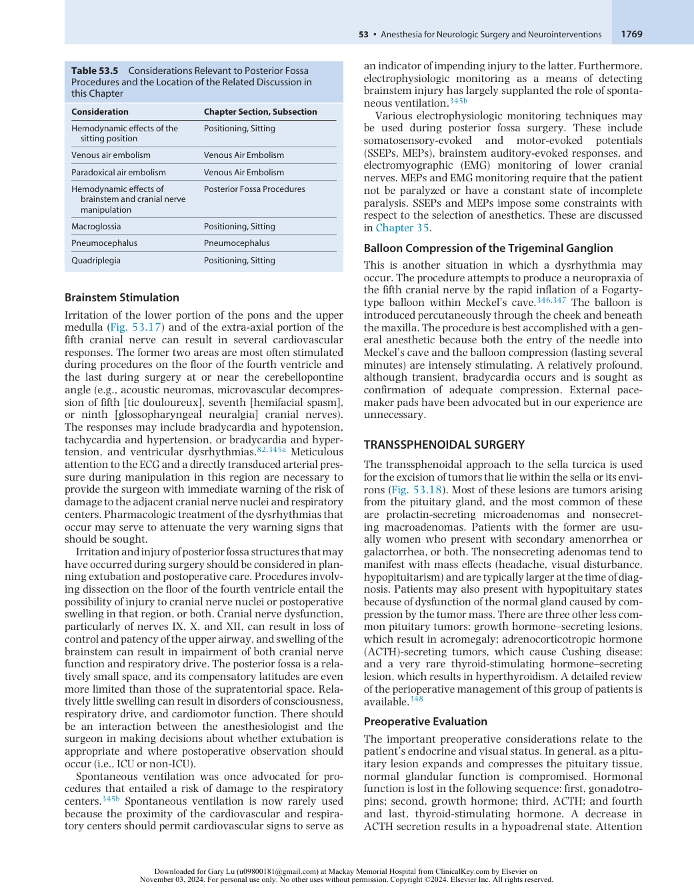

:::

<!-- PDF page 31 -->

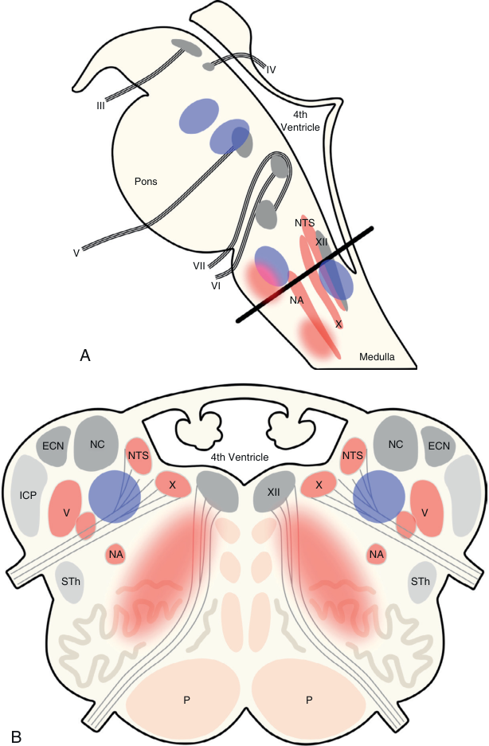

IV III 4th Ventricle Pons NTS XII V VII VI NA X A Medulla ECN NC NC ECN NTS 4th Ventricle NTS X X ICP XII V V NA NA STh STh P P B 

**Fig. 53.17 Vasomotor and respiratory centers.** Sagittal (A) and axial (B) illustrations of vasomotor centers ( _red_ ) and respiratory centers ( _blue_ ) located near the floor of the fourth ventricle. Minor brainstem manipulation resulting in stimulation of structures in red can lead to significant cardiovascular responses including hypertension, hypotension, bradycardia, and tachycardia. _V_ , spinal nucleus, and tract of trigeminal nerve; _X_ , dorsal motor nucleus of vagal nerve; _XII_ , hypoglossal nerve nucleus; _NTS_ , nucleus tractus solitarius; _NC_ , nucleus cuneatus; _ECN_ , external cuneate nucleus; _NA_ , nucleus ambiguous; _STh_ , spinal thalamic tract; _P_ , pyramid; _ICP_ , inferior cerebellar peduncle.

to this is critical because an Addisonian crisis can ensue, especially under the stress of surgery. Profound hypocortisolism, with associated hyponatremia, should be corrected preoperatively. Deficiency in thyroid function is uncommon. However, if significant hypothyroidism is present, it should be corrected preoperatively because hypothyroid patients have a diminished tolerance to the cardiovascular depressant effects of anesthetics. Attention to other manifestations of pituitary hypersecretion is also important. Hypertension, diabetes, obstructive sleep apnea (OSA), and central obesity are common concomitants of ACTHsecreting adenomas (Cushing disease). Patients with advanced acromegaly can develop an enlarged tongue and a narrowed glottis, and the airway should be evaluated accordingly. The dermis is thickened, and vascular

cannulation can be more difficult. Hypertension, OSA, and a cardiomyopathy may also occur.

### Monitoring

Many practitioners place an arterial catheter, and this facilitates monitoring of blood pressure as the nasal mucosa is injected with epinephrine-containing local anesthetic solutions. Access for blood sampling is also a useful adjunct to postoperative care if diabetes insipidus develops. Blood loss is usually modest. However, the cavernous sinuses, through which the carotid arteries pass (see Fig. 53.18), form the lateral boundary of the sella and may be entered during the resection of large tumors. Entry into these structures can lead to catastrophic blood loss. Additionally, in some patients there is an extensive venous sinus connecting the

<!-- PDF page 32 -->

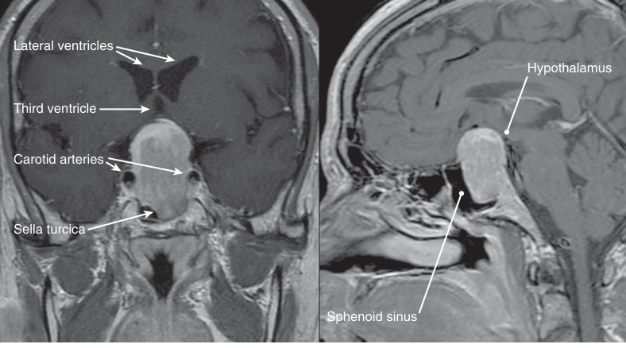

Lateral ventricles Hypothalamus Third ventricle Carotid arteries Sella turcica Sphenoid sinus 

**Fig. 53.18 Pituitary tumor with suprasellar extension.** The _left panel_ shows the proximity of the tumor to the carotid arteries (which lie within the cavernous sinuses) and the potential for distortion of the ventricular system. The optic chiasm (not seen) lies above the sella in the path of the upwardly expanding tumor. The _right panel_ shows that tumors that lie above the sella (including craniopharyngiomas, which arise in this location) abut and can invade the hypothalamus. The more radio- dense ( _whiter_ ) cap over the superior and anatomic right lateral aspects of the tumor mass is a normal pituitary gland.

two cavernous sinuses that may cover the entire dural lining of the sella, rendering a transsphenoidal approach hazardous. It has, on occasion, precluded this approach to the pituitary gland.

### Anesthetic Technique

The latitudes are broad with respect to agent selection, although tumors with suprasellar extension (see Fig. 53.18) can occasionally cause hydrocephalus and add increased ICP constraints to the anesthetic technique. The procedure is performed in the supine position, usually with some degree of head- up posture to avoid venous engorgement. A pharyngeal pack prevents the accumulation of blood in the stomach (which causes vomiting) or in the glottis (which contributes to coughing at extubation). A right-angle endotrachial (RAE)-type endotracheal tube secured to the lower jaw at the corner of the mouth opposite the surgeon’s dominant hand (e.g., the left corner of mouth for a right- handed surgeon) is suitable. A small esophageal stethoscope and temperature probe can lie with the endotracheal tube.

The procedure is commonly performed with a C- arm image intensifier (lateral views), and the head and arms are relatively inaccessible once the patient is draped. It is appropriate to establish the nerve stimulator at a lower extremity site. The surgical approach is via the nasal cavity, either through an incision made under the upper lip or via the nares. During the approach, the mucosal surfaces within the nose are infiltrated with a local anesthetic and epinephrine solution, and the patient should be observed for the occurrence of dysrhythmias.

Surgical preferences for CO2 management vary. In some instances, hypocapnia is requested to reduce brain volume and minimize the degree to which the arachnoid bulges into the sella. One of the important surgical considerations is the avoidance, when possible, of opening the arachnoid membrane leading to leakage of CSF. Postoperative CSF leaks can be persistent and are associated with a considerable risk

of meningitis. By contrast, when there is suprasellar extension of a tumor, a normal CO2 level helps deliver the lesion into the sella for excision.349 As an alternative method to accomplish this, some surgeons have resorted to boluses of saline into the lumbar CSF space to increase the downward pressure.350

A smooth emergence from anesthesia (see the section on Emergence from Anesthesia, above) is desirable, especially if the CSF space has been opened (and resealed with fibrin glue or by packing the sphenoid sinus with fat or muscle). Repeated intense Valsalva maneuvers, as with coughing or vomiting, may contribute to the reopening of a CSF leak and worsen the risk of subsequent meningitis. The airway should be cleared of debris including formed clots. In situations in which there is concern that a persistent CSF leak may occur, the surgeon may place a lumbar CSF drain to maintain CSF decompression in the early postoperative period.

### Diabetes Insipidus

The antidiuretic hormone (ADH) is synthesized in the supraoptic nuclei of the hypothalamus and is transported down the supraoptic–hypophyseal tract to the posterior lobe of the pituitary gland. This portion of the pituitary gland is frequently spared during transsphenoidal tumor excisions. Even when it is excised, water homeostasis commonly normalizes, presumably because ADH is released from the cut end of the tract. When the pituitary stalk is transected, and sometimes even when the posterior lobe of the pituitary gland is left intact, transient diabetes insipidus may occur. Diabetes insipidus very rarely arises intraoperatively; it usually occurs 12 to 48 hours postoperatively. The clinical picture is one of polyuria in association with a rising serum osmolality. The diagnosis is made by comparison of the osmolality of urine and serum. Hypo- osmolar urine in the face of an elevated and rising serum osmolality strongly supports the diagnosis. In the presence of _bona fide_ diabetes

<!-- PDF page 33 -->

insipidus, urine- specific gravity is low (i.e., ≤1.002), though this analysis is now rarely performed.

When the diagnosis of diabetes insipidus is established, the following fluid management regimen is appropriate: hourly maintenance of fluids plus two-thirds of the previous hour’s urine output. (An acceptable alternative is the previous hour’s urine output − 50 mL + maintenance.) The choice of fluid is dictated by the patient’s electrolyte levels. In general, the patient is losing fluid that is hypo- osmolar and relatively low in sodium. Half- normal saline and 5% dextrose in water are commonly used as replacement fluids. Beware of hyperglycemia when large volumes of 5% dextrose in water are used. If the hourly requirement exceeds 350 to 400 mL, desmopressin acetate is often administered.

### AWAKE CRANIOTOMY AND SEIZURE SURGERY

Awake craniotomies are performed when tumors or epileptic foci lie close to cortical areas required for either speech or motor function, or to mesial–temporal structures critical to short- term memory. Many patients have so- called temporal lobe epilepsy. There is commonly a structural lesion visible on MRI. Sometimes there is a history of remote trauma.

### Presurgical Evaluation

Before the resection, most patients have undergone a Wada test or video- telemetry, or both.351 More recently, functional testing using MRI or positron emission tomography, or both, has also been introduced to the presurgical evaluation. The Wada test involves selectively anesthetizing the cerebral hemispheres, usually by injection of amobarbital sodium into the carotid artery to localize the hemisphere that controls speech or to confirm that there is bilateral representation for short- term memory, or both. Speech is an issue when the posterolateral portions of the temporal lobe are involved, and memory is the concern when the involvement is mesial.

### Anesthesia for Electroencephalogram Electrode Placement

Video- telemetry is performed to permit localization of the seizure focus that is responsible for the clinically problematic events. This usually requires prior placement of either subdural strip electrodes (via burr holes) or a subdural electrode grid (requiring a craniotomy). Electrodes are sometimes placed deep into the parenchyma, usually within the temporal lobe (placed stereotactically via burr holes), or they are positioned to look at the inferior surfaces of the temporal lobe. The latter is commonly accomplished with so- called foramen ovale electrodes. These electrodes are placed using a needle similar to an epidural needle. The point of entry is approximately 2 cm lateral to the angle of the mouth. The needle is passed through soft tissue, under the temporal process of the zygomatic bone and medial to the ramus of the mandible, up to the base of the skull in the vicinity of the foramen ovale. Typically, this procedure is performed with monitored anesthesia care (MAC) only, although small doses of anesthetics, most often propofol, are usually required at the time of stimulation by the needle of the periosteum at the base of the skull. After placement of the relevant electrodes, the patient’s seizure medication is discontinued, and the patient remains in an observation

unit with EEG and behavior recorded continuously. In this manner, the EEG events associated with the clinically significant seizure events and their anatomic origin can be identified.

### Pre- anesthetic Evaluation and Preparation

At the preoperative interview, the patient should be educated about the nature and duration of the procedure and the limitations on patient movement. A description of both the aura and the seizures to facilitate recognition of impending events should be obtained, and it should be ascertained whether the patient is subject to having grand mal convulsions. If intraoperative electrocorticography to identify seizure foci is intended, it is common to discontinue or reduce by half the anticonvulsants according to the perceived risk of uncontrolled seizures. Premedicants with an anticonvulsant effect (e.g., benzodiazepines) should not be used because they may interfere with intraoperative EEG localization.

### Anesthetic Technique

The objectives of the anesthetic technique are as follows:

1.  To minimize patient discomfort associated with the potentially painful portions of the procedure and with the prolonged restriction of movement.

2.  To ensure patient responsiveness and compliance during the phases of the procedure that require assessment of speech, memory, or motor/sensory responses to cortical stimulation.

3.  To select anesthetic techniques that produce minimal inhibition of spontaneous seizure activity.

There are probably many ways of providing sedation that are consistent with the objectives just cited. The techniques employed range from minimal sedation approaches, through deep sedation during which intermittent unresponsiveness is achieved with spontaneous ventilation and an unprotected airway, to asleep–awake–asleep techniques with intermittent airway management with a laryngeal mask airway (LMA) or endotracheal tube, sometimes with positive- pressure ventilation. From the outset, the anesthesiologist should appreciate that the essential element of an anesthetic for an awake craniotomy is the local anesthetic technique. Sedation cannot compensate for inadequate anesthesia of the scalp, as is accomplished by nerve blocks (Fig. 53.19), and infiltration of pin sites and incision lines. Although the anesthesiologist can contribute enormously to the patient’s comfort and tolerance of the painful components of the procedure and the prolonged immobilization, the anesthesiologist must not get trapped into thinking that it is his or her responsibility to provide a general anesthetic equivalent in a spontaneously breathing patient with an unprotected and all but inaccessible airway.

For sedation, there are many options. Many clinicians (including the authors) use principally propofol,352,353 sometimes supplemented with infusion of remifentanil (e.g., 0.02 to 0.05 mcg/kg/min) or dexmedetomidine (e.g., 0.2 mcg/kg/h). Other combinations, including propofol with either fentanyl or remifentanil and dexmedetomidine with or without remifentanil, are reasonable.354–356 Great care should be taken in administering additional sedative

<!-- PDF page 34 -->

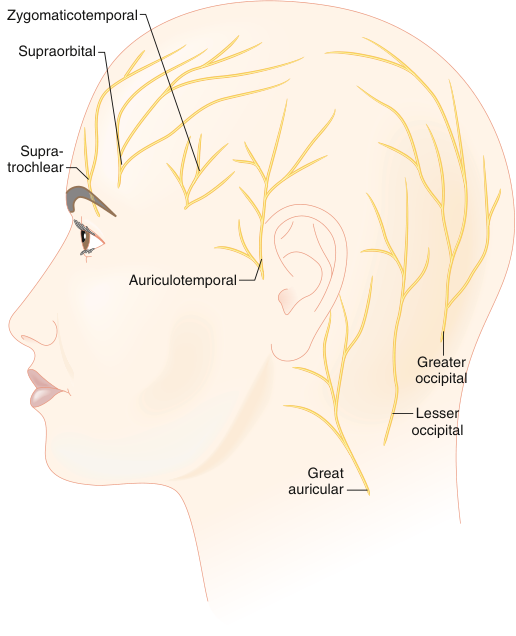

Zygomaticotemporal Supraorbital Supra- trochlear Auriculotemporal Greater occipital Lesser occipital Great auricular 

**<mark>Fig. 53.19 The cutaneous nerves of the scalp.</mark>**

drugs, especially narcotics whose respiratory depressant effects will be synergistic with propofol. This is especially relevant in the presence of pin fixation, which severely restricts the anesthesiologist’s capacity to intervene quickly in the event of excessive respiratory depression or loss of patency of the airway. Propofol should be discontinued at least 15 minutes before EEG recording. Despite prompt awakening, propofol leaves a residual EEG footprint characterized by high- frequency, high- amplitude beta activity that can obscure the abnormal activity that is being sought in the cortical surface EEG.352 The use of dexmedetomidine, which in addition to sedation and anxiolysis provides some analgesia with minimal respiratory depression, is increasing.356–360 Satisfactory conditions for functional testing, including brain stimulation for speech mapping and electrocorticography, have been reported with dexmedetomidine infusions ongoing at rates between 0.1 and 0.5 mcg/kg/h during the testing.356,358,361,362 The occurrence of delays in achieving satisfactory patient responsiveness has also been reported,359,363 and using only relatively modest infusion rates (i.e., 0.1 to 0.2 mcg/kg/h) during neurocognitive testing appears advisable.361 Administration of antiemetics (ondansetron or dexamethasone, or both) should probably be routine, especially if narcotics are administered.

Various groups have reported the use of the LMA with either spontaneous or controlled ventilation during the craniotomy, with cessation of sedative administration and LMA removal once the brain surface is exposed.357–359,361,364,365 It is obvious that many approaches can be effective, but it should be noted, for the most part, that the LMA techniques have been used

in patients who were _not_ in pin fixation of the head. An awake–asleep–awake technique using insertion, removal, and replacement of an endotracheal tube has been reported, but a customized tube that allows installation of local anesthetic in the glottis and trachea was used.366

Routine, noninvasive monitors are almost always sufficient. Reliable capnography, to provide breath- by- breath confirmation of airway patency and respiratory drive, is essential if deep sedation is intended for any portion of the procedure. These procedures are often lengthy. Attention to the details of patient comfort (temperature management, padding of pressure areas) improves patient tolerance.

The uncomfortable phases of the procedure are pin head holder placement (not all groups use a pin head holder) and the craniotomy. Many patients also find manipulation of the dura, in particular traction on subtemporal dura, painful. The actual manipulation of supratentorial brain parenchyma is painless. The volume of local anesthetic used to infiltrate pin sites and perform the scalp nerve blocks can be substantial. It is appropriate for the anesthesiologist to keep track of, and provide advice about, the doses of local anesthetics used.

The anesthesiologist should participate actively at the time of head positioning. The more neck flexion and atlanto- occipital extension that can be achieved before the final lockdown of the head holder, the wider the latitudes will be for sedating the patient, while maintaining spontaneous ventilation and a patent airway. During positioning of the patient, there should also be attention to the need to maintain visual access to the face. A clear line of sight to the face is necessary to present the patient with images to name as part of speech testing and to identify the occurrence of facial motor responses during mapping of the motor strip.

In general, after the dural opening is complete, for seizure- related resections, cortical surface EEG recording is performed to locate the seizure focus. If no seizure activity is observed, provocative maneuvers may be requested.367 Methohexital in a dose of approximately 0.3 mg/kg is generally safe and effective. Etomidate, approximately 0.05 to 0.1 mg/kg, has also been used. Localization of seizure focus can also be accomplished during light general anesthesia (e.g., N2O/fentanyl/low- dose isoflurane). During general anesthesia, alfentanil, in a bolus dose of 30 to 50 mcg/ kg368,369 ; etomidate in doses of 0.2 to 0.3 mg/kg370,371 ; and remifentanil, as a bolus of 2.5 mcg/kg372 have been reported to be effective in activating seizure foci. Hyperventilation may also help activate seizure foci.373

After localization by EEG (or initially in non- seizurerelated resections), functional testing is performed by electrical stimulation of the cortical surface with observation for motor, sensory, or speech interruption effects. During cortical stimulation, the anesthesiologist should be prepared to treat grand mal convulsions. Seizures usually stop with cessation of stimulus or with irrigation of the cortex with cold saline. When they are not self- limited, pharmacologic intervention (e.g., with propofol in increments of 0.5 to 1.0 mg/kg), may be warranted. However, propofol should be withheld briefly until it is clear that the seizure is not going to terminate spontaneously because it may interfere with subsequent EEG localization for some time.352

<!-- PDF page 35 -->

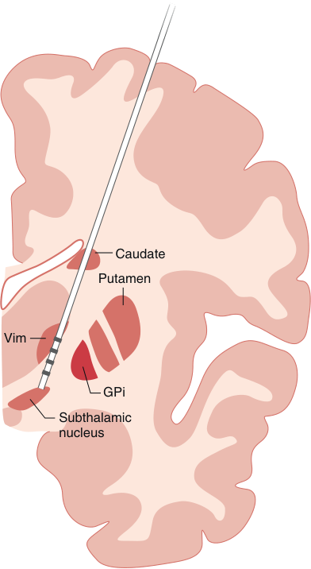

Caudate Putamen Vim GPi Subthalamic nucleus 

**Fig. 53.20 Deep brain stimulation electrode target sites.** The most commonly targeted nuclei for the treatment of movement disorders are the subthalamic nucleus, the ventral intermediate nucleus of thalamus (Vim), and the internal segment of globus pallidus (GPi).

### STEREOTACTIC PROCEDURES

Stereotactically guided procedures are performed for numerous indications including biopsy of small, deep- seated lesions and placement of deep brain stimulation electrodes. The latter are placed most commonly for the treatment of movement disorders (Parkinson disease, essential tremor, and dystonias)374 and sometimes for a variety of other conditions (Tourette disorder, obsessive–compulsive disorder, and depression). Procedures related to movement disorders most often target the subthalamic nucleus, the internal segment of the globus pallidus, or the ventral intermediate nucleus of the thalamus (Fig. 53.20).374 The mechanism of the beneficial effect of deep brain stimulation is not well understood. A prominent theory is that the abnormal motor patterns are caused by synchronized oscillations in neural circuits involving several basal ganglia nuclei, as well as the cortex, and that high- frequency stimulation of any of several points along the pathway can interfere with the oscillation.375

Preoperative evaluation should include ensuring that the coagulation system is intact and that the patient is not taking platelet- inhibiting agents (including herbal medications). There should be careful explanation of the procedure, its likely duration, and the necessary restraints on patient movement.

Several constraints will confront the anesthesiologist including:

1. _Airway access_ . Commonly, the stereotactic frame, of which there are many variations, is placed using local anesthetic and the patient undergoes an imaging study before being brought to the operating room. In some instances, the frame will prevent mask application and ventilation, laryngoscopy, and neck extension. If a general anesthetic is to be used, an awake intubation occasionally may be required. The frame is often anchored to the operating room table. If sedation is to be used, the anesthesiologist should have certain knowledge of how to remove the device rapidly in an urgent situation (including knowledge of the whereabouts of the requisite key or spanner device).

2. _The effect of anesthetics on microelectrode recordings and symptoms._ Localization of deep brain stimulation electrodes typically involves the combination of stereotaxis with fine tuning by identification of the electrophysiologic footprint specific to the targeted nucleus (e.g., the subthalamic nucleus, globus pallidus interna). The sedative agents used must not interfere with that signature. The nature and duration of the effects of anesthetics (which probably vary from nucleus to nucleus) have not been systematically defined. Some surgeons and electrophysiologists may request, on a just- in- case basis, that no sedative agent whatsoever be given. That is likely to be unnecessarily restrictive. Comprehensive reviews are available.376–378 In short, benzodiazepines probably have the greatest potential to interfere and are best avoided. Propofol has been reported to cause severe dyskinesia in patients with movement disorders,379 but has nonetheless been used quite frequently. At a minimum, a substantial interval between propofol administration and recording should be planned. Dexmedetomidine in low doses has been used quite widely without reports of interference with signals.380 Remifentanil, in part because of its rapid clearance, is probably also a reasonable choice, although it too has been reported to suppress Parkinsonian tremor.381

The cessation of the patient’s symptoms upon stimulation, without the occurrence of unacceptable side effects, is also an important end point for determining the adequacy of deep brain stimulation position and stimulus parameters. The symptoms must not be suppressed by the sedative agents. This can occur with propofol.382 Satisfactory electrophysiologic recordings and preservation of the tremor have been reported in parkinsonian patients who received dexmedetomidine in a dose sufficient to maintain a lethargic response to normal speech.356,380,383

An additional issue that arises in some patients with movement disorders is the problem of obtaining highquality radiologic images in the presence of a persistent tremor. Sedation immediately preceding the stereotactic placement may be inevitable. Propofol has been used, but the window between propofol administration and subsequent recording should be as long as possible.

3. _Intracerebral hematoma and prevention of hypertension_ . Intracerebral hematoma is a serious, potential intraoperative complication of stereotactic procedures. Prevention and prompt treatment of hypertension are among

<!-- PDF page 36 -->

the anesthesiologist’s important objectives. The concern is that, in the face of multiple needle passes through the brain, hypertension will precipitate development of an intracerebral hematoma. In the event of a substantial hematoma, an urgent craniotomy may be required, and the anesthesiologist should be prepared from the outset for this eventuality.

As noted in the section on Venous Air Embolism, above, because of spontaneous ventilation, there is some hazard of VAE during deep brain stimulation placement.96

### NEUROENDOSCOPIC PROCEDURES

Excision of some intraventricular lesions (e.g., colloid cysts, and fenestration of the lamina terminalis or the floor of the third ventricle for treatment of hydrocephalus) can be accomplished endoscopically. Access is usually achieved through burr holes placed over the frontal or occipital horns of the lateral ventricle. The important anesthetic consideration relates to the irrigation fluid (which should be warmed) used to maintain clear visualization, in a manner analogous to orthopedic arthroscopy procedures. Obstruction to the effluent limb produces rapid increases in ICP that are commonly associated with sudden changes in vital signs **.** An increase in blood pressure and decrease in heart rate (a Cushing- type response) is classic, but the heart rate component is less reliable. Cardiovascular changes may also, but less predictably, represent mechanical irritation of intracranial (e.g., hypothalamic) structures. The surgeon should be notified immediately of any sudden hemodynamic changes. The decision of whether intra- arterial monitoring is warranted should be made with the surgeon.

### NEUROINTERVENTIONAL PROCEDURES

A wide variety of interventional procedures are performed for the evaluation and treatment of intracranial and extracranial disease. These include: stent- assisted revascularization for atherosclerotic disease; thrombectomy in the setting of acute thromboembolic disease; aneurysm, AVM, tumor, and arteriovenous fistula embolization; and treatment of cerebral vasospasm.384

Much of the management of neurointerventional anesthesia has been discussed previously in the section on Recurrent Issues in Neuroanesthesia. Critical components of interventional neuroanesthesia include patient immobility, rapid anesthetic emergence to facilitate neurologic examination, strict hemodynamic manipulation to prevent hyperperfusion and hypoperfusion, and thoughtful PaCO2 management. Additionally, the anesthesiologist may need to manage (and potentially reverse) anticoagulation. Inherent to neurointerventional procedures is a requisite knowledge of vascular anatomy and appreciation of the underlying pathology. Close communication with the interventionalist throughout the procedure is essential. Cerebral vascular anatomy, including anatomic vascular distribution, is reviewed in Fig. 53.21.

### Anesthetic Technique

General anesthesia (GA) is widely employed for a variety of reasons: (1) to ensure the immobility that is essential to the

technical elements of the procedure; (2) to ensure patient comfort during particularly stimulating procedures; (3) to manage medical comorbidities; (4) to control a disordered sensorium; or (5) to protect the airway and control of ventilation (PaCO2 manipulation, apnea). The potential disadvantages of GA include hemodynamic instability during intubation, extubation, or both; anesthetic- induced hypotension causing cerebral hypoperfusion; inability to directly monitor the patient’s neurologic status; complications related to coughing and straining during extubation; and delayed emergence or impaired postprocedure neurologic exam due to residual anesthetic drugs.

If GA is employed, there is little evidence to favor specific anesthetic agents over others provided basic neuroanesthetic goals are achieved (strict hemodynamic control, rapid emergence with minimal residual anesthetic effect on neurologic exam, and smooth emergence/extubation). Some advocate the avoidance of N2O due to the potential of air bubble introduction into the arterial system during the procedure. Although N2O could expand such bubbles and potentially increase ischemic risk, local experience of the authors suggests that N2O is safe provided the interventional technique is meticulous.

MAC with intravenous sedative drugs has been advocated in the interventional radiology suite for various reasons (i.e., better maintenance of cerebral perfusion pressure, avoidance of hemodynamic lability at induction/ emergence, preservation of neurologic exam, expedience). Although these reasons make intuitive sense, it remains unclear whether the anesthetic type truly provides a clear advantage in many of these areas.

### Acute Thrombectomy

The frequency with which anesthesia personnel are enlisted to participate in the care of acute stroke patients having emergent thrombectomy is likely to increase because of the publication of recent studies demonstrating outcome improvement in select patients who undergo thrombectomy as long as 24 hours after the onset of stroke symptoms.385,386 There has been some debate in recent years regarding the best anesthetic type (GA versus MAC) for this procedure. Many retrospective studies found an association between GA and worse neurologic outcome following acute thrombectomy procedures.387 Inherent to these studies was an obvious selection bias; airway control is generally sought for patients who have significant neurologic deficits and altered level of consciousness that precludes patient cooperation. Subsequent RCTs388,389 and a recent meta- analysis390 did not demonstrate an outcome benefit of MAC in this patient population. Although MAC has the potential to hasten vascular access time (imaging to groin puncture time),387 recent studies have failed to demonstrate an advantage in time to revascularization.387–389 Presumably this is because the small time delay attributed to endotracheal intubation was offset by reduced patient mobility and improved operative conditions. It should be noted that both MAC and GA can cause significant reduction in blood pressure and thereby increase risk of infarct to the ischemic penumbra. However, close attention to, and aggressive treatment of, hypotension by the anesthesiologist appear to negate the potential increased risk of GAinduced hypotension. Current guidelines regarding specific

<!-- PDF page 37 -->

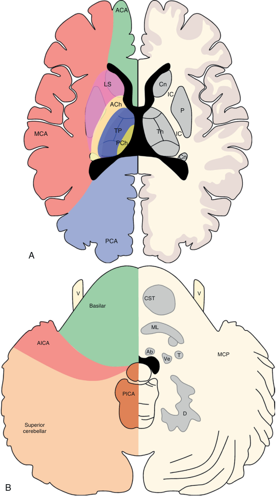

ACA LS Cn IC ACh P MCA TP Th IC PCh Cn PCA A V V CST Basilar ML AICA Ab T MCP Ve PICA D Superior cerebellar B 

**Fig. 53.21 Anatomic cerebral vascular distribution.** _ACA_ , anterior cerebral artery; _MCA_ , middle cerebral artery; _PCA_ , posterior cerebral artery; _LS_ , lenticulostriate arteries; _ACh_ , anterior choroidal artery; _PCh_ , posterior choroidal artery; _TP_ , thalamic perforators; _Cn_ , caudate nucleus; _Th_ , thalamus; _P_ , putamen; _IC_ , internal capsule; _AICA,_ anterior inferior cerebellar artery; _PICA,_ posterior inferior cerebellar artery; _CST_ , corticospinal tract; _ML_ , medial lemniscus; _Ab_ , abducens nucleus; _Ve_ , vestibular nucleus; _D_ , dentate nucleus; _MCP_ , middle cerebral peduncle; _T_ , trigeminal nucleus; _V_ , trigeminal nerve.

blood pressure targets during thrombectomy remain vague (&lt;180/105 mm Hg156 or SBP 140–180 mm Hg)391 ; further research in this area is underway.392 In select patients (cooperative), MAC may allow for neurologic examination throughout the procedure, which may also serve to provide a therapeutic end point during thrombectomy procedures. At present time, there is insufficient evidence to routinely

recommend one anesthetic technique over another. Rather, the technique employed should be based upon a rapid clinical assessment of the patient, comfort level of the anesthesiologist with various techniques, and local practice. When GA is selected, attention must be given to avoid undue delay in endovascular treatment and to the meticulous maintenance of cerebral perfusion near awake levels. It is probably

<!-- PDF page 38 -->

also reasonable to maintain normocapnia and to avoid profound hyperoxia.393,394

### Tumors and Arteriovenous Malformations

Hyperventilation may be appropriate to divert flow away from normal brain and toward the lesion that is to be visualized or that is intended to receive an occlusive device or material. When the interventionalist is attempting to place glue in high- flow lesions (e.g., AVMs, fistulas), the anesthesiologist may be asked to reduce systemic blood pressure to prevent glue passage into the draining veins or systemic venous system. The choice of hypotensive agent depends on the anesthesiologist’s experience and systemic cardiovascular considerations. Adenosine, which produces temporary flow cessation, is almost certainly the most effective means of accomplishing this objective.395

### Intracranial Aneurysms

The International Subarachnoid Aneurysm Trial and subsequent meta- analysis have confirmed the broad applicability of endovascular treatment of aneurysms,396,397 and most aneurysms are currently managed by those approaches. Nonetheless, a substantial number of patients continue to undergo operative clipping,398 primarily those with widenecked aneurysms, diseased or occluded proximal vessels, and otherwise complex anatomy.

Many aneurysm- related procedures, particularly those involving the treatment of vasospasm by selective intra- arterial installation of vasodilators (papaverine, calcium- channel blockers) or more commonly by balloon dilatation, can be accomplished without the involvement of an anesthesiologist. The duration of a procedure, individual patient factors, and sometimes the necessity for precise physiologic control may result in requests for MAC or GA. Absolute immobility is commonly needed by the interventionalist and is often the basis for a request for GA. In addition, anesthesiologists may become involved during the resuscitation stage in the event of vascular rupture or of the migration of an intravascular device to an incorrect location. In the event of rupture, the interventionist may request blood pressure reduction while the coil packing of the aneurysm is completed hastily. In addition, immediate reversal of heparinization is required. When detachable devices, such as coils and balloons (the latter now used infrequently), are misplaced and ischemia ensues, fluid loading and pressor administration may be requested to improve collateral CBF while the device is retrieved. A dedicated arterial line is usually warranted. This may or may not be available via a port in the interventionist’s vascular access sheath. When these complications do occur, close communication with the interventionalist is essential to ensure appropriate response from the anesthesia team.

### Stent- Assisted Revascularization or Stent- Assisted Aneurysm Embolization

Endovascular stent placement typically requires preparation with dual antiplatelet therapy (DAPT). Flow-diverting devices are new- generation stents that are increasingly being used to endovascularly treat complex intracranial aneurysms. The stent is placed in the parent artery, across the neck of the aneurysm, to direct flow away from the

opening of the aneurysm. The mechanism of treatment is best summarized by three stages: (1) flow dynamic changes (immediate); (2) thrombus formation within the aneurysm (days to weeks); and (3) endothelialization of the stent (months to years).399a Preparation frequently involves oral DAPT loading for 5 to 7 days prior to the planned procedure.399b Reports of early in- stent thrombosis as well as embolic thrombotic complication rates have been reported in the range of 3%–8% despite “adequate” dual antiplatelet therapy.399a,400 A number of factors contribute to this risk, one of which is the porosity of the device and the resulting increased metal surface area in comparison to a traditional stent such as might be used for carotid revascularization.401 Some centers use point- of- care assays such as VerifyNow (Accumetrics, San Diego, CA) prior to the procedure to assess responsiveness to the medications, to guide dose adjustment, or to identify patients who require an alternative antiplatelet agent. Practice patterns regarding specific platelet inhibition medications, duration of loading, and use of point- of- care assays to assess inhibition remain quite heterogeneous.402 Treatment for acute intraprocedural stent thrombosis involves immediate intravenous glycoprotein IIB/IIIA inhibitor and coordination with the interventional team regarding blood pressure targets.

Carotid artery stent (CAS) placement may be performed as an alternative to carotid endarterectomy (CEA), particularly if the vascular anatomy is unfavorable for CEA or significant concern for coronary artery disease exists. Hypotension and/or bradycardia should be anticipated at the time of stent deployment403 and temporary vasopressor support and/or pharmacologic treatment of bradycardia may be required.

An alternate minimally invasive approach to carotid revascularization has emerged in the last decade and appears to be increasingly favored over CAS in patients deemed high risk for CEA.404 Transcarotid artery revascularization (TCAR) is a percutaneous stenting technique that involves direct transcervical carotid access, thus avoiding the need to navigate the aortic arch and the attendant risk of embolic stroke. Theoretically, stroke risk is further minimized by establishing flow reversal within the carotid artery prior to stent deployment. A closed circuit including a filter is created, typically with a second sheath placed in the common femoral vein and use of a flow controller, returning the retrograde flow into the venous circulation. Carotid flow reversal is initiated by clamping the carotid proximal to the puncture site, thus creating retrograde flow across the carotid lesion. A wire is then passed across the lesion and the stent is deployed. The procedure is commonly performed under both local/ regional or general endotracheal anesthesia. Neuro monitoring is performed by asking the patient to follow simple commands with their contralateral hand (i.e., squeeze a toy) if regional anesthesia is utilized or EEG/evoked potential monitoring under general anesthesia. Patient intolerance to carotid flow reversal is relatively rare and typically managed by reducing the flow reversal rate and augmenting blood pressure. Basic neuroanesthetic considerations include patient immobility and comfort, strict hemodynamic control, maintenance of adequate cerebral perfusion, smooth emergence, and early postoperative neurologic examination. As with CAS, bradycardia and

<!-- PDF page 39 -->

hypotension should be anticipated during stent deployment. Many clinicians find glycopyrrolate administration prior to this step helpful in attenuating the bradycardic response.

### CEREBROSPINAL FLUID SHUNTING PROCEDURES

Cerebrospinal fluid shunts are inserted for the relief of a variety of hydrocephalic states and pseudotumor cerebri. Hydrocephalus can be communicating or noncommunicating. In a noncommunicating hydrocephalus, CSF egress from the ventricular system is obstructed. This can occur because of blood or infection in the ventricular system or tumors in or adjacent to the ventricular system. In communicating hydrocephalus, the CSF escapes from the ventricular system but is not absorbed by the arachnoid villi. This occurs most commonly secondary to infection or blood in the CSF space. Some degree of communicating hydrocephalus is particularly common after SAH.

Placement of a ventriculoperitoneal shunt is the most common procedure. Usually, a catheter is inserted via a burr hole into the frontal horn of the lateral ventricle on the nondominant (usually the right) side. A reservoir is placed subcutaneously adjacent to the burr hole and the drainage limb passes via a subcutaneous tunnel to a point near the epigastrium, where it is inserted into the peritoneal space via a very small laparotomy. A moderate degree of muscle relaxation may be helpful. A distended stomach can result in an inadvertent gastrostomy. Sometimes, most commonly in pediatric patients, there may be an obstruction at more than one level in the ventricular system and a so- called double- barreled shunt becomes appropriate. In this instance, there are two proximal ends, usually one in a lateral ventricle and one in the fourth ventricle. This latter procedure is usually performed in the prone position, whereas the majority of ventriculoperitoneal shunts are done supine.

Occasionally, when there is a communicating hydrocephalus, a lumboperitoneal shunt is inserted. The patient is placed in a lateral position and a catheter is put in the lumbar CSF space via a Tuohy- type needle. The catheter is tunneled subcutaneously around to the anterior abdominal wall and inserted into the peritoneal space via a small laparotomy.

### Anesthetic Management

Invasive monitoring is generally not required. The anesthetic technique should be chosen to avoid further increases in ICP. Moderate hyperventilation (PaCO2 25 to 30 mm Hg) is customary. Because these procedures are not performed in the context of acute injury states, there is less concern about adverse effects of hypocapnia. The target PaCO2 should be agreed upon at the outset with the surgeon. The procedure is usually performed in the supine position. Blood pressure may decrease abruptly when the ventricle is first cannulated (as brainstem pressure is relieved). Infrequently, brief pressor support is required. Burrowing the subcutaneous tunnel can produce a sudden painful stimulus, and a surge in blood pressure, which should be anticipated and treated preemptively by

the anesthesiologist. There is only minor postoperative discomfort. Unlike most neurosurgical patients, shunt patients are often nursed flat after their procedures to prevent an excessively rapid collapse of the ventricular system. Empirically, there is a small incidence of subdural hematoma after shunting, and the tearing of bridging veins at the time of rapid brain shrinkage is a suspected cause.

### Pediatric Ventriculoperitoneal Shunts

Shunts are probably more commonly performed in children than in adults. Common indications are hydrocephalus occurring in association with meningomyelocele, neonatal intraventricular hemorrhage, and posterior fossa tumors. Although one can never be casual about the management of these patients, open fontanelles seem to provide some margin for error in younger patients and, in addition, palpation of the fontanelles provides online trend monitoring of ICP. Despite the theoretical restraints, inhaled inductions using volatile anesthetics are empirically well tolerated, even in children with closed fontanelles. We avoid the inhaled induction technique in a child who is already stuporous. When an intravenous line is available, a propofol–relaxant induction sequence is preferable. For children in whom cannulation of a peripheral vein cannot be accomplished readily, an inhaled induction with sevoflurane is a common approach, with initiation of controlled ventilation, by bag and mask, as rapidly as possible. After establishing controlled ventilation, an ideal course at this point is to establish an intravenous line and administer a muscle relaxant and perhaps an induction agent, and then intubate the trachea in these optimal circumstances. For children older than 6 months of age who are not stuporous at the outset, we commonly supplement the anesthetic with fentanyl in the belief that this procedure is not entirely pain- free postoperatively, and that a smoother emergence can be accomplished with a narcotic background (see also Chapter 73).

### PEDIATRIC NEUROSURGERY

Table 53.6 identifies common pediatric procedures and their anesthetic considerations. The most frequent procedures are probably the placement and revision of CSF shunts (discussed in the preceding section). Most pediatric tumors occur in the posterior fossa. Most are near the midline, and many are associated with hydrocephalus. For pediatric posterior fossa procedures, VAE risk, monitoring, and treatment are similar for adults and children and have been previously discussed. A Doppler probe and right heart catheters are frequently placed when procedures are done in the sitting position. Craniosynostosis procedures have the potential for substantial blood loss that is roughly proportional to the number of sutures involved. There is a significant VAE risk that justifies the use of a precordial Doppler.94 Children with neuraxial tumors can present for emergent palliative radiotherapy and may have acutely increased ICP or impending herniation. Intractable pain combined with analgesic tolerance, steroid use causing centripetal obesity, and the side effects of other chemotherapeutic agents may be complicating factors.

<!-- PDF page 40 -->

**Table 53.6** Pediatric Neurosurgical Disorders and their Anesthetic Considerations

|**Age Group**|**Lesion**|**Pathogenesis**|**Anesthetic Considerations**|
|---|---|---|---|
|Neonates|Intraventricular hemorrhage|Subependymal vascular rupture|Associated problems of prematurity|
||Depressed skull fracture|Forceps injury|Associated cerebral edema|
||Meningocele|Out- pouching of meninges |Large size creates airway management difficulty|
|||through skull defect|Prone or lateral position Repair may increase ICP Variable blood loss|
||Encephalocele|Out- pouching of meninges and brain through skull|As above|
||Meningomyelocele|Protrusion of meninges and nerve roots through spina bifida|Prone or lateral position Respiratory restriction after covering large defects|
|Infants|Hydrocephalus|Varied|Increased ICP|
||Arnold–Chiari malformation|Posterior fossa contents compressed in foramen magnum|Brainstem compression with neck flexion ± hydrocephalus/increased ICP; ± meningomyelocele; postoperative respiratory depression|
||Craniosynostosis|Premature fusion of cranial sutures|Open or endoscopic procedure Substantial blood loss Air embolism Supine or prone|
||Craniofacial dysostosis|Developmental abnormality|Lengthy procedures Substantial blood loss Brain retraction Air embolism Endotracheal tube damage|
||Vascular malformations|Varied|Congestive heart failure Large blood loss Induced hypotension|
||Subdural hematoma|Trauma|Associated injuries|
|Older pediatrics|Posterior fossa tumors|Ependymoma|Hydrocephalus|
|||Astrocytoma|Increased ICP|
|||Medulloblastoma|Prone or sitting position|
|||Teratoma|Air embolism|
|||Brainstem glioma|Brainstem compression Postoperative cranial nerve dysfunction or brainstem swelling or compression|

_ICP,_ intracranial pressure.

### SPINAL SURGERY

Table 53.7 summarizes the many issues that may arise in the context of spinal cord or spinal column procedures undertaken by neurosurgeons.

Surgery on the spinal column is reviewed in detail in Chapter 62. The relevant electrophysiologic monitoring techniques are described in Chapter 35. Prone positioning has previously been discussed.

The physiology of the spinal cord is, in general, similar to that of the brain: CO2 responsiveness, BBB, autoregulation, high metabolic rate and blood flow (though somewhat less than the brain), and substantial ischemic vulnerability of gray matter. However, measures to reduce spinal cord swelling, analogous to ICP reduction maneuvers, are rarely used. The anesthesiologist should be attentive to situations in which there is significant compression of the spinal cord. This arises most often in the setting of cervical spinal stenosis and should be assumed to be present with fracture dislocation of

the spinal column. For these patients, we place arterial catheters and support blood pressure carefully. We believe that in these settings, and in patients with recent spinal cord injury (less than 7 days), blood pressure should be maintained at a MAP of 85 to 90 mm Hg or waking baseline level, whichever is higher. Blood pressure support is less important when the issue is nerve root rather than spinal cord compression. The presence of spinal stenosis and chronic cord compression is frequently, but not invariably, associated with lower extremity hyperreflexia and ankle clonus. Awake intubation may be warranted when there is instability of the cervical spinal column and in some instances of severe cervical spinal stenosis in which it is perceived that minor degrees of flexion or extension, or both, might critically aggravate spinal cord compression. Preintubation discussion and agreement with the surgeon is appropriate.

### Complete references available online at expertconsult.com.

::: details 原始表格與符號（PDF 第 40 頁）

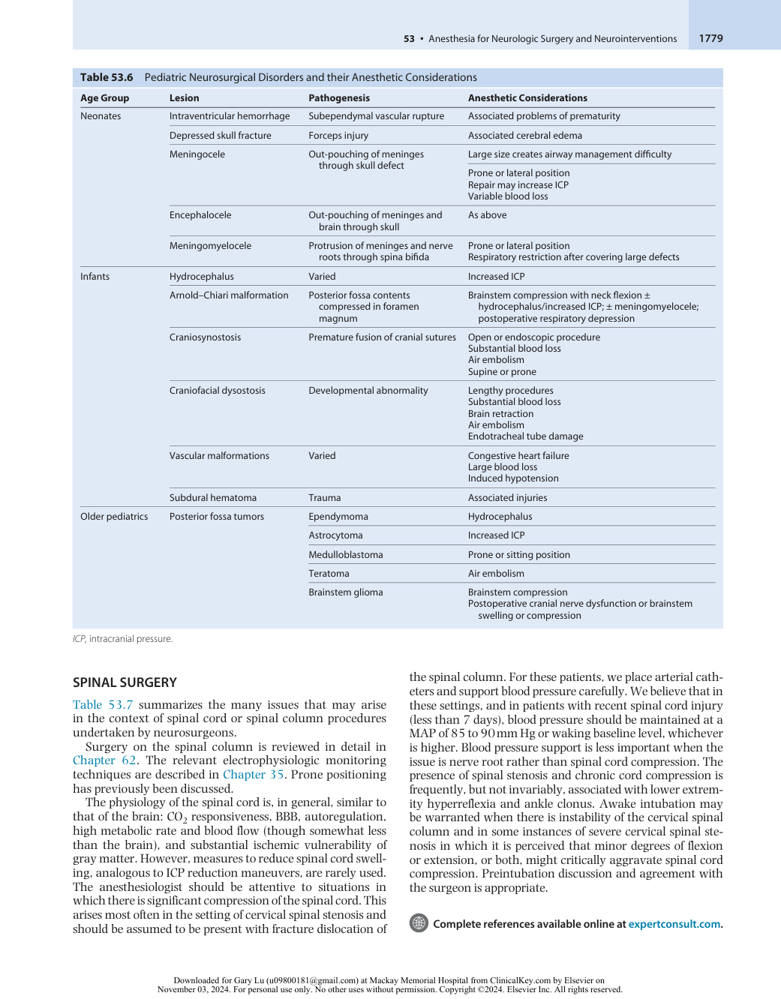

:::

<!-- PDF page 41 -->

### Table 53.7 Anesthetic Considerations and Position Requirements Associated with Various Spinal Surgical Procedures

|**Spinal Segment and Surgical Condition**| **Problems and Considerations**|**Positions Used and Comments**|
|---|---|---|
|Cervical region: spinal stenosis, trauma, rheumatoid arthritis, degenerative disk disease|Maintain neutral neck position to avoid cord compression|Supine/anterior approach for most discectomies Posterior approach (prone or sitting) for laminectomy and pedicle screws|
||Maintain perfusion pressure near waking normal levels|If existing cord compression, recent cord injury, or if cord retraction is required|
||Hypotension (spinal shock)|Occurs with complete cervical cord injury|
||Postoperative respiratory insufficiency|Occurs with cervical cord injury|
||Air embolism|With sitting laminectomies|
|Anterior cervical discectomy|Retractor compression of airway Postoperative swelling/airway compression Postoperative cranial nerve dysfunction|Supine Traction may be required for graft insertion ETT cuff deflation/reinflation after retractor placement|
|Cervical instability|Awake intubation Awake positioning|Prone or supine|
||Manual in- line stabilization for intubation (if awake intubation is not feasible)||
|Thoracolumbar region: degenerative disease, spinal stenosis, trauma|Major position change Awake intubation and position|Prone, lateral, or knee- chest If unstable, post trauma and/or major position change required|
||Blood loss|Especially with redos, instrumentations, and spinal stenosis; risk of occult aorto- iliac or major venous injury|
||Air embolism|Infrequent|
||POVL|Etiology unclear; associated with long prone procedures, low hematocrit, large EBL, and hypotension; patient variables may contribute (see Chapter 76)|
|Vertebral metastasis|Large blood loss|Prone or anterolateral/retroperitoneal Lung separation for lesions above L1|
|Spinal cord tumors|Maintain perfusion pressure during retraction|Prone|
|Procedures with major neurologic risk|Wake- up test (now rare)|Rehearse with patient|
||Somatosensory-evoked responses|Anesthetic agent restrictions|
||Motor-evoked responses|Anesthetic/relaxant restrictions|
||Pedicle screw EMG|Relaxant restriction|

_EBL,_ estimated blood loss; _EMG,_ electromyogram; _ETT_ , endotracheal tube; _POVL,_ postoperative vision loss.

### References

1.  Fishman RA. _N Engl J Med_ . 1975;293:706.

2.  Grubb RL, et al. _Stroke_ . 1974;5:630.

3.  Archer DP, et al. _Anesthesiology_ . 1987;67:642.

4.  Greenberg JH, et al. _Circ Res_ . 1978;43:324.

5.  Grosslight K, et al. _Anesthesiology_ . 1985;63:533.

6.  Petersen KD, et al. _Anesthesiology_ . 2003;98:329.

7.  Stirt JA, et al. _Anesthesiology_ . 1987;67:50.

8.  Kovarik WD, et al. _Anesth Analg_ . 1994;78:469.

9.  Eisenberg HM, et al. _J Neurosurg_ . 1988;69:15.

10.  Cremer OL, et al. _Lancet_ . 2001;357:117.

11.  Cannon ML, et al. _J Neurosurg_ . 2001;95:1053.

12.  Hemphill S, et al. _Br J Anaesth_ . 2019;122:448.

13.  Oertel M, et al. _J Neurosurg_ . 2002;97:1045.

14.  Godoy DA, et al. _Front Neurol_ . 2017;8:250.

15.  Steiner LA, et al. _Intensive Care Med_ . 2004;30:2180.

16.  Alexander SC, et al. _J Appl Physiol_ . 1968;24:66.

17.  Cohen PJ, et al. _Anesthesiology_ . 1966;27:211.

18.  Bruce DA. _Clin Perinatol_ . 1984;11:673.

19.  Coles JP, et al. _Crit Care Med_ . 2002;30:1950.

20.  Coles JP, et al. _Crit Care Med_ . 2007;35:568.

21.  Martin NA, et al. _J Neurosurg_ . 1997;87:9.

22.  van Santbrink H, et al. _Acta Neurochir (Wien)_ . 2002;144:1141.

23.  Coles JP, et al. _J Cereb Blood Flow Metab_ . 2004;24:202.

24.  Cold GE. _Acta Neurochir (Wien)_ . 1989;96:100.

25.  Bouma GJ, et al. _J Neurosurg_ . 1991;75:685.

26.  Gopinath SP, et al. _J Neurol Neurosurg Psychiatry_ . 1994;57:717.

27.  Matta BF, et al. _Anesth Analg_ . 1994;79:745.

28.  Muizelaar JP, et al. _J Neurosurg_ . 1991;75:731.

29.  Ishii R. _J Neurosurg_ . 1979;50:587.

30.  Engquist H, et al. _J Neurosurg Anesthesiol_ . 2018;30:49.

31.  Andrews RJ, et al. _Neurol Res_ . 1992;14:12.

32.  Xu W, et al. _Acta Neurochir (Wien)_ . 2002;144:679.

33.  Raichle ME, et al. _Arch Neurol_ . 1970;23:394.

34.  Muizelaar JP, et al. _J Neurosurg_ . 1988;69:923.

35.  Hadley MN, et al. _Neurosurgery_ . 2013;72(suppl 2):5.

36.  Miller JD, et al. _Neurosurgery_ . 1977;1:114.

37.  Yeung WT, et al. _J Neuro Oncol_ . 1994;18:53.

38.  Wilkinson ID, et al. _Neurosurgery_ . 2006;58:640.

39.  Bebawy JF. _J Neurosurg Anesthesiol_ . 2012;24:173.

40.  Miller JD, et al. _J Neurosurg_ . 1975;42:274.

41.  Edwards P, et al. _Lancet_ . 2005;365:1957.

42.  Cottrell JE, et al. _Anesthesiology_ . 1977;47:28.

43.  Marshall LF, et al. _J Neurosurg_ . 1978;48:169.

44.  Seo H, et al. _J Neurosurg_ . 2017;126:1839.

45.  Rudehill A, et al. _J Neurosurg Anesthesiol_ . 1993;5:4.

46.  Kaufmann AM, et al. _J Neurosurg_ . 1992;77:584.

::: details 原始表格與符號（PDF 第 41 頁）

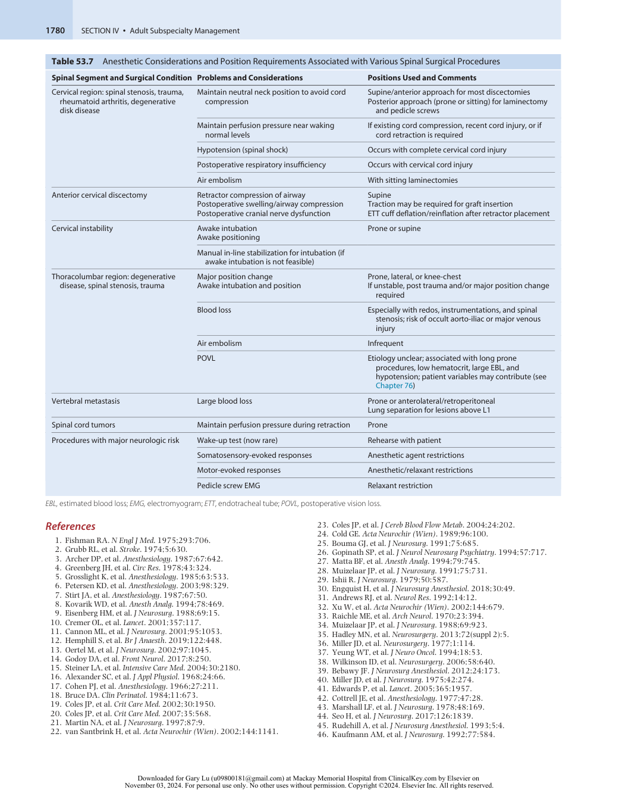

:::

<!-- PDF page 42 -->

47.  Diringer MN, et al. _Neurocrit Care_ . 2004;1:219.

48.  Hays AN, et al. _Neurocrit Care_ . 2011;14:222.

49.  Qureshi AI, et al. _Crit Care Med_ . 2000;28:3301.

50.  Doyle JA, et al. _J Trauma_ . 2001;50:367.

51.  Francony G, et al. _Crit Care Med_ . 2008;36:795.

52.  Sakellaridis N, et al. _J Neurosurg_ . 2011;114:545.

53.  Khanna S, et al. _Crit Care Med_ . 2000;28:1144.

54.  Horn P, et al. _Neurol Res_ . 1999;21:758.

55.  Ogden AT, et al. _Neurosurgery_ . 2005;57:207.

56.  Marko NF. _Crit Care_ . 2012;16:113.

57.  Mortazavi MM, et al. _J Neurosurg_ . 2012;116:210.

58.  Berger- Pelletier E, et al. _CJEM_ . 2016;18:243.

59.  Chen H, et al. _Cochrane Database Syst Rev_ . 2020;1:Cd010904.

60.  Mangat HS, et al. _Neurosurgery_ . 2020;86:221.

61.  Schwimmbeck F, et al. _J Neurosurg Anesthesiol_ . 2021;33:10.

62.  Staub F, et al. _J Neurotrauma_ . 1994;11:679.

63.  Ringel F, et al. _J Neurochem_ . 2000;75:125.

64.  Carney N, et al. _Neurosurgery_ . 2017;80:6.

65.  Lin CL, et al. _J Neurosurg_ . 2003;99:978.

66.  American Society of Anesthesiologists Task Force on Perioperative Visual Loss. _Anesthesiology_ . 2019;130(1):12.

67.  Group PVLS. _Anesthesiology_ . 2012;116:15.

68.  Albin MS, et al. _Anesth Analg_ . 1991;73:346.

69.  Brown J, et al. _Resuscitation_ . 2001;50:233.

70.  Ha JF, et al. _In Pract_ . 2018;10:204.

71.  Standefer M, et al. _Neurosurgery_ . 1984;14:649.

72.  Matjasko J, et al. _Neurosurgery_ . 1985;17:695.

73.  Harrison EA, et al. _Br J Anaesth_ . 2002;88:12.

74.  Martin JT. _Positioning in Anesthesia and Surgery_ . 2nd ed. Saunders; 1987.

75.  Marshall WK, et al. _Anesth Analg_ . 1983;62:648.

76.  Dalrymple DG, et al. _Br J Anaesth_ . 1979;51:1079.

77.  Pivalizza EG, et al. _J Neurosurg Anesthesiol_ . 1998;10:34.

78.  Ababneh O, et al. _Int Med Case Rep J_ . 2020;13:391.

79.  Wilder BL. _Neurosurgery_ . 1982;11:530.

80.  Toung TJ, et al. _Anesth Analg_ . 1986;65:65.

81.  Hernández- Palazón J, et al. _Neurocirugia (Astur)_ . 2003;14:216.

82.  Drummond JC. _Anesthesiology_ . 1984;60:609.

83.  Goodie D. _Anesthesiology_ . 1991;74:193.

84.  Skahen S, et al. _Anesthesiology_ . 1986;65:192.

85.  Toung T, et al. _Neurosurgery_ . 1983;12:164.

86.  Prabhakar H, et al. _J Neurosurg Anesthesiol_ . 2003;15:278.

87.  Reasoner DK, et al. _Anesthesiology_ . 1994;80:1008.

88.  Satyarthee GD, et al. _J Clin Neurosci_ . 2003;10:495.

89.  Michenfelder JD, et al. _Anesthesiology_ . 1972;36:164.

90.  Marshall WK, et al. _Anesthesiology_ . 1980;52:131.

91.  Papadopoulos G, et al. _Acta Neurochir (Wien)_ . 1994;126:140.

92.  Schwarz G, et al. _J Neurosurg Anesthesiol_ . 1994;6:83.

93.  Black S, et al. _Anesthesiology_ . 1988;69:49.

94.  Faberowski LW, et al. _Anesthesiology_ . 2000;92:20.

95.  Tobias JD, et al. _Anesthesiology_ . 2001;95:340.

96.  Johnson M, et al. _ASA Meeting Abstracts_ ; 2012.

97.  Matjasko J. _J Neurosurg Anesthesiol_ . 1996;8:1.

98.  Schubert A, et al. _Anesth Analg_ . 2006;102:1543.

99.  Mirski MA, et al. _Anesthesiology_ . 2007;106:164.

100.  Drummond JC, et al. _Anesth Analg_ . 1985;64:688.

101.  Bunegin L, et al. _Anesthesiology_ . 1981;55:343.

102.  Martin JT. _Anesth Analg_ . 1970;49:793.

103.  Roth S, et al. _Anesthesiology_ . 1995;83:1359.

104.  Hagen PT, et al. _Mayo Clin Proc_ . 1984;59:17.

105.  Mammoto T, et al. _Acta Anaesthesiol Scand_ . 1998;42:643.

106.  Perkins NA, et al. _Anesth Analg_ . 1984;63:429.

107.  Colohan AR, et al. _J Neurosurg_ . 1985;62:839.

108.  Black S, et al. _Anesthesiology_ . 1989;71:235.

109.  Engelhardt M, et al. _Br J Anaesth_ . 2006;96:467.

110.  Kwapisz MM, et al. _J Neurosurg Anesthesiol_ . 2004;16:277.

111.  Black S, et al. _Anesthesiology_ . 1990;72:436.

112.  Bedell EA, et al. _Anesthesiology_ . 1994;80:947.

113.  Tommasino C, et al. _J Neurosurg Anesthesiol_ . 1996;8:30.

114.  Ljubkovic M, et al. _J Appl Physiol_ . 2012;112:91.

115.  Butler BD, et al. _J Appl Physiol Respir Environ Exerc Physiol_ . 1979;47:537.

116.  Katz J, et al. _Br J Anaesth_ . 1988;61:200.

117.  Yahagi N, et al. _Anesth Analg_ . 1992;75:720.

118.  Grady MS, et al. _J Neurosurg_ . 1986;65:199.

119.  Toung TJ, et al. _Anesthesiology_ . 1988;68:53. 120.  Geissler HJ, et al. _Anesthesiology_ . 1997;86:710.

121.  Mehta M, et al. _Acta Anaesthesiol Scand_ . 1984;28:226.

122.  Losasso TJ, et al. _Anesthesiology_ . 1992;77:21.

123.  Losasso TJ, et al. _Anesthesiology_ . 1992;77:148.

124.  Weed LH, et al. _Am J Physiol Legacy Content_ . 1919;48:512.

125.  Tommasino C, et al. _Crit Care Med_ . 1988;16:862.

126.  Kellum JA. _Crit Care Med_ . 2002;30:259.

127.  Wilcox CS. _J Clin Invest_ . 1983;71:726.

128.  Rein JL, et al. _Am J Physiol Renal Physiol_ . 2019;316:F587.

129.  McIlroy D, et al. _Intensive Care Med_ . 2017;43:795.

130.  Semler MW, et al. _N Engl J Med_ . 2018;378:829.

131.  Weinberg L, et al. _World J Crit Care Med_ . 2016;5:235.

132.  Finfer S, et al. _N Engl J Med_ . 2022;386:815.

133.  Drummond JC, et al. _Anesthesiology_ . 1998;88:993.

134.  Myburgh J, et al. _N Engl J Med_ . 2007;357:874.

135.  Drummond JC, et al. _Anesth Analg_ . 2011;113:426.

136.  Van Aken HK, et al. _Curr Opin Anaesthesiol_ . 2012;25:563.

137.  Drummond JC. _Anesthesiology_ . 2010;112:1079.

138.  Grände PO. _J Neurosurg Anesthesiol_ . 2011;23:358.

139.  Rodling Wahlström M, et al. _Acta Anaesthesiol Scand_ . 2009;53:18. 140.  Suarez JI, et al. _Stroke_ . 2012;43:683.

141.  Suarez JI, et al. _Acta Neurochir Suppl_ . 2015;120:287.

142.  Ginsberg MD, et al. _Lancet Neurol_ . 2013;12:1049.

143.  Martin RH, et al. _Stroke_ . 2016;47:2355.

144.  Kozek- langenecker SA. _Anesthesiology_ . 2005;103:654.

145.  Cully MD, et al. _Anesthesiology_ . 1987;66:706.

146.  Trumble ER, et al. _J Neurosurg_ . 1995;82:44.

147.  Van Der Linden P, et al. _Anesth Analg_ . 2013;116:35.

148.  Neff TA, et al. _Anesth Analg_ . 2003;96:1453.

149.  Cook AM, et al. _Neurocrit Care_ . 2020;32:647.

150.  Oddo M, et al. _Crit Care Med_ . 2008;36:3233.

151.  Zetterling M, et al. _J Neurosurg_ . 2011;115:66.

152.  Vespa P, et al. _Crit Care Med_ . 2012;40:1923.

153.  Bergsneider M, et al. _J Neurosurg_ . 1997;86:241.

154.  Shutter L. _Crit Care Med_ . 2012;40:1995.

155.  Jacobi J, et al. _Crit Care Med_ . 2012;40:3251.

156.  Powers WJ, et al. _Stroke_ . 2019;50:e344.

157.  Finfer S, et al. _N Engl J Med_ . 2009;360:1283.

158.  Todd MM, et al. _N Engl J Med_ . 2005;352:135.

159.  Graham DI, et al. _J Neurol Neurosurg Psychiatry_ . 1989;52:346. 160.  Clifton GL, et al. _J Cereb Blood Flow Metab_ . 1991;11:114. 161.  Clifton GL, et al. _N Engl J Med_ . 2001;344:556.

162.  Clifton GL, et al. _Lancet Neurol_ . 2011;10:131.

163.  Hutchison JS, et al. _N Engl J Med_ . 2008;358:2447.

164.  Bernard SA, et al. _N Engl J Med_ . 2002;346:557.

165.  Hypothermia After Cardiac Arrest Study Group. _N Engl J Med_ . 2002;346:549.

166.  Nielsen N, et al. _N Engl J Med_ . 2013;369:2197.

167.  Dankiewicz J, et al. _N Engl J Med_ . 2021;384:2283.

168.  Donnino MW, et al. _Resuscitation_ . 2016;98:97.

169.  Nolan JP, et al. _Intensive Care Med_ . 2021;47:369.

170.  Crowder CM, et al. _J Neurosurg_ . 1996;85:98.

171.  Johansson B, et al. _Acta Neuropathol_ . 1970;16:117.

172.  Forster A, et al. _Anesthesiology_ . 1978;49:26.

173.  Hatashita S, et al. _J Neurosurg_ . 1986;64:643. 174.  Mayhan WG. _Am J Physiol_ . 1990;258:H1735. 175.  Kalfas IH, et al. _Neurosurgery_ . 1988;23:343.

176.  Jian M, et al. _Br J Anaesth_ . 2014;113:832.

177.  Grillo P, et al. _Anesth Analg_ . 2003;96:1145.

178.  Tanskanen PE, et al. _Br J Anaesth_ . 2006;97:658. 179.  Bekker A, et al. _Anesth Analg_ . 2008;107:1340. 180.  Connolly ES, et al. _Stroke_ . 2012;43:1711.

181.  Broderick JP, et al. _Stroke_ . 1994;25:1342. 182.  O’Kelly CJ, et al. _J Neurosurg_ . 2009;111:1029. 183.  Kwon JH, et al. _J Korean Neurosurg Soc_ . 2008;43:177. 184.  Adams H, et al. _Stroke_ . 2016;47:2488. 185.  Tso MK, et al. _World Neurosurg_ . 2016;86:226. 186.  Tisdall M, et al. _J Neurosurg Anesthesiol_ . 2006;18:57.

187.  Berendes E, et al. _Lancet_ . 1997;349:245.

188.  Igarashi T, et al. _Neurol Res_ . 2007;29:835.

189.  Wijdicks EF, et al. _Ann Neurol_ . 1985;18:211.

190.  Okuchi K, et al. _Acta Neurochir (Wien)_ . 1996;138:951. 191.  Rahman M, et al. _Neurosurgery_ . 2009;65:925.

192.  Deshaies EM, et al. _Neurol Res_ . 2009;31:644.

<!-- PDF page 43 -->

193.  Kiser TH. _Hosp Pharm_ . 2014;49:923.

194.  Haque R, et al. _Neurol Res_ . 2009;31:638.

195.  Rasulo FA, et al. _J Neurosurg Anesthesiol_ . 2012;24:3.

196.  Chang HS, et al. _J Neurosurg_ . 2000;92:971.

197.  Foroohar M, et al. _Surg Neurol_ . 2000;54:304.

198.  Schmidt JM, et al. _Stroke_ . 2011;42:1351.

199.  Treggiari MM, et al. _J Neurosurg_ . 2003;98:978.

200.  Rinkel GJ, et al. _Cochrane Database Syst Rev_ . 2004;2004:Cd000483.

201.  Joseph M, et al. _Neurosurgery_ . 2003;53:1044.

202.  Muizelaar JP, et al. _Surg Neurol_ . 1986;25:317.

203.  Raabe A, et al. _J Neurosurg_ . 2005;103:974.

204.  Dhar R, et al. _J Neurosurg_ . 2012;116:648.

205.  Pickard JD, et al. _BMJ_ . 1989;298:636.

206.  Petruk KC, et al. _J Neurosurg_ . 1988;68:505.

207.  Haley EC, et al. _J Neurosurg_ . 1993;78:537.

208.  Haley EC, et al. _J Neurosurg_ . 1993;78:548.

209.  Linfante I, et al. _Neurosurgery_ . 2008;63:1080.

210.  Kerz T, et al. _Br J Neurosurg_ . 2012;26:517.

211.  Feng L, et al. _AJNR Am J Neuroradiol_ . 2002;23:1284.

212.  Fraticelli AT, et al. _Stroke_ . 2008;39:893.

213.  Dorhout Mees SM, et al. _Lancet_ . 2012;380:44.

214.  Vergouwen MD, et al. _Stroke_ . 2010;41:e47.

215.  Kirkpatrick PJ, et al. _Lancet Neurol_ . 2014;13:666.

216.  Matsuda N, et al. _Cerebrovasc Dis_ . 2016;42:97.

217.  Senbokuya N, et al. _J Neurosurg_ . 2013;118:121.

218.  Macrea LM, et al. _Resuscitation_ . 2005;65:139.

219.  Naidech AM, et al. _Circulation_ . 2005;112:2851.

220.  Lee VH, et al. _Neurocrit Care_ . 2006;5:243.

221.  Bulsara KR, et al. _J Neurosurg_ . 2003;98:524.

222.  Hravnak M, et al. _Stroke_ . 2009;40:3478.

223.  Brouwers PJ, et al. _Stroke_ . 1989;20:1162.

224.  Lanzino G, et al. _J Neurosurg Anesthesiol_ . 1994;6:156. 225.  Meyer FB, et al. _J Neurosurg_ . 1987;66:109.

226.  Jafar JJ, et al. _J Neurosurg_ . 1986;64:754.

227.  Bouma GJ, et al. _J Neurosurg_ . 1990;73:368.

228.  Ogilvy CS, et al. _Neurosurgery_ . 1996;38:1202.

229.  Samson D, et al. _Neurosurgery_ . 1994;34:22.

230.  Ogilvy CS, et al. _J Neurosurg_ . 1996;84:785.

231.  Drummond JC, et al. _Neurosurgery_ . 1995;37:742.

232.  Hoffman WE, et al. _Anesthesiology_ . 1998;88:1188. 233.  Ridenour TR, et al. _Anesthesiology_ . 1992;76:807. 234.  Warner DS, et al. _Anesthesiology_ . 1993;79:985. 235.  Engelhard K, et al. _Br J Anaesth_ . 1999;83:415.

236.  Baughman VL, et al. _Anesthesiology_ . 1988;69:192.

237.  Soonthon- Brant V, et al. _Anesth Analg_ . 1999;88:49. 238.  Young WL, et al. _Anesthesiology_ . 1989;71:794.

239.  Oddo M, et al. _Intensive Care Med_ . 2012;38:1497.

240.  Symon L, et al. _J Neurosurg_ . 1984;60:269.

241.  Little JR, et al. _Neurosurgery_ . 1987;20:421.

242.  Quiñones- Hinojosa A, et al. _Neurosurgery_ . 2004;54:916.

243.  Bacigaluppi S, et al. _World Neurosurg_ . 2012;78:276.

244.  Manninen PH. _J Neurosurg Anesthesiol_ . 1995;7:63.

245.  Mack WJ, et al. _Neurosurgery_ . 2007;60:815.

246.  Young WL, et al. _Neurosurgery_ . 1996;38:1085.

247.  Zacharia BE, et al. _Neurosurg Clin N Am_ . 2012;23:147.

248.  Young WL, et al. _Neurosurgery_ . 1993;32:491.

249.  Meyer B, et al. _Stroke_ . 1999;30:2623.

250.  Morris CG, et al. _Anaesthesia_ . 2004;59:464.

251.  Crosby ET. _Anesthesiology_ . 2006;104:1293.

252.  Stene JD. In: Siegel JH, ed. _Trauma: Emergency Surgery and Critical Care_ . Churchill Livingstone; 1987:843.

253.  Talucci RC, et al. _Am Surg_ . 1988;54:185.

254.  Suderman VS, et al. _Can J Anaesth_ . 1991;38:785.

255.  Shatney CH, et al. _Am J Surg_ . 1995;170:676.

256.  Criswell JC, et al. _Anaesthesia_ . 1994;49:900.

257.  Hastings RH, et al. _Anesthesiology_ . 1993;78:580.

258.  Muckart DJ, et al. _Anesthesiology_ . 1997;87:418.

259.  Wiles MD. _Anaesthesia_ . 2022;77:1120.

260.  Hastings RH, et al. _Anesthesiology_ . 1994;80:825.

261.  Chesnut RM, et al. _J Trauma_ . 1993;34:216.

262.  Stephens CT, et al. _Anesth Analg_ . 2009;109:866.

263.  Panczykowski DM, et al. _J Neurosurg_ . 2011;115:541.

264.  Stassen NA, et al. _J Trauma_ . 2006;60:171.

265.  Bachulis BL, et al. _Am J Surg_ . 1987;153:473.

266.  Fischer RP. _Ann Emerg Med_ . 1984;13:905.

267.  Stiell IG, et al. _N Engl J Med_ . 2003;349:2510.

268.  Seelig JM, et al. _N Engl J Med_ . 1981;304:1511.

269.  Miller P, et al. _Anesth Analg_ . 2006;103:869.

270.  DeWitt DS, et al. _J Neurosurg_ . 1992;76:812.

271.  Pietropaoli JA, et al. _J Trauma_ . 1992;33:403.

272.  Stocchetti N, et al. _J Trauma_ . 1996;40:764.

273.  McHugh GS, et al. _J Neurotrauma_ . 2007;24:287.

274.  Henzler D, et al. _Crit Care Med_ . 2007;35:1027.

275.  Jones PA, et al. _J Neurosurg Anesthesiol_ . 1994;6:4.

276.  Clifton GL, et al. _Crit Care Med_ . 2002;30:739.

277.  UBt S, et al. _J Neurotrauma_ . 2008;25:495.

278.  Bouma GJ, et al. _J Neurosurg_ . 1992;77:360.

279.  Diringer MN, et al. _J Neurosurg_ . 2002;96:103.

280.  Tazarourte K, et al. _Acta Anaesthesiol Scand_ . 2011;55:422.

281.  Hlatky R, et al. _J Neurosurg_ . 2002;97:1054.

282.  Schmidt EA, et al. _J Neurosurg_ . 2003;99:991.

283.  Schramm P, et al. _J Neurosurg Anesthesiol_ . 2011;23:41.

284.  Bruzzone P, et al. _Acta Neurochir Suppl_ . 1998;71:111.

285.  Steiger HJ, et al. _Stroke_ . 1996;27:2048.

286.  Schröder ML, et al. _J Neurotrauma_ . 1996;13:17.

287.  Marion DW, et al. _J Neurosurg_ . 1991;74:407.

288.  Soustiel JF, et al. _J Neurotrauma_ . 2005;22:955.

289.  Chan KH, et al. _J Neurosurg_ . 1992;77:55.

290.  Chan KH, et al. _Neurosurgery_ . 1993;32:547.

291.  Robertson CS, et al. _Crit Care Med_ . 1999;27:2086.

292.  Marshall LF. _Neurosurgery_ . 2000;47:546.

293.  Robertson CS. _Anesthesiology_ . 2001;95:1513.

294.  Stiefel MF, et al. _J Neurosurg_ . 2006;105:568.

295.  Schirmer- Mikalsen K, et al. _Acta Anaesthesiol Scand_ . 2013;57:46.

296.  Kochanek PM, et al. _Pediatr Crit Care Med_ . 2012;13(suppl 1):S1. 297.  Romner B, et al. _J Neurosurg_ . 1996;85:90. 298.  Kelly DF, et al. _J Neurosurg_ . 1996;85:762. 299.  Kelly DF, et al. _J Neurosurg_ . 1997;86:633. 300.  Muizelaar JP, et al. _J Neurosurg_ . 1989;71:63. 301.  Coles JP, et al. _Brain_ . 2004;127:2479. 302.  Cremer OL, et al. _Anesth Analg_ . 2004;99:1211. 303.  Hlatky R, et al. _Neurosurgery_ . 2005;57:917. 304.  Lin JW, et al. _Acta Neurochir Suppl_ . 2008;101:131. 305.  Warner DS, et al. _Anesth Analg_ . 2004;99:1208. 306.  Howells T, et al. _J Neurosurg_ . 2005;102:311. 307.  Zweifel C, et al. _Neurosurg Focus_ . 2008;25:E2. 308.  Trivedi M, et al. _J Intensive Care Med_ . 2009;24:96. 309.  Johnson U, et al. _Neurosurgery_ . 2011;68:714. 310.  Aries MJ, et al. _Crit Care Med_ . 2012;40:2456. 311.  Caricato A, et al. _Crit Care Med_ . 2012;40:2526.

312.  Asgeirsson B, et al. _Intensive Care Med_ . 1994;20:260. 313.  Asgeirsson B, et al. _Acta Anaesthesiol Scand_ . 1995;39:103. 314.  Grände PO, et al. _Acta Anaesthesiol Scand_ . 2002;46:929. 315.  Sharma D, et al. _J Neurosurg Anesthesiol_ . 2011;23:363. 316.  Naredi S, et al. _Intensive Care Med_ . 1998;24:446. 317.  Eker C, et al. _Crit Care Med_ . 1998;26:1881. 318.  Naredi S, et al. _Acta Anaesthesiol Scand_ . 2001;45:402. 319.  Rosner MJ, et al. _J Trauma_ . 1990;30:933. 320.  Rosner MJ, et al. _J Neurosurg_ . 1995;83:949.

321.  Czosnyka M, et al. _J Neurosurg_ . 2001;95:756.

322.  Imberti R, et al. _J Neurosurg_ . 2002;96:97. 323.  Stocchetti N, et al. _Chest_ . 2005;127:1812. 324.  Nekludov M, et al. _J Neurotrauma_ . 2007;24:174.

325.  Talving P, et al. _J Trauma_ . 2011;71:1205.

326.  Laroche M, et al. _Neurosurgery_ . 2012;70:1334. 327.  White H, et al. _Can J Anaesth_ . 2002;49:623. 328.  Clayton TJ, et al. _Br J Anaesth_ . 2004;93:761. 329.  Stocchetti N, et al. _Neurosurgery_ . 1994;34:38. 330.  Schneider GH, et al. _Acta Neurochir (Wien)_ . 1995;134:71. 331.  Gopinath SP, et al. _Anesth Analg_ . 1996;83:1014.

332.  Stiefel MF, et al. _J Neurosurg_ . 2005;103:805.

333.  Nortje J, et al. _Br J Anaesth_ . 2006;97:95.

334.  Narotam PK, et al. _J Neurosurg_ . 2009;111:672.

335.  Spiotta AM, et al. _J Neurosurg_ . 2010;113:571. 336.  Bohman LE, et al. _Neurocrit Care_ . 2011;14:361.

337.  Ponce LL, et al. _Neurosurgery_ . 2012;70:1492.

338.  Marshall LF, et al. _J Neurosurg_ . 1983;59:285.

339.  Peterson EC, et al. _J Trauma_ . 2011;71:1588.

340.  Shiozaki T, et al. _J Neurosurg_ . 1993;79:363. 341.  Marion DW, et al. _J Neurosurg_ . 1993;79:354.

<!-- PDF page 44 -->

342.  Clifton GL, et al. _J Neurotrauma_ . 1993;10:263.

343.  Metz C, et al. _J Neurosurg_ . 1996;85:533.

344.  Andrews PJ, et al. _N Engl J Med_ . 2015;373:2403.

- 345a.  Drummond JC, et al. _Anesthesiology_ . 1994;60:232.

- 345b.  Manninen PH, et al. _Anesthesiology_ . 1992;77:681.

346.  Lobato RD, et al. _J Neurosurg_ . 1990;72:546.

347.  Skirving DJ, et al. _J Neurosurg_ . 2001;94:913.

348.  Nemergut EC, et al. _Anesth Analg_ . 2005;101:1170.

349.  Korula G, et al. _J Neurosurg Anesthesiol_ . 2001;13:255.

350.  Nath G, et al. _J Neurosurg Anesthesiol_ . 1995;7:1.

351.  Chui J, et al. _Anesth Analg_ . 2013;116:881.

352.  Drummond JC, et al. _Anesthesiology_ . 1992;76:652.

353.  Herrick IA, et al. _Anesth Analg_ . 1997;84:1285.

354.  Manninen PH, et al. _Anesth Analg_ . 2006;102:237.

355.  Keifer JC, et al. _Anesth Analg_ . 2005;101:502.

356.  Rozet I. _Curr Opin Anaesthesiol_ . 2008;21:537.

357.  Mack PF, et al. _J Neurosurg Anesthesiol_ . 2004;16:20.

358.  Ard J, et al. _J Neurosurg Anesthesiol_ . 2003;15:263.

359.  Bekker AY, et al. _Anesth Analg_ . 2001;92:1251.

360.  Frost EA, et al. _Curr Opin Anaesthesiol_ . 2007;20:331.

361.  Souter MJ, et al. _J Neurosurg Anesthesiol_ . 2007;19:38.

362.  Talke P, et al. _J Neurosurg Anesthesiol_ . 2007;19:195.

363.  Bustillo MA, et al. _J Neurosurg Anesthesiol_ . 2002;14:209.

364.  Sarang A, et al. _Br J Anaesth_ . 2003;90:161.

365.  Deras P, et al. _Neurosurgery_ . 2012;71:764.

366.  Huncke K, et al. _Neurosurgery_ . 1998;42:1312.

367.  Cascino GD. _Electroencephalogr Clin Neurophysiol Suppl_ . 1998;48:70.

368.  Cascino GD, et al. _J Clin Neurophysiol_ . 1993;10:520.

369.  McGuire G, et al. _Br J Anaesth_ . 2003;91:651.

370.  Ebrahim ZY, et al. _Anesth Analg_ . 1986;65:1004.

371.  Gancher S, et al. _Anesthesiology_ . 1984;61:616.

372.  Wass CT, et al. _Epilepsia_ . 2001;42:1340.

373.  Kjaer TW, et al. _Acta Neurol Scand_ . 2010;121:413.

374.  Lyons MK. _Mayo Clin Proc_ . 2011;86:662.

375.  Hammond C, et al. _Trends Neurosci_ . 2007;30:357.

376.  Poon CC, et al. _Br J Anaesth_ . 2009;103:152.

377.  Venkatraghavan L, et al. _Anesth Analg_ . 2010;110:1138.

378.  Erickson KM, et al. _Anesthesiol Clin_ . 2012;30:241.

379.  Deogaonkar A, et al. _Anesthesiology_ . 2006;104:1337.

380.  Rozet I, et al. _Anesth Analg_ . 2006;103:1224.

381.  Böhmdorfer W, et al. _Anaesthesist_ . 2003;52:795.

382.  Anderson BJ, et al. _Br J Neurosurg_ . 1994;8:387.

383.  Elias WJ, et al. _Mov Disord_ . 2008;23:1317.

384.  Lee CZ, et al. _Anesthesiol Clin_ . 2012;30:127.

385.  Nogueira RG, et al. _N Engl J Med_ . 2018;378:11.

386.  Albers GW, et al. _N Engl J Med_ . 2018;378:708.

387.  Brinjikji W, et al. _Stroke_ . 2017;48:2784.

388.  Schönenberger S, et al. _JAMA_ . 2016;316:1986.

389.  Löwhagen Hendén P, et al. _Stroke_ . 2017;48:1601.

390.  Ilyas A, et al. _World Neurosurg_ . 2018;112:e355.

391.  Talke PO, et al. _Stroke_ . 2014;45:e138.

392.  Campbell D, et al. _Int J Stroke_ . 2022;17:810.

393.  Allen CL, et al. _Int J Stroke_ . 2009;4:461.

394.  López HV, et al. _Ann Intensive Care_ . 2019;9:59.

395.  Hashimoto T, et al. _Anesthesiology_ . 2000;93:998.

396.  Molyneux A, et al. _Lancet_ . 2002;360:1267.

397.  Li H, et al. _Stroke_ . 2013;44:29.

398.  Lanzino G, et al. _J Neurosurg_ . 2006;104:344.

- 399a.  Dandapat S, et al. _J Neurointerv Surg_ . 2021;13:54.

399b.  Tonetti DA, Jankowitz BT, Gross BA. Antiplatelet therapy in flow diversion. _Neurosurgery_ . 2020;86:S47.

400.  Hohenstatt S, et al. _Clin Neuroradiol_ . 2023;33(2):343.

401.  Ravindran K, et al. _Neurosurgery_ . 2020;86:S13.

402.  Faught RW, et al. _J Neurointerv Surg_ . 2014;6:774.

403.  Lin PH, et al. _J Vasc Surg_ . 2007;46:846.

404.  Stonko DP, et al. _JAMA Netw Open_ . 2022;5:e2231944.

<!-- PDF page 45 -->

### References

1.  Fishman RA. Brain edema. _N Engl J Med_ . 1975;293:706–711.

2.  Grubb Jr RL, Raichle ME, Eichling JO, Ter- Pogossian MM. The effects of changes in PaCO2 on cerebral blood volume, blood flow, and vascular mean transit time. _Stroke_ . 1974;5:630–639.

3.  Archer DP, Labrecque P, Tyler JL, et al. Cerebral blood volume is increased in dogs during administration of nitrous oxide or isoflurane. _Anesthesiology_ . 1987;67:642–648.

4.  Greenberg JH, Alavi A, Reivich M, et al. Local cerebral blood volume response to carbon dioxide in man. _Circ Res_ . 1978;43:324–331.

5.  Grosslight K, Foster R, Colohan AR, Bedford RF. Isoflurane for neuroanesthesia: risk factors for increases in intracranial pressure. _Anesthesiology_ . 1985;63:533–536.

6.  Petersen KD, Landsfeldt U, Cold GE, et al. Intracranial pressure and cerebral hemodynamic in patients with cerebral tumors: a randomized prospective study of patients subjected to craniotomy in propofol- fentanyl, isoflurane- fentanyl, or sevoflurane- fentanyl anesthesia. _Anesthesiology_ . 2003;98:329–336.

7.  Stirt JA, Grosslight KR, Bedford RF, Vollmer D. “Defasciculation” with metocurine prevents succinylcholine- induced increases in intracranial pressure. _Anesthesiology_ . 1987;67:50–53.

8.  Kovarik WD, Mayberg TS, Lam AM, et al. Succinylcholine does not change intracranial pressure, cerebral blood flow velocity, or the electroencephalogram in patients with neurologic injury. _Anesth Analg_ . 1994;78:469–473.

9.  Eisenberg HM, Frankowski RF, Contant CF, et al. High- dose barbiturate control of elevated intracranial pressure in patients with severe head injury. _J Neurosurg_ . 1988;69:15–23.

10.  Cremer OL, Moons KG, Bouman EA, et al. Long- term propofol infusion and cardiac failure in adult head- injured patients. _Lancet_ . 2001;357:117–118.

11.  Cannon ML, Glazier SS, Bauman LA. Metabolic acidosis, rhabdomyolysis, and cardiovascular collapse after prolonged propofol infusion. _J Neurosurg_ . 2001;95:1053–1056.

12.  Hemphill S, McMenamin L, Bellamy MC, Hopkins PM. Propofol infusion syndrome: a structured literature review and analysis of published case reports. _Br J Anaesth_ . 2019;122:448–459.

13.  Oertel M, Kelly DF, Lee JH, et al. Efficacy of hyperventilation, blood pressure elevation, and metabolic suppression therapy in controlling intracranial pressure after head injury. _J Neurosurg_ . 2002;97:1045– 1053.

14.  Godoy DA, Seifi A, Garza D, et al. Hyperventilation therapy for control of posttraumatic intracranial hypertension. _Front Neurol_ . 2017;8:250.

15.  Steiner LA, Balestreri M, Johnston AJ, et al. Sustained moderate reductions in arterial CO2 after brain trauma time- course of cerebral blood flow velocity and intracranial pressure. _Intensive Care Med_ . 2004;30:2180–2187.

16.  Alexander SC, Smith TC, Strobel G, et al. Cerebral carbohydrate metabolism of man during respiratory and metabolic alkalosis. _J Appl Physiol_ . 1968;24:66–72.

17.  Cohen PJ, Reivich M, Greenbaum L. The electroencephalogram of awake man during hyperventilation: effects of oxygen at three atmospheres (absolute) pressure. _Anesthesiology_ . 1966;27:211–212.

18.  Bruce DA. Effects of hyperventilation on cerebral blood flow and metabolism. _Clin Perinatol_ . 1984;11:673–680.

19.  Coles JP, Minhas PS, Fryer TD, et al. Effect of hyperventilation on cerebral blood flow in traumatic head injury: clinical relevance and monitoring correlates. _Crit Care Med_ . 2002;30:1950–1959.

20.  Coles JP, Fryer TD, Coleman MR, et al. Hyperventilation following head injury: effect on ischemic burden and cerebral oxidative metabolism. _Crit Care Med_ . 2007;35:568–578.

21.  Martin NA, Patwardhan RV, Alexander MJ, et al. Characterization of cerebral hemodynamic phases following severe head trauma: hypoperfusion, hyperemia, and vasospasm. _J Neurosurg_ . 1997;87:9–19.

22.  van Santbrink H, Schouten JW, Steyerberg EW, et al. Serial transcranial Doppler measurements in traumatic brain injury with special focus on the early posttraumatic period. _Acta Neurochir_ . 2002;144:1141–1149.

23.  Coles JP, Fryer TD, Smielewski P, et al. Incidence and mechanisms of cerebral ischemia in early clinical head injury. _J Cereb Blood Flow Metab_ . 2004;24:202–211.

24.  Cold GE. Does acute hyperventilation provoke cerebral oligaemia in comatose patients after acute head injury? _Acta Neurochir (Wien)_ . 1989;96:100–106.

25.  Bouma GJ, Muizelaar JP, Choi SC, et al. Cerebral circulation and metabolism after severe traumatic brain injury: the elusive role of ischemia. _J Neurosurg_ . 1991;75:685–693.

26.  Gopinath SP, Robertson CS, Contant CF, et al. Jugular venous desaturation and outcome after head injury. _J Neurol Neurosurg Psychiatry_ . 1994;57:717–723.

27.  Matta BF, Lam AM, Mayberg TS, et al. A critique of the intraoperative use of jugular venous bulb catheters during neurosurgical procedures. _Anesth Analg_ . 1994;79:745–750.

28.  Muizelaar JP, Marmarou A, Ward JD, et al. Adverse effects of prolonged hyperventilation in patients with severe head injury: a randomized clinical trial. _J Neurosurg_ . 1991;75:731–739.

29.  Ishii R. Regional cerebral blood flow in patients with ruptured intracranial aneurysms. _J Neurosurg_ . 1979;50:587–594.

30.  Engquist H, Lewén A, Howells T, et al. Hemodynamic disturbances in the early phase after subarachnoid hemorrhage: regional cerebral blood flow studied by bedside xenon- enhanced CT. _J Neurosurg Anesthesiol_ . 2018;30:49–58.

31.  Andrews RJ, Muto RP. Retraction brain ischaemia: cerebral blood flow, evoked potentials, hypotension and hyperventilation in a new animal model. _Neurol Res_ . 1992;14:12–18.

32.  Xu W, Mellergård P, Ungerstedt U, Nordström CH. Local changes in cerebral energy metabolism due to brain retraction during routine neurosurgical procedures. _Acta Neurochir_ . 2002;144:679–683.

33.  Raichle ME, Posner JB, Plum F. Cerebral blood flow during and after hyperventilation. _Arch Neurol_ . 1970;23:394–403.

34.  Muizelaar JP, van der Poel HG, Li ZC, et al. Pial arteriolar vessel diameter and CO2 reactivity during prolonged hyperventilation in the rabbit. _J Neurosurg_ . 1988;69:923–927.

35.  Hadley MN, Walters BC. Introduction to the guidelines for the management of acute cervical spine and spinal cord injuries. _Neurosurgery_ . 2013;72(suppl 2):5–16.

36.  Miller JD, Sakalas R, Ward JD, et al. Methylprednisolone treatment in patients with brain tumors. _Neurosurgery_ . 1977;1:114–117.

37.  Yeung WT, Lee TY, Del Maestro RF, et al. Effect of steroids on iopamidol blood- brain transfer constant and plasma volume in brain tumors measured with X- ray computed tomography. _J Neuro Oncol_ . 1994;18:53–60.

38.  Wilkinson ID, Jellineck DA, Levy D, et al. Dexamethasone and enhancing solitary cerebral mass lesions: alterations in perfusion and blood- tumor barrier kinetics shown by magnetic resonance imaging. _Neurosurgery_ . 2006;58:640–646; discussion 640–646.

39.  Bebawy JF. Perioperative steroids for peritumoral intracranial edema: a review of mechanisms, efficacy, and side effects. _J Neurosurg Anesthesiol_ . 2012;24:173–177.

40.  Miller JD, Leech P. Effects of mannitol and steroid therapy on intracranial volume- pressure relationships in patients. _J Neurosurg_ . 1975;42:274–281.

41.  Edwards P, Arango M, Balica L, et al. Final results of MRC CRASH, a randomised placebo- controlled trial of intravenous corticosteroid in adults with head injury- outcomes at 6 months. _Lancet_ . 2005;365:1957–1959.

42.  Cottrell JE, Robustelli A, Post K, Turndorf H. Furosemide- and mannitol- induced changes in intracranial pressure and serum osmolality and electrolytes. _Anesthesiology_ . 1977;47:28–30.

43.  Marshall LF, Rw SM, Rauscher LA, Shapiro HM. Mannitol dose requirements in brain- injured patients. _J Neurosurg_ . 1978;48:169– 172.

44.  Seo H, Kim E, Jung H, et al. A prospective randomized trial of the optimal dose of mannitol for intraoperative brain relaxation in patients undergoing craniotomy for supratentorial brain tumor resection. _J Neurosurg_ . 2017;126:1839–1846.

45.  Rudehill A, Gordon E, Ohman G, et al. Pharmacokinetics and effects of mannitol on hemodynamics, blood and cerebrospinal fluid electrolytes, and osmolality during intracranial surgery. _J Neurosurg Anesthesiol_ . 1993;5:4–12.

46.  Kaufmann AM, Cardoso ER. Aggravation of vasogenic cerebral edema by multiple- dose mannitol. _J Neurosurg_ . 1992;77:584–589.

47.  Diringer MN, Zazulia AR. Osmotic therapy: fact and fiction. _Neurocrit Care_ . 2004;1:219–233.

48.  Hays AN, Lazaridis C, Neyens R, et al. Osmotherapy: use among neurointensivists. _Neurocrit Care_ . 2011;14:222–228.

49.  Qureshi AI, Suarez JI. Use of hypertonic saline solutions in treatment of cerebral edema and intracranial hypertension. _Crit Care Med_ . 2000;28:3301–3313.

<!-- PDF page 46 -->

50.  Doyle JA, Davis DP, Hoyt DB. The use of hypertonic saline in the treatment of traumatic brain injury. _J Trauma_ . 2001;50:367–383.

51.  Francony G, Fauvage B, Falcon D, et al. Equimolar doses of mannitol and hypertonic saline in the treatment of increased intracranial pressure. _Crit Care Med_ . 2008;36:795–800.

52.  Sakellaridis N, Pavlou E, Karatzas S, et al. Comparison of mannitol and hypertonic saline in the treatment of severe brain injuries. _J Neurosurg_ . 2011;114:545–548.

53.  Khanna S, Davis D, Peterson B, et al. Use of hypertonic saline in the treatment of severe refractory posttraumatic intracranial hypertension in pediatric traumatic brain injury. _Crit Care Med_ . 2000;28:1144–1151.

54.  Horn P, Münch E, Vajkoczy P, et al. Hypertonic saline solution for control of elevated intracranial pressure in patients with exhausted response to mannitol and barbiturates. _Neurol Res_ . 1999;21:758– 764.

55.  Ogden AT, Mayer SA, Connolly Jr ES. Hyperosmolar agents in neurosurgical practice: the evolving role of hypertonic saline. _Neurosurgery_ . 2005;57:207–215; discussion 207–215.

56.  Marko NF. Hypertonic saline, not mannitol, should be considered gold- standard medical therapy for intracranial hypertension. _Crit Care_ . 2012;16:113.

57.  Mortazavi MM, Romeo AK, Deep A, et al. Hypertonic saline for treating raised intracranial pressure: literature review with metaanalysis. _J Neurosurg_ . 2012;116:210–221.

58.  Berger- Pelletier E, Émond M, Lauzier F, et al. Hypertonic saline in severe traumatic brain injury: a systematic review and meta- analysis of randomized controlled trials - ERRATUM. _CJEM_ . 2016;18:243.

59.  Chen H, Song Z, Dennis JA. Hypertonic saline versus other intracranial pressure- lowering agents for people with acute traumatic brain injury. _Cochrane Database Syst Rev_ . 2020;1:Cd010904.

60.  Mangat HS, Wu X, Gerber LM, et al. Hypertonic saline is superior to mannitol for the combined effect on intracranial pressure and cerebral perfusion pressure burdens in patients with severe traumatic brain injury. _Neurosurgery_ . 2020;86:221–230.

61.  Schwimmbeck F, Voellger B, Chappell D, Eberhart L. Hypertonic saline versus mannitol for traumatic brain injury: a systematic review and meta- analysis with trial sequential analysis. _J Neurosurg Anesthesiol_ . 2021;33:10–20.

62.  Staub F, Stoffel M, Berger S, et al. Treatment of vasogenic brain edema with the novel Cl- transport inhibitor torasemide. _J Neurotrauma_ . 1994;11:679–690.

63.  Ringel F, Chang RC, Staub F, et al. Contribution of anion transport-

   - ers to the acidosis- induced swelling and intracellular acidification of glial cells. _J Neurochem_ . 2000;75:125–132.

64.  Carney N, Totten AM, O’Reilly C, et al. Guidelines for the management of severe traumatic brain injury, fourth edition. _Neurosurgery_ . 2017;80:6–15.

65.  Lin CL, Dumont AS, Lieu AS, et al. Characterization of perioperative seizures and epilepsy following aneurysmal subarachnoid hemorrhage. _J Neurosurg_ . 2003;99:978–985.

66.  American Society of Anesthesiologists Task Force on Perioperative Visual Loss; North American Neuro- Ophthalmology Society; Society for Neuroscience in Anesthesiology and Critical Care. Practice advisory for perioperative visual loss associated with spine surgery 2019: an updated report by the American Society of Anesthesiologists Task Force on Perioperative Visual Loss, the North American NeuroOphthalmology Society, and the Society for Neuroscience in Anesthesiology And Critical Care. _Anesthesiology_ . 2019;130(1):12–30.

67.  Group PVLS. Risk factors associated with ischemic optic neuropathy after spinal fusion surgery. _Anesthesiology_ . 2012;116:15–24.

68.  Albin MS, Ritter RR, Pruett CE, Kalff K. Venous air embolism during lumbar laminectomy in the prone position: report of three cases. _Anesth Analg_ . 1991;73:346–349.

69.  Brown J, Rogers J, Soar J. Cardiac arrest during surgery and ventilation in the prone position: a case report and systematic review. _Resuscitation_ . 2001;50:233–238.

70.  Ha JF, Vitale LN, Pfarr MA, et al. Massive macroglossia after posterior cranial fossa surgery: a case report. _In Pract_ . 2018;10:204–208.

71.  Standefer M, Bay JW, Trusso R. The sitting position in neurosurgery: a retrospective analysis of 488 cases. _Neurosurgery_ . 1984;14:649– 658.

72.  Matjasko J, Petrozza P, Cohen M, Steinberg P. Anesthesia and surgery in the seated position: analysis of 554 cases. _Neurosurgery_ . 1985;17:695–702.

73.  Harrison EA, Mackersie A, McEwan A, Facer E. The sitting position for neurosurgery in children: a review of 16 years’ experience. _Br J Anaesth_ . 2002;88:12–17.

74.  Martin JT. _Positioning in Anesthesia and Surgery_ . 2nd ed. Philadelphia: Saunders; 1987.

75.  Marshall WK, Bedford RF, Miller ED. Cardiovascular responses in the seated position – impact of four anesthetic techniques. _Anesth Analg_ . 1983;62:648–653.

76.  Dalrymple DG, MacGowan SW, MacLeod GF. Cardiorespiratory effects of the sitting position in neurosurgery. _Br J Anaesth_ . 1979;51:1079–1082.

77.  Pivalizza EG, Katz J, Singh S, et al. Massive macroglossia after posterior fossa surgery in the prone position. _J Neurosurg Anesthesiol_ . 1998;10:34–36.

78.  Ababneh O, Alghanem S, Al- Shudifat A, et al. Acute macroglossia post craniotomy in sitting position: a case report and proposed management guideline. _Int Med Case Rep J_ . 2020;13:391–397.

79.  Wilder BL. Hypothesis: the etiology of midcervical quadriplegia after operation with the patient in the sitting position. _Neurosurgery_ . 1982;11:530–531.

80.  Toung TJ, McPherson RW, Ahn H, et al. Pneumocephalus: effects of patient position on the incidence and location of aerocele after posterior fossa and upper cervical cord surgery. _Anesth Analg_ . 1986;65:65–70.

81.  Hernández- Palazón J, Martínez- Lage JF, de la Rosa- Carrillo VN, et al. Anesthetic technique and development of pneumocephalus after posterior fossa surgery in the sitting position. _Neurocirugia (Astur)_ . 2003;14:216–221.

82.  Drummond JC. Tension pneumocephalus and intermittent drainage of ventricular CSF. _Anesthesiology_ . 1984;60:609–610.

83.  Goodie D, Traill R. Intraoperative subdural tension pneumocephalus arising after opening of the dura. _Anesthesiology_ . 1991;74:193–195.

84.  Skahen S, Shapiro HM, Drummond JC, et al. Nitrous oxide withdrawal reduces intracranial pressure in the presence of pneumocephalus. _Anesthesiology_ . 1986;65:192–195.

85.  Toung T, Donham RT, Lehner A, et al. Tension pneumocephalus after posterior fossa craniotomy: report of four additional cases and review of postoperative pneumocephalus. _Neurosurgery_ . 1983;12:164–168.

86.  Prabhakar H, Bithal PK, Garg A. Tension pneumocephalus after craniotomy in supine position. _J Neurosurg Anesthesiol_ . 2003;15:278– 281.

87.  Reasoner DK, Todd MM, Scamman FL, Warner DS. The incidence of pneumocephalus after supratentorial craniotomy. Observations on the disappearance of intracranial air. _Anesthesiology_ . 1994;80:1008–1012.

88.  Satyarthee GD, Mahapatra AK. Tension pneumocephalus following transsphenoid surgery for pituitary adenoma – report of two cases. _J Clin Neurosci_ . 2003;10:495–497.

89.  Michenfelder JD, Miller RH, Gronert GA. Evaluation of an ultrasonic device (Doppler) for the diagnosis of venous air embolism. _Anesthesiology_ . 1972;36:164–167.

90.  Marshall WK, Bedford RF. Use of a pulmonary- artery catheter for detection and treatment of venous air embolism: a prospective study in man. _Anesthesiology_ . 1980;52:131–134.

91.  Papadopoulos G, Kuhly P, Brock M, et al. Venous and paradoxical air embolism in the sitting position. A prospective study with transoesophageal echocardiography. _Acta Neurochir (Wien)_ . 1994;126:140–143.

92.  Schwarz G, Fuchs G, Weihs W, et al. Sitting position for neurosurgery: experience with preoperative contrast echocardiography in 301 patients. _J Neurosurg Anesthesiol_ . 1994;6:83–88.

93.  Black S, Ockert DB, Oliver Jr WC, Cucchiara RF. Outcome following posterior fossa craniectomy in patients in the sitting or horizontal positions. _Anesthesiology_ . 1988;69:49–56.

94.  Faberowski LW, Black S, Mickle JP. Incidence of venous air embolism during craniectomy for craniosynostosis repair. _Anesthesiology_ . 2000;92:20–23.

95.  Tobias JD, Johnson JO, Jimenez DF, et al. Venous air embolism during endoscopic strip craniectomy for repair of craniosynostosis in infants. _Anesthesiology_ . 2001;95:340–342.

96.  Johnson M, et al. _Venous Air Embolism during Awake Craniotomy for Deep Brain Stimulation Electrode Implantation_ . Paper/Poster presented at: ASA Meeting Abstracts; 2012.

97.  Matjasko J. Lessons learned. _J Neurosurg Anesthesiol_ . 1996;8:1–2.

<!-- PDF page 47 -->

98.  Schubert A, Deogaonkar A, Drummond JC. Precordial Doppler probe placement for optimal detection of venous air embolism during craniotomy. _Anesth Analg_ . 2006;102:1543–1547.

99.  Mirski MA, Lele AV, Fitzsimmons L, Toung TJ. Diagnosis and treatment of vascular air embolism. _Anesthesiology_ . 2007;106:164–177.

100.  Drummond JC, Prutow RJ, Scheller MS. A comparison of the sensitivity of pulmonary artery pressure, end- tidal carbon dioxide, and end- tidal nitrogen in the detection of venous air embolism in the dog. _Anesth Analg_ . 1985;64:688–692.

101.  Bunegin L, Albin MS, Helsel PE, Hoffman A, Hung TK. Positioning the right atrial catheter: a model for reappraisal. _Anesthesiology_ . 1981;55:343–348.

102.  Martin JT. Neuroanesthetic adjuncts for patients in the sitting position. 3. Intravascular electrocardiography. _Anesth Analg_ . 1970;49:793–808.

103.  Roth S, Aronson S. Placement of a right atrial air aspiration catheter guided by transesophageal echocardiography. _Anesthesiology_ . 1995;83:1359–1361.

104.  Hagen PT, Scholz DG, Edwards WD. Incidence and size of patent foramen ovale during the first 10 decades of life: an autopsy study of 965 normal hearts. _Mayo Clin Proc_ . 1984;59:17–20.

105.  Mammoto T, Hayashi Y, Ohnishi Y, Kuro M. Incidence of venous and paradoxical air embolism in neurosurgical patients in the sitting position: detection by transesophageal echocardiography. _Acta Anaesthesiol Scand_ . 1998;42:643–647.

106.  Perkins NA, Bedford RF. Hemodynamic consequences of PEEP in seated neurological patients – implications for paradoxical air embolism. _Anesth Analg_ . 1984;63:429–432.

107.  Colohan AR, Perkins NA, Bedford RF, Jane JA. Intravenous fluid loading as prophylaxis for paradoxical air embolism. _J Neurosurg_ . 1985;62:839–842.

108.  Black S, Cucchiara RF, Nishimura RA, Michenfelder JD. Parameters affecting occurrence of paradoxical air embolism. _Anesthesiology_ . 1989;71:235–241.

109.  Engelhardt M, Folkers W, Brenke C, et al. Neurosurgical operations with the patient in sitting position: analysis of risk factors using trans cranial Doppler sonography. _Br J Anaesth_ . 2006;96:467–472.

110.  Kwapisz MM, Deinsberger W, Müller M, et al. Transesophageal echocardiography as a guide for patient positioning before neurosurgical procedures in semi- sitting position. _J Neurosurg Anesthesiol_ . 2004;16:277–281.

111.  Black S, Muzzi DA, Nishimura RA, Cucchiara RF. Preoperative and intraoperative echocardiography to detect right- to- left shunt in patients undergoing neurosurgical procedures in the sitting position. _Anesthesiology_ . 1990;72:436–438.

112.  Bedell EA, Berge KH, Losasso TJ. Paradoxic air embolism during venous air embolism: transesophageal echocardiographic evidence of transpulmonary air passage. _Anesthesiology_ . 1994;80:947–950.

113.  Tommasino C, Rizzardi R, Beretta L, et al. Cerebral ischemia after venous air embolism in the absence of intracardiac defects. _J Neurosurg Anesthesiol_ . 1996;8:30–34.

114.  Ljubkovic M, Zanchi J, Breskovic T, et al. Determinants of arterial gas embolism after scuba diving. _J Appl Physiol_ . 2012;112:91–95.

115.  Butler BD, Hills BA. The lung as a filter for microbubbles. _J Appl Physiol Respir Environ Exerc Physiol_ . 1979;47:537–543.

116.  Katz J, Leiman BC, Butler BD. Effects of inhalation anaesthetics on filtration of venous gas emboli by the pulmonary vasculature. _Br J Anaesth_ . 1988;61:200–205.

117.  Yahagi N, Furuya H, Sai Y, Amakata Y. Effect of halothane, fentanyl, and ketamine on the threshold for transpulmonary passage of venous air emboli in dogs. _Anesth Analg_ . 1992;75:720–723.

118.  Grady MS, Bedford RF, Park TS. Changes in superior sagittal sinus pressure in children with head elevation, jugular venous compression, and PEEP. _J Neurosurg_ . 1986;65:199–202.

119.  Toung TJ, Miyabe M, McShane AJ, et al. Effect of PEEP and jugular venous compression on canine cerebral blood flow and oxygen consumption in the head elevated position. _Anesthesiology_ . 1988;68:53– 58.

120.  Geissler HJ, Allen SJ, Mehlhorn U, et al. Effect of body repositioning after venous air embolism. An echocardiographic study. _Anesthesiology_ . 1997;86:710–717.

121.  Mehta M, Sokoll MD, Gergis SD. Effects of venous air embolism on the cardiovascular system and acid base balance in the presence and absence of nitrous oxide. _Acta Anaesthesiol Scand_ . 1984;28:226– 231.

122.  Losasso TJ, Muzzi DA, Dietz NM, Cucchiara RF. Fifty percent nitrous oxide does not increase the risk of venous air embolism in neurosurgical patients operated upon in the sitting position. _Anesthesiology_ . 1992;77:21–30.

123.  Losasso TJ, Black S, Muzzi DA, et al. Detection and hemodynamic consequences of venous air embolism. Does nitrous oxide make a difference? _Anesthesiology_ . 1992;77:148–152.

124.  Weed LH, McKibben PS. Pressure changes in the cerebrospinal fluid following intravenous injection of solutions of various concentrations. _Am J Physiol Legacy Content_ . 1919;48:512–530.

125.  Tommasino C, Moore S, Todd MM. Cerebral effects of isovolemic hemodilution with crystalloid or colloid solutions. _Crit Care Med_ . 1988;16:862–868.

126.  Kellum JA. Saline- induced hyperchloremic metabolic acidosis. _Crit Care Med_ . 2002;30:259–261.

127.  Wilcox CS. Regulation of renal blood flow by plasma chloride. _J Clin Invest_ . 1983;71:726–735.

128.  Rein JL, Coca SG. “I don’t get no respect”: the role of chloride in acute kidney injury. _Am J Physiol Renal Physiol_ . 2019;316:F587–F605.

129.  McIlroy D, Murphy D, Kasza J, et al. Effects of restricting perioperative use of intravenous chloride on kidney injury in patients undergoing cardiac surgery: the LICRA pragmatic controlled clinical trial. _Intensive Care Med_ . 2017;43:795–806.

130.  Semler MW, Self WH, Wanderer JP, et al. Balanced crystalloids versus saline in critically ill adults. _N Engl J Med_ . 2018;378:829–839.

131.  Weinberg L, Collins N, Van Mourik K, et al. Plasma- Lyte 148: a clinical review. _World J Crit Care Med_ . 2016;5:235–250.

132.  Finfer S, Micallef S, Hammond N, et al. Balanced multielectrolyte solution versus saline in critically ill adults. _N Engl J Med_ . 2022;386:815–826.

133.  Drummond JC, Patel PM, Cole DJ, Kelly PJ. The effect of the reduction of colloid oncotic pressure, with and without reduction of osmolality, on post- traumatic cerebral edema. _Anesthesiology_ . 1998;88:993– 1002.

134.  Myburgh J, Cooper DJ, Finfer S, et al. Saline or albumin for fluid resuscitation in patients with traumatic brain injury. _N Engl J Med_ . 2007;357:874–884.

135.  Drummond JC, Patel PM, Lemkuil B. Proscribing the use of albumin in the head- injured patient is not warranted. _Anesth Analg_ . 2011;113:426–427; author reply 427–428.

136.  Van Aken HK, Kampmeier TG, Ertmer C, Westphal M. Fluid resuscitation in patients with traumatic brain injury: what is a SAFE approach? _Curr Opin Anaesthesiol_ . 2012;25:563–565.

137.  Drummond JC. Colloid osmotic pressure and the formation of posttraumatic cerebral edema. _Anesthesiology_ . 2010;112:1079–1081.

138.  Grände PO. The Lund concept for the treatment of patients with severe traumatic brain injury. _J Neurosurg Anesthesiol_ . 2011;23:358–362.

139.  Rodling Wahlström M, Olivecrona M, Nyström F, et al. Fluid therapy and the use of albumin in the treatment of severe traumatic brain injury. _Acta Anaesthesiol Scand_ . 2009;53:18–25.

140.  Suarez JI, Martin RH, Calvillo E, et al. The Albumin in Subarachnoid Hemorrhage (ALISAH) multicenter pilot clinical trial: safety and neurologic outcomes. _Stroke_ . 2012;43:683–690.

141.  Suarez JI, Martin RH, Calvillo E, et al. Effect of human albumin on TCD vasospasm, DCI, and cerebral infarction in subarachnoid hemorrhage: the ALISAH study. _Acta Neurochir Suppl_ . 2015;120:287–290.

142.  Ginsberg MD, Palesch YY, Hill MD, et al. High- dose albumin treatment for acute ischaemic stroke (ALIAS) Part 2: a randomised, double- blind, phase 3, placebo- controlled trial. _Lancet Neurol_ . 2013;12:1049–1058.

143.  Martin RH, Yeatts SD, Hill MD, et al. ALIAS (albumin in acute ischemic stroke) trials: analysis of the combined data from parts 1 and 2. _Stroke_ . 2016;47:2355–2359.

144.  Kozek- Langenecker SA. Effects of hydroxyethyl starch solutions on hemostasis. _Anesthesiology_ . 2005;103:654–660.

145.  Cully MD, Larson Jr CP, Silverberg GD. Hetastarch coagulopathy in a neurosurgical patient. _Anesthesiology_ . 1987;66:706–707.

146.  Trumble ER, Muizelaar JP, Myseros JS, et al. Coagulopathy with the use of hetastarch in the treatment of vasospasm. _J Neurosurg_ . 1995;82:44–47.

147.  Van Der Linden P, James M, Mythen M, Weiskopf RB. Safety of modern starches used during surgery. _Anesth Analg_ . 2013;116:35–48.

148.  Neff TA, Doelberg M, Jungheinrich C, et al. Repetitive large- dose infusion of the novel hydroxyethyl starch 130/0.4 in patients with severe head injury. _Anesth Analg_ . 2003;96:1453–1459.

<!-- PDF page 48 -->

149.  Cook AM, Morgan Jones G, Hawryluk GWJ, et al. Guidelines for the acute treatment of cerebral edema in neurocritical care patients. _Neurocrit Care_ . 2020;32:647–666.

150.  Oddo M, Schmidt JM, Carrera E, et al. Impact of tight glycemic control on cerebral glucose metabolism after severe brain injury: a microdialysis study. _Crit Care Med_ . 2008;36:3233–3238.

151.  Zetterling M, Hillered L, Enblad P, et al. Relation between brain interstitial and systemic glucose concentrations after subarachnoid hemorrhage. _J Neurosurg_ . 2011;115:66–74.

152.  Vespa P, McArthur DL, Stein N, et al. Tight glycemic control increases metabolic distress in traumatic brain injury: a randomized controlled within- subjects trial. _Crit Care Med_ . 2012;40:1923– 1929.

153.  Bergsneider M, Hovda DA, Shalmon E, et al. Cerebral hyperglycolysis following severe traumatic brain injury in humans: a positron emission tomography study. _J Neurosurg_ . 1997;86:241–251.

154.  Shutter L. Glucose control in traumatic brain injury: extra sweetness required. _Crit Care Med_ . 2012;40:1995–1996.

155.  Jacobi J, Bircher N, Krinsley J, et al. Guidelines for the use of an insulin infusion for the management of hyperglycemia in critically ill patients. _Crit Care Med_ . 2012;40:3251–3276.

156.  Powers WJ, Rabinstein AA, Ackerson T, et al. Guidelines for the early management of patients with acute ischemic stroke: 2019 update to the 2018 guidelines for the early management of acute ischemic stroke: a guideline for healthcare professionals from the American Heart Association/American Stroke Association. _Stroke_ . 2019;50:e344–e418.

157.  Finfer S, Chittock DR, Su SY, et al. Intensive versus conventional glucose control in critically ill patients. _N Engl J Med_ . 2009;360:1283– 1297.

158.  Todd MM, Hindman BJ, Clarke WR, Torner JC. Mild intraoperative hypothermia during surgery for intracranial aneurysm. _N Engl J Med_ . 2005;352:135–145.

159.  Graham DI, Ford I, Adams JH, et al. Ischaemic brain damage is still common in fatal non- missile head injury. _J Neurol Neurosurg Psychiatry_ . 1989;52:346–350.

160.  Clifton GL, Jiang JY, Lyeth BG, et al. Marked protection by moderate hypothermia after experimental traumatic brain injury. _J Cereb Blood Flow Metab_ . 1991;11:114–121.

161.  Clifton GL, Miller ER, Choi SC, et al. Lack of effect of induction of hypothermia after acute brain injury. _N Engl J Med_ . 2001;344:556– 563.

162.  Clifton GL, Valadka A, Zygun D, et al. Very early hypothermia induction in patients with severe brain injury (the National Acute Brain Injury Study: hypothermia II): a randomised trial. _Lancet Neurol_ . 2011;10:131–139.

163.  Hutchison JS, Ward RE, Lacroix J, et al. Hypothermia therapy after traumatic brain injury in children. _N Engl J Med_ . 2008;358:2447– 2456.

164.  Bernard SA, Gray TW, Buist MD, et al. Treatment of comatose survivors of out- of- hospital cardiac arrest with induced hypothermia. _N Engl J Med_ . 2002;346:557–563.

165.  Hypothermia after Cardiac Arrest Study Group. Mild therapeutic hypothermia to improve the neurologic outcome after cardiac arrest. _N Engl J Med_ . 2002;346:549–556.

166.  Nielsen N, Wetterslev J, Cronberg T, et al. Targeted temperature management at 33°C versus 36°C after cardiac arrest. _N Engl J Med_ . 2013;369:2197–2206.

167.  Dankiewicz J, Cronberg T, Lilja G, et al. Hypothermia versus normothermia after out- of- hospital cardiac arrest. _N Engl J Med_ . 2021;384:2283–2294.

168.  Donnino MW, Andersen LW, Berg KM, et al. Temperature management after cardiac arrest: an advisory statement by the Advanced Life Support Task Force of the International Liaison Committee on Resuscitation and the American Heart Association Emergency Cardiovascular Care Committee and the Council on Cardiopulmonary, Critical Care, Perioperative and Resuscitation. _Resuscitation_ . 2016;98:97–104.

169.  Nolan JP, Sandroni C, Böttiger BW, et al. European Resuscitation Council and European Society of Intensive Care Medicine guidelines 2021: post- resuscitation care. _Intensive Care Med_ . 2021;47:369– 421.

170.  Crowder CM, Tempelhoff R, Theard MA, et al. Jugular bulb temperature: comparison with brain surface and core temperatures in neurosurgical patients during mild hypothermia. _J Neurosurg_ . 1996;85:98–103.

171.  Johansson B, Li CL, Olsson Y, Klatzo I. The effect of acute arterial hypertension on the blood- brain barrier to protein tracers. _Acta Neuropathol_ . 1970;16:117–124.

172.  Forster A, Van Horn K, Marshall LF, Shapiro HM. Anesthetic effects on blood- brain barrier function during acute arterial hypertension. _Anesthesiology_ . 1978;49:26–30.

173.  Hatashita S, Hoff JT, Ishii S. Focal brain edema associated with acute arterial hypertension. _J Neurosurg_ . 1986;64:643–649.

174.  Mayhan WG. Disruption of blood- brain barrier during acute hypertension in adult and aged rats. _Am J Physiol_ . 1990;258:H1735– 1738.

175.  Kalfas IH, Little JR. Postoperative hemorrhage: a survey of 4992 intracranial procedures. _Neurosurgery_ . 1988;23:343–347.

176.  Jian M, Li X, Wang A, et al. Flurbiprofen and hypertension but not hydroxyethyl starch are associated with post- craniotomy intracranial haematoma requiring surgery. _Br J Anaesth_ . 2014;113:832– 839.

177.  Grillo P, Bruder N, Auquier P, et al. Esmolol blunts the cerebral blood flow velocity increase during emergence from anesthesia in neurosurgical patients. _Anesth Analg_ . 2003;96:1145–1149.

178.  Tanskanen PE, Kyttä JV, Randell TT, Aantaa RE. Dexmedetomidine as an anaesthetic adjuvant in patients undergoing intracranial tumour surgery: a double- blind, randomized and placebo- controlled study. _Br J Anaesth_ . 2006;97:658–665.

179.  Bekker A, Sturaitis M, Bloom M, et al. The effect of dexmedetomidine on perioperative hemodynamics in patients undergoing craniotomy. _Anesth Analg_ . 2008;107:1340–1347.

180.  Connolly Jr ES, Rabinstein AA, Carhuapoma JR, et al. Guidelines for the management of aneurysmal subarachnoid hemorrhage: a guideline for healthcare professionals from the American Heart Association/American Stroke Association. _Stroke_ . 2012;43:1711– 1737.

181.  Broderick JP, Brott TG, Duldner JE, et al. Initial and recurrent bleeding are the major causes of death following subarachnoid hemorrhage. _Stroke_ . 1994;25:1342–1347.

182.  O’Kelly CJ, Kulkarni AV, Austin PC, et al. Shunt- dependent hydrocephalus after aneurysmal subarachnoid hemorrhage: incidence, predictors, and revision rates. Clinical article. _J Neurosurg_ . 2009;111:1029–1035.

183.  Kwon JH, Sung SK, Song YJ, et al. Predisposing factors related to shunt- dependent chronic hydrocephalus after aneurysmal subarachnoid hemorrhage. _J Korean Neurosurg Soc_ . 2008;43:177– 181.

184.  Adams H, Ban VS, Leinonen V, et al. Risk of shunting after aneurysmal subarachnoid hemorrhage: a collaborative study and initiation of a consortium. _Stroke_ . 2016;47:2488–2496.

185.  Tso MK, Ibrahim GM, Macdonald RL. Predictors of shunt- dependent hydrocephalus following aneurysmal subarachnoid hemorrhage. _World Neurosurg_ . 2016;86:226–232.

186.  Tisdall M, Crocker M, Watkiss J, Smith M. Disturbances of sodium in critically ill adult neurologic patients: a clinical review. _J Neurosurg Anesthesiol_ . 2006;18:57–63.

187.  Berendes E, Walter M, Cullen P, et al. Secretion of brain natriuretic peptide in patients with aneurysmal subarachnoid haemorrhage. _Lancet_ . 1997;349:245–249.

188.  Igarashi T, Moro N, Katayama Y, et al. Prediction of symptomatic cerebral vasospasm in patients with aneurysmal subarachnoid hemorrhage: relationship to cerebral salt wasting syndrome. _Neurol Res_ . 2007;29:835–841.

189.  Wijdicks EF, Vermeulen M, ten Haaf JA, et al. Volume depletion and natriuresis in patients with a ruptured intracranial aneurysm. _Ann Neurol_ . 1985;18:211–216.

190.  Okuchi K, Fujioka M, Fujikawa A, et al. Rapid natriuresis and preventive hypervolaemia for symptomatic vasospasm after subarachnoid haemorrhage. _Acta Neurochir_ . 1996;138:951–956; discussion 956–957.

191.  Rahman M, Friedman WA. Hyponatremia in neurosurgical patients: clinical guidelines development. _Neurosurgery_ . 2009;65:925–935; discussion 935–936.

192.  Deshaies EM, Boulos AS, Popp AJ. Peri- operative medical management of cerebral vasospasm. _Neurol Res_ . 2009;31:644–650.

193.  Kiser TH. Cerebral vasospasm in critically ill patients with aneurysmal subarachnoid hemorrhage: does the evidence support the ever- growing list of potential pharmacotherapy interventions? _Hosp Pharm_ . 2014;49:923–941.

<!-- PDF page 49 -->

194.  Haque R, Kellner CP, Komotar RJ, et al. Mechanical treatment of vasospasm. _Neurol Res_ . 2009;31:638–643.

195.  Rasulo FA, Girardini A, Lavinio A, et al. Are optimal cerebral perfusion pressure and cerebrovascular autoregulation related to long- term outcome in patients with aneurysmal subarachnoid hemorrhage? _J Neurosurg Anesthesiol_ . 2012;24:3–8.

196.  Chang HS, Hongo K, Nakagawa H. Adverse effects of limited hypotensive anesthesia on the outcome of patients with subarachnoid hemorrhage. _J Neurosurg_ . 2000;92:971–975.

197.  Foroohar M, Macdonald RL, Roth S, et al. Intraoperative variables and early outcome after aneurysm surgery. _Surg Neurol_ . 2000;54:304–315.

198.  Schmidt JM, Ko SB, Helbok R, et al. Cerebral perfusion pressure thresholds for brain tissue hypoxia and metabolic crisis after poorgrade subarachnoid hemorrhage. _Stroke_ . 2011;42:1351–1356.

199.  Treggiari MM, Walder B, Suter PM, Romand JA. Systematic review of the prevention of delayed ischemic neurological deficits with hypertension, hypervolemia, and hemodilution therapy following subarachnoid hemorrhage. _J Neurosurg_ . 2003;98:978–984.

200.  Rinkel GJ, Feigin VL, Algra A, van Gijn J. Circulatory volume expansion therapy for aneurysmal subarachnoid haemorrhage. _Cochrane Database Syst Rev_ . 2004;2004:Cd000483.

201.  Joseph M, Ziadi S, Nates J, et al. Increases in cardiac output can reverse flow deficits from vasospasm independent of blood pressure: a study using xenon computed tomographic measurement of cerebral blood flow. _Neurosurgery_ . 2003;53:1044–1051; discussion 1051–1052.

202.  Muizelaar JP, Becker DP. Induced hypertension for the treatment of cerebral ischemia after subarachnoid hemorrhage. Direct effect on cerebral blood flow. _Surg Neurol_ . 1986;25:317–325.

203.  Raabe A, Beck J, Keller M, et al. Relative importance of hypertension compared with hypervolemia for increasing cerebral oxygenation in patients with cerebral vasospasm after subarachnoid hemorrhage. _J Neurosurg_ . 2005;103:974–981.

204.  Dhar R, Scalfani MT, Zazulia AR, et al. Comparison of induced hypertension, fluid bolus, and blood transfusion to augment cerebral oxygen delivery after subarachnoid hemorrhage. _J Neurosurg_ . 2012;116:648–656.

205.  Pickard JD, Murray GD, Illingworth R, et al. Effect of oral nimodipine on cerebral infarction and outcome after subarachnoid haemorrhage: British aneurysm nimodipine trial. _BMJ_ . 1989;298:636–642.

206.  Petruk KC, West M, Mohr G, et al. Nimodipine treatment in poorgrade aneurysm patients. Results of a multicenter double- blind placebo- controlled trial. _J Neurosurg_ . 1988;68:505–517.

207.  Haley Jr EC, Kassell NF, Torner JC. A randomized controlled trial of high- dose intravenous nicardipine in aneurysmal subarachnoid hemorrhage. A report of the Cooperative Aneurysm Study. _J Neurosurg_ . 1993;78:537–547.

208.  Haley Jr EC, Kassell NF, Torner JC. A randomized trial of nicardipine in subarachnoid hemorrhage: angiographic and transcranial Doppler ultrasound results. A report of the Cooperative Aneurysm Study. _J Neurosurg_ . 1993;78:548–553.

209.  Linfante I, Delgado- Mederos R, Andreone V, et al. Angiographic and hemodynamic effect of high concentration of intra- arterial nicardipine in cerebral vasospasm. _Neurosurgery_ . 2008;63:1080–1086; discussion 1086–1087.

210.  Kerz T, Boor S, Beyer C, et al. Effect of intraarterial papaverine or nimodipine on vessel diameter in patients with cerebral vasospasm after subarachnoid hemorrhage. _Br J Neurosurg_ . 2012;26:517–524.

211.  Feng L, Fitzsimmons BF, Young WL, et al. Intraarterially administered verapamil as adjunct therapy for cerebral vasospasm: safety and 2- year experience. _AJNR Am J Neuroradiol_ . 2002;23:1284– 1290.

212.  Fraticelli AT, Cholley BP, Losser MR, et al. Milrinone for the treatment of cerebral vasospasm after aneurysmal subarachnoid hemorrhage. _Stroke_ . 2008;39:893–898.

213.  Dorhout Mees SM, Algra A, Vandertop WP, et al. Magnesium for aneurysmal subarachnoid haemorrhage (MASH- 2): a randomised placebo- controlled trial. _Lancet_ . 2012;380:44–49.

214.  Vergouwen MD, de Haan RJ, Vermeulen M, Roos YB. Effect of statin treatment on vasospasm, delayed cerebral ischemia, and functional outcome in patients with aneurysmal subarachnoid hemorrhage: a systematic review and meta- analysis update. _Stroke_ . 2010;41:e47–52.

215.  Kirkpatrick PJ, Turner CL, Smith C, et al. Simvastatin in aneurysmal subarachnoid haemorrhage (STASH): a multicentre randomised phase 3 trial. _Lancet Neurol_ . 2014;13:666–675.

216.  Matsuda N, Naraoka M, Ohkuma H, et al. Effect of cilostazol on cerebral vasospasm and outcome in patients with aneurysmal subarachnoid hemorrhage: a randomized, double- blind, placebo- controlled trial. _Cerebrovasc Dis_ . 2016;42:97–105.

217.  Senbokuya N, Kinouchi H, Kanemaru K, et al. Effects of cilostazol on cerebral vasospasm after aneurysmal subarachnoid hemorrhage: a multicenter prospective, randomized, open- label blinded end point trial. _J Neurosurg_ . 2013;118:121–130.

218.  Macrea LM, Tramèr MR, Walder B. Spontaneous subarachnoid hemorrhage and serious cardiopulmonary dysfunction –  a systematic review. _Resuscitation_ . 2005;65:139–148.

219.  Naidech AM, Kreiter KT, Janjua N, et al. Cardiac troponin elevation, cardiovascular morbidity, and outcome after subarachnoid hemorrhage. _Circulation_ . 2005;112:2851–2856.

220.  Lee VH, Oh JK, Mulvagh SL, Wijdicks EF. Mechanisms in neurogenic stress cardiomyopathy after aneurysmal subarachnoid hemorrhage. _Neurocrit Care_ . 2006;5:243–249.

221.  Bulsara KR, McGirt MJ, Liao L, et al. Use of the peak troponin value to differentiate myocardial infarction from reversible neurogenic left ventricular dysfunction associated with aneurysmal subarachnoid hemorrhage. _J Neurosurg_ . 2003;98:524–528.

222.  Hravnak M, Frangiskakis JM, Crago EA, et al. Elevated cardiac troponin I and relationship to persistence of electrocardiographic and echocardiographic abnormalities after aneurysmal subarachnoid hemorrhage. _Stroke_ . 2009;40:3478–3484.

223.  Brouwers PJ, Wijdicks EF, Hasan D, et al. Serial electrocardiographic recording in aneurysmal subarachnoid hemorrhage. _Stroke_ . 1989;20:1162–1167.

224.  Lanzino G, Kongable GL, Kassell NF. Electrocardiographic abnormalities after nontraumatic subarachnoid hemorrhage. _J Neurosurg Anesthesiol_ . 1994;6:156–162.

225.  Meyer FB, Anderson RE, Sundt Jr TM, Yaksh TL. Treatment of experimental focal cerebral ischemia with mannitol. Assessment by intracellular brain pH, cortical blood flow, and electroencephalography. _J Neurosurg_ . 1987;66:109–115.

226.  Jafar JJ, Johns LM, Mullan SF. The effect of mannitol on cerebral blood flow. _J Neurosurg_ . 1986;64:754–759.

227.  Bouma GJ, Muizelaar JP. Relationship between cardiac output and cerebral blood flow in patients with intact and with impaired autoregulation. _J Neurosurg_ . 1990;73:368–374.

228.  Ogilvy CS, Chu D, Kaplan S. Mild hypothermia, hypertension, and mannitol are protective against infarction during experimental intracranial temporary vessel occlusion. _Neurosurgery_ . 1996;38:1202– 1209; discussion 1209–1210.

229.  Samson D, Batjer HH, Bowman G, et al. A clinical study of the parameters and effects of temporary arterial occlusion in the management of intracranial aneurysms. _Neurosurgery_ . 1994;34:22–28; discussion 28–29.

230.  Ogilvy CS, Carter BS, Kaplan S, et al. Temporary vessel occlusion for aneurysm surgery: risk factors for stroke in patients protected by induced hypothermia and hypertension and intravenous mannitol administration. _J Neurosurg_ . 1996;84:785–791.

231.  Drummond JC, Cole DJ, Patel PM, Reynolds LW. Focal cerebral ischemia during anesthesia with etomidate, isoflurane, or thiopental: a comparison of the extent of cerebral injury. _Neurosurgery_ . 1995;37:742–748; discussion 748–749.

232.  Hoffman WE, Charbel FT, Edelman G, et al. Comparison of the effect of etomidate and desflurane on brain tissue gases and pH during prolonged middle cerebral artery occlusion. _Anesthesiology_ . 1998;88:1188–1194.

233.  Ridenour TR, Warner DS, Todd MM, Gionet TX. Comparative effects of propofol and halothane on outcome from temporary middle cerebral artery occlusion in the rat. _Anesthesiology_ . 1992;76:807–812.

234.  Warner DS, McFarlane C, Todd MM, et al. Sevoflurane and halothane reduce focal ischemic brain damage in the rat. Possible influence on thermoregulation. _Anesthesiology_ . 1993;79:985–992.

235.  Engelhard K, Werner C, Reeker W, et al. Desflurane and isoflurane improve neurological outcome after incomplete cerebral ischaemia in rats. _Br J Anaesth_ . 1999;83:415–421.

236.  Baughman VL, Hoffman WE, Miletich DJ, et al. Neurologic outcome in rats following incomplete cerebral ischemia during halothane, isoflurane, or N2O. _Anesthesiology_ . 1988;69:192–198.

<!-- PDF page 50 -->

237.  Soonthon- Brant V, Patel PM, Drummond JC, et al. Fentanyl does not increase brain injury after focal cerebral ischemia in rats. _Anesth Analg_ . 1999;88:49–55.

238.  Young WL, Solomon RA, Pedley TA, et al. Direct cortical EEG monitoring during temporary vascular occlusion for cerebral aneurysm surgery. _Anesthesiology_ . 1989;71:794–799.

239.  Oddo M, Levine JM, Kumar M, et al. Anemia and brain oxygen after severe traumatic brain injury. _Intensive Care Med_ . 2012;38:1497– 1504.

240.  Symon L, Wang AD, Costa e Silva IE, Gentili F. Perioperative use of somatosensory evoked responses in aneurysm surgery. _J Neurosurg_ . 1984;60:269–275.

241.  Little JR, Lesser RP, Luders H. Electrophysiological monitoring during basilar aneurysm operation. _Neurosurgery_ . 1987;20:421–427.

242.  Quiñones- Hinojosa A, Alam M, Lyon R, et al. Transcranial motor evoked potentials during basilar artery aneurysm surgery: technique application for 30 consecutive patients. _Neurosurgery_ . 2004;54:916–924; discussion 924.

243.  Bacigaluppi S, Fontanella M, Manninen P, et al. Monitoring techniques for prevention of procedure- related ischemic damage in aneurysm surgery. _World Neurosurg_ . 2012;78:276–288.

244.  Manninen PH. Spontaneous ventilation is a useful monitor of brain stem function during posterior fossa surgery. _J Neurosurg Anesthesiol_ . 1995;7:63–65.

245.  Mack WJ, Ducruet AF, Angevine PD, et al. Deep hypothermic circulatory arrest for complex cerebral aneurysms: lessons learned. _Neurosurgery_ . 2007;60:815–827; discussion 815–827.

246.  Young WL, Kader A, Ornstein E, et al. Cerebral hyperemia after arteriovenous malformation resection is related to “breakthrough” complications but not to feeding artery pressure. The Columbia University Arteriovenous Malformation Study Project. _Neurosurgery_ . 1996;38:1085–1093; discussion 1093–1085.

247.  Zacharia BE, Bruce S, Appelboom G, Connolly Jr ES. Occlusive hyperemia versus normal perfusion pressure breakthrough after treatment of cranial arteriovenous malformations. _Neurosurg Clin N Am_ . 2012;23:147–151.

248.  Young WL, Kader A, Prohovnik I, et al. Pressure autoregulation is intact after arteriovenous malformation resection. _Neurosurgery_ . 1993;32:491–496; discussion 496–497.

249.  Meyer B, Schaller C, Frenkel C, et al. Distributions of local oxygen saturation and its response to changes of mean arterial blood pressure in the cerebral cortex adjacent to arteriovenous malformations. _Stroke_ . 1999;30:2623–2630.

250.  Morris CG, McCoy E. Clearing the cervical spine in unconscious polytrauma victims, balancing risks and effective screening. _Anaesthesia_ . 2004;59:464–482.

251.  Crosby ET. Airway management in adults after cervical spine trauma. _Anesthesiology_ . 2006;104:1293–1318.

252.  Stene JD. Anesthesia for the critically ill trauma patient. In: Siegel JH, ed. _Trauma: Emergency Surgery and Critical Care_ . Melbourne: Churchill Livingstone; 1987:843.

253.  Talucci RC, Shaikh KA, Schwab CW. Rapid sequence induction with oral endotracheal intubation in the multiply injured patient. _Am Surg_ . 1988;54:185–187.

254.  Suderman VS, Crosby ET, Lui A. Elective oral tracheal intubation in cervical spine- injured adults. _Can J Anaesth_ . 1991;38:785–789.

255.  Shatney CH, Brunner RD, Nguyen TQ. The safety of orotracheal intubation in patients with unstable cervical spine fracture or high spinal cord injury. _Am J Surg_ . 1995;170:676–679; discussion 679– 680.

256.  Criswell JC, Parr MJ, Nolan JP. Emergency airway management in patients with cervical spine injuries. _Anaesthesia_ . 1994;49:900– 903.

257.  Hastings RH, Kelley SD. Neurologic deterioration associated with airway management in a cervical spine- injured patient. _Anesthesiology_ . 1993;78:580–583.

258.  Muckart DJ, Bhagwanjee S, van der Merwe R. Spinal cord injury as a result of endotracheal intubation in patients with undiagnosed cervical spine fractures. _Anesthesiology_ . 1997;87:418–420.

259.  Wiles MD. Airway management in patients with suspected or confirmed traumatic spinal cord injury: a narrative review of current evidence. _Anaesthesia_ . 2022;77:1120–1128.

260.  Hastings RH, Wood PR. Head extension and laryngeal view during laryngoscopy with cervical spine stabilization maneuvers. _Anesthesiology_ . 1994;80:825–831.

261.  Chesnut RM, Marshall LF, Klauber MR, et al. The role of secondary brain injury in determining outcome from severe head injury. _J Trauma_ . 1993;34:216–222.

262.  Stephens CT, Kahntroff S, Dutton RP. The success of emergency endotracheal intubation in trauma patients: a 10- year experience at a major adult trauma referral center. _Anesth Analg_ . 2009;109:866–872.

263.  Panczykowski DM, Tomycz ND, Okonkwo DO. Comparative effectiveness of using computed tomography alone to exclude cervical spine injuries in obtunded or intubated patients: meta- analysis of 14,327 patients with blunt trauma. _J Neurosurg_ . 2011;115:541– 549.

264.  Stassen NA, Williams VA, Gestring ML, et al. Magnetic resonance imaging in combination with helical computed tomography provides a safe and efficient method of cervical spine clearance in the obtunded trauma patient. _J Trauma_ . 2006;60:171–177.

265.  Bachulis BL, Long WB, Hynes GD, Johnson MC. Clinical indications for cervical spine radiographs in the traumatized patient. _Am J Surg_ . 1987;153:473–478.

266.  Fischer RP. Cervical radiographic evaluation of alert patients following blunt trauma. _Ann Emerg Med_ . 1984;13:905–907.

267.  Stiell IG, Clement CM, McKnight RD, et al. The Canadian C- spine rule versus the NEXUS low- risk criteria in patients with trauma. _N Engl J Med_ . 2003;349:2510–2518.

268.  Seelig JM, Becker DP, Miller JD, et al. Traumatic acute subdural hematoma: major mortality reduction in comatose patients treated within four hours. _N Engl J Med_ . 1981;304:1511–1518.

269.  Miller P, Mack CD, Sammer M, et al. The incidence and risk factors for hypotension during emergent decompressive craniotomy in children with traumatic brain injury. _Anesth Analg_ . 2006;103:869– 875.

270.  DeWitt DS, Prough DS, Taylor CL, Whitley JM. Reduced cerebral blood flow, oxygen delivery, and electroencephalographic activity after traumatic brain injury and mild hemorrhage in cats. _J Neurosurg_ . 1992;76:812–821.

271.  Pietropaoli JA, Rogers FB, Shackford SR, et al. The deleterious effects of intraoperative hypotension on outcome in patients with severe head injuries. _J Trauma_ . 1992;33:403–407.

272.  Stocchetti N, Furlan A, Volta F. Hypoxemia and arterial hypotension at the accident scene in head injury. _J Trauma_ . 1996;40:764–767.

273.  McHugh GS, Engel DC, Butcher I, et al. Prognostic value of secondary insults in traumatic brain injury: results from the IMPACT study. _J Neurotrauma_ . 2007;24:287–293.

274.  Henzler D, Cooper DJ, Tremayne AB, et al. Early modifiable factors associated with fatal outcome in patients with severe traumatic brain injury: a case control study. _Crit Care Med_ . 2007;35:1027– 1031.

275.  Jones PA, Andrews PJ, Midgley S, et al. Measuring the burden of secondary insults in head- injured patients during intensive care. _J Neurosurg Anesthesiol_ . 1994;6:4–14.

276.  Clifton GL, Miller ER, Choi SC, Levin HS. Fluid thresholds and outcome from severe brain injury. _Crit Care Med_ . 2002;30:739–745.

277.  UBt S, Mack CD, Koepsell T, et al. Time of hypotension and discharge outcome in children with severe traumatic brain injury. _J Neurotrauma_ . 2008;25:495–502.

278.  Bouma GJ, Muizelaar JP, Stringer WA, et al. Ultra- early evaluation of regional cerebral blood flow in severely head- injured patients using xenon- enhanced computerized tomography. _J Neurosurg_ . 1992;77:360–368.

279.  Diringer MN, Videen TO, Yundt K, et al. Regional cerebrovascular and metabolic effects of hyperventilation after severe traumatic brain injury. _J Neurosurg_ . 2002;96:103–108.

280.  Tazarourte K, Atchabahian A, Tourtier JP, et al. Pre- hospital transcranial Doppler in severe traumatic brain injury: a pilot study. _Acta Anaesthesiol Scand_ . 2011;55:422–428.

281.  Hlatky R, Furuya Y, Valadka AB, et al. Dynamic autoregulatory response after severe head injury. _J Neurosurg_ . 2002;97:1054–1061.

282.  Bet al Schmidt EA, Czosnyka M, Steiner LA. Asymmetry of pressure autoregulation after traumatic brain injury. _J Neurosurg_ . 2003;99:991–998.

283.  Schramm P, Klein KU, Pape M, et al. Serial measurement of static and dynamic cerebrovascular autoregulation after brain injury. _J Neurosurg Anesthesiol_ . 2011;23:41–44.

284.  Bruzzone P, Dionigi R, Bellinzona G, et al. Effects of cerebral perfusion pressure on brain tissue PO2 in patients with severe head injury. _Acta Neurochir Suppl_ . 1998;71:111–113.

<!-- PDF page 51 -->

285.  Steiger HJ, Ciessinna E, Seiler RW. Identification of posttraumatic ischemia and hyperperfusion by determination of the effect of induced arterial hypertension on carbon dioxide reactivity. _Stroke_ . 1996;27:2048–2051.

286.  Schröder ML, Muizelaar JP, Kuta AJ, Choi SC. Thresholds for cerebral ischemia after severe head injury: relationship with late CT findings and outcome. _J Neurotrauma_ . 1996;13:17–23.

287.  Marion DW, Darby J, Yonas H. Acute regional cerebral blood flow changes caused by severe head injuries. _J Neurosurg_ . 1991;74:407– 414.

288.  Soustiel JF, Glenn TC, Shik V, et al. Monitoring of cerebral blood flow and metabolism in traumatic brain injury. _J Neurotrauma_ . 2005;22:955–965.

289.  Chan KH, Miller JD, Dearden NM, et al. The effect of changes in cerebral perfusion pressure upon middle cerebral artery blood flow velocity and jugular bulb venous oxygen saturation after severe brain injury. _J Neurosurg_ . 1992;77:55–61.

290.  Chan KH, Dearden NM, Miller JD, et al. Multimodality monitoring as a guide to treatment of intracranial hypertension after severe brain injury. _Neurosurgery_ . 1993;32:547–552; discussion 552–553.

291.  Robertson CS, Valadka AB, Hannay HJ, et al. Prevention of secondary ischemic insults after severe head injury. _Crit Care Med_ . 1999;27:2086–2095.

292.  Marshall LF. Head injury: recent past, present, and future. _Neurosurgery_ . 2000;47:546–561.

293.  Robertson CS. Management of cerebral perfusion pressure after traumatic brain injury. _Anesthesiology_ . 2001;95:1513–1517.

294.  Stiefel MF, Udoetuk JD, Spiotta AM, et al. Conventional neurocritical care and cerebral oxygenation after traumatic brain injury. _J Neurosurg_ . 2006;105:568–575.

295.  Schirmer- Mikalsen K, Moen KG, Skandsen T, et al. Intensive care and traumatic brain injury after the introduction of a treatment protocol: a prospective study. _Acta Anaesthesiol Scand_ . 2013;57:46–55.

296.  Kochanek PM, Carney N, Adelson PD, et al. Guidelines for the acute medical management of severe traumatic brain injury in infants, children, and adolescents –  second edition. _Pediatr Crit Care Med_ . 2012;13(suppl 1):S1–S82.

297.  Romner B, Bellner J, Kongstad P, Sjöholm H. Elevated transcranial Doppler flow velocities after severe head injury: cerebral vasospasm or hyperemia? _J Neurosurg_ . 1996;85:90–97.

298.  Kelly DF, Kordestani RK, Martin NA, et al. Hyperemia following traumatic brain injury: relationship to intracranial hypertension and outcome. _J Neurosurg_ . 1996;85:762–771.

299.  Kelly DF, Martin NA, Kordestani R, et al. Cerebral blood flow as a predictor of outcome following traumatic brain injury. _J Neurosurg_ . 1997;86:633–641.

300.  Muizelaar JP, Marmarou A, DeSalles AA, et al. Cerebral blood flow and metabolism in severely head- injured children. Part 1: relationship with GCS score, outcome, ICP, and PVI. _J Neurosurg_ . 1989;71:63–71.

301.  Coles JP, Steiner LA, Johnston AJ, et al. Does induced hypertension reduce cerebral ischaemia within the traumatized human brain? _Brain_ . 2004;127:2479–2490.

302.  Cremer OL, van Dijk GW, Amelink GJ, et al. Cerebral hemodynamic responses to blood pressure manipulation in severely head- injured patients in the presence or absence of intracranial hypertension. _Anesth Analg_ . 2004;99:1211–1217.

303.  Hlatky R, Valadka AB, Robertson CS. Intracranial pressure response to induced hypertension: role of dynamic pressure autoregulation. _Neurosurgery_ . 2005;57:917–923; discussion 917–923.

304.  Lin JW, Tsai JT, Lin CM, et al. Evaluation of optimal cerebral perfusion pressure in severe traumatic brain injury. _Acta Neurochir Suppl_ . 2008;101:131–136.

305.  Warner DS, Borel CO. Treatment of traumatic brain injury: one size does not fit all. _Anesth Analg_ . 2004;99:1208–1210.

306.  Howells T, Elf K, Jones PA, et al. Pressure reactivity as a guide in the treatment of cerebral perfusion pressure in patients with brain trauma. _J Neurosurg_ . 2005;102:311–317.

307.  Zweifel C, Lavinio A, Steiner LA, et al. Continuous monitoring of cerebrovascular pressure reactivity in patients with head injury. _Neurosurg Focus_ . 2008;25:E2.

308.  Trivedi M, Coles JP. Blood pressure management in acute head injury. _J Intensive Care Med_ . 2009;24:96–107.

309.  Johnson U, Nilsson P, Ronne- Engström E, et al. Favorable outcome in traumatic brain injury patients with impaired cerebral pressure

autoregulation when treated at low cerebral perfusion pressure levels. _Neurosurgery_ . 2011;68:714–721; discussion 721–722.

310.  Aries MJ, Czosnyka M, Budohoski KP, et al. Continuous determination of optimal cerebral perfusion pressure in traumatic brain injury. _Crit Care Med_ . 2012;40:2456–2463.

311.  Caricato A, Pitoni S. Is it time for an autoregulation- oriented therapy in head- injured patients? _Crit Care Med_ . 2012;40:2526–2527.

312.  Asgeirsson B, Grände PO, Nordström CH. A new therapy of posttrauma brain oedema based on haemodynamic principles for brain volume regulation. _Intensive Care Med_ . 1994;20:260–267.

313.  Asgeirsson B, Grände P- O, Nordström C- H. The Lund concept of post- traumatic brain oedema therapy. _Acta Anaesthesiol Scand_ . 1995;39:103–106.

314.  Grände PO, Asgeirsson B, Nordström CH. Volume- targeted therapy of increased intracranial pressure: the Lund concept unifies surgical and non- surgical treatments. _Acta Anaesthesiol Scand_ . 2002;46:929– 941.

315.  Sharma D, Vavilala MS. Lund concept for the management of traumatic brain injury: a physiological principle awaiting stronger evidence. _J Neurosurg Anesthesiol_ . 2011;23:363–367.

316.  Naredi S, Edén E, Zäll S, et al. A standardized neurosurgical neurointensive therapy directed toward vasogenic edema after severe traumatic brain injury: clinical results. _Intensive Care Med_ . 1998;24:446–451.

317.  Eker C, Asgeirsson B, Grände PO, et al. Improved outcome after severe head injury with a new therapy based on principles for brain volume regulation and preserved microcirculation. _Crit Care Med_ . 1998;26:1881–1886.

318.  Naredi S, Olivecrona M, Lindgren C, et al. An outcome study of severe traumatic head injury using the “Lund therapy” with lowdose prostacyclin. _Acta Anaesthesiol Scand_ . 2001;45:402–406.

319.  Rosner MJ, Daughton S. Cerebral perfusion pressure management in head injury. _J Trauma_ . 1990;30:933–940; discussion 940–941.

320.  Rosner MJ, Rosner SD, Johnson AH. Cerebral perfusion pressure: management protocol and clinical results. _J Neurosurg_ . 1995;83:949–962.

321.  Czosnyka M, Smielewski P, Piechnik S, et al. Cerebral autoregulation following head injury. _J Neurosurg_ . 2001;95:756–763.

322.  Imberti R, Bellinzona G, Langer M. Cerebral tissue PO2 and SjvO2 changes during moderate hyperventilation in patients with severe traumatic brain injury. _J Neurosurg_ . 2002;96:97–102.

323.  Stocchetti N, Maas AI, Chieregato A, van der Plas AA. Hyperventilation in head injury: a review. _Chest_ . 2005;127:1812–1827.

324.  Nekludov M, Antovic J, Bredbacka S, Blombäck M. Coagulation abnormalities associated with severe isolated traumatic brain injury: cerebral arteriovenous differences in coagulation and inflammatory markers. _J Neurotrauma_ . 2007;24:174–180.

325.  Talving P, Lustenberger T, Lam L, et al. Coagulopathy after isolated severe traumatic brain injury in children. _J Trauma_ . 2011;71:1205– 1210.

326.  Laroche M, Kutcher ME, Huang MC, et al. Coagulopathy after traumatic brain injury. _Neurosurgery_ . 2012;70:1334–1345.

327.  White H, Baker A. Continuous jugular venous oximetry in the neurointensive care unit –  a brief review. _Can J Anaesth_ . 2002;49:623–629.

328.  Clayton TJ, Nelson RJ, Manara AR. Reduction in mortality from severe head injury following introduction of a protocol for intensive care management. _Br J Anaesth_ . 2004;93:761–767.

329.  Stocchetti N, Paparella A, Bridelli F, et al. Cerebral venous oxygen saturation studied with bilateral samples in the internal jugular veins. _Neurosurgery_ . 1994;34:38–43. ; discussion 43–44.

330.  Schneider GH, von Helden A, Lanksch WR, Unterberg A. Continuous monitoring of jugular bulb oxygen saturation in comatose patients – therapeutic implications. _Acta Neurochir (Wien)_ . 1995;134:71–75.

331.  Gopinath SP, Cormio M, Ziegler J, et al. Intraoperative jugular desaturation during surgery for traumatic intracranial hematomas. _Anesth Analg_ . 1996;83:1014–1021.

332.  Stiefel MF, Spiotta A, Gracias VH, et al. Reduced mortality rate in patients with severe traumatic brain injury treated with brain tissue oxygen monitoring. _J Neurosurg_ . 2005;103:805–811.

333.  Nortje J, Gupta AK. The role of tissue oxygen monitoring in patients with acute brain injury. _Br J Anaesth_ . 2006;97:95–106.

334.  Narotam PK, Morrison JF, Nathoo N. Brain tissue oxygen monitoring in traumatic brain injury and major trauma: outcome analysis of a brain tissue oxygen- directed therapy. _J Neurosurg_ . 2009;111:672– 682.

<!-- PDF page 52 -->

335.  Spiotta AM, Stiefel MF, Gracias VH, et al. Brain tissue oxygendirected management and outcome in patients with severe traumatic brain injury. _J Neurosurg_ . 2010;113:571–580.

336.  Bohman LE, Heuer GG, Macyszyn L, et al. Medical management of compromised brain oxygen in patients with severe traumatic brain injury. _Neurocrit Care_ . 2011;14:361–369.

337.  Ponce LL, Pillai S, Cruz J, et al. Position of probe determines prognostic information of brain tissue PO2 in severe traumatic brain injury. _Neurosurgery_ . 2012;70:1492–1502; discussion 1502–1503.

338.  Marshall LF, Toole BM, Bowers SA. The National Traumatic Coma Data Bank. Part 2: patients who talk and deteriorate: implications for treatment. _J Neurosurg_ . 1983;59:285–288.

339.  Peterson EC, Chesnut RM. Talk and die revisited: bifrontal contusions and late deterioration. _J Trauma_ . 2011;71:1588–1592.

340.  Shiozaki T, Sugimoto H, Taneda M, et al. Effect of mild hypothermia on uncontrollable intracranial hypertension after severe head injury. _J Neurosurg_ . 1993;79:363–368.

341.  Marion DW, Obrist WD, Carlier PM, et al. The use of moderate therapeutic hypothermia for patients with severe head injuries: a preliminary report. _J Neurosurg_ . 1993;79:354–362.

342.  Clifton GL, Allen S, Barrodale P, et al. A phase II study of moderate hypothermia in severe brain injury. _J Neurotrauma_ . 1993;10:263– 271; discussion 273.

343.  Metz C, Holzschuh M, Bein T, et al. Moderate hypothermia in patients with severe head injury: cerebral and extracerebral effects. _J Neurosurg_ . 1996;85:533–541.

344.  Andrews PJ, Sinclair HL, Rodriguez A, et al. Hypothermia for intracranial hypertension after traumatic brain injury. _N Engl J Med_ . 2015;373:2403–2412.

- 345a.  Drummond JC, et al. _Anesthesiology_ . 1994;60:232.

- 345b.  Manninen PH, Cuillerier DJ, Nantau WE, Gelb AW. Monitoring of brainstem function during vertebral basilar aneurysm surgery. The use of spontaneous ventilation. _Anesthesiology_ . 1992;77:681–685.

346.  Lobato RD, Rivas JJ, Sarabia R, Lamas E. Percutaneous microcompression of the gasserian ganglion for trigeminal neuralgia. _J Neurosurg_ . 1990;72:546–553.

347.  Skirving DJ, Dan NG. A 20- year review of percutaneous balloon compression of the trigeminal ganglion. _J Neurosurg_ . 2001;94:913– 917.

348.  Nemergut EC, Dumont AS, Barry UT, Laws ER. Perioperative management of patients undergoing transsphenoidal pituitary surgery. _Anesth Analg_ . 2005;101:1170–1181.

349.  Korula G, George SP, Rajshekhar V, et al. Effect of controlled hypercapnia on cerebrospinal fluid pressure and operating conditions during transsphenoidal operations for pituitary macroadenoma. _J Neurosurg Anesthesiol_ . 2001;13:255–259.

350.  Nath G, Korula G, Chandy MJ. Effect of intrathecal saline injection and Valsalva maneuver on cerebral perfusion pressure during transsphenoidal surgery for pituitary macroadenoma. _J Neurosurg Anesthesiol_ . 1995;7:1–6.

351.  Chui J, Venkatraghavan L, Manninen P. Presurgical evaluation of patients with epilepsy: the role of the anesthesiologist. _Anesth Analg_ . 2013;116:881–888.

352.  Drummond JC, Iragui- Madoz VJ, Alksne JF, Kalkman CJ. Masking of epileptiform activity by propofol during seizure surgery. _Anesthesiology_ . 1992;76:652–654.

353.  Herrick IA, Craen RA, Gelb AW, et al. Propofol sedation during awake craniotomy for seizures: patient- controlled administration versus neurolept analgesia. _Anesth Analg_ . 1997;84:1285–1291.

354.  Manninen PH, Balki M, Lukitto K, Bernstein M. Patient satisfaction with awake craniotomy for tumor surgery: a comparison of remifentanil and fentanyl in conjunction with propofol. _Anesth Analg_ . 2006;102:237–242.

355.  Keifer JC, Dentchev D, Little K, et al. A retrospective analysis of a remifentanil/propofol general anesthetic for craniotomy before awake functional brain mapping. _Anesth Analg_ . 2005;101:502–508.

356.  Rozet I. Anesthesia for functional neurosurgery: the role of dexmedetomidine. _Curr Opin Anaesthesiol_ . 2008;21:537–543.

357.  Mack PF, Perrine K, Kobylarz E, et al. Dexmedetomidine and neurocognitive testing in awake craniotomy. _J Neurosurg Anesthesiol_ . 2004;16:20–25.

358.  Ard J, Doyle W, Bekker A. Awake craniotomy with dexmedetomidine in pediatric patients. _J Neurosurg Anesthesiol_ . 2003;15:263–266.

359.  Bekker AY, Kaufman B, Samir H, Doyle W. The use of dexmedetomidine infusion for awake craniotomy. _Anesth Analg_ . 2001;92:1251–1253.

360.  Frost EA, Booij LH. Anesthesia in the patient for awake craniotomy. _Curr Opin Anaesthesiol_ . 2007;20:331–335.

361.  Souter MJ, Rozet I, Ojemann JG, et al. Dexmedetomidine sedation during awake craniotomy for seizure resection: effects on electrocorticography. _J Neurosurg Anesthesiol_ . 2007;19:38–44.

362.  Talke P, Stapelfeldt C, Garcia P. Dexmedetomidine does not reduce epileptiform discharges in adults with epilepsy. _J Neurosurg Anesthesiol_ . 2007;19:195–199.

363.  Bustillo MA, Lazar RM, Finck AD, et al. Dexmedetomidine may impair cognitive testing during endovascular embolization of cerebral arteriovenous malformations: a retrospective case report series. _J Neurosurg Anesthesiol_ . 2002;14:209–212.

364.  Sarang A, Dinsmore J. Anaesthesia for awake craniotomy – evolution of a technique that facilitates awake neurological testing. _Br J Anaesth_ . 2003;90:161–165.

365.  Deras P, Moulinié G, Maldonado IL, et al. Intermittent general anesthesia with controlled ventilation for asleep- awake- asleep brain surgery: a prospective series of 140 gliomas in eloquent areas. _Neurosurgery_ . 2012;71:764–771.

366.  Huncke K, Van de Wiele B, Fried I, Rubinstein EH. The asleep- awakeasleep anesthetic technique for intraoperative language mapping. _Neurosurgery_ . 1998;42:1312–1316; discussion 1316–1317.

367.  Cascino GD. Pharmacological activation. _Electroencephalogr Clin Neurophysiol Suppl_ . 1998;48:70–76.

368.  Cascino GD, So EL, Sharbrough FW, et al. Alfentanil- induced epileptiform activity in patients with partial epilepsy. _J Clin Neurophysiol_ . 1993;10:520–525.

369.  McGuire G, El- Beheiry H, Manninen P, et al. Activation of electrocorticographic activity with remifentanil and alfentanil during neurosurgical excision of epileptogenic focus. _Br J Anaesth_ . 2003;91:651–655.

370.  Ebrahim ZY, DeBoer GE, Luders H, et al. Effect of etomidate on the electroencephalogram of patients with epilepsy. _Anesth Analg_ . 1986;65:1004–1006.

371.  Gancher S, Laxer KD, Krieger W. Activation of epileptogenic activity by etomidate. _Anesthesiology_ . 1984;61:616–618.

372.  Wass CT, Grady RE, Fessler AJ, et al. The effects of remifentanil on epileptiform discharges during intraoperative electrocorticography in patients undergoing epilepsy surgery. _Epilepsia_ . 2001;42:1340–1344.

373.  Kjaer TW, Madsen FF, Moltke FB, et al. Intraoperative hyperventilation vs remifentanil during electrocorticography for epilepsy surgery – a case report. _Acta Neurol Scand_ . 2010;121:413–417.

374.  Lyons MK. Deep brain stimulation: current and future clinical applications. _Mayo Clin Proc_ . 2011;86:662–672.

375.  Hammond C, Bergman H, Brown P. Pathological synchronization in Parkinson’s disease: networks, models and treatments. _Trends Neurosci_ . 2007;30:357–364.

376.  Poon CC, Irwin MG. Anaesthesia for deep brain stimulation and in patients with implanted neurostimulator devices. _Br J Anaesth_ . 2009;103:152–165.

377.  Venkatraghavan L, Luciano M, Manninen P. Review article: anesthetic management of patients undergoing deep brain stimulator insertion. _Anesth Analg_ . 2010;110:1138–1145.

378.  Erickson KM, Cole DJ. Anesthetic considerations for awake craniotomy for epilepsy and functional neurosurgery. _Anesthesiol Clin_ . 2012;30:241–268.

379.  Deogaonkar A, Deogaonkar M, Lee JY, et al. Propofol- induced dyskinesias controlled with dexmedetomidine during deep brain stimulation surgery. _Anesthesiology_ . 2006;104:1337–1339.

380.  Rozet I, Muangman S, Vavilala MS, et al. Clinical experience with dexmedetomidine for implantation of deep brain stimulators in Parkinson’s disease. _Anesth Analg_ . 2006;103:1224–1228.

381.  Böhmdorfer W, Schwarzinger P, Binder S, Sporn P. [Temporary suppression of tremor by remifentanil in a patient with Parkinson’s disease during cataract extraction under local anesthesia]. _Anaesthesist_ . 2003;52:795–797.

382.  Anderson BJ, Marks PV, Futter ME. Propofol – contrasting effects in movement disorders. _Br J Neurosurg_ . 1994;8:387–388.

383.  Elias WJ, Durieux ME, Huss D, Frysinger RC. Dexmedetomidine and arousal affect subthalamic neurons. _Mov Disord_ . 2008;23:1317–1320.

384.  Lee CZ, Young WL. Anesthesia for endovascular neurosurgery and interventional neuroradiology. _Anesthesiol Clin_ . 2012;30:127–147.

385.  Nogueira RG, Jadhav AP, Haussen DC, et al. Thrombectomy 6 to 24 hours after stroke with a mismatch between deficit and infarct. _N Engl J Med_ . 2018;378:11–21.

<!-- PDF page 53 -->

386.  Albers GW, Marks MP, Kemp S, et al. Thrombectomy for stroke at 6 to 16 hours with selection by perfusion imaging. _N Engl J Med_ . 2018;378:708–718.

387.  Brinjikji W, Pasternak J, Murad MH, et al. Anesthesia- related outcomes for endovascular stroke revascularization: a systematic review and meta- analysis. _Stroke_ . 2017;48:2784–2791.

388.  Schönenberger S, Uhlmann L, Hacke W, et al. Effect of conscious sedation vs general anesthesia on early neurological improvement among patients with ischemic stroke undergoing endovascular thrombectomy: a randomized clinical trial. _JAMA_ . 2016;316:1986–1996.

389.  Löwhagen Hendén P, Rentzos A, Karlsson JE, et al. General anesthesia versus conscious sedation for endovascular treatment of acute ischemic stroke: the AnStroke Trial (Anesthesia during Stroke). _Stroke_ . 2017;48:1601–1607.

390.  Ilyas A, Chen CJ, Ding D, et al. Endovascular mechanical thrombectomy for acute ischemic stroke under general anesthesia versus conscious sedation: a systematic review and meta- analysis. _World Neurosurg_ . 2018;112:e355–e367.

391.  Talke PO, Sharma D, Heyer EJ, et al. Republished: Society for Neuroscience in Anesthesiology and Critical Care expert consensus statement: anesthetic management of endovascular treatment for acute ischemic stroke. _Stroke_ . 2014;45:e138–150.

392.  Campbell D, Deng C, McBryde F, et al. Protocol for the MAnagement of Systolic blood pressure during Thrombectomy by Endovascular Route for acute ischemic STROKE randomized clinical trial: the MASTERSTROKE trial. _Int J Stroke_ . 2022;17:810–814.

393.  Allen CL, Bayraktutan U. Oxidative stress and its role in the pathogenesis of ischaemic stroke. _Int J Stroke_ . 2009;4:461–470.

394.  López HV, Vivas MF, Ruiz RN, et al. Association between postprocedural hyperoxia and poor functional outcome after mechanical thrombectomy for ischemic stroke: an observational study. _Ann Intensive Care_ . 2019;9:59.

395.  Hashimoto T, Young WL, Aagaard BD, et al. Adenosine- induced ventricular asystole to induce transient profound systemic hypotension in patients undergoing endovascular therapy. Dose- response characteristics. _Anesthesiology_ . 2000;93:998–1001.

396.  Molyneux A, Kerr R, Stratton I, et al. International Subarachnoid Aneurysm Trial (ISAT) of neurosurgical clipping versus endovascular coiling in 2143 patients with ruptured intracranial aneurysms: a randomised trial. _Lancet_ . 2002;360:1267– 1274.

397.  Li H, Pan R, Wang H, et al. Clipping versus coiling for ruptured intracranial aneurysms: a systematic review and meta- analysis. _Stroke_ . 2013;44:29–37.

398.  Lanzino G, Fraser K, Kanaan Y, Wagenbach A. Treatment of ruptured intracranial aneurysms since the International Subarachnoid Aneurysm Trial: practice utilizing clip ligation and coil embolization as individual or complementary therapies. _J Neurosurg_ . 2006;104:344–349.

- 399a.  Dandapat S, Mendez- Ruiz A, Martínez- Galdámez M, et al. Review of current intracranial aneurysm flow diversion technology and clinical use. _J Neurointerv Surg_ . 2021;13:54–62.

- 399b.  Tonetti DA, Jankowitz BT, Gross BA. Antiplatelet therapy in flow diversion. _Neurosurgery_ . 2020;86:S47-S52.

400.  Hohenstatt S, Ulfert C, Herweh C, et al. Acute intraprocedural thrombosis after flow diverter stent implantation: risk factors and relevance of standard observation time for early detection and management. _Clin Neuroradiol_ . 2023;33(2):343–351.

401.  Ravindran K, Casabella AM, Cebral J, et al. Mechanism of action and biology of flow diverters in the treatment of intracranial aneurysms. _Neurosurgery_ . 2020;86:S13–S19.

402.  Faught RW, Satti SR, Hurst RW, et al. Heterogeneous practice patterns regarding antiplatelet medications for neuroendovascular stenting in the USA: a multicenter survey. _J Neurointerv Surg_ . 2014;6:774–779.

403.  Lin PH, Zhou W, Kougias P, et al. Factors associated with hypotension and bradycardia after carotid angioplasty and stenting. _J Vasc Surg_ . 2007;46:846–853; discussion 853–854.

404.  Stonko DP, Goldsborough 3rd E, Kibrik P, et al. Use of transcarotid artery revascularization, transfemoral carotid artery stenting, and carotid endarterectomy in the US from 2015 to 2019. _JAMA Netw Open_ . 2022;5:e2231944.
