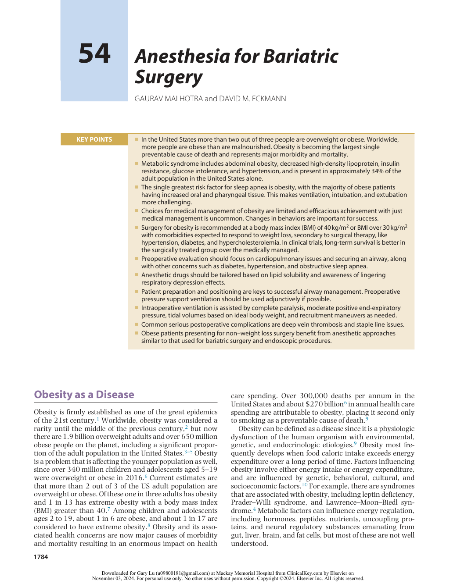
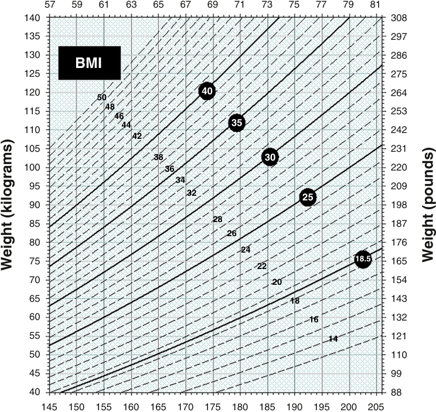
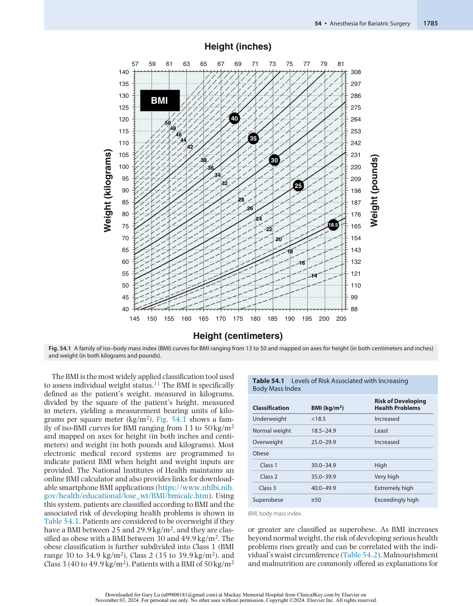
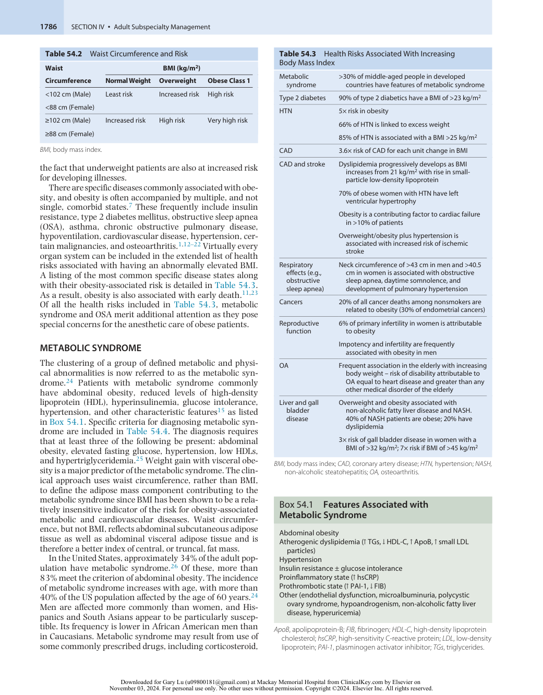
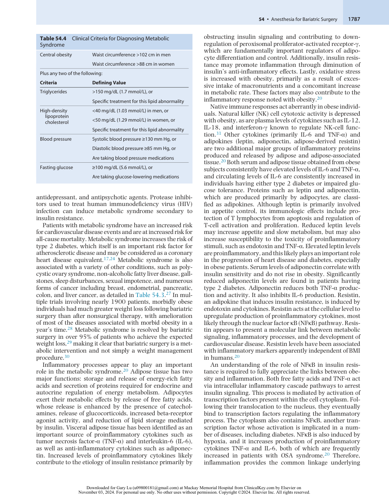
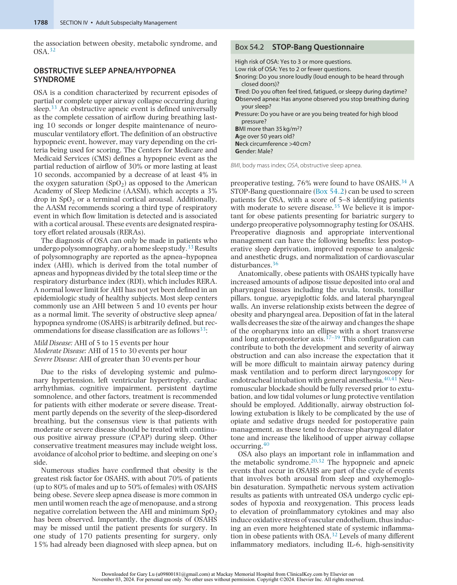
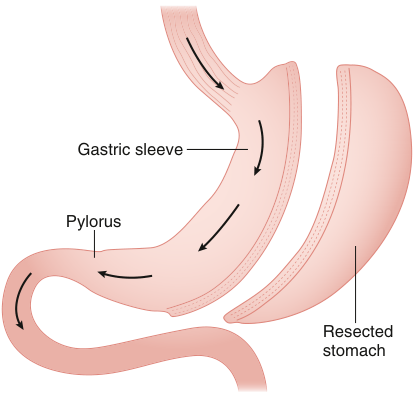
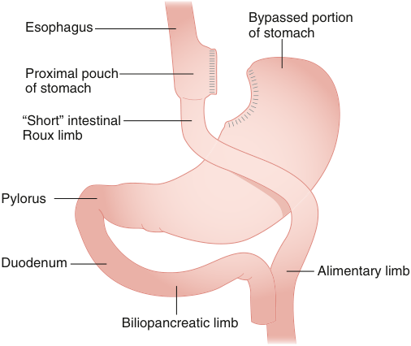
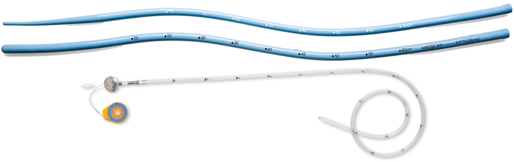
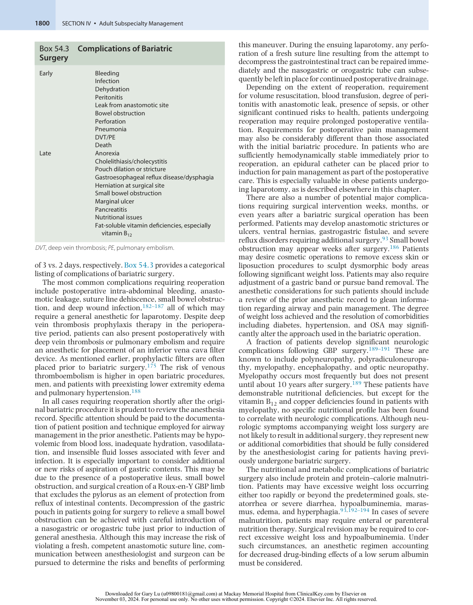

# Anesthesia for Bariatric Surgery

<!-- PDF page 1 -->

GAURAV MALHOTRA and DAVID M. ECKMANN

### KEY POINTS

|ᑏIn the United States more than two out of three people are overweight or obese. Worldwide, more people are obese than are malnourished. Obesity is becoming the largest single preventable cause of death and represents major morbidity and mortality.|
|---|
|ᑏMetabolic syndrome includes abdominal obesity, decreased high- density lipoprotein, insulin resistance, glucose intolerance, and hypertension, and is present in approximately 34% of the adult population in the United States alone.|
|ᑏThe single greatest risk factor for sleep apnea is obesity, with the majority of obese patients having increased oral and pharyngeal tissue. This makes ventilation, intubation, and extubation more challenging.|
|ᑏChoices for medical management of obesity are limited and efficacious achievement with just medical management is uncommon. Changes in behaviors are important for success.|
|ᑏSurgery for obesity is recommended at a body mass index (BMI) of 40 kg/m2or BMI over 30 kg/m2 with comorbidities expected to respond to weight loss, secondary to surgical therapy, like hypertension, diabetes, and hypercholesterolemia. In clinical trials, long- term survival is better in the surgically treated group over the medically managed.|
|ᑏPreoperative evaluation should focus on cardiopulmonary issues and securing an airway, along with other concerns such as diabetes, hypertension, and obstructive sleep apnea.|
|ᑏAnesthetic drugs should be tailored based on lipid solubility and awareness of lingering respiratory depression effects.|
|ᑏPatient preparation and positioning are keys to successful airway management. Preoperative pressure support ventilation should be used adjunctively if possible.|
|ᑏIntraoperative ventilation is assisted by complete paralysis, moderate positive end- expiratory pressure, tidal volumes based on ideal body weight, and recruitment maneuvers as needed.|
|ᑏCommon serious postoperative complications are deep vein thrombosis and staple line issues.|
|ᑏObese patients presenting for non–weight loss surgery benefit from anesthetic approaches similar to that used for bariatric surgery and endoscopic procedures.|

## Obesity as a Disease

Obesity is firmly established as one of the great epidemics of the 21st century.1 Worldwide, obesity was considered a rarity until the middle of the previous century,2 but now there are 1.9 billion overweight adults and over 650 million obese people on the planet, including a significant proportion of the adult population in the United States.3–5 Obesity is a problem that is affecting the younger population as well, since over 340 million children and adolescents aged 5–19 were overweight or obese in 2016.6 Current estimates are that more than 2 out of 3 of the US adult population are overweight or obese. Of these one in three adults has obesity and 1 in 13 has extreme obesity with a body mass index (BMI) greater than 40.7 Among children and adolescents ages 2 to 19, about 1 in 6 are obese, and about 1 in 17 are considered to have extreme obesity.8 Obesity and its associated health concerns are now major causes of morbidity and mortality resulting in an enormous impact on health

care spending. Over 300,000 deaths per annum in the United States and about $270 billion6 in annual health care spending are attributable to obesity, placing it second only to smoking as a preventable cause of death.9

Obesity can be defined as a disease since it is a physiologic dysfunction of the human organism with environmental, genetic, and endocrinologic etiologies.9 Obesity most frequently develops when food caloric intake exceeds energy expenditure over a long period of time. Factors influencing obesity involve either energy intake or energy expenditure, and are influenced by genetic, behavioral, cultural, and socioeconomic factors.10 For example, there are syndromes that are associated with obesity, including leptin deficiency, Prader–Willi syndrome, and Lawrence–Moon–Biedl syndrome.4 Metabolic factors can influence energy regulation, including hormones, peptides, nutrients, uncoupling proteins, and neural regulatory substances emanating from gut, liver, brain, and fat cells, but most of these are not well understood.

::: details 原始表格與符號（PDF 第 1 頁）

:::

<!-- PDF page 2 -->

### Height (inches)

57 59 61 63 65 67 69 71 73 75 77 79 81 140 308 135 297 130 286 BMI 125 275 120 40 264 50 48 115 253 46 44 35 110 242 42 105 231 38 30 100 36 220 34 95 209 32 25 90 198 28 85 187 26 80 176 24 75 18.5 165 22 70 20 154 65 18 143 60 16 132 55 14 121 50 110 45 99 40 88 145 150 155 160 165 170 175 180 185 190 195 200 205 Weight (pounds) Weight (kilograms) 

### Height (centimeters)

**Fig. 54.1** A family of iso–body mass index (BMI) curves for BMI ranging from 13 to 50 and mapped on axes for height (in both centimeters and inches) and weight (in both kilograms and pounds).

The BMI is the most widely applied classification tool used to assess individual weight status.11 The BMI is specifically defined as the patient’s weight, measured in kilograms, divided by the square of the patient’s height, measured in meters, yielding a measurement bearing units of kilograms per square meter (kg/m2 ). Fig. 54.1 shows a family of iso- BMI curves for BMI ranging from 13 to 50 kg/m2 and mapped on axes for height (in both inches and centimeters) and weight (in both pounds and kilograms). Most electronic medical record systems are programmed to indicate patient BMI when height and weight inputs are provided. The National Institutes of Health maintains an online BMI calculator and also provides links for downloadable smartphone BMI applications (https://www.nhlbi.nih. gov/health/educational/lose_wt/BMI/bmicalc.htm). Using this system, patients are classified according to BMI and the associated risk of developing health problems is shown in Table 54.1. Patients are considered to be overweight if they have a BMI between 25 and 29.9 kg/m2 , and they are classified as obese with a BMI between 30 and 49.9 kg/m2 . The obese classification is further subdivided into Class 1 (BMI range 30 to 34.9 kg/m2 ), Class 2 (35 to 39.9 kg/m2 ), and Class 3 (40 to 49.9 kg/m2 ). Patients with a BMI of 50 kg/m2

**Table 54.1** Levels of Risk Associated with Increasing Body Mass Index

|**Classification**|**BMI (kg/m**2**)**|**Risk of Developing** **Health Problems**|
|---|---|---|
|Underweight|&lt;18.5|Increased|
|Normal weight|18.5–24.9|Least|
|Overweight|25.0–29.9|Increased|
|Obese|||
|Class 1|30.0–34.9|High|
|Class 2|35.0–39.9|Very high|
|Class 3|40.0–49.9|Extremely high|
|Superobese|≥50|Exceedingly high|

_BMI_ , body mass index.

or greater are classified as superobese. As BMI increases beyond normal weight, the risk of developing serious health problems rises greatly and can be correlated with the individual’s waist circumference (Table 54.2). Malnourishment and malnutrition are commonly offered as explanations for

::: details 原始表格與符號（PDF 第 2 頁）

:::

<!-- PDF page 3 -->

**Table 54.2** Waist Circumference and Risk

|**Waist**||**BMI (kg/m**2**)**||
|---|---|---|---|
|**Circumference**|**Normal Weight**|**Overweight**|**Obese Class 1**|
|&lt;102 cm (Male)|Least risk|Increased risk|High risk|
|&lt;88 cm (Female)||||
|≥102 cm (Male)|Increased risk|High risk|Very high risk|
|≥88 cm (Female)||||

_BMI,_ body mass index.

the fact that underweight patients are also at increased risk for developing illnesses.

There are specific diseases commonly associated with obesity, and obesity is often accompanied by multiple, and not single, comorbid states.7 These frequently include insulin resistance, type 2 diabetes mellitus, obstructive sleep apnea (OSA), asthma, chronic obstructive pulmonary disease, hypoventilation, cardiovascular disease, hypertension, certain malignancies, and osteoarthritis.1,12–22 Virtually every organ system can be included in the extended list of health risks associated with having an abnormally elevated BMI. A listing of the most common specific disease states along with their obesity- associated risk is detailed in Table 54.3. As a result, obesity is also associated with early death.11,23 Of all the health risks included in Table 54.3, metabolic syndrome and OSA merit additional attention as they pose special concerns for the anesthetic care of obese patients.

### METABOLIC SYNDROME

The clustering of a group of defined metabolic and physical abnormalities is now referred to as the metabolic syndrome.24 Patients with metabolic syndrome commonly have abdominal obesity, reduced levels of high- density lipoprotein (HDL), hyperinsulinemia, glucose intolerance, hypertension, and other characteristic features15 as listed in Box 54.1. Specific criteria for diagnosing metabolic syndrome are included in Table 54.4. The diagnosis requires that at least three of the following be present: abdominal obesity, elevated fasting glucose, hypertension, low HDLs, and hypertriglyceridemia.25 Weight gain with visceral obesity is a major predictor of the metabolic syndrome. The clinical approach uses waist circumference, rather than BMI, to define the adipose mass component contributing to the metabolic syndrome since BMI has been shown to be a relatively insensitive indicator of the risk for obesity- associated metabolic and cardiovascular diseases. Waist circumference, but not BMI, reflects abdominal subcutaneous adipose tissue as well as abdominal visceral adipose tissue and is therefore a better index of central, or truncal, fat mass.

In the United States, approximately 34% of the adult population have metabolic syndrome.26 Of these, more than 83% meet the criterion of abdominal obesity. The incidence of metabolic syndrome increases with age, with more than 40% of the US population affected by the age of 60 years.24 Men are affected more commonly than women, and Hispanics and South Asians appear to be particularly susceptible. Its frequency is lower in African American men than in Caucasians. Metabolic syndrome may result from use of some commonly prescribed drugs, including corticosteroid,

### Table 54.3 Health Risks Associated With Increasing Body Mass Index

|Metabolic syndrome|>30% of middle- aged people in developed countries have features of metabolic syndrome|
|---|---|
|Type 2 diabetes|90% of type 2 diabetics have a BMI of >23 kg/m2|
|HTN|5× risk in obesity 66% of HTN is linked to excess weight 85% of HTN is associated with a BMI >25 kg/m2|
|CAD|3.6× risk of CAD for each unit change in BMI|
|CAD and stroke|Dyslipidemia progressively develops as BMI increases from 21 kg/m2with rise in small- particle low- density lipoprotein 70% of obese women with HTN have left ventricular hypertrophy Obesity is a contributing factor to cardiac failure in >10% of patients Overweight/obesity plus hypertension is associated with increased risk of ischemic stroke|
|Respiratory effects (e.g., obstructive sleep apnea)|Neck circumference of >43 cm in men and >40.5 cm in women is associated with obstructive sleep apnea, daytime somnolence, and development of pulmonary hypertension|
|Cancers|20% of all cancer deaths among nonsmokers are related to obesity (30% of endometrial cancers)|
|Reproductive function|6% of primary infertility in women is attributable to obesity Impotency and infertility are frequently associated with obesity in men|
|OA|Frequent association in the elderly with increasing body weight – risk of disability attributable to OA equal to heart disease and greater than any other medical disorder of the elderly|
|Liver and gall bladder disease|Overweight and obesity associated with non- alcoholic fatty liver disease and NASH. 40% of NASH patients are obese; 20% have dyslipidemia 3× risk of gall bladder disease in women with a BMI of >32 kg/m2; 7× risk if BMI of >45 kg/m2|

_BMI,_ body mass index; _CAD,_ coronary artery disease; _HTN,_ hypertension; _NASH,_ non- alcoholic steatohepatitis; _OA,_ osteoarthritis.

### Box 54.1 Features Associated with Metabolic Syndrome

Abdominal obesity Atherogenic dyslipidemia (↑ TGs, ↓ HDL- C, ↑ ApoB, ↑ small LDL particles)

Hypertension

Insulin resistance ± glucose intolerance Proinflammatory state (↑ hsCRP)

Prothrombotic state (↑ PAI- 1, ↓ FIB)

Other (endothelial dysfunction, microalbuminuria, polycystic ovary syndrome, hypoandrogenism, non- alcoholic fatty liver disease, hyperuricemia)

_ApoB_ , apolipoprotein- B; _FIB_ , fibrinogen; _HDL- C_ , high- density lipoprotein cholesterol; _hsCRP_ , high- sensitivity C- reactive protein; _LDL_ , low- density lipoprotein; _PAI- 1_ , plasminogen activator inhibitor; _TGs_ , triglycerides.

::: details 原始表格與符號（PDF 第 3 頁）

:::

<!-- PDF page 4 -->

**Table 54.4** Clinical Criteria for Diagnosing Metabolic Syndrome

|Central obesity|Waist circumference >102 cm in men Waist circumference >88 cm in women|
|---|---|
|Plus any two of the f|ollowing:|
|**Criteria**|**Defining Value**|
|Triglycerides|>150 mg/dL (1.7 mmol/L), or|
||Specific treatment for this lipid abnormality|
|High- density lipoprotein cholesterol|&lt;40 mg/dL (1.03 mmol/L) in men, or &lt;50 mg/dL (1.29 mmol/L) in women, or Specific treatment for this lipid abnormality|
|Blood pressure|Systolic blood pressure≥130 mm Hg, or Diastolic blood pressure≥85 mm Hg, or Are taking blood pressure medications|
|Fasting glucose|≥100 mg/dL (5.6 mmol/L), or Are taking glucose- lowering medications|

antidepressant, and antipsychotic agents. Protease inhibitors used to treat human immunodeficiency virus (HIV) infection can induce metabolic syndrome secondary to insulin resistance.

Patients with metabolic syndrome have an increased risk for cardiovascular disease events and are at increased risk for all- cause mortality. Metabolic syndrome increases the risk of type 2 diabetes, which itself is an important risk factor for atherosclerotic disease and may be considered as a coronary heart disease equivalent.17,24 Metabolic syndrome is also associated with a variety of other conditions, such as polycystic ovary syndrome, non- alcoholic fatty liver disease, gallstones, sleep disturbances, sexual impotence, and numerous forms of cancer including breast, endometrial, pancreatic, colon, and liver cancer, as detailed in Table 54.3.27 In multiple trials involving nearly 1900 patients, morbidly obese individuals had much greater weight loss following bariatric surgery than after nonsurgical therapy, with amelioration of most of the diseases associated with morbid obesity in a year’s time.28 Metabolic syndrome is resolved by bariatric surgery in over 95% of patients who achieve the expected weight loss,29 making it clear that bariatric surgery is a metabolic intervention and not simply a weight management procedure.30

Inflammatory processes appear to play an important role in the metabolic syndrome.20 Adipose tissue has two major functions: storage and release of energy- rich fatty acids and secretion of proteins required for endocrine and autocrine regulation of energy metabolism. Adipocytes exert their metabolic effects by release of free fatty acids, whose release is enhanced by the presence of catecholamines, release of glucocorticoids, increased beta- receptor agonist activity, and reduction of lipid storage mediated by insulin. Visceral adipose tissue has been identified as an important source of proinflammatory cytokines such as tumor necrosis factor- α (TNF- α) and interleukin- 6 (IL- 6), as well as anti- inflammatory cytokines such as adiponectin. Increased levels of proinflammatory cytokines likely contribute to the etiology of insulin resistance primarily by

obstructing insulin signaling and contributing to downregulation of peroxisomal proliferator- activated receptor- γ, which are fundamentally important regulators of adipocyte differentiation and control. Additionally, insulin resistance may promote inflammation through diminution of insulin’s anti- inflammatory effects. Lastly, oxidative stress is increased with obesity, primarily as a result of excessive intake of macronutrients and a concomitant increase in metabolic rate. These factors may also contribute to the inflammatory response noted with obesity.20 Native immune responses act aberrantly in obese individuals. Natural killer (NK) cell cytotoxic activity is depressed with obesity, as are plasma levels of cytokines such as IL- 12, IL- 18, and interferon- γ known to regulate NK-cell function.31 Other cytokines (primarily IL- 6 and TNF- α) and adipokines (leptin, adiponectin, adipose- derived resistin) are two additional major groups of inflammatory proteins produced and released by adipose and adipose- associated tissue.20 Both serum and adipose tissue obtained from obese subjects consistently have elevated levels of IL- 6 and TNF- α, and circulating levels of IL- 6 are consistently increased in individuals having either type 2 diabetes or impaired glucose tolerance. Proteins such as leptin and adiponectin, which are produced primarily by adipocytes, are classified as adipokines. Although leptin is primarily involved in appetite control, its immunologic effects include protection of T lymphocytes from apoptosis and regulation of T- cell activation and proliferation. Reduced leptin levels may increase appetite and slow metabolism, but may also increase susceptibility to the toxicity of proinflammatory stimuli, such as endotoxin and TNF- α. Elevated leptin levels are proinflammatory, and this likely plays an important role in the progression of heart disease and diabetes, especially in obese patients. Serum levels of adiponectin correlate with insulin sensitivity and do not rise in obesity. Significantly reduced adiponectin levels are found in patients having type 2 diabetes. Adiponectin reduces both TNF- α production and activity. It also inhibits IL- 6 production. Resistin, an adipokine that induces insulin resistance, is induced by endotoxin and cytokines. Resistin acts at the cellular level to upregulate production of proinflammatory cytokines, most likely through the nuclear factor κB (NFκB) pathway. Resistin appears to present a molecular link between metabolic signaling, inflammatory processes, and the development of cardiovascular disease. Resistin levels have been associated with inflammatory markers apparently independent of BMI in humans.20

An understanding of the role of NFκB in insulin resistance is required to fully appreciate the links between obesity and inflammation. Both free fatty acids and TNF- α act via intracellular inflammatory cascade pathways to arrest insulin signaling. This process is mediated by activation of transcription factors present within the cell cytoplasm. Following their translocation to the nucleus, they eventually bind to transcription factors regulating the inflammatory process. The cytoplasm also contains NFκB, another transcription factor whose activation is implicated in a number of diseases, including diabetes. NFκB is also induced by hypoxia, and it increases production of proinflammatory cytokines TNF- α and IL- 6, both of which are frequently increased in patients with OSA syndrome.20 Therefore, inflammation provides the common linkage underlying

::: details 原始表格與符號（PDF 第 4 頁）

:::

<!-- PDF page 5 -->

the association between obesity, metabolic syndrome, and OSA.32

### OBSTRUCTIVE SLEEP APNEA/HYPOPNEA SYNDROME

OSA is a condition characterized by recurrent episodes of partial or complete upper airway collapse occurring during sleep.33 An obstructive apneic event is defined universally as the complete cessation of airflow during breathing lasting 10 seconds or longer despite maintenance of neuromuscular ventilatory effort. The definition of an obstructive hypopneic event, however, may vary depending on the criteria being used for scoring. The Centers for Medicare and Medicaid Services (CMS) defines a hypopneic event as the partial reduction of airflow of 30% or more lasting at least 10 seconds, accompanied by a decrease of at least 4% in the oxygen saturation (SpO2) as opposed to the American Academy of Sleep Medicine (AASM), which accepts a 3% drop in SpO2 or a terminal cortical arousal. Additionally, the AASM recommends scoring a third type of respiratory event in which flow limitation is detected and is associated with a cortical arousal. These events are designated respiratory effort related arousals (RERAs).

The diagnosis of OSA can only be made in patients who undergo polysomnography, or a home sleep study.33 Results of polysomnography are reported as the apnea–hypopnea index (AHI), which is derived from the total number of apneas and hypopneas divided by the total sleep time or the respiratory disturbance index (RDI), which includes RERA. A normal lower limit for AHI has not yet been defined in an epidemiologic study of healthy subjects. Most sleep centers commonly use an AHI between 5 and 10 events per hour as a normal limit. The severity of obstructive sleep apnea/ hypopnea syndrome (OSAHS) is arbitrarily defined, but recommendations for disease classification are as follows33 :

_Mild Disease:_ AHI of 5 to 15 events per hour _Moderate Disease:_ AHI of 15 to 30 events per hour _Severe Disease:_ AHI of greater than 30 events per hour

Due to the risks of developing systemic and pulmonary hypertension, left ventricular hypertrophy, cardiac arrhythmias, cognitive impairment, persistent daytime somnolence, and other factors, treatment is recommended for patients with either moderate or severe disease. Treatment partly depends on the severity of the sleep- disordered breathing, but the consensus view is that patients with moderate or severe disease should be treated with continuous positive airway pressure (CPAP) during sleep. Other conservative treatment measures may include weight loss, avoidance of alcohol prior to bedtime, and sleeping on one’s side.

Numerous studies have confirmed that obesity is the greatest risk factor for OSAHS, with about 70% of patients (up to 80% of males and up to 50% of females) with OSAHS being obese. Severe sleep apnea disease is more common in men until women reach the age of menopause, and a strong negative correlation between the AHI and minimum SpO2 has been observed. Importantly, the diagnosis of OSAHS may be missed until the patient presents for surgery. In one study of 170 patients presenting for surgery, only 15% had already been diagnosed with sleep apnea, but on

### Box 54.2 STOP- Bang Questionnaire

|High risk of OSA: Yes to 3 or more questions. Low risk of OSA: Yes to 2 or fewer questions.|
|---|
|**S**noring: Do you snore loudly (loud enough to be heard through closed doors)?|
|**T**ired: Do you often feel tired, fatigued, or sleepy during daytime?|
|**O**bserved apnea: Has anyone observed you stop breathing during your sleep?|
|**P**ressure: Do you have or are you being treated for high blood pressure?|
|**B**MI more than 35 kg/m2? **A**ge over 50 years old?|
|**N**eck circumference >40 cm? **G**ender: Male?|

_BMI_ , body mass index; _OSA_ , obstructive sleep apnea.

preoperative testing, 76% were found to have OSAHS.34 A STOP- Bang questionnaire (Box 54.2) can be used to screen patients for OSA, with a score of 5–8 identifying patients with moderate to severe disease.35 We believe it is important for obese patients presenting for bariatric surgery to undergo preoperative polysomnography testing for OSAHS. Preoperative diagnosis and appropriate interventional management can have the following benefits: less postoperative sleep deprivation, improved response to analgesic and anesthetic drugs, and normalization of cardiovascular disturbances.36

Anatomically, obese patients with OSAHS typically have increased amounts of adipose tissue deposited into oral and pharyngeal tissues including the uvula, tonsils, tonsillar pillars, tongue, aryepiglottic folds, and lateral pharyngeal walls. An inverse relationship exists between the degree of obesity and pharyngeal area. Deposition of fat in the lateral walls decreases the size of the airway and changes the shape of the oropharynx into an ellipse with a short transverse and long anteroposterior axis.37–39 This configuration can contribute to both the development and severity of airway obstruction and can also increase the expectation that it will be more difficult to maintain airway patency during mask ventilation and to perform direct laryngoscopy for endotracheal intubation with general anesthesia.40,41 Neuromuscular blockade should be fully reversed prior to extubation, and low tidal volumes or lung protective ventilation should be employed. Additionally, airway obstruction following extubation is likely to be complicated by the use of opiate and sedative drugs needed for postoperative pain management, as these tend to decrease pharyngeal dilator tone and increase the likelihood of upper airway collapse occurring.40

OSA also plays an important role in inflammation and the metabolic syndrome.20,32 The hypopneic and apneic events that occur in OSAHS are part of the cycle of events that involves both arousal from sleep and oxyhemoglobin desaturation. Sympathetic nervous system activation results as patients with untreated OSA undergo cyclic episodes of hypoxia and reoxygenation. This process leads to elevation of proinflammatory cytokines and may also induce oxidative stress of vascular endothelium, thus inducing an even more heightened state of systemic inflammation in obese patients with OSA.32 Levels of many different inflammatory mediators, including IL- 6, high- sensitivity

::: details 原始表格與符號（PDF 第 5 頁）

:::

<!-- PDF page 6 -->

C- reactive protein (hs- CRP), leptin, TNF- α, IL- 1, reactive oxygen species, and adhesion molecules, such as intracellular adhesion molecule- 1 (ICAM- 1) and vascular cell adhesion molecule- 1 (VCAM- 1), are increased in patients with OSAHS.20 Thus obesity, the metabolic syndrome, and OSAHS are interrelated diseases that significantly alter a patient’s inflammatory disease profile and increase multiple health risks, particularly those of cardiovascular and airway origin. Importantly, surgical intervention to cause weight loss has been shown not only to improve obesityrelated respiratory disease,14 but it also can lead to significant and sustained increases in plasma adiponectin levels while decreasing both IL- 6 and hs- CRP levels42 as well as improve NK-cell function and increase IL- 12, IL- 18, and interleukin- γ plasma levels.31

## Nonsurgical Management of Obesity

The primary goals of nonsurgical management of obesity involve weight loss, the treatment of abnormalities associated with metabolic syndrome, and prevention of type 2 diabetes and cardiovascular disease–related events. Treatment of metabolic syndrome needs to follow an aggressive, multifaceted approach to address multiple underlying metabolic abnormalities and coexistent risk factors simultaneously.24 An appropriate initial treatment of obesity and metabolic syndrome is therapeutic lifestyle change. This includes dietary modification, weight loss, physical activity, and discontinuation of smoking. The treatment aim is improvement in health, and is the primary reason for advocating weight loss. Modification of energy homeostasis is not easily achieved because a strong brain–gastrointestinal (GI) axis drives both food intake and satiety. This axis has hormonal components involving endogenous production of ghrelin, an orexigenic peptide that is produced by the foregut of the stomach and that stimulates appetite.43 Therefore it is important to monitor the effects of treatment on risk factors and comorbidities at the systems, organ, cell, and molecular levels. Treatment success should be reflected in the decreasing need to treat other coexisting diseases.

The goal for weight loss in therapeutic lifestyle change is not the achievement of normal or ideal body weight (IBW). Even a modest weight loss, in the range of 5% to 10% from the presentation weight, can result in significant initial improvement in the comorbidities of diabetes, dyslipidemia, and hypertension by lowering total cholesterol and triglyceride levels, raising HDL cholesterol, lowering arterial blood pressure, and lowering blood glucose values while reducing insulin resistance.24,44 Obesity guidelines stress the need for weight reduction using behavioral change to reduce caloric intake and increase physical activity. A decrease in caloric intake is the most important component in achieving weight loss and increased physical activity is critical in maintaining the lost weight.45 Reduced- energy diets are more effective and healthier for achieving long- term weight loss. Long- term maintenance of any weight loss achieved is best accomplished with the inclusion of regular exercise as a staple of the weight- reduction regimen. Regular physical exercise improves several risk factors associated with obesity and metabolic syndrome.46 The standard exercise

recommendation is a daily minimum of 30 minutes of moderate- intensity physical activity that is practical to perform. Larger weight loss goals are more appropriate for the more profoundly obese individuals who are contemplating surgical interventions. Even with surgery, ideal weight is hardly ever achieved, and after a number of years at a plateau, weight gain often recurs. In some patients, especially in the presence of severe comorbidities, simple prevention of additional weight gain may be the most reasonable goal.

Beyond the beneficial effects of therapeutic lifestyle change, specific intervention may be required to treat the dyslipidemia and hypertension associated with obesity and metabolic syndrome.47 Most commonly, patients with metabolic syndrome have elevated triglyceride levels and low HDL cholesterol levels. Many patients receive statin therapy as the treatment of choice when low- density lipoprotein (LDL) cholesterol levels are excessive. Statins reduce cardiovascular disease risk in patients with type 2 diabetes and metabolic syndrome. Ezetimibe, which selectively inhibits intestinal cholesterol absorption, can be combined with statin therapy to further reduce LDL cholesterol by 15% to 20%. Fibrates effectively decrease triglyceride levels while increasing HDL cholesterol. Fibrates lower LDL cholesterol levels mildly, but when combined with statin therapy, fibrates may increase the risk of myopathy. Omega- 3 fatty acids decrease triglyceride levels and improve insulin resistance in patients with metabolic syndrome. They are often used in combination therapy with other classes of the hypolipidemic drugs. Nicotinic acid is highly effective in raising HDL cholesterol levels in patients with metabolic syndrome. Nicotinic acid decreases the concentration of small, dense LDL particles and also lowers serum levels of lipoprotein (a).47

Dietary salt restriction and therapeutic lifestyle change are the primary means to address hypertension in obesity and metabolic syndrome. According to the 2017 guidelines published by the American College of Cardiology and American Heart Association (ACC/AHA),48 patients having arterial blood pressure higher than 130/80 mm Hg may require antihypertensive drug therapy. There is no specific antihypertensive drug that is recommended as a first- line treatment in these patients, and generally the goal of antihypertensive therapy requires that polypharmacy be employed. A considerable element of the risk reduction resulting from antihypertensive therapy is decreasing arterial blood pressure.

The treatment of insulin resistance and hyperglycemia in metabolic syndrome, type 2 diabetes, and obesity is usually achieved with oral hypoglycemic drugs.47 A number of different drug groups (and drugs within each group) that work through various mechanisms of action are available to treat hyperglycemia. These include α- glucosidase inhibitors, sulfonylureas, sodium- glucose cotransporter- 2 (SGLT2) inhibitors, meglitinides, D- phenylalanine derivatives, biguanides, and thiazolidinediones.47 Anesthetic implications include the need to assess and treat abnormal blood glucose levels in the perioperative period while being especially careful in the use of insulin in patients who are both insulin resistant and temporarily unable to continue on oral medication. Recently the use of SGLT2 inhibitors has increased dramatically as it helps lower blood sugar in adults with type 2 diabetes by causing the kidneys to remove sugar from the body through the urine. Currently the Food and

<!-- PDF page 7 -->

Drug Administration (FDA) is recommending temporary discontinuation of the medications before any scheduled surgery to avoid potential risk for euglycemic diabetic ketoacidosis.49 At present, the optimal anesthetic management of patients who are taking metformin is not clear. There is a serious potential for postoperative lactic acidosis that can develop in patients using this drug. This possibility has led some physicians to routinely cancel or delay surgical procedures if metformin has been ingested within 48 hours of the scheduled surgery. Other physicians, however, have their patients continue taking metformin, both before and after surgery, without interruption if possible. Recent evidence indicates that patients taking metformin have a reduced risk for complications. It appears that metformin may be safely used in the perioperative period.50

Patients with metabolic syndrome and obesity may also be prescribed antiplatelet therapy. The AHA recommends that low- dose aspirin be used as a form of primary prevention in patients with metabolic syndrome whose 10- year risk for cardiovascular disease is 10% or greater as determined by Framingham risk scoring.

### BEHAVIORAL INTERVENTIONS AND MODIFICATION

Behavioral interventions and behavioral modification are essential for obese patients to change their learned habits related to eating and physical activity in order to produce weight loss and long- term weight reduction.47 This applies both for nonsurgical and surgical approaches to weight loss. The key features of typical behavioral programs include self- monitoring, goal setting, nutrition and exercise education, stimulus control, problem solving, cognitive restructuring, and relapse prevention. Patients often benefit from referral to multidisciplinary weight loss programs that incorporate diet, physical activity, and behavioral interventions to achieve their weight loss goals because these combined interventions provide the best weight loss and weight maintenance results without pharmacologic or surgical intervention. However, it is essential to identify and treat patients with eating disorders or major psychiatric disorders who require specialized psychiatric and psychological treatment to achieve meaningful weight loss.

### PHARMACOTHERAPY FOR WEIGHT LOSS

Recommendations for pharmacotherapy as a treatment of obesity, first and foremost, stress lifestyle and behavioral modifications as the initial approaches to initiate weight loss. Patients who do not reach their established reasonable weight loss goals by a combination of diet and exercise may be directed to pharmacotherapy to increase weight loss. There are weight loss drugs that have been approved by the FDA and are currently prescribed for long- term use. These are typically used adjunctively with diet and exercise for patients having a BMI of 30 or greater (≤27 for patients with obesity- related risk factors or comorbid diseases). When combined with lifestyle changes, patients on prescription medications have been shown to lose 3%–10% more of their original weight than when compared to lifestyle changes alone.51

Currently five drugs have FDA approval to be prescribed for long- term use for the specific indication of weight loss

in adults: orlistat (Xenical, Alli),47 phentermine–topiramate (Qsymia), naltrexone–bupropion (Contrave), liraglutide (Saxenda), and semaglutide (Wegovy).51 Orlistat, a lipase inhibitor, reversibly binds to lipase and prevents both absorption and digestion of certain dietary fats. Because orlistat also interferes with the absorption of fat- soluble vitamins, patients using this drug need to supplement fatsoluble vitamins A, D, E, and K. It has significant GI side effects including diarrhea, steatorrhea, flatulence, fecal incontinence, and oily rectal discharge. Phentermine–topiramate, an adrenergic reuptake inhibitor combined with an anticonvulsant, augments adrenergic signaling within the central nervous system and peripheral tissues. Phentermine decreases appetite and food intake and increases resting metabolic rate to promote weight loss. Its side effects include drowsiness, dry mouth, difficulty sleeping, tingling of the extremities, and constipation. Naltrexone–bupropion is a combination of an opioid receptor antagonist with a dopamine and norepinephrine reuptake inhibitor. Naltrexone is used to treat alcohol and drug dependence while bupropion is often used for depression and smoking cessation. This combination of medication is postulated to curb hunger and help control cravings by regulating feelings of pleasure when eating. Common side effects of naltrexone– bupropion include GI distress, dry mouth, hypertension, tachycardia, and possible increased risk of suicidal thoughts and actions. Liraglutide and semaglutide are synthetic analogues of human glucagon- like peptide- 1(GLP- 1) and act as a GLP- 1 receptor agonist. They both increase the production of insulin, inhibit glucagon secretion, and reduce food intake by lowering appetite and slowing down digestion in the stomach. Side effects can include GI distress, fatigue, and pancreatitis. Orlistat and liraglutide have been approved by the FDA for children ages 12 and older. Setmelanotide (Imcivree) is approved by the FDA for children ages 6 years and older who have rare genetic disorders (proopiomelanocortin deficiency, proprotein convertase subtilisin/kexin type 1 deficiency, or leptin receptor deficiency) causing obesity. Tirzepatide is a novel investigational once- weekly GIP (glucose- dependent insulinotropic polypeptide) receptor and GLP- 1 (glucagon- like peptide- 1) receptor agonist which is currently in phase 3 trials and may be approved for commercial sale at the time of publication of this chapter. This drug has been approved for type 2 diabetes, but not for weight loss. Additional data are needed regarding the anesthetic implications associated with use of GLP1 agonists, as patients may present as a full stomach with elevated risk of aspiration. When possible, these medications should be held prior to surgery.

### ALTERNATIVE PHARMACOLOGIC OPTIONS

Allison and colleagues52 reviewed the literature on dietary and herbal medications for weight loss. These agents are marketed as “food supplements,” thereby escaping the purview of the FDA. Even though these supplements cannot legally claim to treat a disease, they can claim to reduce the risk of a disease. According to the review, claims for weight loss have been made for multiple products such as chitosan, chromium picolinate, conjugated linoleic acid, _Ephedra_ alkaloids (ma huang),53 and _Garcinia cambogia_ .52 Most of the reports involving these compounds are from poor-quality

<!-- PDF page 8 -->

studies without any randomization, control groups, or blinding, thereby placing in question both efficacy and safety of these compounds. The only studies involving herbals that have consistently demonstrated weight loss involve combinations of ephedrine and caffeine.54,55 Pharmacologically, this is expected because ephedrine, an adrenergic agonist, is known to be an appetite suppressant and a thermogenic agent. For this reason, _ma huang_ , a natural source of the _Ephedra_ alkaloid, is added to most, if not all, dietary supplements marketed for weight loss. The success of ephedrine as a weight loss agent, in combination with caffeine and/or aspirin, is well established. Unfortunately, multiple cases of cardiac and neurologic issues, including hypertension, stroke, seizure, and even death have been reported,56 possibly related to the inconsistent doses in the preparations and the lack of medical supervision in people consuming these products for weight loss. Consequently, the National Institutes of Health has banned these products from any recommended weight loss regimen.

### IMPLANTED ELECTRICAL STIMULATORS

Implantable gastric stimulators are subcutaneously placed devices that resemble cardiac pacemakers and stimulate along the lesser curvature of the stomach. These gastric stimulators have been tried since the early 2000s and have been found to cause modest weight loss with few side effects.57,58 Numerous clinical trials conducted in the United States and Europe have shown some promising results. Most studies demonstrated weight loss during the first 12 months; however, only a few studies had a followup period of longer than one year.59 One study documented a 25% excess weight loss, improved response to oral glucose tolerance test, decreases in arterial blood pressure, and an improvement in symptoms of gastroesophageal reflux disease (GERD), along with an increased parasympathetic drive. No serious side effects were noted in the first 65 patients reported on in this study57 or in the 20 patients followed in another.58 Ghrelin levels may play a role in the success of these devices.

## Surgical Management of Obesity

Adult obesity is clearly rooted in childhood obesity. Unfortunately, pediatric obesity is the most common childhood nutritional disorder in the United States. This is one of the tragedies of the current obesity epidemic: the significant and increasing prevalence of obesity in the young. It has attained a level of controversy that has involved the placement of vending machines in schools and the availability of sweetened snacks and soft drinks in public places as public policy is developed to help control the epidemic of pediatric obesity. The diagnosis of pediatric obesity is commonly defined using criteria developed by the Centers for Disease Control and Prevention (CDC) using BMI- , age- , and sexspecific clinical growth charts.60 These percentile curves apply to the ages of 2 to 20 years, and because BMI exhibits nonlinear variation during growth, percentile ranges are utilized. The CDC defines children possessing BMIs in the 5th to 85th percentiles as having “healthy weight.” Children whose BMI is in the 85th to 95th percentile are “at

risk for overweight,” while those having a BMI above the 95th percentile are classified as “overweight.” These classifications were previously regarded as “overweight” and “obese,” respectively. This switch in terminology continues to be a source of confusion. Exceeding the 99th percentile is referred to as extreme pediatric obesity.

The National Health and Nutrition Examination Survey 2011–2014 data show that the prevalence of obesity in children for ages 2 to 5, 6 to 11, and 12 to 19 years are 9.4%, 17.4%, and 20.6%, respectively.61 There does not appear to be an influence of gender on the prevalence of obese children above the age of 6 years. While the prevalence of obesity among children of ages 6 to 11 and 12 to 19 has steadily increased since 1988, there has been a slight recent decline in obesity among ages 2 to 5 years. A number of developing countries have childhood prevalence rates higher than that of the United States,62 indicating that adolescent obesity is becoming pervasive.

Treatment of pediatric obesity is based on the balance of caloric intake and expenditure. These lifestyle changes are most successful with family intervention and support. The three pillars of success in this treatment are: better eating habits, increased physical activity, and decreased sedentary activity.63 Success involves more than education of child and family; it incorporates goal setting, self- monitoring, incentives, and stimulus control. Lifestyle interventions remain the treatment of choice in pediatric obesity, but concomitant pharmacotherapy may be beneficial in some patients. Orlistat, which is covered elsewhere in this chapter, should be considered as second- line therapy for pediatric obesity.64

Although in 2000 less than 1% of all bariatric surgery patients in the United States were younger than 20 years of age,65 the total number continues to increase. More adolescents are presenting for weight loss surgery, after failing to reduce weight and/or comorbidities in medically supervised and pharmacologically assisted weight loss programs. Even though many adult bariatric surgery programs are well qualified to provide safe and effective perioperative care for these patients, they may not be as well equipped to handle the unique metabolic and psychological needs of teenagers. Because of the shorter duration of obesity and fewer age- related comorbidities, adolescent patients have shorter length of stay and lower immediate postoperative mortality when compared to adults.65

Consent is an important issue in this population. Is parental consent to a semi- elective, relatively high- risk procedure appropriate? Does the child really understand the concept of high risk of death in the month after surgery? These and other such questions of ethics in medicine need to be addressed, but are beyond the scope of this chapter.

The rapid increase in the prevalence of both morbid obesity and superobesity, together with the increased risk of early demise within the obese population, has significantly increased the number of bariatric surgical procedures performed annually. The term bariatric surgery refers to surgical alteration of the small intestine or stomach with a view toward producing weight loss. It is estimated that over 216,000 bariatric surgeries are being performed annually in the United States. Care of obese patients is not limited to obesity surgery, however, as these patients present for all types of operations. Nonetheless, the benefits of surgical

<!-- PDF page 9 -->

treatment of obesity now appear to have clear endocrinologic and cardiovascular value for reversing pathophysiologic effects of metabolic syndrome, type 2 diabetes, and other comorbidities of obesity, in addition to providing a mechanical means of enhancing weight loss.66–72 Several alternative procedures in bariatric surgery have evolved from early procedures based on creating malabsorptive gut pathways to newer procedures aimed at altering hormonal regulation of caloric intake drive and satiety.73 Primarily the available options can be separated into one of two groups: (1) operative procedures and (2) minimally invasive procedures that combine gastric restriction with induction of nutrient malabsorption.

### OPERATIVE PROCEDURES

Surgery for obesity is one of the fastest growing surgeries performed worldwide.74 The operative group can be divided into gastric restrictive procedures and procedures that combine gastric restriction with induction of nutrient malabsorption.75–84 These procedures can be performed using an open, laparoscopic, or robot- assisted approach. In general, minimally invasive (laparoscopic, robotic) approaches are preferred over an open procedure as they have a lower complication rate, hospital stay, and morbidity.85 The rate of open bariatric procedures has continued to decrease steadily to the extent that nearly 90% of surgical bariatric cases are now performed laparoscopically or robotically.86

### RESTRICTIVE PROCEDURES

The surgical goal of restrictive operative procedures is to reduce and limit the patient’s food intake capacity.81 This is most commonly achieved by reducing the stomach’s reservoir capacity. The vertical band gastroplasty was a widely practiced restrictive procedure in the previous three decades, but it was replaced by the minimally invasive laparoscopic gastric band (LGB) procedure, which was very popular. However, in recent years, the percentage of bariatric procedures represented by LGB surgery performed has also decreased from 35% in 2011 to approximately 3% in 2016.87 This decline in LGB operations is probably secondary to only modest amount of weight loss and high rates of band revisions and adjustments required. Recently, the sleeve gastrectomy (SG) has become the most commonly performed surgery for obesity. As illustrated in Fig. 54.2, in SG surgery, a tubular stomach is created around a 32F to 40F bougie by removing the greater curvature of the stomach. The SG has been shown to be safe and effective, with a mean excess weight loss of approximately 65%.88 The weight loss noted after a SG is not only due to the restrictive stomach, but also due to the decrease in hormonal level of ghrelin that regulates appetite and food intake.89

### MALABSORPTIVE PROCEDURES

The surgical goal of malabsorptive procedures is to cause weight loss both by gastric restriction and nutrient malabsorption. Historically, early surgical procedures involved creation of a long jejunoileal bypass. Patients achieved significant weight reduction but this was commonly

Gastric sleeve Pylorus Resected stomach 

**Fig. 54.2 Sleeve gastrectomy.** A tubular stomach is created as the fundus and greater curvature of the stomach are removed around a 32 F to 40 F bougie.

Bypassed portion Esophagus of stomach Proximal pouch of stomach “Short” intestinal Roux limb Pylorus Duodenum Alimentary limb Biliopancreatic limb 

**Fig. 54.3 Roux- en- Y gastric bypass.** Part of the stomach is detached from the rest, creating a small pouch. The pouch is connected to a lower part of the small intestine by a piece of small intestine, resembling a Y. As a result, parts of the stomach and small intestine are bypassed. However, digestive juices (bile acids and pancreatic enzymes) can still mix with the food, enabling the body to absorb vitamins and minerals and reducing the risk of nutritional deficiencies.

accompanied by an unacceptable incidence of serious vitamin and protein malabsorption, osteoporosis, and hepatic failure.

Today, gastric bypass (GBP), which is illustrated in Fig. 54.3, and biliary pancreatic diversion (BPD) are the two most commonly performed malabsorptive operations, and both have achieved success in safety and efficacy.81 GBP is more commonly performed than BPD, and it is considered the safer of the two malabsorption procedures. GBP surgery involves the creation of a small gastric pouch by stapling or banding the stomach. This results in an element

<!-- PDF page 10 -->

**<mark>Fig. 54.4</mark>** <mark>A 32F tapered bougie (</mark> _<mark>top</mark>_ <mark>), a 40F nontapered bougie (</mark> _<mark>middle</mark>_ <mark>), and an OrVil device (</mark> _<mark>bottom</mark>_ <mark>) commonly used during bariatric surgery.</mark>

of gastric restriction. GBP also involves the creation of a Roux- en- Y anastomosis, in which the small gastric pouch is directly connected to the middle portion of the jejunum.90 The OrVil device, shown along with nontapered and tapered bougies in Fig. 54.4, may be used by the surgeon to assist with creation of the anastomosis. The orogastric portion of the OrVil device is passed through the oropharynx and then pulled through by the surgeon via a gastrostomy, until the anvil portion of the OrVil device reaches the stomach. It is then attached to a stapler to create the anastomosis. The path for food through the GI tract subsequently bypasses the gastric remnant and the upper portion of the duodenum. This procedure can be performed with a laparotomy incision or by using laparoscopic techniques.91,92 Although this is considered to be a safe operation, the associated perioperative mortality is higher than that of restrictive procedures.78 Additionally, there are some important long- term complications such as vitamin B12 deficiency, anemia, incisional hernia, cholelithiasis, and staple line failure that occur with significant frequency. Often a cholecystectomy is performed concurrently to prevent future cholelithiasis.93 BPD is also a form of Roux- en- Y GBP reconstructive alimentary anatomy in which the bypassed intestinal segment includes the portion of duodenum at the point of entry of biliary and pancreatic secretions. This allows the bypassed intestine to be exposed to bile and pancreatic juice. The antrum is removed to avoid peptic ulceration, and food intake is only affected to a limited degree. The essential element of this operation is division of the small intestine about midlength, with the distal end of the alimentary limb being anastomosed to a generous gastric remnant. The more proximal biliopancreatic limb is anastomosed to the alimentary limb about 50 cm from the ileocecal valve. Following either the GBP or BPD form of operation, patients require lifelong follow- up and may need micronutrient replacement long term.

### ENDOSCOPIC PROCEDURES

The endoscopic bariatric and metabolic therapies (EBMTs) can generally be classified into four categories: spaceoccupying, gastric restrictive, aspiration, and small bowel therapies. EMBTs are options for patients who are not eligible for or do not desire to have bariatric surgery. In recent

years, there have been many EMBT devices and techniques approved in the United States for weight loss.

The intragastric balloon is a device that acts in a restrictive manner.94 The intragastric balloon is placed in the patient’s stomach endoscopically. It is then filled with saline to remove the stomach’s potential volume and to provide a sensation of fullness and satiety. Usage of such devices has also been shown to possibly decrease appetiteregulating hormones such as ghrelin, thereby leading to decreased hunger and greater weight reduction.95 The device can be kept in the patient’s stomach for a maximum of 6 months and has been shown to decrease weight by an average of 6.8%. Most common complications of the intragastric balloon are related to GI symptoms such as nausea, vomiting, halitosis, GERD, and abdominal discomfort; however, serious complications such as balloon rupture, migration, and intestinal obstruction are possible.96

The endoscopic sleeve gastroplasty (ESG) is a minimally invasive procedure that uses a full- thickness endoscopic suturing device to create a restrictive sleeve that reduces the size of the gastric reservoir. Similar to laparoscopic sleeve gastrectomy, the endoscopic sleeve gastroplasty leads to weight loss by reducing the size of the stomach, providing increased satiety and decreasing appetite.95 Patients were found to have 15% to 17% weight loss with ESG. Abdominal pain and nausea were the most common complaints.

Another device that has been approved for use in the United States is an endoscopically placed percutaneous gastrostomy tube to facilitate stomach emptying. The device can be used for draining ingested foods and in preliminary studies has been shown to decrease total body weight (TBW) by approximately 12%.97 The most common side effects were abdominal discomfort and peristomal irritation; however, serious complications such as abdominal pain requiring hospitalization and peritonitis were noted infrequently.

There have been a variety of small bowel therapies that are being studied around the world. The duodenal–jejunal bypass liner is a sleeve- like implant deployed into the duodenum. It allows food particles to enter from the stomach and pass into the jejunum, thereby avoiding contact with the pancreatic juices and digestive enzymes in the duodenum. Duodenal mucosal ablation is a novel, minimally invasive procedure that involves a catheter- based hydrothermal ablation of the duodenal mucosa with subsequent

<!-- PDF page 11 -->

regeneration of healthy new mucosa. The duodenum is important for regulating metabolic homeostasis, and alterations in the mucosa may affect glycemic metabolism by an insulin sensitization effect. Mucosal resurfacing allows the regeneration of the normal duodenal mucosa, which is believed to correct abnormal metabolic signaling.98 Endoluminal magnetic partial jejunal diversion creates an enteral bypass using a pair of self- assembling magnets. The small bowel is accessed using simultaneous colonoscopy and enteroscopy and the magnets are deployed in the jejunum and ileum. The deployed magnets stick together and cause necrosis of adjacent tissue. This new anastomosis allows foods and nutrients to bypass most of the small bowel and enter directly into the ileum. This procedure can modify secretions of gut hormones that promote weight loss as well as improvements in glucose homeostasis.99 All these techniques can potentially result in a malabsorptive state with vitamin D, iron, vitamin B12, and magnesium deficiencies that may warrant complete blood counts and electrolyte testing prior to anesthesia.100

### HEALTH BENEFITS OF BARIATRIC SURGERY

The two most significant outcome measures of bariatric surgical success are weight loss and resolution of comorbidities. Major effects of bariatric operations have been nicely summarized in extensive meta- analyses68,101,102 as well as in a major literature review.103 Patients undergoing bariatric surgery with either SG or GBP have lost 52% to 68% of their excess weight.104,105 This magnitude of weight loss is far greater than what is commonly achievable by nonsurgical methods, and it is considerably closer to patients’ desired and expected weight loss. Long- term maintenance of weight loss of this magnitude can also be maintained for well over a decade.

Improvement in obesity- related and metabolic syndrome–related comorbidities have also been evaluated.68,102,103,106 One clinical study demonstrated that at 1 year, type 2 diabetes remission rate with bariatric surgery was approximately 40% compared to 12% with medical treatment.107 Another study showed remission rate at 2 years of approximately 85% compared to 0% with medical treatment.108 This benefit seems to persist long- term as well, as at 6 years 62% of surgical patients experienced remission in their type 2 diabetes.109 Resolution of diabetes following surgery is inversely related to the preoperative duration of the disease and occurs more in those patients having diabetes controlled using oral hypoglycemic agents. This clearly distinguishes surgical treatment of obesity as an important endocrinologic intervention, especially since the modest improvement in diabetes management that is produced by nonsurgical weight loss is accompanied by relapsing disease by nearly 100% of patients within 5 years.

Surgical effects on hypertension and hyperlipidemia are similarly impressive. A study of almost 1900 patients demonstrated that at a 6.5-year follow- up, 32% of surgically treated patients had remission of their hypertension versus 12.5% in medically managed patients.110 A significant decrease in triglyceride levels (approximately 30% to 40% post- bariatric surgery versus 8% from medical therapy) and increase in HDL cholesterol levels (30% post- surgery versus 7% from medical therapy) have also been noted at

5 years.111 Resolution of OSAHS seems to be independent of the specific bariatric surgical procedure employed, with resolution occurring overall in 85.7% of patients.112 Postsurgical improvement in other comorbidities has also been demonstrated, with improvement in fatty infiltration of the liver, GERD symptoms, in respiratory function and asthmatic symptoms, reversal of the cardiomyopathy of obesity, and improvements in joint pain and mobility all having been reported.72,113–117 The reduction in obesity- related comorbidities has been shown to endure with 5- year follow- up.118 Although bariatric surgery has been shown to provide greater weight loss when compared with nonsurgical lifestyle interventions, comorbidities do resolve and risk factors do improve similarly with successful conservative treatments.106

## Anesthetic Management of the Bariatric Surgical Patient

Patients undergoing bariatric surgery are receiving what is now the best long- term treatment for morbid obesity. However, their presurgical state is an agglomeration of abnormal physiologic conditions involving multiple organ systems. For that reason, there are considerable risks of mortality and morbidity associated with all types of bariatric surgery. Preoperative risk stratification can be used to identify patients at highest risk for significant morbid or fatal events when having bariatric surgery;119 however, detailed planning of the anesthesia care for the perioperative, intraoperative, and postoperative phases must be pursued for purposes of patient safety.

### PREOPERATIVE EVALUATION

The preoperative assessment for anesthesia should include consideration of hypertension, diabetes, heart failure, and obesity hypoventilation syndrome. Results of the sleep study that the patient underwent are important. An AHI score greater than 30, implying severe sleep apnea, is a warning sign and a predictor for rapid and severe desaturation at induction. CPAP levels greater than 10 imply a patient with the potential for difficult mask ventilation.

Another useful piece of information in the preoperative evaluation is gleaned by examining the history of prior surgeries, their anesthetic challenges (i.e., ease or difficulty in securing the airway, intravenous access), need for intensive care unit admission, surgical outcomes, and the weight of the patient at that time. This information may either help ease some concerns or allow for better preparation for the upcoming anesthetic care. Recommended preoperative laboratory evaluations include fasting blood glucose, lipid profile, and serum chemistries (evaluating renal and hepatic function), complete blood count, ferritin, vitamin B12, thyrotropin, and 25- hydroxyvitamin D.

If appropriately evaluated, ideally prepared, and optimally managed perioperatively, even patients with well- known coronary artery disease (CAD) have comparable morbidity and mortality as those without CAD.120 The effect of OSA on perioperative risk remains controversial,121 but most patients are screened for OSA using overnight oximetry or polysomnography, or both, if appropriate. If identified with

<!-- PDF page 12 -->

OSA and recommended for CPAP, then patients are encouraged to initiate therapy at home and it should be continued throughout the perioperative period.

Liver function abnormalities are common in this patient population, especially non- alcoholic fatty liver disease, with the extent of disease a determining factor for perioperative risk and postoperative outcomes. Cirrhotic liver disease with portal hypertension may be considered a contraindication to bariatric surgery.121 Gastrointestinal symptoms of dyspepsia may indicate the presence of _Helicobacter pylori_ , which requires treatment by standard medical regimen.

The factors that may be considered contraindications for bariatric surgery include unstable CAD, uncontrolled severe OSA, uncontrolled psychiatric disorder, intellectual disability (IQ &lt;60), inability to understand the surgery, perceived inability to adhere to postoperative restrictions, continued drug abuse, and malignancy with a poor five- year survival prognosis. In most situations preoperative management of the medical morbidities can help optimize risk and convert high- risk patients to ones of acceptable risk.

The anesthetic care of patients with OSA is complicated by the side effects of anesthetic drugs on an already compromised respiratory system. The commonly presented comorbidities in this patient population only accentuate the problem.122 The change in perioperative risk based on the anesthetic agent utilized is only deduced from anecdotal reports of different cases. There is a paucity of trials to definitively determine an optimal anesthetic regimen. Nevertheless, the American Society of Anesthesiologists and the Society for Anesthesia and Sleep Medicine have both published statements based on existing literature and consensus of expert opinion addressing the perioperative identification and management of patients who carry a formal diagnosis of OSA as well as for those who are at risk for sleep apnea but remain undiagnosed. Additional questions commonly arise and cannot yet be answered based on high- grade scientific evidence: Is it safe to perform procedures in patients with sleep apnea and treat them as outpatients or day surgery patients, including the question of hospital- based or free- standing facilities? What procedures pose sufficient risk to the patient to recommend an overnight hospital stay? Does narcotic use impact this decision? Would the increased role of nonsteroidal anti- inflammatory drugs (NSAIDs) change these recommendations? Factors such as neck size and open versus laparoscopic surgery are being studied as to their impact on outcomes. Further research on these and other patient safety–related questions is continuing.

### INTRAOPERATIVE CARE

Obese patients present special intraoperative challenges for the anesthesiologist in airway management, positioning, monitoring, choice of anesthetic technique and anesthetic drugs, pain control, and fluid management. Many of these issues are equally important in their postoperative care. The most significant and best studied are airway management, including endotracheal intubation, pulmonary physiology, and techniques of maintaining adequate blood oxygenation and lung volume. Specific interventions, techniques, and approaches employed by the anesthesia care

team providing anesthesia for obese patients are important determinants of outcomes.

### Patient Positioning

Even though there are no evidence- based studies that demonstrate that obese patients have more frequent complications from positioning, it seems reasonably intuitive that morbidly obese patients do require extra care in positioning. Even in the supine position, rhabdomyolysis from pressure on gluteal muscles leading to renal failure123 and death124 have been reported. For obese patients placed in the prone position, cushioning gel pads or other weight- bearing rolls may have excessive weight placed on them. Pressure points must be checked carefully, and even though pressure sites may be carefully padded, skin breakdown can still occur. This may cause tissue necrosis and infections, especially in lengthy surgery.125 It is difficult to protect the dependent hip from pressure effects with patients placed in lateral decubitus position. Obese patients have excess axillary tissue that may make it impossible or unnecessary to place a traditional axillary roll in this position. In the lithotomy position the challenge may be in supporting the weight of the patient’s legs using regular, and not oversized, stirrups. To minimize the risk of tissue compression injury or development of compartment syndrome, the duration during which legs are held in stirrups should be kept as short as possible.126

### Airway Management

No positioning issue is more important than that regarding positioning of the obese individual for laryngoscopy and endotracheal intubation. These are often considered to be much more difficult to perform in obese patients than patients having a normal BMI. Difficulty with laryngoscopy and intubation is usually thought to result from the obese patient having a short, thick neck, large tongue, and significant redundant pharyngeal soft tissue. However, the correlation between morbid obesity and difficult laryngoscopy and intubation is not universally observed in clinical practice. This is likely to result from a simple, but important approach to clinical care, with careful attention being paid to patient positioning prior to induction of general anesthesia. Appropriate positioning plays an important role in providing optimal conditions for successful placement of the endotracheal tube under direct vision.

A number of studies have been conducted to determine the incidence of difficult laryngoscopy or intubation in the obese population, with mixed findings. One study found an association between oropharyngeal Mallampati classification and BMI as predictors of difficult laryngoscopy.127 During laryngoscopy, the patients’ heads were placed in optimum sniffing position, regardless of BMI. In a study conducted exclusively with obese patients, BMI was not found to be associated with intubation difficulties.41 A high Mallampati score was identified as a predictor of “potential intubation problems,” but intubation by direct laryngoscopy was successful in 99 of 100 patients studied. All patients were positioned with pillows or towels under their shoulders, with the head elevated and neck extended. Another group studied both lean and obese patients and found a Mallampati score of III or IV to be the only independent risk factor for difficult intubation in the obese study

<!-- PDF page 13 -->

group.128 The authors demonstrated that the Mallampati score had low specificity and low positive predictive values (62% and 29%, respectively) for difficult intubation. They concluded that intubation was more difficult in the obese patients. During intubation, patients were placed in a semirecumbent position (30- degree elevation) with the head in the sniffing position. In another study ultrasound was used to quantify the amount of soft tissue between the skin and the anterior aspect of the trachea at the level of vocal cords.129 The authors also assessed the airway by measurement of thyromental distance, mouth opening, degree of neck mobility, Mallampati score, neck circumference, and presence of OSA. Only an abundance of pretracheal soft tissue measured ultrasonically and neck circumferences were found to be positive predictors of difficult intubation with laryngoscopy performed with patients in the sniffing position. A meta- analysis of 35 studies was conducted to determine the diagnostic accuracy of preinduction tests for predicting difficult intubation in patients having no airway pathology.130 The incidence of difficult intubation in obese patients was three times the incidence compared to the nonobese population. This may have resulted from suboptimal patient positioning, which was not clearly described in any of the preceding studies, including ramped positioning or elevating the upper body and head of morbidly obese patients to align the ear with the sternum horizontally, as has been shown to improve laryngoscopic view.131 In this study, morbidly obese patients were assigned either to be in sniffing position or ramped position for airway management. The study demonstrated a statistically significant difference in laryngeal view, with ramped position providing the superior view. In one study, morbidly obese patients in a ramped position with a Mallampati score of III or IV and male gender were shown to predict possible difficult intubation, while no relationship was noted between difficult direct laryngoscopy and the presence of OSA, patient neck circumference, or BMI.132

Based upon the evidence from randomized controlled trials and other literature on airway management of obese patients, patients should be readily intubated by direct laryngoscopy if placed carefully in ramped position. This can be achieved using commercially available positioning devices133 or by building a ramp from blankets or sheets to achieve the desired placement of the patient’s head relative to the thorax.134 Obese patients must be examined for the common objective signs of potential difficult intubation, which include small mouth opening, large protuberant teeth, limited neck mobility, and retrognathia. Alternative airway management techniques include the use of a video laryngoscope for intubating obese patients.135 Compared to direct laryngoscopy, the use of video laryngoscopy in patients undergoing bariatric surgery has shown to provide a better glottic view and decreased time required to successfully intubate the trachea.136 Performance of an awake, topicalized direct laryngoscopy with modest sedation can also be utilized to assess laryngoscopic view in deciding whether to proceed with induction of general anesthesia or awake, sedated fiberoptic intubation. Of course, the equipment for emergency airway management including laryngeal masks and a fiberoptic bronchoscope should be immediately available. (See also Chapter 30.)

Another area that requires specific attention during the perioperative period is the obese patient’s pulmonary physiology. It is especially important to appreciate techniques to maintain oxygenation and lung volume in caring for the obese patient. First, obese patients have multiple pulmonary abnormalities, including decreased vital capacity, inspiratory capacity, expiratory reserve volume, and functional residual capacity. Second, closing capacity in obese individuals is close to or may fall within tidal breathing, particularly in the supine or recumbent position. Moreover, both lung and respiratory system compliance are low with obesity because patients breathe at lung volumes that are abnormally low.137 As a result of the underlying physiology, the obese patient is likely to undergo rapid oxygen desaturation, particularly during periods of apnea such as occurs during induction of general anesthesia. However, the presence of OSA by itself does not independently increase the risk of the patient desaturating during induction of general anesthesia as long as appropriate precautions are instituted.138 However, after induction and intubation have occurred, patients may continue to derecruit gas exchange units throughout the anesthetic course.139 A variety of maneuvers have been studied to preserve oxygenation and maintain lung volume specifically in the obese population.

In one study of the rate of development of hypoxemia in patients during apnea, patients received 100% oxygen by face mask to achieve de- nitrogenation before induction of general anesthesia.139 The apneic period was continued after induction until the SpO2 fell to 90%. Obese patients reached the end point in less than 3 minutes, whereas it took 6 minutes in patients having a normal BMI. Efforts to prevent atelectasis formation and desaturation during induction of general anesthesia in obese individuals include application of CPAP during preoxygenation,140–142 and mask application of positive end- expiratory pressure (PEEP), and mechanical ventilation following induction.142 Use of 10 cm H2O CPAP during preoxygenation in the supine position resulted in a higher partial pressure of oxygen (PaO2) after intubation and decreased the amount of atelectasis that developed.81 The combination of CPAP during preoxygenation and PEEP/mechanical ventilation after induction significantly increased the nonhypoxemic apnea duration from 2 minutes, found in controls not receiving CPAP or PEEP, to 3 minutes. Use of 7.5 cm H2O CPAP during 3 minutes of preoxygenation while supine, however, did not change the time required for obese patients to desaturate to an SpO2 of 90%.141 Preoxygenation using 25- degree headup (back inclined) as opposed to supine positioning without positive airway pressure did increase the elapsed time needed for anesthetized, apneic, obese individuals to desaturate to an SpO2 of 92%.143 The patients in head- up position had a significantly higher PaO2 after preoxygenation, just prior to induction. The obesity- associated gas exchange defect depended on the waist- to- hip ratio, an index of the distribution of adipose tissue surrounding the thorax.144 This study further demonstrated that morbidly obese men are more likely to have poorer pulmonary gas exchange than morbidly obese women. In a study conducted to assess the relationship between patient positioning and development of hypoxemia in obese patients during apnea after anesthetic induction and intubation, patients were ventilated with a 50% oxygen/50% air mixture for 5 minutes before

<!-- PDF page 14 -->

the ventilator circuit was disconnected.145 Apnea was continued until the SpO2 fell to 92%, at which time ventilation was resumed. Patients in the supine position reached the end point in 2 minutes, but it took 30 seconds longer if supine position with the back elevated 30 degrees was used and 1 minute longer if 30- degree reverse Trendelenburg position was used. Use of 30- degree reverse Trendelenburg position in obese patients undergoing bariatric surgery was also shown to reduce the alveolar- to- arterial oxygen difference, as well as increase total ventilatory compliance and reduce peak and plateau airway pressures when compared to supine position.146 Vital capacity has also been shown to decrease to a greater extent under general anesthesia in obese patients compared to normal weight patients.147

A variety of intraoperative maneuvers to maintain lung volume and oxygenation have also been studied. Increasing tidal volume incrementally from 13 to 22 mL/kg in obese patients ventilated under general anesthesia did not improve the gas exchange defect but did increase airway pressures.148 Use of 10 cm H2O PEEP has been demonstrated to have a greater effect in obese patients compared to normal subjects on improving ventilatory mechanics, increasing PaO2, and decreasing alveolar- to- arterial oxygen difference during general anesthesia with neuromuscular blockade.149 In addition to PEEP alone, use of a recruitment maneuver such as sustained lung inflation to 55 cm H2O for 10 seconds followed by application of PEEP has been demonstrated to prevent atelectasis from developing and to improve oxygenation, whereas neither PEEP nor a recruitment maneuver alone achieved the same degree of maintenance of pulmonary function.150

Pneumoperitoneum during laparoscopic procedures increases pulmonary resistance and decreases dynamic lung compliance.151 During pneumoperitoneum, alterations in body position, tidal volume, and respiratory rate had no effect on the alveolar- to- arterial oxygen difference in obese patients.152 During pneumoperitoneum for laparoscopic bariatric surgery, alveolar recruitment by repeated sustained lung inflation to 50 cm H2O followed by mechanical ventilation with 12 cm H2O PEEP has been shown to increase PaO2 intraoperatively, however at the expense of causing hypotension that required vasopressor use.153 In an attempt to optimize PEEP in obese patients undergoing laparoscopic surgery, a normal functional residual capacity was maintained with 15 ± 1 cm H2O PEEP. Infusion of intravascular volume expanders was required to prevent PEEP- induced hemodynamic compromise.154

In summary, a back- up position with the use of PEEP during preoxygenation at induction of anesthesia and intraoperatively has been shown to decrease the A- a gradient in an obese patient.155 Furthermore, the application of noninvasive modes of ventilation including pressure support and bilevel delivered by mask for preoxygenation, induction, and maintenance of anesthesia to maintain oxygenation and ventilatory mechanics in obese patients has been shown to be beneficial. Ideal patient positioning, use of PEEP, and special modes of ventilation just prior to emergence and extubation may help maintain pulmonary function and gas exchange postextubation. Currently there are no published guidelines to address the issues of maintenance of oxygenation and ventilatory mechanics in obese patients undergoing general anesthesia. Considering both

the airway management issues detailed previously as well as the oxygenation, lung volume, and ventilatory mechanics issues described above for obese individuals, anesthesia care providers should position patients to achieve the combined goals of providing a superior laryngoscopic view for ease of endotracheal intubation while establishing optimal conditions for oxygenation and preservation of pulmonary mechanical function.

It is the practice at our institutions that obese patients are initially placed in a ramped position and then into reverse Trendelenburg, if needed, to achieve a 25- to 30- degree incline of the thorax prior to preoxygenation. Patients are then preoxygenated for three to five minutes using 100% oxygen delivered under positive pressure. For those patients receiving CPAP at home for OSA, we use CPAP or pressure support ventilation by face mask at a pressure level identical to the patient’s home CPAP setting. Otherwise, CPAP of 8 to 10 cm H2O is appropriate. Following induction, it is reasonable to maintain 8 to 10 cm H2O PEEP intraoperatively, but care must be taken to treat any hypotension that may occur. Finally, if the patient’s position must be changed intraoperatively, one must return the patient to head- up position prior to emergence and extubation.

In preparation for emergence from anesthesia, neuromuscular blockade must be fully reversed before the patient is extubated. Given the advent of a pressure support ventilation mode on many newer models of anesthesia machines, the bariatric patient can be maintained on pressure support during emergence once spontaneous ventilation has resumed. When adequate muscle strength has returned, as demonstrated by sustained tetanus using the nerve stimulator and performance of a 5- second head lift, the awake patient who is following commands can be extubated. Pressure support or CPAP can be delivered immediately by mask applied to the face as is done during preoxygenation prior to induction of anesthesia. The use of PEEP and noninvasive modes of ventilation just after emergence and extubation has been shown to improve pulmonary function in patients up to 24 hours later.156 We utilize CPAP during recovery, especially in those patients already prescribed CPAP for their OSA. The basic premise that must be respected with regard to airway management and its integral relationship to pulmonary function is that morbid obesity incurs significant derangements of lung function and pulmonary mechanics. These factors must be managed carefully in order to minimize intraoperative and postoperative pulmonary complications.157,158

### Anesthetic Drugs and Dosing

Anesthetic drugs such as opioids, propofol, and benzodiazepines are all well known to have exaggerated responses in patients with OSA. They may decrease pharyngeal musculature tone, which is essential in maintaining airway patency.40,159 In the setting of OSA, volatile agents are known to diminish ventilatory response to carbon dioxide, especially in children with tonsillar hypertrophy. Another pediatric study showed that spontaneously breathing intubated children, with a history of OSA, have depressed ventilation and half have apnea with 0.5 mcg/kg of intravenous fentanyl. Although these data are from the pediatric literature, it would be prudent to apply the same principles in obese adult patients until proven otherwise. It therefore

<!-- PDF page 15 -->

becomes attractive to use short- acting drugs and nondepressors of ventilation like the α2- agonist dexmedetomidine. This should, at least in theory, speed up the return to baseline respiratory function.125

Commonly used anesthetic drugs can be dosed on TBW or IBW based on lipid solubility. In the past, IBW was interpreted to mean fat- free weight, implying that it could be used as a substitute for lean body weight or, more correctly, lean body mass (LBM), usually approximated as 120% of IBW. LBM is a good weight approximation to use when dosing hydrophilic medications. As expected, volume of distribution (VD) is changed in obese patients with regard to lipophilic drugs. This is especially true of benzodiazepines and barbiturates, among the commonly used anesthetic drugs. Two exceptions to this rule are procainamide160 and remifentanil,161 which, even though highly lipophilic, have no relationship between properties of the drug and their VD.162 Consequently, commonly used anesthetic drug dosing is based on IBW for propofol, vecuronium, rocuronium, sugammadex, and remifentanil. In contrast, midazolam, succinylcholine, cisatracurium, fentanyl, and sufentanil should be dosed on the basis of TBW. Another caveat to this recommendation is that maintenance doses of propofol should be based on TBW and conversely for sufentanil on IBW.162 This implies that one can use, based on patient weight, larger amounts of benzodiazepines, fentanyl, or sufentanil, although these are best titrated to desired clinical effect. Conversely, based on real body weight, smaller amounts of propofol are needed to anesthetize the patient.

With vecuronium or rocuronium, the initial dose should be based on IBW, with additional doses based on the closely followed state of neuromuscular blockade. Complete blockade in the morbidly obese patient is necessary not just for the surgeon’s convenience, but also to facilitate mechanical ventilation. The drug chosen is not as important as the depth of the state of paralysis. The pharmacokinetic profile of sugammadex in similar to that of rocuronium, and its dosing should be based on IBW.163

Volatile anesthetics are chosen based on physical characteristics of tissue solubility which are expressed as blood–gas partition coefficients and fat–blood partition coefficients. There is some evidence to suggest that desflurane may be the anesthetic of choice based on consistent and rapid recovery profile versus sevoflurane and propofol.164,165 Some studies suggest that the differences in immediate recovery between sevoflurane and desflurane are not clinically significant.166 Consideration should also be given to the environmental impact of desflurane’s larger carbon footprint compared to that of sevoflurane in selecting an inhalational agent for these patients.

Even though nitrous oxide provides some analgesic effect and is rapidly eliminated, we prefer to avoid it based on the high oxygen demands in the obese. Its entry into air spaces in short intra- abdominal surgeries may not be a significant factor, but in bariatric surgery, especially when done laparoscopically, robotically, or endoscopically, any increase in bowel gas volume could make a challenging technical procedure even more difficult for the operator.

### Induction of Anesthesia

There has been considerable debate regarding obesity, the risk of aspiration of gastric contents, and the need to provide

aspiration prophylaxis.167 Abdominal bloating or fullness and female sex are associated with delayed gastric emptying of solids and liquids in diabetic patients.168 Although many obese patients have type 2 diabetes, separate studies of gastroesophageal reflux during anesthesia have not demonstrated body habitus to be a predictor of reflux rates.169 Gastric fluid volume and pH have been shown to be the same in obese patients who are fasting or who have oral intake of up to 300 mL of clear liquid 2 hours prior to being anesthetized.170 Obesity itself does not increase aspiration risk. However, acid aspiration prophylaxis including H2- receptor agonists or proton pump inhibitors must be considered in patients having identifiable aspiration risks. Rapid sequence induction or awake fiberoptic intubation may also be considered in such patients.40

Based on experience from obstetric practice, there is a body of evidence to show that regional anesthesia, especially epidural and spinal, are safe and feasible in patients with large body habitus.125 However, regional anesthesia is technically more difficult due to the physical challenge of placing the catheters and the tendency of these catheters to migrate out of the epidural space. Special equipment, in terms of longer needles or special ultrasound probes, may be needed for the correct placement of catheters in these patients. Care should be exercised in dosing these catheters because of the increased cephalad spread of the drug and the block due to the smaller epidural space compared to normal- weight patients.171,172 The degree of respiratory compromise suffered by obese patients will also be of a larger magnitude than normal- weight patients with a high regional block.

There is little evidence to suggest that epidural pain management or other neuraxial pain procedures improve overall outcomes. Since the trend of laparoscopic surgery is increasing compared to open laparotomies, this becomes less of an issue. In the morbidly obese patient who is having an open laparotomy, use of a thoracic epidural catheter to control pain has the most important benefit of reducing the attenuation of vital capacity postoperatively.173

Obesity, _per se_ , does not require invasive monitoring, so GBP surgery can be performed safely with routine monitoring. The indications for invasive monitoring stem from the comorbidities present in these patients. Since these tend to run together in the patients needing surgery, the incidence of invasive monitoring in these patients thereby increases.174 Morbidly obese patients having serious comorbidities such as obesity–hypoventilation syndrome, who present with pulmonary hypertension and cor pulmonale, may require a pulmonary artery catheter or intraoperative evaluation via transesophageal echocardiography. The rationale for a central venous access may stem from difficulties in peripheral access rather than any other indication. Many patients receive an inferior vena cava filter prophylactically due to the high risk of deep vein thrombosis and pulmonary embolism associated with obesity and bariatric surgery.175 It is recommended that a central line inserted at the time of surgery should be placed under ultrasound guidance to decrease complications as well as to increase ease of placement. Similarly, difficulty in noninvasive blood pressure measurements, secondary to body habitus–related difficulty in appropriate cuff placement, may be an indication for arterial catheter placement. Obtaining arterial

<!-- PDF page 16 -->

blood gases may help to guide intraoperative ventilation and extubation.

Postoperative pain management in weight loss surgery patients can involve intravenous analgesia employing patient- controlled analgesia (PCA), thoracic epidural analgesia, intrathecal morphine, or other modalities. There are no clear data proving the superiority of one technique over the other; therefore in many instances surgical technique, open versus laparoscopic or endoscopic, may help guide that decision. In our practice, we tend to reserve epidural anesthesia for patients undergoing open GBP. Even with these drawbacks, we have approximately an 80% success rate with superobese patients. It may be prudent to test the effectiveness of the epidural prior to induction of anesthesia. An opioid- based PCA with local anesthetic wound infiltration and adjunct non- narcotics is a reasonable alternative approach for most patients. Injection of local anesthetic in the incision site prior to making the incision may result in preemptive analgesia. Adjunct analgesia with non- narcotic medications such as oral and intravenous acetaminophen, NSAIDs, low-dose ketamine, and dexmedetomidine, will decrease opioid requirements and thereby opioid- induced side effects as well.

Intraoperatively, utilizing the appropriate operating room table for the patient’s weight is critical since the consequences of having a table not rated to the patient’s weight can have serious consequences for both patient and the operating room personnel. It may be useful to keep the patient strapped throughout the period of sedation and sleep. Along with a safety strap, it might also be useful to apply a bean bag under the patient to keep the patient from sliding off the operating room table. Thermal management in the operating room is best accomplished by forced- air warmers. Arm boards may need extra padding to keep the patient from having the arm and shoulder out of an anatomical position. If the arms are to be tucked by the side of the patient, then wide, well- padded sleds may be useful.

Fluid requirements for the obese patient are larger than predicted for those of normal BMI and even during a relatively short, 2- to 3- hour case these patients may need 3 to 4 L of crystalloid fluid to prevent acute tubular necrosis (ATN) in the kidneys. Hypovolemia, which can cause a protracted prerenal state and contribute to the development of ATN, can be prevented by appropriate hydration. Retrospective data from the University of Pittsburgh Medical Center suggest that primary acute renal failure after weight loss surgery occurs in approximately 2% of patients. Other predisposing factors include BMI greater than 50 kg/m2 , prolonged surgical time, prior history of renal disease, and intraoperative hypotension.176

### POSTOPERATIVE MANAGEMENT

It is helpful to have the post- bariatric surgery patients stay at the same care location consistently. This allows skilled nursing and ancillary care to be provided to patients on a consistent basis. These patients are kept on their CPAP or bilevel positive airway pressure machines as much as possible with monitoring of end- tidal carbon dioxide and SpO2 by pulse oximetry recommended. Monitoring capnometry in the postoperative period is critical for assessing a morbidly obese patient’s respiratory function since the

administration of supplemental oxygen may delay the diagnosis of hypoventilation. At the Hospital of the University of Pennsylvania, for instance, patients identified as having difficult airways are distinguished with armbands, and with visible signs on their beds, their hospital charts, and on the electronic medical records for the remainder of their hospital stay. Additionally, a note by the attending anesthesiologist explaining the difficulty in intubation as well as the means utilized to secure the airway in the operating room is available in the room. This information is also entered into the electronic medical record. In case of an unexpected emergency intubation, for whatever reason, we feel that this extra information is extremely useful to the resuscitation team.

Postoperative nausea and vomiting (PONV) is a common reason for delayed discharge from the postanesthesia care unit (PACU). Intra- abdominal surgery is a known risk factor for PONV.177 Patients undergoing bariatric surgery have significant manipulation of their stomach, which may increase their risk of PONV. It is recommended to include a multimodal approach to PONV prophylaxis, including ondansetron, dexamethasone, and placement of a scopolamine patch when not contraindicated in order to minimize patient dissatisfaction and serious complications such as aspiration or wound and anastomotic dehiscence.

Enhanced recovery after surgery (ERAS) protocols are being used widely in surgical patients to decrease morbidity and decrease in- hospital stay. One study looking at patients undergoing an SG demonstrated a median hospital stay of 1 day in the ERAS group compared to 2 days in the control group, without any difference in postoperative complications or readmissions.178 The ERAS protocol included standardized preoperative patient education, shortened preoperative fasting, multimodal analgesia and antiemetic therapy, avoidance of fluid overload, early ambulation and feeding, and incentive spirometry.

### MANAGEMENT OF COMPLICATIONS

Bariatric surgery is considered to be very safe, but not without potential complications, which are increasingly predictable.179 In- hospital mortality rates for patients undergoing laparoscopic and open bariatric surgery are 0.17% and 0.79%, respectively.180 Mortality is associated with a need for reoperation during the same hospitalization,181 with intestinal leakage being a serious complication accounting for a large number of patient deaths.182 Risk factors also include older age, excessive obesity, poor functional status, and comorbid conditions of congestive heart failure or renal failure.

Morbidity occurring during the immediate postoperative in- hospital period typically falls into one of four categories: wound, gastrointestinal, pulmonary, and cardiovascular complications. The complication rates are significantly lower in each category for patients undergoing laparoscopic rather than open procedures. The American College of Surgeons’ National Surgical Quality Improvement Program database showed that patients who had an open GBP compared with a laparoscopic GBP had a morbidity rate of 7.4% versus 3.4%, return visits to the operating room rate of 4.9% vs. 3.6%, and median postoperative length of stay

<!-- PDF page 17 -->

|Box 54.3|**Complications of Bariatric**|
|---|---|
|**Surgery**||
|Early|Bleeding|
||Infection|
||Dehydration|
||Peritonitis|
||Leak from anastomotic site|
||Bowel obstruction|
||Perforation|
||Pneumonia DVT/PE|
||Death|
|Late|Anorexia|
||Cholelithiasis/cholecystitis Pouch dilation or stricture|
||Gastroesophageal reflux disease/dysphagia|
||Herniation at surgical site|
||Small bowel obstruction|
||Marginal ulcer|
||Pancreatitis|
||Nutritional issues i|
||Fat- soluble vitamin deficiencies, especially vitamin B12|

_DVT_ , deep vein thrombosis; _PE_ , pulmonary embolism.

of 3 vs. 2 days, respectively. Box 54.3 provides a categorical listing of complications of bariatric surgery.

The most common complications requiring reoperation include postoperative intra- abdominal bleeding, anastomotic leakage, suture line dehiscence, small bowel obstruction, and deep wound infection,182–187 all of which may require a general anesthetic for laparotomy. Despite deep vein thrombosis prophylaxis therapy in the perioperative period, patients can also present postoperatively with deep vein thrombosis or pulmonary embolism and require an anesthetic for placement of an inferior vena cava filter device. As mentioned earlier, prophylactic filters are often placed prior to bariatric surgery.175 The risk of venous thromboembolism is higher in open bariatric procedures, men, and patients with preexisting lower extremity edema and pulmonary hypertension.188

In all cases requiring reoperation shortly after the original bariatric procedure it is prudent to review the anesthesia record. Specific attention should be paid to the documentation of patient position and technique employed for airway management in the prior anesthetic. Patients may be hypovolemic from blood loss, inadequate hydration, vasodilatation, and insensible fluid losses associated with fever and infection. It is especially important to consider additional or new risks of aspiration of gastric contents. This may be due to the presence of a postoperative ileus, small bowel obstruction, and surgical creation of a Roux- en- Y GBP limb that excludes the pylorus as an element of protection from reflux of intestinal contents. Decompression of the gastric pouch in patients going for surgery to relieve a small bowel obstruction can be achieved with careful introduction of a nasogastric or orogastric tube just prior to induction of general anesthesia. Although this may increase the risk of violating a fresh, competent anastomotic suture line, communication between anesthesiologist and surgeon can be pursued to determine the risks and benefits of performing

this maneuver. During the ensuing laparotomy, any perforation of a fresh suture line resulting from the attempt to decompress the gastrointestinal tract can be repaired immediately and the nasogastric or orogastric tube can subsequently be left in place for continued postoperative drainage.

Depending on the extent of reoperation, requirement for volume resuscitation, blood transfusion, degree of peritonitis with anastomotic leak, presence of sepsis, or other significant continued risks to health, patients undergoing reoperation may require prolonged postoperative ventilation. Requirements for postoperative pain management may also be considerably different than those associated with the initial bariatric procedure. In patients who are sufficiently hemodynamically stable immediately prior to reoperation, an epidural catheter can be placed prior to induction for pain management as part of the postoperative care. This is especially valuable in obese patients undergoing laparotomy, as is described elsewhere in this chapter.

There are also a number of potential major complications requiring surgical intervention weeks, months, or even years after a bariatric surgical operation has been performed. Patients may develop anastomotic strictures or ulcers, ventral hernias, gastrogastric fistulae, and severe reflux disorders requiring additional surgery.93 Small bowel obstruction may appear weeks after surgery.186 Patients may desire cosmetic operations to remove excess skin or liposuction procedures to sculpt dysmorphic body areas following significant weight loss. Patients may also require adjustment of a gastric band or pursue band removal. The anesthetic considerations for such patients should include a review of the prior anesthetic record to glean information regarding airway and pain management. The degree of weight loss achieved and the resolution of comorbidities including diabetes, hypertension, and OSA may significantly alter the approach used in the bariatric operation.

A fraction of patients develop significant neurologic complications following GBP surgery.189–191 These are known to include polyneuropathy, polyradiculoneuropathy, myelopathy, encephalopathy, and optic neuropathy. Myelopathy occurs most frequently but does not present until about 10 years after surgery.189 These patients have demonstrable nutritional deficiencies, but except for the vitamin B12 and copper deficiencies found in patients with myelopathy, no specific nutritional profile has been found to correlate with neurologic complications. Although neurologic symptoms accompanying weight loss surgery are not likely to result in additional surgery, they represent new or additional comorbidities that should be fully considered by the anesthesiologist caring for patients having previously undergone bariatric surgery.

The nutritional and metabolic complications of bariatric surgery also include protein and protein–calorie malnutrition. Patients may have excessive weight loss occurring either too rapidly or beyond the predetermined goals, steatorrhea or severe diarrhea, hypoalbuminemia, marasmus, edema, and hyperphagia.93,192–194 In cases of severe malnutrition, patients may require enteral or parenteral nutrition therapy. Surgical revision may be required to correct excessive weight loss and hypoalbuminemia. Under such circumstances, an anesthetic regimen accounting for decreased drug-binding effects of a low serum albumin must be considered.

::: details 原始表格與符號（PDF 第 17 頁）

:::

<!-- PDF page 18 -->

## Metabolic and Bariatric Surgery Accreditation and Quality Improvement Program (MBSAQIP®)

The MBSAQIP is a national accreditation and quality improvement program for treatment of bariatric patients that is offered by the American College of Surgeons and American Society for Metabolic and Bariatric Surgery (ASMBS). Multiple studies have shown patient mortality to be three times lower in accredited bariatric centers when compare to non- accredited centers (0.06% vs. 0.22%195 and 0.06% vs. 0.21%196 ).

In order to be an Accredited Inpatient MBSAQIP Comprehensive Center, the center must:

1.  Demonstrate compliance with all applicable MBSAQIP Standards and successfully complete a site visit.

2.  Perform a minimum of 50 bariatric stapling procedures annually, and the Metabolic and Bariatric Surgery (MBS) Clinical Reviewer must enter data into the MBSAQIP Registry.

3.  Be approved to perform all ASMBS- endorsed procedures.

4.  Only be approved to provide care to patients 18 years of age and older.

Accredited centers must also have an anesthesia protocol specific to the care of metabolic and bariatric patients that is approved by the MBS Committee. The protocol should at minimum address basic guidelines for the anesthesia management of metabolic and bariatric patients, hemodynamic monitoring, fluid intake and management, mobilization and positioning of patients with obesity while under sedation, and difficult airway management.197 In addition, a key component of facility accreditation includes appropriate patient selection whereby key personnel provide essential service to the accredited bariatric center. The preoperative evaluation of the patient seeking bariatric surgery involves multiple professional disciplines, including surgery, internal medicine, registered dieticians, cardiology, respiratory, and mental health professionals.

From the data of Dindo and associates198 regarding complications and the type of surgical procedure, operative severity and open surgery were independent risk factors for postoperative complications. They found no differences in the type of postoperative complications in obese and nonobese groups. This study provides data to decrease the prejudice that patients with obesity are implied to have a higher incidence of postoperative complications. This preconception may pertain more to the perception of the medical team as a result of technical difficulties on the anesthetic and surgical end. Surgeries may last longer, about 25% more time for laparoscopic than for open cholecystectomy in the morbidly obese. Significantly, the wound infection rate was much better after laparoscopic than after open surgery, which supports the practice of performing laparoscopic surgery in obese patients rather than the alternative.

### Complete references available online at expertconsult.com.

### References

1.  Kaidar- Person O, et al. _Obes Surg_ . 2011;21(11):1792.

2.  Haslam D. _Obes Rev_ . 2007;8(suppl 1):31.

3.  Baskin ML, et al. _Obes Rev_ . 2005;6(1):5.

4.  Hensrud DD, et al. _Mayo Clin Proc_ . 2006;81(suppl 10):S5.

5.  Canoy D, et al. _Obes Rev_ . 2007;8(suppl 1):1.

6.  WHO. Obesity and overweight. https://www.who.int/news- room/ fact- sheets/detail/obesity- and- overweight.

7.  Fryar CD, et al. _Prevalence of Overweight, Obesity, and Extreme Obesity Among Adults Aged 20 and over: United States, 1960–1962 through 2011–2014_ . National Center for Health Statistics Data; 2016.

8.  Ogden CL, et al. _JAMA_ . 2016;315(21):2292.

9.  Conway B, et al. _Obes Rev_ . 2004;5(3):145.

10.  Zabena C, et al. _Obes Surg_ . 2009;19(1):87.

11.  Katzmarzyk PT, et al. _Obes Rev_ . 2003;4(4):257.

12.  Kopelman P. _Obes Rev_ . 2007;8(suppl 1):13.

13.  Nguyen NT, et al. _Obes Surg_ . 2011;21(5):351.

14.  Zammit C, et al. _Int J Gen Med_ . 2010;3:335.

15.  Apovian CM, et al. _Circulation_ . 2012;125(9):1178.

16.  Wearing SC, et al. _Obes Rev_ . 2006;7(3):239.

17.  Scopinaro N, et al. _Obes Surg_ . 2007;17(2):185.

18.  Guidone C, et al. _Diabetes_ . 2006;55(7):2025.

19.  Pinkney J, et al. _Obes Rev_ . 2004;5(1):69.

20.  Alam I, et al. _Obes Rev_ . 2007;8(2):119.

21.  Machado M, et al. _Curr Opin Clin Nutr Metab Care_ . 2006;9(5):637.

22.  Valera- Mora ME, et al. _Am J Clin Nutr_ . 2005;81(6):1292.

23.  Poirier P, et al. _Circulation_ . 2011;123:1683.

24.  Liberopoulos EN, et al. _Obes Rev_ . 2005;6(4):283.

## Considerations for Management of the Obese Patient Presenting for Nonbariatric Surgery

Few studies have evaluated the importance of morbidity when performing common nonbariatric surgical procedures on the obese patient. A study by Dindo and coworkers198 of 6336 patients did not find any difference in the incidence or severity of complications after elective general surgery, except surgical site infections. Other studies have assessed the effect of obesity on wound infections and have shown that they are increased.199,200 Multiple studies have demonstrated that obese patients are at higher risk after gynecologic, orthopedic, cardiovascular, urologic, and transplantation surgery, while other studies have not shown there to be obesity- related risk differences.201,202

25.  Levin PD, et al. _Med Clin North Am_ . 2009;93(5):1049.

26.  Ervin RB. _Natl Health Stat Rep_ . 2009;13:1.

27.  O’Neill S, et al. _Obes Rev_ . 2015;16(1):1.

28.  Buchwald H, et al. _JAMA_ . 2004;292(14):1724.

29.  Frezza EE, et al. _Obes Surg_ . 2011;21(3):379.

30.  Buchwald H, et al. _Obes Surg_ . 2009;19(12):1605.

31.  Moulin CM, et al. _Obes Surg_ . 2011;21(1):112.

32.  Selmi C, et al. _Exp Biol Med_ . 2007;232(11):1409.

33.  Patil SP, et al. _Chest_ . 2007;132(1):325.

34.  O’Keefe T, et al. _Obes Surg_ . 2004;14:23.

35.  Chung F, et al. _Br J Anaesth_ . 2012;108(5):768.

36.  Tung A, et al. _Curr Opin Anaesthesiol_ . 2001;14:671.

37.  Biro P, et al. _J Clin Anesth_ . 1995;7(5):417.

38.  Pierce RJ, et al. _Clin Exp Pharmacol Physiol_ . 1999;26(1):1.

39.  Mayer P, et al. _Eur Respir J_ . 1996;9(9):1801.

40.  Benumof JL. _Anesthesiol Clin North Am_ . 2002;20(4):789.

41.  Brodsky JB, et al. _Anesthes Analg_ . 2002;94(3):732.

42.  Gomez- Illan F, et al. _Obes Surg_ . 2012;22:950.

43.  Roth CL, et al. _Obes Surg_ . 2009:29(1).

44.  National Cholesterol Education Program (NCEP). _Circulation_ . 2002;106(25):3143.

45.  Kushner RF. _Prog Cardiovasc Dis_ . 2014;56(4):465.

<!-- PDF page 19 -->

46.  Grundy SM, et al. _Circulation_ . 2004;109(3):433. 47.  Low AK, et al. _Am J Med Sci_ . 2006;331(4):175.

48.  Whelton PK, et al. _Hypertension_ . 2018;71(6):1269.

49.  Goldenberg RM, et al. _Clin Ther_ . 2016;38(12):2654.

50.  Martinez EA, et al. _Anesth Analg_ . 2007;104(1):4. 51.  Yanovski SZ, et al. _JAMA_ . 2021;326(2):129.

52.  Allison DB, et al. _Crit Rev Food Sci Nutr_ . 2001;41(1):1. 53.  Boozer CN, et al. _Int J Obes Relat Metab Disord_ . 2001;25(3):316. 54.  Boozer CN, et al. _Int J Obes Relat Metab Disord_ . 2002;26(5):593. 55.  Astrup A, et al. _Int J Obes Relat Metab Disord_ . 1992;16(4):269. 56.  Haller CA, et al. _N Engl J Med_ . 2000;343(25):1833.

57.  Cigaina V. _Obes Surg_ . 2004;14(suppl 1):S14.

58.  Favretti F, et al. _Obes Surg_ . 2004;14(5):666.

59.  Cha R, et al. _World J Gastrointest Endosc_ . 2014;6(9):419.

60.  Dietz WH, et al. _N Engl J Med_ . 2005;352(20):2100.

61.  Fryar CD, et al. _Prevalence of Overweight and Obesity Among Children and Adolescents Aged 2–19 Years: United States, 1963–1965 through 2013– 2014_ . Division of Health and Nutrition Examination Surveys; 2016.

62.  de Onis M, et al. _Am J Clin Nutr_ . 2000;72(4):1032. 63.  Kirk S, et al. _J Am Diet Assoc_ . 2005;105(suppl 5):44. 64.  Boland CL, et al. _Ann Pharmacother_ . 2015;49(2):220. 65.  Tsai WS, et al. _Arch Pediatr Adolesc Med_ . 2007;161(3):217. 66.  Christou NV, et al. _Ann Surg_ . 2004;240(3):416. 67.  Pereira JA, et al. _Obes Res_ . 2003;11(12):1495. 68.  Buchwald H, et al. _J Am Coll Surg_ . 2005;200(4):593. 69.  Shaffer EA. _J Clin Gastroenterol_ . 2006;40(3 suppl 1):S44. 70.  Encinosa WE, et al. _Med Care_ . 2006;44(8):706. 71.  Flum DR, et al. _J Am Coll Surg_ . 2004;199(4):543. 72.  Lynch RJ, et al. _J Clin Gastroenterol_ . 2006;40(8):659. 73.  Akkary E. _Obes Surg_ . 2012;22(5):827. 74.  Buchwald H, et al. _Obes Surg_ . 2013;23(4):427.

75.  Salameh JR. _Am J Med Sci_ . 2006;331(4):194. 76.  Poulose BK, et al. _J Am Coll Surg_ . 2005;201(1):77. 77.  Santry HP, et al. _Ann Surg_ . 2007;245(1):59.

78.  Weber M, et al. _Ann Surg_ . 2004;240(6):975.

79.  Deitel M, et al. _J Am Coll Nutr_ . 2002;21(5):365.

80.  Galvani C, et al. _Surg Endosc_ . 2006;20(6):934.

81.  Kendrick ML, et al. _Mayo Clin Proc_ . 2006;81(suppl 10):S18. 82.  Deitel M. _Obes Rev_ . 2007;17(6):707.

83.  Eisenberg D, et al. _World J Gastroenterol_ . 2006;12(20):3196. 84.  Montgomery K, et al. _Obes Surg_ . 2007;17:711.

85.  Weller WE, et al. _Ann Surg_ . 2008;248(1):10.

86.  Nguyen NT, et al. _J Am Coll Surg_ . 2011;213(2):261.

87.  American Society for Metabolic and Bariatric Surgery (ASMBS). _Estimate of Bariatric Surgery Numbers_ . 2011–2016. https://asmbs.or g/resources/estimate- of- bariatric- surgery- numbers.

88.  van Rutte PW, et al. _Br J Surg_ . 2014;101(6):661. 89.  Ramon JM, et al. _J Gastrointest Surg_ . 2012;16(6):1116. 90.  Schauer PR, et al. _Ann Surg_ . 2000;232(4):515.

91.  Gentileschi P, et al. _Surg Endosc_ . 2002;16(5):736. 92.  Huang CK, et al. _Obes Surg_ . 2011;21(3):391.

93.  Malinowski SS. _Am J Med Sci_ . 2006;331(4):219.

94.  Mathus- Vliegen EM, et al. _Gastrointest Endosc_ . 2005;61(1):19.

95.  Tawadros A, et al. _Ther Adv Gastrointest Endosc_ . 2020;13: 2631774 520935239.

96.  Gaur S, et al. _Gastrointest Endosc_ . 2015;81(6):1330. 97.  Thompson CC, et al. _Am J Gastroenterol_ . 2017;112(3):447. 98.  Na HK, et al. _Clin Endosc_ . 2021;54(1):25.

99.  van Baar ACG, et al. _Gut_ . 2020;69(2):295.

100.  Kim A, et al. _Curr Opin Anaesthesiol_ . 2021;34(4):490. 101.  Garb J, et al. _Obes Surg_ . 2009;19(10):1447. 102.  Buchwald H. _J Am Coll Surg_ . 2002;194(3):367. 103.  Franco JV, et al. _Obes Surg_ . 2011;21(9):1458. 104.  Salminen P, et al. _JAMA_ . 2018;319(3):241. 105.  Peterli R, et al. _Ann Surg_ . 2013;258(5):690. 106.  Martins C, et al. _Obes Surg_ . 2011;21(7):841. 107.  Schauer PR, et al. _N Engl J Med_ . 2012;366(17):1567. 108.  Mingrone G, et al. _N Engl J Med_ . 2012;366(17):1577. 109.  Adams TD, et al. _JAMA_ . 2012;308(11):1122.

110.  Jakobsen GS, et al. _JAMA_ . 2018;319(3):291.

111.  Schauer PR, et al. _N Engl J Med_ . 2017;376(7):641.

112.  Sarkhosh K, et al. _Obes Surg_ . 2013;23(3):414.

113.  Kushner RF, et al. _Mayo Clin Proc_ . 2006;81(suppl 10):S46. 114.  Ikonomidis I, et al. _J Hypertens_ . 2007;25(2):439. 115.  Dixon JB, et al. _Obes Res_ . 2002;10(9):903.

116.  Bouldin MJ, et al. _Am J Med Sci_ . 2006;331(4):183.

117.  Champault A, et al. _Surg Laparosc Endosc Percutan Tech_ . 2006; 16(3):131.

118.  Bolen SD, et al. _Obes Surg_ . 2012;22(5):749.

119.  Thomas H, et al. _Obes Surg_ . 2012;22:1135.

120.  Lopez- Jimenez F, et al. _Mayo Clin Proc_ . 2005;80(9):1157.

121.  Collazo- Clavell ML, et al. _Mayo Clin Proc_ . 2006;81(suppl 10):S11.

122.  Hillman DR, et al. _Sleep Med Rev_ . 2004;8(6):459.

123.  Bostanjian D, et al. _Obes Surg_ . 2003;13(2):302.

124.  Collier B, et al. _Obes Surg_ . 2003;13(6):941.

125.  Passannante AN, et al. _Anesthesiol Clin North Am_ . 2005;23(3):479.

126.  Mathews PV, et al. _J Orthopaed Trauma_ . 2001;15(8):580.

127.  Voyagis GS, et al. _Eur J Anaesthesiol_ . 1998;15(3):330.

128.  Juvin P, et al. _Anesthes Analg_ . 2003;97(2):595.

129.  Ezri T, et al. _Anaesthesia_ . 2003;58(11):1111.

130.  Shiga T, et al. _Anesthesiol_ . 2005;103(2):429.

131.  Collins JS, et al. _Obes Surg_ . 2004;14(9):1171.

132.  Neligan PJ, et al. _Anesth Analg_ . 2009;109(4):1182.

133.  Cattano D, et al. _Obes Surg_ . 2010;20(10):1436.

134.  Kristensen MS. _Eur J Anaesthesiol_ . 2010;27(11):923.

135.  Schumann R. _Best Pract Res Clin Anaesthesiol_ . 2011;25(1):83.

136.  Yumul R, et al. _J Clin Anesth_ . 2016;31:71.

137.  Behazin N, et al. _J Appl Physiol_ . 2010;108(1):212.

138.  Eikermann M, et al. _Open Respir Med J_ . 2010;4:58.

139.  Jense HG, et al. _Anesth Analg_ . 1991;72(1):89.

140.  Coussa M, et al. _Anesthes Analg_ . 2004;98(5):1491.

141.  Cressey DM, et al. _Anaesthesia_ . 2001;56(7):680.

142.  Gander S, et al. _Anesth Analg_ . 2005;100(2):580.

143.  Dixon BJ, et al. _Anesthesiology_ . 2005;102(6):1110.

144.  Zavorsky GS, et al. _Chest_ . 2007;131(2):362.

145.  Boyce JR, et al. _Obes Surg_ . 2003;13(1):4.

146.  Perilli V, et al. _Anesth Analg_ . 2000;91(6):1520.

147.  Ungern- Sternberg BS, et al. _Br J Anaesthes_ . 2004;92(2):202.

148.  Bardoczky GI, et al. _Anesth Analg_ . 1995;81(2):385.

149.  Pelosi P, et al. _Anesthesiology_ . 1999;91(5):1221.

150.  Reinius H, et al. _Anesthesiology_ . 2009;111(5):979.

151.  El Dawlatly AA, et al. _Obes Surg_ . 2004;14(2):212.

152.  Sprung J, et al. _Anesth Analg_ . 2003;97(1):268.

153.  Whalen FX, et al. _Anesth Analg_ . 2006;102(1):298.

154.  Erlandsson K, et al. _Acta Anaesthesiol Scand_ . 2006;50(7):833.

155.  Harbut P, et al. _Acta Anaesthesiol Scand_ . 2014;58(6):675.

156.  Neligan PJ, et al. _Anesthesiology_ . 2009;110(4):878.

157.  Pelosi P, et al. _Best Pract Res Clin Anaesthesiol_ . 2010;24:211.

158.  Candiotti K, et al. _Br J Anaesthes_ . 2009;103(suppl 1):i23.

159.  Dhonneur G, et al. _Anesthes Analg_ . 1999;89(3):762.

160.  Christoff PB, et al. _Ann Pharmacother_ . 1983;17(7):516.

161.  Egan TD, et al. _Anesthesiology_ . 1998;89(3):562.

162.  Ogunnaike BO, et al. _Anesth Analg_ . 2002;95(6):1793.

163.  Carron M, et al. _Anaesthesia_ . 2012;67(3):298.

164.  Juvin P, et al. _Anesthes Analg_ . 2000;91(3):714.

165.  De Baerdemaeker L, et al. _Br J Anaesthes_ . 2003;91(5):638.

166.  De Baerdemaeker L, et al. _Obes Surg_ . 2006;16(6):728.

167.  Kalinowski CP, et al. _Best Pract Res Clin Anaesthesiol_ . 2004;18(4):719.

168.  Jones KL, et al. _Diabetes Care_ . 2001;24(7):1264.

169.  Illing L, et al. _Can J Anaesth_ . 1992;39(5 Pt 1):466.

170.  Maltby JR, et al. _Can J Anaesth_ . 2004;51(2):111.

171.  Hodgkinson R, et al. _Anesthes Analg_ . 1980;59(2):89.

172.  Hodgkinson R, et al. _Anesthes Analg_ . 1981;60(6):421.

173.  Ungern- Sternberg BS, et al. _Br J Anaesth_ . 2005;94(1):121.

174.  Capella J, et al. _Obes Surg_ . 1996;6(1):50.

175.  Vaziri K, et al. _Obes Surg_ . 2011;21(10):1580. 176.  Ricciardi R, et al. _Surg Laparosc Endosc Percutan Techn_ . 2006; 16(5):317.

177.  Gan TJ. _Anesth Analg_ . 2006;102(6):1884.

178.  Lemanu DP, et al. _Br J Surg_ . 2013;100(4):482.

179.  Turner PL, et al. _Obes Surg_ . 2011;21(5):655.

180.  Lancaster RT, et al. _Surg Endosc_ . 2008;22(12):2554.

181.  Poulose BK, et al. _J Surg Res_ . 2005;127(1):1.

182.  Fernandez Jr AZ, et al. _Surg Endosc_ . 2004;18(2):193.

183.  Podnos YD, et al. _Arch Surg_ . 2003;138(9):957.

184.  Derzie AJ, et al. _J Am Coll Surg_ . 2000;191(3):238.

185.  Gonzalez R, et al. _J Am Coll Surg_ . 2007;204(1):47.

186.  Hwang RF, et al. _Surg Endoc_ . 2004;18(11):1631.

187.  Livingston EH, et al. _J Am Coll Surg_ . 2006;203(5):625.

188.  Winegar DA, et al. _Surg Obes Relat Dis_ . 2011;7(2):181.

<!-- PDF page 20 -->

189.  Juhasz- Pocsine K, et al. _Neurology_ . 2007;68(21):1843.

190.  Singh S, et al. _Mayo Clin Proc_ . 2005;80(1):136.

191.  Thaisetthawatkul P, et al. _Neurology_ . 2004;63(8):1462.

192.  Parkes E. _Am J Med Sci_ . 2006;331(4):207.

193.  Poitou BC, et al. _Diabetes Metab_ . 2007;33(1):13.

194.  Xanthakos SA, et al. _Curr Opin Clin Nutr Metab Care_ . 2006;9(4):489.

195.  Jafari MD, et al. _Surg Endosc_ . 2013;27(12):4539.

196.  Nguyen NT, et al. _J Am Coll Surg_ . 2012;215(4):467.

197.  American College of Surgeons. _Optimal Resources for Metabolic and Bariatric Surgery 2019 Standards – Revised_ . Chicago, IL: American College of Surgeons; 2022.

198.  Dindo D, et al. _Lancet_ . 2003;361(9374):2032.

199.  Jin R, et al. _Circulation_ . 2005;111(25):3359.

200.  Shapiro M, et al. _N Engl J Med_ . 1982;307(27):1661.

201.  Brandt M, et al. _Eur J Cardio Thorac Surg_ . 2001;19(5):662. 202.  Engelman DT, et al. _J Thoracic Cardiovasc Surg_ . 1999;118(5):866.

<!-- PDF page 21 -->

### References

1.  Kaidar- Person O, Bar- Sela G, Person B. The two major epidemics of the twenty- first century: obesity and cancer. _Obes Surg_ . 2011;21(11):1792–1797.

2.  Haslam D. Obesity: a medical history. _Obes Rev_ . 2007;8(suppl 1):31–36.

3.  Baskin ML, Ard J, Franklin F, Allison DB. Prevalence of obesity in the United States. _Obes Rev_ . 2005;6(1):5–7.

4.  Hensrud DD, Klein S. Extreme obesity: a new medical crisis in the United States. _Mayo Clin Proc_ . 2006;81(suppl 10):S5–S10.

5.  Canoy D, Buchan I. Challenges in obesity epidemiology. _Obes Rev_ . 2007;8(suppl 1):1–11.

6.  WHO. Obesity and overweight. https://www.who.int/newsroom/fact- sheets/detail/obesity- and- overweight.

7.  Fryar CD, Carroll MD, Ogden CL. _Prevalence of Overweight, Obesity, and Extreme Obesity Among Adults Aged 20 and over: United States, 1960–1962 through 2011–2014_ . National Center for Health Statistics Data; 2016.

8.  Ogden CL, Carroll MD, Lawman HG, et al. Trends in obesity prevalence among children and adolescents in the United States, 1988– 1994 through 2013–2014. _JAMA_ . 2016;315(21):2292–2299.

9.  Conway B, Rene A. Obesity as a disease: no lightweight matter. _Obes Rev_ . 2004;5(3):145–151.

10.  Zabena C, Gonzalez- Sanchez JL, Martinez- Larrad MT, et al. The FTO obesity gene. Genotyping and gene expression analysis in morbidly obese patients. _Obes Surg_ . 2009;19(1):87–95.

11.  Katzmarzyk PT, Janssen I, Ardern CI. Physical inactivity, excess adiposity and premature mortality. _Obes Rev_ . 2003;4(4):257–290.

12.  Kopelman P. Health risks associated with overweight and obesity. _Obes Rev_ . 2007;8(suppl 1):13–17.

13.  Nguyen NT, Nguyen XM, Lane J, Wang P. Relationship between obesity and diabetes in a US adult population: findings from the National Health and Nutrition Examination Survey, 1999–2006. _Obes Surg_ . 2011;21(5):351–355.

14.  Zammit C, Liddicoat H, Moonsie I, Makker H. Obesity and respiratory diseases. _Int J Gen Med_ . 2010;3:335–343.

15.  Apovian CM, Gokce N. Obesity and cardiovascular disease. _Circulation_ . 2012;125(9):1178–1182.

16.  Wearing SC, Hennig EM, Byrne NM, et al. Musculoskeletal disorders associated with obesity: a biomechanical perspective. _Obes Rev_ . 2006;7(3):239–250.

17.  Scopinaro N, Papadia F, Marinari G, et al. Long- term control of type 2 diabetes mellitus and the other major components of the metabolic syndrome after biliopancreatic diversion in patients with BMI &lt; 35 kg/m2 . _Obes Surg_ . 2007;17(2):185–192.

18.  Guidone C, Manco M, Valera- Mora E, et al. Mechanisms of recovery from type 2 diabetes after malabsorptive bariatric surgery. _Diabetes_ . 2006;55(7):2025–2031.

19.  Pinkney J, Kerrigan D. Current status of bariatric surgery in the treatment of type 2 diabetes. _Obes Rev_ . 2004;5(1):69–78.

20.  Alam I, Lewis K, Stephens JW, Baxter JN. Obesity, metabolic syndrome and sleep apnoea: all pro- inflammatory states. _Obes Rev_ . 2007;8(2):119–127.

21.  Machado M, Cortez- Pinto H. Non- alcoholic steatohepatitis and metabolic syndrome. _Curr Opin Clin Nutr Metab Care_ . 2006;9(5):637–642.

22.  Valera- Mora ME, Simeoni B, Gagliardi L, et al. Predictors of weight loss and reversal of comorbidities in malabsorptive bariatric surgery. _Am J Clin Nutr_ . 2005;81(6):1292–1297.

23.  Poirier P, Cornier A- M, Mazzone T, et al. Bariatric surgery and cardiovascular risk fractors. A scientific statement from the American Heart Association. _Circulation_ . 2011;123:1683–1701.

24.  Liberopoulos EN, Mikhailidis DP, Elisaf MS. Diagnosis and management of the metabolic syndrome in obesity. _Obes Rev_ . 2005;6(4):283– 296.

25.  Levin PD, Weissman C. Obesity, metabolic syndrome, and the surgical patient. _Med Clin North Am_ . 2009;93(5):1049–1063.

26.  Ervin RB. Prevalence of metabolic syndrome among adults 20 years of age and over, by sex, age, race and ethnicity, and body mass index: United States, 2003- 2006. _Natl Health Stat Rep_ . 2009:1–7 (13).

27.  O’Neill S, O’Driscoll L. Metabolic syndrome: a closer look at the growing epidemic and its associated pathologies. _Obes Rev_ . 2015;16(1):1– 12.

28.  Buchwald H, Avidor Y, Braunwald E, et al. Bariatric surgery: a systematic review and meta- analysis. _JAMA_ . 2004;292(14):1724–1737.

29.  Frezza EE, Wachtel M. Metabolic syndrome: a new multidisciplinary service line. _Obes Surg_ . 2011;21(3):379–385.

30.  Buchwald H, Oien DM. Metabolic/bariatric surgery worldwide 2008. _Obes Surg_ . 2009;19(12):1605–1611.

31.  Moulin CM, Marguti I, Peron JP, et al. Bariatric surgery reverses natural killer (NK) cell activity and NK- related cytokine synthesis impairment induced by morbid obesity. _Obes Surg_ . 2011;21(1):112– 118.

32.  Selmi C, Montano N, Furlan R, et al. Inflammation and oxidative stress in obstructive sleep apnea syndrome. _Exp Biol Med_ . 2007;232(11):1409–1413.

33.  Patil SP, Schneider H, Schwartz AR, Smith PL. Adult obstructive sleep apnea – pathophysiology and diagnosis. _Chest_ . 2007;132(1):325– 337.

34.  O’Keefe T, Patterson EJ. Evidence supporting routine polysomnography before bariatric surgery. _Obes Surg_ . 2004;14:23–26.

35.  Chung F, Subramanyam R, Liao P, et al. High STOP- Bang score indicates a high probability of obstructive sleep apnoea. _Br J Anaesth_ . 2012;108(5):768–775.

36.  Tung A, Rock P. Perioperative concerns in sleep apnea. _Curr Opin Anaesthesiol_ . 2001;14:671–678.

37.  Biro P, Kaplan V, Bloch KE. Anesthetic management of a patient with obstructive sleep apnea syndrome and difficult airway access. _J Clin Anesth_ . 1995;7(5):417–421.

38.  Pierce RJ, Worsnop CJ. Upper airway function and dysfunction in respiration. _Clin Exp Pharmacol Physiol_ . 1999;26(1):1–10.

39.  Mayer P, Pepin JL, Bettega G, et al. Relationship between body mass index, age and upper airway measurements in snorers and sleep apnoea patients. _Eur Respir J_ . 1996;9(9):1801–1809.

40.  Benumof JL. Obstructive sleep apnea in the adult obese patient: implications for airway management. _Anesthesiol Clin North Am_ . 2002;20(4):789–811.

41.  Brodsky JB, Lemmens HJM, Brock- Utne JG, et al. Morbid obesity and tracheal intubation. _Anesthes Analg_ . 2002;94(3):732–736.

42.  Gomez- Illan F, Ortega- Gonzalves M, Soler- Orea I, et al. Obesity and inflammation: change in adiponectin C- reactive protein, tumour necrosis factor- alpha and interleukin- 6 after bariatric surgery. _Obes Surg_ . 2012;22:950–955.

43.  Roth CL, Reinehr T, Schernthaner GH, et al. Ghrelin and obestatin levels in severely obese women before and after weight loss after Roux- en- Y gastric bypass surgery. _Obes Surg_ . 2009:29–35 (1).

44.  National Cholesterol Education Program (NCEP) Expert Panel on Detection, Evaluation, and Treatment of High Blood Cholesterol in Adults (Adult Treatment Panel III). Third report of the National Cholesterol Education Program (NCEP) expert panel on detection, evaluation, and treatment of high blood cholesterol in adults (Adult Treatment Panel III) final report. _Circulation_ . 2002;106(25):3143– 3421.

45.  Kushner RF. Weight loss strategies for treatment of obesity. _Prog Cardiovasc Dis_ . 2014;56(4):465–472.

46.  Grundy SM, Brewer HB, Cleeman JI, et al. Definition of metabolic syndrome. _Circulation_ . 2004;109(3):433–438.

47.  Low AK, Bouldin MJ, Sumrall CD, et al. A clinician’s approach to medical management of obesity. _Am J Med Sci_ . 2006;331(4):175– 182.

48.  Whelton PK, Carey RM, Aronow WS, et al. 2017 ACC/AHA/AAPA/ ABC/ACPM/AGS/APhA/ASH/ASPC/NMA/PCNA guideline for the prevention, detection, evaluation, and management of high blood pressure in adults: executive summary: a report of the American College of Cardiology/American Heart Association Task Force on clinical practice guidelines. _Hypertension_ . 2018;71(6):1269–1324.

49.  Goldenberg RM, Berard LD, Cheng A, et al. SGLT2 inhibitor- associated diabetic ketoacidosis: clinical review and recommendations for prevention and diagnosis. _Clin Ther_ . 2016;38(12):2654–2664.e1.

50.  Martinez EA, Williams KA, Pronovost PJ. Thinking like a pancreas: perioperative glycemic control. _Anesth Analg_ . 2007;104(1):4–6.

51.  Yanovski SZ, Yanovski JA. Progress in pharmacotherapy for obesity. _JAMA_ . 2021;326(2):129–130.

52.  Allison DB, Fontaine KR, Heshka S, et al. Alternative treatments for weight loss: a critical review. _Crit Rev Food Sci Nutr_ . 2001;41(1):1– 28.

53.  Boozer CN, Nasser JA, Heymsfield SB, et al. An herbal supplement containing Ma Huang- Guarana for weight loss: a randomized, doubleblind trial. _Int J Obes Relat Metab Disord_ . 2001;25(3):316–324.

<!-- PDF page 22 -->

54.  Boozer CN, Daly PA, Homel P, et al. Herbal ephedra/caffeine for weight loss: a 6- month randomized safety and efficacy trial. _Int J Obes Relat Metab Disord_ . 2002;26(5):593–604.

55.  Astrup A, Breum L, Toubro S, et al. The effect and safety of an ephedrine/caffeine compound compared to ephedrine, caffeine and placebo in obese subjects on an energy restricted diet. A double blind trial. _Int J Obes Relat Metab Disord_ . 1992;16(4):269–277.

56.  Haller CA, Benowitz NL. Adverse cardiovascular and central nervous system events associated with dietary supplements containing ephedra alkaloids. _N Engl J Med_ . 2000;343(25):1833–1838.

57.  Cigaina V. Long- term follow- up of gastric stimulation for obesity: the Mestre 8- year experience. _Obes Surg_ . 2004;14(suppl 1):S14–S22.

58.  Favretti F, De Luca M, Segato G, et al. Treatment of morbid obesity with the transcend implantable gastric stimulator (IGS): a prospective survey. _Obes Surg_ . 2004;14(5):666–670.

59.  Cha R, Marescaux J, Diana M. Updates on gastric electrical stimulation to treat obesity: systematic review and future perspectives. _World J Gastrointest Endosc_ . 2014;6(9):419–431.

60.  Dietz WH, Robinson TN. Overweight children and adolescents. _N Engl J Med_ . 2005;352(20):2100–2109.

61.  Fryar CD, Carroll MD, Ogden CL. _Prevalence of Overweight and Obesity Among Children and Adolescents Aged 2–19 Years: United States, 1963–1965 through 2013–2014_ . Division of Health and Nutrition Examination Surveys; 2016.

62.  de Onis M, Blossner M. Prevalence and trends of overweight among preschool children in developing countries. _Am J Clin Nutr_ . 2000;72(4):1032–1039.

63.  Kirk S, Scott BJ, Daniels SR. Pediatric obesity epidemic: treatment options. _J Am Diet Assoc_ . 2005;105(suppl 5):44–51.

64.  Boland CL, Harris JB, Harris KB. Pharmacological management of obesity in pediatric patients. _Ann Pharmacother_ . 2015;49(2):220– 232.

65.  Tsai WS, Inge TH, Burd RS. Bariatric surgery in adolescents: recent

   - national trends in use and in- hospital outcome. _Arch Pediatr Adolesc Med_ . 2007;161(3):217–221.

66.  Christou NV, Sampalis JS, Liberman M, et al. Surgery decreases longterm mortality, morbidity, and health care use in morbidly obese patients. _Ann Surg_ . 2004;240(3):416–423.

67.  Pereira JA, Lazarin MA, Pareja JC, et al. Insulin resistance in nondiabetic morbidly obese patients: effect of bariatric surgery. _Obes Res_ . 2003;11(12):1495–1501.

68.  Buchwald H, Conference C. Bariatric surgery for morbid obesity: health implications for patients, health professionals, and thirdparty payers. _J Am Coll Surg_ . 2005;200(4):593–604.

69.  Shaffer EA. Bariatric surgery: a promising solution for nonalcoholic steatohepatitis in the very obese. _J Clin Gastroenterol_ . 2006;40(3 suppl 1):S44–S50.

70.  Encinosa WE, Bernard DM, Chen CC, Steiner CA. Healthcare utilization and outcomes after bariatric surgery. _Med Care_ . 2006;44(8):706–712.

71.  Flum DR, Dellinger EP. Impact of gastric bypass operation on survival: a population- based analysis. _J Am Coll Surg_ . 2004;199(4):543–551.

72.  Lynch RJ, Eisenberg D, Bell RL. Metabolic consequences of bariatric surgery. _J Clin Gastroenterol_ . 2006;40(8):659–668.

73.  Akkary E. Bariatric surgery evolution from the malabsorptive to the hormonal era. _Obes Surg_ . 2012;22(5):827–831.

74.  Buchwald H, Oien DM. Metabolic/bariatric surgery worldwide 2011. _Obes Surg_ . 2013;23(4):427–436.

75.  Salameh JR. Bariatric surgery: past and present. _Am J Med Sci_ . 2006;331(4):194–200.

76.  Poulose BK, Holzman MD, Zhu Y, et al. National variations in morbid obesity and bariatric surgery use. _J Am Coll Surg_ . 2005;201(1):77– 84.

77.  Santry HP, Lauderdale DS, Cagney KA, et al. Predictors of patient selection in bariatric surgery. _Ann Surg_ . 2007;245(1):59–67.

78.  Weber M, Muller MK, Bucher T, et al. Laparoscopic gastric bypass is superior to laparoscopic gastric banding for treatment of morbid obesity. _Ann Surg_ . 2004;240(6):975–982.

79.  Deitel M, Shikora SA. The development of the surgical treatment of morbid obesity. _J Am Coll Nutr_ . 2002;21(5):365–371.

80.  Galvani C, Gorodner M, Moser F, et al. Laparoscopic adjustable gastric band versus laparoscopic Roux- en- Y gastric bypass: ends justify the means? _Surg Endosc_ . 2006;20(6):934–941.

81.  Kendrick ML, Dakin GF. Surgical approaches to obesity. _Mayo Clin Proc_ . 2006;81(suppl 10):S18–S24.

82.  Deitel M. A synopsis of the development of bariatric operations. _Obes Rev_ . 2007;17(6):707–710.

83.  Eisenberg D, Duffy AJ, Bell RL. Update on obesity surgery. _World J Gastroenterol_ . 2006;12(20):3196–3203.

84.  Montgomery K, Watkins B, Ahroni J, et al. Outpatient laparoscopic adjustable gastric banding in super- obese patients. _Obes Surg_ . 2007;17:711–716.

85.  Weller WE, Rosati C. Comparing outcomes of laparoscopic versus open bariatric surgery. _Ann Surg_ . 2008;248(1):10–15.

86.  Nguyen NT, Masoomi H, Magno CP, et al. Trends in use of bariatric surgery, 2003–2008. _J Am Coll Surg_ . 2011;213(2):261–266.

87.  American Society for Metabolic and Bariatric Surgery (ASMBS). _Estimate of Bariatric Surgery Numbers_ . 2011–2016. https://asmbs.or g/resources/estimate- of- bariatric- surgery- numbers.

88.  van Rutte PW, Smulders JF, de Zoete JP, Nienhuijs SW. Outcome of sleeve gastrectomy as a primary bariatric procedure. _Br J Surg_ . 2014;101(6):661–668.

89.  Ramon JM, Salvans S, Crous X, et al. Effect of Roux- en- Y gastric bypass vs sleeve gastrectomy on glucose and gut hormones: a prospective randomised trial. _J Gastrointest Surg_ . 2012;16(6):1116–1122.

90.  Schauer PR, Ikramuddin S, Gourash W, et al. Outcomes after laparoscopic Roux- en- Y gastric bypass for morbid obesity. _Ann Surg_ . 2000;232(4):515–529.

91.  Gentileschi P, Kini S, Catarci M, Gagner M. Evidence- based medicine: open and laparoscopic bariatric surgery. _Surg Endosc_ . 2002;16(5):736–744.

92.  Huang CK, Tsai JC, Lo CH, et al. Preliminary surgical results of single- incision transumbilical laparoscopic bariatric surgery. _Obes Surg_ . 2011;21(3):391–396.

93.  Malinowski SS. Nutritional and metabolic complications of bariatric surgery. _Am J Med Sci_ . 2006;331(4):219–225.

94.  Mathus- Vliegen EM, Tytgat GN. Intragastric balloon for treatmentresistant obesity: safety, tolerance, and efficacy of 1- year balloon treatment followed by a 1- year balloon- free follow- up. _Gastrointest Endosc_ . 2005;61(1):19–27.

95.  Tawadros A, Makar M, Kahaleh M, Sarkar A. Overview of bariatric and metabolic endoscopy interventions. _Ther Adv Gastrointest Endosc_ . 2020;13:2631774520935239.

96.  Gaur S, Levy S, Mathus- Vliegen L, Chuttani R. Balancing risk and reward: a critical review of the intragastric balloon for weight loss. _Gastrointest Endosc_ . 2015;81(6):1330–1336.

97.  Thompson CC, Abu Dayyeh BK, Kushner R, et al. Percutaneous gastrostomy device for the treatment of class II and class III obesity: results of a randomized controlled trial. _Am J Gastroenterol_ . 2017;112(3):447–457.

98.  Na HK, De Moura DTH. Various novel and emerging technologies in endoscopic bariatric and metabolic treatments. _Clin Endosc_ . 2021;54(1):25–31.

99.  van Baar ACG, Holleman F, Crenier L, et al. Endoscopic duodenal mucosal resurfacing for the treatment of type 2 diabetes mellitus: one year results from the first international, open- label, prospective, multicentre study. _Gut_ . 2020;69(2):295–303.

100.  Kim A, Spiro JA, Hatzidais TJ, et al. Advanced endoscopic gastrointestinal techniques for the bariatric patient: implications for the anesthesia provider. _Curr Opin Anaesthesiol_ . 2021;34(4):490–496.

101.  Garb J, Welch G, Zagarins S, et al. Bariatric surgery for the treatment of morbid obesity: a meta- analysis of weight loss outcomes for laparoscopic adjustable gastric banding and laparoscopic gastric bypass. _Obes Surg_ . 2009;19(10):1447–1455.

102.  Buchwald H. Overview of bariatric surgery. _J Am Coll Surg_ . 2002;194(3):367–375.

103.  Franco JV, Ruiz PA, Palermo M, Gagner M. A review of studies comparing three laparoscopic procedures in bariatric surgery: sleeve gastrectomy, Roux- en- Y gastric bypass and adjustable gastric banding. _Obes Surg_ . 2011;21(9):1458–1468.

104.  Salminen P, Helmio M, Ovaska J, et al. Effect of laparoscopic sleeve gastrectomy vs laparoscopic Roux- en- Y gastric bypass on weight loss at 5 years among patients with morbid obesity: the SLEEVEPASS randomized clinical trial. _JAMA_ . 2018;319(3):241–254.

105.  Peterli R, Borbely Y, Kern B, et al. Early results of the Swiss Multicentre Bypass or Sleeve Study (SM- BOSS): a prospective randomized trial comparing laparoscopic sleeve gastrectomy and Roux- en- Y gastric bypass. _Ann Surg_ . 2013;258(5):690–694; discussion 695.

106.  Martins C, Strommen M, Stavne OA, et al. Bariatric surgery versus lifestyle interventions for morbid obesity – changes in body weight, risk factors and comorbidities at 1 year. _Obes Surg_ . 2011;21(7):841–849.

<!-- PDF page 23 -->

107.  Schauer PR, Kashyap SR, Wolski K, et al. Bariatric surgery versus intensive medical therapy in obese patients with diabetes. _N Engl J Med_ . 2012;366(17):1567–1576.

108.  Mingrone G, Panunzi S, De Gaetano A, et al. Bariatric surgery versus conventional medical therapy for type 2 diabetes. _N Engl J Med_ . 2012;366(17):1577–1585.

109.  Adams TD, Davidson LE, Litwin SE, et al. Health benefits of gastric bypass surgery after 6 years. _JAMA_ . 2012;308(11):1122–1131.

110.  Jakobsen GS, Smastuen MC, Sandbu R, et al. Association of bariatric surgery vs medical obesity treatment with long- term medical complications and obesity- related comorbidities. _JAMA_ . 2018;319(3):291– 301.

111.  Schauer PR, Bhatt DL, Kirwan JP, et al. Bariatric surgery versus intensive medical therapy for diabetes - 5- year outcomes. _N Engl J Med_ . 2017;376(7):641–651.

112.  Sarkhosh K, Switzer NJ, El- Hadi M, et al. The impact of bariatric surgery on obstructive sleep apnea: a systematic review. _Obes Surg_ . 2013;23(3):414–423.

113.  Kushner RF, Noble CA. Long- term outcome of bariatric surgery: an interim analysis. _Mayo Clin Proc_ . 2006;81(suppl 10):S46–S51.

114.  Ikonomidis I, Mazarakis A, Papadopoulos C, et al. Weight loss after bariatric surgery improves aortic elastic properties and left ventricular function in individuals with morbid obesity: a 3- year follow- up study. _J Hypertens_ . 2007;25(2):439–447.

115.  Dixon JB, O’Brien PE. Lipid profile in the severely obese: changes with weight loss after lap- band surgery. _Obes Res_ . 2002;10(9):903–910.

116.  Bouldin MJ, Ross LA, Sumrall CD, et al. The effect of obesity surgery on obesity comorbidity. _Am J Med Sci_ . 2006;331(4):183–193.

117.  Champault A, Duwat O, Polliand C, et al. Quality of life after laparoscopic gastric banding: prospective study (152 cases) with a follow- up of 2 years. _Surg Laparosc Endosc Percutan Tech_ . 2006;16(3):131–136.

118.  Bolen SD, Chang HY, Weiner JP, et al. Clinical outcomes after bariatric surgery: a five- year matched cohort analysis in seven US states. _Obes Surg_ . 2012;22(5):749–763.

119.  Thomas H, Agrawal S. Systematic review of obesity mortality risk score –  preoperative risk stratification in bariatric surgery. _Obes Surg_ . 2012;22:1135–1140.

120.  Lopez- Jimenez F, Bhatia S, Collazo- Clavell ML, et al. Safety and efficacy of bariatric surgery in patients with coronary artery disease. _Mayo Clin Proc_ . 2005;80(9):1157–1162.

121.  Collazo- Clavell ML, Clark MM, McAlpine DE, Jensen MD. Assessment and preparation of patients for bariatric surgery. _Mayo Clin Proc_ . 2006;81(suppl 10):S11–S17.

122.  Hillman DR, Loadsman JA, Platt PR, Eastwood PR. Obstructive sleep apnoea and anaesthesia. _Sleep Med Rev_ . 2004;8(6):459–471.

123.  Bostanjian D, Anthone G, Hamoui N, Crookes P. Rhabdomyolysis of gluteal muscles leading to renal failure: a potentially fatal complication of surgery in the morbidly obese. _Obes Surg_ . 2003;13(2):302– 305.

124.  Collier B, Goreja M, Duke B. Postoperative rhabdomyolysis with bariatric surgery. _Obes Surg_ . 2003;13(6):941–943.

125.  Passannante AN, Rock P. Anesthetic management of patients with obesity and sleep apnea. _Anesthesiol Clin North Am_ . 2005;23(3):479– 491.

126.  Mathews PV, Perry JJ, Murray PC. Compartment syndrome of the well leg as a result of the hemilithotomy position: a report of two cases and review of literature. _J Orthopaed Trauma_ . 2001;15(8):580– 583.

127.  Voyagis GS, Kyriakis KP, Dimitriou V, Vrettou I. Value of oropharyngeal Mallampati classification in predicting difficult laryngoscopy among obese patients. _Eur J Anaesthesiol_ . 1998;15(3):330–334.

128.  Juvin P, Lavaut E, Dupont H, et al. Difficult tracheal intubation is more common in obese than in lean patients. _Anesthes Analg_ . 2003;97(2):595–600.

129.  Ezri T, Gewurtz G, Sessler DI, et al. Prediction of difficult laryngoscopy in obese patients by ultrasound quantification of anterior neck soft tissue. _Anaesthesia_ . 2003;58(11):1111–1114.

130.  Shiga T, Wajima Z, Inoue T, Sakamoto A. Predicting difficult intubation in apparently normal patients – a meta- analysis of bedside screening test performance. _Anesthesiology_ . 2005;103(2):429–437.

131.  Collins JS, Lemmens HJM, Brodsky JB, et al. Laryngoscopy and morbid obesity: a comparison of the “sniff” and “ramped” positions. _Obes Surg_ . 2004;14(9):1171–1175.

132.  Neligan PJ, Porter S, Max B, et al. Obstructive sleep apnea is not a risk factor for difficult intubation in morbidly obese patients. _Anesth Analg_ . 2009;109(4):1182–1186.

133.  Cattano D, Melnikov V, Khalil Y, et al. An evaluation of the rapid airway management positioner in obese patients undergoing gastric bypass or laparoscopic gastric banding surgery. _Obes Surg_ . 2010;20(10):1436–1441.

134.  Kristensen MS. Airway management and morbid obesity. _Eur J Anaesthesiol_ . 2010;27(11):923–927.

135.  Schumann R. Anaesthesia for bariatric surgery. _Best Pract Res Clin Anaesthesiol_ . 2011;25(1):83–93.

136.  Yumul R, Elvir- Lazo OL, White PF, et al. Comparison of three video laryngoscopy devices to direct laryngoscopy for intubating obese patients: a randomized controlled trial. _J Clin Anesth_ . 2016;31:71– 77.

137.  Behazin N, Jones SB, Cohen RI, Loring SH. Respiratory restriction and elevated pleural and esophageal pressures in morbid obesity. _J Appl Physiol_ . 2010;108(1):212–218.

138.  Eikermann M, Serrano- Garzon J, Kwo J, et al. Do patients with obstructive sleep apnea have an increased risk of desaturation during induction of anesthesia for weight loss surgery? _Open Respir Med J_ . 2010;4:58–62.

139.  Jense HG, Dubin SA, Silverstein PI, O’Leary- Escolas U. Effect of obesity on safe duration of apnea in anesthetized humans. _Anesth Analg_ . 1991;72(1):89–93.

140.  Coussa M, Proietti S, Schnyder P, et al. Prevention of atelectasis formation during the induction of general anesthesia in morbidly obese patients. _Anesth Analg_ . 2004;98(5):1491–1495.

141.  Cressey DM, Berthoud MC, Reilly CS. Effectiveness of continuous positive airway pressure to enhance pre- oxygenation in morbidly obese women. _Anaesthesia_ . 2001;56(7):680–684.

142.  Gander S, Frascarolo P, Suter M, et al. Positive end- expiratory pressure during induction of general anesthesia increases duration of nonhypoxic apnea in morbidly obese patients. _Anesth Analg_ . 2005;100(2):580–584.

143.  Dixon BJ, Dixon JB, Carden JR, et al. Preoxygenation is more effective in the 25 degrees head- up position than in the supine position in severely obese patients: a randomized controlled study. _Anesthesiology_ . 2005;102(6):1110–1115.

144.  Zavorsky GS, Murias JM, Kim DJ, et al. Waist- to- hip ratio is associated with pulmonary gas exchange in the morbidly obese. _Chest_ . 2007;131(2):362–367.

145.  Boyce JR, Ness T, Castroman P, Gleysteen JJ. A preliminary study of the optimal anesthesia positioning for the morbidly obese patient. _Obes Surg_ . 2003;13(1):4–9.

146.  Perilli V, Sollazzi L, Bozza P, et al. The effects of the reverse Trendelenburg position on respiratory mechanics and blood gases in morbidly obese patients during bariatric surgery. _Anesth Analg_ . 2000;91(6):1520–1525.

147.  Ungern- Sternberg BS, Regli A, Schneider MC, et al. Effect of obesity and site of surgery on perioperative lung volumes. _Br J Anaesth_ . 2004;92(2):202–207.

148.  Bardoczky GI, Yernault JC, Houben JJ, d’Hollander AA. Large tidal volume ventilation does not improve oxygenation in morbidly obese patients during anesthesia. _Anesth Analg_ . 1995;81(2):385–388.

149.  Pelosi P, Ravagnan I, Giurati G, et al. Positive end- expiratory pressure improves respiratory function in obese but not in normal subjects during anesthesia and paralysis. _Anesthesiology_ . 1999;91(5):1221– 1231.

150.  Reinius H, Jonsson L, Gustafsson S, et al. Prevention of atelectasis in morbidly obese patients during general anesthesia and paralysis: a computerized tomography study. _Anesthesiology_ . 2009;111(5):979– 987.

151.  El Dawlatly AA, Al Dohayan A, Abdel- Meguid ME, et al. The effects of pneumoperitoneum on respiratory mechanics during general anesthesia for bariatric surgery. _Obes Surg_ . 2004;14(2):212– 215.

152.  Sprung J, Whalley DG, Falcone T, et al. The effects of tidal volume and respiratory rate on oxygenation and respiratory mechanics during laparoscopy in morbidly obese patients. _Anesth Analg_ . 2003;97(1):268–274.

153.  Whalen FX, Gajic O, Thompson GB, et al. The effects of the alveolar recruitment maneuver and positive end- expiratory pressure on arterial oxygenation during laparoscopic bariatric surgery. _Anesth Analg_ . 2006;102(1):298–305.

154.  Erlandsson K, Odenstedt H, Lundin S, Stenqvist O. Positive endexpiratory pressure optimization using electric impedance tomography in morbidly obese patients during laparoscopic gastric bypass surgery. _Acta Anaesthesiol Scand_ . 2006;50(7):833–839.

<!-- PDF page 24 -->

155.  Harbut P, Gozdzik W, Stjernfalt E, et al. Continuous positive airway pressure/pressure support pre- oxygenation of morbidly obese patients. _Acta Anaesthesiol Scand_ . 2014;58(6):675–680.

156.  Neligan PJ, Malhotra G, Fraser M, et al. Continuous positive airway pressure via the Boussignac system immediately after extubation improves lung function in morbidly obese patients with obstructive sleep apnea undergoing laparoscopic bariatric surgery. _Anesthesiology_ . 2009;110(4):878–884.

157.  Pelosi P, Gregoretti C. Perioperative management of obese patients. _Best Pract Res Clin Anaesthesiol_ . 2010;24:211–225.

158.  Candiotti K, Sharma S, Shankar R. Obesity, obstructive sleep apnoea, and diabetes mellitus: anaesthetic implications. _Br J Anaesth_ . 2009;103(suppl 1):i23–i30.

159.  Dhonneur G, Combes X, Leroux B, Duvaldestin P. Postoperative obstructive apnea. _Anesth Analg_ . 1999;89(3):762–767.

160.  Christoff PB, Conti DR, Naylor C, Jusko WJ. Procainamide disposition in obesity. _Ann Pharmacother_ . 1983;17(7):516–522.

161.  Egan TD, Huizinga B, Gupta SK, et al. Remifentanil pharmacokinetics in obese versus lean patients. _Anesthesiology_ . 1998;89(3):562– 573.

162.  Ogunnaike BO, Jones SB, Jones DB, et al. Anesthetic considerations for bariatric surgery. _Anesth Analg_ . 2002;95(6):1793–1805.

163.  Carron M, Freo U, Parotto E, Ori C. The correct dosing regimen for sugammadex in morbidly obese patients. _Anaesthesia_ . 2012;67(3):298–299.

164.  Juvin P, Vadam C, Malek L, et al. Postoperative recovery after desflurane, propofol, or isoflurane anesthesia among morbidly obese patients: a prospective, randomized study. _Anesth Analg_ . 2000;91(3):714–719.

165.  De Baerdemaeker L, Struys M, Jacobs S, et al. Optimization of desflurane administration in morbidly obese patients: a comparison with sevoflurane using an “inhalation bolus” technique. _Br J Anaesth_ . 2003;91(5):638–650.

166.  De Baerdemaeker L, Jacobs S, Den Blauwen N, et al. Postoperative results after desflurane or sevoflurane combined with remifentanil in morbidly obese patients. _Obes Surg_ . 2006;16(6):728–733.

167.  Kalinowski CP, Kirsch JR. Strategies for prophylaxis and treatment for aspiration. _Best Pract Res Clin Anaesthesiol_ . 2004;18(4):719– 737.

168.  Jones KL, Russo A, Stevens JE, et al. Predictors of delayed gastric emptying in diabetes. _Diabetes Care_ . 2001;24(7):1264–1269.

169.  Illing L, Duncan PG, Yip R. Gastroesophageal reflux during anaesthesia. _Can J Anaesth_ . 1992;39(5 Pt 1):466–470.

170.  Maltby JR, Pytka S, Watson NC, et al. Drinking 300 mL of clear fluid two hours before surgery has no effect on gastric fluid volume and pH in fasting and non- fasting obese patients. _Can J Anaesth_ . 2004;51(2):111–115.

171.  Hodgkinson R, Husain FJ. Obesity and the cephalad spread of analgesia following epidural administration of bupivacaine for cesarean section. _Anesth Analg_ . 1980;59(2):89–92.

172.  Hodgkinson R, Husain FJ. Obesity, gravity, and spread of epidural anesthesia. _Anesth Analg_ . 1981;60(6):421–424.

173.  Ungern- Sternberg BS, Regli A, Reber A, Schneider MC. Effect of obesity and thoracic epidural analgesia on perioperative spirometry. _Br J Anaesth_ . 2005;94(1):121–127.

174.  Capella J, Capella R. Is routine invasive monitoring indicated in surgery for the morbidly obese? _Obes Surg_ . 1996;6(1):50–53.

175.  Vaziri K, Watson JD, Harper AP, et al. Prophylactic inferior vena cava filters in high- risk bariatric surgery. _Obes Surg_ . 2011;21(10):1580– 1584.

176.  Ricciardi R, Town RJ, Kellogg TA, et al. Outcomes after open versus laparoscopic gastric bypass. _Surg Laparosc Endosc Percutan Tech_ . 2006;16(5):317–320.

177.  Gan TJ. Risk factors for postoperative nausea and vomiting. _Anesth Analg_ . 2006;102(6):1884–1898.

178.  Lemanu DP, Singh PP, Berridge K, et al. Randomized clinical trial of enhanced recovery versus standard care after laparoscopic sleeve gastrectomy. _Br J Surg_ . 2013;100(4):482–489.

179.  Turner PL, Saager L, Dalton J, et al. A nomogram for predicting surgical complications in bariatric surgery patients. _Obes Surg_ . 2011;21(5):655–662.

180.  Lancaster RT, Hutter MM. Bands and bypasses: 30- day morbidity and mortality of bariatric surgical procedures as assessed by prospective, multi- center, risk- adjusted ACS- NSQIP data. _Surg Endosc_ . 2008;22(12):2554–2563.

181.  Poulose BK, Griffin MR, Moore DE, et al. Risk factors for postoperative mortality in bariatric surgery. _J Surg Res_ . 2005;127(1):1– 7.

182.  Fernandez Jr AZ, DeMaria EJ, Tichansky DS, et al. Experience with over 3,000 open and laparoscopic bariatric procedures: multivariate analysis of factors related to leak and resultant mortality. _Surg Endosc_ . 2004;18(2):193–197.

183.  Podnos YD, Jimenez JC, Wilson SE, et al. Complications after laparoscopic gastric bypass: a review of 3464 cases. _Arch Surg_ . 2003;138(9):957–961.

184.  Derzie AJ, Silvestri F, Liriano E, Benotti P. Wound closure technique and acute wound complications in gastric surgery for morbid obesity: a prospective randomized trial. _J Am Coll Surg_ . 2000;191(3):238– 243.

185.  Gonzalez R, Sarr MG, Smith CD, et al. Diagnosis and contemporary management of anastomotic leaks after gastric bypass for obesity. _J Am Coll Surg_ . 2007;204(1):47–55.

186.  Hwang RF, Swartz DE, Felix EL. Causes of small bowel obstruction after laparoscopic gastric bypass. _Surg Endosc_ . 2004;18(11):1631– 1635.

187.  Livingston EH, Arterburn D, Schifftner TL, et al. National Surgical Quality Improvement Program analysis of bariatric operations: modifiable risk factors contribute to bariatric surgical adverse outcomes. _J Am Coll Surg_ . 2006;203(5):625–633.

188.  Winegar DA, Sherif B, Pate V, DeMaria EJ. Venous thromboembolism after bariatric surgery performed by Bariatric Surgery Center of Excellence Participants: analysis of the Bariatric Outcomes Longitudinal Database. _Surg Obes Relat Dis_ . 2011;7(2):181–188.

189.  Juhasz- Pocsine K, Rudnicki SA, Archer RL, Harik SI. Neurologic complications of gastric bypass surgery for morbid obesity. _Neurology_ . 2007;68(21):1843–1850.

190.  Singh S, Nautiyal A. Neurologic complications of bariatric surgery. _Mayo Clin Proc_ . 2005;80(1):136–137.

191.  Thaisetthawatkul P, Collazo- Clavell ML, Sarr MG, et al. A controlled study of peripheral neuropathy after bariatric surgery. _Neurology_ . 2004;63(8):1462–1470.

192.  Parkes E. Nutritional management of patients after bariatric surgery. _Am J Med Sci_ . 2006;331(4):207–213.

193.  Poitou BC, Ciangura C, Coupaye M, et al. Nutritional deficiency after gastric bypass: diagnosis, prevention and treatment. _Diabetes Metab_ . 2007;33(1):13–24.

194.  Xanthakos SA, Inge TH. Nutritional consequences of bariatric surgery. _Curr Opin Clin Nutr Metab Care_ . 2006;9(4):489–496.

195.  Jafari MD, Jafari F, Young MT, et al. Volume and outcome relationship in bariatric surgery in the laparoscopic era. _Surg Endosc_ . 2013;27(12):4539–4546.

196.  Nguyen NT, Nguyen B, Nguyen VQ, et al. Outcomes of bariatric surgery performed at accredited vs nonaccredited centers. _J Am Coll Surg_ . 2012;215(4):467–474.

197.  American College of Surgeons. _Optimal Resources for Metabolic and Bariatric Surgery 2019 Standards – Revised_ . Chicago, IL: American College of Surgeons; 2022.

198.  Dindo D, Muller MK, Weber M, Clavien PA. Obesity in general elective surgery. _Lancet_ . 2003;361(9374):2032–2035.

199.  Jin R, Grunkemeier GL, Furnary AP, Handy Jr JR. Is obesity a risk factor for mortality in coronary artery bypass surgery? _Circulation_ . 2005;111(25):3359–3365.

200.  Shapiro M, Munoz A, Tager IB, et al. Risk factors for infection at the operative site after abdominal or vaginal hysterectomy. _N Engl J Med_ . 1982;307(27):1661–1666.

201.  Brandt M, Harder K, Walluscheck KP, et al. Severe obesity does not adversely affect perioperative mortality and morbidity in coronary artery bypass surgery. _Eur J Cardio Thorac Surg_ . 2001;19(5):662– 666.

202.  Engelman DT, Adams DH, Byrne JG, et al. Impact of body mass index and albumin on morbidity and mortality after cardiac surgery. _J Thorac Cardiovasc Surg_ . 1999;118(5):866–873.
